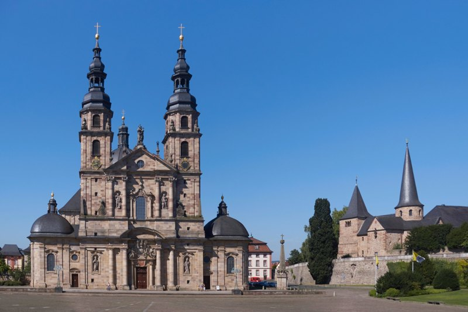
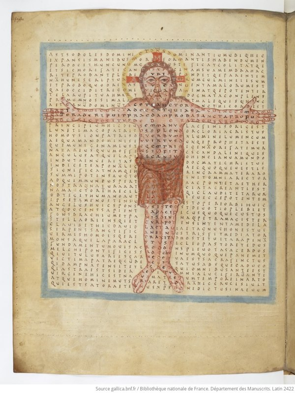
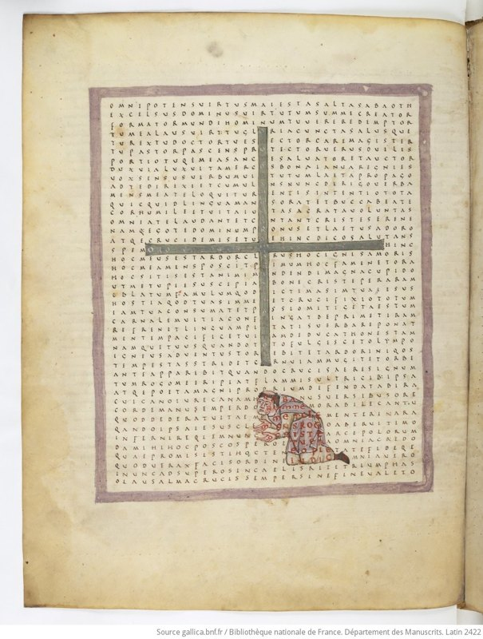
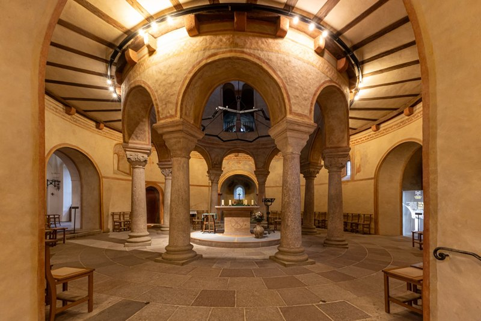
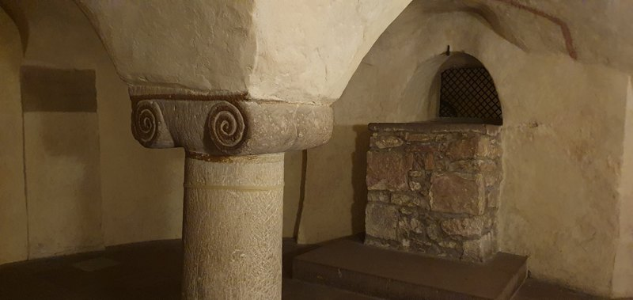

*Brun Candidus of Fulda* matters to the history of medieval art and letters for a reason that is both narrower and more interesting than the legend that surrounds him: he is one of the very few Carolingian monks who names himself, within a literary work of his own making, as the painter of a specific and prominent monumental image, and who presents himself, in the same work, as poet, hagiographer and illustrator at once. Everything else that has accumulated around his name over four centuries of scholarship, from philosophical treatises on the image of God to the honorific title of "first German painter", must be measured against that slender but genuine core. The purpose of this essay is to do precisely that: to set out what the primary sources actually say, to separate secure documentation from inference and from hypothesis, and to dismantle a set of errors that continue to circulate in handbooks, encyclopaedias and online resources.

## Fulda around 800: the setting

The <a href="/Content/Churches/Fulda-Abbey.html">abbey of Fulda</a>, founded in 744 by Sturmi, the disciple of Boniface, had become by the last decades of the eighth century one of the largest and wealthiest monastic communities in the Frankish realm. Its prestige rested above all on the possession of Boniface's body, brought there after the archbishop's martyrdom in Frisia in 754, and on close ties with the Carolingian court. In the years around 800 it was governed successively by Baugulf (779–802), Ratgar (802–817), Eigil (818–822) and Hrabanus Maurus (822–842), abbots whose very different personalities are reflected, sometimes refracted, in the literary output of the house. It is a peculiarity of Fulda that it produced, within two generations, a continuous series of abbatial biographies: Eigil himself composed the Life of the founder Sturmi, and Candidus continued the series with a Life of Baugulf, now lost, and a Life of Eigil, which survives. This cumulative historiographical project, conceived within the monastery for the monastery, is the context in which Candidus's surviving work must be read.

The decades around 800 were also a period of acute internal tension. Ratgar was a builder on a heroic scale. Under him the older abbey church was replaced by a vast new basilica dedicated to the Saviour, conventionally called the Ratgar basilica, with a western transept and western apse designed to receive the relics of Boniface. The ambition of the project, and the demands it placed on the community, provoked opposition; a petition by Fulda monks to Charlemagne is reported for 811, and in 817, in the climate of monastic reform promoted by Louis the Pious and Benedict of Aniane, Ratgar was deposed. His successor Eigil, a relative of Sturmi, was elected in 818 after negotiations that required imperial approval. Under Eigil the new basilica was completed, with crypts built by the monk-architect Racholf, and consecrated on 1 November 819, the feast of All Saints, by Archbishop Haistulf of Mainz; Boniface's remains were translated to the western apse. Eigil also built a small funerary church dedicated to St Michael in the monks' cemetery, a rotunda over a crypt, consecrated in January 822, shortly before his death in June of that year. Hrabanus Maurus then became abbot and remained so until 842, when the conflicts among the sons of Louis the Pious made his position untenable and he withdrew; Hatto succeeded him.

<figure>
  
  <figcaption>Fulda, the cathedral square with the Baroque cathedral (left), built on the site of the Ratgar basilica, and St Michael’s Church (right). Photo: Verum, <a href="https://creativecommons.org/licenses/by-sa/3.0/">CC BY-SA 3.0</a>, via Wikimedia Commons.</figcaption>
</figure>

This sequence of building, conflict, reform and commemoration is not merely background. It is the very subject of Candidus's surviving book, and the buildings it describes are the only places in which we can locate his activity as a painter.

## The man and his names: Bruun, Candidus and the problem of identity

### What the sources securely tell us

The person modern scholarship calls Brun Candidus is known almost entirely from his own *Vita Aegil* and from a handful of documentary traces at Fulda. His vernacular name was Bruun (also written Brun or Brunan in modern reference works); Candidus, "the white, the bright one", was a learned sobriquet of the type fashionable in Carolingian court and monastic circles, in the same way that his confrère Reccheo appears as Modestus. The dedicatory letter of the *Vita Aegil* opens, in the transmitted text, with the formula *Dilectissimo fratri et conpresbytero suo Modesto Candidus* ("To his most beloved brother and fellow-priest Modestus, Candidus"). The convention of the paired name is therefore internal to the work itself; it is not a modern construction.

From the *Vita Aegil* we learn that the author had been brought up in the monastery from childhood, which implies that he entered Fulda as an oblate, that he was a priest and monk, and that he styled himself *magister*. Fulda documents of the years 811 to 813 record a scribe Brun, who is generally identified with him; the regional biographical dictionary of Hesse describes him as a Fulda charter scribe in those years, while at least one popular online encyclopaedia speaks instead of the imperial chancery, a variant that finds no support in the abbey's documentary record and should not be repeated. A codex of the Rule of St Benedict in insular minuscule, now Würzburg, Universitätsbibliothek, M.p.th.q.22, carries on fol. 57r the colophon of a *Bruun monachus*, and it has been suggested that this is the same man and even his autograph. That identification remains doubtful: specialist work on early medieval autographs has questioned whether the colophon writer can be securely equated with the author of the *Vita Aegil*, given that Bruun was not a rare name at Fulda.

His death is recorded under the year 845 in the Fulda necrological annals (*Annales necrologici Fuldenses*), the abbey's register of deceased brethren. This is the firmest date in his life. The notice comes from the necrological annals and not from the narrative *Annales Fuldenses*, which are a different source and should not be cited for his biography.

### What is inferred

Everything else in the standard biographies is reconstruction. His birth "around 770–780" is an inference from his apparent seniority relative to Hrabanus Maurus (born c. 780) and from his account of having lived through the reigns of Baugulf, Ratgar and Eigil; the regional biography speaks of an upbringing "probably in a noble house", which is likewise conjecture. The suggestion in the *Neue Deutsche Biographie* of 1955 that he may have been of Anglo-Saxon origin rests on nothing more than the general Anglo-Saxon connections of Fulda and, probably, on contamination from the biography of the other Candidus discussed below; it should be treated as unfounded. His priestly ordination is attested, but its date is unknown.

The meaning of the title *magister* has been disputed. The older view, expressed in the *Neue Deutsche Biographie*, held that after Hrabanus became abbot in 822 Candidus succeeded him as head of the monastic school, and this claim has passed into most English-language summaries. The *New Catholic Encyclopedia* already noted that it is not certain he ever directed the school. The most thorough modern student of the *Vita Aegil*, <a href="/scholars.html#becht-jordens-gereon">Gereon Becht-Jördens</a>, has argued that *magister* in Carolingian Fulda was a rank designation that did not necessarily imply teaching, that Candidus ended his career administering one of the abbey's outlying economic centres (the *Vita* speaks of a *ministerium* outside the main monastery), and that he may at most have directed one of the external schools. Becht-Jördens draws attention to a passage in the preface in which Candidus complains that he has nobody with whom to discuss theological questions, a complaint hard to reconcile with the image of a head of the most famous monastic school in the East Frankish world. The safer formulation is that Candidus was a learned senior monk who called himself *magister*; whether he was ever Hrabanus's successor as schoolmaster is unproven and, on the internal evidence, rather unlikely.

### Wizo, alias Candidus: the decisive distinction

The single most important task in any account of Brun Candidus is to distinguish him from a contemporary who bore the same sobriquet. This second Candidus was an Anglo-Saxon, whose native name appears in the sources and in modern scholarship as Wizo, Witto, Withso or, reconstructed, Hwita, a name that once again means "white". He was a pupil and close confidant of Alcuin<a href="/endnotes.html#fn-alcuin" class="footnote">1</a>, whom he followed to the Continent; he is attested at the court of Charlemagne from about 793, travelled to Rome around 800 to 801, apparently on Alcuin's business, carried messages between Alcuin and the king, and appears in Alcuin's correspondence down to about 802. Alcuin dedicated his commentary on Ecclesiastes jointly to Onias, Fredegisus and Candidus. A sixteenth-century antiquarian tradition makes him a former pupil of Lindisfarne; this is not contemporary evidence. The standard modern biographies date his activity to about 793–802, and his later fate is unknown.

The confusion of the two men is old and pervasive. It began with early modern editors, who had at their disposal a set of texts transmitted simply under the name "Candidus" and, knowing of only one Carolingian writer so called through the Fulda *Vita*, assigned them to the monk of Fulda. It was reinforced in the nineteenth century, when a group of short philosophical-theological pieces was printed as a single treatise of Candidus, and it persisted into the mid-twentieth century: the *Neue Deutsche Biographie* entry of 1955 still credits Bruun of Fulda with the *Opusculum de passione Domini*, with an epistolary treatise on whether Christ could see God with bodily eyes, and with the so-called *Dicta Candidi*, though it already registers doubts about part of the *Dicta*. The decisive correction came from manuscript work in the late 1970s and early 1980s. <a href="/scholars.html#ineichen-eder-christine-e">Christine E. Ineichen-Eder</a>, in a study of theological and philosophical teaching material from the circle of Alcuin published in the *Deutsches Archiv* in 1978, and in her article on the artistic and literary activity of Brun Candidus in the *Fuldaer Geschichtsblätter* of 1980, showed that the manuscript tradition links these texts to the Alcuin circle around 800 and therefore to Wizo, not to the Fulda monk who wrote some forty years later. Her conclusions were adopted in her entries for the *Lexikon des Mittelalters* and have since been strengthened by the work of Christopher A. Jones, who edited the sermons attributed to Candidus Wizo, analysed the *Opusculum de passione Domini*, and argued for connections between Wizo and further anonymous Carolingian texts.

The persistence of the error is remarkable. As recently as 2013, a widely read German biography of Einhard assigned to Brun Candidus of Fulda a letter edited among the Carolingian epistles in the *Monumenta Germaniae Historica* (Epistolae V, pp. 615–616), a text that Ineichen-Eder had identified as Wizo's more than three decades earlier. Online resources reproduce the confusion in both directions: the Latin Wikipedia entry on "Candidus Wizo", for example, describes Wizo as a Benedictine monk of Fulda, transferring to him the very monastic affiliation that belongs to Bruun.

### A further layer of confusion: "Candidus of Trier"

A common habit of older literature and online sources is to call the second Candidus "Wizo/Candidus of Trier". This label itself requires correction. The Regensburg *Alcuin* database of early medieval scholars, which draws on the *Lexikon des Mittelalters*, states explicitly that older scholarship erroneously identified Candidus Wizo both with a Wizo who was bishop of Trier in the years around 804–809 and with the hagiographer Candidus Bruun of Fulda. Some current online encyclopaedias still present Wizo as an archbishop of Trier. There is no contemporary evidence that Alcuin's pupil ever held the see of Trier; the identification rests on the coincidence of a common name. A careful account must therefore hold apart not two but three figures: Brun Candidus, monk of Fulda (d. 845); Candidus Wizo, Anglo-Saxon pupil of Alcuin (fl. c. 793–802); and the Wizo who appears in the episcopal tradition of Trier. Only the first is the subject of this essay; the second is the author of the theological works long attributed to him; the third has nothing demonstrable to do with either.

## Formation under Einhard

All modern biographies state that Abbot Ratgar, soon after his election in 802, sent the gifted young monk to the court to complete his education under Einhard, himself a former Fulda pupil who had been sent to Aachen by Abbot Baugulf in the 790s and who had risen to prominence in the circle of Charlemagne. Einhard is described in modern scholarship as the supervisor of the royal building works and workshops, and the silver triumphal arch he donated as a cross-base to St Servatius in Maastricht shows his personal engagement with artistic production. Whether he possessed practical skills as a painter is unknown, but he certainly commanded the iconographic and ornamental knowledge on which the new art of the Carolingian revival depended.

The connection between Candidus and Einhard is accepted throughout the literature, and there is no reason to doubt it. Some English-language summaries, however, trace the information to the editor's introduction in Migne's *Patrologia Latina* rather than to a passage of the *Vita Aegil* itself, so that the Einhard connection rests on the authority of the modern editors. A further report, found in English-language summaries, that Ratgar also sent Candidus and other monks to the Irish scholar Clemens Scottus, should be treated with similar caution until it is verified in the sources.

What the Einhard connection plausibly explains is the combination of skills Candidus later displayed: a polished Latin prose and verse style, familiarity with the norms of court art, and an interest in the relation between text, image and building. It does not tell us where or how Candidus learned to paint. The common assertion, repeated in older encyclopaedias, that he "learned the art" at Einhard's side is an inference, reasonable but undocumented.

## Candidus in the school of Fulda and in the circle of Hrabanus Maurus

Candidus's relation to <a href="/Content/Artists/VIII-c/Rhabanus-Maurus.html">Hrabanus Maurus</a> is better documented than his relation to Einhard, because it is inscribed in the *Vita Aegil* itself. Candidus states that it was Hrabanus who encouraged him to write the Life of Eigil, and the work repeatedly honours Hrabanus by name: as the man who took part in the building of St Michael's church, and as the author of the altar inscriptions (*tituli*) for both the great basilica and the cemetery church, which Candidus quotes in full. He also transmits two epitaphs of Eigil, one composed by Eigil himself and one by Hrabanus. These passages make the *Vita Aegil* an important witness to Hrabanus's poetry; the modern critical edition of Hrabanus's altar tituli for the Salvator basilica, published by Becht-Jördens in 2010, depends on the text printed by the Jesuit Christoph Brouwer from the lost Fulda manuscript of the *Vita*.

More striking still is the formal model Candidus claims. In his dedicatory apparatus he refers to Hrabanus's *De laudibus sanctae crucis*, the cycle of figure poems in praise of the Holy Cross edited by <a href="/scholars.html#perrin-michel-jean-louis">Michel Perrin</a>, as the exemplar of a work composed in both prose and verse and furnished with images. Hrabanus's cycle was the most ambitious intellectual product of Fulda and one of the most ambitious of the whole Carolingian age; to invoke it was both homage and a statement of literary ambition. The *Vita Aegil* is not a figure poem, and its illustrations accompanied the text rather than being woven into it, but the conception of a learned book in which prose, verse and image interpret one another is clearly derived from Hrabanus.

On the institutional side, the evidence is much thinner than older literature suggests. There is no independent documentation of a teaching office held by Candidus. It is certain that he belonged to the most educated stratum of the convent and that he was a close associate of both Eigil and Hrabanus; it is a reasonable hypothesis that he taught in some capacity; it is not established that he directed the abbey school after 822. Becht-Jördens has proposed, more speculatively, that around 840 Candidus may have entertained hopes of succeeding Hrabanus as abbot, at a moment when Hrabanus's loyalty to Emperor Lothar I against Louis the German, within whose kingdom Fulda lay, was making his position increasingly precarious; on this reading the work's display of expertise in every question of monastic life would serve as an implicit recommendation of its author. The hypothesis is ingenious and fits the dating of the work, but it remains a hypothesis. In the event, Hatto succeeded Hrabanus in 842, and Candidus died three years later.

<figure>
  
  <figcaption>Hrabanus Maurus, In honorem sanctae crucis, carmen I: Christ with outstretched arms, ninth century. Ink and colours on parchment. Paris, Bibliothèque nationale de France, lat. 2422. Source: gallica.bnf.fr / Bibliothèque nationale de France.</figcaption>
</figure>

## The Life of Abbot Eigil: an *opus geminum* in word and image

### Form and transmission

The work that modern editors call the *Vita Aegil abbatis Fuldensis* (in older literature *Vita Eigilis* or *Vita Aeigili*) is an *opus geminum*, a "twin work" that treats the same subject twice, once in prose and once in verse, following a late antique and Anglo-Saxon tradition best known from Sedulius, Aldhelm and Bede. Book I is in prose; Book II is in hexameters, interspersed with other metres. Candidus dedicated it to his fellow monk and priest Reccheo Modestus; it was written at the encouragement of Hrabanus, and its composition is generally placed around 840. The *Neue Deutsche Biographie* dated it to 840–842, while the repertory *Geschichtsquellen des deutschen Mittelalters* gives 839 as the year of Modestus's death. Since the work is addressed to Modestus as a living reader, these data sit uneasily together, and the evidence does not resolve the tension; the safest formulation is "around 840".

There is also disagreement about the order of composition. The *Neue Deutsche Biographie* and the *Geschichtsquellen* repertory both state that the verse version was written first, whereas the transmitted arrangement places the prose book first. The order of the books need not reflect the order in which they were written, but this is a point on which the reference works make claims that cannot be checked without the critical edition.

The transmission is precarious. The only manuscript, kept at Fulda and plausibly the author's own copy, perished when the abbey library was dispersed and destroyed during the Thirty Years' War. The text survives solely because Brouwer printed it in his *Sidera illustrium et sanctorum virorum* (Mainz, 1616), under the title *Vita Aegil abbatis Fuldensis a Candido monacho ad Modestum edita prosa et versibus*. Every subsequent edition depends on Brouwer: Migne's *Patrologia Latina* reprinted the work, and the *Monumenta Germaniae Historica* edited the verse life in the *Poetae Latini aevi Carolini*, vol. II (1884), pp. 94–117, and the prose life in the *Scriptores* series, vol. XV,1 (1887), pp. 221–233. The division of the twin work between two series obscured its unity for a century. The critical edition by Becht-Jördens (Marburg, 1994), which grew out of a Heidelberg dissertation of 1989, restored it as a single *opus geminum* with its dedicatory letter, chapter list and dedicatory poem, and it is now the reference text.

### Content and literary character

The surviving work is much more than a life in the narrow sense. Book I narrates Eigil's upbringing at Fulda under Sturmi, the crisis of Ratgar's abbacy, the flight of monks from the monastery, Ratgar's deposition, the protracted negotiations over the election of a successor, the embassy to the court of Louis the Pious that brought back imperial permission for the election, and Eigil's governance and building works. It integrates speeches attributed to the emperor and to the archbishop of Mainz. Book II retells the same matter in hexameters and adds a dense apparatus of further texts: consecration notices, altar tituli and epitaphs in elegiac distichs, a versification of the *Te Deum* in hexameters and of the *Gloria* in the rare Terentian metre, alongside a dedicatory poem in the same exacting verse form. The work is a formal experiment of considerable sophistication.

Older literary history judged it with some condescension, observing that apart from the vividly narrated election and journey to court the subject matter was thin, and that edifying meditation and expansive speeches filled the gap. Later scholarship has reversed that judgement by reading the work on its own terms. Becht-Jördens characterised its manner as a "biblical-figural background style", in which the events of recent monastic history are continually overlaid with biblical types, so that Ratgar's misrule, the community's suffering and Eigil's restoration acquire a salvation-historical meaning. He has further argued that the doubling of the form has a hermeneutic purpose: in the prose book the moral interpretation of events predominates, in the verse book their salvation-historical interpretation, so that the work functions at once as a mirror for abbots and a mirror for the monastery. A more recent French study has asked whether the work's aims were confined to the reform of monastic life or extended to the reform of the empire. Candidus's ethical register is visible in a sentence from the prose book quoted in that study: *Vacat enim dilectio Dei, nisi subjungatur et proximi* ("For the love of God is empty unless the love of neighbour is joined to it"; *Vita Aegil* I.9, as quoted from the critical edition).

Candidus is also unusually self-reflective. In Book I he defends himself against the possible charge that his criticism of Ratgar and of many brethren during the crisis amounts to slander, arguing from biblical examples that confrontation with one's own failings is necessary for salvation through repentance. This awareness of historical change and of the moral responsibility of the historian is rare in Carolingian hagiography. It is all the more notable because, according to Becht-Jördens's reading, Candidus himself had played a mediating role in the crisis of 817, apparently persuading the monks who had fled to return, despite the severity of his later judgement on Ratgar.

### The *Vita Aegil* as historical source

For the historian of Fulda the *Vita Aegil* is indispensable: it is one of the principal sources for the conflict over Ratgar, for the implementation of the Anianian reform at Fulda, and for the building history of the abbey, and Becht-Jördens has drawn from it new evidence on the legal status of the monastery. Its value is, however, conditioned by its partisanship. Candidus wrote as a member of the party that had opposed Ratgar and as an admirer of Eigil, whom he treats in the manner of a saint, although Hrabanus, in his own verses on Eigil, praises his clemency and gentleness without saintly claims. The picture of Ratgar as a tyrannical builder needs to be balanced against other evidence showing him also as a promoter of learning, and against the irony that the building programme Candidus criticises was the very one whose decoration gave him his greatest commission.

## Candidus as painter: what the sources actually say

### The self-testimony in Book II

The claim that Candidus was a painter rests on a single source: his own words in Book II of the *Vita Aegil*. In the chapter describing the translation of Boniface's remains into the newly completed basilica in 819 (Book II, chapter 17), Candidus describes the martyr's burial in the adorned altar in the western apse, and then, in a passage of personal testimony which modern scholarship calls a *sphragis* (an authorial "seal"), declares that it was he, brought up from childhood in this house of Christ, the priest and monk Bruun and an unworthy *magister*, who painted the great apse that rises above the altar, adding with conventional modesty that he formed and set out various figures with small talent and little skill. The German rendering in the modern literature specifies that the figures were formed in a reddish colour, a detail whose technical meaning (pigment, underdrawing or poetic periphrasis) cannot be determined from the text alone. The heading of the following chapter, II.18, is transmitted as *Supplicatio pictoris et poetae*, "the supplication of the painter and poet", in which the author asks the reader's prayers.

The passage is given here in paraphrase, after the German translation published in the modern literature. The line reference commonly cited (II.17, ll. 131–137, with the wider self-testimony running to l. 185) follows the numbering of the 1994 critical edition and may not correspond to the 1884 MGH numbering; the heading *Supplicatio pictoris et poetae* is reported consistently in the scholarship.

With that caveat, the core of the evidence is solid. The passage is first-person, it names the author by his vernacular name Bruun, it names the location precisely, and the object, the apse of the western choir of the Salvator basilica above Boniface's tomb, was without question the most prominent site for painting in the monastery, the cult centre of the abbey's patron. There is no reason to doubt that Candidus was responsible for this painting in some substantial sense. Whether he executed it with his own hand, directed a team or designed it, the text does not allow us to decide, although his self-description as *pictor* and the conventions of the modesty formula point towards personal execution.

### Who commissioned the apse painting, and when?

The *Neue Deutsche Biographie* states that Eigil commissioned Candidus to paint the apse. This is an inference rather than an explicit statement, though a reasonable one: the basilica was consecrated under Eigil in 819, Eigil had completed the building after the interruption of 817/18, and Candidus belonged to Eigil's circle. The decision to build a western apse for Boniface, however, belonged to Ratgar's programme, and it cannot be excluded that planning for its decoration began before 817. The painting must have been complete, or substantially complete, by the consecration of 1 November 819 or shortly after; it is lost, together with the Carolingian basilica, which was replaced by the baroque cathedral in the early eighteenth century.

<figure>
  
  <figcaption>Johann Neudecker the Elder (reliefs), tomb altar of Saint Boniface, early eighteenth century. Black marble and alabaster. Fulda Cathedral, crypt of Boniface. Photo: Harvey Kneeslapper, <a href="https://creativecommons.org/licenses/by-sa/4.0/">CC BY-SA 4.0</a>, via Wikimedia Commons.</figcaption>
</figure>

### The iconography: a reconstruction, not a record

Nothing in the surviving text describes the subject of the apse painting in detail. The reconstruction most often encountered, that it showed the adoration of the Lamb by the orders of the heavenly hosts, with the monks of Fulda led by their founder Sturmi in the lowest register, is a hypothesis developed by Becht-Jördens. Its foundations are indirect but carefully argued. The basilica was consecrated on the feast of All Saints; tenth-century Fulda sacramentaries, notably the codex in Göttingen (Niedersächsische Staats- und Universitätsbibliothek, 2° Ms. theol. 231 Cim.), contain an All Saints image of precisely this type, with the Fulda monks among the adoring ranks; and art-historical studies of All Saints images in Fulda book painting have argued that these Ottonian miniatures depend on Carolingian models. Becht-Jördens further suggested that the lost illustration accompanying the versified *Te Deum* in the *Vita Aegil*, a text that enumerates the ranks of angels, apostles, prophets and martyrs praising God, may itself have reflected the apse composition. The chain of inference, from the date of consecration to the liturgical theme, from the theme to Ottonian miniatures, and from the miniatures back to a lost Carolingian wall painting, is attractive and coherent, but each link is hypothetical. It is the most plausible reconstruction we have; it is not a description of the painting, and it should never be presented as one.

The hypothesis also bears on a wider question that Becht-Jördens has pursued in his study of Hrabanus's altar tituli for the Salvator basilica: the tension, in the age of Anianian reform, between a monastic identity centred on the founder Sturmi and one centred on the martyr Boniface. If the apse showed the Fulda monks led by Sturmi adoring the Lamb above the tomb of Boniface, it would have given visual form to a reconciliation of these two foundations of Fulda's self-understanding. The interpretation is illuminating, but its dependence on the reconstructed iconography must be kept in mind.

### The illustrated *Vita*: three engravings and a note

The second strand of evidence concerns the illustrations of the *Vita Aegil* itself. Here the testimony is that of Brouwer, who saw the Fulda manuscript before its loss. In his *Antiquitatum Fuldensium libri IV* (Antwerp: Plantin-Moretus, 1612), he reproduced three of its images as copperplate engravings: the dedication image at the beginning of Book II, showing the author handing the open book to Modestus; the illustration to chapter 5, an allegorical depiction of Abbot Ratgar as a unicorn, drawing on the imagery of Psalm 21 (22), and one of the earliest known representations of the animal in Western art; and the illustration to chapter 8, showing the return of the embassy from the court of Louis the Pious with permission for the abbatial election. In his edition of 1616 Brouwer added that there had been further images assigned to the sections and tituli (*lemmata et tituli*) of the verse book, but that most of them had remained unfinished or had not even been begun: *pleraque impolita mansere, aut ne inchoata quidem* ("most remained unfinished, or were not even begun"). The cycle was thus incomplete, and the manuscript must have contained spaces left for pictures that were never executed.

Brouwer's engravings are early modern interpretations, not facsimiles; they translate the Carolingian images into the visual language of the seventeenth century and cannot be used for stylistic analysis. They are nonetheless precious evidence for the existence, subject matter and programme of the cycle, and they justify the description of the *Vita Aegil* as an illustrated biography. Becht-Jördens has called it the oldest known illustrated biography; the claim is plausible in the sense of a narrative cycle designed together with a biographical text, but superlatives of this kind depend on definitions and on the accidents of survival, and the qualification "known" is essential.

<figure>
  
  <figcaption>Hrabanus Maurus, In honorem sanctae crucis, the final poem with the cross and the author kneeling in prayer, ninth century. Paris, Bibliothèque nationale de France, lat. 2422. Source: gallica.bnf.fr / Bibliothèque nationale de France.</figcaption>
</figure>

Did Candidus himself paint these illustrations? No source says so directly. The inference rests on several converging observations, set out most fully by Becht-Jördens: the author's self-designation in the heading of II.18 as both painter and poet; his explicit model in Hrabanus's illustrated *De laudibus sanctae crucis*; the likelihood that the single Fulda manuscript was the author's own copy; and the fact that Candidus throughout the *Vita* commends by name those who contributed to the works he describes (Archbishop Haistulf for the consecrations, Racholf for the crypts, Hrabanus for St Michael's and the tituli), so that the absence of any other name in connection with the images suggests that the painter and poet asking for prayers is the author himself. The argument is strong, but it remains an argument; attested activity as a wall painter does not by itself prove activity as a book painter.

### The "Fulda painting school" and the limits of attribution

From these premises some scholarship has concluded that Brun Candidus was "the" or at least "one of the" leading masters of the ninth-century Fulda painting school, the workshop that produced the Fulda gospel books and the illustrated copies of *De laudibus sanctae crucis*. This proposition is a hypothesis of the second degree. Not a single surviving manuscript or fragment of wall painting can be attributed to Candidus on documentary or stylistic grounds, because nothing from his hand survives against which a comparison could be made. That a monk whom the community entrusted with the apse above Boniface's tomb occupied a leading position among Fulda's artists is likely; that he directed the scriptorium's illumination is not demonstrated. Images of Fulda-school manuscript leaves that circulate online labelled with his name, for instance in some knowledge databases, are associative illustrations, not attributions.

### "The first named German painter"? Dismantling a commonplace

The epithet most often attached to Candidus in popular literature, that he is "the first German painter known by name", must be rejected on three grounds. The first is conceptual: "German" is an anachronistic category for a monk of the Frankish empire in the ninth century, a residue of nineteenth-century national art history. The second is factual: Candidus is not the only named painter of the Carolingian period. Survey literature records, for instance, a painter named Adelricus who concealed his name in the ornament of a miniature in an illustrated Terence manuscript associated with the court, and other Carolingian scribes and artists are known from colophons and dedicatory verses. The claim of priority therefore depends entirely on how one defines "German", "painter" and "named". The third is evidential: we possess no work by Candidus. His fame as a painter rests on a passage of self-testimony and on three seventeenth-century engravings after a lost manuscript whose images may be his. What can be said with confidence is more modest and more interesting: Candidus belongs to the small group of early medieval artists known by name, and he is perhaps the earliest Carolingian monk who explicitly signs, within his own literary work, a specific and identifiable monumental painting.

## Buildings, tituli and the interpretation of architecture

Candidus's significance for art history is not limited to his own painting. The *Vita Aegil* contains some of the most important early medieval testimony on the meaning of buildings and on the relation between architecture and inscription.

### The Ratgar basilica and its altars

The *Vita* is a primary source for the building history of the Salvator basilica: the completion of Ratgar's church under Eigil after the interruption of 817/18, the addition of crypts by Racholf, the consecration by Haistulf on 1 November 819, and the translation of Boniface into the western apse. Book II records consecration notices in prose and the verse tituli that Hrabanus composed for the altars, and the arrangement of these altars, reconstructible from the tituli, has been interpreted by Becht-Jördens as a symbolic representation of the monastic and ecclesiological self-understanding of the convent. The interpretation rests on the reliability of Brouwer's transmission of the tituli and on the assumption that the sequence in which they are presented in the *Vita* reflects the spatial order of the altars.

### St Michael's rotunda: an early exegesis of building

The most celebrated passage in Book I concerns St Michael's church in the monks' cemetery, built by Eigil between about 820 and 822 as a funerary chapel and as his own burial place, and consecrated in January 822. Only the crypt survives substantially from the Carolingian building; the upper church was renewed in the tenth and eleventh centuries, probably after severe damage, but its essential conception as a rotunda on eight columns was preserved. The crypt is a ring-shaped vault carried by two concentric walls and a short central column; the upper church rose over eight columns and was closed, as Candidus says, by a single stone at its apex.

<figure>
  
  <figcaption>Fulda, St Michael’s Church, the rotunda, built 820–822 under Abbot Eigil and raised in the tenth and eleventh centuries. © Superbass / <a href="https://creativecommons.org/licenses/by-sa/4.0/">CC BY-SA 4.0</a> (via Wikimedia Commons), <a href="https://commons.wikimedia.org/wiki/File:2024-11-01-Kirche_St._Michael_in_Fulda-0084.jpg">original</a>.</figcaption>
</figure>

Candidus interprets this structure allegorically. He sees in it a figure of the relation between Christ and the Church (*Christi et ecclesiae puto praesignari posse figuram*, "I think that a figure of Christ and of the Church can be signified here"); the central column of the crypt and the keystone of the vault signify Christ, who begins the building of the Church and will bring it to completion; the eight columns signify those who fulfil the eight Beatitudes and are therefore pillars of the Church; the number eight is the sign of the resurrection, the eighth day; and the circular form is the sign of eternity. Modern scholarship regards this as one of the earliest surviving examples of an explicit exegesis of architectural symbolism in the Latin West, and Candidus expressly links it to Hrabanus Maurus, whose part in the building he records and whose altar tituli for St Michael's are transmitted both in the *Vita* and among Hrabanus's poems (carmen 42 in the MGH edition). Whether the allegory expresses the intentions of the builders or a retrospective interpretation by the hagiographer some two decades later cannot be decided; the hedging *puto* ("I think") suggests that Candidus himself presented it as an interpretation rather than as a record of the patron's programme.

Here too a popular error needs correction. Some modern accounts describe St Michael's as a direct copy of the Church of the Holy Sepulchre in Jerusalem. The resemblance of a funerary rotunda to the Anastasis is a familiar theme of architectural history, but Candidus's interpretation, the only Carolingian testimony, does not name Jerusalem; it reads the building in terms of Christ, the Church, the Beatitudes, resurrection and eternity. The Jerusalem reading is a modern art-historical hypothesis and should be identified as such.

### The crypt and the absence of images

<figure>
  
  <figcaption>Fulda, St Michael’s Church, the crypt with its central column, 820–822. Photo: Qwertzu111111, <a href="https://creativecommons.org/licenses/by-sa/4.0/">CC BY-SA 4.0</a>, via Wikimedia Commons.</figcaption>
</figure>

The surviving Carolingian crypt of St Michael's is sometimes associated in popular literature with Candidus's painting. There is no evidence for this. The *Vita Aegil* attributes to Candidus only the painting of the west apse of the Salvator basilica; it does not claim any painting at St Michael's, either in the crypt or in the upper church. Nor do the crypts of the main basilica, built by Racholf, offer any secure link to Candidus's hand. Any attribution of wall painting in these spaces to him is unfounded.

## The theological writings: attribution, misattribution and their meaning

### The canon of Candidus Wizo

The three groups of theological texts once credited to Brun Candidus illustrate how a name can attract a body of work. The *Opusculum de passione Domini*, first printed in the early eighteenth century and reprinted in Migne (PL 106, cols. 57–104), is a commentary on the Passion in the form of a series of homilies for Holy Week, evidently written for a community. The *Neue Deutsche Biographie* described it as intended to prepare the brethren for Easter and assigned it to Bruun. The manuscript evidence, however, places it in the circle of Alcuin: four of the five known manuscripts attribute it to "Candidus", and a mid-ninth-century Freising manuscript, now Munich, Bayerische Staatsbibliothek, Clm 6389, transmits it alongside sermons and philosophical excerpts that modern work has linked to Wizo. The work draws on Alcuin and Bede, and its date around 800 accords with Wizo's career rather than with that of the Fulda monk.

The epistolary treatise on whether Christ could see God with bodily eyes (*Num Christus corporeis oculis Deum videre potuerit*), printed in PL 106, cols. 103–108, and edited in MGH Epistolae IV, pp. 557–561, was already attributed in its first edition to *Candidus presbyter*. It answers a monk's question by arguing for the strict incorporeality of God, who cannot be perceived by corporeal sight, and recent studies, including French work on the letter as a contribution to Carolingian discussions of the beatific vision, treat it as Wizo's. The question was a live one among Alcuin's pupils, who were preoccupied with the relation between sensible and intelligible reality and with the vocabulary of seeing, image and likeness.

The so-called *Dicta Candidi* are more complicated. The first item, *De imagine Dei*, a short reflection on the soul as bearing the image of the Trinity, is edited in MGH Epistolae V, pp. 615–616, and is now generally ascribed to Wizo; it draws on an obscure earlier text, the *Libellus de dignitate conditionis humanae*, already quoted under the name of Ambrose around 790. In 1872 a French historian of scholastic philosophy printed this piece together with eleven further anonymous items as a single treatise, creating the misnomer "XII Dicta Candidi". Special interest has centred on the twelfth item as one of the earliest medieval attempts at a rational argument for the existence of God. The eleven additional items appear anonymously in the early manuscripts and belong, on all the evidence, to the period before 800 and to the circle of Alcuin; their attribution to Wizo is probable but less secure than that of *De imagine Dei*, and their attribution to Bruun of Fulda is excluded by their date. A Cambridge study of 1981 on logic, theology and philosophy from the circle of Alcuin to the school of Auxerre, which critically edited the material, confirmed this context. The canon of Wizo is still growing, with recent work on his sermons, on the excerpts of Clm 6389 and on newly identified treatises; none of this material has anything to do with Fulda.

### What remains for Brun Candidus

When these attributions are removed, the theological profile of Brun Candidus must be drawn entirely from the *Vita Aegil*. That profile is far from negligible. Candidus's theology is that of a monastic exegete trained in the Carolingian manner: typological, ecclesiological and moral. His reading of the Fulda crisis through biblical types, his interpretation of St Michael's church as a figure of Christ and the Church, his insistence on the inseparability of the love of God and the love of neighbour, and his reflection on the salvific value of confronting one's own faults show a coherent outlook in which history, liturgy, architecture and image are all read as signs. The opinion, encountered in older literature, that Candidus was a "philosopher" who advanced beyond Alcuin and separated theology from philosophy applies, if to anyone, to Wizo; its transfer to the Fulda monk is a direct consequence of the misattribution. For Brun Candidus the more accurate designation is that of a learned monastic hagiographer and exegete, whose originality lies in the integration of literary form, visual programme and historical self-reflection rather than in speculative philosophy.

## Transmission and afterlife

The textual history of Brun Candidus's work is a history of loss. The *Vita Baugulfi*, which he says he wrote at Eigil's suggestion, has disappeared; some reference works add the proviso "if it was in fact written", though there is no reason to doubt Candidus's statement. The *Vita Aegil* survived the Middle Ages in a single manuscript that was lost in the seventeenth century, so that Brouwer's prints of 1612 and 1616 are in effect our manuscript.

Early modern and modern reception compounded the problem. Editors encountering theological texts under the name of Candidus assigned them to the only Candidus they could locate, and Migne's *Patrologia* printed them under the heading of "Candidus Fuldensis monachus", giving the misattribution the authority of a standard collection. Nineteenth-century historians of philosophy, eager to find precursors of scholastic method, built on this grouping and made Candidus of Fulda a philosopher; nineteenth-century art historians, eager to find the beginnings of a national school, made him the first German painter. Both constructions rested on a misreading of the evidence, the first on a confusion of persons, the second on an anachronistic category and on the inflation of a single passage of self-testimony.

Twentieth-century scholarship corrected both. Candidus's significance as a painter was long neglected precisely because no work of his survives, and only from about 1980, with Ineichen-Eder's study, were his self-testimony and Brouwer's engravings systematically brought into the discussion; her work on the manuscript tradition of the Alcuinian teaching texts simultaneously removed the theological writings from his canon. The monographs, critical edition and articles of Becht-Jördens from 1991 onwards then established the *Vita Aegil* as a unified *opus geminum*, clarified its form and historical value, and offered the reconstruction of the apse painting discussed above.

What emerges is a figure smaller in some respects, and larger in others, than the legend. He is smaller because he wrote no philosophical treatises and because his status as a painter rests on fragile foundations. He is larger because his one surviving work is among the most formally ambitious and self-aware products of Carolingian monastic culture, a book in which a monk of Fulda tried to make prose, verse, image and architecture interpret one another, and in which he signed, as painter and poet, the decoration of the holiest place in his monastery.

## Conclusion

The evidence for Brun Candidus can be arranged in layers of decreasing certainty. Secure is that a Fulda monk and priest named Bruun, called Candidus, who had been brought up in the monastery and styled himself *magister*, wrote around 840, at Hrabanus's encouragement and for his confrère Modestus, the twin prose-and-verse Life of Abbot Eigil; that in it he claims to have painted the apse above Boniface's tomb in the basilica consecrated on 1 November 819; that the verse book was furnished with an incomplete cycle of illustrations, three of which survive in Brouwer's engravings of 1612; that he had earlier written a Life of Baugulf, now lost; and that he died in 845. Highly probable is that he studied under Einhard at court after 802, that he was the scribe Brun active at Fulda in 811–813, and that he designed and probably painted the illustrations of his *Vita*. Hypothetical are the iconography of the apse as an adoration of the Lamb with the Fulda monks led by Sturmi, his direction of the Fulda school after 822, his leading role in a Fulda painting school, his ambitions for the abbacy around 840, and his authorship of the Würzburg Rule manuscript. Erroneous are his authorship of the *Opusculum de passione Domini*, of the letter on the vision of God and of the *Dicta Candidi*, all of which belong to the circle of Alcuin and very probably to Candidus Wizo; his identification with Wizo or with a "Candidus of Trier"; his Anglo-Saxon origin; any attribution to him of painting in St Michael's church or its crypt; and the anachronistic title of "first German painter".

Stripped of these accretions, Brun Candidus remains a figure of real importance: a witness to the crisis and reform of Fulda, an early interpreter of the meaning of buildings, a transmitter of Hrabanus's verse, and one of the very few early medieval artists who speaks, in his own voice, about a painting he made.
