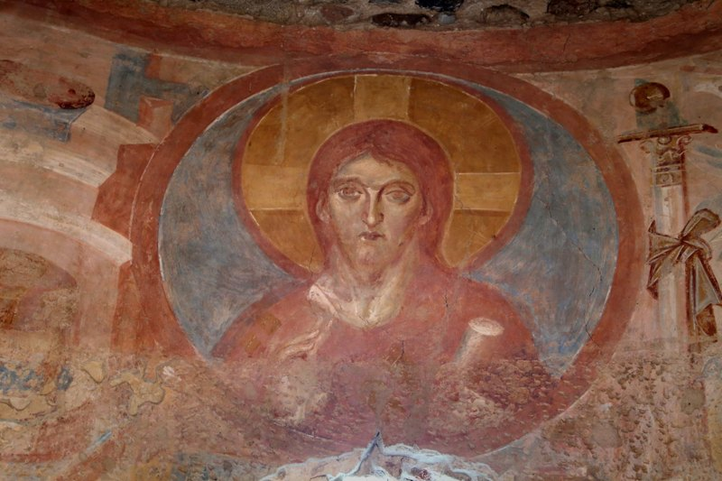
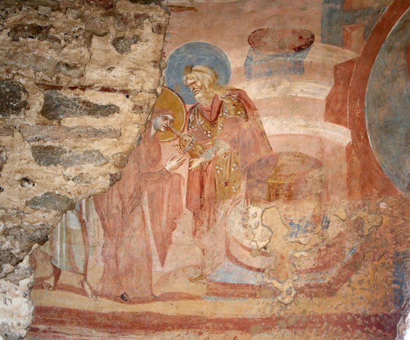
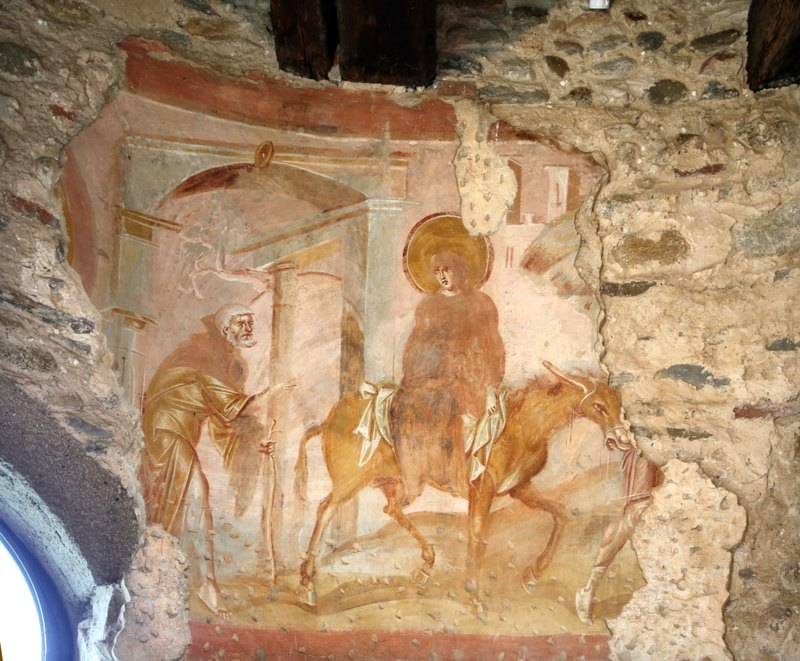
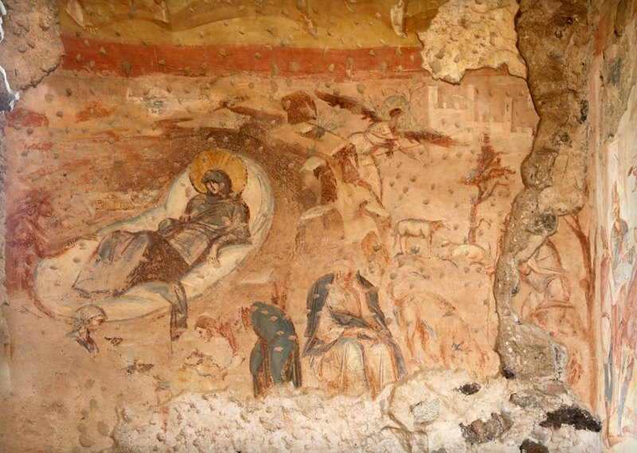
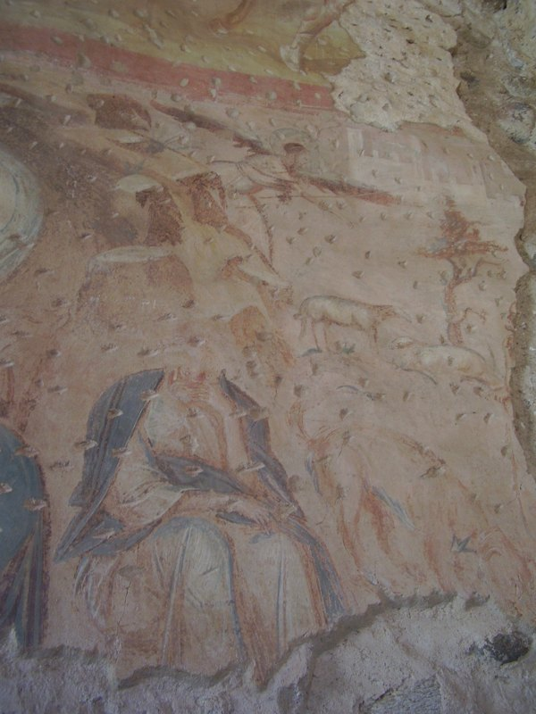
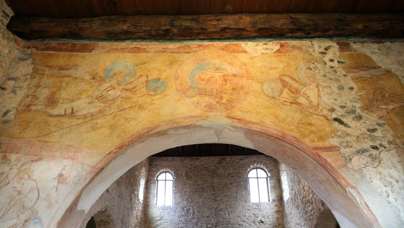

## A Name for an Anonymous Painter

The *Master of Castelseprio* is the conventional name given to the painter, or more probably the small group of painters, who decorated the eastern apse of the church of <a href="/Content/Churches/Santa-Maria-foris-portas.html">Santa Maria foris portas</a> at Castelseprio, in the province of Varese, with a cycle of the Infancy of Christ. No document records their names, their origin or their patron, and no other work has been attributed to them. Everything that can be said about them derives from the paintings themselves, from the building in which they are found, and from the few scratched inscriptions on the painted plinth.

The cycle is among the most discussed works of early medieval painting. Its quality is exceptional, and its manner, quick, luminous and full of space, has no close parallel in the West between Late Antiquity and the twelfth century. Since its rediscovery in 1944 the painters have been placed in almost every century from the sixth to the tenth and assigned to Syria, Palestine, Constantinople, Rome and Milan. This entry sets out what can be said about them in the light of the scientific evidence now available and describes the main features of their art; the building and the cycle as a whole are treated in the entry on the church.

## The Date: from the Lombards to the Tenth Century

For decades the Master of Castelseprio was presented as a Lombard painter, active in the seventh or eighth century, and the cycle as a monument of the Lombard kingdom. This view goes back to the first publication of 1948, in which Alberto De Capitani d'Arzago attributed the paintings to refugees from the Syro-Palestinian area who had come to Italy in the seventh century and Gian Piero Bognetti linked them with the missions sent from Rome to convert the Arian Lombards. Paolo Verzone proposed an even earlier date, in the sixth century, and <a href="/scholars.html#schapiro-meyer">Meyer Schapiro</a> eventually settled on the eighth.

The material evidence no longer supports these dates. Thermoluminescence of the roof tiles of the church gave an average date of 828, and radiocarbon dating of its timber a date of 865 ± 87, so that the building, and therefore the paintings, cannot be earlier than the ninth century. The study published in 2014 by Gian Pietro Brogiolo, Vincenzo Gheroldi, Flavia De Rubeis and John Mitchell distinguished two phases of construction and decoration and placed the later one, to which the apse cycle belongs, in the middle of the tenth century. The latest possible date is given by the graffiti scratched into the painted plinth, which record ordinations and deaths of clerics and include, as the earliest, a mention of Arderic, archbishop of Milan from 936 to 948.

The master was therefore active in the ninth century or in the first half of the tenth, before 948. Within this span the choice remains open. <a href="/scholars.html#weitzmann-kurt">Kurt Weitzmann</a> had already proposed, on stylistic grounds, a date shortly before 945, connecting the cycle with the contacts between the court of Constantinople and the Italian kingdom, and <a href="/scholars.html#morey-charles-rufus">Charles Rufus Morey</a> supported a tenth-century date; <a href="/scholars.html#bertelli-carlo">Carlo Bertelli</a>, by contrast, argued for the ninth century and a context in Carolingian Milan. This entry, formerly placed among the painters of the seventh century after the older literature, is therefore now listed with those of the ninth.

## One Hand or Several

The cycle covers about seventeen metres of wall in two registers, together with the clipeus of Christ and the decoration of the triumphal arch. A work of this extent was not painted by one person, and differences of handling within it have been noted since the first studies. Some scenes, such as the Annunciation, the Dream of Joseph and the clipeus of Christ, are executed with care in the faces and in the modelling of the figures; others, such as the Nativity with the shepherds and the Adoration of the Magi, are painted with a much freer, almost sketch-like brush. The angels and the throne of the Etimasia on the arch, on an ochre ground, are broader and simpler in handling than the scenes of the apse.

These differences may reflect different hands working side by side, a master and assistants, or simply different degrees of finish adapted to the position and importance of each scene. The name Master of Castelseprio is best understood as a designation for the leading painter of a workshop, whose manner is most evident in the faces and in the figures of the apse, and whose collaborators shared his training and his repertory.

## The Manner

<figure>
  
  <figcaption>Master of Castelseprio, <em>The clipeus of Christ</em>, ninth–tenth century, before 948. Fresco. Castelseprio, Santa Maria foris portas, eastern apse. Photo: Sailko, <a href="https://creativecommons.org/licenses/by/3.0/">CC BY 3.0</a>, via Wikimedia Commons.</figcaption>
</figure>

The art of the master is defined by a technique of rapid, broken strokes that build figures out of light and shade rather than enclosing them in firm contours. Faces are drawn with a few lines and given life by white highlights on the nose, the brow and the cheekbones; draperies are rendered in flickering lines of light; bodies have weight and move freely in space. The painter uses a restricted palette, earth reds and ochres, greys and a pale blue, laid in thin layers on the plaster and finished with dry touches.

The space of the scenes is equally distinctive. Buildings recede in bold diagonals, often in inconsistent but convincing perspectives; landscapes are suggested by sloping ground, trees and distant walls; figures stand and move within this space rather than in front of it. The impression is of a painting that has inherited the illusionistic methods of Late Antique art and applies them with a freedom unusual in the early Middle Ages.

These qualities led <a href="/scholars.html#weitzmann-kurt">Kurt Weitzmann</a> to compare the cycle with the Joshua Roll and the Paris Psalter, the most classical works of Byzantine book painting, and <a href="/scholars.html#kitzinger-ernst">Ernst Kitzinger</a> to place it among the works that show the persistence of a Hellenistic manner in the Mediterranean. The comparison with the frescoes of Santa Maria Antiqua in Rome, where Greek painters worked in the seventh and eighth centuries, notably under Pope John VII<a href="/endnotes.html#fn-pope-john-vii" class="footnote">1</a>, has been made repeatedly. None of these comparisons is exact, and the very isolation of the cycle has made it possible to place it in very different contexts.

## Iconography and Sources

The master's repertory is that of the Eastern Church. Several scenes are drawn from the Protevangelium of James rather than from the Gospels: the Virgin spinning the purple thread for the veil of the Temple in the Annunciation, the Trial of the Bitter Waters, the Journey to Bethlehem with Joseph walking behind the donkey, and the midwives of the Nativity. The Nativity itself, with Mary lying on a crescent-shaped mattress before the cave and Joseph seated apart, follows a Byzantine formula, as does the Etimasia on the arch. Short Latin labels, among them ZVMEON for Simeon, show that the painters worked for a Latin-speaking milieu.

The programme, centred on the Incarnation and on the testimonies to the virgin birth, was certainly established with the patron and the clergy of the church. The master's contribution lies in the way it was realised: the choice of Eastern models, the narrative clarity of the scenes, and the pictorial means that give them life.

## Where Was the Master Trained?

The question of origin has no documentary answer. The Greek affinities of the style and the iconography have led many scholars to assume a painter trained in a Greek-speaking milieu, whether a refugee from the East, a Greek painter active in Rome, or an artist from Constantinople. Others have stressed that the means to paint in this manner, Late Antique models and Greek painters, existed in Italy, in Rome and Milan, throughout the early Middle Ages, and that a painter formed there could have achieved the same result.

The new dating shifts the terms of the debate. A painter active in Lombardy in the ninth or tenth century belongs to the world of the Carolingian and post-Carolingian kingdom of Italy, in which Milan was a centre of artistic production and contacts with Byzantium were frequent. Whether he came from the East or was trained in Italy, he worked within the diocese of Milan, for a patron who was probably connected with the counts of Seprio, and for a clergy that used Latin.

## Reception

The Master of Castelseprio entered the history of art with the publication of 1948 and with the international debate that followed. <a href="/scholars.html#grabar-andre">André Grabar</a> and <a href="/scholars.html#toesca-pietro">Pietro Toesca</a> wrote on the cycle in 1950 and 1951, Weitzmann devoted a monograph to it in 1951, and Morey and Schapiro discussed it in the *Art Bulletin* in 1952. The frescoes became a key piece of evidence in two larger arguments, on the existence of a Byzantine renaissance in the tenth century and on the survival of Hellenistic painting through the seventh and eighth centuries, and the anonymous master was cited on both sides. Later studies by Bertelli, <a href="/scholars.html#andaloro-maria">Maria Andaloro</a> and others, and the scientific investigations of the last decades, have placed the work in a more precise context without resolving the question of the painters' identity.

## Catalogue Entry

### The Annunciation (Santa Maria foris portas, apse, north side)

<figure>
  
  <figcaption>Master of Castelseprio, <em>The Annunciation and the Visitation</em>, ninth–tenth century, before 948. Fresco. Castelseprio, Santa Maria foris portas, eastern apse, north side, upper register. Photo: Sailko, <a href="https://creativecommons.org/licenses/by/3.0/">CC BY 3.0</a>, via Wikimedia Commons.</figcaption>
</figure>

The Annunciation shows the master at his most refined. The angel Gabriel enters from the upper right with a long striding movement, his wings spread, his staff held diagonally across his body, his right hand stretched out towards Mary. His body is built almost entirely of light: a few flowing lines of white and pale ochre on a pinkish ground describe the tunic and the mantle, and the wings are drawn with long sweeping strokes.

Mary, seated at the left before a column and a building, holds the spindle with which, according to the Protevangelium of James, she was spinning the purple thread for the veil of the Temple. The detail shows the painter's familiarity with an iconographic tradition rare in the West, and the small attendant who looks out from a doorway behind her, her eyes wide with surprise, shows his gift for characterising secondary figures with a few strokes.

The architecture behind Mary is set at an angle, with a column, a doorway and a building that recedes towards the left; the effect of depth is created without a consistent perspective, by the placement of masses and the play of light and shadow on their faces. The figure of Elizabeth at the right edge, belonging to the Visitation, is cut by the large lacuna that follows.

The scene is among those most often cited in support of a Greek training. The movement of the angel, the lightness of the drapery and the freedom of the brushwork recall the angels of Byzantine manuscripts of the Macedonian period, but the comparison concerns the method rather than any specific model.

### The Trial of the Bitter Waters (Santa Maria foris portas, apse)

<figure>
  
  <figcaption>Master of Castelseprio, <em>The Trial of the Bitter Waters</em>, ninth–tenth century, before 948. Fresco. Castelseprio, Santa Maria foris portas, eastern apse, upper register. Photo: Sailko, <a href="https://creativecommons.org/licenses/by/3.0/">CC BY 3.0</a>, via Wikimedia Commons.</figcaption>
</figure>

The Trial of the Bitter Waters, one of the rarest subjects in Christian art, shows the care the master gave to faces and costume. The high priest, an old man with white hair and beard, bends towards Mary with an expression of grave attention and holds a golden vessel to her lips; Mary, in profile, receives the cup with raised hands. The two heads, drawn with delicate lines and soft modelling, are among the most finely painted passages of the cycle.

The priest's cloak, painted in gold and set with pearls and stones, contrasts with the simple red mantle of Mary. The painter uses the richness of the garment to characterise the figure and to mark the solemnity of the scene, which takes place before an altar under a ciborium. The architecture of curved walls and columns behind the figures recedes in depth and gives the scene its setting in the Temple.

The subject itself, drawn from the Protevangelium of James, testifies to the master's knowledge of Eastern iconography. It was rarely represented anywhere, and almost never in the West; its presence at Castelseprio, together with the other apocryphal scenes of the cycle, suggests that the painters worked from models current in Byzantine or Eastern Christian art.

The large lacuna at the left has destroyed the figure of Joseph, whose bare feet are still visible. The loss is characteristic of the state of the cycle, in which the surviving passages, of high quality, are interrupted by damage that makes the reconstruction of whole compositions difficult.

### The Journey to Bethlehem (Santa Maria foris portas, apse, south side)

<figure>
  
  <figcaption>Master of Castelseprio, <em>The Journey to Bethlehem</em>, ninth–tenth century, before 948. Fresco. Castelseprio, Santa Maria foris portas, eastern apse, south side, upper register. Photo: Sailko, <a href="https://creativecommons.org/licenses/by/3.0/">CC BY 3.0</a>, via Wikimedia Commons.</figcaption>
</figure>

The Journey to Bethlehem is the scene in which the master's sense of space and movement is most evident. The donkey walks towards the right with a natural, trotting gait, its head lowered, its legs in motion; Mary sits sideways on its back, wrapped in a brown mantle, and turns her face towards the viewer; Joseph, an old man bent forward on his staff, walks behind and stretches out a hand towards her.

The figures are set before a building with tall, pale columns and an arched opening, drawn in a perspective that suggests depth and gives the scene a place, the gate of a city or a portico. The ground slopes away beneath the feet of the donkey, dotted with small stones. Architecture and landscape are not decorative backdrops but a space in which the figures move.

The handling is rapid and confident. The mantle of Mary is laid in with a few broad strokes of brown and grey, the donkey modelled in warm browns with highlights on the back and the legs, Joseph's face drawn with a few lines and white touches on the beard and hair. The contrast between the weary figure of Joseph and the upright, calm figure of Mary gives the scene its human tone.

The scene follows the Protevangelium of James, in which Joseph sets out for the census with Mary on a donkey. Its narrative directness and its naturalism made it, together with the Annunciation, one of the images most often reproduced to illustrate the master's art.

### The Nativity and the Annunciation to the Shepherds (Santa Maria foris portas, apse, south side)

<figure>
  
  <figcaption>Master of Castelseprio, <em>The Nativity with the Annunciation to the Shepherds</em>, ninth–tenth century, before 948. Fresco. Castelseprio, Santa Maria foris portas, eastern apse, south side, lower register. Photo: Sailko, <a href="https://creativecommons.org/licenses/by/3.0/">CC BY 3.0</a>, via Wikimedia Commons.</figcaption>
</figure>

<figure>
  
  <figcaption>Master of Castelseprio, <em>The Annunciation to the Shepherds, detail of the Nativity</em>, ninth–tenth century, before 948. Fresco. Castelseprio, Santa Maria foris portas, eastern apse, south side, lower register. Photo: Rostkol, <a href="https://creativecommons.org/licenses/by-sa/4.0/">CC BY-SA 4.0</a>, via Wikimedia Commons.</figcaption>
</figure>

In the Nativity the master's manner reaches its freest form. The large composition spreads across a landscape in which Mary lies on a crescent-shaped mattress before the dark cave, the midwives attend to the birth, Joseph sits apart in a blue-green mantle, and to the right an angel flies down to a shepherd among his flock, with the walls of Bethlehem in the distance.

The handling varies across the scene. The figure of Mary and the faces of the midwives are modelled with some care, while the shepherds, the animals and the angel are sketched with a few rapid strokes of red and ochre on the pale ground, as the detail shows. The freedom of these passages is the most striking feature of the cycle and the one that most clearly distinguishes it from the more controlled manner of Byzantine wall painting.

Whether this freedom reflects the hand of the master himself or of a collaborator working more quickly is impossible to decide. The composition, derived from Byzantine iconography, is coherent, and the integration of the Annunciation to the Shepherds into the same landscape as the Nativity shows a painter able to organise a complex narrative space.

The scene is marked throughout by small spots, the keying made in the later Middle Ages to receive a new layer of plaster. The damage has not obscured the original painting, but it has reduced its legibility and contributed to the impression of a sketch, which is in part due to the condition of the surface.

### The Etimasia and the Angels (Santa Maria foris portas, triumphal arch)

<figure>
  
  <figcaption>Master of Castelseprio, <em>The Etimasia between two angels</em>, ninth–tenth century, before 948. Fresco. Castelseprio, Santa Maria foris portas, triumphal arch. Photo: Sailko, <a href="https://creativecommons.org/licenses/by/3.0/">CC BY 3.0</a>, via Wikimedia Commons.</figcaption>
</figure>

The decoration of the triumphal arch, with the throne of the Etimasia in a roundel between two flying angels, is painted on an ochre ground in a broader and simpler manner than the scenes of the apse. The angels, each holding a globe surmounted by a cross and a long staff, fly horizontally towards the centre; their bodies are drawn with long fluid lines and modelled with few tones, so that from a distance they read clearly against the ground.

The difference of handling has suggested to some scholars a different hand, or a different phase of work, for the arch. It may also be due to the function of the image, which faces the apse from the arch and must be legible from further away than the small scenes of the curved wall.

The Etimasia, the prepared throne of the Second Coming, follows a Byzantine formula, as do the angels with globes. Together with the clipeus of Christ above the central window it frames the narrative of the Infancy between the incarnate Christ and the Christ who will return in glory.

The angel on the left, the better preserved, shows the same profile type and the same streaming drapery as the angels of the apse scenes, and confirms that the arch belongs to the same workshop, even if not to the same hand as the most refined passages of the cycle.
