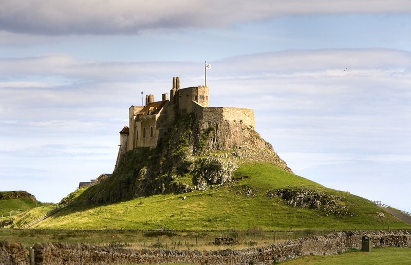
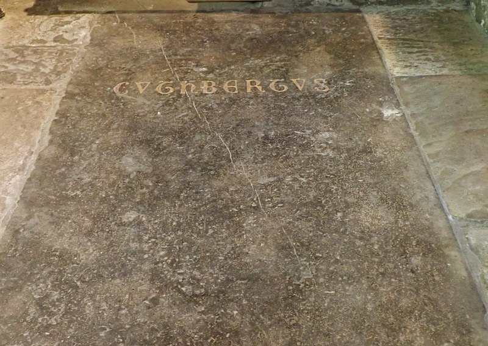
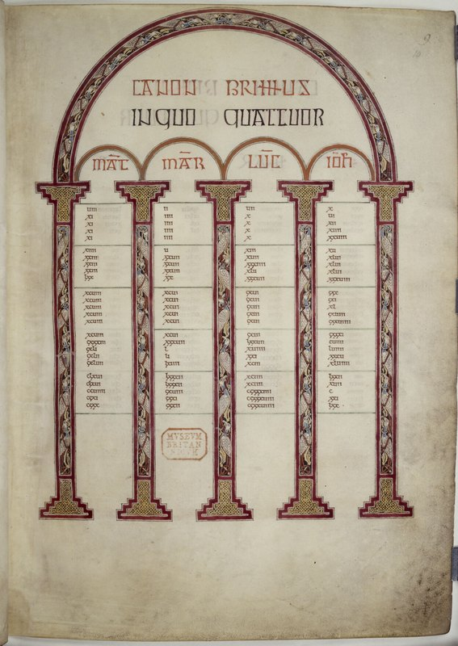
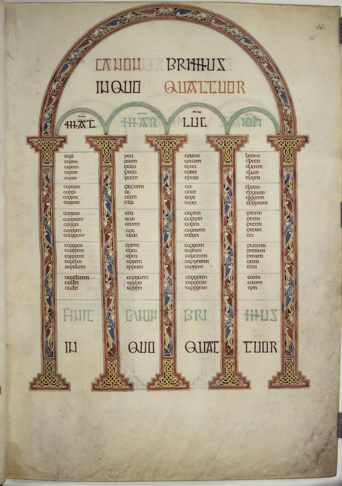
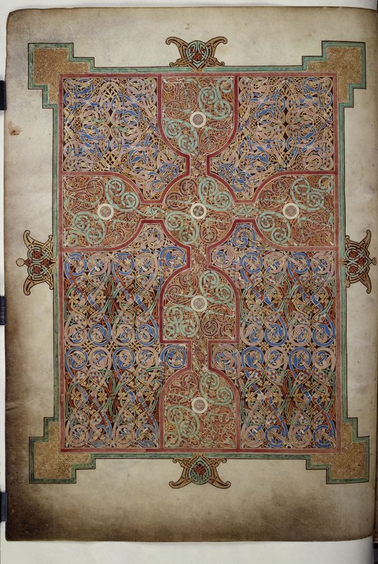
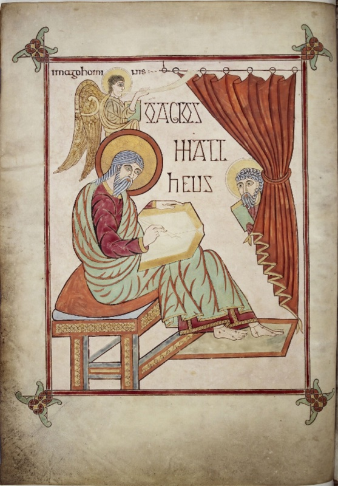
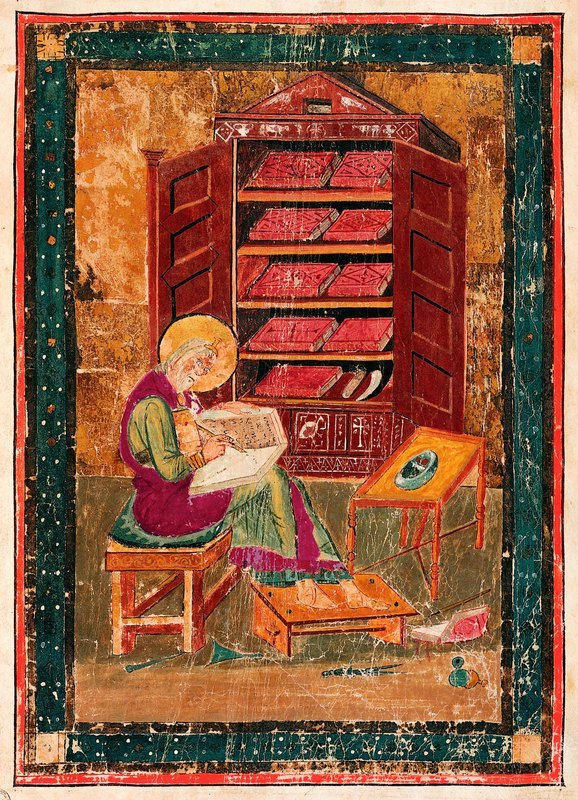

## The Bishop and the Book

*Eadfrith* was bishop of Lindisfarne from 698 until his death in 721. He belonged to the community founded on Holy Island in 635 by Aidan, a monk of Iona, and he governed it in the years in which the cult of Saint Cuthbert, its former bishop, became one of the great cults of Anglo-Saxon England. His fame, however, rests on a single book: the Lindisfarne Gospels, now in the British Library, which a note added about two and a half centuries later names as his work.

Almost everything else about him comes from texts written for or about the community. He received the two earliest Lives of Saint Cuthbert, one anonymous and one by Bede, and Bede records that he restored the saint's oratory on Farne. Symeon of Durham, writing in the early twelfth century, gives the date of his death. Of his origins, family and training nothing is known.

The older version of this page filled this silence with long speculation on his family, his possible journeys to Iona, York and Rome, the hardships of medieval travel and the cause of his death. It also stated that the book has sixteen carpet pages, when it has five, and listed lapis lazuli among its pigments, which scientific analysis has excluded. That material has been removed. The page now presents the documents, the book and the questions that scholars have asked about it.

Lindisfarne was given to Aidan by Oswald, king of Northumbria, who had spent his exile among the Irish and, on regaining his kingdom in 634, asked Iona for a bishop to convert his people. The island, close to the royal fortress of Bamburgh and cut off from the mainland twice a day by the tide, combined the retreat of an Irish monastic site with access to the king. From it the Irish monks preached across Northumbria, and its bishops governed the Church of the kingdom.

The Synod of Whitby in 664 changed the community's position. King Oswiu decided in favour of the Roman calculation of Easter and the Roman tonsure, and Bishop Colman, unwilling to accept the decision, returned to Iona with the Irish monks and part of the English community. Lindisfarne remained a bishopric and kept the memory of Aidan, but from then on it followed Roman observance, and its later bishops, among them Cuthbert and Eadfrith, were Englishmen trained in a mixed tradition.

Cuthbert, the saint whose cult defined Eadfrith's episcopate, had entered the monastery of Melrose in 651 and came to Lindisfarne as prior after Whitby, charged with bringing the community into line with the new observance. In 676 he withdrew as a hermit to the island of Farne; in 685 he was made bishop of Lindisfarne against his will, and he returned to Farne to die on 20 March 687. He was buried at Lindisfarne, and eleven years later his body was found incorrupt.

Bede's list of the bishops of Lindisfarne runs from Aidan through Finan, Colman, Tuda, Eata, Cuthbert and Eadberht to Eadfrith, who was succeeded in 721 by Æthelwald. Eadfrith's episcopate of twenty-three years was the longest since the foundation, and it fell in the generation of Bede, of Abbot Ceolfrith of Wearmouth-Jarrow and of the great Northumbrian books. Within this list Eadfrith is distinguished not by any political role but by his connection with the saint and with the book.

Lindisfarne was not the only house associated with outstanding books in these decades. A group of Gospel books, among them the Durham Gospels and the Echternach Gospels, has been linked by Michelle Brown and others to the same scriptorium or to its circle, while the monasteries of Wearmouth and Jarrow produced the Codex Amiatinus and other books in a Mediterranean manner. The Lindisfarne Gospels belong to a period of intense book production in Northumbria, which they surpass in ambition and finish.

The book also belongs to a group of objects connected with Cuthbert and his community: the wooden coffin made for the saint's body in 698, carved with Christ, the Virgin and the apostles; the small Gospel of John found in the coffin, now known as the St Cuthbert Gospel; and the pectoral cross of gold and garnets buried with him. Together they document the art of Lindisfarne in the years around 700.

Eadfrith is thus one of the very few artists of the early Middle Ages whose name can be connected with a surviving masterpiece, and he is a bishop rather than a professional craftsman. His case raises questions that recur throughout this page: how far a late attribution can be trusted, how a bishop could find the time and skill to make such a book, and how the book reflects the community and the cult for which it was made.

## The Sources

The bishops of Lindisfarne are listed in Bede's *Ecclesiastical History* and in the later history of the church of Durham by Symeon. Eadfrith succeeded Eadberht, who died in 698, shortly after the elevation of Cuthbert's body on 20 March of that year, when the monks found it incorrupt eleven years after his death. Eadfrith thus became bishop at the moment when Cuthbert was proclaimed a saint, and the promotion of his cult was the work of his episcopate.

The anonymous *Life of Cuthbert*, written by a monk of Lindisfarne between about 699 and 705, is dedicated to Eadfrith and the community. Some years later Bede wrote a prose Life at the community's request; his prefatory letter is addressed "to the holy and most blessed father, Bishop Eadfrith, and to all the congregation of brothers who serve Christ on the island of Lindisfarne". Bede also tells how Eadfrith rebuilt the oratory on Farne in which Cuthbert had lived as a hermit, so that it could be used by the anchorite Felgild.

Eadfrith died in 721 and was buried at Lindisfarne. When the community abandoned the island in the late ninth century, under the pressure of the Viking raids, it carried with it the body of Cuthbert, the relics of the other holy bishops of Lindisfarne and its books. The relics of Eadfrith thus travelled with those of the saint to Chester-le-Street and finally, in 995, to Durham, where Symeon records them.

The anonymous Life of Cuthbert is one of the earliest works of hagiography written in England. Divided into four books, it tells of the saint's youth, his life as a monk and prior, his years as a hermit and bishop and his death and miracles. Its author, a monk of Lindisfarne, addresses the work to Bishop Eadfrith and the community at whose command he wrote, and the Life is therefore the first literary product of Eadfrith's episcopate.

Bede had already written a Life of Cuthbert in verse, before turning to the prose Life requested by Lindisfarne. In the prefatory letter he explains that he did not write without careful enquiry: he questioned those who had known the saint, submitted his drafts to Herefrith and other elders of the community for correction, and the finished text was read aloud before the elders of Lindisfarne for two days, so that nothing should be included that was not confirmed.

The same letter records a gesture of the community. In return for his work, Bede asks for the prayers of the brothers, and recalls that they had promised to inscribe his name among their own in the book in which they commemorated the members and friends of the house. The exchange shows the close ties between Lindisfarne and Jarrow in the last years of Eadfrith, the years in which, according to Michelle Brown, the Gospels were being made.

Bede tells the story of Farne in the forty-sixth chapter of the prose Life. After Cuthbert's death the oratory was occupied by the hermit Æthelwald, and then by Felgild. During Felgild's time the old building, whose walls had become loose with age, was rebuilt by Bishop Eadfrith. The story is told for the sake of a miracle connected with a calfskin that Æthelwald had nailed to the wall against the wind, but it preserves one of the few actions of Eadfrith recorded in his lifetime.

Symeon of Durham, writing his history of the church of Durham in the early twelfth century, used the traditions of the community of Saint Cuthbert. He records the succession of the bishops of Lindisfarne and relates that, when the community left the island, it carried with the body of Cuthbert the relics of Aidan and of the bishops Eadberht, Eadfrith and Æthelwald. Through Symeon, the community's memory of Eadfrith as one of its holy bishops survives.

The Durham Liber Vitae, a book of commemoration begun at Lindisfarne or in its community in the ninth century, contains long lists of kings, abbots, priests, monks and anchorites whose names were remembered in prayer. Among the anchorites appears a Billfrith, generally identified with the maker of the metalwork cover of the Gospels. The book is an example of the record that Bede mentions, and it gives independent support to one of the names in Aldred's colophon.

A poem written early in the ninth century, Æthelwulf's De abbatibus, describes a cell dependent on Lindisfarne and praises among its members an Irish scribe named Ultan, who could decorate books with fine letters and whose bones worked miracles. The poem shows that, a century after Eadfrith, the skill of writing and ornamenting books was still remembered in the Lindisfarne family of houses as a holy art.

## The Colophon of Aldred

The attribution of the Lindisfarne Gospels to Eadfrith depends on a note written in the book about two and a half centuries after his death. Between about 950 and 970, Aldred, a priest of the community of Saint Cuthbert at Chester-le-Street, added an interlinear gloss in Old English to the Latin text, the earliest surviving translation of the Gospels into English. At the end of the Gospel of John, on fol. 259r, he wrote a colophon recording the people who had made the book.

<figure>
  
  <figcaption>The end of the Gospel of John with the colophon of Aldred, c. 950–970, naming Eadfrith, Æthelwald, Billfrith and Aldred. Lindisfarne Gospels, fol. 259r. London, British Library, Cotton MS Nero D IV. Image: public domain, via Wikimedia Commons.</figcaption>
</figure>

According to the colophon, Eadfrith, bishop of the church of Lindisfarne, wrote the book in the beginning for God and Saint Cuthbert and all the saints whose relics are on the island; Æthelwald, bishop of the people of Lindisfarne, pressed and bound it; Billfrith the anchorite forged the ornaments on its outside and adorned it with gold, gems and gilded silver; and Aldred, an unworthy and most wretched priest, glossed it in English with the help of God and Saint Cuthbert. A short Latin line at the end gathers the four names: *Eadfrith, Oethilwald, Billfrith, Aldred hoc evangelium Deo et Cuthberhto construxerunt*, "Eadfrith, Æthelwald, Billfrith and Aldred made this Gospel book for God and Cuthbert".

The colophon is late, and scholars have asked how much Aldred could know. But the names of Eadfrith and Æthelwald are those of real bishops of Lindisfarne, in the right order, and Billfrith is commemorated among the anchorites of the community. Aldred was writing in the community that had kept the book for two hundred and fifty years, and his note probably records its tradition. Most scholars accept it, and the attribution is supported by the book itself, whose script and decoration appear to be the work of a single, exceptionally skilled hand.

The lost metalwork cover made by Billfrith shows that the book was treated as a relic of Cuthbert's community, made for the saint and kept near his body. Aldred's gloss and colophon belong to the same devotion: two and a half centuries after Eadfrith, the community added its own work to the book and recorded the names of all those who had served the saint through it.

Aldred is known also from another manuscript. In the Durham Ritual, a collection of liturgical texts, he added a gloss and a note recording that he wrote four collects for Bishop Ælfsige at a place in Wessex in 970. He later appears as provost of the community at Chester-le-Street. He was therefore an important member of the community of Saint Cuthbert in the second half of the tenth century, and his work on the Gospels was a work of learning undertaken in an established position.

His gloss is written in the Northumbrian dialect of Old English, between the lines of the Latin, word by word. It is the oldest surviving translation of the Gospels into any form of English, and it is one of the principal sources for the northern dialect of the language in the tenth century. For historians of English, the Lindisfarne Gospels are as important for Aldred's gloss as for Eadfrith's text.

The main colophon is one of four texts that Aldred wrote on the last page. In the right margin, beside the closing words of the Gospel, a Latin hexameter couplet, *Litera me pandat sermonis fida ministra; omnes alme meos fratres voce saluta*, "May the letter, faithful servant of speech, reveal me; greet kindly all my brothers", introduces his voice. A verse text in the column, beginning *Trinus et unus Deus evangelium hoc ante saecula constituit*, explains that each evangelist wrote from the words of another, Matthew from Christ, Mark from Peter, Luke from Paul and John with God's gift. Lower in the same margin, beside the main colophon, he named himself in Latin: *Alfredi natus Aldredus vocor; bonae mulieris filius eximius loquor*, "Of Ælfred born, Aldred I am called; as a good woman's excellent son I speak". An invocation on fol. 89v, at the end of Matthew, asks the living God to remember Eadfrith, Æthelwald, Billfrith and Aldred the sinner.

The colophon also records how Aldred divided the merit of his work. He glossed the Gospel of Matthew for God and Saint Cuthbert, the Gospel of Mark for the bishop, the Gospel of Luke for the community, with eight ores of silver for his admission into it, and the Gospel of John for himself, for the good of his soul, with four ores of silver offered to God and Saint Cuthbert. The passage shows the gloss as a gift and as an act of membership in the community.

Not all scholars have accepted the colophon at face value. Lawrence Nees, in a close reading of the colophon published in 2003, stressed that it is a tenth-century text with purposes of its own, shaped by the concerns of Aldred and his community. Others have asked whether Aldred simply attached the names of the most famous bishops of Lindisfarne to the community's finest book, or whether he copied an older note now lost. The precision of the roles he assigns to each person, the obscurity of Billfrith, whom no legend would have invented, and the agreement of the names with the Durham Liber Vitae have persuaded most scholars that he was recording a genuine tradition.

Æthelwald, named as the binder, had been prior and then abbot of Melrose before he succeeded Eadfrith as bishop of Lindisfarne in 721; he held the see until about 740. Symeon of Durham records that a stone cross made at his command was carried by the community with the body of Cuthbert. In the colophon he appears not as a scribe but as the man who completed the book after Eadfrith, giving it the binding without which it could not be used.

The metalwork cover made by Billfrith is lost. It may have been removed or melted down during the Viking period or at the dissolution of Durham Priory, when the precious covers of many medieval books were stripped. Its appearance can be imagined from the few surviving early medieval treasure bindings, decorated with gold, gems and filigree, which turned the Gospel book into a precious object displayed on the altar and carried in procession.

## The Lindisfarne Gospels

The book contains the four Gospels in the Latin of the Vulgate, with the prefatory texts of Jerome, the canon tables of Eusebius and lists of chapters and feasts. It has 259 folios of calfskin, about 365 × 275 mm. Its text is of an Italian type, and the presence of feasts proper to the church of Naples in its lists suggests that its exemplar came from southern Italy, perhaps through the library of Wearmouth-Jarrow, which had acquired books in Italy.

The decoration follows a consistent programme. The book opens with a carpet page and the decorated beginning of Jerome's letter to Pope Damasus, followed by sixteen pages of canon tables under arcades. Each Gospel is then introduced by three pages: a portrait of the evangelist with his symbol, a carpet page, an ornamental page in which the opening words are built into a great initial. A further decorated page marks the beginning of the account of Christ's birth in Matthew, at the words *Christi autem generatio*. The five carpet pages, each a cross set in a field of ornament, are the most complex of the book.

The script is Insular majuscule, a rounded and solemn book hand, written with extraordinary regularity. The decoration combines interlaced birds and quadrupeds, ribbon interlace, and the spirals and trumpet patterns of Celtic metalwork, all laid out with great precision. Pricks, ruled grids and compass marks visible on the backs of the decorated pages show that the designs were planned geometrically before being drawn, as Rupert Bruce-Mitford demonstrated in the facsimile edition published in 1956–1960.

The pigments were studied by Michelle Brown with the scientists of the British Library. They are of local or northern European origin: the greens are verdigris, the yellows orpiment, the reds red lead and kermes, the blues indigo or woad. The lapis lazuli once thought to be present was not found. The materials show that the book was made with resources available in Northumbria and through its trade, not with exotic imports.

The prefatory texts follow the tradition of the Latin Gospel book. After the opening carpet page come Jerome's letter to Pope Damasus, which begins *Novum opus*, the prologue *Plures fuisse*, and the letter of Eusebius to Carpianus explaining the canon tables. Each Gospel is then preceded by an argument, a summary of its contents and a list of the feasts on which its passages were read.

The lists of feasts are one of the most discussed features of the book. They include feasts proper to the church of Naples, such as that of Saint Januarius, which shows that the exemplar of the Gospel text had been made for use in Naples. The book from which it was copied may have reached England with Hadrian, the North African abbot from a monastery near Naples who came to Canterbury with Archbishop Theodore in 669, or through the journeys of Benedict Biscop and Ceolfrith, who brought books from Italy to Wearmouth and Jarrow.

The text of the Gospels is a good Vulgate, closely related to that of the Codex Amiatinus. The relationship suggests that Lindisfarne obtained its exemplar, or a copy of it, through Wearmouth-Jarrow, the monastery that possessed the best Italian texts of the Bible in England. It also indicates the importance that Eadfrith attached to the correctness of the text, which was taken from the most authoritative source available.

The text is written in two columns on each page, in the Insular majuscule script, a solemn hand of rounded letters derived from the scripts of Irish books and brought to great regularity in Northumbria. The size of the letters, the spacing of the lines and the evenness of the writing over hundreds of pages show a discipline that has led palaeographers to regard the book as one of the finest achievements of the script.

The display capitals of the decorated pages are built of geometric forms, angular and rounded letters alternating, often filled with colour and surrounded by rows of red dots. The red dots, an Insular practice, outline letters and fill backgrounds, creating a shimmering texture on the parchment. On the great initial pages, the letters grow in size and complexity until the words become hard to read and the page becomes an image.

The ornament draws on three traditions. The spirals and trumpet patterns come from the Celtic art of Ireland and Britain, seen in enamelled metalwork; the interlaced birds and quadrupeds come from the Germanic animal ornament of the Anglo-Saxons, seen in the gold and garnet jewellery of Sutton Hoo; and the ribbon interlace, the step patterns and the architectural frames come from the Mediterranean. In the Lindisfarne Gospels these sources are fused into a single, coherent style.

The study of the leaves has shown how the decoration was prepared. The designs were laid out with ruled grids, compasses and dividers, and drawn with a fine point before colour was applied; the patterns were sometimes transferred from one side of the leaf to the other, possibly by holding it against the light. Such methods explain the regularity of the ornament, but they do not diminish the invention required to vary it across so many pages.

## Date and Authorship

The date of the book is not recorded. Earlier scholarship associated it with the elevation of Cuthbert's relics in 698, when the community had every reason to make a great book in his honour; Janet Backhouse proposed a date around that event, and the British Library catalogue still gives the book a date of about 700. Michelle Brown, in her monograph of 2003, argued instead for a date around 715–720, at the end of Eadfrith's life, on the basis of the script, of the relation of the book to other Northumbrian manuscripts and of its decoration.

Brown also observed that some parts of the decoration were never finished, and suggested that work stopped with Eadfrith's death in 721. In this reading the book was the work of the bishop's last years, made in his own time alongside the duties of his office, and left almost complete. The hypothesis cannot be proved, but it fits the colophon, which presents the book as Eadfrith's personal work completed by his successor's binding.

That one man wrote and decorated the whole book is the view of most scholars since Bruce-Mitford. The uniformity of the script, the consistency of the decoration and the coherence of the planning are hard to explain otherwise. It is nevertheless an unusual case: in most Insular books, as in the Book of Kells, several scribes and artists worked together. The Lindisfarne Gospels stand out as the product of a single, sustained effort.

Janet Backhouse's date around 698 rests on the occasion: the elevation of Cuthbert's incorrupt body in March of that year, the creation of his shrine and the need for a book worthy of the altar beside it. In this reading the Gospels would be one of a group of works made to honour the new saint, together with his carved coffin and the anonymous Life, all within the first years of Eadfrith's episcopate.

The dating by script depends on the place of the book in the development of Insular majuscule. Julian Brown, who studied the script for the facsimile edition, set it at the end of a sequence of Northumbrian books, and the comparison with the Durham Gospels and the Echternach Gospels, often placed earlier, has been central to the discussion. Palaeography alone, however, cannot fix a date within twenty years in a period with so few dated books.

Michelle Brown's later date takes account of the relationship with the Codex Amiatinus, completed before Ceolfrith left for Rome in 716. The shared text and the related portraits imply contact between Lindisfarne and Wearmouth-Jarrow in the making of the book, and Brown places this contact in the years of Bede's prose Life of Cuthbert, when the two communities were working together on the cult of the saint.

The unfinished parts of the decoration are small: areas in which the colouring of an ornament or the red dotting of a background was not completed. They are not enough to show that the work stopped at a particular moment, but they suggest that the book was not finished in every detail by the person who planned it, and that it was bound by Æthelwald in the state in which it was found.

The making of the book required a great deal of time. The preparation of the parchment from the skins of more than a hundred calves, the writing of over five hundred pages and the planning and painting of the decorated pages would have occupied a skilled scribe for several years, even working continuously. For a bishop with pastoral and administrative duties the work must have been spread over a long period, a point that favours a date at the end of his life.

Brown has interpreted the book as an act of personal devotion comparable to the asceticism of Cuthbert himself. The long, solitary labour of writing and decorating the Gospels would have been for Eadfrith a form of prayer and of service to the saint, a spiritual exercise rather than a commission. This reading gives meaning to the colophon's statement that he wrote the book for God and Saint Cuthbert.

Whatever its date, the book is the work of a master who combined the roles that were usually divided among several people in early medieval scriptoria: the preparation of the text, the writing, the planning of the decoration and its execution. The colophon's attribution to a single man, the bishop, is therefore both remarkable and plausible, and it is the main reason why Eadfrith's name has become inseparable from the history of Insular art.

## The Book and Its Models

The book is the most complete expression of what scholars call Insular art: the art of the monasteries of Ireland and Britain in the seventh and eighth centuries, in which the ornament of Irish and Anglo-Saxon metalwork, the forms of Mediterranean Christian books and the requirements of the liturgy were combined. Lindisfarne, founded from Iona and later drawn into the Roman observance after the Synod of Whitby in 664, stood at the meeting point of these traditions.

The Mediterranean element is clearest in the evangelist portraits. The seated Matthew of fol. 25v, writing in a book with a figure looking out from behind a curtain, is closely related to the portrait of the scribe Ezra in the Codex Amiatinus, the great Bible made at Wearmouth-Jarrow before 716 and sent to Rome. Both images derive from an Italian model, probably a book brought to Northumbria from Italy, perhaps from the library of Cassiodorus. Eadfrith transformed it: the space and modelling of the model become flat planes of colour and firm outlines.

The canon tables, with their arcades and columns, also follow Mediterranean models, and the ornament of their arches and columns is Insular. The relationship with the Book of Durrow, of the later seventh century, and with the Book of Kells, of about 800, places the Lindisfarne Gospels at the centre of the history of Insular illumination, as the studies of Carl Nordenfalk, J. J. G. Alexander and George Henderson have shown.

The Book of Durrow, made in the second half of the seventh century in Ireland or Northumbria, is the earliest fully decorated Insular Gospel book. It already has carpet pages, evangelist symbols and decorated initials, but its ornament is simpler and its pages less unified. The Lindisfarne Gospels develop the same programme with far greater complexity, adding evangelist portraits and canon tables of Mediterranean type.

The closest parallels for the ornament of the book are found in metalwork. The interlaced animals recall the gold buckle and the shoulder clasps of Sutton Hoo, of the early seventh century; the spirals recall Irish enamelled escutcheons and brooches; and the combination of the two appears on the great brooches of the years around 700. The painter transferred to parchment the techniques and effects of the goldsmith, imitating cells, filigree and enamel in colour.

The objects found in Cuthbert's coffin show the same culture. The pectoral cross of gold and garnets, made in the seventh century, belongs to the tradition of Anglo-Saxon jewellery, while the coffin of 698, incised with figures of Christ and the evangelist symbols, the Virgin and Child, the archangels and the apostles, follows Mediterranean iconography. Lindisfarne in Eadfrith's time had access to both traditions.

The Mediterranean books available in Northumbria came largely through Wearmouth-Jarrow. Benedict Biscop, the founder, made several journeys to Rome and brought back books and pictures; his successor Ceolfrith brought from Italy a great Bible, which scholars identify with the Codex Grandior of Cassiodorus, and had three pandects copied from it, one of which is the Codex Amiatinus, intended as a gift for the pope.

The evangelist portraits of the Lindisfarne Gospels carry inscriptions that betray their Mediterranean origin: each evangelist is labelled with the Greek words for "Saint", written in Latin letters, such as *O agios Mattheus*. The labels suggest that the models were Italian books influenced by Greek usage, and that the painter preserved even their inscriptions while transforming their style.

The canon tables have parallels in Italian and later Carolingian Gospel books, where the columns of the tables are set under arches on columns, sometimes surmounted by a larger arch. The Lindisfarne arcades are simpler in their architecture than their Mediterranean models but richer in their ornament, and their system of variation from page to page shows the painter's attention to the book as a whole.

The influence of the Lindisfarne Gospels can be traced in later Insular books. The Lichfield Gospels, made in the first half of the eighth century, share its type of decorated page and its ornament; the Book of Kells, of about 800, takes the programme to its greatest elaboration. The Lindisfarne Gospels stand between these books as the most balanced realisation of the Insular synthesis, in which ornament and text, Celtic and Mediterranean elements are held in equilibrium.

## Later History

The book remained with the community of Saint Cuthbert for more than eight centuries. It went with the saint's body when the monks left Lindisfarne in the late ninth century, was glossed by Aldred at Chester-le-Street in the tenth century and came to Durham in 995. Its history is the history of the community and of its relics.

In 793 Viking raiders sacked the monastery of Lindisfarne, killing monks and carrying off treasures. The attack shocked the Christian West, and Alcuin wrote from the court of Charlemagne to the bishop and community, lamenting that the most venerable place in Britain had been given over to pagans. The community survived the raid and remained on the island, but the threat of further attacks continued throughout the ninth century.

In 875, under Bishop Eardwulf, the community left Lindisfarne, carrying the body of Cuthbert, the relics of the other saints and its treasures, among them the Gospels. According to the tradition recorded by Symeon, it wandered for several years across northern England before settling at Chester-le-Street, south of the Tyne, around 883, under the protection of the Danish king of York. The bishops of the community resided there for more than a century.

Symeon tells that during the wanderings the bishop and the bearers of the saint's body attempted to cross to Ireland, but a storm drove the ship back, and a Gospel book adorned with gold and gems fell overboard. Guided by a vision, the monks found it on the shore at low tide, unharmed. The book of the legend has been identified with the Lindisfarne Gospels; the story was told to show the saint's protection of his community and its treasures.

In 995, threatened again by raids, the community moved the body of Cuthbert to Durham, where a new church was built for it. After the Norman Conquest the community of clerks was replaced by Benedictine monks, the Romanesque cathedral was begun in 1093, and in 1104 the body of the saint was translated into the new shrine behind the high altar. The Gospels remained among the relics and treasures of the cathedral throughout the Middle Ages.

At the dissolution of Durham Priory in 1539–1540, the treasures of the shrine were seized by the commissioners of Henry VIII. The precious cover of the Gospels was probably lost at this time, and the book itself left Durham. At the beginning of the seventeenth century it belonged to Robert Bowyer, keeper of the records in the Tower of London, whose signature on fol. 2v can still be read under ultraviolet light; from him it passed to Sir Robert Cotton.

Cotton's library suffered a fire in 1731 at Ashburnham House in Westminster, which destroyed or damaged many of its manuscripts; the Lindisfarne Gospels escaped unharmed. In 1753 the Cotton library became one of the foundation collections of the British Museum, and in 1973 the manuscript collections passed to the newly created British Library, where the book is now displayed in the Treasures gallery.

The book has returned to the north-east of England on loan, notably for exhibitions at Durham in 2013 and at the Laing Art Gallery in Newcastle in 2022. Each loan has been accompanied by calls for its permanent return to the region where it was made, and the debate reflects the place that Eadfrith's book has acquired as a symbol of the early history and identity of Northumbria.

Its shelfmark, Cotton Nero D IV, records its place in Cotton's library, whose presses were surmounted by busts of Roman emperors: the book stood in the press of Nero. The metalwork cover of Billfrith having been lost, the present silver binding, with Insular-style ornament, was commissioned by Edward Maltby, bishop of Durham, and made in 1852–1853 by the London firm of Smith, Nicholson and Co.

## Scholarship

The text and gloss of the Lindisfarne Gospels were first published in full in the nineteenth century, in the edition of the Surtees Society prepared by Joseph Stevenson and George Waring (1854–1865), and in Walter W. Skeat's edition of the Northumbrian and Anglo-Saxon versions of the Gospels (1871–1887). These works made Aldred's gloss available to philologists and established the importance of the book for the history of English.

The first study of the book as a work of art was the introduction by Eric G. Millar to the British Museum's reproduction of 1923, which described its decoration and placed it in relation to the Book of Durrow and the Book of Kells. Millar's account fixed the main lines of the discussion: the authorship of Eadfrith, the date around 700 and the combination of Celtic, Anglo-Saxon and Mediterranean elements.

The facsimile *Evangeliorum quattuor Codex Lindisfarnensis*, published at Olten and Lausanne in 1956–1960, remains the foundation of modern study. Its commentary volume divided the work among specialists: T. J. Brown wrote on the script and text, <a href="/scholars.html#bruce-mitford-rupert">Rupert Bruce-Mitford</a> on the decoration and the methods of the artist, and A. S. C. Ross and others on the gloss. Bruce-Mitford's reconstruction of the grids and compass constructions demonstrated the technical sophistication of the decoration.

In the following decades the book was set in the broader history of Insular art. <a href="/scholars.html#nordenfalk-carl">Carl Nordenfalk</a>'s *Celtic and Anglo-Saxon Painting* (1977) and <a href="/scholars.html#alexander-jonathan-james-graham">J. J. G. Alexander</a>'s catalogue *Insular Manuscripts, 6th to the 9th Century* (1978) provided the framework for its comparison with other manuscripts, and <a href="/scholars.html#henderson-george-david-smith">George Henderson</a>'s *From Durrow to Kells* (1987) studied the development of the decorated Gospel book and the meaning of its ornament.

Janet Backhouse's *The Lindisfarne Gospels* (1981) offered a concise account for the British Library and argued for the early date. <a href="/scholars.html#brown-michelle-p">Michelle Brown</a>'s work culminated in the facsimile of 2002 and her monograph of 2003, which drew on the scientific analysis of the pigments by the British Library and University College London and on a wide study of the community's spirituality and of Northumbrian book production.

Lawrence Nees's study of Aldred's colophon (*Speculum*, 2003) and Richard Gameson's *From Holy Island to Durham* (2013), on the contexts and meanings of the book, have reopened the question of how the book's history was constructed by its later guardians. The most comprehensive recent study is that of Michelle P. Brown, *The Lindisfarne Gospels: Society, Spirituality and the Scribe* (2003), which combines palaeography, art history, scientific analysis of the pigments and the history of the community, and which proposes the late date and the reading of the book as Eadfrith's personal work of devotion. The book has its own page on this site, <a href="/Content/Codex/Lindisfarne-Gospels.html">Lindisfarne Gospels</a>.

Recent scholarship has continued to examine the book's context. The volume edited by Richard Gameson, *The Lindisfarne Gospels: New Perspectives* (2017), gathered studies of its text, decoration, materials and later history, and the exhibitions of 2013 and 2022 prompted new research on its reception. The debate over its date and over the extent of Eadfrith's personal role remains open.

The figure of Eadfrith, as it emerges from this scholarship, is limited to what the sources allow: a bishop of the age of Bede, devoted to the cult of Cuthbert, to whom the tradition of his community ascribed the making of its greatest book. The evidence of the book itself, with its single hand and its unity of design, is the strongest argument that the tradition was right.

## Catalogue Entry

### Lindisfarne and the Shrine of Saint Cuthbert

<figure>
  
  <figcaption>Holy Island of Lindisfarne, with the castle on Beblowe Crag (sixteenth century, converted in 1901). Photo: Matthew Hunt, <a href="https://creativecommons.org/licenses/by/2.0/">CC BY 2.0</a>, via Wikimedia Commons.</figcaption>
</figure>

Lindisfarne, or Holy Island, lies off the coast of Northumberland and is reached from the mainland by a causeway at low tide. The monastery founded there by Aidan in 635 was the centre of the Northumbrian mission and the see of its bishops. Nothing remains above ground of the buildings of Eadfrith's time: the ruins of the priory belong to the Benedictine cell refounded from Durham in the twelfth century, and the castle on its crag, visible from far across the flat island, was built in the sixteenth century.

The island is nevertheless the setting of Eadfrith's life and work. The book was made, according to its colophon, for God, Saint Cuthbert and all the saints whose relics were on the island, and it remained there until the community left in the ninth century, carrying with it the body of Cuthbert, the relics of Eadfrith and the other bishops, and its books.

The island is about two and a half kilometres long and lies some two kilometres off the coast. It is linked to the mainland by tidal sands, which can be crossed for some hours at each low tide: the old Pilgrims' Way across the sands, marked by a line of posts, was the route of medieval visitors, and a modern road causeway now follows a parallel course. For the rest of the day Lindisfarne is an island, as Bede describes it.

Bede explains the choice of the site by the custom of the Irish monks, who sought islands and remote places, and by its closeness to Bamburgh, the royal centre of the Northumbrian kings, which can be seen from the island across the bay. Lindisfarne thus offered both the separation of a monastery and the proximity of the court that supported the mission.

The small tidal islet near the priory, known as St Cuthbert's Isle, is traditionally the place where Cuthbert first withdrew in solitude before moving to the more remote island of Farne, south of Lindisfarne off the coast at Bamburgh. Farne, where he lived as a hermit and died, and where Eadfrith rebuilt his oratory, belongs to the same landscape.

The ruins of Lindisfarne Priory stand near the village, on the site of the early monastery. They belong to the church and buildings erected by the monks of Durham, who refounded a small Benedictine community on the island in the twelfth century in memory of Cuthbert; the church, built of red sandstone, is known for the surviving diagonal rib of its crossing. Excavations have found traces of the earlier monastery and many carved stones.

Among these stones are the grave markers of the early community, small slabs carved with crosses and names in runes and Roman letters, and a ninth-century stone carved with warriors brandishing weapons, often associated with the memory of the Viking raids. They are the only remains of the monastery of Eadfrith's time that survive on the island.

The castle on Beblowe Crag was built in the 1550s as a fort to defend the harbour, partly with stone taken from the priory after the Dissolution. In 1901 it was bought by Edward Hudson, founder of the magazine Country Life, and converted into a house by the architect Edwin Lutyens; it has belonged to the National Trust since 1944. Its silhouette has become the emblem of Holy Island, though it has nothing to do with the early monastery.

<figure>
  
  <figcaption>The tomb of Saint Cuthbert in the feretory of Durham Cathedral. Photo: Rob Farrow, <a href="https://creativecommons.org/licenses/by-sa/2.0/">CC BY-SA 2.0</a>, via Wikimedia Commons.</figcaption>
</figure>

The body of Cuthbert has rested in Durham since 995, and the simple slab inscribed CUTHBERTUS marks its place behind the high altar of the cathedral. According to Symeon of Durham, the relics of the bishops of Lindisfarne, among them Eadfrith, were kept with the saint's body. When the tomb was opened in 1827, the objects found with Cuthbert, among them his wooden coffin of 698 and his pectoral cross, documented the art of the community in Eadfrith's time.

Cuthbert's shrine was the focus of pilgrimage at Durham throughout the Middle Ages. Behind the high altar, in the area known as the feretory, the saint's coffin was enclosed in a richly decorated shrine of marble and gilded metal, surrounded by the gifts of kings and pilgrims. The cathedral built from 1093 was designed as a setting for the body of the saint, translated into the new church in 1104.

At the translation of 1104 the monks opened the coffin and examined the body, which they declared still incorrupt, together with the relics and objects buried with it. The account of the event, written soon afterwards, describes the Gospel book found with the saint, the small book now known as the St Cuthbert Gospel, which was taken out and kept as a relic in its own right.

The shrine was destroyed by the commissioners of Henry VIII at the Dissolution, about 1540. According to a later account, they found the body still whole, and it was reburied in 1542 under a plain slab in the feretory, where it lies today. The slab inscribed with the saint's name replaces the medieval shrine and marks the place still visited by pilgrims.

The tomb was opened in 1827 by James Raine, librarian of the cathedral, who found a skeleton wrapped in silks within the remains of several coffins, the innermost being the carved wooden coffin of 698. He recovered the objects that accompanied the body: the pectoral cross of gold and garnets, a comb, a portable altar and embroidered vestments, among them a stole and maniple made in southern England between 909 and 916 and given to the shrine by King Æthelstan.

These objects are now displayed in the cathedral's treasury, with the fragments of the coffin, whose sides are incised with Christ and the symbols of the evangelists, the Virgin and Child, the archangels and the apostles. They form the most important group of objects associated with an Anglo-Saxon saint, and they show the art of Lindisfarne in the years of the translation and of Eadfrith's episcopate.

The tomb was opened again in 1899 for the examination of the bones. Studies of the remains, and of the objects, have continued since, and their chronology has made it possible to separate the layers of the history of the relics, from the burial of 687 and the translation of 698 to the additions of the tenth century and the reburial of 1542.

For the history of the Lindisfarne Gospels, the tomb of Cuthbert is the final point of reference. The book was made for the saint and kept near his body for more than eight centuries; it travelled with him and with the relics of Eadfrith; and it left him only at the Dissolution. The slab with the saint's name is in this sense the last place of the book's medieval history.

### The Canon Tables (fols 10r–11r)

<figure>
  
  <figcaption>The first canon table, Lindisfarne Gospels, fol. 10r, c. 715–720. London, British Library, Cotton MS Nero D IV. Image: public domain, via Wikimedia Commons.</figcaption>
</figure>

The canon tables, devised by Eusebius of Caesarea in the fourth century, list in parallel columns the passages common to two, three or four Gospels. In the Lindisfarne Gospels they fill sixteen pages and are framed by arcades, following a Mediterranean tradition. The first canon, which lists the passages common to all four evangelists, is headed *Canon primus in quo quattuor*, with the names of Matthew, Mark, Luke and John in the small arches above the columns of numbers.

The architecture is classical in its structure, but its surfaces are entirely Insular. The arch and the columns are filled with chains of interlaced birds, their bodies and wings in blue, yellow and red; the capitals and bases are stepped panels of knotwork. The open parchment within the arcade, with its sparse numbers, contrasts with the density of the frame.

The tables are based on the division of each Gospel into numbered sections, the so-called Ammonian sections, whose numbers are written in the margins of the Gospel text. Each canon lists, in parallel columns, the numbers of the sections that correspond: the first canon, with four columns, lists the passages found in all four Gospels, and later canons list those common to three or two, down to the tenth, which lists passages found in one Gospel only. A reader could thus find the parallel passages in the other Gospels.

The first canon is the longest, and in the Lindisfarne Gospels it fills three pages, from fol. 10r to fol. 11r. The numbers are written in small Roman numerals within the bays of the arcade, separated by horizontal rules into groups of five, which made them easier to read and to check. The lower part of the bays on fol. 10r is left empty, because the canon continues on the following page.

The arcade of fol. 10r is formed by a large semicircular arch resting on the two outer columns and enclosing four small arches, one for each Gospel. The headings, in red and black display capitals, alternate the colours of the words, and the abbreviated names of the evangelists in the small arches are written in red. The arrangement of large and small arches follows the model of Mediterranean canon tables, adapted to the four-column canon.

The birds in the arch and the columns are drawn as continuous chains, each bird biting or holding the one before it, their legs and tails interlaced with the bodies of their neighbours. The colours alternate in a regular rhythm, and the birds within the narrow shafts of the columns are arranged in pairs turning in opposite directions. The motif is a variant of the bird interlace of the carpet pages.

The stepped capitals and bases, filled with yellow knotwork on dark grounds, recall the step patterns of Anglo-Saxon garnet cloisonné jewellery. Their form gives the arcade a solid architectural frame, while their ornament links it to the decorative vocabulary of the rest of the book. The columns appear to stand on the bare parchment, without a ground line.

The red stamp of the British Museum, applied in the nineteenth century to mark the property of the national collection, is visible in the empty space at the foot of the second column. Such stamps were placed in many manuscripts of the Museum, often on decorated pages, and they are a reminder of the later history of the book.

<figure>
  
  <figcaption>The end of the first canon table, Lindisfarne Gospels, fol. 11r, c. 715–720. London, British Library, Cotton MS Nero D IV. Image: public domain, via Wikimedia Commons.</figcaption>
</figure>

The second page of the first canon repeats the arcade with variations: the small arches are painted green, the colours of the birds change, and the end of the canon is marked by the words *Finit canon primus in quo quattuor* written between the columns. The pairing of the two pages shows how the decoration was varied within a fixed scheme, so that no two arcades are identical.

The page continues the numbers of the first canon from the preceding pages. Its heading repeats the formula *Canon primus in quo quattuor*, as each page of the tables carried its own title, so that a reader opening the book at any point could identify the canon. The repetition of the heading also gave the painter another occasion for the play of colours in the display capitals.

The numbers on this page are higher than those of fol. 10r, because the canon follows the order of Matthew's sections and lists parallels from the later chapters of the Gospels. The columns stop at the end of the canon, and the space below the last group of numbers is filled with the closing formula, written across the four bays in two lines of large letters, green and black.

The colour scheme of the arcade differs from that of fol. 10r. The arch and the columns are framed in orange-brown rather than in deep red, the birds are blue, red and yellow, and the small inner arches are green instead of red. The change is deliberate: across the sixteen pages of the tables, the painter varied the colours and the patterns of the arcades so that no page repeats another.

The variation extends to details of the birds. On this page their bodies are larger and their wings and tails are more clearly marked, and the chains within the columns are arranged differently from those of the previous page. Such variations show the attention given to each page and the inventiveness of an artist working within a strict scheme.

Comparison of the two pages also shows the consistency of the planning. The dimensions of the arcades, the position of the columns and the height of the arches are almost identical, which indicates that they were laid out with the same measurements and probably with the same construction lines. The ornament was then varied within this fixed framework.

The two pages illustrate the character of the book as a whole: a rigorous structure, inherited from the Mediterranean, filled with Insular ornament in endless variation. In the canon tables the structure dominates; in the carpet pages and the initial pages the ornament takes over. Together they show the range of the painter's art.

Through the parchment of fol. 11r, the arcade of the following page can be seen in reverse, a reminder that the canon tables were designed as a sequence of openings, each pair of facing pages forming a balanced whole. The book was conceived not as a series of separate images but as a succession of spreads, as a reader would see them.

### The Carpet Page of Matthew (fol. 26v)

<figure>
  
  <figcaption>Carpet page before the Gospel of Matthew, Lindisfarne Gospels, fol. 26v, c. 715–720. London, British Library, Cotton MS Nero D IV. Image: public domain, via Wikimedia Commons.</figcaption>
</figure>

The carpet page before Matthew is a cross set in a field of interlace. The arms of the cross, which end in rounded arches, are outlined in red and filled with green and red interlace, with small white roundels at the centre and at the ends of the arms. The background is packed with interlaced birds and beasts in blue, pink, yellow and brown, whose bodies are stretched into ribbons and knotted with one another.

The page is planned with great precision. The symmetry of the design, the regular spacing of the interlace and the continuity of each ribbon show the use of grids and compasses, whose traces can be seen on the back of the leaf. Seen from a distance, the page is a cross; seen closely, it is a world of animals in constant movement, held in order by the cross that divides it.

The carpet page has no text and no figure. Its function was to mark the threshold of the Gospel, inviting the reader to pause before the sacred word, and its cross presented the meaning of the text that followed. The five carpet pages of the book, each with a different form of the cross, are among the most complex designs of early medieval art.

The cross has arms of equal width, ending in rounded, arched terminals, with a central square and a lower arm longer than the others, giving the form of a Latin cross. Its outline is drawn in a double red line, and it is filled with interlace of green, red and brown ribbons, from which the small white roundels with tiny crosses stand out. Five such roundels mark the centre and the ends of the arms.

The four fields around the cross are filled with animals: birds with long necks and beaks, and quadrupeds, perhaps dogs, whose bodies stretch into ribbons and knot together. In the upper fields the animals form diagonal patterns; in the lower fields, which are taller, they are arranged in vertical rows. Each field is symmetrical, but the upper and lower pairs differ in design.

The study of the page has shown that the interlace is formed of a limited number of continuous creatures, each of which can be followed from head to tail through the knots. The animals are drawn according to strict rules of interlace: each band passes alternately over and under the bands it crosses, without a single error, across the whole page.

The frame of the page is stepped at the corners and has projecting motifs at the middle of each side and at the top and bottom, filled with knotwork. These projections recall the fittings of metalwork objects, such as the bosses and clasps of book covers or of shrines, and they give the page the appearance of a precious object.

The carpet page faces the opening of the Gospel of Matthew on fol. 27r, with its great initial page *Liber generationis*. Placed between the portrait of the evangelist on fol. 25v and the text, it formed a pause and a threshold, the cross preparing the reader for the Gospel. The modern term carpet page, coined for the resemblance of such pages to oriental carpets, says nothing of this function.

### The Chi-Rho Page (fol. 29r)

<figure>
  
  <figcaption>The Chi-Rho page, opening of the account of the birth of Christ, Matthew 1:18, Lindisfarne Gospels, fol. 29r, c. 715–720. London, British Library, Cotton MS Nero D IV. Image: public domain, via Wikimedia Commons.</figcaption>
</figure>

The account of Christ's birth in Matthew begins with the words *Christi autem generatio sic erat*, "Now the birth of Christ was in this way". In the Lindisfarne Gospels these words receive a full ornamental page, almost as elaborate as the opening of the Gospel itself. The monogram of Christ, the Greek letters chi and rho (XP), fills the upper half of the page, followed by the letters I, *autem* and *generatio* built into a decorated block.

The letters are filled with spirals, trumpet patterns, interlace and small roundels in pink, red, yellow and green, and outlined with rows of red dots that also fill the background of the lower lines. A bird's head ends one of the strokes, and small animals hide in the ornament. Between the lines and in the margins, Aldred's tenth-century gloss in Old English translates the Latin words.

The page shows the Insular treatment of the sacred name as the centre of the book. In the Book of Kells, made about eighty years later, the same page became a still more elaborate composition, covering the whole leaf. The Lindisfarne Chi-Rho is more restrained, but its letters already turn the name of Christ into an image.

The verse that the page introduces, Matthew 1:18, follows the long genealogy of Christ with which the Gospel opens. In Insular Gospel books it was treated as a second beginning of the Gospel, the beginning of the story of the Incarnation, and it was marked by a decorated page of its own. The Lindisfarne Gospels are among the earliest books to give it this emphasis.

The monogram XP, the first two Greek letters of the name of Christ, was used in Latin books as the abbreviation of *Christi*, with the Latin I added. In the decorated page the chi is enlarged into a great X whose arms sweep across the top of the page, while the rho stands beside it; the I and the following letters are smaller. The sacred name thus becomes the dominant form of the page.

The text continues in large letters below: *autem generatio sic erat cum esset desponsata mater eius Maria Ioseph*, "Now the birth of Christ was in this way: when his mother Mary was betrothed to Joseph". The letters of these lines are filled with colour and set on grounds of red dots, within a frame that closes the text block on the right and below.

The ornament of the letters includes the full repertory of the book. The arms of the chi are filled with interlace and with spirals arranged in roundels, some of them with three-armed whirls, while the rho is filled with knotwork. The terminals of the letters end in spirals and in the heads of birds and beasts, and the red dots follow the outlines of every form.

At the top of the page and between the lines, Aldred's gloss gives the Old English words above the Latin, and in the right margin he added a longer note in Old English explaining the text. The tenth-century glossator worked even on the most elaborate pages, inserting his small letters among the ornament, and the page thus records two moments in the life of the book.

### The Opening of Luke (fol. 139r)

<figure>
  
  <figcaption>The opening of the Gospel of Luke, *Quoniam quidem multi*, Lindisfarne Gospels, fol. 139r, c. 715–720. London, British Library, Cotton MS Nero D IV. Image: public domain, via Wikimedia Commons.</figcaption>
</figure>

The Gospel of Luke opens with the words *Quoniam quidem multi conati sunt ordinare narrationem*, "Forasmuch as many have taken in hand to set forth in order a declaration". The initial Q is enormous: its bowl is filled with spirals and its tail runs down the full height of the text, filled with interlace and birds. The other letters are set in panels on grounds of red dots, within a frame of interlaced birds.

At the lower right corner of the frame a cat's head looks into the page; its body, running up the right side of the frame, is formed by a band in which eight birds are enclosed, as if the cat had swallowed them. Such playful details, hidden in the ornament, appear throughout the book and reveal the invention of an artist who could combine strict geometry with humour.

The page is the opening of the third Gospel, after the portrait of Luke on fol. 137v and the carpet page of fol. 138v, part of which is visible at the left edge of the photograph. The rubric at the top, *Incipit evangelium secundum Lucam*, is written in red display capitals, and above it a short note marks the symbol of Luke, the calf.

The initial Q fills the left half of the page. Its bowl is a great circle filled with spirals and trumpet patterns in blue, pink and green, connected by fine lines that form a whirling composition around a central triskele. Its tail descends below the text and spreads into a large field of interlaced birds, ending in a curling terminal at the foot of the page.

The letters that follow the Q are treated with variety. The UO is formed of tall letters filled with interlace and stepped patterns; the NIAM is drawn in outline on a ground of red dots, so that the letters seem to appear out of the dotted background; the following words are written in black capitals with coloured infill. Each line of the text block has a different treatment.

The frame that encloses the text block is filled with a chain of interlaced birds, their bodies elongated along the narrow band. At the lower right corner the frame turns into the body of a cat, whose head, seen from above with pointed ears and round eyes, looks into the page, while the band of its body contains eight birds in a row, as if the cat had swallowed them.

The cat is one of the best-known details of the book. It shows how the painter could introduce a natural observation, and a touch of humour, into a strictly ordered composition. Cats were kept in monasteries to protect books and food from mice, and the motif may reflect the daily life of the community as well as the play of Insular ornament.

Aldred's gloss runs between the lines of the large letters, translating each word into Old English. On this page, as on the Chi-Rho page, the small brown letters of the tenth-century gloss contrast with the monumental script of the decorated text, recording the later reading of the book by its community.

### The Evangelist Matthew and the Ezra of the Codex Amiatinus

<figure>
  
  <figcaption>Portrait of Saint Matthew the Evangelist, Lindisfarne Gospels, fol. 25v, c. 715–720. London, British Library, Cotton MS Nero D IV.</figcaption>
</figure>

Matthew sits on a cushioned bench, turned in three-quarter view, writing in an open book on his knees with a pen; his feet rest on a footstool. He is bearded and haloed, dressed in a tunic and mantle whose folds are drawn as patterns of lines in purple, red and green. The figure is set on the bare parchment, within a rectangular frame.

Above his head flies his symbol, a winged man blowing a trumpet and holding a closed book, labelled *Imago hominis*, "the image of the man". The evangelist himself is identified by the inscription *O agios Mattheus*, the Greek words for Saint Matthew written in Latin letters, a sign of the Mediterranean origin of the model.

Behind a curtain on the right, a haloed figure looks out, holding a closed book. Its identity has been much discussed: it has been interpreted as Christ, as Moses or as a symbol of the Old Testament, and the motif may derive from a model in which the figure had a specific meaning that the Insular painter retained without explanation.

The portrait is the first of the four evangelist pages, which precede each Gospel. Mark on fol. 93v, Luke on fol. 137v and John on fol. 209v follow the same scheme, with their symbols above them; John alone is shown frontally, looking at the viewer, rather than in profile at work. The four portraits form a coherent series.

The style of the figure combines Mediterranean form with Insular treatment. The pose, the furniture and the curtain come from a late antique model, but the figure is drawn with firm outlines and filled with flat areas of colour, without shading; the drapery folds are reduced to a pattern of parallel lines, and the bench and footstool are seen from incompatible angles.

The portrait has been compared with the Ezra of the Codex Amiatinus, illustrated below, since the beginning of the twentieth century. The similarity of the poses shows that the two painters, at Lindisfarne and at Wearmouth-Jarrow, had access to the same model or to closely related models, probably in a book brought from Italy.

The portrait of Matthew opens the sequence of the Gospel of Matthew: portrait, carpet page, initial page. It shows the evangelist as a writer, at the moment of composing the text that follows, and it links the act of writing the Gospel with the act of copying it, the work of the scribe who made the book.

For Eadfrith, if the colophon is correct, the image had a personal meaning. The evangelist writing his Gospel was the model of the scribe copying it; the bishop who wrote and painted the book placed at the head of each Gospel an image of the work he himself was doing, in honour of God and of Saint Cuthbert.

<figure>
  
  <figcaption>The scribe Ezra, Codex Amiatinus, fol. 5r, Wearmouth-Jarrow, before 716. Florence, Biblioteca Medicea Laurenziana, Amiatino 1. Photo: Gennadii Saus i Segura, <a href="https://creativecommons.org/licenses/by-sa/4.0/">CC BY-SA 4.0</a>, via Wikimedia Commons.</figcaption>
</figure>

Above the image, a couplet explains the subject: *Codicibus sacris hostili clade perustis / Esdra Deo fervens hoc reparavit opus*, "When the sacred books had been burnt in the ravages of war, Ezra, zealous for God, restored this work". Ezra, the scribe and priest who according to tradition restored the books of the Law after the Babylonian exile, is shown as the model of the copyist of Scripture.

Ezra wears the vestments of the Jewish high priest, with a gold plate on his forehead and an ornamented breastplate, and his halo marks him as a saint. Behind him stands an open book cupboard, an *armarium* with a gabled top, its shelves holding nine bound volumes, which have been related to the nine volumes of the Bible described by Cassiodorus. Pen, dividers and inkwell lie on the floor and on a small table.

The Codex Amiatinus is one of three great single-volume Bibles, or pandects, made at Wearmouth-Jarrow at the command of Abbot Ceolfrith. In 716 Ceolfrith set out for Rome to present it to the pope, but died on the journey at Langres. The book reached Italy, came to the abbey of San Salvatore on Monte Amiata, from which it takes its name, and has been in the Biblioteca Medicea Laurenziana in Florence since the eighteenth century.

For centuries the book was believed to be Italian. Only in the late nineteenth century was its dedicatory inscription recognised as the dedication of Ceolfrith, altered to remove his name, and the Bible identified as a Northumbrian work. Its script, a perfect uncial, and its images are so close to Italian models that they long deceived scholars.

The image of Ezra is usually attributed to a Northumbrian painter working at Wearmouth-Jarrow from an Italian model, though its closeness to late antique painting has led some scholars to suggest the hand of an artist trained in the Mediterranean manner. Its rendering of space, light and texture, with the shading of the furniture and the cracks of the old paint, shows a command of illusionistic technique absent from the Lindisfarne Gospels.

The book cupboard behind Ezra is one of the earliest representations of a library in Western art. Its open doors show the volumes lying flat on the shelves, as books were kept in the early Middle Ages, and its decoration with crosses and animals at the base gives it the character of a precious piece of furniture, a sacred cabinet for the Scriptures.

The portrait of Matthew in the Lindisfarne Gospels shows the evangelist seated, writing in a book, with his symbol, the winged man, above him and a figure looking out from behind a curtain. The portrait of the scribe Ezra in the Codex Amiatinus, the great Bible made at Wearmouth-Jarrow, shows a seated scribe writing in a book on his knees, in front of a book cupboard. The two figures share the same pose, the same footstool and the same posture of the writing hand, and are generally believed to derive from a common Italian model.

The comparison shows how Eadfrith used his model. The Ezra of the Amiatinus keeps the space, modelling and naturalistic detail of a late antique painting, with its shaded furniture and receding floor. Eadfrith's Matthew is flattened into an arrangement of firm outlines and areas of colour on bare parchment, the drapery reduced to patterns of lines. The same model produced, in two neighbouring Northumbrian monasteries, two different works: one faithful to the Mediterranean original, the other transformed into the language of Insular art.
