## A Name in Stone

*Wiligelmo* is one of the first sculptors of medieval Europe whose name has come down to us from the monument he made. On the west front of the cathedral of Modena, to the left of the main portal, a slab carved with the prophets Enoch and Elijah records the foundation of the church on 9 June 1099 and ends with a couplet in his honour: "How worthy you are of honour among sculptors, Wiligelmo, your sculpture now makes plain". The foundation record and the praise of the sculptor stand together on the front of the church, in large Roman capitals.

<figure>
  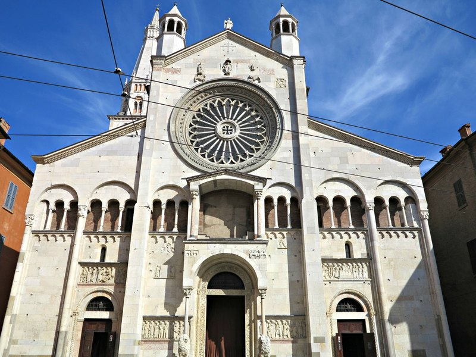
  <figcaption>Modena Cathedral, the west façade, begun in 1099: Lanfranco's arcaded front with Wiligelmo's four Genesis slabs and main portal; the rose window and the side doors were added by the Campionese masters in the thirteenth century. Photo: Mongolo1984, <a href="https://creativecommons.org/licenses/by-sa/4.0/">CC BY-SA 4.0</a>, via Wikimedia Commons.</figcaption>
</figure>

Nothing else is known of him. No document gives his birthplace, his training, his family or his death, and the long narrative of the rebuilding of the cathedral, the *Relatio*, names the architect Lanfranco but not the sculptor. His name is Germanic in form, like many names in eleventh-century Italy, and proves nothing about where he came from. Everything else that is said about Wiligelmo is drawn from the sculpture itself and from the history of the building on which he worked.

That sculpture, however, is among the most important of its age. The four slabs with the stories of Genesis on the façade of Modena, the prophets and the inhabited scrolls of the main portal and the slab of Enoch and Elijah stand at the beginning of the revival of monumental figure sculpture in Italy. After centuries in which large carved figures had almost disappeared from the churches of the Latin West, Wiligelmo placed the human figure, heavy, grave and expressive, on the front of a cathedral, as the vehicle of a story told to all who entered.

The inscription suggests how new this was. Medieval craftsmen were rarely named, and when they were, it was usually in a modest formula or a prayer. At Modena the sculptor is praised among his peers, *inter scultores*, and his work is offered as the proof of his merit. Whoever composed the couplet, whether the sculptor himself or the clergy of the cathedral, the claim was made in public, beside the date of the foundation and the name of the city's patron saint.

The present entry replaces an earlier version that mixed documented facts with invented details: a family and sons, journeys, a date and place of death, and influences presented as certain. It also corrects several errors of a fuller draft. The couplet is a distich, not a tercet; the date in the inscription is 1099, "one thousand and a hundred less one"; the fourth Genesis slab has three scenes, not two; the beast fables of the Porta della Pescheria are not scenes from the *Roman de Renart*, which is some seventy years later; and the dates of the excavation and foundation come from the *Relatio*, not from separate inscriptions.

The account that follows separates the small core of documents from the large body of attributions and interpretations built on them. It sets out the evidence of Modena, the problem of Wiligelmo's origins and style, the question of how much of the sculpture is his own and how much belongs to his workshop, the works associated with him outside Modena, and the readings of the programme proposed by modern scholars. The catalogue then examines the works one by one.

## The Documents

Three texts frame everything that can be said about Wiligelmo. The first is the slab of Enoch and Elijah, with the foundation date and the couplet in his honour, discussed in the catalogue. The second is the inscription on the main apse, composed by the canon Aimo, which praises the marble splendour of the new church and names its architect: *Ingenio clarus Lanfrancus doctus et aptus / est operis princeps huius rectorque magister*, "Lanfranco, famous for his genius, learned and skilled, is the chief and director and master of this work". Two lines added in the thirteenth century name the *massarius* Bozzalino, the administrator of the fabric who had the stone renewed.

<figure>
  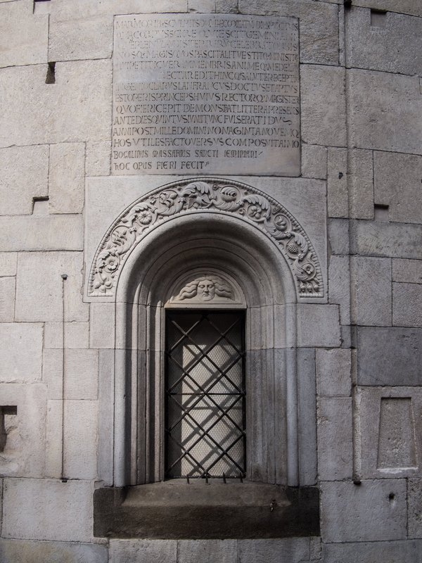
  <figcaption>The inscription on the main apse naming Lanfranco as master of the work, composed by the canon Aimo, with a thirteenth-century addition naming the massarius Bozzalino. Modena Cathedral. Photo: Username.Ruge, <a href="https://creativecommons.org/licenses/by-sa/4.0/">CC BY-SA 4.0</a>, via Wikimedia Commons.</figcaption>
</figure>

The third text is the *Relatio de innovatione ecclesie sancti Geminiani*, preserved in the codex O.II.11 of the Archivio Capitolare of Modena. It tells how the clergy and people decided to rebuild the church of their patron, how they sought and found an architect, *Lanfrancus mirabilis artifex, mirificus edificator*, how the excavation began on 23 May 1099 and the foundations were laid on 9 June, and how the body of Saint Geminianus was translated to the crypt on 30 April 1106 in the presence of Matilda of Canossa, before the consecration of the altar by Pope Paschal II on 8 October of the same year. The text is usually attributed to a member of the cathedral clergy who witnessed the events, perhaps Aimo himself.

<figure>
  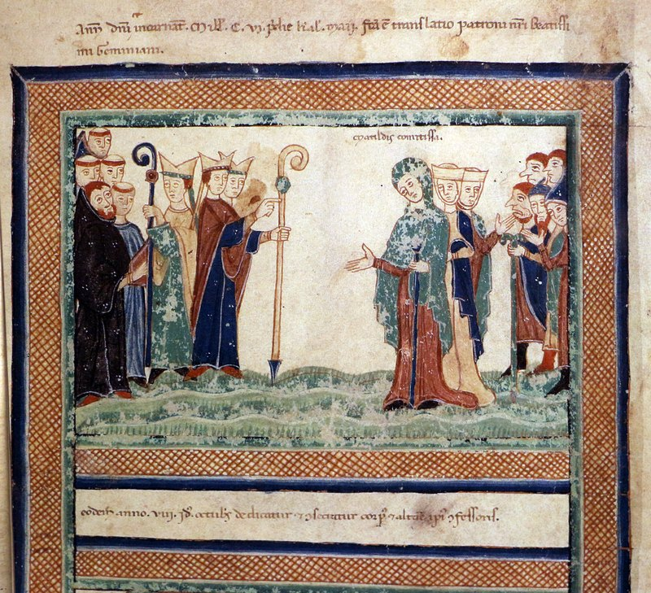
  <figcaption>Matilda of Canossa receives the bishops for the translation of Saint Geminianus, drawing in the Relatio de innovatione ecclesie sancti Geminiani, c. 1200–1210 (facsimile). Modena, Archivio Capitolare, O.II.11. Photo: Sailko, <a href="https://creativecommons.org/licenses/by/3.0/">CC BY 3.0</a>, via Wikimedia Commons.</figcaption>
</figure>

The *Relatio* is silent about the sculptor. Some scholars have drawn from this silence the conclusion that Wiligelmo arrived after the beginning of the work; others have pointed out that the text is concerned with the architect, the relics and the consecration, not with the decoration. The coloured drawings that illustrate it, with Lanfranco directing the builders and Matilda receiving the bishops, were long dated to the early thirteenth century; a recent proposal places them earlier. They show the dignity accorded to the architect, not to the sculptor.

The documents give, then, a firm date for the beginning of the work, a firm date for the translation of the relics and the name of the sculptor of the façade. They do not say which parts of the sculpture he carved, how long he worked at Modena or where he worked before and after. The date of the slab of Enoch and Elijah, made to record the foundation of 1099, is the only fixed point for his own hand; the Genesis slabs and the main portal, which share its style, are dated by most scholars to the years between 1099 and about 1110.

The building itself confirms the speed of the work. By 1106 the eastern parts of the church, the crypt and the presbytery, were ready to receive the relics, and the walls of the nave stood high. The façade, with its sculpture, was raised in the same campaign. The definitive consecration of the whole church came only in 1184, under Pope Lucius III, after the Campionese masters had altered the façade, opened the rose window and the side doors and built the screen of the presbytery.

## Lanfranco, Matilda and the Reform

Wiligelmo worked beside an architect whose fame the *Relatio* celebrates, and modern scholarship treats the cathedral as the joint work of the two. The UNESCO inscription of 1997, which placed the cathedral, the Ghirlandina tower and the Piazza Grande on the World Heritage List, describes the building as the joint creation of Lanfranco and Wiligelmo, in which a new relation between architecture and sculpture was created. The sculpture is set into the architecture with great care: the Genesis slabs run across the front at the height of the eye, the portal projects in its porch, the reliefs and genii are placed at precise points of the wall.

The rebuilding took place in a charged moment. The see of Modena was vacant, and the decision to rebuild was taken by the clergy, the knights and the people of the city. The countess Matilda of Canossa, who ruled much of northern Italy and was the principal ally of the reform papacy against the emperor Henry IV, supported the enterprise and attended the translation of 1106. Pope Paschal II consecrated the altar. The new cathedral was, among other things, a sign of the city's place in the party of the reform.

The materials of the building speak of another programme, the recovery of antiquity. The walls are faced with stone taken from the ruins of Roman Mutina, as scientific study during the restorations begun in 2006 has confirmed; the porch rests on Roman lions; the capitals imitate the Corinthian order so closely that they were long taken for Roman work. The inscriptions are cut in monumental Roman capitals. [Arturo Carlo Quintavalle](/scholars.html#quintavalle-arturo-carlo) has read these choices as the expression of the reform's wish to return the Church to its early Christian origins, and the hypothesis has been widely discussed.

According to a press announcement of 2012, the backs of the Genesis slabs, examined during the restoration of the façade, bear earlier carving, which would show that Wiligelmo turned over blocks already carved and worked on their smooth backs. The reports differ on the date of the hidden carving, Roman or early medieval, and the results have not been fully published. The reuse of ancient stone at Modena is, however, beyond doubt.

The relation between the sculptor and the architect is unknown. The apse inscription calls Lanfranco *operis princeps* and *rector magister*, the head and director of the whole work, which suggests that the sculptor worked under him. The couplet of the façade, on the other hand, claims for Wiligelmo an honour of his own. The two inscriptions together show a building site on which both the design of the architecture and the art of the sculptor were valued and remembered.

## The Question of Origins

Because nothing is known of Wiligelmo's life, his origins have been sought in his style, and each proposal reflects a view of what the revival of sculpture required. In 1928 Trude Krautheimer-Hess looked for his roots in the Ottonian and Rhenish north, in the metalwork and ivories of the imperial schools. Italian scholars later stressed his difference from the Lombard sculptors of the first building campaign, whose capitals survive in the crypt of Modena, and saw him as the founder of a new, classicising manner.

A persistent line of research has pointed to the sculpture of Languedoc, and in particular to the reliefs of the cloister of Moissac, of about 1100, whose large figures standing against a plain ground resemble those of the Genesis slabs. Others have compared his figures with the ivories made in southern Italy around 1090, now partly in New York and Salerno, and with the illuminated books of the abbey of San Benedetto al Polirone, near Mantua, among them the Gospels of Matilda, now in the Morgan Library (MS M.492), dated by the library between 1075 and 1099.

The most constant source, however, is the art of antiquity visible at Modena itself. Roman sarcophagi, with figures standing under arcades or in continuous friezes, were found in the necropolis of the city and reused in the cathedral and around it. The arcades above the Genesis scenes, the genii with inverted torches and the composition of the slab of Enoch and Elijah, with two figures holding a tablet, all have parallels in Roman funerary sculpture. Wiligelmo learned from these works the weight of the figure and the clarity of the scene.

None of these proposals rests on documents, and they are not mutually exclusive. A sculptor of the eleventh century could have seen Roman sarcophagi in Emilia, illuminated books and ivories in the monasteries of the region and, perhaps, sculpture in France. The Treccani entry by Quintavalle describes his art as combining links with Ottonian and Carolingian art, a connection with the Aquitanian sculpture of the period and a renewed interest in late antiquity, so as to constitute one of the first autonomous expressions of Romanesque sculpture.

What can be said with confidence is that Wiligelmo's art does not continue any local tradition of figure sculpture known in Emilia. It appears at Modena fully formed, with a command of high relief, of narrative and of expression that implies long experience. Where that experience was gained is a question to which the evidence gives no answer.

## Style and the Problem of Hands

The style of the works attributed to Wiligelmo himself is remarkably consistent. The figures are short and massive, with large heads, hands and feet; they stand firmly on the ground or bend under the weight of their actions; their faces are broad, with large eyes and heavy jaws. They are carved in high relief and detach themselves from a smooth ground, with which, in the words of Quintavalle, they maintain a dialectical relationship. Gesture and glance carry the story; incidental detail is reduced to a minimum.

Around this core, the sculpture of Modena includes works of different character, and the question of how many hands were at work has divided scholars. [Roberto Salvini](/scholars.html#salvini-roberto), in his monograph of 1956, distinguished several masters: the Master of San Geminiano and the Master of the Agnus Dei on the Porta dei Principi, the Master of the Porta della Pescheria, a Master of the Evangelists for the symbols on the façade and a Master of the Metopes for the fantastic figures that once stood on the buttresses of the nave. Quintavalle reassigned several of these, including the metopes and the Evangelists, to Wiligelmo himself.

These names are tools of connoisseurship, not historical persons. They describe differences of style that may correspond to different sculptors, to different moments in the career of one sculptor or to the division of labour within a workshop. The catalogue below follows the attributions most commonly used, and indicates where they are disputed.

The workshop of Wiligelmo was large. The side portals of Modena, the sculpture of the cathedral of Cremona, begun in 1107, and the portal of Nonantola show the same repertory of forms, vine scrolls inhabited by men and beasts, prophets and apostles under arcades, telamons bearing the jambs, used by several sculptors of different abilities. The diffusion of this repertory in the Po valley in the first decades of the twelfth century is the clearest sign of the importance of the workshop that formed at Modena.

## Beyond Modena

The cathedral of Cremona was founded, according to an inscription held by Enoch and Elijah, on the seventh day before the Kalends of September, 26 August 1107. The slab repeats the scheme of the foundation slab of Modena, with the two prophets holding the inscribed tablet, and shows that the model of Modena was adopted within a few years. Four prophets from the portal of the old façade, Isaiah, Jeremiah, Daniel and Ezekiel, were reset in the jambs of the present main portal after the earthquake of 1117. They are attributed by some scholars to Wiligelmo, by others to a distinct Master of the Prophets.

At Nonantola, east of Modena, the great Benedictine abbey of San Silvestro has a portal with a lunette of Christ in Majesty and jambs carved with scenes of the Infancy of Christ and of the history of the abbey. An inscription on the lintel records that the church collapsed in 1117 and that rebuilding began four years later. The jambs carry, on the left, scenes from the lives of the founder Anselm and of Pope Hadrian III and, on the right, the Infancy of Christ. Quintavalle associates the portal with Wiligelmo and his workshop and with the rebuilding after 1117; other scholars relate it to the site of Modena without attributing it to him. In the excavation reports on the abbey, Sauro Gelichi notes that all agree in dating the sculpture between the end of the eleventh century and the first years of the twelfth, after the Gregorian reform.

At San Benedetto Po, near Mantua, the Museo Civico Polironiano preserves fragments of three Labours of the Months and an ox, from a lost portal of the abbey of Polirone. Quintavalle placed them at the beginning of Wiligelmo's career, before Modena, but the attribution rests on style alone and has not been generally accepted. No freely licensed photographs of these fragments could be found for this entry.

At Piacenza, in the 1120s, the workshop of Wiligelmo worked on the cathedral beside the sculptor Niccolò, whose art was already distinct. With Niccolò, who signed works at the Sacra di San Michele, Ferrara and Verona, the tradition that began at Modena passed to a new generation. Further works, a pulpit at Quarantoli, holy-water basins and Madonnas now in Modena and Zurich, have been attributed to Wiligelmo or his circle on grounds of style; these attributions are the most uncertain part of the reconstruction.

## Readings of the Programme

The function of the Genesis cycle on the façade is clear: to tell the story of creation, sin and the first promise of salvation to all who approached the church. Extended Genesis cycles on church fronts are rare, and the choice of scenes, from the Creator in glory to Noah leaving the ark, is deliberate. The cycle begins with God and ends with the ark, built in the form of a church, through which humanity was saved.

[Chiara Frugoni](/scholars.html#frugoni-chiara) has compared the narrative of the slabs with the *Ordo representationis Adae*, the Anglo-Norman play of Adam, in which the stories of Genesis are interwoven with the announcement of the redemption. The comparison illuminates the dramatic, almost theatrical quality of Wiligelmo's scenes; but the play is half a century later than the reliefs, and can be at most a witness to a shared culture of religious drama and exegesis, not a source.

Quintavalle has proposed a more ambitious reading. In his view, the programme of the cathedral proclaims the return of Modena to the Roman Church after a period of schism. The ark figured as a church, the punishment of Cain, the parallel of prophets on the façade, apostles on the south door and months on the north door, and even the Arthurian siege of the Pescheria, would all belong to a single design addressed to a city divided by the struggle between the papacy and the empire.

This is a coherent and influential interpretation, and it has the merit of treating the sculpture as a whole. It rests, however, on analogy and inference, not on any statement in the *Relatio* or the inscriptions. The death of Cain at the hand of the blind Lamech, for example, derives from Jewish exegesis known in the Latin West through Rabanus Maurus and others; it shows the learning of those who devised the programme, but not necessarily a polemic against schismatics. The readings of the programme are best presented as hypotheses about meaning, not as documented intentions.

## Legacy and Historiography

From the 1120s the traces of Wiligelmo himself disappear, but the art he introduced spread through the Po valley. The sculptors of the side portals of Modena, of Cremona and Nonantola, and then Niccolò and his followers, carried the narrative relief, the inhabited scroll and the prophet on the portal jamb to the cathedrals of Emilia, Lombardy and the Veneto. At the end of the century Benedetto Antelami, at Parma, worked in a tradition that Wiligelmo had founded.

Modern study of Wiligelmo began with the great surveys of Romanesque sculpture in the early twentieth century. [Arthur Kingsley Porter](/scholars.html#porter-arthur-kingsley) included Modena in his *Lombard Architecture* (1915–1917), and [Pietro Toesca](/scholars.html#toesca-pietro) discussed it in his history of medieval Italian art (1927). Trude Krautheimer-Hess, in 1928, proposed the Ottonian connection. Roberto Salvini's *Wiligelmo e le origini della scultura romanica* (1956) and *Il Duomo di Modena e il romanico nel modenese* (1966) established the distinctions of hands that are still in use.

Arturo Carlo Quintavalle reframed the subject in a series of studies from 1964 onwards, in the exhibitions *Lanfranco e Wiligelmo* (Modena, 1984) and *Wiligelmo e Matilde. L'officina romanica* (Mantua, 1991) and in the entry of the *Enciclopedia dell'Arte Medievale*. He tied Wiligelmo to Matilda, the reform and the monasteries of Polirone and Nonantola, and enlarged the share of the master's own hand. Chiara Frugoni contributed the iconographic studies of the 1984 catalogue. The three bodies of work differ on the number of hands, on the dates of the side portals and on the meaning of the programme, and are best read as a continuing debate.

The sculpture of Modena has itself changed over the centuries. The Campionese masters moved two of the Genesis slabs to make way for the side doors; the metopes were removed from the roof in 1948 and replaced by copies, and the originals are in the Museo Lapidario of the Duomo; the bombing of 1944 damaged the Porta dei Principi; and the restorations of the 1980s and of the years after 2006 cleaned and studied the façade. What the visitor sees today is Wiligelmo's work in a setting altered by eight centuries of use and care.

## Catalogue Entry

### The Foundation Slab with Enoch and Elijah

<figure>
  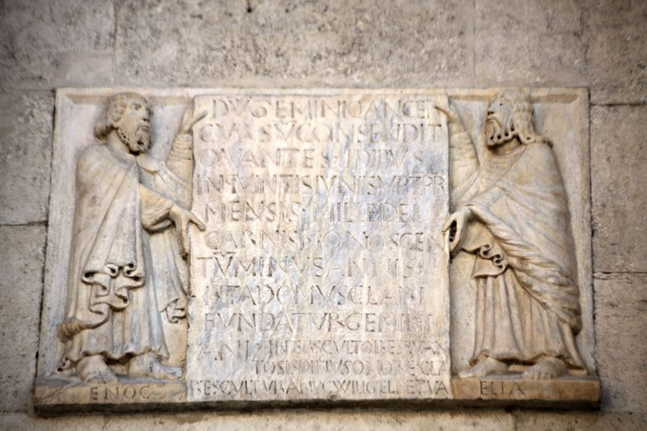
  <figcaption>Wiligelmo, Enoch and Elijah holding the foundation inscription of the cathedral, with the couplet naming the sculptor, 1099. Modena Cathedral, west façade, left of the main portal. Photo: Mongolo1984, <a href="https://creativecommons.org/licenses/by-sa/4.0/">CC BY-SA 4.0</a>, via Wikimedia Commons.</figcaption>
</figure>

The slab is set into the wall of the façade to the left of the main portal, at a height where it can be read from the square. Two prophets stand at its sides and hold between them a tablet inscribed with twelve lines of large capitals; their names, ENOC and ELIA, are carved on the base beneath their feet. It is the only work at Modena that can be given to Wiligelmo on the authority of a document, and the point from which every other attribution to him begins.

The inscription, in the text given in the entry on the cathedral, reads:

Dum Gemini Cancer cursum consendit ovantes, 
idibus in quintis Iunii sub tempore mensis, 
mille Dei carnis monos centum minus annis, 
ista domus clari fundatur Geminiani. 
Inter scultores quanto sis dignus onore 
claret scultura nunc, Wiligelme, tua.
{: .quote-latin}

While Cancer was climbing the course of the rejoicing Twins, 
on the fifth day before the Ides of the month of June, 
in the year of God's flesh one thousand and one hundred less one, 
this house of the illustrious Geminianus is founded. 
How worthy you are of honour among sculptors, 
Wiligelmo, your sculpture now makes plain.
{: .quote-translation}

The first four lines give the date of the foundation, 9 June 1099, with learned elaboration: the sun passing from the Twins into Cancer, the Roman reckoning of the Ides and the year expressed as a hundred less one after a thousand, with the Greek *monos*, "one". The last two lines, a single elegiac distich, turn from the building to its sculptor. The letters as cut show the spelling of the time, *consendit* for *conscendit*, *scultores* and *onore* without the aspirate, which an edition normalises.

The two prophets were chosen with care. Enoch, who "walked with God, and was not, for God took him", and Elijah, carried to heaven in a chariot of fire, were the two men of the Old Testament who did not die, and tradition expected them to return at the end of time. They are figures of the life beyond death, and they lend to the foundation, and to the name of the sculptor, a promise of permanence.

The composition comes from Roman funerary art. On Roman sarcophagi and tombstones, two winged figures or two genii often hold between them a tablet or a roundel with the name of the dead; a sarcophagus of this kind, preserved at Modena, has been proposed as Wiligelmo's direct model. The sculptor replaced the pagan genii with two prophets and the epitaph with the foundation record, keeping the scheme of the antique monument.

The figures are carved in the style of the Genesis slabs. They are heavy and frontal, wrapped in long mantles whose folds are cut in parallel ridges; their heads are large, with deep-set eyes, and their bare feet rest on the base. Each raises his free hand in a gesture of speech or witness. The tablet between them is smooth and plain, so that the letters stand out against it.

The slab was made to commemorate an event, the laying of the foundations, and must date from 1099 or shortly after. Its style is the anchor for the dating of the Genesis slabs and of the main portal, which share its figures and its carving. It is also the model for the slab of Enoch and Elijah at Cremona, which records the foundation of that cathedral in 1107 and shows that the Modena formula was imitated within a few years.

The couplet is the most discussed line of Romanesque epigraphy in Italy. It is not a signature in the modern sense, and it may have been composed by the clergy rather than by the sculptor. But it places the sculptor's name on the front of the church, beside the sacred date and the name of the patron saint, and it praises him for the excellence of his art. It is one of the earliest testimonies in the medieval West to the public recognition of an artist.

### The First Genesis Slab: Creation and Fall

<figure>
  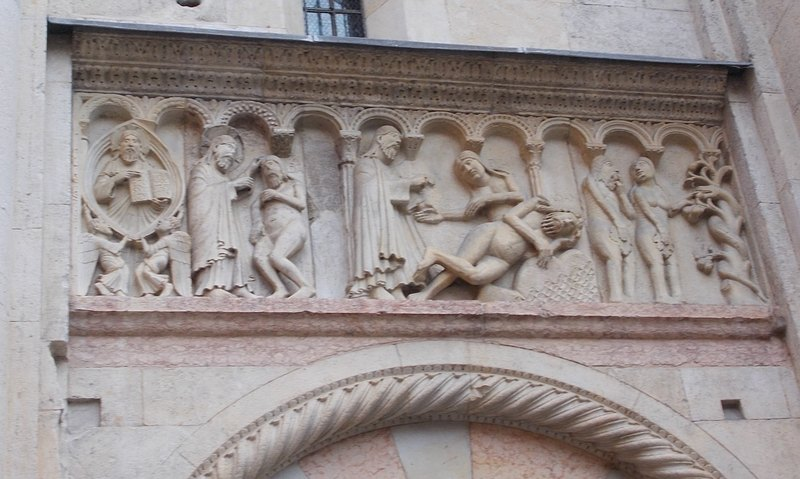
  <figcaption>Wiligelmo, the first slab of Genesis: the Creator in glory, the Creation of Adam, the Creation of Eve and the Fall, c. 1099–1110. Modena Cathedral, west façade, above the left side door. Photo: Szeder László, <a href="https://creativecommons.org/licenses/by-sa/4.0/">CC BY-SA 4.0</a>, via Wikimedia Commons.</figcaption>
</figure>

The first slab is now set above the left side door of the façade, where the Campionese masters moved it when they opened the door in the thirteenth century; originally it stood closer to the main portal. It is a long relief under a cornice of small arches, divided into four scenes that run from left to right: the Creator in glory, the creation of Adam, the creation of Eve and the Fall. It is the only one of the four slabs with four scenes; the others have three, for thirteen scenes in all.

At the left, the Creator appears half-length in an almond-shaped glory held by two angels. He has a cross halo and holds an open book, on which, according to the descriptions of the relief, is written *Lux ego sum mundi, via verax, vita perennis*, "I am the light of the world, the true way, the everlasting life". The Creator thus has the features of Christ, the Word through whom all things were made, and the cycle of Genesis begins with an image of Christ in majesty.

In the second scene the Creator, standing, lays his hand on the head of Adam, who stands naked before him. In the third he draws Eve from the side of Adam, who lies asleep with his head resting on his hand and his legs drawn up. In the fourth Adam and Eve stand beside the tree, around which the serpent is coiled; Eve holds the fruit, and Adam raises his hand to his throat, as if the fruit had stuck there, a detail that recurs in medieval images of the Fall.

The arcade above the scenes is more than a frame. The number of arches above each episode corresponds roughly to its importance, and the small columns that divide some of the scenes come from the columnar sarcophagi of late antiquity, on which figures stand under a continuous arcade. Wiligelmo used the arcade to order the narrative and to give the relief the character of a sacred architecture.

The figures are heavy and rounded, carved almost in the round against the plain ground. The bodies of Adam and Eve are naked, with large heads and hands and stocky limbs, without any attempt at classical beauty. Their expressions and gestures are clear and simple: the Creator's hand, Adam's sleep, Eve's offer of the fruit. The scenes can be read from the square below without inscriptions.

The stone of the Genesis slabs is not uniform. According to the national catalogue of cultural heritage, the slabs are made of mixed stone, marble, Istrian stone and the soft stone of Vicenza, and their different states of preservation reflect both the material and the exposure to the weather. The first slab has suffered from its position above the door; the surface of several figures is worn.

The first slab sets out the theme of the whole cycle: God creates the world and man, and man falls. Placed at the beginning of the façade, it opened a story that the following slabs carry through to the covenant with Noah, and that the church itself, with its altar and its relics, carried to the redemption.

The slab has been compared by modern critics with the archaic sculpture of early Greece, for the freshness and gravity of its figures. The comparison is anachronistic, but it expresses the impression that Wiligelmo's reliefs give: of a new beginning, in which the human figure is rediscovered with the force of a first creation.

### The Second Genesis Slab: Reproach, Expulsion and Labour

<figure>
  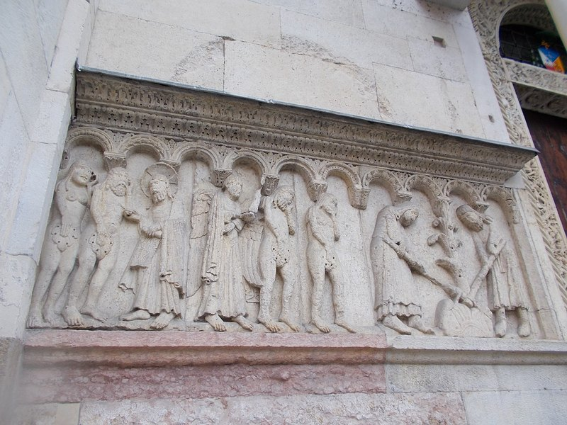
  <figcaption>Wiligelmo, the second slab of Genesis: the Reproach, the Expulsion and the Labour of Adam and Eve, c. 1099–1110. Modena Cathedral, west façade, left of the main portal. Photo: Szeder László, <a href="https://creativecommons.org/licenses/by-sa/4.0/">CC BY-SA 4.0</a>, via Wikimedia Commons.</figcaption>
</figure>

The second slab stands to the left of the main portal, in its original position or close to it. It shows the consequences of the Fall in three scenes: the Creator reproaching Adam and Eve, the expulsion from paradise and the labour of the first parents. The movement of the narrative runs again from left to right, towards the main door of the church.

In the first scene Adam and Eve stand before the Creator, covering themselves with leaves, ashamed. The Creator holds a scroll which, according to the descriptions, bears the words *Dum deambularet Dominus in paradisum*, an echo of Genesis 3:8, "when the Lord was walking in paradise". Adam points to Eve, and Eve, by tradition, to the serpent; the passing of blame is expressed in gesture alone.

In the second scene an angel, or cherub, with great wings drives the pair out of paradise. He lays his hand on Adam's shoulder; Adam and Eve walk away bowed, their bodies heavy with sorrow. The gesture of the angel is firm but not violent, and the figures move together, as if bound to the same fate.

In the third scene Adam and Eve, now clothed, work the earth. Eve bends with a hoe; Adam digs beside a tree. Their bodies are compressed under the arcade, and their bent backs and lowered heads express the weight of labour imposed on humanity: "in the sweat of thy face shalt thou eat bread". The scene ends the story of Adam and Eve and turns to the human condition after the Fall.

This slab is among the best preserved of the four, protected by its position beside the porch. The surfaces of the faces and garments keep the sharpness of the original carving, and the contrast between the naked bodies of the first two scenes and the clothed figures of the third is clear.

The narrative depends on gesture. Wiligelmo did not use inscriptions in the field of the scenes, apart from the words on the Creator's scroll; the figures tell the story through their attitudes, the turning of heads, the movement of arms. The method, perhaps learned from late antique sarcophagi and from manuscript illumination, makes the relief legible to all.

The figure of the Creator, the same in all the scenes in which he appears, gives unity to the cycle. He is a dignified bearded figure with a cross halo, the image of Christ, who creates, judges and, in the third slab, questions Cain. The repetition of his figure across the slabs binds the scenes into a single history.

The theme of labour links the Genesis cycle to the sculpture of the north door, the Porta della Pescheria, where the Labours of the Months show the work of every season. The toil of Adam and Eve and the work of the months belong to the same view of human life after the Fall: a life of work, ordered by God, under the protection of the church.

### The Third Genesis Slab: Cain and Abel

<figure>
  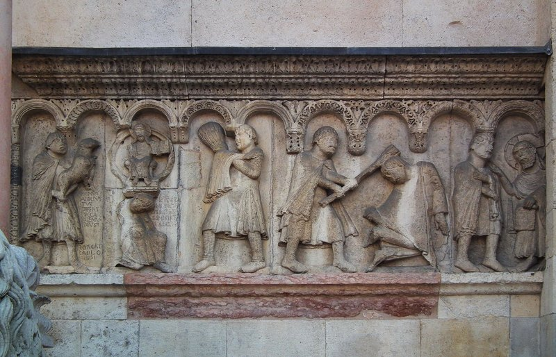
  <figcaption>Wiligelmo, the third slab of Genesis: the offerings of Cain and Abel, the murder of Abel and God questioning Cain, c. 1099–1110. Modena Cathedral, west façade, right of the main portal. Photo: Mattis, <a href="https://creativecommons.org/licenses/by-sa/4.0/">CC BY-SA 4.0</a>, via Wikimedia Commons.</figcaption>
</figure>

The third slab stands to the right of the main portal, symmetrical to the second. It tells the story of the first two brothers in three scenes: the offerings of Cain and Abel, the murder of Abel and God questioning Cain. It is the most dramatic of the four slabs, and the one in which Wiligelmo's art of gesture is most intense.

In the first scene Abel, at the left, offers a lamb, and Cain offers a sheaf of grain. Above Abel, a small Creator blesses from a round glory, showing that his offering is accepted; Cain's offering is refused. The difference between the two brothers is shown by the gesture of God, not by any difference in the figures, which are both young, clothed in short tunics.

In the second scene Cain swings a club and strikes Abel, who falls to his knees. The violence of the action is concentrated in the arc of the club and the bending of Abel's body. The scene is the first death in the history of humanity, and Wiligelmo shows it with a directness that has no precedent in the Italian sculpture of the period.

In the third scene the Creator lays his hand on Cain's shoulder and holds a scroll which, according to the descriptions, reads *Ubi est Abel frater tuus*, "Where is Abel your brother?" (Genesis 4:9). Cain looks up, caught. The gesture of the hand on the shoulder repeats that of the angel in the expulsion, and links the two judgments of the cycle.

The killing of Abel was read in the Middle Ages as a figure of the Passion of Christ, the innocent killed by his brother, and the offering of Abel as a figure of the sacrifice of the Mass. Placed beside the main portal, the scene addressed those who entered the church to take part in the sacrifice of the altar.

The figures of this slab are among the most powerful of the cycle: compact, heavy, with large heads and expressive hands, standing firmly under the arcade. The contrast between the calm of the first scene and the violence of the second gives the slab a dramatic rhythm, which modern critics have compared to that of a play.

Chiara Frugoni has related this dramatic quality to the religious theatre of the Middle Ages, and in particular to the play of Adam, in which Cain and Abel appear. The comparison is useful for understanding the way Wiligelmo staged his scenes, though the play is later than the reliefs.

Arturo Carlo Quintavalle has read the punishment of Cain as an allusion to the schismatics of the Investiture Contest, those who had broken with the Church of Rome. The reading is a hypothesis; the scene was, in any case, a warning against violence and sin addressed to the whole community of the city.

### The Fourth Genesis Slab: Lamech, the Ark and Noah

<figure>
  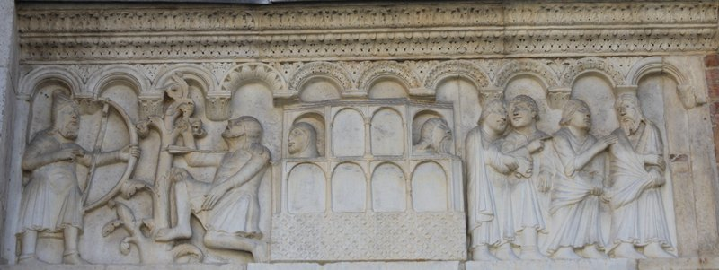
  <figcaption>Wiligelmo, the fourth slab of Genesis: Lamech kills Cain, the Ark, and Noah and his sons leaving the Ark, c. 1099–1110. Modena Cathedral, west façade, above the right side door. Photo: Mongolo1984, <a href="https://creativecommons.org/licenses/by-sa/4.0/">CC BY-SA 4.0</a>, via Wikimedia Commons.</figcaption>
</figure>

The fourth slab, now above the right side door, closes the cycle with three scenes: the death of Cain at the hand of Lamech, the ark and Noah and his sons leaving the ark. With the first slab, it was moved by the Campionese masters when they opened the side doors, so that the cycle now begins and ends above the two lateral entrances.

The first scene shows a bearded archer in a pointed cap, drawing a great bow and shooting at a man half hidden among the branches of a tree. The archer is Lamech, a descendant of Cain, and the victim is Cain himself. The story is not in the Bible: it comes from Jewish exegesis, which read the "sevenfold" vengeance of Genesis 4:15 as vengeance in the seventh generation, and told how the blind Lamech, guided by a boy, killed Cain by mistake while hunting. The legend reached the Latin West through the commentaries of Rabanus Maurus and others.

The presence of this rare episode shows the learning of those who devised the programme. A sculptor could hardly have chosen it alone; a cleric familiar with biblical commentary, perhaps the canon Aimo or another member of the chapter, must have proposed it. Lamech's pointed cap, the headgear given to Jews in medieval imagery, marks him as a figure of the Old Law.

In the centre, the ark is shown not as a boat but as a building of two storeys, with arcades, from whose openings the heads of Noah and his family look out. The ark was read as a figure of the Church, in which the faithful are saved from the flood of sin, and Wiligelmo gave it the form of a church. The image, at the end of the cycle, points to the cathedral itself as the ark of salvation for the city.

At the right, Noah and his sons stand together after leaving the ark, talking and pointing. The scene marks the covenant between God and humanity after the flood, and the beginning of a new history. The cycle thus ends not with punishment but with salvation, and with an image of men standing on the renewed earth.

The slab is weathered, like the first, by its position above the door. The figures keep, however, the weight and clarity of the other slabs, and the archer drawing his bow is one of the most vivid figures of the whole cycle, with his body tensed in the effort of the shot.

With the fourth slab the cycle reaches its thirteen scenes: four on the first slab, three on each of the others. They run from the Creator in glory to Noah after the flood, from the creation of man to the covenant, and they form the first extended narrative cycle in monumental sculpture in Italy after antiquity.

The order of the slabs on the façade has been changed, and their original arrangement is discussed. Quintavalle has also proposed that the slabs were first made for the interior of the church, as part of a screen, and later moved to the façade; he himself modified this hypothesis, which has not been generally accepted. What is certain is that the four slabs were conceived as a single cycle, with a beginning, a development and an end.

### The Main Portal

<figure>
  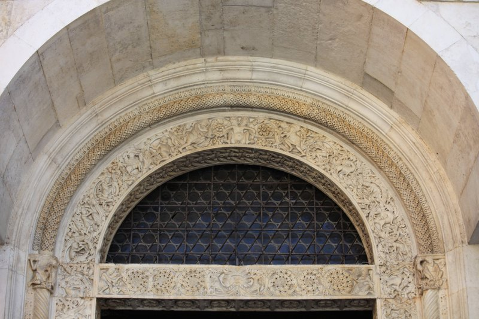
  <figcaption>Wiligelmo and workshop, the main portal: archivolt with inhabited vine scrolls and lintel with a foliate mask, c. 1099–1110. Modena Cathedral, west façade. Photo: Mongolo1984, <a href="https://creativecommons.org/licenses/by-sa/4.0/">CC BY-SA 4.0</a>, via Wikimedia Commons.</figcaption>
</figure>

The main portal of Modena is the centre of the façade and, according to many scholars, the first part of it to be carved. It is set in a projecting porch of two storeys, whose front columns rest on Roman lions, reused from an ancient monument. The doorway itself is framed by jambs, a lintel and an archivolt, all carved; twisted columns stand beside the jambs. The structure is simple, but its surfaces are covered with sculpture.

The dominant motif is the inhabited vine scroll, which runs up the outer faces of the jambs and across the archivolt. Its branches enclose men, animals and fantastic creatures, birds, griffins, sirens and serpents, often in combat with one another. The motif comes from Roman decorative art, where scrolls inhabited by putti and animals were common; Wiligelmo filled it with the bestiary of medieval imagination.

On the lintel, a large mask with leafy hair sits at the centre, and from it spring tendrils heavy with grapes, pecked by birds, with small figures among the leaves. The vine and the grapes evoke the Eucharist and the vineyard of the Lord; the mask, of antique origin, belongs to the repertory of Roman ornament. At the top of the archivolt, according to the descriptions, a two-faced Janus, the Roman god of doorways, marks the passage through the door.

<figure>
  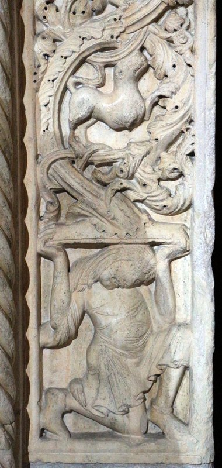
  <figcaption>Wiligelmo, a kneeling telamon at the foot of a jamb of the main portal, supporting the inhabited vine scroll, c. 1099–1110. Modena Cathedral, west façade. Photo: Sailko, <a href="https://creativecommons.org/licenses/by/3.0/">CC BY 3.0</a>, via Wikimedia Commons.</figcaption>
</figure>

At the foot of each jamb, a telamon supports the inhabited scroll above him. On one side a man kneels, seen from behind, his head bowed under the ledge he holds with raised arms. His short tunic is belted at the waist, and his bare feet press against the base of the panel. The weight he bears is shown by the curve of his back and the strain of his arms.

<figure>
  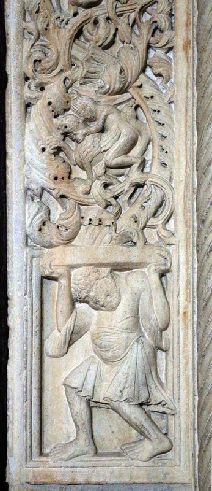
  <figcaption>Wiligelmo, a standing telamon at the foot of the opposite jamb of the main portal, c. 1099–1110. Modena Cathedral, west façade. Photo: Sailko, <a href="https://creativecommons.org/licenses/by/3.0/">CC BY 3.0</a>, via Wikimedia Commons.</figcaption>
</figure>

On the other side a stocky man stands with his knees bent, holding the ledge on his head with both hands. His belly swells under his tunic, and his feet are planted wide apart. The two telamons, one kneeling and one standing, form a pair of variations on the same theme, the human figure bearing the weight of the architecture. Figures of this kind, of antique origin, became common in Romanesque sculpture; they were not invented by Wiligelmo.

The scroll above the telamons is carved in very deep relief, with drilled holes that create strong contrasts of light and shadow. In the panels shown here, a small quadruped and a bird, a winged creature attacking a crouching man, are caught among the branches. The scroll has been read as an image of human life, beset by dangers and temptations, through which the faithful pass to reach the church.

On the inner faces of the jambs stand the prophets, discussed in the next entry, who announce the coming of Christ to those who enter. The portal has been compared with that of Sant'Ambrogio in Milan and with other Lombard doorways for its structure of jambs, lintel and archivolt framed by columns, which places Modena within a regional tradition of the monumental entrance. What distinguishes it is the density and quality of the figured carving, which turns each element of the structure into a field for sculpture.

The portal thus brings together the antique and the Christian, the decorative and the narrative, the beasts of the world and the prophets of the Old Testament, in a single programme addressed to the faithful at the threshold of the church.

### The Prophets of the Main Portal

<figure>
  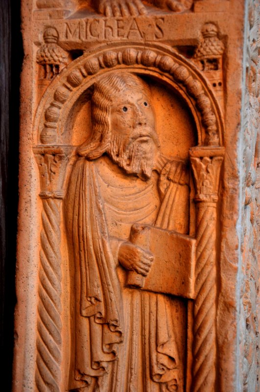
  <figcaption>Wiligelmo and workshop, the prophet Micah, from the jambs of the main portal, c. 1099–1110. Modena Cathedral, west façade. Photo: Chiara Salazar Chiesa, <a href="https://creativecommons.org/licenses/by-sa/3.0/">CC BY-SA 3.0</a>, via Wikimedia Commons.</figcaption>
</figure>

The inner faces of the jambs of the main portal are carved with a series of prophets, each standing in a niche under an arch, with his name carved on a band above. The niches are framed by small columns and, in the spandrels, by little towers and domed buildings, images of the heavenly city. The prophets face those who pass through the door, and they announce the Christ whom the faithful are about to meet at the altar.

Micah, MICHEAS, is shown here in the warm light of evening, which gives the stone an orange colour. He is bearded, with long wavy hair falling to his shoulders, and holds a closed scroll against his body; his mantle falls in long vertical folds. The arch above him is carved with a beaded moulding, and the columns are twisted.

<figure>
  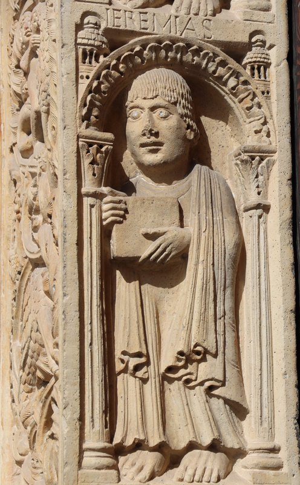
  <figcaption>Wiligelmo and workshop, the prophet Jeremiah, from the jambs of the main portal, c. 1099–1110. Modena Cathedral, west façade. Photo: FrDr, <a href="https://creativecommons.org/licenses/by-sa/4.0/">CC BY-SA 4.0</a>, via Wikimedia Commons.</figcaption>
</figure>

Jeremiah, IEREMIAS, is shown as a young man without a beard, with short hair cut in a fringe and large eyes inlaid with a dark material. He holds a closed book against his chest. His face has the broad, square features and the open, intent gaze of Wiligelmo's figures; the folds of his mantle end in small drilled curls along the hem.

<figure>
  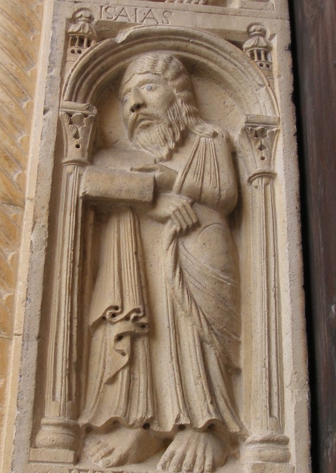
  <figcaption>Wiligelmo and workshop, the prophet Isaiah, from the jambs of the main portal, c. 1099–1110. Modena Cathedral, west façade. Photo: Klaus Graf, <a href="https://creativecommons.org/licenses/by-sa/3.0/">CC BY-SA 3.0</a>, via Wikimedia Commons.</figcaption>
</figure>

Isaiah, ISAIAS, is bearded, with long wavy hair, and turns slightly to one side. He holds a book and gathers his mantle with his other hand, so that it falls in a heavy mass of folds. His figure fills the niche, and his feet, bare, project over the base. The contrast between the heavy body and the narrow frame of the niche gives the figure its monumental character.

<figure>
  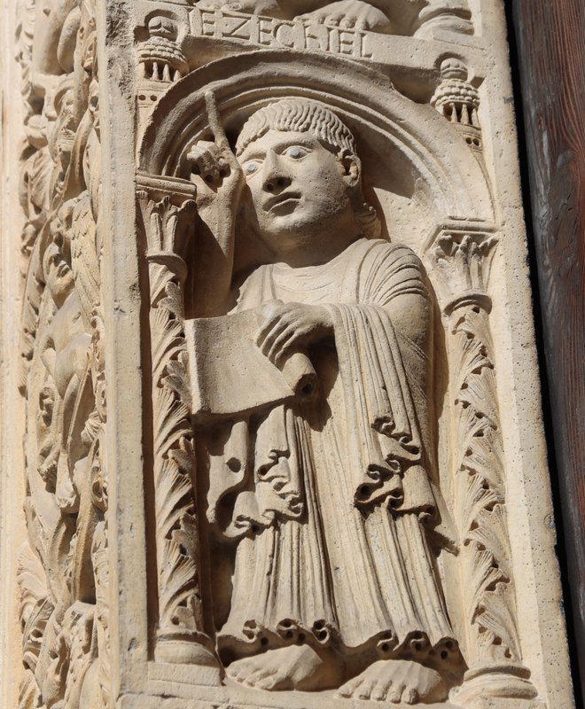
  <figcaption>Wiligelmo and workshop, the prophet Ezekiel, from the jambs of the main portal, c. 1099–1110. Modena Cathedral, west façade. Photo: FrDr, <a href="https://creativecommons.org/licenses/by-sa/4.0/">CC BY-SA 4.0</a>, via Wikimedia Commons.</figcaption>
</figure>

Ezekiel, EZECHIEL, also beardless, raises one finger towards heaven and holds an unrolled scroll in his other hand. The columns of his niche are carved with palmettes. His garments end in rows of drilled folds, a technique that gives the edges of the drapery a lively, broken outline and appears throughout the sculpture of the portal.

The prophets of the jambs are generally attributed to Wiligelmo and his workshop, and their style is close to that of the Genesis slabs and of the slab of Enoch and Elijah: the same heavy figures, the same large heads and hands, the same gravity. Some differences of handling, more linear in some figures, more rounded in others, suggest that several sculptors worked on them under the master's direction.

The names carved above the niches identify each figure without ambiguity, as on the Porta dei Principi, where the apostles are named in the same way. The bands with the names also divide the jambs into a regular sequence of fields, one above the other, so that the series of prophets reads as a column of witnesses rising from the telamons at the base to the lintel above.

The scheme of prophets under arches on the jambs of a portal was repeated at Cremona and Nonantola, and became one of the standard elements of the portals of the Po valley. At Modena, it set the Old Testament at the entrance of the church, as the Genesis slabs on the façade had set out the beginnings of sacred history, and prepared for the apostles of the Porta dei Principi and the Christ of the altar within.

### The Genius with the Inverted Torch

<figure>
  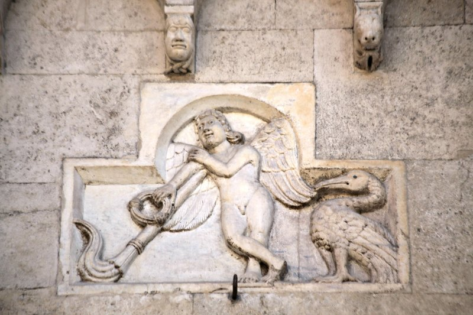
  <figcaption>Wiligelmo, a winged genius leaning on an inverted torch, with a wreath and a bird, c. 1099–1110. Modena Cathedral, west façade. Photo: Mongolo1984, <a href="https://creativecommons.org/licenses/by-sa/4.0/">CC BY-SA 4.0</a>, via Wikimedia Commons.</figcaption>
</figure>

Among the reliefs of the façade attributed to Wiligelmo are two winged genii, each leaning on a torch held upside down. The one shown here stands with crossed legs, his body turned in a graceful curve, and holds a wreath in one hand; the flame of his torch touches the ground. At his right a long-necked bird with a long beak stands facing him. Above, two carved heads serve as corbels for the arcade of the façade.

The figure comes directly from Roman funerary art. On Roman sarcophagi, winged genii leaning on an inverted, extinguished torch were images of death and mourning; Wiligelmo could have seen such sarcophagi in Modena, among the antiquities recovered from the Roman necropolis of the city. The wreath is also an antique motif, a symbol of victory and of the reward of the dead.

The relief is one of the most classical works at Modena. The naked body of the boy, the soft modelling of his limbs, his curly hair and the feathers of his wings show a study of antique models closer than in the Genesis slabs. The pose with crossed legs, resting on a support, is that of the funerary genius of Roman art, repeated with remarkable fidelity.

The bird has been identified in different ways. Some scholars see it as an ibis, a bird with negative meanings in the medieval bestiary and the *Physiologus*, and thus as a symbol of the sinner; others as a pelican, which feeds its young with its own blood, a symbol of Christ and the Resurrection. The second genius, on the other side, has no bird, and the difference has been read as a contrast between the death of the sinner and the death of the just.

The meaning of the genii has itself been discussed. The funerary reading has been questioned on the ground that the meaning of the inverted torch as a sign of death is documented clearly only later; on this view the figure would be a Cupid rather than a genius of death. Chiara Frugoni has defended the funerary interpretation, recalling that genii with inverted torches appear in contexts of mourning in later Italian art, such as the Triumph of Death at the Camposanto of Pisa.

Whatever their exact meaning, the genii show the importance of the antique in Wiligelmo's art. They are not simply copied: they are set on the façade of a Christian church, perhaps with a new meaning, in a programme that also includes the Genesis cycle and the prophets. The antique figure is taken into the service of the Christian message.

The relief is carved in a single block, set into the masonry of the façade. Its frame is irregular, shaped to the outline of the figures, a sign that it may have been adapted to its position. The surface has been cleaned in recent restorations, which have brought out the whiteness of the marble.

The genii are among the works that have most impressed modern viewers of Modena, for their unexpected classicism. They show that the revival of sculpture at Modena was also, in part, a revival of antiquity, and that Wiligelmo looked at the Roman monuments around him not only for the weight of their figures but for their forms and motifs.

### Reliefs of the Façade: Stags and Beasts

<figure>
  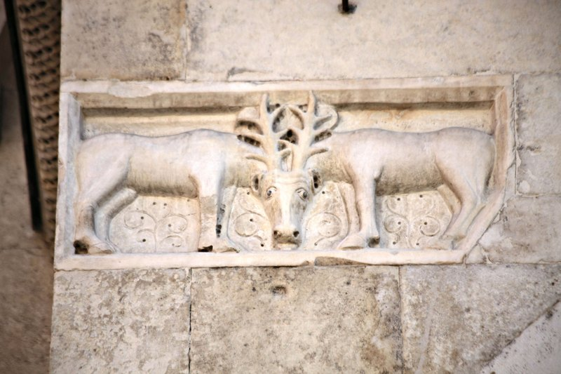
  <figcaption>Workshop of Wiligelmo, two stags with a single head, early twelfth century. Modena Cathedral, west façade. Photo: Mongolo1984, <a href="https://creativecommons.org/licenses/by-sa/4.0/">CC BY-SA 4.0</a>, via Wikimedia Commons.</figcaption>
</figure>

Besides the great cycles, the façade of Modena carries a number of smaller reliefs set into the masonry: animals, fantastic creatures and ornamental panels. They are usually attributed to the workshop of Wiligelmo, and they show the range of its repertory. One of them shows two stags facing each other, their bodies in profile, sharing a single head shown frontally at the centre, crowned by great branching antlers.

The motif of two animals sharing one head is ancient and widespread, found in Near Eastern, Roman and medieval art. It allowed the sculptor to create a symmetrical composition with a single focal point, the frontal head, which looks out at the viewer. The stags stand on a background of incised plant scrolls, with drilled holes that recall the technique of the main portal.

The stag had a rich meaning in medieval symbolism. According to the bestiaries, it kills serpents and then drinks at the spring to renew itself, and Psalm 42, "As the hart panteth after the water brooks, so panteth my soul after thee, O God", made it an image of the soul seeking God and of baptism. Placed on the façade, the stags could recall these meanings to those who entered the church.

<figure>
  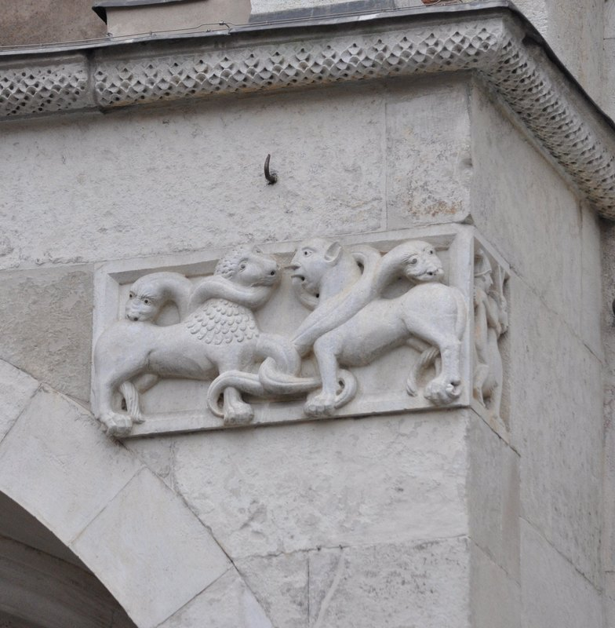
  <figcaption>Workshop of Wiligelmo, a corner relief with lions and hybrid creatures entwined by serpents, early twelfth century. Modena Cathedral, west façade. Photo: Manesti, <a href="https://creativecommons.org/licenses/by-sa/4.0/">CC BY-SA 4.0</a>, via Wikimedia Commons.</figcaption>
</figure>

At a corner of the façade, under a cornice carved with scale ornament, a relief shows two lions and a creature with a human face, interlaced with the long necks and tails of serpent-like beasts. The relief continues round the corner, where a further figure can be seen on the return face. The figures are carved in high relief, with sharp detail in the manes and the scales.

The relief belongs to the world of the inhabited scroll and the metopes: a world of beasts and monsters, struggling and entangled, which surrounded the sacred images of the façade. Its meaning is uncertain; such images were often read as figures of the forces of evil, or of the disorder of the world outside the church, but they also delighted their makers and viewers by their invention.

These smaller reliefs show the quality of the workshop and its capacity to vary the repertory of forms established on the main portal. They were set at significant points of the façade, at the corners and near the portals, where they framed the main cycles and gave the wall a continuous animation.

The attribution of these works to particular hands is uncertain, and they are best described as works of the workshop of Wiligelmo. Their style, close to that of the portal scrolls, places them in the first campaign of the façade, in the years around 1100–1110.

Together with the genii, the stags and the beasts show that Wiligelmo's façade was not only a place of sacred narrative but also of ornament and symbol, drawn from many sources, antique and medieval, and set together in a complex and lively whole.

### The Metopes

<figure>
  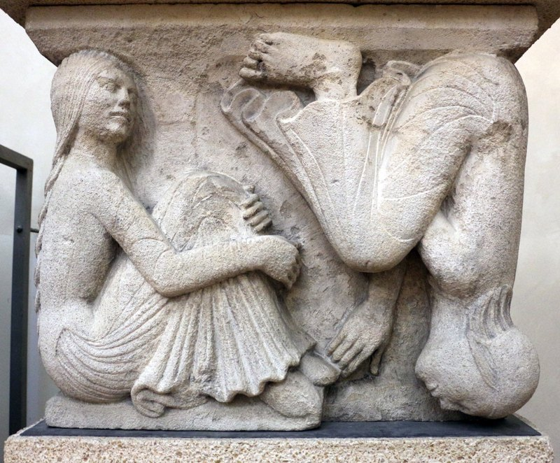
  <figcaption>Master of the Metopes (attributed to Wiligelmo by Quintavalle), the Antipodes, early twelfth century. Modena, Musei del Duomo, Museo Lapidario. Photo: Sailko, <a href="https://creativecommons.org/licenses/by/3.0/">CC BY 3.0</a>, via Wikimedia Commons.</figcaption>
</figure>

Eight sculptures once stood at the summits of the buttresses that rise along the nave of Modena Cathedral, high under the eaves. They have been called metopes since the twentieth century, after the sculpted panels of Greek temples, by critics who admired their archaic beauty. They were removed from the building in 1948 and in the following years, replaced by copies, and the originals are now in the Museo Lapidario of the Musei del Duomo, where they can be seen at close range.

They represent strange and monstrous figures: beings with deformed bodies, men upside down, creatures with serpents, giants. They have been read as images of the monstrous peoples that ancient and medieval geographers placed at the edges of the known world, the peoples awaiting the Christian message, or as images of sinners and heretics. Several have traditional names drawn from these sources.

The relief known as the Antipodes shows, at the left, a long-haired figure in a pleated garment, seated and hugging her knees, and at the right a figure upside down, his legs raised against the upper edge of the block. The Antipodes, according to ancient tradition, lived on the other side of the earth, with their feet opposite to ours; the sculptor showed them literally upside down.

<figure>
  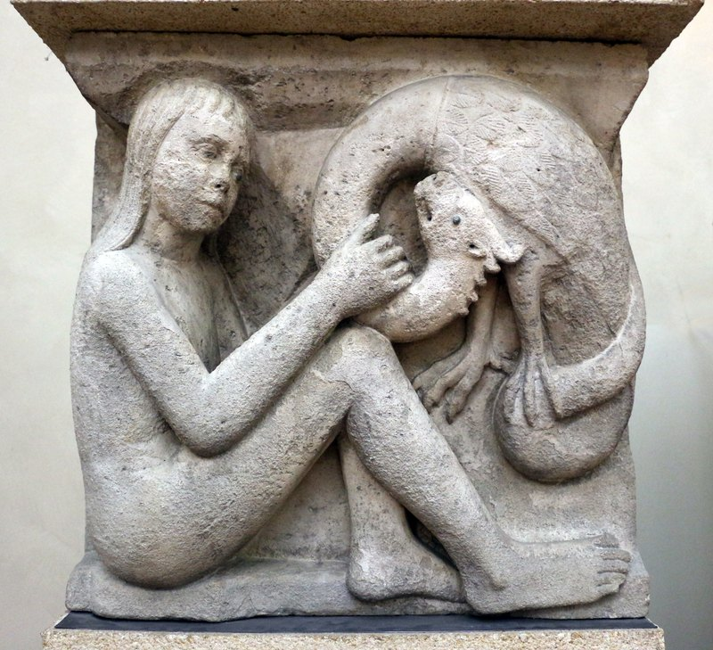
  <figcaption>Master of the Metopes (attributed to Wiligelmo by Quintavalle), a youth with a dragon, traditionally identified as one of the Psylli, early twelfth century. Modena, Musei del Duomo, Museo Lapidario. Photo: Sailko, <a href="https://creativecommons.org/licenses/by/3.0/">CC BY 3.0</a>, via Wikimedia Commons.</figcaption>
</figure>

Another metope shows a naked youth with long hair, sitting with his legs crossed and holding the neck of a dragon whose winged body coils in a great loop beside him. It is traditionally identified as one of the Psylli, a people of Libya who, according to Pliny and other ancient writers, were immune to the bites of serpents. The youth handles the monster calmly, as if unafraid.

<figure>
  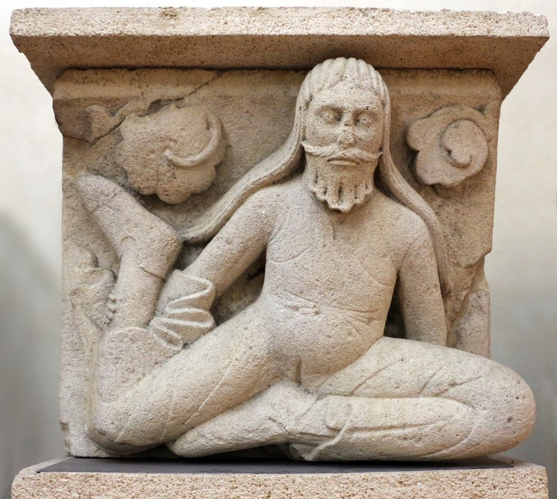
  <figcaption>Master of the Metopes (attributed to Wiligelmo by Quintavalle), the man with long hair, early twelfth century. Modena, Musei del Duomo, Museo Lapidario. Photo: Sailko, <a href="https://creativecommons.org/licenses/by/3.0/">CC BY 3.0</a>, via Wikimedia Commons.</figcaption>
</figure>

A third shows a naked bearded man with very long hair falling to his waist, reclining with one leg folded under him, against a ground with large leaf rosettes. One of his feet is raised behind his back in an unnatural pose. The figure has been read as one of the hairy wild men of medieval geography, or as a figure of contortion and excess.

<figure>
  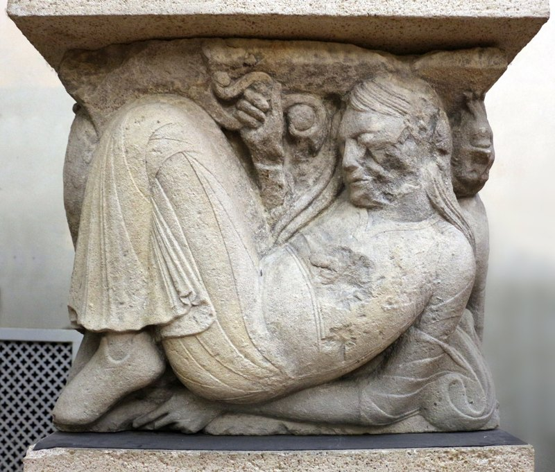
  <figcaption>Master of the Metopes (attributed to Wiligelmo by Quintavalle), the great girl, early twelfth century. Modena, Musei del Duomo, Museo Lapidario. Photo: Sailko, <a href="https://creativecommons.org/licenses/by/3.0/">CC BY 3.0</a>, via Wikimedia Commons.</figcaption>
</figure>

A fourth, known as the great girl, shows a large figure with long hair and a heavy pleated skirt curled tightly into the block, with her knees drawn up to the upper edge and her head pressed against them. The figure fills the whole field, as if confined by the stone, and has been read as one of the giants of the edges of the world.

The authorship and date of the metopes are disputed. Roberto Salvini attributed them to an anonymous Master of the Metopes, a pupil of Wiligelmo who knew the sculpture of Languedoc, and dated them later than the façade. Arturo Carlo Quintavalle attributed them to Wiligelmo himself, dating them not long after 1110. The files of the photographs reproduced here give a date of about 1100–1150. The figures share with Wiligelmo's work their massive volumes and their simplicity, but their elongated, contorted forms differ from those of the Genesis slabs.

The metopes are among the most original works of Romanesque sculpture in Italy. Seen from below, high on the buttresses, they would have appeared as strange presences on the edge of the church, at the boundary between the sacred building and the sky. Seen today at close range, they reveal a sculptor of exceptional power, whether Wiligelmo himself or one of his followers.

### The Porta dei Principi: the Workshop

<figure>
  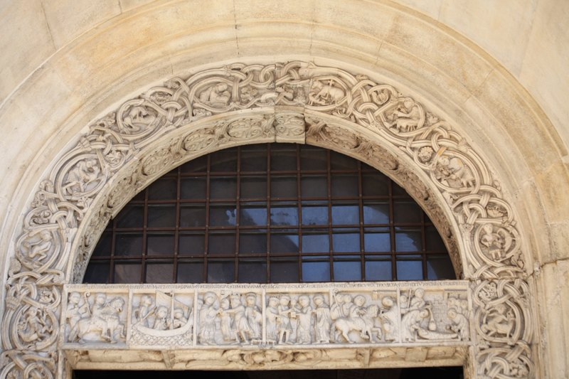
  <figcaption>Workshop of Wiligelmo (Maestro di San Geminiano), the Porta dei Principi: lintel with the life of Saint Geminianus and archivolt with inhabited interlace, c. 1106–1110. Modena Cathedral, south side. Photo: Mongolo1984, <a href="https://creativecommons.org/licenses/by-sa/4.0/">CC BY-SA 4.0</a>, via Wikimedia Commons.</figcaption>
</figure>

The Porta dei Principi, on the south side of the cathedral towards the Piazza Grande, was carved in the years after the translation of 1106 by sculptors of Wiligelmo's workshop. It repeats the structure of the main portal, with carved jambs, a lintel and an archivolt within a porch resting on lions, but it is dedicated to the patron saint of the city. Its lintel tells the story of Saint Geminianus in six scenes, from his journey to the East to his funeral, following the *Vita* of the saint.

The six scenes show Geminianus setting out on horseback, crossing the sea in a ship, freeing the daughter of the emperor Jovian from a demon, receiving the emperor's gifts, returning to Modena and being buried. Latin inscriptions above the scenes explain them. The narrative is lively and detailed, with many small figures, in a style more linear and less monumental than that of the Genesis slabs.

The sculpture of the portal has been attributed by Roberto Salvini to two masters of the workshop, the Master of San Geminiano, author of the lintel, and the Master of the Agnus Dei, named after the relief of the Lamb of God held by angels on the underside of the lintel. These names, like the others used for the sculptors of Modena, describe groups of works of similar style, not documented persons.

<figure>
  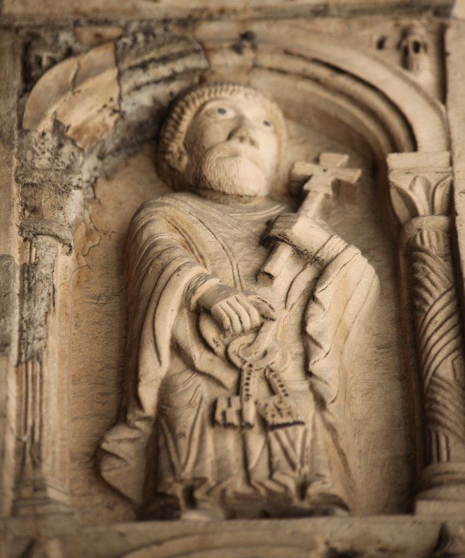
  <figcaption>Workshop of Wiligelmo, Saint Peter, from the jambs of the Porta dei Principi, c. 1106–1110. Modena Cathedral, south side. Photo: Mongolo1984, <a href="https://creativecommons.org/licenses/by-sa/4.0/">CC BY-SA 4.0</a>, via Wikimedia Commons.</figcaption>
</figure>

The jambs carry the twelve apostles, Saint Geminianus and a deacon, each in a small arched niche with his name carved above. Saint Peter, shown here, holds the keys of the kingdom of heaven and a cross-staff, and looks upwards with large inlaid eyes. His figure is smaller and more slender than the prophets of the main portal, and his drapery is cut in finer, more linear folds.

<figure>
  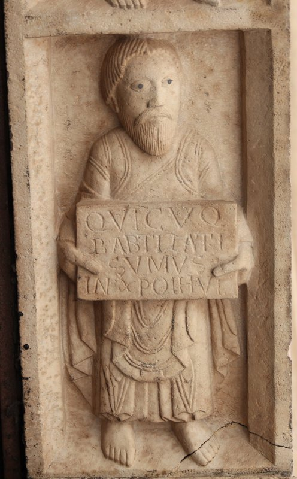
  <figcaption>Workshop of Wiligelmo, Saint Paul with the words of Romans 6:3, Quicumque baptizati sumus in Christo Iesu, underside of the lintel of the Porta dei Principi, c. 1106–1110. Modena Cathedral, south side. Photo: Mongolo1984, <a href="https://creativecommons.org/licenses/by-sa/4.0/">CC BY-SA 4.0</a>, via Wikimedia Commons.</figcaption>
</figure>

On the underside of the lintel, at the sides of the angels holding the Lamb of God, stand Saint Paul and Saint John the Baptist. Paul holds a tablet inscribed with the words of the Letter to the Romans, *Quicumque baptizati sumus in Christo Iesu*, "All of us who were baptised into Christ Jesus" (Romans 6:3); John the Baptist, on the other side, holds the words *Ecce agnus Dei, ecce qui tollit peccata mundi*. With the Lamb between them, the two figures form a programme on baptism and on Christ the Lamb of God.

The comparison between the Porta dei Principi and the main portal shows the difference between the master and his workshop. The repertory of forms is the same, the inhabited scroll, the figures in niches, the porch on lions, but the figures of the side door are smaller, more numerous and more decorative, and lack the weight and gravity of Wiligelmo's own work.

The portal was damaged by the bombing of 13 May 1944, which destroyed the upper part of its porch and damaged the archivolt, a lion and the capitals; it was later restored. The lintel and the jambs survived, and remain one of the most complete examples of the sculpture of Wiligelmo's workshop.

The Porta dei Principi completes the programme of the cathedral on the side facing the city's main square. Where the façade presented the history of creation and the prophets, the south door presented the apostles and the patron saint, whose body lay in the crypt; it was the door of the saint and of the civic community gathered around him.

### The Porta della Pescheria: Arthur and the Months

<figure>
  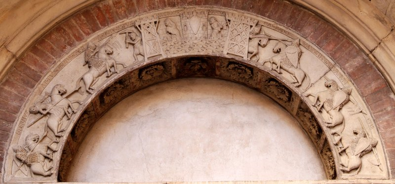
  <figcaption>Workshop of Wiligelmo, the archivolt of the Porta della Pescheria with the siege of a castle by Arthur and his knights, early twelfth century. Modena Cathedral, north side. Photo: Sailko, <a href="https://creativecommons.org/licenses/by-sa/4.0/">CC BY-SA 4.0</a>, via Wikimedia Commons.</figcaption>
</figure>

The Porta della Pescheria, on the north side of the cathedral, takes its name from the fish market that once stood nearby. It is the door of the market quarter, and its sculpture is the most surprising of the cathedral. Its archivolt shows knights attacking a castle surrounded by water, in which a woman is held prisoner; inscriptions name the figures: Artus de Bretania, Isdernus, Galvaginus, Galvariun, Che, Carrado, Burmaltus, Mardoc and Winlogee.

<figure>
  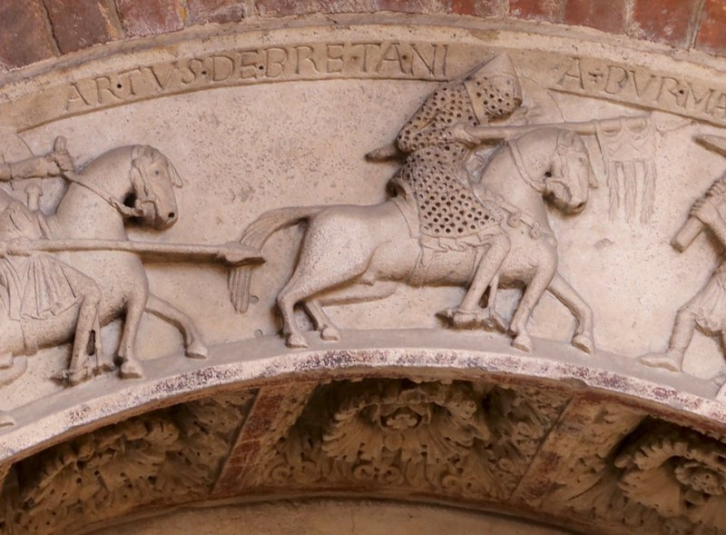
  <figcaption>The Porta della Pescheria, detail: Artus de Bretania, King Arthur. Photo: Sailko, <a href="https://creativecommons.org/licenses/by-sa/4.0/">CC BY-SA 4.0</a>, via Wikimedia Commons.</figcaption>
</figure>

They are Arthur, Yder, Gawain, Kay and Guinevere, heroes of the Breton legend. At the centre of the archivolt, in a castle with towers, stand Winlogee and Mardoc, her captor. From the left, Arthur and his companions ride against the castle, where the giant Burmaltus defends a barbican with a pick; from the right, Gawain and others attack the knight Carrado. The scene represents the rescue of the abducted queen, an episode known in later Arthurian romances.

<figure>
  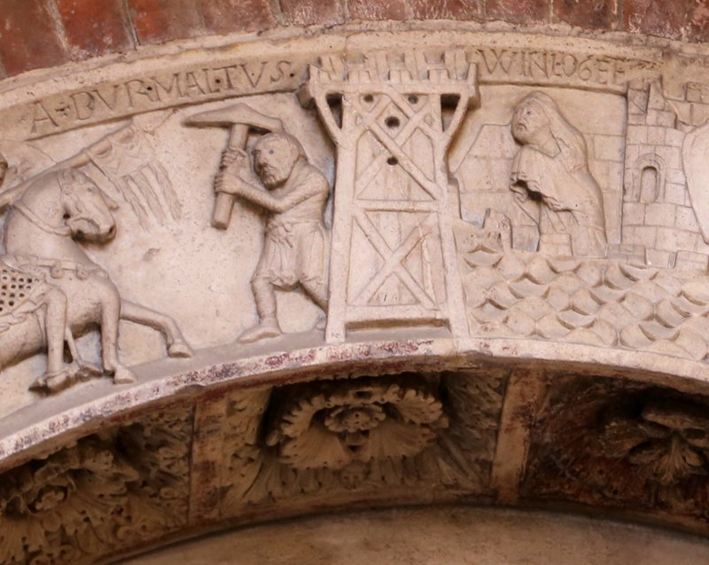
  <figcaption>The Porta della Pescheria, detail: Burmaltus with his pick, a siege tower and Winlogee (Guinevere) within the walls of the castle. Photo: Sailko, <a href="https://creativecommons.org/licenses/by-sa/4.0/">CC BY-SA 4.0</a>, via Wikimedia Commons.</figcaption>
</figure>

The date of the archivolt is one of the long debates of medieval scholarship. If it was carved in the first decades of the twelfth century, as many believe, it is older than the *Historia regum Britanniae* of Geoffrey of Monmouth, completed around 1136, and shows that tales of Arthur were circulating orally in Italy. Others have dated it later, after the diffusion of Geoffrey's work. Quintavalle has argued that the names derive from a tradition independent of Geoffrey and that the archivolt belongs to the first campaign of the cathedral.

The sculptor of the archivolt is sometimes called the Master of Arthur or the Master of the Pescheria. His figures are smaller and more animated than Wiligelmo's, with horses in movement, knights in mail armour and lively details of arms and architecture. The scene of Burmaltus with his pick, the siege tower and Winlogee looking out from behind the wall is one of the most vivid of the archivolt.

<figure>
  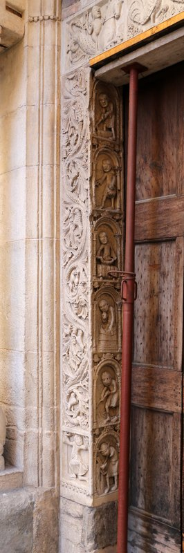
  <figcaption>The Porta della Pescheria, left jamb: Labours of the Months in arched niches and inhabited vine scroll, early twelfth century. Photo: Sailko, <a href="https://creativecommons.org/licenses/by-sa/4.0/">CC BY-SA 4.0</a>, via Wikimedia Commons.</figcaption>
</figure>

The jambs of the portal carry the Labours of the Months in small arched niches, with the names of the months above: the work of every season, reaping, threshing, treading grapes, cutting wood. The cycle begins at the foot of one jamb and continues on the other. The outer faces of the jambs are carved with inhabited vine scrolls, as on the main portal.

The lintel carries scenes of animal fables, among them the funeral of the fox and the crane drawing a bone from the wolf's throat. These are fables of the antique and medieval tradition, not scenes from the *Roman de Renart*, which was composed in the last quarter of the twelfth century. Like the sacred scenes, they served as moral lessons for those who passed.

The Porta della Pescheria shows how the workshop of Wiligelmo opened sculpture to new subjects: secular romance, the calendar of work, the fables of animals. On the door facing the busy market, the church offered images of the world of its citizens, knights, peasants and beasts, under the protection of the sacred building.

The archivolt is the earliest dated image of the Arthurian legend, if the early date is accepted, and in any case one of the earliest. It is a rare case of secular romance on the door of a cathedral, and it has made Modena a place of pilgrimage for historians of literature as well as of art.

### Nonantola: the Lunette of the Portal

<figure>
  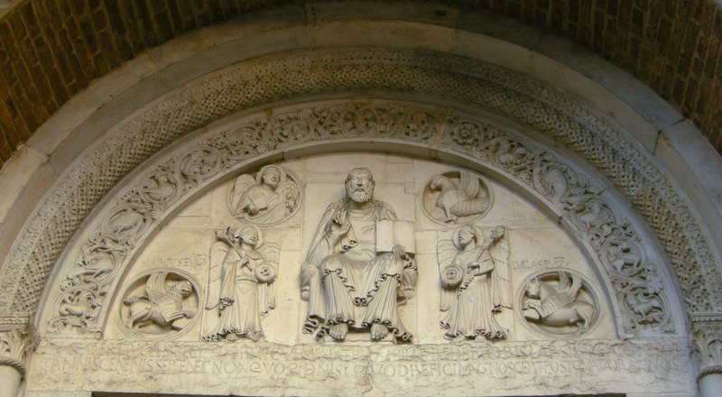
  <figcaption>Wiligelmo or his workshop, the lunette of the portal with Christ in Majesty, angels and the symbols of the Evangelists, and the lintel inscription recording the collapse of 1117. Nonantola, abbey church of San Silvestro. Photo: Sailko, <a href="https://creativecommons.org/licenses/by-sa/3.0/">CC BY-SA 3.0</a>, via Wikimedia Commons.</figcaption>
</figure>

The abbey of San Silvestro at Nonantola, east of Modena, was one of the greatest Benedictine houses of northern Italy, founded in the eighth century. Its church has a portal whose lunette shows Christ in Majesty, seated, blessing and holding an open book, between two standing angels with staffs and discs; four roundels in the corners contain the symbols of the Evangelists, the winged man and the eagle above, the winged lion and the winged ox below. The names of Mark and Luke are carved beside their symbols.

The lunette is framed by an archivolt carved with vine scrolls inhabited by birds and animals, in the manner of the main portal of Modena, and by a band of lattice ornament. Below it, the lintel carries two lines of inscription, which record the collapse of the church and its rebuilding. In the text usually given, they read:

Silvestri celsi ceciderunt culmina templi, 
mille redemptoris lapsis vertigine solis 
annis centenis septem nec non quoque denis; 
quod refici magnos cepit post quattuor annos.
{: .quote-latin}

The summits of the lofty temple of Silvester fell 
when, in the turning of the sun, a thousand years of the Redeemer had passed, 
and a hundred, seven and ten years besides; 
it began to be rebuilt after four long years.
{: .quote-translation}

In the summary of Sauro Gelichi, in the sixth volume of the excavation reports on the abbey (2018), the inscription says that the high vaults of the temple, perhaps of the church, collapsed in the eleven hundred and seventeenth year from the birth of the Redeemer, and that rebuilding began after four years, that is in 1121. The extent of the damage is debated: some scholars think the church was entirely rebuilt, others, Quintavalle among them, that only its upper parts were affected. The stratigraphic study of the walls has shown that the present plan of the church follows the rebuilding after 1117.

The attribution of the portal is disputed. Quintavalle associates it with Wiligelmo and his workshop and with the partial rebuilding after 1117, but considers that the reliefs of the lunette, the blessing Christ, the angels and the Evangelists, originally belonged to another work, perhaps an ambo. Other scholars see in the portal a relation with the building site of Modena but do not attribute it to Wiligelmo, and regard the jambs and the archivolt, with the inscription, as slightly earlier than the lunette, which they give to another sculptor. All agree in dating the sculpture between the end of the eleventh century and the first years of the twelfth.

The scheme of the lunette, Christ in Majesty among the symbols of the Evangelists, was widespread in Romanesque art, in painting and sculpture. At Nonantola, it is combined with angels holding staffs and discs, perhaps the attributes of their office as messengers and guardians. The composition is clear and symmetrical, and fits the semicircular field with great skill.

The abbey had close ties to the papacy and to the house of Canossa, and its abbots were among the supporters of the reform. A great sculptured portal on the front of its church, built after the model of the cathedral of Modena, affirmed the prestige of the monastery, which claimed among its treasures the relics of Pope Silvester, the titular saint named in the inscription.

The Latin text given above is the one usually quoted, and the second part of it can be read on the photograph reproduced here. The first words of the first line, however, appear different on the stone, and the whole should be checked against an epigraphic edition. The dates the inscription records, 1117 and four years later, are not in doubt. Christ, in the lunette, is a heavy, frontal figure with large hands, whose garments end in drilled folds as on the prophets of Modena.

The portal of Nonantola shows the reach of the workshop of Wiligelmo beyond Modena, in one of the great monasteries of the region, closely connected with Matilda of Canossa and with the reform. It is one of the principal witnesses to the diffusion of the art of Modena in the first decades of the twelfth century.

### Nonantola: the Infancy of Christ on the Right Jamb

<figure>
  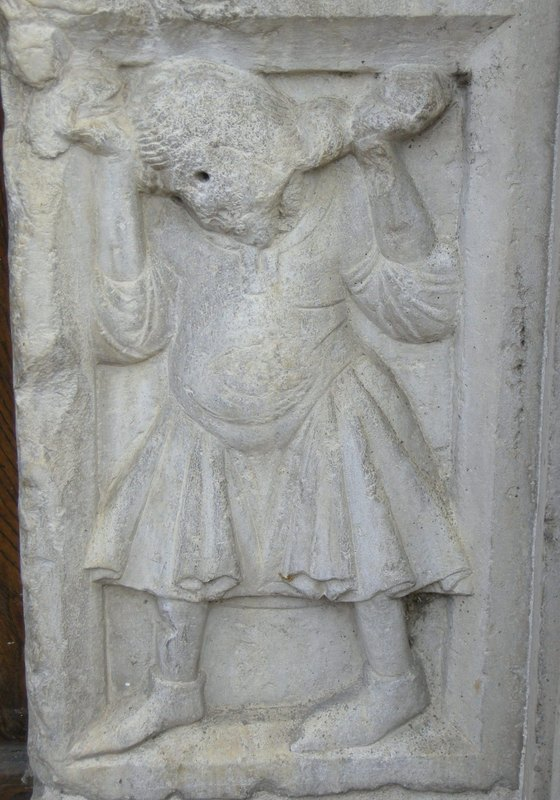
  <figcaption>Followers of Wiligelmo, a telamon at the foot of the right jamb of the portal. Nonantola, abbey church of San Silvestro. Photo: Sailko, <a href="https://creativecommons.org/licenses/by-sa/3.0/">CC BY-SA 3.0</a>, via Wikimedia Commons.</figcaption>
</figure>

The right jamb of the portal of Nonantola is carved with a series of small panels, one above the other, illustrating the Infancy of Christ. At its foot, a telamon in a belted tunic and pointed shoes bends his head under the ledge he holds up with both hands, as on the jambs of the main portal of Modena. The panels above him tell the story from the Annunciation to the warning given to Joseph.

<figure>
  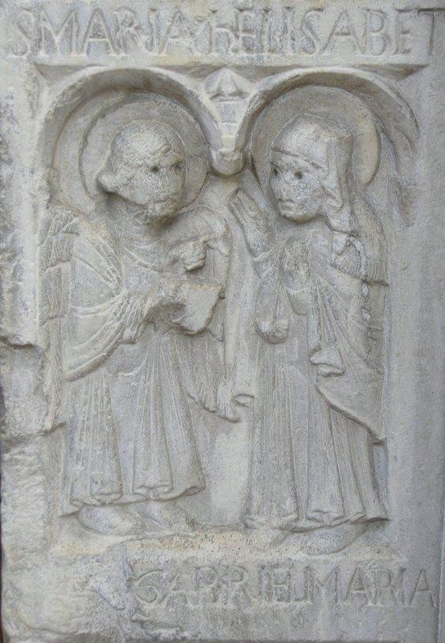
  <figcaption>Followers of Wiligelmo, the Annunciation, right jamb of the portal. Nonantola, abbey church of San Silvestro. Photo: Sailko, <a href="https://creativecommons.org/licenses/by-sa/3.0/">CC BY-SA 3.0</a>, via Wikimedia Commons.</figcaption>
</figure>

<figure>
  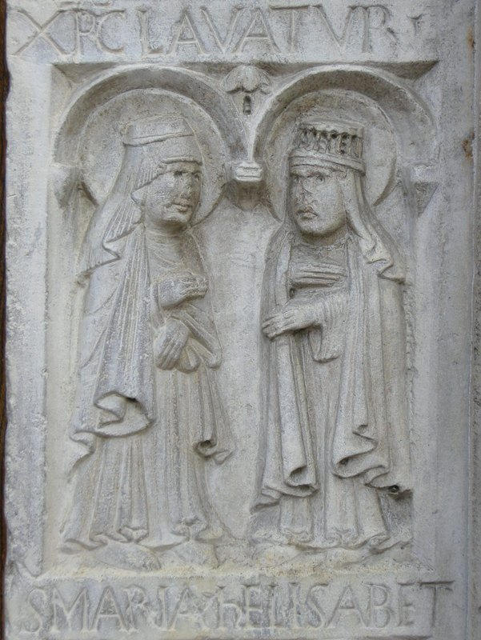
  <figcaption>Followers of Wiligelmo, the Visitation, right jamb of the portal. Nonantola, abbey church of San Silvestro. Photo: Sailko, <a href="https://creativecommons.org/licenses/by-sa/3.0/">CC BY-SA 3.0</a>, via Wikimedia Commons.</figcaption>
</figure>

In the Annunciation, the angel Gabriel, holding a book, points towards Mary, who raises her hand in surprise; in the Visitation, Mary and Elizabeth, both haloed, stand face to face, one wearing a crown-like headdress. Each scene stands under two small arches, with the names of the figures carved on the bands between the panels: GABRIEL MARIA, S MARIA ELISABET.

<figure>
  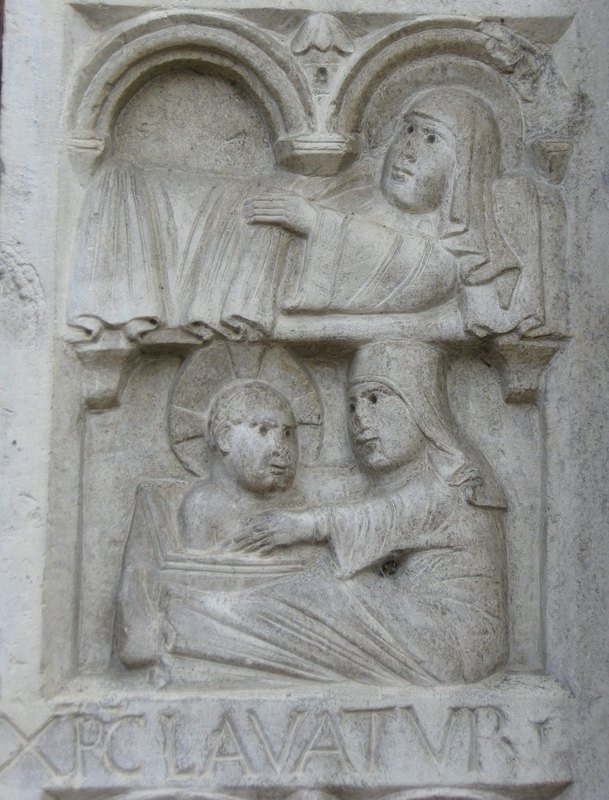
  <figcaption>Followers of Wiligelmo, the Virgin resting and the Bath of the Child, right jamb of the portal. Nonantola, abbey church of San Silvestro. Photo: Sailko, <a href="https://creativecommons.org/licenses/by-sa/3.0/">CC BY-SA 3.0</a>, via Wikimedia Commons.</figcaption>
</figure>

<figure>
  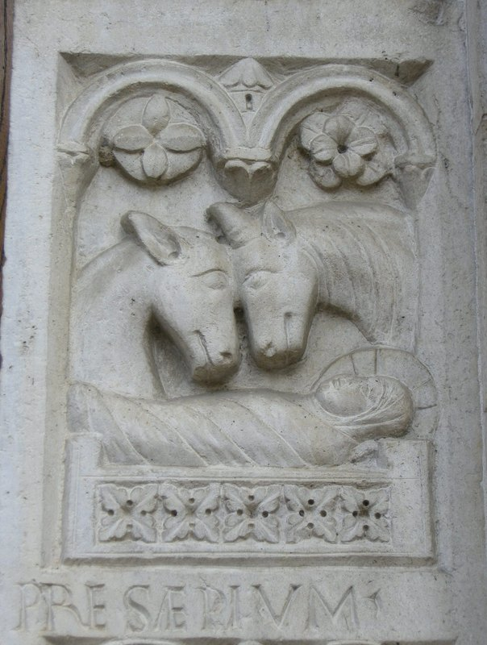
  <figcaption>Followers of Wiligelmo, the Child in the manger with the ox and the ass, right jamb of the portal. Nonantola, abbey church of San Silvestro. Photo: Sailko, <a href="https://creativecommons.org/licenses/by-sa/3.0/">CC BY-SA 3.0</a>, via Wikimedia Commons.</figcaption>
</figure>

The Nativity is divided into two panels. In the first, the Virgin rests on her bed above, while below a woman bathes the Child in a basin, with the inscription XPC LAVATUR, "Christ is washed"; the bath of the Child, drawn from apocryphal tradition, was a common scene in Byzantine and Western art. In the second, the ox and the ass bend their heads over the swaddled Child in the manger, with the inscription PRESEPIUM, "the manger".

<figure>
  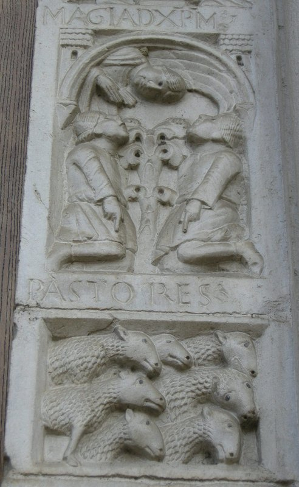
  <figcaption>Followers of Wiligelmo, the Annunciation to the Shepherds, right jamb of the portal. Nonantola, abbey church of San Silvestro. Photo: Sailko, <a href="https://creativecommons.org/licenses/by-sa/3.0/">CC BY-SA 3.0</a>, via Wikimedia Commons.</figcaption>
</figure>

<figure>
  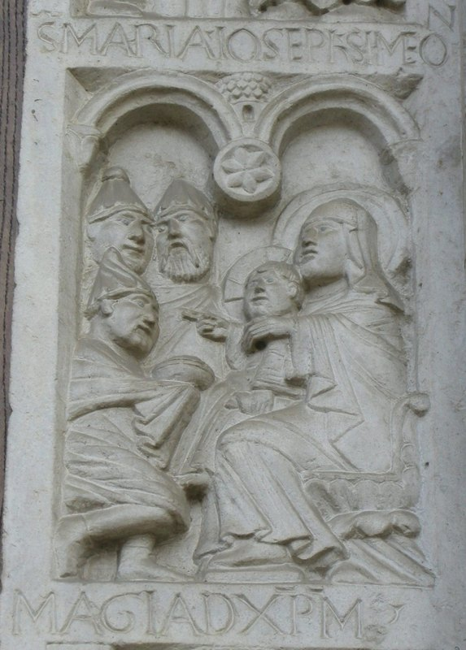
  <figcaption>Followers of Wiligelmo, the Adoration of the Magi, right jamb of the portal. Nonantola, abbey church of San Silvestro. Photo: Sailko, <a href="https://creativecommons.org/licenses/by-sa/3.0/">CC BY-SA 3.0</a>, via Wikimedia Commons.</figcaption>
</figure>

In the Annunciation to the Shepherds, an angel leans down from the sky over two kneeling shepherds, and below them a flock of sheep with inlaid eyes fills a separate panel, with the inscription PASTORES. In the Adoration of the Magi, the three kings in pointed caps, one kneeling and offering a bowl, approach the Virgin seated with the Child, who blesses them; the inscription reads MAGI AD XPM, "the Magi to Christ".

<figure>
  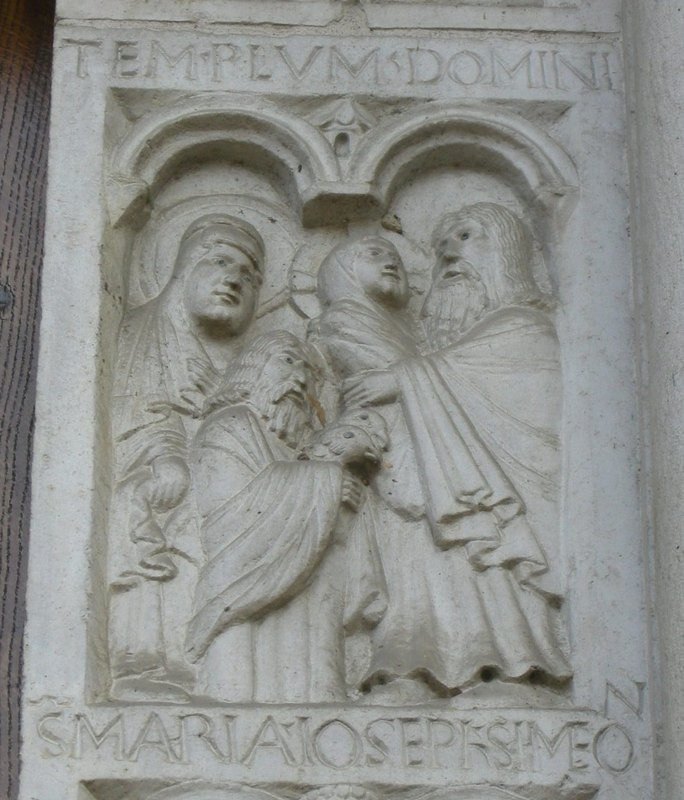
  <figcaption>Followers of Wiligelmo, the Presentation in the Temple, right jamb of the portal. Nonantola, abbey church of San Silvestro. Photo: Sailko, <a href="https://creativecommons.org/licenses/by-sa/3.0/">CC BY-SA 3.0</a>, via Wikimedia Commons.</figcaption>
</figure>

<figure>
  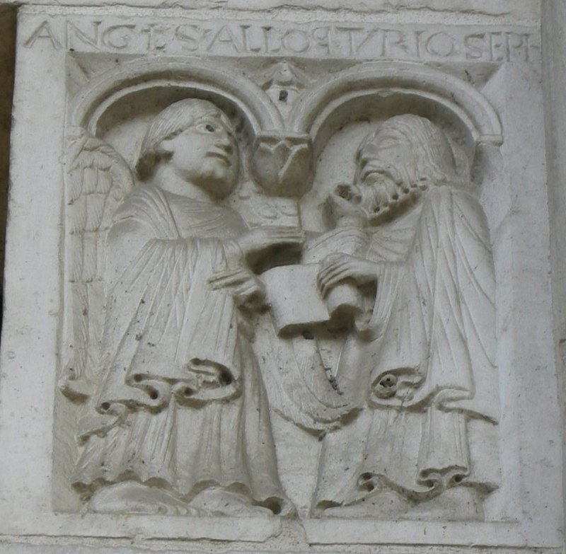
  <figcaption>Followers of Wiligelmo, the angel speaking to Joseph, right jamb of the portal. Nonantola, abbey church of San Silvestro. Photo: Sailko, <a href="https://creativecommons.org/licenses/by-sa/3.0/">CC BY-SA 3.0</a>, via Wikimedia Commons.</figcaption>
</figure>

In the Presentation in the Temple, under the inscription TEMPLUM DOMINI, the Virgin and Joseph, who carries the offering of doves, present the Child to the old Simeon; the names S MARIA IOSEPH S SIMEON are carved below. In the last panel, an angel speaks to Joseph, an old man with a scroll who raises his hand to his beard: ANGELUS ALLOQUITUR IOSEPH, "the angel speaks to Joseph", the warning to flee into Egypt.

The style of these panels differs from that of the lunette. The figures are smaller, more slender and more numerous, the drapery is more linear, and the scenes are more crowded. The files of the photographs reproduced here attribute them to the followers of Wiligelmo. The left jamb, not illustrated here, carries scenes from the lives of Saint Anselm, the founder of the abbey, and of Pope Hadrian III, closely related to the written lives of both. Marco Calzona (2012) has argued that the jamb reliefs were carved shortly before the earthquake of 1117 and that their captions were added after the bull of Pope Callixtus II of 1121; Gandolfo (2001) had already suggested that some captions, such as that of the Annunciation, were later additions.

The inscriptions are an essential part of the panels. Carved in capitals on the bands that separate the scenes, they name the figures and the subjects, sometimes in abbreviated form, and allowed the literate viewer to identify each episode. They follow the practice of the Porta dei Principi of Modena, where the apostles and the scenes of the lintel are also named.

The cycle of Nonantola is one of the most complete Infancy cycles of Romanesque sculpture in Italy. It shows how the workshop of Wiligelmo used the scheme of figures in niches, developed on the jambs of Modena for prophets and apostles, to tell a continuous story, panel by panel, along the jamb of a portal.

### Cremona: the Prophets of the Old Façade

<figure>
  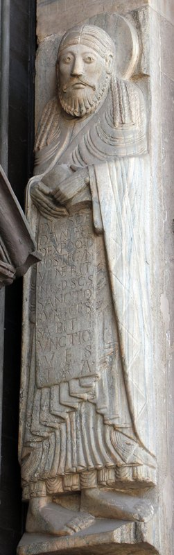
  <figcaption>Wiligelmo or the Master of the Prophets, the prophet Daniel, from the portal of the old façade, c. 1107–1117. Cremona Cathedral, main portal. Photo: Sailko, <a href="https://creativecommons.org/licenses/by/3.0/">CC BY 3.0</a>, via Wikimedia Commons.</figcaption>
</figure>

The cathedral of Cremona was founded in 1107, according to a slab with Enoch and Elijah holding an inscribed tablet, which repeats the scheme of the foundation slab of Modena. The inscription dates the beginning of the building to the seventh day before the Kalends of September, under Pope Paschal II, in the fifteenth indiction, that is 26 August 1107. The slab shows how quickly the model of Modena was adopted in the cities of the Po valley.

From the portal of the old façade of Cremona, damaged in the earthquake of 1117, four prophets survive, reset in the jambs of the present main portal: Daniel, Ezekiel, Jeremiah and Isaiah. They are tall, narrow figures carved on the jambs themselves, each holding a long scroll inscribed with a prophecy of Christ. Daniel, shown here, has long braided hair and a beard, a halo and a scroll beginning with his name, DANIHEL.

<figure>
  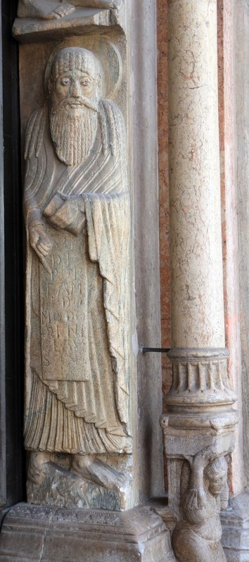
  <figcaption>Wiligelmo or the Master of the Prophets, the prophet Ezekiel, from the portal of the old façade, c. 1107–1117. Cremona Cathedral, main portal. Photo: Sailko, <a href="https://creativecommons.org/licenses/by/3.0/">CC BY 3.0</a>, via Wikimedia Commons.</figcaption>
</figure>

Ezekiel has a very long rippling beard and holds a book and a scroll with a short inscription; beside him a column rests on a small crouching figure. His face is long, with large eyes and a straight nose, and his mantle falls in parallel folds to his bare feet.

<figure>
  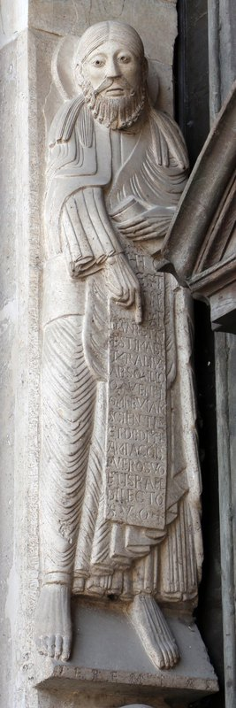
  <figcaption>Wiligelmo or the Master of the Prophets, the prophet Jeremiah, from the portal of the old façade, c. 1107–1117. Cremona Cathedral, main portal. Photo: Sailko, <a href="https://creativecommons.org/licenses/by/3.0/">CC BY 3.0</a>, via Wikimedia Commons.</figcaption>
</figure>

Jeremiah, whose name is carved on the base, holds a long scroll inscribed with a text that, in the medieval tradition, was attributed to him, the passage of Baruch on God appearing on earth. His mantle falls in chevron folds over his legs, and his figure leans slightly, as if moving towards the door.

<figure>
  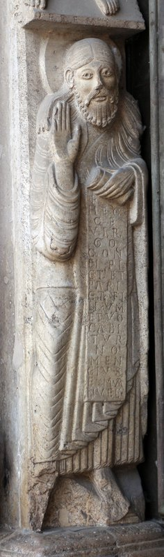
  <figcaption>Wiligelmo or the Master of the Prophets, the prophet Isaiah with the words of Isaiah 7:14, from the portal of the old façade, c. 1107–1117. Cremona Cathedral, main portal. Photo: Sailko, <a href="https://creativecommons.org/licenses/by/3.0/">CC BY 3.0</a>, via Wikimedia Commons.</figcaption>
</figure>

Isaiah raises his right hand in speech and holds a scroll with the prophecy of the Virgin birth: *Ecce virgo concipiet et pariet filium et vocabitur nomen eius Emmanuel*, "Behold, a virgin shall conceive and bear a son, and shall call his name Emmanuel" (Isaiah 7:14). The prophecy, the most quoted of all the Old Testament announcements of Christ, sets the theme of the series.

The attribution of the Cremona prophets is disputed. Some scholars give them to Wiligelmo himself, working at Cremona after the main campaign of Modena; others to a distinct Master of the Prophets, a sculptor of his circle. The files of the photographs reproduced here use the second name. The figures are more elongated and more linear than the prophets of Modena, but they share their gravity and their monumental presence.

The figures are carved on the jambs themselves, not in separate niches, and their elongated proportions are adapted to the narrow surfaces they occupy. This type of figure, bound to the architecture, anticipates the column statues of the portals of the following decades in France and Italy, and shows the inventiveness of the workshop that formed at Modena.

The foundation slab of Cremona, the prophets and the portal of Nonantola show that, within a few years of 1099, the art of Wiligelmo had spread through the region. Whether he worked in person at these sites or sent sculptors of his workshop, the model created at Modena became the starting point for the sculpture of the Po valley in the twelfth century.
