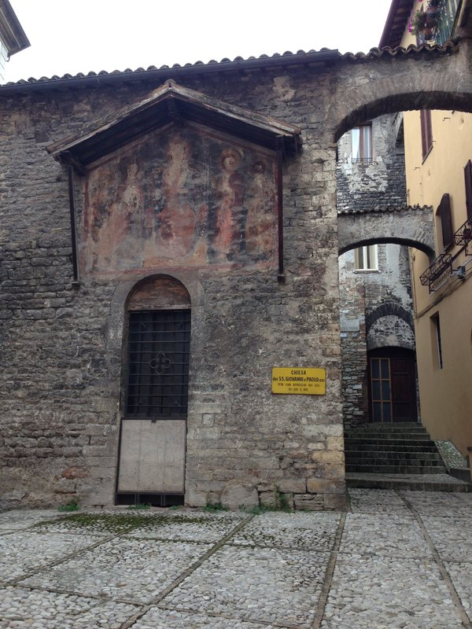
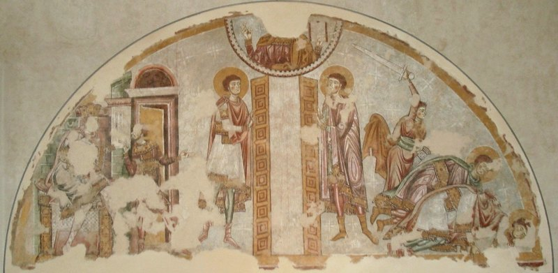
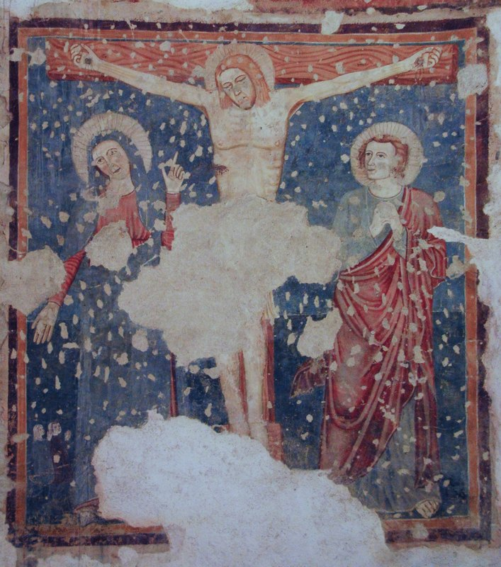
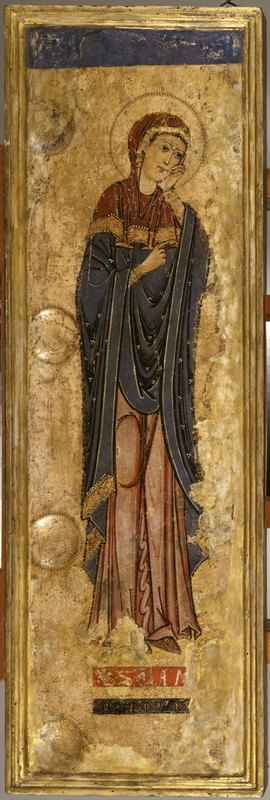
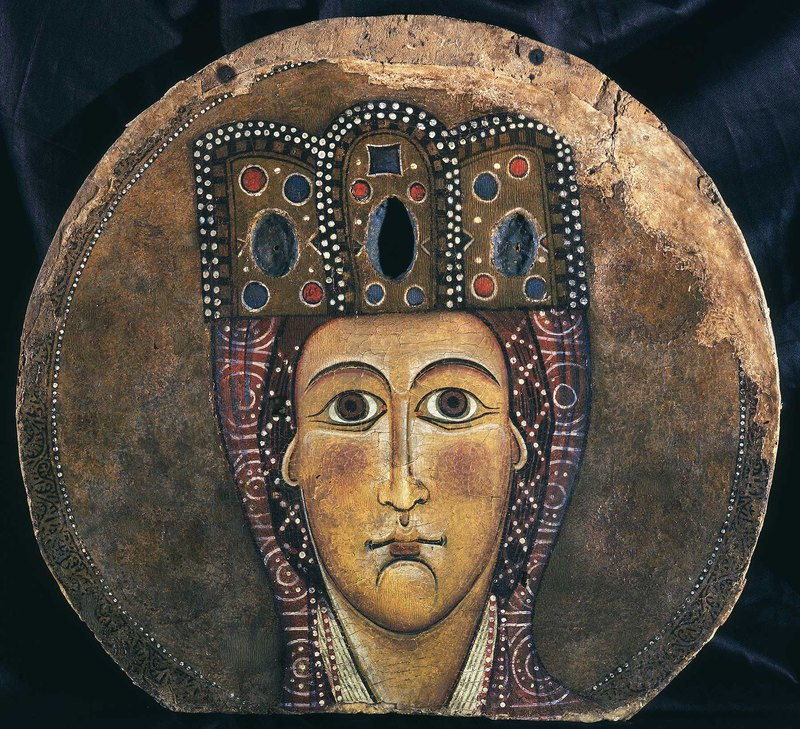
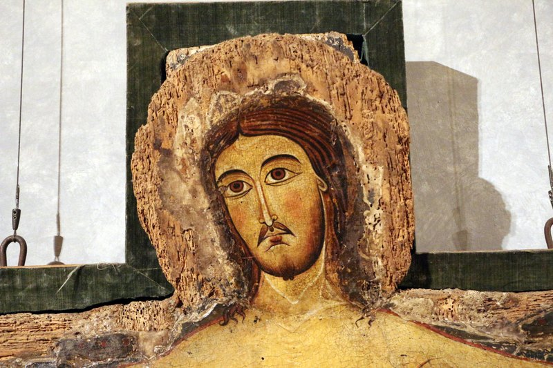
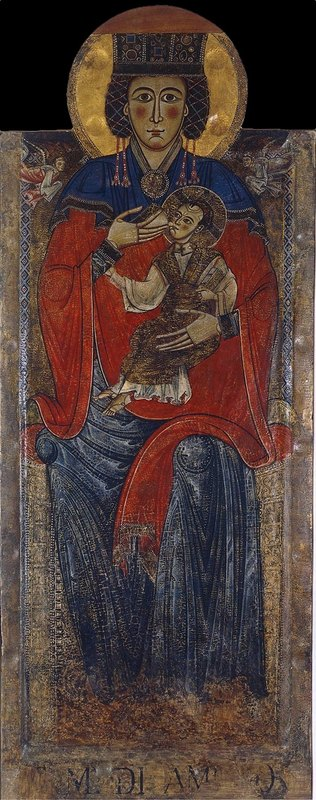
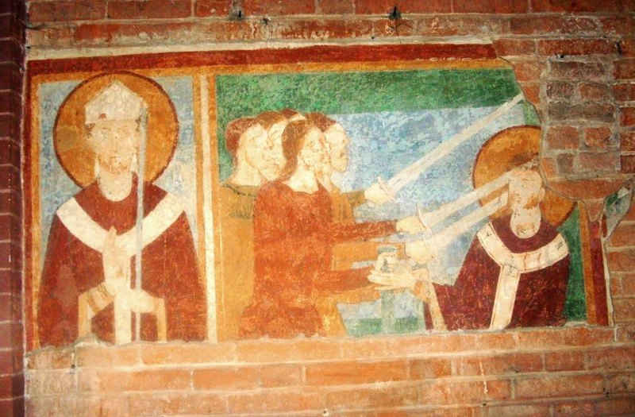

## A Painter Known from a Signature

*Alberto* is known from a signature and a date. At the foot of the painted cross that once hung in the church of Santi Giovanni e Paolo in Spoleto, and now hangs in the cathedral of the city, an inscription records the year 1187 and the name of the painter. It is the earliest signed and dated painting in Umbria, and one of the few twelfth-century painted crosses in Italy that carry both a name and a date.

The inscription is damaged. The nineteenth-century historian of Spoleto Achille Sansi read it in 1869 as *A. D. MCLXXXVII … Opus Alberto Sotii*, and the painter has been called Alberto Sotio, Sozio or Sotii ever since. Only the first letters of the surname survive with certainty, and [Cochetti Pratesi](/scholars.html#cochetti-pratesi-lorenza), in the *Enciclopedia dell'Arte Medievale* (1991), notes that the traditional completion Sotio is now rejected. The name used here, Alberto Sozio, is a convention, kept because it is the one under which the painter is best known.

Nothing else is documented. No record names his parents, his birthplace, his master, his workshop or his death. His date of birth, his training and his journeys are unknown, and no contract or payment in his name survives.

The same version contained errors of fact. It placed Spoleto in the province of Varese. It described the cross of Spoleto with scenes of the Harrowing of Hell, the Holy Women at the tomb and the Denial of Peter, which belong to a different cross, now in the Victoria and Albert Museum in London. It dated the fresco of Thomas Becket to 1173–1174 as if the date were certain, and it connected the painter with "Solternus", a confusion with the mosaicist [Solsternus](/Content/Artists/XIII-c/Solsternus.html), who signed the façade of the cathedral of Spoleto in 1207.

What can be said of Alberto rests on his works. The signed cross of 1187 is the fixed point. Around it scholars have grouped a small number of works on stylistic grounds: the fresco of the martyrdom of Saints John and Paul from the crypt of the same church, almost unanimously given to him; a fragment of another cross with the mourning Virgin, now in Baltimore; and the head of a Virgin from a Maestà, now in the Pinacoteca di Brera in Milan. Others are disputed or rejected.

The cross is painted on parchment laid over the wooden panel, a rare technique among Italian painted crosses, and the fragment in Baltimore is painted in the same way. The technique links the painter with the art of the book, and the Walters Art Museum suggests that he may also have worked as an illuminator. The suggestion is reasonable, but no manuscript has been attributed to him.

The account that follows describes the cross of 1187, the church of Santi Giovanni e Paolo and its frescoes, the panels attributed to Alberto and to his workshop, the attributions accepted and rejected, his style and his sources, and his place in the history of painting in Spoleto. The catalogue then examines the works one by one, with the church, a later fresco in it and a comparison from Pavia.

The entry is based on the article of Cochetti Pratesi in the *Enciclopedia dell'Arte Medievale*, on the information of the museums that keep the works, and on the literature cited there: the studies of [Evelyn Sandberg-Vavalà](/scholars.html#sandberg-vavala-evelyn) (1929, 1939), [Edward Garrison](/scholars.html#garrison-edward) (1949), [Miklós Boskovits](/scholars.html#boskovits-miklos) (1979) and [Giordana Benazzi](/scholars.html#benazzi-giordana) (1984). Where the literature is divided, the entry says so.

## The Cross of 1187

The cross is a large shaped panel of the type of the twelfth-century painted crosses of central Italy, with a cimasa above the head, a horizontal crossbar and a long lower shaft. The painting is executed in tempera on sheets of parchment glued to the wood, and the surrounding bare wood, studded with iron nail heads, now frames the painted surface. Much of the painting at the ends of the crossbar is lost.

At the centre stands Christ, the *Christus triumphans* of the twelfth century: alive, upright, frontal, with open eyes and arms stretched horizontally. His face is long and grave, with large eyes, a long straight nose and a short beard; his hair falls in dark locks on the shoulders. His halo is gilded and set with raised bosses. His body is drawn with strong outlines, and the abdomen is divided into large rounded forms.

The loincloth is white with blue borders and red lines, knotted at the waist with a broad blue band whose ends fall at the sides. It reaches the knees. The feet stand side by side on a footrest, each pierced by its own nail, and streams of blood run down from the wounds.

Beside the body stand the Virgin and Saint John, identified by inscriptions below them. The Virgin, at the left of the viewer, wears a blue robe and a red mantle; she raises one hand to her face in grief and lifts the other towards her son. John, young and beardless, stands at the right in a red mantle. They occupy the broad panel beside the body, where Tuscan crosses often place narrative scenes.

In the cimasa Christ ascends in a blue mandorla, carried by angels, while other angels look up from below. The Ascension, the last event of the story of Christ on earth, crowns the cross. Below it the titulus names Christ as King of the Jews.

At the foot of the cross, below the footrest, a small image has been read as the skull of Adam, buried according to tradition beneath the place of the Crucifixion. Below it run the two lines of the inscription with the date and the name of the painter. The inscription, placed where the viewer's eye ends, gives the cross its documentary value.

The cross was painted for the church of Santi Giovanni e Paolo, consecrated in 1174, and remained there until 1887, when it was moved to the cathedral of Spoleto. It now hangs in the first chapel on the left of the cathedral. It was restored in the early 1980s; the restoration was reported by Virilli and the cross studied by Benazzi in the catalogue of the exhibition *Quando Spoleto era romanica* (1984).

Cochetti Pratesi described the style of the cross as combining elements derived from Lazio, in the figures of Christ and the Virgin, with features of late Comnenian Byzantine painting, and noted close parallels with the mosaics of Monreale in Sicily. The angular, sharp-edged drapery with curling hems, visible in the mourners and the angels of the cimasa, is the most characteristic mark of the painter's hand.

## Santi Giovanni e Paolo and Its Frescoes

The church of Santi Giovanni e Paolo stands in the upper town of Spoleto. Its small crypt, built on Roman foundations, dates from the eleventh century and was originally a separate church; the larger church above it was built in the twelfth century, and an inscription in the presbytery records its consecration in 1174. The building is now deconsecrated and preserves frescoes from the twelfth to the fifteenth century.

The church is the principal setting of Alberto's work. The cross of 1187 was painted for it, and the earliest fresco attributed to him, the martyrdom of the titular saints, decorated its crypt. Other paintings on its walls have been attributed to his followers, and the fresco of the martyrdom of Thomas Becket has been attributed to him by some scholars.

The fresco of the martyrdom of Saints John and Paul was detached from the crypt in 1961 and is now in the Museo Nazionale del Ducato di Spoleto, in the Rocca Albornoz. It fills a lunette and shows three moments of the story: the emperor Julian the Apostate ordering the execution of the two brothers, their beheading, and the brothers at the gates of Heaven, with Christ above them.

The attribution of this fresco to Alberto is almost unanimous, according to Cochetti Pratesi, and she considered it perhaps his earliest work, painted close to the consecration of the church in 1174. If so, it shows the painter at work some thirteen years before the cross, and the comparison of the two shows a consistent hand.

The fresco of the martyrdom of Thomas Becket, on the left wall of the upper church, is the most famous painting in Santi Giovanni e Paolo. Becket, Archbishop of Canterbury, was murdered in his cathedral on 29 December 1170 by four knights of King Henry II and canonised by Pope Alexander III in 1173. The fresco is one of the earliest representations of his martyrdom in Italy.

Its attribution and date are disputed. Gaeta (1954–1955) and Benazzi (1984) placed it shortly before the cross of 1187, and so gave it to Alberto. Cochetti Pratesi (1971) dated it to the first half of the thirteenth century, relating it to the frescoes of the chapel of Saint Gregory at the Sacro Speco of Subiaco. Boskovits (1979) argued against a date close to the canonisation of 1173. Recent guides date it around 1230.

On the right wall, fragments of a fresco with Saints Michael, Margaret and Thaddeus, around 1200, have been given to a follower of Alberto. They show that his manner continued in Spoleto after 1187 and that the church remained a centre of his influence.

The later paintings of the church, from a Crucifixion and a Madonna della Cintola of the fourteenth century to the frescoes of the Maestro di Eggi dated 1445, show the continuity of its decoration over three centuries. Alberto's cross and frescoes stand at the beginning of this sequence.

## The Panels: Baltimore, Milan and the Workshop

The Walters Art Museum in Baltimore keeps a fragment of a painted cross with the mourning Virgin, attributed to Alberto and dated around 1180–1190. It is painted in tempera and gold on parchment mounted on a wooden panel, the same technique as the cross of Spoleto, and the painted surface measures 84.5 by 24.5 centimetres.

The fragment comes from the left side of a large painted cross, from the area just below the arm, which the painter coloured blue; a strip of that blue survives at the top. The Virgin stands, touching her cheek in sorrow, and points to the right towards the figure of Christ, now lost. An inscription at her feet identifies her as Saint Mary.

The fragment came from the collection of Don Marcello Massarenti in Rome, where its catalogues of 1881 and 1897 attributed it to Margaritone d'Arezzo; Henry Walters bought it with the Massarenti collection in 1902, and it passed to the museum by his bequest in 1931. It is one of the earliest Italian paintings in America.

The Pinacoteca di Brera in Milan keeps the head of the Virgin from a Maestà, attributed to Alberto and catalogued as tempera on panel, 32.5 by 35.5 centimetres, inv. 7412. It entered the museum by donation. The fragment is round, cut from a larger panel around the halo, and shows the crowned head of the Virgin, frontal, with large eyes, set with three empty settings that once held stones or glass.

The Brera fragment is not discussed in the article of Cochetti Pratesi. According to the description of its photograph on Wikimedia Commons, it comes from the collection of Lamberto Vitali, which agrees with the donation recorded by the museum. The fragment shows the late phase of the Spoleto style, and the attribution is the museum's.

Two crosses are connected with Alberto's circle rather than with his own hand. The cross of the Victoria and Albert Museum in London, painted in tempera on canvas laid on panel and measuring 219.5 by 170 centimetres, is catalogued by the museum as circle of Alberto Sotio. It shows Christ with the Virgin and Saint John, a bust of Christ between two angels in the cimasa, and on the terminals the Harrowing of Hell, the Holy Women at the tomb and the Denial of Peter.

These scenes belong to the London cross, not to the cross of Spoleto. The London cross was given to the museum by Lord Carmichael of Skirling in 1900, and its extensive overpainting was removed in 1948. The museum notes its close relation to the signed cross of 1187 and considers it one of the most important Italian paintings of its period in a British collection.

A painted cross in the Jacorossi collection, much damaged and eaten by worms, is catalogued on Wikimedia Commons as the work of Alberto's workshop, around 1190–1210. Its Christ, with large eyes, a long nose and a drooping moustache, and its four standing saints beside the body show the persistence of his types after 1187.

## Attributions Accepted and Rejected

The catalogue of Alberto is small, and it has been built by successive scholars. [Antonio Muñoz](/scholars.html#munoz-antonio) wrote the entry *Albertus Sotii* in the Thieme-Becker lexicon in 1907; [Raimond van Marle](/scholars.html#van-marle-raimond) (1921, 1923) and [Pietro Toesca](/scholars.html#toesca-pietro) (1927) discussed the cross in their surveys; Sandberg-Vavalà gave it a central place in her study of the Italian painted cross (1929) and devoted an article to "Alberto Sotio and his group" in 1939.

In 1940 [George Martin Richter](/scholars.html#richter-george-martin) discussed Alberto together with Petrus pictor in the same journal of the Walters Art Gallery. Garrison included the cross and the related works in his illustrated index of Italian Romanesque panel painting (1949) and wrote in the same year on the Spoleto painters Simeone and Machilone, the next generation of the local school.

The fresco of the martyrdom of Saints John and Paul is the most secure attribution after the cross, accepted almost unanimously. The Walters Virgin, painted in the same technique and with the same types, is also generally accepted. The Brera head is given to him by its museum.

The fresco of Thomas Becket is the most disputed. Its attribution depends on its date: if it was painted before 1187, as Gaeta and Benazzi believed, it can be by Alberto; if it belongs to the thirteenth century, as Cochetti Pratesi and later writers believe, it must be by a follower.

Several attributions have been rejected. Sandberg-Vavalà proposed in 1939 the Madonna Stoclet; Kleinschmidt in 1926 the painted cross in the Treasury of San Francesco in Assisi; Boskovits in 1979 the Madonna d'Ambro in the Museo Nazionale d'Abruzzo in L'Aquila. Cochetti Pratesi rejected all three.

The Madonna d'Ambro shows how wide the range of opinion has been. Published by Piccirilli in 1919 as a thirteenth-century work, it was compared by Toesca with the Madonna in the apse of Santa Maria in Foro Claudio, placed by Garrison in an Umbrian-Abruzzese context and dated to 1270–1280, linked first to Spoleto by [Guglielmo Matthiae](/scholars.html#matthiae-guglielmo), related by [Ferdinando Bologna](/scholars.html#bologna-ferdinando) to Alberto and the frescoes of Rongolise, and finally attributed to Alberto by Boskovits.

Weaker links have been proposed with the painted cross of Vallo di Nera and with the crucifix no. 5 of the Pinacoteca Comunale of Spoleto. They are recorded in the literature but have not won acceptance.

The result is a small catalogue with a firm centre: one signed cross, one fresco and one fragment of a cross, surrounded by works of the workshop and circle and by attributions that remain disputed. [Filippo Todini](/scholars.html#todini-filippo), in his survey of Umbrian painting (1989), and the catalogues of the museums have kept this distinction.

## Style and Sources

Alberto's style is defined by line. His figures are drawn with strong contours, and their forms are built from clear, simple shapes: the long oval of the face, the large almond eyes, the straight nose, the small mouth. Within the outlines the modelling is restrained, and colour is laid in broad areas.

The drapery is the most distinctive feature of his style. Its folds are angular and sharp-edged, and its hems break into curling, wavy edges. Cochetti Pratesi singled out this treatment as characteristic, and it recurs in the mourners and angels of the cross, in the Walters Virgin and in the fresco of the titular saints.

Cochetti Pratesi saw two components in his style. The figures of Christ and the Virgin derive from the painting of Lazio, the Roman tradition of the twelfth century; the drapery and many details derive from late Comnenian Byzantine painting, the art of the Byzantine Empire in the second half of the twelfth century.

The Byzantine component has been related to the mosaics of Monreale in Sicily, executed by Byzantine mosaicists in the 1180s, at the same time as the cross of Spoleto. Cochetti Pratesi proposed the Pentecost mosaic of Santa Maria di Grottaferrata, near Rome, as a likely source closer to hand, and the Roman route seems the more probable one.

[Robert Oertel](/scholars.html#oertel-robert) (1953) and Bologna (1962) cited the frescoes of Sant'Angelo in Formis, near Capua, and the Dormition in Santa Maria in Grotta at Rongolise, in the south. A southern origin for the painter has been suggested on this basis, but it remains unproven, and the comparisons do not resolve the question of his training.

The technique of painting on parchment laid on panel connects Alberto with the art of the book. Parchment gave a smooth, even surface for fine drawing, and the precision of his line, the Walters Art Museum observes, suggests a painter who may also have worked in manuscripts. The hypothesis is plausible but undocumented.

The comparison with Tuscan crosses of the same period shows Alberto's difference. The cross of Spoleto has no narrative scenes beside the body; the mourners stand there instead, as in Roman and Umbrian crosses. Its Christ is harder and more graphic than the Christ of the [Maestro della Croce 432](/Content/Artists/XII-c/Maestro-della-Croce-432.html) in Florence, though their large rounded forms are related, and scholars who place the Florentine cross in central Italy have cited the Spoleto cross in support.

Alberto's style shaped painting in Spoleto for a generation. The workshop crosses, the frescoes of his followers in Santi Giovanni e Paolo and the work of the later Spoleto painters [Simeone and Machilone](/Content/Artists/XIII-c/Simeone-and-Machilone.html) carry his forms into the thirteenth century.

## Significance

Alberto is significant first as a name. In a period when almost all painters are anonymous, he signed and dated his principal work. The inscription of 1187 makes him one of the first painters in Italy known by name, and the cross of Spoleto one of the fixed points for the chronology of twelfth-century painting in central Italy.

He is significant as the head of a local school. Spoleto in the late twelfth and thirteenth centuries had a lively tradition of painting, on panel and on the wall, and Alberto stands at its beginning. The workshop crosses, the followers in Santi Giovanni e Paolo and the later painters of the city descend from his manner.

He is significant for the history of technique. The use of parchment laid on panel, shared by the cross of Spoleto and the Walters Virgin, is rare in Italian painting and shows the close relation between panel painting and illumination in the twelfth century.

He is significant for the history of style. His painting brings together the Roman tradition of Lazio and late Comnenian Byzantine art, in a city that lay between Rome and the Adriatic, and it shows how the Byzantine art of the late twelfth century reached central Italy, through Rome and perhaps through the south.

He is significant for the history of the painted cross. The cross of Spoleto, with the mourners beside the body and the Ascension in the cimasa, represents the Umbrian and Roman type of the painted cross, distinct from the Tuscan type with narrative scenes. Its date makes it a reference for both.

The fresco of Thomas Becket, whatever its date and author, is significant for the history of iconography. It is one of the earliest Italian images of the martyrdom of the archbishop, and its presence in Spoleto, a city of the Papacy, reflects the rapid spread of his cult after his canonisation in 1173.

For the history of scholarship, Alberto is a case study in the construction of an artistic personality from a signature. Around a single dated work, scholars have built a catalogue, proposed and rejected attributions, and debated dates and sources. The process continues, and this entry records its present state without filling its gaps.

For the reader, the works themselves remain the best introduction to the painter. The catalogue that follows presents them one by one, with the church for which the cross was painted, the two images of the Becket fresco, a later Crucifixion in the same church, the works of the workshop and circle, a disputed Madonna and a comparison from Pavia.

## Catalogue Entry

### The Painted Cross of Spoleto, 1187

<figure>
  
  <figcaption>Alberto Sozio, painted cross, signed and dated 1187, tempera on parchment laid on panel. Spoleto, cathedral of Santa Maria Assunta, from the church of Santi Giovanni e Paolo. Photo: Sailko, <a href="https://creativecommons.org/licenses/by/3.0/">CC BY 3.0</a>, via Wikimedia Commons.</figcaption>
</figure>

The cross of Spoleto is Alberto's signed work and the basis of his catalogue. It was painted for the church of Santi Giovanni e Paolo, signed and dated in 1187, and moved to the cathedral of Spoleto in 1887. It hangs in the first chapel on the left of the cathedral.

The photograph shows the cross against a dark background. The painted surface is surrounded by bare wood, darkened with age and studded with the heads of iron nails, which once held the parchment and the frame. At the ends of the crossbar the painting is largely lost, and the bare wood shows through.

Christ stands at the centre, upright and alive, his arms stretched along the crossbar, which is painted in blue and red bands with a border of small crosses. His head is slightly inclined, his eyes open, his expression grave. His halo is gilded and set with raised bosses, round projections that catch the light.

The body is drawn with strong outlines, the breast marked by a broad curve, the abdomen divided into large rounded forms. The flesh is pale, the shadows grey. The loincloth is white, with blue and red lines and a blue border, knotted at the waist with a broad blue band whose ends fall at the sides.

Beside the body stand the Virgin and Saint John, each identified by an inscription on a red band beneath. The Virgin, at the left, wears a blue robe under a red mantle, raising one hand to her face and lifting the other towards Christ; John, at the right, wears a red mantle over a blue tunic and holds his hands before him. Their drapery shows the sharp, curling hems characteristic of the painter.

In the cimasa Christ ascends in a blue mandorla, holding a cross-staff, while angels fly at his sides and others look up from below. The scene is framed by a border of small red crosses. Below it a small tablet carries the titulus.

At the foot the feet of Christ stand side by side on a footrest, each pierced by a nail, with streams of blood. Below the footrest a small image, read as the skull of Adam, and two lines of inscription record the date MCLXXXVII and the name of the painter. The letters are damaged, and the surname survives only in its first letters.

The photograph is reused from the comparison in the entry on the Maestro della Croce 432, where the cross of Spoleto is set beside the cross of the Uffizi. Seen together, the two crosses show the Umbrian and Tuscan versions of the Christus triumphans in the same decades.

### The Church of Santi Giovanni e Paolo

<figure>
  
  <figcaption>Spoleto, the church of Santi Giovanni e Paolo, consecrated in 1174, side wall with a fresco above the entrance. Photo: Manuelarosi, <a href="https://creativecommons.org/licenses/by-sa/4.0/">CC BY-SA 4.0</a>, via Wikimedia Commons.</figcaption>
</figure>

The church of Santi Giovanni e Paolo stands in a narrow street of the upper town of Spoleto. The photograph shows its side wall of rough grey stone, with a round-arched doorway closed by an iron grille, and a narrow passage under stone arches at the right.

A yellow sign on the wall gives the essential facts: the church, now deconsecrated, dates from 1174 and contains frescoes of the twelfth, thirteenth and fourteenth centuries. The date of 1174 is that of the consecration of the upper church, recorded by an inscription in the presbytery.

Above the doorway, under a small wooden canopy, a faded fresco shows standing figures with haloes, among them a Madonna and Child with saints. Exposed to the weather, it has lost most of its colour, and the saints can no longer be identified with certainty. Its date has been placed between the twelfth and the fourteenth century.

The church is built over an older crypt, dating from the eleventh century and originally a separate church on Roman foundations. In the crypt Alberto painted the martyrdom of the titular saints, detached in 1961 and now in the Museo Nazionale del Ducato.

The upper church, built in the twelfth century, received the cross of 1187. The cross stood in the church for seven centuries, until its transfer to the cathedral in 1887, and the church was the setting for which Alberto conceived it.

The walls of the upper church preserve the fresco of Thomas Becket, fragments of saints attributed to a follower of Alberto, a Madonna della Cintola and a Crucifixion of the fourteenth century, frescoes by the Maestro di Eggi dated 1445, and sixteenth-century paintings in the presbytery.

The church is small, and its modest exterior gives little idea of its importance. It is one of the principal monuments of Romanesque painting in Umbria, and the only place where the work of Alberto can still be related to its original setting.

The photograph also shows the urban fabric of medieval Spoleto, with its stone houses, arches and steep streets. The church of Santi Giovanni e Paolo belonged to this dense city, in which several parish churches served the different quarters.

### The Martyrdom of Saints John and Paul

<figure>
  
  <figcaption>Alberto Sozio (attributed), the martyrdom of Saints John and Paul, c. 1174, detached fresco, 168 × 238 cm, from the crypt of Santi Giovanni e Paolo. Spoleto, Museo Nazionale del Ducato. Photo: public domain, via Wikimedia Commons.</figcaption>
</figure>

The fresco comes from the crypt of Santi Giovanni e Paolo, from which it was detached in 1961. It is now in the Museo Nazionale del Ducato di Spoleto, in the Rocca Albornoz. Its attribution to Alberto is almost unanimous, and Cochetti Pratesi considered it perhaps his earliest work, painted close to the consecration of the church in 1174.

Saints John and Paul were, according to their legend, two Roman brothers, officials of the imperial court, who were put to death under Julian the Apostate for refusing to sacrifice to the gods. The church of Spoleto was dedicated to them, and the fresco tells their story in three moments within a single lunette.

At the left, largely lost, the emperor Julian sits enthroned and gives the order for the execution. A man stands at an open door, perhaps a messenger or a guard. Only fragments of the throne, the architecture and the figures survive.

At the centre the two brothers stand on either side of a tall doorway, the gate of Heaven, decorated with a meander pattern. They are young, haloed, dressed in long tunics and mantles, and they look towards each other or towards the viewer. Above them, in a half-mandorla, Christ receives them.

At the right the execution takes place. An executioner raises his sword above his head, and a saint falls forward under the blow. At the lower right corner a severed head lies on the ground. The violence of the scene contrasts with the calm of the central group.

The composition places the reward at the centre and the martyrdom at the sides, so that the eye moves from the order of the emperor to the death of the saints and to their entry into Heaven. The arrangement is clear and symmetrical, within the curved field of the lunette.

The style shows the features of Alberto's hand: long faces with large eyes, angular drapery with sharp, curling hems, strong outlines. The colours, now faded, were red, ochre, green and white on a light ground. The comparison with the mourners of the cross supports the attribution.

The fresco has suffered heavy losses, especially at the left and along the bottom, and the detachment has preserved what remained. It is the earliest surviving work attributed to Alberto, and it shows that he worked on walls as well as on panels.

### The Martyrdom of Thomas Becket

<figure>
  
  <figcaption>Alberto Sozio (attributed) or a follower, the martyrdom of Thomas Becket, fresco, late twelfth or first half of the thirteenth century. Spoleto, Santi Giovanni e Paolo, left wall. Photo: Silvio Sorcini, <a href="https://creativecommons.org/licenses/by-sa/4.0/">CC BY-SA 4.0</a>, via Wikimedia Commons.</figcaption>
</figure>

The fresco on the left wall of Santi Giovanni e Paolo shows the murder of Thomas Becket, Archbishop of Canterbury, killed in his cathedral on 29 December 1170 by four knights of King Henry II. Becket was canonised in 1173, and his cult spread rapidly across Europe. The fresco is one of the earliest representations of his martyrdom in Italy.

At the left a knight in chain mail, his armour drawn as a pattern of small rings, thrusts a long sword at the head of the archbishop. Behind him another knight, partly lost, appears at the left edge. The upper part of the first knight, including his head, is lost.

Becket stands behind the altar under an arch, his head turned and bent under the blow, his halo cut by the sword. He wears an ochre chasuble and stretches out his hand towards the knight. Above the altar, in the air, hangs a severed hand: according to the accounts of the murder, Edward Grim, a clerk who tried to protect the archbishop, was wounded in the arm by the same blow.

At the right, behind a column, a cleric in a red tunic and an ochre mantle looks on. He may be Edward Grim himself, or another witness of the murder. His face, with large eyes and a straight nose, is calm.

On the altar, covered by a cloth with a hanging fringe, stand a chalice and an open book with letters in two columns. The words have been read as *Dominus vobiscum*, the greeting of the Mass; the reading seems possible but the letters are damaged. The book and the chalice place the murder at the altar, during the liturgy.

The setting is an arcade of red and grey arches on columns with gilded Corinthian capitals, against a deep blue ground. A lamp hangs in one of the arches. At the right a red band and a border of crosses on a dark ground frame the scene.

The attribution and the date are disputed. Gaeta and Benazzi placed the fresco shortly before 1187 and gave it to Alberto; Cochetti Pratesi dated it to the first half of the thirteenth century; Boskovits argued against a date near 1173; recent guides date it around 1230 and give it to an anonymous painter. The caption reflects this uncertainty.

The fresco is covered with small white losses, where the paint has fallen from the plaster, perhaps from the picking of the surface to receive a later layer. The colours that survive, the blue, the red and the ochre, are intense, and they show the quality of the original painting.

### The Becket Fresco in an Early Photograph

<figure>
  
  <figcaption>The martyrdom of Thomas Becket in Santi Giovanni e Paolo, Spoleto, in a photograph from a printed book, with the caption "Alberto Sozio, Martirio di S. Tomaso di Canturbury". Photo: scan by a Wikimedia Commons user, <a href="https://creativecommons.org/licenses/by-sa/3.0/">CC BY-SA 3.0</a>, via Wikimedia Commons.</figcaption>
</figure>

This black-and-white photograph, scanned from a printed book, shows the Becket fresco in its entirety, as it appeared before recent conservation. The caption, partly cut, reads "Alberto Sozio, Martirio di S. Tomaso di Canturbury", the attribution given by the author of the book.

The photograph shows more of the composition than the colour detail. Above runs an ornamental frieze of circles with foliage. Below it a tiled roof covers an arcade, and within the arcade the scene unfolds from left to right.

At the left three knights in chain mail, wearing round caps, raise their swords. The foremost thrusts his sword towards the archbishop. Their figures overlap, and their swords cross the arches in strong diagonals.

Becket stands behind the altar under the arcade, with the cleric behind the column at the right, as in the colour detail. Lamps hang from the arches above. The altar is covered by a cloth with a fringe.

At the far left a seated figure, partly visible, may be the king or another witness; the photograph does not allow a certain identification. At the far right, beyond a vertical band of ornament, stands a separate figure of a bishop saint with a halo and a pallium, perhaps Becket himself as a saint, or another bishop.

The photograph is valuable as a document. It shows the fresco before the losses visible in the recent colour photograph, or at least before their present state, and it records the full width of the composition, including parts that the colour detail omits.

The attribution given in the caption reflects the opinion of the older literature, which gave the fresco to Alberto. As discussed above, the attribution and date are now disputed.

The photograph is in black and white, and its tones do not reproduce the colours of the fresco. It should be read together with the colour detail, which shows the blue ground, the red arches and the ochre garments.

### A Later Crucifixion in Santi Giovanni e Paolo

<figure>
  
  <figcaption>Crucifixion with the Virgin and Saint John, fresco, later Gothic, date not established, for comparison. Spoleto, Santi Giovanni e Paolo. Photo: Silvio Sorcini, <a href="https://creativecommons.org/licenses/by-sa/4.0/">CC BY-SA 4.0</a>, via Wikimedia Commons.</figcaption>
</figure>

This Crucifixion, painted on the walls of Santi Giovanni e Paolo long after Alberto's cross, in a Gothic manner that points to the fourteenth century, shows how the image of the crucified Christ changed between the twelfth and the fourteenth century. It is included for comparison, not as a work of Alberto.

Christ hangs on a red wooden cross, the grain of the wood painted in wavy lines. His head is bowed, his eyes closed, his arms pulled upwards by the weight of the body. He is the *Christus patiens*, the dead Christ, the type that replaced the triumphant Christ of Alberto's cross in the course of the thirteenth century.

The Virgin stands at the left, in a dark blue mantle with red sleeves, raising one hand and extending the other in a gesture of lament. Her face, turned towards Christ, expresses grief openly. Saint John stands at the right in a red mantle, his hand on his breast, his face turned upward.

The figures stand against a deep blue ground, framed by red and dark borders. At the lower left, small kneeling figures with joined hands may be donors or members of a confraternity who commissioned the fresco.

The fresco is much damaged. The lower centre, with the body of Christ below the waist and the foot of the cross, is lost, and the surface is scattered with small losses. The colours that survive, the blue, the red and the flesh tones, are still vivid.

The comparison with Alberto's cross is instructive. In 1187 the Virgin and John stand beside the living Christ with restrained gestures; in the fourteenth century they stand beside the dead Christ and express their grief openly. The same subject, in the same church, shows the change of devotion and of style.

The fresco belongs to the later decoration of the church, which also includes a Madonna della Cintola and the works of the Maestro di Eggi. Its date and author are not established, and the fourteenth-century date suggested by its style has not been confirmed by a published source.

The presence of the fresco in the church of Alberto's cross reminds us that medieval churches were decorated over centuries, and that each generation added its own images to those of its predecessors.

### The Mourning Virgin, Baltimore

<figure>
  
  <figcaption>Alberto Sozio, the Mourning Virgin, fragment of a painted cross, c. 1180–1190, tempera and gold on parchment laid on panel, painted surface 84.5 × 24.5 cm. Baltimore, Walters Art Museum, 37.1155. Photo: Walters Art Museum, public domain, via Wikimedia Commons.</figcaption>
</figure>

The panel in the Walters Art Museum is a fragment of a large painted cross, cut from its left side just below the arm. It is attributed to Alberto and dated around 1180–1190, close to the cross of Spoleto, and it is painted in the same technique, tempera and gold on parchment laid on a wooden panel.

The Virgin stands alone on the gold ground, turned slightly to the right, where the body of Christ once stood. She raises her left hand to her cheek, the traditional gesture of grief, and points with her right hand towards her son. Her head is bent, her eyes look down.

She wears a red veil over her head, a dark blue mantle scattered with small groups of white dots, and a long red-violet robe beneath. The mantle falls in angular folds with sharp, curling hems, the most characteristic feature of Alberto's drapery. Gold borders with pearls edge the mantle at the neck and the hem.

Around her head a halo is outlined by a row of small dots. The gold ground is broken by large raised round bosses, three on the left side and one at the bottom, similar to the bosses on the halo of Christ in the cross of Spoleto. They are part of the decoration of the cross and catch the light.

At the top of the panel a strip of blue survives, the colour of the crossbar of the cross, which the painter painted blue. At the Virgin's feet a red band carries the beginning of an inscription, read as *S[an]c[t]a M[aria]*, and below it an ornamental band.

The panel came from the collection of Don Marcello Massarenti in Rome, whose catalogues of 1881 and 1897 attributed it to Margaritone d'Arezzo. Henry Walters bought it with the Massarenti collection in 1902, and it entered the museum by his bequest in 1931. It is one of the earliest Italian paintings in America.

The museum observes that the painter's control of line and expressive gesture suggests that he may also have worked as an illuminator. The use of parchment as a support reinforces the suggestion, though no manuscript has been attributed to Alberto.

The comparison with the Virgin of the cross of Spoleto confirms the attribution. Both raise a hand to the face; both wear a mantle with sharp, curling hems; both have the long face and large eyes of the painter's types. The Walters Virgin, more fully preserved, shows the quality of his work at close range.

### Head of the Virgin from a Maestà, Milan

<figure>
  
  <figcaption>Alberto Sozio, head of the Virgin from a Maestà, late twelfth century, tempera on panel, 32.5 × 35.5 cm. Milan, Pinacoteca di Brera, inv. 7412. Photo: public domain, via Wikimedia Commons.</figcaption>
</figure>

The fragment in the Pinacoteca di Brera shows the head of the Virgin from a Maestà, a large panel of the enthroned Virgin with the Child. It has been cut into a roughly circular shape following the halo, and the rest of the panel is lost. The museum attributes it to Alberto and catalogues it as tempera on panel, 32.5 by 35.5 centimetres.

The face of the Virgin is frontal and symmetrical. Her eyes are large and round, with dark irises, under high arched brows. Her nose is long and straight, her mouth small and closed, her chin rounded. Red patches on the cheeks give colour to the pale flesh. The expression is solemn and fixed.

She wears a tall crown of three arched plates, outlined with rows of white pearls and set with painted red and blue stones. In the centre of each plate an oval setting is now empty: it once held a real stone or a piece of glass, which caught the light and made the crown shine.

A red veil, patterned with white spirals and dots, falls on either side of the face. Beneath it the neck of a white garment with a red border appears. The pattern of the veil, like the crown, imitates the precious textiles and jewellery of Byzantine imperial costume.

The halo is marked by a ring of small white dots and by a band of fine ornament near the edge. The brown ground, now darkened, was probably once gilded. The wood is worn at the edges, and losses at the upper right show the bare panel.

The crowned Virgin, the *Maria Regina*, was a type of Roman origin, used in the twelfth century in Rome and in central Italy. The Brera head belongs to this tradition, and it connects Alberto's work with the Roman sources identified by Cochetti Pratesi.

The museum records that the fragment entered by donation, and the Commons description names the collection of Lamberto Vitali.

The fragment shows a different side of the painter from the cross and the Walters Virgin: the solemn, frontal icon rather than the mourning figure. Its large eyes, long nose and small mouth are those of his types, rendered with the hieratic frontality of the Maestà.

### A Workshop Cross, Jacorossi Collection

<figure>
  
  <figcaption>Workshop of Alberto Sozio, painted cross, c. 1190–1210, tempera on panel. Jacorossi collection. Photo: Francesco Bini, <a href="https://creativecommons.org/licenses/by-sa/4.0/">CC BY-SA 4.0</a>, via Wikimedia Commons.</figcaption>
</figure>

This painted cross, in the Jacorossi collection, is catalogued on Wikimedia Commons as the work of Alberto's workshop, around 1190–1210. It shows how the types and forms of the cross of Spoleto were repeated by his assistants and followers in the years after 1187.

The cross is heavily damaged. The wood has been eaten by worms, and large areas of paint are lost, especially at the ends of the crossbar, on the halo and on the lower shaft, where the bare wood shows. It is mounted in a modern frame covered with green velvet and hangs on wires.

Christ stands upright, with open eyes, the *Christus triumphans* of Alberto's cross. His face is long, with large eyes, a long nose and a drooping moustache. His body is pale, drawn with fine outlines, the abdomen marked by curved lines. His halo, once in relief, is lost.

The loincloth is long and white, reaching below the knees, knotted at the waist with a broad white band. Its edges are bordered with a fine dotted line, and it falls in sharp, pointed folds at the sides, as in the loincloth of the cross of Spoleto.

Beside the body stand four saints, two on each side. At the left a young saint in a red mantle over a patterned tunic stands beside the Virgin in a dark red mantle, who raises her hand towards Christ. At the right a saint with a book, probably John the Evangelist, stands beside another saint in a patterned robe.

The presence of four figures instead of two distinguishes this cross from the cross of Spoleto, where only the Virgin and John stand beside Christ. The additional saints may have been chosen by the patrons, perhaps the titular saints of the church for which the cross was made.

At the right end of the crossbar a small half-figure survives, perhaps an angel or a saint, behind a parapet. The other ends of the cross are lost, and the original programme cannot be reconstructed.

The cross is an important witness of the diffusion of Alberto's style. Its forms are close to those of the cross of 1187, but its execution is simpler, and its date, later than the signed cross, shows the workshop continuing after the master's documented activity.

### The Head of Christ in the Workshop Cross

<figure>
  
  <figcaption>Workshop of Alberto Sozio, head of Christ, detail of the painted cross of the Jacorossi collection, c. 1190–1210. Photo: Francesco Bini, <a href="https://creativecommons.org/licenses/by-sa/4.0/">CC BY-SA 4.0</a>, via Wikimedia Commons.</figcaption>
</figure>

The detail shows the head of Christ in the workshop cross of the Jacorossi collection. It is the best-preserved part of the cross, and it shows the types of Alberto's painting at close range.

The face is long and pale, the flesh painted in warm yellow tones with red patches on the cheeks. The eyes are large, with brown irises, outlined in black under high arched brows. The gaze is direct and grave.

The nose is long and thin, its line continuing into the brows. The moustache droops in two dark curves on either side of the small mouth. The beard is short and pointed, drawn in fine lines. The ear is visible at the right.

The hair falls in parallel dark strands on both sides of the face, framing it like a hood, and ends in curls on the shoulders. The strands are drawn with a fine brush, in a rhythmic pattern that recalls the drawing of illumination.

Around the head the halo is lost. The bare wood shows, eaten by worms into a spongy texture, with remains of the preparation and the paint at the edges. The loss gives the head a dramatic isolation, as if it emerged from the wood.

The comparison with the head of Christ in the cross of Spoleto shows the closeness of the workshop to the master. The long face, the large eyes, the long nose and the hair in parallel strands are the same; the drawing is somewhat harder and more schematic.

The craquelure of the paint, a fine network of cracks, covers the face. It shows that the paint is original, and that the surface has not been heavily restored. The colours, though darkened, are well preserved.

The detail allows the viewer to see the quality of the workshop's painting, which, even in a damaged cross, preserves the gravity and the intensity of Alberto's types.

### The Cross of the Victoria and Albert Museum

<figure>
  
  <figcaption>Circle of Alberto Sozio, painted cross, late twelfth century, tempera on canvas laid on panel, 219.5 × 170 cm. London, Victoria and Albert Museum, 850-1900. Photo: Victoria and Albert Museum, public domain, via Wikimedia Commons.</figcaption>
</figure>

The cross of the Victoria and Albert Museum in London is catalogued by the museum as the work of the circle of Alberto Sotio, painted in Umbria in the last quarter of the twelfth century. Attributions have varied between Tuscany and Umbria, but the museum notes its close stylistic relation to the signed cross of Spoleto.

It is painted in tempera on canvas laid on panel and measures 219.5 by 170 centimetres. It was given to the museum by Lord Carmichael of Skirling in 1900, and its extensive overpainting was removed in 1948. The museum considers it one of the most important Italian paintings of its period in a British collection.

Christ stands upright, with open eyes, his arms stretched along a blue crossbar. His halo is red and gold, his face long, his body pale. His loincloth is long and golden-brown, falling to the knees. His feet stand side by side on a footrest.

Beside the body stand the Virgin at the left, in a red mantle, raising her hand, and Saint John at the right, in a red mantle over a green garment. The arrangement is the same as in the cross of Spoleto: the mourners stand beside the body, not on the arms.

In the cimasa a bust of Christ appears in a circle between two angels. At the ends of the crossbar, according to the museum, small scenes show the Harrowing of Hell at the left and the Holy Women at the tomb at the right; at the foot, the Denial of Peter. These scenes are damaged.

These scenes belong to the London cross, not to the cross of Spoleto, as the museum's catalogue and the photographs of both crosses show.

The bibliography of the cross includes Sandberg-Vavalà (1929), Garrison (1948, 1949), Kauffmann's catalogue of the museum's foreign paintings (1973), Todini (1989) and Boskovits (1993, 2010), as well as a doctoral dissertation by A. A. Driscoll on Alberto and the Umbrian painted cross.

The cross shows that Alberto's type of painted cross, with the mourners beside the body and narrative scenes on the terminals, was adopted by other painters of his circle. Its narrative terminals give it a richer programme than the signed cross, and they show the variety of the Umbrian crosses of the period.

### The Madonna d'Ambro, L'Aquila

<figure>
  
  <figcaption>Madonna d'Ambro, the Virgin and Child enthroned, thirteenth century, tempera on panel; attributed to Alberto Sozio by Boskovits, an attribution rejected by Cochetti Pratesi. L'Aquila, MuNDA – Museo Nazionale d'Abruzzo. Photo: public domain, via Wikimedia Commons.</figcaption>
</figure>

The Madonna d'Ambro, in the Museo Nazionale d'Abruzzo in L'Aquila, is the most debated of the works attributed to Alberto. Boskovits gave it to him in 1979; Cochetti Pratesi rejected the attribution; Garrison dated it to 1270–1280. Its name comes from the inscription *de ambro* at the lower edge of the panel, whose origin is unknown.

The Virgin sits frontally on a throne, holding the Child on her lap and nursing him. She wears a tall crown set with jewels, with pendants hanging at the sides, a blue garment and a red mantle that falls over her knees in broad folds. Her face is frontal, with large eyes and red cheeks.

The Child, in a robe patterned with gold, sits on her left knee and drinks at her breast. The image of the nursing Virgin, the *Galaktotrophousa*, is rare in Italian panel painting of this period, and it gives the panel a tender intimacy within its hieratic frontality.

Two small angels fly at the upper corners of the panel, against the gold ground. The throne is decorated with bands of ornament, and the panel is framed by a border of small patterns. The surface is worn, especially in the lower part.

The panel was published by Piccirilli in 1919 as a work of the thirteenth century. Toesca compared the crown and the features of the Virgin with the Madonna in the apse of Santa Maria in Foro Claudio; Garrison placed it in an Umbrian-Abruzzese context; Matthiae was the first to link it to Spoleto; Bologna noted its affinities with Alberto and with the frescoes of Rongolise.

The comparison with the Brera head shows why the attribution was proposed. Both Virgins wear a tall jewelled crown, both have large eyes and red cheeks, both have the hieratic frontality of the Roman *Maria Regina*. The differences of execution, and Garrison's late date, explain why the attribution has not been generally accepted.

The panel shows the diffusion of the Spoleto style in the Abruzzi and the persistence of the Roman type of the crowned Virgin in central Italy. Whatever its author, it belongs to the artistic world in which Alberto worked.

It is included here as a disputed attribution, clearly marked as such. The decision whether it is by Alberto, by a follower or by an Abruzzese painter of the late thirteenth century rests with the literature, which remains divided.

### Comparison: the Martyrdom of Thomas Becket in San Lanfranco, Pavia

<figure>
  
  <figcaption>Unknown painter, the martyrdom of Thomas Becket, fresco, first half of the thirteenth century, for comparison; not by Alberto Sozio. Pavia, San Lanfranco. Photo: Albero300, <a href="https://creativecommons.org/licenses/by-sa/4.0/">CC BY-SA 4.0</a>, via Wikimedia Commons.</figcaption>
</figure>

This fresco in the church of San Lanfranco in Pavia, in Lombardy, shows the martyrdom of Thomas Becket. It is the work of an unknown painter of the first half of the thirteenth century, and it is included here only for comparison with the fresco of Spoleto. It is not by Alberto.

The church of San Lanfranco, formerly the abbey of San Sepolcro, preserves frescoes from the thirteenth to the fifteenth century. The Becket fresco is among the oldest, and it is one of the early Italian images of the martyrdom, like the fresco of Spoleto.

At the right four young men in red and ochre tunics, their faces in profile, thrust long swords at a bishop in a red chasuble with a white pallium, who stands at an altar at the right edge. His head, surrounded by a halo, is bent under the blows. The swords form a sheaf of parallel diagonals.

At the left, in a separate panel, a bishop saint with a mitre, a red chasuble and a white pallium stands frontally, holding a crozier. He may be Becket himself as a saint, or another bishop venerated in the church. The juxtaposition of the saint and his martyrdom is similar to the arrangement of the Spoleto fresco, where a bishop saint stands at the right beside the scene.

The comparison shows two different ways of representing the same event. At Spoleto the murderers are knights in chain mail, and the setting is a rich arcade with columns and lamps; at Pavia the murderers wear simple tunics, and the setting is reduced to a plain ground and an altar. The Spoleto fresco is more elaborate and more precise in its details.

The two frescoes also show the rapid spread of Becket's cult in Italy. Within a few decades of his death in 1170 and his canonisation in 1173, his martyrdom was painted in churches as far apart as Spoleto in Umbria and Pavia in Lombardy, and in many other places in Europe.

The Pavia fresco is damaged, its edges broken, and the brick of the wall shows around it. Its colours, red, ochre, green and blue, are still vivid in the parts that survive.

The comparison helps to place the Spoleto fresco in its context. If the Spoleto fresco dates from the first half of the thirteenth century, as Cochetti Pratesi and later writers believe, it is roughly contemporary with the fresco of Pavia; if it dates from before 1187, it is among the very first Italian images of the martyrdom.
