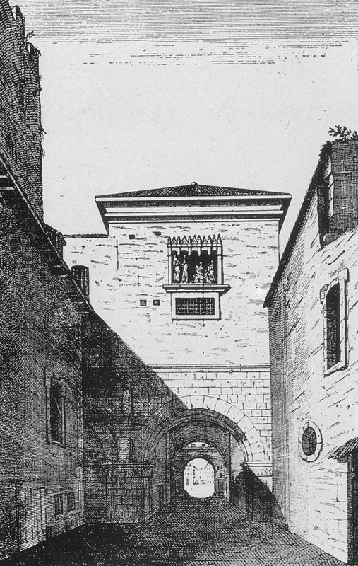
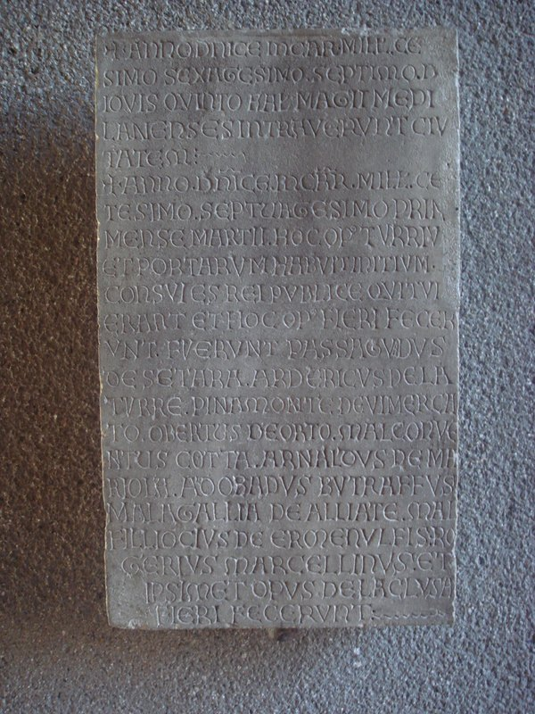
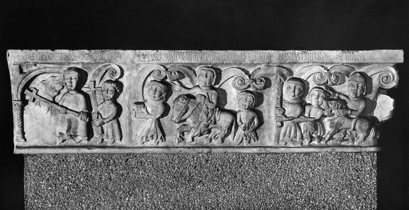
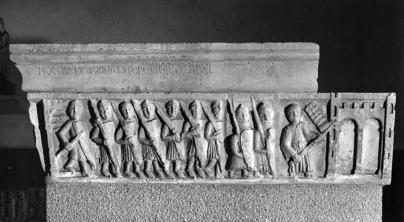
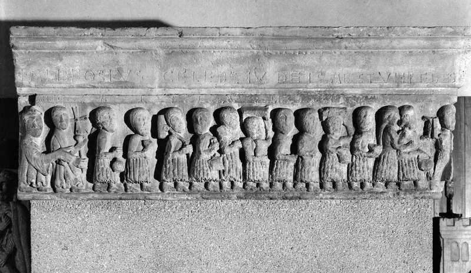
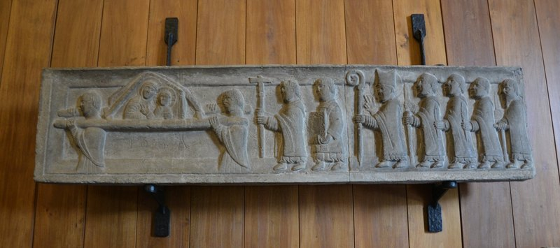
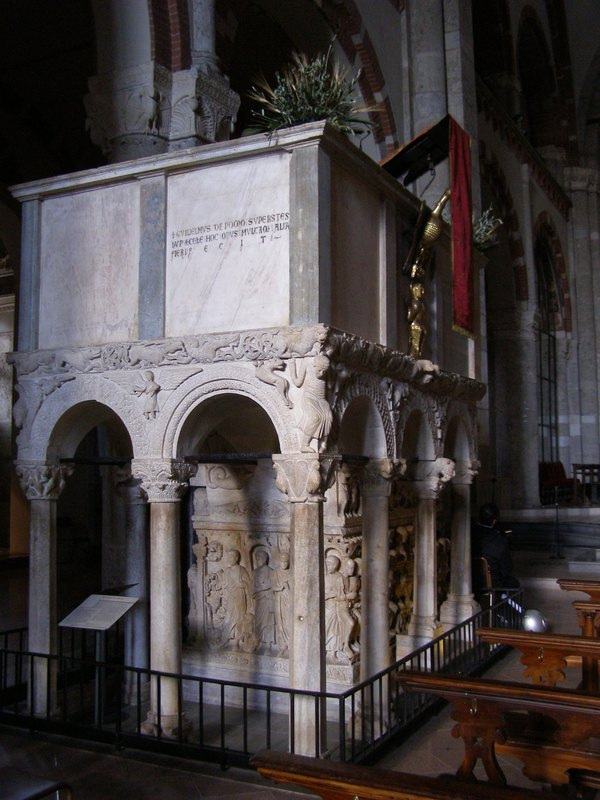

## The Names on the Gate

*Anselmus* is one of the few Milanese sculptors of the twelfth century known by name. He signed one of the reliefs of the Porta Romana, the southern gate of the walls that Milan raised in 1171, four years after its citizens had returned to the city destroyed by Frederick Barbarossa.

His signature runs along the cornice above the relief of Frate Jacopo leading the troops of the Lombard League: HOC OPUS ANSELMUS FORMAVIT DEDALUS ALTER, "Anselmus, a second Daedalus, formed this work". The comparison with the mythical craftsman of antiquity was a common way of praising an artist's skill in medieval inscriptions.

A second sculptor signed beside him. On the relief of the Return of the Milanese, the frieze carries the words ISTUD SCULPSIT OPUS GIRARDUS POLLICE DOCTO, "Girardus carved this work with a learned thumb". The two signatures make the Porta Romana one of the rare monuments of the period on which two sculptors can be named.

A third name appears on the slab of the consuls that recorded the building of the walls: GIRARDUS DE MASTEGNIANEGA FECIT HOC OPUS, carved on its left flank. Whether this Girardus is the sculptor of the Return, as has often been assumed, cannot be proved from the inscriptions alone.

For a long time the signatures were the only evidence. Barbara Natoli, in a study published in *Arte Lombarda* in 2020, has added a document: a will of 1166 in which Anselmus and Girardus appear together as witnesses. The document places the two men in Milan before the Porta Romana, and, according to Natoli, connects Anselmus with the building site of Sant'Ambrogio.

The signatures must be read carefully. The signature on the Return of the Milanese belongs to Girardus, not to Anselmus, and neither sculptor appears among the consuls named on the commemorative slab; only Girardus de Mastegnianega is named on its flank, as its maker.

Anselmus of the Porta Romana must be kept distinct from Anselmo da Campione, the master of the Campionese family who worked at Modena cathedral in the later twelfth century. The two share only a name; their works, places and styles are different.

Beyond his signature, his reliefs and Natoli's will, nothing is known of Anselmus: neither his birth nor his family, his training or his death. An old reading of the signature as "Anselmus de Ale", which made him a native of Alzate, has been abandoned; the cornice reads *Dedalus alter*.

## The Porta Romana

<figure>
  
  <figcaption>The medieval Porta Romana of Milan before its demolition, engraving. Unknown author, public domain, via Wikimedia Commons.</figcaption>
</figure>

In 1162 Frederick Barbarossa took Milan after a long siege and ordered its destruction. The inhabitants were dispersed among villages outside the city. In 1167, with the support of the cities of the newly formed Lombard League, they returned and began to rebuild.

The new walls were begun in March 1171. Their gates were the monumental entrances of the city, and the Porta Romana, on the road to Lodi and Rome, received a programme of sculpture that told the story of the destruction and the return.

The reliefs decorated the imposts of the arches, the blocks at the springing of the vaults, so that they ran along the top of the piers at the height of the passer-by's gaze. Natoli counts four scenes in high relief on the gate; three survive, together with the commemorative slab.

The engraving reproduced here shows the gate in its later form, with a fourteenth-century tabernacle of statues set into the tower. The medieval structure survived until 1793, when the gate was demolished.

The reliefs were then built into the house of the Calvi family at no. 54 Corso di Porta Romana. They later passed into the collection of Paolo Rusconi, from whom the Comune di Milano bought them in 1895. Today they are in the Museo d'Arte Antica of the Castello Sforzesco, inventory numbers 767 to 772.

The slab of the consuls followed a different route: it was deposited with the city in 1867 from the same Calvi house. A note in the *Bollettino della Consulta* of 1895, recorded in the regional catalogue, raises the possibility of a modern replica.

The regional catalogue identifies the stone of the reliefs as a sedimentary rock of the Sirone formation, the "Flysch di Bergamo". All the pieces were cleaned and maintained in 2017 and 2018.

The gate is the first monument in Milan to carry a narrative of the city's recent history in sculpture. It was conceived as a fortification and as a memorial, and its reliefs were meant to be read by every citizen who passed under its arches.

## The Slab of the Consuls

<figure>
  
  <figcaption>Girardus de Mastegnianega, slab of the consuls from the Porta Romana, 1171, stone, 101 × 60 × 8.5 cm. Milan, Castello Sforzesco, Museo d'Arte Antica, inv. 772. Photo: Giovanni Dall'Orto, <a href="https://commons.wikimedia.org/wiki/Template:Attribution">attribution licence</a>, via Wikimedia Commons.</figcaption>
</figure>

The slab of the consuls is the documentary key to the Porta Romana. Its text records two dates: the return of the Milanese to their city and the beginning of the walls.

The first sentence reads: in the year of the Lord's incarnation 1167, on Thursday, the fifth day before the kalends of May, the Milanese entered the city. The fifth day before the kalends of May is 27 April, which in 1167 fell on a Thursday.

The second sentence states that in March 1171 "this work of towers and gates" was begun. It then names the consuls of the republic who were in office and had the work made: Passaguadus de Setara, Ardericus de la Turre, Pinamonte de Vimercato, Obertus de Orto, Malconventus Cotta, Arnaldus de Mariola, Adobadus Butraffus, Malagallia de Alliate, Malfilliocius de Ermenulfis and Rogerius Marcellinus.

The text ends with the words IPSIMET OPUS DE LA CLUSA FIERI FECERUNT: the same consuls also had the work of the *clusa*, the sluice or barrier on the waterways, carried out.

The signature on the left flank, GIRARDUS DE MASTEGNIANEGA FECIT HOC OPUS, names the maker of the slab, or of the work it records. The right flank carries two more names, Guilielmus Burrus and Prevede Marcellinus, whose role is not stated.

The slab confirms that the gate was a communal work, commissioned by the consuls as magistrates of the city. It names no bishop and no emperor, only the ten consuls of 1171.

The text above follows the stone and the regional catalogue of Lombardy. The names listed are those of the consuls; the sculptors of the reliefs are not among them.

The dates of the slab also date the reliefs. The return of 1167 is the subject of Girardus's relief, and the walls of 1171 are the setting for which both sculptors worked.

## Girardus: The Return of the Milanese

<figure data-no-download>
  
  <figcaption>Girardus, the Return of the Milanese, relief from the Porta Romana, signed, 1171, stone, 48 × 181 × 85 cm. Milan, Castello Sforzesco, Museo d'Arte Antica, inv. 769. Photo: © Comune di Milano – Civiche Raccolte Artistiche, Castello Sforzesco, Milano, via Google Arts &amp; Culture.</figcaption>
</figure>

The Return of the Milanese is signed by Girardus, not by Anselmus, and it is the necessary comparison for understanding Anselmus's work. It shows the citizens coming back to Milan on 27 April 1167.

The inscription along the top of the frieze begins REDDENTES GRATES CHRISTO SUBEAMUS IN URBEM, "giving thanks to Christ, let us enter the city", and includes the signature of Girardus in the middle of the verses.

The procession is led by a cleric with a long processional cross and a banner, followed by a second figure with a cross. Behind them come men, women and children, on foot and on horseback, carrying bundles and leading animals. The regional catalogue counts nine figures after the two clerics, some accompanied by dogs.

Girardus sets the scene under three arcades crowned by large scrolls. The figures are grouped within them in twos and threes, overlapping and turning towards one another, with a sense of movement and depth.

Natoli identifies many of the figures and suggests that the scene is set near the columns of San Lorenzo and the Porta Ticinese, where the returning citizens would have entered the city.

The relief was long given to Anselmus.

The comparison with Anselmus is instructive. Where Girardus groups his figures in an architectural frame and varies their poses, Anselmus aligns his in a continuous row, side by side, in a single plane.

The two reliefs were made for the same gate, in the same years, by two sculptors who had known each other since at least 1166. Their differences are differences of temperament and training within a single workshop.

## Anselmus: Frate Jacopo and the Troops of the League

<figure data-no-download>
  
  <figcaption>Anselmus, Frate Jacopo leads the troops of the Lombard League to Milan, relief from the Porta Romana, signed, 1171, stone, 72 × 201 × 131 cm. Milan, Castello Sforzesco, Museo d'Arte Antica, inv. 767. Photo: © Comune di Milano – Civiche Raccolte Artistiche, Castello Sforzesco, Milano, via Google Arts &amp; Culture.</figcaption>
</figure>

The relief signed by Anselmus shows the troops of the Lombard League marching towards Milan. It is the companion of the Return of the Milanese: the citizens come home, and the allied soldiers who made the return possible accompany them.

The signature runs along the moulded cornice above the frieze: HOC OPUS ANSELMUS FORMAVIT DEDALUS ALTER. It is carved in large letters, clearly visible, at the head of the relief.

The procession moves from left to right. A figure steps out of an arch at the left, followed by six foot soldiers in conical helmets with long swords and shields, then by two bearded knights in mail. At the right a man holds a banner on a pole topped by a cross, before a crenellated gate with two arches that stands for the city.

The man with the banner is Frate Jacopo, the friar who, according to the tradition recorded in the inscriptions, led the allied troops. The regional catalogue describes the banner as red with a silver forked cross.

Short inscriptions run above the figures along the frieze, naming the participants. They are worn and partly illegible.

The figures are compact and frontal, with large heads, round eyes and short legs. Their swords and shields are set diagonally across their bodies in a repeated rhythm, so that the row of soldiers forms a regular pattern across the surface.

The armour is carefully rendered: the helmets with nasals, the mail of the two knights, the long kite shields. The relief is a document of the equipment of a twelfth-century Italian army, and was studied as such by Isabella Siede in the catalogue *Die Staufer und Italien* (2010).

The composition is simple: a single file of figures, a gate at the end, inscriptions above. Its clarity suited a relief meant to be read by passers-by under the arch of a city gate.

## Anselmus: Saint Ambrose Drives Out the Arians

<figure data-no-download>
  
  <figcaption>Anselmus, Saint Ambrose driving out the Arians, relief from the Porta Romana, 1171, stone, 71 × 202 × 96 cm. Milan, Castello Sforzesco, Museo d'Arte Antica, inv. 770. Photo: © Comune di Milano – Civiche Raccolte Artistiche, Castello Sforzesco, Milano, via Google Arts &amp; Culture.</figcaption>
</figure>

The third surviving relief, given to Anselmus in the regional catalogue, shows [Saint Ambrose](/Content/Saints/Saint-Ambrose.html) driving the Arians out of Milan. It decorated an impost of the gate and runs from the side of the block onto its front.

Ambrose stands at the left in pontifical vestments and mitre, preceded by a cross-bearer. According to the regional catalogue, he strikes with a whip the last of a procession of eighteen men, women and children who leave the city.

Two inscriptions identify the scene. On the upper edge of the frieze, in spaced letters, is S(AN)C(TU)S AMBROSIUS E ARRIANI, "Saint Ambrose [drives out] the Arians". On the cornice above, in larger letters, is AMBROSIUS CELEBS IUDEIS ABSTULIT EDES, "Ambrose the celibate took their temples from the Jews".

The two inscriptions refer to two different traditions about the bishop. The first recalls his conflict with the Arian court of Justina and Valentinian II in 385–386; the second, a claim that Ambrose deprived the Jews of their places of worship. The second is sometimes linked to the burning of the synagogue at Callinicum in 388, which Ambrose did not order: he opposed the emperor's order that it be rebuilt.

In the Milan of 1171, the scene had a meaning beyond the fourth century. The patron saint of the city drives its enemies out of the gate, at the moment when the commune was defending its liberty against the emperor. The heretics of Ambrose's time could stand for the enemies of the present.

The figures are lined up in a single row, frontal and closely packed, with pleated tunics falling to the knees. Some carry bundles and baskets, as if leaving with their possessions. The repetition of almost identical figures turns the expulsion into a collective event.

The relief is the earliest surviving image of Ambrose as a militant bishop who drives out the enemies of his city. Two centuries later, after the battle of Parabiago in 1339, the scourge became his standard attribute on Visconti coins and images.

The relief belongs to the decoration of the gate built after 1167, and its date follows from the inscriptions on the gate rather than from style. Its image of Ambrose with the scourge is the bishop of the city's legend, not a portrait of the historical Ambrose.

## Anselmus and Milanese Sculpture

<figure>
  
  <figcaption>Procession of the icon of the Virgin "Idea", relief from Santa Maria Beltrade, twelfth century, stone. Milan, Castello Sforzesco, Museo d'Arte Antica. Photo: Carlo Dell'Orto, <a href="https://creativecommons.org/licenses/by-sa/4.0/">CC BY-SA 4.0</a>, via Wikimedia Commons.</figcaption>
</figure>

The reliefs of the Porta Romana belong to a group of Milanese sculptures of the later twelfth century. The procession of the icon "Idea" from the church of Santa Maria Beltrade, also in the Castello Sforzesco, shows the same short figures in a row and the same use of inscriptions.

The Idea relief represents the procession of the Purification, in which the clergy of Milan carried an image of the Virgin and Child, called "Idea", through the city. The bishop, the cross-bearer and the clerics walk in file, as the citizens do on the Porta Romana.

<figure>
  
  <figcaption>Pulpit of Sant'Ambrogio, recomposed by Guglielmo da Pomo, 1196–1201, above the late Roman "sarcophagus of Stilicho". Milan, Sant'Ambrogio. Photo: Andrzej Otrębski, <a href="https://creativecommons.org/licenses/by-sa/3.0/">CC BY-SA 3.0</a>, via Wikimedia Commons.</figcaption>
</figure>

The pulpit of Sant'Ambrogio is the other point of comparison. According to the regional catalogue, it was rebuilt after the collapse of the earlier pulpit in 1196 by Guglielmo da Pomo, whose inscription records the work; it was finished by 1201. The rebuilding reused carved parts of the older pulpit and other marbles of the basilica.

Natoli proposes, tentatively, to attribute to Anselmus the relief known as the Last Supper or Agape on the pulpit. She reads its subject as the *Prandium in festivitate sancti Satyri*, the meal for the feast of Saint Satyrus, Ambrose's brother, and suggests that it was inserted in a reworking of the pulpit ordered by Archbishop Galdino della Sala in 1174.

Her argument rests on the will of 1166, which places Anselmus among the men working at Sant'Ambrogio, and on stylistic comparison. Natoli also proposes for Anselmus a capital with the Childhood of Christ at Como, and for Girardus some capitals from the monastery of Santa Radegonda in Milan.

These proposals are recent and have not yet been tested by other scholars. They suggest, however, that Anselmus was not a sculptor of a single commission but a member of the workshops active in Milan in the years of the reconstruction.

Older literature often spoke of a "decline" of Milanese sculpture in the later twelfth century, measuring the Porta Romana against the classicising sculpture of Wiligelmo at Modena or of the Campionese masters. The comparison misses the purpose of the reliefs, which were made to be read quickly, in public, as civic history.

Anselmus's style is direct and legible: figures aligned like letters in a line, inscriptions above and below, gestures reduced to the essential. The regional catalogue and the studies of Andrea von Hülsen-Esch (*Romanische Skulptur in Oberitalien*, 1994) and of Graziano Alfredo Vergani (1993) remain the basis for the study of the gate.

## The Fortune of the Reliefs

The Porta Romana reliefs are among the earliest examples in Italy of sculpture with a historical and civic subject. They do not represent saints or biblical stories alone, but events the citizens had lived through: the return to the city, the march of the allies, the protection of the patron saint.

Their message was political. The commune, not the bishop or the emperor, commissioned the gate, and the consuls named themselves on its slab. The reliefs celebrated the alliance of the Lombard cities and the rebirth of Milan against the empire.

The image of Saint Ambrose driving out the heretics had the longest afterlife. It made the bishop of the fourth century into the protector of the communal city, and prepared the image of the warrior saint of the Visconti, armed with the scourge.

The two signatures, Anselmus's "second Daedalus" and Girardus's "learned thumb", are early witnesses to the pride of Italian sculptors in their craft. They continue the tradition of signed sculpture opened in the Po valley by Wiligelmo at Modena and Nicholaus at Ferrara and Verona earlier in the century.

The demolition of 1793 separated the reliefs from their setting. Their survival depended on the Calvi family, who built them into their house, and on the purchase of 1895 that brought them to the civic museums.

The Museo d'Arte Antica of the Castello Sforzesco now displays them on modern supports, at a height that makes the inscriptions legible. The photographs show them in that setting.

The regional catalogue of Lombardy records the facts of each piece, its measurements, inscriptions and provenance, and Natoli's study has added the documentary evidence of 1166. Together they are the basis for any account of the gate and its sculptors.

What remains uncertain is much: the original arrangement of the four scenes on the gate, the subject of the lost one, the exact share of each sculptor, and the identity of Girardus with the Girardus de Mastegnianega of the slab. Natoli's article is the starting point for any further study.

## Catalogue Entry

**Name:** Anselmus; Anselmo.

**Activity:** Milan, third quarter of the twelfth century. Witness, with Girardus, to a will of 1166 (Natoli 2020). Signed one of the reliefs of the Porta Romana, 1171.

**Signature:** HOC OPUS ANSELMUS FORMAVIT DEDALUS ALTER (cornice of the relief of Frate Jacopo).

**Works:**

- Frate Jacopo leads the troops of the Lombard League to Milan, relief from the Porta Romana, signed, 1171; stone, 72 × 201 × 131 cm. Milan, Castello Sforzesco, Museo d'Arte Antica, inv. 767.
- Saint Ambrose driving out the Arians, relief from the Porta Romana, 1171; stone, 71 × 202 × 96 cm; inscriptions S(AN)C(TU)S AMBROSIUS E ARRIANI and AMBROSIUS CELEBS IUDEIS ABSTULIT EDES. Milan, Castello Sforzesco, Museo d'Arte Antica, inv. 770.

**Proposed attributions:** relief of the Agape on the pulpit of Sant'Ambrogio; capital with the Childhood of Christ, Como (Natoli 2020).

**Related works:** Girardus, the Return of the Milanese, signed, 1171 (inv. 769); slab of the consuls, signed by Girardus de Mastegnianega, 1171 (inv. 772).

**Provenance of the reliefs:** Porta Romana, Milan, until 1793; Calvi house, Corso di Porta Romana 54; Paolo Rusconi collection; bought by the Comune di Milano in 1895.

**Bibliography:** G. A. Vergani, "Castello Sforzesco. Raccolta d'Arte Antica", in *Milano e la Lombardia in età comunale. Secoli XI–XIII*, 1993, p. 473, nos. 404–405; A. von Hülsen-Esch, *Romanische Skulptur in Oberitalien*, Berlin 1994; I. Siede, "Hoch zu Ross", in *Die Staufer und Italien*, Mannheim 2010; S. Lomartire, in *Die Staufer und Italien*, 2010, pp. 130–131; B. Natoli, "Precisazioni sugli scultori Anselmus e Girardus, la porta Romana di Milano di età comunale e il pulpito di Sant'Ambrogio", *Arte Lombarda*, 2020; Lombardia Beni Culturali, catalogue entries B0310-01797, B0310-00456, B0310-00455, B0310-00457, 3o210-01282.
