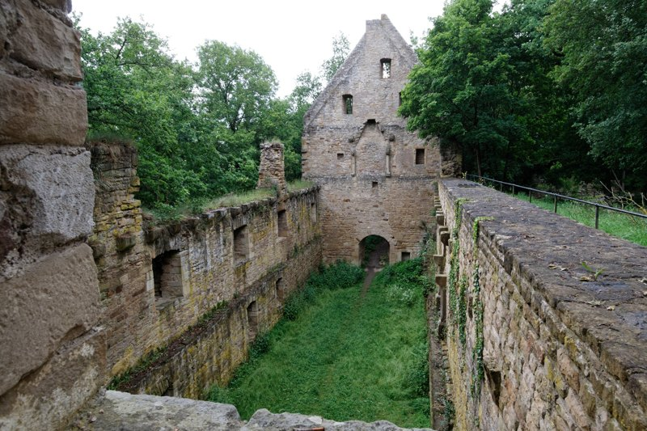
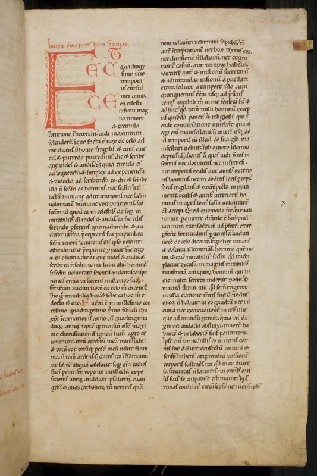
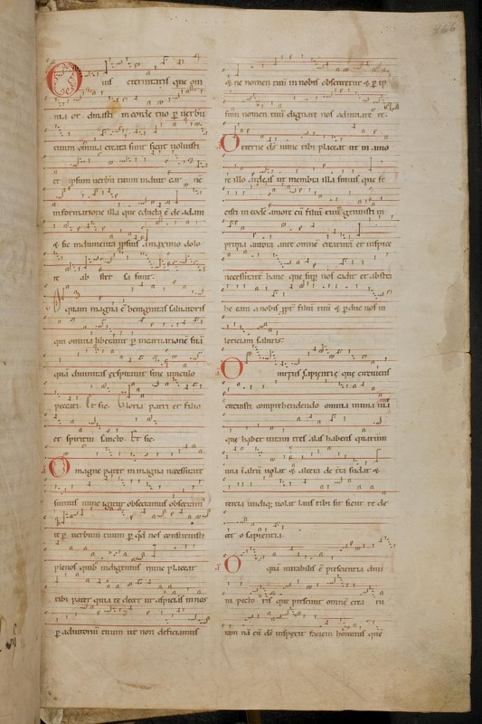
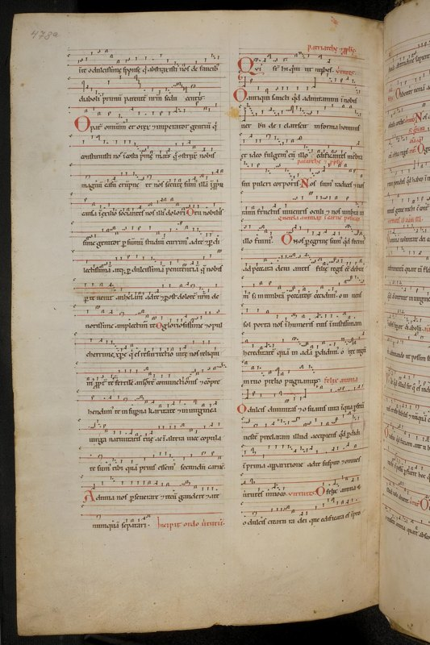

*Hildegard von Bingen* was born in 1098, probably at Bermersheim vor der Höhe near Alzey in Rheinhessen, and died on 17 September 1179 in the convent she had founded on the Rupertsberg, opposite Bingen at the confluence of the Nahe and the Rhine. She is remembered above all as a visionary theologian, a composer and a writer on medicine and the natural world, but she also stands at the origin of two of the most original image cycles of twelfth-century Europe: the thirty-five miniatures of the Rupertsberg *Scivias* and the ten full-page visions of the *Liber Divinorum Operum* preserved at Lucca. Neither cycle was painted by her own hand in any demonstrable sense, and the second was executed some forty years after her death, yet both translate into pictures a body of visions that she described, interpreted and, in all likelihood, had a decisive voice in shaping. Her last months were overshadowed by an interdict imposed on her community by the cathedral chapter of Mainz in 1178, after she had allowed an excommunicated nobleman to be buried in the convent cemetery; the ban was lifted only in March 1179, a few months before her death.

## Family Origins and Early Life

Hildegard was the youngest of the ten children of Hildebert of Bermersheim and his wife Mechthild, a family of the free lower nobility with lands in Rheinhessen. Her two hagiographers, the monks Gottfried and Theoderic, present her dedication to religious life as the offering of a tithe, the tenth child given to God, a motif that should be read as much as a hagiographic topos as a family decision. The same sources and Hildegard's own later account place the beginning of her visions in early childhood: she describes seeing a light so bright that her soul trembled when she was in her third year, and she insists that throughout her life the visions came to her awake and in full possession of her senses, not in sleep or ecstasy. The chronic illnesses that accompanied them recur throughout her letters and the *Vita*.

At an early age, traditionally given as eight, she was placed in the care of *Jutta von Sponheim*<a href="/endnotes.html#fn-jutta" class="footnote">1</a>, a young noblewoman of the comital house of Sponheim who had chosen an enclosed religious life. On 1 November 1112 Jutta, Hildegard and a third girl were enclosed in a cell attached to the Benedictine monastery of Disibodenberg, on the Nahe, which was then being re-founded by the archbishop of Mainz. The modern discovery of a *Vita Juttae* has made it clear that this was not a tiny anchorhold but the nucleus of a female community that grew steadily under Jutta's direction. There Hildegard learned to read the Latin Psalter and the liturgy, and through the monk Volmar, who became her teacher, confidant and secretary, she gained access to the library and learning of the male house. Her Latin always remained idiosyncratic, and she relied throughout her life on secretaries to correct the grammar of what she dictated, but the range of biblical, patristic and natural-philosophical knowledge in her works shows a far wider formation than her own protestations of being an "unlearned woman" admit.

When Jutta died in 1136 the nuns elected Hildegard as their *magistra*. She was then thirty-eight years old and, by her own account, had disclosed her visions to almost no one except Jutta and Volmar.

## Disibodenberg, Rupertsberg and Eibingen

The decisive turning point came in 1141, when, according to the preface of the *Scivias*, a fiery light from the open heavens poured through her brain and she was commanded to "say and write" what she saw and heard. With Volmar's help, and with the support of the young nun Richardis von Stade<a href="/endnotes.html#fn-richardis-von-stade" class="footnote">2</a>, she began the *Scivias*, which occupied her for about ten years. During those years her reputation grew rapidly, and the number of women seeking to join her community outgrew the space available at Disibodenberg.

<figure>
  
  <figcaption>Disibodenberg, ruins of the lay brothers' building and hospice, fourteenth century, from the later Cistercian phase of the abbey. Photo: E-W / Wikipedia, <a href="https://commons.wikimedia.org/wiki/File:Disibodenberg_Hospiz_3.jpg">original</a>, <a href="https://creativecommons.org/licenses/by-sa/3.0/de/legalcode">CC BY-SA 3.0 DE</a>.</figcaption>
</figure>

Around 1147 Hildegard announced that she had been instructed in a vision to move her nuns to the Rupertsberg, an abandoned site associated with the cult of the local saint Rupert. The plan met with strong opposition from Abbot *Kuno of Disibodenberg*<a href="/endnotes.html#fn-kuno-disibodenberg" class="footnote">3</a>, who stood to lose both the prestige and the dowries attached to the women's community. Hildegard fell gravely ill, presenting the illness as a sign of divine displeasure at the delay; with the backing of Archbishop Henry of Mainz and the help of noble families, including that of Richardis, the community moved around 1150. The early years at the Rupertsberg were difficult, and several nuns left; the material and legal separation from Disibodenberg was settled only in 1155 and confirmed by Archbishop Arnold of Mainz in 1158. In 1163 Frederick Barbarossa granted the convent an imperial charter of protection.

<figure>
  
  <figcaption>After Caspar Scheuren, <em>The Ruins of Disibodenberg on the Nahe</em>, after a lithograph published in 1834, between 1834 and 1900. Oil on canvas, 21.7 × 27.9 cm. Formerly on the art market (Karl &amp; Faber, Munich). Image: public domain, via Wikimedia Commons.</figcaption>
</figure>

In 1165 Hildegard acquired the former Augustinian house at Eibingen, on the opposite bank of the Rhine above Rüdesheim, and established there a second community, which she visited regularly by boat. Between about 1158 and 1171 she also undertook a series of preaching journeys, unprecedented for a woman of her time, which took her along the Main, the Rhine and into Swabia, addressing clergy and laity at Trier, Cologne, Mainz, Würzburg, Bamberg and elsewhere.

Neither of her houses survives in its medieval form. Disibodenberg passed to the Cistercians in 1259 and was abandoned after the Reformation; its ruins, which date mostly from the later Middle Ages, still stand on the hill above the confluence of the Nahe and the Glan. The Rupertsberg was destroyed by Swedish troops in 1632 during the Thirty Years' War, and the Eibingen convent, to which the surviving nuns withdrew, was dissolved in 1814; its church became the parish church of Eibingen, where Hildegard's relics are now kept in a nineteenth-century shrine. The present Abbey of St Hildegard above Eibingen was built in 1900–1904 for a restored Benedictine community, which in the twentieth century played a decisive role in the preservation of her pictorial legacy.

## Ecclesiastical and Secular Patronage

The authority that allowed Hildegard to write, travel and found communities rested on a sequence of carefully sought endorsements. In 1146 or 1147 she wrote to *Bernard of Clairvaux*<a href="/endnotes.html#fn-bernard-of-clairvaux" class="footnote">4</a>, asking whether she should speak openly of her visions; his reply, brief and cautious, nonetheless encouraged her. At the synod held at Trier in the winter of 1147–1148, Archbishop Henry of Mainz brought her case before *Pope Eugenius III*<a href="/endnotes.html#fn-eugenius-iii" class="footnote">5</a>, who sent envoys to Disibodenberg to obtain a portion of the *Scivias* then in progress. According to the *Vita*, the pope read from it before the assembled prelates and wrote to Hildegard authorising her to continue. Whatever the exact course of events, this papal approval became the cornerstone of her public role and was invoked repeatedly in later years.

Her relationship with *Frederick Barbarossa*<a href="/endnotes.html#fn-barbarossa" class="footnote">6</a> was more complex. She seems to have met him at the imperial palace of Ingelheim in the mid-1150s, and the emperor's charter of 1163 placed the Rupertsberg under his protection. Yet when Frederick supported a succession of antipopes against Alexander III, Hildegard wrote to him in increasingly severe terms, comparing him to a child and a madman and warning him of divine judgment, without the imperial protection of her house being withdrawn.

Beyond these great names, her support came from the regional nobility and clergy of the Rhineland: the families who placed their daughters in her communities and endowed them with land; the archbishops of Mainz, on whom both Disibodenberg and the Rupertsberg depended; and a network of abbots, abbesses, bishops and lay rulers who wrote to her for counsel. Her surviving correspondence, some three hundred letters, many of them revised for a collected edition at the end of her life, reaches from Henry II of England and Eleanor of Aquitaine to the Byzantine empress Bertha-Irene, and from Pope Anastasius IV to obscure parish priests. It was this network, rather than direct commissions, that made her visionary books desirable and ensured their copying in cathedral and monastic libraries.

## The Visionary Trilogy and Its Manuscripts

Hildegard's theological work is concentrated in three large visionary books. The *Scivias* ("Know the Ways"; see the page on <a href="/Content/Codex/Scivias-of-Hildegard-of-Bingen.html">the Scivias of Hildegard of Bingen</a>), written between 1141 and about 1151, sets out in twenty-six visions the history of salvation from creation to the Last Judgment. The *Liber Vitae Meritorum*, written between 1158 and 1163, presents a cosmic figure of a man surveying the world and a sequence of dialogues between thirty-five pairs of vices and virtues. The *Liber Divinorum Operum* (see the page on <a href="/Content/Codex/Liber-Divinorum-Operum.html">the Liber Divinorum Operum</a>), composed between 1163 and about 1174, unfolds in ten visions a theology of creation in which the human being is understood as the microcosm of the universe.

Only the first and the third of these were illustrated in the Middle Ages, and each survives in a single illuminated witness of primary importance. The *Scivias* cycle was preserved in the so-called Rupertsberg codex, a manuscript of 235 leaves with thirty-five miniatures, produced at Hildegard's convent probably in the last decade or so of her life. Long kept at Eibingen and later in the Landesbibliothek at Wiesbaden (Hs. 1), it was sent to Dresden for safekeeping in 1945 and disappeared at the end of the war. Its appearance is known today from black-and-white photographs taken before the war and, above all, from the hand-painted copy made on parchment by the Benedictine nuns of the Abbey of St Hildegard at Eibingen between 1927 and 1933, which reproduces the lost originals with remarkable fidelity in format, colour and gold and silver leaf. The colour images that circulate today almost always derive from this copy.

The *Liber Divinorum Operum* survives in a text manuscript closely tied to Hildegard's own workshop, Ghent, University Library, Ms. 241, which carries corrections made at the Rupertsberg in her lifetime, but its only illuminated copy is Lucca, Biblioteca Statale, Ms. 1942. This manuscript, written and painted probably in a Rhenish scriptorium in the second or third decade of the thirteenth century, contains ten full-page miniatures, one for each vision, and an author portrait showing Hildegard receiving the vision with her secretary at her side. It came to Lucca from the library of the Clerics Regular of the Mother of God, whose holdings passed to the state library after the suppression of 1877, and it was first studied comprehensively by <a href="/scholars.html#masetti-anna-rosa-calderoni">Anna Rosa Calderoni Masetti</a> and Gigetta Dalli Regoli in 1973. Its cosmic figure of man with outstretched arms within the circles of the universe has become, in modern times, the single most reproduced image associated with Hildegard.

A third great manuscript, the *Riesencodex* or "Giant Codex" (Wiesbaden, Hochschul- und Landesbibliothek RheinMain, Hs. 2), was compiled at the Rupertsberg shortly after her death, around 1180–1190, as an authoritative collection of almost her entire output, including the *Scivias* text, the letters and the most complete record of her music. It contains no figurative miniatures, but its size, script and ornamented initials show the ambition with which her community set out to preserve her legacy. Spirited away from Wiesbaden in 1942 and recovered after the war, it is the most important single source for her work.

## Artistic Style and Visual Expression

The miniatures of the Rupertsberg *Scivias* belong to no established iconographic tradition. Instead of narrative scenes they present the visions as Hildegard describes them, image by image: a mountain of iron with a figure covered in eyes; a cosmic egg encircled by bands of fire, darkness and pure ether; the Church as a vast woman whose womb is a net filled with the faithful; a tower of virtues; the Trinity as a sapphire-blue human figure within concentric rings of silver and gold fire. The forms are flat and schematic, outlined in strong contour, set against grounds of colour or burnished metal, and often deliberately exceed the frames that contain them. Gold and silver leaf are used not only as decoration but as the bearers of meaning, signalling divine fire, light and the presence of the Living Light that Hildegard names as the source of her visions.

The images are intimately tied to the text. Each miniature precedes the description and the allegorical commentary of the vision it illustrates, and many details, such as the colours of particular figures or the number of their eyes and wings, make sense only when read against Hildegard's words. The opening miniature, a frontispiece of authorship, shows her seated within an architectural frame with tongues of fire descending on her head, writing on a wax tablet, while Volmar leans in through an opening in the wall to record or correct what she dictates. It is one of the most telling images of female authorship in the Middle Ages, and the Lucca *Liber Divinorum Operum* repeats its formula in a new form.

The Lucca miniatures, painted in a later and more fluid early-thirteenth-century manner, share the same principle of literal fidelity to the text. Large circular and cosmological diagrams dominate the cycle: the universe as a wheel held by the figure of divine Love, the human body set at the centre of the elements and the winds, the cycle of the seasons and of human labour. In most of them a small figure of Hildegard, seated at the lower edge of the page and looking upward, appears as the witness of the vision, a device that turns each composition into a record of revelation as well as a cosmological diagram.

## The Question of Authorship

The relationship between Hildegard and the images made from her visions has been debated for more than a century. Her own texts never mention pictures, and nothing in the sources records her as a painter. Some scholars have regarded the Rupertsberg miniatures as the independent work of illuminators who interpreted the text after it was complete; others, notably Madeline Caviness, have argued that Hildegard must have conceived or even sketched the compositions, since several details visible in the images are not described in the text and correspond to her characteristic way of seeing. The date of the Rupertsberg codex, placed by different scholars at intervals between the 1160s and the years immediately after her death, is crucial to the question and remains unresolved. In 1917 the historian of science Charles Singer drew attention to the resemblance between the radiating lights, fortified outlines and scintillating points of many miniatures and the visual aura of migraine, an observation that has often been used as an argument for the visions themselves rather than for the authorship of the images.

For the Lucca codex the problem is different, since it was painted decades after her death; but its fidelity to the text and its distinctive author images suggest that it depends on a model produced at the Rupertsberg, perhaps a now-lost illustrated exemplar. On the present site Hildegard is therefore treated not as a painter but as the conceiving author whose descriptions, and very possibly direct instructions, determined the programmes of both cycles.

## Music and the Ordo Virtutum

Hildegard's musical output, gathered under the title *Symphonia armonie celestium revelationum*, comprises some seventy-seven liturgical chants, antiphons, responsories, sequences and hymns, many dedicated to the Virgin, the Holy Spirit, Saint Ursula and her companions, and the local saints Rupert and Disibod. They survive mainly in two manuscripts: a codex sent around 1175 to the Cistercian monks of Villers and now preserved at the Benedictine abbey of Dendermonde, and the *Riesencodex*. Her melodies are distinguished by wide ranges and soaring melismatic lines that differ markedly from the conventional chant of her time.

<figure class="figure--audio">
  <audio controls preload="none">
    <source src="/assets/audio/hildegard/o-frondens-virga.mp3" type="audio/mpeg" />
  </audio>
  <figcaption>Hildegard von Bingen, <em>O frondens virga</em>, antiphon to the Virgin from the <em>Symphonia</em>. Recording: Hildegard of Bingen / user:Makemi, CC BY-SA 3.0, via Wikimedia Commons.</figcaption>
</figure>

The *Ordo Virtutum*, a sung drama in which the Virtues contend with the Devil for the soul of a human being, is the earliest surviving morality play with music and the only one of its kind attributed to a known author of the twelfth century. Its personifications, sharing the language and imagery of the visionary books, offer a close parallel to the pictorial personifications of the *Scivias*.

## Reception, Canonisation and Legacy

Even before her death, the Rupertsberg community began to assemble the materials for her cult. The *Vita*, begun by Gottfried of Disibodenberg and completed by Theoderic of Echternach, incorporates autobiographical passages dictated by Hildegard herself. A canonisation process was opened under Gregory IX in 1227–1233 but never completed, and for centuries she was venerated locally as a saint and included in the Roman Martyrology without formal canonisation. Benedict XVI extended her liturgical cult to the universal Church by an equipollent canonisation on 10 May 2012 and declared her a Doctor of the Church on 7 October of the same year, one of only four women to hold that title.

A visual witness to her early cult survives in the Rupertsberg antependium, an altar frontal of red silk embroidered in gold, silver and coloured silks around 1210–1230 and now in the Royal Museums of Art and History in Brussels. Among the saints around Christ in majesty, Hildegard appears with a halo, holding a church and a book, beside Rupert and Martin, while the nuns of the community, each named by an inscription, kneel along the lower border. It is the only object of the medieval furnishings of the Rupertsberg known to survive.

Her later reputation passed through phases of neglect and rediscovery. Late-medieval readers knew her chiefly as a prophetess through the anthology compiled by Gebeno of Eberbach in the 1220s, the *Speculum futurorum temporum*. The nineteenth-century edition of her works in Migne's *Patrologia Latina*, the founding of the Eibingen abbey and the twentieth-century work of its nuns, who copied the *Scivias* miniatures and edited her texts, laid the foundations for the modern study of her thought, music and images. Since the 1980s she has become one of the most widely studied figures of the Middle Ages, and the images of the Rupertsberg and Lucca manuscripts, often detached from their textual context, have entered general visual culture.

## Catalogue Entry

### Scivias: Hildegard Receiving the Vision (Rupertsberg codex, fol. 1r)

<figure>
  
  <figcaption>Rupertsberg, illuminator working for Hildegard of Bingen, <em>Hildegard receiving the vision, with Volmar</em>, opening miniature of the <em>Scivias</em>, fol. 1r of the Rupertsberg codex, c. 1165–1180. Formerly Wiesbaden, Landesbibliothek, Hs. 1 (lost since 1945); reproduced from the hand-painted copy made at the Abbey of St Hildegard, Eibingen, 1927–1933. Image: public domain, via Wikimedia Commons.</figcaption>
</figure>

The miniature that opens the Rupertsberg *Scivias* is the most frequently reproduced image of Hildegard and one of the best-known representations of authorship in medieval art. It stands at the head of the *Protestificatio*, the declaration in which Hildegard records that in 1141, when she was forty-two years and seven months old, a fiery light of great brilliance came from the open heaven and poured into her whole mind, and that she was commanded to write what she saw and heard. The picture translates that statement into a scene, and in doing so presents the entire book as the record of a revelation rather than as a work of learning.

Hildegard sits in the centre of the composition under a round arch, framed as if in a small sanctuary. She is dressed in the black habit of a Benedictine nun, her veil drawn close around the face, and her feet rest on a low footstool, the conventional attribute of an enthroned figure. Five tongues of red flame descend from the upper edge of the arch and spread over her head, recalling the tongues of fire of Pentecost and making visible the "fiery light" of the text. Her eyes are open: the image corresponds to her repeated insistence that she received her visions awake and in full possession of her senses, not in sleep or ecstasy.

On her knees she holds a wax tablet in a red frame and a stylus, with which she appears to write or to draw. The detail has been much discussed. In the text Hildegard says that she spoke and wrote what she saw, and the tablet has been read both as the instrument with which she noted down her words and as evidence that she sketched the forms of the visions, a hypothesis that supports the view that she had a direct hand in the conception of the miniatures.

At the right, in a narrow building separated from Hildegard's space by a column, stands the monk Volmar, her teacher and secretary. He leans his head through a gap in the wall to look at her, and holds a book or a gathering of parchment leaves. The composition clearly distinguishes the two roles: Hildegard receives and records the vision, Volmar takes down and corrects the text. The wall between them expresses the enclosure of the nun and, at the same time, the closeness of a collaboration that lasted more than thirty years, until Volmar's death in 1173.

The architecture that frames the scene is not a real building but an emblematic one. Two towers with arched windows and red domes flank a central gable whose roof is covered with grey, scale-like tiles; the whole is enclosed in a broad frame painted in imitation of a moulded border. Such compressed architectural settings were common in Romanesque book painting to signify a church or monastery, and here they evoke the convent of the Rupertsberg as the place of revelation.

The style is that of the whole Rupertsberg cycle: flat areas of strong colour, firm black contours, a gold ground enlivened by fine stippling, and an almost complete absence of modelling. The drapery is reduced to a few curved folds and wavy hems, and the faces to a small number of lines. The effect is less narrative than iconic, and the miniature works as a seal of authenticity placed at the threshold of the book.

It should be remembered that the image reproduced here is the copy painted by the nuns of Eibingen between 1927 and 1933, made from the original before its loss in 1945. Comparison with the black-and-white photographs of the original shows that the copyists followed the forms and the layout with great care, but colour values, the effect of the gold and silver, and the fine detail of the brushwork can no longer be checked against the lost manuscript.

The formula of this miniature was taken up some decades later in the Lucca *Liber Divinorum Operum*, where Hildegard appears again at the opening of the book receiving the vision, with her secretary at her side, and then as a small seated witness at the edge of several visions. Through these images the idea of Hildegard as an inspired author, rather than a learned writer, became fixed in the visual memory of her work.

### Scivias I.3: The Cosmos as an Egg (Rupertsberg codex, fol. 14r)

<figure>
  
  <figcaption>Rupertsberg, illuminator working for Hildegard of Bingen, <em>The Cosmos as an Egg</em>, <em>Scivias</em> I.3, fol. 14r of the Rupertsberg codex, c. 1165–1180. Formerly Wiesbaden, Landesbibliothek, Hs. 1 (lost since 1945); reproduced from the hand-painted copy made at the Abbey of St Hildegard, Eibingen, 1927–1933. Image: public domain, via Wikimedia Commons.</figcaption>
</figure>

The third vision of the first book of the *Scivias* describes the universe in the form of a great egg-shaped instrument, narrow at the top, broad in the middle and narrowing again at the bottom. The miniature that illustrates it is one of the most original cosmological images of the twelfth century, and it shows clearly the principle that governs the Rupertsberg cycle: the painter does not invent a scene, but follows the vision as Hildegard describes it, layer by layer.

The outermost zone of the egg is a ring of bright fire, painted in gold with red contours so that the flames seem to move. At its top shines a large red star, the sun in Hildegard's text, surmounted by three smaller lights. Beneath the fire lies a dark zone, here painted in deep red-brown, in which red flickers and white clusters can be seen: in the text this is a shadowy fire that sends out storms, hail and lightning, and its position directly under the bright fire makes it an image of divine punishment held in check by divine order.

Within it lies a broad blue field strewn with stars, the pure ether, with the moon and a pale orb near the top. At the very centre sits a small globe of earth, surrounded by bands of wavy lines representing the waters and the moist air that, in Hildegard's description, envelop and sustain it. The relative sizes are not those of nature but of meaning: the earth, the place of human life, is small and fragile at the heart of an immense, ordered structure.

Around the egg are the winds. Small heads, grey at the left and at the bottom, red at the right, blow streams of breath towards the centre, as in the wind-heads of classical and medieval world maps. Hildegard interprets them as the forces that keep the elements in motion and, at the same time, as the powers of good and evil that act upon the world, so that the cosmological diagram is also a moral one.

The egg image does not derive from earlier pictures. Hildegard combines a classical idea, known from Latin cosmological writers, of the universe as an egg with its shell and layers, with her own visionary description, and the miniature turns the result into a strict, almost heraldic design. The shape, deliberately pointed at the top, extends beyond the inner frame of the page and is set against a second starry ground, so that the cosmos appears to float in a still larger space.

The colours are carefully chosen. Gold is reserved for the outer fire and the stars, the blue of the ether is a dense, saturated tone, and the dark band is painted in a near-black red that contrasts with both. The white clusters within it, small and regularly spaced, give the surface a texture that is decorative but also, according to the text, meaningful, since they correspond to the hail and storms that issue from the dark fire.

The vision of the cosmic egg forms the background for the later and more elaborate cosmological visions of the *Liber Divinorum Operum*, in which the universe becomes a wheel and the human being is placed at its centre. The comparison between the Rupertsberg egg and the Lucca wheel shows how Hildegard's conception developed over twenty years: from a cosmos centred on the earth and its elements to a cosmos centred on humanity as its microcosm.

### Scivias I.6: The Choirs of Angels (Rupertsberg codex, fol. 38r)

<figure>
  
  <figcaption>Rupertsberg, illuminator working for Hildegard of Bingen, <em>The Choirs of Angels</em>, <em>Scivias</em> I.6, fol. 38r of the Rupertsberg codex, c. 1165–1180. Formerly Wiesbaden, Landesbibliothek, Hs. 1 (lost since 1945); reproduced from the hand-painted copy made at the Abbey of St Hildegard, Eibingen, 1927–1933. Image: public domain, via Wikimedia Commons.</figcaption>
</figure>

The sixth vision of the first book is devoted to the nine orders of angels, and its miniature is one of the most striking pages of the Rupertsberg codex. Instead of the ranks of angels arranged in registers, as in the heavenly hierarchies of Byzantine and Western art, the painter presents them as a great disc of concentric rings, filling almost the whole page and spreading beyond its frame.

The text describes the angelic hosts as arranged in the form of a crown. The two outer rings, here filled with winged angels with haloes, their wings coloured in pale blue, pink, green and white, correspond to the angels and archangels, the orders closest to human beings. The next five rings, composed of rows of heads and of bands of colour, represent the Virtues, the Powers, the Principalities, the Dominations and the Thrones, whose attributes Hildegard explains one by one in her commentary.

At the centre are the two highest orders, the Cherubim and the Seraphim. The Cherubim are painted as a ring of red figures covered with eyes, an image of the knowledge of God, and around them the Seraphim appear as forms of flaming gold and orange, burning with love. Their arrangement around an empty white circle at the centre is one of the most remarkable features of the composition: the place of God is not occupied by an image but left blank, as a pure light that cannot be represented.

The repetition of figures in each ring is not a sign of haste or simplification. Hildegard's commentary insists that the angels are innumerable and that each order shines with its own light, and the painter conveys this by multiplying faces and wings until they become a texture. The variations of colour from ring to ring, green faces, pale grey faces, white faces, a band of gold covered with fine red scrolls, give each order its own character within the regularity of the whole.

The broad gold band with fine red scrolling, placed between the outer and inner orders, has been read as a band of writing or of ornament imitating script. It reinforces the impression that the disc is not only an image but also a kind of diagram, to be read from the outside in, from the angels nearest to humanity to the burning centre of divine love.

The circle breaks through the rectangular frame of the page on three sides. This device, used repeatedly in the Rupertsberg codex, suggests that the vision exceeds the limits of the book and of the visible world. It also shows that the miniatures were planned with a clear sense of the page as a whole, and with a willingness to depart from the usual conventions of framed book illustration.

The image had a long afterlife in the twentieth century, when its circular, almost mandala-like design made it one of the emblems of the modern revival of interest in Hildegard. In its own context, however, it belongs firmly to twelfth-century monastic theology: the vision of the angelic choirs is followed in the text by a reflection on the place of human beings, who are called to take up the places left empty by the fallen angels.

### Scivias II.2: The Trinity (Rupertsberg codex)

<figure>
  
  <figcaption>Rupertsberg, illuminator working for Hildegard of Bingen, <em>The Trinity</em>, <em>Scivias</em> II.2, from the Rupertsberg codex, c. 1165–1180. Formerly Wiesbaden, Landesbibliothek, Hs. 1 (lost since 1945); reproduced from the hand-painted copy made at the Abbey of St Hildegard, Eibingen, 1927–1933. Image: public domain, via Wikimedia Commons.</figcaption>
</figure>

The second vision of the second book of the *Scivias* is Hildegard's vision of the Trinity, and its miniature is one of the simplest and most powerful images in the codex. Hildegard writes that she saw a most serene light, and within it a figure of a man the colour of sapphire, entirely glowing with a gentle, reddish fire; the serene light flowed through the glowing fire and the fire through the light, and both through the figure of the man, so that they formed one light in one power.

The painter translates this description into three concentric elements. The outer disc, painted in a pale silver tone with fine wavy lines, represents the serene light, which Hildegard interprets as the Father. Within it a smaller disc of concentric rings, in gold and orange with black contours, represents the glowing fire, the Holy Spirit. At the centre stands the sapphire-coloured figure, the Son, in a long robe, with both hands raised and the palms turned outward.

The gesture of the open hands has a double meaning. It is the ancient gesture of prayer, but it also shows the palms, and in Christian art the hands of Christ are often turned towards the viewer to show the marks of the Passion. Here no wounds are visible: the figure is the Son in his eternal relation to the Father and the Spirit, not the crucified Christ, and the gesture expresses presence and offering rather than suffering.

The figure is separated from the rings of fire by a thin silver outline that follows the contour of his body. This narrow band of light makes the figure seem to emerge from the fire and to be surrounded by the outer light at the same time, a visual equivalent of the mutual indwelling of the three persons described in the text. The rings of fire are interrupted around the figure, so that he appears to stand in an opening within them.

The colour blue for the Son, explicitly described by Hildegard as sapphire, has a long history in medieval symbolism, where the sapphire was associated with heaven and with the throne of God in the vision of Ezekiel. The silver of the outer light is today darkened and grey in many medieval manuscripts, and in the Eibingen copy it appears as a pale, slightly matt surface; in the original it probably shone with a cold metallic brilliance that contrasted with the warm gold of the inner fire.

The frame is among the richest of the cycle, with a red band enclosing a chain of white and gold palmettes and rings. Within it the composition is strictly centred and symmetrical, with nothing to distract from the figure and its rings of light. Its clarity explains why the miniature is often reproduced as an illustration of Hildegard's theology as a whole.

The image also illustrates well the relationship between text and picture that characterises the *Scivias*. Without the description, the miniature might be read simply as a Christ in glory; with it, each element takes on a precise meaning, and the picture becomes an exposition of the doctrine of the Trinity in visual terms, at a time when that doctrine was the subject of intense debate in the schools.

### Scivias II.5: Ecclesia and the Orders of the Church (Rupertsberg codex)

<figure>
  
  <figcaption>Rupertsberg, illuminator working for Hildegard of Bingen, <em>Ecclesia and the Orders of the Church</em>, <em>Scivias</em> II.5, from the Rupertsberg codex, c. 1165–1180. Formerly Wiesbaden, Landesbibliothek, Hs. 1 (lost since 1945); reproduced from the hand-painted copy made at the Abbey of St Hildegard, Eibingen, 1927–1933. Image: public domain, via Wikimedia Commons.</figcaption>
</figure>

The figure of Ecclesia, the Church personified as a woman, dominates the second book of the *Scivias*, and the miniature of the fifth vision is one of several in which she appears. Here she is shown as a colossal crowned figure, standing frontally and filling the whole height of the page, with tall golden forms rising like wings or flames on either side of her head and long golden sleeves falling at her sides.

Against her breast she holds a group of small figures. At the centre stands a maiden in a red tunic, the figure Hildegard describes as appearing in the dawn-red splendour that surrounds the Church from throat to breast: she is Virginity, the "flower in the heavenly Zion", and around her stand the virgins and those dedicated to God, shown in red, white and grey. The image expresses the special place that Hildegard, herself the head of a community of virgins, gave to consecrated virginity within the Church.

The vision as a whole describes the three orders of the Church: those living under the vows of virginity and the religious life, those in the clergy, and the laity in the world. The miniature condenses this structure into the body of Ecclesia, whose different zones correspond to different states of life, and it uses position and colour to establish a hierarchy among them, with the virgins held closest to her heart.

Below the waist, Ecclesia's body is formed by a column of pale white and grey shapes outlined in black, resembling stones or rocks. The motif can be related to the biblical image of the Church as a building founded on rock and to the white splendour that, in Hildegard's text, surrounds parts of the figure; it also gives the figure the appearance of a tower or column, an image of stability and permanence.

The figure is painted in the same flat, outlined manner as the other miniatures of the cycle, but with an unusually large scale in relation to the page. The crown, a broad golden diadem with pearl-like ornament, marks Ecclesia as queen and bride of Christ, a role she plays throughout the second book of the *Scivias*. The golden forms that rise around her head have no exact counterpart in conventional iconography and are typical of the way the Rupertsberg painter translated Hildegard's descriptions of light into concrete shapes.

The image has often been compared with other personifications of Ecclesia in twelfth-century art, especially in the Rhineland, where the theme of the Church as bride and mother was widely developed. Hildegard's Ecclesia, however, is distinguished by her monumental, almost architectural form and by the way in which she contains the faithful in her own body, an idea that the modern title "the mystical body" given to this miniature expresses well.

The page also reflects Hildegard's position as a woman writing about the Church. Her Ecclesia is a powerful, maternal and queenly figure, the bearer and protector of the faithful, and the visual emphasis on the virgins at her breast reflects both the theology and the institutional reality of the female monastic communities that Hildegard led.

### The Riesencodex (Wiesbaden, Hochschul- und Landesbibliothek RheinMain, Hs. 2)

<figure>
  
  <figcaption>Rupertsberg, <em>Opening of the Scivias, with the Protestificatio</em>, from the Riesencodex, fol. 3r, c. 1180–1190. Ink and red pigment on parchment. Wiesbaden, Hochschul- und Landesbibliothek RheinMain, Hs. 2. Image: Hochschul- und Landesbibliothek RheinMain, Wiesbaden, <a href="https://creativecommons.org/licenses/by/4.0/">CC BY 4.0</a>.</figcaption>
</figure>

The so-called Riesencodex, the "Giant Codex", is the largest and most complete manuscript of Hildegard's works and the most important single witness to her legacy. It was written at the Rupertsberg in the years immediately after her death, around 1180–1190, possibly with the involvement of her last secretary, the monk Guibert of Gembloux, with the deliberate aim of collecting her writings in an authoritative form. Its dimensions, about 46 by 30 centimetres, and its weight of some fifteen kilograms, explain its name.

The codex contains almost the entire corpus: the three visionary books, the *Scivias*, the *Liber Vitae Meritorum* and the *Liber Divinorum Operum*; a large selection of the letters, many in the revised form prepared for a collected edition; the *Vita* written by Gottfried and Theoderic; minor theological works, including the *Lingua ignota* with its invented vocabulary; and, at the end, the most complete collection of her music. The scientific and medical works, the *Physica* and the *Causae et curae*, are not included, which has contributed to doubts about the transmission of the medical writings in the form in which they are known today.

Unlike the Rupertsberg *Scivias*, the Riesencodex has no figurative miniatures. Its decoration consists of red rubrics and initials, ranging from simple red letters marking the beginnings of sections to larger initials at the openings of the main works. The page reproduced here, the beginning of the *Scivias*, shows the most elaborate type: a tall red E, its shaft filled with a wavy line and its arms with fine foliate scrolls, followed by the letters CCE in red capitals, under the rubric *Incipit prima pars libri Scivias*.

The text that begins here is the *Protestificatio*, the same declaration that the opening miniature of the Rupertsberg *Scivias* illustrates: "Behold, in the forty-third year of my temporal course, when I was gazing with great fear and trembling attention at a heavenly vision, I saw a great splendour in which a voice from heaven spoke to me." Read beside that miniature, the page shows the two ways in which the Rupertsberg community presented the same moment of revelation: once as an image, once as a solemn text set off by an initial.

The script is a regular, compact late Romanesque minuscule, arranged in two columns and written by several scribes, whose hands have been distinguished in the study of the manuscript. The page layout is strictly functional, designed to accommodate a very large quantity of text in a single volume, and the margins carry later notes in different hands.

The first leaf of the codex, preceding the *Scivias*, records part of the later history of the manuscript and of the convent. It bears a Latin note dated 1489 concerning an inspection of the relics of Saint Hildegard at the Rupertsberg and, below it, a German account of the events of 1631–1632, when the Swedish troops of Gustavus Adolphus occupied the region and the convent was abandoned. The book thus preserves, on its opening leaf, a trace of the catastrophe that led to the destruction of the Rupertsberg.

<figure>
  
  <figcaption>Rupertsberg, <em>Antiphons from the Symphonia</em> (O vis eternitatis, O quam magna est benignitas, O magne Pater, O eterne Deus, O virtus Sapientie, O quam mirabilis), from the Riesencodex, fol. 466r, c. 1180–1190. Wiesbaden, Hochschul- und Landesbibliothek RheinMain, Hs. 2. Image: Hochschul- und Landesbibliothek RheinMain, Wiesbaden, <a href="https://creativecommons.org/licenses/by/4.0/">CC BY 4.0</a>.</figcaption>
</figure>

The musical section, which occupies the last leaves of the manuscript, is the reason why the Riesencodex is indispensable for the study of Hildegard's songs. The page shown here opens a series of antiphons addressed to God the Father, to the eternal Word and to Wisdom, among them *O vis eternitatis*, *O magne Pater*, *O eterne Deus* and *O virtus Sapientie*. The text is written below staffs of fine ruled lines, one of which, the line of F, is drawn in red, and the melodies are notated in German neumes placed on the lines, with clef letters at the beginning of each staff.

The notation allows the melodies to be read precisely, and modern performances of Hildegard's music, including the recording of *O frondens virga* presented above, rest largely on this manuscript and on the earlier codex sent to the monks of Villers, now at Dendermonde. The two sources differ in the number and order of the pieces and occasionally in their melodic details, and the Riesencodex is generally regarded as the later and more systematic collection.

<figure>
  
  <figcaption>Rupertsberg, <em>End of the Symphonia and beginning of the Ordo Virtutum</em>, from the Riesencodex, fol. 478v, c. 1180–1190. Wiesbaden, Hochschul- und Landesbibliothek RheinMain, Hs. 2. Image: Hochschul- und Landesbibliothek RheinMain, Wiesbaden, <a href="https://creativecommons.org/licenses/by/4.0/">CC BY 4.0</a>.</figcaption>
</figure>

The Riesencodex is also the only manuscript that preserves the *Ordo Virtutum* with its music. On this page the songs for virgins and widows end in the left column, and at its foot the red rubric *Incipit ordo virtutum* announces the beginning of the drama. In the right column the first speakers are identified by red rubrics placed within the text: the Patriarchs and Prophets, who ask "Who are these, who are like clouds?", the Virtues, who answer them, the lament of the souls imprisoned in the flesh, and the Happy Soul, who sings *O dulcis divinitas*.

The arrangement of the page shows how the drama was conceived: not as a play with stage directions, but as a sequence of sung exchanges, each introduced by the name of the speaker in red. The same layout continues on the following leaves, where the struggle of the Virtues and the Devil for the soul unfolds. The page therefore documents, more directly than any description, the close relationship between Hildegard's visionary imagery, her music and the liturgical life of her community.

The history of the manuscript reflects that of the convents. It remained at the Rupertsberg until the destruction of 1632, passed with the nuns to Eibingen and, after the dissolution of 1814, to the ducal library of Nassau at Wiesbaden, from which the present state library descends. It survived the Second World War after a period of uncertain custody and has since been fully digitised, making the entire corpus of Hildegard's writings and music accessible in its earliest comprehensive form.

### Liber Divinorum Operum, Vision 1: Divine Love and the Author Portrait (Lucca, Biblioteca Statale, Ms. 1942)

<figure>
  
  <figcaption>Rhenish illuminator, <em>Divine Love (Caritas), with Hildegard, her secretary and a nun</em>, <em>Liber Divinorum Operum</em>, vision 1, c. 1210–1230. Tempera and gold on parchment. Lucca, Biblioteca Statale, Ms. 1942. Image: Biblioteca Statale di Lucca, Ms. 1942, World Digital Library (Library of Congress), no known copyright restrictions.</figcaption>
</figure>

The Lucca *Liber Divinorum Operum* opens with the most solemn of its ten miniatures, the vision in which Hildegard sees a figure of wondrous beauty in the midst of the southern air, whom the voice of the vision identifies as Divine Love, *Caritas*. The page is organised in two parts of unequal size: above, the theophany itself, on a burnished gold ground; below, a smaller panel that shows how the vision was received and written down.

The figure of Love stands frontally, with a red face and a red robe striped with gold, its hems and collar set with jewels. Above her own head rises a second head, that of a grey-haired and bearded old man, which Hildegard interprets as the goodness of the Godhead, without beginning and without end. The double head, unusual and at first sight strange, is a literal transposition of the text and becomes the hallmark of the Lucca cycle, returning in the second vision above the cosmic wheel.

From her shoulders spring two pairs of immense wings, painted in brown, blue and white feathers that sweep upward and then fall to the level of her knees. Where the upper wings curve inward, they end in two heads: an eagle at the left and a human face at the right. In the text these heads express the power of the divine vision and the reason with which humanity is endowed, and their placement at the extremities of the wings stresses that Love embraces both the heavenly and the human orders.

In her arms Love holds a small lamb, the Lamb of God, and with her feet she treads on a dark, scaly creature with a monstrous head, around which a serpent is coiled. The image unites in one figure the themes of Incarnation, sacrifice and victory over evil: Love bears Christ and crushes the ancient enemy, in a formula that recalls both the Woman of the Apocalypse and the traditional image of Christ trampling the beasts.

The lower panel, set like a predella below the frame, is the author portrait of the manuscript. At the right sits Hildegard, with red streams of fire descending on her head from the miniature above, holding a pair of wax tablets; behind her stands a second nun. At the left, separated from her by a column, a monk writes at a desk. The figures are generally identified as Hildegard's secretary, the monk Volmar or his successor, and a nun of her community, often named as Richardis, though the latter identification is conventional rather than documented.

The scheme clearly derives from the opening miniature of the Rupertsberg *Scivias*, with its tongues of fire, wax tablet and secretary separated by architecture. The Lucca painter enlarges it into a three-figure scene and places it directly beneath the vision, so that the stream of fire visibly connects the theophany above with the visionary below. The page thus states the authority of the whole book before a single word of the text is read.

The style is that of the whole Lucca cycle: forms that are more supple and modelled than those of the Rupertsberg miniatures, a palette dominated by gold, deep red and blue, and a refined decorative vocabulary in the borders. The manuscript, measuring about 39 by 25.5 centimetres, is dated by the Library of Congress, which published its digitisation through the World Digital Library, between about 1210 and 1230.

### Liber Divinorum Operum, Vision 2: The Cosmic Wheel and the Universal Man (Lucca, Biblioteca Statale, Ms. 1942)

<figure>
  
  <figcaption>Rhenish illuminator, <em>The Cosmic Wheel and the Universal Man</em>, <em>Liber Divinorum Operum</em>, vision 2, c. 1210–1230. Tempera and gold on parchment. Lucca, Biblioteca Statale, Ms. 1942. Image: Biblioteca Statale di Lucca, Ms. 1942, World Digital Library (Library of Congress), no known copyright restrictions.</figcaption>
</figure>

The second vision of the *Liber Divinorum Operum* is the most celebrated image associated with Hildegard, and its miniature in the Lucca manuscript has become an emblem of medieval thought on the relationship between humanity and the cosmos. Painted some forty to fifty years after Hildegard's death, probably in a Rhenish scriptorium, it is the only surviving illustration of this vision and one of ten full-page miniatures that make the Lucca codex the sole illuminated witness of the work.

The composition is dominated by a great red figure, which Hildegard identifies in the first vision as divine Love, Caritas. Her head is surmounted by a second head, that of an old man with a beard, which represents the Godhead and its eternity. Only the upper part of her body, her arms and her feet are visible: with her arms she holds and embraces a vast circle, so that the whole created universe appears to rest within the embrace of divine love.

The circle is composed of concentric bands that correspond to the layers of the cosmos as Hildegard describes them: an outer ring of bright fire, painted red with flickering edges; a ring of black fire; a band of pure ether; a band of watery air; and, at the centre, a field of strong, white, luminous air, which surrounds and sustains the earth. Small dark clouds float in this white field, and animal heads placed around the rings, among them a leopard, a wolf, a lion and a bear, blow the winds that keep the cosmos in motion.

At the centre stands a naked man with arms outstretched, his body set in front of a dark red disc. Fine golden lines run from the edges of the circle to his head, hands and feet, and from the winds and planets to different parts of his body. The image illustrates the central theme of the work: the human being as the microcosm, whose body corresponds in its proportions and functions to the structure of the universe, and who is linked to every part of it by invisible forces.

The outstretched pose of the figure recalls the Vitruvian tradition of the human body inscribed in the circle, but here it has a theological rather than a mathematical meaning. The man is placed at the centre not because he dominates creation, but because creation was made for him and because he is bound to it in a relationship of mutual responsibility, an idea developed at length in Hildegard's commentary.

At the lower left, in a small arched niche, Hildegard herself is shown seated at a desk with an open book, looking up towards the vision. The device, repeated in several miniatures of the Lucca codex, makes her the witness of what is shown and links each image to the author portrait at the opening of the book. It is the clearest indication that the illuminator, though working decades after her death, understood the book as the record of a personal revelation.

The style of the Lucca miniatures differs markedly from that of the Rupertsberg *Scivias*. The forms are more modelled, the lines finer, the colours, especially the deep reds and browns, warmer and more nuanced, and the figures show the softer, more naturalistic manner of early thirteenth-century painting. The miniatures were first studied in depth by <a href="/scholars.html#masetti-anna-rosa-calderoni">Anna Rosa Calderoni Masetti</a> and Gigetta Dalli Regoli, and the astral and anatomical correspondences in the image of man as microcosm have been examined more recently by <a href="/scholars.html#bussagli-marco">Marco Bussagli</a>.

### Liber Divinorum Operum, Vision 4: The Earth, the Seasons and the Labours of Humanity (Lucca, Biblioteca Statale, Ms. 1942, fol. 38r)

<figure>
  
  <figcaption>Rhenish illuminator, <em>The Earth, the Seasons and the Labours of Humanity</em>, <em>Liber Divinorum Operum</em>, vision 4, fol. 38r, c. 1210–1230. Tempera and gold on parchment. Lucca, Biblioteca Statale, Ms. 1942. Image: Biblioteca Statale di Lucca, Ms. 1942, World Digital Library (Library of Congress), no known copyright restrictions.</figcaption>
</figure>

The fourth vision of the *Liber Divinorum Operum* returns to the cosmic wheel of the second and third visions, but shifts the attention from the human body to the earth and to human life upon it. Hildegard describes the earth at the centre of the spheres, divided into parts that change with the seasons, and links the cycle of the year with the activity of the soul in the body. The miniature translates this into one of the most attractive pages of the Lucca manuscript.

The outer structure is familiar from the earlier visions: a ring of red fire with flickering edges, a twisted band of black and red, a broad blue zone filled with wavy white lines representing the watery air, and an inner field of white, luminous air. Stars are scattered in the outer zones, and animal heads placed around the rings, among them a stag, a bear and a crab, blow winds in the form of fine white streams towards the centre.

The centre is occupied not by a human figure, as in the second and third visions, but by the earth itself, a small globe divided into four quarters of green, dark red, brown and grey. The division corresponds to the regions of the earth and to the four seasons, whose qualities, greening, heat, ripening and cold, Hildegard describes as they succeed one another under the influence of the sun and the winds.

Around the globe, set radially so that they must be read by turning the book, are small scenes of human activity: figures digging, pruning, sowing, reaping and gathering fruit, each beside a tree in a different state of growth, in leaf, in flower, laden with fruit or bare. The motif belongs to the long tradition of the labours of the months, but here the scenes are integrated into a cosmological diagram, so that agricultural work becomes part of the order of creation.

The juxtaposition of trees in different stages with labourers performing the corresponding work makes the seasonal cycle legible at a glance. In Hildegard's commentary it also has a moral dimension: as the earth bears fruit in due season through the influence of the elements, so the soul acts in the body and bears good or bad fruit according to the virtues it cultivates.

At the lower left, Hildegard appears again in a small arched niche, seated at a lectern and writing in an open book. Below the wheel, a hand emerging from the right holds a long white scroll, a device that recurs in several miniatures of the cycle and alludes to the divine voice that speaks to her and explains what she sees.

Compared with the cosmic egg of the *Scivias*, painted for Hildegard's own community some decades earlier, the miniature shows how much more articulated the image of the world had become in her later work, with the earth no longer a simple globe surrounded by the elements but the stage of human labour and moral choice, and how the thirteenth-century illuminator, in turn, gave that image a lively, almost narrative character.

### The Rupertsberg Antependium (Brussels, Royal Museums of Art and History)

<figure>
  
  <figcaption>Rupertsberg (?), <em>Antependium of the Rupertsberg</em>, c. 1210–1230. Red silk embroidered with gold and silver thread and coloured silks, c. 100 × 232 cm. Brussels, Royal Museums of Art and History. Photo (1976): KIK-IRPA, Brussels (Belgium), cliché G001135, <a href="https://creativecommons.org/licenses/by/4.0/">CC BY 4.0</a>.</figcaption>
</figure>

The altar frontal from the Rupertsberg is the only surviving object of the medieval furnishings of Hildegard's convent and one of the earliest images in which she appears as a saint. It was embroidered a generation or two after her death, probably between about 1210 and 1230, and it is generally regarded as a work made by or for the nuns of the Rupertsberg themselves. After the destruction of the convent in 1632 it followed the community to Eibingen and later left the Rhineland; it is now preserved in the textile collection of the Royal Museums of Art and History in Brussels.

The frontal, about one metre high and more than two metres wide, is made of deep red silk, dyed with an insect-derived carmine and probably imported from the eastern Mediterranean. On this ground the figures and ornament are worked in gold and silver thread, with details in coloured silks. The technique, in which the metal threads are laid on the surface and fixed with small stitches, produces the shining linear drawing that dominates the composition and that was intended to catch the light of the candles on the altar.

The centre is occupied by Christ enthroned in a pointed mandorla, blessing with his right hand and holding a jewelled book, between the letters alpha and omega and a scattering of stars. The inscription that runs around the mandorla, *Qui me diligitis, mea sit benedictio vobis*, "You who love me, may my blessing be upon you", addresses the community directly and turns the image of Christ in majesty into a promise to those who pray before the altar.

At Christ's right stand Saint Peter with his key and the Virgin, crowned as queen; at his left stand Saint Rupert, the patron of the convent, also crowned and holding a sceptre, and Saint Hildegard. She is shown veiled, with a halo, holding a model of a church in one hand and a book in the other: the founder of the community and the author of the visionary books, presented with the attributes of both roles. In the outer fields stand Saint John the Baptist, with a medallion of the Lamb of God, and Saint Martin as a bishop with crozier and book.

The lower part of the frontal is given to the people connected with the convent. Beneath the Virgin and Peter an archbishop lies prostrate, identified by the inscription as *Sifridus archiepiscopus*, Siegfried of Eppstein, archbishop of Mainz, on whom the Rupertsberg depended; beneath Rupert and Hildegard lies a duchess, *Agnes ducissa*. In the corners lie two further figures named in inscriptions, a man at the left, *Godefridus*, and *Adelheidis* at the right, often identified as an abbess of the convent. Along the lower border a row of small nuns kneels with raised hands, each originally identified by her name, facing the centre.

The composition is therefore a complete portrait of the community and its network of protection: the saints in heaven, the ecclesiastical and lay patrons on earth, and the nuns who prayed in the convent church. The presence of their names on the textile ensured that they would be remembered in the liturgy celebrated at the altar, a form of commemoration common in medieval female communities and one in which the women who made such textiles inscribed themselves into the object.

The image of Hildegard on the frontal is an important document of her early cult. Although her formal canonisation process, opened in the 1220s, was never completed, the frontal shows that within a few decades of her death the Rupertsberg already venerated her as a saint and placed her at the side of the convent's patron. It is also, together with the miniatures of the Lucca *Liber Divinorum Operum*, one of the first images in which Hildegard appears not as a recipient of visions but as a figure of authority in her own right.
