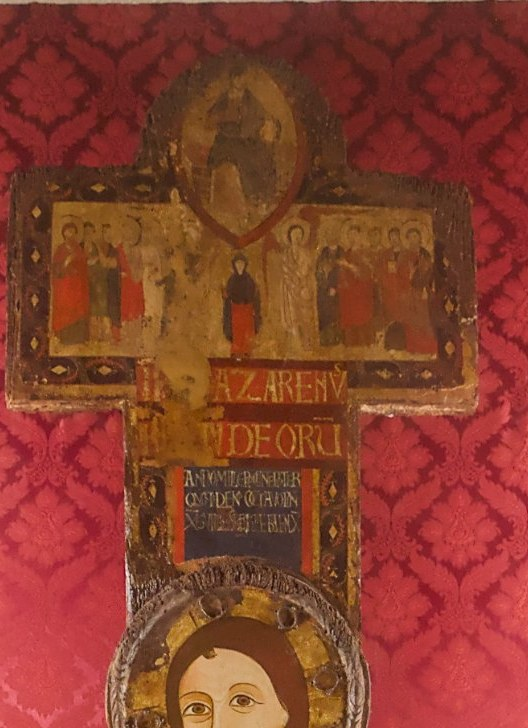
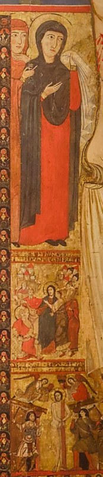
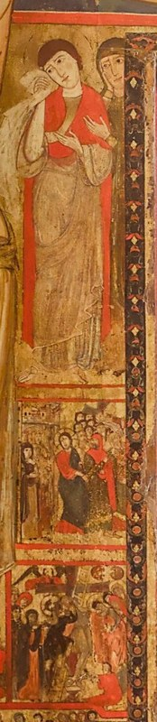
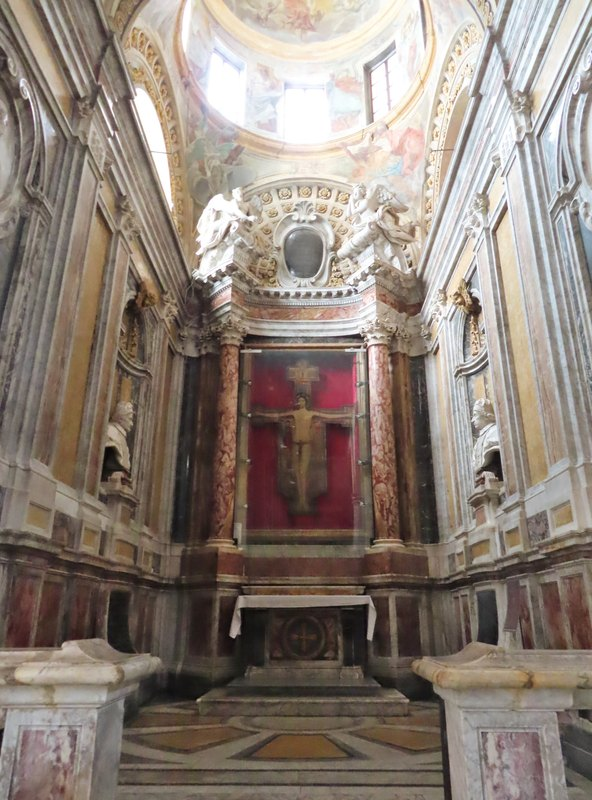
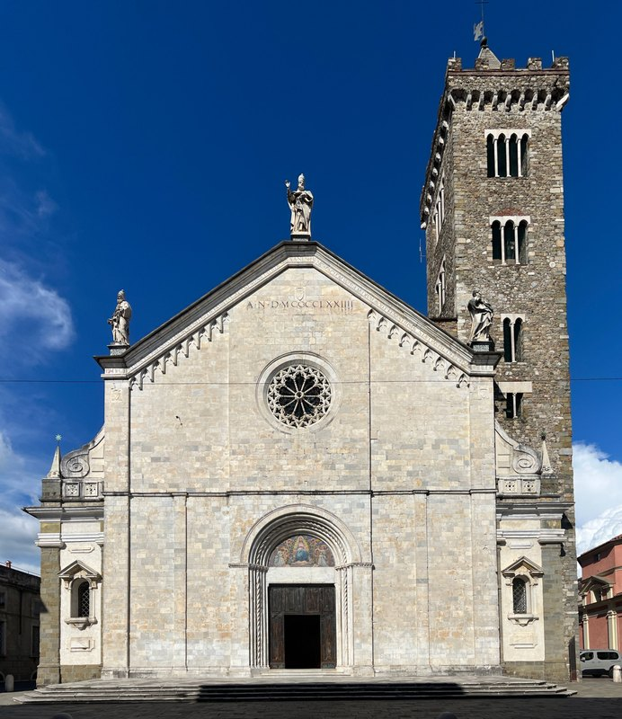
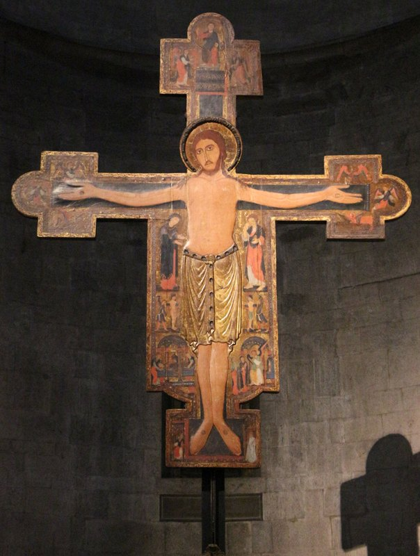

## A Painter Known from One Inscription

*Maestro Guglielmo* is known from a single work and a single line of verse. Below the titulus of the painted cross in the cathedral of Sarzana, on the Ligurian border of Tuscany, an inscription in hexameters reads *Anno milleno centeno ter quoque deno / octavo pinxit Guillielmus et hec metra finxit*, "in the year one thousand, one hundred, three times ten and eight, Guglielmo painted this and composed these verses". The cross is the earliest dated painted cross in the history of Western art.

Nothing else is known of him. No document records his birth, his family, his training, his other works or his death. The inscription tells us only that he was a painter and that he could write Latin verse, and that he wished both facts to be remembered. Everything else that has been written about his life is conjecture.

His importance comes from the date. The painted cross, a large wooden cross with the figure of Christ and scenes painted on it, hung above the altar or on the screen of the church, was the most important form of panel painting in central Italy in the twelfth and thirteenth centuries. Most early crosses are undated, and the Sarzana cross, fixed to 1138, is the anchor from which their chronology is built.

The present entry replaces an earlier version that misdescribed the cross and filled the gaps in the documents with invention: a family that dedicated him to religious life, the possible causes of his death, journeys to Rome or Venice. It also corrects several errors of fact. The ends of the arms show the prophets Isaiah and Jeremiah, not the Virgin and Saint John; the cimasa shows the Ascension; the Passion scenes are six and do not include a Crucifixion; and the living Christ with open eyes, the *Christus triumphans*, is the Western type of the period, not a Byzantine model.

The painter is also distinct from the sculptor Guglielmo who carved the pulpit of Pisa Cathedral between 1159 and 1162, now in the cathedral of Cagliari. The two artists share a common name and a Tuscan setting, but nothing else connects them.

The account that follows describes the cross and its inscription, its history from the twelfth century to the restoration of 1991–1998, the question of the repainting of the figure of Christ, the attributions proposed for Guglielmo and his place in the history of the painted cross. The catalogue then examines the cross part by part, its setting and a Lucchese cross for comparison.

The cross is also a rare witness to the self-awareness of a painter in the first half of the twelfth century. Most painted crosses of the period are anonymous; a few carry the name of a painter, and still fewer a date. That Guglielmo gave both, in verse and in a prominent place, sets his work apart from the anonymous production of his time.

The entry is based on the published literature on the cross, especially the studies connected with its restoration, and on the documents of its later history collected by Piero Donati. Where the literature is uncertain or divided, the entry says so; where it gives a hypothesis, the hypothesis is presented as such.

## The Cross and Its Programme

The cross measures 299 by 214 centimetres and is painted in tempera and gold on panel. Christ is shown alive, standing on the cross with his eyes open, his arms stretched straight along the crossbar, his body frontal, wearing a long loincloth knotted at the waist. This is the type of the *Christus triumphans*, Christ triumphant over death, which prevailed in Western painted crosses until the thirteenth century, when the suffering, dead Christ, the *Christus patiens*, took its place.

Above the head of Christ are the titulus, *Iesus Nazarenus Rex Iudeorum*, and the inscription with the date and the name of the painter. The cimasa, the top of the cross, shows the Ascension: Christ in a mandorla above the Virgin and the apostles. At the ends of the arms are the symbols of the Evangelists and the prophets Isaiah and Jeremiah, with scrolls quoting their prophecies of the Passion: *Sicut ovis ad occisionem ducetur*, "he shall be led as a sheep to the slaughter", and *Spiritus oris nostri Christus Dominus captus est in peccatis nostris*, "the breath of our mouth, Christ the Lord, was taken in our sins".

Beside the body of Christ, on the broad panel behind him, stand the mourners: the Virgin and a holy woman on the left, Saint John and a holy woman on the right. Below them, six small scenes tell the Passion and the Resurrection: on the left the Kiss of Judas, the Flagellation and the Holy Women at the Tomb; on the right the Way to Calvary, the Deposition and the Entombment. Inscriptions above each scene, now almost illegible, once explained them in verse.

The programme joins the image of Christ triumphant with the story of his suffering and his victory. The prophets announce the Passion, the scenes narrate it, the mourners lament it, and the Ascension above shows its end in glory. The cross is at once an icon of the living Christ and a narrative of the redemption.

The painted cross of this kind developed in central Italy from the late eleventh century. It replaced or accompanied the carved crucifix, and its broad panel behind the body of Christ, the *tabellone*, offered space for figures and scenes that a sculpted cross could not carry. The cross of Sarzana shows the type fully formed, with all its elements in place.

The living Christ of these crosses is not a Byzantine type. In Byzantine art of the eleventh and twelfth centuries the Crucifixion normally showed Christ dead, with closed eyes and bowed head. The open-eyed, upright Christ, the image of the triumph over death, belonged to the older Western tradition, which continued in Italy until the thirteenth century, when the Byzantine dead Christ was adopted by the painters of Pisa and Umbria.

The choice of the six scenes is significant. The Passion is told from the arrest to the burial, and the Holy Women at the Tomb add the announcement of the Resurrection; the Crucifixion is not shown as a scene because the whole cross is its image. The narrative surrounds the icon and explains it, and the Ascension at the top completes it.

The inscriptions are part of the programme. The titulus names Christ as king; the scrolls of the prophets quote the Scriptures that announced his Passion; the verses above the scenes, now almost lost, described them; and the inscription of the painter records the making of the work. Text and image together turn the cross into a book to be read as well as an image to be venerated.

## History of the Cross

The original destination of the cross is not recorded. The canon Ippolito Landinelli (1568–1629), historian of Sarzana, reported the tradition that it came from Luni, the ancient Roman town and seat of the bishops, but did not seem convinced, and stated that it first hung in the church of Sant'Andrea in Sarzana. Recent scholarship, following Piero Donati, considers Sarzana the more likely destination, since the cathedral of Luni was in decay by 1138 and the see was moving to Sarzana.

The first secure document dates from 25 June 1602, when an agreement between the cathedral chapter and the Cattani family, approved by Bishop Giovanni Battista Salvago, moved the cross from the wall above the sacristy door of Santa Maria to the Cattani chapel, dedicated to Saint John the Baptist. In 1712 the chapel passed to Cardinal Lorenzo Casoni, and in 1713 it was rebuilt in its present form.

Casoni commissioned from the Neapolitan painter Francesco Solimena (1657–1747) a canvas to protect the cross like a case. It showed Pope Saint Clement with Saints Philip Neri and Lawrence pointing to an oval carried by angels, in which the face of Christ on the cross could be seen; the rest of the cross was hidden. For more than two centuries the cross was thus visible only through its face.

The canvas was separated from the cross in the 1940s, and the cross was restored by the Opificio delle Pietre Dure of Florence between 1991 and 1998. The restoration revealed the full painting, studied its technique and confirmed that the figure of Christ had been entirely repainted. The cross now hangs in the chapel of the Crucifix, behind glass, against a red damask.

The move of the see from Luni to Sarzana was a long process. Luni, a Roman colony at the mouth of the Magra, declined through the early Middle Ages, threatened by malaria and by raids from the sea, and its bishops gradually transferred their residence and their institutions to Sarzana, a short distance inland. The cross of 1138 was painted while this transfer was under way.

The church of Sant'Andrea, where Landinelli places the cross first, is one of the oldest churches of Sarzana. Its role as first setting of the cross is accepted by Donati, but it rests on a tradition reported in the seventeenth century, not on a medieval document.

The documents of 1602 and 1712 show how the cross became the object of private patronage within the cathedral. The Cattani family, and then Cardinal Casoni, obtained the right to keep it in their chapel and to honour it with altars, marbles and paintings, and their names were attached to its veneration.

The Solimena canvas, though it concealed the cross, also protected it. For more than two centuries the panel was shielded from light, smoke and handling, a circumstance that may help to explain the survival of so much of its original paint around the repainted figure of Christ.

## The Repainting of Christ

The restoration confirmed that the figure of Christ visible today is not Guglielmo's. It is a complete repainting, executed according to the most recent hypotheses about fifty years after 1138, by a later painter who followed the outlines of the original figure but gave it a new face and a new modelling. The restorers decided not to remove it, since it is itself a work of the twelfth century and the original beneath is damaged.

Radiography has allowed a partial reconstruction of the original figure. Anna Rosa Calderoni Masetti described a head more strongly frontal, with large, wide open eyes and a broad nose, closer to the mourners and to the figures of the scenes than the gentler face of the repainting. Antonino Caleca has discussed the reasons for the repainting, which may have been an updating of the image to the taste of the later twelfth century.

The repainting means that Guglielmo's own style must be judged from the parts he painted that survive: the mourners, the scenes, the prophets, the symbols and the cimasa. These show strong outlines, flat areas of colour, large eyes and expressive gestures, and a lively narrative in the small scenes.

The repainting of an important image was not unusual in the Middle Ages. Images were renewed when they were damaged, when their appearance seemed old-fashioned, or when a new devotion required a different image. Painted crosses in particular were often repainted, and some were transformed from the living to the dead Christ.

At Sarzana the repainter kept the type of the living Christ, with open eyes and upright head, but changed the face and the modelling of the body. The result is a figure softer and more naturalistic than the original, closer to the taste of the late twelfth century.

The decision of the restorers to keep the repainting reflects the principles of modern conservation. The repainting is itself a work of the twelfth century, part of the history of the cross, and its removal would have revealed an original figure probably too damaged to be read. The radiographs make it possible to study the original without destroying the later layer.

For the history of art, the repainting is a reminder that the most famous dated cross of the twelfth century shows, at its centre, a figure that is not by its signed painter. Descriptions of Guglielmo's style based on the face of Christ, as in some older literature, describe in fact the work of his anonymous successor.

The date of the repainting, about fifty years after 1138, is an estimate based on style and technique, not on a document. It places the intervention in the last decades of the twelfth century, the period of the Lucchese crosses with which the repainted figure has been compared.

## Attributions and Formation

Edward Garrison, in his survey of Italian Romanesque panel painting (1949) and in a study of 1953, related the cross to the illuminated Passionary P+ of the Biblioteca Capitolare of Lucca, and proposed that Guglielmo was trained in Lucca. Marco Ciatti has suggested that he worked in a monastic milieu, where the learning shown by his verses and the practice of illumination would have been at home. Both are hypotheses based on style and on the inscription.

The relation between Sarzana and Lucca is supported by the later Lucchese crosses, such as the one in San Michele in Foro, which share its type and some of its forms. The cross of Rosano, near Florence, has been considered by Miklós Boskovits earlier than Sarzana; if so, Sarzana would be the earliest dated, but not the earliest, painted cross. The cross of Rosano is discussed in its own entry on this site.

The Passionary P+ is a large illuminated book of saints' lives preserved in the chapter library of Lucca. Its miniatures, with their expressive figures and their decorative initials, show the style of the Lucchese scriptoria of the first half of the twelfth century. The resemblance with the figures of the Sarzana cross, noted by Garrison, suggests a common culture rather than necessarily a single hand.

Garrison's survey of Italian Romanesque panel painting remains the basic catalogue of the painted crosses and panels of the period. His grouping of works by regions and workshops, and his attention to the relations between panel painting and illumination, shaped all later study of Guglielmo and his contemporaries.

The hypothesis of a monastic painter, proposed by Ciatti, rests on the learning of the inscription and on the practice, common in the period, of painting and illumination within religious communities. It is plausible but not demonstrated: by the twelfth century lay painters also worked in the cities of Tuscany, and Latin verse was taught in cathedral schools as well as in monasteries.

The cross of Rosano, preserved in the Benedictine nunnery of Santa Maria a Rosano near Florence, has been dated by Boskovits and others to the first decades of the twelfth century. If this dating is right, it shows that the type of the Sarzana cross already existed before 1138, and that Guglielmo worked within an established tradition rather than creating it.

Other attributions to Guglielmo have not found acceptance. No other panel painting can be securely connected with his hand, and the Passionary remains a stylistic comparison. The corpus of Guglielmo is, in practice, the cross of Sarzana alone.

The technical study carried out during the restoration, discussed by Ciro Castelli among others, showed a mature workshop practice in the preparation of the panel, the ground and the gilding. It suggests that the painter worked within a tradition of craftsmanship already well established in the region.

## Significance

The cross of Sarzana marks the beginning of the history of the painted cross in Italy as a dated sequence. Its type, with the living Christ, the mourners and the scenes of the Passion on a broad panel, was developed in Lucca, Pisa and Florence through the twelfth century, until the Pisan and Umbrian painters of the thirteenth century turned to the dead Christ and the image of suffering.

Its inscription is also one of the earliest signatures of a painter in Italy, contemporary with the signatures of the sculptors Wiligelmo and Nicholaus in the Po valley. Like them, Guglielmo placed his name on his work in verse, and claimed for himself both the painting and the poem.

The date of 1138 has made the cross a fixed point for the dating of other works. Crosses and panels that resemble it are placed before or after it according to their degree of development, and the chronology of twelfth-century Tuscan painting depends in large part on this single inscription.

The cross also documents the place of the painted cross in the liturgy and devotion of the period. Its size, its programme and its inscriptions show an object made to be seen from the nave, read by the learned and venerated by all, at the centre of the church.

Its later history, from the private chapels of the seventeenth and eighteenth centuries to its rediscovery and restoration in the twentieth, shows how such images were valued in different ages: first as venerable devotional objects, then as relics of the past, and finally as works of art and historical documents.

For modern visitors, the cross of Sarzana is one of the few places where the beginnings of Italian painting can be seen in a dated work. Its strong figures, its gold and its inscriptions show the art of the twelfth century in the generation before the great developments of Lucca, Pisa and Florence.

Guglielmo himself remains, beyond his signature, an unknown figure. His name and his verses survive because he chose to write them on his work, and the choice has made him, by a single line of Latin, one of the first known painters of Italy.

The catalogue that follows examines the cross in its parts, as far as the available photographs allow, and sets it in its present setting in Sarzana and beside a later cross from Lucca.

## Catalogue Entry

### The Cross of Sarzana

<figure>
  
  <figcaption>Guglielmo, painted cross, signed and dated 1138, tempera and gold on panel, 299 × 214 cm; the figure of Christ is a repainting of about fifty years later. Sarzana, concattedrale di Santa Maria Assunta, chapel of the Crucifix. Photo: Benjamin Smith, <a href="https://creativecommons.org/licenses/by-sa/4.0/">CC BY-SA 4.0</a>, via Wikimedia Commons.</figcaption>
</figure>

The cross hangs today in the chapel of the Crucifix of the concattedrale of Santa Maria Assunta in Sarzana, in a glass case against a red damask. It is a large cross of panel, with a broad central panel behind the body of Christ, short square-ended arms, a cimasa at the top and a small panel at the foot. Its outline, with the stepped projections at the ends of the arms, is the typical shape of the Tuscan painted crosses of the twelfth century.

Christ stands frontally on the cross, his arms stretched horizontally, his head upright with open eyes, his feet side by side on the suppedaneum. His body is pale and smooth, modelled with soft shadows; a long white loincloth, knotted with a gold band, falls to his knees. Blood flows from the wounds of the hands, the feet and the side.

The figure of Christ is the repainting of about fifty years after 1138, confirmed by the restoration of 1991–1998. Its gentle face and soft modelling differ from the strong outlines and large eyes of the figures painted by Guglielmo around it.

Around the body, the panel is filled with the work of Guglielmo: the mourners at the sides, the six Passion scenes below, the prophets and symbols on the arms, the titulus, the inscription and the Ascension at the top. These parts, details of which are reproduced below, are the evidence for his style.

The cross is painted on a gold ground, with borders of ornament in red, black and gold, and with a band of blue along the arms behind Christ's hands. The colours, cleaned in the restoration, are red, deep blue, white and gold, with touches of green.

The dimensions, 299 by 214 centimetres, made the cross visible from a distance. Painted crosses of this size were hung above the altar or on the screen that separated the choir from the nave, where they presided over the liturgy and the devotion of the faithful.

The type of the cross, with the living Christ and the narrative scenes, was used throughout Tuscany in the twelfth century. The cross of Sarzana is its earliest dated example, and for this reason it occupies a central place in the history of Italian painting.

The photograph, taken through the glass of the case, shows the cross as it is seen today. The red damask behind it and the lamps on the frame belong to the modern installation of the chapel.

### The Cimasa, the Titulus and the Inscription

<figure>
  
  <figcaption>Guglielmo, the cimasa with the Ascension, the titulus and the inscription with the date 1138 and the name of the painter. Detail of the cross of Sarzana. Photo: Benjamin Smith, <a href="https://creativecommons.org/licenses/by-sa/4.0/">CC BY-SA 4.0</a>, via Wikimedia Commons.</figcaption>
</figure>

The top of the cross is a small cruciform panel. In its upper part, within an oval mandorla, Christ ascends to heaven, seated and blessing; below him the Virgin stands in the centre, in a dark mantle, between two groups of apostles who look up and gesture in wonder. The scene is the Ascension, the conclusion of the story told on the cross.

Below the cimasa, on two red bands, is the titulus in white letters: *(Iesus) Nazarenus / (Rex I)udeorum*. The beginning of each line is lost or hidden in the photograph, but the text is the inscription that Pilate had placed on the cross.

Below the titulus, on a blue panel, three lines of white capitals carry the inscription of the painter: *Anno milleno centeno ter quoque deno / octavo pinxit Guillielmus et hec metra finxit*. The verse is a hexameter couplet: the first line gives the year by a learned periphrasis, one thousand, one hundred, three times ten and eight; the second names the painter and claims the verses as his own.

The formula *pinxit … et hec metra finxit*, "painted … and composed these verses", distinguishes two activities, the painting and the poem, and attributes both to Guglielmo. It suggests a painter with a literary education, able to compose Latin verse, and proud of it.

The inscription is placed immediately above the head of Christ, where all who looked at the cross would see it. Its position, at the centre of the vertical axis, gives the painter's name an unusual prominence for the period.

The Ascension in the cimasa is painted in Guglielmo's style: small figures with large heads and expressive gestures, set against a gold ground, with garments in red, green and white. The scene is damaged, with losses in the gold and in the faces of some apostles.

The Ascension on the top of the cross completes the programme. The prophets on the arms announce the Passion, the scenes below narrate it, and the Ascension shows Christ returning in glory to the Father, the triumph that the living Christ of the cross already proclaims.

The detail is taken from the photograph of the whole cross and has the same source; its resolution allows the inscription to be seen but not read in every letter. The text given here is the one transmitted by the literature.

### The Left Side: the Virgin, the Kiss of Judas and the Flagellation

<figure>
  
  <figcaption>Guglielmo, the Virgin and a holy woman, the Kiss of Judas and the Flagellation. Detail of the cross of Sarzana, left side. Photo: Benjamin Smith, <a href="https://creativecommons.org/licenses/by-sa/4.0/">CC BY-SA 4.0</a>, via Wikimedia Commons.</figcaption>
</figure>

On the left of the body of Christ stands the Virgin, in a dark blue mantle over a red robe, her right hand raised to her breast, her head turned towards her son. Behind her a holy woman, in a red headdress, looks out. The Virgin is a tall, slender figure, with a long oval face, large eyes and a small mouth, outlined in dark lines.

The mourners are among the parts of the cross that preserve Guglielmo's own painting. Their faces, with wide open eyes and strong outlines, correspond to the original face of Christ reconstructed from the radiographs. They show the expressive intensity of his style.

Below the Virgin, under a band with an inscription now almost illegible, is the Kiss of Judas: Christ, in a dark mantle, stands at the centre of a crowd of soldiers, and Judas embraces him. Peter, at the lower left, cuts off the ear of the servant Malchus. The scene is crowded, with many heads packed into a small space.

Below it, under another inscribed band, is the Flagellation: Christ, naked, bound to a column, between two tormentors who raise their whips. The figures are lively, with exaggerated gestures, and stand against a gold ground.

The third scene on the left, the Holy Women at the Tomb, is below the part shown here. It continues the story beyond the death of Christ, towards the Resurrection.

The scenes are arranged from top to bottom, in alternation with the scenes on the right: the order of the story does not run down one side and then the other, but crosses from left to right. This arrangement, common in Tuscan crosses, requires the viewer to follow the narrative back and forth across the body of Christ.

The inscriptions above each scene were Latin verses composed, like the date, by Guglielmo. They are now almost entirely illegible, but traces of letters survive on the red bands.

The detail is a narrow strip taken from the photograph of the whole cross; it shows the colour and the composition of the scenes but not the finest detail of the painting.

### The Right Side: Saint John, the Way to Calvary and the Deposition

<figure>
  
  <figcaption>Guglielmo, Saint John and a holy woman, the Way to Calvary and the Deposition. Detail of the cross of Sarzana, right side. Photo: Benjamin Smith, <a href="https://creativecommons.org/licenses/by-sa/4.0/">CC BY-SA 4.0</a>, via Wikimedia Commons.</figcaption>
</figure>

On the right of the body of Christ stands Saint John the Evangelist, in a light mantle over a red robe, his head bowed and resting on his hand in a gesture of grief. Behind him a holy woman looks out. John's pose, his head inclined on his hand, is the traditional gesture of mourning in images of the Crucifixion.

The figure of John, like that of the Virgin, preserves the original painting of Guglielmo. His face, with its large eyes and fine outlines, has the same character as the Virgin's, and his gesture gives the figure an expression of quiet sorrow.

Below John, under an inscribed band, is the Way to Calvary: Christ, in a dark mantle, walks among a group of figures, led to the place of his execution. The scene is set before a background of buildings, the city of Jerusalem.

Below it is the Deposition: the body of Christ is lowered from the cross by Joseph of Arimathea and Nicodemus, while the Virgin and other figures receive it. Boskovits noted the realism of this scene, in comparison with earlier examples.

The third scene on the right, the Entombment, is below the part shown here. Together with the Holy Women at the Tomb on the left, it closes the cycle with the burial and the empty tomb.

The six scenes thus run from the arrest of Christ to his burial and Resurrection, while the Crucifixion itself is represented by the great figure of Christ on the cross. The scenes surround the central image as a commentary on it.

The narrative style of the scenes, with crowded figures, lively gestures and architectural backgrounds, has been compared with manuscript illumination, and especially with the Passionary P+ of Lucca. The comparison, proposed by Garrison, is the basis for the attribution of miniatures to Guglielmo.

The detail, like the others, is taken from the photograph of the whole cross. A complete documentation of the scenes, with the readings of the inscriptions, can be found in the publications of the restoration of 1991–1998.

### The Chapel of the Crucifix

<figure>
  
  <figcaption>The chapel of the Crucifix, rebuilt in 1713 for Cardinal Lorenzo Casoni, with the cross of Guglielmo in its case. Sarzana, concattedrale di Santa Maria Assunta. Photo: Parma1983, <a href="https://creativecommons.org/licenses/by-sa/4.0/">CC BY-SA 4.0</a>, via Wikimedia Commons.</figcaption>
</figure>

The cross is kept in the chapel of the Crucifix, on the left side of the concattedrale of Sarzana. The chapel was the Cattani chapel, dedicated to Saint John the Baptist, to which the cross was moved in 1602; in 1712 it passed to Cardinal Lorenzo Casoni, who rebuilt it in 1713 in its present form.

The chapel is a Baroque space of coloured marbles, with pilasters and panels in red, grey and yellow, a cupola painted with frescoes and lit by windows, and a carved and gilded entablature. On the altar wall, between two columns of red marble, the cross hangs in its glass case against a red damask.

Above the altar, two marble angels kneel on the cornice beside a cartouche. Marble busts are set in niches on the side walls, commemorating members of the families who held the chapel. The decoration is of high quality, and the chapel is one of the most important Baroque interiors of Sarzana.

For more than two centuries the cross was hidden in this setting by the canvas of Francesco Solimena, which covered it like a case and showed only the face of Christ in an oval held by angels, above the figures of Pope Saint Clement and Saints Philip Neri and Lawrence. The canvas was separated from the cross in the 1940s.

The chapel was built to frame the cross as a relic and a devotional image, not as a work of art. The Baroque setting, with its marbles and its angels, honoured the venerable image of the Crucified, whose face alone was offered to the devotion of the faithful.

The photograph shows the cross in its case at the centre of the altar wall, small in relation to the architecture. Seen from the entrance of the chapel, it appears as the focus of the whole space, below the light of the cupola.

The present arrangement, with the cross fully visible, results from the separation of the Solimena canvas and the restoration of 1991–1998. The glass case protects the painting and controls its environment.

The chapel thus records the history of the cross: its veneration in the seventeenth and eighteenth centuries, its concealment behind a modern painting, and its rediscovery as the earliest dated painted cross.

### The Cathedral of Sarzana

<figure>
  
  <figcaption>Sarzana, concattedrale di Santa Maria Assunta, the façade dated 1474 and the bell tower. Photo: Chabe01, <a href="https://creativecommons.org/licenses/by-sa/4.0/">CC BY-SA 4.0</a>, via Wikimedia Commons.</figcaption>
</figure>

The concattedrale of Santa Maria Assunta in Sarzana became the seat of the bishops of Luni when the see moved from the ancient town, which had fallen into decay. The present façade, of white marble, with a rose window and a round-arched portal, bears the date 1474 (A·N·D·MCCCCLXXIIII) under the gable; its statues and later parts were added in the following centuries.

The bell tower, on the right, is older, built of rough stone with mullioned windows on several storeys and a crenellated top. The contrast between the white marble of the façade and the dark stone of the tower shows the different phases of the building.

The cross of Guglielmo was not made for this building, which was rebuilt after the twelfth century. According to Landinelli and to Donati, it hung first in the church of Sant'Andrea in Sarzana, and was later moved to Santa Maria, where a document of 1602 records it above the sacristy door.

The move of the cross from Sant'Andrea to the cathedral reflects the growth of Sarzana as the episcopal city of the diocese. The cathedral gathered the most venerable images and relics of the town, and the cross of 1138 was among them.

The portal of the façade has a lunette with an image of the Assumption of the Virgin, the patron of the church. The rose window, with its tracery, belongs to the fifteenth-century façade.

The cathedral contains other important works, among them the marble altarpieces of the fifteenth century; the cross of Guglielmo is its most celebrated treasure.

The photograph shows the façade in full sunlight, against a deep blue sky, with the statues of saints on the gable and the steps in front of the portal.

The cathedral is the present setting of the cross, but not its original one. Its history, from the decline of Luni to the rise of Sarzana, explains how a cross painted in 1138 for a smaller church came to be kept in a cathedral rebuilt three centuries later.

### Comparison: the Cross of San Michele in Foro, Lucca

<figure>
  
  <figcaption>Lucchese painter, painted cross, c. 1150–1200, for comparison. Lucca, San Michele in Foro. Photo: Sailko, <a href="https://creativecommons.org/licenses/by/3.0/">CC BY 3.0</a>, via Wikimedia Commons.</figcaption>
</figure>

The painted cross of San Michele in Foro in Lucca, by a Lucchese painter of the second half of the twelfth century, follows the same type as the cross of Sarzana. Christ stands alive on the cross with open eyes, his arms stretched along the crossbar; the mourners stand beside his body, and small Passion scenes fill the panel below them.

The comparison shows the continuity of the type in the region of Lucca after 1138. Garrison and later scholars have related the Lucchese crosses to Sarzana, and the relation is the basis for the hypothesis that Guglielmo was trained or worked in Lucca.

The differences are also clear. The Lucca Christ wears a shorter, gilded loincloth; his face is longer, with a more severe expression; the ends of the arms and the cimasa are trilobed, and filled with angels and a seated Christ. The Passion scenes, set under arches, include the Flagellation, the Deposition and the Holy Women at the Tomb.

The mourners, the Virgin on the left and Saint John on the right, are taller and more isolated than at Sarzana, where they are accompanied by two holy women. The panel at the foot carries further small figures.

The cross of San Michele in Foro hangs in the apse of the church, against the dark stone of the wall, as such crosses were hung in the twelfth century. Its present position gives an idea of how the cross of Sarzana may have looked in its first setting.

The date of the Lucca cross is given in the source of the photograph as about 1150–1200. Its relation to Sarzana, and its exact date, are discussed in the literature on Lucchese painting.

The comparison also makes the repainting of Sarzana clearer. The Christ of Lucca, with his large staring eyes and long nose, is closer to the original face reconstructed from the radiographs of Sarzana than the gentle repainted Christ visible today.

The two crosses together show the early development of the painted cross in the region between Lucca and the Lunigiana, from the dated work of Guglielmo to the anonymous crosses of the following decades.
