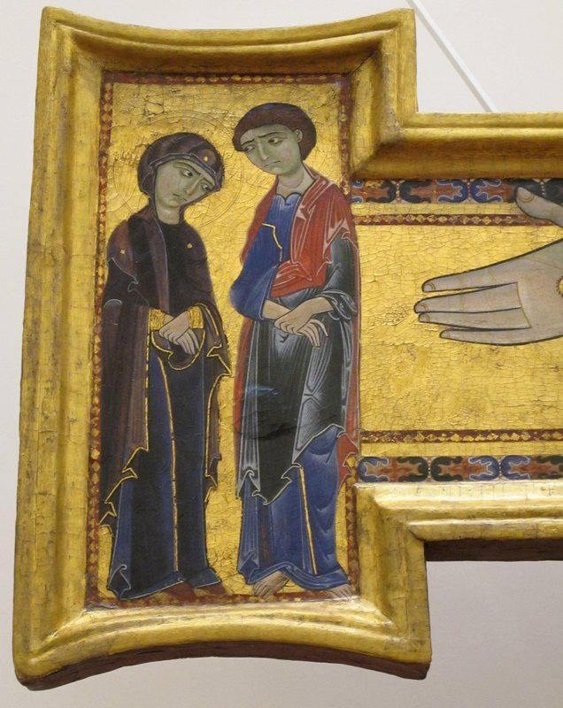
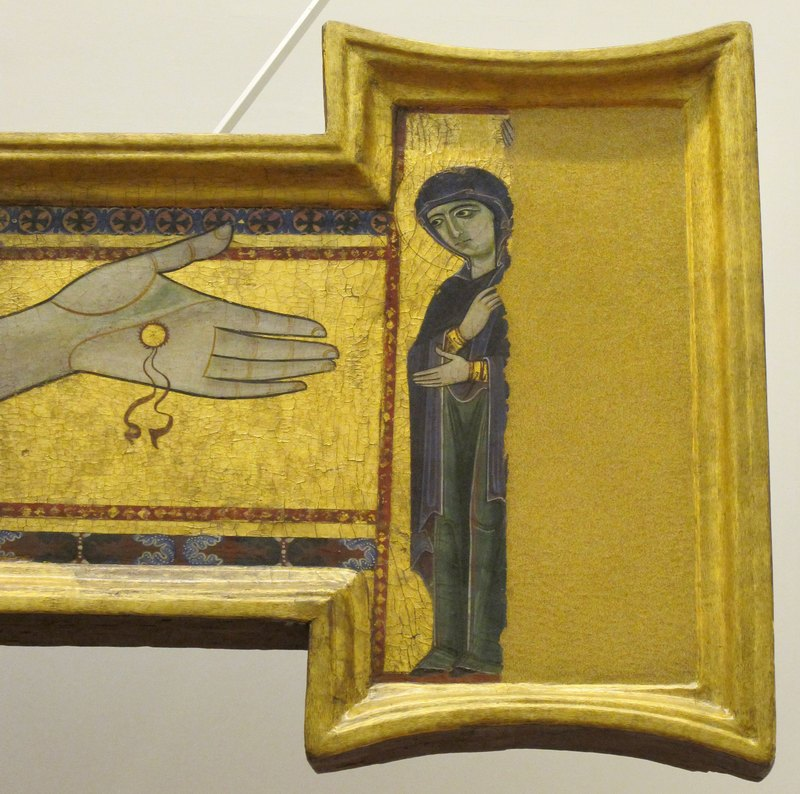
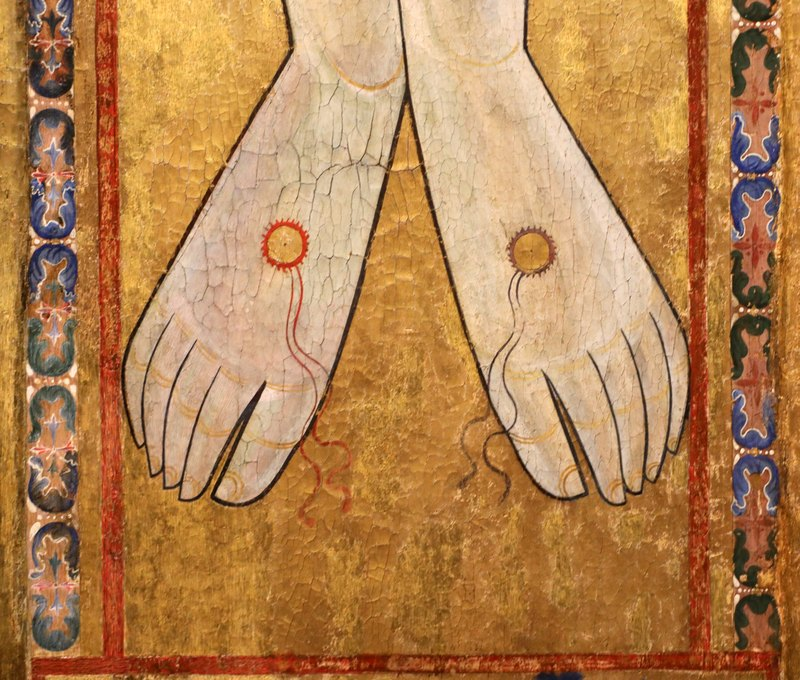
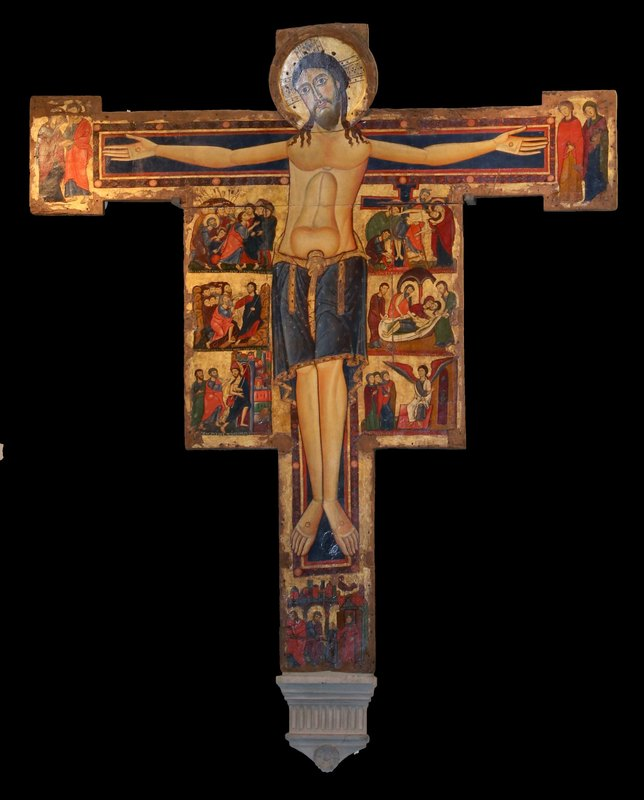
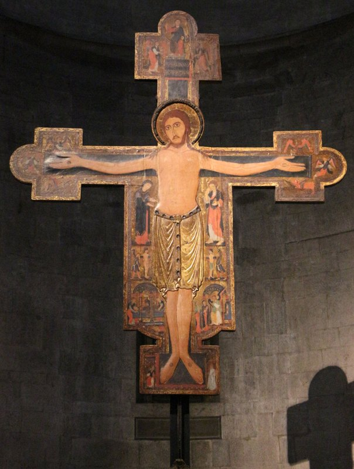

## A Painter Named after an Inventory Number

The *Maestro della Croce 432* takes his name from a number. The painted cross that is his only known work is registered as no. 432 in the inventory of the Florentine galleries of 1890, and art historians, lacking any other name, have called its painter after it. The convention is common for anonymous painters of the twelfth and thirteenth centuries, and in the same room of the Uffizi hangs the cross no. 434, whose painter is known in the same way.

Nothing is known of the painter beyond the cross. No document records his name, his birth, his training, his workshop, his patrons or his death. The cross bears no signature and no date, unlike the cross of Sarzana, which [Maestro Guglielmo](/Content/Artists/XII-c/Maestro-Guglielmo.html) signed and dated in 1138, or the cross of Spoleto, signed by [Alberto Sozio](/Content/Artists/XII-c/Alberto-Sozio.html) in 1187. Even the church for which it was made is unknown.

What survives is the work itself, and it is a work of the first importance. The cross is the oldest painting in the Uffizi, and it opens the gallery's sequence of Italian painting. It is a large cross of the type called *Christus triumphans*: Christ is shown alive on the cross, upright, with open eyes, as the conqueror of death, and around his body seven small scenes tell the story of the Passion and the Redemption.

The question of where and when it was painted has divided scholars for a century. The traditional view, kept by the Uffizi, gives it to a Pisan painter. [Miklós Boskovits](/scholars.html#boskovits-miklos) considered it the work of an anonymous Florentine. [Roberto Longhi](/scholars.html#longhi-roberto) doubted that it was Italian at all. Its date has been placed as early as the middle of the twelfth century and as late as its last decades.

Nothing is known of the painter beyond the cross. No source records his birth, his family, his journeys or his death, and the restoration of 2013 has not published technical findings such as an underdrawing, the origin of the pigments or the tooling of the border.

It also contained errors of fact. It described the panel as elm with inlaid decoration, a description not supported by the published sources; it spoke of eight scenes and then listed seven; it placed the cross in a corridor in 1881 and called it a gift to the gallery; and it named a crucifix in Cleveland with a donor portrait of a "Saint Bonifacia of Pisa" that does not exist. It confused [Wiligelmo](/Content/Artists/XI-c/Wiligelmo.html), the sculptor of Modena, with a "Guglielmo".

The account that follows describes the cross and its programme, its history from the first record in 1881 to the restoration of 2013, the attributions proposed for it, its style and the sources that scholars have found for it, and its place in the history of the painted cross. The catalogue then examines the cross part by part, from the whole to the details of the scenes, with sixteen photographs, and closes with six crosses for comparison: Rosano, Sarzana, Pisa, Lucca, Spoleto and the cross no. 434.

The entry is based on the information published by the Uffizi and on the literature on the cross: the surveys of [Raimond van Marle](/scholars.html#van-marle-raimond) (1923) and [Pietro Toesca](/scholars.html#toesca-pietro) (1927), the article of [Viktor Lazarev](/scholars.html#lazarev-viktor-nikitich) (1936), the corpus of [Edward Garrison](/scholars.html#garrison-edward) (1949), the catalogue of [Luisa Marcucci](/scholars.html#marcucci-luisa) (1958), the volume of the *Corpus of Florentine Painting* by Boskovits (1993) and the publication of the last restoration by [Angelo Tartuferi](/scholars.html#tartuferi-angelo) (2014). Where the literature is divided, the entry says so.

## The Cross and Its Programme

The cross is a large panel of wood cut to the shape of a cross, 276 centimetres high and 231 wide, painted in tempera on a gold ground. Its outline follows the type of the Tuscan painted crosses of the twelfth century: a vertical shaft, widened at the centre into a broad panel beside the body of Christ, a horizontal crossbar ending in two rectangular panels, and a projecting top, the cimasa. The edges are framed by a raised moulding, gilded, which bends outwards in concave curves at the ends of the arms.

At the centre stands Christ. His body is frontal and upright, his arms stretched horizontally along the crossbar, his feet placed side by side on the shaft below. His head is held straight, not bowed, and his eyes are open. Around the head is a large halo in relief, gilded and pierced by three round holes. The wounds of the nails are shown on the hands and feet as small gold discs ringed in red, with thin streams of blood running from them.

This is the *Christus triumphans*, the living Christ on the cross, the type that dominated Italian painted crosses until the early thirteenth century. Christ does not suffer: he reigns from the cross, victorious over death, as the liturgy of the period proclaimed. The type was replaced in the course of the thirteenth century by the *Christus patiens*, the dead or dying Christ with closed eyes and sagging body, spread by the mendicant orders and painted in Tuscany by [Giunta Pisano](/Content/Artists/XIII-c/Giunta-Pisano.html) and his successors.

Above the head, the cimasa carries the titulus, written in gold capitals on bands of blue: IHS NAZARE / NUS REX IU / DEORUM, "Jesus of Nazareth, King of the Jews". The top of the cimasa, which in crosses of this type often carried a further scene, is lost. So is part of the panel at the right end of the crossbar, now regilded.

At the ends of the crossbar stand the mourners. On the left are the Virgin and Saint John, standing side by side with their hands crossed before them, their heads bent towards the centre. On the right a single holy woman survives, raising her hand to her breast; the rest of the panel, where her companions once stood, is lost. The figures are framed as in a window by the moulding of the arm.

The broad panel beside the body carries six scenes, three on each side, and a seventh fills the shaft below the feet. On the left, from top to bottom, are the Washing of the Feet, the Arrest of Christ with the Kiss of Judas and the Flagellation. On the right, again from top to bottom, are the Deposition from the Cross, the Entombment and the Descent into Limbo. Below the feet of Christ is the Way to Calvary, the most damaged of the scenes.

The scenes can be read as a single story that passes through the figure of Christ himself. It begins at the top left with the Last Supper and the Washing of the Feet, descends through the Arrest and the Flagellation to the Way to Calvary at the foot, reaches the Crucifixion in the great central figure, and rises again on the right from the Deposition and the Entombment to the Descent into Limbo, where Christ frees the dead. The cycle ends with victory, and the victory is that of the Christ who stands on the cross.

The choice of the Descent into Limbo, the *Anastasis* of the Byzantine tradition, as the last scene is significant. The Uffizi groups the scenes into stories of the Passion and stories of the Redemption, and the Limbo, placed at the lower right beside the feet of Christ, makes the theological point of the whole cross: the death shown in the scenes is the defeat of death, and the Christ who rescues Adam and Eve from Hell is the same Christ who stands alive at the centre.

## History of the Cross

The early history of the cross is unknown. No document records the church for which it was painted, the patron who commissioned it, or the circumstances in which it left its original setting. Like many paintings in the Florentine galleries, it probably entered the state collections in the nineteenth century, perhaps after the suppressions of religious houses, but the date and the source are not recorded.

The first certain record is an inventory of the Uffizi of 1881, which lists the cross in the first corridor of the gallery. The Uffizi says only that the cross was in the gallery before 1881. In 1888 it appears as no. 432 in the catalogue of the gallery, and the inventory of 1890, the one still in use for the Florentine collections, gives it the same number, from which the painter takes his name.

In the eighteenth century the cross had been repainted. Such interventions were common: old crosses were adapted to changing taste, darkened figures were repainted, missing parts were filled in. The extent of the repainting can no longer be measured, because it was removed in the twentieth century, but it shows that the cross was still in use, or at least valued, long after it was painted.

Between 1919 and 1948 the cross was exhibited at the Galleria dell'Accademia in Florence, which then housed many of the early Tuscan paintings of the state collections. In 1948 it returned to the Uffizi, where it was placed in the first room of the gallery, devoted to the painting of the twelfth and thirteenth centuries.

Around 1960 the cross was restored, and the eighteenth-century repainting was removed, returning the painting as far as possible to its original state. The restoration was published by Umberto Baldini in a monograph of 1962 on the cross. The losses left by the old damage, at the top of the cimasa, at the right end of the crossbar and in some of the scenes, especially the Way to Calvary, were left visible.

A second restoration was completed in 2013, funded entirely by the Associazione Amici degli Uffizi together with the restoration of the cross no. 434 and a diptych attributed to [Bonaventura Berlinghieri](/Content/Artists/XIII-c/Bonaventura-Berlinghieri.html). The cleaning of the cross no. 432 was done by Rita Alzeni, the work on the wooden support by Roberto Buda and the integration of the gilding by Aviv Fürst. The three works were shown in the hall of San Pier Scheraggio from 20 to 29 March 2013.

Presenting the restored cross, Tartuferi, then director of the department of medieval painting of the Uffizi, called it one of the most beautiful and important works of early Italian painting, praising the refinement of its execution, the brilliance of its colour and the quality of its drawing. He published the restoration in *Paragone* in 2014. The cleaning made the scenes legible again and recovered the intensity of the blues, reds and greens.

Today the cross hangs in room A3 of the Uffizi, devoted to medieval painting, where it faces the three great Maestà of Cimabue, Duccio and Giotto. The arrangement makes visible, in a single room, the transformation of Italian painting in little more than a century, from the abstract, linear Christ of the cross no. 432 to the solid, spatial figures of Giotto.

## Attribution: Pisa, Florence or the East

The traditional attribution gives the cross to a Pisan painter. The Uffizi labels it "Pisan painter, twelfth century", and suggests that its similarities with other Pisan crosses point to a master active in Pisa around the middle of the century. Pisa, a maritime republic in close contact with Byzantium and the Islamic Mediterranean, was the leading centre of painting in Tuscany in the twelfth century, and the Eastern character of the cross fits that setting.

The comparison usually made is with the cross no. 15 of the Museo Nazionale di San Matteo in Pisa, painted for the church of the Santo Sepolcro, dated by Boskovits about 1150–1160 and by others towards 1200, whose painter is known as the [Maestro della Croce del Santo Sepolcro](/Content/Artists/XII-c/Maestro-della-Croce-del-Santo-Sepolcro.html). Both are crosses with narrative scenes beside the body of Christ, and both share the gold ground, the frontal Christ and the crowded small scenes. The differences of hand are as evident as the similarities.

Boskovits proposed a different answer. In the volume of the *Corpus of Florentine Painting* devoted to the origins of Florentine painting (1993), he gave the cross to an anonymous Florentine painter. Analysing the nineteen crosses with narrative scenes beside the body listed by Garrison, he suggested that the cross may have been made for a female monastery, perhaps situated between Florence and Pisa, which would explain both its Pisan character and its Florentine connections.

Boskovits also considered the Eastern elements of the cross. He related its technique to Arab and Islamic illumination and to the paintings of the Cappella Palatina in Palermo, where Muslim artists worked for the Norman kings, and suggested that the painter had contacts with that world. One hypothesis connects the painter with the mosaicists from the Norman South who may have come to Florence to work on the mosaics of the Baptistery.

Longhi went further. In an article of 1948 in *Proporzioni* he questioned whether the cross was Italian at all, writing that had it been found in Cappadocia or Armenia nobody would have objected. The remark, characteristically provocative, expressed the strangeness of the cross within Tuscan painting: its faces, its colour and its drawing seemed to him closer to the Christian East than to Pisa or Florence.

Other scholars have looked elsewhere. Some have compared the cross with the painting of Rome and Spoleto, and especially with the cross signed by Alberto Sozio in 1187 for the cathedral of Spoleto, whose Christ and scenes show related forms. Others have compared it with Ottonian and Bavarian illumination of the eleventh and twelfth centuries, and Boskovits, in a lecture on twelfth-century painting, mentioned the illumination of Salzburg.

The dating follows the attribution. The Uffizi and Boskovits place the cross around the middle of the twelfth century, among the earliest Tuscan painted crosses. Other scholars have dated it to the last quarter of the century, and the photographs on Wikimedia Commons follow the dating c. 1180–1200. A few have placed it even in the thirteenth century. The absence of any document, and the uniqueness of the style, leave the question open.

The literature on the cross is long. Besides the authors already named, it was discussed by [Carlo Ludovico Ragghianti](/scholars.html#ragghianti-carlo-ludovico) in his book on thirteenth-century Florentine painting (1955), by [Enzo Carli](/scholars.html#carli-enzo) in *I Primitivi* (1965), by Tartuferi in *La pittura a Firenze nel Duecento* (1990), by Boskovits, [Ada Labriola](/scholars.html#labriola-ada), [Valentino Pace](/scholars.html#pace-valentino) and Tartuferi in *Arte Cristiana* (2006), and by Chiara Castelli and [Arturo Carlo Quintavalle](/scholars.html#quintavalle-arturo-carlo) in the volume *La pittura su tavola del secolo XII* (2012). None of them has found another work by the same hand.

## Style and Sources

The figure of Christ is drawn more than it is modelled. Its outline is traced in a firm dark line, and within it the anatomy is reduced to a few large forms: the curved line of the breast, the arch of the ribs, the pear-shaped abdomen with a spiral navel, the narrow hips. The body has little weight and little volume. It is an image, not a body, and its power lies in the clarity of its pattern.

The flesh is painted in pale tones with grey and green shadows, applied in thin layers. The greenish underpainting, which shows through the flesh tones, gives the faces and bodies a cool, almost luminous colour. The hair falls on the shoulders in gold strands, drawn with a fine brush, and the beard is rendered in small regular curls.

The face of Christ is long and symmetrical. The eyes are large, with dark pupils turned slightly aside, so that the gaze seems to pass beyond the viewer. The long, straight nose continues upwards in the line of the eyebrows, a device that Boskovits singled out as one of the painter's inventions. The mouth is small and closed. The expression is grave and calm, without suffering.

The loincloth is the richest passage of colour in the central figure. It is painted in deep ultramarine blue, scattered with small gold dots and crossed by fine gold lines that render the folds, and it is tied at the waist by a broad gold band with a large knot. Its lower edge breaks into sharp zigzag folds that stand out against the gold ground.

The scenes are painted in a different scale and with a different energy. The figures are small, crowded together, with large heads and wide eyes. They act through glances and gestures: in the Washing of the Feet and the Arrest the action is driven by the direction of the eyes, as Boskovits observed. The faces, with their long noses, dark eyes and heavy brows, have an Eastern, Levantine character.

The colour of the scenes is brilliant. Deep blues, reds, greens and violets are set against the gold, and many garments are scattered with small squares of gold leaf that catch the light. The architectural settings, arches, domes and columns, are decorative rather than spatial: they frame the figures but do not create a space in which they move.

The sources proposed for this style are many. Presenting the restoration of 2013, the Uffizi named Syro-Armenian illumination, the icons of Mount Sinai, the mosaics of Norman Sicily and the painted wooden ceiling of the Cappella Palatina in Palermo. Earlier scholars added Byzantine art in general, and Ottonian and Bavarian illumination. What they share is the sense that the painter's culture extended well beyond Tuscany.

This does not mean that the painter was a foreigner. Tuscany in the twelfth century, and Pisa above all, was open to the whole Mediterranean, and Eastern manuscripts, icons and textiles reached it through trade, pilgrimage and the crusades. The painter of the cross no. 432 absorbed this culture and made of it something of his own: a Tuscan painted cross, in the form and the iconography of the Tuscan tradition, painted with an Eastern eye.

## The Painted Cross in Twelfth-Century Tuscany

The painted cross was the most important form of panel painting in central Italy in the twelfth and thirteenth centuries. A large wooden cross, painted with the figure of Christ and often with scenes and figures of saints, it hung above the high altar or on the screen that divided the church, where the faithful could see it. It was at once an image of devotion, a focus of the liturgy and a statement of the faith of the community.

The oldest surviving examples are Tuscan. The cross of Rosano, near Florence, painted by the [Maestro di Rosano](/Content/Artists/XII-c/Maestro-di-Rosano.html), is considered by Boskovits the oldest surviving painted cross, perhaps of the early twelfth century. The cross of Sarzana, signed and dated by Guglielmo in 1138, is the oldest dated one. The cross no. 15 of Pisa follows, around the middle of the century according to Boskovits, and the cross of Spoleto by Alberto Sozio in 1187.

The cross no. 432 belongs to this first group, and among them it is one of the richest in narrative. Garrison, in his corpus of Italian Romanesque panel painting (1949), listed nineteen crosses with narrative scenes beside the body of Christ, and the cross no. 432 is among the most elaborate of them, with seven scenes and the mourners on the arms.

The narrative cross is a Tuscan and central Italian type. In the Byzantine world the Crucifixion was represented in icons and mosaics, but not in large painted crosses with scenes. The painted cross with scenes was a Western invention, combining the image of the triumphant Christ with a cycle of the Passion that could be read by the faithful, and the cross no. 432 shows the type in its fullest form.

In the thirteenth century the type changed. The scenes disappeared from the sides of the body, replaced by decorative patterns, and Christ became the suffering *Christus patiens*, his body curving in death. The crosses of Giunta Pisano, of [Coppo di Marcovaldo](/Content/Artists/XIII-c/Coppo-di-Marcovaldo.html) and of the [Maestro della Croce 434](/Content/Artists/XIII-c/Maestro-della-Croce-434.html) show the new type, and the cross of Cimabue at Santa Croce brings it to its height.

Seen in this sequence, the cross no. 432 stands at the beginning. Its Christ is the triumphant king of the early tradition, its scenes are the richest narrative of the twelfth-century crosses, and its style, with its Eastern elements, shows the openness of Tuscan painting before the Florentine developments of the thirteenth century.

Its quality sets it apart. Not all early crosses are of high quality: many are provincial works, repetitive in their forms and summary in their execution. The cross no. 432 is the work of a painter of exceptional skill, as the restoration of 2013 showed, and the precision of its drawing and the brilliance of its colour place it among the masterpieces of Romanesque painting in Italy.

Its anonymity is part of its interest. The painter left no name, and the documents say nothing of him. He is known only by the number of an inventory. Yet his work, more than many signed works of the period, shows the encounter of the West and the East in Tuscan painting, and it remains one of the first images that visitors to the Uffizi see.

## Significance

The cross no. 432 is significant first as an object: it is the oldest painting in the Uffizi, and one of the oldest painted crosses in Italy. Its survival, its size and its state of preservation, after the restorations of 1960 and 2013, make it one of the most important witnesses of Italian painting in the twelfth century.

It is significant as an iconographic document. Its seven scenes form one of the fullest Passion cycles on a twelfth-century cross, from the Washing of the Feet to the Descent into Limbo, and some of its details are rare or early: the Arrest with Peter cutting off the ear of Malchus, the lantern raised above the soldiers, the Virgin embracing the dead Christ in the Entombment, the kings David and Solomon in the Limbo.

It is significant for the history of style. The cross shows the presence of the Christian and Islamic East in Tuscan painting of the twelfth century, and the debate on its origin, Pisan, Florentine or Eastern, is a debate on the sources of Italian painting as a whole. That Longhi could doubt its Italian origin, and Boskovits place it in Florence, shows how open the question remains.

It is significant for the history of the painted cross. Its Christus triumphans, upright and alive, is the image of Christ that dominated the twelfth century, and its narrative scenes show the type of cross that preceded the great Tuscan crosses of the thirteenth century. Placed in the same room as the Maestà of Cimabue, Duccio and Giotto, it shows the starting point of the development they completed.

It is significant for the history of collecting and conservation. Its story, from its unknown origin to the inventory of 1881, its stay at the Accademia, its return to the Uffizi in 1948 and its two restorations, is the story of the rediscovery of the "primitives" and of the methods used to study and preserve them.

It is significant, finally, as the work of a painter of genius whose name is lost. The Maestro della Croce 432 is known only from this cross, and the cross is enough to make him one of the most important painters of the Italian twelfth century. The catalogue that follows examines it part by part.

For the reader, the cross is above all a work to be looked at. Its small scenes repay close attention: the details of gesture, of costume and of setting, the flecks of gold on the garments, the expressions of the faces. The photographs in the catalogue, many of them details, make it possible to see what is hard to see in the gallery, where the cross hangs high above the visitor.

The cross also invites further study. The questions of its origin, its date and its patron remain open, and the restoration of 2013, published by Tartuferi, has given new material for answering them. The present entry records the state of the question and the evidence of the work itself, without filling the gaps with invention.

## Catalogue Entry

### The Painted Cross No. 432

<figure>
  
  <figcaption>Maestro della Croce 432, painted cross with Christ triumphant, the mourners and stories of the Passion and the Redemption, second half of the twelfth century, tempera and gold on panel, 276 × 231 cm. Florence, Gallerie degli Uffizi, inv. 1890 no. 432. Photo: Francesco Bini, <a href="https://creativecommons.org/licenses/by-sa/4.0/">CC BY-SA 4.0</a>, via Wikimedia Commons.</figcaption>
</figure>

The cross is seen whole, hanging in room A3 of the Uffizi. Its outline is that of the Tuscan painted crosses of the twelfth century: a shaft widened beside the body of Christ into a broad panel for the scenes, a crossbar ending in two rectangular panels for the mourners, a cimasa above the head, and a narrower lower shaft ending in a rectangular panel for the last scene. The raised gilded moulding that frames the whole bends outwards in concave curves at the ends.

Christ occupies the full height of the cross. His arms are stretched horizontally across the crossbar, the hands open, the palms turned to the viewer. His body is upright and frontal, his feet placed side by side on the lower shaft. The figure is not suspended from the nails: it stands before the cross, as if the cross were a background rather than an instrument of death.

The halo is the most prominent element of the upper part. It is a large disc in relief, carved in the wood and gilded, projecting from the surface, and it is pierced by three round holes, arranged like the arms of the cross inscribed in the halo of Christ. The holes may have held inserts of glass, stones or metal, now lost; the halo of the cross of Sarzana is still set with stones.

The titulus above the head is written in gold capitals on three bands of blue: IHS NAZARE / NUS REX IU / DEORUM. The cimasa is cut off at the top; in crosses of this type it often carried a further image, such as the Ascension at Sarzana, and its loss deprives the cross of its upper conclusion.

The two mourning groups on the arms are of different completeness. On the left the Virgin and Saint John stand intact; on the right a single holy woman stands at the left edge of the panel, and the rest of the surface, where other women once stood, is regilded and blank. The loss is old and the restorers chose not to reconstruct it.

The six scenes beside the body are arranged in two columns of three, each scene framed by a thin red line and set against the gold ground. The colours of the scenes, blue, red, green and violet, make two vertical bands of colour on either side of the pale body. The seventh scene, at the foot, is much damaged, and its figures are partly lost.

Ornamental borders run along the edges of the painted surfaces: bands of palmettes and stylised leaves in blue, green, red and white, interrupted by dots. They frame the crossbar above and below the arms of Christ, run along the sides of the lower shaft and divide the scenes from the body. Their colours repeat those of the scenes and bind the whole surface together.

The photograph shows how the cross works at a distance. From the floor of the gallery the scenes are small, the details hard to see, and what dominates is the great pale figure of Christ, with its halo, its dark loincloth and its open eyes. The scenes, which the catalogue examines one by one, are a second level of the image, meant for those who come close.

### Christ: Head and Body

<figure>
  
  <figcaption>Maestro della Croce 432, Christ, head and body, with the scenes of the Washing of the Feet, the Arrest, the Deposition and the Entombment. Detail of the cross no. 432. Florence, Gallerie degli Uffizi. Photo: Francesco Bini, <a href="https://creativecommons.org/licenses/by-sa/4.0/">CC BY-SA 4.0</a>, via Wikimedia Commons.</figcaption>
</figure>

The detail shows the centre of the cross: the head and body of Christ, the lower lines of the titulus and the upper scenes on either side. It makes visible the contrast between the large, pale, simplified figure of Christ and the small, crowded, brilliantly coloured scenes around it.

The face of Christ is long and symmetrical, framed by dark hair parted in the middle and falling behind the shoulders. The eyes are very large, outlined in black, with dark pupils turned slightly aside. The nose is long and straight, and its line continues into the arches of the eyebrows. The mouth is small, the moustache drooping, the beard short and divided into small regular curls.

The flesh is painted in pale grey and white over a greenish underpainting, which shows in the shadows of the face, the neck and the body. The effect is cool and luminous. Strands of hair, painted in gold, fall on the shoulders in wavy lines, a refinement that catches the light and links the head with the gold of the halo and the ground.

The anatomy of the body is reduced to a few large curved lines. The breast is marked by a broad arch, the lower edge of the rib cage by another, and below them the abdomen swells into a large pear shape, outlined in grey, with a small spiral navel at its base. The waist is narrow. The forms are traced rather than modelled, and the body has the flatness of an icon.

The pear-shaped abdomen is one of the most recognisable features of the cross, and one of the most discussed. It has been called eccentric, but it is a convention, found in Byzantine and Romanesque images of Christ, and it gives the body a strong, simple pattern that reads clearly from a distance.

The belt is a broad gold band tied in a large knot at the centre, its ends falling over the loincloth. The loincloth is deep blue, scattered with small gold dots and crossed by fine gold lines that indicate the folds. The gold and blue against the pale flesh create the strongest contrast of colour in the central figure.

The halo is seen here from close, with its raised edge and the three dark holes in the gold. The holes are clean and regular, and their arrangement, one on each side and one above, corresponds to the arms of the cross that usually appears in the halo of Christ. They were made to hold something, and what they held is unknown.

The scenes at the sides are cut by the frame of the photograph, but their colour and their crowding are evident. On the left the apostles in the Washing of the Feet and the soldiers in the Arrest press together; on the right the mourners of the Deposition and the Entombment gather around the dead body. The great figure of Christ stands calm in the midst of this agitation.

### The Virgin and Saint John

<figure>
  
  <figcaption>Maestro della Croce 432, the Virgin and Saint John, left end of the crossbar of the cross no. 432. Florence, Gallerie degli Uffizi. Photo: Francesco Bini, <a href="https://creativecommons.org/licenses/by-sa/4.0/">CC BY-SA 4.0</a>, via Wikimedia Commons.</figcaption>
</figure>

The left end of the crossbar shows the Virgin and Saint John, the two witnesses of the Crucifixion named in the Gospel of John. They stand side by side within the frame of the arm, on the gold ground, turned slightly towards the centre of the cross, where the right hand of Christ reaches out beside them.

The Virgin wears a dark purple mantle, the *maphorion*, which covers her head and falls over her shoulders to the knees, over a long robe of deep blue. The edges of her garments are lined in gold, and gold cuffs show at her wrists. Her head is bent, her eyes look down and to the side, and her hands are crossed before her body in a gesture of grief.

Saint John is young and beardless, with short brown hair. He wears a blue tunic and a red cloak thrown over his left shoulder and gathered at the waist. His hands, too, are crossed before him, and his head is inclined, his brows drawn together, his mouth turned down. He is barefoot, as the apostles usually are.

The two figures are of the same height and stand on the same line, but they are differentiated by colour and by their slight turn towards each other. Their gestures, the crossed hands and the bent heads, are the conventional gestures of mourning in Byzantine and Romanesque art, used here with restraint.

The drapery is drawn in sharp lines and angular folds, with highlights in white and gold. The edges of the Virgin's mantle and of John's cloak break into small zigzag points, a feature of Byzantine painting of the twelfth century that recurs throughout the cross. The colours are deep and saturated after the cleaning of 2013.

Faint incised circles around the heads mark the haloes, drawn in the gold ground rather than painted. They are barely visible in the photograph, but they show the care with which the painter prepared the surface, incising the outlines before applying the gold.

The panel is framed by a raised moulding, gilded, which bends inwards in a concave curve at the outer end of the arm. The inner edge of the painted surface is bordered by a thin band of red with small gold lozenges. Beyond the panel, the crossbar continues with the arm of Christ, bordered above and below by bands of palmettes.

The hand of Christ, at the right of the detail, is large and open, the fingers extended, the palm turned towards the viewer, with the wound of the nail shown as a small gold disc. Its scale, much larger than that of the mourners, shows the hierarchy of the cross: Christ dominates, the witnesses stand at the margins.

### A Holy Woman at the Right End of the Crossbar

<figure>
  
  <figcaption>Maestro della Croce 432, the left hand of Christ and a holy woman, right end of the crossbar of the cross no. 432; the rest of the panel is lost and regilded. Florence, Gallerie degli Uffizi. Photo: Francesco Bini, <a href="https://creativecommons.org/licenses/by-sa/4.0/">CC BY-SA 4.0</a>, via Wikimedia Commons.</figcaption>
</figure>

The right end of the crossbar shows a single holy woman, standing at the left edge of the end panel. She is one of the women who, according to the Gospels, watched the Crucifixion, and the Uffizi describes her as the only surviving figure of a group of holy women. The rest of the panel, to her right, is lost.

The woman wears a dark blue *maphorion* covering her head and shoulders, over a long green robe. Her right hand is raised to her breast, her left hand open beneath it; gold cuffs show at her wrists. Her head is turned towards the centre of the cross, and her eyes look towards Christ.

Her gesture differs from those of the Virgin and Saint John. Where they cross their hands in quiet grief, she raises her hand to her breast, a gesture of lament and of witness. The variation shows the painter's attention to the differentiation of the figures, even in the conventional repertoire of mourning.

The loss of her companions is evident. The surface to her right is a plain gold, without figures and without the crackle of the original gold. The old damage was filled and regilded in one of the twentieth-century restorations, and the restorers chose to leave the missing figures unreconstructed, so that the loss remains visible.

The composition of the panel must originally have balanced that of the left end. There the Virgin and John fill the panel; here two or three holy women would have stood side by side, perhaps the Marys named in the Gospels, facing the Virgin and John across the body of Christ.

The left hand of Christ, at the left of the detail, is large and open, the fingers slightly separated, the thumb raised. The nail wound is a gold disc with a ring of small rays, and from it two thin lines of blood, drawn in red, run down and curl at their ends against the gold. The detail is refined and stylised, an emblem of the wound rather than a description.

The arm of Christ is bordered above and below by bands of ornament. The upper band shows a row of circles with dark crosses, the lower a row of blue and white palmettes, and between them a narrow red band with small gold lozenges. These ornaments, different along each edge, recall the borders of illuminated manuscripts and of precious textiles.

The detail also shows the moulding of the frame from close, with its concave ends, its gilded surface and the dark wood of its back visible at the edge. The construction of the cross, with its applied mouldings and its carved halo, is the work of a skilled joiner, and the painting and the carpentry must have been planned together.

### The Feet of Christ

<figure>
  
  <figcaption>Maestro della Croce 432, the feet of Christ. Detail of the cross no. 432. Florence, Gallerie degli Uffizi. Photo: Francesco Bini, <a href="https://creativecommons.org/licenses/by-sa/4.0/">CC BY-SA 4.0</a>, via Wikimedia Commons.</figcaption>
</figure>

The feet of Christ are placed side by side on the lower shaft, slightly apart, with the toes pointing down and outwards. Each foot is pierced by its own nail, according to the iconography of the four nails that prevailed in the twelfth century, before the single nail through crossed feet became common in the thirteenth.

The wounds are shown as gold discs ringed with small rays, one in red, the other in a darker brown. From each, two thin lines of blood run down over the foot and continue beyond the toes, curling in waves against the gold ground. The blood is drawn, not painted: it is a sign rather than a description of the wound.

The feet are painted in the same pale, grey-white flesh as the body, with a dark outline and thin lines of gold or ochre marking the ankles, the arches and the joints of the toes. The toes are long and parallel, separated by dark lines, the nails drawn with small curves. The forms are simplified, like those of the body.

There is no suppedaneum, the footrest on which the feet of Christ often stand in later crosses. The feet rest on nothing, on the gold ground, as if Christ were standing in the air. The absence emphasises the triumphant character of the image: Christ does not hang from the cross, he stands before it.

The surface of the gold is covered with a network of fine cracks, the craquelure produced by the movement of the wood and the ageing of the preparation. The cracks show that the gold here is original, and the photograph shows the quality of the gilding, with its warm colour and the slight variations of tone between the leaves.

Along the sides of the shaft run two narrow red bands and, outside them, two borders of ornament. The borders show a repeated motif of palmettes or stylised leaves in blue, green, red and white, with small white dots, set against a band of gold. The motif varies slightly from one unit to the next, as in hand-painted ornament.

Below the feet the shaft is closed by a red band, and below it begins the panel of the Way to Calvary, the last scene of the cross. The feet of Christ are thus placed immediately above the scene of his last journey, and the eye passes from the scene to the feet and up the body to the head.

The detail shows the painter's precision. Every line, from the outlines of the feet to the rays around the wounds and the curls of the blood, is drawn with a fine, steady brush. The restoration of 2013, which cleaned the surface, made these details legible again, and the photograph records the cross in its present state.

### The Washing of the Feet

<figure>
  
  <figcaption>Maestro della Croce 432, the Washing of the Feet, upper left scene of the cross no. 432. Florence, Gallerie degli Uffizi. Photo: Oursana, public domain (<a href="https://creativecommons.org/publicdomain/zero/1.0/">CC0</a>), via Wikimedia Commons.</figcaption>
</figure>

The first scene of the cycle, at the upper left, is the Washing of the Feet. According to the Gospel of John, before the Last Supper Christ rose from the table, girded himself with a towel, poured water into a basin and began to wash the feet of the disciples. The scene opens the Passion with an act of humility.

Christ kneels at the left, in a blue robe and a mantle scattered with small gold dots. He bends towards Peter, raising his right hand, and holds Peter's foot in the basin with his left. The basin is a round green vessel, set on the ground in the middle of the scene.

Peter sits in a red mantle over a blue tunic, one foot in the basin, his right hand raised to his head. The gesture illustrates his words in the Gospel of John: when Christ told him that unless he was washed he would have no part with him, Peter answered, "Lord, not my feet only, but also my hands and my head". The painter has chosen the moment of the dialogue.

Behind Peter the other apostles crowd together, their heads in two rows, each with a gold halo. Their faces are differentiated: young and old, bearded and beardless, with dark or grey hair. Their eyes turn in different directions, towards Christ, towards Peter, towards each other, and the movement of their glances gives life to the scene.

At the front, one apostle in a green and blue garment bends forward to untie his sandal, preparing for his turn. Another, at the right edge, stands in a dark blue mantle. Between them two crossed sticks, perhaps a folding stool, appear at Peter's side. The detail is unusual and gives the scene a domestic character.

The setting is indicated by a few architectural elements: a long red roof across the top of the scene, a small blue building with a dome and a cross at the right, a column at the left with a looped curtain. These elements do not create a space; they indicate an interior, the upper room of the Last Supper, by conventional signs.

Boskovits observed that in this scene the action is lively and driven by the glances of the figures, and that the faces have an Eastern, Levantine character. The large eyes, long noses and heavy brows of the apostles are close to the faces of Byzantine and Eastern Christian painting, and they are one of the reasons why scholars have looked to the East for the painter's sources.

At the bottom edge of the photograph appear the tops of lances, torches and a lantern, the first signs of the next scene, the Arrest. The two scenes are separated only by a thin line, and the weapons of the soldiers rise into the space below the apostles, as if the betrayal were already approaching.

### The Arrest of Christ

<figure>
  
  <figcaption>Maestro della Croce 432, the Arrest of Christ with the Kiss of Judas, middle left scene of the cross no. 432. Florence, Gallerie degli Uffizi. Photo: Oursana, public domain (<a href="https://creativecommons.org/publicdomain/zero/1.0/">CC0</a>), via Wikimedia Commons.</figcaption>
</figure>

The second scene on the left is the Arrest of Christ in the garden of Gethsemane. Judas, who had agreed with the chief priests to betray his master, came with a crowd armed with swords and staves and gave them a sign: "Whomsoever I shall kiss, that same is he". The scene shows the moment of the kiss.

Christ stands at the centre, in a dark blue robe scattered with gold dots, his face turned slightly away from Judas, his eyes looking out of the scene. Judas embraces him, pressing his face against his cheek, his arms around his shoulders. Judas wears a dark blue mantle over a lighter robe, and his figure overlaps that of Christ, so that the two bodies form a single mass.

Around them the crowd presses in. At the left a man in red seizes Christ's arm, and other men in red, green and blue crowd behind him; at the right more men, one pointing, others watching. Their faces, with their large eyes and heavy brows, look in different directions, and as in the Washing of the Feet the scene is told through glances.

Above the heads of the crowd rise the instruments of the arrest: lances with sharp points, torches, a hooked staff and, in the middle, a lantern on a pole, drawn as a small square with a pattern of lines. The Gospel of John says that Judas came "with lanterns and torches and weapons", and the painter has shown them all.

At the lower left, Peter, with a gold halo and grey hair, kneels and seizes a young man by the head. It is Malchus, the servant of the high priest, whose ear Peter cut off with his sword, as the Gospels tell. The episode, shown in detail in the next photograph, adds a second action to the scene and a note of violence to the calm of the kiss.

The scene has been described as possibly one of the earliest representations of the Kiss of Judas in European panel painting. The claim cannot be verified, but the scene is certainly among the earliest surviving on a painted cross, and its composition, with the embrace at the centre and the crowd around it, anticipates later versions of the subject.

The colour of the scene is dominated by the deep blue of the garments of Christ and Judas, which stand out against the reds and greens of the crowd and the gold of the ground. The small gold dots on the blue, applied with care, give the garments a jewel-like brilliance.

At the right of the photograph appears part of the blue loincloth of Christ on the cross, with its gold lines and its knot. The juxtaposition of the scale of the scene with that of the central figure is striking: the small Christ of the arrest stands beside the great Christ of the cross, as the story stands beside the image.

### Peter and Malchus

<figure>
  
  <figcaption>Maestro della Croce 432, Peter cutting off the ear of Malchus. Detail of the Arrest of Christ, cross no. 432. Florence, Gallerie degli Uffizi. Photo: Francesco Bini, <a href="https://creativecommons.org/licenses/by-sa/4.0/">CC BY-SA 4.0</a>, via Wikimedia Commons.</figcaption>
</figure>

The detail shows the lower left corner of the Arrest, where Peter attacks Malchus. All four Gospels tell that one of the disciples drew a sword and struck the servant of the high priest, cutting off his ear; John names the disciple as Peter and the servant as Malchus. The painter has given the episode a prominent place in the foreground.

Peter kneels on one knee, his body bent forward, his face turned up and back towards the centre of the scene. He has grey hair and a short grey beard, and a gold halo. He wears a blue tunic and a red cloak, whose folds are drawn in lines of white and red that follow the curve of his back and thigh.

With his hands he holds the head of Malchus down against the ground. The young man has dark, tousled hair and a pale face; his eye looks up in fear, and red streaks run down his cheek from the ear, where a dark blade shows. The violence of the action is clear, but the painter treats it with the same precision of line as the rest of the cross.

The face of Peter is one of the finest passages of the cross. The forehead is lined, the eyebrows raised, the eyes turned upwards; the beard is drawn in small curls, the flesh modelled in green and white. His expression, at once anxious and determined, gives the episode a psychological depth unusual in twelfth-century painting.

At the right falls the dark blue mantle of Judas, scattered with small squares of gold leaf. The squares, applied one by one, catch the light and give the dark blue a starry brilliance. Below the mantle appear bare feet in sandals, their thongs drawn in fine dark lines, and the red-stained ankles of the soldiers.

The surface is covered with craquelure, and small losses show in the gold of the ground. The red of Peter's cloak and the blue of his tunic are intense, and the cleaning of 2013 has removed the dirt and old varnish that dulled them. The detail shows the painter's technique at close range: thin layers of colour, sharp outlines, white highlights.

Along the left edge runs a border of red and gold lozenges, framing the scene. Such borders, which recur throughout the cross, recall the decorative frames of illuminated manuscripts, and the comparison suggests that the painter was familiar with the art of the book, or trained in it.

The episode of Malchus is rare on twelfth-century painted crosses. Its inclusion, and the care with which it is painted, show the painter's interest in narrative detail and in the Gospel text. The detail, almost invisible from the floor of the gallery, rewards the close attention that the photograph allows.

### The Flagellation

<figure>
  
  <figcaption>Maestro della Croce 432, the Flagellation, lower left scene of the cross no. 432. Florence, Gallerie degli Uffizi. Photo: Francesco Bini, <a href="https://creativecommons.org/licenses/by-sa/4.0/">CC BY-SA 4.0</a>, via Wikimedia Commons.</figcaption>
</figure>

The third scene on the left is the Flagellation. After the trial before Pilate, the Gospels tell, Christ was scourged by the soldiers before being led to the Crucifixion. The scene shows Christ standing between two men who raise their whips to strike him.

Christ stands at the centre, frontal and upright, naked but for a light blue loincloth flecked with gold leaf. His hands are behind his back, as if bound to a column, though no column stands behind him. His head is slightly turned, his eyes look aside, and his face is calm. He does not react to the blows: his attitude repeats, on a small scale, the impassive dignity of the great Christ of the cross.

The two flagellants stand on either side, in short tunics and leggings, one pink, the other red. Both raise their arms above their heads, holding the whips, of which only the knotted ends appear as dark curls against the gold. Their bodies lean towards Christ, their legs apart, and their faces, in profile or three-quarter view, are hard and concentrated.

At the far left two bearded men watch the scene. One, in a green mantle over a red robe, points towards Christ; the other, behind him, wears blue. They may be Pilate and an attendant, or the representatives of the authorities who ordered the scourging. Their presence makes the scene a judgement as well as a punishment.

The setting is an arch, or rather a canopy, of red and blue domes resting on two columns with capitals. The architecture frames the figure of Christ and suggests the praetorium, the residence of Pilate, where the scourging took place. Like the architecture of the other scenes, it is decorative rather than spatial.

The composition is symmetrical: Christ at the centre, a flagellant on each side, the columns framing them, the domes above. The symmetry gives the scene a solemn, almost ceremonial character, and the frontal Christ at its centre becomes an image of devotion within the narrative.

The colours are among the most varied of the cross: the pink and red of the flagellants, the green, red and blue of the onlookers, the light blue of the loincloth, the red and blue of the domes, against the gold of the ground. The flesh of Christ, pale and greenish, is the same as that of the great figure of the cross.

At the right edge of the photograph appear the gold and blue folds of the loincloth of the central Christ, with its sharp zigzag edges. The scene and the great figure touch, and the small Christ of the Flagellation seems to stand in the shadow of the great Christ of the cross.

### Christ at the Flagellation

<figure>
  
  <figcaption>Maestro della Croce 432, Christ at the Flagellation. Detail of the cross no. 432. Florence, Gallerie degli Uffizi. Photo: Francesco Bini, public domain, via Wikimedia Commons.</figcaption>
</figure>

The detail brings the viewer close to the figures of the Flagellation, showing the faces and the technique of the painter at a scale impossible in the gallery. It shows Christ, the two flagellants and one of the onlookers, under the domes of the praetorium.

The face of Christ is long and calm, framed by long brown hair parted in the middle and falling on the shoulders. The eyes, large and dark, look to the side. The nose is long, the mouth small, the beard short and rounded. A faint incised circle around the head marks the halo, drawn in the gold. The face is a small version of the face of the great Christ.

The body is painted in pale tones with green shadows, the anatomy marked by a few lines: the arch of the breast, the curve of the ribs, a long line down the abdomen, the navel. As in the central figure, the abdomen swells into a rounded shape. The arms are drawn behind the back, the shoulders slightly raised.

The loincloth is pale blue, tied at the waist with a knot, and scattered with small squares of gold leaf that sparkle against the blue. The same gold flecks appear on the garments of Judas, Peter and other figures; they are a characteristic feature of the painter's technique and give his small scenes a precious, jewel-like quality.

The flagellant at the left is a young man with curly hair, his face in profile, his eye wide open. He wears a pink tunic, whose folds are drawn in white lines, and a red collar. His arms are raised, his hands holding the whip above his head. His expression is concentrated, almost grim.

The flagellant at the right is similar, in a red tunic, his face in three-quarter view, his long hair falling behind. His arms, too, are raised, and the knotted end of his whip curls above his hands in a dark line. The two men frame Christ symmetrically, and their raised arms form a rhythm with the domes above.

Behind the left flagellant stands a bearded man, his face hard, his finger pointing towards Christ. He wears a red mantle over a blue robe, and his head is partly hidden by a crown or cap. He is one of the onlookers, perhaps Pilate himself, who ordered the scourging, and his gesture accuses rather than pities.

The surface shows the craquelure of the old paint and some losses in the gold. The detail makes visible the economy of the painter's means: a few lines, a few colours, applied with precision, are enough to give each figure its character and each face its expression.

### The Way to Calvary

<figure>
  
  <figcaption>Maestro della Croce 432, the Way to Calvary, scene at the foot of the cross no. 432. Florence, Gallerie degli Uffizi. Photo: Francesco Bini, <a href="https://creativecommons.org/licenses/by-sa/4.0/">CC BY-SA 4.0</a>, via Wikimedia Commons.</figcaption>
</figure>

The scene at the foot of the cross shows the Way to Calvary, Christ's journey to the place of execution. It is placed directly below his feet, so that the last scene of the Passion before the Crucifixion is followed by the Crucifixion itself, represented by the great figure above.

The scene is the most damaged of the cross. Large areas of paint are lost, especially at the left, where only fragments of figures survive: parts of heads, of garments, of hands. The losses are old, and the position of the scene at the foot of the cross, the part most exposed to damage, to candles and to handling, explains them.

Christ walks at the centre, in a blue robe, turned towards the right. His face, partly damaged, is framed by long hair, and a faint halo is incised in the gold. His hands are held before him, and a bearded man in red, at his right, grasps his arm and leads him forward.

At the right a man in a green tunic carries a large blue cross on his shoulder. He is Simon of Cyrene, who, according to the Synoptic Gospels, was compelled by the soldiers to carry the cross of Christ. Between him and Christ another young man looks back, his face turned towards the viewer.

At the left a bearded man in red holds a coil of rope, the rope with which Christ was bound. Behind him the faded remains of other figures, perhaps the women of Jerusalem who followed Christ weeping, or other soldiers and onlookers, can be made out. Their faces are almost lost.

The composition moves from left to right, in the direction of the procession. The figures walk in a line, overlapping, and the blue cross rises above them at the right, its arms cut by the frame. The scene, small as it is, conveys the movement of a crowd and the weight of the cross.

The faces that survive have the character of the other scenes: large eyes, heavy brows, long noses, short beards. The man in red who leads Christ has a hard, frowning face; the young man between Christ and Simon looks back with wide eyes. Even in its damaged state, the scene shows the painter's skill in characterisation.

The restorers did not reconstruct the missing figures. The gaps appear filled with a tone close to that of the gold ground, so that the surviving fragments can be read for what they are, without invention. The blue cross carried by Simon is enough to make the subject certain, as the Uffizi reads it.

### The Deposition from the Cross

<figure>
  
  <figcaption>Maestro della Croce 432, the Deposition from the Cross, upper right scene of the cross no. 432. Florence, Gallerie degli Uffizi. Photo: Oursana, public domain (<a href="https://creativecommons.org/publicdomain/zero/1.0/">CC0</a>), via Wikimedia Commons.</figcaption>
</figure>

The first scene on the right, opposite the Washing of the Feet, is the Deposition from the Cross. After the death of Christ, the Gospels tell, Joseph of Arimathea obtained his body from Pilate, and with Nicodemus took it down from the cross. The scene shows the body being lowered.

The cross stands in the middle, painted in deep blue, its arms cut against the gold. It is plain, without the figure, the titulus or the nails, and its colour makes it the axis of the scene. Behind it stands a bearded man, Joseph of Arimathea, who holds the body of Christ against him.

The body of Christ sags across Joseph's arms, his head falling against his shoulder, his eyes closed, his loincloth flecked with gold. It is the only image of the dead Christ on the cross. The contrast with the living, upright Christ of the centre is deliberate: the scenes show the death, the central figure the victory over it.

At the foot of the cross a man in red kneels and draws a nail from the feet of Christ with a pair of pincers. He is Nicodemus, and the pincers, drawn in blue, are a detail that recurs in later Deposition scenes. His bent figure, at the lower left of the cross, balances the standing figures on either side.

At the left two figures grieve. A woman in a dark violet mantle raises her hand to her face; beside her a young man in green, Saint John, also raises his hand to his cheek, the traditional gesture of sorrow. Their heads bend towards the body, their eyes downcast.

At the right two women in dark blue mantles stand side by side. The first, the Virgin, bends towards the body of her son and supports his arm or presses her face towards his; the second stands behind her. Their figures, tall and dark, close the scene at the right as the mourners close it at the left.

Above at the right a small angel flies with spread wings, its body half hidden in a cloud. The angel, a witness of the Deposition from heaven, is a detail derived from Byzantine iconography, where angels often appear above the Crucifixion and the Deposition, lamenting the death of Christ.

The scene is well preserved and its colours are intense: the deep blue of the cross and of the women's mantles, the red of Nicodemus, the green of John, the violet of the first woman, against the gold. The figures are arranged symmetrically around the cross, and the composition has a solemn, ritual character.

### The Entombment

<figure>
  
  <figcaption>Maestro della Croce 432, the Entombment, middle right scene of the cross no. 432. Florence, Gallerie degli Uffizi. Photo: Oursana, public domain (<a href="https://creativecommons.org/publicdomain/zero/1.0/">CC0</a>), via Wikimedia Commons.</figcaption>
</figure>

The second scene on the right is the Entombment. Joseph of Arimathea and Nicodemus, the Gospels tell, wrapped the body of Christ in linen with spices, and laid it in a new tomb hewn out of the rock. The scene shows the body being laid in the tomb, in the presence of the Virgin and the holy women.

The body of Christ lies on a sarcophagus of red marble, speckled like porphyry, with a dark green lid at its right end. It is wrapped in a pale blue shroud, crossed with white bands and flecked with gold. Only the head is uncovered, with its dark hair, closed eyes and gold halo.

The Virgin, in a dark blue mantle, bends over the body and presses her cheek against the face of her son. The embrace is the emotional centre of the scene, and it is one of the most moving passages of the cross. The motif, derived from the Byzantine Lamentation, the *Threnos*, gives the Entombment an intensity of grief unusual in twelfth-century Western painting.

At the left two men hold the ends of the shroud. The first, in a green and blue garment, lifts the shroud with both hands; the second, in blue, bends over the body and lays his hand on it. They are Joseph of Arimathea and Nicodemus, or Nicodemus and John. Their faces are bent, their eyes cast down.

Behind them stands a woman in a dark brown mantle, with a halo, raising her hand to her mouth in a gesture of grief. At the right a haloed woman in a green mantle over a red robe holds the other end of the shroud, and behind her another figure is partly visible. They are the holy women who, the Gospels say, watched where the body was laid.

The setting is a canopy, a red dome resting on columns with blue capitals, with smaller blue domes beneath it and small lamps hanging between the columns. The architecture represents the tomb, or the church of the Holy Sepulchre in Jerusalem, whose rotunda covered the tomb of Christ. The lamps recall the lamps that burned in the Holy Sepulchre.

At the lower left a small blue vessel stands on the ground, the jar of spices or ointment with which the body was anointed. The detail, like the pincers of the Deposition and the lantern of the Arrest, shows the painter's attention to the objects named in the Gospel narrative.

The scene was described by one modern writer as a Pietà, but the sarcophagus, the shroud and the Gospel context make it clear that it is the Entombment, as the Uffizi and the literature read it. The embrace of the Virgin, borrowed from the Lamentation, explains the confusion.

### The Descent into Limbo

<figure>
  
  <figcaption>Maestro della Croce 432, the Descent into Limbo, lower right scene of the cross no. 432. Florence, Gallerie degli Uffizi. Photo: Oursana, public domain (<a href="https://creativecommons.org/publicdomain/zero/1.0/">CC0</a>), via Wikimedia Commons.</figcaption>
</figure>

The last scene of the cycle, at the lower right, is the Descent into Limbo, the *Anastasis* of the Byzantine tradition. After his death, according to the apocryphal Gospel of Nicodemus and the Creed, Christ descended into Hell, broke its gates and freed the souls of the righteous who had died before him, beginning with Adam and Eve.

Christ strides to the right, in a robe of gold drawn with fine red and dark lines, the colour of glory. He holds a long staff topped with a cross in his left hand, the sign of his victory, and with his right he grasps by the wrist an old man who kneels and reaches up to him. His face is calm, his eyes turned towards the man he rescues.

The old man is Adam, with long grey hair and a pointed beard, in a blue tunic and a red mantle. He kneels on one knee, his hands raised towards Christ, his face turned up in hope. Behind him a woman in a pale green mantle, Eve, raises her hands towards Christ. Behind them dark shapes, perhaps the wings of fleeing demons or the rocks of Hell, rise against the gold.

At the left two crowned kings stand behind a parapet of green speckled marble, which may represent a sarcophagus. They are David and Solomon, the ancestors and prophets of Christ, who in Byzantine images of the Anastasis wait to be freed with Adam and Eve. Their presence links the scene to the Old Testament promises fulfilled by Christ.

Above the kings dark rocky shapes in blue and green represent the mountains or the caves of Hell. They are drawn with curving lines and dark hollows, in the conventional manner of Byzantine landscape, and they set the scene in the underworld.

Under Christ's feet lie the broken doors of Hell, crossed diagonally, with a blue lock and its bolts, and beneath them flames and the crushed figure of the devil. The details, shown more closely in a later photograph, illustrate the victory of Christ over death: the gates that held the dead are broken, and their guardian is trampled.

The Descent into Limbo closes the cycle with victory. Placed at the lower right of the cross, beside the feet of the great Christ, it answers the Washing of the Feet at the upper left and completes the movement from humility to triumph. Its golden Christ, striding and victorious, is the narrative counterpart of the triumphant Christ of the centre.

The scene was described by one modern writer as the Resurrection, but the presence of Adam, Eve, David and Solomon and the broken gates of Hell make it clear that it is the Descent into Limbo, as the Uffizi and the literature read it. In the Byzantine tradition the Anastasis is itself the image of the Resurrection, which explains the confusion.

### David and Solomon

<figure>
  
  <figcaption>Maestro della Croce 432, the kings David and Solomon. Detail of the Descent into Limbo, cross no. 432. Florence, Gallerie degli Uffizi. Photo: Francesco Bini, <a href="https://creativecommons.org/licenses/by-sa/4.0/">CC BY-SA 4.0</a>, via Wikimedia Commons.</figcaption>
</figure>

The detail shows the two kings who stand at the left of the Descent into Limbo, behind a parapet of green marble. They are David and Solomon, father and son, the kings of Israel from whose line Christ was born, and whose presence in the Anastasis is a constant of Byzantine iconography from the eleventh century.

The king at the left is David, the older, with grey hair and a long pointed beard. He wears a red robe over a blue tunic, with a jewelled clasp at his shoulder. His right hand is raised to his breast, and his eyes turn to the right, towards Christ. His face is lined, his expression attentive.

The king at the right is Solomon, younger and beardless, with grey hair falling to his neck. He wears a green robe patterned with white trefoils, and a broad jewelled collar of gold. His right hand, too, is raised to his breast, and his eyes, turned to the side, look towards Christ. The contrast of the old and the young king is traditional.

Both kings wear gold crowns with trefoil points, set with red stones. The crowns are drawn in black outline and filled with gold, and they recall the crowns of Byzantine emperors and of Western rulers of the twelfth century. Their gold matches the gold of the ground, and the kings seem to belong to the same luminous world.

The parapet in front of them is painted in green speckled with white and dark, imitating a precious marble, perhaps serpentine or verde antico. It may represent the edge of a sarcophagus from which the kings rise, as in some Byzantine versions of the scene, or simply a barrier that separates them from the action.

Above the kings rise dark rocks, painted in blue, green and black with curving lines and white highlights. They represent the mountains or caves of Hell, and their form, with rounded hollows, is that of Byzantine landscape. Small flecks of gold appear on them, as on the garments of the figures.

At the left of the detail appear the ornamental border of the shaft, with blue and white palmettes, and the dark blue loincloth of the great Christ, with its gold lines and dots. At the right appear the gold folds of the robe of Christ in the Limbo, drawn in red and dark lines. The kings stand between the two images of Christ.

The detail shows the quality of the painter at its best: the precision of the drawing, the brilliance of the colour, the characterisation of the faces. The craquelure of the gold and the small losses do not diminish the clarity of the image, and the cleaning of 2013 has restored its colours.

### The Gates of Hell

<figure>
  
  <figcaption>Maestro della Croce 432, the broken gates of Hell under the feet of Christ. Detail of the Descent into Limbo, cross no. 432. Florence, Gallerie degli Uffizi. Photo: Francesco Bini, <a href="https://creativecommons.org/licenses/by-sa/4.0/">CC BY-SA 4.0</a>, via Wikimedia Commons.</figcaption>
</figure>

The detail shows the lower part of the Descent into Limbo, where Christ treads on the broken gates of Hell. The motif, essential to the Byzantine Anastasis, illustrates the words of the Psalm, "he hath broken the gates of brass, and cut the bars of iron in sunder", read as a prophecy of Christ's victory over death.

Two door panels, painted white with dark lines, lie crossed diagonally, forming a broad X. They are the doors of Hell, torn from their hinges by the descending Christ. Their surface is crackled, and small losses show the preparation beneath, but their form is clear.

On the doors lies a lock, painted in blue with white highlights: a box with a keyhole and a long bolt with two hooked pins. The lock and its bolts, broken from the doors, are the "bars" of the Psalm, and their precise drawing shows the painter's attention to the objects of the narrative, as in the lantern of the Arrest and the pincers of the Deposition.

Beneath the doors the ground is dark brown, and red and black flames rise from it in curling tongues. The flames are the fires of Hell, and among them, according to the description of the file on Wikimedia Commons, lies the crushed figure of the devil, now much darkened and hard to distinguish from the flames.

The feet of Christ stand on the doors, bare, in sandals whose thongs are drawn in fine dark lines. Above them falls the hem of his gold robe, drawn in red and blue lines that render the folds. The robe is painted in gold over the gold ground, so that it seems to be made of light; only the lines distinguish it from the background.

At the upper left lies the green speckled marble of the parapet behind which David and Solomon stand. At the left runs the ornamental border of the shaft, with its palmettes in blue, green, red and white. At the right appear the hand of Adam, reaching towards Christ, and part of his knee.

The detail shows the precision of the painter even in the smallest parts of his scenes. The lock, the bolts, the cracks in the doors, the tongues of flame are drawn with the same care as the faces of the figures. Nothing is summary, and every element of the narrative is shown.

The broken gates close the cycle of the cross with an image of victory. From the Washing of the Feet to the gates of Hell, the scenes have told the story of the Passion and its meaning: the humiliation, betrayal, suffering and death of Christ end in the defeat of death itself, and the triumphant Christ of the centre is its image.

### Comparison: the Cross of Rosano

<figure>
  
  <figcaption>Maestro di Rosano, painted cross with Passion scenes, c. 1129–1134, tempera and gold on chestnut panel, 253 × 230 cm, for comparison. Rignano sull'Arno (Florence), monastery of Santa Maria a Rosano. Photo: Sailko, <a href="https://creativecommons.org/licenses/by/3.0/">CC BY 3.0</a>, via Wikimedia Commons.</figcaption>
</figure>

The cross of the Benedictine nunnery of Santa Maria a Rosano, in the upper valley of the Arno east of Florence, is considered by Boskovits the oldest surviving Tuscan painted cross. Its painter, the [Maestro di Rosano](/Content/Artists/XII-c/Maestro-di-Rosano.html), has his own entry, where its date, its restoration of 2006 and its history are discussed.

The comparison is the most direct of all, because the cross of Rosano has the same structure as the cross no. 432. A living, open-eyed Christ in a blue loincloth stands on a gold ground, his arms stretched along a blue crossbar; mourners stand at the ends of the arms; six small scenes are arranged in two columns of three beside the body; and a seventh scene, the Denial of Peter, fills the lower shaft.

The resemblance of layout is striking. Both crosses place the mourners on the arms rather than beside the body, both divide the broad panel into six scenes, both put a single scene at the foot. The two painters worked within the same Florentine and Tuscan tradition of the narrative cross, and the cross of Rosano shows that the arrangement of the cross no. 432 was not an invention of its painter.

Rosano also matters for the hypothesis of Boskovits on the patronage of the cross no. 432. Rosano was a female monastery, and its cross was made for a community of nuns. When Boskovits suggested that the cross no. 432 may have been painted for a female monastery between Florence and Pisa, the example of Rosano stood behind the suggestion.

The figures are of a different character. The Christ of Rosano is broader and heavier, his features less sharply drawn, and the scenes are painted with a freer, looser handling, which Boskovits described in terms of free efflorescence. The Christ of the cross no. 432 is slenderer, more linear, more precise, and its scenes more tightly composed.

The colour, too, is different. At Rosano the blue of the crossbar and the loincloth dominates the central figure, and the gold ground is broad and open. In the cross no. 432 the deep blue of the loincloth is set against a paler body, and the colours of the scenes are more saturated and more varied, enriched with flecks of gold.

The chronological relation of the two crosses is uncertain. If Rosano dates from the early twelfth century and the cross no. 432 from its middle, the second may follow the first within a single local tradition. If the cross no. 432 dates from the last quarter of the century, the two are separated by two generations, and their similarity shows the persistence of a model.

Either way, the comparison places the cross no. 432 within a Tuscan, and probably Florentine, tradition of narrative crosses. Its Eastern elements are real, but its structure is Tuscan, and the cross of Rosano is the oldest witness of that structure.

### Comparison: Maestro Guglielmo, the Cross of Sarzana, 1138

<figure>
  
  <figcaption>Guglielmo, painted cross, signed and dated 1138, tempera and gold on panel, 299 × 214 cm; the figure of Christ is a repainting of about fifty years later; for comparison. Sarzana, concattedrale di Santa Maria Assunta, chapel of the Crucifix. Photo: Benjamin Smith, <a href="https://creativecommons.org/licenses/by-sa/4.0/">CC BY-SA 4.0</a>, via Wikimedia Commons.</figcaption>
</figure>

The cross of Sarzana, signed by Guglielmo and dated 1138 in a Latin inscription in verse, is the oldest dated painted cross. It is the fixed point from which the chronology of the twelfth-century crosses, the cross no. 432 among them, is reckoned.

The two crosses share the *Christus triumphans*, upright, frontal and alive, with open eyes and arms stretched horizontally. Both have a halo in relief, and the halo of Sarzana is still set with stones, as the three empty holes in the halo of the cross no. 432 suggest that its halo once was.

The arrangement of the mourners differs. At Sarzana the Virgin and a holy woman stand at the left of the body and Saint John and a holy woman at the right, in the upper part of the broad panel, and the ends of the arms carry the symbols of the Evangelists and the prophets with scrolls. In the cross no. 432 the mourners stand on the arms, and the broad panel is given entirely to the scenes.

The scenes at Sarzana are six, three on each side, placed below the mourners: the Kiss of Judas, the Flagellation and the holy women at the tomb on one side, the Way to Calvary, the Deposition and the Entombment on the other. Five of them, the Arrest, the Flagellation, the Way to Calvary, the Deposition and the Entombment, are shared with the cross no. 432.

The cimasa of Sarzana is preserved, with the Ascension, Christ in a mandorla above the Virgin and the apostles, and the titulus and the inscription below. The cimasa of the cross no. 432 is cut at the top, and the Sarzana cross shows the kind of image that may have been lost.

The figure of Christ at Sarzana is not original. It was entirely repainted about fifty years after 1138, and the present Christ belongs to the late twelfth century, as the restoration of 1991–1998 confirmed. The comparison of the two Christs is therefore a comparison with the late twelfth century, not with 1138.

The style of the original parts of Sarzana, the mourners, the scenes and the cimasa, is harder and more graphic than that of the cross no. 432, with large figures, strong outlines and dense, lively scenes under inscribed bands. The painter of the cross no. 432 is more refined in his colour and more subtle in his characterisation.

The comparison shows that the cross no. 432 belongs to the same family as Sarzana, the Tuscan narrative cross of the twelfth century, but to a different branch. Its painter did not follow the Lucchese and Lunigiana model of Sarzana, with mourners beside the body, but the model of Rosano, with mourners on the arms.

### Comparison: the Cross of the Santo Sepolcro, Pisa

<figure>
  
  <figcaption>Maestro della Croce del Santo Sepolcro, painted cross (Croce n. 15), second half of the twelfth century or about 1200, tempera and gold on panel, 282 × 236 cm, for comparison. Pisa, Museo Nazionale di San Matteo, inv. 1578, from the church of the Santo Sepolcro. Photo: public domain, via Wikimedia Commons.</figcaption>
</figure>

The cross no. 15 of the Museo Nazionale di San Matteo in Pisa, painted for the Pisan church of the Santo Sepolcro, is the comparison most often made for the cross no. 432 by those who consider it Pisan. Its painter, known from this single work, has his own entry, the [Maestro della Croce del Santo Sepolcro](/Content/Artists/XII-c/Maestro-della-Croce-del-Santo-Sepolcro.html), where the history and the dating of the cross are discussed in detail.

The two crosses share the type. Both are large crosses of the *Christus triumphans*, with a living, frontal Christ with open eyes, a halo in relief, a long loincloth knotted at the waist, and narrative scenes arranged beside the body and on the ends of the arms. Both are painted on a gold ground, with deep blue for the band behind the arms of Christ.

Their programmes differ. The cross no. 432 tells the Passion, from the Washing of the Feet to the Descent into Limbo. The Pisan cross, according to the state catalogue, places the Last Supper and the Washing of the Feet on the ends of the arms, the Mocking, the Crucifixion, the holy women at the tomb, the supper at Emmaus and the appearances to the apostles beside the body, Pentecost at the foot and the Ascension in the cimasa. It dwells on the time after the Resurrection, as befits a church dedicated to the Holy Sepulchre.

The mourners, too, are placed differently. In the cross no. 432 the Virgin and Saint John stand on the ends of the arms; in the Pisan cross the ends of the arms carry scenes, and the mourners appear only within the narrative, in the Crucifixion beside the body. The two painters chose different solutions for the same space.

The figure of Christ is related but not identical. In both, the anatomy is drawn rather than modelled, and the abdomen takes a rounded, pear-like form. But the Christ of Pisa is broader and paler, with a longer, more ample loincloth falling almost to the knees, while the Christ of the cross no. 432 is slenderer, with a shorter dark blue loincloth and a sharper, more linear drawing.

The scenes, too, have a different character. Those of the Pisan cross are set under rows of arches and towers, with many small figures in each, and their architecture is richer and more regular. Those of the cross no. 432 have fewer figures, larger in proportion to the field, and their action is more concentrated and more dramatic, driven by glances and gestures.

The dating of the two crosses is linked. Boskovits placed the Pisan cross about 1150–1160, the state catalogue in the second half of the twelfth century, the Enciclopedia dell'Arte Medievale at the beginning of the thirteenth, and its own entry adopts a date around 1200. Those who date the cross no. 432 to the middle of the century usually place it beside or before the Pisan cross; those who date it later place it after.

The comparison shows both the Pisan character of the cross no. 432 and its difference from the Pisan tradition. The type, the gold, the blue, the Christus triumphans and the narrative scenes are shared; the hand, the colour and the sensibility are not. The question whether the cross no. 432 is Pisan, or the work of a painter who knew Pisan crosses but worked elsewhere, cannot be settled by this comparison alone.

### Comparison: the Cross of San Michele in Foro, Lucca

<figure>
  
  <figcaption>Lucchese painter, painted cross, c. 1150–1200, for comparison. Lucca, San Michele in Foro. Photo: Sailko, <a href="https://creativecommons.org/licenses/by/3.0/">CC BY 3.0</a>, via Wikimedia Commons.</figcaption>
</figure>

The cross of San Michele in Foro in Lucca represents the third Tuscan centre of the painted cross in the twelfth century, beside Pisa and Florence. Lucca had its own school of painters of crosses, related by Garrison and later scholars to the cross of Sarzana, and the cross of San Michele is one of its principal works.

The cross is a *Christus triumphans*, upright and open-eyed, with a long, severe face and a halo bordered in gold. Like the Christ of the cross no. 432, he stands before the cross rather than hanging from it, his arms stretched horizontally, his body frontal.

The structure follows the Lucchese model of Sarzana. The Virgin and Saint John stand beside the body, in the upper part of the broad panel, and small scenes of the Passion, framed by arches, fill the panel below them. The ends of the arms and the cimasa are rounded and painted with angels and a seated figure.

The difference from the cross no. 432 is evident. There the mourners stand on the arms and the broad panel is given entirely to the scenes; here the mourners take the upper part of the panel, and the scenes are smaller and fewer. The two crosses represent the two models of the Tuscan narrative cross, the Florentine of Rosano and the Lucchese of Sarzana.

The loincloth is short and gilded, very different from the long dark blue loincloth of the cross no. 432. The face of Christ is long and severe, with large eyes and a straight nose, closer in type to the Christ of Spoleto than to that of the cross no. 432.

The setting of the photograph is instructive. The cross hangs in the apse of San Michele, high above the altar, as painted crosses originally did. Seen in this position, the great figure of Christ dominates, and the scenes, small and high, are hard to read. The cross no. 432, in the Uffizi, hangs lower and can be seen more closely than its painter ever intended.

The comparison helps to define what the cross no. 432 is not. It is not Lucchese: its structure, its colour and its figures differ from those of the Lucchese school. The question of its origin lies between Pisa and Florence, and the Lucchese comparison narrows rather than settles it.

Together, the crosses of Rosano, Sarzana, Pisa, Lucca and Spoleto show the variety of the painted cross in twelfth-century Tuscany and central Italy, and the place of the cross no. 432 within it: a cross of the Florentine type of Rosano, painted with an Eastern refinement that none of the others shares.

### Comparison: Alberto Sozio, the Cross of Spoleto, 1187

<figure>
  
  <figcaption>Alberto Sozio, painted cross, signed and dated 1187, tempera on parchment laid on panel, for comparison. Spoleto, cathedral of Santa Maria Assunta. Photo: Sailko, <a href="https://creativecommons.org/licenses/by/3.0/">CC BY 3.0</a>, via Wikimedia Commons.</figcaption>
</figure>

The cross of the cathedral of Spoleto, signed by Alberto Sozio and dated 1187 in the inscription at its foot, is the comparison made by those who see in the cross no. 432 links with central Italy, and its similarities have been cited in support of a Florentine context. It is one of the few twelfth-century crosses with a secure date, and it offers a fixed point for the chronology of the type.

The cross is painted not directly on the wood but on parchment laid over the panel, a technique that links the painter with the art of the book. The wood around the painted surface is now bare, dark and studded with the heads of iron nails, and much of the painting at the ends of the crossbar is lost.

Christ stands upright, frontal, with open eyes, the *Christus triumphans* of the twelfth century. His head is slightly inclined, his face long and grave, with large eyes and a long nose. His halo is gilded and set with raised bosses. His body is drawn with strong lines, and the abdomen, as in the cross no. 432, is divided into large rounded forms.

The loincloth is white with blue edges and red lines, knotted at the waist with a broad blue band whose ends fall at the sides. It is longer and lighter than the dark blue loincloth of the cross no. 432, but it shares its sharp, zigzag edges and its knot at the centre.

Beside the body stand the Virgin and Saint John, identified by inscriptions below them. The Virgin, in a blue robe and a red mantle, raises her hand to her face in grief and lifts the other; John, young, in a red mantle, stands on the other side. In the cross no. 432 the mourners stand on the ends of the arms; here they stand beside the body, where the Florentine and Pisan crosses place the narrative scenes.

In the cimasa Christ ascends in a blue mandorla, carried by angels, while other angels look up from below: the Ascension, the conclusion of the story of Christ, placed above the titulus. The cimasa of the cross no. 432 is lost, and it may once have carried a similar image.

At the foot the feet of Christ rest on a footrest, with streams of blood running down from the wounds. Below, a small figure and two lines of inscription record the date and the name of the painter. The footrest is absent from the cross no. 432, where the feet stand on the gold ground.

The comparison shows the relation and the distance between the two crosses. They share the type of Christ, the large rounded forms of the abdomen, the long face and the sharp edges of the drapery. But the cross of Spoleto has no narrative scenes beside the body, and its style is harder and more graphic. The relation suggests a common culture, Roman and central Italian as well as Byzantine, rather than a common workshop.

### Comparison: the Cross No. 434 of the Uffizi

<figure>
  
  <figcaption>Maestro della Croce 434, painted cross, c. 1240–1250, tempera and gold on panel, 247 × 202 cm, for comparison. Florence, Gallerie degli Uffizi, inv. 1890 no. 434. Photo: public domain, via Wikimedia Commons.</figcaption>
</figure>

The cross no. 434, which hangs in the same room of the Uffizi, is the work of another anonymous painter named after an inventory number, the [Maestro della Croce 434](/Content/Artists/XIII-c/Maestro-della-Croce-434.html). It was painted some two generations later than the cross no. 432, around the middle of the thirteenth century, and it was restored together with it in 2013.

The comparison shows the change of the painted cross in the thirteenth century. The Christ of the cross no. 434 is the *Christus patiens*: his head bowed on his shoulder, his eyes closed, his body sagging from the nails, his hips swaying to one side. He is dead, and the cross shows his suffering, not his triumph. The Christ of the cross no. 432 stands upright and alive.

The body is painted differently. In the cross no. 434 the flesh is warm, golden-brown, and the anatomy is strongly marked: the ribs, the muscles of the chest and abdomen, the bones of the arms are modelled in light and shadow. In the cross no. 432 the flesh is pale and cool, and the anatomy is drawn in a few lines, without modelling.

The feet, too, have changed. In the cross no. 434 they are crossed, one over the other, and pierced by a single nail, the three-nail type that spread in the thirteenth century. In the cross no. 432 they stand side by side, each with its own nail, according to the older four-nail type.

The scenes of the cross no. 434 are eight, four on each side of the body: Christ before the high priests, the Mocking, the Flagellation and the Way to Calvary on the left, the Deposition, the Entombment, the holy women at the tomb and the supper at Emmaus on the right. Their arrangement repeats that of the cross no. 432, beside the body, and some subjects are shared: the Flagellation, the Way to Calvary, the Deposition, the Entombment.

The two Depositions can be compared directly. In the cross no. 432 the body is lowered by Joseph, while Nicodemus draws the nail and the mourners stand symmetrically on either side. In the cross no. 434 a ladder stands against the cross, the figures are more numerous and more active, and the composition is more crowded and dramatic.

The halo of the cross no. 434 is in relief, as in the cross no. 432, but it is carved with radiating ribs and set with stones, several of which survive. It shows what the three holes in the halo of the cross no. 432 may once have held: inserts of stone or glass that caught the light around the head of Christ.

Seen side by side in the same room, as they are in the Uffizi, the two crosses show the transformation of the Tuscan painted cross between the twelfth and the thirteenth century: from the triumphant Christ to the suffering Christ, from line to modelling, from the four nails to the three, from an Eastern abstraction to a new attention to the human body.
