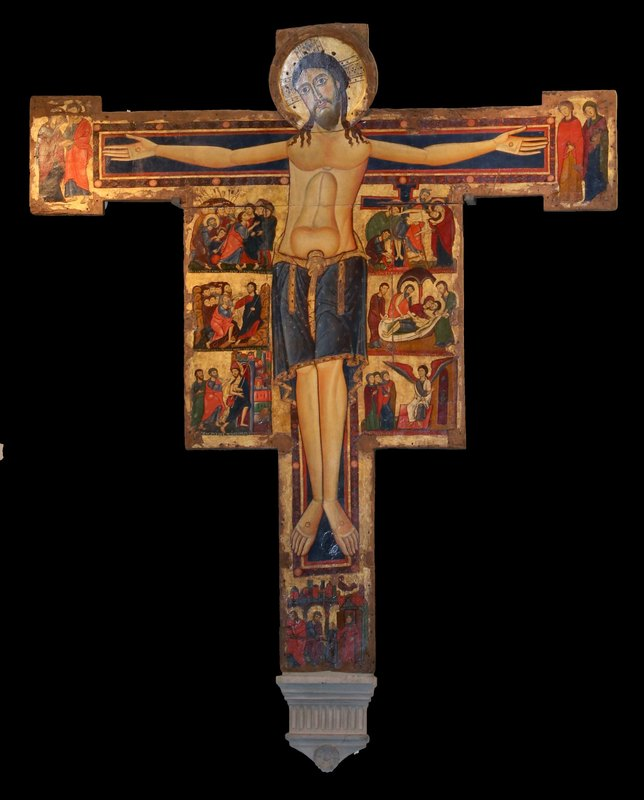
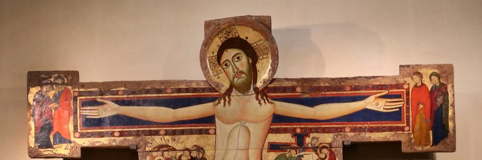
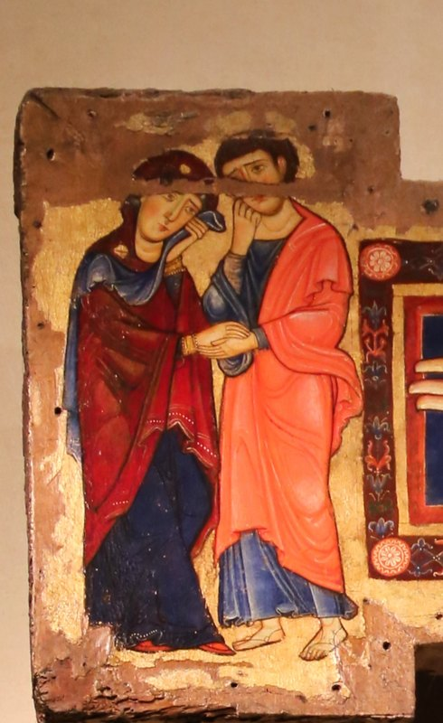
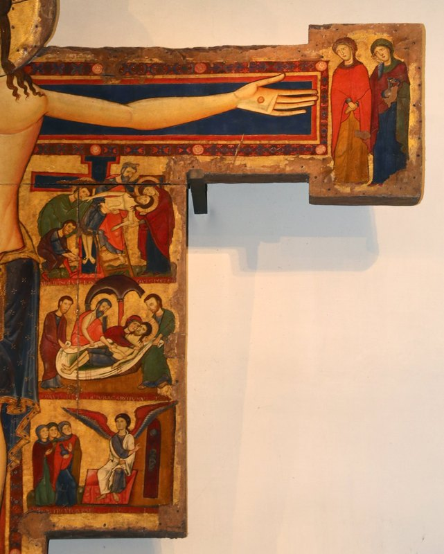
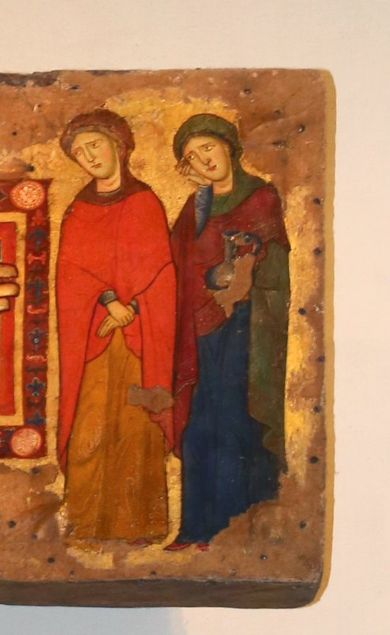
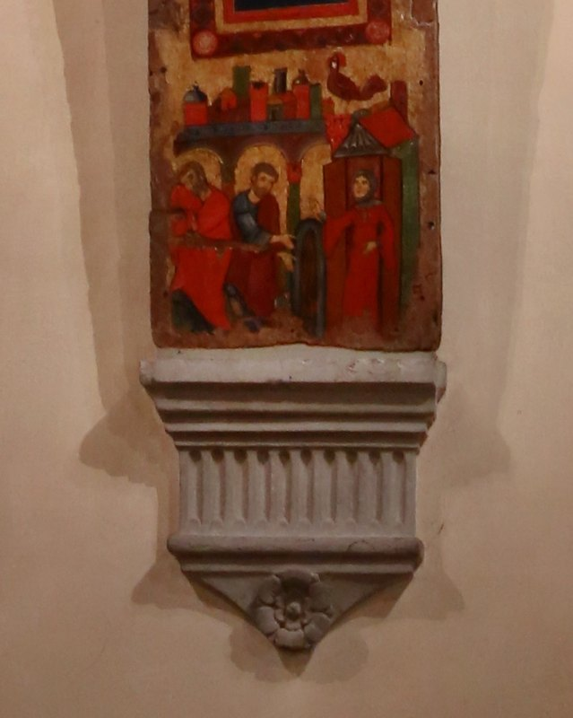
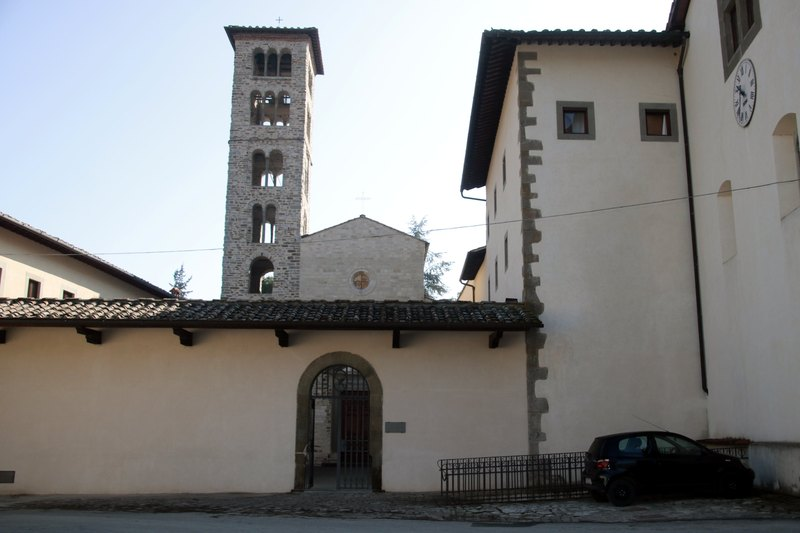
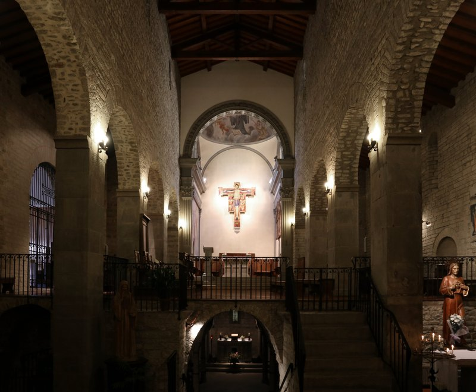
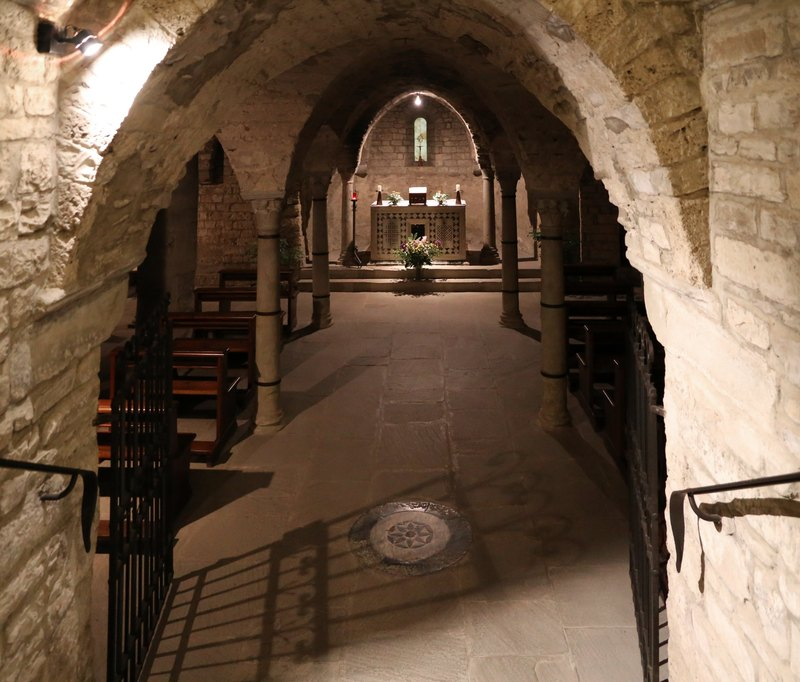

## A Painter Known by a Single Work

Medieval art history is full of painters who survive only through the works that gave them their names, and few rest on a foundation as narrow, and at the same time as rich, as the *Maestro di Rosano*. No document records him and no signature identifies him. No contract, payment or chronicle mentions a painter at work in the Benedictine<a href="/endnotes.html#fn-benedictine-order" class="footnote">1</a> nunnery on the left bank of the Arno in the 1120s or 1130s. What survives is one object of exceptional ambition: a monumental shaped panel with the living Christ on the cross, narrative scenes, mourning figures in the terminals and Latin verse captions.

The cross was painted for the nuns of the monastery of Santa Maria a Rosano, at Rignano sull'Arno near Florence, and it has never left their possession. The painter is a modern construct. His name is a convenience that lets scholars speak of a single hand behind a single work, and of the small group of other panels that may or may not belong with it. The Fondazione Zeri files the cross as the work of an anonymous twelfth-century Florentine painter and records "Maestro di Rosano" as the name found in the literature.

Every statement about the author is an inference from three kinds of evidence. The first is the object itself, which since its restoration at the Opificio delle Pietre Dure in Florence, completed in 2006, has become one of the best-understood Italian panels of the twelfth century. The second is the history of the community that commissioned it and of the comital family that protected that community. The third is the comparison with a handful of other early painted crosses, whose dates and attributions are themselves often uncertain.

The essential literature was produced by the restoration. The volume *La Croce dipinta dell'abbazia di Rosano. Visibile e invisibile*, edited by [Marco Ciatti](/scholars.html#ciatti-marco), [Cecilia Frosinini](/scholars.html#frosinini-cecilia) and [Roberto Bellucci](/scholars.html#bellucci-roberto) (2007), gathered the technical, historical, epigraphic and art-historical studies. A second volume, *La pittura su tavola del secolo XII* (2012), edited among others by [Alessio Monciatti](/scholars.html#monciatti-alessio), set the findings within an international reassessment of twelfth-century panel painting.

What emerges from this evidence is not a provincial primitive but a painter of real intellectual and technical ambition. He planned a complex narrative programme with ruled layouts and reusable patterns. He modelled bodies with graded shadows over a greenish underlayer. He laid his gold directly on the gesso and sealed the surface with a varnish meant to make the colours glow. He very probably lettered the verse captions himself, and those verses point to circuits of Latin poetry that ran between the schools of the Loire and the Rome of the reform papacy.

The restorer, the epigraphers and the authors of the later studies are named in the account that follows wherever they can be identified, and linked to the list of scholars.

The catalogue that follows examines the cross part by part, with the church and its crypt and with two Pisan crosses and two other early crosses for comparison, in sixteen entries.

The account that follows treats the monastery and the Guidi counts, the form and programme of the cross, its material body and the painter's technique, its inscriptions, its date and cultural matrix, its place among the earliest painted crosses and the question of an oeuvre, and finally its significance. Throughout, what is documented, what scholars have proposed and what remains speculation are kept apart.

## The Monastery of Santa Maria a Rosano and the Guidi

The monastery of Santa Maria a Rosano stands in the comune of Rignano sull'Arno, in the province of Florence and the diocese of Fiesole, where the Arno turns from the upper Valdarno towards Pontassieve. It is still a living Benedictine house of nuns, who celebrate the Divine Office in Latin and Gregorian chant. The painted cross thus has a continuity of liturgical use that very few twelfth-century panels can claim.

The earliest history of the monastery is wrapped in legend. A foundation date of 780 comes from an inscription on the architrave of the church portal, *ANNO DOMINI DCCLXXX EDIFICATUM FUIT*, which is itself early modern, described as sixteenth- or eighteenth-century. The same applies to the tradition, reported in the Camaldolese<a href="/endnotes.html#fn-camaldolese-order" class="footnote">2</a> annals, of a founder named Urso and his wife Rosana, from whom the place supposedly took its name.

The documented history begins with a charter of 1003, in which the abbess Rolinda leased farmland to one Ildo, son of Andrea. The early charters were edited in 1982 in *I più antichi documenti del monastero di S. Maria di Rosano (secoli XI–XIII)*. By the opening of the eleventh century Rosano was an established female community with an abbess and landed property.

For the cross, the decisive fact is Rosano's tie to the Guidi, the comital family whose lordships stretched across the Casentino, the upper Valdarno and the Apennine passes. The monastery became a proprietary possession of the Guidi in 1040, and towards the end of the eleventh century a woman of the family, Berta, became abbess; 1099 is the date usually given. Her tenure is associated with enlarging the church and building the bell tower. The historian Giampaolo Francesconi studied this relationship in the 2007 volume, in an essay on the Guidi principality and its devotion.

A firmer framework for the decades around 1130 comes from the entry on Sofia Guidi in the *Dizionario Biografico degli Italiani*, based on a dossier of witness testimony collected in 1204 for a lawsuit between the abbess of Rosano and the Guidi counts, who claimed the right to choose the abbess. Sofia was the daughter of Count Guido, numbered Guido V and also called Guido Guerra I, and of his wife Imilia. She was presumably born around 1115, and her father probably died in 1124.

Around 1129, following the example of her aunt Berta, Sofia took the veil. Her clothing as a nun was attended by the bishops of Fiesole, Pistoia and Faenza, and coincided with the rebuilding of the church, which her mother wished to restore. Her dowry included lands, and gold and precious stones laid on the altar to be made into a chalice and a thurible; her brother gave the silver of his saddle to cover a Gospel book. Sofia soon left for Pratovecchio, where in 1134 her mother founded for her the nunnery of San Giovanni Evangelista.

The rebuilt church is traditionally said to have been consecrated on 25 March 1130. It keeps its twelfth-century structure: a plain Romanesque façade, a five-storey bell tower, three aisles divided by square piers, a semicircular apse and a raised presbytery above a crypt with five aisles and columns of pietra serena. The Florentines attacked the monastery in 1143, and the Guidi patronage formally ended on 13 August 1204, when Countess Gualdrada renounced it.

The church was remodelled from 1502 and again from 1696, and "restored" in 1965, when the Baroque additions were removed. Two errors need correcting: a press article of 2006 put the consecration and Sofia's profession in 1124, the probable year of her father's death; and popular accounts call Sofia the daughter of "Guido Guerra V", a figure who never existed. The monastery's own history of the mid-twentieth century records that the cross then hung at the back of the church, above the baptismal font.

## The Cross and Its Programme

The Rosano cross belongs to the type called *croce dipinta* or *croce sagomata*: a panel cut to the outline of the cross itself. Its broad central section, the *tabellone*, extends on either side of Christ's body and provides fields for narrative scenes. The arms end in terminals that carry further figures. Originally an upper section, the cimasa, rose above the head of Christ, and a foot projected below his feet.

At the centre is a large *Christus triumphans*: Christ alive, frontal and upright, with open eyes and no sign of the weight of death. This was the dominant formula for monumental crosses in twelfth-century Italy, replaced in the thirteenth century by the *Christus patiens*. It is a theological statement, not a sign of naivety: the cross is the throne of a Christ who reigns, and his death is already his victory.

The narrative programme was established by the epigraphic study of the 2007 volume, which identified each scene by its caption. The cross now carries seven scenes. On the left are the Capture of Christ, the Descent into Limbo and the meeting on the road to Emmaus; on the right, the Deposition, the Entombment and the Holy Women at the Sepulchre. The seventh, the Denial of Peter, is on the foot. The terminals carry the Virgin and Saint John at the left and two holy women at the right.

The arrangement is not a simple chronological reading. The left column gathers episodes in which Christ appears alive or risen: betrayed but still acting, triumphant in the underworld, walking with his disciples. The right column gathers episodes of his dead or absent body: taken down, laid in the tomb, sought by the women at an empty tomb. The cross reads across as well as down, and living and dead face each other on either side of a Christ who is both crucified and alive.

The Descent into Limbo has particular weight. It is the only one of the six side scenes without a basis in the canonical Gospels, deriving from the apocryphal tradition long absorbed into the liturgy and the creed. It carries the cross's most direct message of salvation, Christ grasping Adam by the wrist. The nuns of Rosano singled out exactly this image in their own words at the cross's return in 2006.

The cross does not survive at its original size. The restoration showed that the panel was cut at top and bottom when it was moved in the early modern period. The cut at the top removed the cimasa, which must have carried the titulus and very probably a final scene, by analogy most likely an Ascension. The cut at the bottom removed the lower foot, the caption of the Denial of Peter and the element on which the cross stood.

The date of the reduction is reported inconsistently. The description of the 2007 volume and the press of 2006 speak of the early seventeenth century, in a Counter-Reformation context; Bellucci's technical account of 2012 links the reduction to the move of the cross beneath the organ at the beginning of the eighteenth. The two accounts may describe different interventions, and the most honest statement is that the cross was cut down in the seventeenth or early eighteenth century.

The Fondazione Zeri records the panel as it now stands at 253 × 230 centimetres. A figure of 445 × 370 centimetres circulates on non-specialist websites but cannot be confirmed in the specialist literature. The cross is in any case a monumental object, made to dominate the space of a church; it now hangs behind the high altar, on a moulded stone corbel.

## The Material Body and the Painter's Technique

When the cross entered the laboratories of the Opificio it was almost illegible, covered by a dark film. The restoration, carried out by the laboratory for paintings on panel and canvas with funding from a private bank, lasted about ten years; its start is given as 1994 or about 1996. On 16 December 2006 the cross was solemnly returned to the monastery and set behind the high altar.

The support is chestnut, which the Opificio's comparative studies have shown to be typical of twelfth-century Tuscan panels; the cross painted by [Guglielmo](/Content/Artists/XII-c/Maestro-Guglielmo.html) for Sarzana in 1138 is also chestnut. The carpentry differs from Sarzana: at Rosano two continuous pieces, the upright and the crossbar, are joined by a half-lap (*incastro a mezzo legno*), the solution that prevailed through the thirteenth century, from [Giunta Pisano](/Content/Artists/XIII-c/Giunta-Pisano.html) to [Cimabue](/Content/Artists/XIII-c/Cimabue.html).

Bellucci was candid that the carpentry was not refined, which may explain why the painted face was covered with two layers of very fine canvas. The ground produced the most surprising discovery: anhydrous gypsum bound with a plant gum, possibly cherry gum, instead of the usual slaked gypsum and animal glue. Two explanations have been offered as hypotheses: a ground mixed cold suits a temporary worksite, which would fit an itinerant master painting on site; and a denser ground makes the colours brighter.

Evidence of how the cross was set up was recovered too. A crosspiece on the back of the lower upright acted as a stop when the cross was slotted into a base; nails in the sides probably held cables that steadied it. The edges carry a decorated band and the back is primed. Since the raised presbytery at Rosano separated clergy from laity without a screen, the cross may have stood free in the presbytery, visible from several sides.

X-radiographs revealed that relief elements were once set around the edges of the panel, trefoil-like forms at the corners with other shapes between them. One survives on Christ's raised halo; the rest were planed away when the early modern frame was nailed over the paint. The original cross was a more sculptural object, translating into wood and paint the modelled ornaments of goldsmiths' crosses.

Infrared reflectography allowed the restorers to follow the painter's procedure. He laid out the fields with ruled charcoal lines, reinforced the divisions with incision and painted the letters directly, without preliminary drawing. He reused patterns (*patroni*): the head of Christ in the Descent into Limbo, rotated, matches the head of Christ at Emmaus. Beneath the garments he drew legs and other anatomical cues before clothing them, thinking in terms of bodies rather than outlines.

The flesh rests on a greenish-grey underlayer, the *prasinus* of Theophilus and the *proplasma* of Byzantine practice, over which the painter built graded shadows. Christ's loincloth is painted in lapis lazuli, and a red lake glaze along the left thigh makes the cloth semi-transparent and brings the leg forward in space. The gold was water-gilded directly on the gesso, without the red bole that became standard in the thirteenth century.

The varnish raised the restoration's central ethical problem. The layer in contact with the paint was the original medieval varnish, which had darkened so much that it hid the image. The Opificio concluded that it had been meant to make the colours glow like enamels, and thinned it gradually rather than removing it. As a result the cross keeps a twelfth-century surface to a degree almost without parallel: Bellucci called it a *biblia pictorum* of medieval technique.

## The Inscriptions

The verse captions are among the most important evidence the restoration brought to light. Before it, they could be read only in part; the transcription in the *Corpus of Florentine Painting* had gaps and, in places, produced a Latin later described as at least fanciful. The epigraphic study of the 2007 volume edited the six surviving captions reliably for the first time and analysed their language, metre, letter forms and sources.

The captions are written in small gold capitals, on dark green grounds on the left side and bright red grounds on the right, so that the colour reinforces the division between the column of the living Christ and that of the dead. They are leonine hexameters, in which the word at the caesura rhymes with the end of the line, and they belonged to the original design.

On the left, the Capture of Christ bears *OSCULA DAT RABI CAPIT HUNC PLES DIGNAQUE LABI*, "the master receives a kiss, the crowd seizes him, and he consents to fall", with *ples* for *plebs* and *labi* corrected from *lavi*. The Descent into Limbo bears *AD MEA REGNA REDI QUIA TE MORIENDO REDEMI*, Christ's words to Adam: "Return to my kingdom, because by dying I have redeemed you". The Emmaus scene bears *DISCIPULIS DOMINUS APPARUIT UT PEREGRINUS*, "the Lord appeared to the disciples as a pilgrim".

On the right, the Deposition bears *NIHCODEMUS SOLVIT IOSEP QUEM CORPORE C[INGIT]*, Nicodemus loosening the body that Joseph embraces; the final verb is a restoration. The Entombment bears *PER QUAM VITA DATUR VICTURA CARO TUMULATUR*, "the flesh through which life is given, destined to live, is laid in the tomb". The Holy Women bear *SUR[GI]GIT REX FORTIS FRANGENS HIC VINCULA M[ORTIS]*, "the strong king has risen, breaking here the chains of death", with a doubled syllable that is a slip of the writer.

Spellings that reflect pronunciation, corrections made during painting and the consistency of a single hand led the epigraphers to suggest that the painter wrote the captions himself, following a draft prepared by someone with good literary training. The Master of Rosano was thus a capable scribe of display lettering, working alongside a learned author who may have belonged to the community, to the Guidi entourage or to the circle that sent the painter to Rosano.

The literary sources are the most striking result. The Limbo verse corresponds word for word to a line of the *Inscriptionum christianarum libellus* traditionally attributed to Hildebert of Lavardin, and the first half of the Entombment verse to another line of the same collection, also found at the Tomb of the Virgin in Jerusalem. The verse of the Holy Women reworks two lines from the *Nuptiae Christi et Ecclesiae* of Fulcoius of Beauvais, completed about 1069–1070 and carried by its author to Pope Alexander II in Rome.

These Loire-school verses are rare in works of art outside France. Rome is the one place where both traditions are attested in painted contexts in the right period: a verse of Fulcoius in the frescoes of the lower church of San Clemente, about 1078–1084, and a Hildebertine distich at Santa Maria Immacolata at Ceri, between 1102 and 1134. The Rosano captions presuppose access to verse that circulated in painted form, on present evidence, in the Rome of the Gregorian reform.

The letter forms point the same way: a strictly maintained capital, square in proportion, with swallow-tail endings and fine serifs, unusual in twelfth-century Tuscany. The epigraphers related it to the display scripts of the giant "Atlantic" Bibles of central Italy and to the graphic culture of Montecassino under Abbot Desiderius. The analysis strongly supports a date within the first three decades of the twelfth century, and the 2012 volume followed it with studies of the cross as a reflection of the European reach of the reform.

## Date and Cultural Matrix

The dating of the cross has moved a long way over the last century. [Osvald Sirén](/scholars.html#siren-osvald) (1922) and [Evelyn Sandberg-Vavalà](/scholars.html#sandberg-vavala-evelyn) (1929) recognised close links between Rosano and the Pisan [cross of San Frediano](/Content/Artists/XII-c/Maestro-della-Croce-di-San-Frediano.html); Sandberg-Vavalà spoke of "our Romanesque-Pisan master" working far from home. The scholarship of that period, however, tended to push the earliest panels forward into the late twelfth or thirteenth century.

[Edward Garrison](/scholars.html#garrison-edward), in *Italian Romanesque Panel Painting* (1949), placed Rosano at the end of the twelfth century, a date now seen as too late by several generations. The Fondazione Zeri still gives the last quarter of the century, following him. Later writers have observed that Garrison's relative intervals between works were more reliable than his absolute dates.

The modern dating rests on [Miklós Boskovits](/scholars.html#boskovits-miklos), who in *The Origins of Florentine Painting, 1100–1270* (1993) placed the cross in 1129–1134, with the cross from San Paolo all'Orto and the first campaign at San Frediano earlier. The restoration did nothing to dislodge this date. The essays in the 2007 volume place the cross in the first three decades of the century, and Bellucci describes it as datable to 1129.

The anchor is circumstantial. It rests on the documented episode of about 1129–1130, Sofia's profession and the consecration of the rebuilt church, the moment when a monumental cross makes most sense. No document mentions the cross. A radiocarbon study was published in the 2007 volume; the narrow range of 1120–1130 attributed to it on popular websites could not be verified, and a date on wood dates the tree, not the painting. The firmest formulation is that the cross was most probably painted around 1129–1134, and in any case in the first half of the twelfth century.

Monciatti argued for a Roman origin of the painter, connected with the Byzantine-Cassinese culture that Montecassino under Desiderius had developed and that marked Roman painting in the age of the reform popes. The epigraphic findings, reached independently, gave this thesis strong support. Current reference works lean towards a painter from south-eastern Tuscany, perhaps Arezzo, with strong connections to the milieu of Rome; the two positions are not necessarily in conflict.

Rosano's relation to Byzantium is more complex than the slogans suggest. A press report of 2006 claimed that the cleaning had revealed a total absence of Byzantine influence. Some of its procedures, above all the greenish underlayer, belong to a tradition shared with Byzantine painting; its iconography and lettering belong to the culture of the Latin reform. The accurate formulation is that Rosano is Western in its programme and much of its technique, sharing certain procedures with the Byzantine-Cassinese world through Rome.

Comparisons have been proposed with the frescoes of Sant'Angelo in Formis, near Capua, and with the Catalan apses of Taüll, consecrated in 1123. They place Rosano within a broad Romanesque culture of the human figure, monumental and solemn yet increasingly concerned with volume and weight, and should be read as evidence of a shared culture rather than of direct contact.

The painter's search for bodily presence sets him apart from his contemporary at Sarzana. At Rosano the legs are modelled with shading, the loincloth is semi-transparent, the halo is solid enough to be held. At Sarzana the restoration found purely linear underdrawing, a white ground without a coloured underlayer and flesh painted in a single layer. The two crosses are roughly contemporary and both carry leonine verse, but they belong to different schools.

## Among the Earliest Crosses: the Question of an Oeuvre

The cross from San Paolo all'Orto in Pisa, now in the Museo Nazionale di San Matteo, is generally placed around 1100–1120 and considered by many the earliest known Tuscan painted cross. The cross of San Frediano in Pisa has two superimposed campaigns: the earlier, uncovered in the restoration of 1968–1972, survives in the central Christ; the later, in the side scenes and the cimasa, has long been recognised as extremely close to Rosano.

[Fabrizio Bianchi](/scholars.html#bianchi-fabrizio), in a study of the San Frediano inscriptions (2017), dated the first campaign to about 1100–1120 and the second to about 1130–1140, and considered the second, together with the first campaign of a headless cross also in San Matteo, very probably by the same master as Rosano. Boskovits had already considered the Pisan works perhaps by the same hand. If accepted, these attributions would make the Master of Rosano a painter active in Pisa as well as in the Valdarno.

Guglielmo's cross at Sarzana, signed and dated 1138, remains the earliest painted cross with a secure date. It is the only other early painted cross with captions in its scenes, but its script belongs among Tuscan manuscripts, while Rosano's points towards Rome. The [Cross 432](/Content/Artists/XII-c/Maestro-della-Croce-432.html) of the Uffizi carries the *Christus triumphans* with narrative scenes into Florence later in the century, with the same arrangement as Rosano: mourners on the arms and scenes beside the body.

The strongest candidate for a second work is a smaller painted cross in a Roman private collection, which Garrison recorded as coming from the Florentine art market. Monciatti and [Angelo Tartuferi](/scholars.html#tartuferi-angelo) attributed it outright to the Master of Rosano, and the Opificio judged it absolutely by the same hand. [Roberto Longhi](/scholars.html#longhi-roberto) (1948) doubted its authenticity, Garrison's X-rays of 1962 showed repainting of the torso and loincloth, and Bianchi rejects it as autograph, proposing a pupil working around 1190.

The cross at Castiglion Fiorentino, from the former parish church of San Giuliano and now in the town's Pinacoteca, preserves Rosano's iconographic and structural model with cut-down side panels. The Opificio regarded it as a later replica of somewhat lower quality; Bianchi dates it about 1170–1180 as possible workshop work; Garrison placed it as late as about 1250. Its existence shows that the Rosano model persisted in the Arezzo region.

It follows that the Master of Rosano should be treated as the author of one securely identified work. Around it a small, disputed group of attributions and derivations has formed. To speak of his career, his development or his workshop goes beyond the evidence, except as a framework for testing hypotheses.

The popular claim that Rosano is "the oldest panel painting in Italy" should be firmly corrected. Roman icons are centuries older, and even among painted crosses San Paolo all'Orto and the first campaign of San Frediano are generally placed earlier. The defensible claim is narrower and more interesting: Rosano is one of the oldest surviving Tuscan painted crosses, and very probably the earliest securely connected with Florentine territory.

The Opificio traced a native Western line from the Master of Rosano to the [Master of the Bigallo](/Content/Artists/XIII-c/Maestro-del-Bigallo.html), visible in Florentine painting before the arrival of Byzantine influence by way of Pisa. In 2018 a fragmentary Madonna from Rosano, part of a Maestà attributed to the [Master of the Uffizi Cross 434](/Content/Artists/XIII-c/Maestro-della-Croce-434.html) and datable to about 1235–1240, was deposited at the Opificio: the nuns continued to commission panels in the following century.

## The Relic and the Question of Patronage

The restoration's most publicised discovery concerned the interior of the panel. A cavity was found containing a small cloth bag with a fragment of bone and a small slate cross, decorated on both faces and pierced so that it could be worn. According to Bellucci, the relic was originally sealed in a cavity above Christ's head and rehoused when that part was cut away. The cross was a monumental reliquary as well as an image.

From this point the evidence thins into conjecture. Popular accounts speak of an "enclopion", a garbling of the Greek *encolpion*, "brought back by crusaders", of a bone from the Holy Sepulchre and of a cross commissioned by a nobleman returning from the crusade. None of this is documented: no inscription accompanies the relic, the bone is unidentified, and the slate cross could have reached Rosano by gift, pilgrimage, purchase or inheritance.

The chronology raises a further difficulty. If Sofia's father died in 1124 and the cross dates from around 1129–1134, he cannot have commissioned it on his return from anywhere. At most the cross could commemorate him, or enclose an object associated with him.

The Guidi connection is solid as context, though not as a documented commission. The family held the patronage of Rosano, supplied its abbesses and lavished gifts on the church at Sofia's profession. Yet the testimony of 1204 lists a chalice, a thurible and a Gospel-book cover among the gifts of 1129, and does not mention a painted cross. That silence does not prove the cross was not a Guidi gift, but it rules out treating the commission as documented.

The most responsible statement is that the cross was very probably made for the rebuilt church of around 1129–1130, at a time of heavy Guidi investment, and that a Guidi commission linked to Sofia's profession is likely but unproven. The origin of the relic and the crusading romance attached to it remain beyond the evidence.

The cross was made for enclosed nuns and remains in their church. The 2007 volume included contributions by the nuns themselves and by a Benedictine abbot on its place in Benedictine liturgy. For the community the cross was the focus of the Office, the sign of Christ's kingship and the guardian of a sacred deposit; at its return in 2006 the homily insisted that the image serves the liturgy.

Its modern reception was long shaped by inaccessibility. It was shown at the Giotto exhibition in Florence in 1937 as part of the background against which Giotto was supposed to have reacted, and the mid-century syntheses passed it over. The restoration made it the subject of two monographs, the starting point of a series of studies, *Dal restauro agli studi*, and a reference point in the debates on the Gregorian reform and the material history of panel painting.

The continuity of use that kept the cross in its church also preserved its original varnish, protecting it from the drastic cleanings to which museum objects were often subjected. Liturgical image and art-historical document are, at Rosano, the same object.

## Significance

The Master of Rosano remains nameless, and very probably always will. Yet the evidence gathered around his single secure work allows a portrait of unusual precision, not of the man but of the painter: his planning, his drawing of bodies beneath garments, his greenish underlayer, his gold laid on gesso, his varnish, his lettering.

He is significant first for the history of the painted cross. The Rosano cross is among the earliest painted crosses in Tuscany, and its carpentry, with the continuous upright and crossbar joined by a half-lap, anticipates the solution that dominated the next century and a half.

He is significant for the history of technique. Technically the Rosano cross is the best-preserved twelfth-century panel in Italy, with its original medieval varnish thinned but kept, and it has become a benchmark against which more damaged works are measured.

He is significant for the history of ideas. The verse captions, drawn from the poetry of the Loire schools and from Fulcoius of Beauvais, and lettered in a Roman-inflected capital, connect early Tuscan panel painting with Rome and the Gregorian reform, rather than leaving it a regional prelude to Pisa.

He is significant for the history of Florentine painting. The cross is very probably the earliest work securely connected with Florentine territory, and the Opificio has traced from it a native line leading to the Master of the Bigallo.

He is significant, finally, as a lesson in method. The cross shows what restoration conceived as research can achieve: from a darkened shadow above a baptismal font, it has become a manual of medieval technique and a document of intellectual history. It also shows how quickly attractive hypotheses, the crusader relic, the oldest painting in Italy, harden into false facts once they leave the specialist literature.

Whether the painter was a Roman called north, a Tuscan formed in the culture of Roman reform or a master based in the Arezzo region remains open. So does the question whether the Roman cross and the Pisan works are by his hand. The present entry records these questions without deciding them.

The catalogue that follows presents the cross as a whole and in detail, the monastery, the church and the crypt in which it stands, and four crosses for comparison: San Frediano and San Paolo all'Orto in Pisa, Sarzana and the Cross 432 of the Uffizi.

## Catalogue Entry

### The Painted Cross of Rosano

<figure>
  
  <figcaption>Maestro di Rosano, painted cross with Christ triumphant and scenes of the Passion and the Resurrection, c. 1129–1134, tempera and gold on chestnut panel, 253 × 230 cm (Fondazione Zeri). Rignano sull'Arno (Florence), monastery of Santa Maria a Rosano. Photo: Sailko, <a href="https://creativecommons.org/licenses/by/3.0/">CC BY 3.0</a>, via Wikimedia Commons.</figcaption>
</figure>

The photograph shows the cross as it now hangs behind the high altar of the monastery church, set on a moulded stone corbel. It is the cross reduced at top and bottom in the early modern period: the cimasa above the head is lost, and the foot ends with the scene of the Denial of Peter, without its caption.

Christ stands at the centre, alive, frontal and upright, his arms stretched horizontally along a blue crossbar framed by red bands and borders of rosettes and lilies. His head, framed by a raised halo, is held straight; his eyes are open. His feet stand side by side, each pierced by its own nail.

The body is pale and drawn with clear outlines. The breast is marked by a broad curve, the abdomen divided into large rounded forms with a long vertical line, in the convention of Romanesque painting. The flesh is modelled over the greenish underlayer that the restoration revealed, with graded shadows that give it volume.

The loincloth is long and painted in lapis lazuli, scattered with small gold motifs and bordered with pearled bands; it is knotted at the waist with a broad band whose end falls in front. Along the left thigh a red lake glaze makes the cloth semi-transparent.

Beside the body, six scenes fill the *tabellone* in two columns of three, each with its verse caption beneath. On the left are the Capture of Christ, the Descent into Limbo and the meeting at Emmaus; on the right the Deposition, the Entombment and the Holy Women at the Sepulchre.

At the ends of the arms stand the mourners: the Virgin and Saint John at the left, two holy women at the right. The terminals project above and below the crossbar in the stepped outline that the type retained through the thirteenth century.

The surface keeps a twelfth-century character that few panels share. The original varnish, thinned but not removed, gives the colours a depth and brilliance close to that of enamel, as the Opificio believed the painter intended.

The detail entries that follow examine the cross part by part. They are based on a second photograph of the cross by the same photographer, from which the details have been cropped.

### The Head of Christ and the Arms

<figure>
  
  <figcaption>Maestro di Rosano, the head of Christ, the arms and the terminals with the mourners. Detail of the painted cross of Rosano. Photo: Sailko, <a href="https://creativecommons.org/licenses/by/3.0/">CC BY 3.0</a>, via Wikimedia Commons (detail).</figcaption>
</figure>

The detail shows the upper part of the cross: the head of Christ, the arms stretched along the crossbar and the two terminals with the mourners. It is the part of the cross that the eye reaches first, and the one in which the triumphant character of the image is clearest.

The head is framed by a raised halo, carved and gilded, the only surviving example of the relief elements that once ran around the edges of the panel. A cross is inscribed in the halo, its arms decorated with lozenges and small coloured settings, some now empty.

The face is long and grave. The eyes are large, with dark pupils outlined in black under arched brows; the nose is long and straight; the mouth small and closed. The beard and moustache are painted with greenish shadows, and long locks of dark hair fall in waves on the shoulders.

The flesh is cool and luminous. The greenish underlayer, visible in the shadows of the face and neck, gives it a subtle modelling; the cheeks carry a faint red. The expression is calm and solemn: this is a Christ who reigns, not one who suffers.

The arms are stretched almost horizontally, the hands open and turned outwards, the wounds marked as small red discs. They are long and smoothly modelled, with a gentle shading along the underside that gives them volume.

The crossbar behind them is painted a deep blue, framed by red bands and by borders of rosettes and stylised lilies on a dark ground. The ornament, regular and precise, shows the painter's ruled layout and his care for decorative detail.

At the left end the Virgin and Saint John stand side by side, and at the right end two holy women. The terminals are examined in the following entries. A crack running across the upper part of the left terminal, and losses along the upper edge, show the damage of nine centuries.

The detail allows the head of Christ to be compared with the heads in the scenes. The restoration showed that the painter reused patterns: the long face, large eyes and straight nose recur at small scale in the Descent into Limbo and at Emmaus.

### The Left Side of the Cross

<figure>
  
  <figcaption>Maestro di Rosano, the left side of the cross, with the Virgin and Saint John and the scenes of the Capture of Christ, the Descent into Limbo and Emmaus. Photo: Sailko, <a href="https://creativecommons.org/licenses/by/3.0/">CC BY 3.0</a>, via Wikimedia Commons.</figcaption>
</figure>

The photograph shows the left half of the cross, as seen by the viewer: the terminal with the Virgin and Saint John, Christ's right arm along the crossbar, and the column of three scenes beside his body. It gives the relation between the parts that the details separate.

The terminal is a projecting rectangle at the end of the crossbar, stepped above and below. The Virgin and John stand together within it on the gold ground. Their scale is larger than that of the figures in the scenes, though much smaller than Christ.

Christ's arm, long and pale, stretches along the blue band to the open hand, with its wound. The band is framed by red lines and borders of rosettes, which continue around the scenes below and bind the surface together.

The three scenes of the left column are stacked one above the other, each with a caption in gold letters on a dark green band. They are, from top to bottom, the Capture of Christ, the Descent into Limbo and the meeting at Emmaus: the episodes in which Christ appears alive or risen.

At the right edge of the photograph the blue loincloth of Christ, with its gold motifs and pearled border, falls beside the scenes. The great figure and the small stories are painted side by side, at very different scales.

The edges of the panel show the bare wood where the paint and ground have been lost, and small holes where the relief elements and the early modern frame were nailed. The lower edge of the terminal is broken.

The photograph shows the panel's stepped outline, with the terminal projecting below the crossbar and the *tabellone* beginning beneath it. This outline, the restoration showed, was cut from the continuous crossbar and upright joined at the centre.

The scenes of this column are examined in a separate entry. The colour of the caption bands, dark green, distinguishes them from the red bands of the right column.

### The Virgin and Saint John

<figure>
  
  <figcaption>Maestro di Rosano, the Virgin and Saint John, left terminal of the painted cross of Rosano. Photo: Sailko, <a href="https://creativecommons.org/licenses/by/3.0/">CC BY 3.0</a>, via Wikimedia Commons (detail).</figcaption>
</figure>

The left terminal shows the Virgin and Saint John, the two witnesses of the Crucifixion named in the Gospel of John. They stand side by side on the gold ground, turned slightly towards each other and towards the centre of the cross.

The Virgin wears a dark red mantle over a deep blue robe scattered with small dots, its hems edged with fine white pearls. She raises a fold of her veil to her eyes, wiping her tears, and with her other hand holds the hand of John. The gesture is tender and unusual in its intimacy.

John, young and beardless, with short dark hair, wears a bright orange-red mantle over a blue tunic. He raises his hand to his cheek in the traditional gesture of grief, and gives his other hand to the Virgin. The two hands clasped between them form the centre of the composition.

The joined hands recall the words of Christ from the cross in the Gospel of John, entrusting his mother to the disciple and the disciple to his mother. The painter has turned the two separate mourners of the tradition into a pair united by a gesture.

The drapery is modelled with graded colour and fine highlights. John's mantle falls in broad, soft folds, the Virgin's in deeper, darker ones. The figures have weight and volume: they stand on the ground, their feet in sandals and red shoes visible beneath the hems.

A horizontal crack crosses the panel at the level of their faces, with a strip of loss that cuts through the Virgin's eyes and John's brow. Above, the gold is worn and the wood shows; small holes mark the places where the frame was nailed.

At the right the ornamental border of the crossbar, with rosettes and lilies, frames the terminal. The rosettes, painted in red and white, resemble the enamelled bosses of goldsmiths' work.

The figures show the painter's concern for the human body and for expression. Their faces, with large eyes and arched brows, are close in type to the faces of the scenes, and their grief is rendered with restraint and truth.

### The Capture of Christ, the Descent into Limbo and Emmaus

<figure>
  
  <figcaption>Maestro di Rosano, the Capture of Christ, the Descent into Limbo and the meeting at Emmaus, left column of the painted cross of Rosano. Photo: Sailko, <a href="https://creativecommons.org/licenses/by/3.0/">CC BY 3.0</a>, via Wikimedia Commons (detail).</figcaption>
</figure>

The left column holds the three scenes in which Christ appears alive or risen. Each is framed in gold and set above a band of dark green carrying its verse caption in gold capitals.

In the Capture of Christ, at the top, Judas, in a red mantle over blue, embraces Christ and presses his face to his. Christ, in a dark mantle, stands calm, his head turned slightly away. Around them a crowd of men with hoods and caps presses in, and above them rise spears, torches and staves.

At the lower left of the scene Peter, with a gold halo and grey beard, seizes the young Malchus by the head, his sword at the servant's ear. A red lantern, round and dotted, lies on the ground at the centre. The caption reads *OSCULA DAT RABI CAPIT HUNC PLES DIGNAQUE LABI*.

In the Descent into Limbo, Christ, in a dark mantle over red, holding a long cross-staff, strides forward and grasps by the wrist an old man in red and blue who kneels before him: Adam. Behind Adam a crowd of heads, the righteous of the Old Testament, rises between rocky forms. Under Christ's feet lie the broken doors of Hell and dark flames.

The caption of the Descent, *AD MEA REGNA REDI QUIA TE MORIENDO REDEMI*, gives Christ's own words to Adam. It is the line that corresponds word for word to a verse of the Hildebertine collection, and the image is the one that the nuns of Rosano singled out at the cross's return.

In the scene at Emmaus, at the bottom, Christ appears as a pilgrim, as the caption says: *DISCIPULIS DOMINUS APPARUIT UT PEREGRINUS*. He wears a tall red hat and carries a long staff and a red bag, his chest partly bare under a dark mantle. Two disciples approach from the left, the first gesturing towards him.

At the right of the Emmaus scene rises a walled city of towers, domes and red roofs, Emmaus or Jerusalem. The architecture is painted freely, without incised construction lines, as the restoration observed. The image of Christ as pilgrim is familiar from the Western liturgical drama of the *Peregrinus*.

The three scenes show the painter's narrative skill: crowded compositions with clear centres, faces that turn and look, hands that grip. The restoration found that the head of Christ in the Descent, rotated, matches exactly the head of Christ at Emmaus, a sign of the reuse of patterns.

### The Right Side of the Cross

<figure>
  
  <figcaption>Maestro di Rosano, the right side of the cross, with two holy women and the scenes of the Deposition, the Entombment and the Holy Women at the Sepulchre. Photo: Sailko, <a href="https://creativecommons.org/licenses/by/3.0/">CC BY 3.0</a>, via Wikimedia Commons.</figcaption>
</figure>

The photograph shows the right half of the cross, as seen by the viewer: Christ's left arm along the crossbar, the terminal with two holy women and the column of three scenes beside his body.

The arm stretches along the blue band, framed by red lines and borders of rosettes and lilies, to the open hand with its wound. The hand reaches almost to the terminal, so that the two women stand just beyond Christ's fingers.

The terminal holds two holy women standing on the gold ground, turned towards the centre. They are examined in a separate entry. A diagonal crack runs across the crossbar near the terminal, and the upper edge of the panel is worn.

The three scenes of the right column are stacked one above the other, each with its caption on a red band. From top to bottom they show the Deposition, the Entombment and the Holy Women at the Sepulchre: the episodes of the dead or absent body of Christ.

At the top of the Deposition a blue cross with red borders, the cross of the scene, rises against the gold, so that the Deposition reproduces in small the instrument on which the great Christ stands.

At the left edge the blue loincloth of Christ, with its pearled border and gold motifs, falls beside the scenes. A long vertical crack runs through the scenes, following a joint of the panel.

The column faces the left column across the body of Christ. The colour of the caption bands, red here and green there, marks the division between the living and the dead, and the reading across the cross from left to right.

The terminal and the *tabellone* show the stepped outline of the panel, with the terminal projecting below the crossbar. The lower edge of the *tabellone*, at the bottom of the photograph, is cut straight, with bare wood showing.

### The Deposition, the Entombment and the Holy Women

<figure>
  
  <figcaption>Maestro di Rosano, the Deposition, the Entombment and the Holy Women at the Sepulchre, right column of the painted cross of Rosano. Photo: Sailko, <a href="https://creativecommons.org/licenses/by/3.0/">CC BY 3.0</a>, via Wikimedia Commons (detail).</figcaption>
</figure>

The right column holds the three scenes of the dead or absent body of Christ. Each is set above a red band carrying its verse caption in gold capitals.

In the Deposition, at the top, a blue cross rises at the back. Joseph of Arimathea, grey-bearded, stands on a ladder and lowers the body of Christ, which sags across his shoulder. John, in green, supports the body from the left. The Virgin, at the right, in a dark red mantle, receives her son's head and presses her face to his.

At the lower left Nicodemus kneels and draws the nails from the feet with pincers. The body is pale and limp, its arms hanging, its eyes closed: the dead Christ of the scenes beside the living Christ of the cross. The restoration observed that the Virgin holds the halo of Christ as if it were a solid object she can grip.

The caption reads *NIHCODEMUS SOLVIT IOSEP QUEM CORPORE C[INGIT]*, with the names of the two men who took down the body. The final word is lost and restored by the epigraphers.

In the Entombment, under a dark canopy resting on a column, the body wrapped in a white shroud is laid down by several men, while the Virgin, in red, presses her cheek to the face of her son. Two men stand at the sides, holding the ends of the shroud. The caption reads *PER QUAM VITA DATUR VICTURA CARO TUMULATUR*.

In the Holy Women at the Sepulchre, at the bottom, three women in veils and mantles, one holding a jar of ointment, approach from the left. An angel in white, with large red and blue wings, sits on a red stone and points to the open tomb at the right, where the grave cloths lie in a dark niche.

The caption of the last scene, *SUR[GI]GIT REX FORTIS FRANGENS HIC VINCULA M[ORTIS]*, proclaims the Resurrection: the strong king has risen, breaking the chains of death. It reworks two lines of Fulcoius of Beauvais, and the doubled syllable is a slip of the writer.

The three scenes, read together, move from the body taken down, to the body laid in the tomb, to the empty tomb. Facing the left column, they complete the reading across the cross: the living Christ on the left, the dead and risen on the right, the triumphant Christ at the centre.

### Two Holy Women

<figure>
  
  <figcaption>Maestro di Rosano, two holy women, right terminal of the painted cross of Rosano. Photo: Sailko, <a href="https://creativecommons.org/licenses/by/3.0/">CC BY 3.0</a>, via Wikimedia Commons (detail).</figcaption>
</figure>

The right terminal shows two holy women, the women who according to the Gospels watched the Crucifixion from a distance. They balance the Virgin and Saint John on the opposite terminal.

The first woman wears a red veil, a broad red mantle and an ochre dress. Her hands are folded before her, and her head is inclined towards her companion. Her face, long and pale, with large eyes, has an expression of quiet sorrow.

The second woman wears a green veil, a dark red mantle and a deep blue dress. She rests her cheek on her hand, the traditional gesture of grief, and with her other hand holds a small jar against her breast: the jar of ointment with which the women went to the tomb.

The jar connects the women of the terminal with the women of the last scene of the right column, who carry the same jars to the empty tomb. The figure in the terminal anticipates, beside the cross, the visit to the tomb that the scene below narrates.

The drapery is painted in broad areas of colour, red, ochre, green and blue, with fine lines for the folds. The figures are simpler than the Virgin and John, but they share their long faces and restrained expression.

The gold ground is worn, especially at the edges, where the bare wood shows. Small holes run around the edge of the panel, marking the places where the early modern frame was nailed and the relief ornaments were planed away.

A small loss at the level of the first woman's hand shows the preparation beneath the paint. The surface elsewhere is well preserved, with the colours deepened by the original varnish.

The Fondazione Zeri records the Virgin, Saint John and the Holy Women among the subjects of the terminals. The two terminals together present four mourners, two on each side, grieving before the triumphant Christ.

### The Denial of Peter

<figure>
  
  <figcaption>Maestro di Rosano, the Denial of Peter, foot of the painted cross of Rosano, above the modern stone corbel. Photo: Sailko, <a href="https://creativecommons.org/licenses/by/3.0/">CC BY 3.0</a>, via Wikimedia Commons (detail).</figcaption>
</figure>

The scene on the foot of the cross is the Denial of Peter, the seventh scene of the programme. Its caption, which ran beneath it, was lost when the lower part of the panel was cut away in the early modern period.

The setting is the courtyard of the high priest's house. Above, a skyline of towers, domes and red and green roofs stands for the city of Jerusalem. Below it, two arches frame two men at the left, and at the right a small house with a red roof opens its door.

At the left two men stand together, one in a red mantle, the other in blue and red. One of them is Peter, who in the Gospels denies three times that he knows Christ. The gestures of the two men suggest a conversation, or a challenge and a denial.

At the right a woman in red stands at the open door of the house. She is the servant girl who recognised Peter and asked whether he was not one of Christ's disciples. Her figure, framed by the doorway, faces the two men.

On the roof of the house a red cock is perched: the cock whose crowing, as Christ had foretold, followed Peter's third denial. Its presence identifies the scene beyond doubt.

The choice of the Denial for the foot of the cross is significant. Placed beneath the feet of Christ, it confronts the viewer with the weakness of the first of the apostles, and with the possibility of repentance, before the triumphant Christ above.

Below the scene, the photograph shows the moulded stone corbel on which the cross now rests, a modern support with fluting and a carved rosette. The original foot of the cross, which was slotted into a base, has been cut away.

The scene shows the painter's freehand architecture, which the restoration found was painted without incised construction lines, as in the Emmaus scene. Its bright reds and greens, and the lively silhouette of the cock, give it a narrative directness well suited to its place at the foot of the cross.

### The Monastery and the Bell Tower

<figure>
  
  <figcaption>Rignano sull'Arno, monastery of Santa Maria a Rosano, the enclosure, the gable of the church and the Romanesque bell tower. Photo: Mongolo1984, <a href="https://creativecommons.org/licenses/by-sa/4.0/">CC BY-SA 4.0</a>, via Wikimedia Commons.</figcaption>
</figure>

The photograph shows the monastery of Santa Maria a Rosano from the street, as the visitor approaches it. A plastered enclosure wall, covered by a tiled roof, closes the space in front of the church; a round-arched stone doorway with an iron gate leads through it.

Behind the wall rises the gable of the church, plain and built of squared stone, with a small round window. The façade is the Romanesque front of the church rebuilt around 1129–1130, stripped of later additions in the restoration of 1965.

At the left stands the bell tower, tall and square, of grey stone. Its storeys are opened by round-arched windows, single at the bottom and grouped in twos and threes above, the openings growing lighter as the tower rises, in the Lombard manner.

The building of the bell tower is associated with the abbess Berta of the Guidi family, whose tenure began around 1099. The tower thus belongs to the generation before the cross, and to the same campaign of Guidi investment in the monastery.

At the right rises the tall white building of the monastery, with stone quoins at its corner and a clock on its upper wall. It belongs to the later remodelling of the conventual buildings, from the sixteenth century onwards.

The enclosure wall marks the boundary of the enclosed community. The nuns of Rosano still live within it and follow the Benedictine rule, and the church is open to visitors at the times of the liturgy.

The ensemble, modest in scale, gives the setting of the cross: a rural monastery in the Arno valley, under the protection of a great comital family, in which a painter of exceptional culture worked in the 1130s.

The photograph complements the views of the interior and of the crypt that follow. Together they show the church for which the cross was painted, in which it has remained for nearly nine centuries.

### The Church of Santa Maria a Rosano

<figure>
  
  <figcaption>Rignano sull'Arno, monastery of Santa Maria a Rosano, the church, with the raised presbytery, the crypt and the painted cross behind the high altar. Photo: Sailko, <a href="https://creativecommons.org/licenses/by/3.0/">CC BY 3.0</a>, via Wikimedia Commons.</figcaption>
</figure>

The photograph shows the interior of the monastery church, the setting for which the cross was painted. The view looks from the nave towards the apse, where the cross hangs behind the high altar.

The church keeps its twelfth-century structure, traditionally consecrated in 1130. Three aisles are divided by square stone piers carrying round arches, under a wooden roof. The walls are of rough stone, left bare by the restoration of 1965, which removed the Baroque additions.

The presbytery is raised above the level of the nave, reached by steps and enclosed by iron railings. Below it, an arched opening gives onto the crypt. This arrangement separated clergy and laity without a screen, and suggested to the restorers that the cross may have stood free in the presbytery.

At the back, in the apse, the cross hangs on the white wall, lit from below. It stands where it was placed in 2006, at its return from the Opificio. In the mid-twentieth century it hung at the back of the church, above the baptismal font.

The semi-dome of the apse carries a later fresco of a figure in a black habit among angels, probably Saint Benedict, the patron of the order. The apse and its decoration belong to the early modern remodelling of the church.

At the left a grille marked *CHORUS* closes the nuns' choir, from which the enclosed community follows the liturgy. The nuns of Rosano still celebrate the Divine Office in Latin and Gregorian chant before the cross.

The photograph shows the scale of the cross in its setting. Seen from the nave, it is a large, bright image above the altar, its colours and gold visible from a distance, its scenes too small to read.

The church thus preserves the relation between the cross and its liturgical setting that most twelfth-century panels have lost. Few works of the period can still be seen in the building for which they were made and in the use for which they were intended.

### The Crypt

<figure>
  
  <figcaption>Rignano sull'Arno, monastery of Santa Maria a Rosano, the crypt beneath the presbytery. Photo: Sailko, <a href="https://creativecommons.org/licenses/by/3.0/">CC BY 3.0</a>, via Wikimedia Commons.</figcaption>
</figure>

The crypt lies beneath the raised presbytery of the church. It is entered through a stone arch, seen in the foreground of the photograph, and opens into a hall of low vaults on slender columns.

The crypt has five aisles divided by columns of pietra serena, the grey sandstone of the Florentine region. The columns carry simple capitals and low groin vaults. The arrangement invites comparison with the crypt of San Miniato al Monte in Florence.

At the back a small apse, lit by a narrow window, holds the altar. Its front is inlaid with geometric patterns in marble, lozenges and interlaced circles, in the manner of Romanesque marble work.

In the floor, in the foreground, a round stone slab is carved with a star. Wooden benches stand in the aisles, for the use of the community and of visitors.

The crypt is part of the twelfth-century church rebuilt around 1129–1130. Its presence beneath the presbytery explains the raised position of the altar and the arrangement of the church, in which the cross was seen above the crypt.

The restorers argued that the cross may have stood free in the presbytery above the crypt, with its painted front facing the nave and its decorated back facing the choir. The crypt and the presbytery together form the setting in which this arrangement can be imagined.

The architecture of the crypt, sober and solid, belongs to the same culture as the church and the cross: the Romanesque of the Florentine region, open to wider currents through the networks of the Benedictine houses.

The photograph shows the crypt as it appears today, restored and in use. Its quiet, lit space gives a sense of the monastic setting in which the cross was conceived.

### Comparison: the Cross of San Frediano, Pisa

<figure>
  
  <figcaption>Painted cross of San Frediano, first painting c. 1110–1120, repainting c. 1130–1140 attributed to the Maestro di Rosano, tempera and gold on panel, for comparison. Pisa, church of San Frediano. Photo: Sailko, <a href="https://creativecommons.org/licenses/by/3.0/">CC BY 3.0</a>, via Wikimedia Commons.</figcaption>
</figure>

The cross of San Frediano in Pisa is the comparison most closely bound up with the Master of Rosano. It has its own entry, the [Maestro della Croce di San Frediano](/Content/Artists/XII-c/Maestro-della-Croce-di-San-Frediano.html), where its history and its two painted campaigns are discussed.

The cross carries two superimposed paintings. The earlier, uncovered in the restoration of 1968–1972, survives in the central Christ; the later survives in the side scenes and the cimasa. Bianchi (2017) dated the first to about 1100–1120 and the second to about 1130–1140, and considered the second very probably by the same master as Rosano.

The programme is close to Rosano's in type. A living, frontal Christ with open eyes stands at the centre; six scenes fill the *tabellone*, three to a side: the Agony in the Garden, Pilate washing his hands, the Way to Calvary, the Resurrection, the appearance on the Sea of Galilee and the Incredulity of Thomas. The cimasa, preserved here, shows the Pentecost, with the apostles seated in a row.

The terminals carry the prophets David and Isaiah, not the mourners, and the titulus is written twice, in two superimposed lines, a feature that Bianchi studied as unique among twelfth-century crosses.

The figure of Christ shows the same pattern as at Rosano: the broad breast, the abdomen divided into large rounded forms with a long vertical line, the narrow hips. The loincloth is long and translucent, grey-blue, knotted at the waist with a gold band, as at Rosano.

The halo is set with raised bosses, and the arms stretch along a dark blue band framed by ornamental borders. The scenes, crowded and lively, are painted with the same bright reds, blues and greens as those of Rosano.

The preserved cimasa of San Frediano suggests what Rosano has lost: a final scene above the titulus, here the Pentecost, at Rosano very probably an Ascension. The two crosses together show the full form of the early Tuscan narrative cross.

If the attribution of the second campaign is accepted, the Master of Rosano worked in Pisa as well as in the Valdarno, and San Frediano is his second surviving work. The attribution rests on style, on a cross whose layers are partly superimposed and damaged, and remains a hypothesis.

### Comparison: the Cross from San Paolo all'Orto, Pisa

<figure>
  
  <figcaption>Pisan painter, painted cross with Christ triumphant, c. 1100–1120, tempera and gold on panel, from San Paolo all'Orto, for comparison. Pisa, Museo Nazionale di San Matteo. Photo: Francesco Bini, <a href="https://creativecommons.org/licenses/by-sa/4.0/">CC BY-SA 4.0</a>, via Wikimedia Commons.</figcaption>
</figure>

The cross from the church of San Paolo all'Orto in Pisa, now in the Museo Nazionale di San Matteo, is generally placed around 1100–1120 and is considered by many the earliest known Tuscan painted cross. Boskovits placed it, with the first campaign of San Frediano, before Rosano.

The cross is heavily worn. Much of the paint on the crossbar and the edges is lost, and the bare wood shows. The central figure, the halo and parts of the scenes survive, enough to show the type and the style.

Christ stands upright and frontal, with large staring eyes under heavy brows, a long nose and a dark beard. His face, framed by long dark hair, has a severe, hieratic intensity. His halo is gilded.

The body is drawn with strong outlines and little modelling. The loincloth is pale blue, knotted at the waist with a large gold knot whose end falls in front, in the form later seen at San Frediano and Rosano.

Beside the body, fragments of small scenes survive on the gold: figures in red and blue, among them a seated figure and a group at a table. Their narrative is reduced in comparison with Rosano, and their linear figures and limited palette are usually read as signs of an early date.

In the cimasa a bust of Christ appears between two angels, above a structure that may represent a building or a tomb. The cimasa, though damaged, is preserved, unlike that of Rosano.

The comparison shows the distance travelled by the painter of Rosano. The Pisan cross shares the type, a frontal *Christus triumphans* with scenes beside the body, but its figures are harder and flatter. At Rosano the body acquires volume and the scenes a narrative richness.

Boskovits considered the San Paolo all'Orto cross perhaps by the same hand as related works in the group. The attribution has not been accepted, and the cross is best seen as a predecessor, showing the Pisan tradition from which Rosano's type derives.

### Comparison: Maestro Guglielmo, the Cross of Sarzana, 1138

<figure>
  
  <figcaption>Guglielmo, painted cross, signed and dated 1138, tempera and gold on panel, 299 × 214 cm; the figure of Christ is a repainting of about fifty years later; for comparison. Sarzana, concattedrale di Santa Maria Assunta. Photo: Benjamin Smith, <a href="https://creativecommons.org/licenses/by-sa/4.0/">CC BY-SA 4.0</a>, via Wikimedia Commons.</figcaption>
</figure>

The cross of Sarzana, signed by Guglielmo and dated 1138 in a Latin inscription in verse, is the earliest painted cross with a secure date, and Rosano's nearest dated contemporary. If Rosano dates from 1129–1134, it precedes Sarzana by only a few years.

Both crosses carry leonine verse, and they are the only two early painted crosses with captions in their scenes. At Sarzana the painter claims in the inscription that he composed the verses himself; at Rosano the epigraphers suggest that the painter lettered verses composed by a learned author.

Their scripts belong to different cultures. Sarzana's lettering belongs among twelfth-century Tuscan manuscripts; Rosano's, with its strictly maintained square capital, points towards Rome and the display scripts of the reform.

Their construction differs too. At Sarzana a robust vertical board receives two separate arms by mortise and tenon, which thin towards their ends, a solution the Opificio describes as never adopted again. At Rosano the continuous upright and crossbar are joined by a half-lap, the solution that prevailed in the thirteenth century.

Their technique differs most of all. At Sarzana the restoration found purely linear underdrawing, a white ground without a coloured underlayer and flesh painted in a single layer. At Rosano the flesh rests on a greenish underlayer and is modelled with graded shadows.

Their programmes differ in arrangement. At Sarzana the mourners stand beside the body, with the scenes below them, and the terminals carry the symbols of the Evangelists and the prophets; at Rosano the mourners stand on the terminals and the *tabellone* is given entirely to the scenes.

The figure of Christ at Sarzana is not original: it was entirely repainted about fifty years after 1138. The comparison of the two Christs is therefore a comparison with the late twelfth century; the comparison of the scenes and mourners is with Guglielmo himself.

The two crosses, roughly contemporary, show two different schools of the early Tuscan painted cross, Lucchese and Lunigianese at Sarzana, Roman-inflected and Florentine at Rosano. Guglielmo has his own entry, [Maestro Guglielmo](/Content/Artists/XII-c/Maestro-Guglielmo.html).

### Comparison: the Cross 432 of the Uffizi

<figure>
  
  <figcaption>Maestro della Croce 432, painted cross with Christ triumphant, the mourners and stories of the Passion and the Redemption, second half of the twelfth century, tempera and gold on panel, 276 × 231 cm, for comparison. Florence, Gallerie degli Uffizi, inv. 1890 no. 432. Photo: Francesco Bini, <a href="https://creativecommons.org/licenses/by-sa/4.0/">CC BY-SA 4.0</a>, via Wikimedia Commons.</figcaption>
</figure>

The cross no. 432 of the Uffizi, painted in the second half of the twelfth century, is the closest structural relative of Rosano among the surviving crosses. Its painter has his own entry, the [Maestro della Croce 432](/Content/Artists/XII-c/Maestro-della-Croce-432.html).

The two crosses share the same arrangement. A living *Christus triumphans* stands at the centre; the mourners stand on the terminals, the Virgin and Saint John at the left, holy women at the right; six scenes fill the *tabellone* in two columns of three; a seventh scene fills the foot.

The resemblance shows that the arrangement of Rosano was not an isolated invention. It became a model for Florentine and Tuscan crosses of the twelfth century, and the Cross 432 carries it into Florence itself.

The programmes are related but not identical. Both include the Capture of Christ, the Deposition and the Entombment; Rosano adds the Descent into Limbo as the central scene of the left column, the Cross 432 as the last scene of the right. Rosano's scenes alternate the living and the dead Christ; the Cross 432 tells the Passion in sequence.

The figure of Christ differs in style. At Rosano the body is broad and softly modelled, the loincloth long and transparent; in the Cross 432 the body is slenderer and more linear, the loincloth shorter and dark blue, the colour enriched with flecks of gold and with Eastern elements.

Both crosses have a raised halo. At Rosano one relief survives on it; in the Cross 432 it is pierced by three holes that once held stones or glass. Both crosses were conceived as precious, sculptural objects.

The Uffizi and Boskovits place the Cross 432 around the middle of the twelfth century; others in its last decades. Boskovits suggested that it was made for a female monastery between Florence and Pisa, and the example of Rosano, made for a community of nuns, stood behind the suggestion.

The comparison places the two crosses at the beginning of Florentine painting. Rosano, around 1130, is the earliest securely connected with Florentine territory; the Cross 432, a generation or two later, shows the persistence and the transformation of its model.
