## A Sculptor Known from Inscriptions

*Nicholaus* is the sculptor of the twelfth century whose career can be followed most closely in northern Italy, because he signed his works. His name appears in verse inscriptions on four great monuments: the Porta dello Zodiaco of the Sacra di San Michele, at the mouth of the Val di Susa; the main portal of Ferrara Cathedral; the porch of San Zeno Maggiore in Verona; and the porch of Verona Cathedral. The Enciclopedia dell'Arte Medievale says that his career can be traced with greater precision than that of any other known Romanesque sculptor.

The inscriptions, however, are the only evidence. No contract, no payment, no death date and no burial place has come down to us. The Dizionario Biografico degli Italiani, more cautious, speaks of at least four monumental inscriptions with his name, and of other inscriptions without the name that reveal his presence through the form of their letters. Nicholaus is a figure built from inscriptions, and the inscriptions are themselves works of rhetoric, composed to praise and to be read.

<figure>
  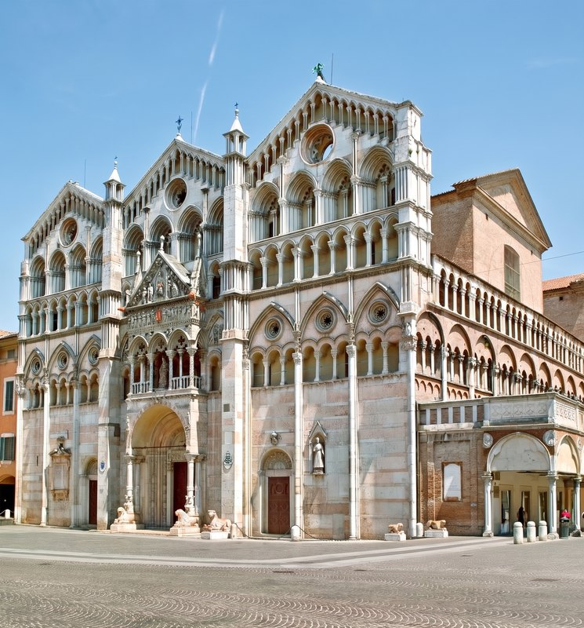
  <figcaption>Ferrara Cathedral, the west front and the south flank. The lower storey of the porch, with its lions, belongs to the campaign of Nicholaus (inscription of 1135); the loggia and the gable above were added in the thirteenth century. Photo: almusaiti (Flickr), <a href="https://creativecommons.org/licenses/by-sa/2.0/">CC BY-SA 2.0</a>, via Wikimedia Commons.</figcaption>
</figure>

His work is closely tied to the architecture it decorates. He made the portal the centre of the façade: a porch projecting from the wall on columns resting on lions or griffins, jambs carved with figures of prophets, a lunette with a great image and a lintel with narrative scenes. At Ferrara and Verona this type reached its full form, and it remained the standard north Italian portal for the rest of the century.

The present entry replaces an earlier version that illustrated a relief of Parma Cathedral, a building no longer attributed to Nicholaus, and that used photographs without credits. It follows closely the documentary cautions of the draft prepared for this site: the inscriptions are quoted with their variant readings, the dates of the Sacra and of Sant'Eufemia are given as disputed, and the role of Nicholaus as architect is presented as a hypothesis.

The photographs reproduced in the catalogue make it possible to check some of the readings on the stone. At Ferrara the signature reads HUC CURREN, not *hunc*; at San Zeno it reads DNM Q(ue) ROGEMUS, *dominumque rogemus*; at the Sacra and at Piacenza the same hexameter, *Hoc opus intendat quisquis bonus exit et intrat*, is carved on both portals. These readings are noted in the entries below.

The account that follows sets out what is known of his origins, his works at Piacenza and the Sacra, at Ferrara and at Verona, the meaning of his signatures, the extent of his workshop and his place in the history of Italian sculpture. The catalogue then examines the works one by one.

## Origins and the Wiligelmo Question

Nothing documents where Nicholaus came from. He is conventionally placed in the so-called Emilian school, which descends from the workshop of Wiligelmo at Modena, but no source says where he was trained.

The idea that he was a pupil of Wiligelmo has a curious origin. On the façade of San Zeno, beside reliefs signed by Nicholaus, other reliefs are signed by a sculptor named Guglielmo. Part of twentieth-century criticism, with Adolfo Venturi, took this Guglielmo for Wiligelmo of Modena, and read the collaboration at Verona as the relation of master and pupil. The Dizionario Biografico degli Italiani calls this a misunderstanding. Wiligelmo's work at Modena is tied to the foundation of 1099; the Guglielmo of San Zeno signs reliefs of about 1138 that depend on Nicholaus, and belongs to his circle.

Rejecting the identity of the two Guglielmos does not settle the question of training. Christine Verzár, in the Enciclopedia dell'Arte Medievale, placed his formation within Wiligelmo's workshop at Modena, especially at the Porta della Pescheria, and at Piacenza. Arturo Carlo Quintavalle proposed in 2003 that he began at Cremona, as a collaborator of Wiligelmo, after suggesting in 1984 a clerical formation in a Cluniac milieu. Other scholars deny any contact between the two masters, and others have proposed a transalpine origin.

What can be said safely is narrower. Nicholaus took over and transformed the repertory of Wiligelmo, above all the inhabited vine scroll of the Modena portals, which reappears on the jambs of the Porta dello Zodiaco. He developed the projecting porch far beyond its model at Modena. His constant use of verse inscriptions implies a literary culture; a study of 2021 argues that the word *gnarus*, "knowing", with which he describes himself, points to theoretical knowledge, not only to manual skill.

## Piacenza and the Sacra di San Michele

Piacenza Cathedral was begun in 1122, according to a verse inscription once at the base of a column of the south porch: *centum viceni duo Christi mille fuere / anni cum coeptum fuit hoc venerabile templum*, "one thousand one hundred and twenty-two years of Christ had passed when this venerable temple was begun". According to the Dizionario Biografico degli Italiani, Nicholaus worked there beside a workshop of Wiligelmic culture: the north portal of the façade belongs to the Wiligelmic sculptors, the south portal to Nicholaus and his collaborators, and the much restored central portal shows both hands. As the work went on he probably took charge of the whole site, as the capitals of the crypt and presbytery suggest.

The Porta dello Zodiaco stands at the head of the Scalone dei Morti in the abbey of the Sacra di San Michele, on Monte Pirchiriano. Its jambs carry the signs of the zodiac on one face and the constellations on the other, with inhabited vine scrolls on the inner faces and figured capitals. It is described as the oldest monumental zodiac cycle still in place in Romanesque Europe. A couplet names the master: *Vos qui transitis sursum vel forte reditis, / vos legite versus quos descripsit Nicholaus*, "You who pass by, going up or perhaps coming back, read the verses that Nicholaus wrote down".

Because the verb is *descripsit*, "wrote down", and not *sculpsit*, some readers held that this Nicholaus was only the author of the verses. The prevailing view, reflected in the Dizionario Biografico, is that the formula refers to the whole of text and image, and the identity of the lettering with the signed works confirms it. Among the other verses of the portal are *Hoc opus intendat quisquis bonus exit et intrat*, "let every good person who goes out and comes in attend to this work", and *Flores cum beluis comixtos cernitis*, "you see flowers mingled with beasts"; both can be read on the jambs illustrated below.

The first of these verses is the link between the Sacra and Piacenza. The same hexameter is carved on the lintel of the south portal of Piacenza, as the photographs in the catalogue show. On this ground, as well as on style, the Piacenza sculpture has been attributed to Nicholaus since the study of 1930. The date of the Sacra is disputed: about 1114–1120 according to the Enciclopedia dell'Arte Medievale, after 1122 and close to the beginning of the work at Piacenza according to the Dizionario Biografico. The portal is unfinished, and its present position may date from the middle of the twelfth century.

## Ferrara

The cathedral of Ferrara is the fullest surviving work of Nicholaus. A hexameter couplet on the arch of the porch records the date: *Anno milleno centeno ter quoque deno / quinque superlatis struitur domus haec pietatis*, "in the year one thousand, one hundred, three times ten and five more, this house of piety is being built". The verb *struitur* is in the present tense: the inscription records the building in progress in 1135, not its completion. The portal must have been finished before 1141.

The new cathedral was built under Bishop Landolfo, with the support of the leading citizen Guglielmo degli Adelardi, after Pope Innocent II had restored the independence of the diocese in 1133. Forged vernacular verses once claimed that "Glielmo" was the author of the church, and led some antiquarians to make the patron the architect, or even to confuse him with the Guglielmo of San Zeno.

The signature runs around the lunette of Saint George: *Artificem gnarum qui sculpserit hec Nicholaum / huc concurrentes laudent per secula gentes*, "may the peoples flocking here praise through the ages Nicholaus, the skilled craftsman who carved these things". The readings of the second line vary in the literature between *hunc* and *huc*, *currentes* and *concurrentes*. The detail photograph reproduced in the catalogue shows HUC on the stone, followed by CURREN; whether an abbreviation for *con-* precedes it must be checked on the stone.

The portal has a two-storey porch, of which only the lower storey belongs to Nicholaus; the loggia and the gable with the Last Judgement were added in the thirteenth century. The jambs, with their many mouldings, carry prophets and the Annunciation; the lunette holds Saint George, the first monumental equestrian relief of Italian Romanesque sculpture, shown as a knight of the time; the lintel tells the Infancy of Christ. Comparisons with Saint-Denis, Toulouse and Chartres have often been made, but the Dizionario Biografico calls them unconvincing.

A second portal of the cathedral, the Porta dei Mesi on the south flank, was walled up in 1717 and demolished in 1736 or 1737. Of its first phase, by Nicholaus, there survive griffins and lions now on the steps of the cathedral and, in the Museo della Cattedrale, an Eve spinning and a fragmentary telamon. The famous reliefs of the Months belong to a later master of about 1220–1230, not to Nicholaus.

## Verona: San Zeno and the Cathedral

At San Zeno, an inscription of 1178 on the south flank states that forty years had passed since the renewal and enlargement of the church, which places the end of the rebuilding after the earthquake of 1117 in 1138. The porch, the portal, the reliefs at its sides and some capitals of the interior belong to that campaign. The single-storey porch rests on lions; its consoles carry the Months; in the lunette, Saint Zeno treads on the devil and gives the banner of the city to horsemen and foot soldiers. The distich beneath reads *Dat presul signum populo munimine dignum, / vexillum Zeno largitur corde sereno*, "the bishop gives the people a standard worthy of defence; Zeno bestows the banner with a serene heart".

The image is often called the birth of the Veronese commune. It is suggestive, but it is the interpretation of an image, not a constitutional document. The signature on the lunette reads: *Artificem gnarum qui sculpserit hec Nicolaum / omnes laudemus Cristum dominumque rogemus / celorum regnum sibi donet ut ipse supernum*, "let us all praise the skilled craftsman Nicolaus, who carved these things; let us praise Christ and ask the Lord that He himself grant him the heavenly kingdom on high". The photograph of the lunette confirms the reading *dominumque rogemus*.

The marble reliefs at the sides of the bronze doors are the work of two sculptors. Those at the right, with scenes from Genesis and the legend of Theodoric, carry the verse *Hic exempla trai possunt laudis Nicolai*, "here can be drawn the proofs of the praise of Nicholaus". Those at the left, with scenes of the life of Christ and combats, are signed by Guglielmo, who asks the reader to pray for his salvation. The difference of quality within the right-hand group suggests several hands: a signature declares responsibility, not sole execution.

The porch of Verona Cathedral, traditionally dated about 1139, takes up and enlarges the scheme of Ferrara. Its lower storey, in red and white marble, rests on griffins, its upper storey on lions. The lunette shows the Virgin and Child with the Magi and the Annunciation to the Shepherds, under the verse *Hic Dominus magnus leo Cristus cernitur agnus*, "here the Lord, the great lion, Christ, is seen as a lamb"; the lintel shows the theological virtues; the jambs carry more prophets than at Ferrara. The signature on the outer arch repeats the Ferrara formula: *Artificem gnarum qui sculpserit hec Nicolaum / hunc concurrentes laudant per secula gentes*.

On the outermost jambs stand two large armed figures. The sword of the left-hand figure bears the name DURINDARDA, the Italian form of Roland's Durendal, and the pair are traditionally called Roland and Oliver. The identification has been questioned: a minority view saw in them Saints Sergius and Bacchus, and a study of 2021 accepts Roland as an allegory of fortitude but proposes that the bareheaded figure at the right is not Oliver but Saint Romanus, doorkeeper and martyr. The mainstream view keeps both figures within Nicholaus's campaign.

## The Inscriptions as Self-Presentation

Read together, the signatures form a sequence. At the Sacra, the master presents himself as the one who wrote the verses the passer-by must read. At Ferrara he becomes the *artifex gnarus*, the knowing craftsman whom the peoples will praise for ever. At San Zeno, the praise of the artist turns into a prayer for his salvation. At Verona Cathedral the Ferrara formula returns almost unchanged.

The Dizionario Biografico suggests that his signature functioned as a kind of trademark, a guarantee of the quality of the work, to a degree unusual in the Middle Ages. The word *gnarus* is rare in this context; one philological reading traces it to Cicero and Tacitus, another sees in *per secula gentes* an echo of Virgil.

What these formulas meant to their first readers is not settled. They may be genuine claims of authorship, the voice of patrons who composed the verses, or a form of workshop advertisement. It would be wrong to read them as the pride of the Renaissance artist, and equally wrong to dismiss them as commonplaces: their place at the very entrances of cathedrals has no precedent in Italy at this date, except for the couplet in praise of Wiligelmo at Modena.

## Workshop, Architecture and Attributions

Because the projects overlapped, the Dizionario Biografico concludes that Nicholaus must have moved between several sites at once, supported from an early stage by many collaborators who reproduced his style faithfully. The differences of quality visible within single works confirm that his name stands for a workshop as much as for an individual.

The hypothesis that he was also an architect rests on the close relation between the architecture and the sculpture of Ferrara, whose original plan is an enlarged version of Modena's. It was argued in the proceedings of 1985 and in a monograph of 1988, and the Dizionario Biografico calls it justified. Every inscription, however, calls him a sculptor, and the role of architect remains a hypothesis.

Further attributions range widely. The transept portals of Cremona, rebuilt from 1129, are now given to his direct presence by recent scholarship; works at San Romano in Ferrara, Pomposa and Carpi are associated with him; the lunette of Leno, now in Brescia, is tied to his late workshop; and his presence at Königslutter in Saxony has been argued from its hunting frieze. Parma Cathedral and the reliefs of the old cathedral of Bologna are now excluded.

## Style, Sources and Iconography

The style of Nicholaus combines, within a single field, figures in high relief, close to life size, with narrative scenes in low relief. His proportions and the details of dress and arms are more naturalistic than Wiligelmo's. His ornament joins the classicising inhabited scroll of Modena to animals and hybrids drawn from antique, Byzantine and Islamic models, known through mosaics, liturgical objects and ivories. Pietro Toesca saw in his work a pictorial flattening of the planes, against the carving in depth of Wiligelmo.

His programmes join sacred themes to images of his own time: Saint George as a crusading knight, Zeno as bishop giving the banner to the city, Roland's sword at a cathedral door, the Months, the zodiac and the constellations. Christine Verzár has read the porch-portal as a civic and judicial space, shaped by Roman and papal models and by patrons allied with the papacy. The reading is influential, but it is an interpretation, and some of its premises rest on earlier theories she accepted as facts.

## Legacy and Historiography

The Enciclopedia dell'Arte Medievale credits the workshop of Nicholaus with the formation of the so-called school of Piacenza, active at Sant'Antonino in Piacenza, Lodi, Cadeo, Carpi and Castell'Arquato, with influence along the Adriatic and as far as Saxony. The porch-portal with jamb figures and a historiated lunette became a standard solution in northern Italy, and led to the art of Benedetto Antelami.

His critical fortune passed through three phases: antiquarian legend, which made him a native of Ficarolo or of Zara and confused him with Nicola Pisano; philological reconstruction, with Arthur Kingsley Porter, the studies of 1928 and 1930 and Pietro Toesca; and, after an eclipse in the middle of the century, the contextual and political readings of Christine Verzár, whose monograph appeared in 1968, and of Arturo Carlo Quintavalle, whose *Da Wiligelmo a Nicolò* appeared in 1964. The seminar held at Ferrara in 1981, published in 1985 as *Nicholaus e l'arte del suo tempo* under the editorship of Angiola Maria Romanini, remains the fundamental collective work.

## Catalogue Entry

### Ferrara: the Porch and Its Later Storeys

<figure>
  
  <figcaption>Ferrara Cathedral, the upper storeys of the porch with the Last Judgement, thirteenth century. They were added above the porch of Nicholaus and are not his work. Photo: Alain Rouiller, <a href="https://creativecommons.org/licenses/by-sa/2.0/">CC BY-SA 2.0</a>, via Wikimedia Commons.</figcaption>
</figure>

The porch of Ferrara Cathedral projects from the centre of the west front, and in its present form it rises in three storeys. Only the lowest, with the round arch on columns resting on lions and the carved portal behind it, belongs to the campaign of Nicholaus. The two upper storeys, with the loggia and the gable, were added in the thirteenth century, when the front was raised and given its Gothic galleries.

The upper storeys shown here are of high quality but of a different age and style. The gable holds Christ enthroned in a mandorla, among angels with the instruments of the Passion and kneeling figures; the frieze below shows the Last Judgement, with the risen dead, the angels weighing souls and the damned led away naked to the right. At the sides of the loggia, relief lunettes show Abraham holding the souls of the just in his lap and devils tormenting the damned.

In the loggia stands a crowned statue of the Virgin and Child. The quatrefoils, the pointed arches and the slender twisted columns belong to the vocabulary of the thirteenth century, far from the round arches and heavy columns of Nicholaus's porch below.

The superposition of two campaigns explains why descriptions of the Ferrara portal often confuse their dates. The inscription of 1135 refers to the building of the church and is carved on the porch of Nicholaus; it does not date the Last Judgement above it. Popular accounts that attribute the whole porch to Nicholaus are mistaken.

The photograph is included for this reason: to show what is not by Nicholaus, and to set the original porch within the façade as it was later transformed. The porch of Nicholaus was a single storey with a gabled roof, like those of San Zeno and of Piacenza.

The thirteenth-century additions show nevertheless that the porch remained the focus of the façade. Each generation added to it, so that the entrance to the cathedral became a vertical sequence of images, from the prophets and the knight saint of the twelfth century to the Judgement of the thirteenth.

The Last Judgement is placed above the door through which the faithful entered. Its theme, the separation of the saved and the damned, takes up in a new form the moral message of the portal below, where the inscriptions had called on every good person who goes out and comes in to attend to the work.

The overall view of the front, reproduced in the introduction, shows the porch in its context: the Gothic galleries of the front, the long south flank with its loggia of shops, and the bell tower of the fifteenth century. The work of Nicholaus is the oldest part of a building that grew for four centuries around it.

### Ferrara: Saint George and the Lintel

<figure>
  
  <figcaption>Nicholaus, the lunette with Saint George and the dragon and the lintel with scenes of the Infancy of Christ, c. 1135. Ferrara Cathedral, main portal. Photo: Sailko, <a href="https://creativecommons.org/licenses/by/2.5/">CC BY 2.5</a>, via Wikimedia Commons.</figcaption>
</figure>

The lunette of the main portal of Ferrara shows Saint George, patron of the cathedral and of the city, killing the dragon. He rides a galloping horse from left to right, his sword raised, while his lance pierces the dragon lying under the horse's hooves. The scene fills the semicircle, framed by a border of foliage and by several moulded arches of white and pink marble.

Saint George is shown as a knight of the twelfth century, in a mail hauberk, with a round shield, riding with his legs straight in the stirrups. The image is the first monumental equestrian relief of Italian Romanesque sculpture, and it presents the saint in the guise of the knights of the cities and of the crusades.

Below, the lintel is divided into eight arched panels with scenes of the Infancy of Christ and the Baptism: the Annunciation, the Visitation, the Nativity, the Annunciation to the Shepherds, the Adoration of the Magi, the Presentation in the Temple, the Flight into Egypt and the Baptism. Small figures under arcades tell the story with clarity, as on the lintel of Piacenza.

The contrast between the large figure of the lunette and the small figures of the lintel is characteristic of Nicholaus. The Enciclopedia dell'Arte Medievale describes his art as joining, in one field, figures in high relief close to life size and narrative scenes in low relief. At Ferrara the two scales are set one above the other.

The mouldings of the arch are carved with cables, lattices and foliage, alternating white and pink marble. The capitals at the springing of the arch carry small crouching figures. The whole portal is conceived as a sequence of frames around the central image of the saint.

The choice of Saint George as the image of the lunette reflects the dedication of the cathedral, which had been moved from the old church across the Po. The new building, on the left bank, was the church of the growing city, and its patron, armed and on horseback, was an image of its defence.

The lunette is still in its place, protected by the porch, and its surface is well preserved. Traces of colour suggest that, like the lunettes of Verona, it was once painted.

The lintel and the jambs were completed, according to the Enciclopedia dell'Arte Medievale, before 1141. They form, with the lunette, a programme that runs from the prophets of the Old Testament on the jambs to the Infancy of Christ on the lintel and the triumph of the saint above.

### Ferrara: the Signature in the Lunette

<figure>
  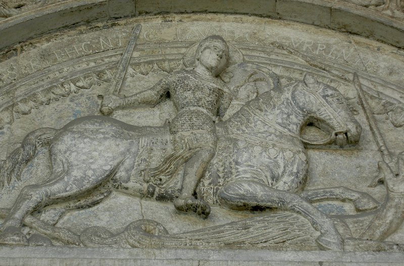
  <figcaption>Nicholaus, Saint George, detail of the lunette, c. 1135, with part of the signature on its border. Ferrara Cathedral, main portal. Photo: Nicola Quirico, <a href="https://creativecommons.org/licenses/by-sa/4.0/">CC BY-SA 4.0</a>, via Wikimedia Commons.</figcaption>
</figure>

The detail of the lunette shows Saint George from close at hand: a young man with a round face and a halo, in a mail hauberk drawn with a fine lattice of rings, his sword raised in his right hand. The horse's head, with its bridle and studded harness, turns towards the dragon, whose winged body lies along the bottom of the field.

Along the curved border above the saint runs the signature of Nicholaus. In the text usually given, it reads *Artificem gnarum qui sculpserit hec Nicholaum / huc concurrentes laudent per secula gentes*, "may the peoples flocking here praise through the ages Nicholaus, the skilled craftsman who carved these things".

In the photograph the letters …HEC NIC… and …LAU… can be read before the saint's sword and head, and HUC CURREN after them. The stone reads HUC, "hither", not *hunc*, "him", as several transcriptions give it. Whether the following word is *currentes* or *concurrentes*, with the syllable *con-* abbreviated, must be checked on the stone itself.

The variant readings in the literature arise from the abbreviations of the inscription. The Enciclopedia dell'Arte Medievale reads *hunc concurrentes*, a philological study of 2021 *huc currentes*, a French epigraphic survey *huc concurrentes*, and popular sources *hunc currentes*. The photograph settles the first word in favour of *huc*.

The signature places the name of the sculptor at the heart of the portal, around its principal image. It is not hidden in a corner but runs in large capitals along the frame of the lunette, where all who looked at the saint would see it.

The verse uses the word *gnarus*, "knowing", "expert", rare in such contexts. A study of 2021 sees in it a claim to theoretical knowledge, and the same adjective returns at San Zeno and at Verona Cathedral.

The carving of the saint shows the qualities of Nicholaus at their best: clear forms, fine detail in the mail and the harness, a figure that stands out from the ground without losing its connection with it. The face, with its large eyes and calm expression, is that of a youthful hero.

The photograph, taken at close range, also shows the state of the stone: cracks, losses at the edges and the dark patina of age. The lunette has been protected by the porch for nearly nine centuries, and its surface has kept the sharpness of its carving.

### Ferrara: the Prophets of the Jambs

<figure>
  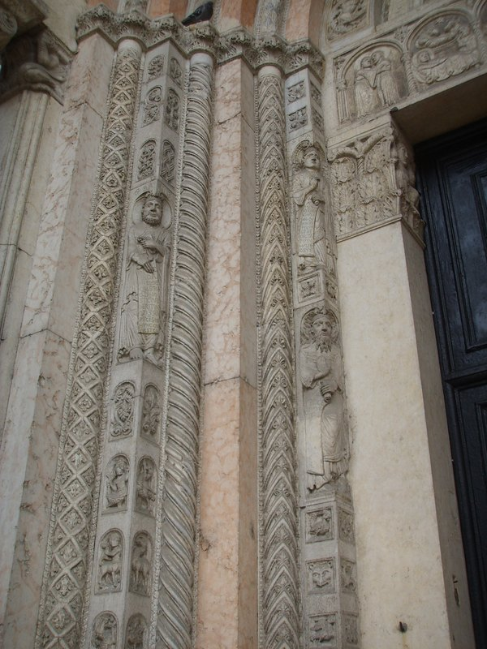
  <figcaption>Nicholaus, the left jamb of the main portal with prophets holding scrolls, c. 1135. Ferrara Cathedral. Photo: Sailko, <a href="https://creativecommons.org/licenses/by/2.5/">CC BY 2.5</a>, via Wikimedia Commons.</figcaption>
</figure>

The jambs of the Ferrara portal are formed by a series of mouldings, shafts and pier edges, set at an angle to the door. The shafts are carved with lattices, zigzags, spirals and foliage, in white and pink marble; on the edges of the piers between them stand small figures of prophets, each holding a long scroll inscribed with a prophecy.

On the left jamb, a bearded prophet with a scroll stands on a pier edge, set among panels carved with animals, flowers and small figures. His body follows the shape of the edge, so that he seems to emerge from the architecture rather than stand in front of it.

<figure>
  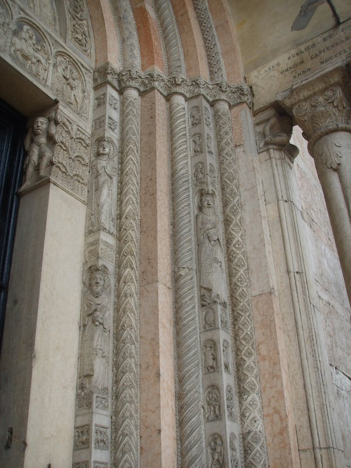
  <figcaption>Nicholaus, the right jamb of the main portal with the angel of the Annunciation and prophets, c. 1135. Ferrara Cathedral. Photo: Sailko, <a href="https://creativecommons.org/licenses/by/2.5/">CC BY 2.5</a>, via Wikimedia Commons.</figcaption>
</figure>

On the right jamb, the figures include the angel of the Annunciation, winged and holding a scroll, and other prophets. The Annunciation is thus divided between the angel on the jambs and the Virgin on the lintel, binding the two parts of the portal together.

These figures have been called the first column-figures of Italian sculpture. Strictly they are not statues attached to columns, as in the portals of France, but figures carved on the edges of the piers between the columns. They are nevertheless an important step towards the integration of the human figure into the structure of the portal.

The scrolls carry texts announcing Christ. On the portals of Verona Cathedral the scrolls can still be read, and they quote Malachi, Isaiah and Haggai; at Ferrara the inscriptions are more worn. The theme is the same: the prophets of the Old Testament stand at the threshold of the church as witnesses of the coming of Christ.

The comparison of the jambs of Ferrara with those of Modena shows how Nicholaus transformed his model. At Modena, Wiligelmo's prophets stand in separate niches on the inner faces of the jambs; at Ferrara they are set on the projecting edges, among a dense play of mouldings and ornament.

At the corner of a capital in the second photograph, a small crouching figure supports the springing of the arch, like the telamons of Modena. At the right, a plaque with a later inscription records a restoration.

The richness of the jambs, with their alternation of colours and patterns, gives the portal the character of a precious object. The same taste for coloured marble and varied ornament appears at San Zeno and at Verona Cathedral.

### Ferrara: Lions and Telamons

<figure>
  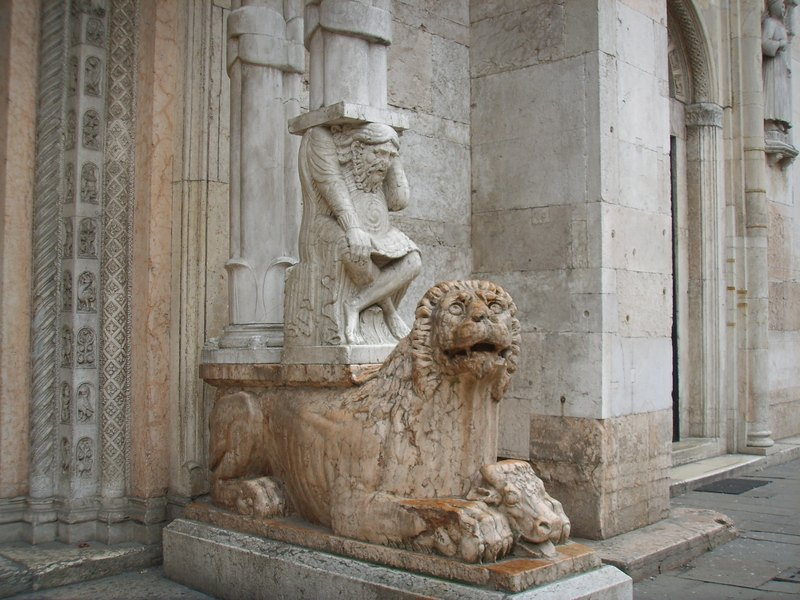
  <figcaption>Lion and telamon at the foot of the porch of Ferrara Cathedral, right side: a modern replica of the group of the workshop of Nicholaus (c. 1135). Photo: Sailko, <a href="https://creativecommons.org/licenses/by/2.5/">CC BY 2.5</a>, via Wikimedia Commons.</figcaption>
</figure>

The columns of the porch of Ferrara rest on crouching lions, on whose backs squat small telamons supporting the bases of the columns. The lion in the first photograph, of pink veined marble, holds a ram's head between its paws; the telamon above it, a bearded man in a short tunic, sits with his legs crossed and his hand at his cheek.

According to the description of the photograph on Wikimedia Commons, the whole group, lion and telamon, is a modern replica of the right-hand group of the porch. Many of the lions of the Romanesque porches of the Po valley were replaced in the course of restorations; the sources consulted for this entry do not say where the originals of Ferrara are kept.

<figure>
  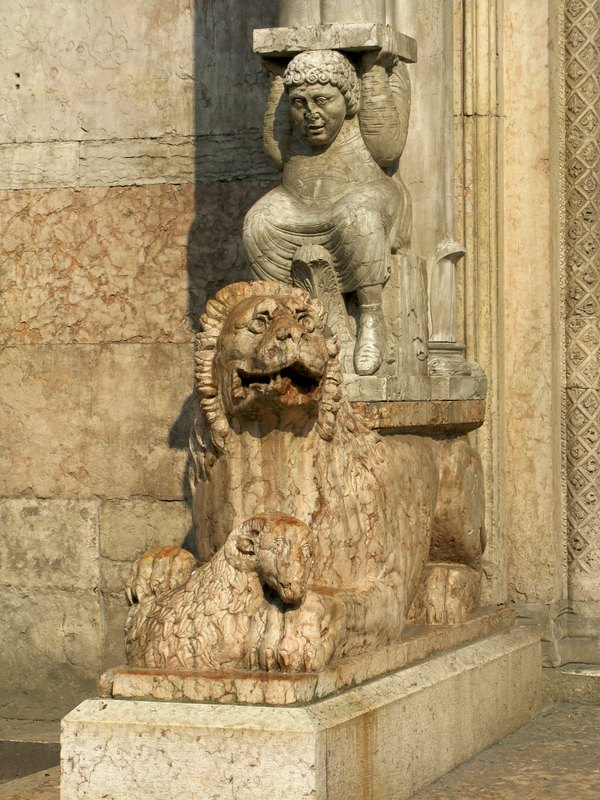
  <figcaption>Lion with a ram and a telamon at the foot of the porch of Ferrara Cathedral, left side: a modern copy of the group of the workshop of Nicholaus (c. 1135). Photo: Alain Rouiller, <a href="https://creativecommons.org/licenses/by-sa/2.0/">CC BY-SA 2.0</a>, via Wikimedia Commons.</figcaption>
</figure>

The second photograph shows the left-hand group in low sunlight: a lion with open jaws, its mane in heavy curls, a ram held under its paws, and on its back a youth with curly hair, in a heavy pleated garment, raising both arms to support the column. Wikimedia Commons classes this group too among the modern copies of medieval originals. Both groups therefore reproduce the composition of Nicholaus's porch, not its original carving.

The lion holding an animal was a common motif of the porches of the Po valley, from Modena to Verona. It was read as an image of the guardian of the church, which crushes the forces of evil, or as an image of Christ, the lion of the tribe of Judah. The ram, a sacrificial animal, may allude to the sacrifice of Christ.

The telamon, a figure bearing a load, comes from antique architecture and was revived in the Romanesque sculpture of the Po valley, at Modena and elsewhere. At Ferrara the telamons sit on the backs of the lions, so that the column rests on a double support, animal and human.

The gesture of the bearded telamon, his hand at his cheek, is a traditional gesture of weariness or melancholy, perhaps expressing the weight he bears. The youth of the second photograph raises his arms in a gesture of effort. The variety of the figures, faithfully reproduced by the copies, reflects the inventiveness of the original workshop.

Of the second portal of Ferrara, the Porta dei Mesi, demolished in the eighteenth century, griffins and lions survive on the steps of the cathedral. They show that the same type of porch on animals was used on both portals of the church.

The lions and telamons are among the most visible parts of the portal, at the height of the viewer. Their replacement by copies shows the cost of that position: exposed to rain, frost and the touch of passers-by, the original groups suffered more than the lunette and the jambs, and had to be removed from the porch.

### San Zeno: the Façade and the Porch

<figure>
  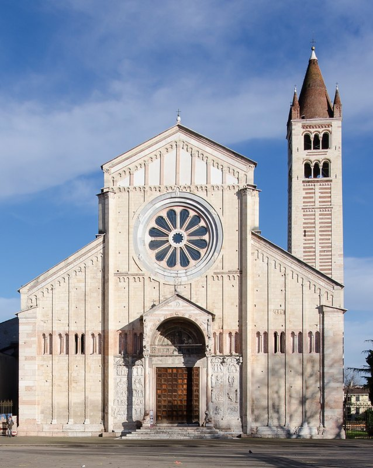
  <figcaption>Verona, basilica of San Zeno Maggiore, the west front, with the porch and portal of Nicholaus (c. 1138) and the reliefs at the sides of the door. Photo: Andrea Bertozzi, <a href="https://creativecommons.org/licenses/by-sa/4.0/">CC BY-SA 4.0</a>, via Wikimedia Commons.</figcaption>
</figure>

The basilica of San Zeno Maggiore in Verona was rebuilt after the earthquake of 1117, and an inscription of 1178 places the end of the work in 1138. The west front, of pale stone, has a high central gable with a great wheel window, lower sloping wings and pilasters; the striped bell tower stands at the right. At the centre, a small porch projects from the wall on two columns, and at the sides of the door the wall is covered with panels of reliefs.

The porch, the portal and the reliefs belong to the campaign of Nicholaus. They are concentrated at the centre of the façade, around the bronze doors, so that the sculpture forms a single field around the entrance. The rest of the front is left plain, articulated only by pilasters and arcades.

<figure>
  
  <figcaption>Nicholaus, the porch of San Zeno Maggiore, Verona, c. 1138: the gable with the hand of God, the arch with the Lamb, the two Saints John, telamons on the capitals and the lunette of Saint Zeno. Photo: NorbertNagel, <a href="https://creativecommons.org/licenses/by-sa/4.0/">CC BY-SA 4.0</a>, via Wikimedia Commons.</figcaption>
</figure>

The porch, seen at closer range, has a single storey. Its gable carries the hand of God blessing in a roundel; its arch is lined with small square reliefs of animals and the Lamb of God at the top; the two Saints John, the Baptist and the Evangelist, stand at its sides. On the capitals of the two columns squat small telamons; the columns themselves rest on lions.

Under the arch, the painted lunette shows Saint Zeno between horsemen and foot soldiers, with a frieze of his miracles below. On both sides of the door, the reliefs of Nicholaus at the right and of Guglielmo at the left can be seen, in their position on the façade.

The porch of San Zeno is simpler than those of Ferrara and Verona Cathedral, which have two storeys. It is close in form to the porches of Modena and Piacenza, and it shows how Nicholaus adapted the same type to buildings of different scale.

The two Saints John on the arch have been read by Christine Verzár as a quotation of the Lateran basilica in Rome, dedicated to the two Saints John, and thus as a sign of the link between the church and the papacy. The reading is part of her political interpretation of the porch-portal, and has been questioned.

The squatting telamons on the capitals, with their contorted poses, recall those of Modena and Ferrara. They support the arch of the porch as the lions support its columns, in a hierarchy of bearing figures that runs from the ground to the roof.

The colour of the stones, with the alternation of white and pink marble on the arch and the warm tone of the tufa of the walls, is part of the effect. The painted lunette, still bright, shows that the porch was once richly coloured.

### San Zeno: the Lunette of Saint Zeno

<figure>
  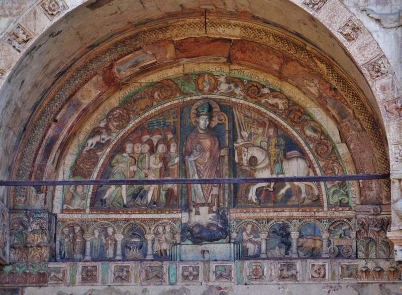
  <figcaption>Nicholaus, Saint Zeno giving the banner to the people of Verona, with the signature on the arch and miracles of the saint below, c. 1138. Verona, San Zeno Maggiore, lunette of the main portal. Photo: Zairon, <a href="https://creativecommons.org/licenses/by-sa/4.0/">CC BY-SA 4.0</a>, via Wikimedia Commons.</figcaption>
</figure>

The lunette of San Zeno shows the patron of Verona, Bishop Zeno, standing frontally at the centre, with mitre, halo and crozier, blessing, while he treads on a dark devil. At the left a crowd of foot soldiers with red caps receives from him a banner with a cross; at the right a group of mounted knights with lances and shields advances towards him. The whole relief keeps a vivid polychromy, in red, green, blue and gold.

The distich on the lunette explains the scene: *Dat presul signum populo munimine dignum, / vexillum Zeno largitur corde sereno*, "the bishop gives the people a standard worthy of defence; Zeno bestows the banner with a serene heart". The saint gives the city its banner and, with it, its protection.

The image has often been called the birth of the Veronese commune, since the foot soldiers and the knights may stand for the two orders of the citizen army, *pedites* and *milites*. The reading is suggestive, but it interprets an image; it is not a document of the constitution of the commune.

Along the arch above the lunette runs the signature of Nicholaus: *Artificem gnarum qui sculpserit hec Nicolaum / omnes laudemus Cristum dominumque rogemus / celorum regnum sibi donet ut ipse supernum*. In the photograph the letters …CO LA UM + OM NES LAU DE MUS · CRI STUM DNM Q(ue) RO GEMUS + CE LORU REGNUM SIBI DONET… can be read, which confirm the reading *dominumque rogemus* against *dominus quem rogemus*.

The signature at San Zeno is longer than at Ferrara, and its tone has changed. The praise of the sculptor is followed by a prayer for his salvation: the viewers are asked to pray that Christ grant him the kingdom of heaven. The artist's fame and his soul are commended together to those who enter the church.

Below the lunette, a frieze of small arcades shows the miracles of Saint Zeno, among them the exorcism of the daughter of the emperor Gallienus and the episode of the ox cart driven by the devil. Inscriptions above the scenes name the figures, among them *Rex Galienus*.

Around the lunette, an inhabited scroll with animals and a hand of God in a roundel fills the arch. The ornament, of Wiligelmic origin, is enriched with colour, and the whole lunette, framed by a mosaic-like band of scales, has the appearance of a painted panel.

The polychromy of the lunette is a precious survival. Most Romanesque sculpture was painted, but few works keep so much of their colour. Its present state is the result of restorations, and the extent of the original paint should be checked against the conservation reports.

### San Zeno: the Months

<figure>
  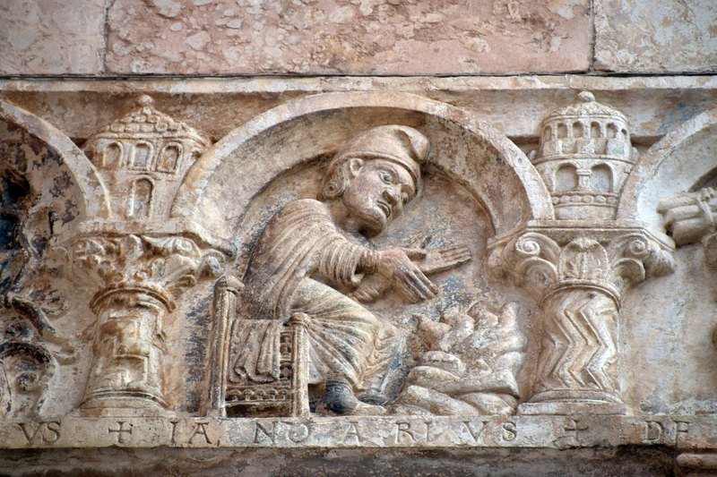
  <figcaption>Nicholaus and workshop, January warming himself at the fire, from the cycle of the Months, c. 1138. Verona, San Zeno Maggiore, main portal. Photo: Retogenes, <a href="https://creativecommons.org/licenses/by-sa/4.0/">CC BY-SA 4.0</a>, via Wikimedia Commons.</figcaption>
</figure>

The consoles of the porch of San Zeno carry the cycle of the Months, each shown in an arched niche with its name inscribed below. January, IANOARIUS, is a man in a pointed cap and a long garment, sitting on a chair and warming his hands before a fire.

The scene is the traditional image of January in the medieval calendars: the cold month, when work in the fields stops and men stay indoors by the hearth. The figure turns his hands towards the flames, while his body, wrapped in heavy drapery, bends forward.

The arch of the niche is flanked by small domed towers and by columns with zigzag shafts and foliate capitals. The architecture frames the figure as the arcades of the lintels frame the sacred scenes, so that the labour of the month is given the same dignity as a sacred episode.

The cycle of the Months had been carved at Modena on the jambs of the Porta della Pescheria. Nicholaus and his workshop took it up at San Zeno, and it became a common theme of the portals of the Po valley, down to the Months of Benedetto Antelami at Parma.

The presence of the Months on the church door links the sacred building to the life of the city and the countryside. The labours of the year, sanctified by their place on the porch, are offered to God together with the prayers of the faithful.

The figure of January is carved with care: the folds of the garment, the pattern of the chair, the flames of the fire. The face, with its large nose and wide eyes, has the character of the figures of Nicholaus at Piacenza and Ferrara.

The surface of the relief keeps traces of colour, as does the lunette above. The niches of the Months were probably painted, with coloured backgrounds that made the figures stand out.

The name inscribed below the niche, in large capitals, follows the practice of the whole portal, where figures and scenes are named. The inscriptions turn the sculpture into a text to be read as well as seen.

### San Zeno: the Reliefs of Nicholaus

<figure>
  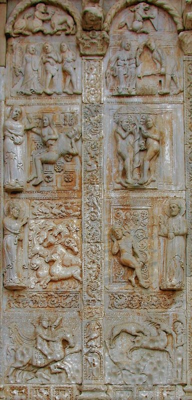
  <figcaption>Nicholaus and workshop, the reliefs at the right of the main door, with scenes from Genesis and the hunt of Theodoric, c. 1138. Verona, San Zeno Maggiore, west front. Photo: MM, <a href="https://creativecommons.org/licenses/by-sa/4.0/">CC BY-SA 4.0</a>, via Wikimedia Commons.</figcaption>
</figure>

At the right of the door of San Zeno, a series of marble panels in two columns illustrates scenes from Genesis and, at the bottom, the hunt of Theodoric. The Genesis scenes include the creation of Eve from the side of the sleeping Adam, the Fall, the Expulsion and the Labour; standing saints are carved at the sides of some panels.

A verse on these reliefs names their author: *Hic exempla trai possunt laudis Nicolai*, "here can be drawn the proofs of the praise of Nicholaus". The stone reads *trai* for the classical *trahi*. It is the line that the antiquarian Scipione Maffei misread as *Iaderensis*, giving rise to the legend that Nicholaus came from Zara.

At the bottom of the right-hand group, the hunt of Theodoric shows the Gothic king riding with his hounds after a stag, which leads him to hell. The legend, current in Verona, made the Arian king, who had ruled from the city, an example of damnation, and its presence on the church door is a warning.

The quality of the reliefs is uneven. The Theodoric scenes are rougher than the sacred scenes, and the difference suggests several hands. The signature of Nicholaus declares his responsibility for the group, not his execution of every panel.

The reliefs are carved on slabs of marble set into the wall, in a format that recalls the Genesis slabs of Wiligelmo at Modena. The comparison is instructive: at Modena the scenes run in long friezes; at San Zeno they are stacked in square panels, framed by bands of ornament.

The photograph shows the panels weathered and stained by rain, with the surface eroded in places. The reliefs, unlike the lunette, are exposed to the weather on the open façade.

The Genesis scenes at the right and the New Testament scenes at the left form together a history of salvation, from the Creation to the Crucifixion, around the door of the church. The bronze doors themselves carry further scenes, completing the programme.

The reliefs were the subject of an article on the marble reliefs of the San Zeno façade published in the *Art Bulletin* in 1981, which remains the basic study, and which the Dizionario Biografico follows in its attributions.

### San Zeno: the Reliefs of Guglielmo

<figure>
  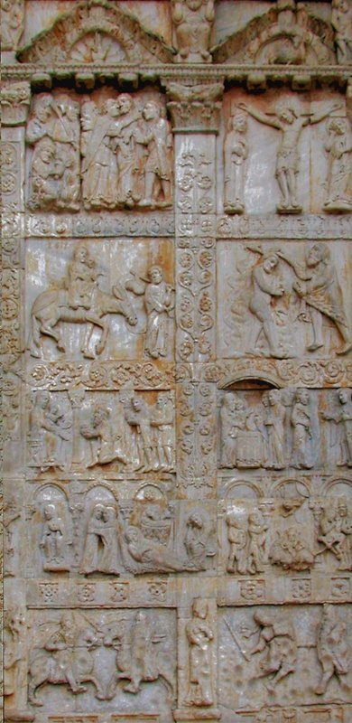
  <figcaption>Guglielmo, the reliefs at the left of the main door, with scenes of the life of Christ and combats, signed by him, c. 1138. Verona, San Zeno Maggiore, west front. Photo: MM, <a href="https://creativecommons.org/licenses/by-sa/4.0/">CC BY-SA 4.0</a>, via Wikimedia Commons.</figcaption>
</figure>

At the left of the door, a second series of panels illustrates the life of Christ: from the top, the Betrayal and the Crucifixion, the Flight into Egypt and the Baptism, the Presentation in the Temple, the Annunciation, the Visitation and the Nativity, and at the bottom two combats of horsemen and armed men.

These reliefs are signed by Guglielmo: *Qui legis ista pie natum placato Marie / salvet in eternum qui sculpsit ista Guillelmum / intrantes cuncti succurrant huic pereunti*, "you who read these things, piously appease the Son of Mary, that He may save for ever Guglielmo who carved them; may all who enter help this perishing man". The stone shows variant spellings such as *etrum*, *qi*, *sita*, *intrates* and *concti*.

Guglielmo is a sculptor of the circle of Nicholaus, whose style depends on his. His name gave rise to the confusion with Wiligelmo of Modena, and thence to the theory that Nicholaus was Wiligelmo's pupil. The Dizionario Biografico rejects the identity; one line of scholarship holds that Guglielmo had already worked beside Nicholaus at Piacenza.

The comparison of the two series shows the difference between the two sculptors. Guglielmo's figures are more crowded and less monumental, his compositions more linear. The combats at the bottom, with horsemen charging each other, have been related to the duels of the epic poems.

The signature of Guglielmo, like that of Nicholaus on the lunette, asks the reader for prayers. The two sculptors present themselves in the same way, as men who have served God with their work and ask the faithful to help their souls.

The reliefs are weathered like those on the right, and the photograph shows the same stains and erosion. The panels are set in a frame of ornamental bands with rosettes and foliage.

The Nativity panel, with the Virgin lying on a bed and the Child in the manger above, follows the Byzantine type also seen on the lintels of Nicholaus. The Baptism, with Christ in the water and John pouring water on his head, recalls the scene on the lintel of Piacenza.

The two series at the sides of the door of San Zeno are among the most important groups of Romanesque relief in Italy. They show the workshop of Nicholaus at work, with the master and his collaborators each signing their part of a single programme.

### Verona Cathedral: the Porch

<figure>
  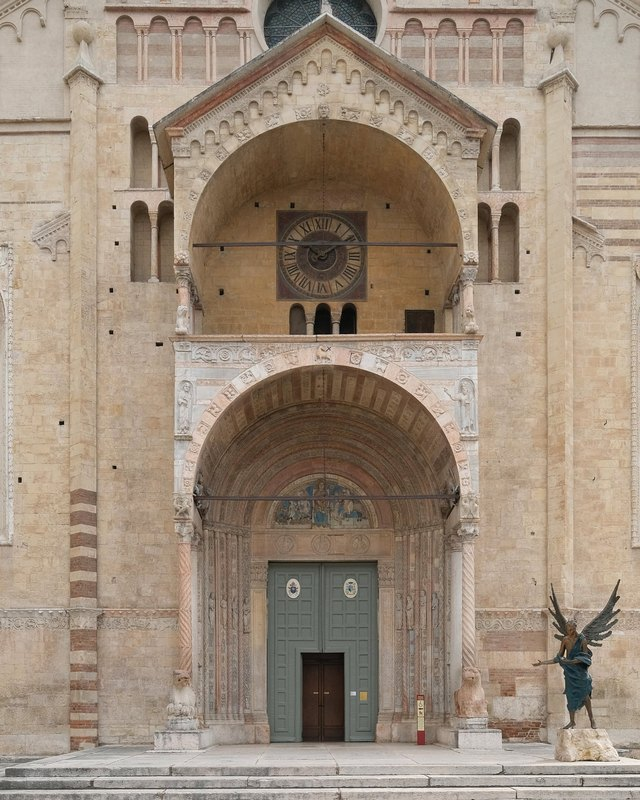
  <figcaption>Nicholaus, the porch of Verona Cathedral (Santa Maria Matricolare), c. 1139: the lower storey on griffins, the upper on lions, with the lunette, the prophets of the jambs and the two paladins. Photo: Andrea Bertozzi, <a href="https://creativecommons.org/licenses/by-sa/4.0/">CC BY-SA 4.0</a>, via Wikimedia Commons.</figcaption>
</figure>

The porch of Verona Cathedral, Santa Maria Matricolare, is the most ambitious of the porches of Nicholaus. It has two storeys: the lower, a deep round arch in red and white marble on columns resting on crouching griffins, frames the portal; the upper, a second arch on columns rising from small lions, shelters a loggia, now occupied by a large clock.

The type is that of Ferrara, enlarged. The Dizionario Biografico notes that at the cathedral Nicholaus's work was limited to the portal and belonged to the concluding campaign of the building, whereas at San Zeno it extended to capitals of the interior.

Under the lower arch, the portal is framed by many mouldings, alternating white and red marble, with figures of prophets on the edges of the piers. The painted lunette shows the Virgin and Child with the Magi and the shepherds; the lintel shows the theological virtues. On the outermost jambs stand the two large armed figures traditionally called Roland and Oliver.

The griffins at the base of the lower columns replace the lions of the other porches. The griffin, half eagle and half lion, was a guardian creature in antique and medieval art, and in Christian symbolism could stand for the double nature of Christ.

The arch of the lower storey is lined with small square reliefs and, along its outer edge, a frieze of a stag hunt above which runs the signature of Nicholaus. The upper arch is decorated with similar reliefs and a cornice of small arches.

The porch has been dated about 1139, shortly after San Zeno. Its two storeys, its coloured marbles and its abundance of figures make it the summit of the type created by Nicholaus.

The modern bronze statue of an angel at the right of the photograph and the clock in the loggia are later additions. They show how the porch has remained a living part of the cathedral, used and adapted over the centuries.

The signature repeats almost word for word the formula of Ferrara: *Artificem gnarum qui sculpserit hec Nicolaum / hunc concurrentes laudant per secula gentes*, with *laudant* in the indicative according to the cathedral's own description, the study of 2021 and a transcription of 1825. Popular sources often confuse it with the Ferrara text.

### Verona Cathedral: the Lunette

<figure>
  
  <figcaption>Nicholaus, the lunette with the Virgin and Child, the Annunciation to the Shepherds and the Magi, and the lintel with Faith, Charity and Hope, c. 1139. Verona Cathedral, main portal. Photo: Jakub Hałun, <a href="https://creativecommons.org/licenses/by-sa/4.0/">CC BY-SA 4.0</a>, via Wikimedia Commons.</figcaption>
</figure>

The lunette of Verona Cathedral keeps a vivid polychromy, with a blue ground. At the centre the Virgin sits frontally on a throne, holding the Child on her knees. At the left an angel flies down to announce the birth to three shepherds, who look up and gesture in surprise, with their sheep, goats and dog at their feet. At the right a king kneels and offers a gift, and two crowned kings approach on horseback.

Around the arch runs the inscription *+ Hic Dominus magnus leo Cristus cernitur agnus*, "here the Lord, the great lion, Christ, is seen as a lamb". The verse joins two images of Christ, the lion of Judah and the Lamb of God, in a play of words: the great Lord is seen in the form of a small child.

The composition is symmetrical: the Virgin at the centre, the humble shepherds at the left and the kings at the right, the two kinds of people who came to worship the Child. The star above the kings guides them to the throne.

The figures are carved in high relief and painted, with garments in green, pink and white, and golden crowns. The colours are partly restored, but they give an idea of the appearance of the Romanesque portals of the Po valley, which were all once painted.

Below the lunette, the lintel shows three crowned half-figures in roundels, inscribed FI-DES, CA-[RITAS] and SPES: Faith, Charity and Hope, the theological virtues. They stand beneath the Virgin as the foundations of the faith of those who enter the church.

The lunette of Verona Cathedral differs from those of Ferrara and San Zeno. Instead of a patron saint as warrior or bishop, it shows the Virgin, patron of the cathedral, with the Child, in a devotional image that addresses all the faithful.

The style of the figures, with their round faces, large eyes and lively gestures, is that of Nicholaus and his workshop. The shepherds, with their short tunics and staffs, and the Magi on their horses recall the figures of the lintels of Ferrara and Piacenza.

The lunette is protected by the deep arch of the porch, which explains the survival of so much of its colour. It is among the best preserved painted lunettes of Romanesque Italy.

### Verona Cathedral: Roland and Oliver

<figure>
  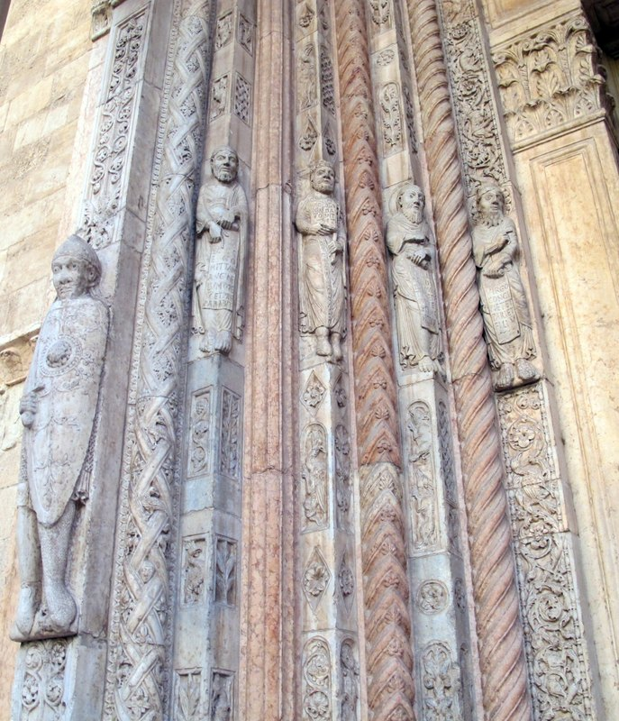
  <figcaption>Nicholaus, the left jamb of the main portal with the paladin traditionally identified as Roland and four prophets, c. 1139. Verona Cathedral. Photo: Sailko, <a href="https://creativecommons.org/licenses/by/3.0/">CC BY 3.0</a>, via Wikimedia Commons.</figcaption>
</figure>

On the outermost faces of the jambs of Verona Cathedral stand two large armed figures. On the left, a warrior with a pointed helmet and a long shield holds a sword, on whose blade is carved the name DURINDARDA, the Italian form of Durendal, the sword of Roland. The inscription is not legible in this photograph.

Beside him, on the jamb, four small prophets stand on the edges of the piers, holding scrolls with prophecies of Christ. Two of them can be read: *Ecce ego mittam angelum*, "Behold, I will send my angel" (Malachi 3:1), and *Virgo concipiet et pariet filium*, "a virgin shall conceive and bear a son" (Isaiah 7:14).

<figure>
  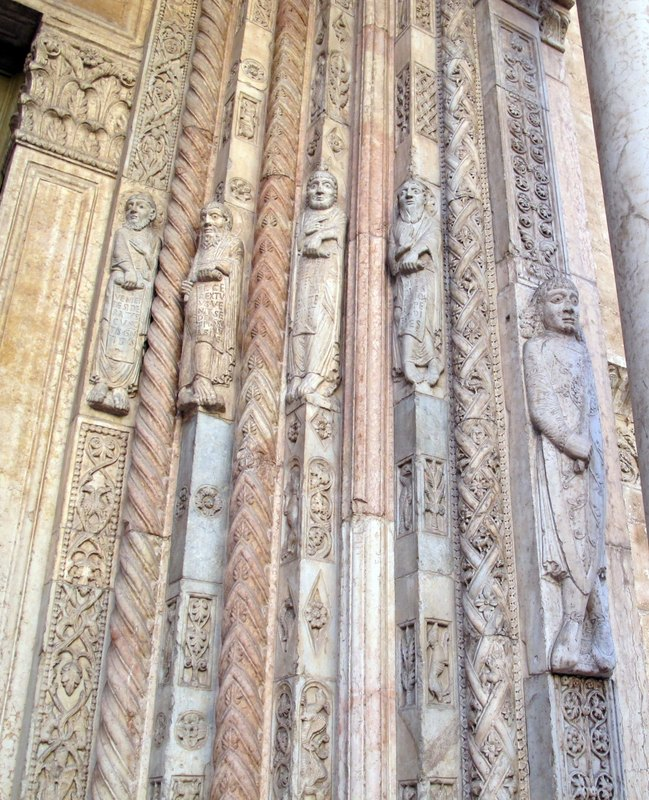
  <figcaption>Nicholaus, the right jamb of the main portal with four prophets and the figure traditionally called Oliver, c. 1139. Verona Cathedral. Photo: Sailko, <a href="https://creativecommons.org/licenses/by/3.0/">CC BY 3.0</a>, via Wikimedia Commons.</figcaption>
</figure>

On the right jamb, four more prophets hold their scrolls, among them *Veniet desideratus cunctis gentibus*, "the desired of all nations shall come" (Haggai 2:8 in the Vulgate). At the far right stands the second armed figure, bareheaded, with long hair and a long shield, traditionally called Oliver.

The two figures are among the earliest images of the heroes of the *Chanson de Roland* in monumental sculpture. Their presence at a cathedral door shows how the epic of Charlemagne's paladins, fighting for the faith, could be taken into the imagery of the church, as at Modena the Breton knights of the Porta della Pescheria.

The identification has been discussed. One minority view dated the figures to the late twelfth century and saw in them Saints Sergius and Bacchus, soldier martyrs. A study of 2021 accepts the left-hand figure as Roland, read as an allegory of fortitude, and proposes that the bareheaded right-hand figure is not Oliver but Saint Romanus, doorkeeper and martyr. The label Oliver should be used with caution.

The figures are tall and flat, carved on the faces of the jambs, with large heads and staring eyes. Their scale, far greater than that of the prophets, makes them guardians of the door, like the warriors that flanked the demolished Porta dei Mesi at Ferrara.

The prophets are carved in the manner of Ferrara, small figures on the pier edges, but in greater number. Their scrolls form a sequence of announcements of Christ that leads the eye towards the lunette, where the Child sits on his mother's lap.

The jambs show again the alternation of white and pink marble, with shafts carved with spirals, zigzags and braids, and panels with animals and plants. The decoration is denser than at Ferrara, as befits the last and largest of the porches.

### The Sacra di San Michele: the Porta dello Zodiaco

<figure>
  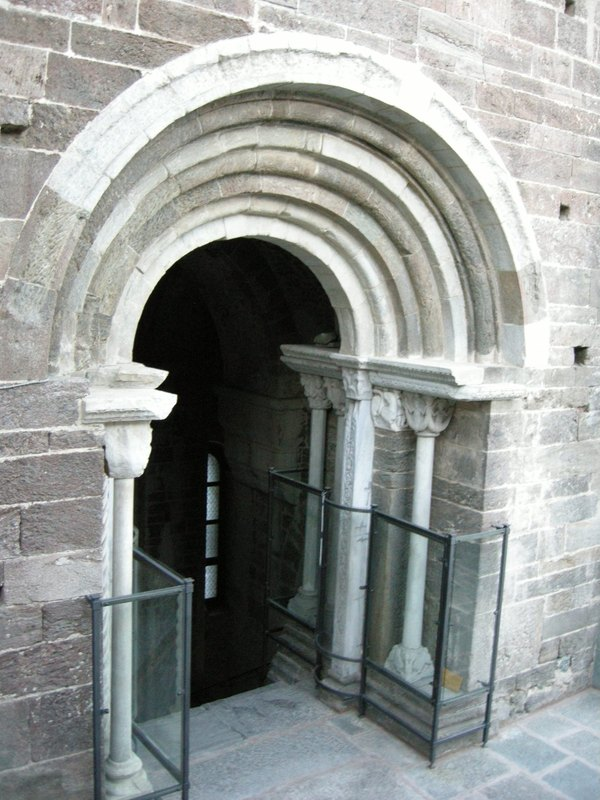
  <figcaption>The Porta dello Zodiaco at the head of the Scalone dei Morti, Sacra di San Michele, with the carved jambs of Nicholaus (c. 1120s) under protective glass. Photo: Sailko, <a href="https://creativecommons.org/licenses/by-sa/3.0/">CC BY-SA 3.0</a>, via Wikimedia Commons.</figcaption>
</figure>

The Porta dello Zodiaco opens at the head of the Scalone dei Morti, the great staircase that climbs through the substructures of the abbey of the Sacra di San Michele, on Monte Pirchiriano, to the church. It is a deep round arch with stepped mouldings, set in the grey stone wall; its jambs, of white marble, are carved on their faces and now protected by glass panels.

The portal takes its name from the signs of the zodiac carved on one jamb, facing the constellations on the other. Inner faces carry inhabited vine scrolls, and figured capitals and cornices crown the jambs. Lines of hexameters run along the edges of the carved faces.

The abbey was a great Benedictine house on the road from Italy to France, a place of pilgrimage dedicated to the archangel Michael. It was of strict papal obedience, and Christine Verzár has related the constellations to the ivory plaques of the cathedra of Saint Peter in Rome, reading the cycle as a papal allusion. The reading is an interpretation.

The couplet naming the sculptor, *Vos qui transitis sursum vel forte reditis, / vos legite versus quos descripsit Nicholaus*, addresses those who climb the stair and those who come down. It calls them to read the verses, and through them the images, as they pass.

The portal is unfinished, and the Dizionario Biografico suggests that it may have been set in its present position around the middle of the twelfth century. Its relation to the staircase and the church has been altered by later rebuilding and restoration.

The date of the sculpture is disputed. The Enciclopedia dell'Arte Medievale dates it about 1114–1120 and makes it the first signed work of Nicholaus; the Dizionario Biografico places it after 1122, close to the beginning of Piacenza. The prudent formulation is that it was carved most probably in the 1120s, in close relation to Piacenza.

The Enciclopedia dell'Arte Medievale records Lombard masters of the so-called Como current working beside Nicholaus at the Sacra and at Piacenza. The capitals and cornices around the portal, some reused, show a variety of hands and dates.

The glass panels that now protect the jambs show the fragility of the marble, exposed for centuries in a passage through which pilgrims and visitors climbed. They also make photography difficult, which explains why the zodiac jamb is rarely reproduced in full.

### The Sacra di San Michele: the Inhabited Scrolls and Their Verses

<figure>
  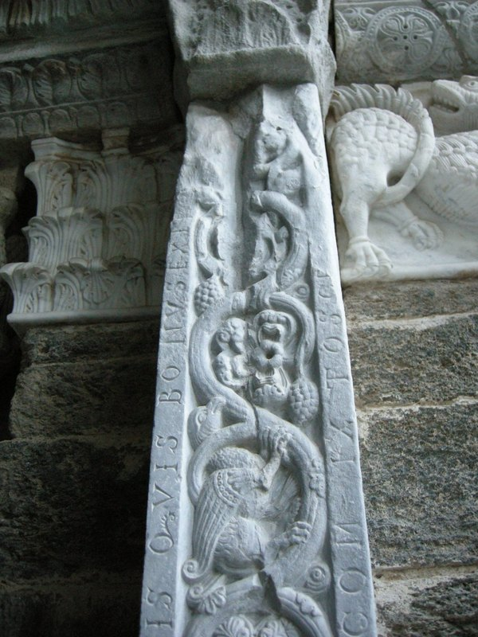
  <figcaption>Nicholaus, the inhabited vine scroll of the Porta dello Zodiaco, with the verses Hoc opus intendat quisquis bonus exit et intrat and Flores cum beluis comixtos cernitis on its edges. Sacra di San Michele. Photo: Sailko, <a href="https://creativecommons.org/licenses/by-sa/3.0/">CC BY-SA 3.0</a>, via Wikimedia Commons.</figcaption>
</figure>

The inner faces of the jambs of the Porta dello Zodiaco are carved with vine scrolls that enclose birds, lions, winged beasts, fruits and flowers. The scrolls follow closely the model of the Modena portals, and they are one of the clearest links between Nicholaus and the workshop of Wiligelmo.

Along the edges of the carved face run lines of capital letters. On the left edge of the jamb in the first photograph can be read …S QUIS BONUS EXI(t)…, on the right edge …COMIXTOS…. They belong to two of the verses of the portal, *Hoc opus intendat quisquis bonus exit et intrat* and *Flores cum beluis comixtos cernitis*.

<figure>
  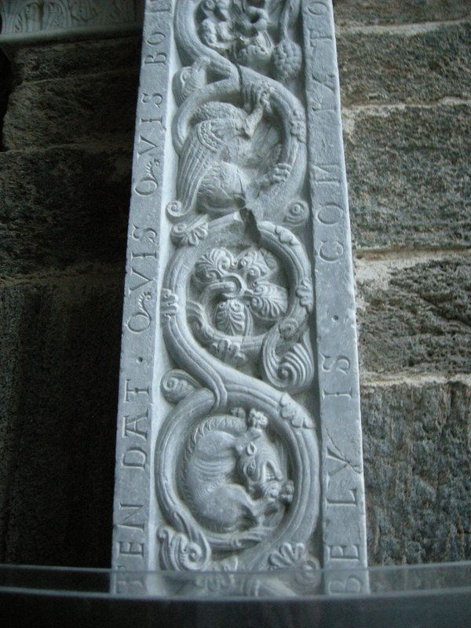
  <figcaption>Nicholaus, the lower part of the same jamb, with the verses on its edges. Sacra di San Michele, Porta dello Zodiaco. Photo: Sailko, <a href="https://creativecommons.org/licenses/by-sa/3.0/">CC BY-SA 3.0</a>, via Wikimedia Commons.</figcaption>
</figure>

The lower part of the same jamb shows a winged beast, a large rosette and a crouching lion in the roundels of the scroll. The inscriptions continue: …[INT]ENDAT QUIS BO[NUS]… on the left, …BELUIS COM[IXTOS]… on the right. The two photographs together confirm both verses on the stone, and the spelling *comixtos* with a single *m*.

The verse *Flores cum beluis comixtos cernitis*, "you see flowers mingled with beasts", describes the carving itself. The inscription explains the image, as on the lunettes of Ferrara and Verona, and invites the viewer to look at it with attention.

<figure>
  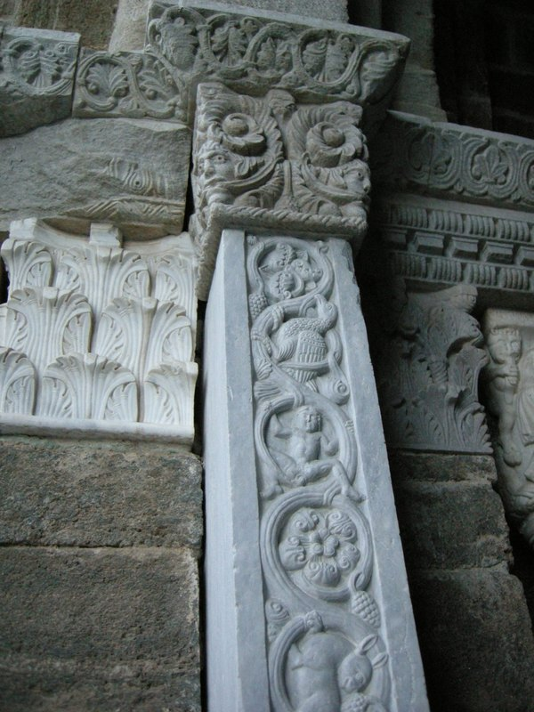
  <figcaption>Nicholaus, an inner face of a jamb of the Porta dello Zodiaco with an inhabited vine scroll, next to reused capitals and cornices. Sacra di San Michele. Photo: Sailko, <a href="https://creativecommons.org/licenses/by-sa/3.0/">CC BY-SA 3.0</a>, via Wikimedia Commons.</figcaption>
</figure>

Another face of a jamb shows a scroll with a bird, a naked youth, a rosette and fruits. Beside it, capitals of acanthus and carved cornices of different dates are set together, some of them reused from earlier buildings.

The hexameter *Hoc opus intendat quisquis bonus exit et intrat* is carved also on the lintel of the south portal of Piacenza Cathedral. The repetition of the same verse on two works is the main epigraphic argument for the attribution of the Piacenza sculpture to Nicholaus, and for the close relation between the two works.

The verses of the Sacra have been edited in the monograph of Christine Verzár (1968) and in a study of 1988; their spellings vary between sources, and the complete corpus should be checked against these editions. The photographs reproduced here confirm at least the readings *quisquis bonus exit* and *comixtos*.

The scrolls of the Sacra show the qualities of Nicholaus as an ornamental sculptor: rhythm, clarity and a lively bestiary. The animals in the roundels, each different, recall the inhabited scrolls of Modena but are carved with a crisper, more linear touch.

### The Sacra di San Michele: the Constellations

<figure>
  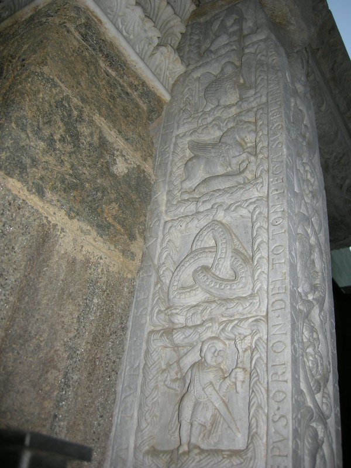
  <figcaption>Nicholaus, the jamb of the constellations of the Porta dello Zodiaco, with the eagle, Pegasus, the Triangle and Orion, named on its edge. Sacra di San Michele. Photo: Sailko, <a href="https://creativecommons.org/licenses/by-sa/3.0/">CC BY-SA 3.0</a>, via Wikimedia Commons.</figcaption>
</figure>

One jamb of the Porta dello Zodiaco carries the constellations, each in a panel framed by braided bands. From the top, the photograph shows an eagle, a winged horse, a knotted triangle and a youth holding a sword. Along the edge of the jamb runs a line of names: …PUS · ORION · DELTOTON · PEGASUS · EL…, and on the other edge …SERPENS….

The figures correspond to the names. The eagle is the constellation Aquila; the winged horse is Pegasus; the knotted triangle is Deltoton, the Triangle, a constellation named after the Greek letter delta; the youth with the sword is Orion, the hunter. The Serpent may refer to Serpens or to the Dragon.

The constellations were known in the Middle Ages through the astronomical manuscripts derived from the *Phaenomena* of Aratus, in its Latin versions, which illustrated each constellation with its figure and its name. The sculptor of the Sacra must have worked from such a manuscript, perhaps in the library of the abbey.

The representation of the constellations on a church portal is exceptional. The zodiac, the cycle of the months in the sky, was a common theme of Romanesque portals; the constellations, with their pagan names and figures, were rarely carved. Their presence at the Sacra implies a learned programme.

Facing the zodiac on the other jamb, the constellations complete an image of the heavens through which the visitor passed on the way to the church. The ascent of the Scalone dei Morti, from the dark substructures to the church above, could be read as a passage from earth to heaven.

The figures of Pegasus and Orion show the same style as the scrolls of the inner faces: clear outlines, details incised with care, figures set against plain grounds within decorative frames. The youth with the sword has the round face and large eyes of the figures of Nicholaus at Piacenza and Ferrara.

The photograph, taken from below, shows the jamb in its setting, against the rough grey masonry of the abbey. The white marble of the jamb stands out from the dark stone of the wall, as a precious insertion into the rough fabric of the mountain monastery.

The zodiac jamb opposite, with the signs from Aries to Pisces, is not illustrated here. Together the two jambs form, according to the literature, the oldest monumental cycle of the zodiac and the constellations still in place in Romanesque Europe.

### Piacenza: the Lintel of the South Portal

<figure>
  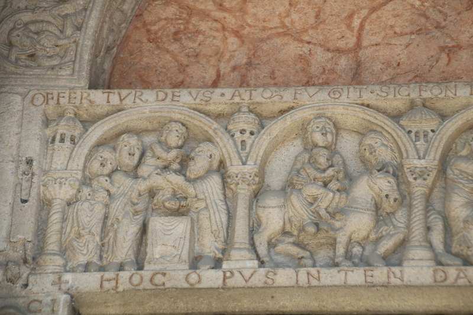
  <figcaption>Nicholaus, the lintel of the south portal of Piacenza Cathedral, left part: the Presentation in the Temple and the Flight into Egypt, c. 1122–1130. Photo: Mongolo1984, <a href="https://creativecommons.org/licenses/by-sa/4.0/">CC BY-SA 4.0</a>, via Wikimedia Commons.</figcaption>
</figure>

The lintel of the south portal of Piacenza Cathedral is carved with scenes of the life of Christ under a row of arches, between small domed towers. At the left, the Presentation in the Temple shows the Virgin and Joseph giving the Child to the bearded Simeon over an altar; next, the Flight into Egypt shows the Virgin with the Child on a donkey, led by Joseph.

Along the upper border runs an inscription that names the scenes. It begins *Offertur Deus atque fugit*, "God is offered and flees", referring to the Presentation and the Flight. Along the lower border begins the verse *+ Hoc opus intenda[t]*.

<figure>
  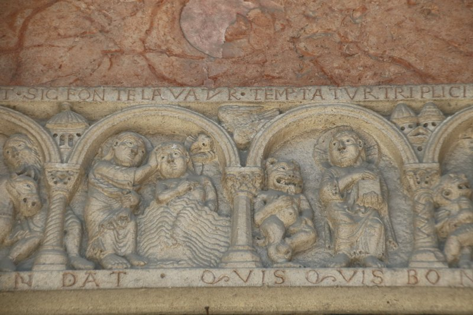
  <figcaption>Nicholaus, the lintel of the south portal of Piacenza Cathedral, central part: the Baptism and the first Temptation of Christ, c. 1122–1130. Photo: Mongolo1984, <a href="https://creativecommons.org/licenses/by-sa/4.0/">CC BY-SA 4.0</a>, via Wikimedia Commons.</figcaption>
</figure>

In the central part, the Baptism shows Christ standing in rippling water, John the Baptist laying his hand on his head and an angel holding his garment, with the dove of the Holy Spirit above. Next, a grinning devil sits beside Christ, who holds a book, in the first of the Temptations. The upper border continues: *sic fonte lavatur, temptatur triplici*, "thus he is washed in the font, he is tempted threefold". The lower border continues: …*ndat quisquis bon*….

<figure>
  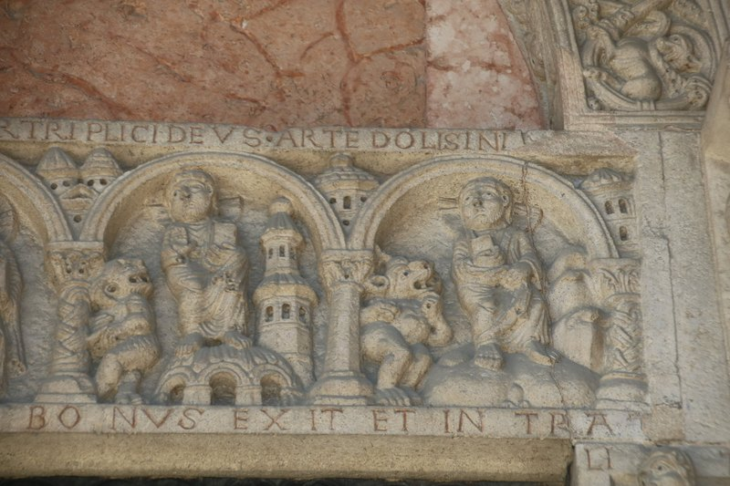
  <figcaption>Nicholaus, the lintel of the south portal of Piacenza Cathedral, right part: the second and third Temptations, c. 1122–1130. Photo: Mongolo1984, <a href="https://creativecommons.org/licenses/by-sa/4.0/">CC BY-SA 4.0</a>, via Wikimedia Commons.</figcaption>
</figure>

In the right part, the second and third Temptations show Christ standing on a mountain and on a rock, beside a tower, with devils crouching at his side. The upper border reads *triplici Deus arte doli sini*…, "God is tempted with threefold art of deceit…", and the lower border ends …*bonus exit et intra[t]*.

The lower inscription thus reads, across the whole lintel, *Hoc opus intendat quisquis bonus exit et intrat*, the same hexameter carved on the Porta dello Zodiaco at the Sacra di San Michele. The word *quisquis* is carved once, divided into two syllables. The repetition of this verse is the main epigraphic link between the two works.

The upper inscription forms a single sentence that summarises the scenes: God is offered, flees, is washed in the font and is tempted with threefold deceit. Text and image follow each other along the lintel, so that the reader can follow the story by reading the words above the scenes.

The style of the lintel is that of Nicholaus: small figures with large heads and expressive faces, set under arcades with towers, in a clear and lively narrative. The devils, with their animal heads and grinning mouths, show his taste for the grotesque. The composition anticipates the lintels of Ferrara and Verona.

According to the Dizionario Biografico, the south portal of Piacenza belongs to Nicholaus and his collaborators, while the north portal is by sculptors of Wiligelmic culture. The cathedral was begun in 1122, and the portal belongs to the first campaign, in the 1120s.

### Piacenza: a Capital of the South Portal

<figure>
  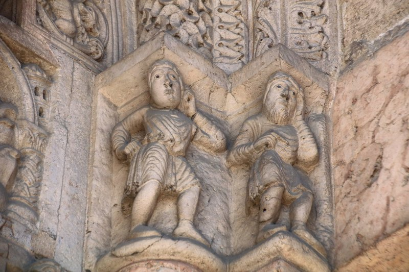
  <figcaption>Nicholaus and workshop, a capital of the south portal of Piacenza Cathedral with two clothed figures moving away in shame, identified as Adam and Eve, c. 1122–1130. Photo: Mongolo1984, <a href="https://creativecommons.org/licenses/by-sa/4.0/">CC BY-SA 4.0</a>, via Wikimedia Commons.</figcaption>
</figure>

A capital of the south portal of Piacenza shows two figures in short garments, a youth and a bearded man, walking away with anxious faces, each raising a hand to the side of his head. The title of the photograph on Wikimedia Commons identifies them as Adam and Eve, clothed after the Fall, moving away with guilty expressions.

The identification follows the gestures: the hand raised to the head is a sign of shame or grief, and the clothed figures recall the Adam and Eve of the Labour after the Expulsion. If the reading is correct, the capital continues the theme of the Fall seen on the reliefs of Nicholaus at San Zeno.

The two figures stand on a common base and fill the two faces of the capital, divided by its corner. Their bodies are short and solid, their heads large, their eyes deeply drilled, their garments carved with fine parallel folds.

The faces, with their wide eyes and anxious expressions, are among the most expressive of Nicholaus's work. The capital shows his ability to give emotion to small figures, through gesture and expression rather than through detail.

The comparison with the Genesis slabs of Wiligelmo at Modena is instructive. Wiligelmo's Adam and Eve are heavier and graver, carved in deeper relief; those of Piacenza are lighter and more animated, with a more nervous, linear treatment of the drapery.

The capital belongs to the decoration of the south portal, attributed to Nicholaus and his workshop. Its execution may be by a collaborator; the differences of hand within the portal sculpture of Piacenza have not been fully resolved.

The surface of the stone is pitted and worn, with losses at the noses and hands. The capital, at the height of the viewer, has suffered from exposure and contact, like the lions and telamons of Ferrara.

The scene of the Fall on the capital of a portal set the history of sin at the entrance of the church, before the faithful who came to be redeemed. Its theme is the counterpart of the Baptism and the Temptations of Christ on the lintel above, which show the overcoming of sin.

### Piacenza: the North Portal, for Comparison

<figure>
  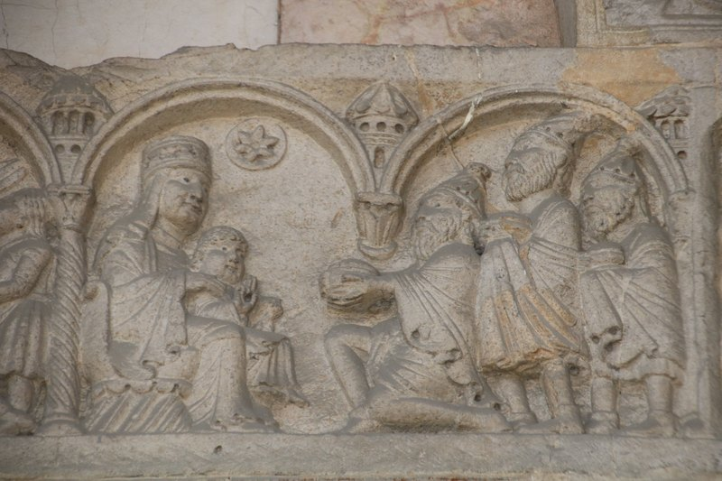
  <figcaption>Workshop of Wiligelmo, the lintel of the north portal of Piacenza Cathedral with the Adoration of the Magi, c. 1122–1130, for comparison with the south portal of Nicholaus. Photo: Mongolo1984, <a href="https://creativecommons.org/licenses/by-sa/4.0/">CC BY-SA 4.0</a>, via Wikimedia Commons.</figcaption>
</figure>

The lintel of the north portal of Piacenza Cathedral shows, under a row of arches with small towers, the crowned Virgin seated with the Child, under a star, and the three Magi bringing their gifts, the first kneeling. According to the Dizionario Biografico, this portal is the work of sculptors of Wiligelmic culture, working at Piacenza beside Nicholaus.

The comparison with the lintel of the south portal shows two different manners in the same building and the same years. The figures of the north lintel are heavier and calmer, carved in deeper relief, with broad faces and heavy drapery. Those of the south lintel are smaller, livelier and more linear.

The Virgin, frontal and crowned, holding the Child on her knee, is a figure of majesty, close to the Wiligelmic tradition. The Magi, bearded and crowned, approach with dignity, the first kneeling and offering his gift in a bowl.

The architecture of arches and towers is common to both lintels, as is the use of the lintel for a sequence of scenes of the Infancy of Christ. The two workshops shared the same repertory of forms but treated it differently.

The division of the façade between the two workshops, the north portal to the Wiligelmic sculptors, the south to Nicholaus and the central portal to both, is the reading of the Dizionario Biografico. It shows how a great building site of the 1120s could employ several workshops at once.

As the work went on, according to the same source, Nicholaus probably took charge of the whole site, as the capitals of the crypt and presbytery and the apse window suggest. His models were reused long after the middle of the century, giving rise to the so-called school of Piacenza.

The comparison is also a key to the question of Nicholaus's training. If he worked beside sculptors of Wiligelmo's tradition at Piacenza, he certainly knew their work; whether he had been trained among them remains a hypothesis.

The north lintel is included here only for comparison. It is not the work of Nicholaus, and its caption gives it to the workshop of Wiligelmo, following the attribution of the Dizionario Biografico.
