## A Name in a Pavement

*Pantaleone* is known from a single work and from the words that name him in it. The floor of the cathedral of Santa Maria Annunziata at Otranto, at the eastern tip of Apulia, is covered with a figured mosaic that runs through the nave, the aisles, the presbytery and the apse. Its inscriptions date the work to 1163 and 1165, name the archbishop who ordered it, Ionathas, and name a presbyter, Pantaleone, through whose hands it was made.

No other document mentions him. His birth, death, family and training are unknown, and nothing else, in Otranto or elsewhere, has been connected with him on firm grounds. Everything that can be said about him passes through the pavement: its inscriptions, its images and the questions they raise.

The name is the Latin form of the Greek *Pantaleon*. It has often been taken as a sign that he belonged to the Greek-speaking community of the Salento, and from there older scholarship drew the further idea that he was a monk of the Basilian monastery of San Nicola di Casole, near Otranto. The name alone cannot carry so much: it was common in southern Italy, among Lombards as well as Greeks.

As a presbyter he was a priest, and therefore probably at least thirty years old in 1165. That places his birth in the first half of the twelfth century, and it is the only biographical inference the evidence allows.

The most recent account of him, by [Manuel Castiñeiras](/scholars.html#castineiras-manuel) in the *Dizionario Biografico degli Italiani* (2014), goes further in another direction. It reads the formulas of the inscriptions, *per manus* and *per dexteram*, as administrative language, meaning that the work was carried out through Pantaleone's agency, and suggests that he may have been the overseer or treasurer of the enterprise rather than the man who laid the stones.

The question cannot be settled. The same formulas are used elsewhere for makers as well as for agents, and the pavement, which covers several hundred square metres, was certainly the work of a team. What is certain is that Pantaleone's name was the one recorded beside the archbishop's, and that it has stood for the work ever since.

The previous version of this entry contained much that cannot be supported. It made Pantaleone a monk of Casole educated in its library, invented his travels to Ravenna, Sicily and Constantinople, gave the pavement 600,000 tesserae, 1,600 square metres and a tree sixty metres long, called the image of Arthur the first in Italy and the cathedral a UNESCO site, and set the mosaic against the Fourth Lateran Council of 1215. These claims are removed or corrected below.

The account that follows treats the inscriptions, the patron and the setting, the structure of the pavement, its themes, the question of Arthur, and the history of its restorations. The catalogue examines the parts of the floor illustrated here, from the elephants at the entrance to the patriarchs of the left aisle.

## The Inscriptions

The pavement carries several dedicatory inscriptions, and they are its only documents. Their texts are known partly from the floor itself and partly from early transcriptions, because some of them were damaged in 1480–1481 and restored later.

The principal inscription runs across the middle of the nave in two bands, beneath the scene of Noah's Ark. It is dated 1165, in the thirteenth or fourteenth indiction according to the reading, and names the reigning king, William, "rege magnifico et triumfatore". It states that "the humble servant of Christ Ionathas, archbishop of Otranto, ordered this work to be made by the hands of Pantaleone the presbyter": *humilis servus Christi Ionathas Hydruntinus archiepiscopus iussit hoc opus fieri per manus Pantaleonis presbiteri*.

A second inscription, in front of the high altar, is in leonine verse and dated 1163. It opens with the formula *Anno ab incarnatione Domini nostri*; the rest is largely illegible. If both dates refer to stages of the work, the pavement was laid from the east end towards the entrance over at least two years.

A third inscription frames a roundel of the presbytery near the figure of Solomon: *Ionathas humilis servus Christi Idrontinus archiepiscopus iussit hoc opus fieri*. A fourth, around a medallion with a monster devouring a hare, praises the work and its patron; a later restoration has made parts of it hard to read.

The last inscription lies in front of the entrance: *Ex Ionathe donis per dexteram Pantaleonis hoc opus insigne est superans impendia digne*, "From the gifts of Ionathas, by the right hand of Pantaleone, this noble work was made, worthily surpassing its cost". It was damaged when the west front collapsed in the siege of 1481, and its second line was reconstructed in the nineteenth century from older sources.

The inscriptions say three things clearly. The archbishop ordered and paid for the work; Pantaleone was the person through whom it was done; and it was carried out under King William, whose title of "triumphator" recalls his victory over the rebel barons in 1160–1161. They say nothing about Pantaleone's status beyond his priesthood, nothing about a monastery and nothing about assistants.

Many figures are also labelled. Beside the scenes stand names in Latin capitals: REX ARTVRVS, ALEXANDER REX, ABEL and CAYN, ABRAHAM, YSAAC and IACOB, SAMVEL, INFERNVS and SATANAS, the names of the months. Beside the murder of Abel God's question is written out: *Ubi est Abel frater tuus?* (Genesis 4:9). Some of these labels have been retouched in restoration.

The labels show that the pavement was meant to be read, not only seen. They name the figures for a viewer who knew Latin letters and could walk the length of the floor, and they give the stories the authority of the written word.

## Ionathas, King William and Otranto

Ionathas, or Gionata, was archbishop of Otranto from about 1155 to about 1179. Castiñeiras proposes a Norman, perhaps even Welsh, origin and notes his friendship with Clemente, a judge of Taranto and a member of the royal court in Palermo. He belonged, in any case, to the Latin hierarchy that the Norman kings had established in Apulia.

The previous entry presented him as a former abbot of Casole and his commission as an assertion of Otranto's Greek heritage. Neither point is documented. The inscriptions name him as a Latin archbishop acting in the reign of a Norman king, and the content of the pavement, with its romance heroes and its royal figures, belongs to the culture of that court.

The inscription of 1165 gives William I the titles *magnificus* and *triumphator*. William, king of Sicily from 1154 to 1166, had put down a revolt of the barons of Apulia and Sicily in 1160–1161. The pavement was laid in the years immediately after, and its kings, Solomon, Alexander and Arthur, have been read as images of rulership in a kingdom that had just reasserted its authority.

Otranto was the principal port of the Salento on the Strait, facing Albania and the Byzantine world across the Adriatic. Its population included Greek and Latin Christians and a Jewish community, and its monastery of San Nicola di Casole was a centre of Greek learning. The cathedral itself, consecrated in 1088, belonged to the Latin church.

The pavement is one of a group of figured floors in Norman Apulia. Taranto had one dated 1160–1161, Trani and Lecce others of about the same years, and Brindisi one of 1178. They share the white ground, the dark contours and the mixture of biblical and secular subjects, and they show that the Otranto mosaic belonged to a regional practice rather than to an isolated workshop.

Castiñeiras reads the iconography as Norman and chivalric rather than Byzantine, and links it to the culture of romance and of the Alexander legend that circulated at the courts of England, France and Sicily. Ilaria Molteni and Irene Quadri (2020) read the whole floor as a universal chronicle in images, in which biblical history, ancient kingship and the Norman present are set in one sequence.

A later witness shows how the floor was seen in its own milieu. A poem by Nicola of Otranto, abbot of Casole in the early thirteenth century, has been read by scholars as a near-description of the pavement. It confirms that the images were understood by the learned men of Otranto as a programme to be read.

The commission was costly, as the entrance inscription says, and it was the archbishop's. Nothing is known of Ionathas's other works or of the accounts of the enterprise. The Ottoman capture of Otranto in 1480, in which the cathedral was turned into a mosque, and the siege of 1481 destroyed much of the city's archives.

## The Structure of the Floor

The pavement covers the whole floor of the cathedral. In the nave a single great tree rises from the entrance towards the altar, carried at its base by two elephants. Its trunk divides the floor lengthwise, and its branches spread to either side, enclosing scenes and figures in the spaces between them.

In each aisle another tree organises the floor. The tree of the left aisle rests on an animal and divides the damned from the elect: on one side Hell and Satan, on the other the patriarchs Abraham, Isaac and Jacob holding the saved in their laps. The right aisle carries Atlas, Samuel and other figures among its branches.

The presbytery has a different system: sixteen roundels in rows, each with a figure or an animal, among them Adam and Eve, King Solomon and the Queen of Sheba. In the apse the mosaic resumes beyond the altar with Jonah, the prophet of Nineveh, and Samson. A gap left by the medieval iconostasis and another by a later altar interrupt the sequence.

The nave carries the largest number of subjects. From the entrance upwards the main episodes are the Tower of Babel, Noah's Ark and the story of Noah's vine; Alexander the Great carried towards heaven by griffins; the twelve months in roundels; and higher up, Adam and Eve, King Arthur, and Cain and Abel. Animals, monsters and hunting scenes fill the spaces between.

The tree does not form a strict narrative order. Scenes are distributed along its branches by a logic that scholars still debate: chronological, from creation to the patriarchs; moral, from sin to salvation; or encyclopaedic, as a map of the world and of time. What is clear is that the tree binds the whole floor into one image, and that the viewer walking from the door to the altar passes through it.

The figures are drawn with heavy dark contours on a light ground and filled with tesserae in many tones of stone: whites, creams, ochres, pinks, reds, browns, greys and greens. The colours come from local stones; the reds and dark tones give the contours and accents. There is no gold. Some later insertions, such as the disc of coloured marbles held by a figure in the right aisle, are of other materials.

The size of the pavement is often exaggerated. The nave floor is about 28 metres long and 10 metres wide, according to Martine Meuwese (2025), and the cathedral is a basilica of moderate dimensions. Figures for the total area and for the number of tesserae that circulate in popular accounts have no published source.

The execution is uneven. Some figures, such as the months, are drawn with assurance and with a sense of the human body at work; others are schematic. The variation is consistent with a large team working over several years under a common design, and it does not allow single hands to be identified.

## Themes and Sources

The subjects of the pavement come from several traditions. The Bible supplies the main sequence: the creation and fall, Cain and Abel, Noah, Babel, the patriarchs, Samson, Samuel, Solomon and the Queen of Sheba, Jonah. Its stories are presented as the history of the world, from the beginning to the prophets.

Beside the Bible stand the kings of secular history and legend. Alexander the Great rises towards heaven in a basket carried by two griffins, which he lures upwards with meat held on spears: an episode of the Alexander romance that medieval writers read as a warning against pride. King Arthur appears near Adam and Eve, labelled REX ARTVRVS.

The months bring the cycle of the year into the floor. Each roundel shows the name of the month, its zodiac sign and its typical labour: pruning, warming by the fire, ploughing, harvesting, treading grapes, killing the pig. They follow the calendars of Western sculpture and manuscripts, and they show the rural life of the twelfth century in a setting of cosmic time.

The animals are many and varied: elephants, lions, goats, cats, dragons, griffins, sirens, centaurs and creatures without names. Some come from the bestiary, some from the repertory of hunting scenes and of fantastic peoples at the edges of the world. Castiñeiras links them to the tradition of the *Marvels of the East* and to medieval maps, on which such creatures inhabited the margins of the known world.

The previous entry presented the programme as a fusion of Byzantine, Islamic, Western and classical traditions in a Greek monastic setting, and listed Islamic decorative motifs and the *Physiologus* in Greek among its sources. Some animals do recall Eastern textiles, and some descend from the bestiary, but the main lines of the programme, the romance heroes, the calendar and the use of the tree, point to Western and Norman sources.

The reading of the floor as a whole remains open. Chiara Settis Frugoni studied it as a programme of salvation history in a series of articles from 1968 to 1973. Walter Haug read the Arthur scene in the context of the romance tradition. Molteni and Quadri see a universal chronicle; Castiñeiras a royal image of the Norman kingdom. These readings are not exclusive.

What all of them recognise is the scope of the programme. The floor holds the history of the world from creation, the kings of legend, the cycle of the year, the animals of the earth and the last things, Hell and the bosom of Abraham. It is a picture of the world laid at the feet of those who entered the cathedral.

Its theological meaning should not be overstated. The previous entry read the floor according to the four senses of Scripture, literal, allegorical, moral and anagogical, scene by scene. Such a reading may suit the learned clergy of Otranto, but no text of the period applies it to the pavement, and it is an interpretation, not a description.

## King Arthur

The image of Arthur is the most famous detail of the pavement. It shows a crowned figure, labelled REX ARTVRVS, riding an animal and raising a club, while a spotted, cat-like beast attacks from below. Next to him stand Adam and Eve after the Fall, and beyond him Cain kills Abel.

It is one of the earliest images of Arthur anywhere. It is not, however, the first in Italy: the archivolt of the Porta della Pescheria at Modena Cathedral, with Arthur and his knights besieging a castle, is generally dated to the first decades of the twelfth century, several decades earlier than Otranto.

Martine Meuwese, in the *Journal of the International Arthurian Society* (2025), has studied the scene in detail. She identifies the beast as the monstrous cat of the Arthurian tradition, Cath Palug in Welsh and Chapalu in French, which Arthur fights in several texts, though no known text corresponds exactly to the image.

The animal Arthur rides is usually described as a goat. Meuwese argues that it was a horse, and that its horns are the work of a restorer. A drawing made for Aubin-Louis Millin in 1813, now in the Bibliothèque nationale de France, records the scene before the restoration of the last quarter of the nineteenth century, which reworked it crudely.

Meuwese also argues that the crown belonged to the original image. The previous entry stated that a restoration of 1882 added it; she shows instead that the restorer retouched the figure without inventing its royal character. Walter Haug had already proposed that the "horns" were originally the reins.

The place of Arthur in the floor has been much discussed. He stands in the upper part of the nave, near the scenes of the Fall, above the month of March and the sign of Pisces. Some scholars see him as an example of the knight who fights evil; others as a king of the past among the kings of the floor; others as a figure whose meaning, as Meuwese says, cannot be fixed.

The presence of Arthur in Apulia in 1165 shows that Arthurian stories were known in the Norman kingdom of Sicily long before the French romances of Chrétien de Troyes. They may have come through the Normans and the Bretons who served them, or through the crusaders who passed through the Apulian ports.

The scene is also a warning about the state of the pavement. What a visitor sees today is the result of restorations that changed the details of one of its most important figures. Every reading of the floor must reckon with the possibility that heads, attributes and labels are modern.

## Restorations and Survival

The pavement has survived eight and a half centuries of use and several disasters. In 1480 the Ottomans took Otranto, killed many of its inhabitants and turned the cathedral into a mosque. In 1481, during the siege by which Alfonso of Calabria recovered the city, the west front collapsed and damaged the floor near the entrance.

The cathedral was reconsecrated after the recovery, and in the following centuries it was refurnished. A Renaissance rose window, a Baroque portal of 1674 and stucco decoration of the later seventeenth century changed its appearance, and altars and an iconostasis were set on parts of the floor.

Interpretive restorations of the mosaic began in the later nineteenth century. From 1872 parts of the floor were reconstructed, among them the second line of the entrance inscription. The Arthur scene was reworked in the last quarter of the century. Cosimo De Giorgi described the pavement in 1882.

In the twentieth century the interior was stripped of its Baroque additions, a process begun in 1937 and interrupted by the war. In 1953 the choir, altar and balustrade were removed to uncover the mosaic. In 1986 the nave mosaic was lifted and relaid on a new, waterproof base, and excavations beneath it found remains of earlier buildings and a late Roman mosaic. The work, overseen by the Soprintendenza of Bari, ended in 1992.

These campaigns preserved the floor and changed it. The lifting of 1986 secured the mosaic against damp; the restorations of the nineteenth century replaced missing tesserae, sometimes with new drawing. A full study of what is original and what is restored has not been published.

The previous entry claimed that the pavement owed its preservation to "seven centuries of foot traffic" followed by modern protection. The truth is the reverse: it survived despite use, disaster and alteration, and much of its present surface is the result of repair.

The pavement is protected today by the cathedral and by the state authorities. It is not a UNESCO World Heritage Site; the previous entry confused it with Castel del Monte, a separate site in northern Apulia.

What survives is still the largest figured pavement of medieval Italy and the fullest example of the Apulian floors of the twelfth century. Pantaleone's name, set in its stones beside the archbishop's, is one of the few names of the period to survive in the work itself.

## Catalogue Entry

### The Cathedral

<figure>
  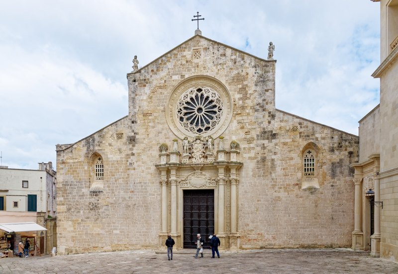
  <figcaption>Otranto, cathedral of Santa Maria Annunziata, west front, with the Renaissance rose window and the Baroque portal. Photo: Holger Uwe Schmitt, <a href="https://creativecommons.org/licenses/by-sa/4.0/deed.en">CC BY-SA 4.0</a>, via Wikimedia Commons.</figcaption>
</figure>

The cathedral was consecrated in 1088. Its west front, rebuilt after the collapse of 1481, carries a rose window of the late fifteenth century and a Baroque portal. Behind it lies a basilica with a nave and two aisles on ancient columns, and a large crypt.

<figure>
  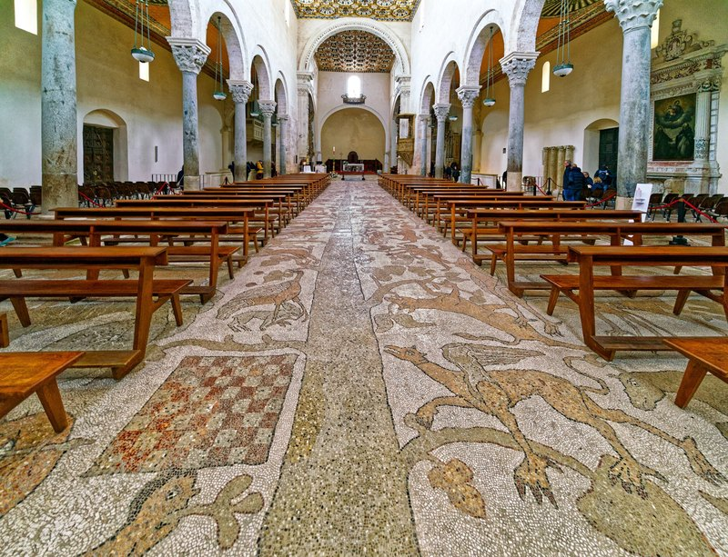
  <figcaption>Pantaleone (named), floor mosaic of the nave, 1163–1165, looking towards the altar. Otranto, cathedral. Photo: Holger Uwe Schmitt, <a href="https://creativecommons.org/licenses/by-sa/4.0/deed.en">CC BY-SA 4.0</a>, via Wikimedia Commons.</figcaption>
</figure>

The trunk of the tree runs down the centre of the nave, between the benches. The view shows the scale of the floor and the way the scenes are set among the branches on either side of the trunk.

### The Elephants and the Base of the Tree

<figure>
  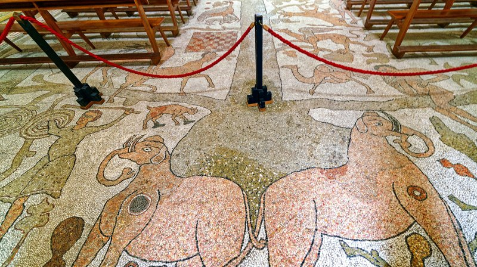
  <figcaption>Pantaleone (named), floor mosaic, the two elephants carrying the tree of the nave. Otranto, cathedral. Photo: Holger Uwe Schmitt, <a href="https://creativecommons.org/licenses/by-sa/4.0/deed.en">CC BY-SA 4.0</a>, via Wikimedia Commons.</figcaption>
</figure>

The tree of the nave rises from the backs of two elephants, set back to back near the entrance. They are drawn in pink stone with dark contours, their trunks curled and their ears patterned. The elephant was known in the West from bestiaries and from rare live specimens; here it carries the whole floor.

<figure>
  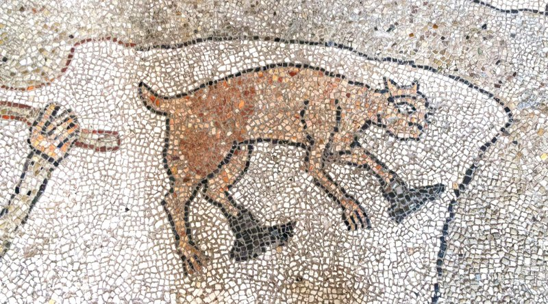
  <figcaption>Pantaleone (named), floor mosaic, a cat near the elephants. Otranto, cathedral. Photo: Holger Uwe Schmitt, <a href="https://creativecommons.org/licenses/by-sa/4.0/deed.en">CC BY-SA 4.0</a>, via Wikimedia Commons.</figcaption>
</figure>

Between the elephants and the first scenes, small animals fill the ground. The close view shows the technique: irregular tesserae of white stone for the ground, pink and orange for the body, dark stones for the contour.

### Babel, Noah and Alexander

<figure>
  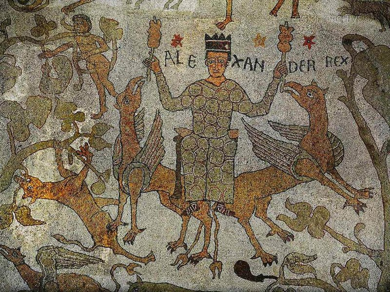
  <figcaption>Pantaleone (named), floor mosaic, the ascension of Alexander the Great. Otranto, cathedral, nave. Public domain, via Wikimedia Commons.</figcaption>
</figure>

Alexander sits crowned and frontal between two griffins, holding up two spears with meat on their points. In the legend the beasts, trying to reach the meat, carry him into the sky until God turns him back. In the floor he stands near the Tower of Babel, and both images speak of the same ambition to reach heaven by human means.

### The Months

<figure>
  
  <figcaption>Pantaleone (named), floor mosaic, the twelve months with the signs of the zodiac. Otranto, cathedral, nave. Photograph from a printed reproduction. Image: Framo, <a href="https://creativecommons.org/licenses/by-sa/3.0/deed.en">CC BY-SA 3.0</a>, via Wikimedia Commons.</figcaption>
</figure>

The months are set in twelve roundels in three rows, on either side of the trunk. Each has its name, IANVARIVS, FEBRVARIVS and so on, its sign and its labour. The scenes follow the agricultural year of southern Italy: the fire of January, the pruning of March, the harvest of June, the vintage of September, the ploughing of October, the slaughter of the pig in December.

### Adam and Eve, Arthur, Cain and Abel

<figure>
  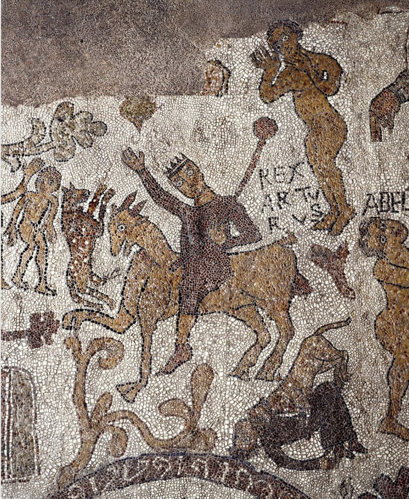
  <figcaption>Pantaleone (named), floor mosaic, King Arthur fighting the monstrous cat, with the label ABEL at the right. Otranto, cathedral, nave. Photo: Vers75, <a href="https://creativecommons.org/licenses/by-sa/4.0/deed.en">CC BY-SA 4.0</a>, via Wikimedia Commons.</figcaption>
</figure>

Arthur rides to the right, crowned, raising a club or sceptre, while the spotted cat leaps at his mount. The horns of the animal and parts of the crown were reworked in the nineteenth century. At the left edge of the view is one of the figures of Adam and Eve, after the Fall.

<figure>
  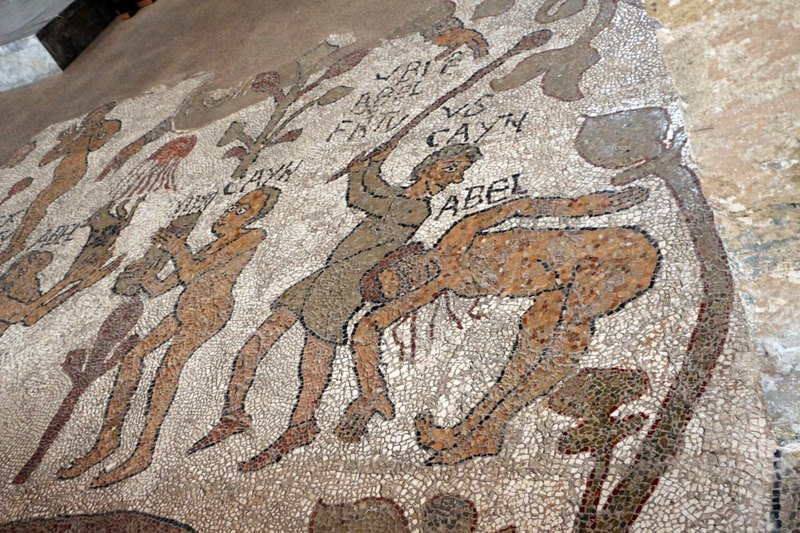
  <figcaption>Pantaleone (named), floor mosaic, Cain and Abel. Otranto, cathedral, nave. Photo: Sailko, <a href="https://creativecommons.org/licenses/by/3.0/deed.en">CC BY 3.0</a>, via Wikimedia Commons.</figcaption>
</figure>

Cain strikes Abel with a club, and blood runs from Abel's head. Above them God's question is written in full: VBI EST ABEL FRATER TVVS. At the left the brothers bring their offerings. The sequence continues the story of the Fall that begins with Adam and Eve beside Arthur.

### Animals and Figures of the Nave

<figure>
  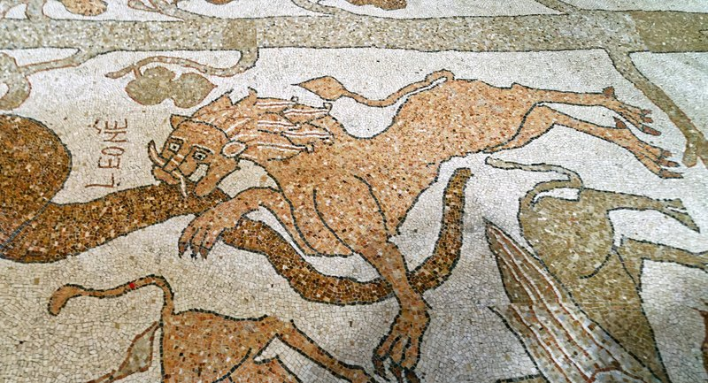
  <figcaption>Pantaleone (named), floor mosaic, a lion labelled LEONE. Otranto, cathedral. Photo: Holger Uwe Schmitt, <a href="https://creativecommons.org/licenses/by-sa/4.0/deed.en">CC BY-SA 4.0</a>, via Wikimedia Commons.</figcaption>
</figure>

<figure>
  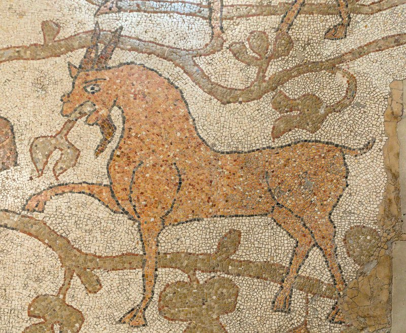
  <figcaption>Pantaleone (named), floor mosaic, a goat among the branches. Otranto, cathedral. Photo: Benjamin Smith, <a href="https://creativecommons.org/licenses/by-sa/4.0/deed.en">CC BY-SA 4.0</a>, via Wikimedia Commons.</figcaption>
</figure>

<figure>
  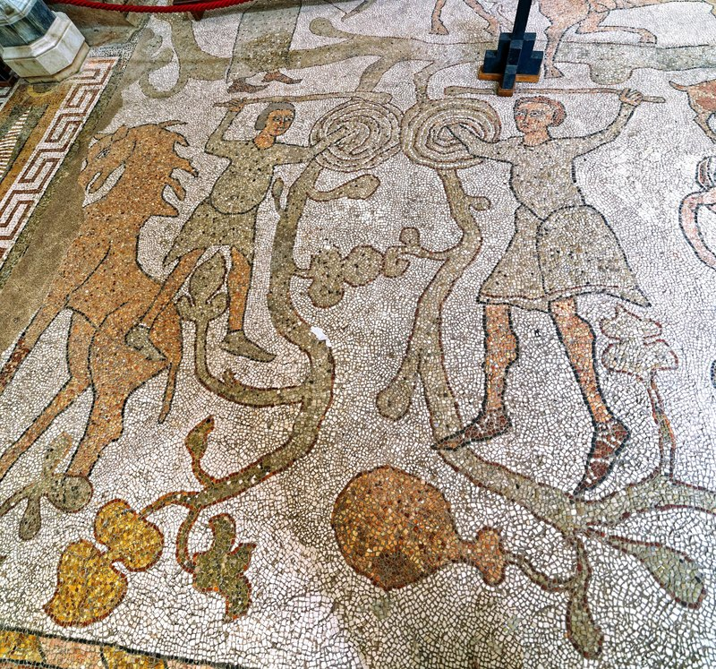
  <figcaption>Pantaleone (named), floor mosaic, two figures with staffs among the branches. Otranto, cathedral. Photo: Holger Uwe Schmitt, <a href="https://creativecommons.org/licenses/by-sa/4.0/deed.en">CC BY-SA 4.0</a>, via Wikimedia Commons.</figcaption>
</figure>

<figure>
  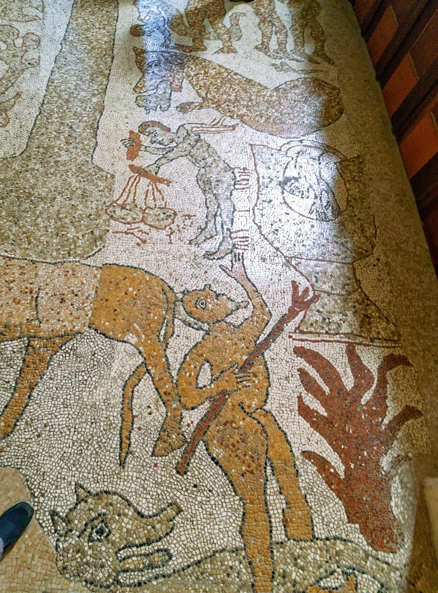
  <figcaption>Pantaleone (named), floor mosaic, a beast attacking a man, with other figures. Otranto, cathedral. Photo: Holger Uwe Schmitt, <a href="https://creativecommons.org/licenses/by-sa/4.0/deed.en">CC BY-SA 4.0</a>, via Wikimedia Commons.</figcaption>
</figure>

<figure>
  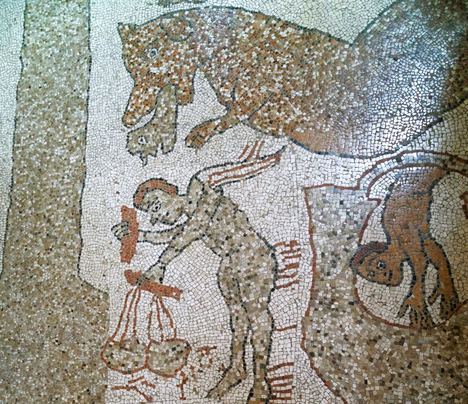
  <figcaption>Pantaleone (named), floor mosaic, detail of the same area. Otranto, cathedral. Photo: Holger Uwe Schmitt, <a href="https://creativecommons.org/licenses/by-sa/4.0/deed.en">CC BY-SA 4.0</a>, via Wikimedia Commons.</figcaption>
</figure>

<figure>
  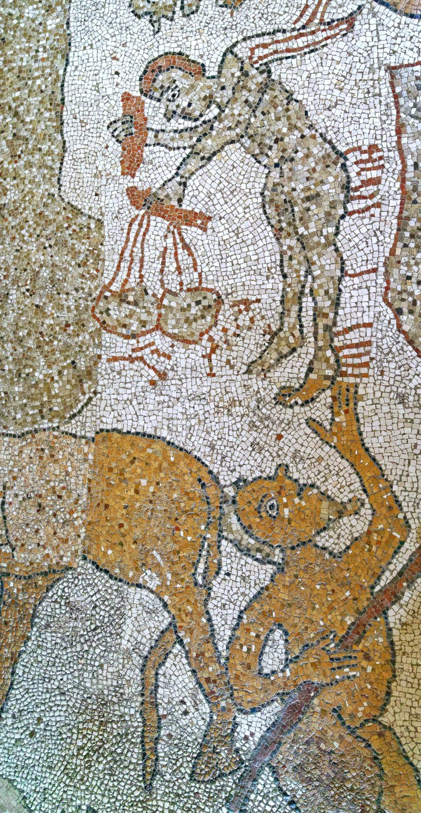
  <figcaption>Pantaleone (named), floor mosaic, detail with the man and the beast. Otranto, cathedral. Photo: Holger Uwe Schmitt, <a href="https://creativecommons.org/licenses/by-sa/4.0/deed.en">CC BY-SA 4.0</a>, via Wikimedia Commons.</figcaption>
</figure>

The meaning of many of these figures is uncertain. Fights between men and beasts, acrobats and creatures with bags or instruments belong to the repertory of fantastic and comic images that fill the margins of Romanesque art. The close views show how the restorers' tesserae, sharper and more regular, can sometimes be distinguished from the old ones.

<figure>
  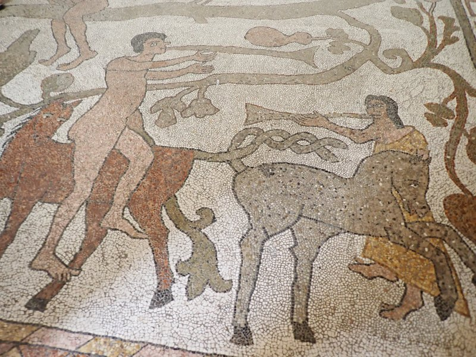
  <figcaption>Pantaleone (named), floor mosaic, two riders blowing horns. Otranto, cathedral. Photo: Patrice78500, <a href="https://creativecommons.org/licenses/by-sa/4.0/deed.en">CC BY-SA 4.0</a>, via Wikimedia Commons.</figcaption>
</figure>

<figure>
  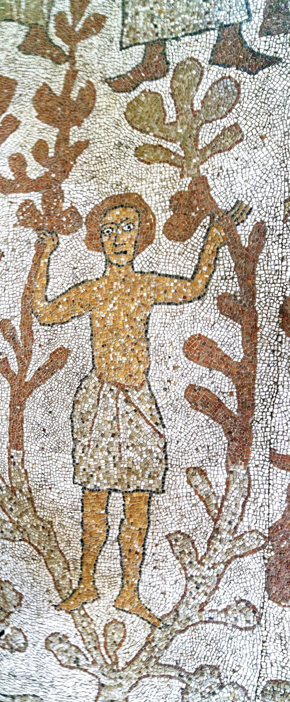
  <figcaption>Pantaleone (named), floor mosaic, a young man among branches. Otranto, cathedral. Photo: Holger Uwe Schmitt, <a href="https://creativecommons.org/licenses/by-sa/4.0/deed.en">CC BY-SA 4.0</a>, via Wikimedia Commons.</figcaption>
</figure>

### The Right Aisle

<figure>
  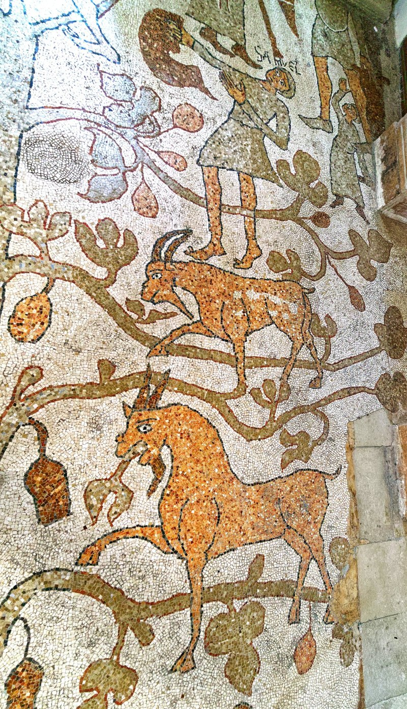
  <figcaption>Pantaleone (named), floor mosaic, goats on the tree and the label SAMVEL. Otranto, cathedral, right aisle. Photo: Holger Uwe Schmitt, <a href="https://creativecommons.org/licenses/by-sa/4.0/deed.en">CC BY-SA 4.0</a>, via Wikimedia Commons.</figcaption>
</figure>

<figure>
  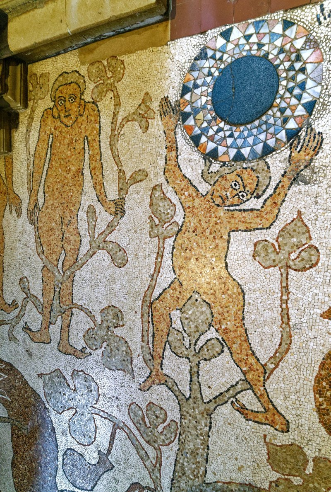
  <figcaption>Pantaleone (named), floor mosaic, a naked figure and a figure holding a disc of coloured marbles (Atlas?). Otranto, cathedral, right aisle. Photo: Holger Uwe Schmitt, <a href="https://creativecommons.org/licenses/by-sa/4.0/deed.en">CC BY-SA 4.0</a>, via Wikimedia Commons.</figcaption>
</figure>

The right aisle carries Samuel and a figure holding up a disc, often identified as Atlas bearing the world. The disc is made of pieces of coloured marble in triangles, a technique different from the rest of the floor; whether it is original or a later insertion has to be checked.

### The Left Aisle: Hell and the Patriarchs

<figure>
  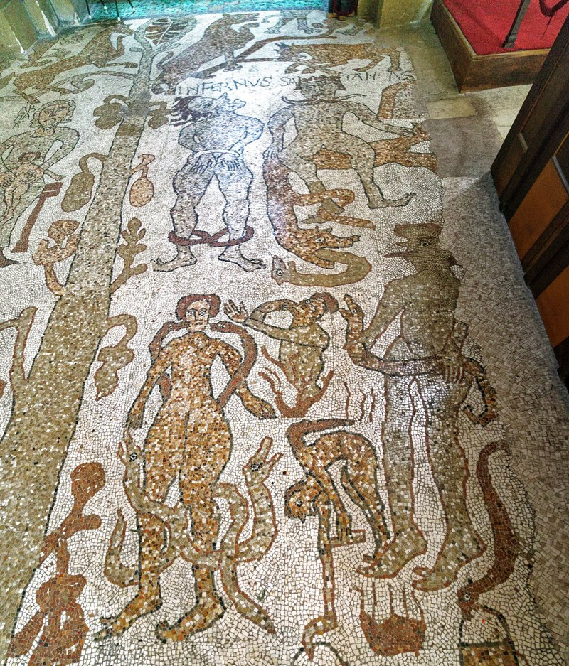
  <figcaption>Pantaleone (named), floor mosaic, Hell and Satan, with the damned. Otranto, cathedral, left aisle. Photo: Holger Uwe Schmitt, <a href="https://creativecommons.org/licenses/by-sa/4.0/deed.en">CC BY-SA 4.0</a>, via Wikimedia Commons.</figcaption>
</figure>

<figure>
  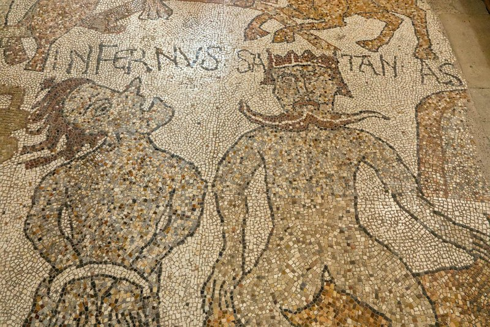
  <figcaption>Pantaleone (named), floor mosaic, Infernus and Satanas. Otranto, cathedral, left aisle. Photo: Benjamin Smith, <a href="https://creativecommons.org/licenses/by-sa/4.0/deed.en">CC BY-SA 4.0</a>, via Wikimedia Commons.</figcaption>
</figure>

Hell is shown as a figure, INFERNVS, bound and devoured, beside a crowned Satan. Below them the damned are tangled with serpents. On the other side of the tree, the patriarchs receive the saved: the left aisle sets the two ends of human history on either side of one trunk.

<figure>
  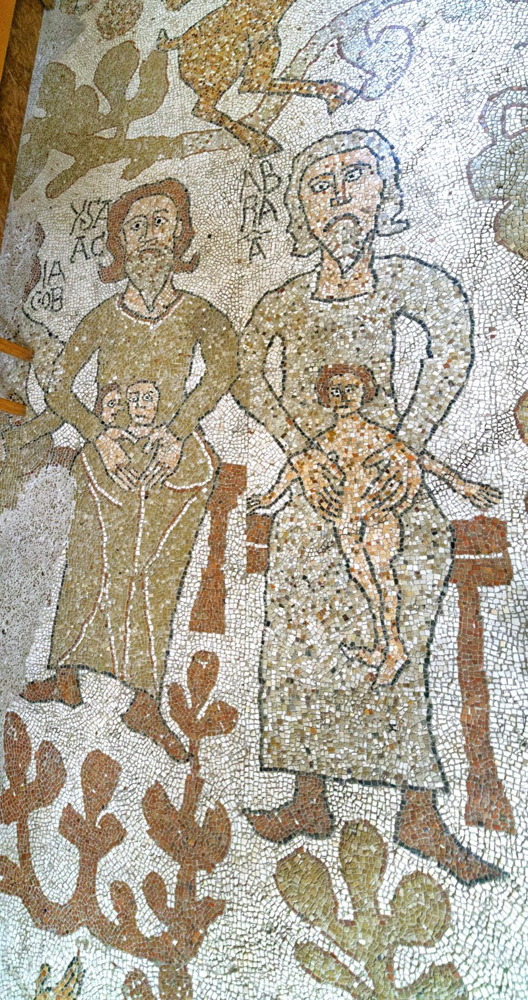
  <figcaption>Pantaleone (named), floor mosaic, Abraham, Isaac and Jacob receiving the souls of the saved. Otranto, cathedral, left aisle. Photo: Holger Uwe Schmitt, <a href="https://creativecommons.org/licenses/by-sa/4.0/deed.en">CC BY-SA 4.0</a>, via Wikimedia Commons.</figcaption>
</figure>

<figure>
  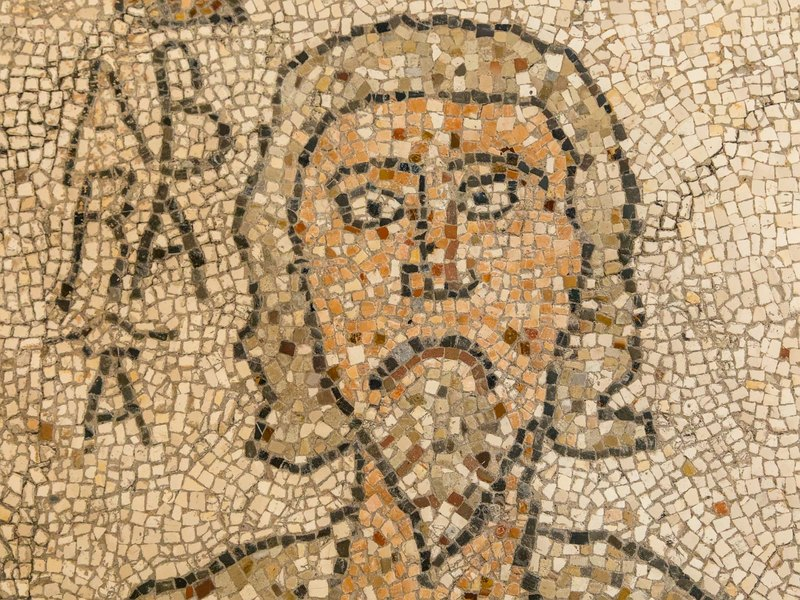
  <figcaption>Pantaleone (named), floor mosaic, head of Abraham. Otranto, cathedral, left aisle. Photo: Benjamin Smith, <a href="https://creativecommons.org/licenses/by-sa/4.0/deed.en">CC BY-SA 4.0</a>, via Wikimedia Commons.</figcaption>
</figure>

The patriarchs sit on stools and hold the souls on their laps, the image of the "bosom of Abraham" of the parable of Lazarus. The close view shows the drawing of a head: dark contours for the eyes and nose, a single curve for the moustache, and a fill of small warm tesserae.

<figure>
  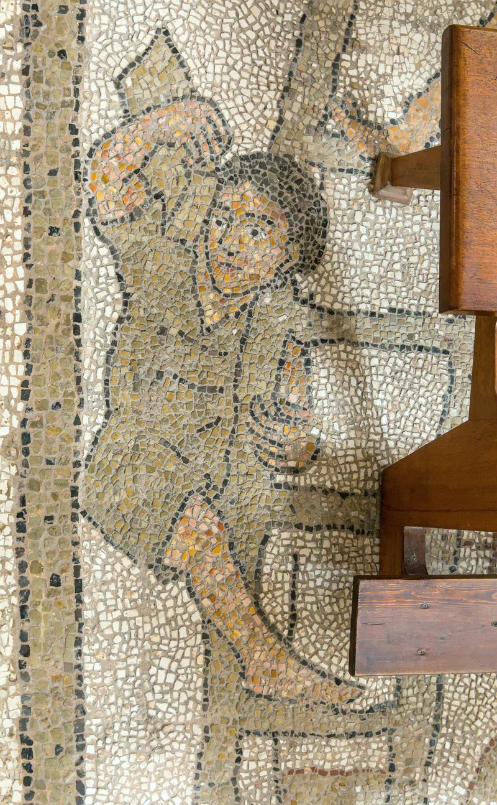
  <figcaption>Pantaleone (named), floor mosaic, a crouching figure. Otranto, cathedral. Photo: Benjamin Smith, <a href="https://creativecommons.org/licenses/by-sa/4.0/deed.en">CC BY-SA 4.0</a>, via Wikimedia Commons.</figcaption>
</figure>

**Name:** Pantaleone, presbyter.

**Documents:** Inscriptions of the floor mosaic of Otranto Cathedral, 1163 and 1165: *Ionathas Hydruntinus archiepiscopus iussit hoc opus fieri per manus Pantaleonis presbiteri*; *Ex Ionathe donis per dexteram Pantaleonis hoc opus insigne est superans impendia digne*.

**Work:** Floor mosaic of the cathedral of Santa Maria Annunziata, Otranto, 1163–1165: nave, aisles, presbytery and apse.

**Patron:** Ionathas, archbishop of Otranto (c. 1155–1179), under William I of Sicily.

**Restorations:** From 1872; Arthur scene reworked in the last quarter of the nineteenth century; nave lifted and relaid 1986–1992.

**Bibliography:** C. Settis Frugoni, studies on the Otranto mosaic, 1968–1973; C. A. Willemsen, *L'enigma di Otranto*, 1980; G. Gianfreda, *Il mosaico pavimentale della basilica cattedrale di Otranto* (several editions); M. Castiñeiras, 2004–2007 and "Pantaleone", in *Dizionario Biografico degli Italiani*, 81, 2014; X. Barral i Altet, 2010; I. Molteni and I. Quadri, "Trame di storia. Il mosaico di Otranto, le cronache universali e l'immagine della regalità", *Convivium*, VII/2, 2020; M. Meuwese, "King Arthur's Prowess: Visualising Arthur's Fight with the Terrible Cat", *Journal of the International Arthurian Society*, 13, 2025, pp. 138–170.
