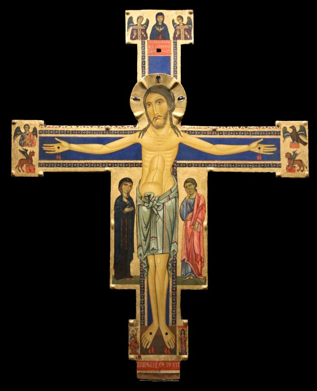
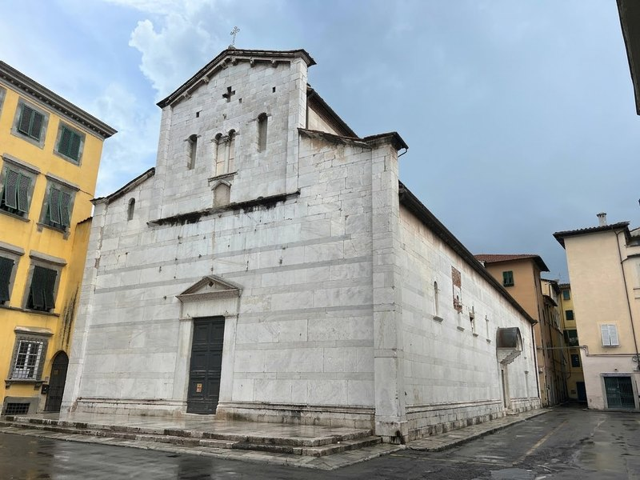
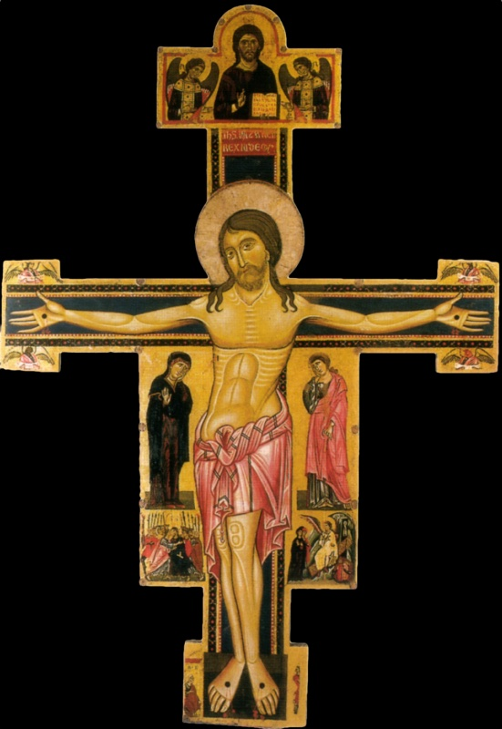
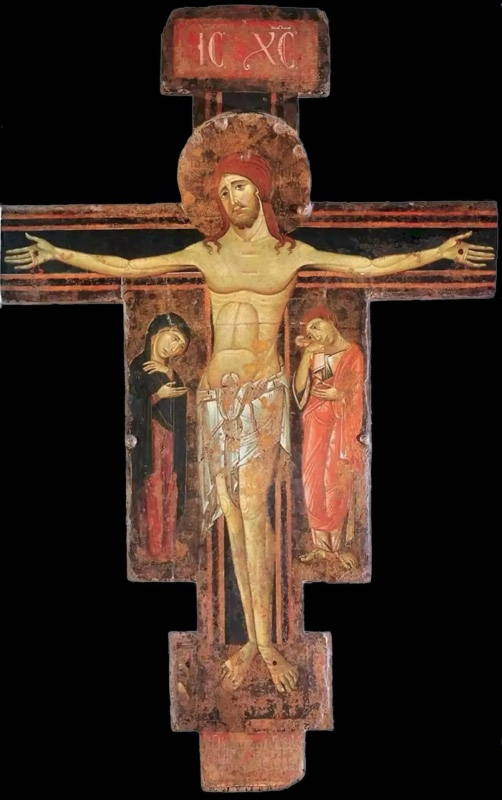
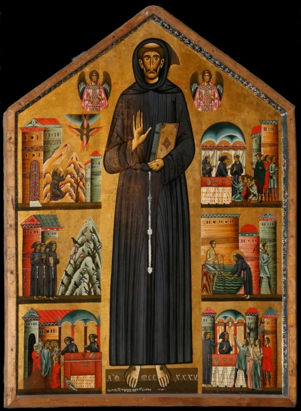
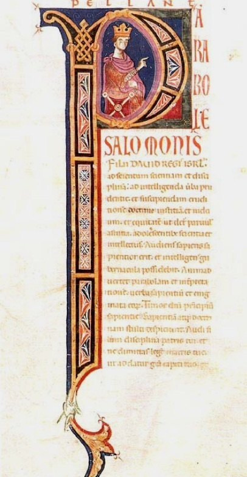

## A Painter Known from Documents

*Barone Berlinghieri* belongs to the family of painters that dominated the art of Lucca in the first half of the thirteenth century. He was a son of Berlinghiero, the founder of the workshop, and a brother of Bonaventura, the author of the Saint Francis altarpiece at Pescia, and of Marco, the illuminator of the great Bible of 1250. He was probably the eldest of the three. Unlike his father and his brothers, however, Barone is known only through documents: no signed work by him survives, and no painting has been attributed to him with any agreement among scholars.

The documents record three commissions over a span of almost forty years. In 1243 he painted a panel for the archdeacon of Lucca; in 1256 he painted a crucifix for the church of Casabasciana, in the hills of the Serchio valley; and in 1282 he undertook a crucifix, a Madonna and a Saint Andrew for the church of Sant'Alessandro in Lucca. All these works are lost. His career, documented from the 1220s to 1282, therefore covers nearly the whole of the thirteenth century, from the generation of his father to that of Cimabue, without leaving a single image.

The older version of this page treated these documents as the starting point for long reconstructions of the lost works, their materials, their transport and their reception, and placed Barone in an imaginary Franciscan life. It also contained factual errors. It made the patron of 1243 an archbishop, although Lucca was a bishopric until 1726 and the patron was the archdeacon. It sent the works of 1282 to San Francesco instead of Sant'Alessandro, and it made Barone a friar, which no source says. That material has been removed. This page presents what is documented and the context in which it makes sense.

## The Berlinghieri Family

The father, Berlinghiero, appears in a document of 25 March 1228 among the Lucchese citizens who swore the peace between Lucca and Pisa, under the name *Berlingerius Melanese Maius*, "Berlinghiero son of Melanese, the elder". The name Melanese is a patronymic, not a sign of Milanese origin: on the crucifix from Fucecchio, whose signature was recovered during its restoration in 1981, the painter called himself *Berlingerius Vulterranus*, Berlinghiero of Volterra. He is recorded as living between 1232 and 1235 and as dead by 1236.

His signed crucifix from the monastery of Santa Maria degli Angeli, now in the Museo Nazionale di Villa Guinigi in Lucca, is the key work of the family. It shows a Christ of the triumphant type, alive and erect, on a dark ground, with the Virgin and Saint John at the sides, in a refined Byzantinising manner that became the model for Lucchese painting. Around this work scholars have grouped a large number of crosses and panels of Marian subjects, the largest and most homogeneous group of paintings of thirteenth-century Tuscany.

<figure>
  
  <figcaption>Berlinghiero, Christus Triumphans (Cross of Santa Maria degli Angeli), c. 1210–1220. Tempera and gold on shaped panel, 174.7 × 140.5 cm. Lucca, Museo Nazionale di Villa Guinigi, inv. 226. Signed: BERLINGERIUS ME PINXIT. Photo: Sailko, <a href="https://creativecommons.org/licenses/by/3.0/">CC BY 3.0</a>, via Wikimedia Commons.</figcaption>
</figure>

Berlinghiero had three sons who were painters. Bonaventura signed and dated the altarpiece of Saint Francis in the church of San Francesco at Pescia in 1235, one of the earliest images of the saint. Marco is documented in Lucca in 1232, 1236 and 1239 and is the illuminator of the Bible completed in 1250 for the hospital of San Martino, now in the Biblioteca Capitolare Feliniana; he may be the *Marcus pictor de Luca* recorded in Bologna in 1255 and 1259. Barone, the eldest, is documented the longest.

The documents show that father and sons often worked together, and this is the main reason why their individual hands are so difficult to separate. A workshop of this kind shared models, patterns and techniques; the same types of Christ and of the Virgin were repeated from one work to another, and several members of the family could work on the same panel. In such a workshop, the signature of the father or of one son does not exclude the work of the others.

## The Documents

The first mention of Barone, according to the *Enciclopedia dell'Arte Medievale*, dates from about 1225; older accounts associate the family with the peace document of 1228, in which the father appears. Either way, Barone was an adult by the late 1220s, working in his father's shop at the time of its greatest activity. The father's death around 1235 left the workshop to the sons.

In 1243 Barone painted a panel (*tavola*) for the archdeacon of Lucca. The archdeacon was the senior dignitary of the cathedral chapter of San Martino after the bishop, responsible for the administration of the clergy and of the chapter's property. The document does not say what the panel represented; it may have been an altarpiece or a devotional image for a church under the chapter's control. The commission shows Barone, eight years after his father's death, working independently for one of the most important patrons in the city.

In 1256 he painted a crucifix for Casabasciana, a village in the upper Serchio valley, in the territory of the present commune of Bagni di Lucca. Painted crosses were the most important furnishings of the churches of the Lucchese territory, hung above the altar or on the screen dividing the nave from the choir, and the Berlinghieri workshop had produced many of them. The commission for a rural church shows the reach of the workshop beyond the city walls.

In 1282, at the end of a long career, Barone undertook three works for the church of Sant'Alessandro in Lucca: a crucifix, a Madonna and a Saint Andrew. Sant'Alessandro is one of the oldest Romanesque churches of the city, with a façade of white marble, and the commission of a cross, a Marian panel and the image of an apostle suggests the refurnishing of its altars. The document is the last record of Barone, and nothing is known of the completion or the fate of the works.

<figure>
  
  <figcaption>The church of Sant'Alessandro in Lucca, for which Barone undertook a crucifix, a Madonna and a Saint Andrew in 1282. Photo: Chabe01, <a href="https://creativecommons.org/licenses/by-sa/4.0/">CC BY-SA 4.0</a>, via Wikimedia Commons.</figcaption>
</figure>

Some older works of reference give different dates, 1254 for Casabasciana and 1284 for Sant'Alessandro, derived from nineteenth-century compilations. The documents as cited in the modern literature give 1256 and 1282. The difference does not change the picture: a painter active from the 1220s to the 1280s, working for the cathedral clergy, for rural churches and for the city churches of Lucca.

## The Problem of Attribution

Since no work of Barone survives, the question that has occupied scholars is whether any of the anonymous paintings of the Berlinghieri group could be his. The group is large, and it includes works of very different quality and date, from the crosses close to the father's style to panels of the 1240s and 1250s that show the influence of new models. It would be natural to look among them for the hand of the eldest son, who worked in the shop with his father and continued it after his death.

Attempts of this kind have been made, but none has been accepted. The *Enciclopedia dell'Arte Medievale* records that the conjectural attributions to Barone have failed. The reason is simple: without a single signed or documented work there is no point of comparison, and the stylistic characters that might distinguish Barone from his father, from Bonaventura or from the anonymous assistants of the shop cannot be defined.

<figure>
  
  <figcaption>Berlinghieri workshop (attributed to Berlinghiero and his circle, or to Bonaventura Berlinghieri), Painted Cross (Tereglio Cross), c. 1235–1245. Tempera and gold on panel. Tereglio (Coreglia Antelminelli, Lucca), church of Santa Maria Assunta.</figcaption>
</figure>

The cross of Tereglio illustrates the problem. It has been given to Berlinghiero himself, to a less experienced hand working under his supervision, to his school and to Bonaventura, and dated between the 1230s and the 1240s. Works of this kind, made in the family shop in the years when Barone was its senior member, might well include his participation; but the evidence does not allow any one of them to be called his.

The case of Barone is common among Italian painters before 1300. Many of them are known only from contracts, payments and lists of citizens, while their works have been lost, remade or survive without names. The documents of Barone are nevertheless precious: they show the long continuity of the Berlinghieri workshop, which remained active in Lucca for more than half a century after its founder's death, and the range of its patrons.

## Scholarship

The documents on the Berlinghieri family were published in the nineteenth century by Lucchese scholars, in particular Michele and Enrico Ridolfi, who also recorded the signature of the father's crucifix. In the twentieth century the Berlinghieri group was studied by <a href="/scholars.html#siren-osvald">Osvald Sirén</a> (1922), by <a href="/scholars.html#sandberg-vavala-evelyn">Evelyn Sandberg-Vavalà</a> in her study of the painted cross (1929), and by <a href="/scholars.html#garrison-edward">Edward B. Garrison</a>, whose *Italian Romanesque Panel Painting* (1949) and later studies ordered the many works of the school.

The restoration of the Fucecchio crucifix and the recovery of its signature were published by <a href="/scholars.html#caleca-antonino">Antonino Caleca</a> in 1981, and the family has also been discussed by Eloise Angiola (1980). These works define the father and Bonaventura as artistic personalities and leave Barone as he appears in the documents: the eldest son, active for a very long time, whose paintings cannot be identified.

## Catalogue Entry

The works below are not by Barone. They are the documented works of his father and brothers, which define the workshop in which he was trained and in which he worked, and which give an idea of the kind of paintings that his lost commissions must have been.

### Berlinghiero, the Crucifix of Fucecchio (Pisa, Museo Nazionale di San Matteo)

<figure>
  
  <figcaption>Berlinghiero, Crucifix from the abbey of San Salvatore at Fucecchio, c. 1230–1235. Tempera and gold on shaped panel, c. 156 × 100 cm (arm terminals detached). Pisa, Museo Nazionale di San Matteo, inv. 5773. Signed: BERLINGERIUS VULTERRANUS ME PINXIT (recovered during the 1981 restoration).</figcaption>
</figure>

The crucifix from the abbey of San Salvatore at Fucecchio is the second signed work of Berlinghiero. Its signature, *Berlingerius Vulterranus me pinxit*, was recovered during the restoration published by Caleca in 1981, and it gave the painter's place of origin, Volterra. The cross is a late work, of the years around 1230–1235, when the father's sons were already working with him.

Compared with the earlier cross of Lucca, the Christ of Fucecchio is more slender, and his head inclines towards the shoulder with a sorrowful expression, while the eyes remain open. The change shows the workshop responding, in the father's last years, to the new emphasis on the suffering of Christ that was transforming the painted cross in Tuscany. This was the moment of Barone's formation.

### Bonaventura Berlinghieri, Saint Francis and Six Stories (Pescia, San Francesco)

<figure>
  
  <figcaption>Bonaventura Berlinghieri, Saint Francis and Six Stories (three from his life, three posthumous miracles), signed and dated 1235. Tempera and gold on panel, c. 160 × 123 cm. Pescia, Church of San Francesco. Image: public domain, via Wikimedia Commons.</figcaption>
</figure>

The altarpiece of Pescia, signed by Bonaventura and dated 1235, is the most famous work of the family. It shows Saint Francis standing, frontal and very tall, blessing and displaying the stigmata, between two angels, with six scenes from his life and his posthumous miracles at the sides. Painted less than ten years after the saint's death, it is one of the earliest images of Francis and a document of the rapid creation of his cult.

The panel is important for Barone because it shows what a son of Berlinghiero could achieve in the year of his father's death. Bonaventura's signature makes him the best known of the brothers, but the altarpiece is a product of the same shop in which Barone worked, and its style, close to the late manner of the father, shows how difficult it is to separate the hands of the family.

### Marco Berlinghieri, the Bible of San Martino (Lucca, Biblioteca Capitolare Feliniana)

<figure>
  
  <figcaption>Marco di Berlinghiero, initial P with King Solomon, opening of the Book of Proverbs, from the Bible of the hospital of San Martino, completed by 1250. Tempera and gold on parchment. Lucca, Biblioteca Capitolare Feliniana, MS 1. Image: public domain, via Wikimedia Commons.</figcaption>
</figure>

The youngest brother, Marco, decorated the giant Bible completed in 1250 for the hospital of San Martino in Lucca, now in the Biblioteca Capitolare Feliniana. Its initials, with figures of prophets and kings, are the only securely documented works of Marco, and they show the Berlinghieri style applied to book illumination.

The Bible was made in the years between Barone's panel for the archdeacon of 1243 and his crucifix for Casabasciana of 1256, and for the same institutional world, the clergy of the cathedral of San Martino. It shows the range of the family's activity in the middle of the century, when the sons had divided their father's legacy between panel painting and illumination.
