## A Florentine Painter of the Duecento

*Coppo di Marcovaldo* is the first Florentine painter of the thirteenth century whose name is attached to a surviving work by his own signature. On the large Madonna enthroned that he painted for the Servite church of Santa Maria dei Servi in Siena he wrote the year 1261 and his name, Coppo of Florence. Before him the painters of Florence are known only through conventional names taken from their works.

His name means Coppo, son of Marcovaldo. Coppo is a short form of Jacopo, as Cimabue's name Cenni is of Bencivieni, and the patronymic was the usual way of identifying a man in the documents of the period. Nothing is known of his father or of his family, and the dates of his birth and death are not recorded.

His career is known through a few documents. In 1260 he is named among the Florentine combatants in the war against Siena that ended with the battle of Montaperti. In 1261 he signed the Madonna del Bordone in Siena. In 1265 and 1269 he was paid for paintings in the cathedral of Pistoia, and in 1274 the authorities of Pistoia released his son Salerno from prison so that the two could paint crosses and panels for the same cathedral; the last document, of 1276, still concerns this work.

Two of his works are therefore documented: the Madonna del Bordone and the cross of Pistoia Cathedral, painted with Salerno. Around them scholars have grouped other works by style: a Madonna from Orvieto, a Madonna in Santa Maria Maggiore in Florence, a painted cross in San Gimignano, and, with more doubt, a Saint Michael from Vico l'Abate, the Saint Francis of the Bardi Chapel and a part of the mosaics of the Baptistery of Florence.

Coppo belongs to the generation before Cimabue. His figures are large and heavy, his faces intense, his garments covered with dense lines of gold, and his small narrative scenes full of movement. He took up the Byzantine models of the Virgin and of the dead Christ that Florentine painting had received from Lucca and Pisa and gave them a new weight and a stronger modelling in light and shade.

His most famous work is also a problem. Some forty years after it was painted, the faces of the Virgin and the Child of the Madonna del Bordone were repainted by a Sienese painter in the manner of Duccio. What the visitor sees in Siena is thus a Florentine panel of 1261 with Sienese faces of about 1300, and Coppo's own faces are known only from X-rays.

The present entry rests on the documents, on the works and on the catalogues of the institutions that keep them. What is recorded is given as such; what is hypothesis, such as Coppo's capture at Montaperti or the date of his birth, is named as hypothesis; and where the attribution of a work is disputed, the positions are reported side by side.

The entry is arranged in seven chapters: after this introduction, the documents; Siena and the Madonna del Bordone; Pistoia and Salerno; the works attributed to Coppo; his style; and the critical history. The catalogue then examines each work and its details.

## The Documents

The earliest document that names Coppo is the record of the Florentine army in the war against Siena, preserved in the register known as the *Libro di Montaperti*. In February 1260 Coppo di Marcovaldo appears in it among the combatants of the city. The war ended on 4 September 1260 with the battle of Montaperti, in which Siena and the Ghibelline exiles of Florence defeated the Florentine Guelphs.

The document says that Coppo took part in the campaign; it does not say what happened to him in the battle. The story that he was taken prisoner by the Sienese and painted the Madonna del Bordone to pay his ransom is a hypothesis of modern historians, built on the coincidence between his presence at Montaperti and his signature in Siena a year later. The *Dizionario Biografico degli Italiani* considers it probable; it is often repeated as fact, but no document confirms it.

The second document is the inscription of the Madonna del Bordone itself, on the lower edge of the panel. It reads, in abbreviated Latin, *A.D. M.CC.LXI. COPP. D. FLORE(N)TIA ME PI(N)X(IT)*: in the year of the Lord 1261, Coppo of Florence painted me. The painting speaks in the first person, in the form common to signatures of the period. The inscription was hidden under a frame until a restoration brought it to light. The inscription is now partly damaged, and its letters can be read only in part.

The third group of documents comes from Pistoia. In 1265 and again in 1269 Coppo was paid for paintings in the chapel of San Jacopo in the cathedral, made with the help of a priest, Insalato di Iacopo; the payment of 1265 is reported as 32 lire, with 30 soldi for gilding. The chapel housed the relic of Saint James, the patron of the city, and its decoration was a commission of prestige. Coppo's paintings there are lost.

The most detailed document is of October 1274. At the request of the archpriest, the canons and the *operai* of the cathedral, the authorities of Pistoia released from prison Salerno, Coppo's son, so that he might paint with his father a large cross and two panels with the Virgin and Saint John for the choir of the cathedral, and a second cross with a beam for the altar of Saint Michael. The commissioners advanced his bail. The reason for Salerno's imprisonment is not given.

The document shows Coppo at work in Pistoia nine years after his first commission there, with his son as a partner. It also shows the value the commune placed on their work, since it was willing to release a prisoner to have it done. The cross now in the cathedral of Pistoia is generally identified with the large cross of the document, although the identification has been debated.

Two further documents complete the picture. In October 1265 a Florentine document mentions Coppo's house in the parish of San Lorenzo, so that he kept a home in his city while working in Pistoia. In January 1276 a document from Pistoia records that he had not yet been fully paid for his work there; it is the last mention of him.

The documents thus give a short outline: a Florentine painter who fought in 1260, worked in Siena in 1261 and in Pistoia from 1265 to 1274, and had a son who painted with him. Everything else about his life, including the dates of his birth and death, is unknown.

## Siena and the Madonna del Bordone

The Madonna del Bordone is the work on which Coppo's reputation rests. It is a large panel, 225 × 125 cm, showing the Virgin seated on a throne with the Child on her knee and two angels above. It was painted for the church of Santa Maria dei Servi in Siena, where it still hangs, and it is signed and dated 1261.

The Servites, or Servants of Mary, were a religious order founded in Florence in the 1230s by a group of laymen devoted to the Virgin. In the middle of the century they were establishing houses in the cities of Tuscany and Umbria, among them Siena and Orvieto, and they needed large images of the Virgin for their churches. The Madonna del Bordone is one of the first and most important of these images.

The commission is remarkable because Coppo was a Florentine working in Siena a year after the battle in which Siena had defeated Florence. Whether he was a prisoner, as the traditional story holds, or had come to Siena for other reasons, the Servites of Siena chose a Florentine painter for their main image of the Virgin. The Servite order had been founded in Florence, and the choice may reflect its connections.

The panel shows the Virgin enthroned in the Byzantine type of the *Hodegetria*, who holds the Child and presents him to the viewer. The Child sits on her left knee, his feet held in her right hand, and holds a scroll. The Virgin's mantle is dark, covered with dense lines of gold that follow its folds, and her throne is draped with a patterned cloth and set on a footstool decorated with diamonds.

About half a century after it was painted, the faces of the Virgin and the Child were repainted by a Sienese painter in the manner of Duccio di Buoninsegna. The new faces are softer and more delicate, with the long noses and melancholy eyes of the Sienese school. X-rays have shown that Coppo's original faces were in a harder, more Byzantine manner.

The repainting is itself a document of history. By about 1300 Siena had its own great painter, Duccio, whose style had changed the taste of the city. The Servites modernised their old image by giving it new faces in the new style, as other Sienese churches did with their older Madonnas. The panel thus records both the Florentine painting of 1261 and the Sienese painting of a generation later.

The name *Madonna del Bordone* is the traditional name of the image in Siena. It is usually translated as the Madonna of the pilgrim's staff; its origin is not explained.

The Madonna del Bordone is the starting point for every attribution to Coppo. Its dated signature fixes his style in 1261, and the works given to him by comparison are placed before or after it according to their relation to it. Its repainted faces, however, deprive it of the most personal part of the painting, and the comparison must rely on the body, the drapery, the throne and the angels.

## Pistoia and Salerno

Pistoia was the city where Coppo worked longest. The documents place him there in 1265 and in 1274, and the large cross of the cathedral of San Zeno is the second of his documented works. Pistoia, a city between Florence and Lucca, had an active school of painting in the thirteenth century and a cathedral rich in relics and images.

The paintings of 1265 were made for the chapel of San Jacopo, which kept the relic of Saint James the Greater, brought to Pistoia in the twelfth century and venerated as the city's most precious treasure. The chapel was the centre of the civic cult, and its decoration was entrusted to the commune's best craftsmen. Coppo's paintings there have not survived.

The document of 1274 introduces Salerno, Coppo's son. Salerno was in prison in Pistoia for breaking a law that the document does not specify, and the clergy and the *operai* of the cathedral obtained his release, advancing his bail, so that he could paint with his father. The commission included a large cross and two panels with the Virgin and Saint John for the choir of the cathedral, and a second cross with a beam for the altar of Saint Michael.

The cross now in the cathedral, with Christ dead on the cross and six stories of the Passion, is generally identified with the large cross of 1274. The panels of the Virgin and Saint John and the second cross are lost, or have not been identified. The sides of the surviving cross, the suppedaneum and the top are also missing, and a document records that the cross was cleaned with soap and moved in 1471.

The division of the work between father and son has been discussed since the cross was first studied. [Pèleo Bacci](/scholars.html#bacci-peleo), who published the Pistoia documents in 1912, proposed that Salerno painted the figure of Christ and Coppo the narrative scenes. [Miklós Boskovits](/scholars.html#boskovits-miklos) gave Coppo only two of the scenes, the Lamentation and the holy women at the tomb. The Italian national catalogue also records the opinions of [Ugo Procacci](/scholars.html#procacci-ugo), who thought of a local Pistoian painter, and of [Alessandro Conti](/scholars.html#conti-alessandro), who thought of an artist close to Manfredino da Pistoia. The *Enciclopedia dell'Arte Medievale* notes that the view giving the scenes to Coppo and the figure of Christ, more softly modelled, to Salerno has become the most widely held; only Dorothy Shorr Coor-Achenbach gave the whole cross to Salerno.

The debate shows how difficult it is to separate hands within a workshop. The cross was a collective work, painted from the same designs and with the same materials, and the differences between its parts may reflect the division of labour, the stage of the work or later restorations as much as different personalities.

The Christ of the cross is the *Christus patiens*, the dead Christ, with his head bowed, his eyes closed and his body bent. His face, with a long nose and a deep line between the brows, is close to the faces of the cross of San Gimignano, and his loincloth, deep blue with sharp folds lit with white, is one of the most striking passages of the painting.

Salerno disappears from the documents after 1274, and Coppo after the Pistoia commissions. The date of Coppo's death is not known. The Pistoia cross, painted around 1274–1275, is the last work that can be connected with him, and it shows him, near the end of his career, still at the head of a workshop capable of the largest commissions.

## Salerno di Coppo

Salerno di Coppo, the son of Coppo di Marcovaldo, is known from a single document, the deliberation of October 1274 by which the authorities of Pistoia released him from prison so that he could paint with his father for the cathedral. The archpriest, the canons and the *operai* of the cathedral asked for his release, and the commissioners advanced his bail. Nothing else is recorded of his life: neither his birth, nor his training, nor the date of his death.

The document nevertheless says a good deal. Salerno was an adult, a painter in his own right, and a necessary partner of his father, since the commissioners were prepared to obtain his release in order to have him at work. The *Enciclopedia dell'Arte Medievale* suggests that the request reflects an established collaboration between father and son, and perhaps a reputation of his own. The reason for his imprisonment is not stated.

His part in the surviving cross of Pistoia Cathedral, the only work of the 1274 commission to survive, is the starting point for every reconstruction of his art. Since Pèleo Bacci, most scholars have given him the large figure of the dead Christ, whose softer, more blended modelling, different colour and different highlights distinguish it from the cross of San Gimignano, generally given to Coppo. The change has been read as the mark of a younger generation, closer to the Florentine painting of the last decades of the century and to Cimabue.

Around the Pistoia Christ a small and uncertain group of works has been proposed. [Ugo Procacci](/scholars.html#procacci-ugo), in 1966, and [Angelo Tartuferi](/scholars.html#tartuferi-angelo), in 1990, gave him the fresco of the Virgin and Child on a pillar of Pistoia Cathedral, examined in the catalogue below. Tartuferi also proposed his hand in the angels, the Annunciation and the holy women at the tomb of the Madonna of Santa Maria Maggiore in Florence. A fresco of the Crucifixion in the chapter house of San Domenico in Pistoia, of about 1280–1290, has also been given to him.

Other proposals extend his activity further. Some of the damned in the Hell of the Baptistery of Florence have been attributed to him, on the assumption that father and son worked together on the mosaics. A triptych in the National Museum in Cracow has been connected with him, but Edward B. Garrison gave it to a Sienese painter, the Master of the Clarisse, and the attribution remains disputed. Recent studies have also placed in the workshop of Coppo and Salerno the remains of a decoration in the nave and chapter house of San Domenico in Pistoia, of about 1275–1280.

None of these works is documented, and the outline of Salerno's personality remains faint. Even the division of the Pistoia cross has been contested: a few scholars give the whole cross to Coppo, one to Salerno alone. What the documents do show is a family workshop of a kind that would become common in later centuries, in which the son continued the father's work and carried it towards the style of a new generation.

## The Works Attributed to Coppo

Around the two documented works scholars have gathered a group of paintings by comparison of style. The group varies from one scholar to another, but most of the literature includes a Madonna from Orvieto, a Madonna in Santa Maria Maggiore in Florence and a painted cross in San Gimignano, and discusses three further works: the Saint Michael of Vico l'Abate, the Saint Francis of the Bardi Chapel and the mosaics of the Baptistery.

The Madonna from Orvieto comes from the church of Santa Maria dei Servi in Orvieto and is now in the Museo dell'Opera del Duomo. Like the Madonna del Bordone, it was painted for a church of the Servites, and it repeats its type: the Virgin enthroned with the Child on her knee and two angels above. It was connected with Coppo by Perali in 1919 and is dated around 1265–1270. According to later studies, its faces too were reworked by a later hand, so that the Orvieto panel, like the Bordone, must be judged above all on its drapery, its throne and its angels.

The Madonna of Santa Maria Maggiore in Florence is a large panel, 250 × 123 cm, with the Virgin enthroned and two angels at the centre, two scenes below, the Annunciation and the holy women at the tomb, and figures of apostles and prophets in the borders. The heads and the upper bodies of the Virgin and Child are partly in relief and stand out from the surface of the panel. It was given to Coppo by Robert Langton Douglas in 1903 and by [Osvald Sirén](/scholars.html#siren-osvald) in 1922, but most later scholars have rejected the attribution; Tartuferi proposed instead that the two angels, the Annunciation and the holy women at the tomb were painted by Salerno. The Zeri catalogue still lists it under Coppo, around 1250–1260.

The painted cross of San Gimignano, now in the Pinacoteca Civica in the Palazzo Comunale, comes from the convent of Santa Chiara in the town. It shows the dead Christ with six stories of the Passion beside the body, the mourners at the ends of the arms, and, at the top, the Virgin among angels and apostles with Christ blessing above. The Italian national catalogue dates it around 1250 and Google Arts and Culture, for the museums of San Gimignano, around 1260.

The Saint Michael with six stories of his legend, from the church of Sant'Angelo at Vico l'Abate near San Casciano in Val di Pesa, is attributed to Coppo in part of the literature and to an anonymous painter, the [Maestro di Vico l'Abate](/Content/Artists/XIII-c/Maestro-di-Vico-lAbate.html), in the Zeri catalogue, which dates it around 1255–1265. It is examined in the catalogue below as a disputed work.

The Saint Francis with twenty stories in the Bardi Chapel of Santa Croce in Florence is given to Coppo by the Opera di Santa Croce, which dates it 1245–1250, and to an anonymous painter, the [Maestro del San Francesco Bardi](/Content/Artists/XIII-c/Maestro-del-San-Francesco-Bardi.html), by other scholars. It is described in the entry on that master and in the entry on the [Bardi Chapel](/Content/Churches/Cappella-Bardi.html).

The mosaics of the dome of the Baptistery of Florence, with the Last Judgement and the Hell with its devouring Lucifer, were made over several decades by teams of mosaicists working on designs by different painters. Coppo has been proposed as the designer of the Hell and of part of the Judgement, around 1260–1270. The proposal rests on style, and it is not confirmed by documents.

Two other works stand at the edge of the group. The Madonna with seventeen stories of the Virgin in the Pushkin Museum in Moscow is catalogued by the museum as the work of the circle of Coppo, around 1275–1280, and given by part of the literature to the [Maestro della Croce 434](/Content/Artists/XIII-c/Maestro-della-Croce-434.html). The cross no. 434 of the Uffizi itself was considered by [Luciano Bellosi](/scholars.html#bellosi-luciano) an early work of Coppo.

## The Mosaics of the Baptistery

The Baptistery of San Giovanni, the octagonal church in front of the cathedral of Florence, is covered inside by the largest cycle of mosaics of thirteenth-century Tuscany. About 1,200 square metres of glass and gold tesserae line its dome and the vault of the scarsella, the rectangular apse on its western side. The work was carried out over about a century, from 1225 to around 1330, and it engaged several generations of Florentine painters and mosaicists.

The Baptistery was the religious heart of the city. Every Florentine was baptised there, and Dante, who was baptised in it, called it "il mio bel San Giovanni" in the *Inferno*. Its care was entrusted to the Arte di Calimala, the guild of the merchants who dealt in foreign cloth, documented in this role from 1183. The guild paid for the mosaics, and the decoration of the dome was a matter of civic pride as much as of devotion.

The cycle began in the scarsella. An inscription records that the work was started in 1225 by a Franciscan friar named Jacopo; Giorgio Vasari later confused him with the Roman mosaicist Jacopo Torriti. In the vault of the scarsella the Lamb of God appears in a great wheel supported by kneeling figures, surrounded by prophets, patriarchs and the Virgin and the Baptist enthroned, above a frieze of cherubim and seraphim.

The dome was decorated next, from the top downwards. Work near the lantern may have begun around 1228, and in 1271 the Calimala reached an agreement with the canons for the decoration of the interior of the dome. The chronicler Giovanni Villani dates the end of the work to around 1330. Restorations followed from the end of the fourteenth century onwards, among them a campaign directed by Alesso Baldovinetti in the 1480s and 1490s and extensive interventions in the eighteenth, nineteenth and early twentieth centuries.

The dome is divided into eight segments. Around the lantern runs a band of ornament and below it the hierarchies of the angels. Three segments, on the western side, above the scarsella, are filled by the Last Judgement, with the colossal Christ the Judge at the centre, the resurrection of the dead, Paradise at his right and the Hell at his left. The other five segments are divided into four horizontal registers of narrative scenes.

The registers tell the history of salvation from the top down: the stories of Genesis, from the Creation to the Flood; the stories of Joseph; the stories of the Virgin and of Christ, from the Annunciation to the holy women at the tomb; and, in the lowest register, the stories of John the Baptist, the patron of the church and of the city. Each register has fifteen scenes, three in each segment, and the sequence runs anticlockwise around the dome.

The mosaics were made by teams of craftsmen working from designs by painters. The first mosaicists were probably Venetian or trained in Venice, where the mosaics of San Marco were being made in the same years, and they taught the technique to Tuscan workers. The designs came from Florentine painters, who drew the figures on a large scale and left their execution to the mosaicists.

The names of these painters are not recorded, and the attributions rest on style. Coppo di Marcovaldo is generally proposed as the designer of the Hell; Meliore has been connected with parts of Paradise and the apostles; Cimabue and the Maestro della Maddalena with scenes of the Baptist and other registers. The Opera di Santa Maria del Fiore describes the narrative registers as the work of Tuscan masters of several generations, the first close to Coppo and the last influenced by the painting of Giotto at Assisi.

Within the narrative registers, the scenes closest to Coppo's manner have been sought in the stories of Joseph and of the Virgin and Christ. The Opera dates the Joseph register to around 1270–1305 and the register of the Virgin and Christ to around 1275–1300, and it gives them to Tuscan workshops in the orbit of Cimabue, of the Maestro della Maddalena and of other painters. Some photographs and catalogues place the first scenes of Joseph in the circle of Coppo and the Annunciation among the works attributed to him. These attributions remain proposals.

The mosaics are thus a collective work in which the hand of a single painter can rarely be isolated. They are included in this entry because they are the setting in which Coppo's name has most often been invoked outside his panels, and because they show the art of Florence in the decades when he was its leading painter. The catalogue examines the Hell and four scenes of the narrative registers, the first scenes of Joseph and the Annunciation.

## Style

Coppo's style can be seen most clearly in the parts of his works that were not repainted: the body, drapery and throne of the Madonna del Bordone and of the Madonna of Orvieto, and the narrative scenes of the crosses of San Gimignano and Pistoia. It is the style of a Florentine painter trained in the second quarter of the thirteenth century, in the tradition of the Maestro della Croce 434 and the Maestro del Bigallo.

His starting point was the Byzantine model, transmitted through the painting of Lucca and Pisa. His Madonnas repeat the types of Byzantine icons, the Virgin enthroned presenting the Child, and his crosses the dead Christ of Giunta Pisano. Like the other Florentine painters of his time, he did not invent new types but transformed those he received.

The transformation lies above all in the weight of the figures. Coppo's Virgins are massive, their bodies filling the throne, their knees and laps broad under the drapery. His dead Christs hang heavily from the cross, their bodies bent and their abdomens swollen. The figures seem to have more volume and more mass than those of his predecessors.

The modelling is strong, with sharp contrasts of light and shade. In the faces the shadows are deep and the lights bright; in the bodies the anatomy is marked with lines and shadows; in the garments the folds are drawn with dark lines and lit with white. The effect is dramatic, and it gives the figures an intensity that has often been compared with the later work of Cimabue.

The gold striations on the garments are one of the most recognisable features of his painting. On the dark mantles of his Virgins the folds are covered with dense lines of gold, which follow the forms and break into small fans and stars at the joints. This technique, which comes from Byzantine painting, becomes in Coppo's work a pattern of great richness.

His narrative scenes are crowded and full of movement. In the stories of the Pistoia cross the figures press against one another, gesture, kiss, strike and mourn; the architecture is reduced to towers and walls, and the landscape to rocks and hills. The scenes are small but legible, and their emotion is expressed through gestures and poses.

His colour is deep and rich: dark blue and black in the mantles of the Virgin, red and pink in the garments of the angels and the saints, a deep blue in the loincloths of his Christs, and gold everywhere. The angels of the Orvieto Madonna, with their wings of blue, white and red and their jewelled tunics, show his colour at its most brilliant.

Coppo's style marks a stage in the history of Florentine painting between the Lucchese-trained masters of the second quarter of the century and Cimabue. His figures are still Byzantine in type, but they have acquired a weight and an intensity that prepare the transformation of Florentine painting at the end of the century.

## Critical History

Coppo's name was known to the early historians of Sienese art through the signature of the Madonna del Bordone, and the signature was still read in the seventeenth century. Modern study of the painter began at the end of the nineteenth century and the beginning of the twentieth, when the Madonna del Bordone was compared with other works and the Pistoia documents were published.

[Robert Langton Douglas](/scholars.html#douglas-robert-langton), in the early twentieth century, and [Adolfo Venturi](/scholars.html#venturi-adolfo) discussed the painter and his works in the context of the origins of Sienese and Italian painting. In 1912 Pèleo Bacci published the documents of Pistoia, which gave Coppo a second documented work and a son.

[Edward B. Garrison](/scholars.html#garrison-edward), in his index of Italian Romanesque panel painting of 1949, catalogued the panels later attributed to Coppo among the paintings of the thirteenth century, including the Madonnas of Orvieto and Santa Maria Maggiore.

In 1977 Boskovits published an essay on Coppo, *Intorno a Coppo di Marcovaldo*, in the volume of studies in honour of Ugo Procacci. In it he discussed the works attributed to the painter and to the anonymous masters around him, among them the Maestro della Croce 434 and the Maestro di Vico l'Abate. Boskovits also proposed a strict division of hands in the Pistoia cross, giving Coppo only two of its scenes.

Bellosi proposed to identify the Maestro della Croce 434 with the young Coppo, which would extend the painter's work back to the 1240s. The proposal has not been generally accepted, and the Uffizi present it as one of the hypotheses on the identity of the anonymous master.

[Angelo Tartuferi](/scholars.html#tartuferi-angelo), in his survey of Florentine painting of the Duecento of 1990, set Coppo in the development of Florentine painting between the masters of the second quarter of the century and Cimabue, and catalogued the works attributed to him. His later studies, and the exhibition of the Moscow Madonna at the Uffizi in 2011–2012, renewed the discussion of the painter's circle.

The capture of Coppo at Montaperti and the ransom paid with the Madonna del Bordone have become part of the popular image of the painter, and they are repeated in many handbooks and websites as facts. The documents record only his presence in the Florentine army and his signature in Siena; the story that connects them is a hypothesis.

Coppo remains the first named painter of Florence, and the most important before Cimabue. The present entry describes his documented works and the works attributed to him, and records the questions that remain open: the extent of his work, his relation to the anonymous masters of his time, his part in the Pistoia cross and in the Baptistery mosaics, and the dates of his life.

## Catalogue Entry

### The Madonna del Bordone, Siena

<figure>
  
  <figcaption>Coppo di Marcovaldo, Madonna and Child enthroned with two angels (Madonna del Bordone), signed and dated 1261, the faces repainted by a Sienese painter about 1300, tempera and gold on panel, 225 × 125 cm. Siena, Santa Maria dei Servi. Photo: Sailko, <a href="https://creativecommons.org/licenses/by-sa/4.0/">CC BY-SA 4.0</a>, via Wikimedia Commons.</figcaption>
</figure>

The panel is seen in its present setting in the church of Santa Maria dei Servi in Siena, set into a wall painted with lilies, above the words *Salve Regina*, the opening of the antiphon to the Virgin. It is a tall rectangular panel with a narrow frame, and it shows the Virgin enthroned with the Child, in a composition that fills almost the whole surface.

The Virgin sits frontally, her body broad and massive, wrapped in a dark mantle that falls from her head to her feet. Over her head she wears a white veil, and the mantle is covered with dense lines of gold that follow its folds and spread into small fans at the knees and the elbows. Her red shoes, decorated with small crosses, rest on a large footstool.

The Child sits on her left knee, turned towards her. He wears a red tunic striated with gold and a blue sash knotted at the waist, holds a red scroll in his left hand and reaches up with his right to touch her veil. His bare legs hang down, and the Virgin holds one of his feet in her right hand, a gesture of tenderness and of presentation.

Under the Child, on the Virgin's lap, lies a large cloth of pale yellow, folded into sharp, angular shapes and edged with ornamental bands. It is one of the most striking passages of the painting, and it is examined in the detail below. The cloth separates the bright figure of the Child from the dark mantle of his mother.

The throne is a wide seat with a high back, hung with a patterned cloth, and with red cushions at its sides. Below the seat, decorated panels with palmettes and scrolls form its base, and in front the footstool is patterned with diamonds in red, orange and green. In the upper corners two small angels stand on the gold ground, turned towards the Virgin.

The faces of the Virgin and the Child, and probably the angels, are not Coppo's. They were repainted about forty years after the panel was finished by a Sienese painter in the manner of Duccio, with softer modelling and a more delicate expression. The heavy body, the gold-striated mantle, the throne and the footstool are Coppo's painting of 1261.

Along the lower edge of the panel runs the inscription that gives the date and the name of the painter. It is partly damaged, but the year 1261 and the words for Coppo of Florence can still be read in part. It is one of the earliest signatures of a Florentine painter on a surviving work.

The panel is the starting point of every study of Coppo. Its date and signature fix his style in 1261, and its composition, the Virgin enthroned with the Child on her knee and two angels above, is repeated in the Madonna of Orvieto. The Servite church still uses it as its principal image of the Virgin.

### The Madonna del Bordone: the Upper Part

<figure>
  
  <figcaption>Coppo di Marcovaldo, Madonna del Bordone, detail of the upper part with the repainted faces. Siena, Santa Maria dei Servi. Photo: Sailko, <a href="https://creativecommons.org/licenses/by-sa/4.0/">CC BY-SA 4.0</a>, via Wikimedia Commons.</figcaption>
</figure>

The detail shows the upper half of the panel: the heads of the Virgin and the Child, the two angels and the back of the throne. It is the part of the panel most changed by the later repainting, and it shows the meeting of two styles, the Florentine of 1261 and the Sienese of about 1300.

The face of the Virgin is long and oval, with a long thin nose, half-closed eyes under arched brows and a small red mouth. Its modelling is soft and continuous, without the sharp contrasts of Coppo's painting. It is the type of the Madonnas of Duccio and his followers, and it gives the Virgin a melancholy, gentle expression.

The Child, with short curly hair and large eyes, looks up at his mother and reaches towards her veil. His face, too, is repainted, with soft cheeks and a small chin. His gesture, however, belongs to the original composition, and it creates a line of glances and movement between the two figures.

The two angels in the upper corners, in pink and red garments with jewelled bands and with large grey-green wings, are small and slender. They stand on the gold ground, each turned towards the Virgin. Their delicate figures recall the angels of Sienese painting.

The back of the throne, hung with a pink cloth patterned with small motifs and topped with lilies, frames the Virgin's head and shoulders. The veil, edged with a dotted border, and the mantle striated with gold, which surround the repainted face, are Coppo's work, and their harder, more graphic manner contrasts with the softness of the face.

### The Madonna del Bordone: the Cloth on the Virgin's Lap

<figure>
  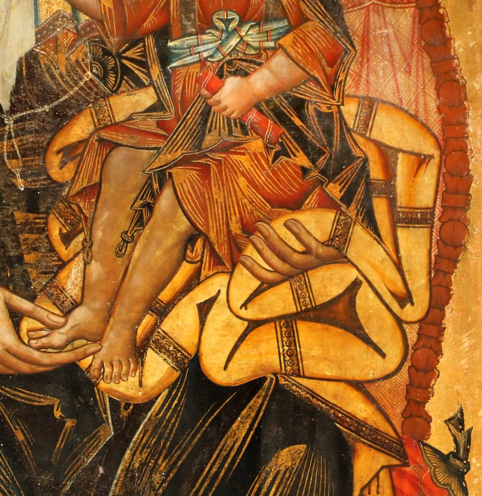
  <figcaption>Coppo di Marcovaldo, Madonna del Bordone, detail of the Child and the cloth on the Virgin's lap. Siena, Santa Maria dei Servi. Photo: Sailko, <a href="https://creativecommons.org/licenses/by-sa/4.0/">CC BY-SA 4.0</a>, via Wikimedia Commons.</figcaption>
</figure>

The detail shows the lower part of the Child and the cloth on which he sits, on the Virgin's lap. The cloth is pale yellow, crossed by ornamental bands, and folded into sharp, curving shapes, with deep dark shadows between the folds. The file of the photograph calls it a crumpled cloth.

The folds of the cloth are not drawn as natural folds of fabric. They are geometric, angular shapes, each outlined in dark and filled with light, which overlap like the petals of a flower or the plates of armour. They belong to the ornamental drapery of Byzantine painting, which Coppo pushed here to an extreme.

The cloth has been interpreted in different ways. Some scholars have seen in it the cloth in which the Child was wrapped, or a reference to the shroud in which the dead Christ was wrapped, which would connect the image of the Child with his future Passion; others treat it as a display of decorative skill. The panel itself does not decide between these readings.

The Child's legs hang bare, and the Virgin holds one of his feet between her fingers. Her hand, long and thin, is painted with care, the fingers modelled in light and shade. The gesture, repeated in the Madonna of Orvieto, is one of the features that connect the two works.

At the left the dark mantle of the Virgin is covered with lines of gold that converge into a small sunburst, a motif that recurs on her knees. The contrast between the dark mantle with its gold and the bright cloth with its dark shadows is the strongest effect of colour in the panel, and it is entirely Coppo's.

### The Madonna del Bordone: the Lower Part and the Inscription

<figure>
  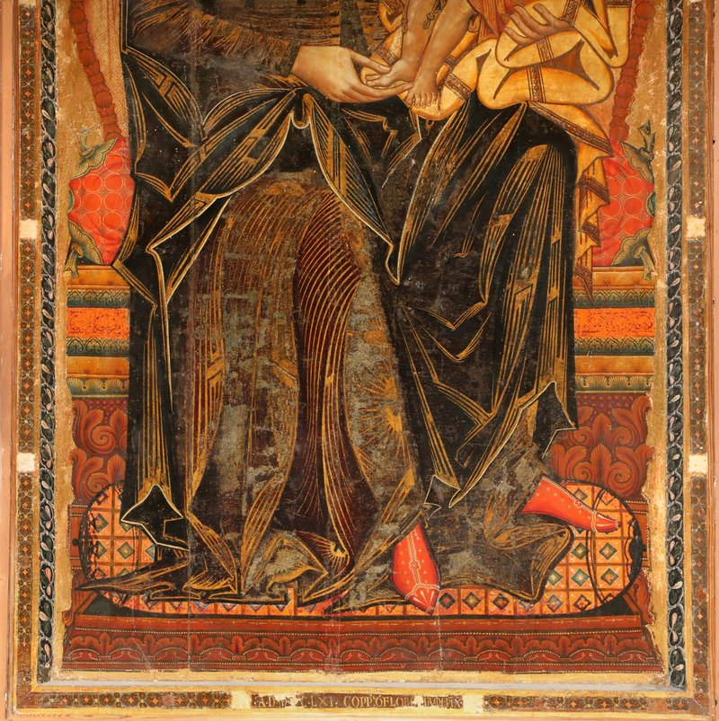
  <figcaption>Coppo di Marcovaldo, Madonna del Bordone, detail of the lower part with the inscription. Siena, Santa Maria dei Servi. Photo: Sailko, <a href="https://creativecommons.org/licenses/by-sa/4.0/">CC BY-SA 4.0</a>, via Wikimedia Commons.</figcaption>
</figure>

The detail shows the lower half of the panel: the Virgin's knees and legs, her feet on the footstool, the base of the throne and, on the lower frame, the inscription. It is the part of the panel least affected by the repainting, and it shows Coppo's painting of 1261.

The mantle falls over the knees in broad folds, covered with dense lines of gold that follow every fold and converge into small sunbursts at the knees. Between the folds of the mantle the dark red of the underdress shows through. The surface is worn in places, and the gold lines stand out against the darkened paint.

The red shoes of the Virgin, decorated with dots and small crosses, rest on a footstool patterned with diamonds in orange, green and red. At the sides of the throne are red cushions with circular patterns, and below the seat runs a band of palmettes and scrolls, carved or painted to imitate relief.

Along the lower frame runs the inscription in gold letters. It is damaged and partly lost, but the date and the name of Coppo of Florence can be made out in part, with the words by which the painting declares that he painted it. The inscription is the only signature of Coppo known.

The detail shows the importance of the lower part of the panel for the study of the painter. The repainted faces cannot be used to define his style, but the drapery, the throne and the footstool can, and they are the basis on which the Madonna of Orvieto and other works have been attributed to him.

### The Madonna of Orvieto

<figure>
  
  <figcaption>Coppo di Marcovaldo (attributed), Madonna and Child enthroned with two angels, c. 1265–1270, tempera and gold on panel. Orvieto, Museo dell'Opera del Duomo, from Santa Maria dei Servi. Photo: Sailko, <a href="https://creativecommons.org/licenses/by/3.0/">CC BY 3.0</a>, via Wikimedia Commons.</figcaption>
</figure>

The Madonna of Orvieto comes from the church of Santa Maria dei Servi in Orvieto and is now in the Museo dell'Opera del Duomo. Like the Madonna del Bordone, it was painted for a church of the Servites, and it repeats the composition of the Siena panel: the Virgin enthroned, the Child on her knee, and two angels above. It is attributed to Coppo and dated around 1265–1270.

The Virgin sits frontally on a throne with a curved, rounded back, hung with a pink cloth patterned with small figures. She wears a dark mantle covered with lines of gold, like the mantle of the Bordone, and a white veil. On her head is a tall crown of leaves and gems, and her head is set in a large halo carved in relief with radiating ribs.

The Child sits on her right knee, turned towards her. He wears a blue tunic and a red mantle striated with gold, holds a red scroll and raises his right hand. The Virgin holds one of his bare feet in her left hand, as in the Bordone, and supports him with her right. Under him lies a pale yellow cloth with ornamental bands.

In the upper corners two angels appear in half-length above the back of the throne. They wear jewelled tunics and pink mantles, hold long staffs topped with lilies, and spread large wings of blue, white and red. They are examined in the details below.

The throne has red and blue cushions at its sides and a high base decorated with bands of ornament. The Virgin's feet rest on a footstool. The panel is framed by a band studded with small gilded rosettes, and its surface is well preserved, with some losses in the gold ground and at the edges.

The panel was connected with Coppo by Perali in 1919, and the attribution has been widely accepted. Later studies have observed, however, that its faces, like those of the Bordone, were reworked by a later hand. The faces as they appear now cannot therefore be taken without reserve as Coppo's own, and the attribution rests above all on the composition, the drapery and the throne.

The crown of the Virgin, with its leaves of red and blue and its gems, presents her as Queen of Heaven. The crown is not part of the Byzantine type of the Hodegetria, and it gives the Orvieto Madonna a regal character that the Bordone does not have.

The Madonna of Orvieto shows Coppo's work for the Servites beyond Siena. The order was spreading through Tuscany and Umbria in these years, and its houses required large images of the Virgin. The repetition of the Siena composition at Orvieto suggests that the Servites themselves favoured Coppo's model.

### The Madonna of Orvieto: the Angel on the Left

<figure>
  
  <figcaption>Coppo di Marcovaldo (attributed), Madonna of Orvieto, detail of the angel on the left. Orvieto, Museo dell'Opera del Duomo. Photo: Sailko, <a href="https://creativecommons.org/licenses/by/3.0/">CC BY 3.0</a>, via Wikimedia Commons.</figcaption>
</figure>

The angel on the left appears in half-length above the back of the throne, his head tilted towards the Virgin. He has curly brown hair, a long face with a long nose and large dark eyes, and red cheeks. His head is set in a halo whose border is punched with small dots.

He wears a blue tunic and a pink mantle, and on his chest a dark band set with gems and pearls, the *loros* of Byzantine imperial costume, which angels wear in Byzantine art as the guards of the heavenly court. He raises his right hand to his breast in a gesture of reverence.

In his left hand he holds a long red staff topped with a lily, the sceptre of the angel as a messenger and guard. The staff crosses the figure diagonally and leads the eye towards the Virgin's halo on the right.

His wings are the most brilliant part of the figure. The upper feathers are blue and white, drawn as long curved strokes like the fronds of a fern, and the lower feathers red and dark, in long straight bands. The wings frame the figure and fill the corner of the panel.

The face of the angel, with its greenish shadows, its pink cheeks and its large eyes, is close to the faces of the Virgin and the Child of the same panel. It shows the type of face that Coppo painted in the years after the Bordone, with a strong contrast between light and shadow and an intense gaze.

### The Madonna of Orvieto: the Angel on the Right

<figure>
  
  <figcaption>Coppo di Marcovaldo (attributed), Madonna of Orvieto, detail of the angel on the right. Orvieto, Museo dell'Opera del Duomo. Photo: Sailko, <a href="https://creativecommons.org/licenses/by/3.0/">CC BY 3.0</a>, via Wikimedia Commons.</figcaption>
</figure>

The angel on the right mirrors the angel on the left. He appears in half-length above the back of the throne, turned towards the Virgin, his head slightly tilted, his eyes looking up. His hair is bound with a ribbon, and his head is set in a punched halo.

He wears the same costume as his companion: a blue tunic, a pink mantle and a dark jewelled band on the chest. He raises his left hand to his breast and holds a long red staff in his right. The symmetry of the two angels frames the head of the Virgin between them.

His wings, too, repeat those of the other angel, blue and white above, red and dark below, drawn with the same fern-like strokes. The repetition of the figures in mirror image was a common practice in the workshops of the period, which used the same designs reversed.

Below the angel runs the curved back of the throne, dark and studded with rows of white dots, ending in a lily finial. Behind it the pink cloth of the throne is patterned with small white figures. The details show the care with which the painter treated every part of the panel.

The two angels, with their bright colours and their jewelled costumes, are among the best preserved parts of the Orvieto Madonna. They show Coppo as a colourist and as a painter of rich ornament, qualities that are less visible in the darker, more worn surfaces of the Siena panel.

### The Madonna of Orvieto: the Child

<figure>
  
  <figcaption>Coppo di Marcovaldo (attributed), Madonna of Orvieto, detail of the Child. Orvieto, Museo dell'Opera del Duomo. Photo: Sailko, <a href="https://creativecommons.org/licenses/by/3.0/">CC BY 3.0</a>, via Wikimedia Commons.</figcaption>
</figure>

The detail shows the Child seated on the Virgin's knee. He is not a baby but a small boy, with a large head, dark curly hair and large eyes, and his halo is set with small dark gems. He raises his right hand towards his mother and looks up at her.

He holds in his left hand a red scroll tied with white string, the attribute of Christ as the Word and teacher. The file of the photograph describes him as a small philosopher, which captures the type: the Child shown with the gravity and the attributes of an adult teacher, as in Byzantine images of Christ Emmanuel.

He wears a blue tunic and a red mantle, both covered with dense lines of gold that follow the folds and converge into small sunbursts at the knee and the shoulder. The gold lines are drawn with great precision, and they make the small figure shine against the darker mantle of the Virgin.

His bare foot rests in the Virgin's hand, and her other hand supports him from below. Under him lies a pale yellow cloth with ornamental bands and small red crosses, the same cloth that appears, in more angular form, in the Madonna del Bordone.

The face of the Child, with its greenish shadows and its large dark eyes, is graver and more intense than the soft Sienese face of the Child of the Bordone. Since the faces of the Orvieto panel are also considered reworked, the comparison shows two later interpretations of Coppo's composition rather than his own hand.

### The Madonna of Orvieto: the Face of the Virgin

<figure>
  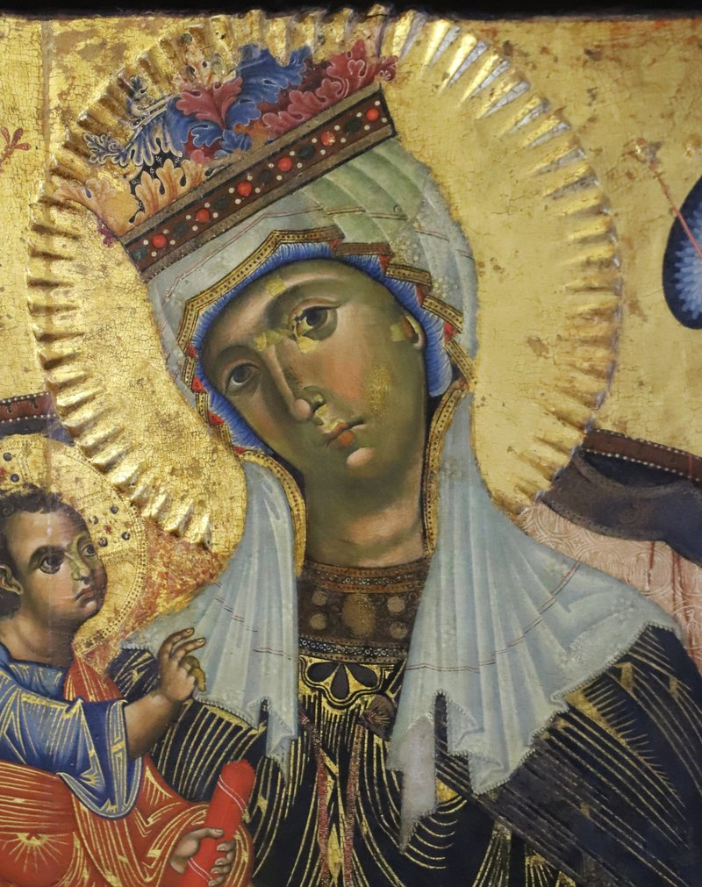
  <figcaption>Coppo di Marcovaldo (attributed), Madonna of Orvieto, detail of the face of the Virgin. Orvieto, Museo dell'Opera del Duomo. Photo: Sailko, <a href="https://creativecommons.org/licenses/by/3.0/">CC BY 3.0</a>, via Wikimedia Commons.</figcaption>
</figure>

The detail shows the head of the Virgin, the most important part of the panel for the study of Coppo. Her face is long, with a long straight nose, large brown eyes under arched brows and a small red mouth. It is modelled with greenish shadows and pink lights, in the Byzantine technique of painting flesh over a green underlayer.

Compared with the face of the Bordone, it is harder and more intense, with sharper contrasts of light and shade and a fixed gaze. Later studies consider the faces of this panel reworked, so that the face as it now appears may not be entirely Coppo's. The small losses on the forehead and cheek show the green underpaint beneath.

She wears a white veil over a blue cap edged with gold, and on her head a tall crown of red and blue leaves set with red and green gems. The leaves of the crown are painted with a naturalism that contrasts with the stylised forms of the face and the veil.

Her head is set in a large halo carved in the gesso with radiating ribs, which catch the light. The halo in relief, the ribs fanning out from the head, is a feature of the Florentine panels of the period, and it appears also in the crosses of San Gimignano and Pistoia.

At the left the Child raises his hand towards his mother's face, and the two heads are linked by his gesture and by the inclination of her head. The relation between mother and child, expressed through glance and gesture, is the emotional centre of the panel.

### The Madonna of Santa Maria Maggiore, Florence

<figure>
  
  <figcaption>Coppo di Marcovaldo (attributed), Madonna and Child enthroned with angels, the Annunciation, the holy women at the tomb and apostles, c. 1250–1260, tempera and gold on panel, partly in relief, 250 × 123 cm. Florence, Santa Maria Maggiore. Image: public domain, via Wikimedia Commons.</figcaption>
</figure>

The Madonna of Santa Maria Maggiore is a large panel in the church of the same name in Florence. It shows the Virgin enthroned with the Child at the centre, two angels at her sides, figures of apostles in the borders and two scenes below. It was given to Coppo by Douglas in 1903 and by Sirén in 1922; most later scholars have rejected the attribution, and Tartuferi has proposed Salerno for some of its parts. The Zeri catalogue still lists it under Coppo, around 1250–1260.

The most unusual feature of the panel is its relief. The head of the Virgin, with its large halo, rises above the upper edge of the panel, and the heads and upper bodies of the Virgin and Child stand out from the surface. The panel thus combines painting and sculpture, like the Romanesque images of the Virgin carved in wood and painted.

The Virgin sits frontally on a throne flanked by red cushions. She wears a dark mantle lined with red over a garment of gold, which falls over her knees in large folds. She holds the Child in front of her with both hands. The Child, frontal, blesses with his right hand and holds a book or scroll in his left.

Two angels in pink robes with jewelled bands stand at the sides of the Virgin's head, turned towards her. The throne, with its cushions and its carved base, fills the lower part of the central field. The frame is decorated at the corners and along the sides with gilded bosses and rosettes in relief.

In the side borders stand figures of apostles and saints, each with a halo, in coloured garments, one above the other. At the top and bottom of the borders are small half-figures. They form a court of saints around the Virgin, and they turn the panel into a small image of the Church.

Below the throne two scenes are painted: on the left the Annunciation, with the angel and the Virgin before buildings; on the right the holy women at the tomb, with an angel seated on the sarcophagus and the sleeping guards below. The two scenes mark the beginning and the end of the story of the Incarnation and the Redemption.

The colours of the panel are strong and dark: the deep blue and red of the Virgin's mantle, the gold of her garment and of the Child's, the pink of the angels and the varied colours of the apostles. The gold ground, the gilded bosses and the gold of the garments make the whole surface shine, and the relief of the central figures catches the light.

The panel is one of the most unusual works associated with Coppo. Its relief, its narrative scenes and its court of saints place it in a tradition different from that of the Bordone and the Orvieto Madonna, and the doubts about its attribution reflect this difference. It is included here because of its long association with the painter's name.

### The Painted Cross of San Gimignano

<figure>
  
  <figcaption>Coppo di Marcovaldo (attributed), painted cross with six stories of the Passion, c. 1250–1260, tempera and gold on panel, 292 × 245 cm. San Gimignano, Pinacoteca Civica (Palazzo Comunale), from the convent of Santa Chiara. Image: public domain, via Wikimedia Commons.</figcaption>
</figure>

The cross is kept in the Pinacoteca Civica of San Gimignano, in the Palazzo Comunale, and comes from the convent of the Poor Clares of Santa Chiara in the town. It is a large cross, 292 × 245 cm according to the Italian national catalogue, with Christ dead on the cross and six stories of the Passion beside his body.

Christ is the *Christus patiens*. His head is bowed on his right shoulder, his eyes are closed, and his body hangs from the arms, the hips swaying to the left and the knees bent. His abdomen is swollen and divided into large segments, in the manner of Giunta Pisano, and his loincloth, white and blue, is knotted at the waist with heavy folds.

His head is set in a halo carved in relief with radiating ribs. His face is long, with a long nose, a deep line between the brows and a dark beard, and his hair falls on his shoulder. The face has been compared with the faces of the Pistoia cross, and it is one of the bases of the attribution to Coppo.

Beside the body six scenes are painted, three on each side. According to the Zeri catalogue they are the Kiss of Judas, Christ before Caiaphas, the Flagellation, the Mocking of Christ, Christ climbing the cross and the Entombment. On the left the Kiss of Judas is at the top and Christ climbing the cross on a ladder at the bottom; on the right Christ before Caiaphas is at the top and the Entombment at the bottom.

At the ends of the arms are the mourners: on the left the Virgin and Saint John, on the right three holy women. At the top a roundel holds the bust of Christ blessing, with a book; below it the Virgin stands with raised hands among angels and apostles, a scene that the national catalogue identifies as the Assumption and the Zeri catalogue as the Ascension. Below it a red titulus carries the inscription IHS NAZARENUS REX IUDEORUM.

The scene of Christ climbing the cross is rare. It shows Christ mounting a ladder to the cross on which he will be nailed, a subject that comes from Byzantine and Franciscan meditations on the Passion, in which Christ goes willingly to his death. Its presence on the cross gives it an unusual devotional character.

The attribution to Coppo, proposed by [Pietro Toesca](/scholars.html#toesca-pietro) in 1927 and by [Evelyn Sandberg-Vavalà](/scholars.html#sandberg-vavala-evelyn) in 1929, is widely accepted; the *Enciclopedia dell'Arte Medievale* dates the cross around 1254, the national catalogue around 1250 and Google Arts and Culture, for the museums of San Gimignano, around 1260. The Pistoia cross of 1274 repeats its scheme, and the comparison between the two is the basis of the discussion on the part of Salerno in the later work.

If it is Coppo's, the cross is one of his earliest works, painted before or around the Madonna del Bordone. It shows him working on the type of the narrative *Christus patiens* that the Maestro della Croce 434 had established in Florence, and transforming it with a heavier body and a more dramatic narration.

### The Painted Cross of Pistoia Cathedral

<figure>
  
  <figcaption>Coppo di Marcovaldo and Salerno di Coppo, painted cross with six stories of the Passion, 1274–1275, tempera and gold on panel. Pistoia, Cathedral of San Zeno. Photo: Sailko, <a href="https://creativecommons.org/licenses/by/3.0/">CC BY 3.0</a>, via Wikimedia Commons.</figcaption>
</figure>

The cross stands in the cathedral of San Zeno in Pistoia, the city where Coppo worked from 1265. It is generally identified with the large cross that the commune commissioned from Coppo and his son Salerno in 1274, when it released Salerno from prison for the purpose. It is the second documented work of the painter and the last that can be connected with him.

Christ is the *Christus patiens*. His head is bowed on his right shoulder, his body hangs from the arms and sways to the left, and his long legs are crossed at the feet, which are nailed to a dark panel above a small rocky mound, the hill of Golgotha. The body is painted in a pale green and gold flesh tone, with soft modelling.

His loincloth is deep blue, falling below the knees in sharp folds lit with white, and knotted at the hip. It is the most striking passage of colour in the cross, and its folds, broken into angular forms, recall the cloth of the Madonna del Bordone.

His head is set in a large halo carved in relief with radiating ribs, and crossed by a red band set with gems and bosses. The face, with a long nose and closed eyes, is examined in the detail below.

Beside the body six scenes are painted, three on each side. On the left are the Kiss of Judas, the Flagellation and the Deposition; on the right Christ before Caiaphas, the Lamentation over the dead Christ and the holy women at the tomb. The scenes are framed in red and set on a gold ground, and they are examined one by one below.

The cross has lost its terminals at the ends of the arms, its top and its lower panel, where other figures were probably painted. The document of 1274 speaks of two separate panels with the Virgin and Saint John, so the mourners may not have been painted on the cross itself. A document records that the cross was cleaned with soap and moved in 1471.

On the gold ground of the scenes later hands have written inscriptions, among them one recording a work of 1726, which show that the cross was repaired or restored more than once. It was exhibited in Paris in 1935 and in Florence in 1937.

The division of the cross between Coppo and Salerno has been discussed since Bacci published the documents in 1912. Bacci gave the Christ to Salerno and the scenes to Coppo; Boskovits gave Coppo only the Lamentation and the holy women at the tomb; others have proposed different painters. The cross remains the most important document of the workshop of father and son.

### The Pistoia Cross: the Head of Christ

<figure>
  
  <figcaption>Coppo di Marcovaldo and Salerno di Coppo, painted cross, detail of the head of Christ. Pistoia, Cathedral of San Zeno. Photo: Sailko, <a href="https://creativecommons.org/licenses/by/3.0/">CC BY 3.0</a>, via Wikimedia Commons.</figcaption>
</figure>

The head of Christ is bowed on his right shoulder, and the face, turned down, is drawn with long lines: a long thin nose, closed eyes under heavy lids, a deep line between the brows and a small mouth. The brown beard follows the jaw, and the hair falls on the shoulder.

The face is modelled in soft greenish shadows and pale lights, with a softness that differs from the sharper contrasts of Coppo's Madonnas. Bacci saw in this difference the hand of Salerno, to whom he gave the figure of Christ. A crack in the wood runs across the face.

The halo is carved in relief with radiating ribs, and it is crossed by a red band set with round and square bosses, which form the arms of the cross inscribed in the halo of Christ. The bosses imitate gems, and the whole halo imitates the goldsmith's work of a reliquary.

The chest is broad, the muscles of the breast and the shoulders modelled in soft shadows, the ribs barely marked. The flesh tone, pale green with touches of gold, gives the body a pallor that expresses death.

Behind the arms the crossbar is painted dark blue, with borders of small red diamonds on a gold ground, and studded with small bosses. At the lower edge appear the tops of the first two scenes, the Kiss of Judas and Christ before Caiaphas.

### The Pistoia Cross: the Kiss of Judas

<figure>
  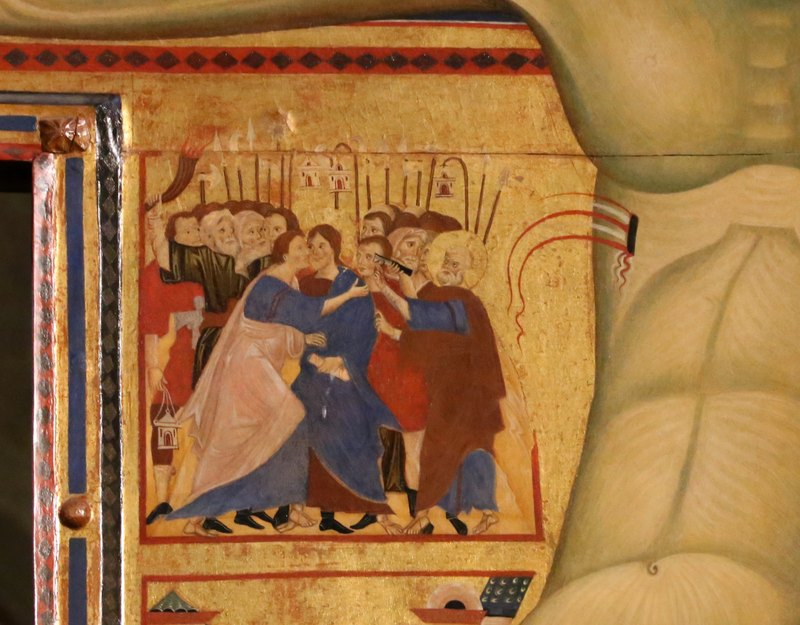
  <figcaption>Coppo di Marcovaldo and Salerno di Coppo, painted cross, the Kiss of Judas. Pistoia, Cathedral of San Zeno. Photo: Sailko, <a href="https://creativecommons.org/licenses/by/3.0/">CC BY 3.0</a>, via Wikimedia Commons.</figcaption>
</figure>

The first scene on the left shows the arrest of Christ in the garden. At the centre Judas, in a pink mantle, embraces Christ and kisses him, the sign by which he betrayed him to the soldiers. Christ, in a blue mantle over a dark red tunic, stands still and lets himself be kissed.

Around them presses a crowd of soldiers and servants, whose heads rise in rows behind the central group. Above them rise the points of spears and halberds, a torch with flames at the left and, lower down, a lantern held by a man in red. The night of the arrest is suggested by the torch and the lantern.

At the right Saint Peter, with a halo and a white beard, in a brown mantle, raises a knife to the ear of a young man. The Gospels tell how Peter cut off the ear of Malchus, the servant of the high priest, and how Christ healed it. The episode is placed at the edge of the scene, beside the main action.

The figures are crowded together, overlapping one another, and the faces, drawn with a few lines, express surprise, hostility and calm. The scene is full of movement and gesture, in the manner of Coppo's narratives.

The scene is close to the body of Christ on the cross, whose abdomen fills the right side of the photograph. The juxtaposition of the betrayal and the dead body shows the beginning and the end of the Passion side by side.

### The Pistoia Cross: Christ before Caiaphas

<figure>
  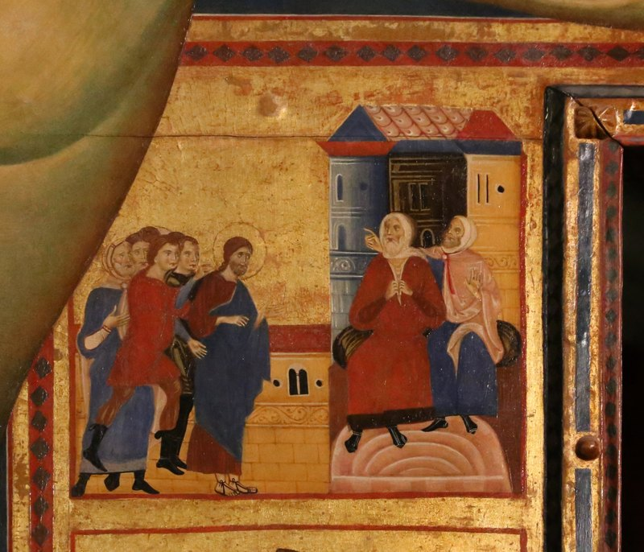
  <figcaption>Coppo di Marcovaldo and Salerno di Coppo, painted cross, Christ before Caiaphas. Pistoia, Cathedral of San Zeno. Photo: Sailko, <a href="https://creativecommons.org/licenses/by/3.0/">CC BY 3.0</a>, via Wikimedia Commons.</figcaption>
</figure>

The first scene on the right shows Christ before the high priest. On the left Christ, with a halo, stands among the men who have brought him, his hands lowered. On the right two elderly men with white head-cloths sit on a bench before a building with towers.

The high priest, in red, tears the neck of his robe with both hands. The Gospels of Matthew and Mark tell how Caiaphas, hearing Christ declare that he was the Son of God, tore his garments and accused him of blasphemy. The gesture identifies the scene and gives it its dramatic moment.

Behind him a second priest, in pink, points at Christ with his right hand, in the gesture of accusation. He may be Annas, the father-in-law of Caiaphas, before whom Christ was first brought according to the Gospel of John.

The building behind the priests is drawn with towers, a tiled roof and a dark doorway, and a low wall runs across the scene behind Christ. The architecture divides the scene into two parts, the accused on the left and the judges on the right, with the empty gold ground between them.

The scene is one of the best preserved of the cross, and its colours, the red and pink of the priests and the blue of Christ, are bright. The contrast between the calm of Christ and the violent gesture of the high priest is the centre of the composition.

### The Pistoia Cross: the Flagellation

<figure>
  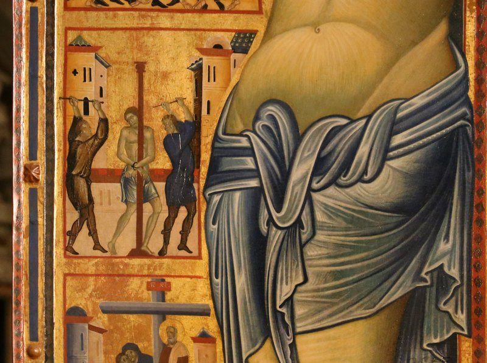
  <figcaption>Coppo di Marcovaldo and Salerno di Coppo, painted cross, the Flagellation, beside the loincloth of Christ. Pistoia, Cathedral of San Zeno. Photo: Sailko, <a href="https://creativecommons.org/licenses/by/3.0/">CC BY 3.0</a>, via Wikimedia Commons.</figcaption>
</figure>

The second scene on the left shows the Flagellation. Christ stands frontally before a tall red column, his hands bound in front of him, naked except for a small loincloth. Two men in short tunics, one in brown, one in blue, stand on either side and raise their scourges high over their heads.

The scourgers are drawn in strong movement, their arms raised, their bodies bent back, their legs spread. Their energetic poses contrast with the still, slightly bowed figure of Christ, whose thin body anticipates the body on the cross.

Behind the figures rise pink towers and walls, indicating the palace of Pilate. The column is a red vertical line at the centre, which divides the composition symmetrically.

The detail also shows, on the right, the loincloth of Christ on the cross, deep blue with heavy folds lit with white. The contrast between the small scene and the great figure shows the two scales of the cross: the narrative for those who come close, the image of the dead Christ for those who look from afar.

The loincloth is one of the most impressive passages of the cross. Its folds are drawn as large angular forms, outlined in dark blue and lit with white, like the cloth of the Madonna del Bordone, and they give the figure a monumental weight.

### The Pistoia Cross: the Lamentation

<figure>
  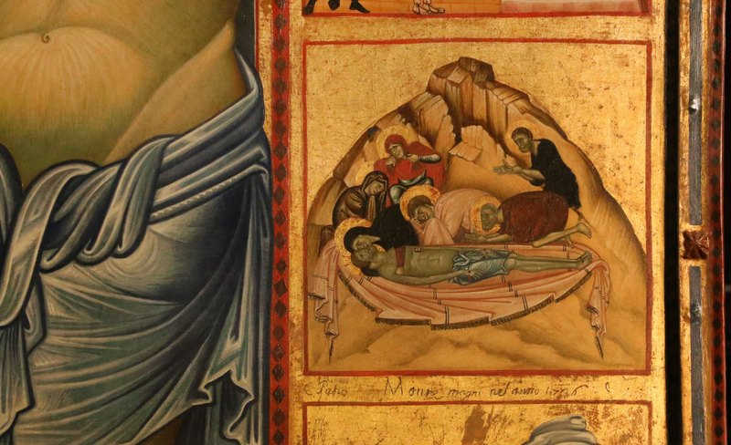
  <figcaption>Coppo di Marcovaldo and Salerno di Coppo, painted cross, the Lamentation over the dead Christ. Pistoia, Cathedral of San Zeno. Photo: Sailko, <a href="https://creativecommons.org/licenses/by/3.0/">CC BY 3.0</a>, via Wikimedia Commons.</figcaption>
</figure>

The second scene on the right shows the Lamentation over the dead Christ before his burial. The body of Christ lies stretched on a pink shroud in front of a tall rock, and the mourners bend over him. The file of the photograph calls the scene the burial and the lamentation.

The Virgin, in a dark mantle, bends over the head of her son and presses her face to his, in a gesture of intense grief that comes from Byzantine images of the Threnos, the lament over the dead Christ. Behind her a woman in red raises her hands to her face, and another bends forward.

Saint John bends over the body from behind, and an old man in a red mantle kneels at the feet, presumably Joseph of Arimathea or Nicodemus, who prepared the body for burial. At the right a man in black stretches out his hands. All the mourners have haloes.

The tall rock behind the figures rises like a mountain, and the composition is arranged in a triangle under it, with the horizontal body at the base. The grief of the figures is expressed through their gestures and their bent bodies, in the dramatic manner of Coppo's narration.

Below the scene a later inscription in brown letters records a work done in 1726. Boskovits considered this scene, with the holy women at the tomb below it, the part of the cross painted by Coppo himself.

### The Pistoia Cross: the Deposition

<figure>
  
  <figcaption>Coppo di Marcovaldo and Salerno di Coppo, painted cross, the Deposition. Pistoia, Cathedral of San Zeno. Photo: Sailko, <a href="https://creativecommons.org/licenses/by/3.0/">CC BY 3.0</a>, via Wikimedia Commons.</figcaption>
</figure>

The third scene on the left shows the Deposition from the cross. A grey cross with the letters IC XC, the abbreviation of the name of Jesus Christ, stands at the centre. Joseph of Arimathea, with a white beard and a halo, in a red and white mantle, holds the body of Christ, which is being lowered from the cross.

The Virgin, in a dark mantle, embraces the head of her son and presses her face to his. On the left a woman in red bends and kisses his hand; on the right Saint John presses the other hand to his face. The body of Christ, thin and grey-green, hangs in a curve between them.

Below, a man kneels on a ladder and draws the nail from the feet of Christ with a pair of pincers. He is Nicodemus, who helped Joseph to take down the body. His figure, small and bent, is a detail of everyday work in the midst of the grief.

The composition is crowded and full of contact between the figures: embraces, kisses, hands held. The grief of the mourners is expressed through touch, in a manner that recalls the Byzantine images of the Deposition and that gives the scene great intensity.

In the lower right corner, beside the scene, a later hand has scratched an inscription in the gold, one of several left on the cross by those who repaired it over the centuries.

### The Pistoia Cross: the Holy Women at the Tomb

<figure>
  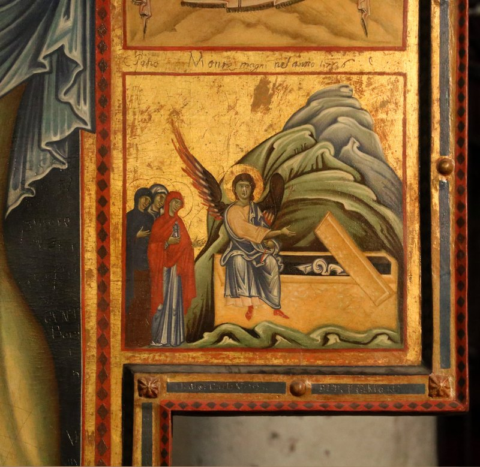
  <figcaption>Coppo di Marcovaldo and Salerno di Coppo, painted cross, the holy women at the tomb. Pistoia, Cathedral of San Zeno. Photo: Sailko, <a href="https://creativecommons.org/licenses/by/3.0/">CC BY 3.0</a>, via Wikimedia Commons.</figcaption>
</figure>

The last scene on the right shows the holy women at the tomb on Easter morning. On the left three women stand together, in dark, grey and red mantles; the one in front holds a jar of ointment, with which they had come to anoint the body. In the centre an angel sits on the tomb and announces the Resurrection.

The angel, with large red and dark wings, in a pink and blue robe, sits on a stone sarcophagus whose lid lies askew. He points with his right hand to the empty tomb, in which the white shroud lies folded. His figure, frontal and calm, dominates the scene.

Behind the tomb rises a tall rock, green and grey, drawn as a series of wave-like forms, the stylised landscape of Byzantine painting. The rock fills the right side of the scene and frames the angel against it.

The scene closes the cycle of the cross with the Resurrection, as the Kiss of Judas opens it. Read from the top left to the bottom right, the six scenes lead from the betrayal to the empty tomb, through the trial, the scourging, the deposition and the lamentation.

Boskovits gave this scene and the Lamentation to Coppo himself. Above the scene runs the same later inscription with the year 1726, and on the frame below other inscriptions are scratched, signs of the long life of the cross in the cathedral.

### Salerno di Coppo (attributed), the Virgin and Child, Pistoia Cathedral

<figure>
  
  <figcaption>Salerno di Coppo (attributed), the Virgin and Child, fresco, last quarter of the thirteenth century. Pistoia, Cathedral of San Zeno, last pillar of the left aisle. Photo: Sailko, <a href="https://creativecommons.org/licenses/by/3.0/">CC BY 3.0</a>, via Wikimedia Commons.</figcaption>
</figure>

The fresco is painted on the last pillar of the left aisle of the cathedral of Pistoia, the church for which Coppo and Salerno painted their cross in 1274. Only a fragment survives: the Virgin and Child, framed above by a painted frieze, set into a pale plaster that fills the areas where the painting is lost. The irregular outline of the fragment follows the edges of the surviving paint.

The Virgin is shown at half-length, turned slightly to her right, with the Child on her right arm. She wears a dark blue mantle, sprinkled with small dark motifs, over a pink dress, and a white veil frames her face. Her head is set in a large gold halo, its surface worn so that the preparation shows through. She inclines her head towards the Child and looks out at the viewer with large dark eyes.

Her face is long and oval, with a long straight nose, arched brows, a small mouth and a soft modelling of the cheeks. Its expression is calm and slightly melancholy. Compared with the Madonnas associated with Coppo, the face is softer and more blended in its transitions from light to shade, the quality that has been noted in the Christ of the Pistoia cross.

The Child sits on his mother's arm, his body turned towards her and his head raised to look at her face. He wears a grey-white tunic and an orange mantle that falls over his knees in broad folds, and his bare foot appears at the lower edge. With his left hand he reaches to the neckline of his mother's dress, and with the other he holds a fold of his mantle. His face, round, with short hair and large eyes, is lively and intent.

The Virgin's right hand, long and slender, is raised towards the Child, her fingers open, in a gesture that both supports and presents him. The play of the two hands, the mother's and the son's, at the centre of the image, and the exchange of glances between them, give the fresco an intimacy that differs from the frontal, hieratic Madonnas of the middle of the century.

Above the figures runs a painted frieze, edged below by a red band: pink acanthus leaves curl on a dark ground on either side of a pale disc at the centre. The frieze is the upper border of the painted field, and it shows that the fresco was part of a decorated surface on the pillar, of which only this fragment remains.

The attribution of the fresco has been debated. Procacci, in 1966, and Tartuferi, in 1990, gave it to Salerno, seeing in it the same hand as the Christ of the cathedral cross. [Alessandro Conti](/scholars.html#conti-alessandro), in 1971, rejected the attribution, dated the fresco around 1290 and gave it to an anonymous Pistoian painter close to Manfredino d'Alberto, the Pistoian painter documented in the last decades of the century.

Whoever painted it, the fresco belongs to the generation that followed Coppo in Pistoia. Its softened modelling, its affectionate group of mother and child and its warm colours show the transformation of the Florentine and Pistoian painting of the last quarter of the thirteenth century, under the influence of Cimabue. It is included here as the most often cited of the works proposed for Salerno.

### Saint Michael Enthroned with Six Stories (attributed)

<figure>
  
  <figcaption>Coppo di Marcovaldo or Maestro di Vico l'Abate, Saint Michael enthroned with six stories of his legend, c. 1255–1265, tempera on panel. San Casciano in Val di Pesa, museum, from Sant'Angelo a Vico l'Abate. Image: public domain, via Wikimedia Commons.</figcaption>
</figure>

The panel comes from the church of Sant'Angelo at Vico l'Abate, near San Casciano in Val di Pesa, and is now in the museum of San Casciano. It shows Saint Michael enthroned at the centre and six stories of his legend at the sides. It is attributed to Coppo in part of the literature and to the anonymous Maestro di Vico l'Abate in the Zeri catalogue, which dates it around 1255–1265.

Michael sits frontally on a throne, crowned, with large dark green wings spread behind him. He wears a pink robe and, crossing his body, a dark band set with gems, the *loros* of Byzantine imperial costume. In his right hand he holds a long staff, and in his left a disc with a red double cross, the sign of his authority as the leader of the heavenly army.

His face is long and pale, with large eyes, a long nose and a small mouth, framed by short hair and a small crown. The figure is rigid and frontal, an icon of the archangel rather than a narrative image, and its type comes from Byzantine images of the archangels as courtiers of heaven.

On the right side, in the middle, archers shoot at a bull standing on a mountain. The scene comes from the legend of Monte Gargano in Apulia, where, according to the tradition, a bull hid in a cave on the mountain and the arrow shot at it turned back against the archer. Below it, an angel appears to a sleeping bishop, the bishop of Siponto, to whom Michael revealed that the cave was his sanctuary.

On the left side, in the middle, an angel fights a dragon, the combat of Michael with the devil from the Book of Revelation. Below it a bishop, seated, receives a group of men, perhaps the people of Siponto who reported the miracle of the bull. The upper scenes on both sides show angels and other figures whose subjects are less clear in the photograph.

The scenes are painted on a dark ground, and their colours, red, pink, green and blue, stand out against it. The figures are lively and their gestures expressive, and the landscapes of rocks and mountains are drawn in the stylised manner of Byzantine painting.

The attribution of the panel has divided scholars. Its narrative scenes have been compared with those of Coppo's crosses, and its central figure with his Madonnas; but its dark ground, its rigid central figure and its colour have led other scholars to give it to a separate painter, the Maestro di Vico l'Abate, named after it. The present entry records both positions; the panel is described in more detail in the entry on that master.

The panel shows the variety of images commissioned from Florentine painters in the middle of the thirteenth century: not only Madonnas and crosses, but also panels of saints with their legends, like the Saint Francis of the Bardi Chapel, for the churches of the countryside around the city.

### The Hell of the Baptistery of Florence (attributed)

<figure>
  
  <figcaption>Coppo di Marcovaldo (attributed), the Hell, part of the Last Judgement in the mosaics of the dome, second half of the thirteenth century. Florence, Baptistery of San Giovanni. Photo: Dimitris Kamaras, <a href="https://creativecommons.org/licenses/by/2.0/">CC BY 2.0</a>, via Wikimedia Commons.</figcaption>
</figure>

The photograph shows the Hell in its place on the dome of the Baptistery of Florence. The dome is covered with mosaics on a gold ground, begun in the first half of the thirteenth century and continued for several decades. On the western side, above the main altar, three of its eight segments are occupied by the Last Judgement, dominated by the enormous figure of Christ the Judge in a mandorla, whose edge is visible at the upper left.

Above the Hell, in a band on a gold ground, the apostles sit on a long bench, each with a book or scroll, with angels behind them. They are the assessors of the Judgement, the apostles to whom Christ promised that they would sit on thrones and judge the tribes of Israel. Their calm, dignified figures contrast with the turmoil of the zone below.

The Hell fills the lowest zone of the Judgement, on the side of the damned, at Christ's left. At its centre sits Satan, a giant green figure with horns, devouring a sinner; around him, on a dark ground lit by flames, demons seize, carry, hang and torture naked sinners. At the left, black winged demons drive a crowd of clothed figures, newly judged, towards the jaws of Hell.

The scene is the most celebrated part of the dome, and it is the part most often connected with Coppo. The proposal rests on the comparison of its figures with his panels: the large, expressive faces, the energetic poses, the dramatic narration. It is not confirmed by any document, and the dome was the work of many designers and mosaicists over a long period.

The mosaics of the Baptistery are among the largest undertakings of thirteenth-century Florence. The Baptistery was the church in which every Florentine was baptised, and its decoration was paid for by the guild of the Calimala, the merchants of foreign cloth. Teams of mosaicists, some perhaps trained in Venice, worked on it from designs by Florentine painters; the names of Cimabue, Coppo and the Maestro della Maddalena have all been proposed for parts of it.

Dante was baptised in this building, which he called "il mio bel San Giovanni" in the *Inferno* (XIX, 17). The resemblance between the mosaic Hell and some images of the *Divine Comedy*, such as the devouring Lucifer at the bottom of Hell, has often been noted. It is possible that the poet, who saw the mosaic from childhood, remembered it; the connection is a hypothesis, not a fact.

Below the mosaic runs the marble gallery of the Baptistery, with its windows and, between them, small mosaic panels of bishop saints, among them Zenobius, the first bishop of Florence. They belong to a different, later phase of the decoration, and they show how the dome and the walls were decorated over a long time.

The Hell is included here as an attribution. If it is Coppo's design, it would show him as the inventor of one of the most powerful images of Florentine art; if it is not, it shows the visual world in which Florentine painters of his generation worked. The details that follow examine its main parts.

### The Hell: the Damned Driven towards Satan

<figure>
  
  <figcaption>Coppo di Marcovaldo (attributed), the Hell, detail of the damned driven towards Satan. Florence, Baptistery of San Giovanni. Photo: Sailko, <a href="https://creativecommons.org/licenses/by/3.0/">CC BY 3.0</a>, via Wikimedia Commons.</figcaption>
</figure>

The detail shows the left part of the Hell, where the damned arrive from the Judgement. A dense crowd of men and women, still clothed, stumbles towards the right, pushed by a dark demon with bat wings at the far left. Many of them cover their faces with their hands, in a gesture of shame and despair.

The crowd is arranged as a mass of heads and bodies, one above the other, so that it seems to fill the whole height of the zone. Among them can be seen a woman in a black veil, an old man in a grey tunic whose hand is seized by a demon, and figures in red and brown garments. The clothes show that they have only just been condemned.

At the top, demons with dark and green skin carry naked sinners on their shoulders or drag them by the limbs, taking them into the torments. Their bodies are thin and angular, with claws and wild hair, and their movements are violent.

At the right begins the realm of Satan: a great red rock, serpents twisting through the scene, a monster with a human face in its belly, lizards and snakes that seize the bodies of the damned. The green arm and leg of Satan himself enter from the right edge.

The detail shows the narrative energy of the Hell. Every figure is in movement, every gesture tells part of the story, and the passage from the clothed crowd to the naked sinners and the monsters marks the passage from judgement to punishment.

### The Hell: the Torments of the Damned

<figure>
  
  <figcaption>Coppo di Marcovaldo (attributed), the Hell, detail of the torments of the damned. Florence, Baptistery of San Giovanni. Photo: Sailko, <a href="https://creativecommons.org/licenses/by/3.0/">CC BY 3.0</a>, via Wikimedia Commons.</figcaption>
</figure>

The detail shows the right part of the Hell, beyond Satan. On a dark brown ground, lit by flames, demons torment the naked damned in many ways: they carry them on their backs, hang them upside down, beat them, stretch them on a rack, roast them in the fire. At the left the horned head of Satan and his serpents close the scene.

The demons are pale blue, green or reddish, with thin bodies, wild hair and grotesque profiles. Some blow horns, others carry the damned like sacks. Their varied colours stand out against the dark ground and give the scene a strange, unreal light.

In the centre a group of heads huddles in the flames, men and women pressed together, their faces turned in different directions. Below them a sinner lies stretched on a rack, his hands and feet tied, while demons pull at the ropes.

At the right edge a standing figure in a long robe, apart from the naked damned, is accompanied by the inscription GIUDA, Judas. Demons stretch towards him with ropes. The traitor, the worst of sinners, has his own place in the Hell, as he would have in Dante's poem at the bottom of the abyss.

The detail shows the variety of the torments invented by the designer. Each group of figures is a small scene, and together they make up a catalogue of punishments that the faithful, looking up from the floor of the Baptistery, could read one by one.

### The Hell: the Demons and the Hanged

<figure>
  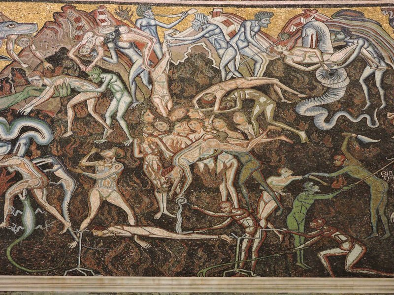
  <figcaption>Coppo di Marcovaldo (attributed), the Hell, detail of the demons and the damned. Florence, Baptistery of San Giovanni. Photo: Dimitris Kamaras, <a href="https://creativecommons.org/licenses/by/2.0/">CC BY 2.0</a>, via Wikimedia Commons.</figcaption>
</figure>

The detail shows, at closer range, the central and right part of the torments. The mosaic tesserae can be seen one by one: small cubes of stone and glass, laid in lines that follow the contours of the bodies and the movement of the flames.

At the top, pale blue demons with bristling hair blow horns and carry sinners over their shoulders, one of them upside down, his legs in the air. A sinner hangs head down by the feet, his arms dangling. Another demon, with a green face, holds a sinner in his arms like a child.

The bodies of the damned are drawn with outlines of darker tesserae and filled with pale, flesh-coloured tones, with white lines marking the muscles and joints. The technique gives the figures a linear, almost graphic character, close to drawing.

In the lower part, a sinner bent backwards is carried by a demon, a body is stretched on a rack held by red demons, and green demons pull at ropes. Serpents wind through the scene, and flames rise from the ground.

The closer view shows the skill of the mosaicists in translating a painter's design into tesserae. Whoever designed the Hell, its execution was the work of craftsmen who knew how to render movement and expression in a medium of stone and glass.

### The Hell: Satan

<figure>
  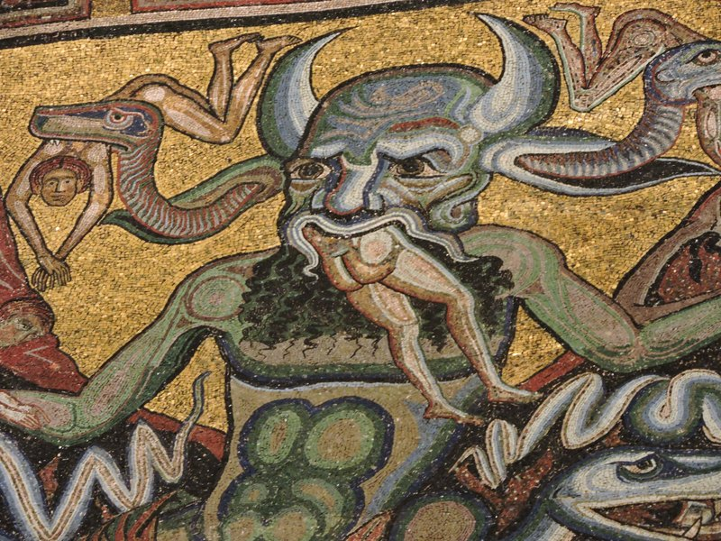
  <figcaption>Coppo di Marcovaldo (attributed), the Hell, detail of Satan. Florence, Baptistery of San Giovanni. Photo: Dimitris Kamaras, <a href="https://creativecommons.org/licenses/by/2.0/">CC BY 2.0</a>, via Wikimedia Commons.</figcaption>
</figure>

The detail shows the head of Satan, the centre of the Hell. His face is enormous and green, with large curving horns, wide staring eyes under heavy brows, a hooked nose and a curling white moustache. From his mouth hang the legs of a naked sinner, whom he is devouring.

From his ears come two serpents with gaping jaws, each swallowing a sinner head first, whose legs kick in the air above the gold ground. The image of Satan devouring the damned with his mouth and with the serpents of his head is one of the most terrible inventions of medieval art.

His body, green, is marked with round swellings, and his arms stretch out to seize other sinners. Below him more serpents twist, and their heads emerge at the edges of the detail with open jaws.

Satan devouring the damned was a traditional image in medieval Last Judgements. Dante, at the bottom of Hell, describes Lucifer with three faces, chewing in each mouth a sinner, Judas, Brutus and Cassius. The resemblance between the two images, both showing a giant Satan who devours sinners, is the basis of the hypothesis that Dante remembered the mosaic of his Baptistery.

The face of Satan, with its bold drawing in lines of green, blue and white tesserae, is one of the most striking images of the dome. It has been compared with the faces of Coppo's panels for its expressive force, and it is the part of the Hell on which the attribution to him most often rests.

### The Baptistery: the Dreams of Joseph

<figure>
  
  <figcaption>Tuscan mosaicists, circle of Coppo di Marcovaldo (attributed), the Dreams of Joseph, from the stories of Joseph, c. 1270–1300. Florence, Baptistery of San Giovanni, dome. Photo: Sailko, <a href="https://creativecommons.org/licenses/by/3.0/">CC BY 3.0</a>, via Wikimedia Commons.</figcaption>
</figure>

The scene is the first of the stories of Joseph in the dome of the Baptistery, in the northern segment. It shows the two dreams that Joseph, the favourite son of Jacob, told to his family, as narrated in the book of Genesis (37:5–11). Both dreams are shown together in a single field, with the dreamer asleep at the left and the content of his dreams painted beside him on the gold ground.

Joseph lies asleep on a bed at the lower left, wrapped in a red blanket that encloses him like a cocoon. His head, with short fair hair, rests on a pillow, and his eyes are closed. Under the blanket his garment is covered with lines of gold, a technique close to the gold striations of Coppo's panels.

Above the bed rises a building with a tiled roof, rows of dark windows and an open arcade on thin columns, set on a base decorated with a zigzag frieze. It represents the house of Jacob, where Joseph slept, and it frames the sleeper as the architecture of the panels frames their figures.

The first dream is shown on the right: sheaves of wheat stand in a field, and the sheaves of Joseph's brothers bow down to his sheaf, which stands upright at the centre. The mosaicist has drawn the sheaves as tall bundles tied at the waist, the brothers' sheaves bending towards the central one in two curving rows.

The second dream fills the sky: the sun, the moon and eleven stars bow down to Joseph. The sun is dark red with a face and a crown of rays, the moon grey-blue with a melancholy face, and the eleven stars are silver, with eight points each. In the story they stand for his father, his mother and his eleven brothers.

The dreams announce the future of Joseph, who will rise to power in Egypt and before whom his brothers will bow. In the theology of the Middle Ages Joseph was a figure of Christ: betrayed by his brothers, sold, thrown into a pit and raised to glory, he prefigured the Passion and the Resurrection. The cycle of Joseph prepares, in the register above, the cycle of Christ below.

The scene shows the inventiveness of the designers of the dome. The dreams, which had no fixed iconography, are rendered with a few clear signs, the sleeper, the sheaves, the sun, the moon and the stars, laid out on the gold ground with a sense of rhythm and decoration. The large empty areas of gold give the composition a calm, almost abstract quality.

The scene is given by some catalogues to the circle of Coppo, on the grounds of the red blanket with its striated folds, the gold lines of the garment and the type of the face. The Opera di Santa Maria del Fiore gives the Joseph register to Tuscan workshops of the last decades of the century, in the orbit of Cimabue and the Maestro della Maddalena. The attribution to Coppo's circle remains a proposal.

### The Baptistery: Joseph Tells his Dreams to his Parents

<figure>
  
  <figcaption>Tuscan mosaicists, circle of Coppo di Marcovaldo (attributed), Joseph tells his dreams to his parents, from the stories of Joseph, c. 1270–1300. Florence, Baptistery of San Giovanni, dome. Photo: Sailko, <a href="https://creativecommons.org/licenses/by/3.0/">CC BY 3.0</a>, via Wikimedia Commons.</figcaption>
</figure>

The second scene of the stories of Joseph shows the boy telling his dreams to his father. According to Genesis, when Joseph told the dream of the sun, the moon and the stars, his father rebuked him, saying: "Shall I and thy mother and thy brethren indeed come to bow down ourselves to thee to the earth?" (37:10). His brothers envied him, but his father kept the matter in mind.

At the centre stands Joseph, a boy in a long red robe striated with gold, the robe that his father had given him as a sign of his love and that his brothers would later dip in blood. He turns towards his father and stretches out his hands, palms up, in the gesture of a speaker telling his story.

At the right, under a domed canopy on slender columns, Jacob sits on a throne. He is an old man with a white beard and a halo, wrapped in a mantle covered with lines of gold. He raises one hand to his breast and with the other points at the boy, a gesture that may express both his rebuke and his attention.

Behind Jacob sits a woman with a halo and a veil, her hand raised to her breast. She is the mother mentioned in Jacob's words. Her presence turns the scene into a family council, in which the parents listen to the dream that concerns them.

At the left stands a group of young men, crowded together in short tunics, cloaks and bound leggings. They are Joseph's brothers, listening with expressions of doubt and hostility. Their heads are set in rows, one behind the other, so that the group seems larger than it is, a device that recurs in Coppo's narrative scenes.

The composition is divided into three parts, the brothers, Joseph and the parents, framed by columns. The canopy over Jacob, with its dome, its pinnacles and its arcade, is the most elaborate architecture of the scene, and it marks the father as the head of the family and the judge of the dream.

The faces of Jacob and his wife, with their long noses, large eyes and grave expressions, and the gold-striated garments, are the features that have suggested the circle of Coppo. The crowded group of brothers, with its overlapping heads, recalls the crowds of the Pistoia cross. A crack runs through the gold ground at the centre of the scene.

The scene sets up the drama of the following episodes. The father's favour and the brothers' envy, shown here side by side, lead to the betrayal of Joseph, who will be thrown into a pit and sold to merchants going to Egypt. The whole story was read as a prefiguration of the betrayal of Christ.

### The Baptistery: Joseph Tells his Dreams to his Brothers

<figure>
  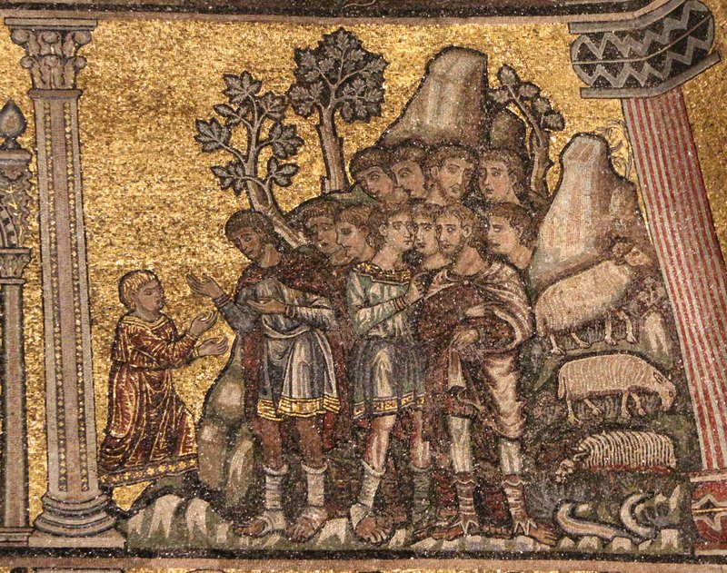
  <figcaption>Tuscan mosaicists, circle of Coppo di Marcovaldo (attributed), Joseph tells his dreams to his brothers, from the stories of Joseph, c. 1270–1300. Florence, Baptistery of San Giovanni, dome. Photo: Sailko, <a href="https://creativecommons.org/licenses/by/3.0/">CC BY 3.0</a>, via Wikimedia Commons.</figcaption>
</figure>

The third scene of the stories of Joseph shows the boy telling his dreams to his brothers. Genesis says that when he told them the dream of the sheaves, they hated him even more and said: "Shalt thou indeed reign over us?" (37:8). The scene closes the first group of three in the northern segment of the dome.

Joseph stands at the left, between the columns that divide the scenes, in the same long red robe striated with gold as in the previous scene. He stretches out his hands towards his brothers, speaking. His small figure, isolated against the gold, faces the large group of his brothers.

The brothers stand crowded together in the centre and the right of the scene. They are young men in short tunics, cloaks and leggings bound with straps, with short hair and, some of them, short beards. Their heads are arranged in two rows, one above the other, and their glances go in different directions: some look at Joseph, some at one another, some away.

Their expressions and gestures show their reaction to the dream. The brother at the front raises his hands, as if objecting; others hold their cloaks or fold their arms. The group is united against the single figure of the boy, and its massed heads express the collective hostility of the brothers.

The setting is the countryside where the brothers kept their father's flocks. Behind them rise trees with stylised leaves and tall, pale rocks, and at the right sheep and a goat graze among the rocks. The landscape is drawn in the conventional forms of Byzantine art, but the animals are observed with care.

At the right edge a striped curtain hangs from a canopy, part of the frame that separates this segment from the next. The columns, curtains and canopies that divide the scenes are a constant feature of the dome, and they give the narrative registers the appearance of a continuous colonnade.

The faces of the brothers, with their long noses and large eyes, the crowded group with its overlapping heads, and the gold lines on Joseph's robe are the features that have led some catalogues to connect the scene with the circle of Coppo. The Opera gives the register to Tuscan workshops of the last decades of the century, and the question of the designer remains open.

The three first scenes of Joseph, with their clear compositions and their emphasis on gesture and expression, show the narrative art of the dome at its best. They tell the story in a few figures, with the clarity needed for images seen from the floor of the Baptistery, many metres below.

### The Baptistery: the Annunciation

<figure>
  
  <figcaption>Tuscan mosaicists, Coppo di Marcovaldo (attributed), the Annunciation, from the stories of the Virgin and Christ, c. 1275–1300. Florence, Baptistery of San Giovanni, dome. Photo: Sailko, <a href="https://creativecommons.org/licenses/by/3.0/">CC BY 3.0</a>, via Wikimedia Commons.</figcaption>
</figure>

The Annunciation is the first scene of the stories of the Virgin and Christ in the dome of the Baptistery, in the northern segment, followed by the Visitation and the Nativity. It shows the angel Gabriel announcing to the Virgin that she will conceive the Son of God, as told in the Gospel of Luke (1:26–38).

The angel strides in from the left, with large wings of green, red and white feathers spread behind him. He wears a pale blue tunic and a pink mantle, whose end flutters behind his legs in the movement of his arrival. He raises his right hand towards the Virgin in a gesture of greeting and announcement.

His face, with curly hair bound by a ribbon and a gentle expression, is framed by a halo. His figure is in movement, one foot forward, the body leaning towards the Virgin, and the fluttering mantle gives the scene a sense of sudden arrival that is unusual in the static images of the period.

The Virgin stands at the right before a throne with round cushions, under an arch with a tiled roof supported by columns. She wears a dark mantle over a red robe striated with gold, and she raises her right hand to her breast, in a gesture of surprise and acceptance. Her halo is set with pearls, and her face, turned slightly towards the angel, is grave and calm.

Above, a small disc appears in the sky, from which rays descend towards the Virgin. It represents the presence of God, from whom the Holy Spirit descends upon her at the moment of the Incarnation. A larger disc at the top of the scene, partly cut off, may belong to the decoration of the frame.

The composition places the two figures at the opposite sides of the scene, with the empty gold ground between them. The space between the angel and the Virgin, crossed only by the angel's gesture and the rays from above, is the space of the announcement, and it gives the meeting its solemnity.

The scene is given to Coppo by some catalogues, on the grounds of the gold-striated robe of the Virgin, the type of her face and the dramatic movement of the angel. The Opera di Santa Maria del Fiore gives the register of the Virgin and Christ to Tuscan workshops of around 1275–1300 in the orbit of Cimabue, of the Maestro della Maddalena and of a painter of the Assisi circle, and does not mention Coppo. The attribution remains uncertain.

The Annunciation opens the story of the Incarnation, which the register follows to the Crucifixion and the holy women at the tomb. Set above the register of the Baptist, it begins the part of the dome that tells the life of Christ, the centre of the history of salvation that the whole dome represents.
