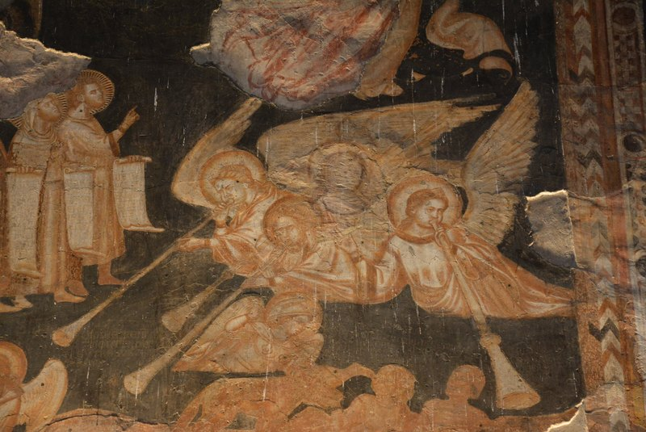

## A Signature on the Façade

*Filippo Rusuti* is known by one inscription. Beneath the feet of Christ enthroned, in the mosaic that once covered the medieval façade of Santa Maria Maggiore in Rome, a line of tesserae reads PHILIPP(VS) RVSVTI FECIT HOC OPVS: "Filippo Rusuti made this work". It is the only work that carries his name, and everything else attributed to him is measured against it.

The signature places him among the Roman masters of the last decades of the thirteenth century, the generation of Jacopo Torriti and Pietro Cavallini. Torriti signed the apse mosaics of San Giovanni in Laterano and of Santa Maria Maggiore itself; Cavallini worked in mosaic and fresco at Santa Maria in Trastevere and Santa Cecilia. Rusuti's name stands beside theirs on the façade of the same basilica in which Torriti had worked inside.

Nothing is known of his birth, his family or his training. The date of about 1255 often given for his birth is an estimate from the date of his work, and the date of about 1325 for his death is no more than an inference from the end of the documents. Rome is assumed to be his city because his only signed work is there and because his art belongs entirely to the Roman tradition.

The façade mosaic was made for the Colonna, the baronial family that dominated Santa Maria Maggiore in these years. Cardinal Giacomo Colonna was archpriest of the basilica, and his nephew Cardinal Pietro Colonna shared in the patronage. The fortunes of the mosaic, and perhaps of its maker, were tied to the fortunes of the family.

The mosaic is now hidden from the square. In the 1740s Ferdinando Fuga built a new façade for Pope Benedict XIV, with a loggia of benedictions on the upper floor, and the medieval mosaic was enclosed behind it. It can be seen from the loggia, where the eighteenth-century arches cut across its upper edge.

Outside Rome, Rusuti appears in French documents of the early fourteenth century, in the service of the kings of France, with his son Giovanni. [Julian Gardner](/scholars.html#gardner-julian), in an article in *The Burlington Magazine* in 1987, connected these documents with the painter of the Santa Maria Maggiore signature. Around 1320 Rusuti, or at least his workshop, is thought to have worked in Naples.

A small group of works has been added to the signed mosaic. The four scenes of the lower register of the façade are given to his followers working on his designs; scenes from Genesis at Assisi and frescoes at Naples have been attributed to him; and in 2018 a panel of the Virgin and Child in Santa Maria del Popolo was presented as his after a fragmentary signature was found during restoration.

The evidence is therefore of two kinds. On one side stand the signature and the documents, which fix his name, his rank and his movements; on the other, a series of attributions that vary in their certainty. The two kinds of evidence must be kept apart.

## Santa Maria Maggiore and the Colonna

Santa Maria Maggiore is the greatest of the Roman churches dedicated to the Virgin. Founded in the fifth century under Pope Sixtus III, it kept its early Christian nave mosaics and triumphal arch, and its medieval patrons added to them without replacing them. The legend of its foundation, told on Rusuti's façade, made it the church that the Virgin herself had chosen.

At the end of the thirteenth century the basilica was renewed. Pope Nicholas IV, the first Franciscan pope, who reigned from 1288 to 1292, rebuilt the apse and had it decorated with the mosaic of the Coronation of the Virgin signed by Torriti. The renewal of the façade belongs to the same programme, carried on by the Colonna after the pope's death.

The Colonna were closely bound to Nicholas IV and to the basilica. Giacomo Colonna, cardinal from 1278, held the office of archpriest, and his nephew Pietro was made cardinal in 1288. Their arms, a white column on a red ground, appear in the borders of the lower register of the façade, beside the scenes of the foundation legend.

In 1297 the family's position collapsed. Pope Boniface VIII, in open conflict with the Colonna, deprived the two cardinals of their offices and excommunicated them, and their lands and castles were taken. They were restored only after Boniface's death, by Clement V, in the first decade of the fourteenth century.

The conflict bears on the date of the mosaic. Some scholars date the upper register between 1288 and 1297, while both Colonna cardinals were in office; others, including the Fondazione Zeri catalogue, date it from about 1297 to before 1308. The question cannot be settled from documents, and the two proposals are best kept side by side.

The relation between the two registers is part of the same problem. The upper register, with Christ and the saints, is signed; the lower register, with the legend of the foundation, is not, and it is generally believed to have been completed somewhat later by Rusuti's followers on his designs. A pause in the work during the years of the Colonna disgrace would explain the gap, but it is a hypothesis.

Whatever the exact dates, the façade was a statement of Colonna patronage. It presented to the square the image of Christ enthroned among the saints and, beneath him, the story of the miraculous snow that had marked the site of the church, framed by the family's arms.

The commission also shows Rusuti's standing. A family of cardinals that had at its disposal the best Roman workshops, including Torriti's, entrusted to him the most visible decoration of their basilica: the image that every pilgrim saw before entering. His signature, placed at the centre of the composition, claimed that responsibility.

## The Roman School: Torriti, Cavallini and Rusuti

In the last quarter of the thirteenth century Rome had a group of painters and mosaicists who renewed the city's art. Their work is known from a small number of great commissions, in the patriarchal basilicas and in the churches of the cardinals, and from a few names preserved in inscriptions: Jacopo Torriti, Pietro Cavallini and Filippo Rusuti.

Their art drew on two sources. The early Christian and medieval mosaics of Rome offered a monumental language of frontal figures, gold grounds and great ornamental borders, which they studied and imitated. Byzantine painting, known through imported works and through the art of the Italian centres in contact with the East, offered models of drapery and modelling.

Torriti's mosaics at the Lateran and at Santa Maria Maggiore show the first of these sources at its fullest. His apse at Santa Maria Maggiore keeps the scheme of the early Christian apses, with acanthus scrolls inhabited by birds and small figures, while setting in its centre a new subject, the Coronation of the Virgin.

Cavallini went further towards solid form. His frescoes of the Last Judgement at Santa Cecilia in Trastevere give the apostles bodies that seem to occupy space, modelled with light and shade, and his mosaics of the Life of the Virgin at Santa Maria in Trastevere set the scenes in architecture that recedes in depth.

Rusuti's upper register stands between them. The Christ is frontal and symmetrical, set in a starry roundel and framed by angels, in the manner of the older Roman apses; but the apostles in the side lunettes are heavy, broad figures whose mantles fall in deep folds, and their heads are individual. The throne of Christ is built as a small architecture with turrets and arcades.

The lower register goes further in the representation of space. Its scenes are set in interiors with vaulted ceilings and curtains and in a city of towers and palaces drawn in oblique perspective. Whether this reflects the hand of a younger collaborator or a later stage of Rusuti's own development is part of the debate over the attribution of the lower register.

The Roman school was also linked to Assisi. Painters from Rome worked in the Upper Basilica of San Francesco in the 1280s and 1290s, beside Cimabue and the young Giotto, and Torriti's name has long been associated with the vault and the upper scenes of the nave. Some scholars, among them [Luciano Bellosi](/scholars.html#bellosi-luciano), have recognised Rusuti's hand in part of the Genesis cycle.

The end of the Roman school came with the departure of the papacy for Avignon in the first decade of the fourteenth century. The great Roman commissions ceased, and the painters left the city: Cavallini went to Naples, and Rusuti, by then, was in France.

## Pictor regis: Rusuti in France

The French documents that concern Rusuti are known only through transcriptions made before the originals were lost. They record a painter named Filippus Bizuti or Ruzuti, a Roman, in the service of the king of France in 1309, and again in 1316 and 1317.

The variants of the name are typical of the way Italian names were rendered by French clerks. Gardner's article, whose title, "Bizuti, Rusuti, Nicolaus and Johannes", names the persons involved, argued that the Bizuti of the documents is the Rusuti of Santa Maria Maggiore, and his identification is generally accepted.

The documents name his son Giovanni, Johannes in Latin, who was also a painter and worked with his father. They also name a Nicolaus, whose relation to the two is less clear. The presence of a son and a collaborator shows that Rusuti travelled with a workshop rather than alone.

The kings of France in these years were Philip IV, called the Fair, who died in 1314, and his sons Louis X and Philip V. Rusuti's employment spans at least two of these reigns. His title of royal painter, *pictor regis*, placed him in the household of the king, with wages and the right to court dress.

No work survives from his years in France. The royal residences in which he worked have been rebuilt or destroyed, and the decorations that the king's painters made for them are known, if at all, only from accounts. The French phase of his career is therefore a matter of documents without images.

The connection with France also raises the question of Avignon. The papacy was settled there from 1309, and the Colonna cardinals, restored to office, belonged to the papal court. [Serena Romano](/scholars.html#romano-serena) has suggested that Rusuti may also have worked for the papal court, but no document confirms it.

Rusuti's career abroad is not exceptional for a Roman painter of his rank. The Roman masters were in demand in courts that wished to adopt the prestige of Roman art, and the French crown, in conflict with Boniface VIII and then host to the papacy, had particular reasons to employ them.

The documents end in 1317. Whether Rusuti remained in France, as Romano has suggested, or returned to Italy is not known, and the date and place of his death are unrecorded.

## Naples and the Last Phase

Around 1320, Rusuti or his workshop is thought to have worked in Naples, at the court of the Angevin kings. The Angevins, a branch of the French royal house, ruled the kingdom of Naples and drew artists from Rome, Siena and Florence to decorate their churches and palaces.

Pietro Cavallini was in Naples by 1308, when he is recorded in the service of King Charles II. His presence there made the Angevin capital the main centre in which the Roman pictorial tradition continued after the departure of the papacy from Rome.

The most important Neapolitan work connected with Rusuti is the decoration of the nuns' choir of Santa Maria Donnaregina Vecchia, the church of the Clarissan convent rebuilt under the patronage of Queen Mary of Hungary, wife of Charles II. The choir, a great raised gallery at the west end of the church, was reserved for the enclosed nuns.

The walls of the choir are covered with frescoes: the Last Judgement, scenes of the Passion, the stories of Saint Elizabeth of Hungary, Saint Clare and Saint Agnes, and figures of prophets and apostles. They are generally dated to the second decade of the fourteenth century and associated with Cavallini and his workshop.

[Ferdinando Bologna](/scholars.html#bologna-ferdinando), in his study of the painters of the Angevin court published in 1969, distinguished within the decoration a part that he attributed to Rusuti and his workshop, including the Last Judgement with its prophets and apostles. The attribution rests on stylistic comparison with the Santa Maria Maggiore mosaic.

Bologna also connected Rusuti's circle with frescoes of the Life of Christ in the Brancacci chapel of San Domenico Maggiore. This attribution, like that of Donnaregina, depends on the identification of a Roman hand in a decoration largely given to Cavallini's workshop.

The Neapolitan attributions are the least secure part of Rusuti's catalogue. They concern works painted in collaboration, in a shared Roman style, by a workshop whose members cannot be named; and they place Rusuti in Naples at a date at which no document records him there.

They nevertheless complete a coherent picture. A Roman master, trained among the mosaicists of the late thirteenth century, followed the patrons of Roman art from the papal city to the courts of France and Naples, and his workshop carried the Roman manner into the fourteenth century.

## Attributions Old and New

The lower register of the façade has been attributed to several hands. Giorgio Vasari, in the sixteenth century, gave the mosaics of the loggia to the Florentine [Gaddo Gaddi](/Content/Artists/XIII-c/Gaddo-Gaddi.html), and the name persisted in the literature. Modern scholarship generally sees the lower register as the work of Rusuti's followers on his designs.

The Genesis scenes at Assisi pose a different problem. The upper walls of the Upper Basilica were painted by several teams in the 1280s and 1290s, and the attribution of individual scenes depends on fine stylistic distinctions. The scenes associated with Rusuti include the Creation of Adam, the Creation of Eve and perhaps the Building of the Ark.

The most recent addition is the Madonna of Santa Maria del Popolo. The panel, venerated for centuries as an image painted by Saint Luke, was restored in 2018 by the Consorzio Aureo, under the direction of Simonetta Antellini of the Soprintendenza Speciale di Roma. During the work, fragments of a signature were found which were judged referable to Rusuti.

The attribution was presented on 18 October 2018 at Castel Sant'Angelo, with the participation of [Alessandro Tomei](/scholars.html#tomei-alessandro), professor of medieval art history at the University of Chieti. If it is accepted, the panel is Rusuti's only known work on panel and the only one in Rome besides the façade.

The panel also changes the picture of his activity. A painter known almost entirely as a mosaicist appears as the author of a devotional icon of the type that Roman churches venerated as ancient and miraculous, painted in the late thirteenth century in the manner of the Byzantine Hodegetria.

The attributions are not of equal weight. The Madonna del Popolo rests on a signature, even if fragmentary; the lower register of the façade rests on its place in the same programme and on its style; the Assisi and Naples attributions rest on style alone and on the comparison with a single signed work in another medium.

The basic description of the façade remains that of [Guglielmo Matthiae](/scholars.html#matthiae-guglielmo), in his corpus of the medieval mosaics of the churches of Rome published in 1967. Later studies have refined the dating and the division of hands without changing the essential distinction between the signed upper register and the lower.

What remains certain is the signature at Santa Maria Maggiore and the career it opens: a Roman mosaicist trusted by the Colonna with the façade of their basilica, a royal painter at the French court, and, in all probability, the head of a workshop that carried the Roman style into the early fourteenth century.

## Catalogue Entry

### The Façade Mosaic of Santa Maria Maggiore: History

The mosaic covered the upper part of the medieval façade of Santa Maria Maggiore, above the porch that stood in front of the church. It is divided into two registers: an upper register with Christ enthroned among angels and saints, in three arched fields, and a lower register with four scenes of the legend of the foundation of the basilica, arranged on either side of a great round window.

The upper register carries the signature PHILIPP(VS) RVSVTI FECIT HOC OPVS beneath the throne of Christ. It is the only part of the mosaic that can be given to Rusuti with certainty, and it is catalogued by the Fondazione Zeri, following [Guglielmo Matthiae](/scholars.html#matthiae-guglielmo), as his work, dated from about 1297 to before 1308.

The lower register is unsigned. It is generally believed to be the work of Rusuti's followers, completed somewhat later on his designs, and the Colonna arms set in its borders tie it to the same patrons. Giorgio Vasari attributed the mosaics of the loggia to Gaddo Gaddi, an attribution now abandoned.

The mosaic was commissioned by the Colonna cardinals Giacomo and Pietro, within the renewal of the basilica begun by Nicholas IV. Its dating depends on the history of the family's relations with Boniface VIII: some scholars place the upper register before the Colonna disgrace of 1297, others after it.

In the 1740s Ferdinando Fuga built the present façade for Benedict XIV, with a portico below and a loggia of benedictions above. The medieval mosaic was preserved inside the loggia, but the new vaults cut across its upper edge, and Baroque statues of angels and stucco cherubs were set against it.

The mosaic can be seen from the loggia, which is reached from inside the basilica. Its tesserae have been cleaned and consolidated in modern campaigns, and the photographs show it after a recent restoration.

### The Basilica of Santa Maria Maggiore

<figure>
  
  <figcaption>The basilica of Santa Maria Maggiore, Rome, with the façade by Ferdinando Fuga (1741–1743); the medieval mosaic is behind the three arches of the upper loggia. Photo: <a href="https://commons.wikimedia.org/wiki/File:Basilica_di_Santa_Maria_Maggiore_-_Roma.jpg">NikonZ7II</a>, <a href="https://creativecommons.org/licenses/by-sa/4.0">CC BY-SA 4.0</a>, via Wikimedia Commons.</figcaption>
</figure>

The photograph shows the basilica from the Piazza di Santa Maria Maggiore. The front is a broad composition in travertine and stucco, with a projecting central block and two long lateral wings in the form of palaces, their windows framed by pilasters and crowned with balustrades.

The central block, designed by Ferdinando Fuga for Benedict XIV, is in two storeys. Below, a portico of five openings, separated by paired columns, leads to the doors of the church; above, a loggia of three great arches, the loggia of the benedictions, opens towards the square.

The inscription of Benedict XIV runs along the cornice of the loggia, and statues of saints and of the Virgin with the Child crown the balustrade. The two side wings carry the coats of arms of popes and inscriptions recording their construction.

Behind the façade, at the right, rises the bell tower, built of brick in the Romanesque manner, with rows of arched windows divided by columns, inset discs of coloured stone and a small niche. It is the tallest bell tower in Rome, and it is the most visible survival of the medieval church.

The medieval mosaic is not visible from the square. It lies behind the three arches of the loggia, on the wall of the old façade, which Fuga preserved and enclosed within his new front. The central arch of the loggia corresponds to the Christ of the upper register.

The arrangement keeps something of the original effect. The mosaic, which once faced the square in the open air, is still seen through the arches of a loggia from which the pope blessed the crowd, and its central image still stands above the main entrance of the basilica.

The façade belongs to a long history of transformation. The early Christian basilica received a porch and a mosaic façade in the Middle Ages, a Renaissance and Baroque refacing of its flanks and apse, and finally Fuga's front, which unified the whole as the eighteenth-century face of the church.

For the pilgrims of the late thirteenth century the façade was dominated by Rusuti's mosaic, glittering above the porch. The photograph shows how that medieval image has been absorbed into a Baroque setting, where it is now discovered rather than seen from afar.

### The Façade Mosaic

<figure>
  
  <figcaption>Filippo Rusuti (upper register, signed) and his circle (lower register), the mosaic of the medieval façade, late thirteenth – early fourteenth century. Rome, Santa Maria Maggiore, loggia of the benedictions. Photo: <a href="https://commons.wikimedia.org/wiki/File:Mosaici_di_fine_XIII_-_inizi_XIV_sec._della_vecchia_facciata_di_S._Maria_Maggiore_a_Roma_-FG1.jpg">Fabrizio Garrisi</a>, CC0, via Wikimedia Commons.</figcaption>
</figure>

The photograph shows the whole wall of the loggia, between two of the great columns of Fuga's façade. The mosaic is divided by a band of ornament into two registers, which correspond to the two phases of the work.

The upper register is set in three arched fields, created by the eighteenth-century vaults, which cut through the medieval composition. In the centre Christ sits enthroned within a blue roundel strewn with stars, flanked by four angels; the side fields contain three standing saints each, with the eagle of John above the group at the left and the angel of Matthew above the group at the right.

Between the arches, the springing of the vaults is masked by Baroque stucco cherubs, set over the medieval ornament. The upper edge of each field is cut by the curve of the vault, so that the original upper border of the mosaic is visible only in fragments.

The lower register is a continuous band of four scenes, interrupted at the centre by a great round window of leaded glass. On the left are the dream of Pope Liberius and the dream of the patrician John; on the right, John's report to the pope and the miracle of the snow.

The scenes are framed by broad borders of ornament, with red shields bearing a white column, the arms of the Colonna, at the corners of the window and in the borders. Two smaller roundels with carved quatrefoils, filled in later, punctuate the border between the scenes.

The two registers differ in character. The upper is a solemn image of Christ among his saints on a gold ground, in the tradition of the Roman apses; the lower is a narrative in many colours, set in rooms, palaces and streets, with crowds of figures.

At either side the gilded and white marble angels of the eighteenth century stand on their pedestals, their gestures directed towards the mosaic. At the time of the photograph a scaffold stood at the left, for work on the lower register.

The photograph gives the scale of the work: a whole façade conceived as a single programme, with the eternal Christ above and the story of the church's foundation below, joined by the arms of the family that paid for it.

### Christ Enthroned with Four Angels

<figure>
  
  <figcaption>Filippo Rusuti, Christ enthroned with four angels, upper register of the façade mosaic, signed. Rome, Santa Maria Maggiore, loggia of the benedictions. Photo: <a href="https://commons.wikimedia.org/wiki/File:Filippo_Rasuti,_Cristo_benedicente_e_angeli,_fine_del_XIII_sec._Santa_Maria_Maggiore,_Roma_-FG1.jpg">Fabrizio Garrisi</a>, CC0, via Wikimedia Commons.</figcaption>
</figure>

Christ sits frontally at the centre of a great roundel of deep blue, sprinkled with gold stars and edged with bands of light blue. The roundel represents the heavens, and Christ appears within it as the ruler of the universe, enthroned above the gold ground of the façade.

His head, with a cross-nimbus set with jewels, is long and grave, with a forked beard and large eyes; the letters IC XC stand at either side. He blesses with his right hand and holds on his knee an open book inscribed EGO SUM LUX MUNDI QUI, "I am the light of the world; he who [follows me]", from the Gospel of John.

The throne is built like a small palace. Its sides are towers with turrets and arcades, its back is covered with a patterned cloth of roundels, and Christ's feet rest on a jewelled footstool. The architectural throne gives the heavenly ruler a palace of his own, in the manner of Byzantine and Roman images of Christ enthroned.

Outside the roundel four angels attend him. The two above, at half length, raise their hands in a gesture of acclamation; the two below kneel on a green meadow dotted with flowers and hold tall lit candles, as acolytes in a heavenly liturgy.

Beneath the footstool, along the edge of the roundel, runs the signature in white letters: PHILIPP(VS) RVSVTI FECIT HOC OPVS. Placed at the feet of Christ and at the centre of the façade, it makes the maker's name part of the image itself.

### The Left Lunette: Saints James and Paul and the Virgin

<figure>
  
  <figcaption>Filippo Rusuti, Saint James, Saint Paul and the Virgin with the eagle of Saint John, upper register of the façade mosaic. Rome, Santa Maria Maggiore, loggia of the benedictions. Photo: <a href="https://commons.wikimedia.org/wiki/File:Interior_of_Basilica_di_Santa_Maria_Maggiore_04.jpg">Superchilum</a>, <a href="https://creativecommons.org/licenses/by-sa/4.0">CC BY-SA 4.0</a>, via Wikimedia Commons.</figcaption>
</figure>

The left field of the upper register contains three standing figures on a green meadow, with the eagle of Saint John the Evangelist above them. The eagle spreads its great wings across the gold ground and holds a closed book in its claws, the symbol of the Gospel.

At the left stands a young bearded saint in a red mantle over a blue tunic, with a pilgrim's staff ending in a knob and a rolled scroll. He is Saint James the Great, the apostle of the pilgrimage to Compostela, identified by the Fondazione Zeri catalogue.

At the centre stands Saint Paul, named SCS PAULUS in the inscription beside him. Bald at the front, with a dark pointed beard, he holds the sword of his martyrdom upright against his shoulder and unrolls a long scroll towards the right.

At the right, nearest the central field, stands the Virgin, named MP for *Mater*, in a dark blue mantle that covers her head. She turns towards the centre and lays her hand on her breast in a gesture of intercession, directed towards the enthroned Christ in the next field.

The figures are large and solid, their mantles falling in broad folds to their sandalled feet. The Virgin's position at the inner edge of the field, next to Christ, answers the Baptist's place at the inner edge of the right field, so that the two intercessors flank Christ across the three fields in the arrangement of the Deesis.

### Saints James and Paul and the Virgin: Detail

<figure>
  
  <figcaption>Filippo Rusuti, Saint James, Saint Paul and the Virgin, detail of the upper register of the façade mosaic. Rome, Santa Maria Maggiore, loggia of the benedictions. Photo: <a href="https://commons.wikimedia.org/wiki/File:Filippo_Rusuti,_Santi_e_la_Vergine,_fine_del_XIII_sec._Santa_Maria_Maggiore,_Roma_-FG2.jpg">Fabrizio Garrisi</a>, CC0, via Wikimedia Commons.</figcaption>
</figure>

The closer view shows the three figures at full height. The gold ground is not uniform: red tesserae are scattered among the gold, giving the surface a warm, flickering tone that changes with the light.

Saint Paul's head is the most powerful in the group. His forehead is high and bald, his beard dark and pointed, his eyes set deep under heavy brows; the face is built from small tesserae of brown, pink and white, following the modelling of the features.

His mantle, in shades of violet and grey, is wrapped round his body and falls in long vertical folds, while his blue tunic shows at the hem. In his left hand he holds the hilt of the sword, whose long blade rises across his shoulder; with his right he unrolls a scroll inscribed in red letters.

Saint James, at the left, is younger, with long hair and a short beard, and his red mantle is drawn over his arm in heavy folds. The Virgin, at the right, is wrapped in a blue mantle with gold fringes on the sleeve, and her small, oval face is turned towards the centre.

The figures stand on a strip of green, where small plants with curling leaves grow between their feet. The weight of the bodies, the breadth of the draperies and the individual heads show the qualities of Rusuti's figures beside the more decorative style of the older Roman mosaics.

### The Right Lunette: Saint John the Baptist, Saint Peter and a Third Saint

<figure>
  
  <figcaption>Filippo Rusuti, Saint John the Baptist, Saint Peter and a third saint with the angel of Saint Matthew, upper register of the façade mosaic. Rome, Santa Maria Maggiore, loggia of the benedictions. Photo: <a href="https://commons.wikimedia.org/wiki/File:Filippo_Rusuti,_Santi,_fine_del_XIII_sec._Santa_Maria_Maggiore,_Roma_-FG.jpg">Fabrizio Garrisi</a>, CC0, via Wikimedia Commons.</figcaption>
</figure>

The right field corresponds to the left. Above the three saints, a winged angel holding a book emerges from a cloud: the symbol of Saint Matthew, answering the eagle of John in the opposite field.

At the left edge, almost hidden by the curve of the eighteenth-century arch, stands Saint John the Baptist, named SCS IOHES BAPTISTA in the inscription beside him. His position at the inner edge of the field, next to the central Christ, mirrors that of the Virgin on the other side.

At the centre stands Saint Peter, named SCS PETRUS. He has short grey hair and a round beard, wears a grey mantle over a red tunic, and stretches his right hand towards the centre while holding an inscribed tablet in his left.

At the right stands a third saint with white hair and a long white beard, in a red mantle over a blue tunic, unrolling a scroll. His name, written beside him, is largely hidden by the arch, so that his identity cannot be read in the photograph.

The figures, like those of the left field, stand on a meadow with flowering plants against a gold ground. The eighteenth-century arch cuts into both sides of the field, and a band of carved stucco cherubs runs along its base over the medieval ornament.

### The Legend of the Snow, Lower Register: History

The lower register tells the legend of the foundation of Santa Maria Maggiore. According to the legend, in the time of Pope Liberius, in the fourth century, the Virgin appeared in a dream to the pope and to a rich Roman patrician named John, who wished to give his wealth to her, and told them to build a church where snow would fall on the following day.

On the morning of 5 August, in the heat of the Roman summer, snow covered part of the Esquiline hill. The pope went there in procession with the clergy and the people, traced the plan of the church in the snow, and the patrician paid for its construction. The basilica was therefore called Santa Maria ad Nives, Our Lady of the Snows, and the feast of the dedication is still celebrated on 5 August.

The register tells the story in four scenes, two on each side of the round window. From left to right they show the Virgin appearing to Liberius, the Virgin appearing to John, John reporting his dream to the pope, and the miracle of the snow with the tracing of the plan. Inscriptions along the lower border explain each scene.

The register is unsigned. It is generally regarded as the work of Rusuti's followers, carried out on his designs a little after the upper register; the photographs on Wikimedia Commons are labelled "Filippo Rusuti or collaborators (attributed)". Vasari's attribution to Gaddo Gaddi is no longer accepted.

The red shields with the white column of the Colonna in the borders identify the patrons. The scenes give a prominent place to the patrician John, the lay founder of the basilica, perhaps as a model for the lay patrons of the Colonna family who were renewing it.

The style of the lower register differs from that of the upper. Its figures are smaller and more numerous, its architecture is more complex, and its interiors, with rib vaults and striped curtains, show a concern with space that recalls the frescoes of Assisi and the work of Cavallini.

### The Virgin Appears to Pope Liberius

<figure>
  
  <figcaption>Circle of Filippo Rusuti, the Virgin appears to Pope Liberius, upper part of the scene, lower register of the façade mosaic. Rome, Santa Maria Maggiore, loggia of the benedictions. Photo: <a href="https://commons.wikimedia.org/wiki/File:Filippo_Rusuti_o_collaboratori_(attrib.),_La_Vergine_appare_in_sogno_a_papa_Liberio_-FG.jpg">Fabrizio Garrisi</a>, CC0, via Wikimedia Commons.</figcaption>
</figure>

The first scene, at the far left of the lower register, shows the Virgin appearing to Pope Liberius in a dream. The photograph shows its upper part, where the Virgin and Child appear within a round glory against a gold ground.

The Virgin, named MP ΘV, wears a dark blue mantle over her head and holds the Child on her left arm. With her right hand she points downward, towards the sleeping pope below, indicating the place where the church is to be built.

The Child, in a green tunic and a red mantle, sits upright and holds a blue sphere, the sign of his rule over the world. His face, with its round cheeks and curly hair, is more naturalistic than the solemn faces of the upper register.

Four angels surround the glory. Their wings, in red, green and blue feathers, spread across the gold ground; two look towards the Virgin and two outward, and their soft, rounded faces and curling hair give the group a lively grace.

Below the glory, waves of red and brown clouds carry the vision, while at the top an arc of blue sky strewn with stars marks the heaven from which it descends. At the left a tall building with towers and battlements represents the pope's palace.

### The Virgin Appears to the Patrician John

<figure>
  
  <figcaption>Circle of Filippo Rusuti, the Virgin appears to the patrician John, lower register of the façade mosaic. Rome, Santa Maria Maggiore, loggia of the benedictions. Photo: <a href="https://commons.wikimedia.org/wiki/File:Santa_Maria_Maggiore_13.jpg">Hugo DK</a>, <a href="https://creativecommons.org/licenses/by-sa/4.0">CC BY-SA 4.0</a>, via Wikimedia Commons.</figcaption>
</figure>

The second scene shows the dream of the patrician John, who had prayed to the Virgin to show him how to use his fortune. It is divided into two zones: the vision above, on a gold ground, and the sleeping patrician below, in his room.

Above, the Virgin and Child appear in a round glory, attended by two angels with blue and white wings. The Virgin points downward, as in the first scene, and from the clouds beneath her a long beam of light descends diagonally across the whole scene to the head of the sleeper.

At the left rises a tall building of red stone, with towers, battlements, a long narrow window and, at the top, a wheel on a small balcony. Its oblique faces and projecting parts show an effort to represent volume and depth.

Below, in a room with slender columns and a ceiling patterned in blue, John lies asleep in a great bed, wrapped in a blue robe with gold crosses and covered with a green coverlet. Beside him his wife sleeps, resting her head on her arm, and on the floor in front a young man in a blue mantle sits and raises his hands. At the right stands a small church with a round window, the church that the dream announces.

Along the bottom runs the inscription, beginning with a cross: QD EADE(M) NOCTE APP(ARU)IT IOH(ANN)I PATRICIO, "that on the same night she appeared to the patrician John". The scene, with its domestic interior, its sleeping couple and its long beam of light, is one of the most inventive narratives of Roman mosaic in the period.

The scene is built on a strong diagonal. The beam of light runs from the upper right, beneath the vision, to the lower left, where it reaches the sleeper's head, and it crosses the architecture of the city and the frame of the room as if nothing could stop it.

The building at the top and the room below are drawn as solid volumes, with oblique sides and projecting parts. The painter treats the scene as a single space in which the city, the vision and the bedroom are connected, rather than as separate zones placed one above another.

The details of the room, the patterned cushions, the striped curtain, the jewelled collar of the patrician, give the vision the setting of a wealthy Roman house of the thirteenth century. The legend of the fourth century is told in the costume and furnishings of the time of the mosaic.

### The Patrician John's Dream: the Vision

<figure>
  
  <figcaption>Circle of Filippo Rusuti, the vision of the Virgin and the city, detail of the dream of the patrician John. Rome, Santa Maria Maggiore, loggia of the benedictions. Photo: <a href="https://commons.wikimedia.org/wiki/File:Filippo_Rusuti_o_collaboratori_(attrib.),_La_Vergine_appare_in_sogno_al_patrizio_Giovanni_-FG1.jpg">Fabrizio Garrisi</a>, CC0, via Wikimedia Commons.</figcaption>
</figure>

The detail shows the upper part of the scene, where the vision appears beside the buildings of the city. The red building at the left fills more than half the field, rising in several blocks with battlements, narrow windows and roofs drawn in perspective.

In front of it a smaller tower is pierced by a tall arched opening, shaded in red and black to suggest depth, and its walls are set with green diamond-shaped insets. At the top of the large building a wheel turns on a small projecting gallery.

At the right the Virgin appears in her round glory, edged with green, on a gold ground. Her blue mantle is drawn over her head, and her face, with its long nose and small mouth, is gentle and grave; the Child, in a golden robe, leans against her.

The two angels, with blue and white wings spread wide, appear at either side of the glory. Their heads, with curling hair and haloes, turn towards the Virgin, and their wings frame the vision against the gold.

Below the glory the clouds are rendered as waves of red and brown tesserae, from which the beam of light begins its descent towards the sleeper. The juxtaposition of city and vision places the miracle in the Rome of the patrician.

### The Patrician John's Dream: the Sleeper

<figure>
  
  <figcaption>Circle of Filippo Rusuti, the patrician John asleep, detail of the dream of the patrician John. Rome, Santa Maria Maggiore, loggia of the benedictions. Photo: <a href="https://commons.wikimedia.org/wiki/File:Filippo_Rusuti_o_collaboratori_(attrib.),_La_Vergine_appare_in_sogno_al_patrizio_Giovanni_-FG2.jpg">Fabrizio Garrisi</a>, CC0, via Wikimedia Commons.</figcaption>
</figure>

The detail shows the room in which the patrician sleeps. It is a box-like space, open at the front, with slender green columns at the corners and a ceiling patterned with blue waves and stars; red and gold curtains hang from the rods.

John lies in a great bed, his head on a patterned cushion. He wears a blue robe strewn with small gold crosses and a jewelled collar, and his eyes are closed. The beam of light from the vision enters the room at the top and touches his head.

His wife sleeps at the head of the bed, in a yellow dress, resting her head on her folded arm. The two sleepers, side by side, recall that in the legend the patrician and his wife together decided to give their wealth to the Virgin.

On the floor below the bed, a young man in a blue mantle over a red tunic sits with his knees drawn up and raises his hands in a gesture of speech or wonder. He is awake while the others sleep, perhaps a servant witnessing the vision.

The bed is covered with a green coverlet, and its base, like the floor, is patterned with lozenges in blue and gold. At the right, outside the room, stands a small pink church with a round window, the building that the vision will bring into being.

### John Reports His Dream to Pope Liberius

<figure>
  
  <figcaption>Circle of Filippo Rusuti, the patrician John reports his dream to Pope Liberius, lower register of the façade mosaic. Rome, Santa Maria Maggiore, loggia of the benedictions. Photo: <a href="https://commons.wikimedia.org/wiki/File:Filippo_Rusuti_o_collaboratori_(attrib.),_Il_patrizio_Giovanni_riferisce_il_suo_sogno_a_papa_Liberio_-FG1.jpg">Fabrizio Garrisi</a>, CC0, via Wikimedia Commons.</figcaption>
</figure>

The third scene, to the right of the round window, shows John coming to the pope to tell him of his dream. The scene is set beneath a great palace, which fills the upper half of the field with towers, galleries, coffered panels and a lunette in which an eagle spreads its wings.

The lower half is divided into two vaulted spaces. Their ceilings are ribbed vaults painted blue and strewn with gold stars, and their walls are hung with curtains striped in red, blue, yellow and green.

At the left, Pope Liberius sits on a curved throne in a tall white tiara and a green cope fastened with a jewelled clasp. He raises his right hand towards John, and behind him a bishop in a white mitre looks on.

At the right, John kneels in his blue robe with gold crosses, raising his hand as he speaks, and behind him three companions in white caps kneel with joined hands. At the far right, in the next opening, a groom in grey holds a white horse, the mount on which the patrician has come.

At the lower left, outside the frame of the scene, a small bearded figure in red kneels in prayer with joined hands. Set apart from the narrative, he seems to be a devout witness or a donor, and he is the only figure in the register who does not belong to the story.

The architecture is the most complex of the register. Its blocks are drawn at an angle, its galleries recede, and its vaults suggest real spaces in which the figures are placed, rather than the flat backgrounds of earlier Roman mosaic.

The colours are bright and varied: the green of the papal cope against the striped curtain, the blue robe of John against the red, the gold stars of the vaults. The scene uses the full range of glass tesserae to render textiles and costume.

The meeting of pope and patrician is the turning point of the legend: the two dreams, received separately, are recognised as one message. The scene presents the alliance of the papacy and the Roman nobility in the foundation of the basilica.

### John and Pope Liberius: Detail

<figure>
  
  <figcaption>Circle of Filippo Rusuti, Pope Liberius receiving the patrician John, detail. Rome, Santa Maria Maggiore, loggia of the benedictions. Photo: <a href="https://commons.wikimedia.org/wiki/File:Filippo_Rusuti_o_collaboratori_(attrib.),_Il_patrizio_Giovanni_riferisce_il_suo_sogno_a_papa_Liberio_-FG2.jpg">Fabrizio Garrisi</a>, CC0, via Wikimedia Commons.</figcaption>
</figure>

The closer view shows the figures of the scene. Pope Liberius sits sideways on his throne, his body turned towards John, his long green cope falling over his knees. His face, framed by the tall tiara, is calm and attentive.

The throne is curved like a folding stool, with gilded legs ending in knobs and a jewelled border. Behind it the curtain of blue and red stripes, decorated with lozenges, closes the space like the wall of an audience chamber.

John kneels on one knee before the pope, his head raised, his right hand lifted. His blue robe, strewn with gold crosses, has jewelled cuffs and collar, the dress of a Roman nobleman of the thirteenth century rather than of the fourth.

His three companions, perhaps his household, wear white caps tied under the chin and red or blue garments, and their faces, turned in profile and three-quarter view, overlap in a close group. Behind them the groom holds the white horse by its bridle.

At the left, in the gold spandrel beside the round window, the small kneeling figure with a grey beard and a red cloak prays with joined hands, facing the scene from outside its frame.

### The Miracle of the Snow: Christ and the Virgin

<figure>
  
  <figcaption>Circle of Filippo Rusuti, Christ and the Virgin in glory, detail of the miracle of the snow. Rome, Santa Maria Maggiore, loggia of the benedictions. Photo: <a href="https://commons.wikimedia.org/wiki/File:Filippo_Rusuti_o_collaboratori_(attrib.),_Il_miracolo_della_neve_d%27agosto_-FG.jpg">Fabrizio Garrisi</a>, CC0, via Wikimedia Commons.</figcaption>
</figure>

The fourth scene, at the far right of the register, shows the miracle of the snow. In its upper part, Christ and the Virgin appear together at half length within a round glory, above the snow that is about to fall.

The glory has a red centre, surrounded by concentric bands of yellow, light blue and dark blue strewn with small stars, so that it seems to open in the sky like a ring of light. Above Christ and the Virgin, their names are written in Greek letters, XP and MP ΘV.

Christ, with a cross-nimbus set with red jewels, wears a brown mantle shot with gold. His face is long and serious, with a short beard and dark hair. He stretches his right hand down out of the glory and points towards the earth.

The Virgin, beside him, wears a blue mantle with a green lining, and her head is turned towards him. She raises her right hand in a gesture of intercession, and her left reaches down to the edge of the glory, as if releasing the snow.

The joint appearance of Christ and the Virgin makes the miracle the work of both. The detail, with its fine modelling of the faces and its regular bands of colour, is among the best preserved passages of the lower register.

### The Miracle of the Snow: Liberius Traces the Plan

<figure>
  
  <figcaption>Circle of Filippo Rusuti, Pope Liberius traces the plan of the basilica in the snow, detail of the miracle of the snow. Rome, Santa Maria Maggiore, loggia of the benedictions. Photo: <a href="https://commons.wikimedia.org/wiki/File:Filippo_Rusuti_o_collaboratori_(attrib.),_Il_miracolo_della_neve_d%27agosto_-FG2.jpg">Fabrizio Garrisi</a>, CC0, via Wikimedia Commons.</figcaption>
</figure>

The lower part of the scene shows the procession on the Esquiline on the morning of 5 August. The ground is covered with snow, rendered as a pattern of white oval flakes on a blue ground that rises across the background.

At the front, Pope Liberius, in a tiara and a green cope over a blue robe, bends forward and draws lines in the snow with a long rod. He is tracing the plan of the church that will be built on the spot marked by the miracle.

Behind him are carried the processional cross, in gold, and a striped umbrella of red and yellow, the papal umbraculum. Bishops in white mitres and copes of red and blue follow, with clergy and a crowd of people whose faces, framed by white headdresses, rise in rows behind them.

At the left a man in a blue mantle over a green tunic, with two boys in front of him, stands at the edge of the procession. He is probably the patrician John with his household, present at the foundation of the church he will pay for.

Along the bottom runs the inscription IOH(ANN)ES PAT(RICIUS) CU(M) CL(E)RO PO(PUL)O ROM(ANO), "John the patrician with the clergy and the people of Rome", and a vertical inscription rises along the left border. The scene closes the legend with the foundation of the basilica, the building on whose façade the mosaic is set.

### The Madonna of Santa Maria del Popolo: History

The panel of the Virgin and Child is the venerated image of Santa Maria del Popolo, the church at the northern gate of Rome. It is set above the high altar, in a Baroque frame of gilded bronze and coloured marble, and it was long believed to have been painted by Saint Luke the Evangelist.

The legend of Saint Luke was attached to many ancient images of the Virgin in Rome, among them the Salus Populi Romani of Santa Maria Maggiore. It gave them the authority of a portrait painted from life, and it made the image of the Popolo one of the most venerated Madonnas of the city.

The panel was restored in 2018 by the Consorzio Aureo, with Cristina Caldi and Fiammetta Jahier, under the direction of Simonetta Antellini of the Soprintendenza Speciale di Roma. The work removed later repainting and brought to light parts of a signature, which were judged referable to Filippo Rusuti.

The attribution was presented on 18 October 2018 at the Museo Nazionale di Castel Sant'Angelo, with the participation of Alessandro Tomei. The published reports do not give the full wording or the position of the signature, so that the reading cannot yet be checked independently.

If the attribution is accepted, the panel was painted at the end of the thirteenth century, in the same years as the Santa Maria Maggiore façade, and it is the only panel painting known by Rusuti. It shows the Roman masters producing new icons in the manner of the ancient ones, for churches that wished to have an image of the Virgin of venerable appearance.

The panel belongs to the Fondo Edifici di Culto, the state body that owns many Roman churches and their contents. The photograph reproduced in the catalogue was taken before the restoration of 2018, and it shows the image with the colours and surface that the restoration has since changed.

### The Madonna of Santa Maria del Popolo

<figure>
  
  <figcaption>Filippo Rusuti (attributed after the 2018 restoration), the Madonna and Child of Santa Maria del Popolo, late thirteenth century. Tempera on panel. Rome, Santa Maria del Popolo, high altar; photographed before the 2018 restoration. Photo: <a href="https://commons.wikimedia.org/wiki/File:Santa_maria_del_popolo,_altare_maggiore_03_madonna_del_popolo.JPG">Sailko</a>, <a href="https://creativecommons.org/licenses/by-sa/3.0">CC BY-SA 3.0</a>, via Wikimedia Commons.</figcaption>
</figure>

The photograph shows the icon in its setting on the high altar. The panel is enclosed in a Baroque frame of dark and gilded bronze, with cherubs' heads at the top and sides, scrolls and garlands, set against panels of coloured marble between two dark fluted columns.

Below the frame a gilded cartouche carries the inscription TU HONORIFICENTIA POPULI NOSTRI, "you are the honour of our people", from the Book of Judith, applied in the liturgy to the Virgin. The words play on the name of the church, del Popolo.

The panel shows the Virgin at half length on a gold ground, holding the Child on her left arm. Her mantle, dark in the photograph, covers her head and shoulders, and a fringed band crosses her arm; her halo is incised in the gold.

Her head is turned towards the Child and slightly inclined. The face is long and oval, with a long nose, a small mouth and large almond-shaped eyes, in the type of the Byzantine Virgin; her expression is grave and inward.

She raises her right hand before her breast, with the palm open, in a gesture that presents the Child to the viewer. The gesture belongs to the type of the Hodegetria, the Virgin who shows the way, the most widespread image of the Virgin in the Byzantine world and in Rome.

The Child sits upright on her arm, wrapped in a pink and red mantle with gold highlights, and turns his face towards the viewer. His small head is framed by a halo, and his body, though small, has the posture of an adult, as in the Byzantine type.

The photograph, taken before the restoration, shows the surface darkened by old varnish and repainting. The restoration of 2018 removed these layers, recovering the original colours and the fragments of the signature.

The panel is a Roman icon of the late thirteenth century presented in a Baroque setting, as the Santa Maria Maggiore mosaic is presented in Fuga's loggia. Both show how the medieval images of Rome were preserved by being enclosed in the splendour of later centuries.

### The Last Judgement in Santa Maria Donnaregina Vecchia: History

Santa Maria Donnaregina Vecchia, in Naples, was the church of a convent of Poor Clares. After an earthquake in 1293 it was rebuilt under the patronage of Queen Mary of Hungary, wife of King Charles II of Anjou, who was buried there; her tomb, by Tino di Camaino, still stands in the church.

The church has a great raised choir for the nuns, extending over the west part of the nave. The enclosed nuns attended the liturgy from this choir, and its walls were covered with frescoes that formed one of the largest decorative programmes of early fourteenth-century Italy.

The decoration of the choir includes the Last Judgement, scenes of the Passion, the stories of Saint Elizabeth of Hungary, Saint Clare and Saint Agnes, and figures of prophets and apostles. It is generally dated to the second decade of the fourteenth century and associated with Pietro Cavallini and his workshop.

Within this decoration, Ferdinando Bologna attributed to Filippo Rusuti and his workshop the Last Judgement with its prophets and apostles. The attribution rests on stylistic comparison and is not documented; it places Rusuti, or his workshop, in Naples around 1320.

The frescoes are much damaged. Large areas of plaster have fallen, and the colours, worked largely in earth tones on a dark ground, have lost much of their surface. The photographs show the upper part of the Judgement and a detail of the angels of the Resurrection.

The church, deconsecrated, is now part of the museum complex of the Museo Diocesano di Napoli, and the nuns' choir can be visited.

### The Last Judgement: Christ the Judge

<figure>
  
  <figcaption>Workshop of Filippo Rusuti (Bologna), within the campaign of Pietro Cavallini, the Last Judgement, upper part, c. 1320. Fresco. Naples, Santa Maria Donnaregina Vecchia, nuns' choir. Photo: <a href="https://commons.wikimedia.org/wiki/File:Coro_delle_monache_(Donnaregina_Vecchia)_WLM23_025.jpg">Mentnafunangann</a>, <a href="https://creativecommons.org/licenses/by-sa/4.0">CC BY-SA 4.0</a>, via Wikimedia Commons.</figcaption>
</figure>

The photograph shows the upper part of the Last Judgement, on the wall of the nuns' choir between two tall Gothic windows with stone tracery. The fresco is framed by painted borders of chevrons and small ornaments, and its surface is streaked and spotted with losses.

At the centre Christ the judge sits within a pointed mandorla outlined in black. His figure is pale and much worn, but his outstretched arms can be seen, the gesture with which he shows his wounds and divides the saved from the damned.

At his sides stand the two intercessors. At the left the Virgin, in a dark mantle, bends towards him and raises her hands in supplication; at the right John the Baptist, in a red garment of hair, barefoot, gestures towards Christ. Together they form the Deesis, the prayer of intercession at the Judgement.

At the upper left an angel with spread wings holds a sword and a round shield, probably Saint Michael. At the upper right, behind a bench, sit bearded elders holding books, the apostles who will judge with Christ.

Below the mandorla stands a large cross, with a horizontal bar and further instruments of the Passion. The cross, shown to the risen dead, is the sign of the Son of Man that will appear in heaven at the end of time.

At the lower left a group of haloed figures with long beards crowds together, and the name DAVID can be read above one of them. They are the prophets and patriarchs of the Old Testament, who await the Judgement among the blessed.

At the lower right another haloed figure raises his hands towards the cross. Large patches of bare plaster interrupt the composition, and the colours, mainly reds and browns on a grey ground, are faded.

The composition, with Christ at the centre and the intercessors and saints arranged symmetrically, recalls the Judgement of Cavallini at Santa Cecilia in Trastevere. The attribution of this part of the cycle to Rusuti's workshop rests on the comparison of the heads and draperies with those of the Santa Maria Maggiore mosaic.

### The Last Judgement: Angels with Trumpets

<figure>
  
  <figcaption>Workshop of Filippo Rusuti (Bologna), angels sounding the trumpets of the Judgement, with two prophets, detail of the Last Judgement, c. 1320. Fresco. Naples, Santa Maria Donnaregina Vecchia, nuns' choir. Photo: <a href="https://commons.wikimedia.org/wiki/File:Coro_delle_monache_(Donnaregina_Vecchia)_WLM23_023.jpg">Mentnafunangann</a>, <a href="https://creativecommons.org/licenses/by-sa/4.0">CC BY-SA 4.0</a>, via Wikimedia Commons.</figcaption>
</figure>

The detail shows four angels flying horizontally across a dark ground, their large wings spread above them. They blow long, straight trumpets, which point downward towards the earth, to summon the dead to judgement.

The angels' faces are round and full, framed by haloes and curling hair, and their cheeks swell with the effort of blowing. Their robes, drawn in light ochre with red lines, flutter behind them, and their bodies stretch out in flight.

At the left two haloed figures stand side by side, holding long unrolled scrolls covered with writing. One points upward towards the heavens. They are prophets, holding the texts in which they announced the Judgement.

Below the angels a row of small figures rises from the ground, much damaged: the dead who come out of their tombs at the sound of the trumpets.

The fresco is painted largely in earth colours, light ochre and red on a dark ground, with the white of the plaster used for the highlights. Its figures, with their full faces and broad, simple draperies, are those that Bologna compared with the figures of the Santa Maria Maggiore mosaic.
