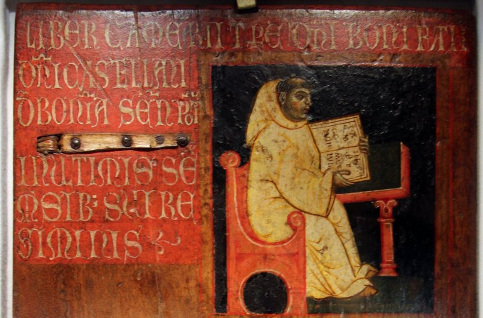
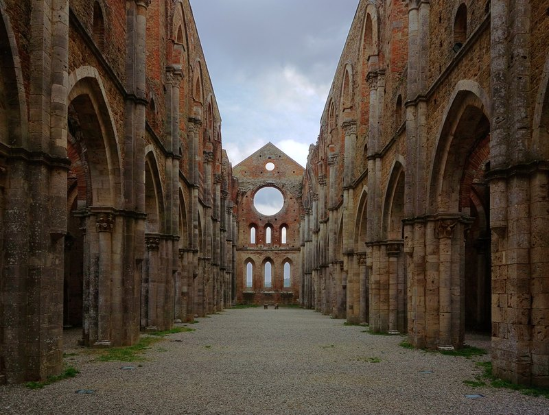
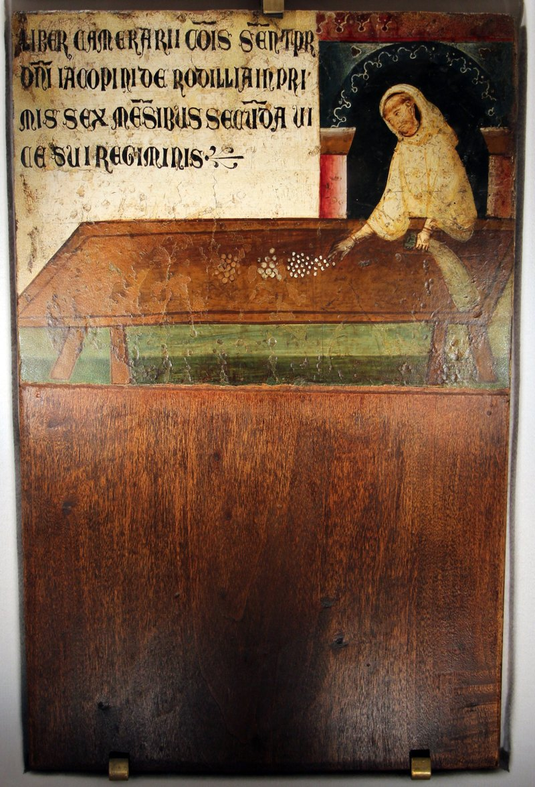
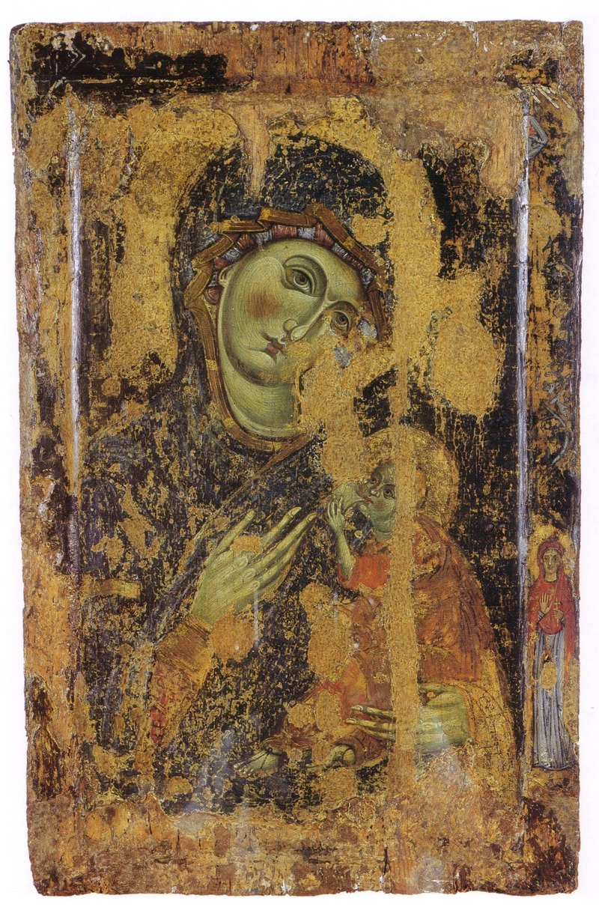
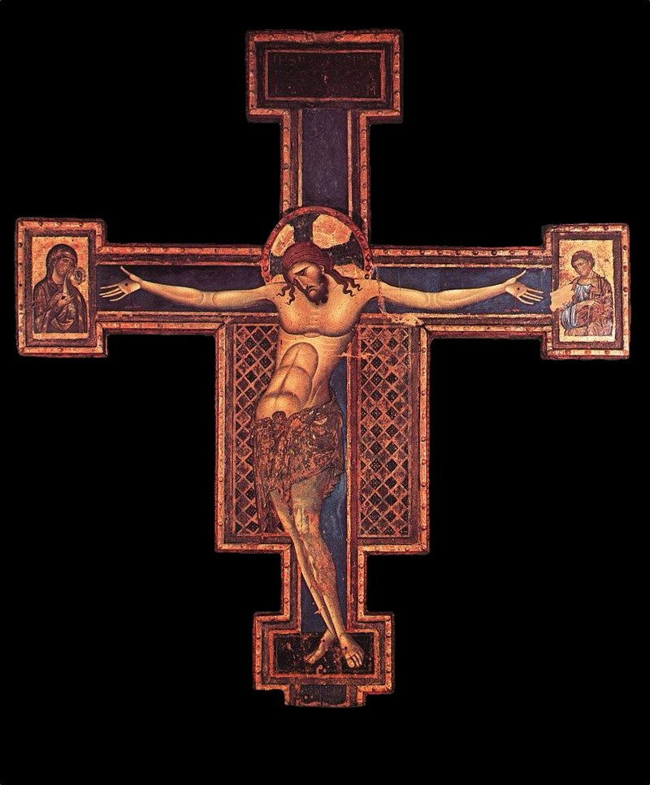

## A Painter in the Accounts of Siena

*Gilio di Pietro* is one of the first Sienese painters known by name. He appears in the documents of the Commune of Siena from 1247, or from 1249 according to some older publications, until 1261, the year of his death. His name means Gilio, son of Pietro; Gilio is a Tuscan form of Egidio, the Latin Aegidius.

Almost everything known about him comes from the account books of the Biccherna, the financial office of the Commune. These registers record payments, not biographies. They name the painter, the work and the sum, and say nothing of his birth, his family, his training or the place he came from.

The one payment that can be tied to a surviving work was made in the second half of 1258. The Biccherna paid Gilio five soldi for painting the cover of its register for that semester. The entry is in Biccherna register 28, on folio 3v, and has been published by the historians of the Sienese archives since the late nineteenth century.

The cover survives. It is the first object in the collection of painted Biccherna tablets kept in the Archivio di Stato di Siena, and the oldest of the whole series. It is also the only work that can be given to Gilio on documentary grounds.

Five soldi was a modest sum. The cover was a small panel, 35 × 24 cm, with one figure and an inscription, painted to protect and identify an account book. The payment does not measure the painter's standing; it measures the size of the task, and shows that the Commune treated the cover as an ordinary expense of its office.

The documents do not call Gilio an illuminator, and no illuminated manuscript has been connected with him. He is called a painter, and the only work that survives is a painting on wood.

A painter named Massarello di Giglio is documented in Siena from 1291 to 1339, and he too painted covers for the Biccherna. The name means Massarello, son of Giglio, and he is generally considered Gilio's son. If so, the family worked for the same office over two generations.

Gilio died in 1261. He did not live to see the generation of Guido da Siena, Dietisalvi di Speme and Duccio, who would make Sienese painting famous, but his cover stands at the beginning of the long tradition of painted tablets that accompanied Sienese civic life for four centuries.

## The Biccherna and Its Covers

The Biccherna was the main financial office of the Commune of Siena. Its name is usually derived from the Blachernae palace in Constantinople, which held the imperial treasury. It collected revenues, paid expenses and kept the accounts of the city, under the direction of a camarlengo assisted by four provveditori, renewed every six months.

At the end of each semester the accounts were written up in a register. From 1257 the camarlengo had a painter decorate the wooden board that protected the register. The cover carried the name of the podestà and the semester, and soon also the portrait of the camarlengo and the coats of arms of the officials.

The first painted cover was commissioned in 1257 from a painter named Bartolomeo. It is lost, as are the covers of the next two semesters. Gilio's cover of the second half of 1258 is therefore the oldest to survive, not the first to be made.

The camarlengo who began the practice was don Ugo, a Cistercian monk of the abbey of San Galgano. He held the office from January 1257 to December 1259, and again from June 1260 to about 1262. The commissions of the first painted covers fall within his years, and he is shown on Gilio's panel.

The covers were made for use. They were the outer board of a register, with straps of leather or parchment to hold it closed, and only the upper part was painted. The lower half of the board was left bare, as it still is on the cover of 1258.

Over the following centuries the covers became more ambitious. The painted area grew, the subjects moved from the portrait of the official to sacred scenes and to images of the city itself, and in the fifteenth century the tablets were made to hang on the wall rather than to cover a book. The series lasted until 1682.

About a hundred tablets survive in the Archivio di Stato di Siena, where they are displayed in the museum of the archive; others are in museums in Europe and the United States. Among their painters are some of the best-known names of Sienese art, from Ambrogio Lorenzetti to Giovanni di Paolo, Sano di Pietro and Francesco di Giorgio.

At the head of this series stands a small panel by a painter known only from the accounts. Its importance lies less in its quality than in its date: it is the earliest surviving example of a form of civic image that Siena made its own.

## The Cover of 1258

<figure>
  
  <figcaption>Gilio di Pietro, cover of the Biccherna register with the camarlengo don Ugo, monk of San Galgano, July–December 1258, tempera on panel, 35 × 24 cm. Siena, Archivio di Stato, Tavolette di Biccherna, no. 1. Photo: Sailko, <a href="https://creativecommons.org/licenses/by/3.0/">CC BY 3.0</a>, via Wikimedia Commons.</figcaption>
</figure>

The cover is a board of wood about 35 cm high and 24 cm wide. Only its upper part is painted. The lower half is bare wood, and a strap of parchment fixed with iron nails runs across the board below the painting; a second, shorter strap crosses the inscription. These are the remains of the fastenings that held the register closed.

The painted area is divided into two fields. On the left, on a red ground, is an inscription in pale Gothic capitals, which also runs along the top of the board. On the right, inside a red frame, is the figure of the camarlengo on a black ground.

The camarlengo is don Ugo, the Cistercian monk of San Galgano who held the office. He is shown seated at work, not standing, and not in a gesture of blessing. He sits on a red chair with a high scrolled arm, and holds up an open book, which rests on a lectern in front of him.

He wears the white habit of the Cistercians, with the hood drawn up over his head; the tonsure is visible above his brow. His face is turned in profile toward the book, with a heavy nose, a small mouth and a large eye marked by a dark line.

The book is the register itself, or a register like it. On its pages are written a few words and numbers, which have been read as the date of the semester: the month of July and the year 1258. A recent restoration confirmed the last digit of the year, which had been in doubt.

The figure is drawn with a firm outline and painted in flat colours: white for the habit, red for the chair and lectern, black for the ground. The folds of the habit are marked with lines of ochre, the face with a few strokes of darker colour. There is no gold, and no attempt at depth beyond the overlap of the chair, the figure and the lectern.

The image is not a portrait in the modern sense. It shows the office more than the man: a monk at his book, the guarantor of the Commune's accounts. Yet the face, with its heavy features, is not the generic face of a saint, and the painter seems to have given it some individual character.

This combination of a single figure, a large inscription and a bare lower board would remain the formula of the Biccherna covers for the next decades. Gilio's panel, the earliest that survives, already shows it complete.

## The Inscription

<figure>
  
  <figcaption>Gilio di Pietro, cover of the Biccherna register, 1258, detail of the inscription and of the camarlengo don Ugo. Siena, Archivio di Stato, Tavolette di Biccherna, no. 1. Photo: Sailko, <a href="https://creativecommons.org/licenses/by/3.0/">CC BY 3.0</a>, via Wikimedia Commons (detail).</figcaption>
</figure>

The inscription identifies the register, not the painter or the camarlengo. It begins along the top of the board with LIBER CAMERARII, "the book of the camarlengo", and continues in the left field with the name of the podestà and the semester.

As far as it can be read in the photograph, it says that the book belongs to the time of the podestà of Siena, a lord Bonifacio of the Castellani, of Bologna, and to the last six months of his term: IN ULTIMIS SEX MENSIBUS SUI REGIMINIS. The reading of the name should be checked against the transcription published by Tomei.

The podestà, the foreign magistrate who governed the Commune for a year, gave the register its date. The semester was counted by his term, not by the calendar, and the cover named him first. The camarlengo, who ran the office, is shown in the picture but not named in the inscription.

The letters are Gothic capitals, with rounded forms for E, M and N and abbreviations marked by small strokes. They are painted in a pale colour, almost white, on the red ground, and fill the field to its edges.

This formula, LIBER CAMERARII followed by the name of the podestà and the semester, would be repeated on the covers of the following decades, with small variations. It made the covers easy to recognise and to order on the shelf, which was their first purpose.

The two parts of the painting work together. The inscription gives the date and the authority; the picture shows the man who answered for the accounts. A reader looking for a register found it by the inscription, and saw at once who had kept it.

The detail also shows the state of the panel. The paint is worn along the edges and cracked across the red field, and the parchment strap crossing the inscription covers part of one line. The black ground behind the monk has lost some of its surface, revealing a lighter layer beneath.

The book that don Ugo holds carries a second, smaller inscription, written as if on its pages. Its letters are uneven and partly lost; the date read in them, July 1258, agrees with the semester named in the main inscription.

## Don Ugo and San Galgano

<figure>
  
  <figcaption>The nave of the abbey church of San Galgano, begun c. 1224. Chiusdino (Siena). Photo: Spike, <a href="https://creativecommons.org/licenses/by-sa/4.0/">CC BY-SA 4.0</a>, via Wikimedia Commons.</figcaption>
</figure>

Don Ugo was a monk of San Galgano, a Cistercian abbey in the valley of the Merse, some thirty kilometres south-west of Siena. The abbey grew from the hermitage of Galgano Guidotti, a knight who renounced arms and died there in 1181. The Cistercians settled near his chapel early in the thirteenth century.

The great abbey church was begun around 1224 and built over several decades. It was one of the most important Gothic churches of Tuscany, built in the manner of the Cistercian churches of France. Abandoned in later centuries, it lost its roof and vaults, and stands today as a roofless ruin.

From 1257 the Commune of Siena entrusted the office of camarlengo of the Biccherna to monks, most often Cistercians of San Galgano. The practice lasted until the middle of the fourteenth century. A monk, bound by vows and outside the factions of the city, was thought a safer keeper of public money than a citizen.

Don Ugo was the first of these monks to hold the office, and he held it for a long time: from January 1257 to December 1259, and again from June 1260 to about 1262. The painted covers began in his first semester, and he is the first camarlengo to be shown on one.

This is why the first surviving cover shows a monk. The image does not illustrate a religious subject; it records the person who answered for the accounts, in the habit that guaranteed his honesty.

The monks of San Galgano appear on many of the covers that follow, in their white habits, counting coins, writing in registers or seated at the table of the office. The figure Gilio painted in 1258 became the type of the Sienese camarlengo for half a century.

The relation between San Galgano and the Commune went beyond the Biccherna. The abbey's monks served Siena in other offices, including the building works of the cathedral, and the abbey received the protection and privileges of the Commune in return.

Nothing connects Gilio himself with San Galgano. He was paid by the Biccherna, on the authority of its camarlengo, like any other supplier of the office. The monk is the subject of the painting, not its patron in a personal sense.

## The Series Continues

<figure>
  
  <figcaption>Attributed to Guido da Siena, cover of the Biccherna register with the camarlengo don Bartolomeo, monk of San Galgano, January–June 1276, tempera on panel. Siena, Archivio di Stato, Tavolette di Biccherna, no. 6. Photo: Sailko, <a href="https://creativecommons.org/licenses/by/3.0/">CC BY 3.0</a>, via Wikimedia Commons.</figcaption>
</figure>

The covers that followed Gilio's kept its formula and changed its details. A cover of 1276, attributed to Guido da Siena, shows how far the type had moved in less than twenty years.

Its inscription is written in black on a cream ground and follows the same formula: LIBER CAMERARII COMUNIS SENARUM, the name of the podestà, a lord Iacopino de Rodillia, and the first six months of his second term of office. Its camarlengo is don Bartolomeo, another monk of San Galgano.

The monk is no longer seated in profile with a book. He leans over a large table, seen from above, and spreads coins across it, counting the revenues of the office. The table and the green ground below it give the scene a space that Gilio's figure did not have.

The niche behind the monk, with its arched top and dark ground decorated with a fine pattern, frames the figure like a window. The face, lined and bearded, is more individual than don Ugo's, and the hand that counts the coins is drawn with care.

Yet the structure is the same: inscription on the left, figure on the right, bare board below. The tablet of 1276 is the work of a stronger painter, but it follows the form fixed in the first covers of the 1250s.

Between Gilio and Guido stood other painters of the early covers. Dietisalvi di Speme, documented from 1259, painted several of them in the 1260s and 1270s, and the cover of 1264 with the camarlengo Ildebrandino Pagliaresi is among the works given to him.

Gilio's own family continued the work. Massarello di Giglio, probably his son, was paid for Biccherna covers between 1291 and 1339. The craft of the covers was in part a family trade, passed from father to son within the circle of painters who worked for the Commune.

Seen in this sequence, Gilio's panel is a beginning. It is plainer than what followed, with less space and less narrative, but it already contains the elements that the Sienese painters of the next generations would develop.

## The Master of Saints Cosmas and Damian

<figure>
  
  <figcaption>Master of Saints Cosmas and Damian, Madonna and Child, c. 1240–1270, tempera and gold on panel. Pisa, church of Santi Cosma e Damiano. Image: public domain, via Wikimedia Commons.</figcaption>
</figure>

In 1949 [Edward B. Garrison](/scholars.html#garrison-edward) gathered a small group of Madonnas painted in the manner of Giunta Pisano and gave their author a conventional name, the Master of Saints Cosmas and Damian, from the panel in the Pisan church of that dedication. The group includes Madonnas in Pisa, in the church of San Niccolò al Carmine in Siena, in Palermo and in the Fogg Art Museum at Cambridge, Massachusetts.

Garrison dated the group to 1260–1285. Later scholars, among them Luiz Marques (1987) and Bellosi, moved it earlier, to about 1240–1270. [Enzo Carli](/scholars.html#carli-enzo) had already noted in 1958 the link between the Siena Madonna, known as the Madonna dei Mantellini, and the panel in Pisa.

In 1998, in his book on Cimabue, [Luciano Bellosi](/scholars.html#bellosi-luciano) proposed that the Master of Saints Cosmas and Damian was Gilio di Pietro. His argument rested on the faces: he saw in the features of don Ugo on the cover of 1258 the same hand as in the face of the Madonna dei Mantellini.

If the proposal were accepted, Gilio would become the author of a group of devotional panels, a painter trained in the Pisan manner of Giunta and active in Siena, and the Madonnas would gain a name and a date. The presence of a Pisan-style Madonna in Siena would then be explained by a painter who worked in both cities.

The proposal has not been generally accepted. [Alessandro Tomei](/scholars.html#tomei-alessandro), in his book on the Biccherna covers (2002), rejected it, and [Mariagiulia Burresi](/scholars.html#burresi-mariagiulia) and [Antonino Caleca](/scholars.html#caleca-antonino), in the catalogue *Cimabue a Pisa* (2005), no longer mention it.

The difficulty is one of comparison. The cover of 1258 is a small secular image, a monk in profile at his book, painted in flat colours without gold. The Madonnas are devotional icons on gold grounds, in the Byzantine type of the Virgin holding the Child. The two kinds of image share little beyond the period, and a likeness between two faces is a slender basis for an attribution.

The Madonna in Pisa shown here, the panel that gave the Master his name, makes the difference clear. Its Virgin, with her olive-green flesh, large eyes and the Child pressed against her cheek, belongs to the world of Pisan icons; the monk of the Biccherna belongs to the practical world of the Sienese office.

This entry therefore treats the works of the Master of Saints Cosmas and Damian as his, not Gilio's. They are discussed in the entry on the [Master of Saints Cosmas and Damian](/Content/Artists/XIII-c/Maestro-dei-Santi-Cosma-e-Damiano.html). The only work that can be given to Gilio with confidence remains the cover of 1258.

## Giunta and the Painting of Siena around 1250

<figure>
  
  <figcaption>Giunta Pisano, crucifix, 1250–1254, tempera and gold on panel. Bologna, basilica of San Domenico. Image: public domain, via Wikimedia Commons.</figcaption>
</figure>

The comparison with Giunta Pisano is part of the Bellosi hypothesis, not of the documents. It is nonetheless useful for placing Gilio's generation. In the decades around 1250, the most influential painter in Tuscany was Giunta, the Pisan master of the painted crucifix.

Giunta's crucifixes show the dead Christ, the *Christus patiens*, with his head bowed and his body curved in a strong arc. The crucifix of San Domenico in Bologna, painted in the early 1250s and signed, is the largest of them. Its type spread across central Italy, to Assisi, Bologna and Siena.

The painters of the Master of Saints Cosmas and Damian group took from Giunta the faces with large eyes and long noses, the hard outlines and the contrasts of light and dark in the flesh. These features are what led Garrison and Bellosi to call the group Giuntesque.

Siena in these years had its own painters, of whom little survives. The dossal of 1215 from the Badia Berardenga, now in the Pinacoteca Nazionale, is the oldest dated Sienese painting; the Madonna of Tressa and the first works of Guido da Siena belong to the following decades.

Gilio's cover is one of the very few Sienese paintings from the 1250s that carry a firm date and a documented name. Its importance for the history of Sienese painting lies there: it fixes a point in a period otherwise known through anonymous and undated works.

What it shows of the painter is limited. The figure of don Ugo is small and simple, and its style cannot be measured against the large altarpieces of the period. It shows a painter who drew clearly and with confidence, who could set a figure in a field and fit an inscription around it.

Whether Gilio also painted altarpieces and devotional panels is not known. A painter paid by the Commune for a cover probably did other work too, but the documents published so far do not record it, and no other surviving painting has been attached to his name except through the contested hypothesis.

The honest portrait of Gilio di Pietro is therefore a short one: a painter of Siena, documented for a little over a decade, author of one small and important panel, father, probably, of another painter of the same office. The rest belongs to the history of the Biccherna, which his cover opens.

## Catalogue Entry

**Name:** Gilio di Pietro.

**Dates:** Documented in Siena from 1247 (or 1249) to 1261; died 1261.

**Documents:** Payments in the accounts of the Biccherna; for the cover of July–December 1258, five soldi, Biccherna register 28, fol. 3v.

**Certain work:** Cover of the Biccherna register with the camarlengo don Ugo of San Galgano, July–December 1258, tempera on panel, 35 × 24 cm. Siena, Archivio di Stato, Tavolette di Biccherna, no. 1.

**Proposed attribution:** The group of the Master of Saints Cosmas and Damian (Madonnas in Pisa, Santi Cosma e Damiano and Museo Nazionale di San Matteo; Siena, San Niccolò al Carmine, Madonna dei Mantellini; Palermo, Galleria Regionale della Sicilia; Cambridge, Massachusetts, Fogg Art Museum): Bellosi 1998; rejected by Tomei 2002; not mentioned by Burresi and Caleca 2005.

**Family:** Massarello di Giglio, painter of Biccherna covers, documented 1291–1339, probably his son.

**Bibliography:** A. Lisini, *Le tavolette dipinte di Biccherna e di Gabella del R. Archivio di Stato in Siena*, 1901; E. B. Garrison, *Italian Romanesque Panel Painting*, 1949; E. Carli, *Les tablettes peintes de la «Biccherna» et de la «Gabella» de l'ancienne République de Sienne*, 1951; E. Carli, *Pittura medievale pisana*, 1958; U. Morandi, *Le Biccherne senesi*, 1964; L. Marques, *La peinture du Duecento en Italie centrale*, 1987; L. Bellosi, *Cimabue*, 1998; A. Tomei (ed.), *Le Biccherne di Siena. Arte e finanza all'alba dell'economia moderna*, 2002; M. Burresi and A. Caleca (eds.), *Cimabue a Pisa. La pittura pisana del Duecento da Giunta a Giotto*, 2005; Archivio di Stato di Siena, *Tavole di Biccherna*, online catalogue.
