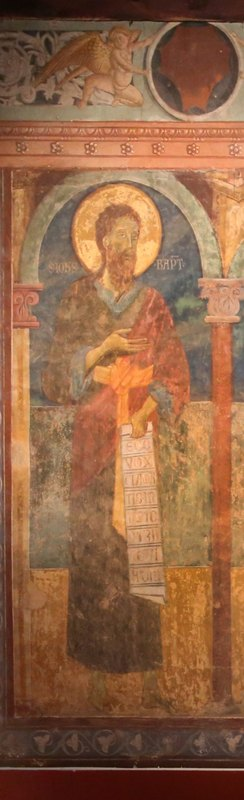
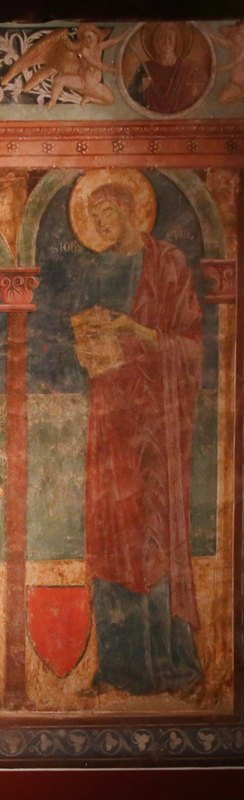
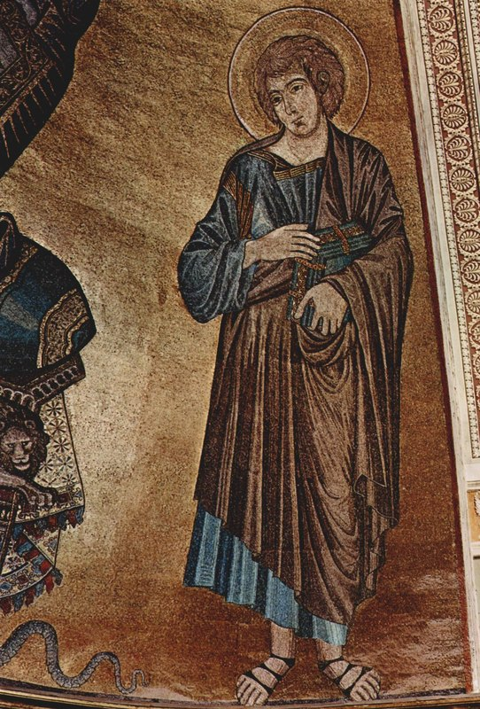

## A Painter Known from Documents

*Giovanni d'Apparecchiato*, called Nuccolo, was a painter from Lucca who lived and worked in Pisa around 1300. He is known from documents of 1299–1301: payments of the Opera del Duomo of Pisa, and the contract by which he and [Cimabue](/Content/Artists/XIII-c/Cimabue.html) undertook to paint the high altarpiece of the church of the hospital of Santa Chiara.

The contract names him *Johannes dictus Nuchulus pictor qui moratur pisis in cappella sancti nicoli et filius apparecchiati de Luca*: Giovanni called Nuccolo, painter, who lives in Pisa in the parish of San Nicola, son of Apparecchiato of Lucca. Apparecchiato is therefore his father's name. The document calls Cimabue the son of the late Pepo, but does not say that Giovanni's father was dead.

The documents of the Opera record that on 24 December 1299 Nuccolo and Vincino da Pistoia were paid for painting the lower part of the roof of the Camposanto and a Madonna and Child between Saint John the Baptist and Saint John the Evangelist. In 1300 Giovanni was paid for a Madonna and Child for the door of the Camposanto.

A fresco with that subject survives in the Palazzo dell'Opera della Primaziale, facing the Piazza del Duomo, and has been attributed to the two painters. [Silvia Marcheselli](/scholars.html#marcheselli-silvia) stresses that the identification is not certain: it rests on the correspondence of the subject, and assumes that the fresco was moved from the Camposanto, a move that no document records.

On 1 November 1301 Giovanni and Cimabue contracted to paint, within a year, a panel with columns, tabernacles and a predella for the high altar of Santo Spirito in the church of Santa Chiara, for 105 lire of Pisan pennies. On 5 November they received the first 40 lire. The altarpiece is lost.

The previous version of this entry was more than 18,000 words long, and most of it was invented: a wealthy family, a long apprenticeship, exile from Lucca, guild membership, the absence of his name from the tax registers. It said that the documents preserve no patronymic, although his name contains one, listed Offner, Meiss and Longhi as his scholars without any reference, and linked the editor of the contract to a fifteenth-century Paduan engineer of the same name.

The first rewriting of this entry corrected those errors but, without the text of the contract, it omitted details that the contract does contain: the dedication of the altar to the Holy Spirit and the cross of gilded silver in the central tabernacle. It also called Vincino "di Vanni", whereas the documents identify him as Vincino di Giovanni da Pistoia. The present version rests on the study and the documentary appendix published by Marcheselli in 2024.

The account that follows treats the payments of 1299–1300 and the fresco, the hospital of Santa Chiara and the contract of 1301, and the circle of painters around Pisa cathedral. The catalogue examines the fresco and its three figures, the lost altarpiece, and Cimabue's Saint John in the cathedral apse.

## The Payments of 1299 and 1300 and the Fresco

The Opera del Duomo of Pisa, the board that administered the cathedral, the Baptistery and the Camposanto, kept registers of its payments. Those of 1299 and 1300, now in the Archivio di Stato di Pisa, were published in 1897 by Leopoldo Tanfani Centofanti and record Giovanni's work for the Opera.

On 11 June 1299 the Opera paid Vincino da Pistoia, a painter later identified with Vincino di Giovanni da Pistoia, active in Pisa until 1340. On 24 December 1299 it paid Nuccolo and Vincino for painting the lower part of the roof of the Camposanto and a Madonna and Child between Saint John the Baptist and Saint John the Evangelist.

In 1300 Giovanni d'Apparecchiato was paid for a Madonna and Child for the door of the Camposanto. The three payments show him working for the Opera, alone or with Vincino, on the decoration of the monumental cemetery then under construction beside the cathedral.

The fresco now in the Palazzo dell'Opera shows the Madonna and Child enthroned between the two Saints John under three arches. Antonino Caleca, in 1979, attributed it to Giovanni and Vincino because its subject corresponds to the payment of December 1299, and Enzo Carli, in 1994, supposed that it had been moved from the Camposanto to its present place.

Marcheselli considers this a hypothesis still to be tested. The subject is a common one, and no document records the removal of the fresco from the Camposanto. The fresco is therefore an attributed work, not a documented one.

The attribution had already appeared earlier: [Igino Benvenuto Supino](/scholars.html#supino-igino-benvenuto), in *Arte pisana* (1904), recorded Giovanni's work in the Opera. The fresco is published on Wikimedia Commons under the names of Vincino and Giovanni and the date 1299.

Marcheselli also notes a feature of the fresco relevant to the history of the altarpiece: the three figures stand under separate arches divided by columns. It is the arrangement that the contract of 1301 would describe with the word *colonnellis*, the small columns dividing the compartments of a panel.

The roof of the Camposanto and the Madonna for its door are lost. If the attribution of the fresco is correct, it is the only surviving trace of Giovanni's hand, painted with a partner whose share cannot be separated from his own.

## The Hospital of Santa Chiara and the Contract of 1301

The hospital of Santa Chiara was founded at Pentecost 1257, after a procession from the church of San Francesco, on the initiative of Pope Alexander IV, who entrusted the foundation to the Franciscan friar Mansueto. It stood near the Piazza del Duomo and became the principal hospital of Pisa.

Its church had a high altar dedicated to the Holy Spirit. Marcheselli connects the dedication with the foundation at Pentecost, commemorated every year with a solemn mass at which the rectors of the dependent hospitals offered a candle, and with the indulgences granted for the feast.

From 1287 to his death in 1319 the hospital was governed by frate Enrico del fu Anginetto, its *magister*. He commissioned at least two polyptychs for the church, in 1301 and 1305, and in 1306 asked Fra Nicola to write the history of the foundation. His patronage aimed to affirm the prestige of the hospital beside the cathedral.

On 1 November 1301, in the hospital, Cimabue, *Magister Cenni dictus Cimabu pictor condam Pepi de Florentia*, of the parish of Sant'Ambrogio in Florence, and Giovanni called Nuccolo bound themselves jointly to paint with their own hands, within a year, a panel for the high altar of Santo Spirito.

The panel was to have *colonnellis, tabernaculis et predula*, small columns, tabernacles and a predella, and to show the majesty of the Virgin, the apostles, angels and other figures as the master of the hospital should decide. A cross of gilded silver was to be placed in the central tabernacle.

The images of the Virgin, the apostles and the saints, in the columns, the predella and the main fields, were to be made with good, pure florin gold; the parts above the columns, in the tabernacles, with the angels, were to be made with good gilded silver. The panel was to be as long as the altar and as high as the master should decide.

The painters were to install the panel at their own expense, fixed firmly on the altar. The price was 105 lire of Pisan pennies: 40 within a month, the rest at the end of the year or at completion, with a penalty of double the price for default. On 5 November 1301 they acknowledged receipt of the first 40 lire.

The contract was published by G. Fontana in *Due documenti inediti riguardanti Cimabue* (1878) and by [Luciano Bellosi](/scholars.html#bellosi-luciano) in his monograph on Cimabue (1998). It is the first known document of an altarpiece with a predella, and the reconstructions proposed for it differ widely, from a single register with gables to a structure of several registers.

## Cimabue, Vincino and the Painters of the Cathedral

Cimabue was in Pisa in 1301 for the apse mosaic of the cathedral. The documents of the Opera record him there between 2 September 1301 and 19 February 1302, succeeding a master Francesco, chiefly for the figure of Saint John the Evangelist. He had already painted the Maestà for the church of San Francesco in Pisa, to which the hospital was linked.

The contract of Santa Chiara was made during these months. Marcheselli observes that Cimabue and Nuccolo must already have enjoyed some reputation in Pisa, and that their collaboration is not surprising: both worked for the cathedral works, and their paths had probably crossed there.

Vincino da Pistoia, Giovanni's partner in 1299, completed the apse mosaic in 1320, according to an inscription reported by Vasari. The three painters belonged to the same network of artists, mostly from neighbouring cities, who worked for the cathedral and from there for the other churches of Pisa.

The network included Vanni di Bindo, called Piastra, a painter from Siena who in 1305 received from frate Enrico the commission for a second polyptych for Santa Chiara, *cum colonnellis et bredula*, with five saints. His contract asked for a panel *ad modum tabule*, after the model of an existing one, perhaps the altarpiece of Cimabue and Nuccolo.

It also included Cagnasso, who had worked with Cimabue on the mosaics of the cathedral and in 1309 rented a workshop with Vanni di Bindo. These contacts show how ideas and forms passed between the painters of the cathedral and those of the hospital.

Marcheselli argues that frate Enrico, by turning to the painters of the cathedral, encouraged the experiments with the polyptych that were then under way in Pisa. The contracts of 1301 and 1305 record two of the earliest of these experiments.

A third polyptych for the church of Santa Chiara, commissioned in 1402 from Giovanni di Pietro da Napoli and Martino di Bartolomeo, survives in the Museo Nazionale di San Matteo. Its contract replaced the cross of 1301 with a Trinity, and named the apostles for the predella, perhaps following the earlier altarpiece.

Of Giovanni d'Apparecchiato nothing is known after November 1301. Whether he completed the altarpiece with Cimabue, who is not recorded after 1302, cannot be said.

## Catalogue Entry

### The Madonna and Child between the Two Saints John

<figure>
  
  <figcaption>Vincino da Pistoia and Giovanni d'Apparecchiato (attributed), Madonna and Child between Saint John the Baptist and Saint John the Evangelist, probably 1299, fresco. Pisa, Palazzo dell'Opera della Primaziale. Photo: Sailko, <a href="https://creativecommons.org/licenses/by/3.0/">CC BY 3.0</a>, via Wikimedia Commons.</figcaption>
</figure>

The fresco shows three figures under three round arches carried on red columns with foliate capitals. The arches stand against a dark blue ground, and below them a lower field of green and ochre suggests a wall behind the figures. A border of grey leaf ornament encloses the scene.

At the centre the Virgin sits on a throne holding the Child; at the left stands Saint John the Baptist, at the right Saint John the Evangelist. Each figure occupies its own bay, as in the compartments of an altarpiece.

The fresco is in the Palazzo dell'Opera della Primaziale, the building of the cathedral works on the Piazza del Duomo. Above it, a later painted frieze with winged putti, scrolls of foliage and roundels shows that it was incorporated into a subsequent decoration of the room.

Its attribution rests on a payment of 24 December 1299, when the Opera paid Nuccolo and Vincino da Pistoia for a Madonna and Child between Saint John the Baptist and Saint John the Evangelist, together with the painting of the lower part of the roof of the Camposanto.

Caleca (1979) identified the fresco with the painting of the payment; Carli (1994) supposed that it had been moved from the Camposanto. Marcheselli regards both points as hypotheses still to be tested, since the subject is common and no document records the move.

The division of work between Vincino and Giovanni, if both painted it, cannot be established. The three figures share a single design, and no source assigns any part of the fresco to one painter or the other.

Marcheselli notes the arrangement of the figures under separate arches divided by columns. It anticipates the structure that the contract of 1301 would describe, with *colonnellis* dividing the compartments of the altarpiece of Santa Chiara.

The fresco has suffered losses, especially in the lower part of the Virgin's mantle and in the ground of the side bays, and its colours are faded. The faces, the haloes, the inscriptions and the architecture remain legible.

### The Virgin and Child

<figure>
  
  <figcaption>Vincino da Pistoia and Giovanni d'Apparecchiato (attributed), Madonna and Child between the two Saints John, the Virgin and Child. Pisa, Palazzo dell'Opera della Primaziale. Photo: Sailko, <a href="https://creativecommons.org/licenses/by/3.0/">CC BY 3.0</a>, via Wikimedia Commons (detail).</figcaption>
</figure>

The Virgin sits in the central bay on a wooden throne with a yellow cushion, whose ends project at the sides. She wears a dark blue mantle over a white veil, and her head, under a large gilded halo, inclines towards her son.

The Child sits on her left arm in a red tunic and mantle. He turns towards his mother and reaches for her face with one hand, while holding a scroll in the other; the Virgin supports him with both hands.

The gesture of the Child reaching for his mother's face belongs to the Byzantine type of the Virgin of tenderness, widespread in Tuscan painting of the thirteenth century. It gives the central group a note of feeling within the symmetrical composition.

The Greek letters MP ΘY, the abbreviation of Mother of God, stand at either side of the Virgin's halo. They are a convention of the Byzantine icon, retained in Tuscan painting long after Latin had replaced Greek in the other inscriptions.

The Virgin's face is long, with almond eyes, a long thin nose and a small mouth, modelled in pale ochre with green shadows. Her white veil falls in soft folds over her shoulders, painted with lighter strokes over a grey ground.

The mantle is the most damaged part of the fresco. Its blue has largely worn away in the lower part, exposing the underlying layers, and the contours of the knees and the feet are hard to read.

The throne is drawn as a flat frame without depth, and the figure does not sit within a defined space. The arch and the columns, more than the throne, give the image its structure.

The detail shows the qualities and the limits of the painting: a sensitive treatment of the faces and the gesture, within a design still bound to the conventions of the Byzantine image.

### Saint John the Baptist

<figure>
  
  <figcaption>Vincino da Pistoia and Giovanni d'Apparecchiato (attributed), Madonna and Child between the two Saints John, Saint John the Baptist. Pisa, Palazzo dell'Opera della Primaziale. Photo: Sailko, <a href="https://creativecommons.org/licenses/by/3.0/">CC BY 3.0</a>, via Wikimedia Commons (detail).</figcaption>
</figure>

Saint John the Baptist stands in the left bay under a round arch. He is bearded, with long dark hair, and wears a garment of fur under a red mantle knotted at the waist with an orange tie. His name is written beside his head: S. IOHS BAPT.

He raises his right hand to his breast and holds with his left an unrolled scroll. The scroll carries in capitals the words EGO VOX CLAMANTIS IN DESERTO, "I am the voice of one crying in the wilderness", his answer to the priests in the Gospel of John.

The Baptist was a patron of Florence and of the Baptistery of Pisa, which stands on the same square as the Palazzo dell'Opera. His presence in a painting for the cathedral works is natural.

His face is the most strongly characterised of the fresco: a long head, a thick beard falling to the chest, deep-set eyes under heavy brows. The ascetic type of the prophet of the desert is rendered with the conventions of Byzantine painting.

The fur garment is painted in brown and dark green, its texture suggested by short strokes. Over it the red mantle falls in broad folds from the left shoulder, crossed by the orange knot at the waist.

The scroll is the most legible element of the fresco. Its letters, in a rounded Gothic capital, are set in lines across the white surface, which hangs straight down from the Baptist's hand like a strip of parchment.

The lower part of the figure is darkened and worn, and the feet are barely visible. The column at the right of the bay, with its foliate capital, is well preserved.

The Baptist, with his heavier forms and stronger features, is the most monumental figure of the fresco. His scroll addresses the viewer directly, as a call to the penitence of which the saint was the herald.

### Saint John the Evangelist

<figure>
  
  <figcaption>Vincino da Pistoia and Giovanni d'Apparecchiato (attributed), Madonna and Child between the two Saints John, Saint John the Evangelist. Pisa, Palazzo dell'Opera della Primaziale. Photo: Sailko, <a href="https://creativecommons.org/licenses/by/3.0/">CC BY 3.0</a>, via Wikimedia Commons (detail).</figcaption>
</figure>

Saint John the Evangelist stands in the right bay under a round arch. He is young and beardless, with short hair, and inclines his head to the left, towards the Virgin. His name is written beside his halo: S. IOHS EVG.

He wears a long red mantle over a blue tunic, the mantle drawn over his left shoulder and falling in long vertical folds to the ground. He holds a closed book with both hands against his breast, the attribute of the author of the Gospel.

The figure is the most elongated of the fresco, a tall, thin silhouette within the narrow bay. Its proportions, and the inclination of the head, give it an air of gentle melancholy.

The face is painted in pale ochre, with a long nose and a small mouth, and the eyes look down. It recalls the youthful saints of Lucchese painting of the late thirteenth century, a tradition in which Giovanni, a painter from Lucca, was formed.

Beside the Evangelist's feet a red shield is painted on the ground of the bay. It has no visible charge; the arms of an officer of the Opera or of a donor may have been painted on it and lost.

Above the fresco, the later frieze shows a winged putto and a roundel with a half-length figure. The frieze belongs to a subsequent decoration of the room, which framed the fresco as a venerable image.

The Evangelist of the fresco may be compared with Cimabue's Saint John in the apse of the cathedral, made in the months of the contract of 1301. Both are young saints with a book, but Cimabue's figure turns in space and carries the weight of its drapery in depth.

The comparison measures the distance between the local painting of Pisa and Lucca and the art of the Florentine master with whom Giovanni contracted two years later.

### The Altarpiece of Santa Chiara (lost)

The altarpiece contracted on 1 November 1301 for the high altar of Santo Spirito in the church of Santa Chiara is lost. It is known from the contract and the receipt of 5 November, preserved in the Archivio di Stato di Pisa among the acts of the notary Giovanni di Bonagiunta di Galeone.

Cimabue and Giovanni bound themselves jointly to make it with their own hands within a year. Each was liable for the whole, and both renounced the privileges that might have protected them, as was usual in such contracts.

The panel was to be made *colonnellis, tabernaculis et predula*: with small columns, tabernacles and a predella. Its subject was the majesty of the Virgin, with the apostles, angels and other figures, as the master of the hospital should decide, and a cross of gilded silver in the central tabernacle.

The contract distinguished two zones by their materials. The images in the columns, the predella and the main fields were to be made with florin gold; the upper parts, in the tabernacles, with the angels, with gilded silver. The length of the panel was fixed by the altar, its height left to the master.

Marcheselli reviews the reconstructions proposed for the altarpiece. The tabernacles may have been gables over the compartments, or a separate upper register; the angels may have stood in the gables or in pinnacles; the number of compartments is not stated.

She also shows that the dedication of the altar to the Holy Spirit explains the iconography. The apostles, witnesses of Pentecost, recur in the contract of 1402 for the same altar, where the cross of 1301 was replaced by a Trinity.

Whether the altarpiece was completed is not known. Cimabue is last recorded in February 1302, and no later document mentions the panel. In 1305, however, frate Enrico asked Vanni di Bindo for a polyptych *ad modum tabule*, perhaps after the model of the panel already on the high altar.

The previous version of this entry described the altarpiece at length, calling frate Enrico a papal rector. He was the *magister* of the hospital, and the contract, now available in Marcheselli's appendix, gives the details summarised here.

### Comparison: Cimabue, Saint John the Evangelist in the Apse of Pisa Cathedral

<figure>
  
  <figcaption>Cimabue, Saint John the Evangelist, 1301–1302, mosaic. Pisa, cathedral, apse. Photo: The Yorck Project, public domain, via Wikimedia Commons.</figcaption>
</figure>

The apse of Pisa cathedral is decorated with a mosaic of Christ enthroned between the Virgin and Saint John the Evangelist. The documents of the Opera record Cimabue on this work between 2 September 1301 and 19 February 1302, chiefly for the figure of Saint John.

The Evangelist stands on the gold ground at the right of the throne. He is young, with curly hair, and inclines his head; he holds a closed book with both hands against his body. His brown mantle falls over a blue tunic in heavy folds to his sandalled feet.

The figure was made during the same months as the contract of Santa Chiara. It shows the art of the master with whom Giovanni bound himself in November 1301.

The comparison with the Evangelist of the fresco in the Palazzo dell'Opera is instructive. Both are young saints with a book; but Cimabue's figure turns in space, its weight carried on one leg, its drapery modelled in depth.

Cimabue's face, with its melancholy expression and soft modelling, has a humanity that the flatter faces of the fresco do not reach. It shows the conception of the figure that the master had developed in Florence and Assisi.

The mosaic was begun before Cimabue by a master Francesco and completed in 1320 by Vincino da Pistoia, Giovanni's partner of 1299, according to an inscription reported by Vasari. The apse thus joins the names of the three painters.

At the left of the mosaic part of the throne of Christ appears, with a lion, and at the foot a serpent, symbols of the evil overcome by Christ. They belong to the larger composition of the apse.

The mosaic gives the measure of the collaboration of 1301: the most celebrated painter of his generation, at the end of his career, and a painter from Lucca who worked for the cathedral works and for the hospital beside them.
