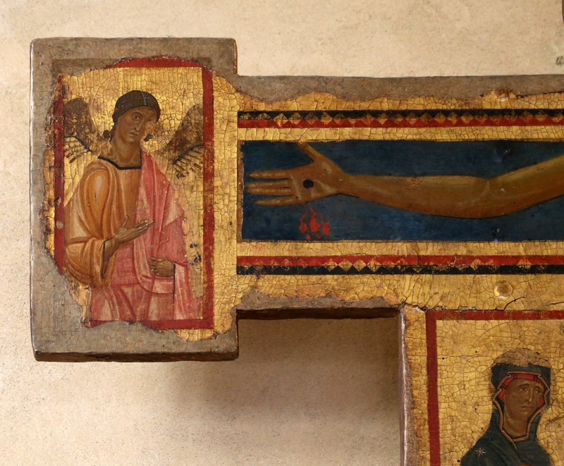
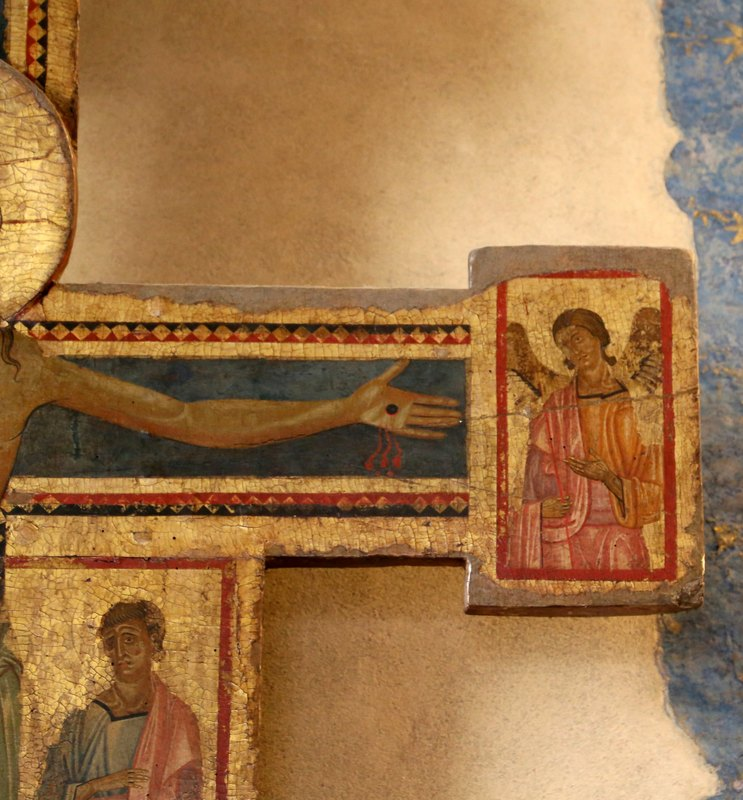
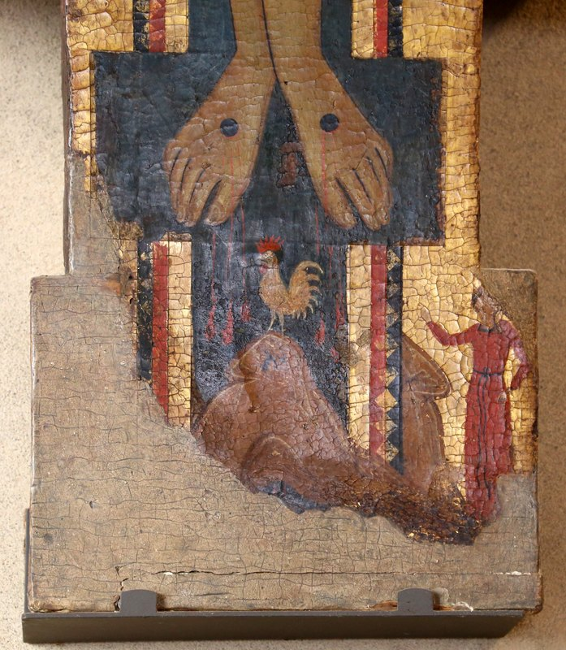
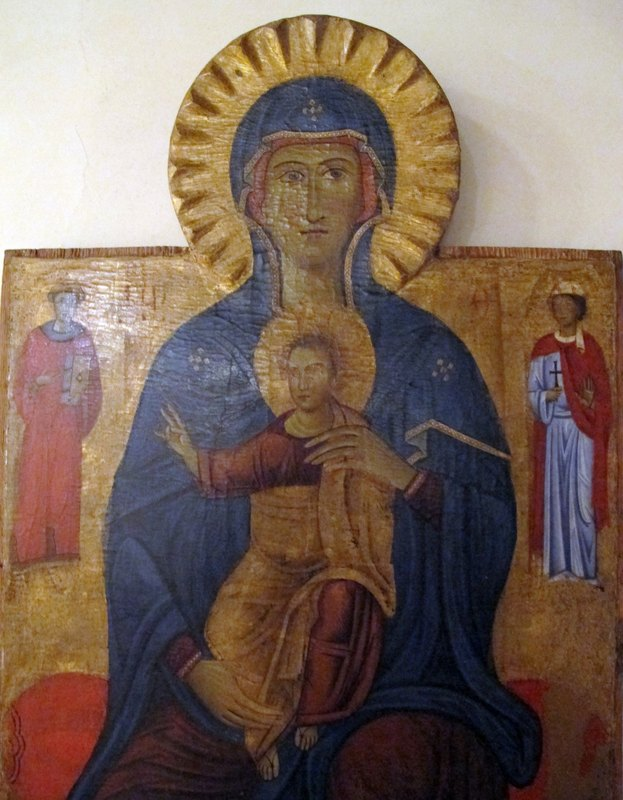
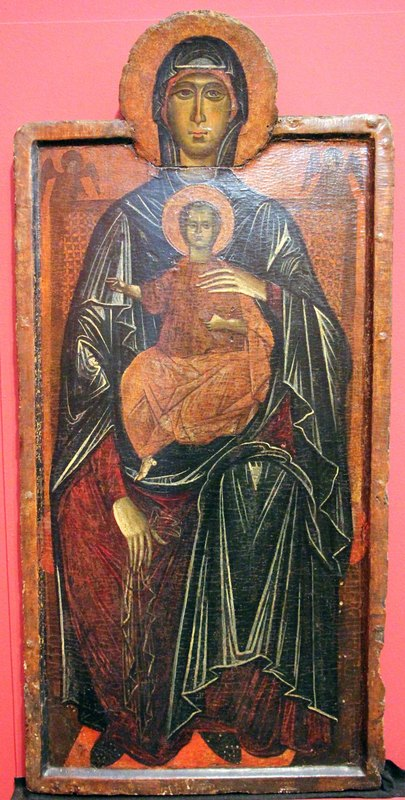

## A Painter Named after a Crucifix

The *Maestro del Bigallo* is the conventional name of an anonymous Florentine painter of the first half of the thirteenth century. The name comes from a painted crucifix kept in the Museo del Bigallo in Florence, which [Richard Offner](/scholars.html#offner-richard) recognised as the work of a distinct personality and made the starting point of his corpus.

No document records his name, his family or his workshop. His activity is known only from a small group of works linked by style: two painted crosses in Florence and Rome, a third in Chicago, the dossal of San Zanobi in the Museo dell'Opera del Duomo, and Madonnas at Fiesole and Certaldo.

The national catalogue gives his activity as 1225–1265. The works themselves are dated by scholars between about 1215–1220, for the earliest Madonna, and about 1245, for the cross in Chicago. These dates rest on style and are not fixed by documents.

He is one of the first Florentine painters whose works can be grouped around a single hand. The repetition of the same scheme in his crosses suggests an organised workshop, producing images for the churches and confraternities of the city before the generation of Coppo di Marcovaldo and Cimabue.

The previous version of this entry was much longer and contained many errors. It devoted almost half its length to the history of the Compagnia del Bigallo, a confraternity founded in the 1240s, as if the painter had worked for it. It invented a family workshop of fathers and sons and listed among his patrons an archbishop of Florence, although Florence became an archbishopric only in 1419.

It gave the Bigallo crucifix the dimensions of the cross in Chicago, described the dossal of San Zanobi with scenes and details that are not in it, and said that the Madonna in São Paulo came from the Matarazzo collection in the 1950s, when it was given to the museum by Pietro Maria Bardi in 1992. Its captions had no credits.

The account that follows treats the name and the corpus, the painted crosses, the Madonnas, the dossal of San Zanobi, the style of the painter and his place in Florentine painting. The catalogue examines the Bigallo crucifix in detail, the dossal, the crosses of Rome and Chicago, the Madonnas of Fiesole, Certaldo and the Uffizi, and the Madonna attributed to him in São Paulo.

The works are illustrated by photographs published on Wikimedia Commons and by the Art Institute of Chicago under free licences.

## The Name and the Corpus

The crucifix that gives the painter his name comes from the oratory of the Bigallo, the small building on Piazza San Giovanni opposite the Baptistery, and is now in the museum installed there. The national catalogue gives its dimensions as 179 by 121 centimetres and dates it to the second quarter of the thirteenth century.

Offner first grouped other works around it and in 1933 coined the name Bigallo Master. His attribution was accepted by Sinibaldi, by [Roberto Longhi](/scholars.html#longhi-roberto) and by [Bernard Berenson](/scholars.html#berenson-bernard), and the cross had already been discussed by [Osvald Sirén](/scholars.html#siren-osvald) in 1922.

The name refers to the place, not to a patron. The Compagnia del Bigallo, from which the building takes its name, was a lay confraternity founded in the middle of the thirteenth century; there is no evidence that the painter worked for it, or that the crucifix was made for its oratory rather than brought there.

[Edward B. Garrison](/scholars.html#garrison-edward) catalogued the works of the master in his *Italian Romanesque Panel Painting* (1949). [Angelo Tartuferi](/scholars.html#tartuferi-angelo) discussed him in *La pittura a Firenze nel Duecento* (1990) and devoted to him a monograph, *Il Maestro del Bigallo e la pittura della prima metà del Duecento agli Uffizi* (2007).

[Miklós Boskovits](/scholars.html#boskovits-miklos) treated him in the volume of the *Corpus of Florentine Painting* on the origins of Florentine painting, 1100–1270, published in 1993 with [Ada Labriola](/scholars.html#labriola-ada) and Tartuferi. His chronology places the dossal of San Zanobi about 1230 and makes it the earliest firmly established work.

The corpus accepted in the recent literature comprises the dossal of San Zanobi, the crosses of the Bigallo, Rome and Chicago, and two Madonnas, at Fiesole and Certaldo, the second attributed with caution because of its condition. To these is added the Madonna with two angels in the Uffizi, the starting point of Tartuferi's monograph of 2007. Other Madonnas have been placed in his group: one formerly in the Acton collection at Villa La Pietra, one in the museum of Nantes, one at the Conservatorio delle Montalve, La Quiete, near Florence, and one in São Paulo; several are heavily restored or repainted.

The sequence proposed in the literature begins with the Madonna of Fiesole, about 1215–1220, continues with the dossal and the Bigallo crucifix, about 1230, and the Madonna of Certaldo in the later 1230s, and ends with the Chicago crucifix, about 1240. The span suggests a career of some twenty-five years.

The national catalogue's dates of activity, 1225–1265, reach further. They reflect the wider limits proposed for some works, such as the dating of the dossal to 1240–1250, rather than any documented work of the 1250s or 1260s.

## The Painted Crosses

The three crosses of the Bigallo, Rome and Chicago follow a single scheme. At the top a roundel holds the bust of Christ; below it a rectangular field shows the Virgin with raised hands between two angels; the letters IC XC stand above the head of the crucified Christ.

At the ends of the arms, two angels stand in rectangular terminals. Beside the body of Christ, in the broad side panels of the cross, stand the Virgin and Saint John. At the foot, on a rocky mound, stands a cock, and beside it the figure of Saint Peter, recalling his denial.

The scheme derives from the painted crosses of Lucca, above all those of Berlinghiero, which the Florentine painter knew. But the Lucchese crosses fill the side panels with scenes of the Passion; the Maestro del Bigallo replaces them with the two large mourners, giving the cross a simpler, more monumental structure.

In the crosses of the Bigallo and Rome, Christ is alive, with open eyes and an upright body: the type of the *Christus triumphans*, the living Christ who triumphs over death. In the Chicago cross Christ is dead, with closed eyes and bowed head: the *Christus patiens*, which was spreading in central Italy from the work of Giunta Pisano.

The change of type in Chicago is one of the reasons for placing that cross last in the sequence. The Art Institute dates it about 1240, between 1235 and 1245, and describes it as the painter's latest known work.

The cock at the foot is the most distinctive motif of the group. It recalls the words of Christ to Peter, that before the cock crowed he would deny him three times, and the repentance of the apostle. The national catalogue notes that some scholars have connected the motif with the confraternity of the Bigallo, but it appears on all three crosses.

The crosses are of moderate size, between about one and a half and two metres high. They were probably made for altars or for the walls of churches and oratories rather than for the great rood beams of cathedrals, and their repetition suggests a demand that a workshop could meet with a standard model.

The faces of the three Christs, the type of the angels and the mourners, and the ornament of the borders, with their rows of red and black lozenges, are close enough to support a single workshop, and different enough to show the hand of the master developing over time.

## The Madonnas

The Madonnas of the Maestro del Bigallo belong to the type of the enthroned Virgin holding the Child, the *Maestà*, which was the principal devotional image of thirteenth-century Tuscany. They are tall panels with a projecting halo at the top, a form that gives the head of the Virgin a monumental presence.

The Madonna of Fiesole cathedral is the earliest work proposed for the master, about 1215–1220. The Virgin, in a dark blue mantle sown with stars, holds the Child, who blesses and holds a scroll. Her large head, with its wide eyes and long nose, projects into the halo above the panel.

The Madonna from Santa Maria a Bagnano, now in the Museo di Arte Sacra of Certaldo, shows the Virgin enthroned between two small standing saints. It is placed in the later 1230s, and its attribution is cautious because the lower part of the panel is largely lost.

The Madonna with two angels in the Uffizi, dated about 1230, shows the Virgin enthroned on a cushioned throne, in a red mantle over a blue dress, with two angels flying towards her. The Child wears a garment shot with gold lines, in the Byzantine manner of chrysography.

The Madonna in São Paulo, given to the Museu de Arte by Pietro Maria Bardi in 1992, is attributed to the master by the museum but dated about 1275, a date beyond his known activity. The Madonnas formerly in the Acton collection and at Nantes, both heavily restored, and the Madonna of La Quiete, almost entirely repainted, complete the group.

These Madonnas show the master's dependence on Byzantine icons, especially in the frontal Virgin with the Child on her lap, and his transformation of the icon into a large altar panel. The halo projecting above the panel, carved and gilded in relief, is one of the means by which he gave the image presence.

The differences between them are also marked. The Fiesole Madonna has heavy forms and a severe expression; the Certaldo Madonna, a lighter drawing and gilded highlights in the Child's robe; the Uffizi Madonna, the most elaborate throne and the most complete state of preservation. The group may include works of the workshop as well as of the master.

The Madonnas are the least secure part of his corpus, and the attributions of museums and collectors outside Florence should be read with that caution.

## The Dossal of San Zanobi

The dossal of San Zanobi, in the Museo dell'Opera del Duomo, is the most important work of the master and one of the most important Florentine paintings of the thirteenth century. It shows the bishop Zenobius enthroned between his deacons Eugenius and Crescentius, with four scenes of his miracles at the sides.

It was made for the altar over the relics of the saint in the crypt of Santa Reparata, the cathedral that preceded Santa Maria del Fiore. Its commission by the chapter of the cathedral places the master at the centre of the religious institutions of the city.

Boskovits dated it about 1230, within the episcopate of Giovanni da Velletri, who reconsecrated the altar; the Zeri and national catalogues place it in 1240–1250. On either reading it is one of the earliest examples of the hagiographic panel combining an image of the saint with scenes of his life.

The four scenes, identified in the national catalogue, show the pilgrim from France entrusting her son to the bishop, the raising of the dead boy, the raising of the messenger of Saint Ambrose and the freeing of a possessed boy. They are told in rows of figures against the gold.

A later inscription beside the throne claims that the panel was made from the wood of the elm that flowered when the saint's body passed, a tradition reflected in the title of the volume on its restoration, *Fatta dell'olmo della piazza*, edited by [Marco Ciatti](/scholars.html#ciatti-marco) in 2016.

The dossal is treated at length in the entry on [San Zanobi](/Content/Saints/San-Zanobi.html), where its scenes are illustrated in detail. In this entry it is discussed as a work of the master, for its place in his career and its style.

The panel's later history is unknown until the eighteenth century, when it was in the collection of the Marchese Tacoli Canacci at Parma. It passed to the Galleria Nazionale of Parma and returned to Florence in 1928.

The dossal shows the master as a narrative painter as well as a painter of crosses and icons. Its scenes have the same figure types as the crosses, with large eyes, long noses and simple outlines, and the same rows of standing figures.

## Style and Place in Florentine Painting

The style of the Maestro del Bigallo is founded on the Byzantine icon, transmitted to Tuscany through Lucca and Pisa. His figures are frontal and symmetrical, set against gold grounds; their faces have large almond eyes, long thin noses and small mouths; their draperies are drawn in firm lines with highlights in parallel strokes.

His closest model was the painting of Lucca, especially Berlinghiero and his workshop, whose crosses provided the scheme of his own. From Lucca he took the angels in the terminals, the Virgin between angels at the top and the ornament of the borders.

He simplified these models. His crosses have no narrative scenes; his figures are few and large; his colours are limited to strong blues, reds and greens on gold. The effect is of clarity and order rather than of richness.

His flesh tones are dark and olive, modelled with darker shadows and few highlights. The faces of his Christs, with their long noses and narrow eyes, have a melancholy expression that distinguishes them from the more serene Lucchese types.

The change from the living Christ of the Bigallo and Rome to the dead Christ of Chicago shows the master responding to the new type introduced by Giunta Pisano. In Chicago the body curves slightly, the head falls on the shoulder and the eyes are closed.

His workshop produced works for Florence and its territory, from the cathedral to the parish churches of the Valdelsa. The number of surviving crosses on the same model points to a production organised to meet a growing demand for images in the city.

In Florentine painting he stands before Coppo di Marcovaldo and Cimabue, in the decades when the city was beginning to develop its own school. His works show that Florence already had, in the 1230s, painters capable of large altar panels and monumental crosses.

The anonymity of the master, and the uncertainty of his dates, make him a construction of modern scholarship. But the coherence of the crosses, the dossal and the Madonnas gives that construction a solid basis, and his works remain among the earliest monuments of Florentine panel painting.

## Catalogue Entry

### The Crucifix of the Bigallo

<figure>
  
  <figcaption>Maestro del Bigallo, painted crucifix, c. 1225–1249, tempera and gold on panel, 179 × 121 cm. Florence, Museo del Bigallo. Photo: Sailko, <a href="https://creativecommons.org/licenses/by/3.0/">CC BY 3.0</a>, via Wikimedia Commons.</figcaption>
</figure>

The crucifix of the Bigallo is the work that gives the master his name. It hangs in the Museo del Bigallo on Piazza San Giovanni, in the building of the old confraternity, and comes from the oratory of the Bigallo.

The national catalogue gives its dimensions as 179 by 121 centimetres and dates it to the second quarter of the thirteenth century, 1225–1249. The recent literature places it in the first half of the 1230s, close to the dossal of San Zanobi.

The cross follows the scheme of the master's crosses: a roundel with Christ at the top, the Virgin between angels below it, angels in the terminals, the Virgin and Saint John beside the body, and the cock with Saint Peter at the foot.

Christ is alive, with open eyes and an upright body. His arms are stretched horizontally along a blue band bordered with lozenges, and blood falls in drops from the wounds of his hands. He wears a green loincloth knotted at the waist.

The national catalogue records the figures as Christ, the Virgin, Saint John the Evangelist, Saint Peter, God the Father and angels, and the inscription IC XC, the Greek abbreviation of the name of Jesus Christ, painted in capitals above his head.

The cross was restored in 1972 by Leonetto Tintori. The national catalogue judges its condition fair, with losses: the gold is crackled, the lower end of the foot is worn to the wood, and parts of the mourners' robes are lost.

It was exhibited at the Mostra Giottesca in Florence in 1937, and again at exhibitions of restored works in 1953 and 1972. The bibliography begins with Giovanni Poggi and Corrado Ricci in 1904 and includes Sirén, Van Marle, Toesca and Garrison.

The cross is the touchstone of the master's style. Its figure types, its ornament and its scheme recur in the crosses of Rome and Chicago and in the dossal of San Zanobi, and allowed Offner to group these works around a single hand.

### The Top of the Cross

<figure>
  
  <figcaption>Maestro del Bigallo, painted crucifix, the top with Christ, the Virgin and angels. Florence, Museo del Bigallo. Photo: Sailko, <a href="https://creativecommons.org/licenses/by/3.0/">CC BY 3.0</a>, via Wikimedia Commons (detail).</figcaption>
</figure>

The top of the cross is divided into two fields. Above, a roundel holds the bust of Christ, bearded, in a green mantle, holding a red book studded with gold. It is the image of Christ in glory, above the crucified Christ below.

The national catalogue identifies the figure as God the Father. Its type, bearded and holding a book, is that of Christ Pantocrator, and in the crosses of this period the figure in the roundel is usually read as Christ in majesty or ascending.

Below the roundel, in a rectangular field with a red border, the Virgin stands between two angels. She raises her hands in prayer, palms outward, in the gesture of the *orans*, and wears a blue-green mantle with a red head-band.

The two angels wear red cloaks over blue tunics and hold long staves. Their wings rise behind them in brown and gold. They turn towards the Virgin, framing her in a symmetrical group.

The group of the Virgin between angels at the top of the cross is derived from the crosses of Lucca. It has been read as the Ascension of the Virgin or as the Virgin interceding, and it completes the image of the Passion with an image of glory.

Below the field is a blue panel with the letters IC XC in white, flanked by bands of red and black lozenges, and the top of the gilded halo of the crucified Christ. The halo, marked with a red cross, is painted on a raised disc.

The paint is crackled throughout, and the gold has worn away in places to the bole. The left angel's wing is largely lost. The faces, with their long noses and dark eyes, are well preserved.

The detail shows the master's figure style at small scale: frontal faces with large eyes, simple outlines, draperies drawn with parallel lines, all set against the gold with a sharp red frame.

### The Angels of the Terminals

<figure>
  
  <figcaption>Maestro del Bigallo, painted crucifix, the left terminal with an angel. Florence, Museo del Bigallo. Photo: Sailko, <a href="https://creativecommons.org/licenses/by/3.0/">CC BY 3.0</a>, via Wikimedia Commons (detail).</figcaption>
</figure>

<figure>
  
  <figcaption>Maestro del Bigallo, painted crucifix, the right terminal with an angel. Florence, Museo del Bigallo. Photo: Sailko, <a href="https://creativecommons.org/licenses/by/3.0/">CC BY 3.0</a>, via Wikimedia Commons (detail).</figcaption>
</figure>

At the ends of the crossbar two angels stand in rectangular terminals framed in red. They are half-length figures, with wings rising behind their shoulders, wearing ochre tunics and pink cloaks.

The left angel raises his right hand to his breast and holds the other at his waist. The right angel holds a thin staff and raises his hand towards the body of Christ. Both turn their heads slightly towards the centre of the cross.

The angels in the terminals are a feature of the Lucchese crosses, where they often lament or gesture towards the crucified Christ. Here they are calm figures of witness, attending the Passion.

Between the terminals the arms of Christ stretch along a blue band bordered with red and black lozenges. His hands are open, pierced by nails, and blood falls from them in red drops onto the blue.

The arms are long and thin, drawn with a single smooth contour and modelled with a few darker shadows. Their horizontal line gives the cross its structure, and the open hands show the wounds frontally to the viewer.

The angels' faces have the master's characteristic type: an oval face, a long thin nose, large eyes under arched brows and a small mouth. Their hair is drawn in parallel waves held by a band.

The gold of the terminals is heavily crackled, and the wings of the left angel are partly lost. The pink of the cloaks has faded. The figures nevertheless keep their drawing and much of their colour.

The two details show the care with which the master painted the secondary figures of the cross, which were seen at a distance by the faithful but painted with the precision of a miniature.

### The Head of Christ

<figure>
  
  <figcaption>Maestro del Bigallo, painted crucifix, the head of Christ. Florence, Museo del Bigallo. Photo: Sailko, <a href="https://creativecommons.org/licenses/by/3.0/">CC BY 3.0</a>, via Wikimedia Commons (detail).</figcaption>
</figure>

The head of Christ is upright, set against a large gilded halo marked with a red cross. His eyes are open and look straight ahead, his mouth is closed, and his face shows no sign of suffering.

This is the type of the *Christus triumphans*, the living Christ on the cross, victorious over death. It was the traditional type of the Romanesque painted cross, before the dead Christ of Giunta Pisano spread through Tuscany.

The face is long and narrow, with an olive complexion. The nose is long and thin, the eyes large under arched brows, the mouth small and red. A short beard frames the chin, and long hair falls in strands over the shoulders.

The modelling is restrained: darker olive shadows along the nose and beneath the cheekbones, and a few lighter tones on the forehead and cheeks. The expression is grave and slightly melancholy rather than serene.

The chest is modelled in the same olive tones, with the ribs and the muscles of the abdomen indicated by soft curves. The body is upright and symmetrical, without the curve of the dead Christ.

The halo is painted on a separate raised disc fixed to the cross, a practice that gave it relief. Its gold is heavily crackled and worn, and a crack runs across it at the level of the neck.

Above the halo the blue panel with the letters IC XC is pierced by two holes, perhaps for the attachment of a metal ornament or a titulus. At the sides, the bands of lozenges frame the vertical arm.

The head is the clearest example of the master's facial type, which recurs in the angels, the mourners and the scenes of the dossal of San Zanobi, and which allowed scholars to attribute those works to the same hand.

### The Virgin and Saint John

<figure>
  
  <figcaption>Maestro del Bigallo, painted crucifix, the Virgin and Saint John. Florence, Museo del Bigallo. Photo: Sailko, <a href="https://creativecommons.org/licenses/by/3.0/">CC BY 3.0</a>, via Wikimedia Commons (detail).</figcaption>
</figure>

The Virgin and Saint John stand in the side panels of the cross, beside the body of Christ, on a gold ground framed in red. They are full-length figures, smaller than Christ but larger than the figures of the terminals.

The Virgin stands at the left in a dark blue mantle drawn over her head, with a red veil framing her face and a gold star on her shoulder. She raises one hand to her breast and extends the other towards Christ.

Saint John stands at the right, young and beardless, in a blue tunic and a pink cloak. He raises one hand to his breast and holds a fold of his cloak with the other. His head is slightly inclined, and his face has a sad expression.

Their gestures and expressions are restrained. The grief of the mourners is shown by the hand at the breast and the inclined head rather than by dramatic movements, in the manner of the Byzantine images of the Crucifixion.

Between them hangs the body of Christ, in a green loincloth knotted at the waist and striped in red and black at its edges. The loincloth falls to the knees in broad folds drawn with parallel lines.

The placing of the two mourners in the side panels replaces the scenes of the Passion that filled the side panels of the Lucchese crosses. It gives the cross a simpler composition and makes the mourners the principal witnesses of the Crucifixion.

The panels are damaged by losses that run across the Virgin's mantle and the lower part of John's robe, where the paint has flaked to the preparation. The faces and the upper parts of the figures are well preserved.

The detail shows the master's drawing of drapery: long folds traced in parallel lines, with lighter highlights on the ridges, giving the figures a slender, upright form.

### The Cock and Saint Peter

<figure>
  
  <figcaption>Maestro del Bigallo, painted crucifix, the foot with the cock of Peter's denial. Florence, Museo del Bigallo. Photo: Sailko, <a href="https://creativecommons.org/licenses/by/3.0/">CC BY 3.0</a>, via Wikimedia Commons (detail).</figcaption>
</figure>

The feet of Christ rest side by side on a dark blue panel, each pierced by its own nail. Blood runs from the wounds in thin red streams down the panel. The four nails, two in the hands and two in the feet, belong to the older type of the Crucifixion.

Below the feet, on a brown rocky mound, stands a cock with a red crest, crowing. The mound is the hill of Calvary, and the cock recalls the denial of Saint Peter, who denied Christ three times before the cock crowed.

At the right a small figure in a long red robe raises one arm. The national catalogue identifies him as Saint Peter. His gesture may express his grief or his repentance after the denial.

The left side of the foot is lost, and with it perhaps a second figure. The lower part of the cross is worn to the bare wood, a damage common in crosses that stood on altars or were handled.

The cock appears at the foot of all three crosses attributed to the master. It is a rare motif in the painted crosses of this period, and it is one of the signs of his workshop.

The national catalogue notes that the motif has been linked with the confraternity of the Bigallo. But its presence on the crosses of Rome and Chicago, which have no known connection with the Bigallo, makes it a feature of the master's iconography rather than a sign of a particular patron.

The motif carries a lesson of repentance. Peter, who denied Christ and wept, was the model of the sinner who returns to grace, and the image at the foot of the cross invited the faithful to follow his example.

The detail shows the master's narrative economy: a few elements, the feet, the blood, the mound, the cock and the apostle, set against the blue and gold, tell a whole episode of the Passion.

### The Dossal of San Zanobi

<figure>
  
  <figcaption>Maestro del Bigallo, dossal of San Zanobi with Saints Eugenius and Crescentius and four scenes, c. 1230–1250, tempera and gold on panel, 109 × 274 cm. Florence, Museo dell'Opera del Duomo, inv. 9152. Photo: Sailko, <a href="https://creativecommons.org/licenses/by/3.0/">CC BY 3.0</a>, via Wikimedia Commons.</figcaption>
</figure>

The dossal of San Zanobi is the master's principal work and the earliest securely placed. It is a long, low panel, 109 by 274 centimetres, showing the bishop enthroned between his deacons with four scenes of his miracles.

It was painted for the altar over the relics of Zenobius in the crypt of Santa Reparata. Boskovits dated it about 1230, within the episcopate of Giovanni da Velletri; the Zeri and national catalogues place it in 1240–1250.

At the centre Zenobius sits frontally on a wooden throne, an old man with a grey beard, in a white mitre and red cope, holding a crosier. His name is written beside his head in red letters. The deacons Eugenius and Crescentius stand at his sides with a book and a censer.

The four scenes at the sides, identified in the national catalogue, tell the miracle of the pilgrim's son in two episodes, the raising of the messenger of Saint Ambrose and the freeing of a possessed boy. They are set in red frames dotted with white.

The faces of the bishop and the deacons have the master's type: long noses, large eyes, small mouths. The figures of the scenes, standing in rows against the gold, repeat the figures of the crosses at a smaller scale.

A later inscription beside the throne claims that the panel was made from the wood of the elm that flowered at the passage of the saint's body. The restoration of the panel was published in 2016 in a volume edited by Marco Ciatti, *Fatta dell'olmo della piazza*.

The panel was in Parma from 1786, first in the collection of the Marchese Tacoli Canacci and then in the Galleria Nazionale, before returning to Florence in 1928. It is catalogued by Garrison (1949, no. 363) and discussed by Tartuferi (1990).

The dossal and its scenes are illustrated and discussed in detail in the entry on [San Zanobi](/Content/Saints/San-Zanobi.html).

### The Crucifix in Rome

<figure>
  
  <figcaption>Maestro del Bigallo, painted crucifix, tempera and gold on panel. Rome, Galleria Nazionale d'Arte Antica, Palazzo Barberini. Photo: Francesco Bini, <a href="https://creativecommons.org/licenses/by-sa/4.0/">CC BY-SA 4.0</a>, via Wikimedia Commons.</figcaption>
</figure>

The crucifix in the Galleria Nazionale d'Arte Antica at Palazzo Barberini in Rome is the closest of the master's works to the cross of the Bigallo. It repeats its scheme almost exactly, and its attribution to the same hand is generally accepted.

At the top a roundel holds the bust of Christ in a red tunic and blue mantle, blessing and holding a scroll. Below, the Virgin raises her hands between two angels. The letters IC XC stand on a blue panel above the head of Christ.

Christ is alive, with open eyes, his body upright and his arms stretched along a blue band. He wears a green loincloth knotted at the waist with red and black stripes, like the Christ of the Bigallo. His face, with a dark beard, is fuller and more strongly modelled.

In the terminals two angels in pink and green turn towards the centre. Beside the body stand the Virgin, in a dark red mantle over a blue dress, and Saint John, in a bright red cloak, both raising a hand. Their names are written above them.

At the foot the feet of Christ are nailed side by side on a blue panel. Below, on a red mound, stands the cock, between two small figures, one at each side, one of whom must be Saint Peter, as on the cross of the Bigallo.

The cross is better preserved than that of the Bigallo. Its gold is bright, its colours strong and its foot complete. It shows how the Bigallo cross must have looked before its losses.

The Rome cross is evidence of the repetition of models in the master's workshop. Its composition is so close to that of the Bigallo that the two may have been painted from the same design, with variations in colour and in the details of the faces.

The history of the cross before it entered the Roman collections is not known. Its presence in Rome shows that the works of the master, made for Florence and its territory, have been dispersed far from their place of origin.

### The Crucifix in Chicago

<figure>
  
  <figcaption>Maestro del Bigallo, painted crucifix, c. 1235–1245, tempera on panel, 191 × 127.2 cm. Chicago, The Art Institute of Chicago, A. A. Munger Collection, 1936.120. Photo: The Art Institute of Chicago, public domain (<a href="https://creativecommons.org/publicdomain/zero/1.0/">CC0</a>).</figcaption>
</figure>

The crucifix in the Art Institute of Chicago is the largest of the master's crosses, 191 by 127.2 centimetres. The museum dates it about 1240, between 1235 and 1245, and considers it his latest known work. It came to Chicago with the A. A. Munger Collection.

The scheme is the same as in Florence and Rome: Christ in a roundel at the top, the Virgin between angels below it, the letters IC XC, angels in the terminals, the Virgin and Saint John beside the body, and, at the foot, the cock of Peter's denial.

The difference is in the figure of Christ. He is dead, with closed eyes and his head bowed onto his right shoulder; his body curves slightly to the side, and his abdomen is drawn with strong, almost geometric divisions. It is the type of the *Christus patiens*.

The suffering Christ had been introduced in central Italy by Giunta Pisano and was spreading through Tuscany in the 1230s and 1240s. Its adoption by the Maestro del Bigallo shows him following the new devotion to the Passion, linked with the preaching of the Franciscans.

The face of the dead Christ, with its long nose, heavy eyelids and drooping mouth, keeps the master's type, but gives it an expression of pain absent from the living Christs of Florence and Rome. The modelling of the body is darker and more emphatic.

The mourners stand in the side panels as in the other crosses. The Virgin, in dark blue, raises a hand to her breast; Saint John, in a pink cloak over a blue tunic, gestures towards Christ. The angels in the terminals wear pink and ochre.

The lower part of the cross is largely lost. Below the feet, only traces remain of the blue panel, the mound and the cock, which the museum mentions in its description, and the bare wood is visible over much of the foot.

The Chicago cross shows the master at the end of his known career, adapting his established scheme to a new image of Christ. The Art Institute publishes its image as public domain under its Open Access programme.

### The Madonna of Fiesole

<figure>
  
  <figcaption>Maestro del Bigallo (attributed), Madonna and Child, c. 1215–1220, tempera on panel. Fiesole, cathedral of San Romolo. Photo: Sailko, <a href="https://creativecommons.org/licenses/by/3.0/">CC BY 3.0</a>, via Wikimedia Commons.</figcaption>
</figure>

The Madonna in the cathedral of Fiesole is the earliest work attributed to the master, dated about 1215–1220. The attribution is tentative: the panel is placed by scholars slightly before the dossal of San Zanobi and the crosses.

The Virgin is shown to below the waist, seated, holding the Child on her lap. Her head projects into a large halo that forms the arched top of the panel, giving her a monumental presence.

She wears a dark blue mantle sown with white stars, on the head and the shoulders, over a red dress. The stars are the Byzantine sign of her virginity, before, during and after the birth of Christ.

Her face is pale and severe, with large dark eyes looking straight ahead, a long thin nose and a small red mouth. Her hands, with very long fingers, hold the Child at the side and below.

The Child sits on her lap in a brown robe over a red tunic. He raises his right hand in blessing and holds a scroll in his left. His head is large and his features adult, in the manner of the Byzantine Christ Emmanuel.

The image follows the Byzantine type of the Virgin Hodegetria, who presents the Child to the faithful, adapted to the format of a Tuscan altar panel. The severity of the forms and the heavy outlines distinguish it from the lighter figures of the master's later works.

The halo and the ground are worn, while the colours of the mantle and the dress keep their strength.

If the attribution is correct, the Madonna of Fiesole shows the master at the beginning of his career, working for the cathedral of the neighbouring diocese, before his commissions for the cathedral of Florence.

### The Madonna of Certaldo

<figure>
  
  <figcaption>Maestro del Bigallo (attributed), Madonna and Child enthroned with two saints, later 1230s, tempera and gold on panel. Certaldo, Museo di Arte Sacra, from Santa Maria a Bagnano. Photo: from A. Tartuferi, <i>Il Maestro del Bigallo e la pittura della prima metà del Duecento agli Uffizi</i>, Florence 2007, public domain, via Wikimedia Commons.</figcaption>
</figure>

<figure>
  
  <figcaption>Maestro del Bigallo (attributed), Madonna and Child enthroned with two saints, the upper part. Certaldo, Museo di Arte Sacra. Photo: Sailko, <a href="https://creativecommons.org/licenses/by-sa/3.0/">CC BY-SA 3.0</a>, via Wikimedia Commons (detail).</figcaption>
</figure>

The Madonna from the church of Santa Maria a Bagnano, now in the Museo di Arte Sacra of Certaldo, is attributed to the master and placed in the later 1230s. The attribution is made with caution because of the panel's poor condition.

The Virgin sits enthroned on a throne with red cushions, holding the Child on her lap. Her head projects into a large halo with radiating ridges, carved in relief and gilded, which forms the arched top of the panel.

She wears a blue mantle sown with small gold crosses, over a red veil. Her face is pale and grave, with large eyes, a long nose and a small mouth. Her hand holds the Child at the shoulder.

The Child, with a small gilded halo, blesses with his raised right hand. His robe is red, covered with a gold mantle whose folds are traced in fine gold lines, a technique that gives the figure a luminous surface.

At each side of the Virgin's head stands a small saint. At the left a deacon in red holds a book; at the right a young saint in white and red holds a small cross, the attribute of a martyr. Their identities are uncertain.

The lower half of the panel, with the Virgin's dress, the throne and the feet, is largely lost to the bare preparation. The Greek letters MP ΘY, Mother of God, are partly visible beside the Virgin's head.

The Madonna of Certaldo differs from that of Fiesole in its lighter forms, its finer gold highlights and the addition of the two saints. It shows the master developing the type of the Maestà in the years of the crosses.

The panel has been published by Rosanna Caterina Proto Pisani in her guide to the Museo di Arte Sacra at Certaldo (2001), and its attribution discussed by Tartuferi, from whose monograph of 2007 one of the photographs reproduced here is taken.

### The Madonna with Two Angels in the Uffizi

<figure>
  
  <figcaption>Maestro del Bigallo, Madonna and Child enthroned with two angels, c. 1230, tempera and gold on panel, 119.5 × 61 cm. Florence, Gallerie degli Uffizi, inv. 1890 n. 10301. Photo: Francesco Bini, <a href="https://creativecommons.org/licenses/by-sa/4.0/">CC BY-SA 4.0</a>, via Wikimedia Commons.</figcaption>
</figure>

The Madonna with two angels in the Gallerie degli Uffizi is the best preserved of the master's Madonnas. It is dated about 1230, measures 119.5 by 61 centimetres and bears the inventory number 10301 of the inventory of 1890. It hangs in the rooms of thirteenth-century painting.

The Virgin sits frontally on a throne with large red cushions and a carved base with rows of leaf ornament, her feet on a pink footstool. Her head projects into a large halo with radiating ridges, modelled in relief and gilded, which forms the arched top of the panel.

She wears a dark red mantle over a blue dress sown with small gold dots, and a blue and white head-band. Her face, with large eyes, a long straight nose and a small mouth, has the grave expression of the master's other Madonnas.

On her lap the Child blesses with his right hand and holds a scroll in his left. His robe is covered with fine gold lines, the Byzantine chrysography that turns the figure into a field of light. The Virgin holds his foot with her long-fingered hand.

At the upper corners two winged angels in pink and blue fly towards the Virgin with outstretched hands. Their long wings, drawn feather by feather in red and brown, and their flowing draperies are among the most refined passages of the master's painting.

The throne is the most elaborate of the group. Its cushions, its jewelled seat and its tiers of carved leaves recall the throne of the bishop in the dossal of San Zanobi, painted in the same years.

Its history is recorded in the catalogue of Christie's, where it was sold in London on 8 December 2005 with the same dimensions, 119.5 by 61 centimetres. It had belonged to the Florentine dealer Stefano Bardini, then to Charles Fairfax Murray; it passed through Joseph Duveen in New York about 1920 to the collector Carl W. Hamilton, and in 1945 to George R. Hann of Pittsburgh.

After the sale of the Hann collection at Christie's in New York in 1980 it was with Harari & Johns in London in 1989. Sirén published it in 1922 as the work of Barone Berlinghieri; Offner related it to the Bigallo crucifix. It is now in the Uffizi, and it is the subject of Tartuferi's monograph of 2007, *Il Maestro del Bigallo e la pittura della prima metà del Duecento agli Uffizi*. The "Madonna Bardini" of the previous version of this entry is this panel, named after its first known owner.

### The Madonna in São Paulo (disputed attribution)

<figure>
  
  <figcaption>Maestro del Bigallo (attributed), Madonna and Child enthroned with two angels, c. 1275, tempera on panel, 118.5 × 57 cm. São Paulo, Museu de Arte de São Paulo, MASP.01261. Photo: Sailko, <a href="https://creativecommons.org/licenses/by/3.0/">CC BY 3.0</a>, via Wikimedia Commons.</figcaption>
</figure>

The Museu de Arte de São Paulo (MASP) owns a Madonna and Child enthroned with two angels attributed to the Maestro del Bigallo. It is painted in tempera on panel, measures 118.5 by 57 centimetres and bears the inventory number MASP.01261.

The museum dates it about 1275. The painting belonged to Lina Bo Bardi and Pietro Maria Bardi, the founders of the museum, and Pietro Maria Bardi gave it to the MASP in 1992, in memory of his wife.

The previous version of this entry dated the panel 1261–1275, gave its dimensions as 130 by 56 centimetres and said that it came to the museum in the 1950s from the Matarazzo collection. These statements are not supported by the museum's record.

The date given by the museum is a difficulty. About 1275 lies beyond the known activity of the master, whose latest dated work, the Chicago crucifix, is placed about 1240. If the date is correct, the panel would be the work of a follower; if the attribution is correct, the date would have to be earlier.

The São Paulo panel is one of a group of Madonnas related to the master. The catalogue of the Fondazione Zeri records another, from the Acton collection at Villa La Pietra in Florence, 118 by 58.5 centimetres, dated 1245–1255 and catalogued by Garrison (no. 220) and Tartuferi (1990).

The catalogue of Christie's of 2005 lists the Acton, Nantes, La Quiete and São Paulo Madonnas as separate works of the group, noting that the Acton and Nantes panels are heavily restored and the La Quiete panel almost entirely repainted. The Acton and São Paulo panels, despite their similar dimensions, are therefore distinct paintings.

The photograph shows the panel exhibited against a red wall. The Virgin's mantle, dark blue with dense gold highlights, the Child's orange-red robe and the faint angels at the upper corners differ from the master's Madonnas in Florence, and support the doubts raised by the museum's late date.

The painting, whatever its date, shows the diffusion of the master's type of the Madonna with angels, and the dispersal of the early Florentine panels in the collections of the twentieth century, from Florence to Brazil.
