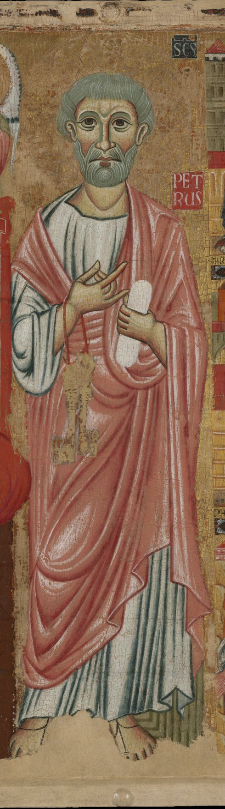

## A Name from New Haven

The Maestro del Dossale di Yale is an anonymous Florentine painter of the 1260s. His conventional name comes from a dossal in the Yale University Art Gallery in New Haven: a horizontal altarpiece with the Virgin nursing the Child, Saints Leonard and Peter, and six scenes from the life of Saint Peter. Nothing is known of him beyond the few works grouped around this panel.

The name is recent. It was given by [Pia Palladino](/scholars.html#palladino-pia) in the catalogue of the Italian paintings of the Yale University Art Gallery, where the dossal is attributed to the "Master of the Yale Dossal", a painter of the circle of Meliore. Until then the dossal had been counted for almost a century among the early works of the [Maestro della Maddalena](/Content/Artists/XIII-c/Maestro-della-Maddalena.html).

The Metropolitan Museum of Art and the Harvard Art Museums still catalogue their related panels under the name of the Magdalen Master. The two names describe the same works in different ways: one as the beginning of a long career, the other as the work of a separate painter who shared the models of the Maddalena workshop but not its hand.

No document names the painter, no signature or date appears on his works, and nothing is known of his birth, his family, his training or his death. The painter exists only as a style, recognised in four or five panels.

That style is distinctive. Palladino describes figures with regular oval heads, round "goggle eyes" and pronounced noses, a phrase already used by Offner, and she adds a technical argument: the haloes of the small figures in all the works of the group are tooled with the same punched and incised patterns. The repetition of the tools points to a single workshop.

The works are few and small, with one exception. The Yale dossal, 106 by 160 centimetres, is a large altarpiece; the others are portable triptychs for private devotion, the largest less than 60 centimetres wide when open. The painter seems to have specialised in narrative panels rich in small scenes, in which he could display his liveliness as a storyteller.

His activity is placed around 1265–1270. The dates rest on style and on the comparison with Meliore's signed dossal of 1271 in the Uffizi. No work of the group is dated, and the order proposed by Garrison, from the Metropolitan triptych to the Harvard triptych and the Yale dossal, is a reconstruction.

The painter's interest lies less in his quality, which early writers found modest, than in his choices. The Yale dossal is the only Tuscan dossal of the Duecento with a nursing Virgin, and its cycle of Saint Peter follows Roman models unknown to other Tuscan painters. His small triptychs repeat the structure of Byzantine icons of the Crusader period. In a provincial manner, he is one of the most curious witnesses of the Florentine painting of his time.

## The Works and Their Limits

The core of the group was defined by [Richard Offner](/scholars.html#offner-richard) in 1927. To the Yale dossal he joined a portable triptych in the Metropolitan Museum of Art, New York, with the Virgin and Child enthroned between Saints Peter and Paul and scenes from the life of Christ, and a much-damaged Virgin and Child in the Fogg Museum at Harvard.

[Edward B. Garrison](/scholars.html#garrison-edward) recognised the Harvard panel as the centre of a dismembered triptych whose two wings are in the Museo Civico Amedeo Lia at La Spezia. The wings, 60 by 19 centimetres each, show scenes from the life of Christ and the Stigmatization of Saint Francis. They were catalogued by [Federico Zeri](/scholars.html#zeri-federico) and [Andrea De Marchi](/scholars.html#de-marchi-andrea) in 1997, with some reservation, as works of the Magdalen Master.

The Harvard Virgin, 24.5 by 19.2 centimetres, is much smaller than the wings. The difference in size suggests that it is what survives of a larger centre, cut down and damaged. The wings, still little known, include a Crucifixion with the penitent Magdalen and the Stigmatization of Saint Francis.

These are the works that Palladino gives to the Master of the Yale Dossal: the Yale dossal, the Metropolitan triptych and the Harvard–Lia triptych. All three are dated about 1265–1270. They share the figure types, the halo patterns and a broad, simplified way of drawing architecture, despite their differences of scale.

A fourth work, the small triptych in the Yale University Art Gallery with the Virgin and Child, the Crucifixion and Saint Michael, is attributed with a question mark. Its wings are close to the narrative wings of the Metropolitan and Lia triptychs, but its central Virgin, of a more Byzantine type, differs from the round, compact Virgins of the other works. It has also been heavily restored.

The group excludes the dossal of the Musée des Arts Décoratifs in Paris, with the Virgin, Saints Andrew and James, a donor and six scenes. Its structure is the same as that of the Yale dossal, and it was long placed with it among the early works of the Magdalen Master. Palladino sees in it an altogether more accomplished painter working from the same models.

The Paris dossal is generally dated after the Yale panel, by as much as a decade, to account for its greater sophistication and its more advanced treatment of space and form. Palladino reads the difference not as a development but as the work of another painter, and it is one of the main arguments for separating the Master of the Yale Dossal from the Maestro della Maddalena.

The corpus is thus small and coherent: one large dossal and two or three portable triptychs, painted in a few years for different patrons. It may be incomplete, since many small panels of the period are lost or unpublished, and the attribution of the Yale triptych shows how uncertain its edges remain.

## Between Meliore and the Maestro della Maddalena

For most of the twentieth century the Yale dossal belonged to the Maestro della Maddalena, the anonymous painter named after the dossal of the penitent Magdalen in the Galleria dell'Accademia in Florence. Osvald Sirén had already grouped the two dossals together, and Offner made the Yale panel the earliest work of that master.

Gertrude Coor-Achenbach, in 1947, gave the most extensive reconstruction of the Magdalen Master's career. She divided it into three phases between about 1260 and 1300: a "Florentine-Romanesque" phase, headed by the Yale dossal and including the Harvard and Metropolitan panels; a "Coppesque-Byzantine" phase, represented by the Poppi altarpiece; and a "Cimabuesque-Gothic" phase, represented by the Accademia Magdalen.

Garrison reduced the master's activity to about 1265–1290 and dated the Yale dossal about 1270. [Angelo Tartuferi](/scholars.html#tartuferi-angelo), who considers the Magdalen Master a single personality at the head of one of the largest Florentine workshops, kept the Yale, Harvard and Metropolitan panels in the first phase, in the 1260s.

Other scholars, following [Luisa Marcucci](/scholars.html#marcucci-luisa), used the name of the Magdalen Master as a convenient label for a common style shared by a group of painters working together. Charles Seymour and Gloria Kury Keach spoke of a *compagnia* active between about 1250 and 1290, and they distinguished the Yale works from others under the master's name.

The decisive change came with [Gaudenz Freuler](/scholars.html#freuler-gaudenz) in 1991 and [Daniela Parenti](/scholars.html#parenti-daniela) in 1992 and 2004. Both turned attention to [Meliore](/Content/Artists/XIII-c/Meliore-di-Jacopo.html), the Florentine painter who signed and dated a dossal in 1271, and dated the Yale dossal and the Metropolitan triptych about 1270, on the basis of their affinities with that work.

Palladino went further. She observed that the resemblance between the Yale works and the works around the Accademia Magdalen is superficial, limited to shared compositions and to a conservative, artisanal quality common to Florentine painting of the 1260s and 1270s. The closest reference point, in her view, is Meliore: the composition of his Panzano dossal, the types of his dossal of 1271 and the mosaics of the Florentine Baptistery given to him or his circle.

She also pointed to a little-known cycle of frescoes in the Ospedale della Misericordia in Prato, which Parenti had seen as a precedent for the Yale dossal and [Miklós Boskovits](/scholars.html#boskovits-miklos) had catalogued as the work of a painter strongly influenced by Meliore. The Master of the Yale Dossal would thus be one of several followers of Meliore active in Florence and Prato in the 1260s.

The name proposed by Palladino describes this position. The painter is no longer the young Magdalen Master but a separate personality in Meliore's circle, at a time when Meliore himself was most receptive to the influence of [Coppo di Marcovaldo](/Content/Artists/XIII-c/Coppo-di-Marcovaldo.html). The question is not closed, and the museums that own his works still use the older name.

## The Nursing Virgin, Rome and Byzantium

The most unusual feature of the Yale dossal is its central image. The Virgin is shown as the *Galaktotrophousa*, "she who nourishes with milk", the type also known in the West as the Madonna Lactans. The image has been read in Eucharistic terms, the Virgin's milk as the food of salvation, and its origins have been sought in early Byzantine or Coptic Egypt.

The type appears on Byzantine seals of the eleventh century and in Byzantine manuscripts, and in Rome in mosaics, metalwork and frescoes. In Italian panel painting it is rare before the fourteenth century. The Yale Virgin is one of a handful of examples on panel from the thirteenth century and the only one in a dossal; the only other Tuscan example, a fragment of a Pisan dossal in the Museo Nazionale di San Matteo, is later.

The model is Roman. The type was probably made popular by the twelfth-century mosaic of the enthroned Madonna Lactans on the façade of Santa Maria in Trastevere, and it appears in the so-called Madonna della Catena in San Silvestro al Quirinale, of the second quarter of the thirteenth century, and in the Madonna della Cantina in the Museo Diocesano of Gaeta.

In both these works, as at Yale, the nursing Child holds a scroll and blesses. The image combines the nursing Virgin with the more common type of the Hodegetria, in which the Child is presented as the teacher and the Word. The combination shows that the painter, or his patron, knew a precise Roman model.

Roman also is the cycle of Saint Peter. Keach first observed that the inclusion of the martyrdom of Saint Paul beside that of Saint Peter points to models derived from the lost Petrine cycles of Old Saint Peter's in Rome. The scene of the Fall of Simon Magus, in which Paul kneels in prayer while Peter commands the demons, follows the same Roman tradition.

The small triptych of Yale looks to Byzantium. [Kurt Weitzmann](/scholars.html#weitzmann-kurt) compared its structure with a triptych in the monastery of Saint Catherine on Mount Sinai, attributed to a French painter of the Crusader period, with a recessed, arched central field and mourning angels in the spandrels, visible when the wings are closed. The crosses on red grounds painted on the outside of the Yale wings are also common on Sinai icons.

These models arrived in Florence through many channels. The mendicant orders, with their houses in Rome and their missions in the East, are the most likely: [Joanna Cannon](/scholars.html#cannon-joanna) and Palladino stress the role of the Dominicans and Franciscans as intermediaries between Italy and Byzantium. Saints Dominic, Francis and Peter Martyr appear in the small Yale triptych.

The painter was thus a borrower of rare forms. He took the nursing Virgin from Rome, the Petrine cycle from the old basilica of Saint Peter, and the structure of the triptych from the icons of the Crusader East, and he translated them into the plain, emphatic manner of Meliore's circle. The result is a group of works without parallel in Tuscany.

## Critical History

The Yale dossal and the small Yale triptych were bought in Florence by the American collector James Jackson Jarves, who owned them by 1859 and published them in his catalogue of 1860. Jarves's collection of early Italian paintings was bought by Yale in 1871, and the two panels have been in New Haven ever since.

The early American writers judged them severely. Russell Sturgis, in 1868, called the triptych "a bad imitation of the Byzantine manner"; [Osvald Sirén](/scholars.html#siren-osvald), in his catalogue of 1916, called it "a rather poor specimen" by a painter of "very limited technical ability". Sirén grouped the dossal with the Accademia Magdalen as works of a follower of Margaritone d'Arezzo.

[Raimond van Marle](/scholars.html#van-marle-raimond) published both works in his survey of the Italian schools in 1923. Offner, in 1927, established their Florentine context, gave the dossal to the Magdalen Master, and called the triptych "a unique example in such a small scale of a well-preserved Florentine house-tabernacle of this period".

[George Martin Richter](/scholars.html#richter-george-martin), in 1930, extended the Magdalen Master's activity and noted his affinities with Meliore; he set the small triptych apart, in a group closer to Coppo. [Evelyn Sandberg-Vavalà](/scholars.html#sandberg-vavala-evelyn) included the dossal in her study of the iconography of the Madonna in 1934, and Giulia Sinibaldi, in 1943, described the Magdalen Master's style as a union of the [Maestro del Bigallo](/Content/Artists/XIII-c/Maestro-del-Bigallo.html), Coppo and the Baptistery mosaics.

Coor-Achenbach's article of 1947 and Garrison's *Italian Romanesque Panel Painting* of 1949 fixed the image of the master for several decades. Seymour's catalogue of 1970 and Keach's study of 1972 dated the dossal about 1270 and proposed the idea of a *compagnia*. Keach also first identified the Roman sources of the Petrine cycle.

Tartuferi, in 1986 and 1990, treated the Magdalen Master as a single personality and kept the Yale works in his first phase; he compared the small triptych with the Maestro di Santa Maria Primerana. Boskovits questioned that comparison. Cannon, in 1980 and 2013, called the triptych "Tuscan (perhaps Pisan)" and studied its Dominican and Franciscan saints.

Freuler and Parenti turned the discussion towards Meliore. [Luciano Bellosi](/scholars.html#bellosi-luciano), in his *Cimabue* of 1998, accepted Seymour's suggestion that the dossal was painted for San Leonardo in Arcetri. Palladino's catalogue entries, which separate the group from the Magdalen Master and give it its present name, are the most recent and most complete study.

The painter has been named only recently, and his corpus is still debated. His works are known mainly to specialists, and the Lia wings are almost unpublished. But the Yale dossal, one of the earliest complete Tuscan dossals with narrative scenes to survive, has been among the most studied Italian paintings in America since the nineteenth century.

## Catalogue Entry

### The Yale Dossal: History

The dossal of the Yale University Art Gallery is a horizontal panel, 106 by 160 centimetres overall and 98.3 by 152.5 centimetres in its painted surface, with the Virgin nursing the Child enthroned between Saints Leonard and Peter and six scenes from the life of Saint Peter. It is dated about 1265–1270 and bears the inventory number 1871.3.

The dossal was a new type of altarpiece in thirteenth-century Tuscany. Set on or behind the altar, it presented a central sacred image flanked by figures of saints and by narrative scenes, in a single wide panel. The Yale dossal is among the earliest surviving examples of the type, derived from Byzantine models, and one of the few that survive with their original frame.

Its earliest known owner was James Jackson Jarves (1818–1888), the American writer and collector who lived in Florence and gathered there a collection of Italian "primitives". He owned the dossal by 1859 and described it in his catalogue of 1860. Its earlier history, and the church for which it was made, are not recorded.

Jarves's collection was exhibited in New York and then lent to Yale, which bought it in 1871. The purchase brought to New Haven one of the first collections of early Italian painting in the United States, and the dossal has been in the Yale University Art Gallery ever since, one of its most studied works.

The panel is made of two horizontal planks of fir, joined by three dowels at the level of the Child's knees. It has been thinned to 1.5 centimetres, perhaps when it was cradled in 1929. The engaged frame, 4.3 centimetres wide, is original on the top, right and bottom sides. A long split runs across each plank, through the hands and above the ankles of the figures.

When it reached Yale the panel was heavily repainted and its frame had been given a new decorative surface. In 1954 the restorer Andrew Petryn removed the repaints and left the losses visible: large areas of the gold ground, the back of the throne, the hands of the angels and the lower part of the panel below the split. In 1972 he uncovered fragments of the original decoration of the frame.

In 1999 Gianni Marussich removed the cradle and replaced it with two battens. In 2000–2001 Irma Passeri filled the losses, completing in *tratteggio* only those whose form could be reconstructed with certainty and toning the others to a neutral colour. She also restored the raised bosses of the frame from surviving fragments and carved a new left moulding.

The inscriptions identify the figures and scenes. Saint Leonard and Saint Peter are named beside their haloes, and the Virgin is identified by the Greek abbreviation M[ATE]R TH[EO]N, Mother of God. Each scene has a Latin title above it, though several are damaged: the title of the scene of the keys is illegible.

The presence of Saint Leonard, in the place of honour at the Virgin's right, led Seymour to suggest that the dossal was painted for the church of San Leonardo in Arcetri, on the hills outside the Porta San Giorgio in Florence, built around the eleventh century. Bellosi accepted the suggestion; other scholars set it aside because of the dossal's emphasis on Saint Peter.

Palladino observed that the two saints can be reconciled. By the middle of the fourteenth century, and presumably earlier, San Leonardo in Arcetri depended on San Pier Scheraggio, one of the oldest churches of Florence, consecrated in 1068, whose prior and canons elected its rectors. The canons of Saint Peter's church may have chosen the Petrine scenes for an altar of their dependency.

San Pier Scheraggio, largely demolished in the sixteenth century when the Uffizi were built over it, was the place where the priors and gonfalonieri of the commune were elected before the building of the town hall, and where Dante and Boccaccio are said to have spoken. Its Romanesque pulpit was moved to San Leonardo in Arcetri in 1782, where it still stands.

The suggestion has also been made that a nursing Virgin such as that of Yale, or this very panel, inspired Dante's references to the Madonna Lactans. The idea cannot be proved, but it reflects the rarity of the image in Florence: the Yale dossal is the only Tuscan dossal of the century with the Virgin nursing her child.

### The Yale Dossal

<figure>
  
  <figcaption>Master of the Yale Dossal, Virgin and Child enthroned with Saints Leonard and Peter and scenes from the life of Saint Peter, c. 1265–1270. Tempera and gold on panel, 106 × 160 cm. New Haven, Yale University Art Gallery, 1871.3, University Purchase from James Jackson Jarves. Image: Yale University Art Gallery, public domain.</figcaption>
</figure>

The dossal is a wide rectangle divided into three zones. At the centre, occupying more than half the width, the Virgin is enthroned between two standing saints; at either side, narrow columns of three scenes each tell the story of Saint Peter. A plain moulded frame, with raised bosses at regular intervals, surrounds the whole.

The Virgin sits frontally on a large throne with a green back and a red cushion, her feet on a footstool. She wears a dark blue mantle, marked with stars on her head and shoulder, over a red dress, and she offers her breast to the Child seated on her left knee. Two angels stand behind the throne, one at each side, swinging censers.

At the left stands [Saint Leonard](/Content/Saints/Saint-Leonard.html), the hermit of Noblac in the Limousin, patron of prisoners. He is young and tonsured, a deacon, dressed in a scarlet chlamys over a darker dalmatic with an embroidered hem. He holds a red book decorated in gold and raises his other hand in blessing. His name is written beside his head.

At the right stands Saint Peter, older and bearded, in a white tunic and a pink mantle. He blesses with his right hand and holds a scroll in his left; the keys of the Church, once in gold leaf, hang from his wrist. The two saints are almost as tall as the seated Virgin, and they frame her like the columns of a portal.

The scenes are arranged in two columns: on the left, the Calling of Peter and Andrew, the Fall of Simon Magus and Peter freed from prison; on the right, Christ giving the keys, Peter healing a lame man and the martyrdom of Peter and Paul. They are separated by narrow bands with a red and blue ornament and identified by titles in Latin.

The losses are evident. The gold ground survives only around Saint Peter's halo and in the right-hand scenes; elsewhere the gesso is exposed and toned to a neutral colour. The lower part of the panel, below the second split, has lost most of its paint, including the feet of the Virgin and the bottom of Saint Leonard's robes and of the left-hand scenes.

Despite these losses, the composition is clear and balanced. The three large figures are set on a single line, the Virgin larger and seated, the saints standing, and the scenes are placed on the outer edges like the pages of a book. The arrangement allowed the faithful to see the devotional image from afar and the stories from close by.

The painting is plain in execution, with broad areas of colour, strong outlines and simple modelling. Its interest lies in its iconography and in its state of preservation as a complete altarpiece of the 1260s, one of the few to survive with its frame, its inscriptions and its narrative scenes.

### The Yale Dossal: the Virgin and Child

<figure>
  
  <figcaption>Master of the Yale Dossal, the Virgin and Child, detail of the Yale dossal. New Haven, Yale University Art Gallery. Image: Yale University Art Gallery, public domain.</figcaption>
</figure>

The detail shows the Virgin nursing the Child, the image that makes the Yale dossal unique in Tuscany. With her right hand she holds her breast to the Child's mouth; with her left she supports him on her knee. She looks not at him but at the viewer, with large dark eyes and a long, straight nose, her head inclined to one side.

The Child sits upright in a red tunic, a scroll in one hand, the other raised. He nurses and blesses at the same time, as in the Roman Madonnas of San Silvestro al Quirinale and Gaeta, in which the Galaktotrophousa is combined with the Hodegetria, the Virgin who presents her Son as the Word.

Above the throne two angels stand at either side, their wings red and white. The angel at the left swings a censer; the censer of the angel at the right has been lost with the gold ground around it. Their presence turns the throne into an altar and the Virgin's gesture into a sacrifice offered to God.

The faces have the features that Palladino and Offner describe: a regular oval head, round eyes and a pronounced nose. The Virgin's mantle is a dark, flat mass of blue, broken only by thin gold lines and stars; the red of the cushion and of the Child's tunic gives the image its warmth.

The image is both tender and solemn. The nursing Virgin expresses the humanity of Christ, fed by his mother like any child; the blessing Child and the censing angels express his divinity. The Eucharistic reading of the type, in which the milk of the Virgin is the food of salvation, would have been apparent to those who saw the panel above the altar.

### The Yale Dossal: Saint Peter

<figure>
  
  <figcaption>Master of the Yale Dossal, Saint Peter, detail of the Yale dossal. New Haven, Yale University Art Gallery. Image: Yale University Art Gallery, public domain.</figcaption>
</figure>

Saint Peter stands at the Virgin's left, frontal and slightly turned towards her. He has the traditional features of the apostle: short grey hair, a round head and a short grey beard. His face, long and solemn, with large round eyes and a long nose, repeats the type of the Virgin and of Saint Leonard.

He wears a white tunic and a pink mantle, draped over his left shoulder and wrapped around his body. The folds are drawn with long, regular lines in white and dark pink, which give the figure a columnar solidity. His bare feet stand on the lower border of the panel.

He blesses with his right hand and holds a scroll in his left. From his right wrist hang the keys of the Church, once gilded and now mostly abraded, so that only their outlines can be seen. The keys are his attribute and the sign of the authority given to him by Christ, which the scene of the right-hand column illustrates.

The inscription beside his head, on a red ground, names him S[AN]C[TU]S PETRUS. The gold ground around him is one of the few parts of the dossal where the original gilding survives, with its tooled halo.

Peter is the protagonist of the dossal. He stands beside the Virgin and appears in all six scenes, and his presence explains the choice of the Roman cycle. For the canons of San Pier Scheraggio, if they commissioned the panel, he was the patron of their own church.

### The Yale Dossal: the Left-Hand Scenes

<figure>
  
  <figcaption>Master of the Yale Dossal, the Calling of Peter and Andrew, the Fall of Simon Magus and Saint Peter freed from prison, detail of the Yale dossal. New Haven, Yale University Art Gallery. Image: Yale University Art Gallery, public domain.</figcaption>
</figure>

The left column shows three scenes, from top to bottom. In the first, the Calling of Peter and Andrew, Christ stands on the shore before a rocky hill and a tower and calls the two brothers, who are fishing from a dark boat. The scene follows the Gospel of Mark: "Come ye after me, and I will make you to become fishers of men."

The second scene is the Fall of Simon Magus, taken from the apocryphal *Passion of the Holy Apostles Peter and Paul* attributed to Marcellus. The magician, who had boasted that he could fly, is held in the air by black demons, and falls headlong when the apostles pray. Peter stands below with his hand raised; Paul lies prostrate in prayer; the emperor Nero watches from his throne in a tower.

The arrangement follows the Roman tradition studied by Keach. In it, Paul kneels while Peter, standing, commands the demons to release the magician, expressing Peter's primacy as the executor of God's will. The same scene appeared in the lost mosaics of the oratory of Pope John VII in Old Saint Peter's, known from seventeenth-century drawings.

The third scene, Peter freed from prison, follows the Acts of the Apostles. An angel with red wings appears at the left and speaks to Peter, who stands behind the white lattice of his prison, his hand on the bars. The lower part, which showed the sleeping guards, is almost entirely lost.

The scenes are not in narrative order: the Calling comes from the Gospels, the Fall of Simon Magus from the end of Peter's life in Rome, the deliverance from prison from his years in Jerusalem. Their sequence follows the logic of the dossal, which pairs scenes across the panel, rather than the chronology of the saint's life.

### The Yale Dossal: the Right-Hand Scenes

<figure>
  
  <figcaption>Master of the Yale Dossal, Christ giving the keys to Saint Peter, Saint Peter healing a lame man and the martyrdom of Saints Peter and Paul, detail of the Yale dossal. New Haven, Yale University Art Gallery. Image: Yale University Art Gallery, public domain.</figcaption>
</figure>

The right column shows, at the top, Christ giving the keys to Peter. The two stand facing each other before a row of towers, under a white domed canopy; Christ extends his hand, and Peter receives with hands veiled in his mantle, as a sacred object is received in the liturgy. The title above this scene is illegible.

The scene illustrates the words of Christ in the Gospel of Matthew: "I will give unto thee the keys of the kingdom of heaven." It is the foundation of Peter's authority and of the authority of the Church, and it explains the keys that hang from his wrist in the central panel.

The second scene shows Peter healing the lame man at the gate of the Temple, from the Acts of the Apostles. The apostle stoops towards a small figure in red who kneels with a crutch and raises his hands. The title reads MIRACULUM BEATI PETRI SICUT SANAVIT, "the miracle of blessed Peter, how he healed".

The third scene, PASSIO BEATI PETRI ET PAULI, unites the martyrdom of the two apostles in Rome. Peter is crucified upside down, bound with ropes to a dark cross; at the left an executioner holds his sword above the blindfolded head of Paul, already beheaded; at the right three women mourn. The blindfold recalls the legend of the veil lent to Paul by a Roman matron.

The union of the two martyrdoms in a single scene, and the pairing with the Fall of Simon Magus on the other side, follow the Roman cycle of Old Saint Peter's, in which the two apostles were joined in their mission and their death. In Tuscany the same sequence appears only later, at Assisi around 1290 and at San Piero a Grado near Pisa around 1300.

### The Small Triptych of Yale: History

The small triptych in the Yale University Art Gallery shows in the centre the Virgin and Child between Saints Dominic and Francis; on the left wing the Crucifixion with the penitent Magdalen; on the right wing Saint Michael the Archangel above Saints Peter Martyr and Catherine of Alexandria. It is dated about 1270 and bears the inventory number 1871.4.

It is very small. The central panel measures 22.7 by 18 centimetres, the wings 21 by 9 and 21 by 8.8 centimetres. Open, the triptych is less than 40 centimetres wide. It was made to be held in the hands, set on a table or carried, and to be closed when not in use.

Like the dossal, it belonged to James Jackson Jarves, who owned it by 1859 and published it in his catalogue of 1860, and it came to Yale with his collection in 1871. Nothing is known of its earlier history. On the back of the central panel, in an area where the gesso has been deliberately scraped down to the wood, there was probably a coat of arms, which would have identified its first owner.

Palladino attributes it to a follower of Meliore, perhaps the Master of the Yale Dossal, with a question mark. Sirén and Offner had placed it in the same workshop as the dossal, Offner calling it simply "Florentine, ca. 1270". Richter set it apart, in a group closer to Coppo; Seymour gave it to the Magdalen Master; Cannon described it as "Tuscan (perhaps Pisan)"; Tartuferi compared it with the Maestro di Santa Maria Primerana.

The difficulty of attribution is due largely to its condition. The faces of all the figures, except perhaps Saint Michael, have been heavily reinforced; the Virgin's blue mantle and the dark grounds of the wings are much restored; Saint Dominic's habit has been repainted; and the figure of the Magdalen has been almost completely reconstructed. Old photographs show the losses before the restorations.

The latest restoration took place in 1998. The original parts that survive, the Virgin's rose dress and her hand and most of the figure of Saint Michael, allow the comparison with the narrative wings of the Metropolitan and Lia triptychs, whose figures have the same large foreheads, furrowed brows, wide-open eyes and fleshy noses.

The head of Saint Michael is, in Palladino's words, "virtually interchangeable" with that of the seraph in the Stigmatization of Saint Francis on the Lia wing. The bearded faces of Dominic and Peter Martyr resemble the Lia Saint Francis, and the standing Virgin of the Crucifixion repeats almost exactly the Virgins of the New York and La Spezia Crucifixions. The haloes carry the same punched patterns.

The central Virgin is the main difference. She is more elongated and more Byzantine than the round, compact Virgins of the dossal and of the Metropolitan and Harvard panels, and she holds the bare-legged Child, an allusion to the Crucifixion. The type became popular in Siena after Coppo's Madonna del Bordone of 1261, and it appears in the dossal of Guido da Siena of 1270, which gives a reference for the date.

[Kurt Weitzmann](/scholars.html#weitzmann-kurt) observed that the triptych was not a native Italian form, since Italian worshippers were not used to travelling with their sacred images, and he compared the Yale triptych with a triptych in the monastery of Saint Catherine on Mount Sinai, attributed to a French painter of the Crusader period. Its structure, with an arched central field and mourning angels in the spandrels, is the same.

The saints point to the patron. Saint Dominic stands in the place of honour at the Virgin's right, and Saint Peter Martyr, the Dominican inquisitor killed in 1252 and canonised in 1253, stands in the right wing. Seymour proposed that a Dominican friar commissioned the triptych for his private prayer or his travels. Cannon observed that Saint Francis, squeezed in between the Virgin and the frame, suggests a time of solidarity between the two orders, before the Council of Lyon of 1274.

The Magdalen at the foot of the Cross, a rare motif in Tuscan painting at this date, gives the image a penitential character. Palladino suggests a connection with the lay communities of penitents that grew up in Florence after the preaching of the Dominicans and Franciscans. By the end of the century the Dominicans had adopted the Magdalen, the model of the repentant sinner, as their patroness.

The triptych is thus a rare survivor of a lost class of objects: the small portable altarpieces with which friars and pious laymen prayed in their cells, their houses or on their journeys. Complete triptychs of the Duecento are very rare, and the Yale example, despite its restorations, keeps its three panels, its hinges and the painted crosses on the outside of its wings.

### The Small Triptych of Yale

<figure>
  
  <figcaption>Follower of Meliore (Master of the Yale Dossal?), triptych with the Virgin and Child between Saints Dominic and Francis, the Crucifixion with the penitent Magdalen, and Saints Michael, Peter Martyr and Catherine of Alexandria, c. 1270. Tempera and gold on panel; centre 22.7 × 18 cm, wings 21 × 9 and 21 × 8.8 cm. New Haven, Yale University Art Gallery, 1871.4, University Purchase from James Jackson Jarves. Image: Yale University Art Gallery, public domain.</figcaption>
</figure>

The triptych is shown open. The central panel is a single piece of poplar, carved with a recessed field under a round arch, bordered in red; the wings, with rounded tops, are hinged to it and close over the central field. The three parts are covered with linen and gesso, gilded and painted.

At the centre the Virgin, half-length, holds the Child on her right arm. She wears a dark mantle that covers her head, and her left hand is raised before her breast. Beside her head, in two small panels, are the Greek letters of her title, Mother of God. The Child, his legs bare, sits in a red cloth and turns towards the viewer.

Two small saints stand at the bottom of the field, at the Virgin's sides: Saint Dominic in his black and white habit at the left, and Saint Francis in his brown habit at the right. They are much smaller than the Virgin, according to their place in the hierarchy of holiness, and they seem to present her to the owner of the triptych.

In the spandrels above the arch, two small angels lean towards the centre with veiled hands, mourning. They would have remained visible when the wings were closed, as in the Sinai triptych, so that the closed object still showed a sign of the sacred image within.

The left wing shows the Crucifixion. Christ hangs on a dark cross under the sun and the moon, with two mourning angels at the top; the Virgin and Saint John stand at either side, and at the foot of the Cross a small figure in red, the Magdalen, kneels and embraces the wood. The scene fills the wing to the top of its rounded arch.

The right wing shows Saint Michael, the archangel, standing on the dragon, with his wings spread, a globe in one hand and a long spear in the other. Below him, under two arches, stand Saint Peter Martyr, a Dominican with the palm of martyrdom, and Saint Catherine of Alexandria, crowned, with a small cross and a red book.

The triptych brings together the main devotions of a Dominican of the 1260s: the Virgin, the Crucifixion, the founders of the two mendicant orders, the new Dominican martyr, the archangel who fights the devil and weighs souls, and Saint Catherine, the learned virgin who disputed with the philosophers. Each image could be the object of a separate prayer.

The condition of the painting must be kept in mind. Much of what is seen, the dark outlines of the faces, the deep blue of the mantle, the Magdalen, is the work of restorers. The original quality of the painting appears best in the figure of Saint Michael and in the rose dress of the Virgin, which are delicate and well modelled.

### The Small Triptych of Yale: the Centre

<figure>
  
  <figcaption>Follower of Meliore (Master of the Yale Dossal?), the Virgin and Child between Saints Dominic and Francis, central panel of the small triptych. New Haven, Yale University Art Gallery. Image: Yale University Art Gallery, public domain.</figcaption>
</figure>

The central panel shows the Virgin half-length in a recessed field, its arched top outlined in red. Her head, covered by the mantle, inclines towards the Child; her face is long, with a long nose and large eyes, more Byzantine than the round faces of the Yale dossal.

The Child sits on her arm with his legs bare, turning his head towards the viewer. The bare legs, a feature of Byzantine icons adopted in Siena after Coppo's Madonna del Bordone, are a reminder of the body of Christ that will be offered on the Cross.

The inscriptions MR and ΘV, on small blue and red panels, abbreviate the Greek title Mother of God. Their form, imitating the enamelled plaques of Byzantine icons, shows the painter's wish to give his small image the authority of an eastern icon.

Saint Dominic at the left and Saint Francis at the right stand at the bottom of the field, small and turned towards the Virgin. Francis is squeezed between the Virgin and the frame, as if added later in the design, an observation that led Cannon to think of a patron devoted to both orders.

The gold ground is covered by a fine network of cracks, and the surface has been retouched. The lower moulding of the frame is modern and may cover the lower part of the Virgin's dress and the feet of the saints. Originally the central panel probably had a projecting base, which supported the closed wings and allowed the triptych to stand open.

### The Small Triptych of Yale: the Wings

<figure>
  
  <figcaption>Follower of Meliore (Master of the Yale Dossal?), the Crucifixion with the penitent Magdalen; Saints Michael, Peter Martyr and Catherine of Alexandria, wings of the small triptych. New Haven, Yale University Art Gallery. Image: Yale University Art Gallery, public domain.</figcaption>
</figure>

The left wing shows the Crucifixion in a tall field. At the top, the red sun and the pale moon mourn the death of Christ, and two angels in half-length weep beside the cross. Christ hangs with his arms outstretched, his body only slightly curved, closer to Coppo's cross of San Gimignano than to the strongly bent body of his cross at Pistoia.

The Virgin stands at the left in a dark mantle, her hand raised to her breast; Saint John stands at the right in a pink mantle, his hand at his cheek in grief. The Virgin repeats almost exactly the Virgins of the Crucifixions of the Metropolitan and Lia triptychs. At the foot of the Cross the Magdalen, reconstructed by restorers, kneels and embraces the wood.

The right wing is divided into two zones. Above, Saint Michael stands on the dragon in Byzantine imperial dress, with his red wings spread, a globe in his left hand and a spear in his right, which pierces the monster. His figure is among the best preserved of the triptych, and its delicacy shows the original quality of the painting.

Below, under two arches carried by thin columns, stand two saints. Saint Peter Martyr, in the Dominican habit, holds the palm of martyrdom and raises his hands; Saint Catherine of Alexandria, crowned as a princess, holds a small red cross, following a Byzantine type, and a red book, a sign of her learning.

The two wings complement the centre. The Crucifixion recalls the sacrifice of Christ, Saint Michael the struggle against evil and the judgement of souls, and the two saints below the models of martyrdom and wisdom. Opened, the triptych set before its owner the whole history of salvation in a few small images.

### The Small Triptych of Yale, Closed

<figure>
  
  <figcaption>Follower of Meliore (Master of the Yale Dossal?), the small triptych closed, with the crosses on the outside of the wings and the mourning angels in the spandrels. New Haven, Yale University Art Gallery. Image: Yale University Art Gallery, public domain.</figcaption>
</figure>

Closed, the triptych becomes a small block, less than 23 centimetres high. The two wings meet in the middle and cover the Virgin, leaving visible only the spandrels of the central panel, with their two angels, above the rounded tops of the wings.

The outsides of the wings were painted with a simple cross on a red ground. Today the paint is worn and the crosses can only just be seen, as faint shapes in the reddish gesso. The motif is common on the icons of Mount Sinai, where it marked the closed object as sacred.

The two angels in the spandrels lean towards the centre with veiled hands, in mourning. When the triptych was closed, they kept watch over the hidden image, as do the angels of the Sinai triptych, whose wings with Moses and Aaron closed over the Crucifixion while the angels remained visible above.

The surface bears the traces of long use and of restoration. The scars of earlier hinges on the backs of the wings have been filled with putty, as have losses at the corners of the left wing. Small holes and patches of filling are scattered over the gesso. The object was handled, opened and closed many times before it reached a museum.

The closed view shows the triptych as an object rather than a painting. It had to be carried, protected and set up; it needed a base, now lost, to stand, and hinges to open. In this form it could travel with a friar on his journeys or stand closed on a shelf in a cell, to be opened at the hours of prayer.

The form was Byzantine. Italian painters of the Duecento made dossals and crosses for churches, but the small triptych for private use came from the East, through the Crusader workshops and the mendicant orders. Weitzmann's comparison with Sinai shows how faithfully the Florentine painter followed his model.

The triptych is also a record of the reception of the object. The scraped coat of arms on the back of the central panel shows that a later owner wished to remove the sign of the first. The restorations of several centuries, the reinforcement of the faces and the reconstruction of the Magdalen show that it remained in devotional use long after it was made.

It is one of very few complete Florentine triptychs of the thirteenth century. Offner's description, "a unique example in such a small scale of a well-preserved Florentine house-tabernacle of this period", remains apt, even if its preservation is less good than he thought.

### The Triptych of the Metropolitan Museum: History

The portable triptych in the Metropolitan Museum of Art in New York is the most complete and the best preserved of the small works of the group. Its central panel shows the Virgin and Child enthroned with the Annunciation above and Saints Paul and Peter below; its wings show six scenes from the life of Christ. Open, it measures 40.6 by 56.3 centimetres.

The central panel measures 40.6 by 28.3 centimetres, the left wing 38.1 by 14.3 and the right wing 38.1 by 14 centimetres. The museum lists it under the Master of the Magdalen, active 1265–1295, with the inventory number 41.100.8. It came to the museum in 1941 as a gift of George Blumenthal, the banker and collector who was president of the Metropolitan.

Offner first connected it with the Yale dossal in 1927. Garrison dated it about 1265, a little before the Harvard triptych and the Yale dossal, and considered it the earliest work of the group. Coor-Achenbach regarded it as a workshop product. Freuler and Parenti dated it, with the Yale dossal, about 1270, comparing it with Meliore's signed dossal of 1271 in the Uffizi.

Palladino gives it to the Master of the Yale Dossal and dates it about 1265–1270. Its figures have the same round, compact Virgin, the same oval heads with staring eyes and the same tooled haloes as the dossal. Its standing Virgin in the Crucifixion is nearly identical with that of the small Yale triptych and of the Lia wings.

The triptych is an altarpiece in miniature. Its centre repeats on a small scale the structure of a dossal: the enthroned Virgin between standing saints. Its wings add a cycle of the life of Christ, from the Last Supper to the Crucifixion, and an image of Christ in glory. Together they formed a complete programme of devotion for a single owner.

The cycle of Christ's Passion was the main subject of meditation for the devout laymen and friars of the thirteenth century. The Franciscan and Dominican preachers urged the faithful to imagine themselves present at the events of the Passion and to share the sufferings of Christ. Small triptychs like this one gave that meditation a visual support.

The order of the scenes is unusual. The left wing, from top to bottom, shows Christ in glory, the Last Supper and the Betrayal; the right wing, from bottom to top, shows the Flagellation, the Way to Calvary and the Crucifixion. The story thus begins at the bottom of the right wing after the Betrayal and rises towards the Crucifixion, matching on the right the glory of Christ on the left.

The Annunciation at the top of the central panel, with the angel Gabriel at the left and the Virgin at the right, begins the story of the Incarnation, which the Virgin and Child below continue. The two apostles, Paul and Peter, represent the Church founded on the death and resurrection of Christ. The programme moves from the Incarnation to the Passion and to glory.

The two apostles are the same as those of the Yale dossal and of Meliore's Panzano dossal. Their presence shows that Peter and Paul, the founders of the Church of Rome, were among the painter's most frequent subjects, and that the triptych, like the dossal, may have been made for a patron with a special devotion to them.

The triptych is in good condition, with its gold ground largely preserved, its colours bright and its three panels complete. Losses in the gold and in some of the scenes do not prevent the reading of the images. It is the work that best shows the original quality of the painter's colour: the deep blacks and reds, the pale greens of the flesh, the gleam of the gold.

The museum provides detailed photographs of the triptych, which allow its small figures to be studied at a scale much larger than their real size. The details that follow show the Virgin and Child, Saint Peter, the Crucifixion, Christ in glory and the Last Supper with the Betrayal.

The Metropolitan triptych is the key to the painter's narrative style. In its small scenes he crowds many figures into little space, sets them before simple architecture, and gives them lively gestures and expressive faces. The dossal, with its larger scenes, shows the same manner on a different scale.

### The Triptych of the Metropolitan Museum

<figure>
  
  <figcaption>Master of the Yale Dossal, triptych with the Virgin and Child enthroned, the Annunciation, Saints Paul and Peter and scenes from the life of Christ, c. 1265–1270. Tempera on wood, gold ground; centre 40.6 × 28.3 cm, wings 38.1 × 14.3 and 38.1 × 14 cm. New York, Metropolitan Museum of Art, 41.100.8, Gift of George Blumenthal, 1941. Image: The Metropolitan Museum of Art, Open Access (CC0).</figcaption>
</figure>

The triptych is shown open. The central panel, nearly square, is crowned by a straight moulding; the wings, slightly shorter, are hinged at its sides. The whole has a dense gold ground, against which the figures stand out in strong colours: black, red, white and grey.

At the centre the Virgin sits on a throne with a latticed back, holding the Child on her knee. She wears a dark mantle with a star on her head, over a red dress whose folds spread over her knees. The Child, in red, turns towards her and touches her. Her face, round and grave, looks at the viewer.

Above her, on either side of the throne, are the two figures of the Annunciation. At the left the angel Gabriel, in pink, raises his hand in greeting; at the right the Virgin stands before a tower, in a dark mantle, her hands joined in prayer. The scene is placed in the upper corners, above the throne, as in many Byzantine icons.

Below them stand Saint Paul at the left, bald with a long dark beard, and Saint Peter at the right, with grey hair and a short beard. Both turn towards the Virgin and raise their hands. They frame her as Leonard and Peter frame her in the Yale dossal.

The left wing is divided into three fields of unequal height. At the top Christ appears in glory, in a mandorla of grey bands; below, the Last Supper, with the apostles around a semicircular table; at the bottom, the Betrayal, with Christ seized by a crowd of soldiers with lances and torches.

The right wing shows, from the top, the Crucifixion, the Way to Calvary and the Flagellation. The scenes are set before crenellated walls and towers, the walls of Jerusalem, and their figures, small and lively, act with violent gestures: the executioners raise their whips, the soldiers drag Christ.

The two wings close over the central panel. Their scenes are arranged so that the Passion, on the right, and the glory, on the left, face each other across the central image. The painter has fitted eight scenes and images into an object little more than 40 centimetres high.

The triptych is a rare survivor of a type once common. Its completeness, its good condition and its rich programme make it the best introduction to the small works of the Master of the Yale Dossal, and the clearest proof of his relation to the dossal in New Haven.

### The Metropolitan Triptych: the Virgin and Child

<figure>
  
  <figcaption>Master of the Yale Dossal, the heads of the Virgin and Child, detail of the central panel of the Metropolitan triptych. New York, Metropolitan Museum of Art, 41.100.8. Image: The Metropolitan Museum of Art, Open Access (CC0).</figcaption>
</figure>

The detail shows the heads of the Virgin and Child at a scale many times larger than their real size. The Virgin inclines her head towards the Child, but her large eyes look out of the picture, at the viewer. Her face is long and full, with a long nose ending in a rounded tip, a small red mouth and a round chin.

The flesh is painted over a greenish underlayer, the *verdaccio*, with pink on the cheeks and lips and white highlights on the nose and brow. The green, visible in the shadows, gives the faces the pallor typical of Tuscan painting of the period. The features are drawn with firm brown lines.

The Virgin wears a dark mantle over a red veil, which frames her face. A white star on her head and another on her shoulder are the traditional signs of her virginity, before, during and after the birth of Christ. A band of gold trims the neckline of her dress.

The Child has curly reddish hair and the same large round eyes as his mother. His face, like hers, is broad and full, with a small mouth and a heavy chin. The "goggle eyes" and pronounced noses described by Offner and Palladino are clearly visible.

The haloes are tooled with large scrolls and dotted lines, punched and incised in the gold. Their patterns are among the technical features that link the triptych to the Yale dossal and to the other works of the group, whose haloes carry the same ornament.

### The Metropolitan Triptych: Saint Peter

<figure>
  
  <figcaption>Master of the Yale Dossal, Saint Peter, detail of the central panel of the Metropolitan triptych. New York, Metropolitan Museum of Art, 41.100.8. Image: The Metropolitan Museum of Art, Open Access (CC0).</figcaption>
</figure>

Saint Peter stands at the Virgin's left, beside the red and black folds of her robes. He is short, with a large head, curly grey hair and a short grey beard. His face, greenish with red cheeks, has the round eyes and the straight, prominent nose of the painter's figures.

He wears an orange tunic and a grey-blue mantle, drawn with dark stripes that describe the folds as a series of parallel lines. The drapery falls straight to his feet, giving the small figure the solidity of a column.

He raises his right hand, two fingers extended, in blessing or in speech, and holds something at his waist with his left. His halo is incised with fine scrolls, different from the larger scrolls of the Virgin's halo, a distinction of rank expressed in the tooling.

The comparison with the Saint Peter of the Yale dossal shows the same type: the round head, the short beard, the grey hair, the round eyes. The figure is smaller and less solemn, but its features are those of the same painter or the same workshop.

The edge of the panel at the right preserves a wavy line painted on the frame and the small holes of the hinges. The details of the object, its hinges and its tooling, show how carefully the small triptych was made, despite the modest quality that early writers attributed to its painter.

### The Metropolitan Triptych: the Crucifixion

<figure>
  
  <figcaption>Master of the Yale Dossal, the Crucifixion, with the beginning of the Way to Calvary below, detail of the right wing of the Metropolitan triptych. New York, Metropolitan Museum of Art, 41.100.8. Image: The Metropolitan Museum of Art, Open Access (CC0).</figcaption>
</figure>

The Crucifixion occupies the top of the right wing. Christ hangs on a black cross under a red titulus with the Greek monogram IC XC, his arms straight, his body slightly curved, his head bowed. His feet rest side by side on a black footrest, and his blood runs down the cross to the rock of Golgotha, where a small skull, the skull of Adam, lies.

Two small angels fly above the arms of the cross, their bodies horizontal, in grief. They are a common motif in Byzantine Crucifixions, where they express the mourning of heaven at the death of Christ.

At the left the Virgin stands in a dark mantle over a dark red dress, her hand raised to her cheek in grief. This figure, as Palladino observes, is nearly identical with the Virgins of the Crucifixions in the small Yale triptych and in the Lia wings, one of the clearest links between the works of the group.

At the right Saint John stands in a pink mantle, his body turned towards the cross, one hand raised and the other on his breast. Behind the figures runs a crenellated wall with windows, flanked by towers, the walls of Jerusalem outside which Christ died.

At the bottom of the detail appears the beginning of the next scene, the Way to Calvary: the holy women at the left, a man in red who leads the way, and Christ carrying the cross, which bears the titulus IC XC. The scenes follow each other without a frame, separated only by a change of ground.

### The Metropolitan Triptych: Christ in Glory

<figure>
  
  <figcaption>Master of the Yale Dossal, Christ in glory, detail of the left wing of the Metropolitan triptych. New York, Metropolitan Museum of Art, 41.100.8. Image: The Metropolitan Museum of Art, Open Access (CC0).</figcaption>
</figure>

The top of the left wing shows Christ in glory, seated in an oval mandorla made of concentric bands of grey and black. He raises his right hand in blessing and holds a closed book in his left, its cover gilded and decorated. His feet rest on a dark globe patterned with a lattice, the earth that is his footstool.

He wears a dark tunic sprinkled with small white dots, in groups of three, and a red mantle that wraps his body and falls over his knees. The red, bright and flat, dominates the image and makes the figure of Christ the strongest note of colour in the wing.

His face is long, with reddish hair falling to his shoulders, a short beard and large eyes looking at the viewer. It repeats the type of Christ in the Byzantine Pantocrator, the ruler of all, adapted to the painter's manner.

Outside the mandorla, at the lower corners, are red and white wavy bands and grey clouds. The bands may represent the fiery spheres of heaven or the wings of seraphim, surrounding Christ as the heavenly powers surround him in the visions of the prophets.

The image of Christ in glory, placed at the top of the left wing, balances the Crucifixion at the top of the right wing. When the triptych was open, the owner saw on one side the dead Christ on the cross and on the other the living Christ in glory, the Passion and its fulfilment.

### The Metropolitan Triptych: the Last Supper and the Betrayal

<figure>
  
  <figcaption>Master of the Yale Dossal, the Last Supper and the Betrayal of Christ, detail of the left wing of the Metropolitan triptych. New York, Metropolitan Museum of Art, 41.100.8. Image: The Metropolitan Museum of Art, Open Access (CC0).</figcaption>
</figure>

The upper scene shows the Last Supper. Christ and the apostles, their gold haloes overlapping, sit in a crowded row behind a semicircular table covered with a white cloth, on which stand dishes, cups and a large bowl. A hand reaches towards the bowl, the gesture by which Judas is identified: "He that dippeth his hand with me in the dish, the same shall betray me."

The semicircular table follows a Byzantine model, in which Christ and the apostles recline around a round table, as at a classical banquet. The painter has kept the shape but seated the figures behind the table, so that their faces can be seen. Buildings at the sides place the scene in a city.

The lower scene shows the Betrayal. A crowd of soldiers, armed with lances and axes, presses around Christ, whom Judas embraces in the centre with the kiss of betrayal. The soldiers' faces, crowded one above the other, are drawn with the round eyes and large noses of the painter's type.

At the lower left an apostle with a halo, presumably Peter, seizes a young man who has fallen before him, probably the servant Malchus, whose ear Peter cut off with his sword. At the right, white and red flames rise from torches, a sign that the arrest took place at night.

The two scenes are among the liveliest of the triptych. The painter fits a dozen figures into each, overlapping their heads and haloes, and gives the Betrayal the movement of a crowd. The worn surface reveals in places the underpainting and the gold, but the scenes remain legible.

### The Virgin and Child of Harvard and the Wings of La Spezia: History

The Harvard Art Museums own a small panel with the Virgin and Child and two angels, 24.5 by 19.2 centimetres, much damaged. It was given to the Fogg Museum by Frank Jewett Mather Jr., professor of art at Princeton and a collector of Italian painting, and bears the inventory number 1919.567. The museum catalogues it under the Magdalen Master, active about 1265–1290.

Offner first linked it with the Yale dossal and the Metropolitan triptych in 1927. Garrison recognised it as the central panel of a triptych whose wings are in the Museo Civico Amedeo Lia at La Spezia, and dated it about 1268–1270, between the Metropolitan triptych and the Yale dossal. Palladino gives both the panel and the wings to the Master of the Yale Dossal, about 1265–1270.

The wings of La Spezia, each 60 by 19 centimetres, bear the inventory numbers 162 and 163. They show scenes from the life of Christ and the Stigmatization of Saint Francis. They were published by Zeri and De Marchi in 1997, in the catalogue of the Lia collection, as works of the Magdalen Master, with some reservation. They remain little known.

The museum of La Spezia was founded on the collection of Amedeo Lia, who gave his works of art to the city, and it holds an important group of Italian paintings of the thirteenth and fourteenth centuries. The two wings entered it with the rest of Lia's collection.

According to Palladino, the wings include, as in the small Yale triptych, the penitent Magdalen kneeling at the foot of the Cross, a motif still rare in Tuscan painting at this date. The Virgin of their Crucifixion repeats the Virgins of the New York and Yale Crucifixions.

The Stigmatization of Saint Francis on the right wing is the most important link with the small Yale triptych. The head of its seraph, the crucified angel from whom Francis received the wounds, is "virtually interchangeable" with that of the Yale Saint Michael. The bearded face of Saint Francis resembles the Yale Dominic and Peter Martyr.

The difference in size between the Harvard Virgin and the wings is considerable. The wings are 60 centimetres high, the Virgin less than 25. The Harvard panel is therefore probably what survives of a larger central panel, cut down and damaged, perhaps when the triptych was dispersed.

The reconstruction of the triptych allows its original form to be imagined: a central image of the Virgin and Child with angels, flanked by two tall wings with the life of Christ and the stigmata of Francis. It was larger than the Metropolitan triptych and close to it in type.

The presence of Saint Francis suggests a Franciscan patron, or a layman devoted to the saint. The stigmatization, the event of 1224 on Mount La Verna in which Francis received the wounds of Christ, was the most important image of the saint after his death, and its inclusion among the scenes of Christ's life presents Francis as a second Christ.

The Harvard panel is in poor condition. The Child's body and the lower part of the panel have lost most of their paint, the faces are abraded, and the surface is pierced by small holes. Its ground, once probably gilded, has darkened, and the haloes can only just be made out.

Despite its condition, the Harvard Virgin is the clearest witness of the Harvard–Lia triptych. Its broad face, its large eyes and its long nose are those of the Virgins of the Yale dossal and of the Metropolitan triptych, and its stars and veil repeat theirs.

The dispersal of the triptych, its centre in America and its wings in Italy, is typical of the fate of small Italian panels of the period. Many were dismembered in the nineteenth and twentieth centuries and sold separately; their reconstruction depends on the comparison of styles, measurements and techniques, as Garrison's reconstruction of this triptych shows.

### The Virgin and Child of Harvard

<figure data-no-download>
  
  <figcaption>Master of the Yale Dossal, the Virgin and Child with two angels, central panel of a dismembered triptych, c. 1265–1270. Tempera and gold on panel, 24.5 × 19.2 cm. Cambridge (Mass.), Harvard Art Museums/Fogg Museum, 1919.567, Gift of Frank Jewett Mather, Jr. Photo © President and Fellows of Harvard College.</figcaption>
</figure>

The Virgin is shown half-length, her head inclined towards the Child, whom she holds on her left arm. She wears a dark mantle over a red veil, with a white star on her head and another on her shoulder. Her right hand, with long, thin fingers, is raised before her breast, pointing to the Child.

Her face is broad and full, with large eyes, a long nose and a small mouth, like the faces of the Yale dossal and of the Metropolitan triptych. Though abraded, it keeps its grave expression and its gaze directed at the viewer.

The Child sits on her arm in a red tunic, reaching towards her face. His head and body are badly damaged: the face is abraded, and much of his body and of the lower right of the panel has lost its paint, revealing the gesso beneath. The image is now dominated by these losses.

At the upper corners two angels in half-length lean over a red parapet dotted with white, one in green at the left, the other in red at the right. They extend their hands towards the Virgin, perhaps once holding censers or crowns. Their small faces, well preserved, have the round eyes of the painter's figures.

The ground around the figures is dark, perhaps once gilded and now worn. The haloes of the Virgin and Child, incised with fine circles and dots, can still be made out. Small holes pierce the surface, some perhaps made by nails or by insects.

The panel is the poorest preserved work of the group, but it is important. It shows a third version of the Virgin with the Child on her arm, after the nursing Virgin of the dossal and the enthroned Virgin of the Metropolitan triptych, and it confirms the type of face that defines the painter.

Its gesture, the Virgin's hand raised towards the Child, belongs to the Hodegetria, the type in which the Virgin shows the Child as the way of salvation. The Child's movement towards her face introduces a note of tenderness, as in the Byzantine Eleousa, the Virgin of tenderness, which Italian painters of the period often combined with the Hodegetria.

The comparison with the Metropolitan triptych suggests how the complete Harvard–Lia triptych looked: a central Virgin with angels, flanked by wings with small scenes, rich in figures and colour. What survives is a damaged fragment, but it preserves the face of the Virgin, the most carefully painted part of any work of the group.

### Meliore, the Dossal of Panzano: History

The dossal in the pieve of San Leolino at Panzano in Chianti, attributed to [Meliore](/Content/Artists/XIII-c/Meliore-di-Jacopo.html), is the closest model for the Yale dossal. It shows the Virgin and Child enthroned between Saints Peter and Paul, with four scenes from their lives in the corners. It is included here as a comparison, as Offner first proposed.

The national catalogue gives its size as 93.5 by 153 centimetres; Palladino gives 95.3 by 154.9 centimetres and a date of about 1265–1270. Its format is therefore very close to that of the Yale dossal, 106 by 160 centimetres overall, and its structure is the same: a central enthroned Virgin, two standing saints and narrative scenes.

The panel came to Panzano from Radda in Chianti about 1913, when it was restored by the painter Parrini. It was stolen in August 1979 and recovered in October 1980. It is kept in the pieve of San Leolino.

Its attribution has divided critics. George Martin Richter, in 1930, compared it with Meliore's signed dossal of 1271 and dated it about 1250–1255. Offner, Garrison and Carlo Ludovico Ragghianti accepted it as Meliore's; Sandberg-Vavalà, Roberto Longhi and Luisa Marcucci gave it to an older master close to him.

The relation between the Panzano and Yale dossals has been noted since Offner, who compared the structure of the Yale panel with that of the Panzano and Vico l'Abate dossals. The Vico l'Abate dossal, with Saint Michael and his miracles, is now given to Coppo di Marcovaldo, the Panzano dossal to Meliore.

The comparison is the basis of Palladino's attribution of the Yale dossal to a follower of Meliore. The two works share the format, the arrangement of the figures and the presence of Saint Peter, and their figures have similar proportions and gestures. The Yale painter took the structure of the Panzano dossal as his model.

The iconography differs. The Panzano scenes, the deliverance and crucifixion of Peter on the left and the conversion and beheading of Paul on the right, follow the Tuscan tradition, as does the dossal of Saint Peter by [Guido di Graziano](/Content/Artists/XIII-c/Guido-di-Graziano.html) in the Pinacoteca Nazionale of Siena. The Yale dossal follows a Roman cycle unknown to the Panzano painter.

The difference shows that the Yale painter, while borrowing the structure of his model, chose a different programme, probably at the request of his patron. The Fall of Simon Magus and the joint martyrdom of Peter and Paul at Yale, absent at Panzano, express the Roman idea of the two apostles as joint founders of the Church.

The two dossals also differ in the central image. At Panzano the Virgin holds the Child on her knee in a traditional pose; at Yale she nurses him. The Yale painter replaced the conventional image of his model with the rare Roman type of the nursing Virgin.

Both dossals come from churches of the Florentine territory: the Panzano panel from Radda in Chianti, the Yale panel perhaps from Arcetri. They show the role of the dossal as the altarpiece of the parish churches of the contado in the 1260s, before the large Madonnas of Cimabue and Duccio replaced it in the city.

The two works look different today partly because of their restorations. The Panzano dossal has a dark, uniform ground; the Yale panel shows its losses toned to a neutral colour, according to the methods of modern conservation.

The comparison places the Master of the Yale Dossal in his context. He was a painter of the generation of Meliore, working in his manner and on his models, but able to introduce rare iconographic choices that set his dossal apart from all others of its time.

### Meliore, the Dossal of Panzano

<figure>
  
  <figcaption>Meliore di Jacopo (attributed), Madonna and Child enthroned between Saints Peter and Paul, with four scenes of their lives, c. 1250–1270. Tempera on panel, 93.5 × 153 cm. Panzano in Chianti, pieve di San Leolino. Photo: Francesco Bini, <a href="https://creativecommons.org/licenses/by-sa/4.0/deed.en">CC BY-SA 4.0</a>, via Wikimedia Commons.</figcaption>
</figure>

The Panzano dossal has the same structure as the Yale dossal: a horizontal panel with the Virgin and Child enthroned at the centre, two standing saints at her sides and narrative scenes at the edges. The scenes, however, are only four, set in the corners of the panel, instead of six in two columns.

The Virgin sits frontally on a throne with red cushions, in a blue mantle over a red dress, holding the Child on her knee. She does not nurse him. Her large, solemn figure dominates the panel, as at Yale.

Saint Peter, with the keys, and Saint Paul, with his dark beard, stand at either side, turned towards the Virgin and gesturing towards her. They are nearly as tall as she is, and they frame her in the same way as Leonard and Peter at Yale.

The four scenes, framed by red and white dotted borders, show the deliverance of Peter from prison and his crucifixion on the left, and the conversion of Paul and his beheading on the right. Each apostle has two scenes, the beginning or a miracle of his mission and his death.

The scene of Peter freed from prison appears in both dossals, on the left side of the panel. The comparison of the two shows the Yale painter's dependence on Meliore's composition and his freedom in the arrangement, since at Yale the scene is one of six.

The ground of the Panzano dossal is dark, the gold lost or darkened, and the colours are deep. The figures are drawn with strong outlines and simple modelling, as at Yale.

The panel was restored when it arrived at Panzano about 1913. Its present appearance, sombre and uniform, reflects both its age and the history of its restorations.

Seen beside the Yale dossal, the Panzano panel shows the model from which the Master of the Yale Dossal started. The structure is the same, the manner similar; what differs is the programme, Roman at Yale, Tuscan at Panzano, and the rare image of the nursing Virgin that the Yale painter set at its centre.
