## A Painter Named after an Inventory Number

The *Maestro della Croce 434* takes his name from a number. The large painted cross that is the starting point of his work is registered as no. 434 in the inventory of the Florentine galleries of 1890, and art historians, lacking any other name, have called its painter after it. In the same room of the Uffizi hangs the cross no. 432, whose painter, the [Maestro della Croce 432](/Content/Artists/XII-c/Maestro-della-Croce-432.html), is known in the same way.

Nothing is known of the painter beyond his works. No document records his name, his birth, his training, his workshop, his patrons or his death. None of the paintings given to him bears a signature or a date, and for most of them the church for which they were made is unknown. His career can be reconstructed only from the paintings themselves, by comparing their style and dating them by their place in the development of Tuscan painting.

The Uffizi describe him as a painter trained in Lucca and active in Florence in the second quarter of the thirteenth century. Around the cross no. 434 scholars have gathered a group of works: crosses, Madonnas and two panels of Saint Francis. They date from about 1230 to about the middle of the century, or a little later, and they make him one of the leading painters in Florence before [Coppo di Marcovaldo](/Content/Artists/XIII-c/Coppo-di-Marcovaldo.html) and [Cimabue](/Content/Artists/XIII-c/Cimabue.html).

The group is not fixed. Some works have been added to it and others taken away, and two scholars have proposed to identify the painter with other anonymous masters. [Miklós Boskovits](/scholars.html#boskovits-miklos) considered the cross no. 434 the earliest work of the [Maestro di Santa Maria Primerana](/Content/Artists/XIII-c/Maestro-di-Santa-Maria-Primerana.html); [Luciano Bellosi](/scholars.html#bellosi-luciano) saw in it a phase of the young Coppo di Marcovaldo. Neither proposal has prevailed, and the Uffizi present both as hypotheses.

The cross itself is a large *Christus patiens*: Christ is shown dead on the cross, his head bowed and his eyes closed, and on either side of his body eight small scenes tell the story of the Passion and the Resurrection. Its origin is unknown. It is recorded in 1881 in the storerooms of the Uffizi, as no. 40 of the first category; by 1888 it was shown in the first corridor of the gallery, and in 1890 it received the number 434.

The cross was restored in 2013, together with the cross no. 432, and the restoration has made its colours and its drawing legible again. It is now one of the key works for the history of Florentine painting in the decades before Cimabue, when the city's painters were taking over the models of Lucca and Pisa and transforming them.

What follows rests on the works themselves, on the catalogues of the museums that keep them and on the scholarship cited. Where the sources record nothing, as for the painter's birth, family, travels and death, the entry supplies nothing, and where the scholars disagree, it reports their views side by side.

The entry is arranged in seven chapters. After this introduction, it describes the group of works and its limits, the painter's training in Lucca and his work in Florence, the painted crosses, the images of Saint Francis, the Madonnas, and the critical history. The catalogue then examines each work, and the details of the larger ones, figure by figure.

## The Works and Their Limits

The works given to the Maestro della Croce 434 are few, and each has its own history. The list most often repeated includes nine paintings: two Madonnas of about 1230, one at Rosano and one of unknown location; the small cross with Saint Peter in the Museo Bandini at Fiesole; the cross of Tereglio; the cross no. 434 of the Uffizi; the cross from San Jacopo di Ripoli now at Villa La Quiete; the Stigmata of Saint Francis in the Uffizi; the Saint Francis with eight stories at Pistoia; and the Madonna with seventeen stories of the Virgin in Moscow.

These works are of different kinds and of different weight for the reconstruction. The cross no. 434 is the name-piece, and the others have been grouped around it by comparison. The Uffizi Stigmata is given to him by the gallery itself. The cross of Fiesole was attributed to him by Boskovits in 1977, after its recovery from under a later painting in 1952, and the attribution was confirmed by [Angelo Tartuferi](/scholars.html#tartuferi-angelo).

Other works are shared with other painters, or contested. The panel of Pistoia is given to a collaboration between the Maestro della Croce 434 and the Maestro di Santa Maria Primerana, and even this division is uncertain. The cross of Tereglio has been given to Berlinghiero, to his workshop, to Bonaventura Berlinghieri and, recently, to a collaboration between a member of the Berlinghieri family and the Maestro della Croce 434.

The Madonna of Rosano is given by some to the Maestro della Croce 434 and by others to the young Coppo. The Madonna with seventeen stories in Moscow is given to him by part of the literature, while the Pushkin Museum catalogues it as the work of the circle of Coppo di Marcovaldo and dates it 1275–1280, some twenty years later than the date proposed for it within his group.

Two of the works have survived under later paint. The cross of Fiesole was hidden under a second thirteenth-century cross and an eighteenth-century repainting until 1952, and its story is told in the paper [The Bandini Crucifix](/Content/Papers/The-Bandini-Crucifix.html). The cross of Villa La Quiete was repainted in the age of the Counter-Reformation, and only the body of Christ keeps its medieval surface.

The dates of the works are also proposed rather than known. The two Madonnas are placed around 1230, the cross of Fiesole between 1230 and 1240, the cross no. 434 and the cross of La Quiete around 1240–1245, the Stigmata between 1240 and 1250, the panel of Pistoia around 1250–1260, and the Moscow Madonna around 1255–1260. These dates rest on the comparison of the works with one another and with dated paintings, such as the Saint Francis of [Bonaventura Berlinghieri](/Content/Artists/XIII-c/Bonaventura-Berlinghieri.html) at Pescia, of 1235.

The group thus covers about thirty years and several kinds of painting: small and large crosses, triumphant and suffering, half-length Madonnas, an enthroned Madonna with stories, a single scene of the stigmata, and a large panel of Saint Francis with stories of his life and miracles. Few painters of the period are known through so varied a body of work.

The variety is itself a reason for caution. Some of the works may belong to the same workshop rather than to the same hand, and some may be by other painters close to him. The present entry describes each work as it is and records the attributions without deciding between them where the evidence does not allow it.

## Between Lucca and Florence

The painter's formation is traced by the Uffizi and by most scholars to Lucca. In the first decades of the thirteenth century Lucca was the leading centre of panel painting in Tuscany, and its leading workshop was that of [Berlinghiero](/Content/Artists/XIII-c/Berlinghiero-di-Melanese.html), a painter from Volterra documented in Lucca in 1228 and dead by 1236, and of his sons Barone, Bonaventura and [Marco](/Content/Artists/XIII-c/Marco-Berlinghieri.html).

Berlinghiero signed a large cross now in the Museo Nazionale di Villa Guinigi in Lucca, from the monastery of Santa Maria degli Angeli, with the words BERLINGERIUS ME PINXIT. Its Christ is alive, upright and frontal, on a dark blue cross; the mourners stand beside his body; the symbols of the Evangelists occupy the ends of the arms; and at the foot, on either side of the feet, is the scene of Peter's denial. This cross is the model from which the crosses of the Maestro della Croce 434 start.

The debt is visible in the type of the cross, in its ornament, and in the figures. The crosses given to the painter repeat the Lucchese scheme: the mourners at full length beside the body, the narrative scenes, the ornamental borders with rows of white pearls on red bands that the Italian national catalogue considers a mark of the Berlinghieri workshop. His faces, with their long noses, large eyes and dark outlines, come from the same tradition.

Some scholars have gone further and proposed that the painter was a member of the family, one of Berlinghiero's sons, perhaps Marco, whose panel paintings are not known with certainty. The proposal has no documentary support. Marco is documented as an illuminator, and the identification would require evidence that does not exist; it remains one possibility among others.

The cross of Tereglio, in the upper Serchio valley north of Lucca, shows the connection most clearly. Its type, its ornament and many of its details belong to the Berlinghieri workshop, and its attribution has moved between Berlinghiero, his school and Bonaventura. The proposal of a collaboration with the Maestro della Croce 434 would place the painter inside the workshop itself, in the years around the death of its founder.

From Lucca the painter's work moved to Florence and its territory. The Madonna of Rosano, the cross of Fiesole, the cross from San Jacopo di Ripoli and, probably, the cross no. 434 belong to Florentine churches or to churches near the city. The Stigmata panel, which came to the Accademia in Florence by gift in 1863, may have been Florentine too, though its origin is unknown.

In Florence he met another painter of Lucchese formation, the [Maestro del Bigallo](/Content/Artists/XIII-c/Maestro-del-Bigallo.html), named after a cross in the Museo del Bigallo. The two masters share the Lucchese model of the cross, and in the Bigallo crosses, as in the cross of Fiesole, the cock of Peter's denial appears at the foot. Together they carried the painting of Lucca into Florence in the second quarter of the century.

What the Maestro della Croce 434 added to his Lucchese models was a stronger modelling of the bodies. The Uffizi describe his manner as one of strong contrasts of light and shade, used to suggest the relief of the figures, on a structure that remains that of conventional Byzantine models. This manner, applied to the dead Christ of the cross no. 434, prepared the way for the more powerful bodies of Coppo di Marcovaldo and Cimabue.

## The Painted Crosses

Four painted crosses are given to the Maestro della Croce 434, and they show him working in both of the types that divided Tuscan painting in his time. The older type, the *Christus triumphans*, showed Christ alive, upright and with open eyes, the conqueror of death. The newer type, the *Christus patiens*, spread in Tuscany from the 1230s, above all through the crosses of [Giunta Pisano](/Content/Artists/XIII-c/Giunta-Pisano.html), and showed Christ dead, his head bowed, his eyes closed and his body bent.

The small cross of Fiesole, of about 1230–1240, is a *Christus triumphans*. It measures only 89 × 69 cm, and it was painted on a silver ground, now lost. Its only narrative motif is the denial of Peter: the apostle stands on one side of the body and the cock on the other. The cock now visible belongs to the later repainting of the cross, left on the older panel when the two layers were separated in 1952.

The cross of Tereglio is also a *Christus triumphans*, larger and more complete. Christ blesses between two angels in the top panel, the mourners stand beside the body, two small scenes, the Capture of Christ and the holy women at the tomb, are painted below them, the symbols of the Evangelists occupy the ends of the arms, and the denial of Peter is painted at the foot, divided by the feet of Christ, as on the cross of Berlinghiero in Lucca.

The cross no. 434 of the Uffizi and the cross from San Jacopo di Ripoli are both *Christus patiens*. The first, 247 × 202 cm, is the largest of the group: Christ hangs dead, his head bowed and his body swaying, and on either side of his body eight scenes tell the Passion and the Resurrection. The second, dated around 1240–1245, shows the same type of body, but its other images were painted over in a later century.

The passage from one type to the other within the work of a single painter is the most important fact these crosses record. A painter trained on the triumphant Christ of Berlinghiero adopted, in the following decade, the suffering Christ of Giunta, and adapted it to the narrative cross of the Lucchese tradition. In the cross no. 434 the dead Christ is surrounded by scenes, as the living Christ had been in the older crosses.

The narrative cross was itself an old form. In the twelfth century the crosses of Pisa and Lucca had often carried scenes of the Passion beside the body of Christ, as the cross no. 432 does, and some scholars have connected the type with the churches of religious communities, where the scenes could guide meditation. In the thirteenth century the large crosses of Giunta and Cimabue would drop the scenes, keeping only the body and the mourners.

The cross no. 434 thus combines the newest image of Christ with one of the oldest arrangements of the painted cross. Its eight scenes, from Christ before the high priests to the supper at Emmaus, extend the Passion into the Resurrection and the appearances of the risen Christ, and they give the dead body at the centre a meaning that goes beyond death.

The halo of the cross no. 434 is carved in relief, with radiating ribs, and set with stones, several of which survive. The same kind of halo, with radiating ribs in relief, surrounds the head of Saint Francis in the panel of Pistoia. It belongs to the precious technique of the Lucchese workshops, in which gold, relief and inserts of glass or stone were combined with painting to make the image shine in the light of candles.

## Saint Francis

Two of the works given to the Maestro della Croce 434 represent Saint Francis, who died in 1226 and was canonised in 1228. They belong to the first generation of his images, painted within a few decades of his death, when the way of representing him and his miracles was still being invented.

The first is the panel of the Stigmata in the Uffizi, of about 1240–1250. It shows a single episode: Francis kneeling on Mount La Verna before the seraph, from whom three rays descend towards him. The Uffizi note that it is one of the oldest representations of the stigmata, and that it is rare among the thirteenth-century images of the saint because it shows one episode alone rather than a cycle of his life.

The panel came to the Accademia di Belle Arti of Florence in 1863, as a gift of the merchant Ugo Baldi; nothing is known of its earlier history. The Uffizi also note that it is one of the few images of Francis to have survived the order of the Franciscan general chapter held in Paris in 1266, which commanded the destruction of the earlier legends and images of the saint, so that the *Legenda maior* of Bonaventure would remain the only authorised life.

The stigmata were the miracle that set Francis apart from all other saints. According to the early sources, he received them on La Verna in September 1224, and they were made known only after his death, in 1226, by the letter in which Brother Elias of Cortona announced it. The vision of the crucified seraph was described in the first life of the saint, written by Thomas of Celano in 1228–1229, a decade or two before the panel was painted.

The second work is the large panel of Pistoia, with Saint Francis standing at the centre and eight scenes of his life and miracles at the sides. It came from the church of San Francesco in Pistoia and is now in the Museo Civico. It is attributed to a collaboration between the Maestro della Croce 434 and the Maestro di Santa Maria Primerana, and dated around 1250–1260.

The type of the Pistoia panel was established in Tuscany by Bonaventura Berlinghieri, who signed and dated his Saint Francis at Pescia in 1235: a standing figure of the saint, frontal and iconic, flanked by scenes of his life and miracles. The Pistoia panel follows this model, with a gabled top, and adds to it a richer architecture of frames, haloes in relief and small figures in the borders.

The choice of scenes is significant. Of the eight, at least four show miracles of healing and deliverance, some of them at an altar or a tomb attended by friars. Miracles of healing were central to the early cult of the saint, and they presented Francis to the faithful as a powerful intercessor. The panel was a devotional image and also a statement of the order's claims for its founder.

The two panels show the painter at the centre of the new Franciscan art. The single scene of the Stigmata and the cycle of Pistoia are two different answers to the same question, how to make an image of a saint who had lived and died within living memory, and whose body bore the wounds of Christ.

## The Madonnas

Three images of the Virgin and Child are associated with the Maestro della Croce 434. Two are half-length Madonnas of about 1230, at Rosano and of unknown location; the third is the large enthroned Madonna with seventeen stories in Moscow, whose attribution is disputed.

The Madonna of Rosano is kept in the monastery of Santa Maria at Rosano, in the Arno valley east of Florence, an ancient community of Benedictine nuns. It is a half-length image on an arched panel, with the Virgin facing the viewer and the Child before her, and it survives in a darkened and worn state. Its attribution moves between the Maestro della Croce 434 and the young Coppo di Marcovaldo.

The Madonna of unknown location is known from a photograph published in the literature. It shows the Virgin in half-length holding the Child on her right arm, his cheek pressed against hers, in the tender type that Byzantine art called *Eleousa*, the Virgin of compassion. The Greek letters of the name of the Mother of God are painted beside her head.

Both Madonnas derive from Byzantine icons, through the Lucchese and Pisan painting of the early thirteenth century. Their faces, with long noses, large eyes and small mouths, and their dark mantles marked with stars on the head and shoulders, belong to the same repertory of models as the Madonnas of the Berlinghieri and of the Maestro del Bigallo.

The Madonna enthroned with seventeen stories of the Virgin, in the Pushkin Museum in Moscow, is a work of a different scale: 246 × 138 cm, with the Virgin and Child enthroned at the centre and seventeen small scenes of her life around them. It was bought in Rome in 1863 by the Russian collector Pyotr Sevastyanov, who gave it in 1864 to the Rumyantsev Museum in Moscow; it passed to the State Historical Museum in 1924 and to the Pushkin Museum in 1932.

Its attribution is the most uncertain of the group. Part of the literature gives it to the Maestro della Croce 434 and dates it around 1255–1260; the Pushkin Museum catalogues it as the work of the circle of Coppo di Marcovaldo and dates it 1275–1280. In 2011–2012 it was shown at the Uffizi, in an exhibition curated by Tartuferi, beside the great Florentine Maestà and the panel of Pistoia.

The museum records that the halo of the Virgin is set with inserts of rock crystal and that the Greek letters of her name are painted at the level of her shoulders. The seventeen scenes have not been identified one by one in the sources consulted for this entry, and no free reproduction of the panel was available, so they are not described here.

The Madonnas complete the picture of the painter's work. Beside the crosses and the Franciscan panels, they show him supplying the images of the Virgin that monasteries and churches required, in the forms inherited from Byzantium, and, if the Moscow panel is his, extending the narrative cycle around the Virgin as he had around Christ and Francis.

## Critical History

The cross no. 434 entered the history of art from the storerooms of the Uffizi. It was recorded in 1881, shown in the corridor of the gallery by 1888 and numbered in 1890, and from then on it was discussed in the literature on the origins of Florentine painting. Its painter was gradually distinguished from the other anonymous masters of the period and given the conventional name taken from the inventory.

[Edward B. Garrison](/scholars.html#garrison-edward), in his studies of Italian Romanesque panel painting from the 1940s onwards, catalogued the painted crosses of Tuscany and their types, and laid the ground for the grouping of the anonymous masters of the period. The scholarship on the Berlinghieri, from [Evelyn Sandberg-Vavalà](/scholars.html#sandberg-vavala-evelyn) to [Antonino Caleca](/scholars.html#caleca-antonino), defined the Lucchese tradition from which the painter came.

In 1952 the restoration of the cross of Fiesole, directed by [Ugo Procacci](/scholars.html#procacci-ugo), recovered a small cross of the 1230s from under a later painting. In 1977, in a note to an essay on Coppo di Marcovaldo published in the volume in honour of Procacci, Boskovits attributed it to the Maestro della Croce 434, and Tartuferi later confirmed the attribution.

Boskovits, in the *Corpus of Florentine Painting* of 1993, proposed that the Maestro della Croce 434 and the Maestro di Santa Maria Primerana were the same painter, the cross no. 434 being the earliest phase of the master named after the Madonna of Fiesole. Tartuferi and [Magnolia Scudieri](/scholars.html#scudieri-magnolia) rejected the identification and kept the two painters apart.

Bellosi, for his part, saw in the cross no. 434 an early phase of Coppo di Marcovaldo, the leading Florentine painter of the third quarter of the century. The hypothesis rests on the similarity of the crosses and of the modelling of light and shade, and it would make the Maestro della Croce 434 the young Coppo rather than his predecessor. It has not been generally accepted.

Tartuferi's catalogue of 2007, on the Maestro del Bigallo and the painting of the first half of the thirteenth century in the Uffizi, set the Maestro della Croce 434 among the Florentine painters of the second quarter of the century, beside the Maestro del Bigallo. Its photographs are the source of several of the reproductions in this entry. In 2011–2012 the exhibition of the Moscow Madonna at the Uffizi brought together works of the group.

The Uffizi summarise the question in open terms: some scholars identify the painter with the Maestro di Santa Maria Primerana, others with the young Coppo. The name of the Maestro della Croce 434 thus remains a convention for a group of works of about 1230–1260, connected by style and by the Lucchese origin of their forms, and not the name of a known painter.

The importance of the group does not depend on the solution of these questions. Whoever painted them, the cross no. 434, the cross of Fiesole, the Stigmata and the panel of Pistoia document the moment when Florence took over the painting of Lucca, adopted the suffering Christ and created the first images of Saint Francis. The catalogue that follows examines them one by one.

## Catalogue Entry

### The Painted Cross No. 434

<figure>
  
  <figcaption>Maestro della Croce 434, painted cross with Christus patiens and eight stories of the Passion and the Resurrection, second quarter of the thirteenth century (c. 1240–1245 in the literature), tempera and gold on panel, 247 × 202 cm. Florence, Gallerie degli Uffizi, inv. 1890 no. 434. Image: public domain, via Wikimedia Commons.</figcaption>
</figure>

The cross is seen whole, against a neutral background. Its outline is that of a narrative painted cross: a long shaft, widened beside the body of Christ into a broad rectangular panel for the scenes, a crossbar on which the arms are stretched, a short upper shaft and a lower shaft on which the feet are nailed. The panels that once closed the ends of the arms and the top of the cross are lost, and the Uffizi note that they may have carried other figures.

Christ is the *Christus patiens*. His head is bowed on his right shoulder, his eyes are closed, and his body hangs from the arms, the hips pushed to one side and the knees bent. The Uffizi describe the blood that flows from the wounds of the hands, the feet and the side. The figure no longer stands before the cross, as in the older triumphant crosses: it hangs on it, a dead body.

The body is painted in a warm, golden-brown colour, and its anatomy is strongly marked. The chest is drawn with a ladder of ribs, the abdomen is divided into large swelling forms and the navel is set in a deep hollow. Dark lines and light highlights model these forms, in the strong contrasts of light and shade that the Uffizi consider characteristic of the painter.

The loincloth is long and pale blue, knotted at the waist and falling below the knees in broad folds. Its edges are drawn with dark lines and its folds lit with white, and a red and blue band runs along its border. It is the most conspicuous colour of the cross, and it stands out against the golden body and the dark blue of the shaft.

The halo is carved in relief, with radiating ribs, and set with inserts of stone or glass, several of which survive while others have left empty sockets. It projects beyond the upper edge of the crossbar. The arms of Christ lie along a dark blue band edged above and below with ornamental borders of red, white and blue, which also run down the shaft beside the body.

The eight scenes are arranged in two columns of four, on a gold ground, each framed and separated from the next by a thin border. On the left, from the top, are Christ before the high priests, the Mocking and crowning with thorns, the Flagellation and the Way to Calvary. On the right are the Deposition, the Entombment, the holy women at the tomb and the supper at Emmaus.

The sequence runs from the trial of Christ to his appearance after the Resurrection. The Crucifixion itself is the body at the centre, which the scenes surround: the left column leads up to it, the right column follows from it. The scenes are small, and from a distance the cross is dominated by the dead Christ; the stories are a second level of the image, meant for those who come close.

The cross was restored in 2013, together with the cross no. 432 of the same room. Its history before 1881 is unknown. Its size, its narrative programme and its quality suggest an important church; the Uffizi note that crosses of this kind were often made for the churches of religious communities, but the church for which this one was painted has not been identified.

### Christ: Head and Chest

<figure>
  
  <figcaption>Maestro della Croce 434, painted cross no. 434, detail of the head and chest of Christ. Florence, Gallerie degli Uffizi. Photo: Francesco Bini, <a href="https://creativecommons.org/licenses/by-sa/4.0/">CC BY-SA 4.0</a>, via Wikimedia Commons.</figcaption>
</figure>

The detail shows the head of Christ and the upper part of his body, seen closer and in raking light. The head is bowed on the right shoulder, and the face is turned down and to the side. The eyes are closed, drawn as two long curved lines under heavy lids, and the brows rise towards the centre of the forehead in an expression of pain.

The face is long, with a long straight nose, a small mouth turned down at the corners and a dark beard that follows the line of the jaw. The hair falls in long dark locks on the shoulders, drawn strand by strand with fine dark lines. The Uffizi note the complex play of lines and wrinkles with which the painter renders the expression of the face.

The modelling is clearest in the face and the chest. The shadows are laid in a dark brownish tone, the lights in a pale yellow, and the passage between them is marked by lines rather than blended. The cheekbones, the eye sockets and the muscles of the neck and chest are drawn in this way, with an effect of strong relief.

The halo is the most precious part of the cross. It is carved in the wood as a raised disc, gilded and divided into radiating ribs, like the halo of a goldsmith's work. Along its edge are set oval inserts of a translucent material, glass or rock crystal, that catch the light; several are lost, and their sockets show as dark hollows.

The halo projects above the crossbar and over the upper shaft. This arrangement, which places the head of Christ in front of the top of the cross, appears in other painted crosses of the period and reinforces the effect of the head bowed forward towards the viewer.

Behind the arms the crossbar is painted dark blue, with borders of small squares and diamonds in red, white and blue on a gold ground. The same borders frame the shaft beside the body. They are the ornamental vocabulary of the Lucchese painted crosses, from which the painter took the structure of his cross.

At the lower edge of the photograph appear the upper scenes of the two columns: on the left, the two seated priests before whom Christ is brought; on the right, the cross of the Deposition with its titulus and the ladder. They show the scale of the scenes in relation to the body of Christ.

The detail allows the painting to be seen at close range. The colours of the flesh, the dark blue of the cross and the gold of the halo are bright, and the drawing of the face can be followed line by line. It is the best evidence of the painter's skill as a modeller of form.

### Christ before the High Priests

<figure>
  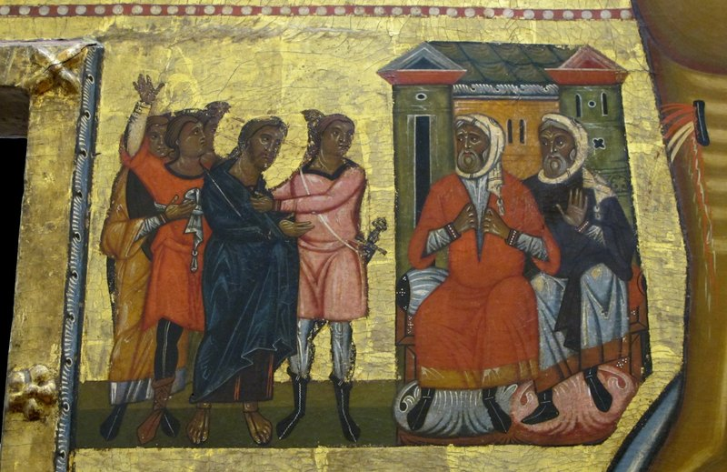
  <figcaption>Maestro della Croce 434, painted cross no. 434, Christ before the high priests. Florence, Gallerie degli Uffizi. Photo: Francesco Bini, public domain, via Wikimedia Commons.</figcaption>
</figure>

The first scene of the left column opens the story of the Passion with the trial of Christ. On the left, Christ is led forward by a group of men; on the right, two elderly men sit before a building and receive him. The Uffizi identify the scene as Christ before the Sanhedrin, the council of the Jews, which the Gospels place on the night of his arrest.

Christ wears a dark blue mantle and stands among his captors, who crowd around him and push him towards the judges. One of them raises his hand, perhaps to strike him. The figures overlap one another in depth, so that only some of the heads and bodies are seen whole, and the group gives an impression of a crowd in a small space.

The two judges are seated side by side, in red and in blue, with white cloths over their heads and long white beards. They are presumably Annas and Caiaphas, the high priests before whom Christ was brought according to the Gospel of John. The nearer of them raises his hand towards Christ, in the gesture of a speaker questioning the accused.

Behind them stands a building with a pink and green front, a door and small windows, drawn as a box seen from the front. It indicates the house of the high priest, where the trial took place. The architecture is reduced to a sign, enough to show that the scene happens indoors, in a palace.

The colours of the scene are bright: red, pink, blue and green on the gold ground. The faces are drawn with the same long noses and large eyes as the face of Christ on the cross, and lit with the same streaks of light. The small scene repeats on a small scale the manner of the large figure.

The composition divides the scene into two halves, the standing group and the seated judges, with Christ at the meeting point. The movement runs from left to right, towards the judges, and the gestures of the hands, raised, pointing and open, carry the action. The painter tells the story through the gestures rather than through expressions.

The scene stands at the top of the left column, beside the head and shoulders of Christ. In the reading of the cross, it is the beginning: the arrest has taken place, and Christ is brought to be judged. The following scenes descend the column to the Way to Calvary, which leads to the Crucifixion at the centre.

Other narrative crosses begin the story earlier: the cross no. 432, in the same room, opens with the Washing of the Feet and the Arrest. The choice of the trial as the first scene places the emphasis on the trial and the condemnation of Christ, and prepares the scenes of his humiliation that follow.

### The Mocking and Crowning with Thorns

<figure>
  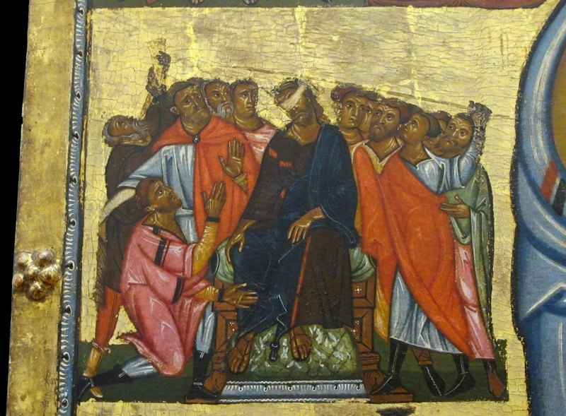
  <figcaption>Maestro della Croce 434, painted cross no. 434, the Mocking and crowning with thorns. Florence, Gallerie degli Uffizi. Photo: Francesco Bini, <a href="https://creativecommons.org/licenses/by-sa/4.0/">CC BY-SA 4.0</a>, via Wikimedia Commons.</figcaption>
</figure>

The second scene of the left column shows the mocking of Christ by the soldiers. Christ is seated at the centre, frontal, on a seat with a green cushion, and around him a crowd of men surrounds him on every side. The Uffizi identify the scene as the Mocking and the crowning with thorns.

The Gospels tell how the soldiers of the governor dressed Christ in a purple robe, put a crown of thorns on his head and a reed in his hand, knelt before him and saluted him as king of the Jews, then struck him on the head. The painter shows Christ seated like a king, crowned, while the soldiers kneel and strike.

Christ is the only calm figure in the scene. He sits upright, his eyes lowered, his body wrapped in a dark mantle, and does not react to the blows. The men around him are in movement: one kneels before him on the left in mock homage, others lean towards him, raise their hands or point at him.

The crowd is arranged in a dense ring around the seated figure, with heads at different heights, overlapping one another. The painter suggests a large number of men with a few figures, by showing only parts of some of them behind the others. The gold ground appears only above the heads.

The colours alternate around the dark blue of Christ: red, pink, light blue and green in the garments of the mockers. The contrast between the dark, still figure at the centre and the bright, moving figures around it gives the scene its meaning: the silent king among those who mock him.

The figure of Christ seated frontally recalls an image of majesty, the enthroned Christ of Byzantine art. The painter turns the image of majesty into an image of humiliation, and the irony of the scene, the king of the world crowned in mockery, is made visible in the composition itself.

The scene is the second step of the descent from the trial to the cross. After the judgment, the humiliation; after the humiliation, in the next scene, the scourging. Each scene adds a suffering, and the series leads the eye down the column towards the body of Christ at the centre.

The scene is one of the best preserved of the cross. The faces of the mockers, with their dark hair and their sharp profiles, show the variety of types the painter could draw on a small scale, and the vividness of the narration that the critics have recognised in his work.

### The Flagellation

<figure>
  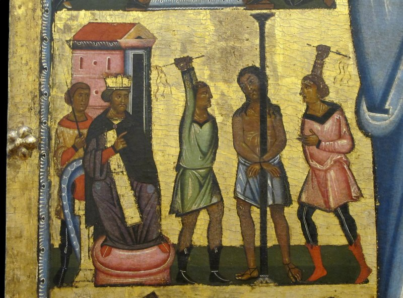
  <figcaption>Maestro della Croce 434, painted cross no. 434, the Flagellation. Florence, Gallerie degli Uffizi. Photo: Francesco Bini, <a href="https://creativecommons.org/licenses/by-sa/4.0/">CC BY-SA 4.0</a>, via Wikimedia Commons.</figcaption>
</figure>

The third scene shows the Flagellation of Christ. Christ stands at the centre, bound to a tall, thin column that rises to the top of the scene, and two men stand on either side of him, raising their scourges. On the left a crowned figure sits before a building, watching.

Christ is shown frontally, with his arms behind the column, naked except for a short cloth around his hips. His body is thin and pale, and his head is slightly bowed. The two scourgers, in short tunics and tight hose, raise their arms high, ready to strike; their poses mirror each other on either side of the column.

The seated figure on the left wears a crown and a long robe, and holds a long white scroll. He is presumably Pilate, the Roman governor who ordered the scourging, shown here as a crowned judge, as was common in medieval images. The scroll may stand for the sentence. A second figure stands behind him.

The building behind Pilate, pink, with small windows and a tiled roof, indicates the palace of the governor, the praetorium, where the scourging took place. The column is thin and tall, a vertical line that divides the scene and marks its centre.

The composition is symmetrical around the column, with Christ at the centre and the two scourgers on either side. The symmetry gives the scene a solemn, almost heraldic order, in which the violence of the action is contained. The figure of Pilate, set apart on the left, adds the authority that ordered it.

The scene is one of the most common in the narrative crosses of Tuscany, and it appears also on the cross no. 432 in the same room. The painter follows the traditional scheme but adds the seated Pilate, which shows the responsibility of the judge beside the suffering of the victim.

The body of Christ at the column anticipates the body on the cross: the same pallor, the same thin limbs, the same bowed head. The viewer who reads the column from top to bottom sees the body of Christ suffer more at each step, until it hangs dead at the centre of the cross.

The scene is well preserved, with only small losses at the edges. The colours of the scourgers' tunics, green and pink, and of Pilate's red and white robe stand out against the gold, and the slender column gives the composition a clarity that makes it legible at a distance.

### The Way to Calvary

<figure>
  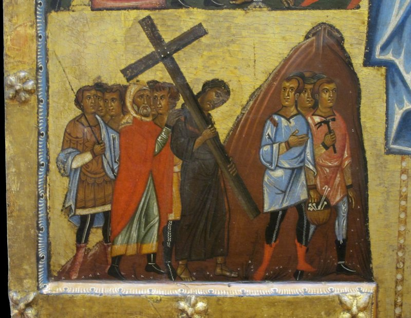
  <figcaption>Maestro della Croce 434, painted cross no. 434, the Way to Calvary. Florence, Gallerie degli Uffizi. Photo: Francesco Bini, <a href="https://creativecommons.org/licenses/by-sa/4.0/">CC BY-SA 4.0</a>, via Wikimedia Commons.</figcaption>
</figure>

The fourth and last scene of the left column shows the Way to Calvary. Christ walks to the right, carrying on his shoulder a large dark cross whose arms rise above the heads of the crowd. Soldiers and other men surround him, and behind them rises a steep rock, the hill of Golgotha towards which the procession moves.

Christ wears a brown robe and bends under the weight of the cross. His figure is placed at the centre of the scene, with the long beam of the cross crossing the group diagonally. The cross is the main line of the composition, and it leads the eye towards the rock on the right.

Behind Christ, on the left, stands a figure with a halo, in red. It may be the Virgin or Saint John, who in some accounts followed Christ on the way to the cross; the halo distinguishes this figure from the soldiers and executioners around. On the far left a soldier in armour leads the procession from behind.

On the right, two men walk ahead of Christ. One of them carries a basket, presumably with the nails and the tools for the crucifixion, a detail that appears in medieval images of the scene. They walk towards the rock, where the cross will be raised.

The rock on the right, reddish and steep, is drawn as a single rounded mass with a cleft, like the rocks of Byzantine icons. It indicates the place of execution and closes the scene on the right. The gold ground appears above the heads and behind the beam of the cross.

The scene is the last before the Crucifixion, and its place at the foot of the left column brings it beside the legs and the loincloth of Christ. The procession moves towards the centre of the cross, to the body that the next stage of the story has already placed on it.

The figures are drawn with the same long faces and large eyes as in the other scenes, and their garments, in red, pink, blue and brown, are lit with the same streaks of light. The crowd is dense and the figures overlap, as in the Mocking, giving the impression of a procession of many people.

With this scene the left column of the cross ends. It has led the viewer from the trial to the road to death. The right column will take up the story after the death of Christ, from the Deposition to the appearance at Emmaus, completing the meaning of the body at the centre.

### The Deposition

<figure>
  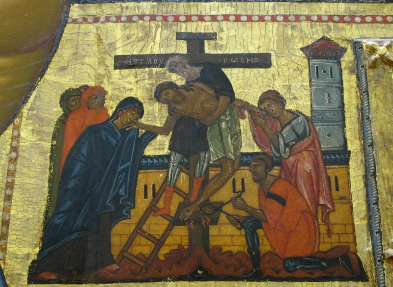
  <figcaption>Maestro della Croce 434, painted cross no. 434, the Deposition. Florence, Gallerie degli Uffizi. Photo: Francesco Bini, <a href="https://creativecommons.org/licenses/by-sa/4.0/">CC BY-SA 4.0</a>, via Wikimedia Commons.</figcaption>
</figure>

The first scene of the right column shows the Deposition from the cross. A wooden cross stands at the centre, with a titulus at the top, and a ladder leans against it. On the ladder a man, Joseph of Arimathea, holds the body of Christ, which hangs limp over his shoulder. The Virgin, John and a kneeling man complete the group.

The Virgin stands on the left, in a dark blue mantle, and bends towards the body to take its hand. The gesture is one of the most moving of the scene: the mother receiving the dead hand of her son. On the right, Saint John, in red, stands with his head bowed.

At the foot of the cross a man kneels and draws the nail from the feet of Christ with a pair of pincers. He is Nicodemus, who according to the Gospel of John helped Joseph to take down the body. His action, small and precise, is set at the centre of the lower part of the scene.

The ladder is drawn in perspective, leaning against the cross, and it gives the scene a spatial depth unusual in the small scenes of the period. The body of Christ, bent over Joseph's shoulder, forms a curve between the arm of the cross and the figure of the Virgin.

Behind the figures runs a low wall with a tower on the right, indicating the walls of Jerusalem, outside which Christ was crucified. The architecture closes the background and leaves the gold visible only above it, around the cross.

The comparison with the Deposition of the cross no. 432, in the same room, shows the development of the scene in a century. In the older cross the body is lowered by Joseph while Nicodemus draws the nail, and the mourners stand symmetrically. Here the ladder appears, the figures are more active and the group is more dramatic.

The scene stands at the top of the right column, beside the head of Christ on the cross, as the Christ before the high priests stands on the left. The two upper scenes thus frame the head of the dead Christ with the beginning of his Passion and the first act after his death.

The Deposition is one of the most refined scenes of the cross. The gesture of the Virgin, the precision of Nicodemus and the curve of the body show the painter's skill in composing a crowded scene in a small space, and his attention to the emotion of the figures.

### The Entombment

<figure>
  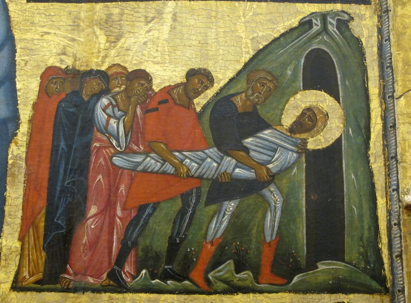
  <figcaption>Maestro della Croce 434, painted cross no. 434, the Entombment. Florence, Gallerie degli Uffizi. Photo: Francesco Bini, <a href="https://creativecommons.org/licenses/by-sa/4.0/">CC BY-SA 4.0</a>, via Wikimedia Commons.</figcaption>
</figure>

The second scene of the right column shows the Entombment. Two men carry the body of Christ, wrapped in a white shroud, towards a dark opening in a rock on the right. A group of mourners follows them on the left. The tomb is not a sarcophagus but a cave, as the Gospels describe it: a tomb hewn in the rock.

The body is carried horizontally, wrapped in the shroud, with the head, surrounded by a gold halo, towards the tomb. The two bearers, Joseph and Nicodemus, bend under its weight, one supporting the shoulders, the other the legs. The shroud is drawn with long parallel folds that follow the line of the body.

The tomb is a dark arched opening in a green rock, which rises steeply on the right. The darkness of the opening contrasts with the white of the shroud and with the gold ground, and it marks the place towards which the whole scene moves.

The mourners on the left, in red, blue and dark mantles, press together behind the bearers. One of them bends towards the body, perhaps the Virgin, who in many images embraces the head of her son at the moment of the burial. Their faces, drawn in profile and three-quarter view, express grief.

The composition is a horizontal movement from left to right, from the mourners to the tomb, carried by the line of the body. It contrasts with the vertical composition of the Deposition above, with its standing cross and ladder. The two scenes together show the body descending from the cross and entering the tomb.

The rock of the tomb is painted in the same manner as the rock of the Way to Calvary on the left column: a rounded mass with a few lines indicating its folds. The two rocks, one green, one red, face each other across the body of Christ, the place of death and the place of burial.

The Entombment is the last scene of the Passion proper. The following scenes, the holy women at the tomb and the supper at Emmaus, show the Resurrection and the appearances of the risen Christ, and change the meaning of the cycle from death to victory.

The scene is well preserved, and the green of the rock, the white of the shroud and the red of the garments make it one of the most colourful of the cross. Its composition, simple and clear, shows the painter's ability to tell a story in a few figures.

### The Holy Women at the Tomb

<figure>
  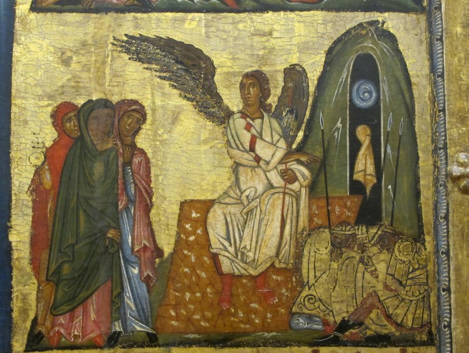
  <figcaption>Maestro della Croce 434, painted cross no. 434, the holy women at the tomb. Florence, Gallerie degli Uffizi. Photo: Francesco Bini, <a href="https://creativecommons.org/licenses/by-sa/4.0/">CC BY-SA 4.0</a>, via Wikimedia Commons.</figcaption>
</figure>

The third scene of the right column shows the holy women at the tomb on the morning of Easter. Three women stand on the left, and on the right an angel in white sits on a stone before the empty tomb. The Uffizi describe the scene as the meeting of the pious women with the angel, who announces the Resurrection.

The women stand close together, in mantles of green, red and pink, their heads covered. They have come to the tomb with spices to anoint the body of Christ, as the Gospels tell, and they find the stone rolled away. Their figures are tall and still, turned towards the angel.

The angel sits on the stone, dressed in white, with large dark wings spread behind him. He raises his hand towards the tomb, showing the women that it is empty. The white of his garment is the brightest colour of the scene, and it marks him as the messenger of the Resurrection.

The tomb is the same cave in the green rock as in the Entombment above, now open. Inside it lies the white shroud, empty: the body has gone. The repetition of the tomb in the two scenes links the burial and the Resurrection, and the viewer sees the same place before and after.

At the lower right, under the angel, lie the soldiers who guarded the tomb, asleep or struck down. Matthew tells how the guards trembled and became like dead men at the sight of the angel. They are painted in pale colours, partly worn, and they form the base of the composition.

The scene is one of the traditional images of the Resurrection in medieval art, which before the late Middle Ages rarely showed Christ rising from the tomb. The empty tomb and the angel's announcement were the image of the Resurrection, and the painter follows this tradition.

The scene also appears on the cross of Tereglio, where it is paired with the Capture of Christ. Its presence on both crosses is one of the links between the two works, and between the painter and the Lucchese tradition of narrative crosses.

The scene is well preserved, with some losses in the figures of the soldiers. The contrast between the dark wings and the white garment of the angel, and between the green rock and the gold, gives it a strong visual presence among the scenes of the right column.

### The Supper at Emmaus

<figure>
  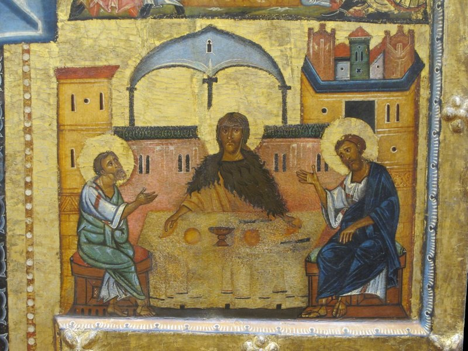
  <figcaption>Maestro della Croce 434, painted cross no. 434, the supper at Emmaus. Florence, Gallerie degli Uffizi. Photo: Francesco Bini, <a href="https://creativecommons.org/licenses/by-sa/4.0/">CC BY-SA 4.0</a>, via Wikimedia Commons.</figcaption>
</figure>

The last scene of the right column shows the supper at Emmaus. Christ sits frontally at the centre, behind a table covered with a white cloth, and two disciples sit on either side of him, turned towards him. The Uffizi describe the scene as the appearance of the risen Christ at Emmaus.

The Gospel of Luke tells how two disciples, walking to the village of Emmaus on the day of the Resurrection, met a stranger who explained the Scriptures to them; at supper, when he took the bread, blessed it and broke it, they recognised him, and he vanished from their sight. The painter shows the moment of the meal.

On the table stand a chalice and round loaves. The objects recall the Eucharist, the bread and wine of the Last Supper, and the gesture of breaking bread by which the disciples recognised Christ. The scene thus ends the cycle with an image of the sacrament, the presence of the risen Christ in the bread.

The two disciples sit on low stools, with haloes, one in light green and blue on the left, one in blue on the right. They lean towards Christ and raise their hands in gestures of speech or surprise. Christ, at the centre, sits still, in a dark mantle, like the Christ of the Mocking, but now as the risen Lord.

Behind the figures rise buildings with towers and battlements, and an arch spans the centre of the scene. The architecture indicates the village of Emmaus and the house of the meal, and it frames Christ at the centre.

The composition is symmetrical, with Christ at the centre and the disciples on either side, like the Flagellation on the left column. The two scenes at the bottom of the columns, the Way to Calvary and the Emmaus, are the end of the Passion and the end of the cycle: the road to death and the meal of the risen Christ.

The choice of Emmaus as the last scene is significant. It extends the cycle beyond the Resurrection to the appearances of Christ to his disciples, and it closes the story with a meal that recalls the Mass celebrated at the altar under the cross. The faithful who looked at the cross would have recognised in the scene their own communion.

The eight scenes of the cross thus form a complete cycle, from the trial to the meal at Emmaus, around the dead body of Christ. They show the painter as a narrator, able to tell each episode in a few figures and to arrange the whole as a sequence that the viewer can read from the top of the left column to the bottom of the right.

### The Stigmata of Saint Francis

<figure>
  
  <figcaption>Maestro della Croce 434, the Stigmata of Saint Francis, c. 1240–1250, tempera and gold on panel, 81 × 51 cm. Florence, Gallerie degli Uffizi, inv. 1890 no. 8574. Photo: Francesco Bini, <a href="https://creativecommons.org/licenses/by-sa/4.0/">CC BY-SA 4.0</a>, via Wikimedia Commons.</figcaption>
</figure>

The panel shows a single scene, the stigmatisation of Saint Francis on Mount La Verna. Francis kneels in the lower part of the panel, his arms raised, and looks up at the seraph in the upper right corner, from which three rays of gold descend towards him. Behind him rise the rocks of the mountain and a small chapel. The Uffizi attribute the panel to the Maestro della Croce 434 and date it 1240–1250.

Francis wears the brown habit of the Friars Minor, tied at the waist with a cord with three knots, and his head is surrounded by a gold halo. He kneels on a ground of grey stones, with his hands raised and open; the heads of the nails are visible in his palms and on his bare feet, as the Uffizi note. His face, turned upwards in profile, is drawn with a long nose and a short beard.

The seraph is a small crucified figure, with a haloed head and six wings, red and dark, wrapped around the body, nailed to a dark cross. It emerges from a dark arc of sky in the upper corner. From it descend three parallel rays of gold, which the Uffizi describe as falling on the face of the saint. The image renders the vision described by Thomas of Celano: a seraph with six wings, in the form of a man crucified.

Behind Francis rise the steep rocks of La Verna, drawn as tall pale masses with dark lines and a few plants. On the left stands a small chapel, with pink walls, a door and a tiled roof surmounted by a small cross. The Uffizi identify it as the first church of the hermitage, dedicated to Santa Maria degli Angeli. The rocks and the chapel are a sign of the place where the miracle happened.

On the right, in red letters on the gold ground, is the inscription S FRANESC, the name of the saint. The Uffizi suggest that it was meant to ensure that he would be recognised as the protagonist of the scene, at a time when his image was still new. The panel is framed by a band of ornament and studded with gilded bosses along its border.

The panel is one of the oldest representations of the stigmata. Francis was said to have received the wounds in September 1224, two years before his death, and the miracle was made known in 1226, in the letter by which Brother Elias of Cortona announced his death. The panel was painted within twenty or twenty-five years of these events, in the generation of the saint's first companions.

The Uffizi note that the panel is one of the few thirteenth-century images of Francis that survived the order of the Franciscan general chapter of Paris in 1266, which commanded the destruction of the images and lives of the saint other than the *Legenda maior* of Bonaventure. Its survival is a matter of chance, and it is one of the reasons for its importance.

The panel came to the Accademia di Belle Arti of Florence in 1863 as a gift of the merchant Ugo Baldi, and passed later to the Uffizi; nothing is known of its earlier history. The rays fall on the head of the saint, not on his hands and feet, and the image follows the account of Thomas of Celano, written two decades earlier, rather than the *Legenda maior*, which Bonaventure composed only in the 1260s.

### Saint Francis and Eight Stories, Pistoia

<figure>
  
  <figcaption>Maestro della Croce 434 and Maestro di Santa Maria Primerana, Saint Francis and eight stories of his life and miracles, c. 1250–1260, tempera and gold on panel, 160 × 133 cm. Pistoia, Museo Civico, from the church of San Francesco. Photo: Sailko, <a href="https://creativecommons.org/licenses/by/3.0/">CC BY 3.0</a>, via Wikimedia Commons.</figcaption>
</figure>

The panel shows Saint Francis standing at full length at the centre, frontal and nearly life-size, and eight small scenes of his life and miracles on either side. It came from the church of San Francesco in Pistoia and is now in the Museo Civico. It is attributed to a collaboration between the Maestro della Croce 434 and the Maestro di Santa Maria Primerana, and dated about 1250–1260.

The panel has the shape of a house front, with a gabled top. The slopes of the gable cut the two upper scenes into triangles, while the other six are rectangular. A broad white frame, now worn and cracked, surrounds the central field and divides the scenes; along its upper edge are round cavities, in which stones or glass were probably once set.

Francis stands on the gold ground in the dark brown habit of his order, tied with a white cord with knots. His right hand is raised, showing the wound of the stigmata in the palm; his left holds a red book. His feet are bare. His head is set in a large gold halo in relief, carved with radiating ribs, like the halo of Christ on the cross no. 434.

On the left side, from the top, are the saint before the pope, a preaching, a healing at the tomb or altar of the saint and a miracle at an altar. On the right side are the stigmata, the funeral of the saint, the healing of a lame man and the deliverance of a possessed woman. The scenes are examined one by one below. Four of them show miracles of healing and deliverance, several of them at an altar attended by friars.

Along the narrow borders between the scenes and the central figure, and along the outer edges, small half-figures are painted in roundels or niches, many of them now worn: friars and other figures who frame the saint. In the upper corners of the central field, near the halo, appear the wings of small angels or seraphs.

The type of the panel was established by Bonaventura Berlinghieri, who signed and dated his Saint Francis at Pescia in 1235, and it was repeated in other Tuscan Franciscan panels of the thirteenth century. The Pistoia panel follows it, with a more elaborate frame and with a greater number of figures in the borders.

The panel was restored in 1981, when the cracks of the wood were repaired and metal crossbars were added on the back. It was shown at the Uffizi in 2011–2012, in the exhibition of the Moscow Madonna, and lent to the National Gallery in London for the exhibition *Saint Francis of Assisi*, from 6 May to 30 July 2023, after a conservation treatment in Pistoia.

The division of the work between two painters is a hypothesis of the literature, and it has not been settled which parts belong to each. The arrangement of the scenes does not separate the life from the miracles by side. On each side the upper scenes belong to the life of the saint, the approval of the Rule and the preaching on the left, the stigmata and the funeral on the right, and the lower scenes to his miracles.

### Saint Francis: the Central Figure

<figure>
  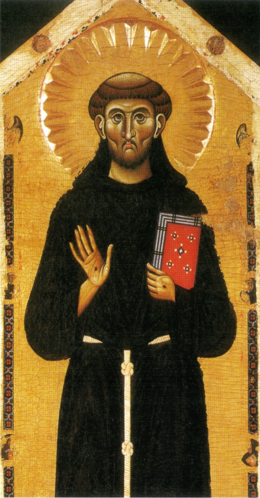
  <figcaption>Maestro della Croce 434 and Maestro di Santa Maria Primerana, Saint Francis and eight stories, detail of the saint. Pistoia, Museo Civico. Image: public domain, via Wikimedia Commons.</figcaption>
</figure>

The detail shows the upper part of the central figure: the head, the halo, the hands and the book. Francis looks straight at the viewer, frontal and motionless, like the saints of Byzantine icons. The image is not a portrait in a modern sense but an icon of the saint, made to be venerated.

The face is long, with a tonsure, a short dark beard and a small moustache. The eyes are large and dark, set under arched brows, and they look out of the panel. The nose is long and straight, the mouth small and closed. The face is modelled in brown and ochre, with lighter strokes on the forehead and cheeks.

The halo is carved in relief, as a raised gold disc divided into radiating ribs. It is the same kind of halo as that of Christ on the cross no. 434, and it is one of the elements that connect the panel with the painter. It catches the light and makes the head of the saint the brightest point of the panel.

The right hand is raised, with the palm turned outwards, and shows the dark wound of the stigmata. The gesture may be read as a blessing, or as the display of the wound to the viewer. In either case, the stigmata are the sign by which the saint is recognised, and the painter places them at the centre of the image.

The left hand holds a red book with a blue and white edge, decorated with small crosses. The book has been read as the Gospel, which Francis took as the rule of his life, or as the Rule of the order. It is the attribute of Francis as founder and preacher.

The habit is dark brown, nearly black, and falls in long straight folds. At the waist hangs the white cord with knots, the sign of the vows of the Friars Minor. The habit is painted with few highlights, so that the figure appears as a dark column against the gold ground.

In the borders beside the figure appear small painted busts, framed in niches or roundels. They are worn, but some of them can be recognised as friars. They form a kind of community around the saint, like the brothers who followed him.

The detail is reproduced from a printed photograph, and it shows the figure with less of the wear visible in the photograph of the whole panel. The two images together show the central figure as it appears at a distance and at close range.

### The Saint before the Pope

<figure>
  
  <figcaption>Maestro della Croce 434 and Maestro di Santa Maria Primerana, Saint Francis and eight stories, the saint before the pope. Pistoia, Museo Civico. Photo: Sailko, <a href="https://creativecommons.org/licenses/by/3.0/">CC BY 3.0</a>, via Wikimedia Commons.</figcaption>
</figure>

The first scene on the left, in the triangle under the slope of the gable, shows Francis kneeling before the pope. The pope sits on a throne on the right, with two other mitred figures behind him, and Francis kneels before him with his hands on a book. The file of the photograph names the scene as the giving of the Rule.

The episode is the approval of the first rule of the Friars Minor by Pope Innocent III, around 1209–1210, according to the early lives of the saint. Francis went to Rome with his first companions and obtained from the pope the oral approval of their form of life. The final Rule was approved by Honorius III in 1223.

The pope wears a red mantle over a blue garment and a tall white mitre, and raises his right hand in a gesture of speech or blessing. The figures behind him, also mitred, are presumably cardinals or bishops of his court. The group is set before the back of the throne.

Francis kneels on the left, small in relation to the pope, in his dark habit. He reaches out his hands to the book that the pope holds, and the book between them is the centre of the scene: the Rule given or received, the written form of the new life.

At the far left, behind Francis, stands a small group of buildings with a tower, which may indicate Rome or the Lateran palace. The triangular shape of the field forces the composition into a descending line, from the tall seated pope on the right to the low buildings on the left.

The scene stands at the beginning of the left column, as the stigmata stand at the beginning of the right. The approval of the Rule and the stigmata are the two great moments of the saint's life, the foundation of the order and the conformity of Francis to Christ, and the panel places them at the top, in the two triangles of the gable.

The scene is much cracked, and the slope of the frame above it has lost its surface in two places, where the bare wood is visible. The figures are nevertheless legible, and the faces of the pope and his companions, with their large eyes, show the same types as the other scenes of the panel.

The approval of the Rule became one of the standard scenes of the Franciscan cycles, from the panels of the thirteenth century to the frescoes of the Upper Church at Assisi. The Pistoia panel is one of its earliest representations.

### A Preaching

<figure>
  
  <figcaption>Maestro della Croce 434 and Maestro di Santa Maria Primerana, Saint Francis and eight stories, a preaching. Pistoia, Museo Civico. Photo: Sailko, <a href="https://creativecommons.org/licenses/by/3.0/">CC BY 3.0</a>, via Wikimedia Commons.</figcaption>
</figure>

The second scene on the left shows Francis preaching from a pulpit. He stands at the centre between two friars, raising his right hand, and below him, on either side, the people listen: women on the left, men on the right. The file of the photograph names the scene as a preaching.

The pulpit is a tall box on legs, with a front decorated with two birds in green roundels, and a projecting ledge on which the friars lean. Below it, between its legs, stands an altar covered with a pink cloth, on which lies a red book. The pulpit and the altar together indicate the interior of a church.

Francis stands in the middle, frontal, his hand raised in the gesture of a speaker. The two friars beside him are partly worn, but their dark habits and hoods are visible. The three heads are set against the gold, above the crowd, and the scene is built on the contrast between the high pulpit and the people below.

The women on the left wear white head-cloths and red and blue mantles, and they look up towards the preacher with their hands on their breasts. The men on the right, bearded and bareheaded, stand in a group, one in a blue mantle in front. The separation of men and women follows the custom of medieval churches.

Two towers frame the scene, one on each side, indicating the city in which the preaching takes place. The preaching of Francis to the people of the towns was one of the essential activities of the friars, and the scene presents the saint as the model of the preacher.

The birds on the pulpit may be no more than ornament, but they may also allude to the preaching to the birds, one of the best known episodes of the saint's life. The scene itself, however, shows a preaching to people in a church.

The scene has suffered losses, especially in the lower part, where the gold and the paint have flaked from the pulpit and from the figures on the right. The heads of the women and the men are well preserved and show the variety of the painter's types.

The scene is one of the most ambitious compositions of the panel, with a building in depth and two crowds. It shows the painter, or one of the two painters, able to organise a complex space in the small format of a narrative scene.

### A Healing at the Tomb

<figure>
  
  <figcaption>Maestro della Croce 434 and Maestro di Santa Maria Primerana, Saint Francis and eight stories, a healing of a girl. Pistoia, Museo Civico. Photo: Sailko, <a href="https://creativecommons.org/licenses/by/3.0/">CC BY 3.0</a>, via Wikimedia Commons.</figcaption>
</figure>

The third scene on the left shows a miracle of healing. A girl lies on the ground before a red chest, behind which stand three friars; on the left, a man carries a girl on his shoulders and a woman kneels with raised hands. The file of the photograph names the scene as the healing of a girl.

The red chest, with a lock and two books on its lid, stands under a canopy of three domes, red in the middle and blue at the sides. It may represent the tomb of the saint, or an altar with his relics, before which the sick were brought to be healed. The friars behind it are the guardians of the tomb.

The girl lying on the ground before the chest, in a light blue dress, rests her head on her hand. She is the sick child, brought to the tomb; the girl carried on the man's shoulders on the left, dressed in the same light blue, is presumably the same child, healed and carried home. The scene would thus show two moments of the same story.

The man who carries the girl raises his hand in thanks, and the woman kneeling before him, in purple, raises her hands in prayer. They are the parents of the child. Their figures, set against the tall pink tower on the left, are the human centre of the scene.

The three friars behind the chest look on, one raising his hand. They are the witnesses of the miracle, and their presence shows the role of the friars as keepers of the saint's tomb and recorders of his miracles, which were collected for the canonisation and for the lives of the saint.

The miracles at the tomb of Francis in Assisi were numerous in the first years after his death, and they were recorded by Thomas of Celano in his life of the saint. The healing of children was among them. The panel does not allow the episode to be identified with a particular account.

The scene is well preserved in the figures, with some losses in the gold and in the faces of the friars. The colours, pink, purple, light blue and red, are bright, and the domes of the canopy give the scene an architectural richness unusual in the panel.

The scene is the first of the miracles on the left side. With the following one, it shows Francis as a healer after his death, a saint whose power continued at his tomb, and it presents him to the people of Pistoia as an intercessor in illness.

### A Cripple at the Altar

<figure>
  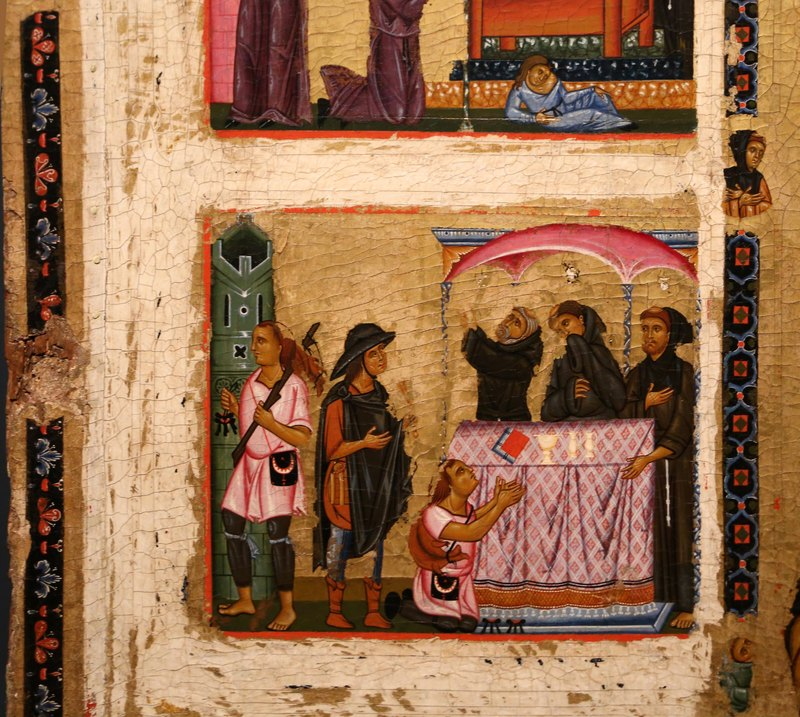
  <figcaption>Maestro della Croce 434 and Maestro di Santa Maria Primerana, Saint Francis and eight stories, a miracle of a cripple. Pistoia, Museo Civico. Photo: Sailko, <a href="https://creativecommons.org/licenses/by/3.0/">CC BY 3.0</a>, via Wikimedia Commons.</figcaption>
</figure>

The last scene on the left shows a miracle at an altar. A man kneels with raised hands before an altar covered with a patterned cloth, under a canopy, and behind the altar three friars pray. On the left stand two men, one with a staff and a pouch, one in a black hat and cloak. The file of the photograph names the scene as the miracle of the cripple.

The altar is set for the Mass, with a book, a chalice and two cruets for wine and water on the cloth, and a pink canopy above it, supported on thin columns. It is the altar of a church, perhaps the altar of the saint, before which the sick came to pray for healing.

The kneeling man, in a pink tunic, looks up towards the friars with his hands raised. He is the cripple who has come to be healed. The two men on the left, dressed as travellers, with a staff, a pouch and a hat, may be pilgrims who have accompanied him, or the same man at another moment of the story.

The friars behind the altar react with gestures of prayer and surprise. One raises his hands, another bows his head and covers his face, the third places his hand on his breast. Their gestures announce the miracle: the man has been healed.

The tower on the left, green, with small windows, frames the scene like the towers of the other scenes. The composition divides the field into two parts, the travellers on the left and the altar on the right, joined by the kneeling man in the centre.

The scene shows the cult of Francis in the churches of his order, where his altars received the prayers and the offerings of the sick. The pilgrims with staff and pouch recall the journeys made to Assisi and to the other places of the saint, and the panel invited the people of Pistoia to make the same journey to the altar where it stood.

The scene is well preserved, and its details, the patterned cloth of the altar, the chalice, the cruets and the costumes of the travellers, give an image of the life of the period. The hat, the cloak, the pouch and the leggings of the pilgrims are drawn with precision.

The scene closes the left side of the panel. The four scenes on this side thus show two episodes of the saint's life, the approval of the Rule and the preaching, and two miracles after his death, at his tomb and at his altar.

### The Stigmata

<figure>
  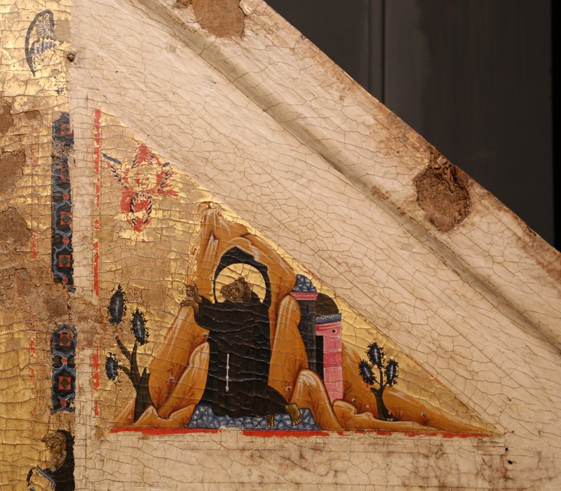
  <figcaption>Maestro della Croce 434 and Maestro di Santa Maria Primerana, Saint Francis and eight stories, the stigmata. Pistoia, Museo Civico. Photo: Sailko, <a href="https://creativecommons.org/licenses/by/3.0/">CC BY 3.0</a>, via Wikimedia Commons.</figcaption>
</figure>

The first scene on the right, in the triangle under the slope of the gable, shows the stigmata. Francis kneels among the rocks of La Verna and looks up towards a small red seraph in the upper left. Behind him a dark cave opens in the rock, and on the right a small pink chapel stands at the foot of the mountain.

The composition repeats, in a different format, the elements of the Uffizi panel: the kneeling saint, the seraph, the rocks and the chapel. The comparison between the two images is one of the arguments for connecting the Pistoia panel with the Maestro della Croce 434.

Francis kneels in profile, turned towards the seraph, his hands raised. His face, with its short beard, is lifted upwards, and his halo stands out against the dark cave behind him. The cave may indicate the hermitage where Francis prayed, or simply the wildness of the mountain.

The seraph, small and red, with spread wings, appears in the upper left corner, partly worn. Its form is less clear than in the Uffizi panel, and the rays that link it to the saint are not visible in the present state of the painting.

The rocks are painted in ochre, with white highlights and dark lines, as rounded, stepped masses, in the manner of Byzantine landscapes. Two small trees with dark blue leaves stand at either side, and the pink chapel on the right, with its tower, recalls the chapel of the Uffizi panel.

The stigmata are placed at the top of the right side, opposite the approval of the Rule. The two triangular scenes thus present the two foundations of the saint's authority: his approval by the Church and his conformity to Christ, sealed by the wounds he received from the crucified seraph.

The scene has suffered losses in the gold and in the upper part, where the seraph is partly lost, and the slope of the frame above it has lost its surface in one place. The figure of the saint and the rocks are well preserved.

The repetition of the stigmata in the Pistoia panel and in the Uffizi panel shows how the image of the miracle was established within a few decades of the event, and how the same painter, or the same workshop, used it in a single panel and in a cycle.

### The Funeral of the Saint

<figure>
  
  <figcaption>Maestro della Croce 434 and Maestro di Santa Maria Primerana, Saint Francis and eight stories, the funeral of the saint. Pistoia, Museo Civico. Photo: Sailko, <a href="https://creativecommons.org/licenses/by/3.0/">CC BY 3.0</a>, via Wikimedia Commons.</figcaption>
</figure>

The second scene on the right shows the funeral of Francis. The saint lies dead on a bier covered with a red cloth, surrounded by clerics, friars and a crowd. The file of the photograph names the scene as the funeral rites.

Francis lies in his dark habit, his head on a cushion, his hands crossed on his breast, his feet bare. His face is turned towards the viewer, with closed eyes. The red cloth of the bier, patterned with small figures, falls in heavy folds to the ground and fills the lower half of the scene.

On the left stand the clergy who perform the rite: one in white with a pink mantle holds an open book with letters, another swings a censer, a third holds a tall staff, perhaps a processional cross. They are the priests who celebrate the office of the dead. Their vestments and the book give the scene the solemnity of a liturgy.

Behind the bier two friars hold palms or candles, and on the right a crowd of friars in dark habits presses around the body. Their faces are drawn in rows, one above the other, with large eyes, some looking at the body, some at one another. They are the brothers who mourned the death of the saint.

Above the bier, in the gold ground, are the damaged figures of angels, of which only fragments of wings and faces remain. They presumably carried the soul of the saint to heaven, a common element of the funerals of saints in medieval art.

Two towers frame the scene, one green on the left, one pink on the right. They indicate the place of the death, the Porziuncola near Assisi, or the city where the body was carried, and they close the composition on both sides like the towers of the other scenes.

The death of Francis, on 3 October 1226, and his funeral were described in the early lives, and the scene became one of the standard episodes of the Franciscan cycles. In the Pistoia panel it marks the passage from the saint's life to the miracles after his death, which follow on the right side.

The scene is one of the best preserved and most crowded of the panel, and it shows the painter's ability to arrange many figures in a small field. The red cloth, the white vestment of the priest and the dark habits of the friars give it a strong contrast of colours.

### The Healing of a Lame Man

<figure>
  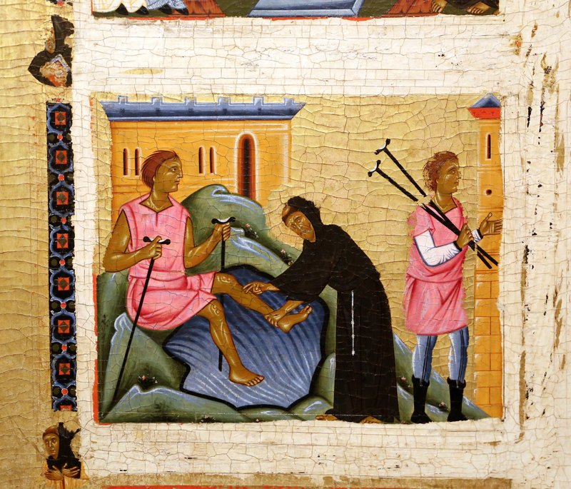
  <figcaption>Maestro della Croce 434 and Maestro di Santa Maria Primerana, Saint Francis and eight stories, the healing of a lame man. Pistoia, Museo Civico. Photo: Sailko, <a href="https://creativecommons.org/licenses/by/3.0/">CC BY 3.0</a>, via Wikimedia Commons.</figcaption>
</figure>

The third scene on the right shows the healing of a lame man. On the left a man sits on a rock, holding two crutches, and stretches out his leg to a friar, who bends and touches it. On the right the same man walks away, carrying his crutches over his shoulder. The file of the photograph names the scene as the miracle of the lame man.

The scene shows two moments of the same story, as the healing of the girl on the left side does. The man is first seen sick, seated, with his crutches; then healed, standing and walking, with the crutches no longer needed. The repetition of the figure tells the story in a single image.

The friar who touches the leg bends forward in his dark habit. He is presumably Francis himself, though his halo is not clearly visible in the present state of the painting. The touch of the saint's hand on the sick limb is the moment of the miracle.

The man sits on a green rock beside blue water painted with wavy lines. The water may indicate a river or a spring, perhaps the place where the miracle happened. The rock and the water form a small landscape in the lower part of the scene.

On the right, the healed man walks away, dressed in a pink tunic, light blue hose and black boots, the crutches on his shoulder and his hand raised. He turns his head back, perhaps to thank the saint. The figure is one of the liveliest of the panel, and the detail of his costume is precise.

Behind the figures rise an orange building with battlements and a tower on the right. The architecture closes the background and indicates a town, outside whose walls the miracle takes place.

The healing of the lame was among the miracles most frequently recorded in the lives of Francis, both during his life and after his death. The scene shows the saint's power over illness, and it offered the people who looked at the panel the hope of the same healing.

The scene is very well preserved, with bright colours and clear drawing. The pink of the tunics, the blue of the water and the orange of the building make it one of the most colourful scenes of the panel.

### The Deliverance of a Possessed Woman

<figure>
  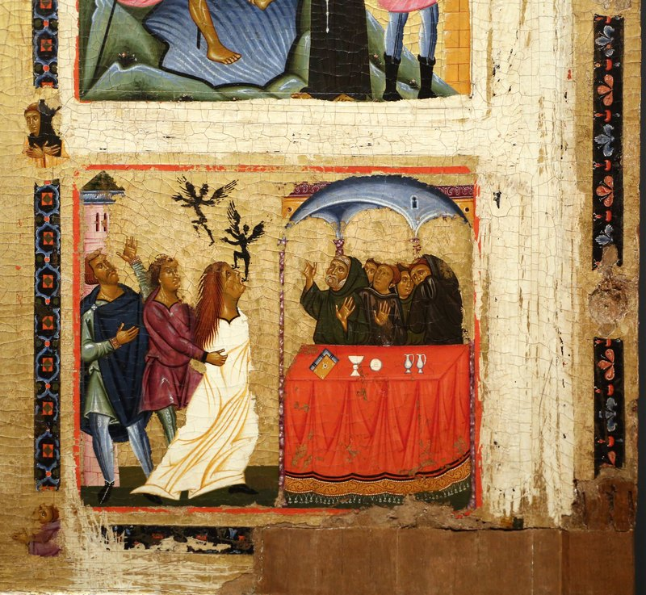
  <figcaption>Maestro della Croce 434 and Maestro di Santa Maria Primerana, Saint Francis and eight stories, the deliverance of a possessed woman. Pistoia, Museo Civico. Photo: Sailko, <a href="https://creativecommons.org/licenses/by/3.0/">CC BY 3.0</a>, via Wikimedia Commons.</figcaption>
</figure>

The last scene on the right shows the deliverance of a possessed woman. On the left a woman with long loose hair throws back her head, and two small black demons fly from her mouth; two men hold her. On the right, behind an altar, a group of friars prays. The file of the photograph names the scene as the deliverance of a possessed woman.

The woman wears a white dress, and her red hair falls loose on her shoulders, a sign of her disorder. She throws her head back and opens her mouth, from which the demons escape. The two men beside her, in blue and purple, support her and look up at the demons.

The demons are small black figures with wings, drawn in silhouette against the gold. They fly upwards, leaving the body of the woman. The image of the demon leaving through the mouth was the common way of representing exorcism in medieval art.

On the right, under a light blue canopy, several friars stand behind an altar covered with a red cloth. On it lie a book, a chalice, a host and two cruets. The friar in front raises his hand towards the woman, in the gesture of prayer or exorcism, and the others look on.

The altar with the objects of the Mass shows that the deliverance takes place in a church, before the altar of the saint, as in the miracle of the cripple on the left side. The two lower scenes thus correspond to each other: a healing and a deliverance, both at an altar.

The pink tower on the left frames the scene. Below it, at the lower edge, the paint and the frame have suffered losses, and the bare wood is visible at the lower right corner of the panel.

The deliverance of the possessed was among the miracles attributed to Francis in his life and after his death, and it shows his power over the devil. In the panel it closes the series of miracles, and with them the panel's account of the saint's power as intercessor.

The scene is well preserved in its figures, and the dramatic movement of the woman, contrasted with the calm of the friars, shows the narrative skill of the painter. The two sides of the composition, the agitated group on the left and the still group on the right, express the struggle and the victory.

### The Cross of Tereglio

<figure>
  
  <figcaption>Workshop of the Berlinghieri and Maestro della Croce 434 (attributed), painted cross, c. 1235–1245, tempera and gold on panel. Tereglio (Coreglia Antelminelli, Lucca), Santa Maria Assunta. Image: public domain, via Wikimedia Commons.</figcaption>
</figure>

The cross of Tereglio hangs in the parish church of Santa Maria Assunta at Tereglio, a village in the hills of the Serchio valley north of Lucca. It is a large *Christus triumphans*, one of the most complete of the painted crosses connected with the Berlinghieri workshop. According to local tradition it came from the church of San Martino at Bori, or Alborio, a village destroyed in the fourteenth century.

Christ is alive, with open eyes, and hangs on a dark blue cross edged with red bands set with white pearls, the ornament of the Berlinghieri. His head inclines to one side, and his body, with its ribs drawn in curved lines and its swelling abdomen, sways slightly. He wears a long pink loincloth, knotted at the waist and falling below the knees.

At the top, Christ appears half-length, blessing with his right hand and holding an open book, between two angels in jewelled robes. Below, a red field carries the titulus, naming Jesus of Nazareth, king of the Jews. At the ends of the arms, the four symbols of the Evangelists are painted as small winged figures on the gold, two above and two below the hands of Christ.

Beside the body, the Virgin, in a dark mantle, and Saint John, in pink, stand as mourners. Below them, two small scenes are painted: on the left the Capture of Christ, a crowd of soldiers around Christ and Judas; on the right the holy women at the tomb, with the angel seated on the empty sepulchre. At the foot, beside the feet of Christ, is the denial of Peter, with the apostle on one side and the servant girl on the other.

The programme combines the elements of the Lucchese cross: the blessing Christ above, the Evangelists, the mourners, the narrative scenes and the denial of Peter at the foot, which also appears on Berlinghiero's signed cross in Lucca. The holy women at the tomb return in the cross no. 434, and the denial of Peter in the cross of Fiesole.

The attribution of the cross has been debated for nearly a century. [Evelyn Sandberg-Vavalà](/scholars.html#sandberg-vavala-evelyn) hesitated between an early work of Berlinghiero and a weaker hand under his supervision; Garrison placed it in Berlinghiero's school; [Antonino Caleca](/scholars.html#caleca-antonino) stressed its affinity with Bonaventura. The monograph published after the restoration of 1998 argued for the participation of Berlinghiero himself.

Most recently, a collaboration between a member of the Berlinghieri family and the Maestro della Croce 434 has been proposed, shortly before the middle of the century. If it is accepted, the cross would show the painter at work inside the Lucchese workshop, or beside it, before or alongside his Florentine activity. The Italian national catalogue dates the cross after 1235.

The cross was restored in 1998, when extensive repaintings were removed. The parish records tell that in the early eighteenth century it hung bare on the wall of the church, and that in 1766, after a dispute that reached the archbishop of Lucca, it was placed on the altar of the Crucifix. Its history is told more fully in the entry on [Berlinghiero](/Content/Artists/XIII-c/Berlinghiero-di-Melanese.html).

### The Cross of the Museo Bandini, Fiesole

<figure>
  
  <figcaption>Maestro della Croce 434, painted cross with Saint Peter and the cock, c. 1230–1240, tempera on panel, originally on a silver ground, 89 × 69 cm. Fiesole, Museo Bandini. Image: public domain, via Wikimedia Commons.</figcaption>
</figure>

The small cross of the Museo Bandini at Fiesole is the earliest of the painter's crosses. It measures only 89 × 69 cm, and it is a *Christus triumphans*: Christ is alive, with open eyes, his face frontal, his body upright, his feet nailed side by side. It was painted on a silver ground, now lost, which gave the image a cold, metallic light.

Beside the body, on the right, Saint Peter stands with a halo below a building with a blue dome, the house of the high priest; on the left, on top of a tower, stands the cock. The pairing recalls the denial of Peter, who three times denied knowing Christ before the cock crowed, and his repentance. The cock now visible belongs to the later repainting of the cross.

The cross has an exceptional history. It was painted over around 1280–1290 by another painter, who renewed it with a new image of the same type, and in the eighteenth century it was repainted again and enlarged into a rectangular altarpiece, with two saints by Lorenzo di Bicci at its sides. It entered the collection of Angelo Maria Bandini and passed with it to the Chapter of Fiesole.

In 1952 the restorer Leonetto Tintori, under the direction of Ugo Procacci, removed the eighteenth-century layer and separated the two thirteenth-century paintings, transferring the later one to a new support. The older cross reappeared, without its silver ground, which had already flaked away before the repainting. The cock of the later painting was left on the older panel.

The cross was attributed to the Maestro della Croce 434 by Boskovits in 1977, and the attribution was confirmed by Tartuferi. The museum dates it to about 1230–1240. Its type, with the frontal living Christ and the motif of Peter's denial, belongs to the Lucchese tradition of Berlinghiero, whose signed cross in Lucca has the denial of Peter at the foot.

The body of Christ is drawn with the ribs in parallel curves and the abdomen in large swelling forms, as in the later crosses of the painter. The loincloth is dark blue, with red lines, and falls to the knees. The face, with its large eyes and long nose, is close to the faces of the Madonnas of about 1230.

The motif of Peter and the cock connects the cross with the crosses of the Maestro del Bigallo, which have the cock and Saint Peter at the foot. In the Fiesole cross, unusually, the motif is placed beside the body of Christ rather than below it, so that Christ is seen between the apostle who denied him and the sign that recalled him to repentance.

The story of the cross and of its restoration is told in the paper [The Bandini Crucifix](/Content/Papers/The-Bandini-Crucifix.html), which also describes the later cross separated from it and the eighteenth-century altarpiece.

### The Cross of Villa La Quiete

<figure>
  
  <figcaption>Maestro della Croce 434, painted cross, c. 1240–1245, repainted in the age of the Counter-Reformation. Florence, Villa La Quiete, from San Jacopo di Ripoli. Image: public domain, via Wikimedia Commons.</figcaption>
</figure>

The cross is kept at Villa La Quiete, on the hills north of Florence, the house of the Montalve, a community of women founded in Florence in the seventeenth century. It came from the convent of San Jacopo di Ripoli in Florence, and it is dated to about 1240–1245.

The cross is a *Christus patiens*. The body of Christ, the only part of the medieval painting that is still visible, hangs dead, the head bowed, the body swaying, and it is close in type to the Christ of the cross no. 434. The loincloth is light blue, like that of the Uffizi cross.

Everything around the body was painted over in a later century. The repainting is dated to the sixteenth century by some sources and to the seventeenth by others; the guide of the villa places it in the age of the Counter-Reformation and records that only the body of Christ was spared. The crown of thorns and the streams of blood may also belong to the later painter.

The later painter replaced the medieval programme with his own. Beside the body two angels float on clouds, and the one on the left catches the blood from the wound in the side in a chalice. At the top God the Father blesses, holding an open book. At the ends of the arms are the Virgin and Saint John, and at the foot Mary Magdalene with her jar of ointment.

The new programme turned the medieval cross into an image of the Eucharist. The angel with the chalice shows the blood of Christ as the wine of the Mass, a theme dear to the Counter-Reformation, and the Magdalene, the penitent sinner, offers a model to the faithful. God the Father above the cross adds the figure of the Father who gives the Son.

Unlike the cross of Fiesole, the cross of La Quiete has never been freed from its later painting. The repainting is itself a document of the devotion of its time, and its removal would destroy one work to recover another. The cross thus remains a medieval body in a later setting.

The cross shows that the painter's dead Christ was not limited to the cross no. 434. The same type of body, swaying and bowed, appears here in another cross of the 1240s, made for a Florentine convent. It confirms the painter's adoption of the *Christus patiens* in the years around 1240.

The cross is discussed in the paper [The Bandini Crucifix](/Content/Papers/The-Bandini-Crucifix.html), where it is compared with the cross of Fiesole as another work of the painter that survived under later paint.

### The Madonna of Rosano

<figure>
  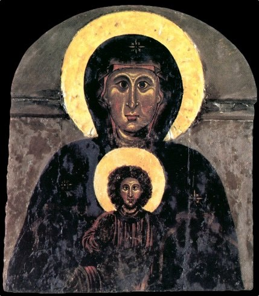
  <figcaption>Maestro della Croce 434 or Coppo di Marcovaldo, Madonna and Child, c. 1230, tempera and gold on panel. Rosano (Rignano sull'Arno), monastery of Santa Maria. Image: public domain, via Wikimedia Commons.</figcaption>
</figure>

The Madonna of Rosano is kept in the monastery of Santa Maria at Rosano, in the Arno valley east of Florence, an ancient community of Benedictine nuns. It is a small panel with an arched top, and it shows the Virgin and Child in half-length. It is dated to about 1230.

The Virgin is frontal, wrapped in a dark mantle marked with small gold stars on the forehead and the shoulders, the sign of her virginity in Byzantine icons. Her face is long, with large dark eyes, a long nose and a small mouth, framed by a large gold halo that fills the upper part of the panel.

The Child is shown frontally in front of her, at the centre of the panel, with a gold halo, curly hair and a dark red robe. His position, centred and frontal, recalls the Byzantine images in which the Virgin presents the Child to the viewer, though the worn surface makes the gestures difficult to read.

The panel survives in a darkened state. The colours have lost much of their brightness, the lower part of the panel is worn, and the mantle of the Virgin and the robe of the Child are hard to tell apart.

The attribution of the panel moves between the Maestro della Croce 434 and the young Coppo di Marcovaldo. Those who give the cross no. 434 to the young Coppo can include the Madonna of Rosano in his early work; those who keep the two painters apart give it to the Maestro della Croce 434.

The monastery of Rosano is one of the oldest Benedictine houses of women in the Florentine territory, and it keeps other works of early Tuscan painting, among them a painted cross of the twelfth century that gave its name to the [Maestro di Rosano](/Content/Artists/XII-c/Maestro-di-Rosano.html). The Madonna is one of the images that the nuns commissioned for their church.

The panel belongs, with the Madonna of unknown location, to the earliest works given to the painter. Its frontal composition and its dark colours are closer to the Byzantine icons than the crosses of the following decades, and they show the starting point of his development.

The arched top of the panel, the half-length figures and the stars on the mantle place it among the Tuscan Madonnas derived from Byzantine icons in the first decades of the century, before the large enthroned Madonnas of Coppo and Cimabue.

### Madonna and Child, Location Unknown

<figure>
  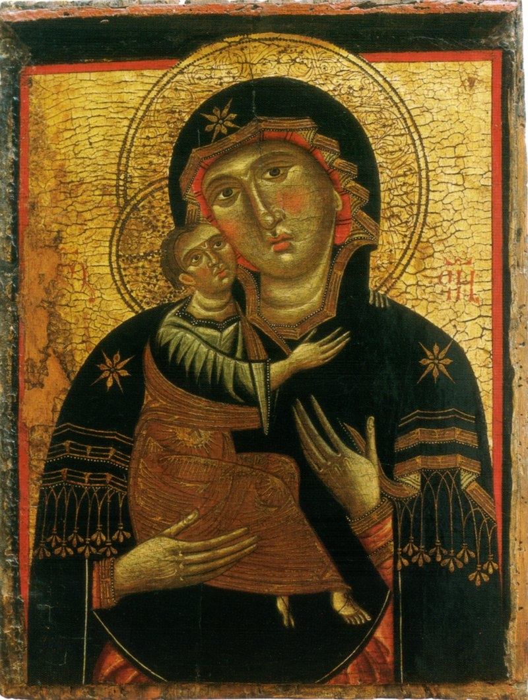
  <figcaption>Maestro della Croce 434, Madonna and Child, c. 1230, tempera and gold on panel. Location unknown. Image: public domain, via Wikimedia Commons.</figcaption>
</figure>

This Madonna is listed among the works of the Maestro della Croce 434 with the date of about 1230, and its present location is unknown. It is reproduced from a photograph published in the literature. The panel is rectangular, with a red border, and shows the Virgin and Child in half-length on a gold ground.

The Virgin holds the Child on her right arm and raises her left hand towards him. Her dark blue mantle is marked with gold stars on the head and shoulders, and her sleeves end in cuffs patterned in gold. Her face, turned slightly towards the Child, has large eyes, a long nose, red cheeks and a small mouth.

The Child presses his cheek against his mother's and puts his arm around her neck. This is the type that Byzantine art called the *Eleousa*, the Virgin of tenderness, in which the embrace of mother and child expresses love and foreshadows the Passion. The Child wears a dark green tunic and an orange mantle streaked with gold lines, and his bare feet show below.

Beside the Virgin's head the Greek letters of her name, Mother of God, are painted in red, now faded. The inscription, like the type of the image, shows the direct dependence of the panel on Byzantine icons, which were known in Tuscany through imported works and through the painting of Pisa and Lucca.

The gold lines on the Child's mantle, the chrysography of Byzantine painting, are drawn in fine parallel strokes that follow the folds. The technique was used widely in Tuscan painting of the thirteenth century to give the garments of holy figures a supernatural light.

The face of the Virgin, with its long nose and its large eyes under arched brows, is close to the faces of the cross of Fiesole and of the Madonna of Rosano. This similarity is the basis of the attribution and of the early date.

The panel's surface is cracked and worn, especially in the gold ground, but the figures are well preserved. The colours, the dark blue of the mantle, the green and orange of the Child and the red of the border, are strong.

The location of the panel is not given in the sources consulted for this entry. Its inclusion in the painter's work rests on the photograph and on the judgment of the scholars who published it.

### Madonna Enthroned with Seventeen Stories of the Virgin, Moscow

The large panel in the Pushkin Museum in Moscow shows the Virgin enthroned with the Child at the centre and seventeen small scenes of her life around her. It measures 246 × 138 cm and is painted in tempera and gold on wood. The museum catalogues it under inv. 2700, as the work of the circle of Coppo di Marcovaldo, and dates it 1275–1280.

Part of the literature gives the panel to the Maestro della Croce 434 and dates it around 1255–1260. The difference of twenty years between the two dates, and of attribution between the two painters, reflects the close relation between the Maestro della Croce 434 and Coppo, which some scholars have resolved by identifying them.

The panel was bought in Rome in 1863 by the Russian collector Pyotr Ivanovich Sevastyanov, a collector of Christian antiquities, who gave it in 1864 to the Rumyantsev Museum in Moscow. It passed to the State Historical Museum in 1924 and to the Pushkin Museum in 1932. Its history before 1863 is unknown, and the church for which it was made has not been identified.

The museum records that the halo of the Virgin is surrounded by inserts of rock crystal, and that the Greek monograms of her name, Maria Theotokos, are painted at the level of her shoulders. The halo set with inserts is a feature shared with the cross no. 434, whose halo is set with stones or glass.

The seventeen scenes surround the central image, and they tell the life of the Virgin. Their individual subjects have not been identified in the sources consulted for this entry, and no free reproduction of the panel was available for study. They are therefore not listed here.

The panel is a rare example of a large Marian image with a narrative cycle in thirteenth-century Tuscany. Its type, a central figure surrounded by scenes, is that of the Franciscan panels of Pescia and Pistoia, applied to the Virgin, and it anticipates the narrative altarpieces of the later century.

In 2011–2012 the panel was lent to the Uffizi for the exhibition *Agli albori della pittura fiorentina. La Maestà del Museo Puškin di Mosca*, curated by Tartuferi, where it was compared with the great Maestà of Cimabue, Duccio and Giotto and shown with the panel of Pistoia.

Whether the panel belongs to the Maestro della Croce 434 or to the circle of Coppo, it shows the transformation of Florentine painting in the middle and second half of the century, when the large narrative panel became a central form of altar painting. Its attribution remains one of the open questions of the painter's work.

### Comparison: Berlinghiero, the Cross of Santa Maria degli Angeli, Lucca

<figure>
  
  <figcaption>Berlinghiero, painted cross (Christus triumphans), c. 1210–1220, tempera and gold on panel, 174.7 × 140.5 cm, for comparison. Lucca, Museo Nazionale di Villa Guinigi, inv. 226, from the monastery of Santa Maria degli Angeli. Image: The Yorck Project, public domain, via Wikimedia Commons.</figcaption>
</figure>

The cross of Berlinghiero, from the monastery of Santa Maria degli Angeli in Lucca and now in the Museo Nazionale di Villa Guinigi, is the signed work from which the study of Lucchese painting of the thirteenth century starts. At the foot it bears the inscription BERLINGERIUS ME PINXIT, "Berlinghiero painted me". It is dated around 1210–1220.

Christ is alive, upright and frontal, with open eyes, on a dark blue cross with ornamental borders. His body is drawn with a few curved lines, his abdomen swelling, and he wears a green loincloth knotted at the waist. His halo is set with stones, like the haloes of the Maestro della Croce 434.

At the top the Virgin stands between two angels, her arms crossed on her breast. At the ends of the arms are the symbols of the Evangelists, the angel and the ox on the left, the eagle and the lion on the right. Beside the body stand the Virgin and Saint John, the Virgin with her hand on her breast, John with his hand to his cheek.

At the foot, on either side of the feet of Christ, two small figures represent the denial of Peter: the apostle seated by a small fire on the left and the servant girl on the right. The scene, which Berlinghiero placed at the foot of the cross, was taken up by his followers: it returns at the foot of the cross of Tereglio, beside the body in the cross of Fiesole, and at the foot of the crosses of the Maestro del Bigallo.

The comparison shows how much the Maestro della Croce 434 took from Berlinghiero. The type of the cross, with its widened panel beside the body and its square terminals, the ornament of the borders, the figures of the mourners and the motif of Peter's denial all come from the Lucchese master.

It also shows what he changed. Berlinghiero's Christ is a frontal, almost flat figure, standing before the cross. The Christ of the Fiesole cross, still triumphant, has a more modelled body; the Christ of the cross no. 434 is dead, swaying and strongly modelled in light and shade. In two decades the painter moved from the model of Berlinghiero to the model of Giunta.

Berlinghiero was a painter from Volterra, documented in Lucca in 1228 and dead by 1236, and the father of Barone, Bonaventura and Marco. His workshop dominated painting in Lucca in the first half of the century, and its models spread to Pisa, Pistoia and Florence. The hypothesis that the Maestro della Croce 434 was one of his sons rests on this relation, but it has no documentary support.

The cross is described in the entry on [Berlinghiero](/Content/Artists/XIII-c/Berlinghiero-di-Melanese.html), where a different photograph of it is reproduced.

### Comparison: the Maestro del Bigallo, the Cross in Rome

<figure>
  
  <figcaption>Maestro del Bigallo, painted cross, tempera and gold on panel, for comparison. Rome, Galleria Nazionale d'Arte Antica, Palazzo Barberini. Photo: Francesco Bini, <a href="https://creativecommons.org/licenses/by-sa/4.0/">CC BY-SA 4.0</a>, via Wikimedia Commons.</figcaption>
</figure>

The [Maestro del Bigallo](/Content/Artists/XIII-c/Maestro-del-Bigallo.html), named after a cross in the Museo del Bigallo in Florence, was the other leading painter in Florence in the second quarter of the thirteenth century. His cross in the Galleria Nazionale d'Arte Antica at Palazzo Barberini in Rome repeats the scheme of the Bigallo cross, and its attribution to the same hand is generally accepted.

Christ is alive, with open eyes and an upright body, on a blue cross, and wears a green knotted loincloth. At the top a roundel holds the bust of Christ, and below it the Virgin raises her hands between two angels. Angels stand in the terminals, and the Virgin and Saint John stand beside the body.

At the foot, below the feet of Christ, a cock stands on a red mound between two small figures, one of whom must be Saint Peter. The motif of Peter's denial is the same as in the cross of Fiesole and in the crosses of Lucca and Tereglio. It shows the common Lucchese origin of the two Florentine masters.

The Maestro del Bigallo and the Maestro della Croce 434 were both trained in the tradition of Berlinghiero, and both brought it to Florence. Their crosses share the type, the mourners and the motif of Peter. But the Maestro del Bigallo kept the triumphant Christ in most of his crosses, while the Maestro della Croce 434 adopted the suffering Christ in the cross no. 434 and in the cross of La Quiete.

The Maestro del Bigallo also painted a *Christus patiens*, in his late cross now in the Art Institute of Chicago. The passage from the triumphant to the suffering Christ thus took place in the work of both painters, in the same decades, under the influence of Giunta Pisano.

The two crosses can be compared in the treatment of the body. The Christ of the Maestro del Bigallo is frontal and symmetrical, his body drawn in clear outlines; the Christ of the Fiesole cross, also triumphant, has a stronger modelling of the chest and abdomen. The difference shows the Maestro della Croce 434's interest in light and shade.

The Bigallo cross and the cross no. 434 are both in Florentine museums, and Tartuferi's study of 2007 set the two painters side by side in the Florentine painting of the first half of the century.

The cross in Rome is described in the entry on the Maestro del Bigallo, from which this photograph is taken.
