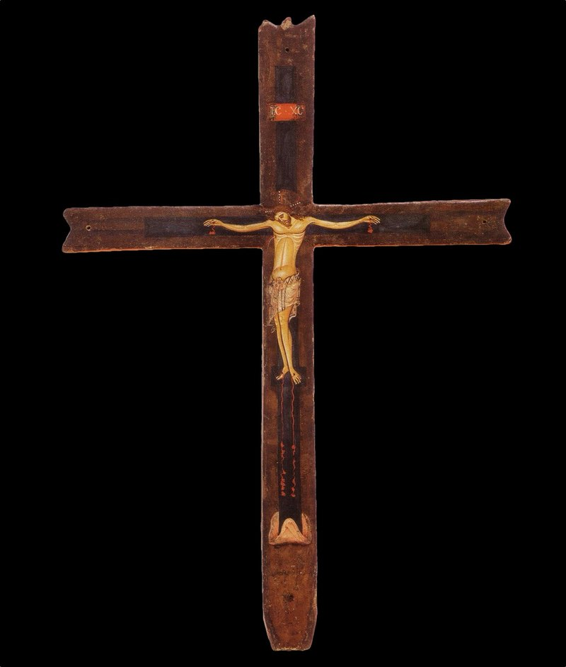
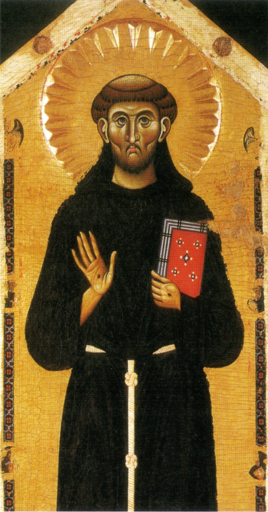
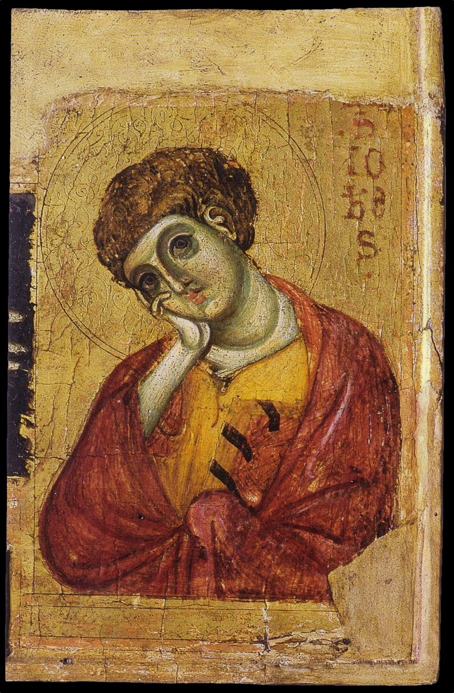
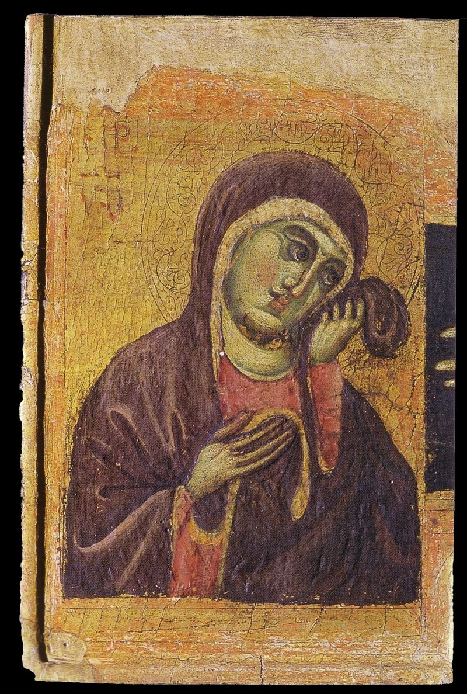

## A Painter Named after a Madonna

The *Maestro di Santa Maria Primerana* takes his name from a painting of the Virgin and Child enthroned with two angels in the church of Santa Maria Primerana at Fiesole, on the hill above Florence. The American scholar [Edward B. Garrison](/scholars.html#garrison-edward), in 1947, grouped around this panel a number of works that he considered by the same hand, and the group has since been known by the name of the church.

Nothing is known of the painter beyond the works. No document records his name, his birth, his training, his workshop or his death, and none of the works given to him is signed or dated. His career can be reconstructed only by comparing the paintings with one another and with the works of painters whose careers are better known, above all Giunta Pisano.

The group is small and varied. Besides the Fiesole Madonna it includes a portable triptych now in the Princeton University Art Museum, a small double-sided processional cross in the Fondazione Giorgio Cini in Venice, the face of Saint Francis in the large panel of the saint in the Museo Civico of Pistoia, and a few Madonnas in Dresden and in country churches around Florence. Some scholars also connect him with the mourners of a cross by Giunta in Pisa.

What holds the group together is a manner of painting faces. The painter takes the types of Giunta Pisano, the arched eyebrows, the long nose, the small, tight mouth and the wide eyes, and pushes them to an extreme, so that the faces acquire a strange, almost sculptural intensity. Garrison found the result naïve; later scholars have seen in it a powerful and original interpretation of the Pisan model.

The painter's importance lies in his position. [Angelo Tartuferi](/scholars.html#tartuferi-angelo) has described his work as the first appearance of the art of Giunta Pisano in Florentine painting. In the middle of the thirteenth century Florence received the models of Lucca, through the Maestro del Bigallo and the Maestro della Croce 434, and those of Pisa, through the Primerana Master; from their meeting came the painting of Coppo di Marcovaldo and, later, of Cimabue.

His identity is also a problem. [Miklós Boskovits](/scholars.html#boskovits-miklos) considered the group the late phase of the [Maestro della Croce 434](/Content/Artists/XIII-c/Maestro-della-Croce-434.html), and others have seen his hand in works by or close to [Coppo di Marcovaldo](/Content/Artists/XIII-c/Coppo-di-Marcovaldo.html). [Magnolia Scudieri](/scholars.html#scudieri-magnolia) and Tartuferi have kept him apart as a distinct personality of Pisan formation. The question remains open.

The present entry rests on the works themselves, on the catalogues of the institutions that keep them and on the scholarship cited. Where the sources record nothing, as for the painter's life, the entry supplies nothing; where scholars disagree, it reports their views side by side. A large cross in the Museo Bandini at Fiesole, sometimes listed among his works, is given by the museum to another painter, the Maestro di Gagliano, and is not included here.

The entry is arranged in five chapters: after this introduction, the group of works and its limits; the painter's formation in the orbit of Giunta Pisano; his relations with the Maestro della Croce 434 and Coppo di Marcovaldo; and his style and critical history. The catalogue then examines each work, first in a historical introduction and then in a description of the images.

## The Works and Their Limits

The works most often given to the Primerana Master are few. At their centre stands the Fiesole Madonna, the name-piece. Around it stand the Princeton triptych, the Cini processional cross and the Dresden Madonna; the face of Saint Francis in the Pistoia panel; and two Madonnas in country churches near Florence, at San Donato a Torri near Compiobbi and at San Martino a Maiano, the second heavily repainted. A Madonna recorded in the Frascione collection in Florence in 1947 has also been given to him.

These works differ in kind and in condition. The Fiesole Madonna is a large processional image, worn by centuries of use and exposure. The Princeton triptych is a small object for private devotion, carefully preserved. The Cini cross is a portable processional cross, painted on both faces. The Pistoia panel is a large Franciscan altarpiece painted by more than one hand. They show the painter working for different patrons and for different uses.

The dates of the works are proposed rather than known. The Princeton triptych and the Cini cross are placed around 1250; the Pistoia panel around 1250–1260; the Fiesole Madonna is dated by the Italian national catalogue around 1250, by part of the literature around 1260–1270, and by Garrison as late as 1270–1280; the Dresden Madonna around 1260–1270. The painter's activity is thus placed in the middle decades of the century.

Several works are shared with other painters. In the Pistoia panel the Primerana Master is credited only with the face of Saint Francis, the rest being given to the Maestro della Croce 434 or to Coppo. The Compiobbi Madonna has been divided between him and the [Maestro della Maddalena](/Content/Artists/XIII-c/Maestro-della-Maddalena.html), and is now more often given to the [Maestro del Bigallo](/Content/Artists/XIII-c/Maestro-del-Bigallo.html). Such divisions are common in the study of the anonymous painters of the Duecento.

Other works have been taken away from the group. The large cross with Christ triumphant, the mourners, prophets and the Virgin among angels in the Museo Bandini at Fiesole, which some lists give to the Primerana Master, is attributed by the museum to the Maestro di Gagliano, a painter named after a Madonna at Gagliano in the Mugello. Its story is told in the paper [The Bandini Crucifix](/Content/Papers/The-Bandini-Crucifix.html).

The mourners of Giunta Pisano's cross from San Ranierino in Pisa occupy a special place. They are not usually counted among the Primerana Master's works, but Garrison, [Enzo Carli](/scholars.html#carli-enzo) and [Luciano Bellosi](/scholars.html#bellosi-luciano) have seen in them a hand different from Giunta's and close to the Primerana Master. They are examined in the catalogue as a comparison that shows the painter's Pisan roots.

The group is thus not a fixed list but a set of works linked with different degrees of certainty. The Fiesole Madonna, the Princeton triptych and the Cini cross form its core; the Pistoia face and the Dresden Madonna are widely accepted; the country Madonnas and the Pisan mourners are more uncertain. The catalogue follows this order.

The variety of the works is a warning. A group defined by the style of faces may include works by the same workshop, by pupils or by painters who imitated the same models. The present entry describes each work as it is and records the attributions without deciding between them where the evidence does not allow it.

## Between Pisa and Florence

The painter's formation is traced by all scholars to the art of [Giunta Pisano](/Content/Artists/XIII-c/Giunta-Pisano.html), the Pisan painter Giunta di Capitino, documented from 1229 to 1254. Giunta was the most influential painter of central Italy in the second quarter of the century. His signed crosses, for Santa Maria degli Angeli at Assisi, for San Domenico in Bologna and for San Ranierino in Pisa, spread the image of the dead Christ, the *Christus patiens*, through Tuscany, Umbria and Emilia.

Giunta's figures are characterised by long, curving outlines, strongly arched eyebrows that join the line of the nose, deep shadows around the eyes and a body that sags and sways on the cross. His faces have a gravity and an emotional intensity that made them a model for a generation of painters. The Primerana Master took these features and exaggerated them.

Whether the painter trained in Giunta's workshop in Pisa, or learned his manner from works that reached Florence, cannot be said. The closeness of his faces to those of the mourners of the San Ranierino cross, which Garrison, Carli and Bellosi have given to a hand close to his, suggests that he knew the Pisan workshop at first hand. Tartuferi has stressed the Pisan cultural basis of his art.

The Pisan connection also appears in the objects he painted. The portable triptych, with a central Madonna and two wings with scenes, was a form widely used in Pisa and in the painting of the Byzantine world, from which Pisa received many icons. The curators of Princeton suggest that the triptych may have come from Pisa, and the Yale University Art Gallery records Tartuferi's comparison between a Florentine triptych of about 1270 and the Pisanising culture of the Primerana Master.

The silver grounds that the painter used on several works, now darkened by oxidation, are another link with the luxury techniques of Pisan and Byzantine painting. Silver leaf, cheaper than gold but brilliant when new, gave the images a cold, shimmering light; when it tarnished, it turned dark, as on the Fiesole Madonna, whose ground now appears brown.

The painter's work, however, was done in Florence and its territory. The Fiesole Madonna, the country Madonnas of Compiobbi and Maiano, and the Pistoia panel all belong to the Florentine area, and the processional cross and the triptych may have been made there too. He was thus a Florentine painter, or a painter working in Florence, who had absorbed the art of Pisa.

His arrival in Florentine painting coincided with the period in which the city was receiving the models of Lucca, through the Maestro del Bigallo and the Maestro della Croce 434. The Primerana Master brought the other great tradition of western Tuscany, that of Pisa, and his work shows how the two currents met in Florence in the middle of the century.

The meeting was decisive for what followed. Coppo di Marcovaldo, in the 1250s and 1260s, combined the narrative and ornamental richness of the Lucchese tradition with the intensity of the Pisan faces; Cimabue, in the following decades, transformed both. The Primerana Master stands at the beginning of this development, as the painter who first brought Giunta to Florence.

## The Master of the Cross 434 and Coppo

The relation of the Primerana Master to the [Maestro della Croce 434](/Content/Artists/XIII-c/Maestro-della-Croce-434.html) is the main question of his critical history. As early as 1907 and 1929, [Adolfo Venturi](/scholars.html#venturi-adolfo) and [Evelyn Sandberg-Vavalà](/scholars.html#sandberg-vavala-evelyn) linked works of the group with the Saint Francis of the Bardi Chapel and with the cross no. 434 of the Uffizi, so that the problem of the two painters was posed before either had received a name.

Boskovits, in 1976 and again in the *Corpus of Florentine Painting* of 1993, argued that the Primerana group represents the late phase of the Maestro della Croce 434. In his view the painter of the Uffizi cross, trained on Lucchese models, turned in his later years towards the art of Giunta and painted the Fiesole Madonna and the works around it. The proposal would join the two groups into a single career from about 1230 to about 1270.

Scudieri, in 1988 and 2004, first gave the Pistoia panel to the Maestro della Croce 434 while recognising the hand of the Primerana Master in the face of Saint Francis, and later argued that the two were distinct painters. Tartuferi, in 2004 and 2007, kept the same division in the Pistoia panel and stressed the Pisan culture of the Primerana Master, against the Lucchese culture of the Master of the Cross 434.

The Pistoia panel is thus the meeting point of the two painters. If the face of the saint is by the Primerana Master and the rest of the panel by the Maestro della Croce 434, the two worked together on the same commission, as partners or as members of the same workshop. If they are one painter, the panel shows him at the moment of his change of style.

Bellosi, in 1991 and 1998, proposed a different solution. He gave the Pistoia panel to Coppo di Marcovaldo, with the Primerana Master perhaps responsible for the face of the saint. In this view the Primerana Master would have been a collaborator of Coppo, the leading Florentine painter of the third quarter of the century, rather than of the Maestro della Croce 434.

The three positions agree on one point: the face of Saint Francis at Pistoia is by a different hand from the rest of the panel, and it is close to the Fiesole Madonna. They differ on who painted the rest and on the relation between the painters. The face, examined in the catalogue, is the key piece of evidence.

The debate reflects the nature of Florentine painting in these decades. Painters worked in small workshops, shared commissions, used the same models and passed from one master to another. The conventional names given by modern scholars to groups of works may correspond to individual painters, to workshops or to phases of a single career, and the boundaries between them are not always clear.

The present entry follows the majority view, which keeps the Primerana Master as a distinct personality of Pisan formation, active in Florence beside the Maestro della Croce 434 and Coppo. It records the other positions, and the catalogue of the Maestro della Croce 434 records the same debate from the other side.

## Style and Critical History

The Primerana Master's style is defined above all by his faces. The Virgin of Fiesole, the Madonna of Princeton and the Saint Francis of Pistoia share the same features: a long, oval face, eyebrows drawn as high, continuous arches that run into the line of the nose, wide eyes with dark pupils set close to the upper lid, a long, thin nose with a curved tip, a small mouth with tight lips and a round chin. The effect is one of fixed, intense attention.

The modelling of the faces is strong. The flesh is painted over a greenish underlayer, in the Byzantine manner, with dark shadows around the eyes and under the chin and with red accents on the cheeks, the lips and the edges of the forms. The result gives the faces a sculptural quality; of the Fiesole Madonna, Scudieri observed that it is closer to mosaic than to panel painting.

The drapery is drawn with angular folds, sharply lit, and the figures are set against grounds of gold or silver. In the narrative scenes of the Princeton triptych the figures move with energy: the flagellators raise their arms, the women bend to support the fainting Virgin, the angels mourn above the cross. The painter could tell a story as well as paint an icon.

Garrison, who defined the group in 1947, judged the Fiesole Madonna harshly, as the work of a naïve or incompetent hand. His judgement reflected the taste of a generation that measured Duecento painting against the later achievements of Cimabue and Giotto. Later scholars, from Boskovits to Tartuferi, have seen the same features as deliberate exaggerations of the Giuntesque model and as the expression of a strong personality.

The study of the group has been shaped by the large surveys of Florentine painting of the Duecento. Garrison's index of Italian Romanesque panel painting of 1949, Boskovits's volume of the *Corpus of Florentine Painting* of 1993 and Tartuferi's *La pittura a Firenze nel Duecento* of 1990 and his catalogue of 2007 set the painter among his Florentine contemporaries and defined the debates recorded here.

Exhibitions have also played a part. The exhibition *L'arte a Firenze nell'età di Dante*, held in Florence in 2004, and the exhibition *Cimabue a Pisa*, held in Pisa in 2005, brought together works of the period and published them in their catalogues, which are the source of several reproductions in this entry.

The Primerana Master is now considered one of the key figures of Florentine painting before Coppo. His faces, with their strange intensity, are among the most memorable of the Duecento, and his work documents the moment when the art of Pisa entered Florence and began to transform it.

The open questions remain many: his identity with the Maestro della Croce 434, his relation to Coppo, the extent of his group, the dates of his works. The catalogue that follows examines each work in turn, first in its history and then in its images.

## Catalogue Entry

### The Madonna of Santa Maria Primerana: History

The Madonna that gives the painter his name belongs to the church of Santa Maria Primerana in Fiesole, which faces the main square of the town, opposite the cathedral. Fiesole, an Etruscan and Roman city on the hill above Florence, was the seat of a bishop and had been absorbed by Florence in the twelfth century. Its churches kept images of ancient and deep local devotion, and the Madonna of Santa Maria Primerana was one of the most venerated.

The panel shows the Virgin enthroned, frontal, holding the Child on her lap, with two half-length angels in the upper corners. It is painted in tempera on panel, with silver and gold, and measures about 109 × 61 cm according to the Italian national catalogue, 110 × 62 cm according to other sources. Its head rises above the rectangle of the panel in a large halo, so that the outline of the painting follows the figure of the Virgin.

The national catalogue records that the image was the object of a strong devotion from its earliest years. It was carried in processions, and the catalogue mentions in particular the processions held during the siege of Florence in 1529, when the city prayed for deliverance. Frequent use wore the painting quickly, and a copy, similar to the original, was made to take its place in some of these functions.

The same use explains its condition. The catalogue describes the panel as fragmentary, with extensive integrations, and attributes its losses to repeated exposure to the weather during processions. A painting carried through the streets in rain and sun, and touched by the faithful, could not survive intact, and the Fiesole Madonna shows the marks of this long devotional life.

The panel has been restored several times. The catalogue lists restorations in 1890, in 1947, by the restorers Sokoloff and Nicolosi, and in 1962–1963, all by the Florentine superintendence. The restoration of 1947, carried out in the same year in which Garrison published his study, made the panel newly legible and contributed to its place in the history of Florentine painting.

The image appears in the local literature from the eighteenth century. The catalogue's bibliography begins with Sacchetti in 1724 and continues with Moreni, Bandini in 1800, Del Rosso, Inghirami and other writers on Fiesole of the nineteenth century, who recorded the Madonna as one of the town's ancient sacred images rather than as a work of art.

Its modern critical history begins with Garrison. In 1947 he grouped around it a number of works and gave their painter the name of the church; he judged the Madonna harshly, as the work of a naïve or incompetent hand. The national catalogue also records that Garrison connected the panel with the so-called Maestro di Rovezzano, a painter close to Meliore and to Margarito d'Arezzo, and that he dated it to 1270–1280.

Later scholars have proposed different dates. The national catalogue gives about 1250; part of the literature prefers about 1260–1270. The difference reflects the uncertainty that surrounds the whole group: the Fiesole Madonna could stand at the beginning of the painter's Florentine career, close to the Princeton triptych and the Cini cross, or at its end, after the Pistoia panel.

Scudieri, as the national catalogue records, observed that the panel is closer to works in mosaic than to panel painting. The observation concerns the hard, schematic modelling of the faces and the flat, decorative treatment of the surface, and it connects the Madonna with the mosaics of the Baptistery of Florence, on which Florentine painters were working in the same decades.

The type of the image is that of the Virgin enthroned with the Child seated frontally on her lap, holding a scroll and blessing. It comes from Byzantine models, and in Tuscany it was used for the large panels of the Virgin that the churches placed on their altars or carried in procession. The angels in the upper corners, with their hands veiled, recall the angels who attend the Virgin in Byzantine icons.

The halo that rises above the panel, decorated with bosses in relief, and the silver of the ground were the most precious parts of the image. When new, the silver would have shone like metal around the dark mantle of the Virgin; now oxidised, it appears brown, and the image has lost much of its original brilliance.

The Madonna of Santa Maria Primerana is thus at once a work of art, the name-piece of an anonymous painter, and a sacred object with a long civic history. Its condition, its copy and its processions are as much a part of its history as its style, and they explain both its fame in Fiesole and the difficulty of judging its original quality.

### The Madonna of Santa Maria Primerana

<figure>
  
  <figcaption>Maestro di Santa Maria Primerana, Madonna and Child enthroned with two angels, mid-thirteenth century, tempera, silver and gold on panel, c. 109 × 61 cm. Fiesole, Santa Maria Primerana. Image: public domain, via Wikimedia Commons.</figcaption>
</figure>

The panel is seen whole, against a dark background. Its outline is a tall rectangle from which the halo of the Virgin rises at the top, so that the head of the Virgin breaks the edge of the panel. The ground, once silver, has darkened to a deep brown, and against it the figures stand out in dark blue, red and gold.

The Virgin sits frontally on a wide throne, her body broad and massive. She wears a dark blue mantle, drawn over her head and falling to her feet, with small gold stars on the forehead and the shoulders, the Byzantine sign of her virginity. Under it she wears a dark red dress, which spreads over her knees in large, rounded folds.

Her face is long and oval, framed by the mantle and a yellow veil. The eyes are wide and dark, set under high arched brows; the nose is long and thin; the mouth is small and red, with a strong shadow beneath. The cheeks are marked with red. It is the face that defines the painter: fixed, intense and almost geometric in its regularity.

The Child sits frontally on her lap, at the centre of the panel, in a brown robe. He raises his right hand in blessing and holds a scroll in his left. His head, with short hair and wide eyes, is set in a small halo. The Virgin's right hand rests on his foot and her left hand on his shoulder, presenting him to the viewer.

In the upper corners two angels appear in half-length, with dark wings and pale robes, their hands veiled by the robes in a gesture of reverence. They turn towards the Virgin. Their small size and their pale colour make them seem to float on the dark ground, like the angels of Byzantine icons.

The throne is drawn as a wide seat with a large red cushion and a base decorated with panels and scrolls. The Virgin's feet, in pointed shoes, rest on a footstool decorated with a row of circles. At the corners of the panel and at the sides, small eight-pointed stars and bosses in relief stand on the dark ground.

The halo of the Virgin is decorated with raised bosses around its edge, catching the light, and the Child's halo repeats it on a smaller scale. These elements in relief, made in gesso and gilded, added a precious, three-dimensional quality to the image, appropriate to an object of devotion carried in procession.

The photograph shows the panel after its restorations. The extensive integrations recorded by the national catalogue are visible in the uneven surface of the ground and in the flattened colour of the mantle and dress. The faces and the hands, which preserve the painter's drawing, are the parts on which the attribution of the group rests.

### The Princeton Triptych: History

The triptych in the Princeton University Art Museum is a small portable altarpiece made of three panels: a central panel with the Madonna and Child under an arch, and two wings, hinged to it, with scenes of the Annunciation, the Flagellation and the Crucifixion. When open it measures 42.2 × 52.2 cm, and its frame is 5.5 cm deep. The wings could be closed over the central panel to protect it.

The museum catalogues it as a work painted in Florence, perhaps from Pisa, in the middle of the thirteenth century, and does not name its painter. Scholars have given it to the Primerana Master, whose faces it shares, and it is one of the three works on which his group rests. The literature dates it around 1250.

Its modern history is recorded by the museum. It belonged to Wladimir de Grüneisen, born in 1868, a collector in Paris and a scholar of early Christian and Byzantine art. It was on the art market in Brussels in the late 1920s or early 1930s, as a photograph of the period shows, and by about 1940 it was in the collection of Jacob Reder in New York.

In 1958 Jacob Reder and his wife gave it to the Princeton University Art Museum, in memory of their son Emmanuel Reder, who died in the Normandy invasion in 1944; an anonymous gift contributed to the acquisition. It bears the inventory number y1958-126. Its history before the twentieth century, and the place for which it was made, are unknown.

The portable triptych was a form of devotional object common in the Byzantine world and in the Italian cities that traded with it, above all Pisa and Venice. Small enough to be carried or set on a domestic altar, it allowed its owner to pray before an image of the Virgin and to meditate on the scenes of the Passion. The form spread in Tuscany in the thirteenth century and became widespread in the fourteenth.

The museum notes that the painter was familiar with Byzantine icons, and the central Madonna repeats a Byzantine type, the Virgin of tenderness, in which the Child presses his cheek to his mother's. The wings, with their small scenes, combine the Byzantine tradition with the narrative manner of Tuscan painting.

The choice of scenes is unusual. Beside the Annunciation and the Crucifixion, the triptych includes the Flagellation, a scene less common in small devotional objects. The museum suggests that the triptych may have been commissioned by a member of a penitential confraternity of flagellants, whose members scourged themselves in imitation of Christ.

The flagellant movement spread through Italy in 1260, when processions of penitents scourging themselves passed from Perugia through the cities of central and northern Italy. Confraternities of *disciplinati* were founded in many cities, and their members met to pray and to perform penance together. A triptych with the Flagellation would have been an appropriate image for such a devotee, though the triptych may also be earlier than 1260.

The triptych has been compared with other small Tuscan triptychs of the period. The Yale University Art Gallery records that Tartuferi saw contacts between a Florentine triptych in its collection, of about 1270, and the Pisanising culture of the Primerana Master. Such comparisons place the Princeton triptych in a group of small devotional works made in Florence and Pisa in the middle of the century.

The Princeton triptych is the best preserved of the Primerana Master's works. Its gold, its colours and its punched decoration are largely intact, and it allows his manner to be seen more clearly than in the worn Fiesole Madonna. It is the work on which most judgements of his style rest.

Its small scale does not diminish its importance. In the central Madonna the painter's faces appear at their most intense, and in the scenes of the wings his narrative skill can be judged. The triptych shows that he was both a painter of icons and a painter of stories.

Its presence in an American university museum is typical of the fate of many small Duecento panels. Easily moved and sold, they passed through collections and markets in the nineteenth and twentieth centuries and are now dispersed in museums far from the places for which they were made, their original owners and uses forgotten.

### The Princeton Triptych

<figure>
  
  <figcaption>Maestro di Santa Maria Primerana, triptych with the Madonna and Child, the Annunciation, the Flagellation and the Crucifixion, c. 1250, tempera and gold on panel, 42.2 × 52.2 cm (open). Princeton University Art Museum, y1958-126. Image: public domain, via Wikimedia Commons.</figcaption>
</figure>

The triptych is seen open, on a red wall. The central panel, taller than the wings, is framed by a heavy gilded moulding at top and bottom and contains a round-headed field with the Madonna and Child. The two wings, hinged to it by metal rings, contain the narrative scenes. The whole object is small, made to be held or set on a table.

The central Madonna fills the arched field. The Virgin, in a dark green mantle over a blue veil, holds the Child in her arms and inclines her head towards him. The Child embraces her and presses his cheek to hers. She holds in her left hand a white cloth with red stripes and a tassel. The gold ground around them is decorated with punched dots along the edge of the arch.

The left wing is divided into two scenes. Above, the Annunciation: a small angel flies in at the upper left, and the Virgin, standing before a building of yellow masonry with a window marked with a cross, raises her hand. Below, the Flagellation: Christ, bound to a tall column, stands between two men who raise their whips over their heads.

The right wing is filled by the Crucifixion. Christ hangs on a tall cross, his arms raised in a V, his head bowed. Above the arms two angels mourn, their faces covered. Beside the cross appear two mourners in half-length, a woman in a dark veil and a young man, and below them, before a crenellated wall, a group of holy women supports a fainting woman, presumably the Virgin, while a woman in blue stands at the right; at the foot of the cross lie white bones, the remains of Adam.

The scenes are painted on grounds of dark green and gold, with bright colours: the red and blue of the Virgin's garments, the pink and white of the flagellators, the pink loincloth of Christ. The figures are small but lively, and their gestures, the raised whips, the falling Virgin, the mourning angels, express the drama of each scene.

The composition of the whole follows a logic of meditation. In the centre the Virgin and Child present the Incarnation and the love of the mother; at the left the Annunciation recalls its beginning and the Flagellation the suffering of Christ; at the right the Crucifixion shows its end. The viewer passes from the tenderness of the central image to the sorrow of the Passion.

The frame is original, with its gilded mouldings, its round finials and the metal hinges of the wings. The wings show wear at their edges, and the gold has worn in places, revealing the red bole beneath. The painted surfaces, however, are well preserved, and their colours retain much of their original brightness.

The triptych is the most complete surviving work of the Primerana Master. In it the painter's two sides appear together: the intense, icon-like faces of the central Madonna and the lively narration of the wings. The details that follow examine the central panel and the wings at closer range.

### The Princeton Triptych: the Madonna and Child

<figure>
  
  <figcaption>Maestro di Santa Maria Primerana, Princeton triptych, detail of the Madonna and Child. Princeton University Art Museum. Image: public domain, via Wikimedia Commons.</figcaption>
</figure>

The central panel shows the Virgin and Child in the Byzantine type of the Virgin of tenderness, the *Eleousa*, in which the Child presses his cheek against his mother's and embraces her. The type expresses the love between mother and son, and also, in Byzantine devotion, the mother's foreknowledge of the Passion.

The face of the Virgin is the most characteristic face of the painter. It is long and broad at the cheekbones, with wide, dark eyes set close under high, curving brows, a long nose whose line curves into the brow, red cheeks and a small red mouth with a pointed upper lip. The modelling is strong, with dark shadows around the eyes and a pale, sculptural surface.

The Child, with curly hair and wide eyes, turns his face towards the viewer while pressing his cheek to his mother's. He embraces her with one arm, in a light blue sleeve, and his robe is brown over a blue tunic. His face repeats the features of the Virgin on a smaller scale.

The Virgin holds in one hand a white cloth with red stripes, with a tassel at its end. The cloth, which appears in other Tuscan Madonnas of the period, has been read as a sign of the Virgin's role in the Passion, recalling the cloths of the burial of Christ, or simply as an element of costume. Its bright white stands out against the dark mantle.

The gold ground is decorated with a border of punched dots along the edge of the arch and around the haloes, and small painted ornaments fill the spandrels above the arch. The combination of dark mantle, pale faces and gold makes the central panel the brightest part of the triptych, and the faces seem to emerge from the darkness of the mantle.

### The Princeton Triptych: the Wings

<figure>
  
  <figcaption>Maestro di Santa Maria Primerana, Princeton triptych, the wings with the Annunciation, the Flagellation and the Crucifixion. Princeton University Art Museum. Image: public domain, via Wikimedia Commons.</figcaption>
</figure>

The photograph shows the two wings side by side, as they appear when they are closed towards the centre, with the hinges and the finials of the frame. The narrative scenes, small and densely painted, are seen at closer range than in the view of the whole triptych.

In the Annunciation the angel is reduced to a small figure flying in at the upper left corner, and the Virgin dominates the scene, standing before a building of yellow masonry. She wears a dark blue mantle over a red dress and raises her hand in a gesture of surprise. The architecture, with its window marked by a cross, indicates her house.

In the Flagellation Christ stands frontally, bound to a column that rises through the whole height of the scene, his head inclined. The two flagellators, one in white with red stockings, the other in pink, raise their whips high over their heads. Their poses mirror each other, and their energy contrasts with the stillness of Christ.

In the Crucifixion Christ's arms are raised high in a V, his body hanging heavily from the nails, his head bowed. This pose, more dramatic than the horizontal arms of the large painted crosses, expresses the weight of the dead body. Above, two angels cover their faces in grief; beside the cross two mourners appear in half-length, a woman in a dark veil and a young man.

At the foot of the cross, before a crenellated wall, three holy women support a fainting woman, presumably the Virgin, a motif of intense emotion that spread in Tuscan painting in the second half of the century. At the right a woman in a light blue mantle approaches the cross with her hands raised. The scenes show the painter as a narrator able to express grief and violence in a few figures.

### The Processional Cross of the Fondazione Cini: History

The small cross in the Fondazione Giorgio Cini in Venice is painted on both faces: on the front Christ is shown alive, the *Christus triumphans*, and on the back dead, the *Christus patiens*. It is a processional cross, made to be carried on a staff at the head of processions, and its two faces were visible in turn as it moved. It measures about 58.5 × 41.5 cm, and it is dated around 1250, or 1250–1260 in the Italian national catalogue.

The cross was first mentioned by Adolfo Venturi in 1928, and it has since been given to the Primerana Master on the basis of its faces. It belongs to the collection of the Fondazione Giorgio Cini, founded in Venice in 1951 by the industrialist Vittorio Cini in memory of his son Giorgio, which gathered a large collection of early Italian painting. Its earlier history and the place for which it was made are unknown.

Processional crosses were among the most common liturgical objects of the Middle Ages. Every church and every confraternity had at least one, carried at the head of processions, at funerals and on feast days, and set up beside the altar during Mass. Most were made of metal, wood or rock crystal; painted wooden crosses, cheaper and lighter, were common in Tuscany and Umbria.

The double-sided processional cross was a typical form of the Duecento. Its two faces allowed it to be seen from both sides as it was carried, and the choice of images for the two faces could express a theological idea. The Cini cross, with the living Christ on one face and the dead Christ on the other, sets side by side the two images of the Crucified that divided Tuscan painting in the middle of the century.

In the 1230s and 1240s the image of the dead Christ, spread above all by Giunta Pisano, was replacing the older image of the triumphant Christ on the large painted crosses. The Cini cross keeps both: the triumphant Christ of the old tradition and the suffering Christ of the new. It reflects a moment of transition, when both images were in use and could be combined in the same object.

The juxtaposition also had a meaning. The living Christ and the dead Christ represent two aspects of the same mystery: the victory over death and the suffering of the Passion, the divinity and the humanity of Christ. A procession that carried the cross showed the faithful, as it passed, first one and then the other.

Processional crosses were often commissioned by confraternities, lay associations devoted to prayer, charity and penance, which multiplied in Tuscany in the thirteenth century. The confraternities of *laudesi*, who sang hymns to the Virgin, and of *disciplinati*, who practised penance, held processions in which the cross was carried at their head. The Cini cross may have belonged to such a group, though nothing is recorded of its origin.

The cross is painted only in its central band: the figure of Christ, the dark cross on which he hangs, the titulus and the rock at the foot. The wide borders around this band are left as bare wood, perhaps once covered by metal plates or simply painted in a plain colour now lost. The lower part of the upright, unpainted, would have been inserted into the staff.

The ends of the arms and the top of the cross are cut in a swallowtail shape, and small holes near the ends suggest that metal ornaments or fittings were once attached. Such ornaments, of silver or gilded copper, were common on processional crosses and added to their brilliance when carried in the light of candles.

The figure of Christ is small, about a third of the height of the cross, and painted with great care. Its face, its anatomy and its loincloth are the basis of the attribution to the Primerana Master, and they show the same features as the faces of the Fiesole Madonna and of the Princeton triptych: the long nose, the arched brows, the intense expression.

The cross is one of the few double-sided painted processional crosses of the Duecento to survive in good condition. Most such objects were worn out by use and discarded, and their survival is due to chance. The Cini cross allows us to see how a painter of the period treated the two images of Christ on a small scale and for a practical use.

It is also a document of the painter's knowledge of Giunta. The *Christus patiens* on the back repeats Giunta's type, with the curved body and the bowed head, and shows that the Primerana Master had absorbed the model of the dead Christ that Giunta had spread from Pisa. The front, with its living Christ, shows that he could also paint in the older tradition.

### The Cini Cross: the Living Christ

<figure>
  
  <figcaption>Maestro di Santa Maria Primerana, double-sided processional cross, front: Christus triumphans, c. 1250, tempera and gold on panel, c. 58.5 × 41.5 cm. Venice, Fondazione Giorgio Cini. Image: public domain, via Wikimedia Commons.</figcaption>
</figure>

The front of the cross shows Christ alive, the *Christus triumphans*. He hangs frontally on a narrow dark blue cross, his arms stretched horizontally along the crossbar, his body upright, his feet nailed side by side. His eyes are open and look out at the viewer. Around the painted band the cross is bare brown wood, cut into swallowtail ends at the arms and the top.

The figure is small, set in the upper half of the cross, at the crossing of the arms. Its head, with long hair and a short beard, is turned slightly to the side, and its face has the long nose and the wide eyes of the painter's other faces. A small halo, marked by a few white dots, surrounds the head.

The body is pale and slender, with the chest and the abdomen drawn in a few lines. The loincloth, white with violet shadows, falls to the knees in soft folds. The arms are thin and long, and from the open hands drops of blood fall in small red bunches, like grapes.

Above the head a red titulus carries the letters IC XC, the Greek abbreviation of the name of Jesus Christ. The use of the Greek monogram, common in Tuscan painted crosses of the period, recalls the Byzantine origin of the image.

Below the feet two long streams of blood run down the dark band to a small pale rock at the foot of the cross, the hill of Golgotha. The blood flowing down to the rock evokes the tradition that the blood of Christ fell on the skull of Adam, buried beneath the cross, and redeemed the first man.

The living Christ, with open eyes and an upright body, is the image of the victory over death. It belongs to the older tradition of the painted cross, still used in Tuscany in the middle of the century beside the newer image of the dead Christ. On a processional cross it presented the triumphant Christ to the faithful at the head of the procession.

The painting has suffered little, but the borders of bare wood, the cut ends and the holes show the wear of use and the loss of fittings. The painted band, carefully executed, shows the painter's skill on a small scale: the figure is minute but its features and anatomy are drawn with precision.

The front and the back of the cross are painted on the same panel and show the same composition: the dark band, the titulus, the figure at the crossing, the blood and the rock. Only the figure of Christ changes. The comparison between the two faces, which follows, shows how the painter transformed the living Christ into the dead Christ.

### The Cini Cross: the Dead Christ

<figure>
  
  <figcaption>Maestro di Santa Maria Primerana, double-sided processional cross, back: Christus patiens, c. 1250, tempera and gold on panel. Venice, Fondazione Giorgio Cini. Image: public domain, via Wikimedia Commons.</figcaption>
</figure>

The back of the cross shows Christ dead, the *Christus patiens*. He hangs on the same narrow dark band, under the same red titulus with IC XC, but his head is bowed on his right shoulder, his eyes are closed and his body sways to one side. The image is the counterpart of the front: the same cross, the same composition, a different moment.

The body hangs heavily from the arms, which bend slightly downward under its weight. The abdomen is swollen and divided into rounded segments, and the hips push to the side, in the curve that Giunta Pisano had made the sign of the dead Christ. The legs bend at the knees, and the feet are crossed.

The head, bowed, is surrounded by a halo of white dots and crowned, perhaps, with thorns. The face, with closed eyes and a long nose, has the grave, intense expression of the painter's figures. The loincloth is white with grey shadows, shorter and tighter than on the front.

From the hands drops of blood fall in red clusters, and below the feet two thin streams of blood run down to the rock at the foot of the cross, broken into small drops along the way. The blood connects the body of Christ with the rock of Golgotha and with the earth below.

The type of the dead Christ is that of Giunta Pisano: the curved body, the bowed head, the swollen abdomen. It shows that the painter had absorbed the Pisan model and could reproduce it on a small scale. The comparison with the front shows the difference between the two images more clearly than any pair of large crosses.

The juxtaposition of the two images on one cross had a devotional purpose. As the procession advanced, the faithful who saw the front saw the living Christ, victorious over death; those who saw the back as it passed saw the dead Christ, who had suffered for them. The cross offered both the hope of the Resurrection and the compassion for the Passion.

The back is in the same condition as the front, with bare wood borders, cut ends and holes for fittings. The painting of the figure is well preserved, and its delicate modelling, in pale tones with grey and violet shadows, can still be appreciated despite the small scale.

The Cini cross is the most original work of the Primerana Master's group. In a small, practical object made to be carried, the painter set side by side the two great images of the Crucified of his time, and showed his mastery of both. It is a key document of the transition from the triumphant to the suffering Christ in Tuscan painting.

### Saint Francis and Eight Stories, Pistoia: History

The large panel of Saint Francis with eight stories of his life and miracles in the Museo Civico of Pistoia is the work in which the Primerana Master's hand meets that of other painters. It comes from the church of San Francesco in Pistoia, measures 160 × 133 cm, and is dated around 1250–1260. Its central figure, the saint standing at full length, is flanked by four scenes on each side.

The panel belongs to the type of Franciscan altarpiece established in Tuscany by Bonaventura Berlinghieri, who signed and dated his Saint Francis at Pescia in 1235: a standing image of the saint, frontal and iconic, surrounded by scenes of his life and of his miracles. The type spread in the Franciscan churches of Tuscany in the following decades, and the Pistoia panel is one of its finest examples.

The Franciscans had settled in Pistoia early in the thirteenth century, and their church of San Francesco al Prato was later rebuilt on a large scale. The panel, painted before the new building, must have stood in the older church of the friars, on an altar dedicated to the saint, and it presented his image and his miracles to the people of the city.

Its scenes are arranged in two columns of four, the upper ones cut into triangles by the slopes of the gable. They combine episodes of the saint's life, such as the approval of the Rule and the stigmata, with the miracles of healing that followed his death, so that the panel presents both the holy life and the continuing power of the saint.

The attribution of the panel has divided scholars. Scudieri gave it to the Maestro della Croce 434, but recognised in the face of the saint the hand of the Primerana Master. Tartuferi kept the same division. Bellosi gave the panel to Coppo di Marcovaldo, again with the Primerana Master possibly responsible for the face.

The panel is thus a collaboration, or is so considered by most scholars. Such collaborations were common in the workshops of the Duecento: a master could entrust parts of a large work to assistants or partners, or reserve for himself the most important part, the face of the main figure. In the Pistoia panel the face of the saint seems to have been given to a painter whose manner differs from that of the rest.

The difference can be seen in the comparison between the face of Saint Francis and the faces of the small scenes. The scenes have the lively, varied faces of the Maestro della Croce 434 or of Coppo; the face of the saint has the long, symmetrical, intensely fixed features of the Fiesole Madonna. It is this face that links the panel to the Primerana Master.

The panel has been restored several times, most recently in 1981, when its surface was cleaned and consolidated. A broad white frame, now worn, surrounds the central figure and divides the scenes.

The panel was shown at the Uffizi in 2011–2012 and lent to the National Gallery in London for the exhibition *Saint Francis of Assisi* in 2023. These exhibitions made it known beyond Pistoia as one of the most important early images of the saint.

The panel is examined in detail, scene by scene, in the entry on the [Maestro della Croce 434](/Content/Artists/XIII-c/Maestro-della-Croce-434.html). Here it is considered for the part that concerns the Primerana Master: the face of Saint Francis, and the evidence it gives for the relation between the painters.

The collaboration, if it is one, places the Primerana Master in the same workshop or the same circle as the Maestro della Croce 434, in the years around 1250–1260. It is the main evidence for the theory that the two were associates, and it keeps open the question, discussed above, of how close their relation was.

Whatever the solution, the Pistoia panel shows the Florentine painting of the mid-century as a world of shared commissions and mixed hands, in which the Lucchese tradition of the Maestro della Croce 434 and the Pisan tradition of the Primerana Master met in a single image of the new saint of the age.

### Saint Francis and Eight Stories, Pistoia

<figure>
  
  <figcaption>Maestro della Croce 434 and Maestro di Santa Maria Primerana (the face of the saint), Saint Francis and eight stories of his life and miracles, c. 1250–1260, tempera and gold on panel, 160 × 133 cm. Pistoia, Museo Civico, from the church of San Francesco. Photo: Sailko, <a href="https://creativecommons.org/licenses/by/3.0/">CC BY 3.0</a>, via Wikimedia Commons.</figcaption>
</figure>

The panel is seen whole, in its present setting in the Museo Civico of Pistoia. It has the shape of a house front, with a gabled top, and is surrounded by a broad white frame, worn and cracked, that also divides the scenes from the central figure.

Saint Francis stands at the centre, frontal and nearly life-size, on a gold ground. He wears the dark brown habit of his order, tied with a white cord with knots, and his feet are bare. With his right hand he shows the wound of the stigmata; with his left he holds a red book. His head is set in a large halo in relief, carved with radiating ribs.

The figure is a monumental icon of the saint, made to be venerated. Its frontality, its symmetry and its large scale distinguish it from the small, lively figures of the scenes, and give it the authority of an image of a saint who had lived within living memory and whose body bore the wounds of Christ.

On each side four scenes are set one above the other, the upper ones cut into triangles by the slopes of the gable. The scenes show the approval of the Rule, a preaching, healings and miracles at altars and at the tomb, the stigmata and the funeral of the saint. Their small figures, in bright colours, move with energy.

The difference of scale between the central figure and the scenes is the first difference of manner. The scenes are crowded and narrative; the central figure is still and iconic. The difference is also one of hand: the scenes are given to the Maestro della Croce 434 or to Coppo, the face of the saint to the Primerana Master.

The frame shows the marks of the panel's history: in some places the gesso has fallen and the wood shows through, and cracks run across the surface. The restoration of 1981 consolidated the panel and cleaned its paint.

The panel is one of the most important early images of Saint Francis, painted within a few decades of his death in 1226 and his canonisation in 1228. Its programme, with its emphasis on miracles of healing, presented the saint to the people of Pistoia as a powerful intercessor.

For the Primerana Master, the panel is evidence of his participation in large commissions beside other painters. The detail that follows examines the face of the saint, which most scholars give to him.

### Saint Francis, Pistoia: the Face of the Saint

<figure>
  
  <figcaption>Maestro di Santa Maria Primerana (attributed), the face of Saint Francis, detail of Saint Francis and eight stories. Pistoia, Museo Civico. Image: public domain, via Wikimedia Commons.</figcaption>
</figure>

The detail shows the upper part of Saint Francis: the head, the halo, the hands and the book. The face, frontal and symmetrical, looks straight at the viewer with large dark eyes. It is the part of the panel that Scudieri, Tartuferi and Bellosi give to the Primerana Master.

The face is long, with a tonsure, a short dark beard and a small moustache. The eyes are large and dark, set under high arched brows; the nose is long and straight; the mouth is small and closed. The modelling is strong, with shadows around the eyes and on the cheeks, and the expression is fixed and intense.

These features are those of the Virgin of Fiesole and of the Madonna of Princeton: the same arched brows, the same wide eyes, the same long nose, the same small mouth. Transferred to the face of a man, they give Saint Francis an ascetic, visionary gravity.

The face differs from the faces of the small scenes, which are drawn with more varied expressions and softer features. This difference is the basis of the attribution to a different hand, and it suggests that the face of the main figure was entrusted to a specialist, or that the painter of the face was a partner in the workshop.

The halo in relief, the red book with its crosses and the hand showing the stigmata frame the face and complete the image. The detail shows why the face of Saint Francis is the key to the relation between the Primerana Master and the painters of the rest of the panel.

### Giunta Pisano, the Cross of San Ranierino: History

The cross of Giunta Pisano from the church of San Ranierino in Pisa, now in the Museo Nazionale di San Matteo, is one of the painter's signed works. It shows Christ dead on the cross, the *Christus patiens*, with the Eternal Father blessing at the top and the Virgin and Saint John in half-length at the ends of the arms. It is dated around 1250.

Giunta Pisano, Giunta di Capitino, was the leading painter of Pisa in the second quarter of the thirteenth century, documented from 1229 to 1254. He signed three surviving crosses: for Santa Maria degli Angeli at Assisi, for San Domenico in Bologna and for San Ranierino in Pisa. His crosses spread the image of the dead Christ through central Italy and shaped the painting of a generation.

The church of San Ranierino was dedicated to Saint Ranieri, the patron saint of Pisa, a merchant who became a hermit and died in 1160. The cross that bears its name was the principal image of this small Pisan church before it entered the museum, where it is shown among the largest collection of painted crosses in the world.

The Museo Nazionale di San Matteo, in the former convent of San Matteo on the Lungarno, gathers the painted crosses of Pisa and its territory, from the twelfth century to the fourteenth. In it the cross of San Ranierino can be compared with the earlier crosses of the Pisan tradition and with the later works of Cimabue's generation.

The cross repeats Giunta's type of the dead Christ: the body curved to the side, the head bowed on the shoulder, the eyes closed, the abdomen divided into large segments. The mourners at the ends of the arms, the Virgin and Saint John, are shown in half-length, each with a hand raised to the cheek in grief, according to a Byzantine formula.

These mourners have been the subject of a particular discussion. Garrison, Carli and Bellosi have observed that they are painted by a different hand from the figure of Christ, close to the Primerana Master. Their features, the arched brows, the wide eyes, the long noses and the small mouths, and their simplified, sculptural modelling are those of the Primerana group.

The observation has two possible meanings. Either the Primerana Master worked in Giunta's workshop and painted the mourners of one of his master's crosses, or a painter of the same formation and manner did so. In either case, the mourners show the direct link between the Pisan workshop and the Florentine painter.

The relation also bears on the date of the cross. If the mourners are by a pupil or associate of Giunta whose career continued in Florence, the cross must date from the late phase of Giunta's activity, around 1250 or a little later, when his workshop included younger painters.

The mourners are not usually counted among the works of the Primerana Master, and they are included here as a comparison rather than as an attribution. They show more clearly than any other work the Pisan origin of his manner, and they explain why Tartuferi saw in his work the first appearance of Giunta in Florentine painting.

The photographs reproduced here are taken from the catalogue of the exhibition *Cimabue a Pisa*, held in Pisa in 2005, in which the cross was shown with the other works of Pisan painting from Giunta to Giotto. The two mourners are examined separately in the details that follow.

The cross of San Ranierino is a document of the moment when Pisan painting dominated Tuscany. From Giunta's workshop came the models that the Primerana Master brought to Florence, and through him, and through other painters, that Coppo and Cimabue transformed.

For the history of the Primerana Master, the cross gives a point of reference outside Florence. It suggests that his career began in Pisa, in contact with the greatest painter of the time, before he settled in the Florentine area, where his works are found.

### The Cross of San Ranierino: Saint John

<figure>
  
  <figcaption>Giunta Pisano, the cross of San Ranierino, the mourning Saint John, by a hand close to the Maestro di Santa Maria Primerana according to Garrison, Carli and Bellosi, c. 1250. Pisa, Museo Nazionale di San Matteo. Image: public domain, via Wikimedia Commons.</figcaption>
</figure>

The panel at the end of the right arm of the cross shows Saint John the Evangelist in half-length, mourning. He rests his cheek on his right hand, a gesture of grief that comes from Byzantine images of the Crucifixion, and looks out at the viewer with large, dark eyes. The red letters IOHS at the upper right give his name.

His face is round and greenish, with short curly hair, a long nose with a curving tip, wide eyes under high brows and a small red mouth. The modelling is hard and simplified, with sharp contrasts between the green shadows and the pale lights. The face is close to the faces of the Primerana Master, and it is the basis of the comparison.

He wears a yellow tunic, crossed by dark bands, and a red mantle that falls in large folds over his shoulders and arms. The drapery is drawn with broad strokes and a few lines, without the fine gold striations of other works of the period.

The halo is incised in the gold with fine scrolls, a decorative technique that appears in Pisan painting of the period. The gold ground around the figure is cracked and worn, and at the left edge appears part of the dark band of the cross, beside which the mourner was placed.

The figure shows the art of the mourners of Giunta's crosses: a single half-length figure, isolated on a gold ground, expressing grief by a gesture. Its sculptural, almost exaggerated features distinguish it from Giunta's own figures and connect it with the Florentine painter.

### The Cross of San Ranierino: the Virgin

<figure>
  
  <figcaption>Giunta Pisano, the cross of San Ranierino, the mourning Virgin, by a hand close to the Maestro di Santa Maria Primerana according to Garrison, Carli and Bellosi, c. 1250. Pisa, Museo Nazionale di San Matteo. Image: public domain, via Wikimedia Commons.</figcaption>
</figure>

The panel at the end of the left arm shows the Virgin in half-length, mourning. She rests her cheek on her left hand, which holds a fold of her mantle, and raises her right hand to her breast. Her head is inclined towards the cross, and her large dark eyes look out at the viewer. Faded red letters at the upper left give the Greek abbreviation for Mother of God.

Her face is round and greenish, framed by a white veil and a dark violet mantle. The eyes are wide and set under high arched brows, the nose is long with a curving tip, the mouth small and red. The face is the counterpart of Saint John's and is drawn with the same hard, simplified modelling.

The comparison with the Virgin of Fiesole and with the Madonna of Princeton is striking. The same long nose, the same arched brows, the same wide eyes and the same small mouth recur in all three, and the gesture of the hand to the cheek is repeated in many Tuscan mourners of the period.

The mantle, dark violet, falls over the shoulders and arms in broad folds, and under it the red of the dress shows at the neck and the sleeve. The halo is incised with scrolls, like Saint John's. The gold ground is cracked and worn, and at the right edge appears the dark band of the cross.

The two mourners of the San Ranierino cross are the closest link between the Primerana Master and Giunta Pisano. Whether they are by his hand or by a painter close to him, they show the Pisan workshop in which his manner was formed, and they place his Florentine works in the long history of the painting of Pisa.
