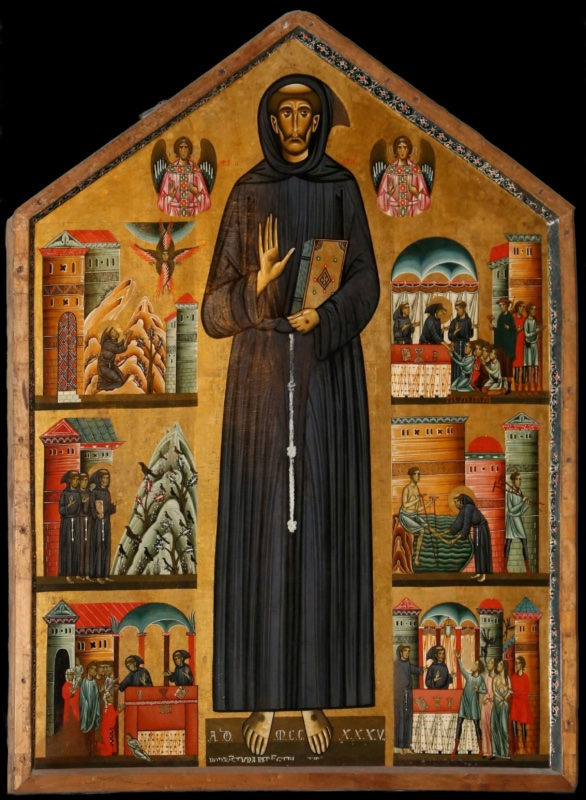
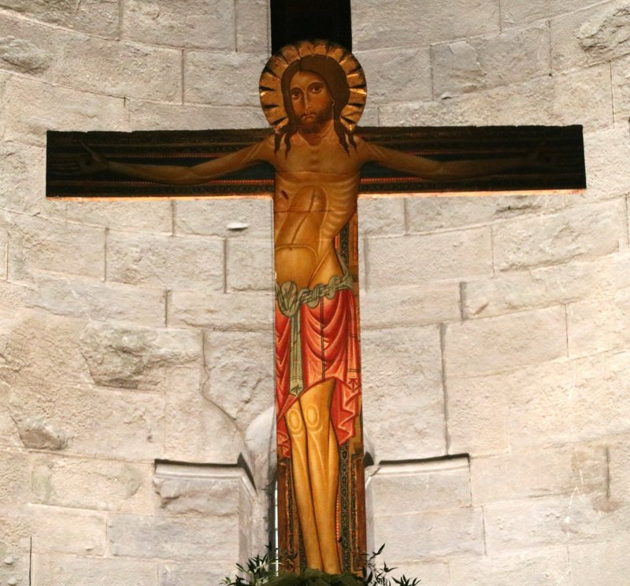
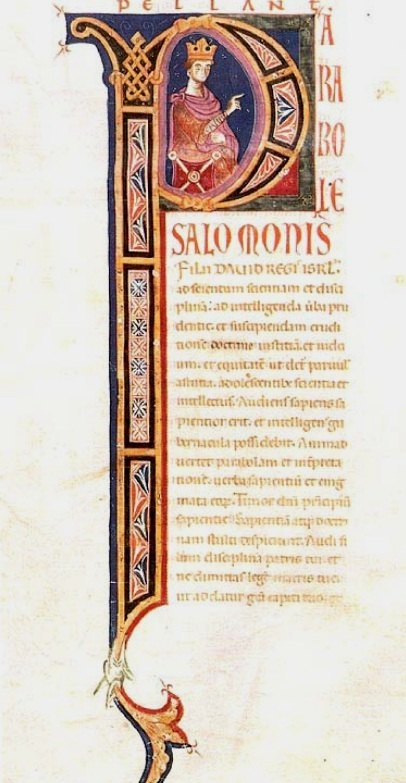
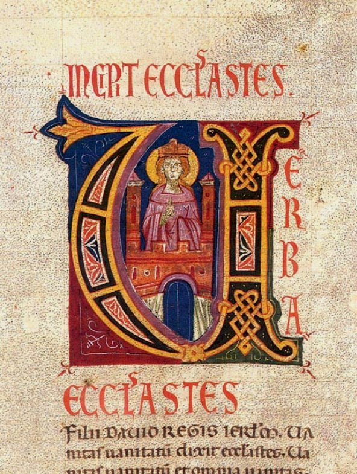
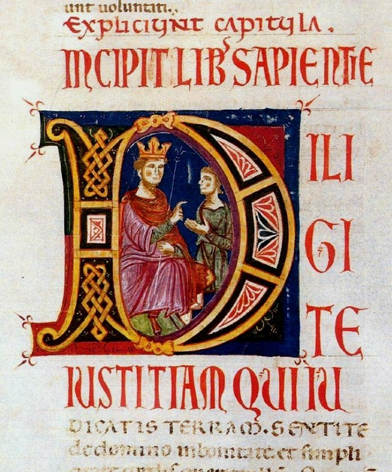
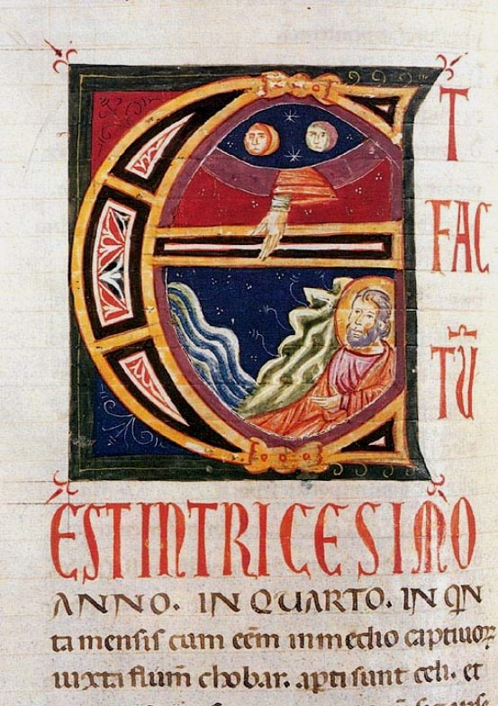

## Introduction: a minor master and a major problem

Among the painters active in Tuscany before Cimabue, the family conventionally called the Berlinghieri holds a position that is both prominent and elusive. It is prominent because two signed works have long served as fixed points for classifying thirteenth-century Tuscan panel painting: the father Berlinghiero's crucifix, and the *St Francis* dossal at Pescia, signed and dated 1235 by his son Bonaventura. It is elusive because, since the nineteenth century, a large and mixed body of attributed paintings has gathered around those two or three signed works, and how it should be divided among father and sons is still disputed.

Marco, the third of the brothers known by name, stands at the most uncertain edge of this group. He is the only member of the family whom documents connect to a surviving illuminated manuscript. That makes him the essential link between the Lucchese panel-painting workshop and the history of book decoration in the city. Yet he left no signed work, and his career can only be rebuilt through a chain of identifications, each of which needs careful checking.

What can be said about Marco di Berlinghiero depends on keeping three kinds of statement apart:

- facts recorded in published documents;
- identifications that modern scholars have proposed on the basis of those documents;
- attributions that rest on stylistic judgement alone.

The distinction matters. In Marco's case, slippage between these categories has produced, in general reference works, a more confident biography than the evidence can support.

Three scholars have defined the question most directly:

- **<a href="/scholars.html#garrison-edward">Edward B. Garrison</a>**, the American historian of Romanesque Italian painting. He was responsible for the modern reconstruction of the Lucchese school and for almost every attribution now attached to Marco.
- **<a href="/scholars.html#caleca-antonino">Antonino Caleca</a>**, author of the entries on the Berlinghieri in the *Enciclopedia dell'Arte Medievale* and of fundamental studies of Pisan and Lucchese painting. His work offers the most balanced recent synthesis and the critical yardstick against which Garrison's proposals can be measured.
- **Laura Violi**, whose 2017 article in the *Rivista di storia della miniatura* deals with the text, images and authorship of the Lucca Bible. It is the most recent codicological examination of the one work securely tied to Marco.

## Lucca in the Duecento: a city on the road

Lucca held a particular place in the political and devotional geography of thirteenth-century Italy. The city lay on the via Francigena, the great route linking the lands beyond the Alps to Rome. It brought through Lucca a constant traffic of pilgrims, merchants, clerics and ideas. Recent research on the city's cultural history shows that its links with France were already remarked on in the time of the reforming bishops of the late eleventh century. The importance of the Francigena helped make Lucca, in its own clerics' phrase, *caput Tusciae*. By the thirteenth century, however, Lucca was increasingly overshadowed by the political and economic rise of Pisa and Florence. The long conflict with Pisa, the background to the peace oath of 1228, is a reminder that the city's prosperity was neither unchallenged nor secure.

At the devotional heart of the city stood the Volto Santo, the monumental wooden crucifix venerated in the cathedral of San Martino. A legend credited Nicodemus with carving it, and the cult around it made the cathedral an obligatory stop for pilgrims on the Francigena. By the thirteenth century the image had taken on a civic as well as a religious meaning. Studies of its iconography note that Lucchese coins of the early Duecento carry the oldest surviving images of the Volto Santo, and that the crucifix became the emblem of the commune itself. For a painter working in Lucca in the second quarter of the century, the Volto Santo was not just one devotional object among others. It was the image through which the city represented itself. The cathedral that housed it was also the institutional home of the chapter of San Martino and of the hospital whose rector would commission the Bible that Marco decorated.

The church landscape of the city was also changing. While the Berlinghieri were active, the mendicant orders settled in Lucca, the Franciscans at San Francesco and the Dominicans at San Romano. Their arrival disturbed the old balance of power among the cathedral canons, the rival canonry of San Frediano and the city's other religious institutions. Bonaventura's 1235 dossal for the Franciscans at Pescia, within the Lucchese diocese, is one of the earliest painted witnesses to the new cult of Francis<a href="/endnotes.html#fn-francis-assisi" class="footnote">1</a>, and it shows the family's readiness to serve the new orders. The cathedral chapter nevertheless remained an important patron. Records of book ownership among the canons in the 1230s, 1240s and 1250s show Bibles, decretals and theological summae being sold, pledged and bequeathed, evidence of a lively book culture centred on San Martino.

That culture had deep roots. In the late eleventh and twelfth centuries Lucca was one of the main centres of manuscript production in Tuscany. The giant "Atlantic" Bibles of the reform period, the great passionaries (books of saints' martyrdoms) and the liturgical books of the cathedral and of San Frediano were made or decorated there. Garrison's studies of twelfth-century initial styles in central Italy, which distinguished successive phases of geometric initial ornament, remain the foundation of this field. Much later scholarship has refined his conclusions about Lucchese scriptoria.

By the middle of the thirteenth century the situation had changed. The commission of Marco's Bible has been read as evidence that the cathedral no longer had a working scriptorium of its own and had to turn to an outside professional scribe and a lay painter to produce a major book. Whatever the exact institutional picture, Marco's Bible is the only securely documented witness to Lucchese illumination of the mid-Duecento, coming after the flowering of the twelfth century.

## The Berlinghieri: name, origins and workshop

The family name itself is a modern convention. The 1967 *Dizionario Biografico degli Italiani* entry on the father observes that the patronymic "Berlinghieri" is an arbitrary form dating from the nineteenth century. It also notes that calling the father "Milanese", meaning a native of Milan, comes from <a href="/scholars.html#crowe-joseph-archer">Crowe</a> and <a href="/scholars.html#cavalcaselle-giovanni-battista">Cavalcaselle</a>'s misreading and English translation of the 1228 document. In that document the father's name appears in a form transcribed as *Berlingerius Melanese maius*. Garrison proposed to read this as "Berlinghiero son of Melanese the elder", taking Melanese as a personal name rather than a place of origin. Caleca's entry in the *Enciclopedia dell'Arte Medievale* adopts this reading, rendering the formula as "B. di Melanese il Vecchio".

The name "Berlinghiero da Milano" found in older literature is therefore a ghost produced by a misreading. "Marco di Berlinghiero", the form used in much recent Italian scholarship and in the Feliniana's own records, is more accurate than "Marco Berlinghieri", although the latter remains the usual name in English.

A discovery made during restoration has clarified where the father came from. Caleca reports that the restoration of the crucifix from San Salvatore at Fucecchio, once in the diocese of Lucca, revealed the signature *Berlingerius Vulterranus me pinxit*, identifying the painter as a native of Volterra. This matters for understanding the workshop's cultural background. Caleca places Berlinghiero's training in the strongly Hellenising (Greek-influenced) milieu of western Tuscany. Specifically, he points to the team of illuminators at Pisa and Volterra who in 1168 decorated the Bible for San Vito at Pisa, now at the Certosa di Calci, under the direction of Vivianus and Adalbertus of Volterra. If this is correct, the founder of the Lucchese workshop was himself trained where book illumination and a Byzantine-influenced figure style were closely linked. That would give a certain logic to his youngest son's later work as a miniaturist.

The father's dates are uncertain:

- The *Dizionario Biografico* places his death between 1228, when he swore the peace with Pisa, and 1243, when a document calls him already dead.
- Caleca, drawing on documents published in 1980, is more precise. Incidental mentions of Berlinghiero as the patronymic of his sons show him alive from 1232 to 1235 and dead from 1236 onwards. Because he appears in 1228 with two adult sons, Caleca suggests he was born around 1175 and began working around 1200.

Two signed crucifixes fix his identity. One comes from Santa Maria degli Angeli and is now in the Museo Nazionale di Villa Guinigi in Lucca; the other is from Fucecchio and is now divided between Pisa and Fucecchio. Around the first, scholars have assembled a group of Madonnas, including the so-called *Madonna di sotto gli organi* in Pisa cathedral and panels now in New York, Raleigh and Cleveland.

The family workshop should be pictured as a shared enterprise of father and sons. Caleca stresses that the documents show the three sons working extensively and that father and sons very probably often worked together, which makes reliable individual catalogues hard to build. He goes further: from the late activity of the head of the workshop, he suggests, a shared Berlinghieresque style, a *koinè*, developed in the shop and spread widely in Tuscany.

This is the essential frame for the problem of Marco. Where a common manner passed from father to sons and from masters to apprentices, attributing works to individual members on grounds of style is inherently fragile. The documents record contracts, guarantees and payments rather than finished works, so they rarely allow a particular surviving object to be tied to a particular hand.

The workshop also reached beyond the immediate family. Caleca recalls Lupardo di Benincasa, recorded in a Lucchese act of 1266. He was the son of Pina, Bonaventura's second wife, and had been apprenticed to his stepfather. He then went to Sardinia and later Sicily, where he had died by about 1258, probably still working as a painter. No surviving work supports the episode, but it shows how the family shop served as a training centre and how Lucchese painters moved across the Tyrrhenian world. Marco's documented move to Bologna in the 1250s fits the same pattern of mobility.

## The brothers: Barone and Bonaventura

Marco's two brothers give the closest comparison for his career.

Barone, possibly the eldest, is a shadowy figure as an artist. The documents link him with important commissions. Caleca lists a panel for the Lucchese archdeacon in 1243, a crucifix for Casabasciana near Bagni di Lucca in 1256, and in 1282 a crucifix, a Madonna and a St Andrew for Sant'Alessandro in Lucca. Other reference works give slightly different years for some of these commissions, a small but typical sign of how unstable the secondary literature on the family is. No signed work by Barone survives, and Caleca considers the conjectural attributions to him unsuccessful.

Bonaventura is much better known. He appears with his father and Barone in the 1228 document, already of age, which places his birth in the first decade of the century. He signed the Pescia dossal in 1235 with the inscription *A.D. MCCXXXV Bonaventura Berlingeri de Luca me pinxit*, as recorded in the *Dizionario Biografico*. It remains his only certain work. According to Caleca, in 1244 he undertook to decorate a room belonging to the cathedral canonry with birds and other motifs, following the wishes of the sculptor Lombardo, then active on the cathedral works. He appears again in 1250, in the documents concerning Marco, as his brother's guarantor, and later in 1266 and 1274. The Pescia dossal shows a towering Francis flanked by six narrative scenes. It has been described as dependent on Byzantine and Siculo-Byzantine culture, especially in the small side scenes, and scholars have most often compared Marco's illuminations with this narrative register.

The relationship among the brothers matters for reading the 1250 documents. Bonaventura's standing surety for Marco suggests two things. The brothers were still acting together as a family business two decades after their father's death, and Marco was then the junior partner whose undertaking needed a guarantee. It also suggests that the Bible commission was not seen as foreign to the panel-painting workshop: illumination was simply one of the services the family offered.

## The documentary evidence for Marco

What, then, do the published documents actually establish about Marco?

**Absence from the 1228 oath.** Several reference works, including older dictionary entries, list Marco among the sons who swore the peace with Pisa beside their father. The *Dizionario Biografico* states explicitly that this, as given in Thieme-Becker, is wrong: the document names only Berlinghiero, Barone and Bonaventura. Modern scholars infer from his absence that Marco was the youngest brother and not yet of age in 1228; Caleca calls him "forse il minore dei fratelli" ("perhaps the youngest of the brothers"). The inference is reasonable but not certain, since absence from a list of oath-takers organised by city district may have other explanations.

**Problems with the 1228 document itself.** According to the *Dizionario Biografico*, it survives only in a seventeenth-century copy by Padre Marco Grossi, who does not name his source; the copy is now manuscript 1902 in the Biblioteca Statale of Lucca. Caleca also describes it as known only from later copies. The two reference works disagree on its date as well: the *Dizionario Biografico* gives 22 March 1228, Caleca 25 March 1228. Neither point affects Marco directly, but both warn against treating this document, often cited as the foundation of the family's history, as an unproblematic original record.

**Presence in Lucca in the 1230s.** The documents that concern Marco directly were gathered and added to in a short publication of new documents on Bonaventura and Marco in *Prospettiva* in 1980. On this basis Caleca records Marco in Lucca in 1232, 1236 and 1239. These seem to be incidental notarial mentions rather than records of commissions. They show that Marco was an adult resident of the city by the early 1230s, which conflicts with the older *Dizionario Biografico* statement that he was active between 1245 and 1260 and suggests he was born not much later than his brothers. The 1967 entry predates the 1980 publication, so the later evidence should be preferred.

**The 1250 documents.** These are the central evidence:

- The *Dizionario Biografico* records that Marco is named in that year, in two documents, as the illuminator of a Bible.
- Caleca adds that Bonaventura appears in these documents as his brother's guarantor (*mallevadore*), and that according to the documents the Bible was made in 1250 for the hospital (*Spedale*) of San Martino in Lucca.
- Secondary accounts drawn from the 1980 publication date the two acts to 18 and 19 March 1250 and describe the object as a *bibliam ecclesiasticam* (a "church Bible"). One account based on the documentary literature specifies that on 18 March 1250 Marco received an advance to illustrate a Bible for the cathedral's hospice.
- The text had been commissioned separately. The Mirabile database record of the manuscript, which follows Violi's study, states that copying began in December 1246 on the commission of Alamanno, rector of the hospital of San Martino. The scribe was Iacopo di Pietro of Bologna, identified as *Iacopus Pieri de sancto Georgio bononiensis*. The decoration was entrusted to Marco.

Two features of these documents stand out. First, they show a division of labour typical of professional book production in the thirteenth century: a lay professional scribe from Bologna was hired to write and correct the text, and some years later a painter from a family workshop was hired to decorate it. Second, they place Marco in the legal and financial framework of an artisan contract, with advances and a guarantor. The sums and the exact wording of the clauses are not known from a full publication, and they should not be reconstructed from secondary summaries.

**Bologna.** Another strand of evidence takes Marco to Bologna:

- The *Dizionario Biografico* reports that in 1255 a *Marco da Lucca* was paid in Bologna for painting in the chapel of the podestà's palace, and that a *Marco pittore* appears in the register of Tuscan painters in Bologna, which it dates between 1253–1254 and 1259.
- Caleca speaks of a *Marcus pictor de Luca* who painted in the Palazzo del Podestà in 1255 and a *Marcus pictor* enrolled in the Società dei Toschi in Bologna in 1259.
- A recent study of the Duecento frescoes of Santo Stefano in Bologna, drawing on the published collection of Bolognese documents on painters and illuminators, says the Società dei Toschi register covers 1248 to 1259.

As the *Dizionario Biografico* frankly states, identifying these Bolognese painters with Marco di Berlinghiero rests on the improbability that two painters with the same name, from the same region, worked in Bologna at the same time. That is a reasonable argument from probability, not documentary proof, and none of the Bolognese records consulted here names Marco's father.

**Status: cleric or layman?** It has been asked whether Marco is documented as a *presbiter*, a cleric who was also a painter and illuminator, a figure that would fit one model of church book production. The published sources do not describe him as *presbiter*, *clericus* or priest. They include the 1967 *Dizionario Biografico* entries, the 1992 *Enciclopedia dell'Arte Medievale* entries, the codicological records of the Feliniana and the secondary literature on the Bolognese documents. He appears consistently as *pictor* and illuminator.

The Lucchese records do mention an earlier *clericus pictor*, an illuminator named Bonus, commemorated in the necrology of Feliniana manuscript 618 and discussed by Garrison. He is a separate and earlier figure. Unless unpublished or less accessible parts of the record say otherwise, the hypothesis that Marco was a priest-painter cannot be supported. The evidence presents him as a lay craftsman from a lay family workshop.

## The Lucca Bible: Biblioteca Capitolare Feliniana, MS 1

The manuscript that anchors Marco's artistic identity is the large Bible kept as codex 1 of the Biblioteca Capitolare Feliniana in Lucca, now part of the Archivio Storico Diocesano and displayed in the cathedral museum. Garrison proposed its identification with the Bible of the 1250 documents in his 1951 *Art Bulletin* article, "Towards a New History of Early Lucchese Painting". By 1967 the *Dizionario Biografico* accepted the codex as "certamente berlinghieresco" ("certainly Berlinghieresque"), and Caleca's 1992 entry treats the identification as settled.

The identification now rests on firmer codicological ground. The Mirabile record, reflecting Violi's work, notes the annotation *auscultatus*, which shows the text was checked against its exemplar. This confirms the identification, because in the surviving documents the scribe undertook both to write the text and *ad ascoltare*, that is, to collate and correct it. Document and object thus agree: the contract specified a procedure whose trace survives in the book. The same record:

- dates the manuscript to the second quarter of the thirteenth century, after 1246;
- notes that it first appears among the chapter's books in the 1409 inventory, which gives the opening words of the prologue;
- stresses that the reliability of the documents is essential for dating it, because the object is decidedly archaic and revives a type of Bible abandoned decades earlier.

That archaism is the most striking feature of the codex. It is a giant book. A census of the Feliniana's thirteenth- and fourteenth-century manuscripts records it as about 635 by 420 millimetres, with some 295 parchment leaves, containing the books of the Bible from Proverbs to the Apocalypse with prologues and *capitula* (chapter lists). Its size and decorative system deliberately recall the Atlantic Bibles produced in central Italy from the mid-eleventh century under the impulse of church reform. Yet a recent study of written culture in Lucca notes that it follows the order of biblical books typical of the Paris Bible.

The book therefore combines the format and decoration of the reform era of the late eleventh and twelfth centuries with a text organised on the most up-to-date scholastic Bibles of the thirteenth. One suggestion is that this deliberate return to older models reflects the cathedral establishment's attempt to reassert its identity just when the new mendicant foundations and their libraries were challenging its cultural primacy. The interpretation is attractive but remains a hypothesis.

The decoration consists of initials of several types rather than full-page miniatures. The Feliniana census lists many geometric initials, inhabited geometric initials (containing figures), historiated geometric initials (containing scenes), figured initials, a single metamorphic initial and a few marginal drolleries. The geometric initial, with its compartmented letter body filled with interlace and stylised foliage, is exactly the type Garrison traced through the twelfth-century Lucchese manuscripts. Its use in a mid-thirteenth-century Bible is the clearest sign of the book's backward-looking character. Within these frames, however, the figures belong to the thirteenth century.

Several initials deserve attention:

- **Opening folio:** a geometric initial C encloses two bishops, identified as Chromatius and his friend Heliodorus of Altinum, the addressees of Jerome<a href="/endnotes.html#fn-jerome" class="footnote">2</a>'s prologue to the books of Solomon.
- **Next page:** the upright of a T is formed by a crouching telamon (a supporting male figure) who holds up the crossbar on his bowed shoulders, hands on his knees. The motif has precedents in twelfth-century Lucchese and Pisan manuscripts.
- **Proverbs, Ecclesiastes, the Song of Songs and Wisdom:** King Solomon, to whom these books were ascribed, appears in their initials as their author.
- **Jonah:** a historiated E is split into two registers. Above, the hand of God emerges from a segment of heaven to send the prophet to preach to Nineveh; below, Jonah tries to flee by ship to Tarshish.
- **First Book of Maccabees:** another historiated E shows Judas Maccabaeus in armour above a battle scene.
- **Gospel of Mark:** the initial I takes the form of a column topped by the evangelist's lion, a motif read as a deliberate echo of ancient votive or triumphal columns.
- **Pauline epistles:** a series of inhabited P initials shows the apostle with his conventional balding head and long beard.
- **Near the end of the volume:** a metamorphic initial is formed by a dragon whose jaws release vegetal scrolls that make up the body of the letter.

The repertoire of motifs, which mixes telamons, birds, dragons and fish with prophets and authors, is essentially that of Romanesque central Italian illumination. To some observers, the fresh and varied colouring and the fairly simplified narrative scenes recall the side scenes of Bonaventura's Pescia dossal. Caleca judges that in the two codices attributable to him, Marco appears closely bound both to his father's late phase and to Bonaventura as seen in the Pescia dossal. The *Dizionario Biografico* puts it slightly differently: the Bible's painter interprets Berlinghiero's manner more quietly than Bonaventura does. Both judgements place the Bible firmly within the family idiom while acknowledging a certain modesty of temperament.

That modesty has been read in different ways. Older encyclopedic accounts call Barone and Marco painters of very modest worth, adding that Marco was also a miniaturist. This dismissive view reflects an older hierarchy in which narrative inventiveness and monumental scale were the main measures of value. A more sympathetic reading would stress that the Bible's decorator was working to a deliberately conservative brief, fitting a family figure style to an archaic decorative system that the patron evidently wanted. The result is not a manuscript that moves Italian illumination towards the Gothic. It is a coherent and accomplished example of how a Lucchese panel-painting workshop could serve its clerical patrons' nostalgia for their institution's past.

Violi's 2017 study, whose title announces its concern with text, images and autography (whose hand did what), adds a further dimension by examining how the scribe's work relates to the decoration. Her conclusions, as reflected in the Mirabile record and later scholarship, confirm the chronology of the commission, from Iacopo's contract of December 1246 to the decoration entrusted to Marco by 1250. They also strengthen the identification of the codex with the documented Bible. They do not, however, enlarge Marco's catalogue. On the contrary, the more precisely the Bible is tied to its documents, the more clearly it stands out as the only work linked to Marco by external evidence.

## The Camaldolese manuscript: Egerton MS 3036

The second manuscript attributed to Marco is a liturgical book for the Camaldolese order now in the British Library, Egerton MS 3036. Caleca describes it as a sacramentary for the abbey of Camaldoli near Arezzo, decorated by a *Marcus pictor de Luca*, and reports that Garrison identified this *Marcus* with Marco di Berlinghiero. Accounts derived from the Grove dictionary, following Garrison's later *Studies in the History of Mediaeval Italian Painting*, date the decoration to 1240 and also call the book a sacramentary for Camaldoli. Other descriptions call it a missal. Italian scholarship on Camaldolese book culture describes it as a thirteenth-century missal used by the eighteenth-century *Annales Camaldulenses*, citing the 1979 study of the library and culture of Camaldoli by M. E. Magheri Cataluccio and A. U. Fossa.

Several uncertainties surround this manuscript:

- The exact form, position and wording of the inscription naming *Marcus pictor de Luca* is not known from a published transcription.
- It is not clear whether the date 1240 comes from an inscription or from Garrison's own dating.
- The secondary sources use "sacramentary" and "missal" interchangeably, which may reflect the book's mixed contents.
- The sources also date Garrison's identification differently, Caleca to 1946 and the Grove-derived accounts to 1957.

The identification of the London *Marcus pictor de Luca* with Marco di Berlinghiero rests on the same kind of argument as the Bolognese identifications: a painter named Marco, from Lucca, active in the same decades. A Lucchese painter decorating a book for Camaldoli is not surprising in itself, since Camaldolese houses existed in the Lucchese diocese and the order kept close ties across Tuscany. Caleca counts the London codex as one of the "two codices attributable" to Marco, which suggests he found the stylistic comparison with the Lucca Bible persuasive. No modern study comparable to Violi's work on the Lucca Bible appears, however, to have examined the question. If the identification is accepted, the London manuscript would be the earliest dated work associated with Marco and would show him working as an illuminator a decade before the Lucca commission.

## Bologna and the Massacre of the Innocents

Garrison's first major contribution on Marco came in 1946, in an *Art Bulletin* article titled "A Berlinghieresque Fresco in S. Stefano, Bologna". The fresco shows the *Massacre of the Innocents*, with a female saint in a roundel below, traditionally identified as St Juliana. It is now in the museum of the basilica of Santo Stefano: a large detached mural fragment recorded as 350 by 205 centimetres.

It belonged to a cycle that decorated the dome of the church of the Santo Sepolcro within the Santo Stefano complex. That cycle was destroyed in 1803–1804, when the dome and drum were redecorated. A study of the Duecento frescoes of Santo Stefano notes that the *Massacre* survived only because it was hidden behind a canvas by Procaccini until 1864, and that Antonio Zanchi detached it in 1877. Descriptions by eighteenth-century writers and drawings made for Séroux d'Agincourt suggest the lost cycle included an Adoration of the Lamb with the twenty-four Elders in the dome, and scenes from Genesis and the life of Christ on the walls.

Garrison attributed the fresco to Marco because of its Berlinghieresque character, comparing it especially with the miniatures of the Lucca Bible. He supported the attribution with the Bolognese documents recording a *Marcus pictor* in the register of Tuscan painters and in the podestà's chapel in 1255. The attribution has been widely repeated, and it is under Marco's name that the fresco is usually presented in Bologna. Caleca is notably cautious, calling the attribution "plausibile, ma non certissima" ("plausible, but not entirely certain"). The *Dizionario Biografico* reports Garrison's view without endorsing it.

Recent Bolognese scholarship adds further nuance. The study of the Santo Stefano frescoes cited above observes that most critics still accept the attribution because of similarities in the architecture, decoration and stylised figures, but that the comparisons are rather generic. It reads the fresco as combining Eastern, Balkan elements with Western ones:

- the iconography and the expressive vehemence, seen in the women tearing their hair, are thoroughly Western;
- the lower roundel with the saint works as an icon in the Eastern manner.

The study places the work in the mid-thirteenth-century culture of the Po valley, with affinities to the frescoes of the Baptistery of Parma, which were themselves influenced by Serbian painting. Another study, devoted to the Byzantine legacy in the fresco, linked its painted architecture to similar buildings in Tuscany. The question therefore remains open. The fresco may be by a Lucchese painter adapting his style to a Bolognese and Adriatic setting. Or it may be by a Po valley painter with Byzantinising tendencies, whose connection to the Berlinghieri is less direct than Garrison believed.

What is not in doubt is that a Lucchese painter named Marco worked in Bologna in the 1250s, and that Lucca was tied to Bologna in many ways, including the presence of Lucchese intellectuals there and Lucchese canons' involvement in the Bolognese book trade. The scribe of the Lucca Bible was himself Bolognese. Marco's presumed move to Bologna would thus have followed established channels. His documented work in the podestà's chapel shows that he could paint murals for civic patrons as well as decorate books for church ones. Whether the *Massacre of the Innocents* survives from that activity cannot be decided on the present evidence.

## Panel painting and the crucifix of Villa Basilica

The third type of work attributed to Marco is panel painting. In his 1951 article Garrison proposed that the hand of the Lucca Bible could be recognised in the painted crucifix of the pieve (parish church) of Santa Maria Assunta at Villa Basilica, in the hills between Lucca and Pescia. The *Dizionario Biografico* records this proposal. Yet in its entry on the father, the same work lists the Villa Basilica crucifix among works close to Berlinghiero's art, and local and regional descriptions of the church still present it as attributed to Berlinghiero himself. A recent catalogue of the painted crosses in the Museo Nazionale di Villa Guinigi refers to the Villa Basilica cross, much altered from its original dimensions, as one of the works related to Berlinghiero or his family workshop.

This wavering between father and son is exactly what Caleca's idea of a shared Berlinghieresque style would predict. A painted cross made in the family shop around the time of the father's death, or shortly after, could fairly be called Berlinghiero's, workshop production, or the work of one of the sons, depending on how much weight is given to particular features of form. Garrison's attribution to Marco rests on comparing figure types and drawing with the Lucca Bible's miniatures, a comparison across different media and scales that is inherently difficult. The fairest summary is that the Villa Basilica crucifix is a Berlinghieresque work and that its attribution to Marco is Garrison's hypothesis, which has not won general acceptance.

Beyond Villa Basilica, the literature contains no other panel painting securely, or even widely, attributed to Marco. In the twentieth century many works were grouped around Bonaventura and Barone, including panels once gathered under the names of the Master of the Bigallo, the Master of the Croce delle Oblate and the Master of Calci. Some have been discussed in relation to the family, but none has been convincingly assigned to Marco. Caleca's mention of a painter of Berlinghieresque culture active first at Lucca and then at Florence, alongside Marco's Bolognese activity, is telling. The spread of the family's manner in the mid-century involved several unnamed masters, and Marco was only one of them.

## Style, the maniera greca and Lucchese tradition

Marco's style cannot be separated from the vexed question of the Byzantine element in thirteenth-century Tuscan painting, the so-called *maniera greca* ("Greek manner") that Vasari<a href="/endnotes.html#fn-giorgio-vasari" class="footnote">3</a> later contrasted unfavourably with Giotto's art. For the Berlinghieri, this Byzantine component has been understood in different ways:

- The *Dizionario Biografico* entry on the father notes that the white highlights and refined execution of his signed crucifix are clearly Byzantine, while its calm contours and gentle face express a wholly Western poetic feeling.
- The same work points out the Byzantine features of the Pescia dossal: its earthy tones, its iconographic details and the strong linear stylisation of the saint's figure.
- Caleca traces the roots of this culture to the Hellenising illumination of Pisa and Volterra around 1168, and to a first-hand knowledge of Byzantine art from both Constantinople and Norman Sicily.

Marco's work, as seen in the Lucca Bible, stands in a particular relation to this tradition. Its decorative system is Romanesque, not Byzantine, rooted in the geometric initial that Garrison followed through the twelfth-century Lucchese books. Its figures, however, show the Berlinghieresque idiom that ultimately derives from the Byzantine-influenced Tuscan culture of the late twelfth century. The result is less a step towards the Gothic than a conservative reconciliation of two older traditions: the reform-era manuscript and the Byzantinising panel. This fits the patron's choice of an archaic book type. It may also reflect the position of the youngest son in a workshop whose leading figures had set its manner a generation earlier.

If the Bolognese *Massacre of the Innocents* is by Marco, it would show a more dramatic and expressive painter, open to the Byzantine-Balkan currents then entering the Po valley. It would also suggest that the move to Bologna exposed him to a different strand of Eastern influence from the one that had shaped the Lucchese workshop. The contrast between the restrained miniatures of the Lucca Bible and the vehement fresco is one reason some critics find the attribution plausible but not certain. A single artist could have responded differently to different settings, but the burden of proof lies with the attribution.

## Lucchese book production and the place of the lay painter

The Lucca Bible commission sheds light more broadly on how books were made in a mid-thirteenth-century Tuscan city. The documents show a cleric, Alamanno, acting as rector of the hospital of San Martino, contracting separately with a professional scribe from Bologna and, later, with a painter from a local family workshop. The scribe was responsible for correcting the text as well as writing it, and the book bears the trace of that correction. The painter was bound by a contract backed by a family guarantor. This is the world of the notarial contract and the artisan workshop, not the monastic scriptorium.

Clerical painters and illuminators certainly existed in medieval Italy, and the Lucchese necrology's commemoration of Bonus, *clericus pictor*, shows the type was known in the city. But any image of Marco as a priest-illuminator should be regarded as unsupported by the published evidence.

## Historiography: from Crowe and Cavalcaselle to Garrison and after

The history of Marco's reputation is largely the history of scholarly interest in the Lucchese "primitives". Crowe and Cavalcaselle's misreading of the 1228 document gave the family a false Milanese origin that persisted for decades. In the early twentieth century the Berlinghieri, like other Duecento painters, benefited from the revival of interest in the "primitives". The *Dizionario Biografico* observes that the painting of Berlinghiero and Bonaventura then enjoyed a perhaps exaggerated prominence, until a more recent critical re-examination of the whole period scaled it back.

Garrison's contribution was decisive. Between 1946 and 1957 he:

- identified the Lucca Bible as Marco's;
- proposed the attribution of the Bologna fresco and the Villa Basilica crucifix;
- connected the London manuscript with Marco;
- rejected the traditional patronymic and the father's supposed Milanese origin.

His 1949 *Italian Romanesque Panel Painting* provided an illustrated index of the material. His *Studies in the History of Mediaeval Italian Painting*, published in Florence between 1953 and 1962, gathered his research on twelfth- and thirteenth-century Italian manuscripts and panels. Without Garrison, Marco would be little more than a name in a contract. Yet the boldness of his reconstruction, based on a connoisseurship that moved freely across media and between Lucca and Bologna, also means that much of what he proposed has remained hypothesis.

Caleca's 1992 synthesis is the most balanced later assessment. It accepts the identification of the Lucca Bible, reports the London manuscript as attributable, treats the Bologna fresco as plausible but not certain, and frames the whole question within a family workshop and a widely spread Berlinghieresque style. The new documents published in 1980 enlarged the biographical picture by pushing Marco's documented presence in Lucca back to the 1230s. Most recently, Violi's codicological and textual study and the cataloguing of the Feliniana have put the Lucca Bible on firmer ground and placed it within a more detailed understanding of Lucchese book culture.

## Marco's place in Duecento art

What, finally, is Marco's significance? On any reasonable assessment he was not a major innovator. His one secure work is a conservative manuscript that applies the family's figure style, with competence and some charm, to an archaic decorative system. If Garrison's attributions are accepted, his wider activity shows a versatile artisan capable of illumination, mural painting and perhaps panel painting, moving between Lucca, Camaldolese patrons and Bologna. If they are not, he remains a documented illuminator whose career otherwise survives only in records.

His importance lies elsewhere:

- He is the clearest evidence that the great panel-painting workshops of thirteenth-century Tuscany also decorated books, and that the line between panel painter and illuminator, drawn so sharply in later historiography, was permeable in practice.
- He witnesses the professionalisation of book production in Lucca, where the cathedral now hired outside scribes and lay painters.
- He illustrates the mobility of Tuscan painters in the mid-thirteenth century, which carried Lucchese styles to Bologna, Florence, Sardinia and Sicily.
- His Bible is an eloquent record of institutional memory: a book that deliberately recalled the giant Bibles of the reform era just as the world that produced them was passing away.

## Legacy and open questions

Several questions remain open for future research:

- **The 1250 documents.** A full publication, with the sums, the clauses and the exact terms used for Marco and Bonaventura, would clarify the nature of the commission and settle whether the phrase *bibliam ecclesiasticam* is really used.
- **The London manuscript.** A modern codicological and art-historical study, including a transcription of the inscription naming *Marcus pictor de Luca* and a systematic comparison with the Lucca Bible, would test Garrison's identification more rigorously than has yet been done.
- **The Villa Basilica crucifix.** A technical examination, informed by the Fucecchio discovery and recent research on the family workshop, might clarify its place within the Berlinghieresque group.
- **The Bolognese fresco.** A renewed look at the evidence, including how the *Massacre of the Innocents* relates to the Parma Baptistery and to Balkan painting, might determine whether a Lucchese hand is actually present in Santo Stefano.

Until such research is done, the honest account of Marco di Berlinghiero is this: a documented Lucchese illuminator whose one secure work is a remarkable but conservative Bible, surrounded by attributions of varying plausibility. That account is less satisfying than the confident biographies of older reference works, but it has the merit of resting on what the sources actually say.

## Catalogue Entry

### Comparison: Berlinghiero di Melanese, Cross of Santa Maria degli Angeli (Lucca, Museo Nazionale di Villa Guinigi)

<figure>
  
  <figcaption>Berlinghiero di Melanese, <em>Christus triumphans</em>, the cross of Santa Maria degli Angeli, c. 1210–1220. Tempera and gold on shaped panel, 174.7 × 140.5 cm. Lucca, Museo Nazionale di Villa Guinigi, inv. 226. Signed: BERLINGERIUS ME PINXIT. Photo: Sailko, <a href="https://creativecommons.org/licenses/by/3.0/">CC BY 3.0</a>, via Wikimedia Commons.</figcaption>
</figure>

The signed cross from the Lucchese monastery of Santa Maria degli Angeli is the work by which the father of the family is known, and it is catalogued in full in the entry on <a href="/Content/Artists/XIII-c/Berlinghiero-di-Melanese.html">Berlinghiero di Melanese</a>. It is reproduced here as the point of reference for the works attributed to Marco. Every attribution to the son is, in the end, a judgement about how far a work departs from this model, and the cross shows what the family idiom looked like in the generation before Marco's documented activity.

The cross is complete, and it shows what has been lost at Villa Basilica. The arms end in square terminals with the symbols of the Evangelists, the shaft rises to a cimasa with the Virgin between two angels above the titulus, and the foot carries the small scenes of the Denial of Peter beside Christ's feet and a red band with the signature. The wide fields beside the body hold the Virgin and Saint John at full length on a gold ground. At Villa Basilica only the figure of Christ and narrow strips of ornament survive, so the comparison between the two crosses must be made on the figure alone.

On that ground the resemblance is close. Both crosses show the living Christ with open eyes, the head almost upright, long dark hair falling in separate locks onto the shoulders and a short forked beard. Both have a raised gilded halo that catches the light. In both the anatomy is constructed from a few linear arcs, the ribs drawn as short parallel strokes, the abdomen as rounded segments, the knees as pale ovals. These are the shared means of the Berlinghieri workshop, and they explain why the Villa Basilica cross has been given in turn to the father, to Marco and to the workshop.

The differences are of degree. Berlinghiero's Christ is strictly frontal, with an enlarged head and a body set rigidly on the axis of the cross. At Villa Basilica the body curves slightly from the chest to the hips, and the proportions are longer and slimmer. The loincloth also differs: Berlinghiero's is a pale grey-green cloth with red and dark stripes, knotted at the waist, while the Villa Basilica figure wears a red cloth held by a separate grey-green knotted band. Such changes are consistent with a later date within the workshop's production, but they do not in themselves identify a different hand.

The mourners in the side fields offer a second comparison, this time with the Lucca Bible. The Virgin, wrapped in a dark blue maphorion with one hand raised to her breast, and Saint John, in a red mantle with his hand pressed to his cheek, have long oval faces, thin straight noses, small mouths and eyes outlined with a dark upper lid. The same facial type, reduced in scale, appears in the Solomon of the Bible's initials. This continuity is what Caleca meant when he described Marco as closely bound to his father's manner, and it is the strongest argument for placing the Bible's decoration within the family workshop.

The colour supports the same conclusion. The deep blue of the cross, the warm gold of the grounds and the saturated reds and blues of the mourners' garments recur in the Bible's initials, where blue and red grounds, gold frames and violet and red draperies are set side by side in the same unmodulated way. The illuminator of the Bible worked with the palette of the panel painters, on vellum rather than on gessoed wood.

The comparison also shows what separates the Bible from the cross. Berlinghiero's figures have a gravity and stillness that suit a monumental image seen from a distance. The figures in the Bible are livelier and more anecdotal: Solomon points, turns and teaches, and Ezekiel twists to look up at the opening heavens. The *Dizionario Biografico* describes the Bible's painter as interpreting Berlinghiero's manner more quietly than Bonaventura, and the comparison with the cross allows that judgement to be tested directly.

The cross is therefore the fixed point against which Marco's attributed works can be measured. The Bible, documented and secure, shows a painter who kept the family's figure types and colour while adapting them to the scale and narrative needs of the initial. The Villa Basilica cross shows the family's formula developed towards a more pliant body. Whether that development is Marco's, or that of another member of the workshop, cannot be decided from the comparison alone.

### Comparison: Bonaventura Berlinghieri, Saint Francis and Six Stories (Pescia, San Francesco)

<figure>
  
  <figcaption>Bonaventura Berlinghieri, <em>Saint Francis and Six Stories</em>, signed and dated 1235. Tempera and gold on panel, c. 160 × 123 cm. Pescia, Church of San Francesco. Image: public domain, via Wikimedia Commons.</figcaption>
</figure>

The dossal of Saint Francis in Pescia, signed by Bonaventura and dated 1235, is the only securely dated work by Marco's elder brother, and it is catalogued in full in the entry on <a href="/Content/Artists/XIII-c/Bonaventura-Berlinghieri.html">Bonaventura Berlinghieri</a>. It is reproduced here because both of the main critical judgements on Marco are formulated in relation to it. Caleca saw Marco as close to Bonaventura as he appears in this panel, and the *Dizionario Biografico* described the Bible's painter as interpreting the family manner more quietly than Bonaventura. The panel is therefore the second fixed point, after the father's cross, against which Marco's work has been measured.

The panel combines two registers of painting. The central figure of Francis, frontal and immobile, with a long face, large dark eyes and a dark habit falling in long parallel folds, is an icon in the Byzantine sense, built for distance and for devotion. The six small scenes at the sides, three from the saint's life and three posthumous miracles, belong to a different mode: narrative, crowded with figures and buildings, and painted with a lighter touch. It is with these scenes, not with the central figure, that the Lucca Bible has been compared.

The comparison rests first on colour. The small scenes are built from a few saturated tones set side by side against gold: the red and pink of towers and roofs, the green and blue of domes and canopies, the dark habits of the friars, the red and green garments of the laymen. The initials of the Bible use the same palette, with the same contrast between dense colour and gold. In both, the colours are laid in flat fields and articulated by fine light strokes rather than by continuous modelling.

The architecture is a second point of contact. Bonaventura's scenes are framed by tall towers of banded masonry, crenellated walls, arched doorways and small domed canopies, arranged as stage wings that enclose the action without constructing a coherent space. The Bible's initial of Ecclesiastes places Solomon behind the battlements of a red city gate with two towers, a small architectural setting of exactly this kind. The motif was common in Byzantine and Romanesque painting, but the particular combination of colours and forms is shared within the family.

The figures in the narrative scenes are small, slender and active. Friars and laymen stand in compact groups or kneel in profile; their gestures are clear and simple, and their faces are reduced to a few lines. In the Bible, Solomon points and teaches, and Ezekiel twists to look up at the opening heavens, in the same economical narrative language. The comparison suggests a shared training in the workshop rather than a direct dependence of one painting on the other.

The differences are equally instructive. Bonaventura's scenes are dense, with many figures, varied architecture and objects such as altars, tombs and canopies, and his central figure has a severity that the *Dizionario Biografico* contrasted with the greater freedom of the small scenes. The initials of the Bible are simpler, with one or two figures in each, and their tone is gentler. The difference may reflect the medium and scale of the initial, or the temperament of a different painter, and the two explanations cannot be separated with certainty.

The dossal also shows the role of Bonaventura in the workshop after their father's death. By 1235 he was able to sign and date a major panel for a Franciscan church, at a moment when the cult of the saint, canonised only in 1228, was still taking shape. Marco's documented career, in contrast, is that of an illuminator who appears in contracts with a scribe, a patron and a guarantor, and in 1250 that guarantor was Bonaventura himself. The relation between the brothers was thus professional as well as stylistic.

Seen together, the cross of Santa Maria degli Angeli, the Pescia dossal and the Lucca Bible show three moments of the Berlinghieri idiom: the father's monumental and solemn manner, Bonaventura's narrative inventiveness, and Marco's quieter adaptation of both to the decoration of a book. The comparison does not prove the attribution of further works to Marco, but it gives the documented Bible its place within the family's production.

### Painted Crucifix (Villa Basilica, Pieve di Santa Maria Assunta)

<figure>
  
  <figcaption>Attributed to Marco di Berlinghiero, <em>Painted Crucifix</em>, second quarter of the thirteenth century. Tempera on panel, gold ground, cut down. Villa Basilica, Pieve di Santa Maria Assunta. Photo: Mongolo1984, <a href="https://creativecommons.org/licenses/by-sa/4.0/">CC BY-SA 4.0</a>, via Wikimedia Commons, cropped.</figcaption>
</figure>

The cross hangs in the apse of the Romanesque pieve of Villa Basilica, in the hills between Lucca and Pescia, against the bare stone of the semicircular wall. It is not in its original form. The arms end abruptly, without the terminals that usually held the half-length figures of the Virgin and Saint John, and the wide apron beside the body, which in Lucchese crosses carried scenes of the Passion, is reduced to narrow strips of ornament. What survives is essentially the figure of Christ and a thin border of the painted field around it.

Christ is shown alive, with his eyes open and his head almost upright, turned slightly to his right. This is the type of the *Christus triumphans*, the Christ who triumphs over death on the cross, which dominated Tuscan painted crosses until the second quarter of the thirteenth century. The face is long, with a thin straight nose, arched brows, large dark eyes and a short forked beard; the hair falls in separate wavy locks onto the shoulders. The gilded halo is decorated with raised rays that catch the light, a feature that gives the head a strong presence when the cross is seen from below.

The body is not rigidly frontal. It curves gently from the chest to the hips, while the arms stretch straight along the crossbar. This slight sway introduces a hint of the suffering Christ into a triumphant type, and it is one of the features that have been used to date the cross later than the most archaic Lucchese examples. The anatomy is built from dark linear arcs: a curve for the lower edge of the ribs, short strokes for the ribs themselves, a rounded abdomen divided by a central line. The knees are drawn as two pale ovals on long, slender legs.

The loincloth is a deep red cloth falling to the knees, with folds drawn in darker lines and white highlights. It is held by a grey-green band knotted at the front, whose long end hangs down the middle of the body. The contrast between this pale, almost metallic band and the warm red of the cloth is a decorative device found in other crosses of the Berlinghieri circle, and the treatment of the folds as flat, calligraphic patterns is typical of the family workshop.

The attribution has moved between the members of the family: to Marco in Garrison's proposal of 1951, to Berlinghiero or to his workshop in other accounts, including the recent catalogue of the painted crosses in the Museo Nazionale di Villa Guinigi. The arguments on each side rest on the same small set of features, which the surviving figure allows to be examined directly.

The comparison on which Garrison relied is difficult. It sets a monumental painted figure, meant to be seen from a distance, against the small figures in the initials of a manuscript. Some features can be compared across the two media, such as the long face with large eyes, the separate locks of hair and the linear treatment of anatomy. But they belong to the common idiom of the family workshop as much as to any one member, and they cannot by themselves separate the hand of the son from that of the father or his assistants.

The cross is therefore best presented as a Berlinghieresque work of the second quarter of the thirteenth century, and its attribution to Marco as a hypothesis. Its interest does not depend on the name. It shows how the Lucchese workshop of the Berlinghieri supplied the parish churches of its territory with large painted crosses, and how these images, cut down and reframed over the centuries, continue to hang in the spaces for which they were made.

### The Lucca Bible: historiated and inhabited initials (Lucca, Biblioteca Capitolare Feliniana, MS 1)

The decoration of the Bible is concentrated in large initials at the opening of each book and prologue. The four initials reproduced here come from the Sapiential books and the Prophets. Three show King Solomon, to whom the medieval tradition ascribed Proverbs, Ecclesiastes and Wisdom, and one shows the prophet Ezekiel. Together they show the main types of initial in the book: the inhabited initial, in which a single figure occupies the letter, and the historiated initial, in which the letter frames a narrative scene.

<figure>
  
  <figcaption>Marco di Berlinghiero, initial P with King Solomon, opening of the Book of Proverbs, from the Bible of the hospital of San Martino, completed by 1250. Tempera and gold on parchment. Lucca, Biblioteca Capitolare Feliniana, MS 1. Image: public domain, via Wikimedia Commons.</figcaption>
</figure>

The initial of Proverbs, *Parabolae Salomonis*, runs down almost the whole height of the column. Its stem is a narrow band of compartments filled alternately with red and blue grounds and with stylised palmettes, framed in gold, and at the top a knot of interlace joins it to the bowl. At the bottom the stem dissolves into a curling, dragon-like tail with leaves, the kind of zoomorphic terminal that the Lucchese illuminators had used for more than a century. The bowl encloses Solomon, crowned and wearing a red mantle over a patterned tunic, seated against a blue ground and turning to his left with his right hand raised in the gesture of speech. The king is shown as the author of the book whose opening words follow.

<figure>
  
  <figcaption>Marco di Berlinghiero, initial V with King Solomon in Jerusalem, opening of Ecclesiastes, from the Bible of the hospital of San Martino, completed by 1250. Tempera and gold on parchment. Lucca, Biblioteca Capitolare Feliniana, MS 1. Image: public domain, via Wikimedia Commons.</figcaption>
</figure>

In the initial of Ecclesiastes, *Verba Ecclesiastes filii David regis Hierusalem*, the figure of Solomon is placed in a setting that illustrates the opening words. The king, crowned and haloed, stands behind the battlements of a red city gate flanked by two towers, with a dark arched doorway below: the gate is Jerusalem, of which the text calls him king. The letter itself is built on two contrasting systems. The left stroke is divided into geometric compartments with palmettes, as in the Proverbs initial, while the right stroke is filled with gold interlace knots on a black ground. The whole is set on a square field of deep red and blue, with fine white tendrils drawn on the ground.

<figure>
  
  <figcaption>Marco di Berlinghiero, initial D with King Solomon instructing a youth, opening of the Book of Wisdom, from the Bible of the hospital of San Martino, completed by 1250. Tempera and gold on parchment. Lucca, Biblioteca Capitolare Feliniana, MS 1. Image: public domain, via Wikimedia Commons.</figcaption>
</figure>

The initial of Wisdom, *Diligite iustitiam qui iudicatis terram*, turns the author portrait into a scene of teaching. Solomon, crowned, in a violet tunic and a red mantle, sits on a cushion and raises his right hand towards a young man in a green tunic, who stands before him with his hands open in a gesture of attention. The opening words of the book, addressed to those who judge the earth, are thus given a human audience. The letter combines the same two decorative systems as the Ecclesiastes initial, with interlace in the upright stroke and leaf compartments in the curve, and small knotted bands bind the curve to the stem at the top and bottom.

<figure>
  
  <figcaption>Marco di Berlinghiero, initial E with the vision of Ezekiel by the river Chebar, opening of the Book of Ezekiel, from the Bible of the hospital of San Martino, completed by 1250. Tempera and gold on parchment. Lucca, Biblioteca Capitolare Feliniana, MS 1. Image: public domain, via Wikimedia Commons.</figcaption>
</figure>

The initial of Ezekiel is a true historiated initial. The crossbar of the E divides it into two registers that illustrate the opening verse: "in the thirtieth year, in the fourth month, on the fifth day of the month, as I was among the captives by the river Chebar, the heavens were opened". In the upper register an arc of dark blue sky, with the faces of the sun and the moon among stars, opens above a red ground, and from it a hand reaches downwards. In the lower register the prophet, bearded and haloed, in a red mantle, reclines beside two wavy bands of water, blue and green, and turns his head up towards the vision. The same two-register arrangement is used for the initial of Jonah elsewhere in the book.

The figures share a consistent type. The faces are oval, with long straight noses, small mouths and eyes drawn with a dark upper lid; the cheeks are touched with red, and the features are outlined in a fine dark line. The draperies are modelled with light strokes laid over a darker ground, and the colours are limited to a few saturated tones: red, violet, blue and a sharp green, set against gold. These are the means of the Berlinghieri panel painters applied on a small scale, and they explain why the decoration has been compared with the scenes of Bonaventura's Pescia dossal.

The letters themselves belong to an older tradition. Compartments of palmettes, interlace knots and zoomorphic terminals are the forms of the Lucchese giant Bibles of the twelfth century. In these four initials the figures of the mid-thirteenth century are set within that older frame, and the contrast between the two is visible on every decorated page.

### The Massacre of the Innocents, with Saint Juliana in a roundel (Bologna, Museo di Santo Stefano)

<figure>
  
  <figcaption>Attributed to Marco di Berlinghiero, <em>The Massacre of the Innocents</em>, with <em>Saint Juliana</em> in a roundel, mid-thirteenth century. Detached fresco, 350 × 205 cm, from the dome of the church of the Santo Sepolcro. Bologna, Museo della Basilica di Santo Stefano. Image: public domain, via Wikimedia Commons.</figcaption>
</figure>

The fragment is the only surviving part of the mural decoration of the Santo Sepolcro, the domed church at the centre of the Santo Stefano complex. It is now shown in the museum of the basilica, on its own support, with its upper and lower framing bands. The curved band at the bottom shows that the scene stood above an arch, so the fragment preserves both a narrative field and part of the architectural frame that carried it.

The scene is laid out as a single stage between two framing structures. At the left Herod sits on a cushioned throne under a domed pavilion, his feet on a jewelled footstool. He wears a jewelled crown and a pale mantle over a white tunic, holds a sceptre in the crook of his arm and points with his right hand at the executioner. The gesture is the hinge of the composition: the order passes from the king to the soldier in the centre and from him to the mothers on the right, so the picture reads from left to right as command, act and consequence.

The soldier is the most animated figure. He stands with his legs apart on the bodies of the dead children, his sword raised high over his head and his left hand gripping a naked child by the wrist. He wears a short red tunic, grey hose and a white headband whose ends flutter behind his head. His face is calm and turned towards Herod, as if awaiting confirmation, and the contrast between this impassive expression and the violence of the action is one of the most effective features of the scene.

The mothers form a compact group at the right, under the gabled building. Five heads are visible, crowded one above the other, with long loose hair falling over their shoulders. Their faces are drawn with arched brows, lowered eyes and downturned mouths, and one woman in the foreground kneels in a dark green mantle, her hand pressed to her breast. Loose hair was a conventional sign of mourning, and the repetition of the same grieving face across the group gives the women the quality of a chorus rather than a set of individual portraits.

The architecture is treated as a series of flat, brightly coloured planes. A low wall with a cornice of scrolls and a row of small arched openings runs across the middle ground; behind it a dark opening frames the soldier, and two buildings with arched windows, round apertures and decorated eaves stand at either side. The forms suggest depth without constructing it: the buildings have no consistent viewpoint, and the wall behind the figures is a backdrop rather than a space they inhabit. The upper frieze of cubes drawn in perspective, an ancient motif widely used in Romanesque mural painting, adds a strong decorative band above the scene.

The roundel below contains the half-length figure of a female saint, frontal, with a white veil wound round her head and a gold halo, raising both hands with the palms turned outwards in the gesture of prayer. The letters of her name are divided by the roundel, S(ANCTA) IULI – ANA, which identifies her as Saint Juliana. The flat frontal figure, isolated in its circle against a dark ground, reads as an icon set into the narrative wall, in contrast with the movement of the scene above. The spandrels around the roundel are filled with flowers and leaves on a speckled ground.

Several features support the comparison with Lucchese painting on which Garrison based the attribution. The long faces with heavy-lidded eyes, the linear treatment of drapery folds in white highlights, the bright palette of red, ochre and pink, and the architecture built of coloured blocks with small openings all belong to the repertoire of the Berlinghieri workshop and of the Lucca Bible. Other features are less clearly Tuscan: the vehement grief of the mothers, the treatment of the frieze and the iconic roundel have been compared with painting in the Po valley, and especially with the frescoes of the Baptistery of Parma.

For these reasons the attribution is best treated as a hypothesis. The fresco is the only mural ever connected with Marco, and it would be the only evidence of how a Lucchese illuminator worked on a monumental scale. If it is his, it shows a painter able to adapt the family's figure types to a large narrative wall and to the visual culture of a new city. If it is not, it remains an important witness to mid-thirteenth-century painting in Bologna, in which Tuscan and Byzantine elements were combined in a similar way.
