## A Signature and a Document

Meliore di Jacopo is one of the very few Florentine painters of the thirteenth century who can be known both by a signed work and by a document. The work is the dossal in the Uffizi with Christ, the Virgin and three saints, inscribed MELIOR ME PINXIT and dated 1271. The document is the Libro di Montaperti, the register of the Florentine army that fought the Sienese in September 1260.

In that register a "Migliore dipintore" appears among the citizens of the parish of San Jacopo tra le Fosse. [Peleo Bacci](/scholars.html#bacci-peleo), who published the Florentine painters named in the register, identified him with the Melior of the Uffizi panel. The identification is generally accepted. It is not proved: Migliore is a common name, and the register records a painter, not this painter.

Nothing else is documented. His father's name, Jacopo, comes from the tradition of the literature rather than from the signature, which gives only MELIOR. No date of birth or death is known. The national catalogue limits itself to "notizie 1250–1299"; the conventional dates found in handbooks, birth about 1230–1240 and death about 1285, have no documentary basis.

His corpus is therefore reconstructed around the panel of 1271. The works given to him in the literature are a dossal with Saints Peter and Paul at Panzano in Chianti, Madonnas from Santa Maria a Bagnano near Certaldo and from Santo Stefano at Montefioralle, a Madonna in the Art Institute of Chicago and one formerly in the Stoclet collection in Brussels.

Several of these Madonnas had first been grouped by [Richard Offner](/scholars.html#offner-richard) under a conventional name, the "Maestro di Bagnano", taken from the panel of Santa Maria a Bagnano. The name survives in the national and Zeri catalogues, which still list the Montefioralle Madonna and a Madonna of the Oblate under it. Most recent accounts give the group to Meliore himself.

No "Maestro di Montefioralle" appears in the literature. The Montefioralle Madonna is discussed under the Maestro di Bagnano and under Meliore, never under a name of its own, and it is described in the catalogue together with the Madonna of Bagnano.

The signed dossal fixes Meliore's place in time. Painted in 1271, it belongs to the years of Coppo's late works and of the first activity of Cimabue, a generation before Giotto, who was born in the later 1260s. Among the anonymous Florentine masters, the Maestro della Croce 434 belongs to an older generation, the Maestro della Maddalena to Meliore's own.

The account that follows treats the documents and the signed dossal, the works around it, the question of the Maestro di Bagnano, the mosaics of the Baptistery and the place of Meliore in Florentine painting. The catalogue examines the dossal of 1271 in detail, the dossal of Panzano and its four scenes, the Madonnas of Bagnano, Montefioralle and Tavarnelle, and works for comparison.

## The Dossal of 1271

The panel in the Uffizi is a rectangular dossal, 85 by 210 centimetres, with a central gable. Five half-length figures stand under trefoil arches carried on small columns in relief: from left to right Saint Peter, the Virgin, Christ, Saint John the Evangelist and Saint Paul. Their names are written beside them; the Virgin is identified by the Greek MP ΘY, Christ by alpha and omega.

It is a Deesis, the Byzantine image of intercession, in which the Virgin and John turn towards Christ with raised hands. The two apostles at the ends, Peter with the keys, a cross and two rolls and Paul with sword and book, enlarge the group into an image of the Church gathered around its Lord.

The signature is painted in the gold on either side of Christ: MEL / IOR / ME to the left, PIN / XI / T to the right. The date is divided between the two ends of the panel: A D MCC on the panel of Peter, LXXI on the panel of Paul. Signature and date frame the whole dossal, and the painter's name stands closest to Christ.

The gold ground is tooled. The haloes of the saints carry dense patterns of scrolls and roundels, different for each figure, and the halo of Christ is built up in relief, with a cross of red gesso set with glass inlays. The same technique enriches the clasp on Christ's breast, with four green stones and a white drop, and the cover of the book he holds, with red drops in raised settings.

The painting of the faces and draperies is linear. Highlights in fine white and gold lines describe the folds of the Virgin's dark mantle and the striped sleeves of the apostles; flesh is laid over a greenish ground, with red on the cheeks and lips. The faces are long, with heavy eyelids and a long nose, and the heads of Peter, Paul and John have each a distinct type.

Between the arches, roundels with seraphim in green wreaths fill the spandrels. They are additions of the fifteenth century, given by [Roberto Longhi](/scholars.html#longhi-roberto) to Cosimo Rosselli, and they show that the dossal was still in use, and judged worth bringing up to date, two centuries after it was painted.

Its first destination is unknown. The panel is recorded in the Florentine galleries in 1790 and 1792, in the church of San Pancrazio at Vigheffio near Parma between 1792 and 1840, and in the Galleria Nazionale of Parma from its purchase in 1840 until 1928, when it was exchanged to the Florentine galleries. After two decades in the Galleria dell'Accademia it has been in the Uffizi since 1948.

The dossal was shown at the Mostra giottesca of 1937 and restored in 1935, 1993 and 2014. Its frame is original. It is the fixed point of every reconstruction of Florentine painting between the Maestro del Bigallo and Cimabue, because it is one of the very few works of those decades that carries both a name and a year.

## The Works around the Dossal

The earliest work given to Meliore is the dossal in the pieve of San Leolino at Panzano in Chianti. The Virgin sits on a cushioned throne with the Child on her knee; Saints Peter and Paul stand on either side, nearly as tall as she is; four scenes in the corners tell the deliverance and crucifixion of Peter and the conversion and beheading of Paul.

The national catalogue gives the panel's size as 93.5 by 153 centimetres and records that it came to Panzano from Radda in Chianti about 1913, when it was restored by the painter Parrini. The panel was stolen in August 1979 and recovered in October 1980.

Its attribution has divided the critics. George Martin Richter, in 1930, first compared it with the signed dossal, linked it to a Madonna in the Acton collection and dated it about 1250–1255, with a Lucchese formation. Offner, Garrison and Ragghianti accepted it as Meliore's. Evelyn Sandberg-Vavalà, Longhi and Luisa Marcucci gave it to an older master close to him.

The Madonnas form the larger part of the group. The panel from Santa Maria a Bagnano, now in the Museo di Arte Sacra of Certaldo, shows the Virgin crowned and enthroned, the Child on her left arm with a roll in his hand, and two angels above the throne. It was only lightly restored in 1935–1936 and 1972; its frame was removed in 2004 and its top is lost.

The Madonna of Santo Stefano at Montefioralle, near Greve, is a tall panel, 150 by 76 centimetres, with a gabled top and fifteen wooden studs on the frame. The Virgin wears a dark mantle over a red dress sprinkled with small flowers, and the Child in a pink tunic touches her chin. It was restored by Umberto Baldini in 1953 and shown in Florence the same year.

A Madonna in the Art Institute of Chicago, from the Ryerson collection, is given to Meliore in the Zeri catalogue and dated about 1270–1275. A Madonna formerly in the Stoclet collection in Brussels is placed with the Panzano dossal among his early works.

The Madonna of the Oblate at Careggi, near Florence, is listed by the Zeri catalogue under the Maestro di Bagnano and dated 1280–1290. A Madonna in the Museo di Arte Sacra of Tavarnelle Val di Pesa, from the oratory of San Michele a Casaglia, has been placed in the circle of Meliore and Coppo and also excluded from his work; it is discussed in the catalogue.

The sequence usually proposed runs from the Panzano dossal and the Stoclet Madonna in the 1250s to the dossal of 1271 and the Madonnas of Bagnano and Montefioralle in the early 1270s. The dates rest on style. Only the year 1271 is fixed, and the order of the other works depends on how the critic reads their distance from it.

## The Maestro di Bagnano and the Montefioralle Madonna

Offner grouped the Madonnas of Bagnano and Montefioralle, with others, under a conventional name, the Maestro di Bagnano. The national catalogue still records the Montefioralle panel under that name, as the work of an anonymous master active between 1260 and 1280, and notes that Offner first published it and that [Edward B. Garrison](/scholars.html#garrison-edward) agreed with him in 1947.

Richter placed the same panel in the milieu of Meliore, comparing it with the dossal of Panzano. Garrison, in his *Italian Romanesque Panel Painting* of 1949, accepted the connection but found the Montefioralle Madonna more archaic than its companions. [Carl Ludovico Ragghianti](/scholars.html#ragghianti-carlo-ludovico) discussed it in 1955.

The catalogue entry argues that the proximity of Montefioralle to Bagnano, some twenty kilometres, supports the stylistic link between the two panels. The point is reasonable but limited: both places lie in the Florentine contado, within reach of any Florentine workshop, and proximity cannot decide between one painter and two.

The question is therefore whether the Maestro di Bagnano is a separate painter or Meliore himself. Most recent accounts adopt the second view and present the Madonnas of Bagnano and Montefioralle as works of Meliore's maturity, about 1270–1275. The Zeri catalogue keeps the name for the Madonna of the Oblate.

The literature thus offers two positions: an anonymous Maestro di Bagnano, close to Meliore but distinct from him, and Meliore himself in his maturity. Garrison linked the Montefioralle panel to Meliore's milieu, and the anonymous name that survives in the catalogues is the Maestro di Bagnano.

The Montefioralle Madonna is dated about 1270–1275, close to the dossal of 1271. What distinguishes it from the dossal is the gentler contact between mother and child, not a later style: the panel belongs to Florentine painting before Cimabue, and the influence of Giotto, born in the later 1260s, is excluded by its date.

Of its history in the church little is recorded in the published sources. The panel was restored by Umberto Baldini in 1953 and shown in Florence in the same year, and it remains in Santo Stefano, for whose altar it was presumably painted.

What can be said is limited and clear. The Montefioralle Madonna belongs to a group of Florentine Madonnas of the third quarter of the thirteenth century, most of them in parish churches of the contado, which modern criticism gives to Meliore or to a painter very close to him. The name Maestro di Bagnano records an earlier stage of that judgement.

## The Mosaics of the Baptistery

The dome of the Baptistery of Florence was decorated with mosaics from the 1220s to the end of the thirteenth century. Its western segments carry the Last Judgment, with the colossal Christ in a circle at the centre, the resurrection of the dead below and Paradise and Hell on either side.

The Opera di Santa Maria del Fiore dates the Last Judgment about 1260–1275 and gives it to Tuscan workshops, by one or more masters in the circle of Meliore and of Coppo di Marcovaldo. It does not divide the work among named artists.

Some of the literature gives Meliore specific parts of the Paradise zone, the angels and apostles of the upper register. The attribution is a proposal, not a finding, and it rests on the comparison of mosaic heads with panel paintings, two techniques in which the same designer may look very different.

The Christ of the Judgment is more often associated with Coppo, whose style it recalls in the broad, heavy forms and the frontal mass of the figure. Its scale is enormous, the circle some eight metres across. The presence of Meliore on the same scaffolding is possible and has been argued, but no document places him there.

The mosaics were commissioned by the Arte di Calimala, the guild of cloth merchants that administered the Baptistery. A share in that enterprise would place Meliore among the leading masters of the city, beside Coppo and later Cimabue. On the evidence available it remains a hypothesis.

The comparison with Coppo also runs through the panels. Coppo di Marcovaldo, who also fought at Montaperti and was captured by the Sienese, signed the Madonna del Bordone for the Servites of Siena in 1261. The two painters were contemporaries, citizens of the same city and soldiers in the same army, and the literature has long set their works side by side.

Nothing comparable to Coppo's Sienese career is documented for Meliore. No source places him in Siena after Montaperti, and no surviving work is known as the joint work of the two painters.

Meliore's art and Coppo's can be compared without these inventions. Coppo builds forms by mass and shadow; Meliore by line and pattern. The dossal of 1271, with its gilt relief and its flat, linear figures, shows a painter less interested in weight than in the precious surface of the image.

## Meliore in Florentine Painting

Meliore belongs to the generation between the Maestro del Bigallo, active in the second quarter of the century, and Cimabue, whose first works date from the 1270s. His formation is placed by most critics in the tradition of the Bigallo master, with Lucchese elements in the early works that Richter first noticed.

His art is an art of line. Faces are drawn with a few constant contours, draperies with fine highlights in gold and white, and the figures stand flat against the gold or the dark ground. Within these limits the heads are carefully differentiated, and the tooled haloes and relief ornaments of the 1271 dossal show a painter attentive to the richness of the object.

The narrative scenes of the Panzano dossal show another side of his work. Buildings, rocks and figures are compressed into small fields, and the stories are told with clarity: the angel freeing Peter while the guards sleep, Peter crucified head down between the bystanders and the holy women, Ananias restoring Paul's sight, Paul beheaded outside the city.

The dossal form itself connects him to the Florentine practice of his time. Rectangular dossals with saints under arcades, or with a central figure and narrative scenes, stood on many altars before the large Madonnas of Cimabue and Duccio changed the scale of the altar image. The 1271 dossal is among the finest that survive.

His patrons were mostly the parish churches of the contado: Panzano, Radda, Montefioralle, Bagnano. The Madonnas they commissioned were the principal images of their altars and were kept and venerated for centuries, which explains both their survival and the repainting and reframing that some have undergone.

Meliore's language is that of the Florentine Duecento before Cimabue. The influence of Giotto is excluded by the dates; that of Cimabue, if any, would concern only his last works, and its extent is a matter of judgement. Terms such as "proto-naturalism" describe later developments rather than his panels.

Meliore's historical importance lies in his name and his date. Because the dossal of 1271 is signed and dated, it allows a whole group of works to be ordered around a fixed point, and it gives a name to a style that would otherwise belong to another anonymous master. The Maestro di Bagnano is the trace of that process in the literature.

The questions that remain open are those of the corpus: whether the Panzano dossal is his or an older painter's, whether the Maestro di Bagnano is one painter or two, and whether Meliore worked in the Baptistery. They can only be settled by renewed study of the panels, several of which are still in the churches for which they were made.

## Catalogue Entry

### The Dossal of 1271

<figure>
  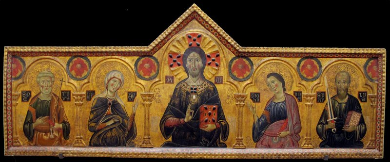
  <figcaption>Meliore di Jacopo, Christ with the Virgin and Saints Peter, John the Evangelist and Paul, 1271. Tempera and gold on panel, 85 × 210 cm. Florence, Uffizi. Photo: Francesco Bini, <a href="https://creativecommons.org/licenses/by-sa/4.0/deed.en">CC BY-SA 4.0</a>, via Wikimedia Commons.</figcaption>
</figure>

The dossal is a single plank with a raised central gable, framed by a moulding of small bosses and a painted border of crosses. The five figures are cut at the waist by the lower edge, as if seen over a parapet. The arcade is in relief, with capitals of leaves and bases with spurs; small painted flowers on stems grow on the gold beside the columns.

The composition is strictly symmetrical: the two intercessors turn towards Christ, the two apostles stand frontally at the ends. Christ is larger than the others and set higher, under the gable. The difference of scale expresses rank, as in the Byzantine Deesis, and the arcade makes the panel read as a row of icons.

<figure>
  
  <figcaption>Meliore di Jacopo, dossal of 1271, Christ, with the signature MELIOR ME PINXIT in the gold. Florence, Uffizi. Photo: Francesco Bini, <a href="https://creativecommons.org/licenses/by-sa/4.0/deed.en">CC BY-SA 4.0</a>, via Wikimedia Commons.</figcaption>
</figure>

Christ blesses in the Greek manner and holds a closed book. His dark robe is covered with fine gold lines that radiate from the clasp, a technique taken from Byzantine icons. The face is long and grave, with a forked beard and hair falling behind the shoulders; the halo is modelled in gesso, with rays, and the arms of the cross are raised and set with dark stones.

The signature is painted in pale letters on the gold, in three short lines on each side of the figure. Its position, beside Christ rather than on the frame, gives the painter's name a place within the sacred image. The date at the two ends of the dossal completes the inscription: A D MCC / MELIOR ME / PINXIT / LXXI.

<figure>
  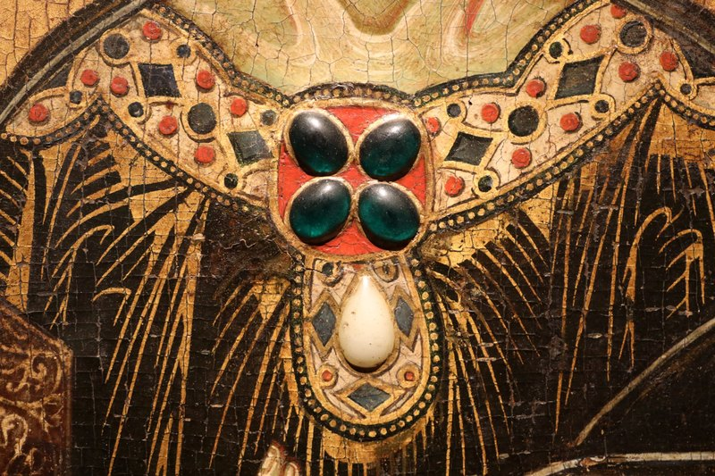
  <figcaption>Meliore di Jacopo, dossal of 1271, detail of the jewelled clasp on Christ's breast, in gesso relief with glass inlays. Florence, Uffizi. Photo: Francesco Bini, <a href="https://creativecommons.org/licenses/by-sa/4.0/deed.en">CC BY-SA 4.0</a>, via Wikimedia Commons.</figcaption>
</figure>

The clasp and collar of Christ are modelled in gesso and painted to imitate goldsmith's work. Four green glass cabochons are set in a red field, and a white drop hangs below; the collar carries red and dark stones in a pattern of lozenges. The relief catches the light differently from the flat gold around it, so that the jewels seem real.

<figure>
  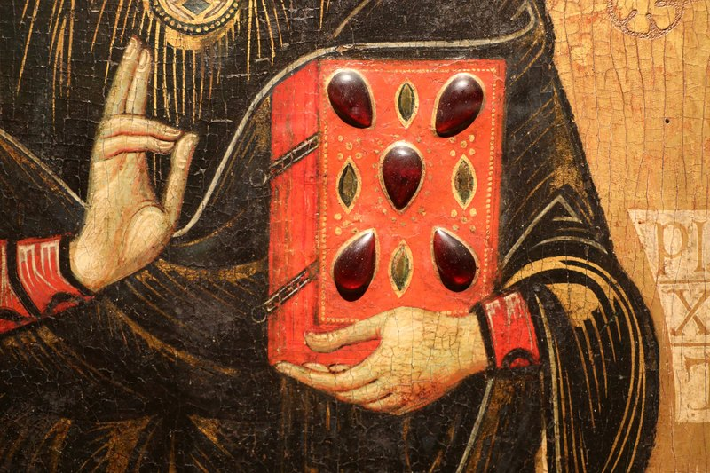
  <figcaption>Meliore di Jacopo, dossal of 1271, detail of the book held by Christ, with raised red settings, and the end of the signature. Florence, Uffizi. Photo: Francesco Bini, <a href="https://creativecommons.org/licenses/by-sa/4.0/deed.en">CC BY-SA 4.0</a>, via Wikimedia Commons.</figcaption>
</figure>

The book of the Gospels is treated in the same way: five red drops in raised settings on a red cover, with green almond shapes between them, as on a jewelled binding. Beside it the blessing hand is painted flat, with long fingers outlined in brown. The contrast between relief and painting is part of the design.

<figure>
  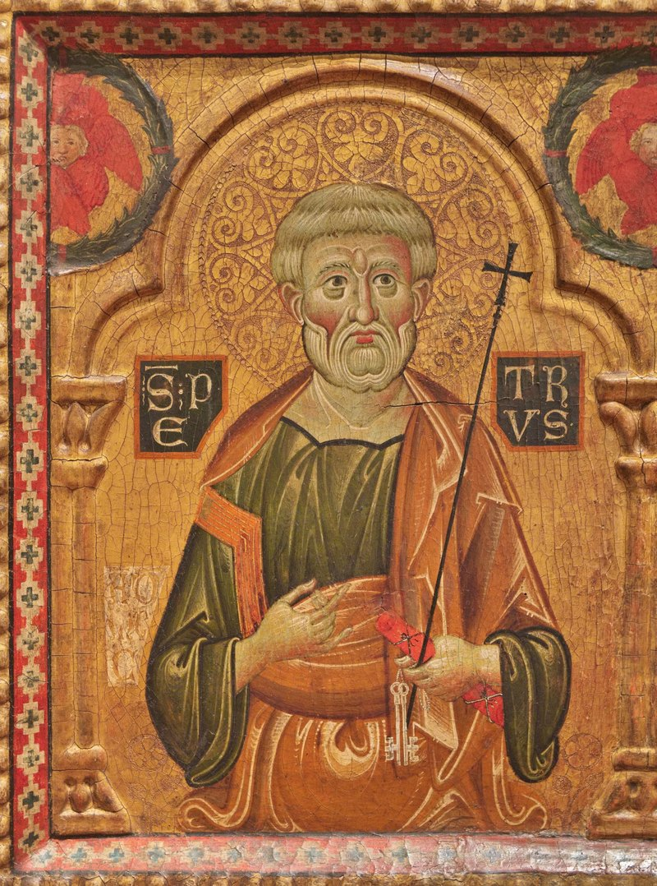
  <figcaption>Meliore di Jacopo, dossal of 1271, Saint Peter. Florence, Uffizi. Photo: Armin Kleiner, <a href="https://creativecommons.org/licenses/by-sa/4.0/deed.en">CC BY-SA 4.0</a>, via Wikimedia Commons.</figcaption>
</figure>

Peter stands at the left end, grey-haired, with the round face and short beard of his traditional type. He holds a thin processional cross, two keys and two red rolls tied with string, and lays his right hand on his breast. His orange mantle is drawn with white highlights in long curves. In the gold at the lower left a faded inscription carries the first part of the date.

<figure>
  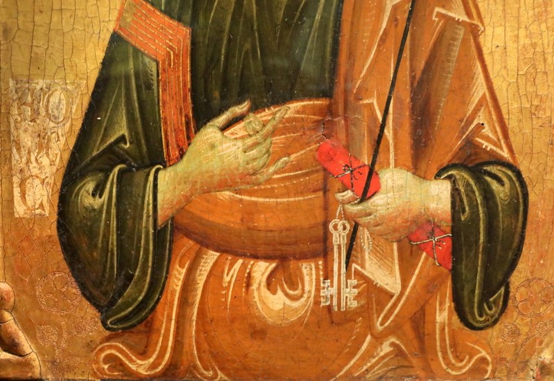
  <figcaption>Meliore di Jacopo, dossal of 1271, detail of Saint Peter's hands with the keys, the rolls and the cross. Florence, Uffizi. Photo: Francesco Bini, <a href="https://creativecommons.org/licenses/by-sa/4.0/deed.en">CC BY-SA 4.0</a>, via Wikimedia Commons.</figcaption>
</figure>

The detail shows the painter's method: the hands drawn with a firm contour and modelled with a few strokes of light, the cloth described by parallel white lines that follow the folds, and the attributes, keys and rolls, painted with small precise touches. The faded letters of the date, A D MCC, are visible on the gold.

<figure>
  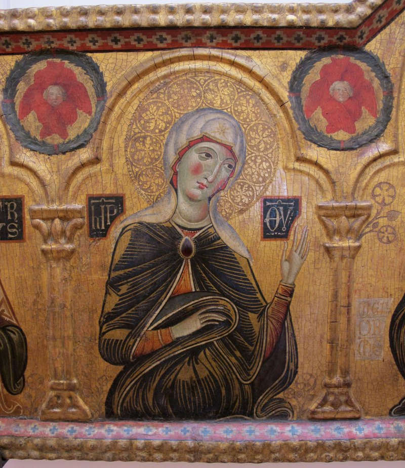
  <figcaption>Meliore di Jacopo, dossal of 1271, the Virgin. Florence, Uffizi. Photo: Francesco Bini, <a href="https://creativecommons.org/licenses/by-sa/4.0/deed.en">CC BY-SA 4.0</a>, via Wikimedia Commons.</figcaption>
</figure>

The Virgin turns towards Christ and raises her right hand in intercession. Her dark mantle is entirely covered with gold hatching, the *chrysography* of Byzantine icons, which makes the cloth shimmer and denies it weight. A red jewel in a raised setting fastens it at the neck. Her face, with its heavy eyelids and long nose, is the female version of the type used for John.

<figure>
  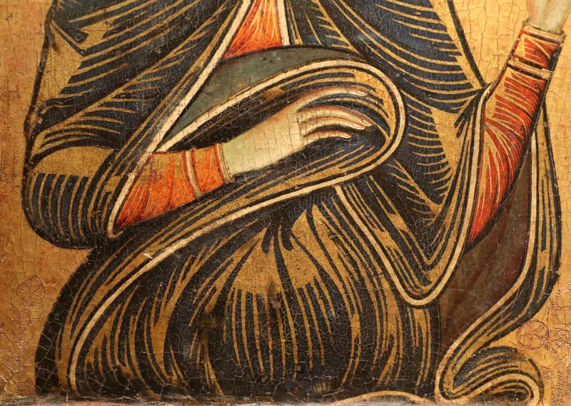
  <figcaption>Meliore di Jacopo, dossal of 1271, detail of the Virgin's mantle with gold hatching. Florence, Uffizi. Photo: Francesco Bini, <a href="https://creativecommons.org/licenses/by-sa/4.0/deed.en">CC BY-SA 4.0</a>, via Wikimedia Commons.</figcaption>
</figure>

Seen closely, the gold hatching is laid in short, dense strokes that fan out from the folds, with white lines along the edges of the mantle. The hand is long and pale, with a red sleeve striped in orange. The surface is cracked in a fine network but well preserved.

<figure>
  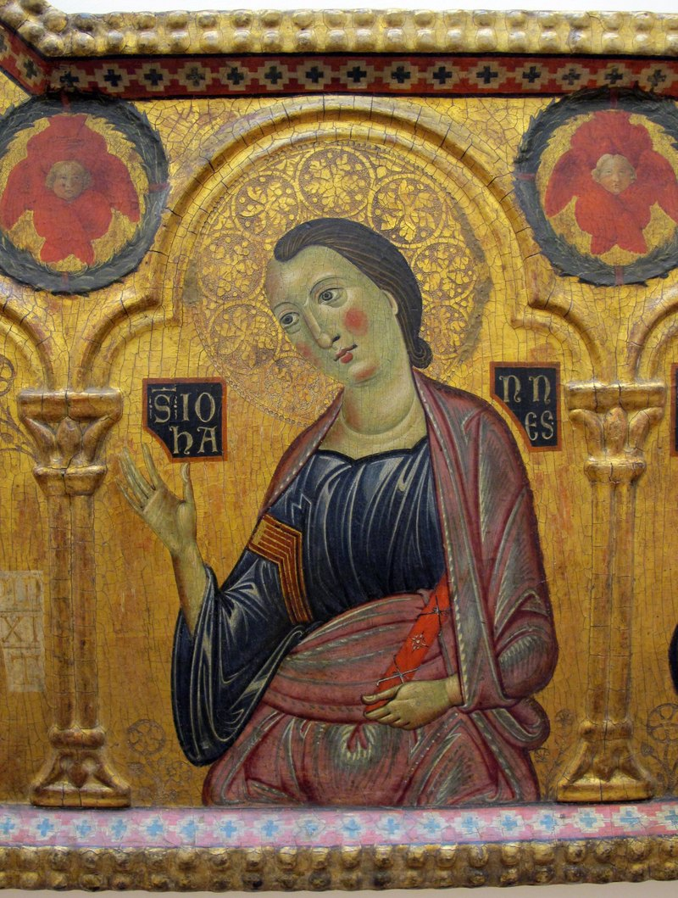
  <figcaption>Meliore di Jacopo, dossal of 1271, Saint John the Evangelist. Florence, Uffizi. Photo: Francesco Bini, <a href="https://creativecommons.org/licenses/by-sa/4.0/deed.en">CC BY-SA 4.0</a>, via Wikimedia Commons.</figcaption>
</figure>

John is shown young and beardless, as the beloved disciple, with his head bent towards Christ. He wears a blue tunic and a pink mantle drawn with white and grey lines, and he holds a red roll, the sign of the Gospel he wrote. His raised hand mirrors the Virgin's, so that the two intercessors frame Christ symmetrically.

<figure>
  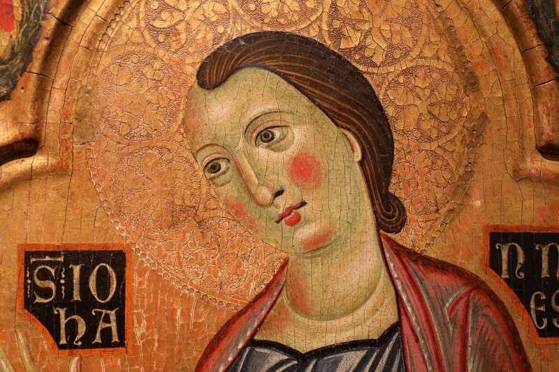
  <figcaption>Meliore di Jacopo, dossal of 1271, head of Saint John and tooled halo. Florence, Uffizi. Photo: Francesco Bini, <a href="https://creativecommons.org/licenses/by-sa/4.0/deed.en">CC BY-SA 4.0</a>, via Wikimedia Commons.</figcaption>
</figure>

The head of John shows the painter's facial type at close range: the greenish underlayer showing through the flesh, the red disks on the cheeks, the eyes outlined in brown with a heavy upper lid, the nose drawn with a single continuous line from the brow. The halo is punched with roundels enclosing leaves.

<figure>
  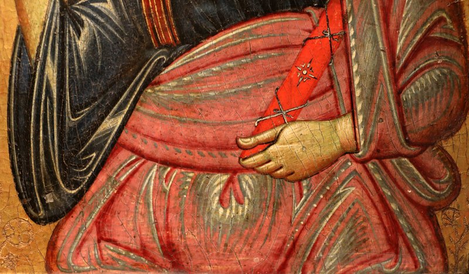
  <figcaption>Meliore di Jacopo, dossal of 1271, detail of Saint John's hand with the roll. Florence, Uffizi. Photo: Francesco Bini, <a href="https://creativecommons.org/licenses/by-sa/4.0/deed.en">CC BY-SA 4.0</a>, via Wikimedia Commons.</figcaption>
</figure>

<figure>
  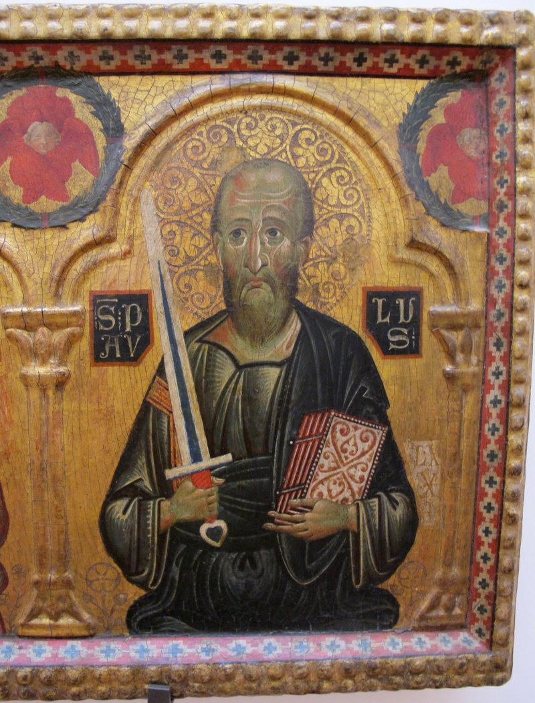
  <figcaption>Meliore di Jacopo, dossal of 1271, Saint Paul, with the end of the date in the gold. Florence, Uffizi. Photo: Francesco Bini, <a href="https://creativecommons.org/licenses/by-sa/4.0/deed.en">CC BY-SA 4.0</a>, via Wikimedia Commons.</figcaption>
</figure>

Paul closes the row at the right, bald and dark-bearded, with the sword of his martyrdom and a book of his letters. The sword is held upright across his body, its blade painted in white and blue. In the gold at the right of the figure the faded letters LXXI complete the date begun on the panel of Peter.

<figure>
  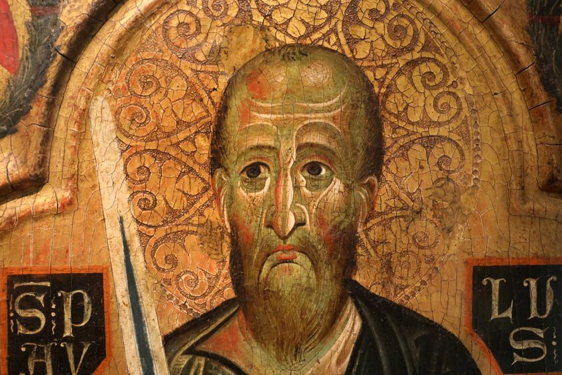
  <figcaption>Meliore di Jacopo, dossal of 1271, head of Saint Paul and tooled halo. Florence, Uffizi. Photo: Francesco Bini, <a href="https://creativecommons.org/licenses/by-sa/4.0/deed.en">CC BY-SA 4.0</a>, via Wikimedia Commons.</figcaption>
</figure>

The head of Paul is the most strongly characterised of the five. The high bald forehead is articulated by curved lines, the eyes are set deep under the brows, and the beard is painted in fine dark strokes. Each saint has a different halo pattern: large scrolls for Paul, roundels for John and the Virgin, a dense scroll for Peter.

### The Dossal of Panzano

<figure>
  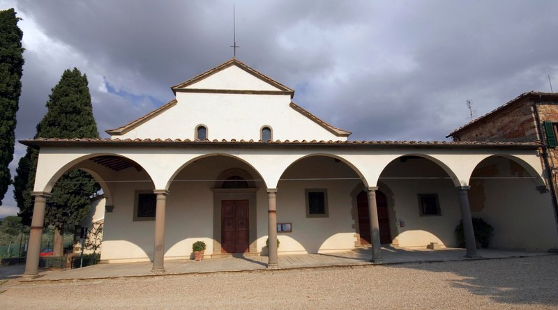
  <figcaption>The pieve of San Leolino at Panzano in Chianti, where the dossal is kept. Photo: Vignaccia76, <a href="https://creativecommons.org/licenses/by-sa/3.0/deed.en">CC BY-SA 3.0</a>, via Wikimedia Commons.</figcaption>
</figure>

<figure>
  
  <figcaption>Meliore di Jacopo (attributed), Madonna and Child enthroned between Saints Peter and Paul, with four scenes of their lives, c. 1250–1270. Tempera on panel, 93.5 × 153 cm. Panzano in Chianti, pieve di San Leolino. Photo: Francesco Bini, <a href="https://creativecommons.org/licenses/by-sa/4.0/deed.en">CC BY-SA 4.0</a>, via Wikimedia Commons.</figcaption>
</figure>

The dossal is a broad rectangle with a dark ground instead of gold. The central field holds the three large figures; the four scenes occupy the corners, framed by red borders dotted with white. The two apostles are named S PE and S PA, the Virgin MP ΘY. The panel is in good condition after its restoration of 1913 and its recovery after the theft of 1979.

<figure>
  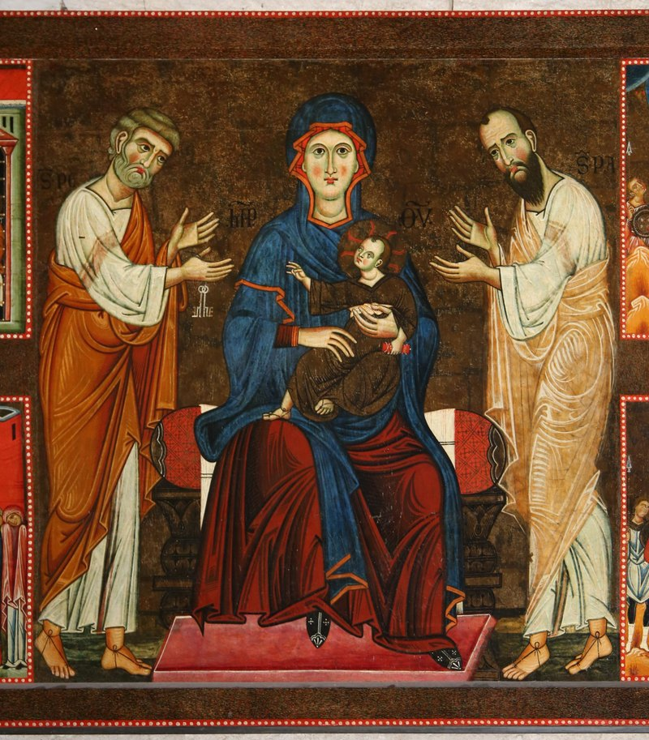
  <figcaption>Meliore di Jacopo (attributed), Panzano dossal, the Virgin and Child between Saints Peter and Paul. Panzano in Chianti, pieve di San Leolino. Photo: Francesco Bini, <a href="https://creativecommons.org/licenses/by-sa/4.0/deed.en">CC BY-SA 4.0</a>, via Wikimedia Commons.</figcaption>
</figure>

The Virgin sits frontally on a wide throne with two red cushions, her feet on a pink footstool. The Child, in a dark robe, sits on her left knee, turns his head up to her and holds a red roll. Peter and Paul stand at full length and open their hands towards the central group, in a gesture of presentation. The figures are as tall as the panel, a scale that makes the dossal unusually monumental.

<figure>
  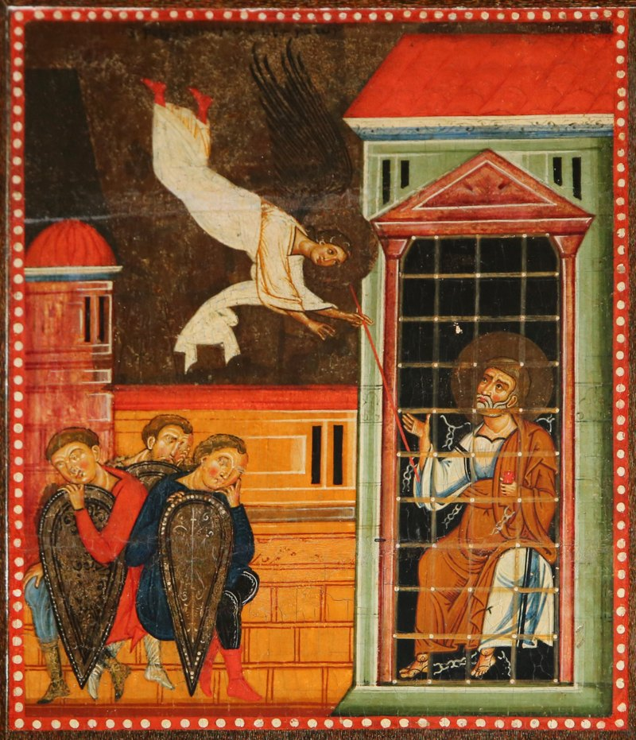
  <figcaption>Meliore di Jacopo (attributed), Panzano dossal, Saint Peter freed from prison by an angel. Panzano in Chianti, pieve di San Leolino. Photo: Francesco Bini, <a href="https://creativecommons.org/licenses/by-sa/4.0/deed.en">CC BY-SA 4.0</a>, via Wikimedia Commons.</figcaption>
</figure>

The first scene follows Acts 12. Peter sits chained behind the grating of the prison while the angel dives towards him; the soldiers sleep on their shields in front of the wall. The prison is drawn as a small temple with a pediment, a type of architecture common in Duecento narrative painting. A faded title runs along the upper edge.

<figure>
  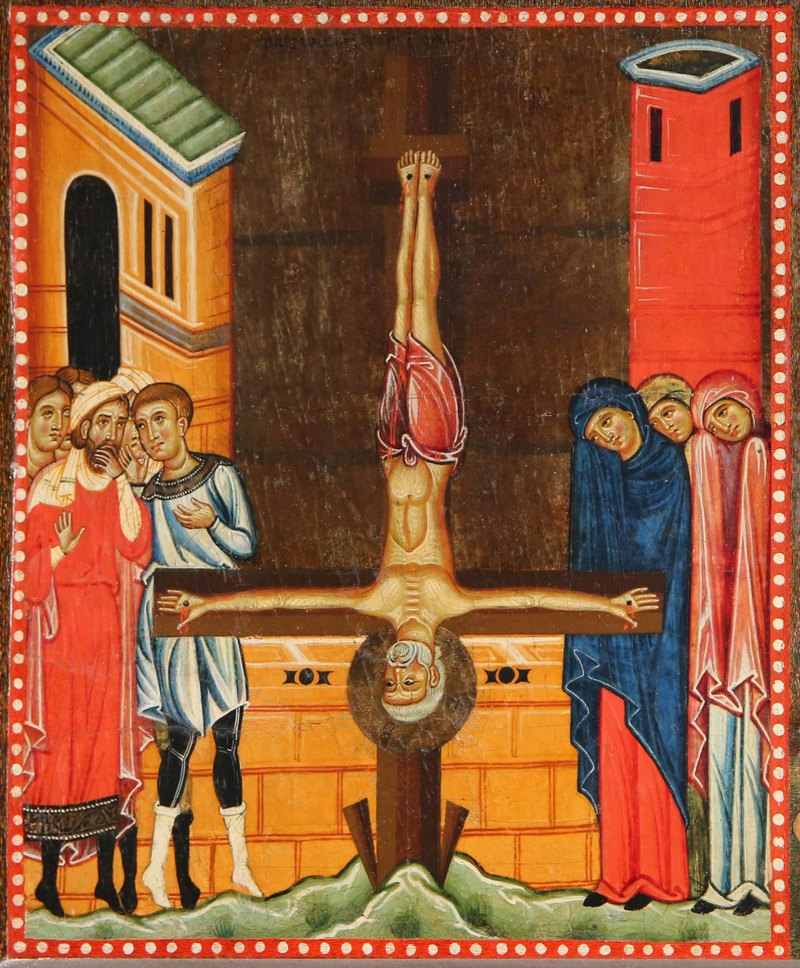
  <figcaption>Meliore di Jacopo (attributed), Panzano dossal, the crucifixion of Saint Peter. Panzano in Chianti, pieve di San Leolino. Photo: Francesco Bini, <a href="https://creativecommons.org/licenses/by-sa/4.0/deed.en">CC BY-SA 4.0</a>, via Wikimedia Commons.</figcaption>
</figure>

Peter is crucified head down, as the apocryphal Acts of Peter relate, on a cross that fills the centre of the field. The men at the left, one in a turban, discuss the event; three women at the right, in blue and pink mantles, mourn. The symmetry of the composition recalls the Crucifixion of Christ, which the scene deliberately inverts.

<figure>
  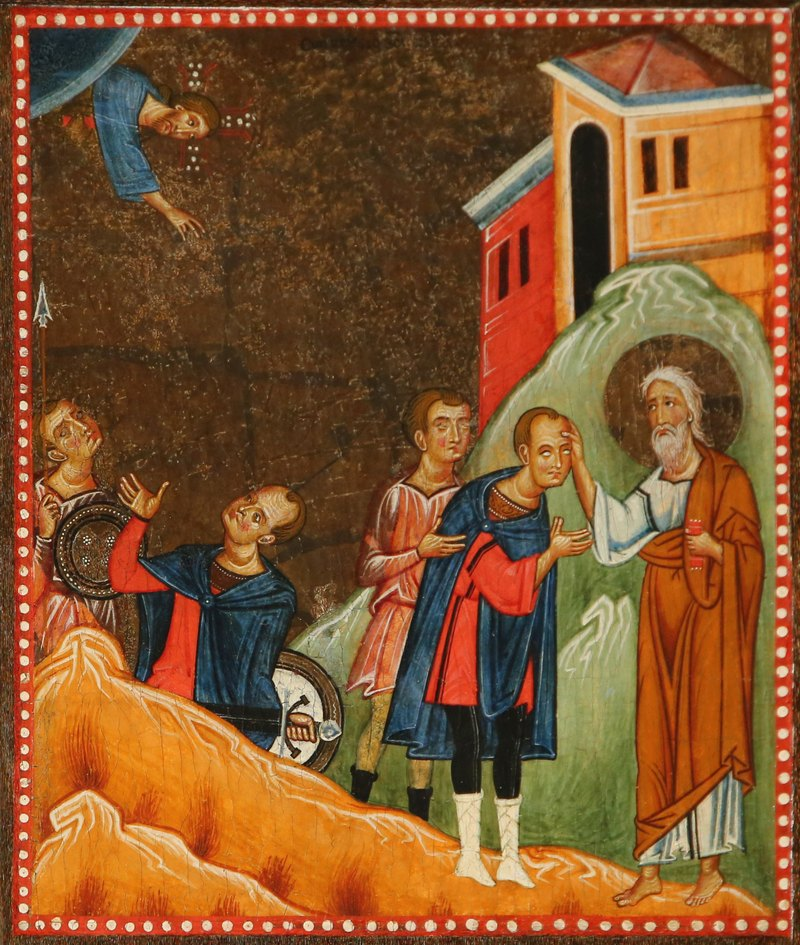
  <figcaption>Meliore di Jacopo (attributed), Panzano dossal, the conversion of Saul and the healing of his blindness by Ananias. Panzano in Chianti, pieve di San Leolino. Photo: Francesco Bini, <a href="https://creativecommons.org/licenses/by-sa/4.0/deed.en">CC BY-SA 4.0</a>, via Wikimedia Commons.</figcaption>
</figure>

The third scene joins two episodes of Acts 9. At the left Saul, struck on the road to Damascus, looks up at Christ appearing from heaven; at the right, blinded, he is led to Ananias, who lays his hand on his head. The white eyes of the blind Saul are a precise narrative detail. The rocks are drawn with white highlights in the Byzantine manner.

<figure>
  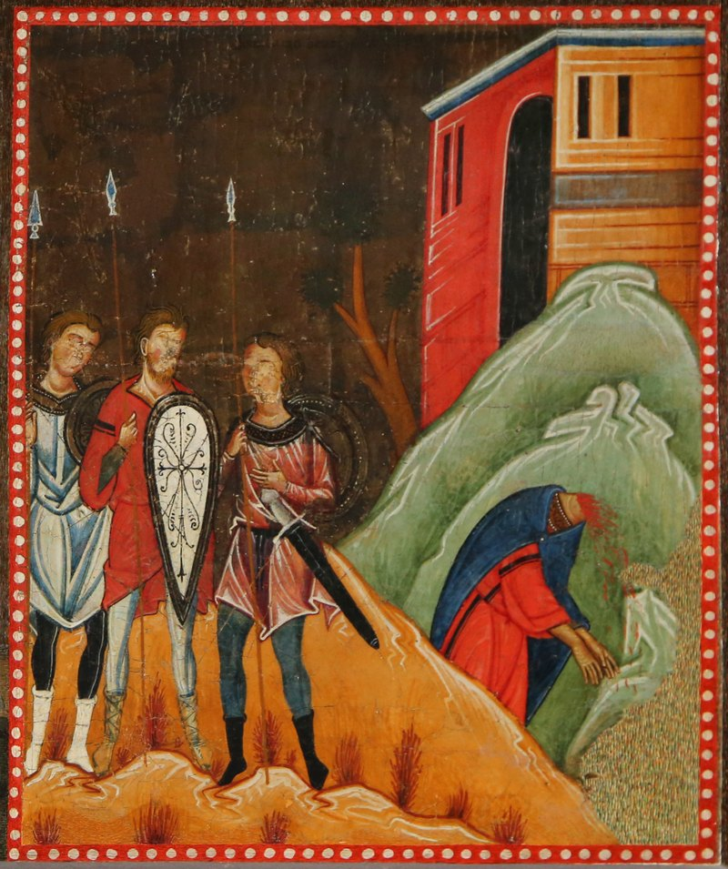
  <figcaption>Meliore di Jacopo (attributed), Panzano dossal, the beheading of Saint Paul. Panzano in Chianti, pieve di San Leolino. Photo: Francesco Bini, <a href="https://creativecommons.org/licenses/by-sa/4.0/deed.en">CC BY-SA 4.0</a>, via Wikimedia Commons.</figcaption>
</figure>

The last scene shows the soldiers after the execution and the body of Paul bending forward, blood flowing from the neck, outside the walls. Some faces of the soldiers are damaged. The four scenes together make the dossal an image of the two princes of the apostles. Where it stood before it came to Panzano from Radda is not recorded in the sources consulted.

### The Madonna of Bagnano

<figure>
  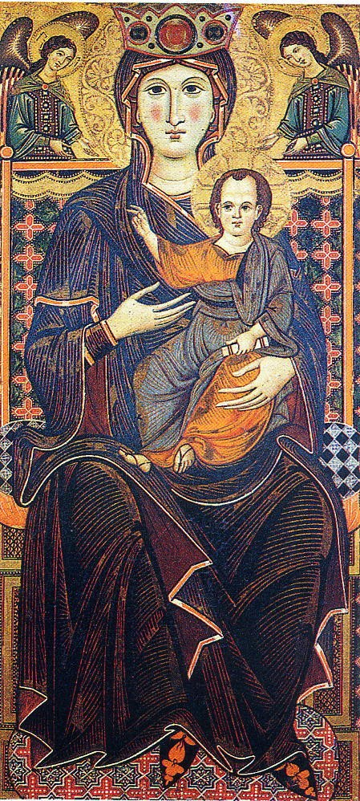
  <figcaption>Meliore di Jacopo, Madonna and Child enthroned with two angels, from Santa Maria a Bagnano, c. 1270–1275. Tempera and gold on panel. Certaldo, Museo di Arte Sacra. Photograph from a printed reproduction. Public domain, via Wikimedia Commons.</figcaption>
</figure>

The Virgin wears a jewelled crown, a feature rare in Florentine Madonnas of these decades, and sits on a throne hung with a cloth patterned with red crosses. She holds the Child on her left arm and raises her right hand towards him. The Child turns his head towards the viewer and holds a roll in his left hand. Two angels lean over the back of the throne.

The Child does not bless in the Greek manner: he extends his right arm towards his mother. The photograph is taken from a printed plate, whose colours are stronger than the panel's; it shows the composition but not the surface.

### The Madonna of Montefioralle

The panel in Santo Stefano at Montefioralle is 150 by 76 centimetres, with a gabled top and fifteen raised studs on the frame, which the catalogue takes as a sign of its age. The Virgin wears a dark blue mantle over a red dress woven with small flowers, more richly patterned than in the related panels. The Child in a pink tunic sits on her right arm and touches her chin.

Two angels appear in the upper corners above the throne. The throne is covered with patterned cloth and has round cushions. The panel was restored by Umberto Baldini in 1953 for the Soprintendenza and shown at the seventh exhibition of restored works in Florence that year. No photograph with a free licence is available for this entry.

<figure>
  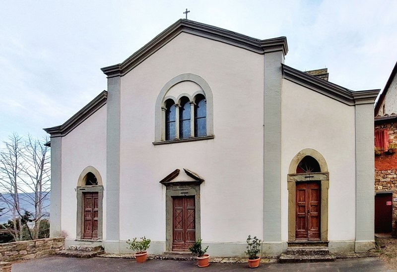
  <figcaption>The church of Santo Stefano at Montefioralle, Greve in Chianti. Photo: Anna.Massini, <a href="https://creativecommons.org/licenses/by-sa/4.0/deed.en">CC BY-SA 4.0</a>, via Wikimedia Commons.</figcaption>
</figure>

### The Madonna of Tavarnelle (disputed)

<figure>
  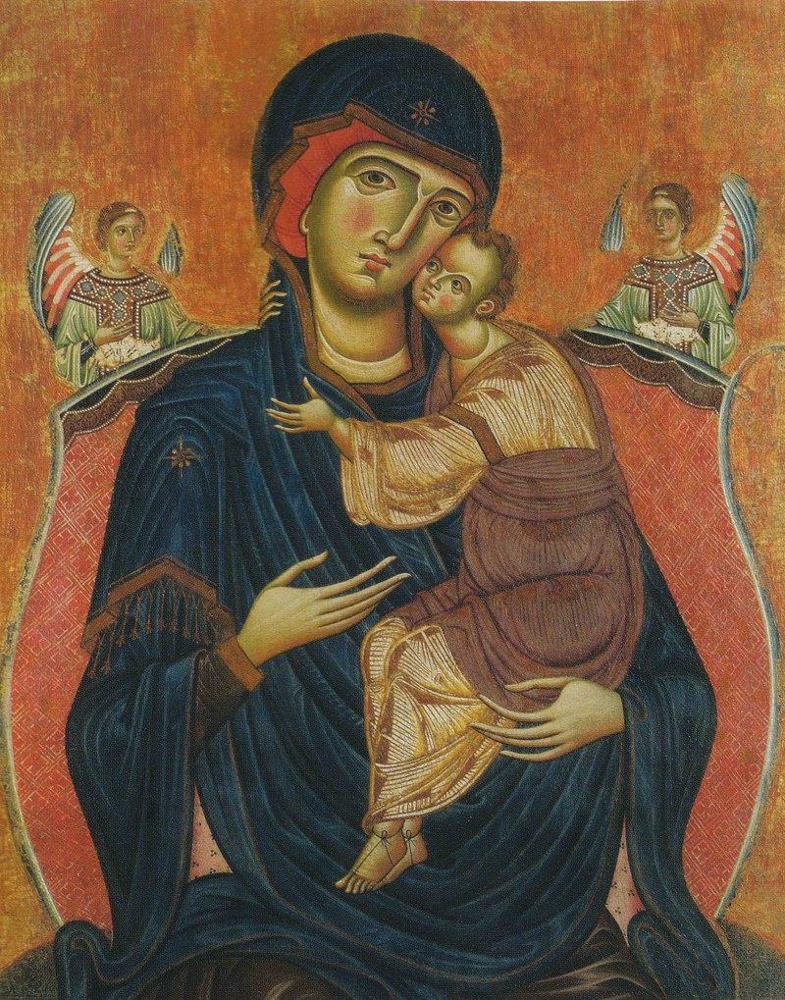
  <figcaption>Circle of Meliore di Jacopo (?), Madonna and Child with two angels, c. 1270–1280. Tempera on panel, 98 × 75 cm. Tavarnelle Val di Pesa, Museo di Arte Sacra, from the oratory of San Michele a Casaglia. Photograph from a printed reproduction. Public domain, via Wikimedia Commons.</figcaption>
</figure>

The panel, a fragment, comes from the oratory of San Michele a Casaglia, a dependency of San Pietro in Bossolo, and is now in the Museo di Arte Sacra of Tavarnelle. The Virgin presses the Child to her cheek in the type of the Virgin of Tenderness. Its attribution has varied widely: Offner placed it in the circle of Meliore, Garrison gave it to a Florentine influenced by him, Ragghianti to the workshop of Meliore and Coppo, and [Marco Ciatti](/scholars.html#ciatti-marco) excluded it from Meliore's catalogue in 1988.

### Works for Comparison

<figure>
  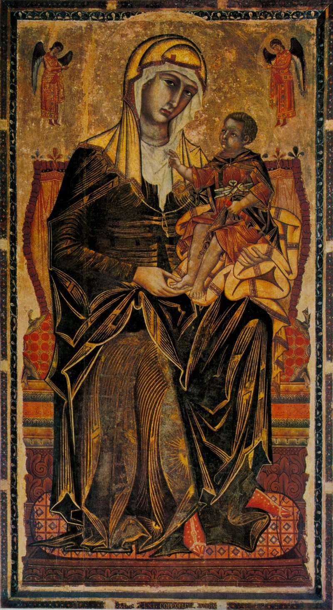
  <figcaption>Coppo di Marcovaldo, Madonna del Bordone, signed and dated 1261. Tempera and gold on panel. Siena, Santa Maria dei Servi. Public domain, via Wikimedia Commons.</figcaption>
</figure>

Coppo's Madonna for the Servites of Siena, signed and dated 1261, is the closest dated work by a contemporary Florentine painter. Its massive figure and modelled draperies show the difference between the two painters: where Coppo builds volume, Meliore draws contours and patterns.

<figure>
  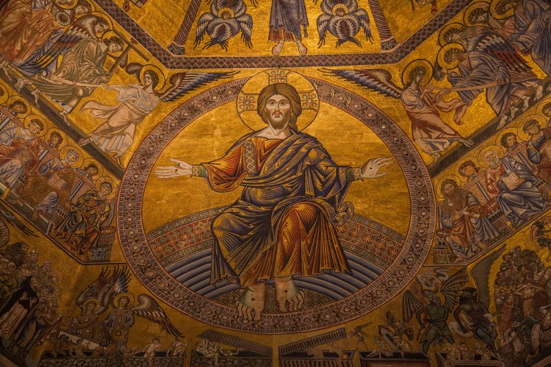
  <figcaption>Last Judgment, c. 1260–1275, the Christ Judge. Mosaic. Florence, Baptistery of San Giovanni, dome. Photo: Bradley Weber, <a href="https://creativecommons.org/licenses/by/2.0/deed.en">CC BY 2.0</a>, via Wikimedia Commons.</figcaption>
</figure>

The Last Judgment of the Baptistery dome is given by the Opera di Santa Maria del Fiore to masters in the circle of Meliore and Coppo. The figure of Christ shown here is generally associated with Coppo; the parts sometimes proposed for Meliore lie among the apostles and angels of the upper zones.

**Name:** Meliore di Jacopo (Meliore Toscano); signs MELIOR.

**Documents:** "Migliore dipintore", parish of San Jacopo tra le Fosse, Libro di Montaperti, 1260 (identification by P. Bacci).

**Signed work:** Dossal with Christ, the Virgin and Saints Peter, John and Paul, MELIOR ME PINXIT, 1271, 85 × 210 cm, Florence, Uffizi, inv. 1890 n. 9153; from San Pancrazio, Vigheffio (Parma), 1792–1840; Galleria Nazionale, Parma, 1840–1928; Uffizi since 1948.

**Attributed works:** Dossal with the Madonna between Saints Peter and Paul and four scenes, Panzano in Chianti, San Leolino (from Radda in Chianti, c. 1913); Madonna with two angels from Santa Maria a Bagnano, Certaldo, Museo di Arte Sacra; Madonna with two angels, Montefioralle, Santo Stefano; Madonna, Chicago, Art Institute, 33.1034; Madonna, formerly Stoclet collection, Brussels.

**Disputed:** Madonna from San Michele a Casaglia, Tavarnelle, Museo di Arte Sacra; Madonna of the Oblate, Careggi (Maestro di Bagnano in the Zeri catalogue); parts of the Last Judgment, Florence, Baptistery.

**Bibliography:** P. Bacci, 1910–1912; R. Offner, 1927 and 1933; G. M. Richter, 1930; E. Sandberg-Vavalà, 1929 and 1934; G. Sinibaldi and G. Brunetti, *Pittura italiana del Duecento e Trecento*, 1943; E. B. Garrison, 1947 and *Italian Romanesque Panel Painting*, 1949; R. Longhi, 1948; U. Baldini, 1953; C. L. Ragghianti, *Pittura del Dugento a Firenze*, 1955; L. Marcucci, *Gallerie Nazionali di Firenze. I dipinti toscani del secolo XIII*, 1958; M. Boskovits, 1976 and 1993; M. Ciatti, 1988; A. Tartuferi, *La pittura a Firenze nel Duecento*, 1990.
