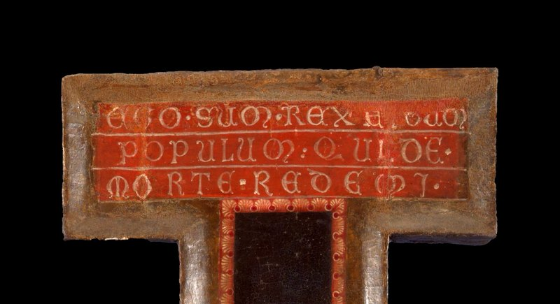
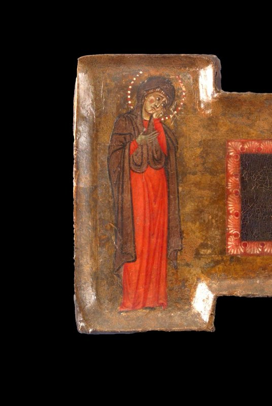
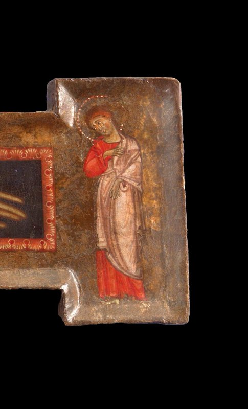
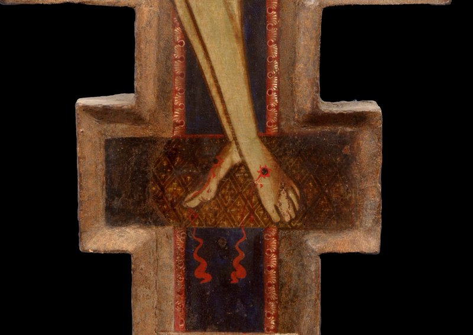
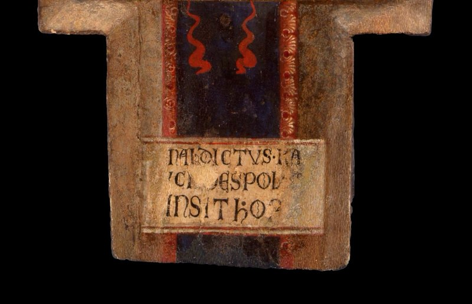
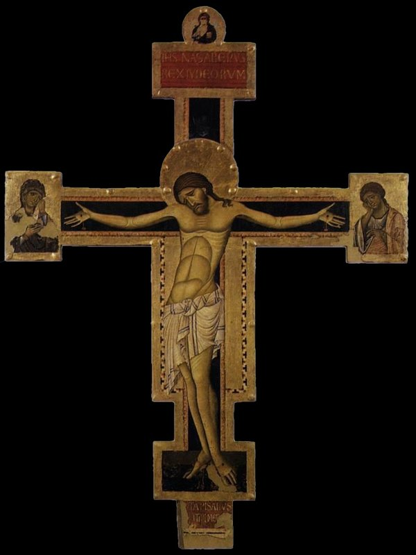

## A Painter Known from Two Signatures

*Rainaldetto di Ranuccio* is known from two signed painted crosses. The first, in the Pinacoteca Civica Bruno Molajoli at Fabriano, carries at its foot the signature of *Rainaldictus Ranuci de Spoleto*, "Rainaldetto son of Ranuccio of Spoleto". The second, in the Pinacoteca Nazionale of Bologna, is signed and dated April 1265. Together they give his name, his father's name, his city and a year of activity.

Nothing else is documented. No record names his birth, his training, his workshop or his death. The previous version of this entry filled these gaps with sections on his family, his travels and the date and cause of his death, which said, at length, that nothing is known. The present entry keeps to what the works and the literature allow.

The name appears in several forms. The Fabriano inscription has *Rainaldictus*, a diminutive of Rainaldo, rendered in Italian as Rainaldetto; the literature also calls him Rainaldo or Rinaldo di Ranuccio, and the Pinacoteca of Bologna catalogues him as Rinaldo di Ranuccio. The entry in the *Dizionario Biografico degli Italiani*, written by [Maria Cristina Rossi](/scholars.html#rossi-maria-cristina) (2016), uses "Rainaldo (Rinaldo) di Ranuccio" and is the main source of the present account.

His importance lies in the crosses. Both are of the type of the *Christus patiens*, the dead Christ on the cross, which [Giunta Pisano](/Content/Artists/XIII-c/Giunta-Pisano.html) had spread through central Italy in the second quarter of the thirteenth century. Rainaldetto is one of the painters through whom Giunta's model reached Spoleto, the Marches and Bologna, and his signed and dated works give a fixed point for the chronology of the type.

The previous version of this entry contained several errors. It gave him the painted cross of the Galleria Enrico Frascione in Florence as a certain work, although [Angelo Tartuferi](/scholars.html#tartuferi-angelo) (2015) and [Alessandro Delpriori](/scholars.html#delpriori-alessandro) (2016) have rejected the attribution. It presented as certain the attribution of the triptych of Santa Chiara in Assisi, which is disputed between him, [Guido da Siena](/Content/Artists/XIII-c/Guido-da-Siena.html) and [Dietisalvi di Speme](/Content/Artists/XIII-c/Dietisalvi-di-Speme.html). It mentioned a "Madonna enthroned of 1258" by Simeone and Machilone in Palazzo Barberini, where the work of those painters is a cross.

It also mistranslated the inscription of the Fabriano cimasa and described the mourners of the Fabriano cross as standing beside the body rather than in the terminals. Its accounts of the provenance of the Bologna cross, which seemed contradictory, are reconciled by the *Dizionario Biografico*. These points are treated below, with the evidence of the photographs of the Fabriano cross, the catalogues of the two museums and the entry of Rossi.

The account that follows treats Spoleto and its tradition, the two signed crosses, the model of Giunta and the comparison with the Maestro di San Francesco, the works attributed and rejected, and the significance of the painter. The catalogue then examines the Fabriano cross part by part, with comparisons.

The cross of Bologna is described in words only, because no image with a free licence could be found. The Fabriano cross is illustrated by a photograph published on Wikimedia Commons under a free licence, and by details cropped from it.

## Spoleto and Its Tradition

Rainaldetto signed himself as a man of Spoleto, the city that had produced, in the previous century, the painter [Alberto Sozio](/Content/Artists/XII-c/Alberto-Sozio.html), whose cross of 1187 hangs in the cathedral. In the mid-thirteenth century the leading painters of the city were [Simeone and Machilone](/Content/Artists/XIII-c/Simeone-and-Machilone.html), who signed a painted cross in 1257, now in Palazzo Barberini in Rome.

The cross of Simeone and Machilone is the immediate local precedent for Rainaldetto's crosses. It shows a dead Christ of Giunta's type, with the mourners in the terminals, a pale striped loincloth and a softened curve of the body. [Ada Labriola](/scholars.html#labriola-ada) (1987) connected Rainaldetto with the workshop of the two painters, and the *Dizionario Biografico* entry on Machilone by [Cristina Ranucci](/scholars.html#ranucci-cristina) (2006) lists him among the painters of Spoletan culture who followed them.

That Rainaldetto trained with Simeone and Machilone is a reasonable hypothesis, not a documented fact. The resemblance of their crosses may reflect a shared local model as much as a relation of master and pupil, and no document records his apprenticeship.

The diocese of Spoleto extended across the Apennines towards the Marches, and the Spoletan painters worked across this territory. Fabriano, where one of Rainaldetto's signed crosses is now kept, lies on the routes that connected Umbria with the Adriatic. [Alessandro Delpriori](/scholars.html#delpriori-alessandro) has argued that the duchy of Spoleto and the Marches formed a single artistic territory in the thirteenth century.

The second half of the century was dominated, in Umbria, by the decoration of the basilica of San Francesco at Assisi, which drew painters from Tuscany, Rome and beyond. The Maestro di San Francesco, who painted the nave of the Lower Church and signed a cross dated 1272 for Perugia, is the painter most often compared with Rainaldetto.

The Franciscan movement favoured the image of the suffering Christ. The *Christus patiens*, dead on the cross, with closed eyes and a body bent by death, became the image of the Passion on which friars and laity were invited to meditate. Rainaldetto's crosses belong to this devotional climate.

The patrons of his crosses are unknown. The museum of Fabriano records the provenance of its cross as unknown, and the provenance of the Bologna cross is reported differently in different sources. A Franciscan destination is likely for both, but it is an inference from their type, not a documented fact.

The tradition into which Rainaldetto was born, from Alberto Sozio to Simeone and Machilone, gave him a local idiom; the model of Giunta gave him a type; the art of Assisi gave him a standard of comparison. His crosses combine the three.

## The Two Signed Crosses

The cross of Fabriano measures 154 by 120 centimetres and is painted in tempera on panel. The museum dates it to the second half of the thirteenth century and records its provenance as unknown; the *Dizionario Biografico* states that it came from the Ospedale del Buon Gesù in Fabriano, which received works from the suppressions after the unification of Italy, and that it was probably made for a Franciscan setting in the city. The dictionary gives its dimensions as 223 by 142 centimetres, almost exactly those of the Bologna cross, 224 by 141.5; the figure appears to repeat the Bologna measurements by mistake, and the proportions of the cross in photographs agree with the museum's 154 by 120. [Edward Garrison](/scholars.html#garrison-edward) (1949) dated it earlier than the Bologna cross, about 1260, and [Silvia Giorgi](/scholars.html#giorgi-silvia), in the catalogue of the Pinacoteca of Bologna, considered it about five years earlier than the Bologna cross of 1265.

The cross bears two inscriptions. In the cimasa, in white Gothic capitals on a red ground, three lines read *EGO SUM REX R[E]G[U]M / POPULUM QUI DE / MORTE REDEMI*: "I am the King of kings, who redeemed the people from death". The previous version of this entry, following the museum's page, translated it as "the King of kings and of the peoples who rose from the dead", which does not correspond to the Latin.

At the foot of the cross, on a pale plaque, three lines in black letters give the signature: *[RAI]NALDICTUS RA/[N]UCI DE SPOL[ETO] / [P]INSIT HO[C]*, "Rainaldetto son of Ranuccio of Spoleto painted this". The beginning of the name and some letters are lost, but the reading is secure. The verb *pinsit*, for *pinxit*, reflects the spoken form. [Lionello Venturi](/scholars.html#venturi-lionello), the first to publish the cross in 1915, misread the damaged name as *Benaidictus*.

The cross of Bologna measures 224 by 141.5 centimetres and is painted in tempera on panel. The Pinacoteca Nazionale catalogues it as inv. 1328, signed, dated 1265, by Rinaldo di Ranuccio, and records its provenance from the Attilio Rossi collection. Its title describes a shaped cross with the Saviour, the Mourning Virgin and Saint John.

The museum observes that the two crosses of Bologna and Fabriano are the only works securely attributed to the painter, that he worked within the tradition of Giunta and that his art shows connections with the Maestro di San Francesco. The cross is now shown in room 3 of the Pinacoteca, among the works of the "foreign" painters in Bologna before Giotto.

The inscription of the Bologna cross, as transcribed by [Silvia Giorgi](/scholars.html#giorgi-silvia) (1987), reads *Iesu Nazaren(us) rex iudeorum / anno d(omi)ni MCCLXV d(ie) mensis aprelis / magister Rainaldo Ranucai / pinsit h(oc)*: "Jesus of Nazareth, King of the Jews, in the year of the Lord 1265, in the month of April, master Rainaldo son of Ranuccio painted this". It gives the painter the title of *magister*, master, and the most precise date of his career.

The original destination of the cross is unknown. [Giordana Benazzi](/scholars.html#benazzi-giordana) (2014) proposed that it came from Santa Chiara in Assisi, where, at the consecration of the basilica in 1265, it may have served as the *crux de medio ecclesiae*, the cross hung in the middle of the church, paired with the tabernacle of the Madonna dei Crociati, which she also attributed to Rainaldetto. The statement of the previous version of this entry that the cross came from San Francesco in Bologna has no support in the sources consulted.

The two crosses complement each other: the Fabriano cross gives the painter's father and city, the Bologna cross the year. Read together, they make Rainaldetto one of the few painters of the Umbrian Duecento whose identity and activity are anchored by inscriptions.

## Giunta's Model and the Maestro di San Francesco

The type of Rainaldetto's crosses is that of Giunta Pisano. Giunta's crosses, among them the cross of Santa Maria degli Angeli near Assisi and the cross of San Domenico in Bologna, established the *Christus patiens*: a dead Christ whose body curves to one side, whose head falls on the shoulder, whose eyes are closed, set against a dark cross with the mourners in the terminals.

At Fabriano the body of Christ bends strongly to the right of the viewer, the hips pushed out, the legs descending and crossing at the feet. The head falls forward on the chest, the eyes closed. The arms are stretched almost horizontally, the hands open. The curve is Giunta's, but it is drawn with a lighter, more linear hand.

The mourners stand in the terminals at the ends of the crossbar: the Virgin at the left, in a red dress and a dark mantle, raising her hand to her face; Saint John at the right, in a red tunic and a pink mantle, his hand on his breast. They are small, full-length figures, as in the cross of Simeone and Machilone, rather than the half-length figures of Giunta's Santa Maria degli Angeli cross.

The broad field beside the body of Christ, the *tabellone*, is not filled with scenes or a textile pattern but bordered by two vertical bands of geometric ornament, crosses and lozenges in black, white, red and blue, on a brownish ground. This ornament, which the old literature described as "carpets", is one of the most recognisable features of the painter.

The flesh of Christ is greenish and pale, the anatomy drawn with clear lines: the arch of the ribs, the divisions of the abdomen, the knees. The loincloth is pale pink and white, with red stripes, knotted at the hip with a hanging end. Below the crossed feet, which rest on a small panel patterned with lozenges, two streams of blood run down in wavy lines on the dark ground.

The Maestro di San Francesco, whose cross dated 1272 is in the Galleria Nazionale dell'Umbria in Perugia, offers the closest comparison. His Christ, too, is a *Christus patiens* with a strongly curving body and a pale loincloth, his mourners stand at full length in the terminals, and a small figure of Saint Francis kneels at the feet. The Pinacoteca of Bologna notes the connection between the two painters.

The previous version of this entry discussed the division of Christ's abdomen into two parts at Fabriano and three at Bologna as an evolutionary sign, and reached contradictory conclusions about which came first. The point is too fine to bear the weight of a chronology, and the relative dating of the two crosses rests on Garrison's and Giorgi's judgement of style.

Venturi (1915) related the Fabriano cross to one of the detached frescoes of Fabriano, to the cross of the Maestro di San Francesco of 1272, to the cross of the Maestro dei Crocifissi francescani in San Francesco at Gualdo Tadino and to the lost cross of the cathedral of Ancona. Umberto Gnoli (1923) noted both its Giuntesque character and its links with the culture of Spoleto. The *Dizionario Biografico* sums up his style in four features: soft, flat colour, decorated "carpets" as backgrounds, a detailed description of anatomy and a soft use of line.

## Attributions Accepted and Rejected

Beyond the two signed crosses, the attributions to Rainaldetto are few and uncertain. The Pinacoteca of Bologna states plainly that the two crosses are the only works securely attributed to him.

The portable triptych in the Frick Art Museum in Pittsburgh, inv. 1970.52, with the Madonna and Child enthroned, four scenes of the Passion and Saints Anthony and Francis, is attributed by the museum to Rainaldo di Ranuccio da Spoleto and dated about 1270. It is discussed and described in the entry on Simeone and Machilone, as a work of their following.

The painted cross of the Galleria Enrico Frascione in Florence, 160 by 119 centimetres, in tempera, gold and silver on panel, with Saints Francis and Clare in the terminals, was published by [Roberto Longhi](/scholars.html#longhi-roberto) in 1966 as a work of Rainaldetto. Tartuferi (2015) rejected the attribution and placed the cross in the Umbrian-Marchigian area around 1295; Delpriori (2016) also rejected it, keeping a Spoletan context.

The triptych in the basilica of Santa Chiara in Assisi, with the Madonna and Child and scenes from the life of Christ, was related to the Bologna cross by Giorgi (1987); the *Dizionario Biografico* reports its attribution to Rainaldetto, with a date between 1265 and 1272, on the strength of the dramatic tension and emotional reading of its scenes. Other scholars give it to Guido da Siena or to Dietisalvi di Speme. The attribution is therefore disputed, and the triptych is not illustrated here.

The *Dizionario Biografico* records further attributions: a cross in the Museo di San Francesco at Montefalco, a cross in the Franciscan convent of Massa Fermana, another in the convent of Santa Chiara at Montalto Marche, and the tabernacle and cross of the Blessed Mattia Nazzarei at Matelica, given to him by Garrison (1949), [Andrea De Marchi](/scholars.html#de-marchi-andrea) (2009) and Benazzi (2014). Rossi notes that they show, in some decorative details, a strong link with the Umbrian tradition spread by Rainaldetto. No free images of these works could be found.

The *Dizionario Biografico* entry on Machilone records Labriola's connection of Rainaldetto with Simeone and Machilone, and the broader network of the Spoleto school. Within it, Rainaldetto occupies the generation after the two painters, and the boundaries between his work, theirs and that of their followers are not always clear.

The result is a small catalogue with two firm points. Around them the literature has grouped the Assisi triptych and tabernacle, the crosses of the Marches and the Pittsburgh triptych; Rossi sees in them the painter as the propagator of Giunta's language on the Adriatic side of the peninsula. Each of these attributions rests on style, and the Assisi triptych is disputed.

This caution is the main correction the present entry brings. A painter known from two crosses cannot carry the weight of a large catalogue, and the history of the Frascione cross, attributed to him for half a century and then rejected, shows how easily such a catalogue grows and shrinks.

## Significance

Rainaldetto is significant first as a named painter. In the Umbrian Duecento, where most painters are anonymous, he signed two crosses and dated one of them, giving his father's name and his city. His inscriptions make him, with Simeone and Machilone, one of the few identifiable painters of Spoleto in the thirteenth century.

He is significant for the history of the painted cross. His crosses show how the *Christus patiens* of Giunta Pisano was adopted and adapted by a regional painter, with small full-length mourners in the terminals, geometric bands in the *tabellone* and a lighter, linear drawing of the body.

He is significant for the geography of Duecento painting. His signed works are in Fabriano and Bologna, his city was Spoleto, and the comparisons for his work lie in Assisi and Perugia. He shows the circulation of painters and models between Umbria, the Marches and Emilia.

He is significant for the history of the Spoleto school. Between Alberto Sozio in the twelfth century and the painters of the later thirteenth, he and Simeone and Machilone carried the Spoletan tradition into the age of Giunta and of Assisi.

He is significant, finally, as a case in method. His catalogue has been enlarged and reduced by successive attributions; the Frascione cross, the Assisi triptych and the crosses of the Marches show how fragile the reconstruction of an anonymous painter's work can be when it rests on two signatures.

The Fabriano cross, well preserved and illustrated here in detail, is the best introduction to the painter. Its inscriptions, its mourners, its geometric bands and its Christ show the qualities of his art: clarity of drawing, restraint of colour and the solemn pathos of the dead Christ.

The cross of Bologna, larger and dated, completes the picture, but it can be described here only in words. A free image of it would allow a direct comparison of the two signed works.

The catalogue that follows examines the Fabriano cross as a whole and in eight details, and compares it with the crosses of Giunta Pisano, Simeone and Machilone and the Maestro di San Francesco.

## Catalogue Entry

### The Painted Cross of Fabriano

<figure>
  
  <figcaption>Rainaldetto di Ranuccio, painted cross, signed, c. 1260, tempera on panel, 154 × 120 cm. Fabriano, Pinacoteca Civica Bruno Molajoli. Photo: Iatfabriano, <a href="https://creativecommons.org/licenses/by-sa/4.0/">CC BY-SA 4.0</a>, via Wikimedia Commons.</figcaption>
</figure>

The cross of Fabriano is one of the two works signed by Rainaldetto di Ranuccio and the one that gives his name, his father's name and his city. The museum catalogues it as tempera on panel, 154 by 120 centimetres, of the second half of the thirteenth century, and records its provenance as unknown; Garrison dated it about 1260.

The cross has the shape of the Tuscan and Umbrian painted crosses of the thirteenth century: a vertical shaft with a cimasa at the top, a horizontal crossbar with stepped terminals, a broad *tabellone* beside the body of Christ and a foot with a small projecting panel for the feet and a lower extension. Its edges are framed by a raised moulding.

Christ hangs dead on a dark cross, his head fallen forward on his breast, his eyes closed. His arms are stretched almost horizontally along the crossbar, his hands open, with blood running from the wounds. His body bends strongly to the right of the viewer, the hips pushed out, the legs descending and crossing at the feet.

Behind the head a large halo, raised from the surface, carries a cross with broad red arms decorated with dark almond-shaped motifs. The halo is darkened, and its gold or silver ground has turned brown.

At the ends of the crossbar stand the mourners, small and full-length: the Virgin at the left, Saint John at the right. The *tabellone* is bordered by two vertical bands of geometric ornament, which turn at the bottom to form a frame around the lower part of the body.

The cimasa carries the inscription *EGO SUM REX R[E]G[U]M / POPULUM QUI DE / MORTE REDEMI* on a red ground. The foot carries the signature of the painter on a pale plaque. Above it, below the feet of Christ, two streams of blood descend on the dark ground.

The surface is in good condition. The colours, the green of the flesh, the red and pink of the mourners and the loincloth, the black, white, red and blue of the ornament, are clear; the gold or silver of the ground and the halo has darkened. The moulding of the frame is worn at the edges.

The photograph, published on Wikimedia Commons, is the source of the details that follow, cropped by the author of this site. They show the parts of the cross that cannot be seen clearly at the scale of the whole.

### The Cimasa and Its Inscription

<figure>
  
  <figcaption>Rainaldetto di Ranuccio, the cimasa with the inscription EGO SUM REX R[E]G[U]M POPULUM QUI DE MORTE REDEMI. Detail of the painted cross of Fabriano. Photo: Iatfabriano, <a href="https://creativecommons.org/licenses/by-sa/4.0/">CC BY-SA 4.0</a>, via Wikimedia Commons (detail).</figcaption>
</figure>

The cimasa of the Fabriano cross does not carry the usual titulus, *Iesus Nazarenus Rex Iudeorum*, or an image such as the Ascension or Christ blessing. It carries instead a sentence spoken by Christ himself, in three lines of white letters on a red ground.

The text reads *EGO SUM REX R[E]G[U]M / POPULUM QUI DE / MORTE REDEMI*. The second word of the first line is abbreviated, with a mark of abbreviation, and is read as *regum*. The sentence means: "I am the King of kings, who redeemed the people from death".

The words join two ideas. *Rex regum*, "King of kings", is the title of Christ in the Book of Revelation; *qui de morte redemi*, "who redeemed from death", expresses the meaning of the Passion. The dead Christ below is proclaimed king and redeemer by his own words.

The inscription answers the image. The *Christus patiens*, with closed eyes and a body bent by death, could be read as an image of defeat; the words of the cimasa declare that this death is the redemption of the people and the triumph of the King of kings.

The previous version of this entry, following the museum's page, translated the inscription as "the King of kings and of the peoples who rose from the dead". The Latin *populum*, accusative singular, is the object of *redemi*, "I redeemed", not a genitive plural.

The letters are Gothic capitals, with rounded forms of E, M and N, written in white with fine serifs, separated by points. Thin white lines rule the three lines. The red ground is well preserved, and the letters are clear.

Below the panel the vertical shaft begins, dark, framed by a red band decorated with white palmettes and small red circles. The same band frames the arms and the shaft throughout the cross.

The moulding of the frame around the cimasa is worn, showing the preparation and the wood. The panel of the cimasa is rectangular, without the medallion or the scene that crowns other crosses of the type.

### The Head of Christ and the Arms

<figure>
  
  <figcaption>Rainaldetto di Ranuccio, the head of Christ, the arms and the mourners in the terminals. Detail of the painted cross of Fabriano. Photo: Iatfabriano, <a href="https://creativecommons.org/licenses/by-sa/4.0/">CC BY-SA 4.0</a>, via Wikimedia Commons (detail).</figcaption>
</figure>

The detail shows the upper part of the cross: the head of Christ, his arms stretched along the crossbar and the two mourners in the terminals. It shows the relation between the great dead Christ and the small grieving figures at the ends of the arms.

Christ's arms are long and thin, stretched almost horizontally, the muscles of the forearms and upper arms marked by curved lines. The hands are open, the fingers spread, the palms turned outwards. From the wounds, marked as dark discs, blood runs down in thin red streams.

The arms lie on a dark blue band, framed above and below by red borders decorated with white palmettes. The band is the cross itself, painted behind the body; the surrounding area of the panel is brown, the colour of the darkened gold or silver ground.

At the left end the Virgin stands, small and full-length, in a red dress and a dark brown mantle, raising one hand to her cheek. At the right end Saint John stands in a red tunic and a pink mantle, one hand on his breast. Both turn their heads towards Christ.

The mourners are placed in the stepped terminals, at a distance from the body, separated from it by the length of the arms. Their small scale contrasts with the large figure of Christ, as in the crosses of Giunta and of Simeone and Machilone.

The previous version of this entry described the Virgin and Saint John as full-length figures in the lateral panels beside the body. The photograph shows that they stand in the terminals, and that the field beside the body carries only geometric ornament.

The tops of the two bands of ornament appear below the crossbar, framing the body of Christ. Their geometric pattern, in black, white, red and blue, contrasts with the smooth flesh of the figure.

The surface of the crossbar is in good condition, with fine craquelure. The ground around the terminals is worn, and the moulded edges of the frame show the preparation beneath.

### The Virgin

<figure>
  
  <figcaption>Rainaldetto di Ranuccio, the Virgin, left terminal of the painted cross of Fabriano. Photo: Iatfabriano, <a href="https://creativecommons.org/licenses/by-sa/4.0/">CC BY-SA 4.0</a>, via Wikimedia Commons (detail).</figcaption>
</figure>

The left terminal shows the Virgin, the mother of Christ, standing at the foot of the cross. She is the first of the two witnesses of the Crucifixion named in the Gospel of John.

She stands full-length, her body turned slightly towards the centre of the cross. She wears a long red dress, which falls in straight folds to her feet, and a dark brown mantle, the *maphorion*, which covers her head and shoulders and falls in broad folds at her sides.

Her head is inclined towards the right and rests on her hand, the traditional gesture of grief. Her other hand is raised to her breast. Her face is long and pale, with red cheeks and dark, downcast eyes. Her expression is one of quiet sorrow.

Her halo is outlined by a ring of white dots, drawn on the brown ground. The dots, regularly spaced, are a decorative device found in Spoletan painting, and they recur around the head of Saint John.

The mantle is drawn with dark lines and modelled with lighter tones on the folds. Its lower edge falls in a broken line beside the red dress. The figure is slender and elongated, its proportions those of the painter's small figures.

The ground of the terminal is brown, worn and stained. The moulded edge of the frame, raised around the panel, shows the preparation at the corners.

At the right the end of the crossbar appears, dark, framed by a red band with white palmettes and small red circles. The hand of Christ, not visible in the detail, reaches towards the Virgin from the centre of the cross.

The figure shows the restraint of Rainaldetto's art. The gesture is simple, the colour limited to red and brown, the drawing clear. The grief of the Virgin is expressed through the inclination of the head and the gesture of the hand, without dramatic emphasis.

### Saint John the Evangelist

<figure>
  
  <figcaption>Rainaldetto di Ranuccio, Saint John the Evangelist, right terminal of the painted cross of Fabriano. Photo: Iatfabriano, <a href="https://creativecommons.org/licenses/by-sa/4.0/">CC BY-SA 4.0</a>, via Wikimedia Commons (detail).</figcaption>
</figure>

The right terminal shows Saint John the Evangelist, the disciple whom Jesus loved, who stood with the Virgin at the foot of the cross. He balances the Virgin on the opposite terminal.

He is young and beardless, with short brown hair. He stands full-length, turned towards the centre of the cross, his head inclined to the left and resting against his raised hand, a gesture of grief that echoes that of the Virgin.

He wears a red tunic and a pale pink mantle, draped over his left shoulder and wrapped around his body, falling in long folds to his knees. His other hand is lowered and partly hidden in the folds of the mantle.

The mantle is modelled with fine lines and lighter tones, giving it a soft, luminous surface against the brown ground. The red of the tunic appears at the neck, the sleeve and the lower edge.

His halo, like that of the Virgin, is outlined by a ring of white dots. His face is pale, with red cheeks and dark eyes; tears seem to run down his cheek.

At the left the end of the crossbar appears, with the fingers of Christ's left hand reaching towards the terminal. The hand and the mourner are close, as if Christ stretched out his hand towards his disciple.

The ground of the terminal is brown and worn, and the moulded frame shows the preparation at the edges. The figure is well preserved, and its colours are clear.

The pairing of the Virgin in red and dark brown and of John in red and pink gives the two terminals a balanced colour, and the two gestures of grief, mirrored, frame the dead Christ.

### The Head and Body of Christ

<figure>
  
  <figcaption>Rainaldetto di Ranuccio, the head and body of Christ. Detail of the painted cross of Fabriano. Photo: Iatfabriano, <a href="https://creativecommons.org/licenses/by-sa/4.0/">CC BY-SA 4.0</a>, via Wikimedia Commons (detail).</figcaption>
</figure>

The detail shows the centre of the cross: the head of the dead Christ, his halo and the upper part of his body. It is the image on which the viewer's meditation was meant to rest.

The head falls forward on the breast, so that the face is seen from above, the eyes closed, the brows drawn down. The hair, red-brown, is drawn in fine parallel lines over the skull and falls on the neck. The beard is short and curled.

Behind the head the halo, large and raised, carries a cross with broad red arms. The arms are decorated with dark almond-shaped motifs outlined in white, and with small dots. The ground of the halo is dark, its original metal darkened.

The body is painted in greenish tones, over which the anatomy is drawn with clear lines: the curve of the chest, the arch of the ribs, the divisions of the abdomen. The modelling is light, and the forms are defined by the lines more than by shading.

A small wound shows on Christ's right side, with a trace of blood. The body bends to the right of the viewer, the hips pushed out, beginning the curve that the lower part of the cross completes.

The arms stretch along the dark blue band of the crossbar, framed by red borders with palmettes. At the sides, the two vertical bands of geometric ornament begin, framing the body like the borders of a precious textile.

The face of Christ, with its long nose, closed eyes and drooping head, is the face of Giunta's *Christus patiens*, drawn with a lighter and more linear hand. The surface is covered with fine craquelure but well preserved.

The detail shows the painter's control of drawing. The lines that define the hair, the beard, the anatomy and the ornament of the halo are precise and regular, and they give the image a calm clarity that tempers its pathos.

### The Loincloth and the Ornamental Bands

<figure>
  
  <figcaption>Rainaldetto di Ranuccio, the loincloth of Christ and the ornamental bands of the tabellone. Detail of the painted cross of Fabriano. Photo: Iatfabriano, <a href="https://creativecommons.org/licenses/by-sa/4.0/">CC BY-SA 4.0</a>, via Wikimedia Commons (detail).</figcaption>
</figure>

The detail shows the lower part of the body of Christ, his loincloth and the bands of geometric ornament that frame the *tabellone*. It shows two of the most characteristic features of Rainaldetto's crosses.

The abdomen bends strongly to the right, the hip pushed out, the curve of the body at its most pronounced. The anatomy is drawn with green lines: the lower ribs, the rounded divisions of the abdomen, the navel. The flesh is pale green, the modelling light.

The loincloth is painted in pale pink and white, crossed by thin red stripes, double and single, running vertically and around the edge. It is knotted at the hip, with the cloth rolled into a band at the waist, and a long end hangs down at the left, its folds drawn in fine brown lines.

The cloth falls in soft folds to the middle of the thigh, its lower edge breaking into small points. Its transparency is suggested by the lighter tones over the body. The striped loincloth recalls that of Simeone and Machilone's cross of 1257.

On either side of the body run two vertical bands of geometric ornament. Each is composed of black crosses on a white ground, alternating with lozenges in red and blue, framed by thin red borders. At the bottom the bands turn horizontally, framing the lower part of the body.

These bands, which the old literature called "carpets", imitate the borders of precious textiles or inlaid stone. They replace the narrative scenes or the patterned grounds of other crosses, leaving the *tabellone* largely empty, a brown field against which the body stands out.

At the right edge of the detail the dark cross appears behind the body, framed by a narrow red border with palmettes. The cross, painted dark blue, is the instrument on which the body hangs.

The detail shows the balance between the pale, curving body and the rigid geometric ornament. The contrast between the organic and the geometric, the soft and the regular, gives the cross its decorative character.

### The Feet and the Streams of Blood

<figure>
  
  <figcaption>Rainaldetto di Ranuccio, the feet of Christ and the streams of blood. Detail of the painted cross of Fabriano. Photo: Iatfabriano, <a href="https://creativecommons.org/licenses/by-sa/4.0/">CC BY-SA 4.0</a>, via Wikimedia Commons (detail).</figcaption>
</figure>

The detail shows the lower part of the cross, where the legs of Christ cross at the feet. The feet are placed one over the other and pierced, according to the type of the three nails that spread in the thirteenth century.

The feet rest on a small panel projecting from the shaft, patterned with a lattice of diamonds and small crosses in gold on a brown ground. The panel serves as a support, the *suppedaneum* on which the feet of Christ were nailed.

Each foot shows a wound, a dark disc ringed with red rays. From the wounds thin streams of blood run down over the feet and drip from the toes. The drawing of the feet, with their long toes and fine lines, is precise.

Below the panel, on the dark blue shaft, two streams of blood descend in wavy lines, painted in bright red. They fall from the feet towards the foot of the cross, where, in many crosses of the period, the skull of Adam or a kneeling saint receives them.

The blood is drawn as a sign, not as a description of a wound. Its wavy course and its bright colour make it a visual accent at the foot of the cross, leading the eye down to the signature below.

The shaft is framed by red borders with white palmettes and small red circles, the same ornament that frames the arms and the upper shaft. The stepped outline of the panel projects on both sides of the feet.

The previous version of this entry noted the "threadlike rivulets of blood" as a feature of the Frascione cross, which is not by Rainaldetto. The streams of blood below the feet at Fabriano are a feature of his own signed cross.

The surface is darkened in the lower part of the panel, and the moulded edges are worn. The blue of the shaft and the red of the blood are well preserved.

### The Signature

<figure>
  
  <figcaption>Rainaldetto di Ranuccio, the signature [RAI]NALDICTUS RA[N]UCI DE SPOL[ETO] [P]INSIT HO[C]. Detail of the painted cross of Fabriano. Photo: Iatfabriano, <a href="https://creativecommons.org/licenses/by-sa/4.0/">CC BY-SA 4.0</a>, via Wikimedia Commons (detail).</figcaption>
</figure>

The detail shows the foot of the cross with the signature of the painter, the most important document of his identity. It is written in three lines of black Gothic letters on a pale plaque framed by thin red lines.

The text reads *[RAI]NALDICTUS RA / [N]UCI DE SPOL[ETO] / [P]INSIT HO[C]*. The first letters of the name are lost at the left edge, and a loss in the second line has removed a letter of the father's name; the end of the third line is damaged.

The sentence means "Rainaldetto son of Ranuccio of Spoleto painted this". *Rainaldictus* is a diminutive of Rainaldo; *Ranuci* is the genitive of Ranuccio, the father's name; *de Spoleto* gives the city; *pinsit* is a spelling of *pinxit*, "painted", reflecting the spoken form; *hoc* refers to the work.

The signature gives the name under which the painter is known. The forms Rainaldetto, Rainaldo and Rinaldo in the literature all derive from this inscription and from that of Bologna.

The letters are Gothic, with rounded forms and fine serifs, and their style is close to that of the cimasa inscription, though written in black on a pale ground rather than in white on red.

Above the plaque, the two streams of blood descend on the dark blue shaft, ending just above the inscription. The blood of Christ and the name of the painter are placed one above the other at the foot of the cross.

The plaque is damaged at the left, where a loss has removed the beginning of the lines, and at the centre, where a pale stain covers some letters. The surrounding wood of the cross is bare and worn.

The signature, together with the date April 1265 of the Bologna cross, makes Rainaldetto one of the few identified painters of the Umbrian Duecento. The Fabriano cross is undated, and its date of about 1260 rests on its comparison with the Bologna cross.

### The Painted Cross of Bologna, 1265

The second signed cross of Rainaldetto is in the Pinacoteca Nazionale of Bologna, inv. 1328. No image with a free licence could be found, and it is described here from the museum's catalogue and the literature. The museum catalogues it as a shaped cross with the Saviour, the Mourning Virgin and Saint John, by Rinaldo di Ranuccio, signed and dated 1265.

It is painted in tempera on panel and measures 224 by 141.5 centimetres. It was formerly in the Volpi collection in Florence and was acquired by the state in 1930, by pre-emption, from the dealer Attilio Rossi; its original church is unknown.

Like the Fabriano cross, it shows the dead Christ of Giunta's type, with the Mourning Virgin at the left and Saint John at the right, both at full length. According to the *Dizionario Biografico*, the *tabellone* is adorned with a broad band of geometric motifs, and God the Father blessing appears in half length in the lunette above the inscription. The paint surface is in good condition, but almost all the outer edges of the cross are lost.

The inscription, as transcribed by Giorgi (1987), reads *Iesu Nazaren(us) rex iudeorum / anno d(omi)ni MCCLXV d(ie) mensis aprelis / magister Rainaldo Ranucai / pinsit h(oc)*. It joins the titulus to the date, April 1265, and to the signature, in which the painter calls himself *magister*, master, a sign of his professional standing.

The cross is now shown in room 3 of the Pinacoteca, devoted to Giotto and the painters from outside Bologna who worked for the city. The museum notes that the Bologna and Fabriano crosses are the only works securely attributed to the painter, and that his art is connected with that of the Maestro di San Francesco.

The cross reached Bologna through the art market, not from a Bolognese church. Benazzi (2014) proposed that it was made for Santa Chiara in Assisi, where it may have hung as the *crux de medio ecclesiae* at the consecration of the basilica in 1265. If so, Rainaldetto worked for one of the principal Franciscan churches of Umbria in the year of its dedication.

Giorgi, in the catalogue of the Pinacoteca, considered the Bologna cross about five years later than the Fabriano cross. The two crosses, of the same type but of different size, show the painter working on a larger scale in 1265.

A free photograph of the Bologna cross would allow its description in detail and its direct comparison with the Fabriano cross. Until then, the entry records it from the museum's catalogue and the *Dizionario Biografico*.

### Comparison: Giunta Pisano, the Cross of Santa Maria degli Angeli

<figure>
  
  <figcaption>Giunta Pisano, painted cross, signed, second quarter of the thirteenth century, tempera on panel, for comparison. Assisi, Santa Maria degli Angeli, Museo della Porziuncola. Photo: Web Gallery of Art, public domain, via Wikimedia Commons.</figcaption>
</figure>

The cross of [Giunta Pisano](/Content/Artists/XIII-c/Giunta-Pisano.html) in Santa Maria degli Angeli, near Assisi, now in the Museo della Porziuncola, is one of the crosses through which Giunta's model of the *Christus patiens* reached Umbria. It is signed at its foot by the painter.

Christ hangs dead, his head fallen on his right shoulder, his eyes closed, his body curving to the side in a pronounced arc. His anatomy is modelled with shadows that give the torso a strong relief, and his loincloth is white with blue stripes.

At the ends of the arms the Virgin and Saint John appear in half length, grieving, larger in scale than the full-length mourners of Rainaldetto. At the top a red panel carries the titulus *IHS NASARENUS REX IUDEORUM*, and above it a small medallion with a bust.

The comparison shows what Rainaldetto took from Giunta: the dead Christ, the curve of the body, the bowed head, the striped loincloth, the mourners in the terminals. These are the elements of the type, which Giunta established and the Umbrian painters adopted.

It shows also what Rainaldetto changed. His mourners are small and full-length, his Christ is drawn with lighter lines and less modelling, his *tabellone* is framed by geometric bands, and his cimasa carries a sentence of Christ rather than the titulus.

Giunta's Christ has a heavier, more sculptural body and a more dramatic curve; Rainaldetto's is slenderer and more linear. The difference reflects the transformation of a Pisan model by a regional painter trained in a different tradition.

The cross was painted for the church of the Porziuncola, the small church where Saint Francis had founded his order, and it is closely tied to the Franciscan devotion to the suffering Christ.

The photograph is reproduced at reduced size, without zoom. Giunta has his own entry on this site, where his crosses are discussed in detail.

### Comparison: Simeone and Machilone, the Cross of 1257

<figure>
  
  <figcaption>Simeone and Machilone, painted cross, signed and dated 1257, tempera on panel, for comparison. Rome, Galleria Nazionale d'Arte Antica, Palazzo Barberini, inv. 2465. Photo: Francesco Bini, <a href="https://creativecommons.org/licenses/by-sa/4.0/">CC BY-SA 4.0</a>, via Wikimedia Commons.</figcaption>
</figure>

The cross of [Simeone and Machilone](/Content/Artists/XIII-c/Simeone-and-Machilone.html), signed and dated 1257, is the immediate Spoletan precedent for Rainaldetto's crosses. It was painted a few years before the Fabriano cross, by the leading painters of his city.

The two crosses share the type. In both, a dead Christ of Giunta's type hangs on a dark blue cross, his head bowed, his body curving; the mourners stand at full length in the terminals; the loincloth is pale and striped; a pale ornamental band borders the field beside the body.

The arrangement of the mourners is the same. The Virgin at the left and Saint John at the right raise their hands to their faces, small and full-length, at the ends of the arms. This is the Spoletan solution, different from the half-length mourners of Giunta.

The two crosses differ in their decoration. At Palazzo Barberini a pale band of repeated ornament borders the body; at Fabriano two bands of geometric ornament in black, white, red and blue frame it. At Palazzo Barberini a medallion of Christ crowns the cross; at Fabriano an inscription.

They differ also at the foot. At Palazzo Barberini a kneeling donor, *domina Maria*, and an inscription with the names of the painters and the date occupy the foot; at Fabriano the streams of blood and the signature of the painter.

The comparison supports the connection proposed by Labriola between Rainaldetto and the workshop of Simeone and Machilone. The resemblance of type and arrangement is close; the differences of decoration and drawing show a distinct hand.

Whether Rainaldetto trained in the workshop of the two painters, or simply worked in the same city and tradition, cannot be determined. The two crosses, a few years apart, show the continuity of the Spoletan model.

The photograph is reused from the entry on Simeone and Machilone, where the Barberini cross and its inscription are discussed in detail.

### Comparison: the Maestro di San Francesco, the Cross of 1272

<figure>
  
  <figcaption>Maestro di San Francesco, painted cross, dated 1272, tempera and gold on panel, for comparison. Perugia, Galleria Nazionale dell'Umbria. Photo: public domain, via Wikimedia Commons.</figcaption>
</figure>

The cross of the [Maestro di San Francesco](/Content/Artists/XIII-c/Maestro-di-San-Francesco.html), dated 1272 by its inscription and now in the Galleria Nazionale dell'Umbria in Perugia, is the comparison the Pinacoteca of Bologna cites for Rainaldetto. The anonymous master painted the nave of the Lower Church of San Francesco at Assisi.

Christ hangs dead, his head bowed, his body curving strongly to the side, his legs crossed. His body is elongated and thin, its anatomy drawn with clear lines, his loincloth golden. The *tabellone* beside the body is filled with a dense pattern of red and blue stars, imitating a precious textile.

At the ends of the arms the Virgin and Saint John stand at full length, as at Fabriano, the Virgin in a dark mantle over blue, John in pink. Above, a medallion with Christ blessing crowns a panel with the Virgin between two angels and the titulus.

At the feet of Christ a small figure of Saint Francis kneels, embracing the cross. The presence of the saint marks the cross as Franciscan and shows the identification of Francis with the crucified Christ that his stigmata expressed.

The comparison shows a shared conception: the dead Christ, the full-length mourners in the terminals, the decorated *tabellone*. The Maestro di San Francesco's cross is richer in its decoration and more elongated in its forms; Rainaldetto's is simpler and more restrained.

The date of 1272 places the Perugia cross a few years after the Bologna cross of 1265. The two painters, active in the same years in Umbria, show the variety of the Umbrian response to Giunta's model.

The museum's observation that Rainaldetto's art is connected with that of the Maestro di San Francesco places him within the artistic world of Assisi, the centre of Umbrian painting in the second half of the century.

The Maestro di San Francesco has his own entry on this site, where his crosses and his work at Assisi are discussed.
