## Introduction: an artist between documents and legend

*Simone Martini* is one of the best documented painters of the early fourteenth century, and also one of the most mythologised. Both facts come from the same source: his reputation. A painter whom Petrarch<a href="/endnotes.html#fn-petrarch" class="footnote">1</a> called "my Simone", whom the Sienese painters of Ghiberti's day still held to be the best of their school, and whom Vasari<a href="/endnotes.html#fn-giorgio-vasari" class="footnote">2</a> compressed into a sentimental biography under the wrong name was bound to collect stories faster than the archives could correct them. What can be known about him, and how securely, depends on keeping four kinds of statement apart. The first is the documentary fact: a payment, a contract, a will, a necrology entry. The second is the signed or dated work, whose inscription is itself a document, though one that often has to be reconstructed. The third is the stylistic attribution, which can be highly persuasive but remains an argument rather than a record. The fourth is the tradition, from Vasari to the modern guidebook, which should be accepted only where independent evidence supports it.

Three modern scholars define the present state of the question. The first is <a href="/scholars.html#martindale-andrew">Andrew Martindale</a>, whose monograph of 1988 remains the fullest English-language catalogue and whose 1986 article on the *Guidoriccio* is still the clearest statement of what that controversy is about. The second is <a href="/scholars.html#leone-de-castris-pierluigi">Pierluigi Leone de Castris</a>, whose catalogue of 1989 and monograph of 2003 are the most comprehensive Italian syntheses and who has worked in particular on Simone's Neapolitan and Angevin dimension. The third is <a href="/scholars.html#bellosi-luciano">Luciano Bellosi</a>, who organised and edited the proceedings of the Siena conference of 1985 and whose work on the painted castles of the Palazzo Pubblico underlies much current opinion.

## The problem of sources: Vasari, Ghiberti and Petrarch

The earliest witness to Simone's fame is not a historian but a poet. Petrarch, who knew him in Avignon, left four kinds of testimony. The first is the pair of sonnets in the *Rerum vulgarium fragmenta*, numbers 77 and 78 in the standard modern numbering, which begin "Per mirar Policleto a prova fiso" and "Quando giunse a Simon l'alto concetto". The second is a Latin letter in the *Familiares* (V, 17), in which he writes of having known two outstanding painters: "duos ego novi pictores egregios, nec formosos: Iottum, florentinum civem, cuius inter modernos fama ingens est, et Simonem senensem". The phrase *nec formosos*, literally "not handsome", has been translated and interpreted in widely different ways, and it is better quoted than paraphrased. The third is a marginal note in his copy of Pliny's *Natural History*, written beside the passage on Apelles' familiarity with Alexander: "Hec fuit et Symoni nostro Senensi nuper iocundissima". It refers to the *comitas*, the friendly ease, between a ruler and an artist. The word *nuper*, "lately", together with the date at which Petrarch acquired the manuscript, suggests that the note was written after the painter's death. The fourth is the Latin distich beneath the frontispiece of his Virgil in the Biblioteca Ambrosiana. All this is primary testimony of the highest order. But it is the testimony of a friend and a poet, and it tells us more about Petrarch's idea of painting than about Simone's working life.

Lorenzo Ghiberti<a href="/endnotes.html#fn-lorenzo-ghiberti" class="footnote">3</a>, writing his *Commentarii* in the mid-fifteenth century, gives the second major early judgement. In the text as printed in the standard critical edition, he writes: "Maestro Simone fu nobilissimo pictore et molto famoso. Tengono e pictori sanesi fosse el migliore, a me parve molto migliore Ambruogio Lorenzetti et altrimenti dotto che nessuno degli altri." He then describes the fresco in the council hall of the Palazzo Pubblico: "una Nostra Donna col fanciullo in collo et con molte altre figure intorno molto maravigliosamente colorita". The spelling varies between editions and transcriptions, and the quotation has not been verified against other editions. Ghiberti's account matters for three reasons. It is independent of Vasari. It records that Sienese painters still placed Simone first a century after his death. And it states openly the author's own Florentine preference for Ambrogio Lorenzetti. It also mentions a panel for the Palazzo del Capitano del Popolo, which matches payments of 1326 in the Biccherna<a href="/endnotes.html#fn-biccherna" class="footnote">4</a> registers. This is one of the few points where an early literary source can be checked against the archive, and it holds.

Giorgio Vasari's "Vita di Simone Sanese" (in the second edition titled for Simone and [Lippo Memmi](/Content/Artists/XIV-c/Lippo-Memmi.html)) is the source of most of the persistent errors. Vasari calls the painter "Simone Memmi", confusing him with his brother-in-law's family. He makes him a pupil of [Giotto](/Content/Artists/XIII-c/Giotto-di-Bondone.html) who followed his master to Rome when the Navicella mosaic was made. He attributes to him the frescoes of the Spanish Chapel at Santa Maria Novella in Florence, now securely recognised as the work of [Andrea di Bonaiuto](/Content/Artists/XIV-c/Andrea-di-Bonaiuto.html), a generation later. He claims that Laura and Petrarch were portrayed there. He has Simone die in Siena in 1345 and buried in San Francesco. And he transcribes an epitaph: "SIMONI MEMMIO PICTORUM OMNIUM OMNIS AETATIS CELEBERRIMO. VIXIT ANN. LX MENS. II D. III". Vasari also gives the famous judgement that Petrarch's sonnets "hanno dato più fama alla povera vita di maestro Simone che non hanno fatto né faranno mai tutte l'opere sue". For roughly three centuries this framed the painter as more fortunate than gifted, and the framing persisted through the major seventeenth- and eighteenth-century compilers, who kept calling him Simone Memmi.

Each of these claims can be tested, and most fail. The death in Siena in 1345 is contradicted by the Sienese documents of 1344. The surname Memmi is simply wrong: the documents call him Simone Martini, or Simone di Martino, and his marriage to Giovanna, daughter of [Memmo di Filippuccio](/Content/Artists/XIV-c/Memmo-di-Filippuccio.html), made him the brother-in-law of Lippo and Tederico Memmi, not their brother. Already in the late seventeenth century, critics doubted the epitaph Vasari reports. The most recent Italian biographical dictionary entry describes it as later than the fourteenth century. And here lies the most important consequence for modern handbooks: the birth date "c. 1284" found in almost every reference work is nothing more than the 1344 death date minus the sixty years of Vasari's suspect epitaph. The more careful modern formulation places his birth somewhere in the 1280s, without precision. No document records his birth, his baptism or his father with certainty. Tradition makes him the son of a Martino living in the Sienese parish of San Egidio. A well-argued modern hypothesis identifies the father instead with a Master Martino documented at San Gimignano from 1274 as a specialist in preparing *arriccio*, the rough plaster layer for fresco, who worked in connection with Memmo di Filippuccio's shop. If true, this would explain the closeness between Simone and the Memmi family a decade before the marriage. But it remains a hypothesis built on the coincidence of a common name.

The Giotto apprenticeship deserves particular scepticism. Vasari, writing from Florence and to a Florentine design, tended to make Giotto the source of everything good in Trecento painting. Nothing in the documents connects Simone to Giotto's workshop. His earliest attributable works and the oldest passages of the Maestà show him formed in the visual language of [Duccio](/Content/Artists/XIII-c/Duccio-di-Buoninsegna.html) and of the Sienese goldsmiths. He certainly knew Giotto's work, and the debt is visible in the spatial construction of the Maestà canopy and the architecture of the Assisi frescoes. But knowing a style is not the same as training under its author, and the "pupil of Giotto" in modern popular texts is an inheritance from Vasari, not a finding of research.

## Formation in Siena: what can and cannot be said

Because no document names Simone before 1315, his training can only be reconstructed from works, and these are themselves attributions. The current consensus has two parts. First, he was formed in Siena in the orbit of Duccio's shop, if not literally within it. Second, he was in close contact with the city's goldsmiths and with the shop of Memmo di Filippuccio, a painter active in San Gimignano whose work already absorbed Giotto's lessons. Three works are most often cited for this early phase. The first is a Madonna and Child in the Pinacoteca Nazionale of Siena (no. 583), long ascribed to Duccio or his workshop and given to the young Simone after restoration in the early 1980s. The second is a damaged fresco fragment of the Virgin's head in the oratory of San Lorenzo in Ponte at San Gimignano, the only survivor of an older image almost entirely repainted by Cenni di Francesco in 1413. The third is a Madonna della Misericordia, or *dei Raccomandati*, from San Bartolomeo at Vertine near Gaiole in Chianti, now also in the Siena Pinacoteca. Its attribution is genuinely disputed. Some assign it cautiously to the young Simone, perhaps with the young Memmi brothers. Leone de Castris, among others, has placed it in Memmo di Filippuccio's workshop. More recently, a damaged Maestà at Capodimonte and a Madonna in Berlin have also been proposed. Taken together, these works describe a painter trained in Duccio's figure types but already interested in Memmo's more tangible modelling. They do not prove a sequence, and readers should treat them as the scaffolding of a hypothesis.

A second branch of the debate concerns how Simone came to know northern Gothic art. In his contribution to the 1985 conference proceedings, Bellosi stressed the importance of the "oltremontano" master active in the Upper Church at Assisi, alongside imported manuscripts, ivories, metalwork and the Sienese goldsmiths' own Gothic idiom. This explanation is more economical than the often-repeated claim that Simone must have travelled to France as a young man. No document supports such a trip before the Avignon period of the 1330s. The Via Francigena, which passed through Siena, brought northern objects to the city. It did not need to take Simone north.

## The Maestà of the Palazzo Pubblico (1315; reworked 1321)

The large fresco on the north wall of the Sala del Mappamondo, also called the Sala del Consiglio, measures 763 × 970 cm (some sources give the figures in reverse order), a figure that has not been verified against the monograph on the restoration of the 1990s, and it is the first fixed point of Simone's career. Duccio's Maestà had been carried to the cathedral's high altar in June 1311. Within a few years the Nine, the ruling magistracy, commissioned a mural of the same subject for their own seat of government. The start date is not documented. The inscription records only the completion, and the dates of 1312 or 1313 often given for the start are inferences from the scale of the undertaking. The ruling inscription runs in Gothic capitals in a cartouche in the lower part of the painted frame. It is fragmentary. The established reading, first proposed in the nineteenth century and confirmed by the monographic study of the 1990s restoration, is:

> MILLE TRECENTO QUINDICI VOL[GEA] / E DELIA AVIA OGNI BEL FIORE SPINTO / ET IUNO GIA GRIDAVA I MI RIVOL[...]

Below it, partly lost, is the signature, usually given as "S[E L]A MAN DI SYMONE…" or, in some transcriptions, "a man de Symone". The integration that sometimes appears in English sources, "Siena a man di Simone m'ha dipinto", is a modern conjectural completion, not a reading. The verses use a poetic calendar: Delia (Diana, or the moon) has brought out every flower, and Juno (June) is already calling out. Together these give mid-June 1315 as the completion date. Since the final word of the third line and the opening of the signature line are damaged, the transcription has not been verified against the restoration report.

The second inscription, painted in gold Gothic capitals on the black riser of the throne step, puts a moral warning in the Virgin's mouth:

> Li angelichi fiorecti, rose e gigli, / onde s'adorna lo celeste prato, / non mi dilettan più che i buon consigli. / Ma talor veggio chi per proprio stato / disprezza me e la mia terra inganna, / e quando parla peggio è più lodato. / Guardi ciascun cui questo dir condanna.

A second stanza, which answers the city's patron saints, continues the theme: the Virgin will grant the prayers of the devout, but not on behalf of the powerful who oppress the weak or deceive her city. Transcriptions of this second stanza differ in small details of spelling and have not been verified against the restoration monograph. The Child holds a scroll with the opening of the Book of Wisdom, "DILIGITE IUSTITIAM QUI IUDICATIS TERRAM". In the view reported in the most recent biographical dictionary entry, the restoration showed that the vernacular verses belong partly to the first campaign and partly to the reworking of 1321. Some recent accounts state flatly that the "Li angelichi fiorecti" stanza dates from 1321. This is an interpretation of technical findings, not a documented fact.

The 1321 intervention is documented. On 30 December 1321 the Comune paid Simone twenty-seven lire "per racconciatura la Maestà la quale è dipenta ne la Sala del Palazzo de Nove". The word *racconciatura* means mending or adjustment. It has traditionally been read as a restoration, and some popular accounts still speak of repairing damage. Close study of the plaster shows that Simone remade the heads of the Virgin, the Child, several saints and the kneeling angels, and the visible difference in handling between these heads and the rest of the fresco is one of the best demonstrations anywhere of an artist's development over six years. Most specialists now regard the intervention as a deliberate stylistic and iconographic updating rather than a repair of early decay. That explanation is plausible. It is an inference, however, since the document says only *racconciatura*.

Whatever its stages, the Maestà already states the main features of Simone's art. The canopy is constructed in depth, and the figures are disposed around the throne in a space that breaks with Duccio's mirror symmetry. These features show that he had taken in Giotto's lessons. The openwork gold throne, the punched haloes, and the material inserts set into the plaster show his debt to the goldsmiths. These inserts are characteristic: real paper for the Child's scroll, glass for the brooch of the Virgin's mantle (described in the dictionary entry as rock crystal), and applied metal leaf to give fabrics their sheen. The frame, with its roundels of prophets, evangelists and doctors of the Church, and the canopy, with the arms of the Comune, the Popolo, France and the house of Anjou, give the image the character of a Guelf political manifesto. One further claim needs qualification. The Italian encyclopaedias state that Simone may have "invented" the use of metal punches to tool haloes and ornaments on plaster. That he used them early and systematically is clear. That he was the first is a reasonable but unprovable claim.

The fresco's influence was immediate. In 1317 Lippo Memmi signed a Maestà for the Palazzo Comunale of San Gimignano, commissioned by the podestà Nello Tolomei, with the inscription "Lippus Memmi de Senis me pinxit". It adapts Simone's composition, and it is the earliest datable evidence of the close artistic relationship between the two families.

## The Angevin commission: St Louis of Toulouse (c. 1317)

The great panel from San Lorenzo Maggiore in Naples, now in the Museo e Real Bosco di Capodimonte, shows Louis of Anjou, bishop of Toulouse, enthroned in episcopal vestments over his Franciscan habit. Angels crown him from above while he places an earthly crown on the head of his younger brother Robert, who kneels in profile. Louis had renounced his rights of succession in favour of Robert, who became king of Naples in 1309. Louis was canonised on 7 April 1317. The predella narrates scenes from his life and posthumous miracles. The panel is not dated. The usual dating to 1317 or shortly after rests on the logic of the canonisation and on stylistic comparison with the Maestà and the Assisi frescoes. It is a strong inference but not a documented date. The signature, in Gothic letters along the upper edge of the predella, interrupted by coats of arms, reads:

> SYMON DE SENIS ME PINXIT

The Italian national catalogue record for the work transcribes it the same way and describes it as painted in Latin in Gothic characters. The museum interprets the predella shields as the arms of Robert's mother, Mary of Hungary<a href="/endnotes.html#fn-mary-of-hungary" class="footnote">5</a>. One French online commentary describes them as Aragonese arms. That reading conflicts with the museum's and has not been verified heraldically. The museum also notes that the panel, although incomplete and without its piers, pinnacles and an upper panel, stands over three metres high; the dimensions usually published are 250 × 188 cm, and the discrepancy has not been verified against the museum's own record. It was once set with gems, and its cope morse is of *verre églomisé*. In September 2025 Capodimonte and the Opificio delle Pietre Dure of Florence began what the museum's director called "un restauro epocale". An Adnkronos report of 27 September 2025 describes it as a "manutenzione straordinaria, dopo oltre 65 anni", run as a public "cantiere didattico" (a restoration site open to visitors) and covering the reverse of the panel, its wooden structure, and the consolidation of paint along the board joins. Its technical results, once published, will matter for the questions of gilding, pastiglia and lost inserts.

One persistent legend attaches to this commission. A document published in the mid-nineteenth century, and now lost, records that Robert of Anjou<a href="/endnotes.html#fn-robert-anjou" class="footnote">6</a> granted a large annual pension to a "Symone Martini milite". For more than a century this was read as proof that the king had knighted the painter in 1317, and the claim still circulates online as a fact, sometimes even with a precise date in July 1317. Archival research published in 1992 established that the *miles* was a homonym and not the Sienese painter. Even before that, several scholars had noticed that Simone is never called *miles* or *dominus* in any Sienese document. The knighthood has no documentary basis. The Angevin connection survives on firmer ground. It rests on the St Louis panel, on the Hungarian-Angevin saints at Assisi, on the banners the Comune of Siena gave to Charles, duke of Calabria, in 1327, and on the *St Ladislaus* of Altomonte in Calabria. The Altomonte panel is widely attributed to Simone and connected with the Angevin courtier Filippo di Sangineto. Leone de Castris has made this Neapolitan dimension a central theme of his work.

## Assisi: the Chapel of St Martin and the transept saints

The chapel of St Martin, the first on the left of the nave of the Lower Church of San Francesco at Assisi, is Simone's only surviving complete fresco cycle. Ten scenes from the life of Martin of Tours are framed by saints in the window embrasures and the entrance arch, together with the related stained-glass windows. Vasari did not identify it correctly. The attribution to Simone goes back to a local antiquary at the end of the eighteenth century, was published in 1820, and has not been seriously challenged since. Attribution here rests on style, but on style of a quality and coherence that makes the conclusion virtually certain.

The date is another matter, and it is one of the questions where repeated statements in handbooks hide a real debate. The patron, Cardinal Gentile Partino da Montefiore, a Franciscan, appears kneeling before St Martin on the entrance wall, and his arms recur in the chapel. He had served as papal legate in Hungary, where he mediated between the Angevin claimants. In 1312, the year of his death at Lucca, he gave the basilica six hundred gold florins "per una capella che fa fare". The phrase is quoted from a published register of the Assisi documents. Scholars have long disagreed over whether the sum paid for building the chapel, for decorating it, or for both. A study in *Gesta* in 1985 used a further document to argue that construction itself was completed after 1312, which would push back the start of Simone's work. Martindale also read the money as relating primarily to building. Against this, research on the stained glass indicated that the lateral chapels had been opened in the late thirteenth century, so the bequest would relate to decoration.

The one internal fixed point is the figure of St Louis of Toulouse<a href="/endnotes.html#fn-louis-toulouse" class="footnote">7</a> in the entrance arch, which bears a halo and therefore must have been painted after the canonisation in April 1317. The plaster joins show that this part was executed last. The dominant opinion, formulated in the 1960s, places the work between about 1312 and 1317, close to the older passages of the Maestà. The Italian biographical dictionary calls this view "oggi accolta senza riserve". That formulation overstates the consensus. Older scholarship dated the cycle anywhere from Simone's youth to the eve of his departure for Avignon, and the late-start argument has not been refuted so much as outweighed. The defensible statement is this: the cycle was probably begun after the 1312 bequest, finished not before mid-1317, and is stylistically close to the Maestà. The frequently encountered "c. 1325" dating is now a minority position.

The chapel's narrative inventions owe nothing to precedent. They include the Knighting of St Martin with its musicians and falconer, the Renunciation of Arms before an imperial camp, and the Miraculous Mass with its liturgical vessels rendered in detail. They combine a Giottesque command of architectural space with a courtly, almost secular observation of dress, ritual and manners. The punched and incised gilding of the fresco surface continues the experiments of the Maestà. A sizeable share of the half-length saints in the window embrasures is generally assigned to workshop assistants. As for the stained glass, many scholars give the cartoons to Simone, but a significant minority prefers a Giottesque master. The question remains open.

Simone's second documented presence at Assisi is attributional, not documentary. It consists of the saints in the right transept of the Lower Church: Francis, Louis of Toulouse, Elizabeth of Hungary, a royal saint, and others, together with a Madonna and Child flanked by Hungarian royal saints. Once the saints were correctly identified in 1985, these became readable as an Angevin-Hungarian commission, usually connected with Queen Mary of Hungary. The two most recent Italian reference articles date them differently. One places them around 1318–19 and records five lost half-length saints for a St Louis chapel. The other suggests about 1322. The point is unresolved, and only the range between the two dates can be given. Vasari had already assigned these figures to Simone. On this point his attribution, unusually, has survived.

## Polyptychs for San Gimignano, Pisa and Orvieto

Between roughly 1317 and 1326 Simone and his growing workshop produced a series of polyptychs. These works carried Sienese altarpiece design, which Duccio had developed, into new formats. The earliest is probably the five-part altarpiece from Sant'Agostino at San Gimignano. Its central Madonna is now in Cologne (Wallraf-Richartz-Museum), three lateral saints are in Cambridge (Fitzwilliam Museum), and a St Catherine is in a Florentine private collection. Vasari gave it to Lippo Memmi. A sixteenth-century writer read on it the signature "Simon Senensis pinxit". The reconstruction gained support when restoration revealed a saint's identifying inscription beneath one of the Cambridge panels. Even so, the reconstruction of a dismembered altarpiece is an argument from physical evidence and style, not a document. Its proposed link with the tomb of the Blessed Bartolo by [Tino di Camaino](/Content/Artists/XIV-c/Tino-di-Camaino.html) (1317) is likewise an inference.

The polyptych for the high altar of the Dominican church of Santa Caterina in Pisa, now in the Museo Nazionale di San Matteo, is Simone's largest surviving altarpiece and among the most complete of all Trecento polyptychs. It has seven main panels with smaller saints above and pinnacles, more than forty figures in all, and a predella centred on the Man of Sorrows. The signature runs along the lower frame of the central panel, beneath the Virgin and Child:

> SYMON DE SENIS ME PINXIT

The Italian national catalogue records it in these terms, in painted capitals. Until the mid-nineteenth century, when the signature was first read, the altarpiece had been attributed to Lippo Memmi. The date rests on literary sources. These are the annals and the ancient chronicle of the convent, which record that a "pulcherrima pictura" by Simone was placed on the high altar during the priorate of Tommaso da Prato, and that a friar named Pietro promoted the commission. The year given is 1320. Pisa reckoned its year differently from the common style (the *stile pisano* ran about nine months ahead). Some scholars therefore convert the record to 1319, while others, noting that the annals often used common style, keep 1320. The defensible formula is "1319–20, installed by 1320". The altarpiece was dispersed after the suppressions and reassembled in the San Matteo museum after a long restoration completed in 1949.

The Orvieto works form a group whose relationships are still debated. The first is a polyptych now in the Isabella Stewart Gardner Museum in Boston. Documents published in 1986 show it came from the Servite<a href="/endnotes.html#fn-order-servants-of-mary" class="footnote">8</a> church of Santa Maria dei Servi, where it was recorded in the sacristy in 1671. The second is an altarpiece from San Domenico, now in the Museo dell'Opera del Duomo at Orvieto, with a kneeling Dominican donor traditionally identified as Trasmondo Monaldeschi, bishop of Sovana. It carries Simone's damaged signature and a date of which only "MCCCXX" survives. Most scholars regard the date as incomplete. Proposed completions range from 1320 itself (now the least favoured option) to 1322, 1324 or 1325. The third is a dismembered polyptych from San Francesco. Its central Madonna and Child remains in Orvieto. Panels associated with it are a St Catherine in the National Gallery of Canada, Ottawa, and four prophet roundels in the Petit Palais, Avignon. The handbook statement that "the Orvieto polyptych is dated 1320" is therefore inaccurate: the date is fragmentary and its completion is conjectural. A further panel needs comment. A small St John the Evangelist in the Barber Institute, Birmingham, also bears the date 1320, but this inscription is considered very probably spurious, and the panel has been dated on stylistic grounds as late as the second half of the 1330s.

The differences in style between the Orvieto polyptychs, more fluid and Gothic in Boston, more monumental in the signed San Domenico panels, are usually explained by the growing role of Lippo Memmi and the workshop. This explanation is reasonable, but the division of hands is a matter of connoisseurship. A similar caution applies to the other works of the 1320s. These include the *Blessed Agostino Novello* altarpiece from Sant'Agostino in Siena (Pinacoteca Nazionale), with its four posthumous miracles set in recognisable urban and rural spaces; the Madonna from Lucignano d'Arbia; the small portable altarpiece divided between the Metropolitan Museum in New York, the Museo Thyssen-Bornemisza in Madrid and the J. Paul Getty Museum in Los Angeles; and the crucifix of San Casciano in Val di Pesa. All are attributed on stylistic grounds, and the identification of any of them with a documented commission is disputed. This is especially true of the attempt to equate the San Casciano crucifix with the lost crucifix for the chapel of the Nine paid for on 31 December 1321 and completed by another painter. The most recent dictionary entry argues that the lost work was probably painted on the wall, which would rule out the identification.

## Civic commissions and the documentary record, 1315–1333

The Biccherna and related Sienese registers make Simone one of the best-documented painters of his generation. The record, assembled from the eighteenth century onward and published in the major nineteenth- and twentieth-century document collections, can be summarised as follows. The items have not been individually verified against the printed sources.

On 20 October and 12 December 1315 the Comune made him loans. The payments of 30 and 31 December 1321 cover the Maestà *racconciatura* and the crucifix for the chapel of the Nine. There are payments of 17 June 1322 for unspecified work in the palace, and of 28 April and 30 June 1323 for paintings in the loggia and for a St Christopher with the arms of the podestà Mulazzo de' Mulazzi of Macerata in the Biccherna hall. In early 1324, between January and February according to one reference work, he bought a house from the painter Memmo di Filippuccio for twenty florins and married his daughter Giovanna, giving her the generous sum of 220 florins *propter nuptias*. The other main reference work places the marriage in the autumn of 1324. The discrepancy has not been verified against the documents themselves. Payments between February and August 1326 relate to a panel for the Palazzo del Capitano del Popolo, lost unless it is the portable altarpiece now divided between New York, Madrid and Los Angeles, a disputed identification. On 31 December 1327 he was paid for two banners given to the duke of Calabria. On 11 August 1329 he received twenty-five soldi for two small angels for the altar of the Nine. In October 1329 a house in Camporegio is recorded, held jointly with his brother Donato. A journey to Ansedonia in the same month, sometimes attributed to the painter, actually concerns a carpenter of the same name. In 1330 he painted a now-lost figure in the Sala del Concistoro. The document names a rebel, Marco Regoli, but a later study argued that the subject was the Roman Marcus Regulus, so the subject itself is disputed. On 2 May 1330 he was paid for painting the castles of Montemassi and Sassoforte in the palace. In September 1331 he travelled to inspect Arcidosso and Castel del Piano, which were then painted in December in the Sala del Mappamondo. In May 1333 he was paid "pro uno pedistallo crucis et aliis rebus quas fecit pro ornamento altaris dominorum novem". This document shows that his shop also produced objects close to the goldsmith's craft.

This record supports two observations. First, Simone did a great deal of work for the Comune without ever appearing as a salaried official painter. Second, many of these commissions are lost, so any account of "Simone and the Nine" built only on surviving frescoes distorts the record. The lost works are documented or recorded by later local writers, and their attribution to Simone rests on those records, not on visible evidence. They include gate frescoes and, according to local tradition, the frescoes with stories of the Virgin on the façade of the hospital of Santa Maria della Scala, painted with [Pietro Lorenzetti](/Content/Artists/XIV-c/Pietro-Lorenzetti.html) and Ambrogio Lorenzetti.

## Guidoriccio da Fogliano and the controversy of the Sala del Mappamondo

The huge fresco on the west wall of the Sala del Mappamondo, opposite the Maestà, shows a mounted commander in a caparison patterned with lozenges and vines, crossing a bare landscape between a fortified hill town and a siege camp. It has been reproduced countless times as the emblem of Sienese Trecento painting. A painted inscription in the lower frame gives the date as ANO DNI MCCCXXVIII. Montemassi fell to Sienese forces under Guidoriccio da Fogliano in 1328. The traditional interpretation links the fresco to the documented payment of 2 May 1330 for painting the castles of Montemassi and Sassoforte, and treats the date as a reference to the conquest rather than to the execution. The rider's identity rests on tradition and on the heraldry of the caparison. No inscription names Guidoriccio.

In 1977 an American scholar published in *Paragone* a series of doubts about the attribution, on historical, heraldic, stylistic and technical grounds. With a colleague, he developed the challenge over the following years in *Studies in Iconography* (1981–82), the *Bullettino senese di storia patria* (1985), *The Burlington Magazine* (April 1986) and a guide to the controversy published in 2000. Their position shifted over time. At first they argued that the horseman had been added to an older landscape. Later they argued that the whole fresco is not by Simone, not the documented work of 1330, and not of the Trecento at all, proposing instead a commemorative painting of the fifteenth century. Their arguments included the commander's passage, in the early 1330s, to the service of an enemy of Siena, which in their view made a celebratory portrait implausible; the anachronistic letter forms of the date; and technical evidence from the 1979–80 restoration. According to the restorer's report and later summaries, this evidence showed very large *giornate*, untypical of fourteenth-century practice, and an overlap with a fresco painted in the corner in the 1360s. The two challengers have stated publicly that they met organised resistance from Sienese and Italian institutions. Whatever one thinks of their conclusions, the force and longevity of the reaction became part of the historiography.

During the 1979–80 restoration, a high-quality fresco came to light below the *Guidoriccio* and partly covered by it. It shows a castle on a hill and two figures in the foreground, one apparently surrendering to the other. Its subject and author remain disputed. Bellosi attributed it to the aged Duccio and identified it with the submission of Giuncarico in 1314. The large Duccio exhibition in Siena in 2003 repeated the attribution. Others gave it to Simone himself, to Memmo di Filippuccio or to Pietro Lorenzetti. The challengers argued that it was Simone's documented Arcidosso of 1331. If that were true, the *Guidoriccio*, which partly covers it, could not be the Montemassi of 1330. The case for a later date for the *Guidoriccio* thus depends heavily on identifying the castle below it. That identification is itself uncertain. Circular abrasions across the area are usually explained by the large rotating world map that Ambrogio Lorenzetti painted for the room and that gave it its name.

The defence of the traditional attribution rests on several arguments. One is close stylistic comparison: the siege camp is almost identical to the camp in the *Renunciation of Arms* at Assisi, and the commander's strongly characterised face resembles the portrait of Cardinal Gentile at Assisi and Robert of Anjou in Naples. Another is technical analysis, including punching patterns and the use of applied metal leaf (gilded tin) for textile effects. A third is the argument, developed by Bellosi, that the left part of the fresco, with the castle, is a faithful repainting of the early fifteenth century attributable to Taddeo di Bartolo, which would explain some of the anomalies. Martindale, writing in the same April 1986 issue of the *Burlington* as the challengers, did something different: he tried to separate central arguments from peripheral ones and to show where decisive evidence was still missing. His article remains the most balanced entry point to the dispute. A long article in the *Canadian Art Review* in 1987 defended a Trecento origin and a triumphal function. The standard Italian reference works of 1997 and 2008 present the work as Simone's, while acknowledging an unresolved dispute.

Two later developments need careful handling. In 2004 an article in *Apollo* argued that the fresco is not by Simone and proposed another painter. Excerpts of the article point to a candidate in the circle of Lippo Memmi and the San Gimignano "Barna" frescoes, but the attribution and the proposed date have not been verified against the article itself. In 2010 an antiques dealer announced five parchment sketches allegedly connected with the fresco and signed by fifteenth-century painters. These have been mentioned in some online encyclopaedias as support for a late date. No independent, peer-reviewed publication of them has been traced, and the dealer's own statements about their dates are inconsistent. Until they are properly published, they are not evidence.

The honest summary is as follows. Simone was paid in 1330 for painting Montemassi and Sassoforte in the palace, and in 1331 for Arcidosso and Castel del Piano. The surviving *Guidoriccio* has been attributed to him since the eighteenth century, and many leading specialists maintain the attribution on stylistic and technical grounds. A serious, if polemical, body of argument questions both the attribution and the Trecento date. The fresco discovered underneath complicates the picture without resolving it. Calling the *Guidoriccio* a "documented work of Simone Martini" goes beyond the evidence. Calling it a "proven fifteenth-century fake" does too.

## The 1333 Annunciation and the collaboration with Lippo Memmi

The Annunciation with two saints from the altar of Sant'Ansano in Siena Cathedral, now in the Uffizi, is the only surviving work signed jointly by Simone and Lippo Memmi. It belonged to the series of altarpieces for the four side altars of the patron saints of Siena. It was moved in the seventeenth century to the church of Sant'Ansano and taken to the Florentine galleries in 1799. The original frame was carved by Master Paolo di Camporegio and gilded by Lippo, according to the cathedral's archival records. It was renewed in the early fifteenth century and replaced in the nineteenth. The inscription survives on the only fragment of the old frame, set into the modern one. The standard reading, given in the major reference works and the Uffizi literature, is:

> SYMON MARTINI ET LIPPVS MEMMI DE SENIS ME PINXERVNT ANNO DOMINI MCCCXXXIII

Two points remain open. First, at least one published description says that the words ANNO DOMINI MCCCXXXIII divide the signature rather than follow it. The exact arrangement on the frame has not been verified against a photograph or the Uffizi catalogue entry. Second, the combination of a singular object, *me* (the panel speaks), with a plural verb, *pinxerunt*, is a normal Trecento convention for joint signatures, not a transcription error. Published dimensions do not agree. The Uffizi's own online entry gives "Tempera on wood, gold background, 184 x 168 cm" (inv. 1890 nos. 451, 452, 453) and titles the work *Annunciation with St. Maxima and St. Ansanus*. Other sources give 184 × 210 cm, and a figure of about 265 by 305 centimetres circulates widely online. The Uffizi entry also transcribes the signature with variant spellings ("LIPPUS MEMMIS … ME PINCXERUNT"), and neither the measurements nor the reading has been verified against the museum's printed catalogue. The angel's salutation, AVE GRATIA PLENA DOMINUS TECUM, rises in raised gilded relief (pastiglia) from the gold ground. The cathedral's documents for the commission are numerous. They describe a long and carefully supervised project, and their reading has itself been the subject of a specialist re-examination.

Which parts each painter executed has been debated since the nineteenth century. The most common hypothesis gives the central Annunciation to Simone and the lateral saints, Ansanus and a female saint traditionally identified as Margaret, to Lippo, sometimes with the prophet roundels too. The identity of the female saint is itself disputed, with Giulitta and Massima also proposed. Other opinions range from giving Lippo most of the work to restricting him to one lateral figure. One major reference article calls the attempt to divide the hands "estremamente controversa, e in ultima analisi sterile", since the painting is stylistically homogeneous and of uniformly high quality. Another interpretation, connected with Bellosi, is that the joint signature formally marked a transfer of leadership of the Sienese shop to Lippo as Simone prepared to leave for Avignon. That suggestion fits the chronology, but it cannot be proved.

Stylistically, the Annunciation marks a decisive move away from Giottesque space. The two figures are slender and almost weightless. The Virgin draws back in a gesture of alarm and modesty that has no precedent in this form. Space is suggested only by the throne, the vase of lilies, and the angel's fluttering plaid cloak, which tells us he has just landed. This is the picture Sienese painters went on copying for over a century, and it is the clearest link between Simone and the later International Gothic.

## The Orsini polyptych: a signed work of uncertain date

The small folding Passion altarpiece known as the Orsini polyptych is now divided between three museums. Antwerp's Koninklijk Museum voor Schone Kunsten holds the Angel and the Virgin of the Annunciation, the Crucifixion and the Deposition. The Louvre holds the Road to Calvary, which bears the Orsini arms on its reverse. The Gemäldegalerie in Berlin holds the Entombment, whose gold ground has been repainted in modern times. The work was probably at the Charterhouse of Champmol near Dijon by the late fourteenth century. It passed into the collection of Florent van Ertborn in the early nineteenth century, and from it to Antwerp. The authorship is not in doubt. According to the Antwerp museum, the Antwerp panels carry the words PINXIT and SYMON (or SIMONE) on the frame, and the Louvre panel originally bore HOC OPUS, so that the full inscription read approximately "Hoc opus pinxit Symon". The reference literature usually gives the surviving words as "Pinxit Symon". The exact distribution of words across the frames has not been verified at first hand.

The date and patron, by contrast, are disputed. One school places the work in Avignon around 1340–42 and identifies the patron as Cardinal Napoleone Orsini<a href="/endnotes.html#fn-cardinal-napoleone-orsini" class="footnote">9</a>, who died at the Curia in March 1342. This position, expressed in specialist articles of 1976–77 and accepted by Martindale, relies partly on Petrarch's account of a lost portrait of the dying Cardinal Orsini by Simone. Other scholars have read the reminiscences of Duccio in the polyptych as signs of an early date. The Italian encyclopaedia article of 1997 places it in the years immediately after the 1333 Annunciation, before the move to Avignon. A study of 1991 argued on historical grounds for 1326–27 and for Matteo Orsini, not Napoleone, as patron. The Antwerp museum's own online record currently dates the work 1320–1330. The other periods proposed are 1333–39, 1339–40 and the broad span 1320–40. The contrast between the certainty of the attribution and the uncertainty of the date is sharp. The polyptych's violent pathos, its crowded, gesticulating figures and its emotional intensity do not fit easily into any linear account of Simone's development. The evidence does not settle the matter.

## The Avignon period: Petrarch, Stefaneschi and the last works

When Simone moved to the papal court is not documented directly. The proposals range across a decade. Some handbooks still give 1339 or 1340, but the evidence points earlier. An eighteenth-century writer read the date 1335 beneath a lost fresco tabernacle in Siena that he thought was Simone's last Sienese work. Other early sources read 1330 or 1336. The decisive argument is literary. Petrarch's sonnets on the Laura portrait belong to a sequence in the *Canzoniere* that scholars place around 1336, and a document of 8 February 1340 shows Simone and his brother Donato appointed as proctors at the Avignon Curia for the rector of the Sienese church of Sant'Angelo a Montone. A Sienese document of 1340 naming a "maestro Simone Martini" is generally taken to refer to a homonym. The reasonable conclusion is arrival around 1335–36, perhaps in the circle of Cardinal Napoleone Orsini, whose household is recorded in Siena at the end of 1335, or of Cardinal Jacopo Stefaneschi. The later dates of 1339 and 1340 found in older encyclopaedias are not supported by the evidence.

No papal commission is documented for Simone. His known patrons in Avignon are Italian cardinals and Petrarch. The most important surviving work is the decoration of the porch of the cathedral of Notre-Dame-des-Doms. In the tympanum is the Blessing Christ with angels. In the lunette below is the Virgin of Humility seated on the ground, with the donor, Cardinal Jacopo Stefaneschi, presented by an angel. The patron was identified from his arms and an inscription. He had earlier commissioned work from Giotto in Rome, and he died in 1343, which gives a terminus for the project. The frescoes are badly ruined. They were detached between 1960 and 1963, and the process revealed the sinopie, the preparatory drawings on the arriccio, which are among the finest surviving examples of Trecento underdrawing. They are now shown in the Palais des Papes. Many scholars take the Doms lunette to be the earliest surviving monumental example of the Virgin of Humility, a type whose invention is often credited to Simone's circle. Others are more cautious about whether he invented it. A fresco of St George and the Dragon on the porch, completely destroyed in 1828, is known from a seventeenth-century drawing in the Vatican Library (Barb. lat. 4426). Legend held that the princess was a portrait of Laura and that the accompanying Latin verse was Petrarch's. In fact the verse was Stefaneschi's, and the identification of Laura has no basis.

The Petrarch connection must be weighed with particular care, because it is both the best-documented and the most embellished part of Simone's biography. Sonnet 77 states that "il mio Simon fu in paradiso … ivi la vide, et la ritrasse in carte / per far fede qua giú del suo bel viso". Sonnet 78 begins "Quando giunse a Simon l'alto concetto / ch'a mio nome gli pose in man lo stile" and ends by comparing the poet's fortune unfavourably with Pygmalion's. These poems establish that Simone made an image of Laura for Petrarch. They also suggest, through the words *in carte*, that it was a small work on parchment or paper, a drawing or miniature, not a panel. The portrait is lost. Nothing is known of its appearance, and no surviving image can be identified with it. Vasari's claim that Laura was portrayed in the Spanish Chapel in Florence is mistaken. A widespread online error, still present in some reference works, assigns the Simone poems to *Canzoniere* 96 and 130. The correct numbers are 77 and 78. Older editions that follow the *Vita di Madonna Laura* number them 49 and 50, a further source of confusion. Since the very existence of Laura has been doubted, an internal fixed point is the frankest way to put it: Petrarch says that Simone portrayed his lady, and that is all that can be said.

The frontispiece of Petrarch's Virgil, the manuscript with Servius's commentary now in the Biblioteca Ambrosiana in Milan (S.P. 10/27, also cited as A 79 inf.), is the only surviving work certainly made for the poet. Petrarch recorded in the manuscript that it had been stolen in 1326 and recovered in 1338, and the miniature is generally dated after the recovery, though how long after is not known. The full-page allegory shows Servius drawing back a veil to reveal Virgil to Aeneas, a farmer and a shepherd, representing the *Aeneid*, the *Georgics* and the *Eclogues*. Its technique is exceptionally refined, with variations in paint thickness and the parchment itself used as a colour, and it has been the subject of a specialist technical study. Beneath it, in Petrarch's hand, is the distich:

> Mantua Virgilium qui talia carmina finxit, / Sena tulit Symonem digito qui talia pinxit.

Published transcriptions differ in small ways ("carmine" or "carmina"). The Italian art encyclopaedia's entry on Petrarch prints the first line without *carmina* altogether and gives the shelfmark as "A.49 inf.", possibly a misprint for A 79 inf. Exact wording and shelfmark have not been verified against the manuscript, a facsimile or the Ambrosiana's own record. The couplet, which places Mantua's poet and Siena's painter side by side, is the highest praise any fourteenth-century writer gave a living artist.

Two further works fix Simone's late style. The small panel in the Walker Art Gallery, Liverpool, usually called *Christ Discovered in the Temple*, is signed and dated along the lower frame:

> SYMON DE SENIS ME PINXIT SUB A(NNO) D(OMI)NI MCCCXLII

Mary's book carries words from Luke 2:48 ("Fili, quid fecisti nobis sic?"). The subject is not the Dispute with the Doctors but the moment afterwards, as Joseph leads the sulking boy back to his reproachful mother, and in this form it is practically without precedent. The Walker Art Gallery's record gives the panel's size as 49.5 × 35.1 cm and notes that the Liverpool Royal Institution presented it to the gallery in 1948. The reverse is painted to imitate marble. The museum suggests a high-ranking patron, "possibly the pope himself". That is speculation. The second work, a small diptych of the Annunciation divided between the National Gallery of Art in Washington (the Angel) and the Hermitage (the Virgin), is closely related in style. It is often regarded as substantially a workshop production, and the brother Donato and the young Matteo Giovannetti have both been proposed. A Crucifix in the Harvard Art Museums is also associated with the Avignon period.

## Death in 1344: what the records say

The end of Simone's life is better documented than its beginning, but the records are often summarised wrongly. On 5 May 1344 the accounts of the Sienese hospital of Santa Maria della Scala record that he was repaid twenty florins he had advanced for four papal privileges, which shows he was alive and active in the hospital's business at the Curia. Further entries on 28 June and 9 July concern an overpayment of three florins. On 30 June 1344 a document drawn up by a Florentine notary records his testamentary dispositions. He was childless, and he divided substantial property between his wife and his nephews. One reference work reads the related Sienese registration as showing that he was already dead by that date, while the other presents the document only as recording the will. On 4 August 1344 the necrology of the Dominican convent of San Domenico in Siena records his death at Avignon, in the manuscript of the Biblioteca Comunale (C. III. 2, fol. 7). Three days later a funeral vigil in his memory is recorded in the papers of Santa Maria della Scala.

Two common errors follow from careless reading of these records. The first is that he "died on 4 August 1344". The date belongs to the Sienese necrology entry, not necessarily to the death, which must have taken place somewhat earlier, probably in early summer, and is sometimes placed in July. The second is the notion of a "funeral on 4 August at San Domenico in Siena", sometimes combined with doubt about whether he died in Siena or Avignon. The necrology explicitly records death at Avignon. Nothing indicates that his body was brought back. Vasari's version, a death in Siena in 1345 while painting the Porta Camollia and burial in San Francesco, must be rejected outright. In 1347 his brother Donato died, and his widow Giovanna returned to Siena, where she gave a chalice and a missal to San Domenico in her husband's memory. That gift is a final small sign of the painter's close link with the Dominicans, who had commissioned his altarpieces in Pisa and Orvieto.

## Workshop, technique and materials

Simone's workshop is one of the hardest problems in Sienese painting. The documented family network is clear. His brother Donato Martini was active with him in Avignon. His brothers-in-law Lippo and Tederico (Federico) Memmi were sons of Memmo di Filippuccio. Lippo cosigned the 1333 Annunciation. Beyond this, almost everything is attribution. Donato's personality has been sought in the group of works gathered under the name of the "Master of the Straus Madonna". Tederico has been proposed as the painter of the New Testament frescoes in the Collegiata of San Gimignano, which Ghiberti and Vasari gave to a "Barna" whose existence many now doubt. The term "Master of the Palazzo Venezia Madonna" and "Master of the Rebel Angels" name highly refined collaborators who are still not identified. One major reference article mentions a lost panel "of 1347 at Carpentras" signed by Simone and his brother. Since Simone died in 1344, this is evidently either a misprint or a confusion, and the underlying source has not been consulted.

A clear statement of these problems was the main theme of a 1985 conference paper on the workshop, published in the proceedings Bellosi edited. The broad picture is this. From the late 1310s Simone ran a large, organised shop. It merged or collaborated with the Memmi shop to such an extent that separating the hands is often impossible. It produced altarpieces at a scale and in numbers that implied delegation. When he left for Avignon, his Sienese business probably passed to Lippo.

On technique, the evidence is more concrete. Across his work Simone treated the painted surface as a field for the goldsmith's crafts. He used punches and incised lines both on panel and, unusually, in fresco. He used pastiglia (raised gesso) for inscriptions and ornament. He applied gold, silver and gilded tin leaf to imitate the sheen of fabrics. He set real or simulated gems into the surface, and *verre églomisé* in the St Louis morse. He inserted actual paper into the Maestà. Studies of punch marks have helped connect panels dispersed among different collections and distinguish workshop groupings. The Ambrosiana frontispiece shows the same command at miniature scale. Technical examination of the Avignon sinopie shows a draughtsman working with great freedom. The current Capodimonte restoration and the earlier technical reports on the Maestà and *Guidoriccio* are the places where future progress is most likely.

## Legacy and the International Gothic

Simone's influence spread along three channels. In Siena, his types and compositions, above all the 1333 Annunciation and the Maestà, remained models into the fifteenth century, as Ghiberti's report of Sienese opinion confirms. Lippo Memmi, the "Barna" frescoes and the Master of the Palazzo Venezia Madonna show how far his idiom extended in the following generation. In Avignon, his presence among the Italian cardinals coincided with the beginning of the decoration of the Palais des Papes under Clement VI<a href="/endnotes.html#fn-clement-vi" class="footnote">10</a>, carried out by Matteo Giovannetti of Viterbo. Specialists generally see Matteo's narrative and psychological tendencies, and his descriptive richness, as building on Simone's late work. No document makes Matteo his pupil, however, and the claim found in some popular French sources that Simone himself "worked in the Palais des Papes" and "directed a school" there is not supported by the evidence. Avignon also served as the point of contact through which Sienese painting reached France and the courts of the north. The presence of the Orsini polyptych at Champmol by the end of the fourteenth century is a striking case. The Virgin of Humility became one of the most widespread devotional types in Europe. The emotionally charged small-scale narratives of the Orsini and Liverpool panels anticipate the intimate devotional painting of the decades around 1400. Calling Simone the "father" of the International Gothic overstates matters. Saying that the International Gothic is hard to explain without him is defensible.

## Critical fortune

The modern rehabilitation of Simone began in the nineteenth century. At that point the great connoisseurial surveys separated his genuine works from those Vasari had wrongly given him, above all the Spanish Chapel. The documents, which eighteenth-century Sienese antiquaries had begun to assemble, were published systematically in 1854 and in further collections in the twentieth century. Only then did Simone emerge as a painter in his own right rather than as Petrarch's fortunate friend. The first monograph appeared in 1899. The twentieth century added the Assisi chapel's chronology, the Neapolitan context, the reconstruction of dispersed polyptychs and, from 1977, the *Guidoriccio* polemic. The exhibition "Simone Martini e 'chompagni'" and the international conference held in Siena in 1985 brought together a generation of research on the workshop, on technique and on the castle frescoes. Martindale's 1988 monograph and Leone de Castris's catalogues of 1989 and 2003 give the foundations of the present catalogue.

More recently, interest has turned to Simone's patrons and to the politics of his imagery: the Nine's civic ideology in the Maestà, the dynastic sanctity of the Angevins in Naples, and cardinal patronage in Avignon. Major loans, including the Liverpool panel to the Metropolitan Museum's exhibition of Sienese painting, and the Capodimonte restoration of 2025, keep the material evidence in view. The historiographical lesson of Simone's case is a general one. A painter's fame produces stories faster than documents, and the work of scholarship consists less in adding new claims than in sorting old ones into what is known, what is argued and what is merely repeated.

## Catalogue Entry

### Madonna and Child (Siena, Pinacoteca Nazionale, inv. 583)

<figure>
  
  <figcaption>Simone Martini (attributed), <em>Madonna and Child</em>, c. 1305–1310, tempera and gold on panel, 88 × 57 cm. Siena, Pinacoteca Nazionale (inv. 583). Photo: Pinacoteca Nazionale di Siena, public domain, via Wikimedia Commons.</figcaption>
</figure>

No other painting attributed to Simone Martini takes us closer to the beginning of his career, and none rests on a more purely attributional foundation. The Madonna in the Pinacoteca Nazionale of Siena bears no signature, is connected with no document, and its original church is unknown. For a long time it was placed in the orbit of Duccio and his workshop. After the cleaning of the early 1980s, the quality of its handling allowed it to be recognised as an early work by the young Simone. Most specialists now accept the attribution, and the panel has become the cornerstone of every reconstruction of his formative years. It is, however, only the strongest single argument in a chain of stylistic arguments, not a fixed point in the documentary record, which for Simone begins only in 1315.

The carpentry explains the panel's original function. The figures are set within a round arch whose moulding is carved in the wood. Above it, the two spandrels, now dark and heavily abraded, each carry a small trefoil ornament, and a horizontal moulding closes the top. The lateral edges have been cut at the springing of the arch, where the bare wood shows that elements of the original structure, most likely the colonnettes or piers that divided the compartments, have been removed. The lower edge is irregular and worn. The format, the size and the half-length figures are those of the central compartment of a Sienese polyptych of the kind that Duccio's workshop developed in the first years of the fourteenth century. In such an altarpiece, five or seven compartments would have presented saints around the Virgin and Child, probably with a superimposed register of angels or prophets. Because no lateral panel has ever been convincingly associated with this one, the altarpiece cannot be reconstructed, and any description of its original programme remains conjecture.

The Virgin belongs recognisably to the Ducciesque family. She has an elongated oval face, a long straight nose, a small closed mouth and heavy-lidded almond eyes. The cool green underlayer of the flesh, laid in the traditional Sienese manner, shows through the thin pinks of the cheeks and gives the face its pale, slightly melancholy cast. Her head inclines towards the Child, but her gaze slides sideways and downward, avoiding both him and the viewer. This combination of tenderness and inwardness will return in Simone's mature Madonnas. The jewelled band that crosses her brow over the white veil is a small detail, but it already introduces the courtly ornament that will run through all of his later work.

The mantle is the most archaic element of the picture, and also one of its most skilful. Its very dark field, which today reads almost as black, is covered with a dense web of gold striations, the chrysography that Sienese painting inherited from Byzantine icons and that Duccio still used in his early Madonnas. Here the strokes are not a uniform screen. They follow the folds with a nervous, rhythmic variety, gathering at the shoulder, fanning out across the breast and tightening into parallel lines along the falling edges. The mantle is bordered with gold set with small lozenge-shaped ornaments, and the red of the dress appears at the throat and at the cuff. The archaic convention is retained, but it is handled by a painter who is already more interested in the pattern of a surface than in the inherited code.

The Child is where the young painter departs most clearly from his models. He sits upright on his mother's left arm with the solid weight of a real infant. His chest and belly are modelled in their soft volumes and are visible beneath a transparent veil, painted with a few almost invisible lines of light. A rose-pink cloth is wrapped around his hips and legs, and his head is crowned with reddish curls. Instead of blessing, he places his right hand in his mother's open palm, and his left rests on the cloth at his thigh. Then, in the panel's most surprising invention, he turns his head sharply away from her, towards the right, with the absorbed and slightly sulky expression of a child whose attention has been caught elsewhere. Within the logic of the lost polyptych, the gaze may have been directed towards a saint in the adjacent compartment. Within the panel itself, it gives the group a twisting, almost narrative tension that the mirrored symmetries of Duccio's central Madonnas do not have.

The composition is built on this play of hands and glances. The Virgin's right hand, long and flat, receives the Child's hand at the very centre of the panel, and her left hand appears below, supporting his weight from beneath the pink drapery. The resulting diagonal, from her inclined head to his turned head, interlocks the two figures in a stable but animated whole. The Virgin herself stands erect and steady and holds the Child securely, without the faint swaying of Duccio's figures. This firmness of structure, together with the tangible modelling of the Child's body, is what scholars point to when they speak of Simone's early contact with the more plastic painting of Memmo di Filippuccio and, indirectly, with the Giottesque innovations that Memmo had absorbed.

The surface also announces the painter's lifelong taste for precious materials. The Virgin's halo is tooled with concentric rings of punched dots and fine incised ornament. The Child's halo carries a cross of simulated gems, small blue-centred stones ringed with red points, a device that anticipates on a modest scale the material inserts of the Maestà in the Palazzo Pubblico. The gold ground has suffered. Its leaf is worn and crazed, and in many places the red bole beneath shows through, especially in the upper half of the arch. The fine incisions in the gold are now easier to see than they would have been when the surface was intact. In spite of these losses, the decorative system of borders, punchwork and simulated jewels remains legible, and it points towards the goldsmith-like refinement that would define Simone's art.

The panel is usually dated to around 1305–1310. This is a stylistic estimate that places it before the first campaign of the Maestà, which was finished in June 1315. What it shows is a painter trained in Duccio's figure types and still faithful to some of his conventions, but already independent in the construction of the group, in the observation of the Child and in the treatment of ornament. That is not the same as proving that Simone was a member of Duccio's workshop, and the panel cannot carry that weight. Its importance was evidently felt in Siena itself. The Madonna by Segna di Bonaventura recently presented at Palazzo Sansedoni has been described as a direct meditation on the proposals of this early panel. If that reading is correct, the young Simone was already a model for the older painters of Duccio's circle well before the Maestà made his name.

### Madonna of Mercy, from Vertine (Siena, Pinacoteca Nazionale, deposit of the parish of San Bartolomeo at Vertine)

<figure>
  
  <figcaption>Simone Martini (attributed), Madonna of Mercy (Madonna dei Raccomandati), first decade of the fourteenth century. Tempera and gold on panel, 154 × 88 cm. Siena, Pinacoteca Nazionale, on deposit from the parish church of San Bartolomeo at Vertine in Chianti. Attribution disputed: formerly given to Niccolò di Segna, also discussed in relation to the workshop of Memmo di Filippuccio. Photo: Pinacoteca Nazionale di Siena, public domain, via Wikimedia Commons.</figcaption>
</figure>

The Madonna of Mercy from Vertine is the second pillar of the reconstruction of Simone Martini's beginnings, and it is a less stable one than the half-length Madonna inv. 583. The panel comes from the church of San Bartolomeo at Vertine, a fortified village in the Chianti hills within the territory of Gaiole, and it remains the property of that parish. It was taken from the village in 1971 for study and restoration and has since been exhibited in the Pinacoteca Nazionale of Siena as a deposit, which explains why it does not always appear among the gallery's own holdings. No document records its commission or its maker. Earlier scholarship gave it to Niccolò di Segna, the son of Duccio's follower Segna di Bonaventura. Its transfer to the young Simone came later, and it has never been unanimous: some specialists regard it as his, others place it in the circle of Memmo di Filippuccio. The analogies with the Madonna inv. 583, in technique, in ornament and in the type of the face, are the principal argument, and they are real. Even so, the panel remains an attribution in dispute.

Its format is that of a single devotional image, not of a polyptych compartment. The panel ends in a pointed gable, and a painted frame decorated with small four-leaf ornaments on a dark ground follows the gable and the vertical sides. Whether this frame is wholly original has not been verified against the restoration record, but its presence gives the picture the self-contained character of an image meant to stand alone on an altar or a wall. The Virgin fills almost the entire height of the field. Her head rises into the gable, and the hem of her gown touches the lower edge. Everything else is subordinated to this single towering figure, which reads less as a representation of a woman than as an architecture of protection.

The iconography of the Mater Misericordiae, the Virgin who shelters the faithful beneath her mantle, had a long medieval history before it reached Siena. Its best-known literary root is the Cistercian vision recounted in the early thirteenth century, in which a monk saw the members of his order gathered under the mantle of the Virgin in heaven. In Italy the image became the emblem of the lay confraternities devoted to Mary, the *Raccomandati*, whose name survives in the alternative title of the work. Nothing is documented about the original setting of the panel at Vertine. A local hypothesis holds that it was made for the village's lay confraternity, which had a church of its own, while memory in the village associates it with the parish church. Either context fits the image, which is designed above all to show a community placing itself, in its entirety and in its hierarchy, under a single protector.

The Virgin is rigorously frontal and almost entirely symmetrical. Her face, framed by the dark veil and crossed by a jewelled band at the brow, looks straight out with a severity that has little of the tender inclination of the Madonna inv. 583. The long nose, the small set mouth and the narrow, wide-spaced eyes are recognisably Ducciesque, but here the type has been made hieratic, as befits an image of intercession rather than of maternal intimacy. A brooch closes the mantle at the throat. Below it, the red gown falls in long vertical folds to the ground, and its only articulation is the braided cord at the waist, worked in black, white and gold, whose tasselled ends hang almost to the knees. The plainness of this great red column, broken only by the cord, is one of the boldest choices in the picture.

The mantle is the true subject of the panel. It is very dark, now almost black, marked on the shoulder with a small gold star, the traditional sign of the Virgin as *Stella maris*, and edged with a gold border set with small lozenge ornaments very close to those of the Madonna inv. 583. It covers the Virgin's head, falls over her shoulders and opens on each side into a wide curving tent. Her hands appear at the lower edges of this tent, holding it open from inside. The gesture is simple, but it transforms the figure into a shelter, and the curve of the mantle, sweeping down from the shoulders to the hands, binds the two crowds below into the outline of the Virgin herself. The red lining glimpsed at the edges, and the contrast between the dark mantle and the red gown, give the composition a stark heraldic clarity that reads from a great distance.

Beneath the mantle, at a fraction of the Virgin's scale, the devotees are packed in close tiers that rise towards her hands. On her right, the side of honour, the crowd is dominated by the clergy. It includes mitred bishops, tonsured clerics, a bearded old man and women in white veils who may be religious. On her left are laymen and laywomen. Several of the women wear jewelled circlets in their hair, and among them stands a friar in a brown habit with joined hands. In the foreground on both sides, young men in long robes look up with their hands joined or crossed on their breasts. None of the figures can be identified, and the scene cannot be read as a portrait of a particular confraternity. What it shows is a model of the whole Christian community, ordered by rank and sex, with every face turned upward towards the Virgin's own. The individual heads are varied in age and expression, and some are characterised with a sharpness that anticipates the crowds of the later Sienese narratives.

The gold ground is worn, and the record of the Italian national catalogue notes losses of the surface on the Virgin's mantle and numerous abrasions in the lower part of the panel, although it judges the support and the paint layer to be sound. The fine incised lines that run inside the frame along the gold, and the ornament of the borders, show the same goldsmith's attention to surface as the Madonna inv. 583, on a larger and simpler scale. The dark tonality of the mantle and the flattening of the red gown may owe something to the condition of the panel. The original balance of colour has not been verified against a detailed account of the restoration of the 1970s.

The panel is dated on stylistic grounds to the first decade of the fourteenth century. The national catalogue gives 1300–1309, and other reference works place it around 1308–1310. If it is by Simone, it shows him working within an established devotional type with a monumental simplicity that his later art would refine but never abandon. It also stands at the head of a Sienese tradition of the Madonna of Mercy that continued in the work of his brother-in-law Lippo Memmi, whose signed Madonna dei Raccomandati at Orvieto adapts the same scheme to a richer and more narrative register. Whether the Vertine panel belongs to Simone himself, to the shop of Memmo di Filippuccio or to another painter of Duccio's following, it is one of the earliest and most powerful Sienese images of the subject, and it deserves to be read for its own qualities as well as for the question of its authorship.

### Madonna in Glory (San Gimignano, San Lorenzo in Ponte)

<figure>
  
  <figcaption>Cenni di Francesco, Madonna in Glory, 1413, incorporating the face of the Virgin from an earlier fresco attributed to Simone Martini (c. 1310). Fresco. San Gimignano, church of San Lorenzo in Ponte, right wall of the former loggia. Photo: Chiesa di San Lorenzo in Ponte, San Gimignano, public domain, via Wikimedia Commons.</figcaption>
</figure>

#### Detail: the head of the Virgin

<figure>
  
  <figcaption>Simone Martini (face of the Virgin, attributed), c. 1310, with repainting by Cenni di Francesco, 1413. Madonna in Glory, detail of the head. Fresco. San Gimignano, church of San Lorenzo in Ponte, right wall of the former loggia. Photo: Chiesa di San Lorenzo in Ponte, San Gimignano, public domain, via Wikimedia Commons.</figcaption>
</figure>

The Madonna in Glory of San Lorenzo in Ponte is one of the most unusual items in Simone Martini's catalogue, because what is attributed to him is not a painting but a face. The little Romanesque church stands near the old episcopal castle of San Gimignano, and its name recalls a drawbridge that once gave access to the centre of the town. Along its right flank runs a former loggia, and on the wall of that loggia is a large fresco of the Virgin in glory. Local guides and the reference literature agree that only the face of the Virgin survives from the original image, which is generally given to the young Simone and dated around 1310. Everything else, the body of the Virgin, the Child and the glory of angels, belongs to a repainting carried out in 1413 by the Florentine Cenni di Francesco, who at the same time decorated the interior of the church with a cycle of the afterlife centred on Saint Lawrence. The work is therefore a palimpsest, and any description of it must begin by separating its two layers.

The history of the site explains why the old face was kept. The fresco originally stood outdoors, protected only by a small roof, and it became the object of a popular devotion strong enough to transform the building around it. At the beginning of the fifteenth century the portico was extended along the whole side of the church, and an oratory was built next to it. When Cenni was called in to renew the image, he did not replace it. He repainted the figure around the venerated face and left that face untouched, at least according to the accepted account. His intervention was therefore a devotional choice as much as a pictorial one. The face that the faithful had prayed to for a century was the relic of the image, and the new painting was built around it as a setting is built around a stone.

The detail of the head shows how strongly the two campaigns differ. The face is set in a large halo whose rim, broken in several places, seems to stand slightly proud of the wall. Its field is incised with radiating rays and closed by a red outer ring. Behind it, the golden ground of the glory is streaked with dark painted rays that run outwards in every direction, a feature of the fifteenth-century mandorla. Two hands reach in at the top from either side and hold up a crown above the halo. The crown is now almost entirely lost and survives only as a dark, pointed silhouette. These hands belong to the angels of Cenni's glory, and they show how completely the later painter recomposed the image around its surviving core.

The face itself has the features of the Sienese school of the first decade of the fourteenth century. It is a long oval, with a straight, slender nose, a small closed mouth, a soft chin and narrow eyes turned slightly to the right under curved brows. The head inclines a little in the same direction. Its expression is grave and gentle, close in type to the Madonna inv. 583 in the Pinacoteca of Siena, although the surface is far more worn. The flesh has lost much of its modelling, and the greenish underlayer shows through the pale pinks in many places. Even so, the drawing of the features keeps a delicacy and a firmness of structure that distinguish it from the broader, simpler handling of the surrounding drapery.

The face is framed by a reddish inner veil that follows its oval closely and by a green mantle drawn over the head and shoulders. Below the neck, a white dress is decorated with small red cross-shaped embroidered motifs, and at the lower left a blue mantle falls across the breast, heavily abraded. How much of this framing belongs to the original image and how much to the repainting cannot be decided from a photograph. The written sources say only that the face was preserved. It is possible that the veil immediately around it is also old, but the boundary between the two campaigns would have to be read on the plaster itself, in the joins between one day's work and the next, and no published technical account of these joins has been traced.

The attribution of the face to Simone rests entirely on style. No document names him in connection with San Lorenzo in Ponte, and no early source records the fresco. Its place in his catalogue depends on the comparison with the early panels and on the connection of the young painter with San Gimignano, where Memmo di Filippuccio, his future father-in-law, ran an active workshop and where the Memmi family worked for decades. A fragment of this kind, however, is difficult ground for connoisseurship. What survives is a single head, worn and isolated from the rest of the composition, and judgements about its hand necessarily carry less weight than those made on a complete panel. The attribution is reasonable and widely repeated, but it remains an attribution.

The whole fresco shows how thoroughly Cenni recast the image. Within a frame of twisted-ribbon borders and ornamental side bands, the Virgin sits in a golden almond-shaped glory against a blue sky, with the dove of the Holy Spirit descending at the top. She wears a blue mantle lined in green over a white dress sprinkled with small red motifs, and the Child, wrapped in a rose-red cloak, sits on her lap and holds a small bird. Around the glory, some forty angels are ranged in tiers: those at the top pray, two hold the crown above her head, others play portative organs, a fiddle, trumpets, a tambourine and pipes, two offer vases of flowers, and two in white kneel in the foreground. This is the vocabulary of Florentine devotional painting around 1400, and nothing in it can be used to reconstruct the image of about 1310. The seated pose and the Child on the lap may echo the original arrangement, since a face could hardly be preserved in a figure whose posture was entirely changed, but this remains an inference. Within this crowded and brightly coloured glory, the small, worn head with its incised halo is easy to miss, which is perhaps the clearest measure of how the old image was valued: not as a work of art to be displayed, but as a holy face to be kept.

The fragment is therefore both a minor and a revealing piece of evidence. It adds little to what the panels in Siena already show about the young Simone's figure types. But it shows, more vividly than any document, how a medieval cult image could survive through the reverence of those who renewed it, and how the work of a famous painter could persist for centuries as a single face within someone else's picture. It is an attributed work in a fragmentary state: the date around 1310 is a stylistic estimate, and the head survives within the repainting of 1413.

### Maestà (Siena, Palazzo Pubblico, Sala del Mappamondo)

<figure>
  
  <figcaption>Simone Martini, Maestà, completed June 1315, partly repainted by the artist in 1321. Fresco with applied materials, 763 × 970 cm. Siena, Palazzo Pubblico, Sala del Mappamondo (Sala del Consiglio), north wall. Photo: Museo Civico, Palazzo Pubblico, Siena, public domain, via Wikimedia Commons.</figcaption>
</figure>

#### History, Patronage and Meaning

The Maestà of the Palazzo Pubblico is the first fixed point in Simone Martini's career and the work around which every reconstruction of his art is built. It covers the entire north wall of the great hall of the communal palace of Siena, the room in which the councils of the Commune met, known today as the Sala del Mappamondo after the revolving world map that Ambrogio Lorenzetti later painted for it. Before this fresco, Simone's activity can only be inferred from attributed panels. With it, he appears suddenly as a fully formed master entrusted with the most prestigious public commission in the city, and as the author of a signed and dated work whose inscriptions, materials and alterations allow its history to be followed with a precision that is rare for a mural of the early fourteenth century.

The patrons were the Nine, the oligarchic magistracy of merchants and bankers that governed Siena from 1287 to 1355 and sat in the palace. The building itself was a recent creation. Work on it had begun at the end of the thirteenth century, and its great hall was one of the first spaces to be decorated. No contract or deliberation recording the commission has come down to us, and the circumstances in which the young painter received it are unknown. The choice of an artist whose name appears in no earlier document implies that he had already earned a reputation in the city, but the works on which that reputation rested can only be guessed at from the panels now attributed to his early years.

The fresco cannot be understood apart from the panel that preceded it. In June 1311 Duccio's great Maestà had been carried in procession from his workshop to the high altar of the cathedral, an event that the Sienese remembered as a civic festival. Within a few years the Nine commissioned an image of the same subject for their own seat of government. The repetition was deliberate. Siena had consecrated itself to the Virgin before the battle of Montaperti<a href="/endnotes.html#fn-montaperti" class="footnote">11</a> in 1260, and the Virgin was regarded as the city's sovereign and protector. To paint her enthroned in the council hall was to place the deliberations of the government literally under her eyes, and to transfer to the civic palace an image that until then had belonged to the cathedral.

The date of completion is given by the fresco itself. On the faux-marble base below the scene, a vernacular tercet records that the work was finished in 1315, when Delia, the moon, had brought every lovely flower to bloom and Juno, the month of June, was already calling. The verses are fragmentary at their ends, and a damaged signature beneath them names "Symone" as the hand that painted the picture. The start of the work is not documented. A beginning around 1312 is now generally proposed, on the grounds of the scale of the enterprise and of the technical evidence, but this is an estimate rather than a record, and the figures of 1312 or 1313 found in many handbooks are estimates of the same kind.

The technical study of the plaster has revealed how the fresco was painted. Work began at the upper right and descended in broad horizontal bands, each worked from right to left, as the scaffolding was lowered. The upper part is in true fresco. The lower part was executed with a different mortar and with a much larger share of painting on dry plaster, which explains why it has suffered far more. A long horizontal seam runs across the composition at the level of the throne's pedestal and of the legs of the kneeling figures, and it marks an interruption in the work. It has been suggested that Simone left the fresco unfinished for a time to work at Assisi in the chapel of St Martin, and then returned to complete the lower part. The suggestion fits the stylistic evidence of the frame, where the medallions of the lower band are softer and more three-dimensional than those above, but it remains a hypothesis rather than a documented fact.

No payment for the first campaign is known. The earliest Sienese documents that name Simone are two loans that the Commune granted him on 20 October and 12 December 1315, a few months after the fresco's completion. They have sometimes been connected with the Maestà, but they do not mention it, and it would be imprudent to treat them as its payment. The fresco therefore enters the record not through an account book but through its own inscriptions, which is one reason why the verses and the signature matter so much.

The second campaign, by contrast, is documented. On 30 December 1321 the Commune paid Simone twenty-seven lire "per racconciatura la Maestà la quale è dipenta ne la Sala del Palazzo de Nove", for the mending of the Maestà painted in the hall of the palace of the Nine. On the following day he was also paid for a crucifix for the chapel of the Nine, so the two commissions belong to the same moment of renewed favour with the government. The word *racconciatura* means repair or readjustment, and it has traditionally been read as the restoration of damage caused by damp, to which a wall facing the open air was exposed.

What Simone did in 1321 can be seen on the wall. The heads of the Virgin and of the Child, of the two female saints nearest the throne, of the two angels who kneel at its foot and of the patron saints Ansanus and Crescentius were entirely remade. The difference between these heads and the rest of the fresco is unmistakable. The repainted faces are more linear, more refined and more transparent in their colour, with a precise contour and a delicacy of modelling that the earlier heads do not have. In a single wall, the Maestà thus preserves two stages of Simone's art, separated by six years in which he had painted the St Louis of Toulouse for Naples and the polyptych for Santa Caterina in Pisa.

The motives of the 1321 intervention are debated. Damp damage is the most obvious explanation, and the condition of the lower part of the fresco makes it plausible. But the choice of what was redone suggests more than a repair. The most important heads of the composition, and those of the city's own patron saints, were brought up to date, as if the government wished its image to reflect the style that the painter had developed in the meantime. The restoration of the 1990s also showed that the patron saints had held scrolls addressed to the Virgin, painted on dry plaster and now lost, and that the verses of the Virgin's reply were adjusted. Whether these changes were made in 1321, and what political meaning they carried, are questions on which specialists disagree. The most prudent conclusion is that the *racconciatura* combined conservation, stylistic renewal and a revision of the inscriptions, in proportions that the document does not reveal.

The inscriptions turn the image into a political text. On the black riser of the throne step, the Virgin declares in vernacular verse that the angelic flowers, roses and lilies, with which the heavenly meadow is adorned delight her no more than good counsel, and she warns those who, for their own advantage, despise her and deceive her land. A second stanza, running along the lower edge of the scene, answers the patron saints: the honest prayers of the devout will be granted, but not on behalf of the powerful who oppress the weak, nor for whoever deceives her city. The Child holds a scroll with the opening of the Book of Wisdom, "DILIGITE IUSTITIAM QUI IUDICATIS TERRAM", love justice, you who judge the earth. Addressed to the councillors who sat beneath the fresco, these words make the Maestà a mirror of good government, a generation before Ambrogio Lorenzetti painted the Allegory of Good and Bad Government in the neighbouring room.

The heraldry reinforces the message. The valance of the canopy and the small roundels set between the medallions of the frame carry the black-and-white *balzana* of the Commune and the rampant lion of the People, the two emblems of Sienese civic identity. Blue fields strewn with gold lilies on the canopy are usually read as the arms of France and of the house of Anjou, the Guelf allies on whose friendship Sienese politics depended. The Virgin's court is thus also a statement of political allegiance: the heavenly queen presides over a city that is Guelf, communal and popular, and her canopy is literally woven from its coats of arms.

The fresco is also a work of material invention. Simone treated the wall almost as a panel, and in places almost as a piece of goldsmith's work. The haloes and gilded surfaces are tooled with punches, a practice rare in fresco at this date. The cusps of the throne are set with glass, the brooch that fastens the Virgin's mantle is of rock crystal, and the Child's scroll is painted on a separate piece of costly material applied to the wall. Metal leaf was used to give the fabrics their sheen, the Virgin's mantle imitates an oriental silk, and the dress of St Catherine is a gold brocade. These inserts and foils are one of the reasons for the fresco's fragility, but they also show the painter bringing into mural painting the splendour of the Sienese goldsmiths, who were among the most admired in Europe.

The Maestà is also a document of Simone's relationship with his two great predecessors. From Duccio he took the subject, the identities of many of the saints and the arrangement of the court on either side of the throne. From Giotto he took the construction of space: the throne is set in depth, the canopy recedes, and the figures are disposed on converging diagonals rather than in Duccio's flat, mirrored rows. The northern Gothic element, visible in the openwork throne, in the elongated faces and in the courtly elegance of the figures, is his own contribution. The fresco therefore marks the moment at which Sienese painting absorbed the lessons of Florence without surrendering its own identity.

Its influence was immediate. In 1317 Lippo Memmi signed a Maestà for the council hall of the Palazzo Comunale of San Gimignano, commissioned by the podestà Nello Tolomei, which adapts Simone's composition for a smaller town. The model of a Virgin enthroned in the hall of government, surrounded by saints and accompanied by moral verses addressed to the magistrates, spread through the communes of Tuscany. In Siena itself, the fresco became the centre of a decorative programme that continued in the same hall with the castles painted in 1330–31 and, if its traditional attribution and date are accepted, the equestrian *Guidoriccio*, and in the following decades with Ambrogio Lorenzetti's map and his frescoes of good and bad government.

The later history of the fresco is above all a history of conservation. The wall's exposure to damp, the share of painting on dry plaster and the variety of applied materials caused rapid deterioration, already visible in 1321 and continuing over the centuries. Several restorations were carried out in the modern era. The most important began in 1989 and was completed in the early 1990s by a team of restorers working with the Soprintendenza, the Commune and the Monte dei Paschi, under the supervision of a scientific commission. It recovered much of the legibility of the surface and provided the technical evidence on which the present understanding of the two campaigns rests. In 2017 a campaign of conservative maintenance removed the dust that had accumulated since then and was accompanied by new analyses of mortars and pigments.

Even after these interventions, the fresco survives in a fragile state, and much of its original brilliance is lost. The lower zone in particular is abraded, the scrolls of the patron saints have disappeared, and parts of the inscriptions are illegible. What remains is still enough to show why Ghiberti, more than a century later, could describe the fresco as "molto maravigliosamente colorita", and why the Maestà remains the starting point for any account of Simone Martini: it is at once a civic manifesto, a technical experiment and the record of a painter's growth over six years on a single wall.

#### Description

The fresco fills the whole width of the wall within a broad painted frame. Bands of red ground are filled with green, white and gold foliate scrolls, and set at intervals with twenty large medallions. At the centre of the upper band Christ blesses, and the prophets in the medallions on either side and down the lateral bands hold inscribed scrolls. In the four corners sit the evangelists, each writing with his symbol. At the centre of the lower band is a figure with two faces, one young and one old, usually read as the Old and the New Law, flanked by the doctors of the Church. Between the large medallions, small circular bosses alternate the black-and-white *balzana* of Siena and the lion of the People, so that the city's arms run around the entire image like a heraldic border.

Inside the frame, a narrower moulding painted in perspective opens onto a field of deep blue, now darkened and patchy, against which the whole court is set. The upper part of the field is dominated by a vast canopy of red fabric, patterned with a small dark motif, stretched over a framework of slender poles. Its lower edge is a valance of square panels in blue sown with gold lilies, red and black-and-white heraldic fields, and its fringed flaps fall at the sides. The canopy curves back into depth at its centre and at its ends, so that it reads as a real structure rising over the assembly rather than as a flat decorative band.

The poles are held by apostles and saints standing in the second row, and they divide the space into a sequence of narrow vertical bays. At the left, St Paul holds his sword. At the far right, St Peter holds his keys. Between them, the two St Johns, the Evangelist and the Baptist, face each other across the throne, the Baptist recognisable by his shaggy hair and his garment of skins. The archangels Michael and Gabriel stand among them, Gabriel holding a lily. Behind, rising in tiers, are female saints, among them Mary Magdalene with her jar of ointment, St Catherine of Alexandria, St Ursula and St Agnes with her lamb, and further back the remaining apostles and angels. The identifications of some of the rear figures vary slightly between sources, and the names given have not been verified against a published key.

The throne at the centre is an openwork Gothic structure of gilded cusps and pinnacles, tall enough to rise among the poles of the canopy. Its sides are open, so that the blue ground shows through the tracery, and its gable and pinnacles carry small inset elements of glass. The throne is wide and deep, set at a slight angle to the picture plane, and its step projects towards the viewer. On the black riser of this step runs the inscription of the Virgin's warning, painted in gold capitals.

The Virgin sits within this structure, crowned and veiled in white, in a mantle of blue silver-grey patterned with small motifs that imitate a precious oriental silk. A brooch of rock crystal closes it at the breast. Her face, remade in 1321, is a long and delicate oval with heavy-lidded eyes that look out past the viewer into an indeterminate space. Her left hand supports the Child, and her right touches his foot. The Child stands on her knee in a golden garment, blessing with his right hand, while with his left he unrolls a scroll inscribed with the words of the Book of Wisdom. His head, also remade in 1321, is round and soft, and his gaze is turned towards the council hall.

In the foreground, the four patron saints of Siena kneel on either side of the throne, with two angels between them. On the left are St Ansanus, young and fair, and St Savinus, a bishop in mitre and white vestments. On the right are St Crescentius, also young, and St Victor. The two angels kneel immediately before the throne, raising golden bowls filled with roses and lilies towards the Virgin. Their gesture echoes the flowers named in the inscription on the step, and the bowls make visible the "angelichi fiorecti, rose e gigli" that the Virgin declares she values less than good counsel. The patron saints once held scrolls addressed to her, now lost, so that their gestures of supplication have lost the words that once accompanied them.

The figures are arranged on converging diagonals that lead the eye towards the throne and create a shallow but convincing space. The front row kneels on a pavement painted in light tones with a small diamond pattern, and the standing saints behind are placed on successively higher levels, their haloes overlapping in a dense band of gold. The light falls from the right, which corresponds to the position of the windows of the hall, and the modelling of the draperies follows it. The colours are dominated by the blues, reds and golds of the canopy and the throne, set against the pale, abraded tones of the saints' robes in the lower zone, where the painting on dry plaster has suffered most.

Along the lower edge of the scene, beneath the pavement, a band carries the Virgin's reply to the patron saints in vernacular verse, beginning "Diletti miei, ponete nelle menti". Below the frame, the wall continues with a base painted in imitation of marble inlay, where the dating verses and the signature were placed. The ensemble thus reads from top to bottom as a single structure: frame, canopy, court, throne, inscriptions and base, conceived as a unity and painted, in two campaigns, by the same hand.

### Equestrian Commander Traditionally Identified as Guidoriccio da Fogliano (Siena, Palazzo Pubblico, Sala del Mappamondo)

<figure>
  
  <figcaption>Simone Martini (traditional attribution, disputed), Guidoriccio da Fogliano at the Siege of Montemassi, inscribed with the date 1328; usually connected with a payment of 1330. Fresco, 340 × 968 cm. Siena, Palazzo Pubblico, Sala del Mappamondo, west wall. Photo: Museo Civico, Palazzo Pubblico, Siena, public domain, via Wikimedia Commons.</figcaption>
</figure>

#### History, Attribution and Controversy

Few images of the Middle Ages are as familiar as the horseman of the Sala del Mappamondo, and few are as disputed. The fresco occupies the upper part of the west wall of the council hall of the Palazzo Pubblico, opposite Simone Martini's Maestà, and shows a commander in a golden caparison crossing a desolate landscape between a fortified hill town and a military camp. For more than two centuries it has been identified as Guidoriccio da Fogliano, captain of the Sienese army, at the siege of Montemassi in 1328, and attributed to Simone. It has been reproduced countless times as the emblem of Sienese painting and of the medieval commune itself. Since 1977, however, both its attribution and its date have been the subject of one of the longest and most heated controversies in the history of Italian art. The question has not been settled, and what is documented, what is inferred and what is disputed remain distinct.

The historical event is not in doubt. Montemassi, a castle in the Maremma south-west of Siena, had rebelled against Sienese rule, and in 1328 it was besieged and recaptured by the Commune's army under its captain of war, the Emilian condottiere Guidoriccio da Fogliano. The capture belonged to a wider campaign by which Siena consolidated its hold on the castles of the southern contado, and the government had every reason to celebrate it. Guidoriccio served Siena for several years, but his later career complicates the picture: he left the city's service in the early 1330s and fought for one of its enemies, before returning to Sienese employment later in life. Any interpretation of a celebratory image of him has to take this fluctuating relationship into account.

The documentary anchor of the traditional attribution is a payment of 1330. In that year the Commune commissioned Simone to paint the castles of Montemassi and Sassoforte, newly recovered by the Republic, in the palace, for a sum reported as sixteen florins. In 1331 he travelled to inspect Arcidosso and Castel del Piano, which he then also painted in the same hall, for eight gold florins. These records establish beyond doubt that Simone painted views of conquered castles in the Palazzo Pubblico in 1330–31. What they do not establish is that the surviving fresco is the one that was paid for. They name castles, not a horseman, and they do not specify the wall. The identification of the *Guidoriccio* with the Montemassi of 1330 is therefore an inference, though a natural one, and it rests on the subject of the painting rather than on the wording of the document.

The fresco carries its own date. At the centre of its lower border a cartouche reads ANO DNI MCCCXXVIII, in the year of the Lord 1328. This is the year of the conquest, not that of the payment, and the traditional view reads it as a commemoration of the event rather than a record of the execution. The rider's identity rests on tradition and on the heraldry of the caparison, whose black lozenges and vine sprigs have been read as the arms of the Fogliano family. No inscription names him. The attribution to Simone, likewise, is not recorded in any early source and appears only with the antiquarian literature of the eighteenth century. From then until the 1970s it was accepted almost without question.

The controversy began in 1977, when an American scholar published a series of doubts about the fresco on historical, heraldic, stylistic and technical grounds. Over the following decades, together with a colleague, he developed the case in a sequence of articles and eventually in a guide to the dispute. Their position evolved. At first they argued that the horseman had been added to an older landscape, possibly around the time of Guidoriccio's death in the early 1350s, when he had again been serving as Sienese commander. Later they argued that the whole fresco is neither by Simone nor of the Trecento, but a commemorative painting of the fifteenth century. Among their arguments were the commander's passage, in the early 1330s, to the service of an enemy of Siena, which in their view made a celebratory portrait implausible, the letter forms of the date, which they judged anachronistic, and features of the technique revealed during restoration.

The arguments of the challengers, and of those who have followed them, can be grouped under four headings. The technical arguments concern the plaster. The intonaco of the *Guidoriccio* overlaps that of the fresco discovered below it, and, according to the challengers, also overlaps in the corner of the hall the plaster of a fresco by Lippo Vanni datable to the 1360s, which would make the horseman later than both. They add that the very large *giornate* are untypical of the Trecento, that the adjacent frescoes by Sodoma show irregularities, as if parts of their architecture had been cut to make room for the horseman, and that the restoration exposed marked differences of material and colour between parts of the fresco, as if it were a pastiche of passages painted at widely different times. The historical arguments start from the improbability that the Nine, whose statutes are said to have forbidden the display of the arms of noble families in the palace, would have allowed a celebratory image of a mercenary captain, and still less kept it after he had left Siena to serve its enemies. In this view, a portrait of Guidoriccio painted by Simone would have been erased as a symbolic punishment, and the challengers have suggested that the figure effaced with a layer of blue in the fresco below might be that erased portrait, with the figure removing his gloves read as a lord submitting to Siena.

The literary and visual arguments complete the case. No early writer mentions the fresco: Ghiberti, the Anonimo Gaddiano, Vasari and the Sienese historians of the sixteenth and seventeenth centuries are silent about it, and around 1700 a local antiquary identified the horseman not as Guidoriccio but as Giovanni d'Azzo degli Ubaldini, a captain of the 1390s. The challengers have also argued that the equestrian portrait recalls the monuments to condottieri of the fifteenth century, for which there is no fourteenth-century precedent; that the fortifications of the hill town, the trebuchet and the loopholes of the so-called *battifolle* reflect later military architecture; that the *battifolle*, normally a wooden siege tower, is painted as a stone castle with a double circuit of walls, six towers and two gates, and might instead represent Roccatederighi; that the high hill on the right can only be Sassoforte, whose castle is not shown; that the rows of vines in the camp misunderstand the *vigne* of fourteenth-century documents, which were siege engines rather than vineyards; and that details of the arms, the frame, the letter forms of the inscription and the heraldry, including the rendering of gold with dark dots and the difference between the arms on the caparison and those of the Fogliano family recorded elsewhere, are anachronistic. On the stylistic side, they have stressed the differences of scale, style, framing and quality between the *Guidoriccio* and the fresco discovered below it, and the improbability that a single horseman nearly ten metres wide belonged to a cycle that, according to the documents, had to accommodate four castles. Each of these points has been answered by defenders of the traditional attribution, and several rest on readings that are themselves debated, but taken together they explain why the controversy has lasted so long.

The restoration of 1979–80 supplied much of the technical evidence on both sides. It showed that the fresco was laid in very large sections of plaster, which the challengers considered untypical of fourteenth-century practice, and it revealed that its left part, with the hill town and the sky, had been repainted. Some of those who defend the traditional attribution accept that the left section is a faithful repainting of the early fifteenth century, which would explain several anomalies without removing the work as a whole from Simone's catalogue. Others regard the repainting as more extensive. The material evidence, in other words, is real, but it has been read in opposite directions, and it has not by itself resolved the question.

The same restoration produced the most important discovery. Below the *Guidoriccio*, and partly covered by its lower border, a fresco of high quality came to light showing a castle on a hill and two figures in the foreground, one of whom appears to be submitting to the other. Its subject and author are themselves disputed. The challengers argued that it is Simone's documented Arcidosso of 1331. If that were true, the *Guidoriccio*, which partly overlaps it, could not be the Montemassi of 1330. The argument for a later date of the horseman thus depends heavily on the identification of the castle below, which is itself uncertain.

The defence of the traditional attribution rests on several converging arguments. The siege camp on the right is almost identical in conception to the camp in the Renunciation of Arms in Simone's chapel of St Martin at Assisi. The commander's strongly characterised profile has been compared with the portrait of Cardinal Gentile Partino at Assisi and with that of King Robert in the St Louis of Toulouse. Technical analysis has pointed to punching and to the use of applied metal leaf for the textile effects, consistent with Simone's practice in the Maestà on the opposite wall. Bellosi, who was among the most authoritative defenders of a Trecento date, combined the stylistic argument with the hypothesis of a fifteenth-century repainting of the left section, attributed to Taddeo di Bartolo.

In 1986 Martindale published, in the same issue of *The Burlington Magazine* that carried one of the challengers' articles, an attempt to separate the central arguments from the peripheral ones and to identify where decisive evidence was still lacking. His article remains the most balanced introduction to the dispute. A long defence of a Trecento origin and of a triumphal function appeared the following year, and the standard Italian reference works of 1997 and 2008 continue to present the fresco as Simone's while acknowledging that the debate is unresolved. A further article of 2004 proposed another painter for the fresco, and in 2010 an antiques dealer announced parchment sketches allegedly connected with it. The latter claim has not been the subject of any independent scholarly publication and is not evidence.

The dispute has had a dimension that goes beyond scholarship. The challengers stated publicly that they met organised resistance from Sienese and Italian institutions, and the vehemence and length of the reaction became part of the history of the work. The *Guidoriccio* had become an emblem of civic identity, printed on calendars and souvenirs, and the suggestion that it was not what it seemed was felt by many as an attack on Siena itself. This context explains the tone of much of the literature, but it does not settle the questions that the literature raises.

The position of the fresco within the hall matters for its interpretation. The west wall carries images of castles, of which the *Guidoriccio* is the most celebrated; the documents of 1330–31 do not say on which wall the castles paid for were painted. Ambrogio Lorenzetti's revolving map of the Sienese state, which gave the room its name, was later installed on this wall, and the circular abrasions visible across the lower area are usually explained by its rotation. In 1530 Sodoma painted the patron saints Ansanus and Victor in illusionistic niches below the horseman, framing the fresco discovered during the restoration of 1979–80. The wall is therefore a palimpsest of several centuries of civic imagery, and any reading of the *Guidoriccio* must take account of the images that once surrounded it.

<figure>
  
  <figcaption>The west wall of the Sala del Mappamondo. Above: the <em>Guidoriccio da Fogliano</em> (traditionally attributed to Simone Martini). Below, centre: the fresco discovered during the restoration of 1979–80, with a castle and two figures (attribution and subject disputed). Left and right: Sodoma, St Ansanus and St Victor, 1530. The circular abrasions are usually connected with Ambrogio Lorenzetti's lost revolving map. Siena, Palazzo Pubblico. Photo: Museo Civico, Palazzo Pubblico, Siena, public domain, via Wikimedia Commons.</figcaption>
</figure>

The meaning of the image, if it is of the Trecento, is unusual and powerful. It is not a narrative of battle. No soldiers fight, no defenders appear on the walls, and the landscape is almost empty of figures. The commander rides alone across a territory marked by the instruments of conquest, the palisades, the lances and the siege engine, and the image celebrates not a moment of violence but the establishment of control. In this sense it belongs to the same political world as the Maestà opposite: where the Virgin protects the city and warns its rulers, the horseman displays the reach of its power over the countryside. The two images face each other across the council hall as the spiritual and the territorial faces of the Sienese state.

The identification of the buildings in the landscape is also partly conjectural. The walled town on the left is traditionally read as Montemassi itself, enclosed by the Sienese palisade. The fortified enclosure with six towers on the right has usually been interpreted as a *battifolle*, the wooden siege fort that the besiegers built facing the castle, and the trebuchet beside it supports that reading. An alternative proposal sees in it the castle of Roccatederighi. The camp beyond, with its tents and pennants, belongs to the besieging army. None of these identifications is written on the wall, and they are readings rather than facts.

The fresco has been restored several times, and its condition has played a part in the controversy. The sky has darkened and lost much of its original depth, the left section bears the marks of the early fifteenth-century repainting proposed by Bellosi, and the surface has suffered the same exposure to damp as the Maestà. The textile patterns of the caparison, executed with metal leaf and glazes, are among the best preserved parts, and their brilliance is part of what has made the image so memorable. Any assessment of style must take account of how much of what we see is original.

The honest conclusion is a balanced one. The payments of 1330 and 1331 prove that Simone painted conquered castles in the palace. The surviving *Guidoriccio* has been attributed to him since the eighteenth century, and many of the most authoritative specialists maintain the attribution on stylistic and technical grounds. A serious, if polemical, body of argument questions both the attribution and the fourteenth-century date. The fresco discovered beneath it complicates the problem without resolving it. To call the *Guidoriccio* a documented work of Simone Martini goes beyond the evidence, and so does calling it a proven fifteenth-century fake. It remains a traditional attribution in dispute, and those who defend it read the date of 1328 as the date of the event it commemorates.

#### Description

The fresco is a long horizontal band almost ten metres wide, set high on the wall and framed by painted borders. The upper border, partly lost, runs along the top of the composition. The lower border is a band of green and white, punctuated at regular intervals by diamond-shaped red frames that enclose small black-and-white shields, the *balzana* of the Commune. At its centre, a rectangular cartouche carries the date ANO DNI MCCCXXVIII in Gothic capitals. Within the frame, the image is divided into two great zones: a deep blue sky occupying the upper half, and below it a landscape of bare, rolling hills in tones of ochre, cream and grey.

At the centre, slightly to the left of the middle, the commander rides from right to left on a walking horse, seen in strict profile. Horse and rider are clothed in the same golden fabric, patterned with large black lozenges arranged in diagonal rows and scattered with sprigs of green vine, so that man and animal merge into a single heraldic shape. The caparison covers the horse from ears to tail, leaving only openings for the eyes and falling in heavy folds over the legs, from which the grey-white hooves emerge. The horse's head is lowered, its mouth held by a bridle, and its tail hangs dark and straight behind.

The rider sits upright and calm, his body in profile and his face turned forward. He wears a soft cap with a white band and a red crown, and beneath his surcoat a white collar is visible at the neck. His right hand holds upright a baton of command, while his left rests on the reins. A sword hangs at his side, and a spurred foot in steel armour shows beneath the folds of his garment. The face is strongly characterised, with a prominent nose, a full chin and a heavy jaw, and it has the individuality of a portrait rather than the generic features of an ideal knight.

On the left, a white hill rises steeply to a walled town crowned with tall square towers, red-roofed houses and a fortified gate. A winding road climbs the slope towards it. Below, a long wooden palisade of pointed stakes curves along the foot of the hill, and lances are planted in the ground before it. This town is traditionally identified as Montemassi, shown enclosed by the besiegers' works. Its pale, almost luminous rendering contrasts with the darker hills further right, and it is in this part of the fresco that the repainting revealed by restoration is concentrated.

Between the town and the horseman, the hillside descends towards a second palisade, which runs behind the rider and carries small banners. On the right of the composition, on a raised spur of ground, stands a fortified enclosure with crenellated walls and six square towers, painted in warm stone colours. A black-and-white banner flies from its battlements, and beside it rises the timber frame of a siege engine, a trebuchet. This structure has usually been read as the *battifolle* built by the Sienese besiegers.

At the far right, the ground rises again to a steep slope on which the besieging army's camp is spread out. White conical tents and pavilions, some marked with coats of arms, stand among stacks of lances and pennants. Rows of green hedges or vine-like plantings run between them, and a palisade closes the camp at the top of the slope. The camp is shown with the same precise, inventory-like attention as the camp in Simone's Renunciation of Arms at Assisi, and it is one of the passages most often cited in support of his authorship.

The landscape is almost entirely empty of figures. Apart from the horseman, no soldier, defender or inhabitant is visible. The hills are modelled in broad, smooth planes with soft shadows, and their outlines form a rhythmic sequence of curves across the width of the wall. The sky, now dark and uneven in tone, once gave a stronger sense of depth behind the buildings. The silence of the scene gives it a solemn, almost abstract quality, in which the instruments of war, the palisades, lances, tents and engine, stand for the conquest itself.

Seen as a whole, the composition is built on a contrast between the static, frontal architecture of the two fortified sites and the slow movement of the rider between them. He crosses the territory from the camp towards the conquered town, and his progress across the wall makes the image read as the passage of power from one point of the landscape to another. The golden caparison, the most brilliant element of the fresco, draws the eye to the centre and gives the commander a presence that dominates the entire breadth of the wall, facing the Virgin of the Maestà across the length of the hall.

#### The Fresco Discovered Below the Guidoriccio

During the restoration of 1979–80, work on the area of the west wall where Ambrogio Lorenzetti's revolving map had once hung brought to light an earlier fresco immediately below the *Guidoriccio*, partly covered by the lower border of the horseman. It is a rectangular field, damaged along its lower edge and crossed by the circular abrasions usually attributed to the map. On the right, a walled town rises on a rocky hill, with a tall tower, a church with a bell tower and red-roofed houses, enclosed by a wooden palisade. On the left, two men stand in the foreground. One, in a long dark robe, raises his hand as if speaking. The other, in a pale garment with a sword at his side, appears to be removing his gloves, a gesture traditionally read as an act of submission. Part of this second figure has been obscured by a later layer of blue. The quality of the drawing and the clarity of the architecture are of a very high order; its date, like its author and its subject, is disputed.

Bellosi attributed it to the aged Duccio and identified the scene with the submission of the castle of Giuncarico to Siena in 1314, a reading that places it among the first images of conquered territory painted in the palace. The attribution was repeated at the Duccio exhibition held in Siena in 2003 and is reflected in the label now displayed in the hall. It is not universally accepted. The fresco has also been given to Simone Martini himself, to Memmo di Filippuccio and to Pietro Lorenzetti, and its subject has been read in different ways. The challengers of the *Guidoriccio* identified it with Arcidosso, which Simone painted after his inspection of 1331, and read the effaced figure as an erased portrait of Guidoriccio himself. Neither the author nor the subject is documented, and both remain matters of argument.

The importance of the discovery lies less in its attribution than in its position. Because the *Guidoriccio* overlaps it, the identity and date of the fresco below bear directly on the date of the horseman. If it is a work of 1314, its covering by the *Guidoriccio* is compatible with a horseman painted in 1328–30. If it is Simone's Arcidosso of 1331, the horseman must be later, and the traditional identification with the Montemassi of 1330 falls. The fresco is therefore the central piece of evidence in the controversy, and, like the *Guidoriccio* itself, its attribution and subject are disputed.

### The Blessed Agostino Novello Altarpiece (Siena, Pinacoteca Nazionale)

<figure>
  
  <figcaption>Simone Martini, The Blessed Agostino Novello and Four of His Miracles, c. 1324. Tempera and gold on panel, 198 × 257 cm. Siena, Pinacoteca Nazionale, from the church of Sant'Agostino, Siena. Photo: Pinacoteca Nazionale di Siena, public domain, via Wikimedia Commons.</figcaption>
</figure>

#### History, Patronage and Meaning

The altarpiece of the Blessed Agostino Novello is one of the most original works of Simone Martini's maturity. It was made for the church of Sant'Agostino in Siena, where the Augustinian<a href="/endnotes.html#fn-augustinian-order" class="footnote">12</a> friar Agostino Novello had been buried, and it is now in the Pinacoteca Nazionale. Its format is unusual. Instead of the Virgin surrounded by saints, the centre is occupied by a single standing figure, the blessed himself, while the two side compartments each contain two scenes of miracles performed after his death. The panel therefore belongs to the family of hagiographic images that Italian painters had developed for Saint Francis<a href="/endnotes.html#fn-francis-assisi" class="footnote">13</a> in the thirteenth century, but Simone transformed the type by giving the narratives a scale, a vividness and a sense of place without precedent.

Agostino Novello was a recent and a local figure. Born Matteo in southern Italy around 1240, he was trained in law and, according to his legend, served King Manfred of Sicily. After the king's death in 1266 he entered the Order of the Hermits of Saint Augustine as a lay brother, taking the name Agostino. His learning was recognised, he was ordained, and in 1298 he was elected prior general of the order, which he helped to reorganise, before retiring to the hermitage of San Leonardo al Lago near Siena. There he lived in penance, ministered to the surrounding population and, according to tradition, took part in the life of the hospital of Santa Maria della Scala. He died on 19 May 1309 and was buried in Sant'Agostino. The epithet Novello, the new Augustine, distinguished him from the father of his order, and the speed with which his cult developed in Siena says much about the religious climate of the city.

The patronage of the altarpiece is not documented, but its context is clear. In the 1320s the government of the Nine strengthened its relations with the mendicant orders and supported the cults of saints and blessed figures connected with Siena and its territory. Agostino Novello was not Sienese by birth, but he had died at Siena and his tomb was there, which made him a candidate for civic devotion. In 1324 the Commune allotted a substantial sum for celebrations in his honour. The altarpiece has generally been connected with those celebrations and dated around 1324, on the assumption that it was finished and in place by then. That date is an inference rather than a record, and some sources place the panel a few years later. What can be said with confidence is that the work belongs to the years of Simone's second Sienese period, after the polyptychs of Pisa and Orvieto and before the Annunciation of 1333.

The original setting can be reconstructed in part. The altarpiece probably hung in Sant'Agostino above the wooden sarcophagus that held Agostino's body, and together with the altar dedicated to him it formed a burial monument. Its function was therefore that of a tomb image, displayed close to the relics that the faithful came to venerate. This explains its content. The miracles it depicts are those that pilgrims would have heard recounted at the tomb, and the image served both to commemorate the blessed and to promote the cult that brought donations and devotees to the church. Its later history is that of many Sienese altarpieces: it remained the property of Sant'Agostino and is now displayed in the Pinacoteca on deposit.

The attribution has a history of its own. For a long time the panel was given to Lippo Memmi, Simone's brother-in-law and collaborator, and it was only at the beginning of the twentieth century that it was restored to Simone. The work remained relatively little known until a restoration carried out in 1945–46 revealed the quality of its surface. Since then it has become one of the most studied of all his paintings, and the attribution to Simone himself has not been seriously questioned, although the participation of assistants in some passages, as in all large works of his workshop, cannot be excluded.

The central figure is conceived as a devotional image of great simplicity. Agostino stands in the black habit of the Augustinian hermits, holding a red book, in a narrow landscape of two slender trees with dark foliage, in whose branches small birds perch. The trees probably evoke the wooded solitude of his hermitage. A small winged angel at his right shoulder whispers into his ear, a motif that became the standard attribute of the blessed in later images. The book has been identified as the constitutions of the order, which Agostino helped to revise, but this is an interpretation rather than an inscription. In the spandrels above, two roundels show white-haired, bearded holy men in dark habits holding books. Their identities are not certain, and they are best described as unidentified holy men, perhaps figures of the Augustinian tradition.

The four narrative scenes are the heart of the work. Three of them concern children: a child attacked by a wolf, a child falling from a balcony and an infant falling from a cradle. The fourth concerns a knight whose horse plunges into a ravine. Each scene combines several moments in a single space. The accident, the saint's intervention as he flies down from the sky, and the thanksgiving of the rescued and their families are all shown at once. This continuous narration was traditional, but Simone used it with an unprecedented sense of drama and timing. The saint's diagonal flight, cutting through the composition, links the cause and the result of each miracle and gives the narratives an urgency that is still striking.

The settings are equally new. Three scenes take place in a city of streets, gates, towers, balconies and interiors, painted with a precision that reflects the appearance of Siena itself. The fourth is set in a mountain landscape of steep, pale crags and distant castles that recalls the hills of the Sienese contado. These are not generic backdrops but places that a Sienese viewer would have recognised as his own, and they make the miracles events of everyday life rather than distant legends. The panel thus belongs to the same civic culture as the frescoes of the Palazzo Pubblico, in which the city and its territory became subjects of painting in their own right.

The emphasis on children has been interpreted in the light of the high mortality of infants and children in medieval cities. The miracles depicted are the accidents that every family feared, falls, attacks by animals, domestic mishaps, and the blessed appears as a protector of the vulnerable. In this sense the altarpiece offered the faithful an image of hope directly relevant to their own lives, and its insistence on the restoration of children to their families gave the cult of Agostino Novello a particular appeal. It has also been read as an image of civic Christianity, in which a holy man protects the citizens in the streets of their own town under the eyes of the government that promoted his cult.

The altarpiece occupies a pivotal place in the history of Sienese narrative painting. The architectural spaces, built with a confident sense of depth, look back to the Giottesque experiments of the Assisi chapel of St Martin and forward to the urban panoramas of Ambrogio Lorenzetti's frescoes of Good Government. The landscapes anticipate the territorial views of the Sala del Mappamondo. The combination of a hieratic central figure with lively, observed narratives was imitated by later Sienese painters in altarpieces dedicated to local saints and blessed, and the image of the whispering angel became the identifying sign of Agostino Novello for centuries.

#### The Child Attacked by a Wolf

<figure>
  
  <figcaption>Simone Martini, The Blessed Agostino Novello Altarpiece: The Child Attacked by a Wolf, upper left scene, c. 1324. Tempera and gold on panel. Siena, Pinacoteca Nazionale. Photo: Pinacoteca Nazionale di Siena, public domain, via Wikimedia Commons.</figcaption>
</figure>

The first miracle, at the upper left of the altarpiece, takes place outside the walls of a town. The setting is built from a few large architectural blocks: a crenellated curtain wall, a tall square tower, a second tower on the right and an open gate through which a street recedes into the distance. The pale grey stone, the sharp edges and the deep shadows of the arches give the architecture a solidity that recalls the buildings of the Assisi chapel of St Martin, while the arched top of the compartment, with its Gothic tracery, frames the scene like a window.

The accident occupies the left foreground. A black wolf has seized a small child by the head and is dragging him to the ground. The child lies on his back in a pink garment, his head bleeding. An old woman, bent double, grasps the child to pull him away, while a man in red raises a stick above his head to strike the animal. The figures are drawn with an energy and a directness of observation that make the violence of the moment immediate, and the dark silhouette of the wolf, its tail raised, stands out sharply against the light pavement.

The saint appears high in the centre, beside the top of the tall tower, emerging from a small greenish cloud. He is shown in his black habit with a gold halo, leaning forward with his hand extended towards the scene below. His position, between the accident and the town, suggests that he comes from the city where his body lies, and his gesture connects the attack on the left with the rescue on the right.

On the right, the outcome is shown in the same space. The child, now healed, sits upright between his mother, who kneels in a dark cloak with her hands raised in prayer, and another woman in red who supports him. Behind them two men stand with their hands joined. The group forms a calm, compact cluster that answers the agitation of the left side, and the whole scene reads from left to right as a passage from danger to thanksgiving, under the protection of the saint who hovers between them.

#### The Child Falling from a Balcony

<figure>
  
  <figcaption>Simone Martini, The Blessed Agostino Novello Altarpiece: The Child Falling from a Balcony, lower left scene, c. 1324. Tempera and gold on panel. Siena, Pinacoteca Nazionale. Photo: Pinacoteca Nazionale di Siena, public domain, via Wikimedia Commons.</figcaption>
</figure>

The second miracle, at the lower left, is set in a city street of a kind that can still be found in Siena. Tall houses in warm pink and ochre tones line a narrow lane that turns into the distance, and their walls are pierced by arched windows and doors. On the left, a wooden gallery projects from an upper storey, resting on curved timber brackets. This is the *ballatoio*, the wooden balcony that was a familiar feature of Sienese houses, and Simone describes its structure with the precision of a carpenter.

The accident is caused by the gallery itself. A plank has broken away and falls through the air, and a small child tumbles headfirst towards the doorway below. In the gallery a woman leans out with her hand pressed to her head, the gesture of a mother who has just seen what has happened. The detail of the broken plank, painted almost at the centre of the composition, tells the story with economy: the cause of the fall is visible, and the danger is one that every family living in such houses would have recognised.

The saint flies in from the upper left on a strong diagonal, his body almost horizontal, his black habit trailing a dark cloud. His outstretched arm reaches towards the falling plank and the child, as if to break the fall. The vigour of this flight is one of the inventions of the altarpiece. Agostino is not a distant apparition but a rescuer who arrives at the moment of danger, and his diagonal movement across the street gives the scene its dramatic force.

On the right, the restored child stands in the street among his relatives. A man with a white bandage round his head bends towards him, a woman in a grey-green cloak holds out her hands, and others pray behind. The bandaged man is often read as a second figure hurt in the accident, but the scene does not make his role explicit. The family group is closely observed, with its anxious faces and gestures of thanks, and it closes the scene in the same street where the accident began.

#### The Knight Fallen into a Ravine

<figure>
  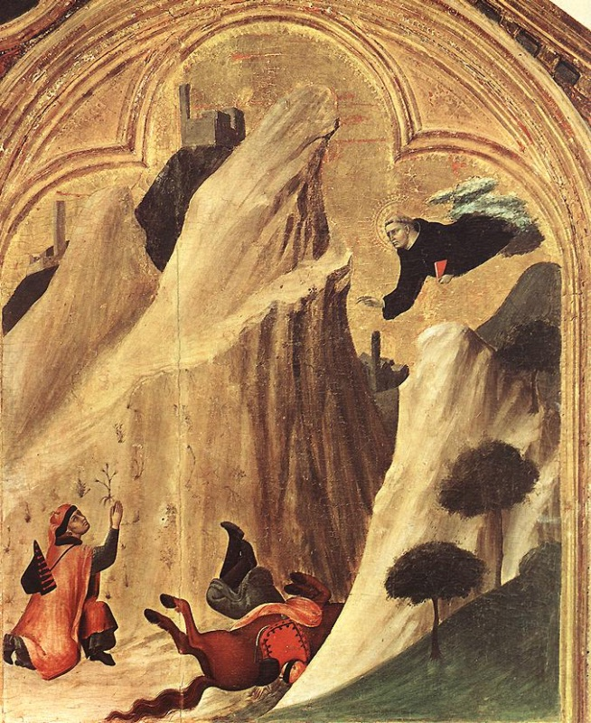
  <figcaption>Simone Martini, The Blessed Agostino Novello Altarpiece: The Knight Fallen into a Ravine, upper right scene, c. 1324. Tempera and gold on panel. Siena, Pinacoteca Nazionale. Photo: Pinacoteca Nazionale di Siena, public domain, via Wikimedia Commons.</figcaption>
</figure>

The third miracle, at the upper right, is the only one set outside the city. It takes place in a mountain landscape of steep, pale crags that rise in jagged planes towards the arched top of the compartment. Small castles crown the distant peaks, a dark tower appears in a gap between the rocks, and on the right a green slope with dark, rounded trees descends towards the foreground. The landscape is constructed from sharply lit faces of rock divided by deep shadows, a stylised but powerful evocation of the hills of the Sienese contado.

The accident is a fall into a ravine. A horse in red trappings plunges head first down the slope, its legs in the air, and its rider tumbles with it. The animal's body is foreshortened and twisted, and the fall is shown at its most dramatic moment. The painter does not show the bottom of the ravine. The steep rock face, falling away beneath the horse, is enough to convey the danger.

The saint flies in from the upper right, emerging from a dark cloud above the green slope, his halo shining and his hand extended towards the falling horseman. As in the scene of the balcony, his flight is a decisive diagonal that crosses the landscape. Here, however, the setting gives it a different meaning: the blessed reaches into the wilderness beyond the city, extending his protection to travellers on the roads of the contado.

In the lower left corner, the rescued knight kneels safe on the ground, wrapped in a red cloak, his hands raised towards the saint in thanksgiving. Small plants sprout from the rock around him. His isolation in the corner of the panel, far from the fall, emphasises the distance between danger and safety and gives the scene a quiet conclusion. The red of his cloak echoes the trappings of the falling horse, so that the eye moves from the accident to the rescued man through the colour itself.

#### The Child Fallen from a Cradle

<figure>
  
  <figcaption>Simone Martini, The Blessed Agostino Novello Altarpiece: The Child Fallen from a Cradle, lower right scene, c. 1324. Tempera and gold on panel. Siena, Pinacoteca Nazionale. Photo: Pinacoteca Nazionale di Siena, public domain, via Wikimedia Commons.</figcaption>
</figure>

The fourth miracle, at the lower right, takes place inside a house and is divided into two registers, a rare arrangement within the altarpiece. The upper register shows a bedroom, seen in section like a doll's house, with a large bed covered by a red coverlet patterned in white. Above the bed hangs a cradle made of cloth, suspended from the ceiling by cords. This domestic interior is described with careful attention to furniture and fabric, and it is one of the earliest detailed representations of a domestic interior in Italian painting.

The accident is shown in the moment after it has happened. A cord of the hanging cradle has given way, and the infant has fallen. A woman seated on the bed, perhaps the nurse who was rocking the cradle, throws out her arms in alarm. In a doorway, the mother kneels in prayer with her hands joined, and on a terrace at the right another woman in a dark cloak bends over the infant lying on the ground, his head bleeding. The sequence of figures, from the bed to the doorway to the terrace, leads the eye from the cause of the accident to the child and to the prayer that will save him.

The saint appears at the upper right, against the gold ground, holding his red book and stretching his hand towards the child. Unlike the flying figures of the other scenes, he is shown here almost at rest, leaning out from his cloud above the terrace. His gesture answers the mother's prayer, and his position at the top of the composition connects the domestic drama of the upper register with the procession below.

The lower register shows the thanksgiving. Women walk in procession carrying candles: one, in red, holds the swaddled child, and two others, in dark green and pink mantles, follow her. A staircase opens on the right. The procession is usually read as the family bringing the child and their offerings of candles to the saint's tomb in thanks for the miracle, which would make the scene a direct reflection of the devotion that the altarpiece itself was meant to serve. The calm, upright figures of the women, with their long mantles and lighted tapers, form a dignified conclusion to the cycle of miracles.

### Annunciation with Saint Ansanus and a Female Martyr (Florence, Gallerie degli Uffizi)

<figure>
  
  <figcaption>Simone Martini and Lippo Memmi, Annunciation with Saint Ansanus and a Female Martyr (Maxima or Margaret?), signed and dated 1333. Tempera and gold on panel, 184 × 210 cm, in a nineteenth-century frame incorporating the original inscription. Florence, Gallerie degli Uffizi, inv. 1890 nos. 451–453. From the altar of Sant'Ansano in the transept of Siena Cathedral. Photo: Gleb Simonov, Wikimedia Commons (CC0).</figcaption>
</figure>

The Annunciation now in the Uffizi is the only surviving work signed jointly by Simone Martini and his brother-in-law Lippo Memmi, and it is the last great altarpiece that Simone painted in Siena before leaving for Avignon. It has been widely reproduced as an emblem of Sienese Gothic painting and of courtly refinement in fourteenth-century art. Its fame rests on the central scene, in which the angel's greeting and the Virgin's recoil are rendered with an elegance and a psychological intensity that have no precedent. Behind that fame, however, lie open questions of commission, collaboration and condition.

The altarpiece was made for Siena Cathedral. In the early fourteenth century the cathedral chapter planned a series of four altarpieces for the altars of the city's four patron saints, Ansanus, Savinus, Crescentius and Victor, each dedicated to an episode from the life of the Virgin. The cycle, completed over the following decade, came to include Pietro Lorenzetti's Birth of the Virgin and Ambrogio Lorenzetti's Presentation in the Temple, both dated 1342. Simone's Annunciation was the first of the series and stood on the altar of Sant'Ansano in the transept of the cathedral, which is dedicated to the Virgin of the Assumption. This explains the presence of Ansanus in the left compartment. Together the four panels formed a Marian programme for the most important church of a city that regarded the Virgin as its sovereign.

The commission is well documented by the standards of the period. The records of the cathedral works preserve numerous payments connected with the altarpiece, which show a long and carefully supervised undertaking. They record that the frame was carved by a master woodworker, Paolo di Camporegio, and that Lippo Memmi was paid for gilding it. The documents describe a project that involved several craftsmen and a substantial outlay, and their detailed reading has itself been the subject of specialised study. They confirm that the altarpiece was a major commission of the cathedral, entrusted to the leading workshop of the city.

The inscription that records the authors survives on the only fragment of the original frame, now set into the base of the modern one. It is usually transcribed as SYMON MARTINI ET LIPPVS MEMMI DE SENIS ME PINXERVNT ANNO DOMINI MCCCXXXIII. The combination of a singular object, *me*, the panel that speaks, with a plural verb, *pinxerunt*, is a normal convention for joint signatures, not a transcription error. Published readings differ in small details of spelling, and at least one description places the date between the two names rather than after them. The exact arrangement has therefore not been verified against a photograph of the frame or against the museum's catalogue.

The history of the altarpiece after the fourteenth century explains its present appearance. The original frame was renewed in the early fifteenth century, and in the seventeenth century the panel was removed from the cathedral and taken to the church of Sant'Ansano in Castelvecchio. In 1799 it was transferred to the Florentine galleries, where it has remained. In the nineteenth century it received the present neo-Gothic frame, with its pinnacles, gables and twisted columns, into which the fragment bearing the inscription was set. The frame gives a fair idea of the type of structure the altarpiece once had, but it is not original, and the proportions and details of the fourteenth-century carpentry cannot be recovered from it.

The question of how the two painters divided the work has been debated since the nineteenth century. The most common hypothesis gives the central Annunciation to Simone and the two lateral saints to Lippo, sometimes together with the prophets in the roundels. Other opinions have ranged from giving Lippo the greater part of the panel to restricting him to a single lateral figure. One authoritative reference work has described the attempt to separate the hands as extremely controversial and ultimately sterile, since the altarpiece is stylistically homogeneous and of uniformly high quality. The inscription itself is original, and it names both painters as authors, but critical opinion tends to give Simone the greater part of both the conception and the execution of the altarpiece. A further interpretation sees in the joint signature the formal transfer of leadership of the Sienese workshop to Lippo, as Simone prepared to leave for Avignon. That reading fits the chronology, but no document confirms it.

The central scene is set on a single gold ground that unites the space between the two lateral compartments. Gabriel kneels on the left, having just landed. His cloak, patterned in a plaid of gold, brown and dark checks, still billows behind him, and his great wings, tipped with eyes like those of a peacock's tail, are still raised. This combination of a figure already at rest and a garment still in motion conveys the instant of arrival with economy of means. The angel is crowned with a wreath of olive leaves and holds an olive branch in his left hand, while his right is raised in a gesture of address.

The olive is an unusual attribute for Gabriel, who is more often shown with a lily. It has been read as a symbol of peace, appropriate to the announcement of the Incarnation, and it has also been interpreted in a Sienese political sense, in contrast to the lily associated with Florence. The lilies are not absent, however. They stand in a golden vase on the floor between the two figures, aligned with the dove of the Holy Spirit above, as a symbol of the Son of God and of the Virgin's purity, and their tall white stems rise almost to the level of the angel's words.

Those words are among the most famous details of the panel. From Gabriel's lips the greeting AVE GRATIA PLENA DOMINUS TECUM runs in raised gilded letters, modelled in pastiglia, across the gold ground towards the Virgin. The words are not painted on a scroll but seem to travel through the air, so that the act of speech becomes visible. The device makes the angel's salutation a physical presence between the two figures and turns the gold ground, which elsewhere signifies the timeless space of heaven, into the medium through which the message passes.

The Virgin sits on the right on a richly carved and inlaid throne, before a cloth of honour in gold and orange. The setting is not otherwise defined, but the few elements shown, the marble floor, the carved seat, the precious fabrics and the book she was reading before the angel appeared, belong to the way of life of the wealthiest classes of fourteenth-century society. She wears a deep blue mantle over a red dress, and she has been interrupted while reading. Her right hand still holds the book, with a thumb inserted between its pages, while her left draws the edge of her mantle up to her chin. Her body turns away from the angel, and her head inclines with an expression in which alarm, modesty and reflection are mixed. The gesture corresponds to the moment described by Luke, when Mary was troubled at the angel's words and wondered what kind of greeting this might be.

This interpretation of the Virgin's response was new. Earlier Annunciations generally showed her accepting the message with composure or raising a hand in acknowledgement. Simone chose instead the moment of disturbance that precedes consent, and he rendered it through the whole figure: the twist of the body, the closed contour of the mantle and the sideways glance. The figure is slender and almost weightless, and its outline is drawn as a single sinuous line against the gold. It is this combination of psychological truth and linear elegance that made the Virgin of the Uffizi a model copied by Sienese painters for more than a century.

Above the two figures, in the central arch, the dove of the Holy Spirit descends within a ring of eight winged angels, painted in warm golden tones that almost dissolve into the ground. The vertical axis that runs from the dove through the vase of lilies to the floor divides the central field between the angel and the Virgin, while the diagonal of the golden words connects them. The composition is thus built on the tension between separation and communication, the two figures held apart by the axis of the Spirit and joined by the passage of the Word.

In the side compartments stand the two saints. On the left, Saint Ansanus, the young patron of Siena to whose altar the panel belonged, wears a red tunic and cloak and holds a banner with the black-and-white *balzana* of the Commune and the palm of martyrdom. On the right, a female saint in a grey-blue mantle over a red dress holds a cross and a palm. Her identity is uncertain. She may be Saint Maxima, the mother of Ansanus, or Saint Margaret, with whom she has traditionally been identified. The inscription at her feet, which names her as Judith, is not original and cannot be used to identify her. Both figures stand on small marbled bases and are more static and frontal than the protagonists of the central scene.

In the gables of the side compartments, four small roundels contain half-length prophets holding inscribed scrolls, whose texts allude to the mysteries of the Incarnation. From left to right they are Jeremiah, Ezekiel, Isaiah and Daniel. A larger roundel at the top of the central gable is now empty. The prophets form a typological frame around the central event, linking the Annunciation to the expectation of the Old Testament, while the patron saint of the altar and his companion connect it to the devotion of the city.

The technique of the altarpiece is of the highest quality. The gold ground is punched and incised with great refinement, the haloes are worked with elaborate punched patterns, and the pastiglia of the angel's words and of other details gives parts of the surface a relief that catches the light. The marbled floor, painted in veined pinks and greys, extends across the central field and provides the only indication of a physical space in a composition otherwise dominated by gold. The fabrics, from the angel's plaid to the brocade of his robe and the Virgin's mantle, are rendered with a precision that shows the painters' attention to the luxury textiles of their time.

The painted panels measure 184 × 210 cm. Other figures found in the literature and online, such as 184 × 168 cm or about 265 × 305 cm, evidently measure different things, the latter including the modern frame. The three inventory numbers under which the altarpiece is registered refer to its three panels, the central Annunciation and the two lateral saints.

The Annunciation marks a decisive moment in Simone's art. The spatial construction derived from Giotto, still present in the Maestà and the Assisi frescoes, gives way here to a two-dimensional elegance in which the figures are defined by line and set against gold. This is the point from which the courtly style of the Avignon years and, through it, the International Gothic of the following century can be traced. The altarpiece therefore stands at the end of Simone's Sienese career and is closely related to later European painting.

### Saint Louis of Toulouse Crowning Robert of Anjou (Naples, Museo e Real Bosco di Capodimonte)

<figure>
  
  <figcaption>Simone Martini, Saint Louis of Toulouse Crowning Robert of Anjou, c. 1317. Tempera and gold on panel, 250 × 188 cm overall (main panel 200 × 138 cm; predella 56 × 158 cm). Naples, Museo e Real Bosco di Capodimonte, from the church of San Lorenzo Maggiore, Naples. Signed on the predella SYMON DE SENIS ME PINXIT. Photo: Museo e Real Bosco di Capodimonte, Naples, public domain, via Wikimedia Commons.</figcaption>
</figure>

The great panel of Saint Louis of Toulouse is the most important surviving monument of the relationship between Simone Martini and the Angevin court of Naples, and one of the most explicitly political images of the fourteenth century. It shows Louis of Anjou, bishop of Toulouse, enthroned and crowned by angels, while he places an earthly crown on the head of his younger brother Robert, king of Naples, who kneels beside him. It comes from the Franciscan church of San Lorenzo Maggiore in Naples and is now in the Museo e Real Bosco di Capodimonte. It is signed, and it is the work that first carried Simone's name beyond Tuscany to one of the great courts of Europe.

The subject cannot be understood without its dynastic background. Louis, born in 1274, was the second son of Charles II of Anjou<a href="/endnotes.html#fn-charles-ii-anjou" class="footnote">14</a>, king of Naples, and of Mary of Hungary. After the death of his elder brother he became heir to the throne, but he renounced his rights in order to enter religious life, became a Franciscan friar and was made bishop of Toulouse. He died young, in 1297, at Brignoles in Provence. The succession passed to his younger brother Robert, who became king in 1309. Robert's claim was contested by his nephew, the son of the elder brother, who ruled in Hungary, and the renunciation of Louis was therefore the foundation of Robert's legitimacy.

Louis was canonised on 7 April 1317. The canonisation gave the house of Anjou a saint of its own blood, and Robert promoted the new cult with energy. The altarpiece belongs to that campaign. Its central image says, in the clearest possible terms, that Robert received his crown from the hands of a saint: the earthly crown that Louis renounced passes to his brother, while Louis himself receives a heavenly crown from the angels. The panel thus turns a contested succession into an act of divine and fraternal will, and it does so with the authority of an altarpiece placed in one of the principal Franciscan churches of the capital.

The panel is not dated. The usual date of 1317, or shortly after, rests on the logic of the canonisation and on stylistic comparison with the Maestà and with the chapel of St Martin at Assisi. It is a strong inference but not a documented date, and some scholars place the work slightly later, between 1317 and 1319. Nor is there any document of commission or payment. That the patron was Robert himself, or someone acting for him, is likely given the subject, but it is not recorded.

The signature, by contrast, is clearly legible. Along the upper edge of the predella, interrupted by coats of arms, runs the inscription SYMON DE SENIS ME PINXIT, Simon of Siena painted me. The Italian national catalogue records the same reading. The coats of arms that interrupt it have been interpreted by the museum as those of Robert's mother, Mary of Hungary. The prominent position of the signature on a royal commission shows the status the painter had already reached.

A persistent legend has attached itself to this commission. A document published in the mid-nineteenth century, and now lost, recorded that Robert of Anjou granted a large annual pension to a "Symone Martini milite", and for more than a century this was read as proof that the king had knighted the painter in 1317. The claim still circulates as a fact. Archival research published in 1992 showed that the *miles* in question was a homonym and not the Sienese painter, and it had already been observed that Simone is never called *miles* or *dominus* in any Sienese document. The knighthood therefore has no documentary basis. The Angevin connection itself rests on firmer ground: on this panel, on the Hungarian and Angevin saints at Assisi and on other works for patrons connected with the court.

The central figure is built as an icon of royal sanctity. Louis sits frontally on a wide throne draped with red cloths, his face young, pale and impassive, his eyes fixed on the viewer. Over the grey-brown habit and knotted cord of a Franciscan friar he wears the vestments of a bishop, a richly embroidered cope and a jewelled mitre. The juxtaposition is deliberate. The humble habit visible beneath the episcopal splendour states the essence of his sanctity, the renunciation of worldly power for the poverty of Saint Francis, while the cope and mitre declare his rank in the Church.

The cope is one of the most sumptuous passages of Trecento painting. Its dark ground is patterned with small motifs, and its broad borders are decorated with heraldic shields and ornament in gold. A large round morse closes it at the breast. The museum notes that this morse is executed in *verre églomisé*, glass decorated with gold on the reverse, and that the panel was once set with gems. These applied materials, of which only part survives, made the image glitter like a reliquary and reflect the same interest in precious surfaces that Simone had shown in the Maestà.

Above the saint's head, two angels fly in from either side, their robes and wings painted in pale pinks and greys against the gold, and hold a crown over his mitre. With his left hand Louis lowers a second crown onto the head of Robert, who kneels in profile at the right with his hands joined. The two crowns, one heavenly and one earthly, define the meaning of the image. The vertical axis from the angels' crown to the saint's face expresses his own glory, while the diagonal of his outstretched arm towards the king expresses the transmission of power.

The figure of Robert is one of the earliest portraits in Italian painting of a living ruler shown in profile. His face, with its prominent nose, receding chin and short hair, is strongly characterised and has the individuality of a likeness rather than the generic features of an ideal king. He is dressed in a blue robe patterned in gold, with broad gold borders. His small scale, compared with the towering figure of his brother, expresses the hierarchy between saint and king, and his kneeling posture makes him both the recipient of the crown and the first devotee of the new saint.

The setting is reduced to a few elements. The throne rests on a dais decorated with small rosettes, set on a patterned carpet that extends beneath the saint's feet and towards the kneeling king. The gold ground, finely punched along its borders, fills the rest of the field. The whole is enclosed by a broad frame of blue sown with raised gold fleurs-de-lis, the arms of the house of Anjou, which turns the altarpiece itself into a heraldic emblem of the dynasty.

The panel is incomplete. The museum notes that it has lost its lateral piers, its pinnacles and an upper panel, and that even in its present state it stands to a considerable height. The present dimensions, about 250 × 188 cm overall, with the main panel measuring 200 × 138 cm and the predella 56 × 158 cm, therefore describe only part of the original structure. The loss of the gems and other inserts has also altered the appearance of the surface.

In September 2025 the Museo e Real Bosco di Capodimonte and the Opificio delle Pietre Dure of Florence began a major restoration, described by the museum's director as a restoration of epochal importance. Press reports described it as an extraordinary campaign of conservation after more than sixty-five years, carried out as a public teaching site open to visitors, and addressing the reverse of the panel, its wooden structure and the consolidation of the paint along the joins of the boards. Its technical results, once published, will be essential for questions of gilding, pastiglia and the lost inserts.

The altarpiece holds a central place in Simone's career. It shows him working for a royal patron within two years of completing the Maestà, adapting his art to the requirements of dynastic propaganda without losing its refinement. The monumental frontality of the saint looks back to Byzantine and Duccesque icons, the portrait of Robert looks forward to the observed likenesses of later Gothic painting, and the predella introduces a new kind of narrative in which architecture is used to construct a coherent space. It combines political intention, devotional function and artistic innovation.

#### The Predella

<figure>
  
  <figcaption>Simone Martini, Saint Louis of Toulouse Crowning Robert of Anjou: predella with five scenes from the life of the saint, c. 1317. Tempera and gold on panel, 56 × 158 cm. Naples, Museo e Real Bosco di Capodimonte. Photo: Museo e Real Bosco di Capodimonte, Naples, public domain, via Wikimedia Commons.</figcaption>
</figure>

The predella contains five scenes from the life and posthumous miracles of Louis, set within round-arched compartments divided by slender gilded columns. The signature runs along its upper edge, interrupted by small coats of arms. The scenes are small, but they are among the most inventive narratives of the early Trecento, and they show Simone applying to panel painting the spatial experiments that he was developing at the same time in the frescoes of Assisi.

The first scene shows Louis before Pope Boniface VIII<a href="/endnotes.html#fn-pope-boniface-viii" class="footnote">15</a>, accepting the bishopric of Toulouse. The pope sits enthroned on the left among his cardinals, and the young Louis kneels before him, while a group of friars waits on the right. According to his legend, Louis accepted the office only on condition that he be allowed to enter the Franciscan order. The second scene shows the consequence: Louis takes the Franciscan habit and is consecrated bishop, the two moments shown side by side beneath an arcade. Together the two scenes set out the central theme of the altarpiece, the union of humility and dignity in a royal prince who chose poverty.

The third and central scene shows Louis serving the poor at table. The setting is a hall with a long table laid with food, at which the poor are seated while the saint attends to them. The architecture of this scene is constructed with a strong sense of depth, and it is one of the earliest examples in Italian painting of an interior conceived as a coherent space. The architecture of the scenes on either side is turned towards the centre, so that the predella as a whole is organised around this image of charity, placed directly beneath the enthroned saint.

The fourth scene shows the funeral of Louis after his death at Brignoles. His body lies on a bier draped with a dark cloth, surrounded by friars and mourners, some of whom bend over him in grief. The composition is dense and solemn, and it recalls the funerals of saints in Franciscan imagery, in particular the funeral of Saint Francis himself. The fifth and last scene shows a posthumous miracle: a dead child is restored to life through the intercession of the saint. The miracle takes place before a house, where figures gather in thanksgiving.

The sequence thus moves from the renunciation of worldly status to the exercise of charity, from death to miracle, and it supplies the narrative proof of the sanctity proclaimed in the main panel. The predella is also the first surviving example in Simone's work of the narrative mode that he would develop in the miracles of the Blessed Agostino Novello: small scenes set in carefully observed architecture and landscape, in which the saint intervenes in the lives of ordinary people.

### The Chapel of Saint Martin (Assisi, Lower Church of San Francesco)

#### Introduction

The chapel of Saint Martin is the first chapel on the left of the nave in the Lower Church of San Francesco at Assisi, and it contains the only complete fresco cycle by Simone Martini to have survived. Ten scenes from the life of Martin of Tours cover its walls, accompanied by standing and half-length saints, by a dedication scene and by stained-glass windows designed in close relation to the paintings. Within the basilica that had been decorated by Cimabue, Giotto and their followers, the chapel is the most complete statement of Sienese painting, and it is the place where Simone's narrative imagination can be measured at its full scale.

The patron was the Franciscan cardinal Gentile Partino da Montefiore, who appears kneeling before Saint Martin in the dedication scene and whose arms recur in the chapel. Born in the Marche, he had risen in the Franciscan order to become a cardinal, and his titular church in Rome was dedicated to Saint Martin, which explains the choice of patron saint. Between 1307 and 1311 he served as papal legate in Hungary, where he worked to secure the throne for the Angevin claimant Charles Robert, nephew of Robert of Naples. The Hungarian mission also gave the dedication a further resonance, since Martin had been born in Pannonia, the Roman province that corresponded in part to the Hungary of Gentile's day.

The financial basis of the chapel is recorded. In 1312, the year of his death at Lucca, the cardinal assigned to the basilica six hundred gold florins "per una capella che fa fare", for a chapel that he was having made. Scholars have long debated whether this sum was intended for building the chapel, for decorating it or for both. One study argued from a further document that the construction was completed after 1312, which would place the beginning of Simone's work somewhat later. Another line of research, based on the stained glass, indicated that the lateral chapels of the nave had already been opened in the late thirteenth century, so that the bequest would relate primarily to the decoration.

The one internal fixed point for the date is the figure of Saint Louis of Toulouse among the standing saints. He is shown with a halo, and he must therefore have been painted after his canonisation in April 1317. The evidence of the plaster indicates that this part of the decoration was executed last. The prevailing opinion, formulated in the 1960s, places the work between about 1312 and 1317 or shortly after, close in time to the older passages of the Maestà in Siena. Older scholarship proposed dates ranging from Simone's youth to the years immediately before his departure for Avignon, and a date in the 1320s still appears in some reference works. The defensible formulation is that the cycle was probably begun after the bequest of 1312 and completed not before mid-1317.

The attribution to Simone rests on style, not on documents. The chapel was not correctly identified by Vasari, and its attribution goes back to a local antiquarian at the end of the eighteenth century, published in 1820. It has not been seriously challenged since. The quality and coherence of the frescoes make the conclusion virtually certain, even though a part of the half-length saints in the window embrasures is generally given to assistants. The cartoons for the stained glass are attributed to Simone by many scholars, but a significant minority prefers a Giottesque master, and the question remains open.

The narrative follows the life of Martin as recorded by his biographer Sulpicius Severus<a href="/endnotes.html#fn-sulpicius-severus" class="footnote">16</a>, who knew him personally, and as transmitted in the medieval tradition, above all the *Golden Legend*. Martin, the son of a Roman officer, served as a soldier before his baptism, shared his cloak with a beggar at Amiens, left the army to serve Christ, became a monk and then bishop of Tours, and died at Candes in 397. His cult was one of the most widespread in medieval Europe, and his life offered a painter a rare combination of chivalric and episcopal themes, of military pageantry and liturgical solemnity.

The ten scenes can be divided into two groups. The first five belong to Martin's life as a soldier and a convert: the division of the cloak, the dream in which Christ appears wearing the half cloak, the investiture as a knight, the renunciation of arms and the resurrection of a child. The second five belong to his life as bishop and to his death: the meditation, the miraculous Mass, the miracle of fire before the emperor, the death of the saint and his funeral.

The frescoes are notable for their architecture. Simone constructs halls, loggias, arcades and chapels with a command of space that shows his close study of Giotto and of the painters of the Upper Church. His buildings are not simply backdrops but enclose the figures in coherent volumes, often seen obliquely, with ceilings, brackets and windows rendered in convincing depth. The landscape scenes, by contrast, use the bare, faceted rock of Byzantine tradition, transformed into tall pale crags that frame the figures.

The second notable feature is the observation of courtly life. The knighting of Martin is staged as a contemporary ceremony, with musicians, a falconer and attendants in fashionable dress. The emperor's camp in the scene of the renunciation is filled with tents, banners and soldiers whose armour and weapons are described with precision. Throughout the chapel the costumes, fabrics and objects reflect the luxury of the courts of the early fourteenth century, and above all of the Angevin court, with which Gentile and, through him, Simone were connected.

The third feature is the technique. Simone treated the fresco surface with the methods of the panel painter and the goldsmith. Haloes and ornaments are tooled with punches, gold and other metal leaf are applied to vestments and objects, and the textiles are rendered with a variety of patterns that imitate brocades and embroidered borders. The same interest in precious surfaces appears in the Maestà, and in Assisi it gives the cycle a brilliance that the passage of time has dimmed but not destroyed.

The narratives also show an unusual attention to psychology. The beggar's gratitude, the sleeping Martin's quiet absorption, the emperor's humiliation and the grief of the mourners at the saint's death are conveyed through gesture and expression with great subtlety. The figures are slender and elegant, but they are also solid and individual, and many faces have the character of portraits. This combination of courtly elegance with observed humanity is one of the hallmarks of Simone's art.

The dedication scene shows the cardinal kneeling before Saint Martin, who raises him by the hand, beneath a Gothic canopy. It is a donor portrait, and it states the relationship between patron and saint that the whole chapel celebrates.

The chapel's relationship with the Angevin house extends beyond the patron. In the right transept of the Lower Church, Simone or his workshop painted saints and a Madonna with Hungarian royal saints, usually connected with Queen Mary of Hungary, mother of Robert of Naples. In Naples, around the same years, he painted the panel of Saint Louis of Toulouse crowning Robert. The chapel of Saint Martin therefore belongs to a network of commissions that linked Siena, Assisi and Naples through the Angevin dynasty and its Franciscan allies.

The frescoes have suffered from damp, abrasion and the loss of applied metal leaf, and several have significant losses of paint. Successive restorations have consolidated them, and the earthquake of 1997, which caused grave damage elsewhere in the basilica, led to further campaigns of conservation. The present state of the scenes must be taken into account in any judgement of colour and finish, particularly in the scenes where the original metal leaf has oxidised or fallen away.

The decoration of the chapel was completed by stained-glass windows, which also represent saints and episodes connected with Saint Martin. Their design is often attributed to Simone himself, who would have provided the cartoons, while the execution is thought to be the work of a local craftsman, Maestro Giovanni di Bonino of Assisi. If the attribution is correct, the windows show that Simone conceived the chapel as a unified ensemble, in which painted walls, coloured glass and gilded surfaces combined to create a single luminous space.

The chapel is a key work for the history of Trecento painting. It shows a Sienese painter assimilating the spatial discoveries of Giotto without abandoning the linear elegance and the decorative richness of his own tradition, and it introduces into monumental painting a courtly and secular world of ceremony and fashion that would become one of the main currents of Gothic art in Europe. With the Maestà and the Saint Louis, it defines the achievement of Simone's first maturity.

#### The Dedication of the Chapel

<figure>
  
  <figcaption>Simone Martini, The Dedication of the Chapel: Cardinal Gentile Partino da Montefiore Kneeling before Saint Martin, c. 1312–1318. Fresco. Assisi, Lower Church of San Francesco, Chapel of Saint Martin. Photo: Basilica di San Francesco, Assisi, public domain, via Wikimedia Commons.</figcaption>
</figure>

The dedication scene is the key to the chapel. It shows the patron, Cardinal Gentile Partino da Montefiore, kneeling before Saint Martin, who receives him and takes him by the hand. The fresco presents the relationship between patron and saint that the whole decoration was intended to celebrate. It is also one of the earliest portraits of a living patron in Italian monumental painting.

The two figures stand beneath a Gothic canopy of pale stone, painted with great precision. A crocketed gable rises above a pointed arch with trefoil tracery and circular openings, flanked by pinnacles and supported by slender columns with foliate capitals. Behind the figures, a balustrade pierced with quatrefoils runs across the width of the composition, and the deep blue background, now darkened and uneven, fills the arch. The architecture is modelled on contemporary Gothic microarchitecture, such as tomb canopies and tabernacles, and it frames the encounter like a shrine.

Saint Martin stands on the left, wearing a yellow cope dotted with small dark motifs and a white mitre. His face, aged and bearded, is turned towards the kneeling cardinal with a grave and benevolent expression. He holds a crozier in his left hand and with his right takes the cardinal's hand, in a gesture that combines welcome, protection and the acceptance of the gift. The halo behind his head distinguishes him clearly from his living companion.

The cardinal kneels on the right in a long pink mantle that spreads over the floor in broad, simple folds. His head, tonsured and almost bald, is raised towards the saint, and his other hand rests on his breast in a gesture of devotion. His face, with its heavy jaw, full cheeks and attentive eyes, has the individuality of a portrait, and it is generally regarded as a likeness of Gentile himself.

The scale of the two figures is equal, or nearly so. The cardinal is not a diminutive donor at the feet of a giant saint, as in many images of the period, but a figure of the same stature who kneels in the same space. This relative equality reflects the dignity of a prince of the Church and gives the scene the character of a meeting rather than a simple act of homage.

The colours of the two figures are carefully balanced. The yellow of Martin's cope and the pink of the cardinal's mantle stand out against the dark blue background and the pale stone of the canopy, and their contrast underlines the distinction between the saint and the patron while uniting them in a single harmonious group.

The fresco is relatively well preserved, though the blue background has darkened and there are small losses in the figures. The architecture, the faces and the gesture of the hands retain their clarity, and the cardinal's head remains one of the most striking passages of the chapel.

The dedication scene states the meaning of the chapel in its simplest terms. The cardinal who paid for the chapel places himself under the protection of the saint to whom it is dedicated, and the saint accepts him. The narrative cycle that surrounds this image tells the life of the protector, and the dedication shows the protected, kneeling before his protector.

#### The Standing Saints

Four pairs of standing saints are painted in the chapel, set in painted Gothic niches with trefoil arches, separated by slender twisted columns and surmounted by spandrels decorated with a geometric pattern of hexagons. The saints are painted at full length on a blue ground and turn towards one another in pairs, as if in conversation. Their selection reflects both the Franciscan setting of the chapel and the Angevin and Hungarian connections of its patron.

The pairs are Saint Louis of France with Saint Louis of Toulouse, Saint Anthony of Padua with Saint Francis, Saint Mary Magdalene with Saint Catherine of Alexandria, and Saint Clare<a href="/endnotes.html#fn-chiara-assisi" class="footnote">17</a> with Saint Elizabeth of Hungary. The haloed Louis of Toulouse, canonised in April 1317, provides the date after which this last part of the decoration was painted.

#### Saint Louis of France and Saint Louis of Toulouse

<figure>
  
  <figcaption>Simone Martini, Saint Louis of France and Saint Louis of Toulouse, c. 1317–1318. Fresco. Assisi, Lower Church of San Francesco, Chapel of Saint Martin. Photo: Basilica di San Francesco, Assisi, public domain, via Wikimedia Commons.</figcaption>
</figure>

The first pair unites two saints of the French royal house. On the left stands Louis IX, king of France, canonised in 1297, and on the right Louis of Anjou, bishop of Toulouse, canonised in 1317. Louis IX was the brother of Charles I of Anjou<a href="/endnotes.html#fn-charles-i-anjou" class="footnote">18</a> and therefore the great-uncle of Louis of Toulouse. The pairing presents the sanctity of the Capetian and Angevin dynasty in two generations, the crusader king and the Franciscan bishop.

The ground of this pair differs from that of the others. Instead of plain blue, it is sown with gold fleurs-de-lis, the arms of France and of the house of Anjou, so that the two saints stand against a heraldic field that declares their lineage. The same motif frames the panel of Saint Louis of Toulouse crowning Robert of Anjou in Naples.

Louis IX is shown as a young king, crowned and with shoulder-length fair hair, wearing a red mantle with gold borders over a tunic and holding a sceptre. His face is frontal and impassive, with the idealised features of a royal saint. The surface of his mantle is heavily abraded, and much of its original modelling and gold decoration has been lost.

Louis of Toulouse is shown not as a bishop in cope and mitre, as in the Naples panel, but in the brown habit and knotted cord of a Franciscan friar. He holds a tall crozier and wears a ring, the signs of his episcopal office, and his tonsured head is turned towards his great-uncle. The choice of the Franciscan habit emphasises his renunciation and his place in the order whose basilica housed the chapel.

The halo of Louis of Toulouse is the decisive element for the chronology of the chapel. It shows that this pair was painted after his canonisation in April 1317, and it links the decoration of the arch with the campaign of promotion of his cult undertaken by Robert of Anjou in the same years.

#### Saint Anthony of Padua and Saint Francis

<figure>
  
  <figcaption>Simone Martini, Saint Anthony of Padua and Saint Francis, c. 1317–1318. Fresco. Assisi, Lower Church of San Francesco, Chapel of Saint Martin. Photo: Basilica di San Francesco, Assisi, public domain, via Wikimedia Commons.</figcaption>
</figure>

The second pair unites the two great saints of the Franciscan order. On the left stands Anthony of Padua, the learned preacher, and on the right Francis himself, the founder of the order and the saint to whom the basilica is dedicated. Their presence in the chapel places the whole decoration within the Franciscan context of the building.

Anthony is shown young and tonsured, holding a red book, the attribute of his learning and preaching. The surface of his habit is heavily abraded and much of its paint has flaked away, leaving a mottled appearance, but his face, with its broad features and attentive gaze, remains well preserved.

Francis is shown bearded, in a grey-brown habit with a knotted cord. He raises his left hand to show the wound of the stigmata in its palm, and with his right he draws aside his habit to reveal the wound in his side. The wounds are also visible on his bare feet. The gesture of display makes the stigmata the central attribute of the saint and recalls the miracle that defined his sanctity.

The habit of Francis is much better preserved than that of Anthony, and its broad, simple folds give the figure a quiet monumentality. His face, frontal and grave, with deep-set eyes, is one of the most powerful in the chapel, and it shows the same individual characterisation found in the narrative scenes.

The pairing of the two saints, one young and holding a book, the other mature and displaying the stigmata, presents two aspects of the Franciscan ideal: learning and preaching on the one hand, conformity with Christ on the other. Both were especially relevant to a chapel commissioned by a Franciscan cardinal.

#### Saint Mary Magdalene and Saint Catherine of Alexandria

<figure>
  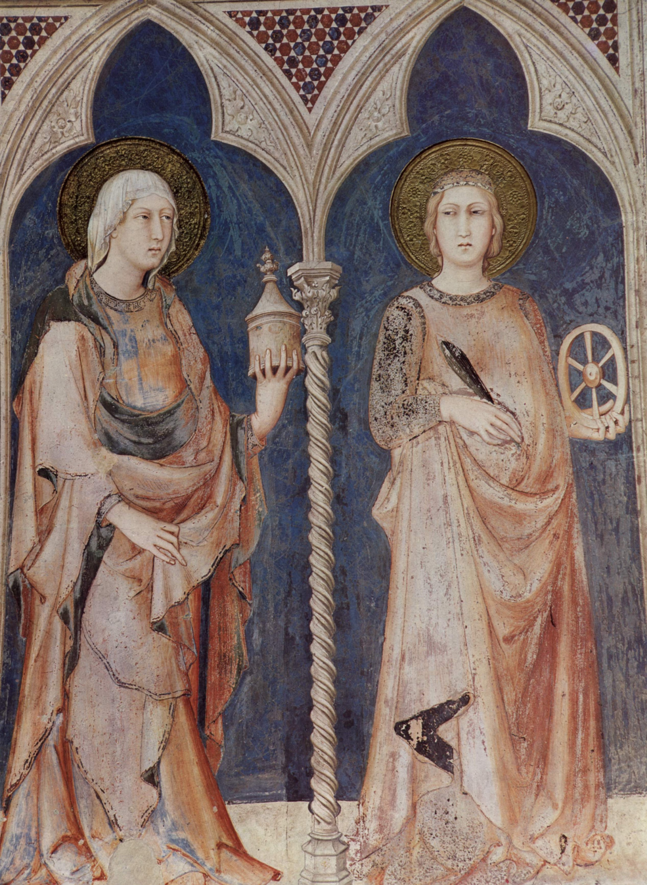
  <figcaption>Simone Martini, Saint Mary Magdalene and Saint Catherine of Alexandria, c. 1317–1318. Fresco. Assisi, Lower Church of San Francesco, Chapel of Saint Martin. Photo: Basilica di San Francesco, Assisi, public domain, via Wikimedia Commons.</figcaption>
</figure>

The third pair unites two of the most venerated female saints of the Middle Ages. On the left stands Mary Magdalene, the penitent and first witness of the Resurrection, and on the right Catherine of Alexandria, the learned virgin martyr. Both were especially honoured by the Franciscans and by the Angevin court.

Mary Magdalene wears a white veil over her head and a pale robe beneath a rose mantle with a dark green lining. She holds up a tall covered ointment jar, her usual attribute, recalling the ointment with which she anointed the feet of Christ and with which she came to the tomb. Her face, turned towards Catherine, has a gentle and meditative expression.

Catherine has fair hair bound by a circlet and wears a pale rose mantle over a dress whose patterned sleeves are visible at her arms. She holds a palm of martyrdom in one hand and a small wheel, the instrument of her intended torture, in the other. Her face, frontal and slightly turned, has the refined features of the courtly type that Simone developed in these years.

The draperies of both figures fall in broad, softly modelled folds, and the colours, rose, pale green and white, are harmonised with great subtlety. The surface is generally well preserved, though there are some losses in Catherine's mantle and in the lower part of the panel.

The pair shows the elegance of Simone's female figures at its most developed. Their slender proportions, their gentle movement and their refined features anticipate the Virgin of the Annunciation of 1333 and the female saints of his later panels.

#### Saint Clare and Saint Elizabeth of Hungary

<figure>
  
  <figcaption>Simone Martini, Saint Clare and Saint Elizabeth of Hungary, c. 1317–1318. Fresco. Assisi, Lower Church of San Francesco, Chapel of Saint Martin. Photo: Basilica di San Francesco, Assisi, public domain, via Wikimedia Commons.</figcaption>
</figure>

The fourth pair unites two female saints of the Franciscan tradition. On the left stands Clare of Assisi, the companion of Francis and founder of the Poor Clares, and on the right Elizabeth of Hungary, the princess who devoted her life to the poor and was associated with the Franciscan Third Order. Elizabeth also belonged to the royal house of Hungary, and her presence recalls the Hungarian connections of both the patron and the Angevin dynasty.

Clare wears the dark veil, white wimple and grey-brown habit of her order, with a knotted cord at her waist. She holds a stem of white lilies, the symbol of her purity, and turns her eyes towards her companion with a gentle, slightly melancholy expression. Her habit falls in long, simple folds, and the figure is among the best preserved of the arch.

Elizabeth is shown in profile, an unusual choice for a standing saint in this context. Her braided fair hair is bound by a circlet, and she wears a rose-red mantle patterned with dark and gold stripes over a white garment and a dark green cloak. With one hand she gathers up the folds of her mantle, and her figure has a courtly elegance that contrasts with the austerity of Clare.

The contrast between the two saints is the key to the pair. Clare, the nun of Assisi, embodies Franciscan poverty in its most rigorous form. Elizabeth, the king's daughter, embodies the renunciation of royal wealth for charity. Their juxtaposition expresses the two paths to Franciscan sanctity, the cloister and the court, both of which were represented in the world of the patron.

The pair forms a fitting conclusion to the series of standing saints. Together with Louis of Toulouse, Elizabeth represents the royal saints who chose the Franciscan way, and her presence links the chapel of Saint Martin to the Hungarian and Angevin saints painted by Simone or his workshop in the right transept of the Lower Church.

#### The Division of the Cloak

<figure>
  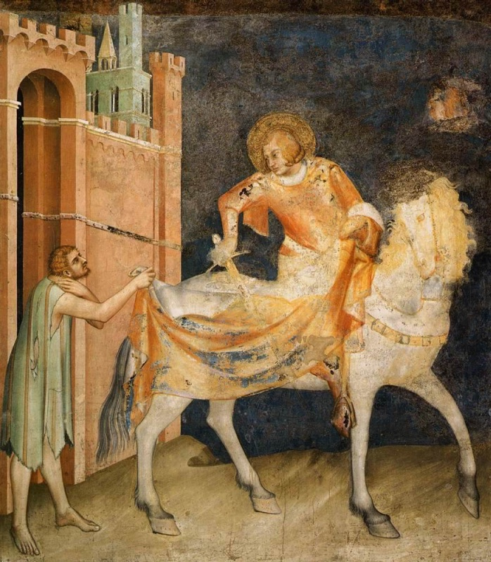
  <figcaption>Simone Martini, The Division of the Cloak, c. 1312–1318. Fresco. Assisi, Lower Church of San Francesco, Chapel of Saint Martin. Photo: Basilica di San Francesco, Assisi, public domain, via Wikimedia Commons.</figcaption>
</figure>

The first scene of the cycle shows the episode for which Martin is best known. According to Sulpicius Severus, during a winter of exceptional cold, when Martin was still a soldier and not yet baptised, he met at the gate of Amiens a poor man without clothing whom passers-by ignored. Having nothing else to give, since he had already distributed the rest of his possessions, he cut his military cloak in two with his sword and gave one half to the beggar, wrapping himself in the other.

Simone sets the scene before a city gate on the left, rendered in pink stone with tall towers and battlements, through which a glimpse of the town and a green bell tower can be seen. The gate stands for Amiens and gives the encounter its precise location. The rest of the background is a deep blue, now darkened and abraded, against which the figures stand out with great clarity.

Martin rides a white horse that walks to the right, its head turned slightly and its long tail falling behind. He turns back in the saddle towards the beggar, his body twisting in a movement that links the two figures across the width of the composition. His cloak, orange-red and lined with ermine, spreads over the horse's back as he cuts it, and the sword that divides it is visible at the centre.

The beggar stands barefoot at the left, wearing a ragged green tunic that falls in torn strips around his legs. With one hand he takes hold of the cloak and with the other he clasps his own neck, as if shivering with cold. His face, bearded and gaunt, is raised towards the knight with an expression of gratitude and surprise. The contrast between his poverty and the knight's richly lined cloak is the core of the scene.

The composition is simple and almost frieze-like, with the two figures and the horse arranged parallel to the picture plane in front of the gate. Yet the turning movement of the knight and the upward gaze of the beggar give it a tension that draws the viewer into the exchange. The horse, carefully modelled and perfectly proportioned, is one of the finest animals in Trecento painting.

Martin is shown with a halo, though at this moment he was not yet a Christian. The halo anticipates his sanctity and signals that the act of charity is the beginning of his spiritual life. His young face, with its curling hair and gentle features, introduces the type that Simone will maintain throughout the scenes of the saint's youth.

The scene has suffered losses, particularly on the knight's cloak and on the horse's harness, where the original metal leaf and the details of the decoration have partly disappeared. The colours of the cloak, now patchy, would originally have been more brilliant, and the ermine lining would have been more clearly distinguished.

As the opening of the cycle, the scene establishes its central themes: charity, the encounter between the powerful and the poor, and the transformation of a soldier into a saint. It also introduces the combination of elegance and human sympathy that characterises the whole chapel, and it sets the episode of the cloak in the courtly language that Simone would develop in the scenes of the investiture and the renunciation.

#### The Dream of Saint Martin

<figure>
  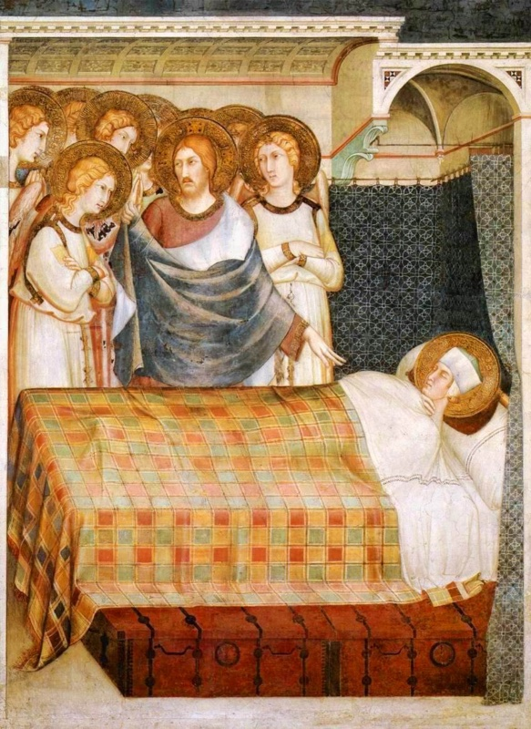
  <figcaption>Simone Martini, The Dream of Saint Martin, c. 1312–1318. Fresco. Assisi, Lower Church of San Francesco, Chapel of Saint Martin. Photo: Basilica di San Francesco, Assisi, public domain, via Wikimedia Commons.</figcaption>
</figure>

The second scene follows directly from the first. According to Sulpicius Severus, on the night after he had shared his cloak, Martin saw Christ in a dream wearing the half of the cloak that he had given to the beggar, and heard him say to the angels around him that Martin, though still a catechumen, had clothed him with this garment. The vision confirmed that the beggar had been Christ himself, and it led Martin to seek baptism.

Simone shows the sleeping saint in a large bed placed diagonally across the lower part of the composition. The bed is covered with a coverlet in a checked pattern of orange, pink, green, blue and red, which falls in folds over a heavy red wooden chest. Martin lies on the right with his head resting on his hand, his haloed head and face turned towards the viewer in quiet sleep. A dark curtain patterned with a geometric design hangs behind him.

On the left, behind the bed, Christ stands among a group of angels. He wears the half cloak, painted blue, over a red tunic, and turns his head towards the angels as he points down to the sleeping Martin. His face, framed by long hair and a short beard, has a grave and slightly melancholy expression. The angels, with golden curling hair and elaborately punched haloes, crowd behind and beside him, their arms crossed or their heads inclined.

The juxtaposition of the vision and the sleeper is resolved with great simplicity. Christ and the angels occupy the same physical space as the bed, without any cloud or mandorla to mark them as supernatural, and the scene takes on the character of an intimate encounter. Only the haloes and the attentive stillness of the angels indicate that this is a dream.

The coverlet is one of the most celebrated details of the chapel. Its checked pattern, rendered with careful attention to the play of colour and the fall of the fabric over the chest, reflects the precious textiles of the period and shows Simone's interest in the materials of everyday life. It also gives the composition a strong horizontal band of colour that anchors the figures above.

The architecture above the scene, with its frieze and its arcade on the right, frames the composition and indicates that the bedroom belongs to a larger building. The angels' haloes and the punched ornament show the same goldsmith's care found throughout the chapel, and the curtain behind the bed adds a dark field against which the saint's face and halo stand out.

The scene is relatively well preserved, though there are losses in the angels' robes and in the blue of Christ's cloak. The checked coverlet and the red chest have kept much of their original colour, and the faces of Christ and the angels retain the delicacy of the original modelling.

The Dream completes the episode of the cloak by revealing its meaning. Charity to the poor is charity to Christ, and the knight who gave half his cloak is now recognised in heaven. The quiet, domestic setting, with its bed and coverlet, makes the vision intimate and accessible, and it anticipates the interior scenes of Simone's later narratives, such as the miracle of the cradle in the altarpiece of the Blessed Agostino Novello.

#### The Investiture of Saint Martin as a Knight

<figure>
  
  <figcaption>Simone Martini, The Investiture of Saint Martin as a Knight, c. 1312–1318. Fresco. Assisi, Lower Church of San Francesco, Chapel of Saint Martin. Photo: Basilica di San Francesco, Assisi, public domain, via Wikimedia Commons.</figcaption>
</figure>

The third scene shows Martin being made a knight. The episode has no exact equivalent in the early sources, which record only that Martin, as the son of a military officer, was enrolled in the army as a young man. Simone, or the programme he followed, transformed this enrolment into a ceremony of knighthood of the kind that took place at the courts of the fourteenth century, and the scene is one of the most vivid representations of chivalric ritual in medieval art.

The setting is an arcaded loggia, with round arches, a coffered ceiling supported by brackets and walls opening onto a deep blue background. The architecture is constructed in depth, with the arches receding to the right, and it encloses the figures in a coherent space. Above, a crenellated wall closes the composition.

At the centre stands Martin, young and haloed, in a long pink robe. He raises his hands and looks upwards, as if his thoughts were already turned towards heaven even in this moment of worldly honour. Before him, a crowned man in a cream robe, with a laurel wreath on his head, girds a sword round Martin's waist. This figure represents the emperor, who confers the dignity of knighthood. Below, a servant in blue kneels to fasten a spur to Martin's foot.

To the right, a group of musicians accompanies the ceremony. One, wearing a tall striped hat and a costume with bold horizontal bands of colour, plays a double pipe, and another, in a checked tunic and green cloak, plays a lute with a richly decorated body. Behind them, other figures look on. The musicians' costumes are among the most extravagant in Trecento painting and reflect the fashions of the courts.

On the left stand courtiers in checked robes. One holds a falcon on his gloved hand, the emblem of aristocratic leisure, and another holds a helmet on a staff, part of the knight's equipment. Their faces are carefully individualised, and their dress, with patterned fabrics and tight sleeves, shows the same attention to contemporary fashion.

The meaning of the scene lies in the contrast between the splendour of the ceremony and the inward attitude of the saint. While the court celebrates and the musicians play, Martin raises his eyes and hands in a gesture of prayer. The investiture is thus already a preparation for the renunciation that follows: the knight of the world will become a knight of Christ.

The scene is generally well preserved, though the original metal leaf on the costumes and the instruments has partly disappeared. The blue of the background has darkened, and some of the details of the fabrics have lost their sharpness. The faces, however, keep much of their original refinement.

The investiture has often been connected with the Angevin court of Naples, with which both the patron and the painter were linked. Its courtly vocabulary, with its music, falconry and fashionable dress, made it a model for later representations of chivalric life, and it shows more clearly than any other scene in the chapel how Simone introduced the secular world of the court into religious painting.

#### The Renunciation of Arms

<figure>
  
  <figcaption>Simone Martini, The Renunciation of Arms, c. 1312–1318. Fresco. Assisi, Lower Church of San Francesco, Chapel of Saint Martin. Photo: Basilica di San Francesco, Assisi, public domain, via Wikimedia Commons.</figcaption>
</figure>

The fourth scene shows Martin leaving the army. According to Sulpicius Severus, the Emperor Julian was distributing a donative to his soldiers before a battle against the barbarians when Martin, called forward to receive his share, declared that he was a soldier of Christ and could no longer fight. Accused of cowardice, he offered to stand before the enemy unarmed, protected only by the sign of the cross. The next day the enemy sent envoys to surrender, and the battle never took place.

The scene is set in a military camp among pale, faceted rocks. On the left, before a large white tent decorated with heraldic shields, the emperor sits on a folding chair, crowned with laurel and dressed in a gold tunic with a blue cloak. He holds a coin and distributes pay from a tray to soldiers who approach him. His gesture and the coins in his hand make the donative visible.

Martin, now in a red cloak over his armour, occupies the centre. He has turned away from the emperor and raises one hand in a gesture of refusal or declaration, while with the other he holds a small cross. His calm, almost gentle face contrasts with the determination of his gesture. Behind him stands a soldier in a padded tunic studded with small discs and a tall fur-trimmed hat, and a horse appears behind.

On the right, beyond a rock, the enemy army gathers. Helmeted soldiers with lances and shields bearing a lion rampant crowd together before their own tents, whose pennants rise against the sky. The two camps, Roman and barbarian, face each other across the composition, and Martin stands between them as the figure who will resolve the conflict without fighting.

The camp is described with great precision. The tents, the shields, the lances, the armour and the folding chair are rendered as objects of contemporary military life, and the heraldry of the tents and shields gives the scene the appearance of a real campaign. This attention to the equipment of war has been compared with the camp in the *Guidoriccio da Fogliano* in Siena, and it has been used as an argument in the debate on the attribution of that fresco.

The landscape is constructed from tall, pale rocks with sharply lit faces, a stylisation derived from Byzantine and Giottesque tradition. A narrow stream runs down the rock on the right. The rocks divide the composition into zones and isolate Martin against a pale background, so that his figure becomes the visual and moral centre of the scene.

The fresco has lost part of its original surface, especially in the armour and the metal decoration of the costumes, where the leaf has oxidised or disappeared. The blue sky has darkened, and the tents and rocks have lost some of their modelling. The faces of Martin, the emperor and the soldiers nevertheless keep their individual characterisation.

The renunciation is the turning point of Martin's life, and Simone presents it as a choice between two kinds of service. The emperor offers pay, the saint holds the cross. The scene thus expresses the Franciscan ideal of renunciation in a form that a courtly and military audience would understand, and it stands at the centre of the chivalric half of the cycle.

#### The Resurrection of a Child

<figure>
  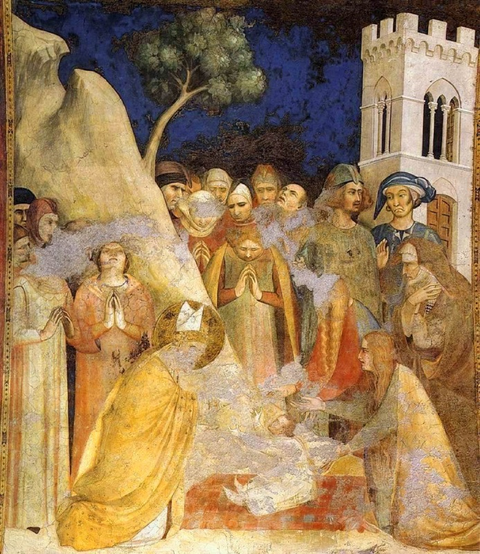
  <figcaption>Simone Martini, The Resurrection of a Child, c. 1312–1318. Fresco. Assisi, Lower Church of San Francesco, Chapel of Saint Martin. Photo: Basilica di San Francesco, Assisi, public domain, via Wikimedia Commons.</figcaption>
</figure>

The fifth scene shows one of Martin's miracles as bishop. The written tradition records that, while he was travelling in the region of Chartres, a woman brought him the body of her only son, and that Martin, kneeling in prayer, restored the child to life before a crowd of pagans, many of whom were converted. The scene therefore marks the passage from the soldier to the bishop and the miracle worker.

The setting is an open space before a pale rock on the left, crowned by a tree with dense green foliage, and a white bell tower with Gothic windows on the right. The blue sky fills the upper part of the composition. The landscape and the tower suggest a place outside a town, consistent with the story of a miracle performed during a journey.

In the foreground, Martin kneels with his back partly turned to the viewer, wearing a yellow cope and a white mitre with a halo. He bends over the child, who lies on a red patterned cloth on the ground. The bishop's figure, seen from behind and in profile, is an unusual choice that places the viewer among the witnesses and directs attention to the child.

A kneeling woman with long hair, on the right, reaches towards the child. She is usually identified as the mother. Behind her and around the bishop, a crowd of men and women watches the miracle. Some join their hands in prayer, others look on with astonishment or doubt, and their faces are among the most varied and expressive in the chapel.

The crowd is arranged in a dense semicircle that encloses the space around the child and the bishop. Its members wear a variety of hats, hoods and veils, and their differences of age and character, from the old bearded man to the young women, give the scene the character of a real gathering. A young man in a blue turban on the right has an expression of particular intensity.

The fresco has suffered serious losses. Large areas of the surface, particularly around the child and in the lower part of the composition, are abraded to a grey ground, and the details of the child's figure are difficult to read. The bishop's cope and the mother's garment have lost much of their modelling.

Despite its condition, the scene shows Simone's ability to construct a narrative around a moment of suspense. The miracle has not yet been completed, and the tension lies in the expectation of the crowd and the prayer of the saint. The viewer, placed behind the bishop, shares the experience of the witnesses.

The resurrection of the child introduces the theme of the saint as protector of the vulnerable, which Simone would develop at length in the altarpiece of the Blessed Agostino Novello. It also completes the transformation of Martin from soldier to bishop, preparing for the liturgical scenes that follow.

#### The Meditation of Saint Martin

<figure>
  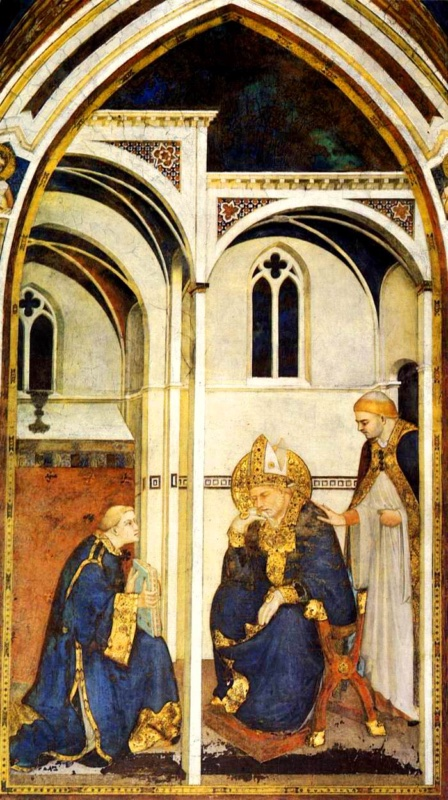
  <figcaption>Simone Martini, The Meditation of Saint Martin, c. 1312–1318. Fresco. Assisi, Lower Church of San Francesco, Chapel of Saint Martin. Photo: Basilica di San Francesco, Assisi, public domain, via Wikimedia Commons.</figcaption>
</figure>

The sixth scene shows Martin as bishop absorbed in contemplation. According to the medieval tradition, the saint was so deeply immersed in prayer that he did not notice the time had come for the celebration of the Mass, and a cleric had to rouse him. The scene thus illustrates the inner life of the saint, in contrast with the public miracles that surround it.

The composition is set in a tall, arched field within a Gothic interior. Ribbed vaults, a traceried window with a quatrefoil, a cornice decorated with geometric inlay and a tiled floor create a convincing architectural space, divided by slender columns into bays. The architecture, rendered in pale tones, gives the scene a cool and solemn atmosphere.

In the centre, Martin sits on a folding chair, wearing a blue cope with broad gold borders and a jewelled mitre. His eyes are closed, and his chin rests on his hand in a gesture of deep thought. His face, aged and bearded, expresses complete absorption. The stillness of his figure is the core of the scene.

Behind him, a cleric in a white surplice and a gold stole lays a hand on his shoulder to call him back to the present. On the left, a young cleric in a blue cope kneels, holding a book and looking up at the saint, perhaps waiting to accompany him to the altar. The two clerics frame the seated bishop and embody the call of liturgical duty.

The scene is one of the most intimate in the chapel. Its action is minimal, and its meaning lies entirely in the contrast between the saint's inner concentration and the gentle insistence of his companions. Simone conveys this contrast through posture and gesture rather than through dramatic movement.

The architecture is elaborate. The bays are seen from a slightly oblique viewpoint, and the vaults and window recede in convincing depth. The space is coherent and measurable, and it shows how thoroughly Simone had absorbed the spatial innovations of Giotto and the painters of the Upper Church.

The fresco is relatively well preserved, though the blue of the copes has lost some of its depth and the gold borders have partly worn away. The architectural details and the faces retain their clarity.

The Meditation forms a pair with the scene of the Miraculous Mass, which follows. Together they present Martin as a model of the contemplative bishop whose prayer is rewarded by divine favour, a theme particularly appropriate to a chapel in a Franciscan basilica, where the balance between contemplation and action was a central concern.

#### The Miraculous Mass

<figure>
  
  <figcaption>Simone Martini, The Miraculous Mass, c. 1312–1318. Fresco. Assisi, Lower Church of San Francesco, Chapel of Saint Martin. Photo: Basilica di San Francesco, Assisi, public domain, via Wikimedia Commons.</figcaption>
</figure>

The seventh scene shows a miracle that took place during the celebration of the Mass. According to the tradition, Martin had given his own tunic to a poor man before celebrating, so that his arms were left bare beneath his vestments. As he raised the host, angels appeared and covered his arms with precious cloth, and a globe of fire was seen above his head. The miracle was a sign of divine approval of his charity.

The scene is set in a chapel with a green wall and a dark vault, framed by a pointed arch. On the left stands an altar covered with a white cloth embroidered with bands of birds and animals. On it are a chalice, a cross, candles and an open missal. The altar furnishings are rendered with careful precision and reflect the liturgical objects of the period.

Martin stands at the altar in a gold chasuble, raising the host above his head with both hands. His face, aged and bearded, is turned upwards. Two angels fly in from the left and place a precious cloth on his arms, and their wings and robes are painted with delicate colours. The elevation of the host, a moment of particular importance in the devotion of the period, is the centre of the composition.

On the right, a cleric in a white surplice kneels on the floor, holding a tall candle and looking up at the saint. His figure balances the altar on the left and directs the viewer's attention to the elevated host.

Above, in the dark vault, a radiant sphere of light appears over the saint's head. This is the globe of fire mentioned in the tradition, rendered as a burst of fine rays. The light falls in a vertical line towards the saint, linking heaven and the altar.

The composition is built on a strong vertical axis, from the globe of fire to the raised host and the saint's figure. The narrow, arched field emphasises this verticality and gives the scene a solemn, almost iconic character. The space of the chapel, with its receding vault, frames the action convincingly.

The fresco has suffered losses in the lower part and in the vault, where the blue has darkened. The gold of the chasuble and the details of the altar cloth have partly worn, but the figures of the saint, the angels and the cleric remain legible.

The Miraculous Mass combines the themes of charity and liturgy. The tunic given to the poor recalls the cloak of the first scene, and the angels' gift transforms the saint's poverty into glory. The scene thus links the beginning of Martin's sanctity to its fulfilment in his episcopal life, and it gives the Eucharist a central place in the programme of the chapel.

#### The Miracle of Fire

<figure>
  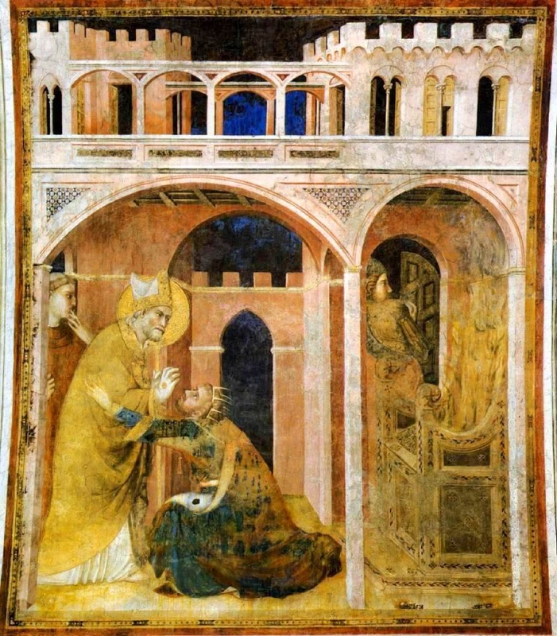
  <figcaption>Simone Martini, The Miracle of Fire, c. 1312–1318. Fresco, 265 × 230 cm. Assisi, Lower Church of San Francesco, Chapel of Saint Martin. Photo: Basilica di San Francesco, Assisi, public domain, via Wikimedia Commons.</figcaption>
</figure>

The eighth scene shows Martin's encounter with the Emperor Valentinian. According to Sulpicius Severus, the emperor, unwilling to grant the bishop's requests, refused to rise when Martin entered his presence. Fire then broke out beneath his throne and forced him to rise, and he embraced the saint and granted everything he asked. The episode illustrates the power of the saint over earthly rulers.

The scene is set in a palace with two round arches below and a crenellated loggia above, opening onto a dark blue sky through small arched windows. The architecture is rendered in pink and white tones, with patterned spandrels and coffered ceilings, and it creates a convincing interior space divided into two bays.

In the left bay, Martin, haloed and wearing a gold cope and mitre, stands and raises his hand in blessing over the emperor. The emperor, crowned and wearing a dark green mantle, kneels before him and embraces him, his face turned upwards towards the saint. Behind a column on the left, a courtier watches the scene with his hand raised to his mouth in surprise.

In the right bay, the empty throne is engulfed in flames, and a figure leans in through a door behind it. The burning throne, rendered with tongues of fire rising from its seat and back, explains the emperor's change of heart. By placing the cause in one bay and the consequence in the other, Simone tells the story clearly.

The architecture divides the composition into two parts and organises the narrative sequence. The arches frame the two moments of the story, and the columns separate them while allowing the viewer to see both at once. This use of architecture as a narrative device is characteristic of the chapel.

The emperor's humility is the moral centre of the scene. The ruler who refused to rise now kneels and embraces the bishop, and his crown and mantle contrast with the gesture of submission. The scene thus states, in courtly terms, the superiority of spiritual over temporal authority.

The fresco is relatively well preserved, though the gold of the saint's cope and the green of the emperor's mantle have partly worn. The flames and the architecture remain legible, and the faces keep their expressive force.

The Miracle of Fire was a subject of particular relevance to a patron who had served as papal legate to a royal court. It presents a model of the relationship between the Church and secular rulers, and it shows how the programme of the chapel combined devotion to the saint with reflections on the political world of its patron.

#### The Death of Saint Martin

<figure>
  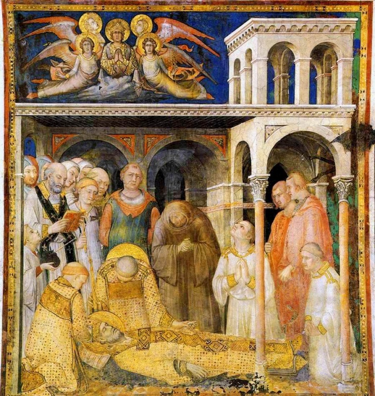
  <figcaption>Simone Martini, The Death of Saint Martin, c. 1312–1318. Fresco. Assisi, Lower Church of San Francesco, Chapel of Saint Martin. Photo: Basilica di San Francesco, Assisi, public domain, via Wikimedia Commons.</figcaption>
</figure>

The ninth scene shows the death of the saint. According to Sulpicius Severus, Martin died at Candes, lying on the ground on sackcloth and ashes, as a sign of humility. His disciples surrounded him, and his soul was carried to heaven. The scene presents the end of the saint's earthly life as a model of holy death.

The setting is an arcaded interior with columns crowned by Corinthian capitals, opening onto a loggia above. On the right, a tall structure with arches rises against the blue sky. The architecture frames the figures and gives the scene the solemnity of a church interior.

In the foreground, Martin lies on the ground, his head resting on a cloth, wearing gold vestments and a halo. His face is calm and his eyes are closed. Around him, clerics in gold and white vestments kneel and bend over his body, one of them close to his head. Their gestures express grief and veneration.

Behind them stand other figures. A bishop reads from a book, a friar in a brown habit bows his head, and others join their hands or look up towards the sky.

In the upper left corner, against the blue sky, a group of four haloed angels with red wings flies together. They represent the heavenly host that receives the saint's soul, and their presence transforms the scene of death into one of glorification.

The composition contrasts the horizontal figure of the dead saint with the vertical columns and the standing figures around him. The figures crowd closely around the body, and their faces, turned towards it or upwards, create a network of glances that unites the scene.

The fresco is relatively well preserved, though the gold of the vestments has partly worn and the blue of the sky has darkened. The faces of the mourners retain much of their original expression.

The Death of Saint Martin anticipates the great funeral scenes of Sienese painting and recalls the deaths of saints in the Franciscan cycles of Assisi. It presents death as the culmination of a holy life, received with grief by the community and with joy by the angels, and it prepares for the final scene of the funeral.

#### The Funeral of Saint Martin

<figure>
  
  <figcaption>Simone Martini, The Funeral of Saint Martin, c. 1312–1318. Fresco. Assisi, Lower Church of San Francesco, Chapel of Saint Martin. Photo: Basilica di San Francesco, Assisi, public domain, via Wikimedia Commons.</figcaption>
</figure>

The tenth and final scene shows the funeral rites of the saint. According to the tradition, Saint Ambrose, bishop of Milan, fell asleep during the celebration of the Mass in his own cathedral and in a vision attended the funeral of Martin at Tours. When he awoke, he told his clergy that he had been present at the burial of his brother bishop. The scene thus combines the funeral with the miraculous presence of Ambrose.

The setting is a Gothic interior with tall traceried windows and slender twisted columns that run from the floor to the ceiling, dividing the composition into bays. The architecture is rendered in pale tones, with blue and green vaults, and it gives the scene the character of a church.

In the foreground, Martin's body lies on a bier covered with a blue cloth sown with gold motifs. He wears a mitre and gold vestments, and his haloed head rests on a cushion. The bier extends across the width of the composition, and its blue cloth forms a strong band of colour in the lower part of the scene.

On the left, a haloed bishop in a mitre and cope blesses the body. He is identified as Ambrose. Clerics assist him, one swinging a censer and others holding books or candles. Behind the bier stands a haloed figure in a red mantle with crossed hands, whose identity is not certain.

On the right, clerics in grey habits sing with open mouths and hold tall candles. Their faces, turned towards the body, express the solemnity of the liturgical chant. Behind them, other figures crowd in, and a boy in the foreground looks up at the foot of the bier.

The twisted columns are an unusual feature. They divide the composition into bays and, standing in front of the figures, create a sense of depth and of a space that continues beyond the picture plane. They also recall the precious columns of the shrines in which saints' relics were kept.

The fresco has suffered some losses, particularly in the lower part and in the gold of the vestments, but the figures and the architecture remain legible. The blue cloth of the bier keeps much of its original colour.

The funeral concludes the cycle with a scene of liturgical solemnity. The saint who began as a young knight sharing his cloak at the gate of Amiens ends as a bishop honoured by the Church, and the presence of Ambrose gives his death a universal significance. The chapel thus closes with the image of the community gathered around the body of its saint, a reflection of the devotion that the chapel itself was meant to serve.

### The Saints of the Right Transept (Assisi, Lower Church of San Francesco)

#### Introduction

In the right transept of the Lower Church of San Francesco, near the chapel of Saint Martin, a group of frescoes is attributed to Simone Martini or to his workshop. It consists of a Madonna and Child between two royal saints and a row of five half-length saints. The frescoes have been associated with an altar dedicated to Saint Elizabeth of Hungary, while one reference article connects them with a chapel of Saint Louis and records five further half-length saints, now lost; their subjects form a coherent programme of Hungarian and Angevin royal sanctity. Vasari already gave these figures to Simone, and on this point, unusually, his attribution has survived modern criticism.

The saints represented belong to the royal houses of Hungary and of Anjou and to the Franciscan order. They include Saint Francis, Saint Louis of Toulouse, Saint Elizabeth of Hungary, a veiled female saint whose identity is debated, a young royal saint holding a lily, and two crowned kings flanking the Virgin, generally identified as Saint Stephen and Saint Ladislaus, the great royal saints of Hungary. Only after the correct identification of these saints did the frescoes become readable as an Angevin and Hungarian commission.

The patronage is not documented. The frescoes are usually connected with Queen Mary of Hungary, the mother of Robert of Naples and of Louis of Toulouse, who was herself a princess of the Árpád dynasty and a great patron of the Franciscans. The presence of Louis of Toulouse with a halo shows that the frescoes were painted after his canonisation in April 1317. The two most recent Italian reference articles date them differently, one around 1318–19 and the other around 1322, and the question remains open.

The frescoes complement the chapel of Saint Martin and the panel of Saint Louis in Naples. Together they show Simone working for the same network of patrons, the Angevin court, its Hungarian relatives and the Franciscan order, in the years immediately following the Maestà. They also show his workshop producing a series of saints in a uniform format, a practice that reflects the organisation of a large enterprise.

#### Madonna and Child between Saints Stephen and Ladislaus of Hungary

<figure>
  
  <figcaption>Simone Martini, Madonna and Child between Two Royal Saints (Stephen and Ladislaus of Hungary?), c. 1318–1322. Fresco, 110 × 200 cm. Assisi, Lower Church of San Francesco, right transept. Photo: Basilica di San Francesco, Assisi, public domain, via Wikimedia Commons.</figcaption>
</figure>

The fresco shows the Virgin and Child flanked by two crowned saints, each holding an orb, set against a gold ground. It was originally placed above an altar, and its format, a wide rectangle with half-length figures, recalls that of a painted dossal or of the central part of a polyptych. Its most striking feature is the ground. Instead of the blue of most frescoes, Simone used gold, tooled with dense punched patterns of flowers and a punched border, so that the wall painting imitates the surface of a gold-ground panel.

The Virgin occupies the centre. She wears a small crown over a white veil, and her mantle, blue lined with red, is wrapped around her shoulders and arms. Her face, a long oval with heavy-lidded eyes and a small mouth, is turned slightly to the left, and her expression is grave and inward. The blue of her mantle has suffered losses and now appears patchy, but the delicacy of the face and the fall of the veil remain clear.

The Child sits on the Virgin's arm in a golden tunic, his head of red curls turned to the right. With one hand he clutches his mother's veil and with the other he reaches out towards the saint on the right. His movement breaks the symmetry of the group and links the central figures to the royal saint, in a gesture that combines the naturalism of a real infant with the theological meaning of the Child turning to receive the homage of the king.

The saint on the left is a bearded king, crowned, wearing a dark cape over a garment of blue and red. He holds an orb in his left hand and a sword or sceptre that crosses his body diagonally. His face, with its pointed beard and attentive gaze, is turned towards the viewer. The saint on the right is a young, beardless king, crowned, in a green mantle sprinkled with dark spots, holding an orb and a slender golden sceptre. His face, framed by long fair hair, is turned towards the Virgin.

The two kings are generally identified as Saint Stephen, the first Christian king of Hungary, and Saint Ladislaus, the great king of the late eleventh century, both canonised and both venerated as patrons of the Hungarian monarchy. The orbs and sceptres they hold have been read as references to the royal regalia of Hungary. Which of the two figures is Stephen and which is Ladislaus is not certain, and the identification as a whole rests on the context of the transept and on the attributes rather than on inscriptions.

The choice of these saints places the image firmly within the dynastic world of the Angevins of Naples and Hungary. The Angevin claim to the Hungarian throne, which Cardinal Gentile Partino da Montefiore had helped to secure, rested on descent from the Árpád kings through Mary of Hungary. To show the Virgin and Child flanked by the two greatest Árpád saints was therefore to give that claim a sacred foundation, in the same spirit as the panel of Saint Louis crowning Robert in Naples.

The technique of the gold ground is unusual. The punched patterns are applied with a density and variety that rival those of contemporary panel paintings, and they show Simone transferring to the wall the goldsmith's methods he had already used in the Maestà. The haloes of the figures are tooled with the same care. This treatment gives the fresco an unusual richness and makes it one of the most precious surfaces in the Lower Church.

The fresco has suffered losses, particularly in the blue of the Virgin's mantle and in the garments of the left-hand saint, and the gold ground is worn in places. Its dimensions, about 110 × 200 cm, are those of a large altar image. Despite its condition, it remains one of the most refined works of Simone's early maturity and one of the most explicit statements of the Angevin and Hungarian programme that runs through his work in these years.

#### Saint Francis and Saint Louis of Toulouse

<figure>
  
  <figcaption>Simone Martini, Saint Francis and Saint Louis of Toulouse, c. 1318–1322. Fresco, 120 × 152 cm. Assisi, Lower Church of San Francesco, right transept. Photo: Basilica di San Francesco, Assisi, public domain, via Wikimedia Commons.</figcaption>
</figure>

The first two figures of the series of half-length saints are Saint Francis and Saint Louis of Toulouse. Each is set in a rectangular field with a blue-grey ground, separated from the next by a narrow ornamental band. The format, uniform for all five saints, gives the series the character of a painted predella or of a row of panels set into the wall.

Francis is shown bearded and tonsured, in a pale grey habit. He turns to the right, towards his companion, and touches his breast with one hand while the other rests at his waist. Through a tear in his habit the wound in his side is visible, and the wounds of the stigmata appear on his hands. His face, with its sharp profile and intent gaze, has a gravity that contrasts with the young bishop beside him.

Louis of Toulouse is shown as a young bishop, beardless, wearing a jewelled mitre and a pale yellow cope over a red garment. He holds a crozier diagonally across his body and wears a ring, and his face, turned slightly towards Francis, has the smooth, idealised features of the Naples panel. Unlike the figure in the chapel of Saint Martin, here he appears in full episcopal vestments.

The pairing of Francis and Louis states the Franciscan identity of the Angevin saint. The prince who renounced his throne to become a friar stands beside the founder of his order, and the two figures together express the union of royal blood and Franciscan poverty that the Angevin court promoted. The halo of Louis confirms that the series was painted after his canonisation in 1317.

The two figures are relatively well preserved, though the ground has darkened and the colours of the vestments have faded. Their quiet, monumental presence, with simple contours and broad planes of colour, is characteristic of the series and shows Simone adapting his style to a format of devotional portraits.

#### Saint Elizabeth of Hungary, a Female Saint and a Young Royal Saint

<figure>
  
  <figcaption>Simone Martini, Saint Elizabeth of Hungary, a Female Saint (Clare or Margaret of Hungary?) and a Young Royal Saint (Henry of Hungary?), c. 1318–1322. Fresco, 120 × 228 cm. Assisi, Lower Church of San Francesco, right transept. Photo: Basilica di San Francesco, Assisi, public domain, via Wikimedia Commons.</figcaption>
</figure>

The remaining three figures of the series complete the programme of royal and Franciscan sanctity. They follow the same format as the pair of Francis and Louis. Together the five saints form a continuous row of devotional images.

On the left stands Saint Elizabeth of Hungary, the daughter of King Andrew II, who devoted her life to the poor and was closely associated with the Franciscans. She is shown as a young crowned woman with braided fair hair, wearing a pale patterned mantle. Her raised hands gesture towards the right, and it has been suggested that she points towards the Madonna and Child with the Hungarian royal saints, to which she was linked by both family and devotion.

In the centre stands a female saint in a white veil and a pale grey-brown mantle, looking out frontally and holding a thin rod or arrow in one hand. Her identity is debated. She has been identified as Saint Clare of Assisi, as Saint Margaret of Hungary, the Dominican princess of the Árpád house, and as the Roman noblewoman Jacopa de' Settesoli, a friend of Saint Francis. None of these identifications is secured by an inscription, and the figure remains an uncertain female saint.

On the right stands a young beardless saint with long auburn hair, wearing a dark brown cloak over a red garment and holding a stem of lilies. A faint crown is drawn above his halo, apparently left unfinished. He is usually identified as Saint Henry, or Emeric, of Hungary, the son of Saint Stephen, whose legend of chastity explains the lily. The unfinished crown, also noted on another figure of the series, suggests that the decoration was not entirely completed, or that a detail in metal leaf has been lost.

The three figures are painted with a simplicity and a softness of modelling that have suggested to some scholars the participation of the workshop. The faces, however, especially that of Elizabeth in profile and that of the young royal saint, have a refinement close to Simone's own hand. The series as a whole shows the master and his assistants working together on a coherent programme within a uniform format.

The fresco has suffered some losses, and the blue-grey ground has darkened unevenly. Its dimensions, about 120 × 228 cm, show that the three figures together form a band comparable in width to the Madonna with the Hungarian kings. The five saints and the Madonna thus belong to a single ensemble that celebrated the sanctity of the Árpád and Angevin dynasties in the Franciscan basilica.

### Saint Ladislaus of Hungary (Altomonte, Museo Civico di Santa Maria della Consolazione)

<figure>
  
  <figcaption>Simone Martini (attributed), Saint Ladislaus of Hungary, c. 1326–1328 (dating debated). Tempera and gold on panel, 45.5 × 21.5 cm. Altomonte (Cosenza), Museo Civico di Santa Maria della Consolazione, from the church of Santa Maria della Consolazione. Inscribed S. LADICLAUS REX VGARIE. Photo: Museo Civico di Santa Maria della Consolazione, Altomonte, public domain, via Wikimedia Commons.</figcaption>
</figure>

This small panel is the most southerly work attributed to Simone Martini and one of the most precious. It comes from the church of Santa Maria della Consolazione at Altomonte, in northern Calabria, where it has been kept since the fourteenth century, and it is now displayed in the adjacent civic museum. It shows Saint Ladislaus, king of Hungary from 1077 to 1095 and canonised in 1192, standing alone beneath a pointed arch. The panel belongs to the network of Angevin and Hungarian commissions that runs through Simone's career, from the Saint Louis of Naples to the saints of the right transept at Assisi.

The church of Santa Maria della Consolazione was founded by Filippo Sangineto, count of Altomonte and an important member of the Angevin court of Naples, who also served as seneschal of Provence. Filippo is generally regarded as the patron of the panel, though this has long been debated and no document records the commission. The connection rests on the provenance of the panel from his church and on its subject. A relief on the side of the Sangineto sarcophagus in the same church shows Saint Ladislaus with a long-handled axe, which confirms the importance of the saint in the devotion of the family.

The attribution to Simone himself is a modern achievement. Earlier writers placed the panel in his circle, and it was later recognised as his own work, assigned to an advanced phase of his art. The dating varies accordingly. The museum gives the second half of the 1320s, around 1326–1328, a date connected with the hypothesis of Filippo's commission, while other scholars have proposed the 1330s or even the early 1340s. The panel is therefore an attributed work of debated date.

The panel has a pointed arch within a gable, and its upper edge was once decorated with carved flowers, now largely lost. At the top of the gable, a bunch of grapes carved in relief and gilded survives. The gold ground, laid with fine gold leaf, is densely enriched with punched patterns that trace an inner arcade, the halo of the saint and the vertical borders of the field, so that the surface resembles a piece of embroidery. The back of the panel is also painted. Its small size, about 45.5 × 21.5 cm, suggests that it belonged to a larger ensemble.

Ladislaus stands frontally on a dark ground, crowned, with a short dark beard and shoulder-length hair. His face is grave and slightly stern, with the individual character that Simone gave to his royal saints. He wears a rose-pink mantle over a blue-green tunic, with a white lining visible at the sides, and red shoes. At his breast, a round morse bears a red and white striped shield, the arms of the Árpád kings of Hungary.

With his right hand the saint holds a long-handled weapon diagonally across his body, and his left hand rests at his waist. The weapon is the battle-axe that was his traditional attribute, recalling his reputation as a warrior king and defender of the faith, though its head is now difficult to read against the gold. The inscription S. LADICLAUS REX VGARIE, painted in two lines on either side of his head, identifies him unambiguously.

The original context of the panel has been the subject of several proposals. It has been suggested that it formed part of a triptych with other saints of the Hungarian royal house, such as Elizabeth and Stephen, in the same spirit as the frescoes in the right transept at Assisi. A more recent reconstruction has proposed that it belonged to one of two small matching polyptychs set against the screen of the church, the other painted by Bernardo Daddi. None of these reconstructions is documented, and the panel survives as an isolated work.

The Saint Ladislaus is a striking witness to the reach of Simone's art. Painted for a remote Calabrian church by a Sienese master working within the orbit of the Angevin court, it unites the refinement of his punchwork and the dignity of his royal figures in a format of great intimacy. It also shows how the cult of the Hungarian royal saints, promoted by the Angevins of Naples, extended from Assisi to the southern edge of their kingdom.

### The Polyptych of Sant'Agostino at San Gimignano (Cologne and Cambridge)

#### Introduction

The polyptych painted by Simone Martini for the Augustinian church of Sant'Agostino at San Gimignano is one of his earliest altarpieces and one of the most instructive examples of how a dismembered work can be reconstructed. Its surviving panels are divided between three collections. The central Madonna and Child is in the Wallraf-Richartz-Museum in Cologne. Three lateral panels with Saints Geminianus, Michael and Augustine, each with an angel above, are in the Fitzwilliam Museum in Cambridge. A fifth panel with Saint Catherine of Alexandria is in a private collection in Florence. Together they formed a pentaptych, a five-part altarpiece with the Virgin and Child at the centre and two saints on either side.

The reconstruction is an argument from physical and stylistic evidence, not a document. Vasari attributed the altarpiece to Lippo Memmi, but a sixteenth-century writer recorded on it the signature "Simon Senensis pinxit", and the attribution to Simone is now generally accepted, with the participation of his workshop. The examination of the dowel holes in the three Cambridge panels has confirmed that the altarpiece was a pentaptych and has allowed the order of its parts to be established. The provenance from Sant'Agostino rests above all on the iconography of the Cambridge panels, and on an identifying inscription revealed beneath one of them during restoration.

The choice of saints explains the destination. Geminianus, the fourth-century bishop of Modena, was the patron saint of San Gimignano, to which he gave his name. Augustine was the father of the order that served the church. Their juxtaposition in a single altarpiece made the work a statement of the bond between the town and its Augustinian friars. Recent research has connected this choice with a documented conflict, between 1315 and 1317, between the Augustinian convents of San Gimignano and of nearby Racciano, which may have led the friars of the town to emphasise their relationship with its patron saint.

The date of the altarpiece is not documented. It is generally placed in the second half of the 1310s, close to the Maestà of the Palazzo Pubblico and to the earliest works of the Assisi period, and the Cologne museum dates its panel around 1316–1317. A proposed connection with the tomb of the Blessed Bartolo, carved by Tino di Camaino in 1317 for the same town, is an inference rather than a documented fact, and a broader range from around 1317 to the mid-1320s has also been suggested.

The altarpiece is also important for the history of Simone's workshop. San Gimignano was the town in which Memmo di Filippuccio, Simone's future father-in-law, had his workshop, and where Lippo Memmi painted the Maestà of the Palazzo Comunale in 1317. The polyptych of Sant'Agostino therefore belongs to the period in which the relationship between Simone and the Memmi family was being formed, and Vasari's attribution to Lippo reflects, in a distorted form, the closeness of the two workshops.

The dispersal of the polyptych is typical of the fate of many Sienese altarpieces. Its panels left San Gimignano at an unknown date, entered the art market and reached different collections, where they were mounted in modern frames. The Cambridge panels are now displayed together in a single frame that brings Michael and Augustine side by side, although they originally flanked the central Madonna. The Cologne Madonna is set in a frame whose inscription does not belong to it. Only the reconstruction, on paper, restores the original sequence.

#### Madonna and Child (Cologne, Wallraf-Richartz-Museum)

<figure>
  
  <figcaption>Simone Martini, Madonna and Child, central panel of the polyptych of Sant'Agostino, San Gimignano, c. 1316–1317. Tempera and gold on poplar, 79.5 × 57 cm (dimensions as given by the museum). Cologne, Wallraf-Richartz-Museum &amp; Fondation Corboud, WRM 0880, gift of the State of North Rhine-Westphalia, 1961. Photo: Raimond Spekking, <a href="https://creativecommons.org/licenses/by-sa/4.0/">CC BY-SA 4.0</a>, via Wikimedia Commons.</figcaption>
</figure>

The Cologne panel was the central compartment of the polyptych. It shows the Virgin in half length holding the Child, beneath a round arch, against a gold ground. The museum dates it around 1316–1317, a dating consistent with its place among Simone's early works, and it was given to the museum in 1961 by the State of North Rhine-Westphalia.

The Virgin wears a very dark blue-green mantle over a red dress, its border edged with gold. Her head inclines towards the Child, and her face, long and pale with heavy-lidded eyes and a small mouth, has the grave and tender expression of Simone's early Madonnas. A small star is visible on her shoulder, the traditional sign of the Virgin as Star of the Sea. Her right hand, long and finely drawn, supports the Child's foot, and her left hand holds him from beneath.

The Child sits upright on his mother's arm, wearing an orange tunic and a rose-pink mantle with a gold border, and a pale green sash tied at his waist. His face, round and serious, is turned towards the viewer, and his reddish curls are framed by a richly tooled halo. In his left hand he holds a small goldfinch. The bird, which according to tradition acquired its red markings from the blood of Christ, alludes to the Passion, and its presence in the hand of the Child gives the image a quiet foreshadowing of the sacrifice to come.

The haloes of both figures are tooled with elaborate punched patterns, and the gold ground has a fine network of craquelure. The punched motifs of this panel recur in later works of Simone and have been used, together with those of the Cambridge panels, to support the reconstruction of the altarpiece. The colours, dark mantle, red dress, orange and pink garments, are of great intensity, and they show the rich palette that Simone brought to his panel paintings in these years.

The frame, painted dark with small gold flame motifs and with a base inscribed S. ANTONIUS DE PADUA, evidently comes from another work, perhaps an image of Saint Anthony of Padua, and was fitted to the Madonna at some point in its later history. Its presence explains the discrepancy between the dimensions published by the museum, 79.5 × 57 cm, and the smaller dimensions recorded for the painted panel alone, about 59.7 × 35.8 cm.

As the central image of the polyptych, the Madonna would originally have been flanked by Saint Michael on the left and Saint Augustine<a href="/endnotes.html#fn-augustine-of-hippo" class="footnote">19</a> on the right, with Saint Geminianus and Saint Catherine at the outer ends. Its intimacy and its warm, saturated colour contrast with the more formal figures of the saints, and its gesture of the Child turning to the viewer would have addressed the faithful directly from the centre of the altar.

#### Saints Geminianus, Michael and Augustine (Cambridge, Fitzwilliam Museum)

<figure>
  
  <figcaption>Simone Martini and workshop, Saints Geminianus, Michael and Augustine, each with an Angel above, lateral panels of the polyptych of Sant'Agostino, San Gimignano, c. 1316–1320. Tempera and gold on panel, each panel about 110.5 × 38.3 cm. Cambridge, The Fitzwilliam Museum, no. 552. Image © The Fitzwilliam Museum, Cambridge.</figcaption>
</figure>

The three Cambridge panels are the lateral compartments of the polyptych. Each shows a half-length saint beneath a round arch, with a half-length angel in the gable above. They are now mounted together in a single modern frame, but originally the Virgin and Child stood between Michael and Augustine. The museum attributes them to Simone Martini and his workshop.

On the left is Saint Geminianus, the patron of San Gimignano. He is shown as an elderly bearded bishop in a jewelled mitre and a red chasuble with a jewelled orphrey, wearing white gloves set with jewels. He holds a crozier and a book bound in green. Like many bishop saints, he has no distinctive attribute, and his identification rests on the context of the altarpiece and, according to the restoration, on an inscription found on the panel.

In the centre is the Archangel Michael, with red-gold hair, a jewel on his brow and folded wings. He holds a sword upright in one hand and in the other a pair of scales, in one pan of which sits a tiny figure representing a human soul. Michael is thus shown as the weigher of souls at the Last Judgement, a role that gave him an important place in the devotion surrounding death and burial.

On the right is Saint Augustine, recognisable by the black habit of his order, visible beneath a white and gold patterned cope. He wears a jewelled mitre and white gloves, and holds a crozier and a red book, the attribute of the author of the Rule followed by the friars of Sant'Agostino. His face, bearded and severe, has a strong individual character.

The three angels in the gables wear robes of red, blue, green and pink, and two of them hold staffs. Their small figures complete the hierarchy of the altarpiece, adding a celestial register above the saints. They are painted with the same refinement as the main figures, though their smaller scale has suggested to some the participation of assistants.

The panels are rich in material detail. The jewelled mitres, orphreys and gloves, the patterned cope of Augustine and the punched haloes reflect the goldsmith's taste that runs through Simone's work, and the colours retain much of their brilliance. The dimensions of each panel, about 110.5 × 38.3 cm, show that the polyptych was of moderate size, suitable for a side altar or for the high altar of a modest church.

The juxtaposition of Geminianus and Augustine, the patron of the town and the father of the order, is the key to the altarpiece. Together with Michael, the guardian of souls, and Catherine, the learned virgin martyr on the far right, they form a programme that combined civic, monastic and devotional themes. The Cambridge panels thus preserve the most important evidence for the original meaning of the polyptych, and they remain among the finest works of Simone's early maturity outside Italy.

### The Polyptych of Santa Caterina (Pisa, Museo Nazionale di San Matteo)

<figure>
  
  <figcaption>Simone Martini, Polyptych of Santa Caterina, c. 1319–1320. Tempera and gold on panel, c. 195 × 340 cm. Pisa, Museo Nazionale di San Matteo, from the high altar of the Dominican church of Santa Caterina. Signed SYMON DE SENIS ME PINXIT. Photo: Miguel Hermoso Cuesta, <a href="https://creativecommons.org/licenses/by-sa/4.0/">CC BY-SA 4.0</a>, via Wikimedia Commons.</figcaption>
</figure>

#### History, Patronage and Meaning

The polyptych painted by Simone Martini for the Dominican church of Santa Caterina in Pisa is his largest surviving altarpiece and one of the most complete polyptychs of the Italian fourteenth century. It consists of seven principal compartments, each composed of a main panel with a half-length saint, a smaller register with two further saints and a gable with a prophet or with Christ, and of a predella of seven panels. In all, more than forty figures are represented. The altarpiece is now in the Museo Nazionale di San Matteo in Pisa, where its parts were reassembled after a long restoration.

The church of Santa Caterina belonged to the Dominican friars, who had established one of their principal Tuscan convents in Pisa. In the early fourteenth century the convent was among the leading centres of learning of the order in Italy. The commission of a high altarpiece from the most prominent Sienese painter of the moment reflects the ambitions of the community and its desire to equip its church with an image comparable to the great polyptychs that the mendicant orders were commissioning across Tuscany.

The patronage is recorded not by a contract but by the literary sources of the convent. Its annals and its ancient chronicle state that a "pulcherrima pictura" by Simone was placed on the high altar during the priorate of Tommaso da Prato, and that a friar named Pietro promoted the commission. These sources were written within the convent and preserve the memory of the event as the friars recorded it. They are the only evidence for the date and for the circumstances of the work, and they make the altarpiece one of the few of Simone's polyptychs whose installation is attested.

The year recorded in the sources is 1320. Pisa, however, used a calendar that began the year in March, about nine months ahead of the common style, and a date in the Pisan style may correspond to 1319 in modern reckoning. Some scholars have therefore converted the date to 1319, while others, observing that the annals often used the common style, have kept 1320. The defensible formulation is that the altarpiece was painted around 1319–1320 and was in place by 1320.

The signature runs along the lower frame of the central panel, beneath the Virgin and Child, and reads SYMON DE SENIS ME PINXIT. The Italian national catalogue records it in these terms, in painted capitals. It was first read in the mid-nineteenth century. Until then the altarpiece had been attributed to Lippo Memmi, an error that reflects the long confusion between Simone and his brother-in-law that Vasari had already introduced. The signature is the same formula that Simone used in the Saint Louis of Toulouse in Naples.

The programme of the altarpiece is explicitly Dominican. The two outer saints are the two great figures of the order, Saint Dominic<a href="/endnotes.html#fn-dominic-guzman" class="footnote">20</a> on the left and Saint Peter Martyr on the right. Between them stand Saint John the Evangelist, Mary Magdalene, Saint Catherine of Alexandria and Saint John the Baptist. Catherine, the titular saint of the church, occupies the place of honour at the Virgin's left hand.

Above the main register runs a row of the twelve apostles, arranged in pairs and identified by inscriptions on the gold ground. Above the Virgin, the archangels Gabriel and Michael take the place of the apostles. In the gables, prophets and kings of the Old Testament, among them David with his harp and Moses with the tablets of the Law, surround the blessing Christ in the central gable. The altarpiece thus presents a complete hierarchy of the Church, from the prophets who foretold Christ to the apostles who preached him and the saints who followed him.

The predella completes this hierarchy. It contains fifteen half-length figures of saints under small arcades, with the Man of Sorrows standing in the tomb at the centre, flanked by the Virgin and Saint Mark. The figure of the dead Christ, placed directly beneath the Virgin and Child and directly above the altar, linked the image to the Eucharist celebrated below and reminded the faithful that the Child in his mother's arms was destined for the Passion.

The structure of the polyptych is one of its most important features. Its seven compartments, each divided into three registers, and its predella create a unified and systematic architecture of a kind that had not been achieved in Sienese painting before. Duccio's polyptychs had established the basic format, but Simone extended it to an unprecedented scale and complexity. The Pisa altarpiece became a model for later polyptychs in Siena and beyond.

The style of the altarpiece shows Simone at the height of his early maturity. The figures have the monumental presence and the solid modelling that he had developed in the Maestà and at Assisi, combined with a refinement of line and a richness of surface that are characteristic of his panel paintings. The faces of the saints are strongly individualised, and their gestures and attributes are rendered with great clarity. The gold ground is punched and tooled with elaborate patterns.

The participation of the workshop is evident in the smaller figures of the upper registers and of the predella, which are more uniform in execution than the main saints. A work of this size, with more than forty figures, could not have been painted by a single hand, and it reflects the organisation of the large workshop that Simone directed in these years. The design and the principal figures, however, are generally regarded as his own.

The later history of the altarpiece was troubled. It remained on the high altar of Santa Caterina until changes in taste and liturgy led to its removal, and after the suppression of religious houses its panels were dispersed among different locations in Pisa. They were eventually gathered in the museum, and after a long restoration, completed in 1949, the polyptych was reassembled in its present form. The reconstruction is based on the evidence of the panels themselves and on the logic of the programme.

The altarpiece has been the subject of further technical study and restoration in recent years, which has provided new data on its materials and construction. These studies have confirmed the coherence of the work and have shed light on Simone's methods of preparation, gilding and painting, contributing to a more precise understanding of the organisation of his workshop.

The polyptych is a key work for the history of Italian altarpieces. It shows the Dominican order commissioning a monumental image that combined devotion, theology and the promotion of its own saints, and it shows Simone creating a format that would be imitated for decades. Together with the Saint Louis of Naples, painted only a few years earlier, it demonstrates the range of his art in the years around 1320, from royal propaganda to monastic devotion.

The altarpiece is also one of the clearest examples of the international reach of Sienese painting. A Sienese painter working for a Pisan Dominican community produced a work that combined the traditions of Siena, the spatial lessons of Florence and the devotional needs of a great mendicant order. It is the most complete surviving example of Simone's activity as a painter of large altarpieces.

#### Description

The altarpiece is arranged in seven vertical compartments of equal width except for the central one, which is wider and taller. Each compartment rises in three registers: a main panel with a half-length saint beneath a trefoil arch, a narrower band with two smaller figures beneath twin arches, and a triangular gable. Below runs the predella, divided into seven panels with a total of fifteen figures. Slender carved columns and gilded mouldings separate the compartments, and the whole structure is unified by the continuous gold ground.

At the centre, the Virgin sits in half length in a deep blue mantle over a red dress, holding the Child on her right arm. She inclines her head towards him with a grave and tender expression. The Child, in a pale yellow tunic and a red mantle, turns towards her, grasps the edge of her mantle at her breast and holds a small red book, a gesture of intimacy that softens the formality of the central image. Above them, two archangels, Gabriel and Michael, stand under twin arches, and in the central gable Christ blesses with his right hand and holds an open book inscribed

> EGO SUM A[...] PRINCIPIU[M] [ET] FINIS,

the opening of the self-revelation of Christ in the Apocalypse, "I am Alpha and Omega, the beginning and the end" (Revelation 1:8; 22:13). The letters of the third line on the left page are damaged and only partly legible.

On the far left stands Saint Dominic in the black and white habit of his order, holding a lily and an open book. Beside him, Saint John the Evangelist, young and fair, wears a red mantle over a blue tunic and holds a green book. Next to him, Mary Magdalene, wrapped in a red mantle over a blue garment, holds up her ointment jar with an expression of quiet melancholy. Their names are painted on the frame beneath them.

On the right of the Virgin stands Saint Catherine of Alexandria, crowned, with a palm of martyrdom and a red book, wearing a pale mantle patterned with small motifs and edged with jewels. Beside her, Saint John the Baptist, with long dark hair and beard, wears a red mantle over a garment of camel skin and points upward with one hand while holding a slender cross. On the far right stands Saint Peter Martyr in the Dominican habit, holding a palm and a book, the wound of his martyrdom visible on his head.

The apostles of the upper row are shown with books or scrolls. Their poses vary from figure to figure, some turning towards each other as if in conversation, others looking out at the viewer. Their colours, red, green, blue and pink, form a lively band of colour across the altarpiece.

Besides David and Moses, the other prophets of the gables hold scrolls inscribed with their prophecies. Their elderly, bearded figures, set against the gold of the triangular fields, crown the altarpiece and link it to the history of salvation.

The predella contains fifteen half-length figures under small trefoil arcades. At the centre, the Man of Sorrows stands in the tomb, his arms crossed and his head inclined, flanked by the Virgin in blue and Saint Mark in red, identified by his lion. On either side, saints and bishops, among them Dominicans and martyrs, are arranged in pairs, each with his or her attribute. The figures are small, but they are painted with care and form a continuous frieze along the base of the altarpiece.

Seen as a whole, the polyptych creates a vast and ordered assembly of holy figures, from the prophets at the top to the saints of the predella, all converging on the Virgin and Child at the centre. The repetition of the arched frames, the rhythm of the colours and the continuous gold ground give the work a unity that makes it one of the most impressive altarpieces of its time.

#### The Main Register: Introduction

The seven principal panels of the Santa Caterina polyptych show half-length figures beneath trefoil arches carved in the wood and gilded, with spandrels filled by raised vine scrolls. Each figure stands on a gold ground tooled with punched haloes, and each panel is framed by mouldings that once carried painted inscriptions with the names of the saints. In their original order from left to right, the panels are Saint Dominic, Saint John the Evangelist, Mary Magdalene, the Virgin and Child, Saint Catherine of Alexandria, Saint John the Baptist and Saint Peter Martyr.

#### Saint Dominic

<figure>
  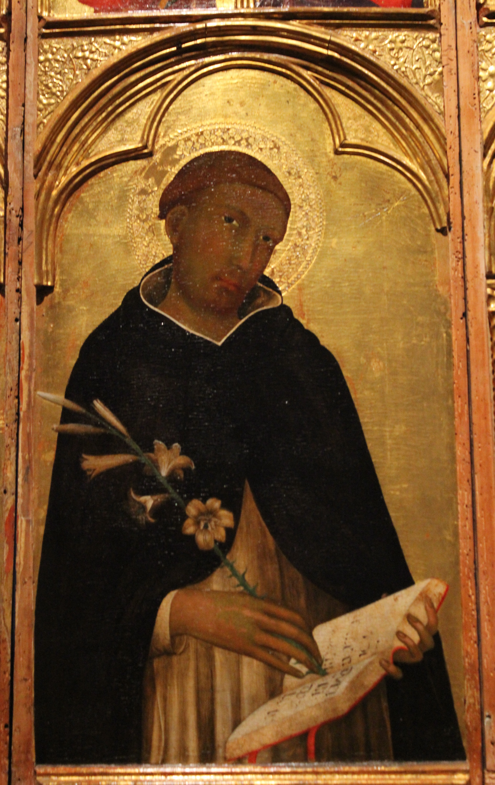
  <figcaption>Simone Martini, Polyptych of Santa Caterina: Saint Dominic, c. 1319–1320. Tempera and gold on panel. Pisa, Museo Nazionale di San Matteo. Photo: Miguel Hermoso Cuesta, <a href="https://creativecommons.org/licenses/by-sa/4.0/">CC BY-SA 4.0</a>, via Wikimedia Commons.</figcaption>
</figure>

The panel at the far left of the altarpiece shows Saint Dominic, the founder of the Order of Preachers, whose friars served the church of Santa Caterina. His position at one end of the main register, balanced by Saint Peter Martyr at the other, frames the whole altarpiece with the two great saints of the order and declares its Dominican identity at first sight.

Dominic is shown in the black mantle and white habit of his order, the mantle open at the front to reveal the white tunic beneath. His head is tonsured, with a narrow ring of brown hair, and he inclines it slightly to the left, towards the centre of the altarpiece. His face is youthful and gentle, with heavy-lidded eyes and a small mouth, and it has none of the severity often given to founders of orders.

In his right hand he holds a long stem of lilies, the symbol of his purity and of his devotion to the Virgin. The flowers have darkened with time and now appear brownish, but their elegant curved petals remain legible, and they were probably painted originally in white or in silver leaf that has since altered.

With his left hand he holds an open book, its pages showing a few lines of Gothic script. The book signifies his preaching and the foundation of his order on learning and the study of Scripture. The text is only partly legible, and its reading has not been verified on the original.

To the right of his halo, a small star is incised in the gold ground. The star is a traditional attribute of Dominic, deriving from the legend that his godmother saw a star shining on his forehead at his baptism. Its discreet presence, visible only at close range, shows the care with which Simone gave each saint his identifying signs.

The black of the mantle creates a strong silhouette against the gold, interrupted only by the white of the habit and the pale lilies. This graphic contrast, repeated in Peter Martyr at the other end of the altarpiece, gives the two Dominican saints a striking visual presence that distinguishes them from the colourful saints between them.

The panel is well preserved, with some craquelure and small losses in the gold ground and along the frame. The face retains its delicate modelling, and the black of the mantle keeps its depth.

Dominic's gentle expression and inclined head set the tone for the left half of the altarpiece. Rather than a commanding founder, he appears as a contemplative and humble figure, an image that corresponds to the ideals of preaching and study that the friars of Santa Caterina wished to present to the faithful.

#### Saint John the Evangelist

<figure>
  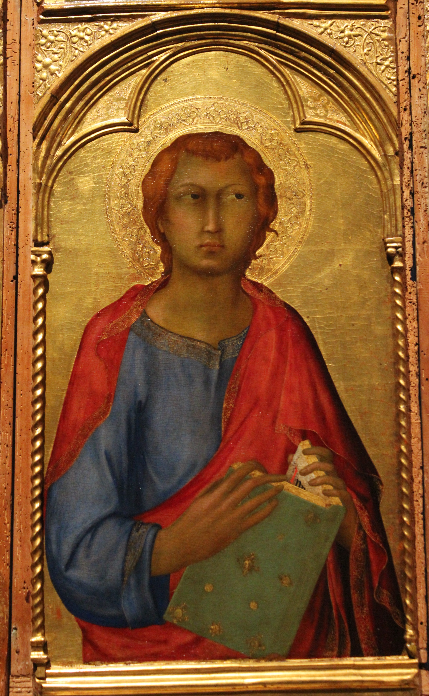
  <figcaption>Simone Martini, Polyptych of Santa Caterina: Saint John the Evangelist, c. 1319–1320. Tempera and gold on panel. Pisa, Museo Nazionale di San Matteo. Photo: Miguel Hermoso Cuesta, <a href="https://creativecommons.org/licenses/by-sa/4.0/">CC BY-SA 4.0</a>, via Wikimedia Commons.</figcaption>
</figure>

The second panel from the left shows Saint John the Evangelist, the beloved disciple of Christ and the author of the fourth Gospel and of the Apocalypse. His presence beside Dominic links the founder of the order with the evangelist of divine love and contemplation, whose writings were central to Dominican theology.

John is shown as a young man, beardless, with red-gold hair that falls in soft curls around his face. This youthful type, traditional in the West, recalls his age at the time of the Crucifixion. His face is serious and attentive, and his eyes look to the right, towards the Virgin at the centre of the altarpiece.

He wears a blue tunic with an embroidered neckline and a red mantle with a gold border, draped over his left shoulder and across his body. The two colours, blue and red, are those traditionally associated with the evangelist and with the Virgin, and their juxtaposition gives the figure a strong chromatic presence.

In his hands he holds a book bound in green and sprinkled with small gold rosettes, the Gospel that he wrote. The book is slightly open, and a page with a red initial is visible between his fingers. The gesture is quiet and natural, as if he were about to read or had just closed the book.

The panel is framed by slender twisted colonnettes on either side, painted gold, which support the trefoil arch. These colonnettes, together with the raised vine scrolls in the spandrels, belong to the carved and gilded frame that unified the polyptych.

The modelling of the face and the drapery is soft and sure. The light falls from the left, and the folds of the red mantle are rendered with broad, simple planes that give the figure a solid presence. The red-gold hair against the gold halo creates a luminous effect around the head.

The panel is relatively well preserved, though the gold ground shows craquelure and some losses in the frame. The colours retain much of their intensity.

The figure of John, with its calm and slightly withdrawn expression, belongs to the type of the young male saint that Simone used throughout his career. It anticipates the figures of John in his later Passion scenes, where the same youthful features are transformed by grief.

#### Mary Magdalene

<figure>
  
  <figcaption>Simone Martini, Polyptych of Santa Caterina: Mary Magdalene, c. 1319–1320. Tempera and gold on panel. Pisa, Museo Nazionale di San Matteo. Photo: Miguel Hermoso Cuesta, <a href="https://creativecommons.org/licenses/by-sa/4.0/">CC BY-SA 4.0</a>, via Wikimedia Commons.</figcaption>
</figure>

The third panel from the left, immediately beside the Virgin, shows Mary Magdalene. In the medieval tradition she was the penitent sinner who anointed the feet of Christ, the witness of the Crucifixion and the first to see the risen Christ. She was especially venerated by the Dominicans, who regarded her as a model of penitence and, as the "apostle of the apostles", of preaching.

The Magdalene is wrapped in a red mantle drawn over her head like a hood and edged with a narrow gold border. Beneath it she wears a dark blue-green dress, visible at the neck and in the opening of the mantle. The red, the colour of love and of penitence, dominates the panel and makes her one of the most vivid figures of the altarpiece.

Her face, inclined to the right towards the Virgin, is pale and melancholy, with heavy-lidded eyes that glance sideways and a small closed mouth. Strands of dark hair escape from beneath her veil. The expression is one of quiet sorrow, appropriate to a saint associated with the Passion and with repentance.

In her raised left hand she holds a small round ointment jar with a domed lid, painted in veined tones of cream and ochre as if carved from alabaster. The jar recalls the ointment with which she anointed Christ and the spices she brought to the tomb. It is rendered with the precision of a goldsmith's object.

Her right hand rests on the folds of the mantle at her waist, its long fingers spread across the red fabric. The gesture, simple and graceful, balances the raised hand with the jar and gives the figure a gentle rhythm.

A small gold motif decorates the mantle on her shoulder, and faint incised lines are visible in the gold ground to the right of her head. These details, discernible only at close range, show the refinement of the surface.

The panel is well preserved, with craquelure in the gold ground and minor losses along the edges. The red of the mantle has kept its intensity, and the face retains its delicate modelling.

The Magdalene of Pisa is a characteristic female figure of Simone's early maturity. Her melancholy grace and her inclined head anticipate the female saints of the Assisi chapel and the Virgin of the 1333 Annunciation, and they show how early the painter had found the type that would become his signature.

#### The Virgin and Child

<figure>
  
  <figcaption>Simone Martini, Polyptych of Santa Caterina: The Virgin and Child, central panel, c. 1319–1320. Tempera and gold on panel. Pisa, Museo Nazionale di San Matteo. Signed on the frame below SYMON DE SENIS ME PINXIT. Photo: Miguel Hermoso Cuesta, <a href="https://creativecommons.org/licenses/by-sa/4.0/">CC BY-SA 4.0</a>, via Wikimedia Commons.</figcaption>
</figure>

The central panel, wider and taller than the others, shows the Virgin and Child, the focus of the whole altarpiece. Beneath it, on the frame, runs the signature SYMON DE SENIS ME PINXIT, and above it rise the archangels and the blessing Christ. The panel is thus the axis around which the hierarchy of saints is arranged.

The Virgin wears a deep blue mantle edged with a fine gold border, drawn over a white veil and a red dress. Small gold stars mark her forehead and her shoulder, the traditional signs of the *Stella maris*, the Star of the Sea. The blue of the mantle, one of the most intense in the altarpiece, is rendered with soft modelling that follows the folds around her shoulders and arms.

Her face is long and pale, with heavy-lidded eyes, a straight nose and a small mouth, and it is inclined towards the Child. Her expression is grave and inward, and she looks not at the Child but slightly beyond him, as if contemplating his future. This combination of tenderness and foreboding is characteristic of Simone's Madonnas.

The Child sits on her left arm, his red curling hair framed by a punched halo. He wears a pale yellow tunic, and his legs are wrapped in a red mantle with a gold-embroidered border. With his right hand he reaches across to grasp the edge of his mother's mantle at her breast, and in his left he holds a small red book. His face, round and serious, is turned towards the Virgin.

The gesture of the Child is one of the most natural details of the panel. It recalls the movement of a real infant clutching at his mother's clothing, and it softens the formality of the central image. The small book in his hand, by contrast, signifies the Word of God and his role as teacher, an appropriate attribute in an altarpiece for an order of preachers.

The Virgin's right hand, with its long and elegant fingers, supports the Child's foot, which emerges from beneath the red mantle. Her left hand holds him from behind. The two hands create a frame around the Child's body and give the group a secure and stable structure.

The panel shows some losses in the gold ground, particularly on the left, where the red bole beneath has become visible, and the faces have suffered slight abrasions. The blue of the mantle and the red of the Child's garment, however, retain much of their original intensity.

The central Madonna of Pisa represents a moment of balance in Simone's art. The solidity of the figures and the clear construction of the group recall the Maestà of 1315, while the refinement of the faces and the delicacy of the gestures announce the more linear style of his later works. It is the image on which the entire programme of the altarpiece converges.

#### Saint Catherine of Alexandria

<figure>
  
  <figcaption>Simone Martini, Polyptych of Santa Caterina: Saint Catherine of Alexandria, c. 1319–1320. Tempera and gold on panel. Pisa, Museo Nazionale di San Matteo. Photo: Miguel Hermoso Cuesta, <a href="https://creativecommons.org/licenses/by-sa/4.0/">CC BY-SA 4.0</a>, via Wikimedia Commons.</figcaption>
</figure>

The panel immediately to the right of the Virgin shows Saint Catherine of Alexandria, the titular saint of the church. Her position at the Virgin's left hand, the place of honour after the centre, expresses her special importance to the friars of Santa Caterina, and her figure is the most richly decorated of the whole altarpiece.

Catherine was, according to her legend, a princess of Alexandria who confounded the pagan philosophers in debate and suffered martyrdom under the emperor Maxentius. She was venerated as the patron of learning and of philosophers, and her cult was particularly dear to the Dominicans, an order devoted to study and theological dispute.

She wears a gold crown with fleur-de-lis points set with pearls and coloured stones over braided red-gold hair, the sign of her royal birth. Her face, framed by the crown and the halo, is long and pale, and she looks sideways to the left with a grave and slightly distant expression.

Her mantle is a rich brocade of gold, patterned with small lozenges and shaded in dark blue in the folds, so that the fabric seems to shimmer. It is edged with jewelled borders in which red and dark stones and pearls are rendered in relief. A white fur collar, fastened by a jewelled brooch, frames her neck, and a red dress appears at her wrists.

In her right hand she holds a long palm of martyrdom, painted in grey-blue and resting against her shoulder. In her left she holds a red book with clasps, the attribute of her learning. The wheel, her other traditional attribute, is absent, so that the image emphasises her wisdom and her victory rather than the instrument of her torture.

The rendering of the brocade is one of the technical achievements of the altarpiece. Simone used gold leaf, punched and painted over, to imitate the luxury fabrics woven in Italy and imported from the East, and the result gives the saint the appearance of a princess at a contemporary court.

The panel is well preserved, with fine craquelure throughout the gold and minor losses in the frame. The jewelled details and the brocade retain much of their brilliance, and the face keeps its delicate modelling.

The figure of Catherine shows Simone's courtly taste at its most splendid. The combination of royal attributes, precious textiles and refined features makes her a model of the aristocratic female saint that he would develop in later works, and her prominence in the altarpiece underlines the importance of the titular saint for the community that commissioned it.

#### Saint John the Baptist

<figure>
  
  <figcaption>Simone Martini, Polyptych of Santa Caterina: Saint John the Baptist, c. 1319–1320. Tempera and gold on panel. Pisa, Museo Nazionale di San Matteo. Photo: Miguel Hermoso Cuesta, <a href="https://creativecommons.org/licenses/by-sa/4.0/">CC BY-SA 4.0</a>, via Wikimedia Commons.</figcaption>
</figure>

The second panel from the right shows Saint John the Baptist, the last of the prophets and the forerunner of Christ. His presence beside Catherine introduces a figure of a completely different character, an ascetic of the wilderness among the refined saints of the altarpiece.

John is shown with long, dark, unkempt hair and a full beard that falls over his chest. His face is lean and dark, and he looks straight out at the viewer with a stern and penetrating gaze. This wild appearance corresponds to the Gospel account of his life in the desert and contrasts strongly with the smooth, pale faces of the other saints.

He wears a garment of camel hair, painted in long, wavy strands of grey and white, tied at the waist with a red belt. Over it hangs a red mantle knotted at the chest. The combination of the rough animal skin and the red mantle expresses both his asceticism and his dignity as a prophet.

His right hand is raised, the forefinger pointing upward. The gesture is that of the preacher announcing the coming of Christ, and it recalls his words "Behold the Lamb of God". His left hand rests at his waist, its long fingers spread over the mantle.

Behind his left shoulder, a thin cross-staff rises against the gold ground. It is now visible only as a red outline, the painted surface having largely disappeared, but its form is clear. The cross-staff is a traditional attribute of the Baptist and refers to his role as herald of the Crucifixion.

The rendering of the camel hair is a piece of close observation. The long strands are painted individually with fine strokes, giving the garment a tactile quality that contrasts with the smooth fabric of the mantle. The red of the mantle is one of the most intense in the altarpiece.

The panel is well preserved, though the gold ground shows craquelure and the cross-staff has largely lost its surface. The face and the garments retain their modelling and colour.

The Baptist of Pisa shows Simone's ability to vary his figures within a unified scheme. Among the courtly saints of the altarpiece, his rough and intense figure introduces a note of austerity, reminding the viewer of the call to repentance that was central to the preaching of the Dominicans.

#### Saint Peter Martyr

<figure>
  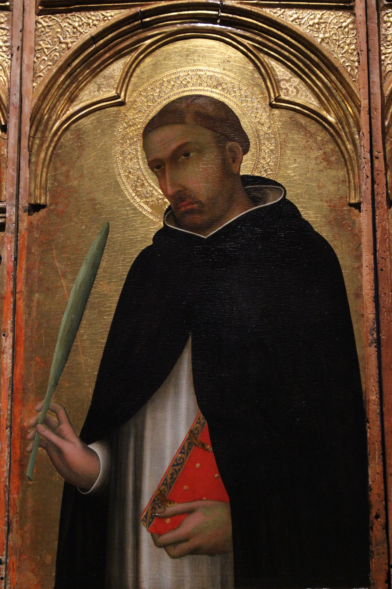
  <figcaption>Simone Martini, Polyptych of Santa Caterina: Saint Peter Martyr, c. 1319–1320. Tempera and gold on panel. Pisa, Museo Nazionale di San Matteo. Photo: Miguel Hermoso Cuesta, <a href="https://creativecommons.org/licenses/by-sa/4.0/">CC BY-SA 4.0</a>, via Wikimedia Commons.</figcaption>
</figure>

The panel at the far right of the altarpiece shows Saint Peter Martyr, the Dominican friar of Verona who was murdered by heretics in 1252 and canonised the following year. With Dominic at the opposite end, he frames the altarpiece with the two saints of the order, the founder and the first martyr.

Peter is shown in the black mantle and white habit of the Dominicans, with a tonsure of brown hair. At the top of his head, a thin red line marks the wound of the blow that killed him. In many later images the weapon itself is shown embedded in his skull, but here the wound is indicated with discretion, almost as a sign rather than a narrative detail.

His face, with a short dark beard and heavy-lidded eyes, is inclined to the left, towards the centre of the altarpiece. His expression is sombre and melancholy, perhaps the most serious of all the saints in the main register.

In his right hand he holds a long green palm of martyrdom, which rises diagonally against the gold ground. In his left he holds a red book with a gold-patterned border against his white habit. The palm signifies his martyrdom, the book his preaching against heresy, which was the cause of his death.

The black of the mantle creates a strong silhouette against the gold, as in the figure of Dominic, and the white of the habit and the red of the book stand out sharply against it. The colour scheme mirrors that of Dominic and creates a symmetry between the two ends of the altarpiece.

The modelling of the face is particularly fine. The beard is painted with soft, short strokes, and the flesh tones show the greenish underlayer characteristic of Sienese painting. The heavy-lidded eyes and the downturned mouth give the face a psychological depth that sets it apart from the more idealised saints.

The panel is well preserved, though the gold ground shows craquelure and some reddish losses, particularly on the left. The black of the mantle and the green of the palm retain their intensity.

Peter Martyr was a saint of particular importance for the Dominicans of the early fourteenth century, who promoted his cult as a model of the preacher who defends the faith even unto death. His presence at the end of the altarpiece, balancing the founder, completes the Dominican programme of the work and gives it a militant as well as a contemplative character.

#### The Predella: Introduction

The predella of the Santa Caterina polyptych runs beneath the seven main compartments and contains fifteen half-length figures, set in pairs or, at the centre, in a group of three under gilded trefoil arches. The arches rest on small twisted colonnettes with foliate capitals, and the spandrels between them are filled with raised and gilded vine scrolls. The figures are painted on a gold ground tooled with punched haloes, and many retain jewelled details applied in relief. The following entries describe the seven predella panels in turn, from the centre outwards.

#### The Man of Sorrows between the Virgin and Saint Mark

<figure>
  
  <figcaption>Simone Martini, Polyptych of Santa Caterina, predella: The Man of Sorrows between the Virgin and Saint Mark, c. 1319–1320. Tempera and gold on panel. Pisa, Museo Nazionale di San Matteo. Photo: Miguel Hermoso Cuesta, <a href="https://creativecommons.org/licenses/by-sa/4.0/">CC BY-SA 4.0</a>, via Wikimedia Commons.</figcaption>
</figure>

The central panel of the predella is the only one with three figures, and it occupies the axis of the whole altarpiece, directly beneath the Virgin and Child of the main register and directly above the altar table. It shows the dead Christ standing in his tomb, the image known as the Man of Sorrows or *Imago Pietatis*, flanked by the Virgin and Saint Mark.

Christ appears naked to the waist, emerging from a tomb whose front is painted in imitation of green veined marble. His head is bowed, his eyes closed, and his long auburn hair falls over his shoulders. His arms are crossed over a white shroud that covers the edge of the sarcophagus, and the wounds of the nails in his hands and the wound in his side are visible. The body is modelled with soft gradations of greenish flesh tones, and the musculature of the chest and arms is rendered with a restrained naturalism.

The image belongs to a devotional type of Byzantine origin that spread rapidly in Italy in the late thirteenth and early fourteenth centuries. It does not illustrate a moment of the Gospel narrative but presents Christ as both dead and present, an object of contemplation for the faithful and an image of the sacrifice renewed in the Mass. Its placement in the predella of a high altarpiece, directly behind the altar, is characteristic of the period and gave it a precise liturgical function.

On the left, the Virgin is shown in half length, wrapped in a deep blue mantle edged with gold over a dark red dress. A small gold star marks her shoulder. She turns towards her son with a face of contained grief, her brows drawn and her lips closed, and raises one hand to her breast while the other rests at her waist. Her gesture expresses sorrow and also directs the viewer's attention to the central figure.

On the right stands Saint Mark, identified by the head of his lion, which appears beside him at the lower edge of the panel. He is bearded, with thick dark hair, and wears a red mantle over a blue tunic. He holds a quill in one hand and an open book in the other, as if pausing in the act of writing his Gospel. His face, turned towards Christ, has a grave and attentive expression.

The pairing of the Virgin with an evangelist, rather than with Saint John as in the more common type, is unusual. It may reflect the requirements of the Dominican programme or the distribution of the saints across the predella as a whole. Mark is the only evangelist whose identity is secured here by his symbol, and his presence beside the Virgin gives the scene the character of a meditation on the Passion as recorded in the Gospel.

The three figures are separated by twisted colonnettes and framed by trefoil arches whose spandrels are filled with raised vine scrolls. The haloes are punched with fine patterns, and the gold ground has developed a network of craquelure. The colours, the deep blue of the Virgin, the red of Mark and the pale flesh of Christ, are among the most intense in the predella, and they create a strong focal point at its centre.

The panel is one of the most moving passages of the altarpiece. Its quiet, concentrated grief contrasts with the hieratic dignity of the saints above and anticipates the emotional intensity of Simone's later small Passion scenes, such as those of the Orsini polyptych. It is also one of the earliest monumental appearances of the Man of Sorrows in Sienese painting.

#### A Sainted Pope and an Evangelist

<figure>
  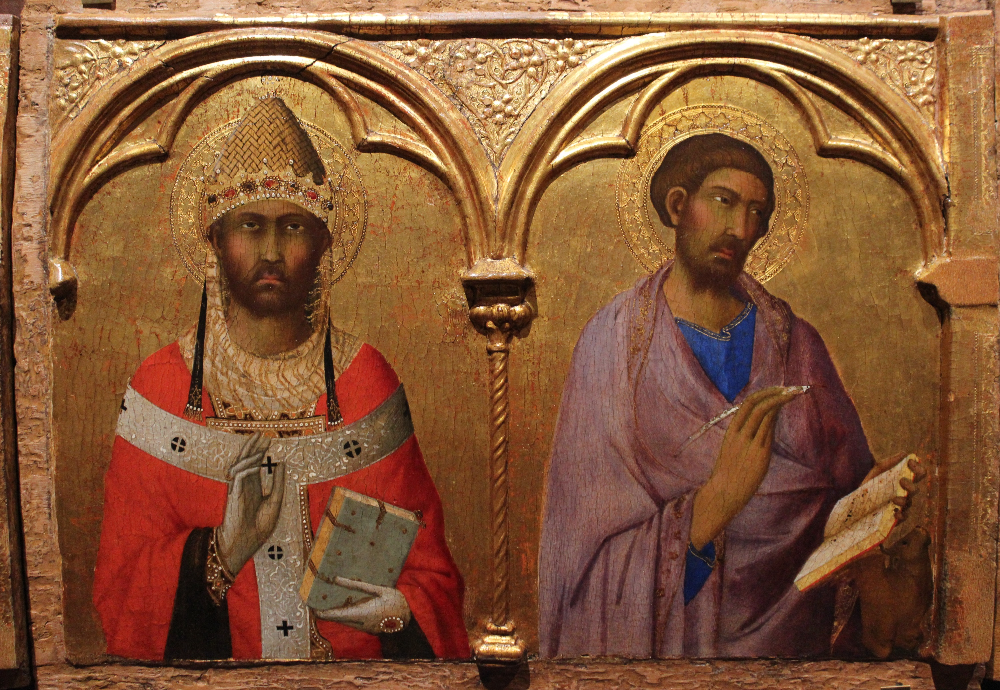
  <figcaption>Simone Martini, Polyptych of Santa Caterina, predella: A Sainted Pope (Gregory the Great?) and an Evangelist, c. 1319–1320. Tempera and gold on panel. Pisa, Museo Nazionale di San Matteo. Photo: Miguel Hermoso Cuesta, <a href="https://creativecommons.org/licenses/by-sa/4.0/">CC BY-SA 4.0</a>, via Wikimedia Commons.</figcaption>
</figure>

This panel pairs a sainted pope with a writing evangelist. Neither figure carries a visible inscription, and their identification rests on attributes and context. The pope is usually recognised as Saint Gregory the Great<a href="/endnotes.html#fn-gregory-the-great" class="footnote">21</a>, one of the four Latin doctors of the Church, and the evangelist, given the presence of Mark in the central panel, is probably Luke, John or Matthew, but no symbol is visible to confirm which.

The pope wears a tall conical tiara of woven gold, encircled at its base by a jewelled crown, the form of papal headdress current in the early fourteenth century. Lappets fall from it on either side of his face. He is dressed in a red chasuble with a jewelled collar and a white pallium marked with black crosses, the insignia of his archiepiscopal and papal authority. His hands are gloved in white.

With his right hand he blesses, and with his left he holds a book bound in green with metal clasps. His face, bearded and dark, is frontal and severe, with heavy-lidded eyes that gaze directly at the viewer. The combination of the book and the papal regalia fits Gregory, the author of the *Moralia* and the *Dialogues*, whose writings were fundamental to the preaching of the Dominicans.

The evangelist on the right is bearded, with short brown hair, and wears a purple mantle over a blue tunic. He holds a quill in his raised right hand and an open book in his left, and he turns his head to the left, towards the pope and the centre of the predella. His expression is thoughtful, as if he were considering the next words of his Gospel.

The two figures are differentiated by colour and pose. The pope is frontal, static and heavily dressed, a figure of authority. The evangelist is turned, lighter in colour and caught in an action, a figure of inspiration. This contrast between stillness and movement, between office and activity, runs through the predella and gives variety to what might otherwise have been a monotonous row of busts.

The textiles are rendered in detail. The woven pattern of the tiara, the jewelled crown and collar and the crosses of the pallium are painted with minute precision, and some of the jewels are raised in relief. The purple mantle of the evangelist falls in soft folds that show Simone's skill in modelling drapery at a small scale.

The panel has suffered some craquelure and minor losses, particularly in the gold ground and along the edges, but the figures are well preserved. The colours retain their brilliance, and the faces keep their individual characterisation.

The presence of a doctor of the Church in the predella of a Dominican altarpiece is appropriate. The Dominicans were an order of preachers and theologians, and the doctors of the Church, whose writings formed the basis of their teaching, were natural companions for the saints of the order represented elsewhere in the polyptych.

#### A Deacon Saint and a Female Saint with a Key

<figure>
  
  <figcaption>Simone Martini, Polyptych of Santa Caterina, predella: A Deacon Saint and a Female Saint with a Key, c. 1319–1320. Tempera and gold on panel. Pisa, Museo Nazionale di San Matteo. Photo: Miguel Hermoso Cuesta, <a href="https://creativecommons.org/licenses/by-sa/4.0/">CC BY-SA 4.0</a>, via Wikimedia Commons.</figcaption>
</figure>

This panel pairs a young deacon with a female saint holding a large key. Neither figure is identified by a visible inscription, and both identifications are uncertain. The deacon may be Saint Stephen or Saint Lawrence, the two great deacon martyrs, and the female saint, whose key is her only attribute, has no secure identification.

The deacon is young and beardless, with short hair cut in a tonsure. He wears a pale yellow dalmatic, the vestment of his order, with a high collar and cuffs embroidered in gold, and holds a red book against his chest with both hands. His face, inclined slightly to the left, has a gentle and pensive expression, and his eyes look out from beneath heavy lids.

The female saint is wrapped in a red mantle drawn over her head like a hood, framing her face. Beneath it she wears a blue dress, fastened at the breast by a gold quatrefoil brooch set with pearls. Her face, frontal and composed, has a grave dignity. With her right hand she gathers the edge of her mantle, and with her left she holds a large dark key with a ring-shaped bow.

The key is an unusual attribute for a female saint. It is traditionally associated with Saint Martha, the sister of Mary Magdalene, who was regarded as a model of hospitality and of the active life, and whose keys symbolised the management of the household. Martha's presence would be appropriate in a Dominican altarpiece that also gives prominence to her sister. The identification, however, remains a hypothesis.

The two figures contrast in colour and character. The deacon is pale and gentle, dressed in light tones, and turned slightly aside. The female saint is dressed in strong red and blue, frontal and steady, and her heavy key gives her an air of authority. Together they offer two images of service, liturgical and domestic.

The painting of the textiles shows the same refinement as the other panels. The embroidered borders of the dalmatic, the brooch with its pearls and the gold edge of the red mantle are rendered with precision, and the red of the mantle is one of the most vivid colours in the predella.

A crack runs through the upper part of the frame, but the painted surface has suffered little. The faces and draperies keep their original modelling.

The pairing of a deacon and a female saint is typical of the predella, which alternates male and female figures, clergy and laity, to create a balanced and varied assembly. Together with the other panels, it presents a microcosm of the Church in its different states of life.

#### A Saint in Chasuble and a Female Saint with an Ointment Jar

<figure>
  
  <figcaption>Simone Martini, Polyptych of Santa Caterina, predella: A Saint in Chasuble and a Female Saint with an Ointment Jar, c. 1319–1320. Tempera and gold on panel. Pisa, Museo Nazionale di San Matteo. Photo: Miguel Hermoso Cuesta, <a href="https://creativecommons.org/licenses/by-sa/4.0/">CC BY-SA 4.0</a>, via Wikimedia Commons.</figcaption>
</figure>

This panel pairs a bearded saint in liturgical vestments with a female saint holding a small jar. As in the other panels, the figures carry no visible inscription, and their identification depends on their attributes. The female saint's jar suggests the ointment jar of Mary Magdalene or of one of the holy women, while the male saint, without mitre or crozier in the visible part of the panel, remains unidentified.

The male saint is bearded, with grey hair, and wears a pale blue-grey chasuble over a silver-grey garment. A broad gold orphrey, set with red and blue jewels and white pearls in relief, runs down the front of the chasuble and forms a cross at the breast. He holds a red book in his gloved hands, a jewelled ring visible on one finger. A thin line behind his shoulder may belong to a staff or to the shaft of an attribute, now difficult to read.

His face, turned slightly to the right, has the heavy features and attentive gaze of an elderly priest or bishop. The silver-grey garment beneath the chasuble, painted with a fine pattern, may have been executed with metal leaf, now partly oxidised. The jewelled orphrey is one of the most richly decorated elements in the predella.

The female saint wears a jewelled band over a reddish headdress, a white wimple that frames her face and covers her chin, and a blue mantle over a deep red dress. With one hand she gathers a white cloth over her arm, and with the other she holds up a small dark jar with two handles. Her face, turned to the right, has a delicate, melancholy expression.

The jar is the attribute of the holy women who came to the tomb with spices to anoint the body of Christ, and above all of Mary Magdalene. Since the Magdalene already appears in the main register of the altarpiece, the figure here may represent another of the myrrh-bearing women, or the Magdalene herself repeated in a different context. The wimple, which gives her the appearance of a married woman or a widow, has also been considered in this connection.

The two figures are balanced in colour and pose. The pale tones of the male saint contrast with the blue and red of the female saint, and their heads turn in the same direction, creating a rhythmic movement across the panel.

The panel shows some losses and abrasions, particularly in the male saint's face and in the gold ground, and the silver-grey areas have darkened. The female saint is better preserved, and her face and draperies retain their delicacy.

The pairing of a priestly figure with a holy woman echoes the structure of the whole predella, in which clergy and women saints alternate. The presence of a myrrh-bearer near the Man of Sorrows also links the panel thematically to the central image of the dead Christ.

#### Saint Agnes and a Bishop Saint

<figure>
  
  <figcaption>Simone Martini, Polyptych of Santa Caterina, predella: Saint Agnes and a Bishop Saint, c. 1319–1320. Tempera and gold on panel. Pisa, Museo Nazionale di San Matteo. Photo: Miguel Hermoso Cuesta, <a href="https://creativecommons.org/licenses/by-sa/4.0/">CC BY-SA 4.0</a>, via Wikimedia Commons.</figcaption>
</figure>

This panel pairs Saint Agnes, identified by her lamb, with an unidentified bishop saint. Agnes was a Roman virgin martyr of the early fourth century, and her name was associated with the Latin *agnus*, lamb, which became her attribute. Her presence in the predella adds a further virgin martyr to the female saints of the altarpiece, alongside Catherine of Alexandria in the main register.

Agnes has auburn hair bound by a jewelled crown, and her head inclines to the left with a gentle, contemplative expression. She wears a pale rose mantle with a dark lining over a blue dress, and a jewelled collar set with a red stone. With one hand she holds against her breast an octagonal black medallion, on which a white lamb with a halo carries a banner with a red cross, the emblem of the Lamb of God.

The lamb is painted with delicacy. Its fleece is rendered with small white dots that give it a woolly texture, and it stands in profile against the dark ground of the medallion. The octagonal shape of the medallion and the banner give the attribute the character of an emblem rather than a living animal, linking Agnes to the sacrificial Lamb of Christ.

The bishop saint on the right is beardless, with a broad, slightly severe face. He wears a jewelled white mitre and a pale yellow chasuble with a broad gold orphrey set with red stones and pearls. In his gloved right hand, which bears a jewelled ring, he holds a crozier, and in his left a red book. No attribute identifies him, and he remains an unidentified bishop saint.

The contrast between the two figures is marked. Agnes is youthful, inclined and absorbed, her colours soft and warm. The bishop is frontal, upright and severe, his vestments heavy with gold and jewels. The juxtaposition sets the virgin martyr beside the pastor of the Church, two forms of sanctity represented throughout the predella.

The jewelled details of the panel, the crown of Agnes, the mitre and orphrey of the bishop and the rings on his gloves, are executed with raised gesso and applied colour, giving them a tangible relief. The haloes are punched with fine patterns.

Its condition is good, with only minor losses in the gold. The faces retain much of their delicacy, especially that of Agnes, whose melancholy expression is one of the most refined in the predella.

The figure of Agnes, with her inclined head and gentle melancholy, belongs to the type of female saint that Simone would develop throughout his career, from the saints of the Assisi chapel to the Virgin of the Annunciation. Her presence here shows how early that type had taken shape in his art.

#### A Crowned Martyr with a Banner and a Deacon Saint

<figure>
  
  <figcaption>Simone Martini, Polyptych of Santa Caterina, predella: A Crowned Martyr with a Banner (Ursula?) and a Deacon Saint, c. 1319–1320. Tempera and gold on panel. Pisa, Museo Nazionale di San Matteo. Photo: Miguel Hermoso Cuesta, <a href="https://creativecommons.org/licenses/by-sa/4.0/">CC BY-SA 4.0</a>, via Wikimedia Commons.</figcaption>
</figure>

This panel pairs a young crowned saint holding a banner with a young deacon. The crowned figure is generally interpreted as a female martyr, and the banner suggests Saint Ursula, the British princess martyred with her companions at Cologne, whose attribute was a banner of victory. The deacon may be Stephen or Lawrence, the second of the pair if the other deacon in the predella represents the first.

The crowned saint has fair hair gathered at the nape and wears a jewelled crown set with pearls, some of which have been lost. She wears a deep red mantle over a dark red garment decorated with a jewelled orphrey in the shape of a cross, its compartments filled with pearls and gold ornament. With her right hand she holds up a red banner crossed by a white band, and her left hand rests at her waist.

The banner is the key to the identification, but its colours do not correspond to the white banner with a red cross usually associated with Ursula. Red and white were also the colours of the Commune of Pisa, and it is possible that the banner has a local meaning. The identification as Ursula is therefore uncertain.

The deacon on the right is young and beardless, with short brown hair and a frontal, serious face. He wears a rose-coloured dalmatic patterned with small motifs and edged with embroidered borders at the collar, the cuffs and the hem. He holds a pale blue book against his chest with both hands. His figure is calmer and more frontal than that of his companion.

The two figures are contrasted in colour and attitude. The crowned martyr turns her head and raises her banner in a gesture of triumph, while the deacon stands still and holds his book. The red of the martyr's mantle and banner dominates the left half of the panel, while the rose of the deacon's dalmatic gives a softer tone to the right.

The textiles are painted with great care. The cross-shaped orphrey of the martyr's garment, with its pearls and jewels in relief, and the patterned dalmatic of the deacon, with its embroidered borders, show the same attention to costly fabrics found throughout the altarpiece.

The panel is well preserved, though some pearls of the crown have fallen away and the gold ground shows craquelure. The faces keep their modelling, and the colours retain their brilliance.

The pairing of a crowned martyr and a deacon completes the series of virgin martyrs and deacons in the predella. Together with Agnes and the deacon saint of the other panel, these figures form a chorus of young saints that surrounds the central image of the Man of Sorrows.

#### Saint Thomas Aquinas and a Bishop Saint

<figure>
  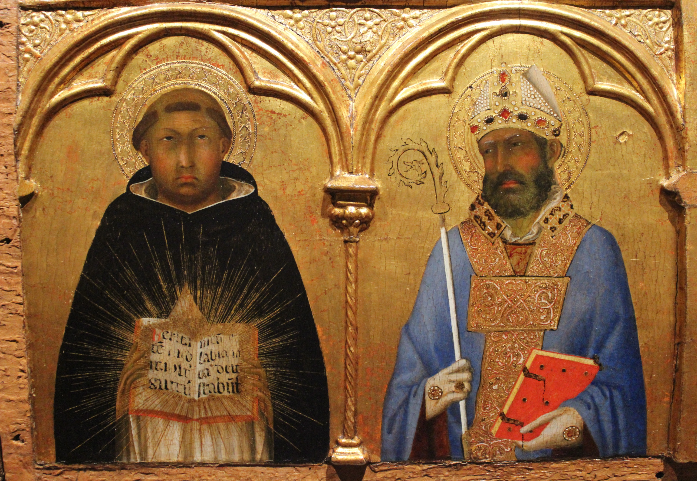
  <figcaption>Simone Martini, Polyptych of Santa Caterina, predella: Saint Thomas Aquinas and a Bishop Saint, c. 1319–1320. Tempera and gold on panel. Pisa, Museo Nazionale di San Matteo. Photo: Miguel Hermoso Cuesta, <a href="https://creativecommons.org/licenses/by-sa/4.0/">CC BY-SA 4.0</a>, via Wikimedia Commons.</figcaption>
</figure>

This panel pairs Saint Thomas Aquinas<a href="/endnotes.html#fn-thomas-aquinas" class="footnote">22</a> with an unidentified bishop saint. Thomas, the great Dominican theologian, is recognisable by his habit, his heavy build and above all by the radiant book that he holds, the emblem of his teaching. His presence in the predella is one of the most significant features of the altarpiece, since he was the most celebrated intellectual of the order to which the church belonged.

Thomas is shown as a stout, tonsured friar in the black mantle and white habit of the Dominicans. His face is broad and heavy, with small eyes and a closed mouth, and he looks out frontally with a grave and somewhat impassive expression. The portrait corresponds to the tradition of his physical appearance, which described him as corpulent and silent.

He holds an open book inscribed in Gothic script, from which golden rays radiate across his dark mantle like the beams of a light. The rays express the illumination that his writings brought to the Church. The text in the book is partly legible and appears to contain the words *labia mea* and *detestabuntur*, which suggests the verse of Proverbs, *veritatem meditabitur guttur meum et labia mea detestabuntur impium*, my mouth shall meditate truth and my lips shall hate wickedness, a text traditionally associated with Thomas. The reading has not been verified on the original.

The presence of a halo raises a question of chronology. Thomas was canonised by Pope John XXII<a href="/endnotes.html#fn-john-xxii" class="footnote">23</a> on 18 July 1323, a few years after the date traditionally given to the altarpiece. Either the predella was painted, or completed, after the canonisation, or the Dominicans of Pisa, who were actively promoting his cult, gave him a halo in anticipation of it. The question is open, and it bears on the dating of the polyptych as a whole.

The bishop saint on the right is bearded, with dark hair, and wears a jewelled mitre and a blue chasuble with a broad gold orphrey patterned with interlaced ornament. He holds a crozier in his gloved right hand and a red book in his left. No attribute identifies him with certainty, though in a Dominican context a doctor such as Augustine, whose Rule the Dominicans followed, would be an appropriate companion for Thomas.

The two figures contrast strongly in colour. The black and white of the Dominican habit, set against the gold rays, gives Thomas a striking graphic presence, while the bishop's blue and gold vestments provide a rich counterpart. Both figures are frontal and still, as befits doctors of the Church.

Apart from small losses at the edges and the usual craquelure of the gold, the panel is in good condition. The golden rays and the inscribed book are still clearly legible, and the faces keep their characterisation.

The image of Thomas Aquinas with the radiant book became the standard iconography of the saint in the following decades, culminating in the great *Triumph of Saint Thomas* painted for the same church of Santa Caterina later in the century. Simone's small figure in the predella is one of the earliest representations of this type, and it shows how the Dominicans of Pisa placed their great theologian at the heart of their high altarpiece.

### Virgin and Child over Saints Helen, Paul, Dominic, Stephen (?) and a Dominican Nun (Boston, Isabella Stewart Gardner Museum)

<figure>
  
  <figcaption>Simone Martini (and Lippo Memmi?), Virgin and Child over Saints Helen, Paul, Dominic, Stephen (?) and a Dominican Nun, c. 1325–1330. Tempera and tooled gold on panel, 33.4 × 25.4 × 4.4 cm with engaged frame (painted surface 28.4 × 20.1 cm). Boston, Isabella Stewart Gardner Museum, P30w8. Possibly from the convent of San Paolo, Orvieto. Photo: Isabella Stewart Gardner Museum, Boston (<a href="https://gardnermuseum.emuseum.com/objects/1948/virgin-and-child-over-saints">gardnermuseum.org</a>).</figcaption>
</figure>

This small panel in the Isabella Stewart Gardner Museum is one of the most intimate devotional images associated with Simone Martini. It shows the Virgin and Child in half length above a narrow predella in which five tiny figures stand beneath arches: four saints and, at the far right, a kneeling Dominican nun. Its size, about 33 by 25 centimetres including its engaged frame, made it suitable for private prayer, and the presence of the nun identifies it as a personal commission, made for a religious woman who wished to be remembered in her own image of devotion.

The history of the panel is short and partly reconstructed. Isabella Stewart Gardner bought it from the Florentine dealer Stefano Bardini on 6 October 1897 for 6,000 lire, as a work by Lippo Memmi, and under that name it remained in the museum's catalogues for most of the twentieth century. Its earlier history is unknown. The museum now records it as possibly coming from the Dominican convent of San Paolo at Orvieto, a hypothesis that rests on the presence of the Dominican nun and of Saint Dominic, and on the panel's affinities with the works that Simone and his workshop produced for Orvieto in the 1320s. A forthcoming study has proposed that the panel was painted for a Dominican nun of the Trasmondo family at San Paolo, a name that recalls Trasmondo Monaldeschi, the Dominican bishop traditionally identified as the donor of Simone's altarpiece for San Domenico in Orvieto. No document confirms either the provenance or the identity of the patron.

The attribution has moved between Simone and Lippo Memmi in a way that reflects the closeness of their workshops. Older catalogues gave it to Lippo; from the mid-twentieth century it was increasingly recognised as Simone's own work, and the museum now catalogues it under his name. Leone de Castris has assigned it to Simone and Lippo together, and the exhibition devoted to Simone's Orvieto works in Boston in 2022 presented it in the same way. The date varies accordingly: the museum gives about 1325, the 2022 exhibition about 1330, and the most recent proposal the first half of the 1320s. The attribution is therefore joint and uncertain, with a range of dates.

The Virgin occupies almost the whole height of the painted field. She wears a deep blue mantle edged with a fine gold border over a white veil and a red dress, and a gold star, the sign of the *Stella maris*, marks her shoulder. Her face is long and pale, with heavy-lidded eyes and a small mouth, and she inclines her head towards the Child with the grave tenderness characteristic of Simone's Madonnas. Her right hand, with long and slender fingers, rests beneath the Child's feet, while her left supports him from behind.

The Child sits on his mother's left arm, wearing a pale blue tunic, with a rose-pink mantle wrapped around his legs and gathered at his chest. With one hand he grasps a fold of the pink cloth, and his round face, framed by a richly punched halo, looks out at the viewer with a serious expression. The soft colours of his garments, blue and pink, contrast with the deep blue of the Virgin's mantle and give the group a delicate harmony.

The gold ground is framed by broad bands of punched decoration, with lozenges and quatrefoils arranged in vertical and horizontal strips that run around the figures like a woven border. The haloes are tooled with equal refinement. This dense punchwork, which turns the gold into a field of ornament, is one of the most striking features of the panel and connects it with the decorative vocabulary of Simone's workshop in the 1320s.

The predella beneath the Virgin consists of five arches resting on twisted colonnettes. From left to right it shows a crowned female saint holding a cross, identified as Saint Helen, the mother of Constantine and the finder of the True Cross; Saint Paul with his sword; Saint Dominic in the black and white habit of his order, with a lily and a red book; a young deacon in a red dalmatic holding a book, probably Saint Stephen; and, at the far right, a nun in a black habit, kneeling in profile with her hands raised in prayer. The figures are tiny but painted with precision, and Dominic occupies the central arch, directly beneath the Virgin, underlining the Dominican character of the image.

The kneeling nun is the key to the panel's meaning. Placed among the saints but distinguished from them by her posture and by the absence of a halo, she presents herself as the owner and patron of the image, asking those who see it to remember her in their prayers. The combination of a monumental half-length Madonna with a miniature predella of saints and a donor is an inventive solution for a small devotional panel, and it shows how Simone and his workshop adapted the language of large altarpieces to the needs of individual piety, a development that would become central to Sienese painting in the following decades.

### The Polyptych of Santa Maria dei Servi, Orvieto (Boston, Isabella Stewart Gardner Museum)

<figure>
  
  <figcaption>Simone Martini and workshop, Virgin and Child with Saints Paul, Lucy, Catherine of Alexandria and John the Baptist, c. 1320–1325. Gold and tempera on panel, 131 × 274.3 cm overall (central panel 99 × 60.7 cm without pinnacle; side panels about 86.3 × 42.5 cm each). Boston, Isabella Stewart Gardner Museum, P15e4.1-5. From the church of Santa Maria dei Servi, Orvieto. Photo: Isabella Stewart Gardner Museum, Boston (<a href="https://gardnermuseum.emuseum.com/objects/58/virgin-and-child-with-saints">gardnermuseum.org</a>).</figcaption>
</figure>

#### History, Patronage and Meaning

The polyptych in the Isabella Stewart Gardner Museum is Simone Martini's largest surviving work outside Italy and one of the earliest altarpieces in an American collection. It consists of five panels, the Virgin and Child at the centre flanked by Saints Paul, Lucy, Catherine of Alexandria and John the Baptist, each crowned by a pinnacle with a half-length figure: the blessing Christ above the Virgin and four angels above the saints. Although it has lost its predella and the outer elements of its carpentry, it preserves its five principal panels with their pinnacles, and it remains one of the most complete of the polyptychs that Simone and his workshop painted for Orvieto in the 1320s.

For much of the twentieth century the altarpiece was thought to come from the Franciscan church of San Francesco at Orvieto. Documents published in 1986 established instead that it came from the Servite church of Santa Maria dei Servi in the same city, where it was recorded in the sacristy by 1671. The museum now describes it as probably painted for the high altar of the Servite church. The Servites, an order devoted to the Virgin, were among the mendicant communities that gave Orvieto an exceptionally rich artistic life in these years, and the inscription AVE MARIA GRATIA PLENA beneath the central panel suits an altarpiece made for them.

The later history of the polyptych is recorded in detail. In 1851 it was bought from Santa Maria dei Servi by Leandro Mazzocchi, and it passed by descent in his family. From about 1860 it was on loan to the Museo dell'Opera del Duomo in Orvieto. In April 1899 Isabella Stewart Gardner bought it from the Mazzocchi family for £500, through an agent. With a smaller panel bought two years earlier, it was among the first works by Simone to enter an American collection.

The commission is not documented, and the date must be established on stylistic grounds. The museum gives about 1320, and other proposals range from 1321–1322 to 1323–1325, while the exhibition devoted to Simone's Orvieto works in Boston in 2022 placed it around 1324–1325, in the mid or late 1320s. The altarpiece belongs in any case to the years between the Santa Caterina polyptych of Pisa, of 1319–1320, and the Annunciation of 1333, when Simone's workshop was producing a sequence of altarpieces for Orvieto.

The attribution has a long history. Early writers gave the altarpiece to Lippo Memmi, alone or working under Simone's direction. From the early twentieth century it was increasingly recognised as Simone's own, with varying degrees of workshop participation. Martindale catalogued it as by Simone and possibly his workshop, and Leone de Castris as by Simone and his workshop. Opinions differ above all on the lateral panels, some of which have been thought weaker than the Virgin and Child. "Simone Martini and workshop" is therefore the formula that best reflects the present consensus.

The programme combines the devotion of the Servites with saints of broad appeal. The Virgin and Child occupy the centre under the blessing Christ, who displays his wounds as the risen Lord and the judge of the world. On either side stand two apostolic and prophetic figures, Paul and John the Baptist, at the outer ends, and two virgin martyrs, Lucy and Catherine, beside the Virgin. The inscriptions on blue bands at the base name each figure: SCS PAULUS AP, SCA LUCIA V ET M, SCA CATHARINA V ET M and SCS JOHANNES BAPTA, the virgin martyrs identified by the formula *virgo et martyr*.

The pinnacles develop a theme of the Passion and the Last Judgement. Above the saints, four angels either blow trumpets, summoning the dead to judgement, or hold the instruments of the Crucifixion: the column and the scourges, the cross with the crown of thorns, the nails, the lance and the titulus. Together with the Christ showing his wounds above the Virgin, they turn the upper register into a meditation on salvation that complements the devotional image below.

The polyptych is closely related to the other works produced by Simone's workshop for Orvieto, in particular the altarpiece from San Domenico, now in the Museo dell'Opera del Duomo, and the dismembered polyptych from San Francesco. The comparison of these works has been central to the study of Simone's workshop, since they show the same models and the same punched motifs used by different hands, and the Boston polyptych has been described as a key work for understanding how the workshop operated and how its designs were repeated.

The altarpiece has undergone technical study and conservation in Boston, and the original carpentry has been examined in detail. These studies have shown that the panels preserve much of their original structure, including the twisted colonnettes and the trefoil arches, while the predella and the outer pilasters have been lost. The gold ground is worn in places, revealing the red bole beneath, and the blue of some draperies has darkened, but the principal figures remain well preserved.

The Boston polyptych is an important witness to Simone's activity in Orvieto, a city in which he and his workshop found a group of patrons among the mendicant orders. Its presence in Boston since 1899, the result of Isabella Stewart Gardner's early interest in the Sienese Trecento, has also made it one of the works through which Simone's art became known to an American public.

#### Description

The altarpiece is arranged in five panels of nearly equal width, the central one wider and taller. Each panel is framed by gilded twisted colonnettes supporting a pointed trefoil arch, whose spandrels are painted red and dark green with small motifs, and each is crowned by a tall triangular pinnacle containing a half-length figure. At the base of each panel a blue band carries an inscription in gold Gothic capitals. The gold ground of the panels and pinnacles is finely punched, especially around the haloes.

At the centre, the Virgin is shown in half length in a dark blue-green mantle edged with gold over a red dress and a white veil, a small star on her shoulder. The Child, in a pink tunic and a red mantle, sits on her left arm and reaches up to touch her chin, looking into her face with an expression of affection. The gesture, intimate and natural, recalls the Byzantine type of the Virgin of Tenderness and gives the central image a warmth that contrasts with the formality of the saints. Beneath them, the inscription reads AVE MARIA GRATIA PLENA.

In the central pinnacle, Christ appears in half length, his upper body bare and a purple mantle draped over one shoulder. He raises his right hand in blessing and shows the wounds in his hands and side. His face, framed by long auburn hair and a short beard, is frontal and grave.

On the far left stands Saint Paul, bald and bearded, in a blue-green tunic and a red and purple mantle. He holds a long sword, the instrument of his martyrdom, upright against his shoulder, and a green book bound with red clasps. His face is strong and individual, with a high forehead and a dark beard, and he looks to the right with a grave expression. The inscription beneath reads SCS PAULUS AP.

Next to him stands Saint Lucy, veiled in white, with a jewelled band on her brow. She wears a blue mantle sown with gold stars over a red dress and a yellow lining, and holds in her lowered hand a yellow object, possibly a lamp, the attribute associated with her name, which recalls light. Her face, pale and inclined to the right, has the melancholy grace of Simone's female saints.

To the right of the Virgin stands Saint Catherine of Alexandria, crowned and with red-gold hair, wearing a red mantle sown with small gold stars, an ermine collar fastened by a jewelled brooch, and a white dress. She holds a palm of martyrdom in one hand and a green book in the other, and at the bottom of the panel a fragment of her wheel is visible. Her face is frontal and composed.

On the far right stands Saint John the Baptist, with long unkempt hair and a dark beard, wearing a red mantle knotted at the chest over a garment of camel hair. He points upward with his right hand and holds a thin cross-staff with his left. His lean face and penetrating gaze give him the intensity of the prophet of the wilderness. The inscription reads SCS JOHANNES BAPTA.

The angels of the side pinnacles wear pink, blue and green robes. Their delicate colours and graceful poses balance the solemnity of the Christ in the central pinnacle and complete the vision of salvation that crowns the altarpiece.

#### The Virgin and Child with the Blessing Christ

<figure>
  
  <figcaption>Simone Martini, Polyptych of Santa Maria dei Servi: The Virgin and Child, with the Blessing Christ in the pinnacle, c. 1320–1325. Tempera and gold on panel, central panel 99 × 60.7 cm without pinnacle. Boston, Isabella Stewart Gardner Museum, P15e4. Inscribed AVE MARIA GRATIA PLENA. Photo: Isabella Stewart Gardner Museum, Boston, public domain, via Wikimedia Commons.</figcaption>
</figure>

The central panel of the Boston polyptych is the heart of the altarpiece and one of the most tender images of the Virgin and Child in Simone Martini's work. It is taller and wider than the lateral panels and rises to a pinnacle with the half-length figure of Christ. At its base, a blue band carries the words AVE MARIA GRATIA PLENA, the greeting of the angel Gabriel, which gave the image a particular resonance for the Servites of Orvieto, an order devoted to the Virgin.

The Virgin is shown in half length, wrapped in a very dark blue mantle over a white veil and a red dress, with a small gold star on her shoulder, the sign of the *Stella maris*. Her face is long and pale, with heavy-lidded eyes and a small mouth, and she inclines her head towards the Child. Her expression is grave and inward, as if she were contemplating the destiny of her son even in a moment of tenderness.

The Child sits on his mother's left arm, wearing a pink tunic and a red mantle wrapped around his legs. He looks up into her face and reaches up with his right hand to touch her chin, while his left rests on her hand. The gesture is one of the most natural and affectionate in Sienese painting, and it belongs to the tradition of the Virgin of Tenderness, the Byzantine image in which mother and child express their mutual love.

With her right hand the Virgin holds a small spray of white flowers between her fingers. The flowers are usually interpreted as a symbol of her purity, and they may also allude to the Passion, a meaning reinforced by the figure of Christ in the pinnacle above. The Virgin's left hand, long and elegant, supports the Child's bare foot, which emerges from beneath his mantle.

In the pinnacle, Christ appears in half length against the gold, his chest bare and a red mantle over one shoulder. He raises his right hand in blessing and shows the wound in his left hand, and the wound in his side is also visible. He is the risen Christ and the judge of the Last Judgement, and his presence above the Virgin and Child links the image of the Incarnation to that of the Redemption.

Its trefoil arch and twisted colonnettes are those of the whole altarpiece. The gold ground is worn in many places, with the red bole visible beneath, especially around the figures. The dark blue of the Virgin's mantle has lost some of its depth, but the pink and red of the Child's garments retain their intensity.

The composition is built on the diagonal that links the faces of mother and child, from the Child's raised hand to the Virgin's inclined head. This diagonal, crossing the vertical axis of the panel, gives the image a movement that contrasts with the frontal figure of Christ in the pinnacle. The two registers thus express two aspects of the divine: intimate and human below, solemn and triumphant above.

The Virgin and Child of Boston is generally regarded as the part of the polyptych in which Simone's own hand is most evident. Its tenderness and its refined execution distinguish it from the lateral saints, some of which have been thought weaker, and it shows the painter at his most lyrical, transforming a traditional devotional type into an image of observed human affection.

### The Polyptych of San Domenico, Orvieto (Orvieto, Museo dell'Opera del Duomo)

<figure>
  
  <figcaption>Simone Martini, Polyptych of San Domenico: Virgin and Child with Saints Peter, Mary Magdalene, Paul and Dominic, with a kneeling Dominican bishop (Trasmondo Monaldeschi?), c. 1321–1325. Tempera and gold on panel, 113 × 257 cm. Orvieto, Museo dell'Opera del Duomo, from the church of San Domenico. Signed and dated, the date incomplete (MCCCXX…). Photo: Museo dell'Opera del Duomo, Orvieto, public domain, via Wikimedia Commons.</figcaption>
</figure>

#### History, Patronage and Meaning

The polyptych from the Dominican church of San Domenico in Orvieto, now in the Museo dell'Opera del Duomo, is the only one of Simone Martini's Orvieto altarpieces that carries his signature. It shows the Virgin and Child flanked by Saints Peter and Mary Magdalene on the left and Saints Paul and Dominic on the right, and a small kneeling bishop in the Dominican habit at the foot of the Magdalene. Although it has lost its original frame, its pinnacles and its predella, its five principal panels survive, and they make it one of the most important documents of Simone's activity in Orvieto in the 1320s.

The altarpiece was painted for the Dominicans of Orvieto, one of the most powerful communities of the order in central Italy and closely connected with the papal court, which resided in the city on several occasions in the thirteenth century. The choice of Saint Dominic at the right end of the altarpiece declares its destination, and the presence of Peter and Paul, the princes of the apostles, links the Dominican community to the Roman Church that it served.

The kneeling donor is traditionally identified as Trasmondo Monaldeschi, a Dominican friar of a leading Orvietan family who was appointed bishop of Sovana on 10 May 1312. The identification rests on tradition and on the context of the commission rather than on an inscription naming him, and it remains uncertain. If correct, it would make the altarpiece a work commissioned by a member of the local nobility within the Dominican order, a common pattern in the patronage of the mendicant churches.

The signature and date survive, but the inscription is damaged. Only the first part of the date, MCCCXX, survives. Most scholars regard the date as incomplete, and the proposed completions range from 1320 itself, now the least favoured reading, to 1321, 1322, 1324 or 1325. The handbook statement that the polyptych is "dated 1320" is therefore inaccurate: the date is fragmentary and its completion is conjectural, and the formula "c. 1321–1325" reflects the present state of the question.

The altarpiece belongs to a group of works that Simone and his workshop produced for Orvieto in the same decade. They include the polyptych from the Servite church of Santa Maria dei Servi, now in the Isabella Stewart Gardner Museum in Boston, and a dismembered polyptych from San Francesco, of which the central Madonna remains in Orvieto. The comparison of these works has been central to the study of Simone's workshop, since they share models and punched motifs but differ in style and execution.

The differences in style between the San Domenico panels, more monumental and solid, and the more fluid and Gothic Boston polyptych have usually been explained by the growing role of Lippo Memmi and of other members of the workshop. The San Domenico altarpiece, with its signature, is generally considered the work in which Simone's own hand is most clearly present, although the division of hands in all these works remains a matter of connoisseurship.

The figures are larger in relation to their panels than in the Pisa polyptych, and they are set close to the picture plane, filling the arched fields almost to their edges. The effect is one of monumentality and directness. The faces are strongly individualised, and the saints have a weight and presence that recall the Assisi frescoes painted in the same years.

The polyptych has suffered considerably. The gold ground is worn in many places, revealing the red bole beneath, and the original frame, pinnacles and predella have been lost. The panels are now displayed side by side, without the carpentry that once unified them, and their present arrangement reflects a modern reconstruction. Despite these losses, the painted surfaces of the figures are relatively well preserved.

The presence of a donor at the foot of the Magdalene, rather than beneath the Virgin, is unusual and has been explained by the Magdalene's role as the model of the penitent sinner and as a saint particularly venerated by the Dominicans. The bishop places himself under the protection of the saint who, more than any other, embodied the hope of forgiveness, and through her he approaches the Virgin and Child at the centre.

The San Domenico polyptych occupies an important place in Simone's career. It is the signed anchor of the Orvieto group and the work against which the other altarpieces of the city are measured, and it shows the master at the height of his early maturity, working for a great mendicant order in a city closely linked to the papacy.

#### Description

The altarpiece consists of five panels, each with a half-length figure under a pointed trefoil arch on a gold ground. The central panel is wider and taller and rises to a gable. The panels are displayed side by side without their original frame, and the arches, carved in the wood and gilded, are the only surviving parts of their architectural decoration. The gold ground has lost much of its surface, and the red bole beneath is visible in many places.

At the centre, the Virgin is shown in half length in a blue mantle over a white veil and a dark dress. She holds the Child on her left arm and inclines her head towards him, while her right hand supports his bare foot. Her face is long and grave, with heavy-lidded eyes, and her expression is calm and inward. The blue of her mantle, though worn, retains much of its depth.

The Child sits upright on his mother's arm, his body partly wrapped in a red mantle that leaves his chest and one leg bare. With his right hand he touches his chest, and in his left he holds a small scroll inscribed in Gothic minuscule *Ego sum / lux m[undi]*, "I am the light of the world" (John 8:12). He looks out at the viewer with a serious expression. His round face and curly hair give him the natural appearance of an infant, while the scroll declares his divine nature in his own words.

On the far left stands Saint Peter, with grey hair and beard, in an orange mantle over which falls a white pallium marked with black crosses, the insignia of his authority as the first bishop of Rome. He holds the keys, his traditional attribute as the keeper of the gates of heaven, together with a red book, and his face is turned slightly to the right with an attentive and dignified expression. His figure has the solid presence characteristic of the saints of this altarpiece.

Next to him stands Mary Magdalene, wrapped in a red mantle drawn over her head, over a white veil and a dark dress. She holds an ointment jar in one hand and inclines her head to the right with a melancholy expression. At the lower edge of her panel, a tiny figure of a bishop kneels in prayer, wearing the Dominican habit and a mitre. This is the donor, usually identified as Trasmondo Monaldeschi.

To the right of the Virgin stands Saint Paul, bald and bearded, in a blue tunic and a brown mantle. He holds a sword, the instrument of his martyrdom, upright beside him, and a book whose edge is inscribed AD ROMANOS, identifying it as his Epistle to the Romans, the foundational text of Christian theology and one of the most studied by the Dominican preachers. His face, with its high forehead and dark beard, has a strong individual character.

On the far right stands Saint Dominic in the black and white habit of his order. He holds a stem of lilies, the symbol of his purity, in one hand and a red book in the other. His face, framed by a narrow tonsure, is turned slightly to the left, towards the centre of the altarpiece, and his expression is grave and contemplative.

Seen as a whole, the altarpiece presents a row of monumental figures of great dignity, set close to the viewer and united by the gold ground and the rhythm of the arches. The bright colours of the saints' garments, orange, red, blue and black, create a lively sequence across the panels, and the Virgin and Child at the centre, in blue and red, form the focus towards which the saints turn.

#### Mary Magdalene with the Kneeling Donor

<figure>
  
  <figcaption>Simone Martini, Polyptych of San Domenico: Mary Magdalene with a Kneeling Dominican Bishop (Trasmondo Monaldeschi?), c. 1321–1325. Tempera and gold on panel, 94 × 48.5 cm. Orvieto, Museo dell'Opera del Duomo. Photo: Museo dell'Opera del Duomo, Orvieto, public domain, via Wikimedia Commons.</figcaption>
</figure>

The panel of Mary Magdalene stands to the left of the Virgin in the San Domenico polyptych, and it is the most important of the lateral panels because it contains the image of the donor. The saint occupies almost the whole field, wrapped in a vermilion mantle that is the most intense colour of the altarpiece, while at her feet, in the lower right corner, a tiny bishop kneels in prayer. The panel thus unites the devotional image of a saint with the record of the commission.

The Magdalene's mantle is drawn over her head like a hood and falls in broad, simple folds over her shoulders and arms. Beneath it a white veil frames her face and covers her neck in soft pleats, and a grey-blue dress lined in black appears at the neck and at the opening of the mantle. The strong red of the mantle, the colour of love and of penitence, gives the figure an immediate visual force.

Her face is long and pale, with a straight nose, a small mouth and heavy-lidded eyes that look down and to the left. Her head inclines towards the Virgin at the centre of the altarpiece, and her expression is one of quiet melancholy. The face is close in type to the Magdalene of the Pisa polyptych, but here it is set in a broader and more monumental figure.

With her left hand the Magdalene raises a tall gilded ointment jar, shaped like a small hexagonal tower with a pointed lid and decorated with small red motifs. The jar, her traditional attribute, recalls the ointment with which she anointed the feet of Christ and the spices she brought to the tomb. Its architectural form makes it resemble a reliquary, and it is rendered with the precision of a goldsmith's object. Her right hand, with long and slender fingers, rests flat against the folds of her mantle.

At the lower right, almost beneath the jar, the donor kneels in profile with his hands joined in prayer. He wears a white mitre and a white chasuble patterned with small red motifs over a black habit, and a crozier rises beside him. The black of the habit identifies him as a Dominican friar, and the mitre and crozier as a bishop. He is the figure traditionally identified as Trasmondo Monaldeschi, bishop of Sovana.

The scale of the donor, a fraction of that of the saint, follows the medieval convention that measured figures by their spiritual rank. His position at the Magdalene's feet, beneath the jar she holds, gives the image a precise meaning. As the Magdalene once knelt at the feet of Christ, so the bishop kneels at hers, asking her intercession as the model of the forgiven sinner.

The panel has suffered losses, particularly in the gold ground, which is worn to the red bole in many places, and in the upper part of the arch. The vermilion of the mantle and the face of the saint, however, are well preserved, and the small figure of the donor remains legible in all its details.

The Magdalene of Orvieto is one of the most powerful female figures of Simone's early maturity. The simplicity of the red mantle, the melancholy face and the elegant gesture with the jar create an image of great dignity, and the presence of the donor makes the panel a document of the relationship between the Dominican patron and the saint he chose as his protector.

#### Saint Paul

<figure>
  
  <figcaption>Simone Martini, Polyptych of San Domenico: Saint Paul, c. 1321–1325. Tempera and gold on panel, 94 × 48.5 cm. Orvieto, Museo dell'Opera del Duomo. Photo: Museo dell'Opera del Duomo, Orvieto, public domain, via Wikimedia Commons.</figcaption>
</figure>

The panel of Saint Paul stands to the right of the Virgin in the San Domenico polyptych, balancing the figure of Peter at the opposite side and forming with him the pair of the princes of the apostles. Paul, the apostle of the Gentiles and the author of the epistles, was a natural presence in an altarpiece for an order of preachers, for whom his writings were the foundation of theological teaching.

Paul is shown in half length, bald with a fringe of dark hair at the back of his head and a long, full dark beard that falls over his chest. These features, fixed by a tradition reaching back to early Christian images, identify him at once. His high forehead and deep-set eyes give him the appearance of a thinker, and he looks to the left, towards the Virgin, with a grave and intent expression.

He wears a blue tunic with an embroidered neckline and a brown mantle edged with gold, draped over his left shoulder and across his body. The contrast between the cool blue and the warm brown gives the figure a sober harmony, very different from the brilliant red of the Magdalene on the other side of the Virgin.

With his right hand Paul holds upright a long sword, its blade painted in reddish brown, which rises along the left edge of the panel almost to the springing of the arch. The sword is the instrument of his martyrdom, for as a Roman citizen he was beheaded rather than crucified, and it became his standard attribute in the thirteenth century.

With his left hand he holds a closed book, whose edge carries the inscription AD ROMANOS. The words identify the book as his Epistle to the Romans, the most important of his letters and the text on which the theology of grace and salvation was founded. The inscription makes the attribute specific and reminds the viewer of Paul's role as the theologian of the Church.

The figure has the monumental presence characteristic of the San Domenico panels. Paul fills the arched field almost to its edges, his broad shoulders and heavy mantle set close to the picture plane. The face is strongly individualised, and the modelling of the beard, with its long strands and dark shadows, shows Simone's skill in rendering texture.

The panel has suffered considerably. The gold ground is heavily worn, with the red bole visible over much of the background, and the lower part of the panel is damaged and abraded. The face and the upper part of the figure, however, are well preserved, and the inscription on the book remains legible.

The Saint Paul of Orvieto is one of the strongest male figures in Simone's work. Its gravity and its intellectual intensity contrast with the gentler saints of the Pisa polyptych, and they show the painter adapting his figures to the character of each saint. In the context of a Dominican altarpiece, the image of Paul with his Epistle to the Romans presented the friars with the model of the preacher and the teacher of the faith.

### Madonna and Child with Angels and the Blessing Christ (Orvieto, Museo dell'Opera del Duomo)

<figure>
  
  <figcaption>Simone Martini, Madonna and Child with Angels and the Blessing Christ, c. 1320. Tempera and gold on panel, 165 × 57 cm. Orvieto, Museo dell'Opera del Duomo. Probably the central panel of a dismembered polyptych from the church of San Francesco, Orvieto; in a later Baroque frame. Photo: Museo dell'Opera del Duomo, Orvieto, public domain, via Wikimedia Commons.</figcaption>
</figure>

This panel in the Museo dell'Opera del Duomo at Orvieto shows the Virgin and Child beneath a pointed arch, with two angels in roundels and an upper register of three pinnacles containing the blessing Christ between two angels. It is usually identified as the central panel of a dismembered polyptych from the Franciscan church of San Francesco in Orvieto, the third of the altarpieces that Simone and his workshop painted for the mendicant orders of the city, together with the polyptych of San Domenico and that of Santa Maria dei Servi now in Boston.

Other panels have been associated with the same altarpiece, among them a Saint Catherine of Alexandria in the National Gallery of Canada in Ottawa and four roundels with prophets in the Petit Palais in Avignon. The reconstruction rests on style, dimensions and punched motifs rather than on documents, and it remains a hypothesis. The panel is dated around 1320 on stylistic grounds, close to the other Orvieto works, but no document records its commission.

The panel survives today in a Baroque frame of carved and gilded scrolls and acanthus leaves, added in the Baroque period, when the image was reused as an independent devotional painting. The frame transforms the medieval panel into an object of later piety and hides the original carpentry. The image within it, however, preserves its original structure: the gabled main field, the spandrels with roundels and the upper register with its pinnacles.

The Virgin is shown seated in half length, wearing a dark blue mantle over a deep red dress, with a jewelled collar at her neck and a white veil beneath her mantle. Her face is long and pale, and she inclines her head to the left with a grave and gentle expression. Her hands rest on her lap and around the Child, and their long fingers have the elegance characteristic of Simone's Madonnas.

The Child sits on his mother's right knee, wearing a white tunic with a red mantle wrapped around his legs. He looks out at the viewer with a serious, almost solemn expression, and holds a small scroll, the sign of his role as the Word of God. Unlike the affectionate Child of the Boston polyptych, he does not turn to his mother but addresses the faithful directly, and the image has a more formal and hieratic character.

In the spandrels above the arch, two small half-length angels appear in roundels, looking down towards the Virgin. In the upper register, the central pinnacle contains Christ in half length, in a red mantle over a blue tunic, blessing with his right hand and holding a closed book. On either side, two angels complete the celestial court: one, in white, joins his hands in prayer, the other holds an open book. The vertical sequence from Christ to the Virgin and Child expresses the relationship between the divine Word and his incarnation.

The panel is relatively well preserved. The gold ground is worn in places, and the dark blue of the Virgin's mantle has lost some of its depth, but the faces, the red dress and the Child's garments retain their colour. The punched haloes and the decoration of the spandrels show the refinement of the workshop's gilding.

The Orvieto Madonna with the Blessing Christ is an important witness to the production of Simone's workshop for the city. Compared with the Boston Virgin, more tender and intimate, and with the monumental San Domenico Virgin, it occupies an intermediate position: solemn and frontal, but with the refined line and delicate features that mark the work of the master and his closest collaborators. Its reuse in a Baroque frame also shows how a medieval altarpiece could survive the dispersal of its parts by becoming an independent object of devotion.

### Saint Catherine of Alexandria (Ottawa, National Gallery of Canada)

Image: <a href="https://artsandculture.google.com/asset/saint-catherine-of-alexandria-simone-martini/jQH-KhTbLlqKkA"><em>Saint Catherine of Alexandria</em>, National Gallery of Canada, Ottawa (Google Arts &amp; Culture)</a>

This half-length Saint Catherine of Alexandria, purchased by the National Gallery of Canada in 1956, is one of the few works by Simone Martini in a North American public collection outside Boston and Washington. The panel, painted in egg tempera with gold leaf and mordant gilding on wood, was originally a lateral compartment of a polyptych: its pointed trefoil arch, its gabled moulding and its proportions correspond closely to the side panels of the altarpieces that Simone and his workshop produced for Orvieto in the early 1320s.

The original context of the panel is uncertain. Its format and style place it among the Orvietan works of around 1320–1325, and it has been associated with the dispersed polyptych from San Francesco, whose central Madonna remains in Orvieto, as well as discussed with other altarpieces made for the city's mendicant churches. One study has read the figure as part of an Orvietan altarpiece conceived in the light of Franciscan mystical theology, while also observing that the panel shows signs of a composite construction. In the absence of documents, its precise provenance remains a matter of hypothesis rather than certainty.

Catherine is presented in half length against the gold ground, turned slightly to the right, with her head inclined and her eyes glancing sideways, a pose that suggests both modesty and attentive devotion towards a centre that is now lost. She wears a jewelled crown over red-gold hair, gathered in soft waves that frame the oval of the face, and her halo is enriched with finely punched motifs. The face, with its long nose, small mouth and narrow almond eyes, belongs to the refined female type that Simone developed in the Maestà and in the Pisa polyptych.

Her dress is a deep red-brown, closed at the neck by a jewelled band and fastened with a round brooch set with stones. Over it falls a dark mantle sprinkled with gold sprays and edged with a broad jewelled border, which opens to reveal a white lining. The contrast between the dark fabrics and the brilliance of the gold, the white and the coloured stones gives the figure the appearance of a princess, in keeping with the legend of the saint as the learned daughter of a king of Alexandria.

With her left hand Catherine holds the palm of martyrdom, which rises diagonally along the right edge of the panel, while her right hand gathers the folds of the mantle at her waist. Between the hands a small gilded element of pointed form is visible; its identification is unclear, and it may be a fragment of the spiked wheel, her usual attribute, or part of the ornament of the mantle. The movement of the hands, delicately articulated, leads the eye upwards towards the inclined head and the crown.

The arched field is crowned by a trefoil whose spandrels are decorated with punched and incised motifs, and the gold ground surrounding the figure is worked with the same care. The moulded gabled frame, although partly reworked, preserves the profile of the original carpentry and allows the panel to be imagined among the other compartments of a polyptych, where the saint would have stood beside other half-length figures under similar arches, turned towards the Virgin and Child at the centre.

The quality of the execution, particularly in the modelling of the face and in the treatment of the hair and crown, places the panel close to Simone's own hand, although the collaboration of the workshop in subsidiary parts cannot be excluded, as was usual in polyptychs of this size. The gentle melancholy of the expression, the sinuous contour of the shoulders and the precious materials show the qualities of Simone's painting in these years.

The Ottawa Saint Catherine thus belongs to the group of dispersed panels that document the activity of Simone and his workshop in Orvieto in the early 1320s. Separated from its altarpiece and transformed into an independent image, it allows a close view of a single saint whose elegance and composure condense, on a small scale, the ideal of courtly holiness that Simone gave to the female saints of his polyptychs.

### Four Roundels with Prophets (Avignon, Musée du Petit Palais)

Four small panels in the Musée du Petit Palais in Avignon preserve the heads of four Old Testament figures, each enclosed in a gilded roundel. Painted in tempera and gold on wood, they are attributed to Simone Martini and dated around 1320–1325. The museum acquired them in 1982 (1983 in some sources) from the Matthiesen Gallery in London, where they had been presented as three heads of prophets and a head of David. Their arrival in Avignon gave the city that had welcomed Simone in the last years of his life a group of works from his Italian maturity, painted more than a decade before his departure for the papal court.

In the year of the acquisition, a study published in the journal of the French national museums proposed that the roundels came from the polyptych painted by Simone for the church of San Francesco in Orvieto. According to this reconstruction, the altarpiece included the Madonna and Child with Angels and the Blessing Christ now in the Museo dell'Opera del Duomo in Orvieto and the Saint Catherine of Alexandria now in the National Gallery of Canada in Ottawa. The four prophets would have occupied the upper parts of the structure, perhaps the spandrels or the pinnacles above the lateral compartments, where Sienese polyptychs often placed small figures of prophets, patriarchs and angels.

The proposal is attractive because it places the roundels in the Orvietan phase of Simone's activity, in the years when he and his workshop provided altarpieces for the Dominicans, the Franciscans and the Servites of the city. Without documents, however, the reconstruction remains a hypothesis based on style, technique and dimensions. The relationship between the Avignon panels, the Orvieto Madonna and the Ottawa saint must therefore be regarded as probable rather than proven, and other altarpieces of the same period cannot be completely excluded.

The identification of the figures is also tentative. The four heads have been read as Jeremiah, Ezekiel, Jacob and David, but only David can be recognised with certainty, thanks to his royal crown. The other three lack inscriptions or attributes that would allow a secure identification, and their names derive from the logic of prophetic cycles rather than from visible evidence. In medieval altarpieces, such figures announced the Incarnation and the coming of Christ, and their placement above the saints linked the Old Testament promise to the New Testament fulfilment represented in the main register.

Each panel follows the same scheme. A roundel with a narrow green border is inscribed in a roughly square piece of wood whose corners have been left unpainted, suggesting that they were originally covered by the carpentry of the frame. Inside the roundel, the head and shoulders of the prophet are set against a gold ground, with a halo tooled with punched motifs. The figures turn in different directions, so that the four heads, when placed together, form a varied sequence of gazes and attitudes.

The condition of the panels shows the effects of time. Much of the gold has worn away, revealing the red bole beneath, especially in the haloes, and a fine network of cracks runs across the gold and the flesh. The faces, however, are well preserved, with their green underlayer showing through the warmer flesh tones in the manner typical of Sienese tempera painting. The hair and beards retain the fine strokes that define each lock.

Despite their small size, the roundels are of high quality. The modelling of the faces, the intensity of the eyes and the varied treatment of hair and beards show the same hand that painted the prophets of the Pisa polyptych and the half-length figures of the Orvieto altarpieces. Each head is characterised individually: old or mature, bald or curly-haired, frontal or in profile. This variety turns a conventional series of prophets into a gallery of distinct personalities.

The Avignon roundels thus document a part of Simone's altarpieces that is usually lost when polyptychs are dismembered. The small figures of the upper registers, often cut out and sold separately, rarely survive together. Here four of them remain united and allow a close look at the care that Simone gave even to the smallest elements of his altarpieces, where the solemnity of the prophets is expressed through individually characterised faces.

#### Prophet with a Long Grey Beard

The first roundel shows an elderly prophet, bald except for a ring of grey curls around the back of the head, with a long beard that falls in parallel locks over his chest. His body is turned slightly to the right, while his eyes glance sideways under heavy, contracted brows, giving the face a stern and concentrated expression.

He wears a blue mantle over a red tunic, and at the bottom of the roundel a hand appears, raised in a gesture of speech or admonition. The halo is decorated with a band of punched rosettes, one of the best preserved of the series, although the gold around it has largely worn away.

The furrowed forehead, the deep lines around the eyes and the precise rendering of the beard make this head one of the most powerful of the group. The type of the old prophet with a long beard recalls the figures of the Maestà frame and the prophets of the Pisa polyptych, showing how Simone repeated and refined his models across different works.

#### Prophet in Profile

The second prophet is shown almost in profile, turned to the left, with his eyes directed upwards and away from the viewer. His high, partly bald forehead contrasts with the dark curls at the back of his head, and a full dark beard frames the lower part of the face.

He wears a blue garment and a dark mantle with a thin gold border visible on the shoulder. The halo, with its punched decoration, has lost much of its gold, and the red bole beneath now dominates the background around the head.

The turn of the head gives the figure a sense of movement and suggests that in the original altarpiece he was directed towards the centre, probably towards the Virgin and Child or the Blessing Christ. The profile view, rare in Simone's small figures, shows his ability to vary the position of heads within a strictly limited format.

#### Prophet with a Dark Beard

The third prophet faces the viewer almost frontally, with his eyes turned slightly to the side. He has short dark curly hair receding from the forehead and a full, dark beard. His expression is calm but attentive, with raised brows that give the face a slightly questioning look.

He wears a red garment under a light mantle, and at the lower right a pale curved element may be the end of a scroll or part of the drapery. The halo, tooled with punched motifs, is heavily worn, and the panel shows a horizontal crack in the upper part of the wood.

Among the four heads, this is the one that most closely resembles the type of a mature apostle, and it shows Simone's capacity to give individuality to figures that, in the original setting, would have been seen only from a distance.

#### King David

The fourth roundel shows King David, the only figure of the series whose identity is certain. He wears a large gold crown set with blue and dark stones and pearls, which covers most of the halo and gives the head a strong vertical emphasis. His grey hair and beard are rendered with fine, wavy strokes.

David turns to the left and lifts his eyes upwards, with an expression of inspired contemplation that suits his role as the psalmist and ancestor of Christ. He wears a dark blue mantle with a gold border, of which only a small part is visible at the lower edge of the roundel.

The crowned David was a constant presence among the prophets of Sienese altarpieces, where he recalled the royal descent of the Virgin and of Christ. In this roundel Simone combines the splendour of the crown, rendered with the same care he gave to the jewels of his female saints, with a face of intense spiritual concentration.

### Saint John the Evangelist (Birmingham, Barber Institute of Fine Arts)

<figure>
  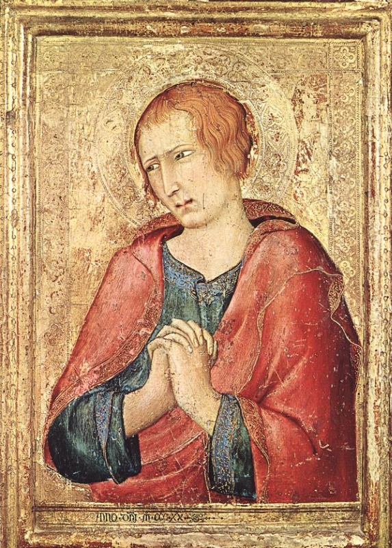
  <figcaption>Simone Martini, <em>Saint John the Evangelist</em>, inscribed with the date 1320 (inscription very probably spurious), tempera on wood, 41.7 × 30.3 cm. Birmingham, Barber Institute of Fine Arts. Photo: Barber Institute of Fine Arts, Birmingham, public domain, via Wikimedia Commons.</figcaption>
</figure>

This small panel in the Barber Institute of Fine Arts, University of Birmingham, is one of the most intimate works of Simone Martini. It shows Saint John the Evangelist in half length, mourning the death of Christ, and it preserves both its engaged frame and an inscription with the date along the lower edge. The panel bears no signature, but the attribution to Simone rests on the refinement of the colour, the elegant gold borders of the drapery and the delicate tooling of the gold ground, all characteristic of his art.

The panel originally formed the right wing of a small triptych. At the centre there would have been the dead Christ, probably shown as the Man of Sorrows, and on the left the grieving Virgin, so that the Evangelist completed a group of mourners around the body of Christ. The wings could be folded over the central panel, and the whole object could be carried and used for private devotion, including on journeys. One study has re-examined the panel as part of such an early portable triptych, placing it within the growing production of small devotional images for individual use in the early fourteenth century.

The inscription at the bottom reads ANNO DNI M CCC XX, giving the date 1320, but it is considered very probably spurious, and the panel has been dated on stylistic grounds as late as the second half of the 1330s. If the inscription were reliable, the panel would belong to the years of the Pisa polyptych and the Orvieto altarpieces, when Simone was at the height of his activity as a painter of panels.

John is shown as a young, beardless man with red-gold hair falling in soft locks around his face. His head inclines towards the left, where the dead Christ would have been, and his eyes, narrowed and red-rimmed, look downwards with an expression of deep sorrow. The furrowed brow and the slightly open mouth convey grief with a restraint that avoids exaggerated gestures, in keeping with the quiet, contemplative character of private devotion.

His hands are clasped in front of his chest, the fingers interlocked in a gesture of anguish and prayer. He wears a blue-green tunic with gold-embroidered borders at the neck and wrists and a large red mantle that wraps around his shoulders and falls in broad folds, lined with a darker red and edged with a gold border. The contrast between the cool tunic and the warm mantle gives the figure a strong chromatic presence within the small format.

The gold ground is tooled with an intricate pattern of foliage and punched motifs, which continues in the halo. The halo is decorated with fine radiating lines and punched ornaments, and its edge seems to overlap the tooled border of the background, creating the impression of a space behind the saint. The panel thus shows that even in a small devotional image Simone used the gold not only as a precious surface but as a means of suggesting depth.

The moulded frame, gilded like the panel, is part of the original structure and helps to explain its function. On the inner side it would have been joined to the central panel by hinges, and when closed the triptych would have protected the painted surfaces. The unity of frame, gold ground and inscription makes this panel one of the best-preserved examples of the portable devotional objects produced by Simone and his workshop.

The Birmingham Saint John shows Simone's ability to translate the emotional language of large altarpieces into the scale of private devotion. The figure's grief, expressed through the inclined head, the narrowed eyes and the clasped hands, invites the viewer to share in the mourning of the Evangelist before the dead Christ. In this small panel Simone anticipates the intimate devotional works of his later years, such as the Orsini polyptych, where the drama of the Passion is concentrated in small, precious images.

### Madonna and Child from Lucignano d'Arbia (Siena, Pinacoteca Nazionale)

<figure>
  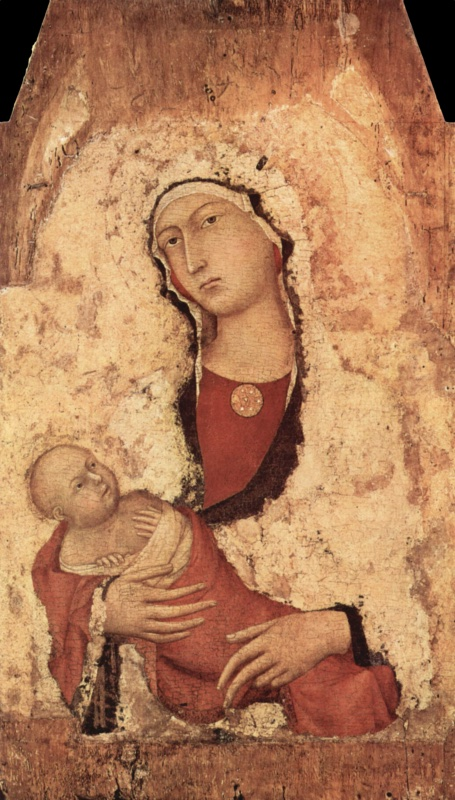
  <figcaption>Simone Martini, <em>Madonna and Child</em>, c. 1321, tempera on wood, 88 × 51 cm. Siena, Pinacoteca Nazionale (from the Pieve di San Giovanni Battista, Lucignano d'Arbia). Photo: Pinacoteca Nazionale di Siena, public domain, via Wikimedia Commons.</figcaption>
</figure>

This Madonna and Child comes from the Pieve di San Giovanni Battista at Lucignano d'Arbia, a small fortified village on the Via Cassia south of Siena, in the territory of Monteroni d'Arbia. The panel was discovered by chance in 1957 beneath a sixteenth-century repainting and is now on deposit in the Pinacoteca Nazionale of Siena, where it is shown with the other early works of Simone Martini. Although damaged, it is one of the most original images of the Virgin painted by Simone, and scholars agree on its attribution to him.

The history of the panel explains its condition. In the sixteenth century the image was covered with a new painting, and to make the new layer adhere, the gold of the background and the blue of the Virgin's mantle were scraped away. When the later paint was removed, the original surface emerged abraded and incomplete, especially in the mantle, the lower part and the background. The losses have been filled with a neutral tone, so that what survives of Simone's painting stands out clearly against the exposed preparation.

The panel was probably the central compartment of a polyptych, of which it is the only known fragment. Its gabled shape and proportions are consistent with this function, and attempts have been made to identify other parts of the altarpiece. A small panel with the <a href="https://www.museivaticani.va/content/museivaticani/en/collezioni/musei/la-pinacoteca/sala-ii---secolo-xiii-xv/simone-martini--il-redentore-benedicente.html">Redeemer Conferring a Blessing in the Pinacoteca Vaticana</a>, close in date and itself probably the upper part of a lost polyptych, has been proposed as its pinnacle, but the arguments for this connection are weak, and the original structure of the altarpiece remains unknown. The panel is generally dated in the early 1320s, the years of the Pisa and Orvieto polyptychs.

The iconography is unusual in Sienese painting. The Virgin turns her head to the right, rather than to the left as in most earlier images, and the Child is not shown as a small boy, the puer of the earlier tradition, but as an infant in swaddling clothes. The reasons for this choice are unknown: it may reflect a specific request by the patron, but no document survives to confirm it.

Mary is shown in half length, with her head gently inclined and her eyes looking out with a melancholy, distant expression. Her face, with its long straight nose, small mouth and almond-shaped eyes, is framed by a white veil whose edge follows the line of the face and falls on the shoulders. Beneath it, she wears a red dress fastened at the neck by a round gold brooch. The dark areas around the figure correspond to the lost blue mantle, of which only the underlayers remain.

On her right arm the Virgin holds the Child, wrapped in white swaddling bands and enveloped in a red cloth. The infant lies almost horizontally, his large round head turned upwards towards his mother, with wide open eyes and a slightly open mouth. His tiny hands emerge from the swaddling, one placed on the chest, the other near the edge of the cloth. The contrast between the swaddled body and the attentive face gives the Child a striking vitality.

The Virgin's hands are among the most beautiful parts of the panel. Her right hand supports the Child from below, with long fingers spread across the red cloth, while her left hand rests across her body, its slender fingers bent in a delicate gesture. The elongated hands, typical of Simone, add an elegance to the figure that contrasts with the simplicity of the image of the swaddled infant.

Despite its losses, the Lucignano Madonna shows Simone's capacity for invention. The reversed orientation of the Virgin, the swaddled Child and the intense exchange of glances between mother and son create an image of great intimacy, closer to the theme of the Nativity than to the traditional enthroned Virgin. The loss of the gold and of the blue, which deprives the panel of its original splendour, paradoxically draws attention to the faces and hands, where the quality of Simone's painting remains intact.

### The Portable Altarpiece for the Palazzo Pubblico (New York, Madrid and Los Angeles)

Three panels in the Metropolitan Museum of Art in New York, a Madonna and Child, a Saint Ansanus and a Saint Andrew, belong to one of the most unusual altarpieces painted by Simone Martini. The complete work had five panels of equal size, arranged from left to right as follows: Saint Ansanus and the Madonna and Child in the Robert Lehman Collection, Saint Peter in the Museo Nacional Thyssen-Bornemisza in Madrid, Saint Andrew in the Metropolitan's European Paintings department, and Saint Luke in the J. Paul Getty Museum in Los Angeles. All are painted in tempera on wood with a gold ground and are dated around 1326.

The structure of the altarpiece was exceptional. The central Madonna and Child was the same size as the lateral saints, instead of being larger as in the polyptychs of Pisa or Orvieto, and the panels were joined to one another so that the whole could be folded and carried. The panels were probably attached with leather straps. Each had a rectangular frame, a form rare at this date, and these frames are original: that of the Saint Luke is still engaged, while the others were detached and the panels cradled. The Getty panel also preserves its original back and sides, painted in imitation of porphyry, the costly purple stone associated with imperial and sovereign power.

The attribution of the five panels to Simone and their connection with the government of Siena were proposed in 1974 by one scholar. He suggested that they formed the altarpiece that Simone painted in 1326 for the Palazzo Pubblico, and that Lorenzo Ghiberti mentioned in his Commentaries in rather generic terms as "a very good altarpiece" in the palace. The proposal was not accepted by all specialists, and later archival research, which has been read in its support, has not settled the question.

The documents of the Commune record that between February and August 1326 "Maestro Simone" was paid thirty lire for "una tavola per tenere nel Palazzo del Capitano", a panel to be kept in the residence of the Capitano del Popolo, at a time when a fire had damaged part of the Palazzo Pubblico. In February 1327 a work of the same value was lent by the Commune to the residence of the Podestà and then returned to the Palazzo Pubblico. This second document shows that it consisted of several panels, including the Madonna and Child, Saint Peter and Saint Andrew, three of the subjects of the reconstructed altarpiece.

These records explain the portable form of the work. The altarpiece did not belong to a church but to the civic institutions, and it could be moved from one seat of government to another, accompanying the magistrates who held office for limited terms. The choice of saints reflected this civic function. Ansanus was the patron of the Commune and holds its black and white banner, the balzana, while according to one source the chapel of the Signori in the Palazzo Pubblico was initially dedicated to Saint Luke.

In the fifteenth century, when the Cappella dei Signori became the principal chapel of the palace and was decorated with frescoes by Taddeo di Bartolo and with inlaid choir stalls by Domenico di Niccolò dei Cori, Simone's panels became the central elements of a larger altarpiece on its altar. A new predella by Sano di Pietro was added beneath them. Records also mention that the old altarpiece was judged to be in a precarious state, and a commission was appointed to decide what should be done and at what cost.

The quality of the execution is uneven but generally very high. Parts of some panels have been assigned to assistants, while the Saint Luke is considered entirely by Simone's hand. The Madonna and Child is preserved in a near perfect state, while other panels have suffered: the purple cloak of Saint Ansanus has darkened, and the gold ground of several panels is worn. The names of the saints were originally inscribed on the gold ground, as can still be seen on the Saint Luke, which bears the inscription S. LVC[A] to the left of the halo and S EVLsTA to the right, to be read as S[ANCTUS] LVC[A]S EV[ANGE]L[I]STA, Saint Luke the Evangelist.

The altarpiece is a key document of Simone's relationship with the government of Siena, for which he had already painted the Maestà in the Sala del Consiglio and would paint other works for the Palazzo Pubblico. It shows how the forms of the large church polyptych could be adapted to a new function, combining the dignity of a sacred image with the practical needs of a mobile civic institution. The three New York panels, with their original frames, allow a close view of the refinement Simone brought to this unusual commission.

#### Madonna and Child

<figure>
  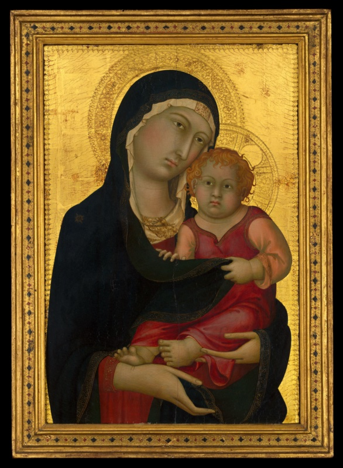
  <figcaption>Simone Martini, <em>Madonna and Child</em>, c. 1326, tempera on wood, gold ground, 58.7 × 39.4 cm (framed 67.3 × 48.3 cm). New York, The Metropolitan Museum of Art, Robert Lehman Collection (1975.1.12). Photo: The Metropolitan Museum of Art, New York</figcaption>
</figure>

The Madonna and Child formed the centre of the altarpiece. Unlike the central panels of Simone's large polyptychs, it is the same size as the saints that flanked it, and the Virgin is shown in half length, close to the viewer, with the Child in her arms. The panel is in good condition, and it allows the colours and the tooling of the gold to be appreciated almost as they appeared in the fourteenth century.

The Virgin wears a dark blue mantle, edged with a gold border, which covers her head and falls over her shoulders. A small gold star is visible on her right shoulder. Beneath the mantle, a white veil frames her face and a red dress appears at the neck and wrists, with a gold-embroidered neckline. The deep blue of the mantle, which occupies much of the panel, creates a strong contrast with the gold ground and with the warm red of the Child's tunic.

Mary's head is inclined towards her Son, and her face, with its long nose, narrow eyes and small mouth, has the melancholy expression typical of Simone's Virgins. She does not look at the Child but beyond him, as if meditating on his future Passion. Her cheek almost touches his head, creating a tender contact between the two figures.

The Child sits on her left arm, turned towards the viewer, with a round face, full cheeks and curly red-gold hair. He looks out with a serious, almost frowning expression that contrasts with his childish features. He wears a red tunic over a pink garment with transparent sleeves, and with his right hand he grasps the gold border of his mother's mantle, a gesture that recalls the intimacy of the Madonnas of Duccio's tradition.

The Virgin's hands are elongated and delicate. With her left hand she holds the Child from behind, her fingers visible against his red tunic, while her right hand, at the bottom of the panel, supports his bare feet. The Child's feet, rendered with careful attention to toes and soles, rest on the folds of red drapery that fall over her arm.

The gold ground is enriched with elaborate tooling. The Virgin's halo is decorated with complex punched motifs of foliage and rosettes, and the Child's halo, partly hidden behind her head, is tooled with similar care. Along the edges of the panel, a border of punched arcs runs parallel to the frame, a detail common to all the panels of the altarpiece.

The original frame is one of the most precious elements of the panel. Its mouldings are gilded and decorated with a band of small quatrefoils in dark blue and red, which runs around the four sides. This decoration, shared by the other panels of the series, contributed to the unity of the altarpiece when it was opened, and gave each panel the appearance of a precious object even when the altarpiece was folded.

The New York Madonna is one of the best preserved images of the Virgin painted by Simone. The intensity of the Child's gaze, the melancholy of the Virgin and the harmony of blue, red and gold characterise a work of Sienese painting of the 1320s, in which the refinement of Simone's style is combined with an intimate and direct relationship with the viewer.

#### Saint Ansanus

<figure>
  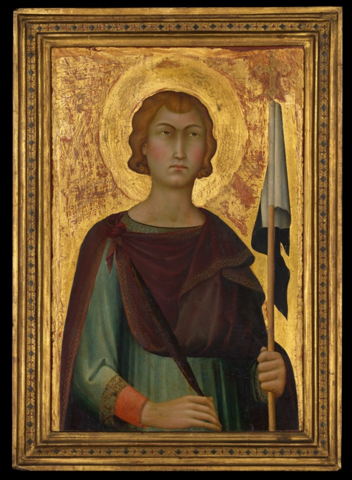
  <figcaption>Simone Martini, <em>Saint Ansanus</em>, c. 1326, tempera on wood, gold ground, 57.5 × 38.1 cm (framed 67.6 × 47.9 cm). New York, The Metropolitan Museum of Art, Robert Lehman Collection (1975.1.13). Photo: The Metropolitan Museum of Art, New York</figcaption>
</figure>

Saint Ansanus occupied the left end of the altarpiece. According to tradition, he was a young Roman nobleman who preached Christianity in Siena and was martyred in the early fourth century; he was venerated as the first evangeliser of the city and was the patron of the Commune. His presence in the altarpiece thus expressed its civic destination more clearly than any other figure.

The saint is shown in half length, facing the viewer, as a beardless young man with red-gold hair falling in soft curls around his face. His expression is grave and composed, with narrow eyes looking slightly to the side, a long straight nose and small closed mouth. The pink cheeks and the pale complexion give the face a delicate, almost courtly appearance.

He wears a green tunic with gold-embroidered borders at the neck and cuffs, beneath which appears a red undersleeve. Over it falls a dark purple cloak, knotted on his right shoulder with a red tie and edged with a gold border. The purple of the cloak has darkened over time, and the colour now appears deeper than it was originally, reducing the contrast with the green of the tunic.

In his left hand Ansanus holds a staff with the black and white banner of Siena, the balzana, which rises along the right edge of the panel. The way in which the saint grasps the staff, with his fingers closed firmly around it, shows the descriptive skill that Petrarch praised in Simone's painting. With his right hand, placed across his body, he holds the palm of martyrdom, which rises diagonally towards his left shoulder.

The banner is the key to the meaning of the image. By giving the saint the emblem of the Commune, Simone presented him not only as a martyr but as the protector of the city and its government. The same identification appears in the Annunciation of 1333, now in the Uffizi, where Ansanus appears in full length with the balzana; the New York panel is closely related to that figure.

The gold ground is more worn than in the Madonna, and the red bole beneath is visible in many areas, especially around the halo and in the upper part of the panel. The halo itself is plain, without the elaborate punching of the Madonna's, but it retains its burnished brilliance.

The original frame, with the same quatrefoil band as the Madonna's, has a rectangular form, rare in this period, that gives the figure the appearance of a portrait set within a window, a solution that anticipates later developments of the half-length devotional image.

The Saint Ansanus is a striking image of civic holiness. The young saint, with his firm gaze and the banner of the Commune in his hand, embodies the identity of Siena and its government. Within the altarpiece, he stood at the left end, facing the other saints and the Virgin, as the guardian of the city that had commissioned the work.

#### Saint Peter

<figure>
  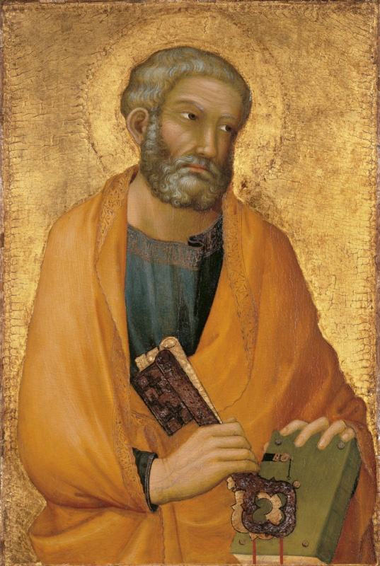
  <figcaption>Simone Martini, <em>Saint Peter</em>, c. 1325–1328, tempera and gold on wood, 58 × 38.5 cm. Madrid, Museo Nacional Thyssen-Bornemisza, Carmen Thyssen Collection (CTB.1997.20). Simone Martini. St. Peter, c. 1325–1328 © Colección Carmen Thyssen</figcaption>
</figure>

Saint Peter stood between Saint Ansanus and the Virgin, on the left side of the altarpiece. Together with Saint Andrew on the other side of the Virgin, he is one of the saints named in the document of 1327 that records the panels lent by the Commune, and his place next to the Madonna reflects his rank as prince of the apostles. The panel is now in the Carmen Thyssen Collection, on deposit at the Museo Nacional Thyssen-Bornemisza in Madrid.

Like the other panels, it disappeared from Siena after the end of the eighteenth century and reappeared on the market in the early twentieth century, when fragments of the altarpiece were often sold under the name of Lippo Vanni. The attribution to Simone, first proposed in the early twentieth century and later supported by further studies, is now widely accepted. The museum dates the panel to around 1325–1328, shortly before Simone's departure for Avignon, and connects it with the payment of 1326.

The museum's catalogue records the later history of the altarpiece in detail. After 1405 it was placed on the altar of the Cappella dei Signori. In 1448 a commission of three experts assessed its condition, and the restoration was carried out by Giovanni di Vicho di Magno and Sano di Pietro, who added a dais, a canopy, a new frame and the predella panels. The altarpiece remained on the altar until 1686, when it was dismantled and replaced by an altarpiece by Sodoma.

Peter is shown in half length, as an elderly man with short curly grey hair and a thick curly beard. His body is turned slightly to the left, while his head turns to the right and his eyes glance sideways, as if responding to a presence beyond the frame. The face, with its broad forehead, strong nose and deep-set eyes, has a vigorous, almost sculptural character, different from the more delicate types of the Virgin and Ansanus.

He wears a blue tunic with a gold-embroidered collar and a large orange-yellow mantle with gold borders, which wraps around his shoulders and falls in broad folds on both sides. The warm, luminous colour of the mantle dominates the panel and contrasts with the cool blue of the tunic. The pose of the right arm, wrapped in the mantle and bent across the body, was inspired by ancient sculpture.

In his right hand Peter holds two large keys, one gold and one silver, the keys that open and close the gates of paradise. The silver key, now darkened by oxidation, and the gold one cross each other in front of his chest, and the elaborate quatrefoil bow of one key hangs below his hand. These keys, the traditional attribute of the apostle, also allude to the power of binding and loosing entrusted to him by Christ.

His left hand rests on a closed book bound in green, with metal clasps and red ribbons hanging below. The book is placed on the lower edge of the panel, as if it rested on the frame itself, an invention that creates a sense of depth and projects the figure into the space of the viewer. Some details, especially the hands, may have been painted by a close collaborator, possibly the same who worked on the altarpiece of the Blessed Agostino Novello.

The gold ground and the halo are in poor condition, with extensive wear and cracking, but the border of punched segmental arches along the edges of the panel survives intact, and the format of the panel has not been altered. The Saint Peter thus preserves the essential elements of the series, and its powerful figure, with the sculptural arm and the illusionistic book, shows the inventive freedom with which Simone treated the half-length image of the apostle.

#### Saint Andrew

<figure>
  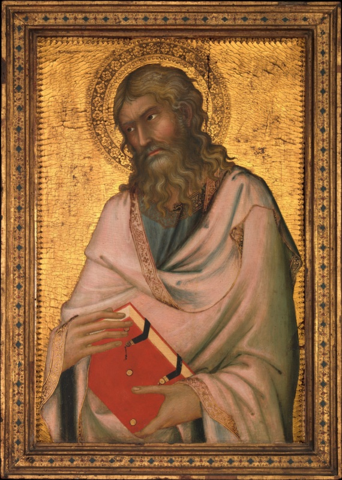
  <figcaption>Simone Martini, <em>Saint Andrew</em>, c. 1326, tempera on wood, gold ground, 57.2 × 37.8 cm. New York, The Metropolitan Museum of Art (41.100.23). Photo: The Metropolitan Museum of Art, New York</figcaption>
</figure>

Saint Andrew stood to the right of the Virgin, between the central panel and the Saint Luke. Like Peter, he is named in the document of 1327. The two brothers, the first apostles called by Christ, thus flanked the Virgin at the centre of the altarpiece.

Andrew is shown in half length, turned slightly to the right, with his head inclined and his eyes glancing sideways towards the centre of the altarpiece. He has long wavy hair, grey-brown and parted in the middle, falling on his shoulders, and a long beard divided into waving locks. The face, with its furrowed brow and intense gaze, conveys the gravity of an elderly apostle.

He wears a blue tunic with a gold-embroidered collar and a large pale pink mantle with gold borders, wrapped around his body in broad folds. The pink, modelled with grey-green shadows, creates a luminous surface that contrasts with the dark blue of the tunic and the deep red of the book.

With both hands Andrew holds a closed book bound in red, with metal clasps and studs, tilted diagonally across his body. His long fingers, spread across the cover and the edge of the book, are rendered with the same attention found in the hands of the Virgin and of Saint Ansanus. The book identifies him as an apostle and a witness of the Gospel.

The halo is decorated with rich punched motifs of rosettes and foliage, comparable to those of the Virgin's halo and much more elaborate than the plain halo of Ansanus. The gold ground, though worn in places, preserves much of its original brilliance.

The survival of its original frame, together with those of the Madonna and the Ansanus, allows the original appearance of the altarpiece to be reconstructed with unusual precision, and shows that its panels were conceived as a series of identical units.

The figure of Andrew shows Simone's ability to vary the type of the apostle within a fixed format. The movement of the head, the sideways glance and the diagonal of the book give the half-length figure a sense of life and spatial depth, while the refined colour harmony of pink, blue and red shows the elegance of Simone's palette in the mid-1320s.

#### Saint Luke

<figure>
  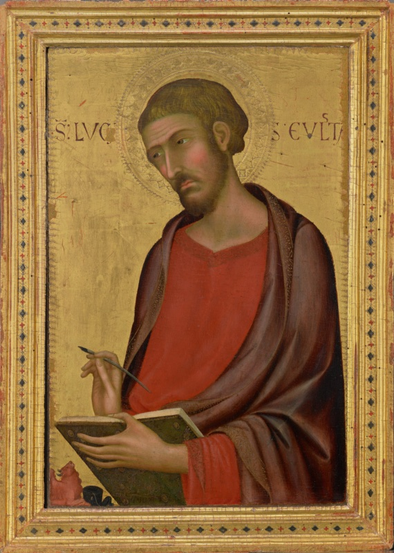
  <figcaption>Simone Martini, <em>Saint Luke</em>, c. 1326, tempera and gold leaf on wood, 67.5 × 48.3 × 3.8 cm (with engaged frame). Los Angeles, The J. Paul Getty Museum (82.PB.72). Photo: The J. Paul Getty Museum, Los Angeles</figcaption>
</figure>

The Saint Luke stood at the right end of the altarpiece, balancing the Saint Ansanus at the left. It is the only panel of the series whose frame is still engaged and whose porphyry-painted back and sides survive. It is also the only one in which the name of the saint survives on the gold ground. For these reasons it is the most complete witness to the original appearance of the altarpiece, and it is generally regarded as entirely by Simone's own hand.

Before its connection with Simone's altarpiece, the panel was attributed to Lippo Vanni, a Sienese painter of the following generation. Its present attribution rests on the quality of the execution and on its close relationship with the panels in New York and Madrid, with which it shares format, frame and punched decoration. The Getty dates it to the early 1330s, while the Metropolitan Museum dates the whole series to around 1326, in agreement with the documents of 1326 and 1327.

The inscription is divided by the halo: S. LVC[A] to the left and S EVLsTA to the right, with a small S written above the line. It reads Sanctus Lucas Evangelista. The letters, painted in dark pigment on the gold, are elegant Gothic capitals, and the abbreviation marks show the care with which the inscription was laid out to fit the space on either side of the head.

Luke is shown in half length, turned to the left, towards the centre of the altarpiece, with his head inclined and his eyes looking down towards the book. He has short brown hair and a short beard, with pink cheeks and a long straight nose. His expression is concentrated and slightly melancholy, appropriate to the evangelist absorbed in the writing of his Gospel. He appears as a man of mature age, younger than the Andrew of the same altarpiece.

He wears a red tunic with a gold-embroidered neckline and cuffs and a dark purple-brown mantle with gold borders, wrapped around his shoulders and falling in heavy folds on the right side of the panel. The warm red of the tunic and the deep tone of the mantle stand out against the gold ground, while the borders of the mantle, decorated with fine gold patterns, follow the movement of the drapery.

The saint is caught in the act of writing. In his right hand he holds a pen, raised above the open book that he supports with his left hand. The book, bound in green with metal studs, is tilted towards him, and his fingers are spread along its edge. The hands, long and articulated with great precision, are among the finest passages of the panel and show the same descriptive skill that appears in Ansanus' grip on his banner.

At the lower left corner, almost hidden at the edge of the panel, is the winged ox, the symbol of Luke, rendered in pink with its head turned upwards. The small animal holds the saint's inkpot, a detail that introduces a note of playful realism into the solemn image.

The engaged frame, gilded and decorated with a band of small quatrefoils in dark blue and red, is identical to those of the New York panels and confirms that all five panels were made as a series. Its survival, together with the porphyry-painted back and sides, shows that the altarpiece was conceived as a precious object to be seen from all sides when folded and carried. At the same time, the panel bears no marks of hinges or traces of other hardware that might show how it was joined to the others, so that the way in which the five panels were originally assembled and displayed remains an open question. The Saint Luke thus completes the series and gives the clearest idea of how the panels looked when they left Simone's workshop.

The five panels, three in New York, one in Madrid and one in Los Angeles, thus reconstitute one of the most original works of Simone's Sienese career: a portable altarpiece for the government of Siena, conceived as a sequence of half-length figures in identical frames, in which the Virgin and the protectors of the city accompanied the magistrates in the exercise of their office.

#### The Fifteenth-Century Predella by Sano di Pietro

When the altarpiece was restored in 1448, the Signori also commissioned Sano di Pietro to paint five panels with stories from the Life of the Virgin, to be placed as a predella beneath Simone's panels. Painted between 1448 and 1452 in tempera and gold on wood, they were modelled on the frescoes that Simone Martini and Ambrogio and Pietro Lorenzetti had painted a century earlier, so that the new additions paid homage to the masters of the Trecento. The panels have the same width as Simone's framed figures, a correspondence that allowed one scholar to identify them as the lost predella and made it possible to reconstruct the fifteenth-century altarpiece, with each narrative scene set directly beneath one of the half-length figures.

Following the course of the Virgin's life, the series opens with the Nativity of the Virgin, now in the University of Michigan Museum of Art at Ann Arbor, and continues with the Presentation of the Virgin in the Temple, in the Pinacoteca Vaticana. The Assumption of the Virgin, which in the reconstruction occupies the centre of the predella beneath the Madonna and Child, is in the Lindenau-Museum at Altenburg, as is the Return of the Virgin to the House of her Parents after her marriage. The Marriage of the Virgin, the fifth panel, is in the Pinacoteca Vaticana. Dispersed after the altarpiece was dismantled in 1686, these small narratives, each about 32 × 46 cm, are the only surviving witnesses to the setting in which Simone's panels were displayed in the Cappella dei Signori for more than two centuries.

### Painted Cross (San Casciano in Val di Pesa, Santa Maria del Prato)

<figure>
  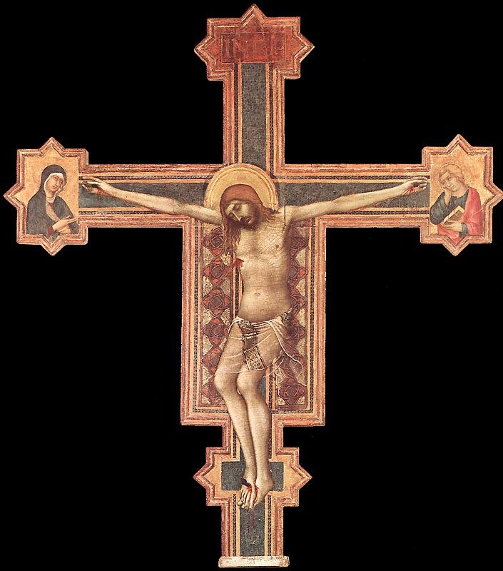
  <figcaption>Simone Martini, <em>Painted Cross with the Mourning Virgin and Saint John the Evangelist</em>, c. 1321–1325, tempera and gold on wood, 164 × 147 cm. San Casciano in Val di Pesa, Santa Maria del Prato (Chiesa della Misericordia). Photo: Santa Maria del Prato, San Casciano in Val di Pesa, public domain, via Wikimedia Commons.</figcaption>
</figure>

This painted cross is preserved in the church of Santa Maria del Prato at San Casciano in Val di Pesa, south of Florence, known locally as the church of the Misericordia because it belongs to the confraternity of that name. The church was built in the early fourteenth century by the Dominicans of Santa Maria Novella along the road linking Florence with Siena and Rome, and the cross has been kept there for as long as records exist. It was first published as a work of Simone Martini in the early twentieth century, and the attribution has since been accepted by almost all scholars. In his catalogue of Simone's paintings, Leone de Castris described it as one of the painter's least known works, unjustly so.

The original destination of the cross is uncertain. Some scholars believe that it was commissioned by the Dominicans of Santa Maria Novella for the church at San Casciano, while others have suggested that it was painted elsewhere and moved there later. The documents of the Commune of Siena record a payment to Simone on 31 December 1321 for a crucifix for the chapel of the Nine in the Palazzo Pubblico, a work completed by another painter and, according to the most recent dictionary entry, probably painted on the wall. It has been proposed that the San Casciano cross is that work, but the identification is disputed. The catalogue of the Italian state dates the cross between 1321 and 1325, while the restorers who recently treated it have proposed an earlier date, around 1315 and in any case not after 1320.

Between 2011 and 2019 the cross was restored at the Opificio delle Pietre Dure in Florence, after earlier interventions in 1935 and 1961. Because the paint layer is very fragile, it was cleaned under the microscope with a scalpel, a method that also made it possible to distinguish the layers added by earlier restorations, and the wooden support was consolidated. The restoration revealed a substantial uniformity of execution between the figure of Christ and the mourners in the terminals, which had often been attributed to pupils. The cross returned to San Casciano on 25 May 2019.

The cross is of moderate size and of a shaped Gothic form. The arms end in star-shaped terminals, and the vertical shaft is widened behind Christ's body by a rectangular panel. The surface of the cross is painted green, with borders in black and gold, while the panel behind the body is decorated with two bands of stylised red flowers forming chains, an ornamental motif that replaces the narrative scenes of older Tuscan crosses.

Christ is represented as the Christus patiens, the dead Christ of the Passion. His head falls on his right shoulder, his eyes are closed, and his face, modelled in light and shadow, is framed by long reddish hair and a halo of gold leaf. The ivory body hangs in a gentle curve, with the arms stretched along the cross bar and the legs bent, the feet nailed one above the other. Blood flows from the wounds in the hands, the side and the feet, standing out against the pale flesh.

The loincloth is a transparent veil, through which the body is visible, decorated with a dark hem and gold patterns. The delicacy of this detail, the elongated proportions of the body and the soft modelling of the chest show Simone's refined interpretation of the type of the suffering Christ developed in Siena by Duccio and in Florence by Giotto. The figure has been compared with the Christ of the Crucifixion in the Orsini polyptych in Antwerp and with the Man of Sorrows in the predella of the Pisa polyptych.

In the terminal on the left, the Virgin appears in half length, wrapped in a dark mantle, turning towards her Son with an expression of grief. In the terminal on the right, Saint John the Evangelist rests his head on his hand, in the traditional gesture of sorrow, and holds a book. The upper terminal bears the titulus with the letters I N R I, Iesus Nazarenus Rex Iudaeorum, while the lower terminal, below Christ's feet, completes the shaped profile of the cross.

The San Casciano cross is a significant example of his religious painting outside Siena. The restraint of the composition, the pathos of the dead Christ and the intimate grief of the two mourners show how Simone transformed the monumental tradition of the Tuscan painted cross into an image of contemplative devotion, close in spirit to the small Passion scenes of his later years.

### The Orsini Polyptych (Antwerp, Paris and Berlin)

The small folding altarpiece known as the Orsini polyptych is one of the most frequently discussed works of Simone Martini. Six of its painted panels survive, now divided between three museums. The Koninklijk Museum voor Schone Kunsten in Antwerp holds four of them: the Angel and the Virgin of the Annunciation, the Crucifixion and the Deposition. The Musée du Louvre in Paris holds the Carrying of the Cross, and the Gemäldegalerie of the Staatliche Museen in Berlin holds the Entombment. Each panel measures little more than twenty centimetres in height, and the whole work could be held, opened and closed by a single person.

The polyptych was painted on both sides and folded like a screen. When open, it displayed a sequence of Passion scenes, with the Crucifixion and the Deposition at the centre. When closed, the reverse presented the Annunciation in the centre, flanked by the coats of arms of the Orsini family, which also appear on the back of the Louvre panel. The small size and the double-sided painting indicate that the work was intended for private devotion, to be contemplated at close quarters and carried with its owner.

The work is signed. The Antwerp panels carry the words PINXIT and SYMONE on the lower frame, while the Louvre panel originally bore the words HOC OPUS, so that the complete inscription meant that Simone had painted the work. The signature beneath the Deposition is placed directly below the kneeling donor, linking the name of the painter with that of his patron.

The donor, who kneels at the foot of the cross in the Deposition, is usually identified as Cardinal Napoleone Orsini, a member of one of the most powerful Roman families and a cardinal at the papal court in Avignon. Napoleone Orsini, who died at the Curia in March 1342, was a prominent figure in the Church of his time, and his devotion to the Passion of Christ has been connected with the iconography of the polyptych. Petrarch records that Simone painted a portrait of the cardinal, now lost, which shows that the painter and the patron were in contact during Simone's years in Avignon.

The date of the polyptych is one of the most debated questions of Simone's career. Some scholars believe that it was painted in Avignon, where Simone and Napoleone Orsini were both present between Simone's arrival around 1335 and the cardinal's death in 1342. Others relate its style to Simone's works of the 1320s and early 1330s and date it before his departure from Siena, and one study has proposed a different member of the Orsini family as patron. The Antwerp museum currently dates the work to 1320–1330, while other proposals range from about 1333 to 1342.

The later history of the polyptych is better known. By the end of the fourteenth century it was probably in the Charterhouse of Champmol near Dijon, the foundation of the dukes of Burgundy, perhaps through the marriages that linked members of the Orsini family with the Burgundian nobility. In 1791 it was in the abbot's room at Champmol, when the monastery was suppressed and the work was dismantled and sold. In 1826 the Antwerp collector Florent van Ertborn bought the four panels in Dijon, and in 1841 he bequeathed them to the museum of his city.

The Paris and Berlin panels followed different paths. The Carrying of the Cross entered the Louvre, where its reverse still shows the Orsini arms, while the Entombment reached the Berlin museums. The Berlin panel has suffered more than the others: its gold ground was repainted in modern times with a dark sky and trees, so that its present appearance differs considerably from the brilliant gold backgrounds of the other scenes.

Despite its small size, the Orsini polyptych is a work of exceptional ambition. Its crowded compositions, its intense emotions and its descriptive richness are among the highest achievements of Simone's narrative art, and its presence at Champmol has been seen as one of the channels through which Simone's art influenced French and Burgundian painting. The panels show Simone at the height of his narrative power, concentrating in a few centimetres the drama of the Passion and the private devotion of a cardinal.

#### The Angel of the Annunciation

<figure>
  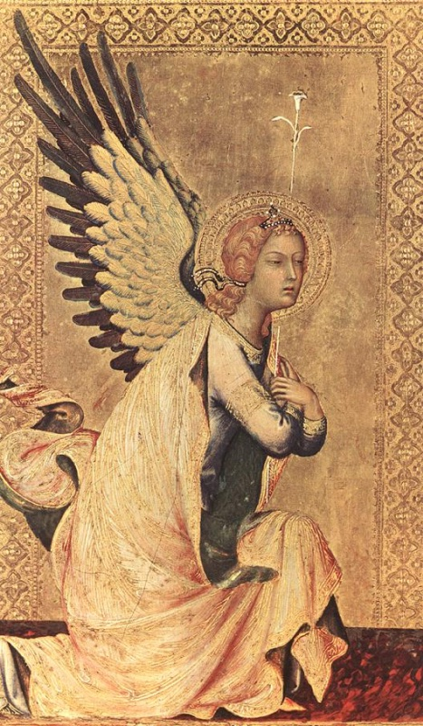
  <figcaption>Simone Martini, <em>The Angel of the Annunciation</em>, panel of the Orsini polyptych, tempera and gold on wood, 23 × 14 cm. Antwerp, Koninklijk Museum voor Schone Kunsten. Photo: Koninklijk Museum voor Schone Kunsten Antwerpen, public domain, via Wikimedia Commons.</figcaption>
</figure>

The Angel Gabriel kneels on a dark red floor against the gold ground, turned to the right towards the Virgin in the companion panel. He is shown in profile, with his body bent forward and his head slightly raised, in an attitude that combines the reverence of the messenger with the solemnity of the announcement. His golden hair is bound by a jewelled fillet, and his halo is finely punched.

His large wings, rendered feather by feather in a sequence of gold, green, blue and dark tones, rise behind him and fill much of the panel. The mantle, pale and patterned in gold, falls in ample folds over the floor and swirls behind him, as if he had just arrived; beneath it appears a blue-green tunic. The hands are crossed on the breast, and between them rises a slender lily stem, the symbol of the Virgin's purity, which ends in a flower above his head.

The gold ground is framed by a broad tooled border with quatrefoil motifs, which continues in the Virgin's panel and unites the two halves of the Annunciation. The refinement of the punching and the delicacy of the figure recall the angel of the great Annunciation of 1333 in the Uffizi, of which this small panel is in some ways a meditative, intimate variation.

Unlike the angel of 1333, however, this Gabriel does not speak: there is no inscription, and his crossed hands express adoration rather than proclamation. The moment represented is not the delivery of the message but the silent reverence that follows it, in keeping with the contemplative purpose of the polyptych.

The angel's face is shown in pure profile, with a rounded cheek, a straight nose, a small closed mouth and an eye fixed on the Virgin. The jewelled fillet that binds his hair is set with pearls, and its ribbons flutter behind his head, a small detail of movement that suggests the speed of his descent from heaven, now arrested in stillness.

The wings are among the most refined passages of the panel. Near the shoulders the feathers are short, overlapping and light in tone, rendered in gold, pale green and blue; towards the tips they lengthen and darken, ending in long black-blue pinions that rise to the upper edge of the panel. The careful gradation of colour gives the wings a sense of weight and volume that contrasts with the flat brilliance of the gold ground.

The mantle is painted in pale tones of ivory and rose, enriched with fine gold patterns that follow the folds of the fabric. Its lower part spreads over the floor in a broad curve, and at the left edge it swirls upwards in a loop that reveals its darker lining. The blue-green tunic, visible at the breast and sleeves, provides the only cool note in a figure otherwise dominated by warm colours.

Within the polyptych, the Annunciation marked the beginning of the story of redemption that culminated in the Passion. When the altarpiece was closed, the meeting of the angel and the Virgin, flanked by the arms of the Orsini, was the first image the owner saw; when it was opened, the Incarnation gave way to the suffering and death of Christ. The kneeling angel thus introduces the devout viewer into the sequence of meditation that the polyptych was designed to guide.

#### The Virgin of the Annunciation

<figure>
  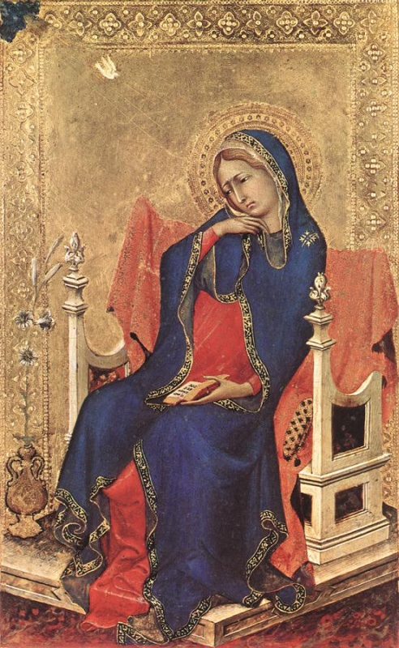
  <figcaption>Simone Martini, <em>The Virgin of the Annunciation</em>, panel of the Orsini polyptych, tempera and gold on wood, 24 × 15 cm. Antwerp, Koninklijk Museum voor Schone Kunsten. Photo: Koninklijk Museum voor Schone Kunsten Antwerpen, public domain, via Wikimedia Commons.</figcaption>
</figure>

The Virgin sits on a throne whose sides are formed by white pinnacled structures, covered by a red cloth that falls behind her. She wears a deep blue mantle with a gold border, which envelops her body and falls to the floor in rippling folds, and a red dress visible at the breast and on the lower part of the body. A small gold star appears on her right shoulder.

Her pose is unusual. Instead of recoiling in surprise, as in the Uffizi Annunciation, she rests her head on her right hand in a gesture of meditation, her eyes lowered and her expression melancholy. On her lap she holds an open book, marking her place with her fingers, as if interrupted in her reading. The gesture suggests that she is reflecting on the angel's words and, perhaps, on the future suffering of her Son, represented in the other panels of the polyptych.

At the upper left, a small white dove, the Holy Spirit, descends towards her against the gold ground. At the lower left, a precious vase holds a stem of lilies, repeating the symbol carried by the angel. The tooled border with quatrefoils continues from the angel's panel, confirming that the two figures formed a single scene.

The meditative Virgin of the Orsini polyptych is one of Simone's most original inventions. By transforming the dramatic encounter of the Annunciation into a moment of silent reflection, he adapted the subject to the private devotion of the owner, who was invited to share the Virgin's contemplation of the mystery of the Incarnation and its fulfilment in the Passion.

The throne is a small piece of Gothic micro-architecture. Its two sides are formed by white structures, like carved marble, with openings, mouldings and pinnacles crowned by finials, and they rest on a low base that projects into the space of the viewer. Within this frame the Virgin's body is set at an angle, so that the throne helps to create a sense of depth within the narrow panel.

The red cloth that covers the back of the throne falls on both sides of the figure and is gathered on the right, where its lining, decorated with a dark lattice pattern, becomes visible. The warm red of the cloth and of the Virgin's dress frames the deep blue of the mantle, creating the strong chromatic contrast that characterises the whole polyptych.

The gold border of the mantle, decorated with fine ornamental patterns, follows the outline of the figure from the head to the floor, where the hem curls in sinuous loops over the red pavement. These undulating contours are typical of Simone's style and recall the elegant line of the Virgin in the Uffizi Annunciation, though here the movement is calmer and more inward.

The Virgin's face, inclined against her hand, has the elongated proportions and narrow eyes of Simone's female types. Her melancholy expression links the Annunciation to the Passion scenes on the other side of the polyptych, as if at the very moment of the Incarnation she already foresaw the sorrow that awaited her. The panel thus anticipates, in a single figure, the emotional journey of the whole work.

#### The Carrying of the Cross

<figure>
  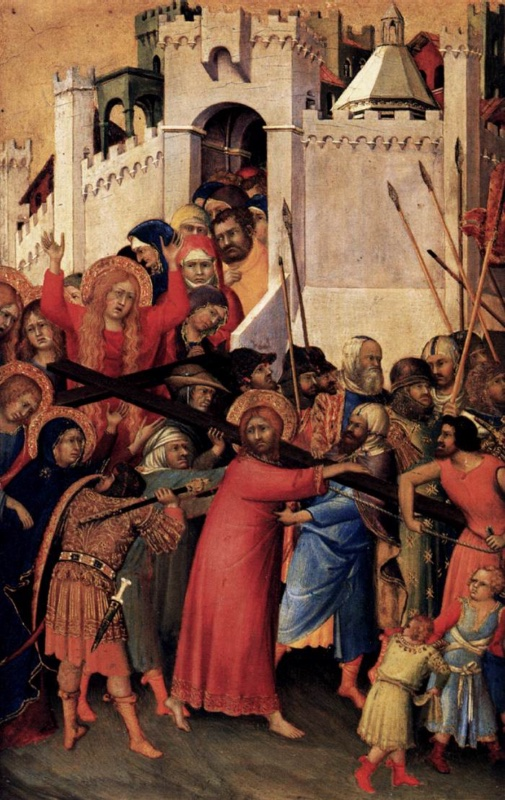
  <figcaption>Simone Martini, <em>The Carrying of the Cross</em>, panel of the Orsini polyptych, tempera and gold on wood, 30 × 20.5 cm. Paris, Musée du Louvre. Photo: Musée du Louvre, Paris, public domain, via Wikimedia Commons.</figcaption>
</figure>

The Carrying of the Cross shows the procession to Calvary leaving the gate of Jerusalem, a city represented by high crenellated walls, towers and a domed building that rise against the gold sky. Through the arched gateway the crowd pours out towards the viewer, filling the whole lower part of the panel with a dense mass of figures.

Christ, in a long red robe, walks barefoot in the centre, bent under the weight of the cross that rests on his shoulder. He turns his head back towards his mother, who appears at the left among the holy women and is pushed away by a soldier holding a sword. Behind her, Mary Magdalene, in red with long golden hair, raises her arms in despair.

The rest of the procession is made up of soldiers with helmets and spears, onlookers in turbans and caps, and a man pulling Christ forward by a rope. In the lower right corner, two children run alongside the procession, one of them dragged by an adult. The variety of costumes, faces and gestures turns the scene into a vivid image of a crowd, in which brutality and compassion are set side by side.

The Louvre panel, whose reverse bears the arms of the Orsini family, is one of the most admired scenes of the polyptych. The contrast between the hostile crowd and the small group of mourners, and the exchange of glances between Christ and his mother, condense the drama of the Passion into a single image.

The city of Jerusalem is represented with care. Its walls are crowned by battlements and pierced by an arched gateway, from which the crowd emerges; behind them rise towers, a loggia with arches and a polygonal building with a pointed roof. The pale stone of the architecture, set against the gold sky, forms a solid backdrop that emphasises the turbulent movement of the figures below.

The soldiers who escort Christ wear helmets and carry long spears, whose diagonal shafts rise above the crowd and create a rhythm of lines across the upper right part of the panel. Among them appear older men with beards and turbans, perhaps the elders and priests who demanded the crucifixion, and a red banner partly visible at the right edge.

In the foreground, the soldier who threatens the Virgin wears a richly patterned tunic and a dagger at his belt, and raises his sword against her. His aggressive gesture contrasts with the pleading attitude of the holy women and with the resignation of Christ, who walks forward despite the rope that pulls him. The bare feet of Christ, visible beneath his red robe, emphasise his humility and vulnerability.

The panel shows Simone's mastery of narrative composition on a very small scale. The crowd is arranged in successive layers, from the gateway to the foreground, and each figure is individually characterised. The intense colours, the variety of expressions and the dynamic movement of the procession give the scene its vividness.

#### The Crucifixion

<figure>
  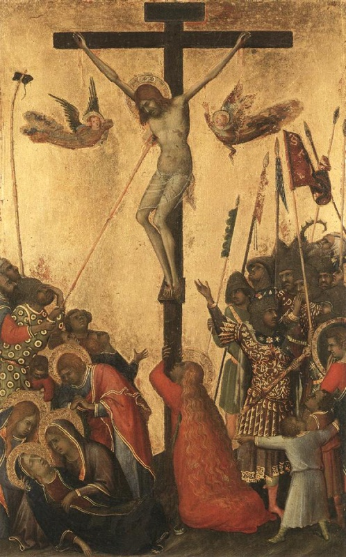
  <figcaption>Simone Martini, <em>The Crucifixion</em>, panel of the Orsini polyptych, tempera and gold on wood, 24 × 14 cm. Antwerp, Koninklijk Museum voor Schone Kunsten. Photo: Koninklijk Museum voor Schone Kunsten Antwerpen, public domain, via Wikimedia Commons.</figcaption>
</figure>

The Crucifixion occupied the centre of the open polyptych together with the Deposition. Christ hangs on a tall cross against the gold ground, his head bowed and his body slightly curved, while two angels fly on either side, their bodies dissolving into coloured clouds. From the left, a lance reaches up to pierce his side, and a sponge on a long pole rises at the far left.

At the foot of the cross, Mary Magdalene, wrapped in red, with her long hair falling over her back, embraces the wood. To the left, the Virgin collapses into the arms of the holy women, while Saint John, in red, bends towards her. The group of mourners, pressed into the lower left corner, contrasts with the crowd of soldiers on the right.

On the right, soldiers with helmets, spears and banners gather beneath the cross. In their midst a centurion in a richly patterned garment raises his hand towards Christ, recognising him as the Son of God. Children appear among the soldiers in the lower right corner, adding a note of everyday life to the solemn scene.

The composition is divided into two halves, separated by the vertical of the cross: on one side grief and compassion, on the other indifference and recognition. Within the small format, Simone achieves a great density of figures and emotions, turning the Crucifixion into a drama that the owner could contemplate in all its details.

The body of Christ is slender and pale, with a transparent loincloth and thin streams of blood running from the wounds in his hands and side. His head, surrounded by a punched halo, falls forward on his chest, and his arms are stretched almost horizontally along the cross bar. The dark wood of the cross stands out sharply against the gold ground, dividing the panel into two halves.

The two angels on either side of the cross are rendered with great delicacy. Their bodies emerge from coloured clouds that trail behind them, and their faces, turned towards Christ, express grief. Their presence links the earthly drama at the foot of the cross with the heavenly world, while their dissolving forms convey the idea of beings without material weight.

The soldiers on the right carry spears and banners, including a red banner with lettering and dark banners with patterns, which rise above their heads and create a dense forest of vertical lines. A haloed figure at the right edge, partly cut by the frame, looks up towards Christ; his identity is not specified by any inscription. The richly dressed centurion, with his patterned armour and raised hand, stands out from the crowd as the witness who recognises the divinity of the crucified Christ.

The contrast between the brilliant reds of the Magdalene and of the mourners and the darker tones of the soldiers reinforces the division of the composition. The Magdalene, embracing the foot of the cross with her whole body, is the emotional centre of the scene, and her pose shows Simone's capacity to create images of intense and immediate devotion.

#### The Deposition

<figure>
  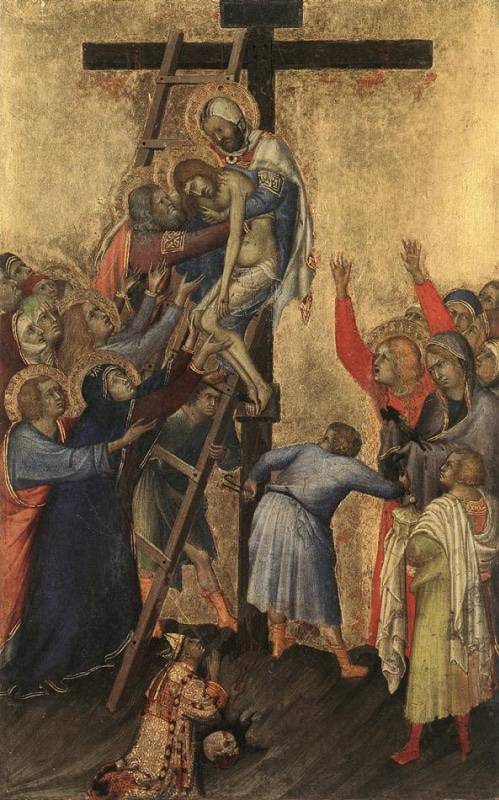
  <figcaption>Simone Martini, <em>The Deposition</em>, panel of the Orsini polyptych, tempera and gold on wood, 24 × 15 cm. Antwerp, Koninklijk Museum voor Schone Kunsten. Photo: Koninklijk Museum voor Schone Kunsten Antwerpen, public domain, via Wikimedia Commons.</figcaption>
</figure>

In the Deposition, the body of Christ is lowered from the cross by two men standing on a ladder, Joseph of Arimathea and Nicodemus, who hold it in their arms. The limp body, with the head falling on one shoulder, descends diagonally towards the Virgin, who stretches up to embrace it, accompanied by Saint John and the holy women crowded on the left.

At the foot of the cross, a man in a blue tunic bends to remove the nails from Christ's feet with a pair of pincers. On the right, a group of mourners raise their arms in lamentation, among them a woman in red and figures in mantles, while two young men stand in the foreground. Their gestures of despair echo those of the Magdalene in the Carrying of the Cross.

At the bottom of the panel, beside a skull at the foot of the cross, kneels the small figure of the donor, in a richly patterned garment, with his hands joined in prayer. The skull recalls the tradition that the cross stood above the tomb of Adam, so that the blood of Christ redeemed the first man. The donor, usually identified as Napoleone Orsini, thus inserts himself into the sacred scene, at the point where redemption begins.

The Deposition, with its diagonal movement and its tightly packed figures, is one of the most dramatic compositions of Simone's career. The signature on the frame beneath the donor links the painter, the patron and the sacred event in a single image, making the panel a key document for the history and meaning of the polyptych.

The upper part of the panel is dominated by the dark cross and by the ladder that leans diagonally against it. At the top, a man with a white headcloth embraces the body of Christ from above, while another, bearded and haloed, supports it from below, pressing his face against Christ's head. The body, pale and limp, hangs between them, with one arm falling and the legs still attached to the cross by the nails.

On the left, the holy women crowd together, reaching up towards the body with outstretched hands. The Virgin, in a dark blue mantle, stretches towards her Son, while Saint John, in red and blue, stands at the left edge of the panel. Their haloes overlap in a dense sequence of gold discs, a device that emphasises the compactness of the group and the intensity of its grief.

On the right, the group of mourners includes a woman in a grey mantle, a man in red raising both arms, and other figures whose hands are lifted in lamentation. In the foreground, two young men, one wrapped in a white mantle, stand with their backs partly turned to the viewer, leading the eye into the scene. The man removing the nails, bent forward in his blue tunic, provides a note of concrete, practical action amid the expressions of sorrow.

The small figure of the donor, kneeling at the bottom near the skull of Adam, is painted on a much smaller scale than the sacred figures, in accordance with medieval conventions. His position at the foot of the cross, close to the place where the blood of Christ was believed to have reached the first man, expresses his hope of sharing in the redemption, and transforms the panel into a personal prayer of the patron.

#### The Entombment

<figure>
  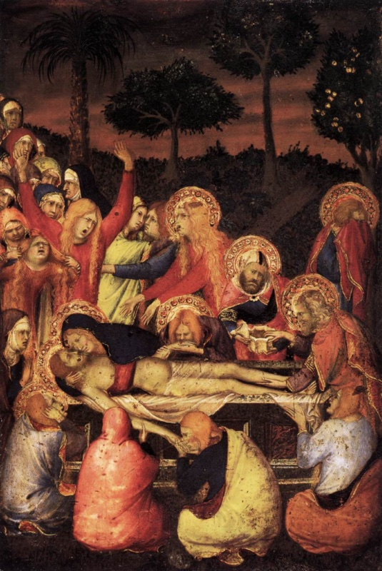
  <figcaption>Simone Martini, <em>The Entombment</em>, panel of the Orsini polyptych, tempera on wood, 23.7 × 16.7 cm. Berlin, Staatliche Museen, Gemäldegalerie. Photo: Gemäldegalerie, Staatliche Museen zu Berlin, public domain, via Wikimedia Commons.</figcaption>
</figure>

The Entombment closes the narrative of the Passion. The body of Christ lies on a white shroud spread over the tomb, his head held by the Virgin, who presses her face against his in a last embrace. Around them, the holy women and the disciples gather, some kneeling in the foreground with their backs to the viewer, others standing behind the tomb.

On the left, a crowd of women laments intensely: Mary Magdalene, with long golden hair and a red dress, throws up her arms, while others cry out, cover their faces or tear their hair. In the centre and on the right, haloed men prepare the body for burial, one holding a jar of ointment, another bending over the feet. A saint in red stands apart at the right, his face hidden in his mantle.

The background is now formed by a dark sky and a landscape of trees, including a palm and an orange tree. This setting is not original: the gold ground of the panel was repainted in modern times, so that the scene now appears as a nocturnal landscape, very different from the luminous gold of the other panels.

Despite this alteration, the Berlin Entombment is one of the most expressive scenes of the polyptych. The grief of the mourners, ranging from silent tenderness to open lamentation, shows Simone's ability to represent the full range of human emotion, and it brings the cycle of the Passion to a close in an atmosphere of intimate mourning.

The body of Christ is stretched horizontally across the centre of the panel, pale and rigid, with a red cloth around the hips. This strong horizontal line contrasts with the vertical figures of the mourners standing behind the tomb and with the curved backs of those kneeling in front, creating a composition of great stability in which all movement converges on the dead body.

The front of the tomb is decorated with panels of red and dark stone, perhaps imitating porphyry and other precious marbles, partly hidden by the kneeling figures. These figures, seen from behind and wrapped in mantles of red, yellow, white and pale blue, frame the scene in the foreground and draw the viewer into the circle of mourners gathered around the body.

The faces of the mourners are among the most expressive in Simone's work. Some open their mouths in cries of grief, others press their hands to their cheeks or pull at their hair, while the Virgin, in silence, presses her face against her Son's. The range of emotions extends from restrained sorrow to violent despair.

The Berlin panel, though altered by the repainting of its background, preserves the essential qualities of Simone's narrative art: the dense grouping of figures, the precise characterisation of each face and the rich colour of the garments. Together with the other five panels, it allows the Orsini polyptych to be read as a continuous meditation on the Passion, from the announcement of the Incarnation to the burial of Christ.

### Christ Discovered in the Temple (Liverpool, Walker Art Gallery)

<figure>
  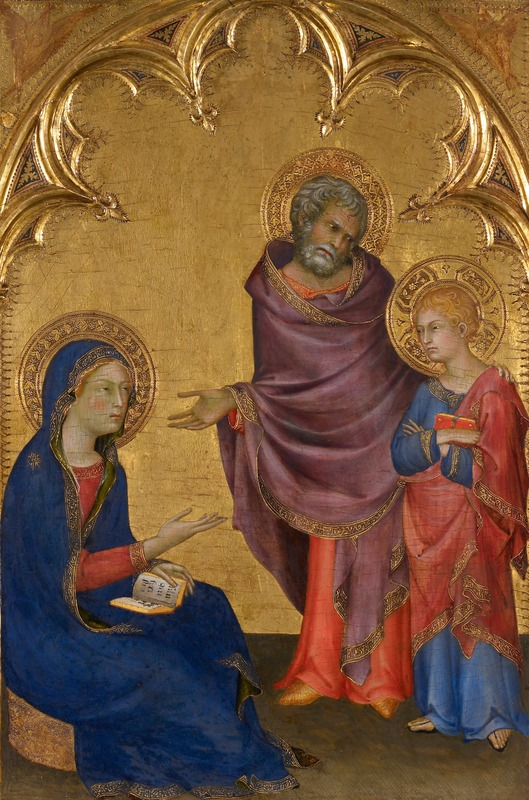
  <figcaption>Simone Martini, <em>Christ Discovered in the Temple</em>, 1342, tempera and gold leaf on wood, 49.5 × 35.1 cm (framed 63.5 × 49.9 × 9.1 cm). Liverpool, Walker Art Gallery (WAG 2787). Photo: Walker Art Gallery, National Museums Liverpool, public domain, via Wikimedia Commons; frame not shown.</figcaption>
</figure>

This small panel in the Walker Art Gallery in Liverpool is the last dated work by Simone Martini and the only surviving dated painting from his years in Avignon. Along the lower edge of the frame runs the inscription SYMON DE SENIS ME PINXIT SUB A(NNO) D(OMI)NI MCCCXLII, "Simone of Siena painted me in the year of Our Lord 1342". Painted two years before the artist's death, it shows his art at its final stage, in the cosmopolitan environment of the papal court.

Nothing is known of the panel's history before its sale in England in 1804. It later belonged to William Roscoe, the Liverpool lawyer, historian and radical politician. It then passed to the Liverpool Royal Institution, which presented it to the Walker Art Gallery in 1948. The reverse of the panel is painted in imitation of marble, a feature that confirms its character as a precious object.

The patron is unknown. The museum suggests that the panel was commissioned by a high-ranking figure of the papal court, possibly the pope himself, but no document confirms this hypothesis. Its refinement, its small size and its unusual subject suggest a cultivated patron with a personal devotion to the Holy Family. The style of the panel, with its elegant figures and precious materials, has been compared with French courtly art, such as illuminated manuscripts and carved ivories.

The subject is drawn from the Gospel of Luke (2:41–51). When Jesus was twelve years old, he remained in the Temple of Jerusalem after the feast of Passover, while his parents returned home without him. After three days of searching, Mary and Joseph found him among the teachers. Simone does not represent the dispute with the doctors, the usual subject, but the moment that follows, when the boy is brought back to his mother. In this form the scene is practically without precedent in Italian painting.

On the left, the Virgin sits on a low seat, wrapped in a deep blue mantle with gold borders over a red dress. On her lap she holds an open book, on which can be read the words she addresses to her Son, "Fili, quid fecisti nobis sic?", "Son, why have you dealt with us like this?" (Luke 2:48). With her right hand she makes a gesture of reproach and questioning, and her face, turned towards the boy, expresses both sorrow and gentle reproof.

In the centre stands Joseph, an elderly man with grey hair and beard, wrapped in a large purple mantle over a red tunic. He extends his right hand towards Mary, as if explaining what has happened, while with his left hand he rests on the shoulder of the boy, gently leading him back to his mother. His face, with its furrowed brow and anxious expression, conveys the worry of the father who has searched for three days.

On the right, the young Christ stands with his arms crossed, holding a small red book, and looks at his mother with a frowning, almost sullen expression. He wears a blue tunic and a red mantle with gold borders. His attitude, at once childish and resolute, illustrates his answer in the Gospel: "Did you not know that I must be about my Father's business?" The psychological tension between the three figures, rendered through glances and gestures, makes the panel one of the most human and immediate images of the Holy Family in medieval painting.

The setting is reduced to a few essential elements: a dark floor, a gold ground and a carved Gothic arch with cusps and tracery, in whose spandrels small angels are incised in the gold. The original frame, which the photograph does not show, is decorated with a band of small quatrefoils and bears the signature. The quality of the execution, the delicacy of the faces and the rich colour of the mantles, blue, purple and red against the gold, show that in his last years Simone retained intact the refinement of his art, while turning towards an intimate, narrative representation of sacred history.

### The Angel of the Annunciation (Washington, National Gallery of Art)

<figure>
  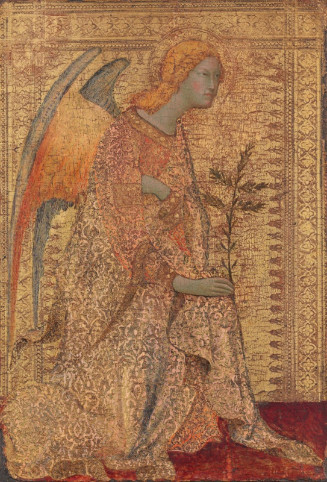
  <figcaption>Simone Martini, <em>The Angel of the Annunciation</em>, c. 1330, tempera on poplar panel, painted surface 29.5 × 20.5 cm (overall 31 × 21.5 cm). Washington, National Gallery of Art, Samuel H. Kress Collection (1939.1.216). Photo: National Gallery of Art, Washington</figcaption>
</figure>

This small panel in the National Gallery of Art in Washington was originally the left half of a diptych of the Annunciation. The right half, with the Virgin Annunciate, is now in the State Hermitage Museum in Saint Petersburg. Separated at an unknown date, the two panels together represented the moment when the angel Gabriel announces to Mary that she will bear the Son of God. The Washington panel is painted in tempera on poplar and also bears a gesso ground on its reverse.

The history of the panel can be followed from the nineteenth century. It belonged to Charles John Canning, later Earl Canning, who bequeathed it to his sister Harriet, Marchioness of Clanricarde. From her it passed by inheritance to her daughter and probably to her grandson, the first Viscount Allendale. Around 1934 it was acquired in New York by the collector who sold it in 1936 to the Samuel H. Kress Foundation; in 1939 the Foundation gave it to the National Gallery of Art.

The date and the attribution of the diptych have been discussed. The National Gallery dates the Angel to around 1330, close to the great Annunciation painted in 1333 for Siena Cathedral and now in the Uffizi. Other scholars have related the diptych to Simone's Avignon years and have considered it to be, at least in part, a product of his workshop, proposing the names of his brother Donato and of the young Matteo Giovannetti. The close technical links with the Uffizi altarpiece, in which the same punches and the same treatment of the robe recur, support the connection with Simone's own production.

The angel kneels on a red floor, in profile, turned to the right towards the Virgin who once faced him in the companion panel. His golden hair falls in soft waves around his face, and his features, with the long nose, small mouth and narrow eye, have the elongated, refined character of Simone's figures. The halo is lightly tooled and almost dissolves into the gold ground, so that the head stands out against a surface of uniform brilliance.

The wings, rising behind his back, are painted in orange and blue-grey, their long feathers curving upwards and filling the left side of the panel. The curves of the wings, the halo and the branch held by the angel echo one another and create a harmonious rhythm of lines across the narrow surface. With one hand Gabriel touches his breast, while with the other he holds a slender branch upright before him. The museum describes it as a palm branch; its narrow leaves, however, and the Sienese tradition, in which the angel of the Annunciation usually carries olive, the symbol of peace, suggest an olive branch.

The most distinctive feature of the panel is the robe. To imitate a luxurious brocaded fabric, Simone covered the surface with red clay, laid gold leaf over almost the whole panel except the face and hands, and painted the robe in pale pinks with darker shadows. He then scratched away the paint to reveal the gold beneath, following a dense pattern of foliage, and textured the exposed gold with small punches. This technique, known as sgraffito, may have been inspired by Islamic ceramics, which were popular in Italy.

The gold ground is framed by a tooled border with foliate motifs, and its surface is enlivened by fine incisions and punched decoration. Over time the paint has become thinner and the gold beneath shows through in many places, giving the whole surface a warm, shimmering appearance in which the figure and the background seem to merge into a single field of light and ornament.

The Washington Angel is closely related to the angel of the Uffizi Annunciation, which combines the two figures within a single large altarpiece; which of the two compositions came first is not documented. The two works share punches, decorative details and the technique of the robe. In earlier altarpieces the Annunciation was often confined to small figures in the pinnacles or in the background; Simone appears to have been among the first painters to make it the principal subject of an independent work, and this small diptych, intended for private devotion, shows the same refinement on an intimate scale.

#### The Virgin of the Annunciation (Saint Petersburg, State Hermitage Museum)

<figure>
  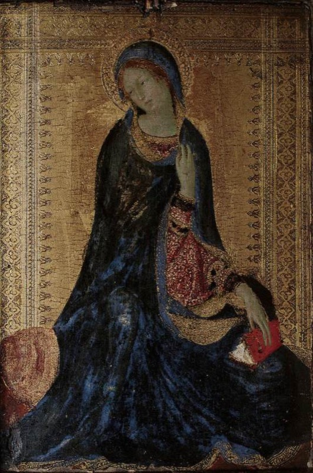
  <figcaption>Simone Martini, <em>The Virgin of the Annunciation</em>, tempera on poplar panel, 30.5 × 21.5 cm. Saint Petersburg, State Hermitage Museum (ГЭ-284). Photo: State Hermitage Museum, Saint Petersburg, public domain, via Wikimedia Commons.</figcaption>
</figure>

In 1901, when the panel was still in the collection of Count Grigory Stroganoff in Rome, it was recognised, with some hesitation, as an autograph work by Simone Martini, and after its display at the exhibition of early Sienese art held in the Palazzo Pubblico in Siena in 1904 the attribution was almost unanimously accepted. In 1911 the heirs of Count Stroganoff gave the panel to the Hermitage.

The two halves of the diptych are dated differently by the museums that hold them. The National Gallery of Art dates the Angel to around 1330, while the Hermitage dates the Virgin between 1340 and 1344, during Simone's years in Avignon. The later date reflects the view that the diptych belongs to the period of Simone's closest contact with French Gothic art at the papal court. The dimensions of the two panels, 30.5 × 21.5 cm for the Virgin and 31 × 21.5 cm overall for the Angel, confirm that they were made as a pair.

The Virgin is seated on a red cushion, placed low on the floor, so that her body seems to sink into the folds of her mantle. This humble posture recalls the iconography of the Madonna of Humility, which Simone is believed to have developed in Avignon, and gives the figure a modest, intimate character very different from the enthroned Virgin of the Uffizi Annunciation.

She is wrapped in a wide deep blue mantle that covers her head, falls over her shoulders and spreads across the floor in broad curves, its hem edged with a gold border. The gold star of the Stella Maris shines on her right shoulder. Beneath the mantle appears a red dress richly decorated with gold, rendered with the same technique of scratching through the paint to reveal the gold beneath that Simone used for the robe of the Washington Angel.

Her head is inclined to the left, towards the angel who once faced her, and her eyes are lowered in an expression of modesty and attentive listening. With her right hand, raised to her breast, she makes a gesture of surprise and humility, while with her left hand she holds a closed red book on her knee, keeping her finger between the pages as if she had just been interrupted in her reading.

The gold ground is framed by a broad tooled border with quatrefoils and an inner band of small lily-shaped motifs, corresponding to the border of the Washington Angel. Within the border, the gold is now worn and cracked in many places, allowing the red bole beneath to show through. The halo, decorated with punched motifs, frames the Virgin's face and stands out against the warm, reddish surface of the background.

The museum describes the Virgin as the embodiment of elegant femininity, and observes that her figure seems to have no corporeal volume, appearing rather as a silhouette against the warm reddish gold ground. The sweeping outline of the blue mantle, from the head to the floor, creates a single flowing shape that dominates the panel and gives the figure the linear grace characteristic of Simone's late style.

Reunited in thought with the Washington Angel, the Hermitage Virgin completes one of the most refined images of the Annunciation of the fourteenth century. The kneeling angel and the seated Virgin, separated by the hinge of the diptych, faced each other across the gold grounds of their panels, so that when the diptych was opened the viewer witnessed the encounter between the messenger and the Virgin at close quarters, in the intimate setting of private devotion.

### Four Apostles from a Predella (Washington, National Gallery of Art)

Four small panels in the National Gallery of Art in Washington, representing Saints Matthew, Simon, James Major and Judas Thaddeus, belonged to a series of ten busts of apostles that once decorated the predella of an altarpiece by Simone Martini. All four came to the National Gallery with the Samuel H. Kress Collection in 1952. Each panel shows a half-length apostle beneath a round arch, with his name written in black letters on the gold ground on either side of the head, and each measures about 26 × 20 cm in its painted surface.

The predella function of the panels is confirmed by their construction. Each is painted on a single piece of wood whose grain runs horizontally, as it would in a long predella board later sawn into separate pieces. The inner moulding of the arch and the capitals and bases of the engaged frame are original, while the wooden strips on the sides were probably added in 1944, when the restorer Stephen Pichetto thinned the panels, applied new backings and cleaned them.

The ten panels remained together for a long time. They were acquired in the early nineteenth century by the German painter and collector Johann Anton Ramboux, and later entered the Wallraf-Richartz Museum in Cologne. The museum deaccessioned the group in the 1920s, and the panels were dispersed on the art market. Four of them were acquired by the Kress Foundation, while the others are now in different collections.

The attribution of the series has a long history. Ramboux catalogued the panels as works of Lippo Memmi, an attribution repeated in the nineteenth century and early twentieth century. When the panels reappeared on the market in the 1920s, Simone Martini's name was proposed, and many scholars accepted it, often with qualifications such as "shop" or "school of Simone Martini". The National Gallery itself long catalogued them as works of Simone Martini and assistants. The attribution to Lippo Memmi has never been entirely abandoned and has recently been revived, while the Gallery's current catalogue attributes the ten panels firmly to Simone.

Proposals for the date range from about 1320 to 1333. The Gallery dates the panels to about 1315–1320, before the Pisa polyptych. The busts of apostles beneath round arches belong to a type that was becoming archaic in Siena by around 1320, and the framing closely resembles the predella of the Saint Louis of Toulouse altarpiece in Naples, painted around 1317. Compared with the Pisa polyptych, the contours and drapery are calmer and less agitated, which also suggests an earlier date. The punch marks of the haloes, by contrast, recur throughout Simone's career and do not allow a precise dating.

The original altarpiece has not been identified with certainty. One proposal connected the panels with a polyptych by Lippo Memmi, but this has not been widely accepted. The Gallery's catalogue suggests that the lost central panel may be the Madonna and Child from the church of Santa Maria Maddalena at Castiglion d'Orcia, formerly in the Museo Civico e Diocesano in Montalcino and now displayed in the Sala d'Arte San Giovanni at Castiglione d'Orcia, whose dimensions fit Simone's polyptychs and whose round-arched profile matches the predella. In such an arrangement, Andrew and James Major would have been placed near the centre, and Matthew, Thomas, Simon and Thaddeus towards the ends, while Peter and John may have appeared in the main register, as in Duccio's Maestà.

The technique of the panels is of high quality. The wood was covered with fabric, gesso and red bole beneath the gilded areas. The outlines of the figures were incised, the flesh tones were laid over a green underpainting, and infrared reflectography has revealed underdrawing in the hands. The haloes are decorated with punch marks, which in the Saint Matthew and Saint Simon extend onto the arched frames, and the borders of the garments and the fittings of the books are gilded with mordant gold. The brushwork is fine and unblended.

The four panels are generally in fair condition, though slightly worn, with small scattered losses caused mainly by damage to the support and by the removal of the original frame. The lettering of the inscriptions has been reinforced. Despite these alterations, the four apostles preserve the essential qualities of Simone's early art: the soft modelling of the faces, the natural gestures and the subtle variety of expression, which turn a conventional series of predella busts into a gallery of individual portraits.

#### Saint Matthew

<figure>
  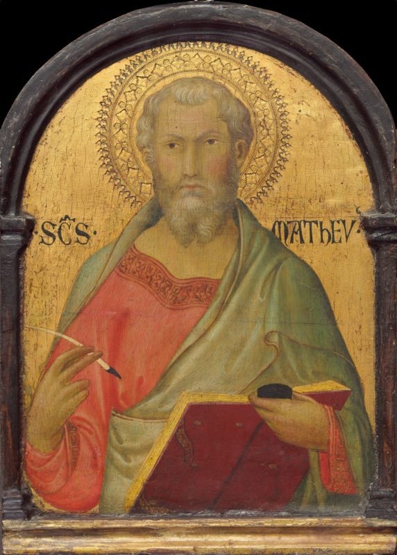
  <figcaption>Simone Martini, <em>Saint Matthew</em>, c. 1315–1320, tempera on panel, painted surface 26.4 × 19.6 cm (overall 30.8 × 23.2 cm). Washington, National Gallery of Art, Samuel H. Kress Collection (1952.5.23). Photo: National Gallery of Art, Washington</figcaption>
</figure>

Saint Matthew is shown frontally, looking directly at the viewer, the only one of the four apostles to adopt this pose. He has grey, curly hair and a short grey beard, and his face, with its long straight nose and steady eyes, conveys calm authority. The inscription on the gold ground reads ·S(AN)C(TU)S· MATHEV(S)·, with abbreviation marks above the letters.

He wears a pink-red tunic with an embroidered collar and a green mantle that falls over his left shoulder and is gathered across his body. The contrast between the warm red and the cool green is typical of Simone's palette and recurs in many of his apostles.

Matthew is represented as the evangelist in the act of writing his Gospel. In his right hand he holds a quill pen, raised as if he had just paused, while with his left hand he supports a large open book bound in red, on which rests a small inkpot. The book is tilted towards the viewer, and its pages, shown in perspective, project slightly into the space of the frame.

The halo is richly decorated with punched motifs of rosettes and foliage, which continue onto the arched frame. The gold ground has been repaired in places, and some retouching has discoloured, but the face and the hands preserve the fine modelling of the original.

The frontal pose, the direct gaze and the gesture of writing give the Saint Matthew a sense of immediacy and presence unusual in a small predella panel. In the original series, the evangelist probably stood towards one end of the predella, framing the sequence of apostles that led towards the centre.

#### Saint Simon

<figure>
  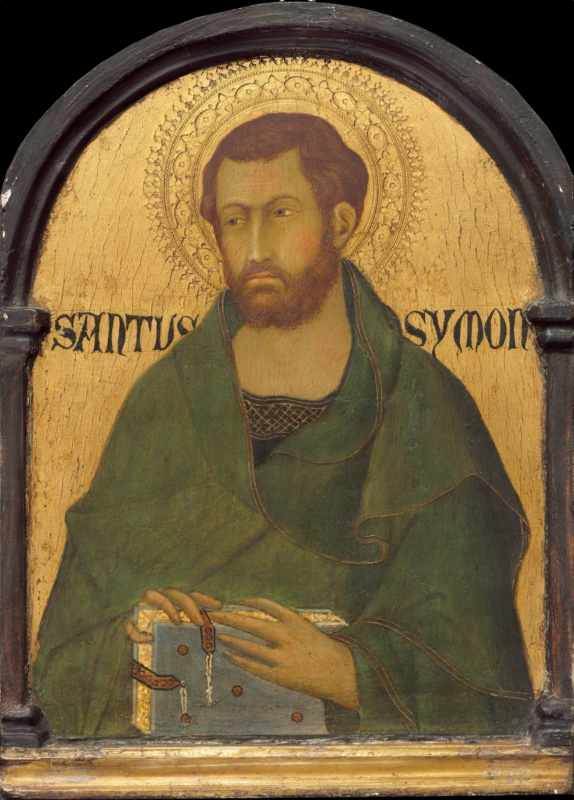
  <figcaption>Simone Martini, <em>Saint Simon</em>, c. 1315–1320, tempera on panel, painted surface 26.2 × 19.7 cm (overall 30.7 × 23.5 cm). Washington, National Gallery of Art, Samuel H. Kress Collection (1952.5.24). Photo: National Gallery of Art, Washington</figcaption>
</figure>

Simon, called "the Zealot", is one of the twelve apostles named in the Gospels of Matthew, Mark and Luke, but little else is known of him. According to legend he was martyred by being sawn in two, but Simone does not include any reference to his martyrdom: the apostle is identified only by the inscription SANTVS SYMON on the gold ground.

The saint is shown in half length, turned slightly to the left, with his eyes glancing to the right. He has thick reddish-brown hair and a short beard of the same colour, and his face, with its broad cheeks and serious expression, has a strong individual character.

He is wrapped in a large green mantle that covers both shoulders and falls in broad folds, its edges marked by fine gold lines. Beneath it, at the neck, appears a dark tunic decorated with a lattice pattern. The deep green of the mantle dominates the panel and contrasts with the warm gold of the background.

With both hands Simon holds a closed book bound in blue-grey, with metal bosses, clasps and white ties. His long fingers, spread across the cover, are rendered with great care, and the book, placed at the lower edge of the panel, seems to rest on the frame itself. The halo and the arched frame are decorated with punched motifs.

The panel has been retouched in places, particularly on the right cheek and the left shoulder, but it remains one of the most impressive of the series. The calm, slightly melancholy expression of the apostle and the monumental simplicity of the green mantle show Simone's ability to give a small figure the dignity of a large altarpiece.

#### Saint James Major

<figure>
  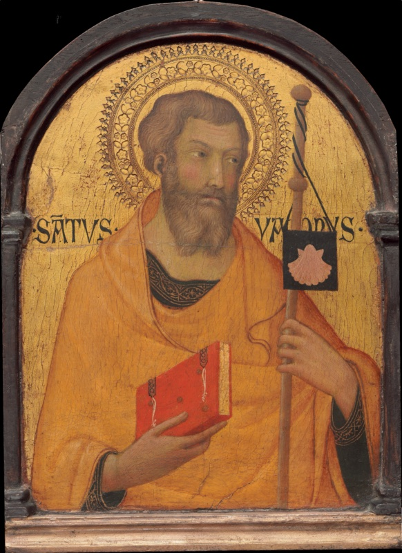
  <figcaption>Simone Martini, <em>Saint James Major</em>, c. 1315–1320, tempera on panel, painted surface 26 × 20 cm (overall 30.7 × 23 cm). Washington, National Gallery of Art, Samuel H. Kress Collection (1952.5.25). Photo: National Gallery of Art, Washington</figcaption>
</figure>

Saint James Major, the brother of John the Evangelist, belonged with Peter and John to the innermost circle of Christ's disciples and witnessed the Transfiguration and the Agony in the Garden. He was the first apostle to be martyred, put to death by King Herod Agrippa around the year 44 (Acts 12:2). His identity is confirmed by the inscription ·SĀTVS· IACOBVS· on the gold ground, partly damaged on the right.

The saint is shown in half length, turned to the right, with his eyes glancing sideways. He has thick brown hair and a full beard, and his face, with its strong features and pink cheeks, has a vigorous, open character. His halo, decorated with punched rosettes and a crown of trefoils, is one of the richest of the series.

He wears a large orange-yellow mantle over a dark tunic with a gold-embroidered collar. In his right hand he holds a closed red book with clasps, the sign of his apostolate. In his left hand he holds a pilgrim's staff, from which hangs a black pouch decorated with a pink scallop shell, the emblem of the pilgrimage to his shrine at Santiago de Compostela.

The pilgrim's staff and the scallop shell, which identify James as the patron of pilgrims, introduce a note of contemporary reference into the series. In the early fourteenth century, the pilgrimage to Compostela was one of the most important in Christendom, and the attributes of the pilgrim made the saint immediately recognisable to the faithful.

The panel shows some cracks and paint losses along the lower edge, but the face, the halo and the mantle are well preserved. In the reconstruction of the predella proposed by the Gallery, James Major stood near the centre, close to the lost Madonna and Child, together with his fellow apostle Andrew.

#### Saint Judas Thaddeus

<figure>
  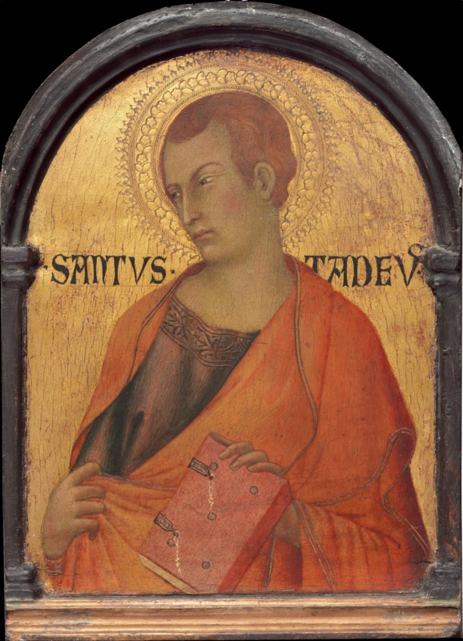
  <figcaption>Simone Martini, <em>Saint Judas Thaddeus</em>, c. 1315–1320, tempera on panel, painted surface 26 × 19.7 cm (overall 30.7 × 23.3 cm). Washington, National Gallery of Art, Samuel H. Kress Collection (1952.5.26). Photo: National Gallery of Art, Washington</figcaption>
</figure>

Saint Judas Thaddeus is represented as a young, beardless man, in contrast to the mature, bearded apostles of the other panels. His identity is given by the inscription ·SANTVS· TADEV(S) on the gold ground, with an abbreviation mark for the final letter. The panel is among the best preserved of the four, and the softness of the modelling shows Simone's refined manner most clearly.

The apostle bows his head to one side and turns away from the viewer, his eyes glancing to the left as if he were contemplating something or someone beyond the frame. This movement suggests that he was originally oriented towards the centre of the altarpiece, and gives the figure a sense of inner life.

He has short reddish hair and a smooth face with a long nose, a small mouth and narrow eyes. He wears a dark grey-violet tunic with an embroidered collar and a large orange-red mantle, which falls from his left shoulder and is gathered across his body. With his right hand he lifts a fold of the mantle, while with his left he holds a pink book with clasps and white ties.

The halo is decorated with punched rosettes and a border of small trefoils. The face and the book show some retouching, but the overall state of the panel is good, and the colours, especially the warm orange of the mantle, retain much of their original intensity.

The Saint Judas Thaddeus shows Simone's capacity to vary the type of the apostle within a fixed format. The youthful face, the bowed head and the averted gaze distinguish him from his companions and give the series the variety of expression that makes it one of the most attractive groups of predella panels of the Sienese Trecento.

### The Frescoes of the Porch of Notre-Dame-des-Doms (Avignon, Palais des Papes)

The frescoes that Simone Martini painted on the porch of the cathedral of Notre-Dame-des-Doms in Avignon are the most important surviving works of his years at the papal court. The cathedral stands on the rock beside the Palais des Papes, and its Romanesque porch shelters the main entrance. Above the door Simone painted two related images: in the triangular tympanum, the Blessing Christ between two angels; in the semicircular lunette below, the Virgin of Humility seated on the ground with the Child, flanked by angels and by the kneeling donor. A third fresco on the porch, Saint George and the Dragon, was completely destroyed in 1828 and is known only from a seventeenth-century drawing in the Vatican Library.

No papal commission is documented for Simone in Avignon, and his known patrons there are Italian cardinals and Petrarch. The patron of the porch frescoes was Cardinal Jacopo Stefaneschi, identified by his coat of arms and by an inscription. A member of a Roman noble family, Stefaneschi was one of the most cultivated prelates of his time; in Rome he had commissioned from Giotto the mosaic of the Navicella and the altarpiece for the high altar of Saint Peter's. His death in Avignon in 1343 provides a terminus for the project.

The date of the frescoes is therefore placed in the years between Simone's arrival in Avignon, around 1335–1336, and the cardinal's death. Proposals within this period vary, from the late 1330s to the early 1340s, and some scholars have linked the decoration with Stefaneschi's wish to prepare his own burial in the cathedral. In either case, the frescoes belong to the last decade of Simone's life and represent his late style on a monumental scale.

The porch frescoes have suffered greatly from exposure to the weather. By the twentieth century the paint surface had largely disappeared, and only faint traces of colour remained over the drawing. Between 1960 and 1963 the frescoes were detached from the wall to save them, and the operation revealed beneath them the sinopie, the preparatory drawings in red ochre laid out by the painter on the arriccio. These drawings, of exceptional quality, are among the finest surviving examples of Trecento underdrawing.

Both the detached frescoes and their sinopie are now preserved in the Palais des Papes, where they are displayed in the Salle du Consistoire, on the ground floor of the east wing of the cloister of Benedict XII<a href="/endnotes.html#fn-benedict-xii" class="footnote">24</a>. Seen together, the painted layers and the drawings beneath them allow an unusually direct insight into Simone's working method, from the first free design of the figures on the wall to their final definition in colour.

The lunette has a particular importance for the history of religious imagery. Many scholars consider it the earliest surviving monumental example of the Virgin of Humility, in which Mary is shown seated on the ground or on a cushion rather than on a throne, a type whose invention is often credited to Simone or to his circle. Others are more cautious, noting that Virgins seated on the ground already appeared in earlier narrative scenes. Whatever its exact origin, the type spread rapidly from Avignon and became one of the most widespread devotional images in Europe.

The destroyed Saint George fresco gave rise to a long-lived legend. According to tradition, the princess rescued by the saint was a portrait of Laura, the woman celebrated by Petrarch, and the Latin verses that accompanied the scene were written by the poet himself. In fact the verses were composed by Stefaneschi, and there is no basis for the identification of the princess with Laura, although the legend was repeated for centuries.

Despite their ruined state, the Doms frescoes remain essential documents of Simone's activity in Avignon. They show how the painter adapted the forms he had developed in Siena to a new context, combining the monumental dignity of the Blessing Christ with the intimacy of the Virgin of Humility, and how his art, through works such as these, entered the visual culture of the papal court and of northern Europe.

#### The Blessing Christ with Angels (Tympanum)

The detached fresco of the tympanum, now mounted on a support and displayed against the stone wall of the Palais des Papes, preserves only part of its original colour. The figure of Christ remains legible at the centre, with the halo around his head, the warm red and brown tones of his garments and the pale globe held in his left hand. Around him, the two angels can still be distinguished, their bodies and wings rendered in faded ochres and reds.

The most striking remains of the original colour are the patches of blue that surround the figure of Christ and appear in the garments of the angels. They suggest that the background and parts of the draperies were once painted in a deep blue, against which the figures stood out in warm tones. The losses, caused by centuries of exposure on the porch, have left the plaster visible over much of the surface.

Seen together with its sinopia, the fresco shows how closely Simone followed his preparatory drawing in the final execution. The position of Christ, the gesture of blessing, the globe and the arrangement of the angels correspond to the drawing beneath, while the colour, now largely lost, gave the figures a volume and a richness that only the surviving fragments allow us to imagine.

The triangular tympanum, at the top of the decoration, is occupied by the half-length figure of Christ, placed in the centre and framed by the sloping sides of the gable. He faces the viewer frontally, with long hair falling on his shoulders and a short beard, his head surrounded by a cruciform halo. His expression, grave and calm, is that of the judge and ruler of the world.

With his right hand Christ makes the gesture of blessing, while with his left he holds a globe, the symbol of his dominion over the universe. The globe, placed in front of his body, is marked with lines that divide it into parts, a traditional way of representing the world. The mantle that covers his shoulders falls in broad folds, of which only the outlines now survive.

On either side, two angels fly towards Christ, filling the narrow corners of the triangle. The angel on the right joins his hands in prayer, while the angel on the left, more damaged, turns towards the centre in a gesture of adoration. Their wings, drawn with long parallel feathers, follow the slope of the gable and adapt the figures to the unusual shape of the field.

The composition shows Simone's ability to fit figures into a difficult format. The central figure of Christ occupies the highest point of the triangle, while the angels, set at an angle, fill the lower corners, so that the whole field is animated by a single, harmonious movement converging on the Saviour.

The sinopia is the preparatory drawing in red ochre that Simone laid out on the arriccio before the final layer of plaster and colour was applied, and it came to light when the fresco was detached. Drawn with a free, rapid brush, it shows the clarity of Simone's design and the sureness of his line, qualities that the finished fresco would have concealed beneath its colour.

The image of the Blessing Christ above the entrance of the cathedral had a clear meaning: those who passed through the door placed themselves under the protection of the Saviour, and the prayers of the donor, represented in the lunette below, were addressed through the Virgin to the Christ who reigned above.

#### The Virgin of Humility with Angels and Cardinal Stefaneschi (Lunette)

The detached fresco of the lunette, now displayed within a stone arch in the Palais des Papes, preserves more of its colour than the tympanum. At the centre the Virgin can still be recognised, her head covered by a pale veil, her body wrapped in a red garment enriched with a patterned border, and the Christ Child seated on her lap. The red of her dress, though faded, remains the dominant colour of the composition.

At the sides, the angels and the kneeling donor are visible only in fragments. On the right, an angel in a blue garment raises his arm towards the Virgin and Child, while on the left the figures have almost completely faded into the plaster. Beyond the arch, on the right, a fragment of deep blue with white clouds survives, a remnant of the painted decoration that extended over the wall of the porch around the lunette.

The comparison between the fresco and its sinopia reveals the changes that occurred between drawing and execution and the extent of the losses suffered by the painted surface. Even in this damaged state, the fresco allows the original harmony of white, red and blue to be glimpsed, and confirms the intimate character of Simone's Virgin of Humility, seated close to the faithful at the entrance of the cathedral.

The semicircular lunette, placed directly above the door, contains the Virgin of Humility. Mary is seated low on the ground, at the centre of the composition, with her head inclined and her eyes turned towards the Child, whom she holds on her lap. Her mantle covers her head and spreads around her, creating a broad base for the figure in the lower part of the lunette.

The Child, held by his mother, turns towards the right, where a kneeling angel raises a cloth or scroll towards him. On the left, another angel stands behind a kneeling figure, who has been identified as the donor, Cardinal Jacopo Stefaneschi, presented to the Virgin and Child by the angel. The presence of the cardinal at the feet of the Virgin turns the image into a perpetual prayer for his salvation.

The angels at the sides, with large wings drawn in long, curved feathers, frame the central group and fill the curved ends of the lunette. Their kneeling poses echo the humility of the Virgin, so that the whole composition is pervaded by an attitude of reverence and devotion.

The choice of the Virgin of Humility for the entrance of a cathedral was unusual. Instead of the enthroned Queen of Heaven, the faithful who entered the church saw a mother seated on the ground, close to them and accessible in her humility. This intimate image, expressing the devotion of a single patron, gives the lunette a personal character that distinguishes it from the more solemn tympanum above.

As with the tympanum, the sinopia was revealed when the fresco was detached. The drawing, executed directly on the wall in red ochre, shows the painter's first design of the composition. The faces of the Virgin and of the angel on the right are the most fully defined parts, and they show the delicate, elongated features that characterise Simone's late style, close to those of the Orsini polyptych and of the Liverpool panel.

The lunette is a key work for the history of the Virgin of Humility, a type that, from Avignon, spread through Italy, France and the rest of Europe in the following decades. Even in its ruined state, it preserves the essence of Simone's invention: the transformation of the Queen of Heaven into a humble mother seated on the ground, offered to the contemplation of the faithful.

### Frontispiece of Petrarch's Virgil (Milan, Biblioteca Ambrosiana)

<figure>
  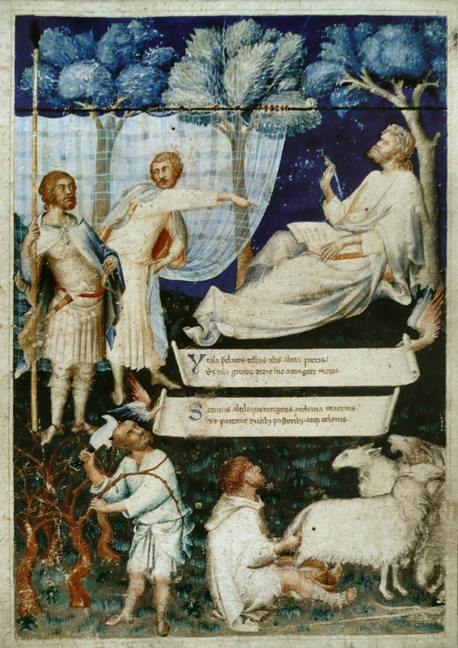
  <figcaption>Simone Martini, <em>Allegory of Virgil</em>, frontispiece of Petrarch's Virgil, c. 1340, tempera on parchment, 29.5 × 20 cm. Milan, Biblioteca Ambrosiana, S.P. 10/27, also cited as A 79 inf. Photo: Biblioteca Ambrosiana, Milan, public domain, via Wikimedia Commons.</figcaption>
</figure>

This illuminated page is the frontispiece of Francesco Petrarch's personal copy of Virgil, a manuscript now in the Biblioteca Ambrosiana in Milan (S.P. 10/27, also cited as A 79 inf.). Written in the early fourteenth century, the large codex contains the Bucolics, the Georgics and the Aeneid with the commentary of Servius, together with Statius' Achilleid, four odes of Horace and other texts, and its margins are filled with Petrarch's annotations. The book accompanied the poet throughout his life; after his death it passed to Francesco da Carrara, then to the Visconti library at Pavia, and finally to Cardinal Federico Borromeo<a href="/endnotes.html#fn-federico-borromeo" class="footnote">25</a>, founder of the Ambrosiana.

The frontispiece was painted by Simone Martini in Avignon, where the painter and the poet became friends at the papal court. It is usually dated around 1340, although proposals range from the late 1330s to the early 1340s. Its iconographic programme was devised by Petrarch himself, who may have conceived it as early as 1338: Petrarch invented the image, Simone painted it. The page is the only surviving work that documents the collaboration between the two men, whose friendship Petrarch celebrated in two sonnets of the Canzoniere (77 and 78) on a lost portrait of Laura painted by Simone:

> Ma certo il mio Simon fu in paradiso,
> onde questa gentil donna si parte;
> ivi la vide, et la ritrasse in carte
> per far fede qua giù del suo bel viso.

("But surely my Simone was in paradise, whence this gentle lady comes; there he saw her and portrayed her on paper, to bear witness here below to her beautiful face.")

The page is an allegory of Virgil's poetry and of its interpretation. On the right, Virgil reclines beneath a tree, crowned with laurel and wrapped in a white mantle, holding a pen in his right hand and a book on his knees. He looks upwards, as if seeking inspiration, in the attitude of the poet absorbed in composition. On the left, the late antique commentator Servius, in a pale tunic, draws aside a transparent curtain with one hand and points to the poet with the other: the gesture of unveiling expresses the role of the commentary, which reveals the hidden meanings of Virgil's verses.

Beside Servius stands a soldier in armour, holding a spear and wearing a sword, who represents the Aeneid, the epic of arms and heroes. In the lower part of the page, a vinedresser prunes a vine with a billhook, alluding to the Georgics, the poem of agriculture, while a seated shepherd milks a ewe in front of his flock, alluding to the Bucolics, the pastoral poems. Each figure looks towards Virgil, so that the three works of the poet are represented by those who are their subject and their audience.

In the centre of the page, two scrolls held by small winged figures bear two Latin distichs composed by Petrarch. The upper scroll reads: "Ytalia preclaros tellus alis alma poetas, / Sed tibi Grecorum dedit hic attingere metas" ("Italy, nourishing land, you rear illustrious poets, but this one has granted you to reach the goals of the Greeks"). The lower scroll reads: "Servius altiloqui retegens archana Maronis, / Ut pateant ducibus pastoribus atque colonis" ("Servius, revealing the secrets of lofty-voiced Maro, so that they may be open to leaders, shepherds and farmers"). The verses explain the image: Virgil is the poet who allowed Italy to rival Greece, and Servius makes his poetry accessible to the three classes represented in the scene.

The setting is a refined landscape. The sky is a deep, intense blue, against which trees with feathery foliage in pale and dark blue stand out, and the meadow is dotted with small plants. The transparent curtain, painted with fine white lines, reveals the landscape behind it, and the soft colours of the figures, mainly white, pale blue and ochre, give the page a luminous, delicate harmony that distinguishes it from the strong colours of Simone's panel paintings.

The frontispiece is a key work in the history of manuscript illumination. It has been seen as one of the earliest images of the humanist revival of classical antiquity, in which an ancient poet is represented not as a medieval author but as an inspired figure in a natural setting, and the composition reflects Petrarch's humanist vision of Virgil as the father of Latin poetry. The naturalistic details, the shepherd, the sheep and the vinedresser, show Simone's attention to everyday life, already evident in the miracles of the Blessed Agostino Novello altarpiece.

The manuscript also preserves one of the most moving documents of Petrarch's life. On a leaf that precedes the frontispiece, the poet recorded his first meeting with Laura and her death in 1348, so that the book became a personal memorial. The proximity of this note to Simone's image, and the memory of the painter who had portrayed Laura, make Petrarch's Virgil a document of the friendship between the poet and the painter and to the meeting of poetry and painting at the papal court of Avignon.

### Christ on the Cross (Cambridge, Mass., Harvard Art Museums)

<figure>
  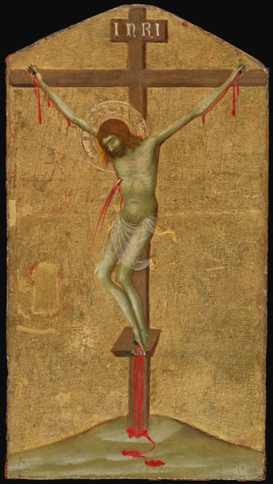
  <figcaption>Simone Martini, <em>Christ on the Cross</em>, c. 1340, tempera and gold on panel, 25 × 13.6 cm. Cambridge, Mass., Harvard Art Museums/Fogg Museum, Hervey E. Wetzel Bequest Fund (1919.51). Photo © President and Fellows of Harvard College; Harvard Art Museums, <a href="https://harvardartmuseums.org/collections/object/232070">harvardartmuseums.org/collections/object/232070</a>.</figcaption>
</figure>

This small panel in the Fogg Museum of the Harvard Art Museums is one of the works associated with the last years of Simone Martini in Avignon. The museum dates it to around 1340, while other catalogues have proposed a slightly earlier date, between 1325 and 1335. Measuring only 25 × 13.6 cm, with a gabled top, it was intended for private devotion, either as an independent image or as part of a small portable altarpiece whose other elements have not been identified.

The history of the panel can be traced from the early twentieth century. By 1909 it belonged to the French painter and collector Léon Bonnat in Paris. It later passed through the dealers Gimpel and Wildenstein, who sold it in 1919 to the Fogg Art Museum, which acquired it with the Hervey E. Wetzel Bequest Fund. Since then it has been exhibited in the museum's galleries of medieval and Renaissance art and published in the principal monographs on Simone Martini.

The support is very thin. X-radiographs made at the Harvard conservation laboratories show that the original panel, probably of poplar, was reduced to a thickness of about two millimetres and mounted on a cradle, a treatment common in earlier restorations of small Italian panels. Despite this intervention, the painted surface and the gold ground preserve much of their original quality.

Christ hangs on a dark wooden cross set against a gold ground, beneath a titulus that bears the letters INRI, Iesus Nazarenus Rex Iudaeorum. His arms are stretched upwards in a wide V, so that the body hangs heavily from the nails, and his head, surrounded by a punched halo, falls forward onto his right shoulder. His eyes are closed and his face, framed by long reddish hair and a short beard, expresses the stillness of death.

The body is pale and slender, modelled with delicate greenish shadows over which the flesh tones are laid. It curves gently to the left, with the hips displaced and the knees bent, and the feet, placed one above the other, are nailed to a small footrest. Around the hips is a transparent loincloth, painted with fine white strokes, through which the body remains visible, and whose ends flutter at the right side of the cross.

The most striking feature of the panel is the treatment of the blood. Bright red streams pour from the wounds in the hands, run along the arms and drip into the gold ground; from the wound in the side a long jet of blood falls diagonally across the body; and from the feet a thick stream runs down the cross to the mound of Golgotha, where it gathers in pools on the green ground. The intense red, set against the pale body and the gold, insists on the reality of Christ's sacrifice and on the redemptive power of his blood.

The mound at the foot of the cross, painted in olive green, rises gently from the lower edge of the panel, providing a minimal setting for the crucifixion. The gold ground is worn in places, with the red bole visible beneath, and on the left traces of shapes in the gold can be seen, the purpose of which is not clear. The halo, finely tooled, stands out against the surrounding gold.

The Harvard Christ on the Cross concentrates the drama of the Passion into a single figure, without the crowds of the Orsini polyptych or the mourners of the San Casciano cross. The isolation of the dead Christ, the elegance of the body and the emphasis on the flowing blood invite the viewer to an intimate meditation on the sacrifice of Christ, characteristic of the devotional painting that Simone developed for his patrons in the last years of his career.

### Diptych with the Madonna and Child and the Man of Sorrows (Florence, Museo Horne)

<figure>
  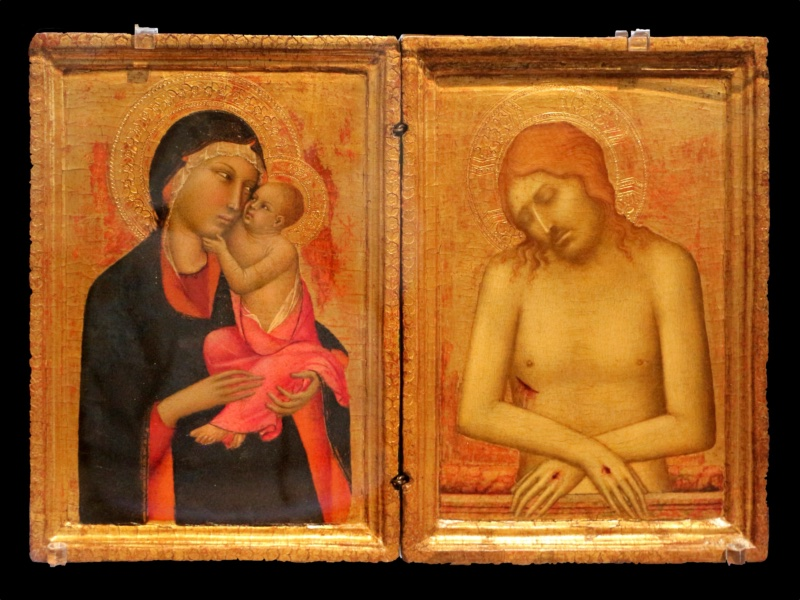
  <figcaption>Simone Martini and Lippo Memmi, <em>Diptych with the Madonna and Child and the Man of Sorrows</em>, 1326–1328, tempera and gold on panel, 28 × 38 cm (open). Florence, Museo Horne (inv. 55, 56). Photo: Francesco Bini, <a href="https://creativecommons.org/licenses/by-sa/4.0/">CC BY-SA 4.0</a>, via Wikimedia Commons.</figcaption>
</figure>

This small portable diptych in the Museo Horne in Florence brings together two of the most intimate subjects of fourteenth-century devotion: the Virgin embracing her Child and the dead Christ standing in his tomb, known as the Man of Sorrows. The two panels, joined by hinges and each with its engaged gilded frame, could be closed like a book and carried by their owner, opening to reveal an image of maternal tenderness facing an image of the Passion. Together they measure 28 × 38 cm when open.

The diptych was acquired in 1910 by the collector who had settled in Florence and whose collection became the Museo Horne after his death. According to the records of the museum, it came from Castiglion Fiorentino, near Arezzo. On the back of the panel with the Madonna and Child is an inscription incised in Italian cursive script, "TAVOLETTA DI MISSER GIORGIO DI TOMMASO" ("little panel of Messer Giorgio di Tommaso"), probably recording an early owner of the work.

The attribution of the diptych has been much debated. The collector himself attributed it to Simone Martini. In 1924 it was assigned to the so-called Barna da Siena, on the basis of its affinity with the Madonna and Child at Asciano, and it was long catalogued under that name. Later studies stressed the close links between the figure of Christ and Simone's own works, in particular the painted cross of San Casciano and the Man of Sorrows at the centre of the predella of the Pisa polyptych, and suggested that the diptych was produced within Simone's workshop, perhaps with the participation of different hands for the two panels. The museum now presents it as a work by Simone Martini and Lippo Memmi, dated 1326–1328.

The proposed dates fall in the 1320s. The state catalogue places the diptych between about 1320 and 1325, in the early part of the decade, while the museum suggests 1326–1328. The archaic character of the Madonna and Child, which seems to derive from an older model of the period when Simone was still close to Duccio, contrasts with the more refined, Gothic figure of Christ, and this difference has been read as a sign of collaboration between the master and his assistants.

In the left panel, the Virgin is shown in half length, wrapped in a dark blue mantle lined with red, with a white veil framing her face. She inclines her head towards the Child and presses her cheek against his, in the type known as the Virgin of Tenderness. The Child, wrapped in a pink-red cloth, turns towards his mother and touches her chin with his hand, while she holds him with both hands, her long fingers spread over the cloth. The two haloes, richly punched, overlap behind their heads.

In the right panel, the dead Christ stands upright in the tomb, visible from the waist up above the edge of the sarcophagus. His head, with long reddish hair and a short beard, is inclined to one side, and his eyes are closed. His arms are crossed in front of his body, showing the wounds in his hands, and blood flows from the wound in his side. The pale body, modelled with soft shadows, stands out against the gold ground, behind which a dark horizontal element may indicate the arm of the cross.

The pairing of the two images has a precise devotional meaning. The tender embrace of the Virgin and the Child, on the left, anticipates the death of Christ, shown on the right; the infant who touches his mother's face is the same Christ who will die on the cross and rise from the tomb. The viewer, opening the diptych, was invited to meditate on the Incarnation and the Passion as two moments of a single mystery, in the intimate setting of private prayer.

The Museo Horne diptych is thus an important document of the production of small devotional images in Simone's circle in the 1320s. Whether painted by Simone himself, by Lippo Memmi or by other members of the workshop, it reflects the master's models and his capacity to express intense emotion within a small format, as in the Man of Sorrows of the Pisa predella and in the later Passion scenes of the Orsini polyptych.

### Crucifixion with the Virgin, Mary Magdalene and Saint John (Florence, Museo Horne)

<figure>
  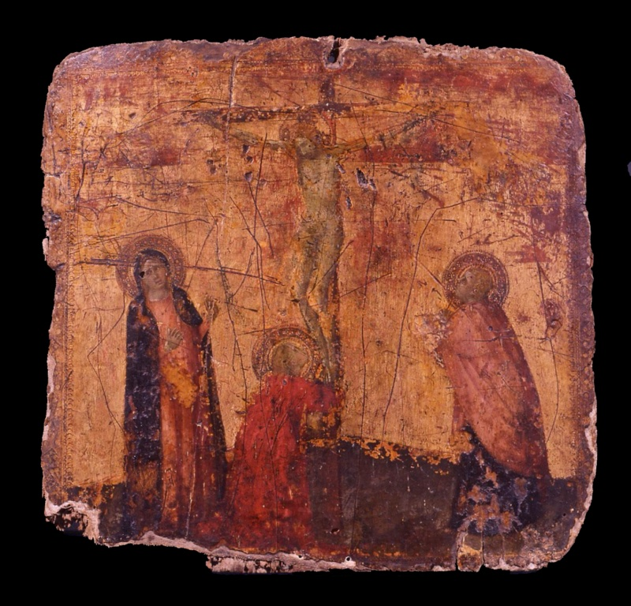
  <figcaption>Simone Martini, <em>Crucifixion with the Virgin, Mary Magdalene and Saint John the Evangelist</em>, c. 1315–1320, tempera and gold on panel, 25 × 26 cm. Florence, Museo Horne (inv. 54). Photo: Museo Horne, Florence, public domain, via Wikimedia Commons.</figcaption>
</figure>

This small Crucifixion in the Museo Horne in Florence is one of the most damaged works associated with Simone Martini, but also one of the most interesting for the study of his youth. The panel, nearly square and measuring only 25 × 26 cm, was probably intended for private devotion. It entered the collection formed in Florence by the collector whose holdings became the Museo Horne after his death, but its earlier history is not recorded.

The literature on the panel is scarce, and opinions about its author have long oscillated between Florence and Siena. It was connected in the early twentieth century with the circle of the Florentine painter Bernardo Daddi, and later with the Sienese Ugolino Lorenzetti, while another scholar considered it the work of a follower of Simone Martini. The question remained open until Luciano Bellosi attributed it to Simone himself and placed it in the years of his youth.

Bellosi compared the panel with the works of Simone's early career: the Maestà in the Palazzo Pubblico, the Saint Louis of Toulouse in Naples and the frescoes in the Lower Church of San Francesco at Assisi. He observed that a late date, implicit in the attribution to a follower, did not explain certain features of the painting, such as the figure of the Virgin, which seems almost more Florentine than Sienese, and he identified the warm, precious range of colour as the main link with the young Simone. The state catalogue now accepts the attribution and dates the panel around 1315–1320.

The condition of the panel is poor. The paint surface has suffered numerous losses, the edges of the panel are eroded, and the whole surface is crossed by conspicuous incisions and scratches made with a pointed instrument, which run across the gold ground and the figures alike. A small hole is visible at the top of the panel. Despite this damage, the composition and the main figures can still be read.

At the centre, Christ hangs on the cross against the gold ground, his body pale and slender, his arms stretched along the cross bar and his head inclined, surrounded by a punched halo. Much of the gold around the cross has worn away, revealing the red bole beneath, so that the figure now stands out against a warm, mottled background.

On the left, the Virgin stands wrapped in a dark mantle over a red dress, her head covered and surrounded by a punched halo. She raises her hands in a gesture of grief and turns her face towards the viewer. It is this figure that Bellosi described as almost more Florentine than Sienese in character.

At the foot of the cross, Mary Magdalene kneels in a red mantle and embraces the wood, her head bowed against the cross. On the right, Saint John the Evangelist, in a red mantle over a dark garment, looks up towards Christ with his hands raised to his face. The three mourners stand on a dark ground that rises in a low mound around the foot of the cross, the hill of Golgotha.

Despite its ruined state, the Horne Crucifixion documents Simone's early activity. If Bellosi's attribution and dating are accepted, the panel is one of the earliest small devotional images by the painter, contemporary with his first great public works, and it already shows the intense colour and the emotional concentration that would characterise his later Passion scenes, from the predella of the Pisa polyptych to the Orsini polyptych.

### Christ Bearing the Cross, with a Dominican Friar (New York, The Frick Collection)

<figure>
  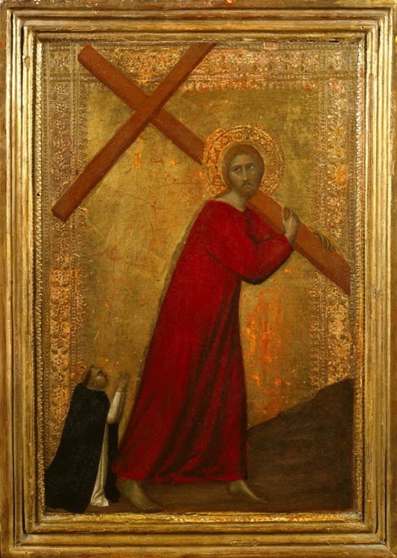
  <figcaption>Circle of Simone Martini, <em>Christ Bearing the Cross, with a Dominican Friar</em>, c. 1350, tempera on panel, 30.5 × 21.6 cm. New York, The Frick Collection, Gift of Miss Helen Clay Frick, 1927 (1927.1.01). Photo: The Frick Collection, New York, public domain, via Wikimedia Commons.</figcaption>
</figure>

This small panel in the Frick Collection in New York represents Christ carrying the cross, accompanied only by a kneeling Dominican friar. It is a devotional image of great simplicity, in which the episode of the road to Calvary is reduced to its essential elements: the figure of Christ, the cross, the hill of Golgotha and the praying friar. The panel retains a gilded frame and measures 30.5 × 21.6 cm.

The Frick Collection attributes the panel to the circle of Simone Martini and dates it to around 1350, a few years after the painter's death in 1344. Its composition and its refined execution, from the tooled gold ground to the elegant figure of Christ, are closely related to the small devotional panels that Simone painted in the last years of his career, and show how his models continued to be used by painters of his circle after his death.

Its provenance is documented from the late nineteenth century. It belonged to the English painter Sir Frederic Leighton, President of the Royal Academy, and was sold with his collection at Christie's in London on 14 July 1896. It then passed to Robert and Evelyn Benson, who formed in London one of the most important collections of early Italian painting, and, through the dealer Joseph Duveen, to the Frick family. In 1927 Helen Clay Frick, daughter of the founder of the collection, gave it to the Frick Collection.

Christ walks from left to right, wearing a long red robe that falls to his bare feet. He carries a large wooden cross, which rests on his right shoulder and rises diagonally across the panel, its upper arms reaching the top left corner. His head, surrounded by a finely punched halo, is turned back over his shoulder, so that his eyes are directed towards the friar and the viewer, while his body moves forward towards the dark hill rising on the right, the summit of Calvary.

The figure of Christ is monumental within the small format. The red robe, falling in long vertical folds, forms a single strong shape against the gold, and the weight of the cross is suggested by the forward inclination of the body and the firm grip of the hands. The bare feet, placed on the dark ground, emphasise the humility and suffering of Christ on his way to death.

At the lower left, the small figure of a Dominican friar kneels in prayer, wearing the black mantle of his order over a white habit, with his hands joined and his face turned up towards Christ. His reduced scale, in accordance with the conventions of the time, distinguishes him from the sacred figure, while his position at the feet of Christ expresses his desire to follow him. The friar may be the person for whom the panel was painted, and the image would then express his personal devotion to the Passion.

The gold ground is enriched by a broad tooled border with foliate motifs, which frames the scene on all sides. Within it, the gold is worn in places, revealing the red bole beneath, especially around the figure of Christ. The halo, decorated with punched motifs, stands out against the surrounding gold, and the dark hill on the right provides the only element of landscape.

The image takes up a motif that Simone had treated with greater narrative richness in the Carrying of the Cross of the Orsini polyptych, now in the Louvre. Here, however, the crowd has disappeared, and the meeting between Christ and the devout friar becomes a private dialogue. The panel thus illustrates the transformation of Simone's narrative models into images for individual meditation, a development that continued among his followers in the decades after his death.

### Madonna and Child from Santa Maria Maddalena (Castiglione d'Orcia, Sala d'Arte San Giovanni)

Image: <a href="https://artsandculture.google.com/asset/madonna-with-chid/5AGQDuwsroge-w"><em>Madonna and Child</em>, Fondazione Musei Senesi, Sala d'Arte San Giovanni, Castiglione d'Orcia (Google Arts &amp; Culture)</a>

This Madonna and Child comes from the church of Santa Maria Maddalena, a thirteenth-century building at the gates of Castiglione d'Orcia, in the Val d'Orcia south of Siena. For some time it was kept in the Museo Civico e Diocesano of Montalcino, and it is now displayed in the Sala d'Arte San Giovanni at Castiglione d'Orcia, a small museum housed in the former oratory of San Giovanni Battista, together with works painted for Castiglione and Rocca d'Orcia by Vecchietta and Giovanni di Paolo. The panel belongs to the diocese of Siena, Colle di Val d'Elsa and Montalcino.

The panel, with its round-arched top, measures 80.5 × 61 cm and is generally dated to the 1320s. Its format suggests that it was originally the central panel of a polyptych, whose lateral parts have been lost. The catalogue of the National Gallery of Art in Washington has proposed that it was the central panel of the altarpiece to which the four apostles in Washington and their six companions belonged: the dimensions of the Castiglione Madonna fit Simone's polyptychs, and its round-arched profile matches the arches of the predella busts. If the hypothesis is correct, the apostles would have been arranged in the predella beneath the Virgin, with Andrew and James Major close to the centre.

The Virgin is shown in half length, turned slightly to the left, with her head inclined towards the Child and her eyes directed outwards, beyond him, with a melancholy expression. Her face, with its long straight nose, small mouth and almond-shaped eyes, is framed by a white veil, over which falls a dark mantle with gold borders. A gold star shines on her right shoulder, the traditional sign of her virginity and of her title of Stella Maris. Beneath the mantle appears a red dress with a gold-embroidered neckline.

The Child sits on his mother's left arm, wearing a red tunic, with his bare legs crossed over her hand. He turns towards her and looks up at her face, while with his right hand he grasps the edge of her white veil, a gesture of affectionate familiarity that Simone had already used in other images of the Virgin and Child. In his left hand he holds a small dark bird, apparently a robin. Birds held by the Christ Child, such as the goldfinch, were traditionally read as allusions to the soul and to the future Passion, and the motif adds a further note of childlike realism to the image.

The Virgin's hands are long and elegant. With her left hand she supports the Child from below, while her right hand rests on her breast, the fingers touching the Child's tunic. The contrast between the dark mantle and the red garments of mother and Son gives the composition a strong chromatic structure, enhanced by the gold borders that follow the outlines of the figures.

The gold ground is considerably worn, and the red bole beneath now gives it a warm, reddish appearance. The haloes, decorated with punched motifs, are still visible around the heads of the Virgin and the Child, although in places they have become faint. The moulded frame follows the round arch of the panel.

The gentle melancholy of the Virgin, who seems to foresee the destiny of her Son while he looks at her with trust, is characteristic of Simone's Madonnas of the 1320s and recalls the central panels of the Pisa and Orvieto polyptychs. The intimate gesture of the Child holding the veil introduces a note of tenderness into a solemn, frontal image, in keeping with the devotional sensitivity of Simone's art.

If the connection with the Washington apostles is accepted, the Castiglione Madonna is the only surviving element of the main register of a polyptych whose predella has been dispersed between several collections. Even in isolation, it documents the diffusion of his altarpieces in the churches of the Sienese countryside.

### The Redeemer Conferring a Blessing (Vatican City, Pinacoteca Vaticana)

Image: <a href="https://www.museivaticani.va/content/museivaticani/en/collezioni/musei/la-pinacoteca/sala-ii---secolo-xiii-xv/simone-martini--il-redentore-benedicente.html"><em>The Redeemer Conferring a Blessing</em>, Pinacoteca Vaticana, Musei Vaticani</a>

This small gabled panel in Room II of the <a href="https://www.museivaticani.va/content/museivaticani/en/collezioni/musei/la-pinacoteca/sala-ii---secolo-xiii-xv/simone-martini--il-redentore-benedicente.html">Pinacoteca Vaticana</a> shows Christ in half length, blessing. Its shape and size suggest that it was originally the upper section of a lost polyptych, set above the central panel of the Virgin and Child, as in the polyptychs of Pisa and Orvieto, where the Blessing Christ crowns the composition. The museum dates it to about 1315–1320, on the basis of its stylistic affinity with the Maestà in the Palazzo Pubblico of Siena.

It has been proposed that the panel was the pinnacle of the altarpiece whose central panel is the Madonna and Child from Lucignano d'Arbia, now in the Pinacoteca Nazionale of Siena, to which it is close in date. The arguments for this connection are, however, considered weak, and the original context of the Redeemer remains unknown.

Christ faces the viewer frontally, with an intense, direct gaze. His long reddish-brown hair, parted in the centre, falls in waves on his shoulders, and a short beard frames the lower part of his face. The halo, delicately incised in the gold, is barely visible around his head, so that the figure seems to emerge directly from the luminous ground.

He wears a blue tunic with a gold-embroidered collar and cuffs and a red mantle with gold borders, which falls over his left shoulder and wraps around his body. With his right hand, raised in front of his breast, he makes the gesture of blessing, while his left hand rests on a closed book at the lower edge of the panel, the book of the Gospels or of the Law.

The frontal pose, the blessing gesture and the book follow a Byzantine model, that of Christ Pantocrator, which had a long tradition in Italian painting. The execution, however, is entirely Sienese: the elegant design of the contours, the soft modelling of the face and hands and the refined harmony of blue, red and gold reveal the hand of Simone Martini in the years of the Maestà.

Despite its small size, the Vatican Redeemer has a monumental presence. Set at the top of a polyptych, it would have dominated the saints and the Virgin below, presenting Christ as the ruler and judge of the world, in a sequence that led the eye of the faithful from the earthly figures of the main register to the divine figure in the pinnacle.

## Conclusion

Simone's surviving works trace a career that began in Siena in the shadow of Duccio and ended at the papal court of Avignon, in contact with the cardinals of the Curia and with Petrarch. Taken together, they show how a painter trained in the Sienese tradition transformed it from within, giving it a new elegance of line, a new richness of material and a new capacity to express human feeling, and how his art, carried beyond the Alps, became one of the foundations of the courtly Gothic painting of the later fourteenth century.

The early works already announce these qualities. The Madonna and Child of the Pinacoteca Nazionale and the Virgin of Mercy from Vertine still depend on Duccio's models, but the tender inclination of the heads and the softness of the modelling point towards a more intimate conception of the sacred image. The small Crucifixion of the Museo Horne, if Bellosi's early dating is accepted, and the Redeemer of the Pinacoteca Vaticana belong to the same years, when Simone was defining his own manner in small panels as well as in great public commissions.

The Maestà of the Palazzo Pubblico marks the decisive step. On the walls of the council chamber, Simone transformed the Virgin enthroned among saints into an image of civic government, in which the Queen of Heaven addresses the rulers of Siena through inscriptions and in which painting is enriched with gold, silver, glass and relief as if it were a work of the goldsmith. His later revision of the fresco shows that he continued to refine his art even in a work already completed, and the Maestà remained for generations the model of Sienese painting.

The years that followed were the most productive of his career. The Saint Louis of Toulouse for the Angevin court of Naples, the polyptych of Santa Caterina at Pisa, the altarpieces for San Gimignano and for the churches of Orvieto, the Blessed Agostino Novello altarpiece and the portable altarpiece painted for the government of Siena show Simone at work for kings, religious orders, cities and confraternities. In these works he developed the structure of the Gothic polyptych and gave to the narrative predella a new importance, as in the miracles of Saint Louis and of the Blessed Agostino, where everyday life enters the history of sanctity.

The chapel of Saint Martin at Assisi represents the summit of his work as a fresco painter. In the only complete cycle by his hand to survive, Simone combined the narrative clarity learned from Giotto's school with a chivalric and courtly vision of the life of the saint, and treated the wall with the refinement of a panel painter, enriching it with gold, applied metal leaf and coloured glazes. The saints of the transept, painted for the same circle of patrons, extend this vision to the Lower Church as a whole, while the castles he painted for the Palazzo Pubblico in 1330–31, documented though not securely identified with the surviving *Guidoriccio*, show the place that secular and political subjects held in Sienese painting of his time.

The Annunciation of 1333, painted with Lippo Memmi for Siena Cathedral, is the most famous expression of his mature style. The tension between the angel and the recoiling Virgin, the flowing line of the figures and the precious surface of the gold made it a model for later Sienese painters, and its composition is closely related to smaller works, such as the Annunciation diptych divided between Washington and Saint Petersburg. The close collaboration with Lippo Memmi in this work also raises the question of the workshop, which runs through his whole career and which cannot always be resolved with certainty.

The works of the Avignon years show the last transformation of his art. The frescoes of Notre-Dame-des-Doms, with their sinopie, present the Virgin of Humility on a monumental scale, while the frontispiece of Petrarch's Virgil gave visual form to the humanist culture of the poet and his circle. The Orsini polyptych, the Christ Discovered in the Temple dated 1342 and the small Christ on the Cross at Harvard reveal an art increasingly concentrated on intimate devotion, in which the drama of the Passion and the emotions of the Holy Family are condensed into small, precious images.

Many problems remain open. The chronology of the early works, the dating of the Assisi frescoes, the division of hands in the polyptychs, the date and patron of the Orsini polyptych and the authorship of the Guidoriccio continue to be discussed, and several of his works bear attributions that oscillate between Simone, Lippo Memmi and other members of the workshop. Scholars such as Martindale, Leone de Castris and Bellosi have clarified many of these questions, but Simone Martini's oeuvre remains, in part, a field of hypotheses rather than certainties.

The dispersal of his works is itself part of their history. Polyptychs were dismantled and their panels scattered between Siena, Pisa, Orvieto, Boston, New York, Washington, Cambridge, Antwerp, Paris, Berlin and other cities; frescoes were detached from their walls; small devotional images passed through the hands of collectors and dealers before reaching museums in Europe and America. Reconstructing these ensembles, as in the case of the portable altarpiece of the Palazzo Pubblico or the polyptych to which the Washington apostles belonged, is one of the principal tasks of modern research, and it allows the original meaning and function of the works to be recovered.

Simone Martini died in Avignon in 1344, and a funeral vigil in his memory is recorded in Siena. His influence, however, extended far beyond his lifetime and his city. In Siena his models were followed by Lippo Memmi and by the painters of the following generation; in Avignon his presence contributed to the formation of the painters of the papal court; and through works such as the Orsini polyptych, which reached the Charterhouse of Champmol, his art entered the courts of France and Burgundy. His surviving works combine the refinement of Gothic art with the observation of human feeling of the new Italian painting.
