## A Name Recovered

Andrea di Bonaiuto, called Andrea da Firenze, is the painter of the frescoes that cover every wall and every cell of the vault of the chapter house of [Santa Maria Novella](/Content/Churches/Basilica-Santa-Maria-Novella.html), the room known since the sixteenth century as the Cappellone degli Spagnoli or Spanish Chapel. They are among the most reproduced and most discussed paintings of the fourteenth century, and among the most ambitious programmes of images produced in Europe after the Black Death.

For almost three centuries the painter of these frescoes had no name. Giorgio Vasari, in the *Lives* of 1550 and 1568, gave the chapter house to the Sienese Simone Martini, whom he called Simone Memmi, with Lippo Memmi and Taddeo Gaddi. The attribution was impossible, since Simone died in 1344, more than twenty years before the frescoes were begun, but it held until the nineteenth century.

The recovery began in Pisa. In 1846 the archivist [Francesco Bonaini](/scholars.html#bonaini-francesco) published a payment of 3 October 1377 to a "maestro Andrea di Firenze" for the painting of the story of Saint Ranieri in the Camposanto. [Crowe](/scholars.html#crowe-joseph-archer) and [Cavalcaselle](/scholars.html#cavalcaselle-giovanni-battista), in the 1860s, recognised the same hand in the Florentine chapter house and gave it to this Andrea da Firenze.

[Gaetano Milanesi](/scholars.html#milanesi-gaetano), in his edition of Vasari of 1878, identified Andrea da Firenze with the Andrea di Bonaiuto known from the Florentine guild records and from a will of 1377. The circle was closed in the early twentieth century, when the Dominican historian [Innocenzo Taurisano](/scholars.html#taurisano-innocenzo) published the document of December 1365 by which the prior of Santa Maria Novella paid "Andrea Bonaiuti" for painting the chapter house.

The painter's name must be distinguished from several homonyms. He is not Andreas de Florentia, the Servite organist and composer of the *ars nova* who died in 1415; nor Andrea di Giusto, a Florentine painter of the next century; nor the Venetian Andrea da Murano. Casual sources occasionally mix their biographies with his.

What can be known of him rests on two kinds of evidence. The documents give a career: a guild enrolment, a residence, a contract, offices, a payment and a will. The works give a style: the documented frescoes in Florence and Pisa, and a group of panels attributed to him on the basis of that style, several of them disputed.

His art belongs to the generation after the Black Death of 1348, the generation of Orcagna and his brothers, and it shares their preference for ordered, hieratic, richly ornamented images over the spatial naturalism of Giotto. Within that generation he was the painter of the most complete programme of Dominican teaching, and one of the most inventive narrators of crowds.

His surviving work comprises the frescoes of the chapter house, the stories of Saint Ranieri at Pisa and a group of panels given to him on grounds of style. Works attributed to him in the past and now given to others, such as the triptych of Ajaccio and the Resurrection of Ognissanti, show how porous the borders of his catalogue remain.

## Documents and Life

Andrea di Bonaiuto was born in Florence. No baptismal record survives. The date of about 1320 found in the literature is an estimate worked back from his enrolment in the guild, not a documented date, and the precise "March 1319" that circulates in popular sources has no basis.

He enrolled in the Arte dei Medici e Speziali, the guild of physicians and apothecaries to which Florentine painters belonged, between 1343 and 1346. The *Dizionario Biografico degli Italiani* places the enrolment after 1343; the National Gallery in London records him as a member of the guild in 1346. The conventional statement that he was active from 1343 derives from this enrolment.

He lived in the parish of Santa Maria Novella from 1351 to 1376, close to the Dominican convent whose chapter house he was to paint. In 1366 and 1367 he was one of the painters and masters summoned to give advice and drawings for the works of Florence Cathedral, then under discussion for the design of its east end.

In 1374 he was enrolled in the Compagnia di San Luca, the confraternity of Florentine painters, and from September to December of the same year he served as one of the consuls of the Arte dei Medici e Speziali. The office shows that by the 1370s he was a senior and trusted member of his profession.

The decisive document for his work in Florence is dated 3 December 1365. By it the prior of Santa Maria Novella, fra Zanobi Guasconi, granted Andrea a house as payment for painting the chapter house, the work to be completed within two years from 10 January 1366. The frescoes are therefore datable to 1366–1367, with some finishing work perhaps continuing into 1368.

The document of Pisa follows a decade later. On 3 October 1377 "maestro Andrea di Firenze" received 1,529 lire and 10 soldi as the balance of his payment for the stories of Saint Ranieri in the Camposanto. The cycle had been commissioned in 1376 under Pietro Gambacorta, lord of Pisa, and Andrea left it unfinished; Antonio Veneziano completed it in the 1380s.

Andrea made his will on 2 December 1377. [Luisa Marcucci](/scholars.html#marcucci-luisa), in the *Dizionario Biografico*, considered it probable that he died in the same year. Other sources place his death in 1379, the National Gallery among them. The documents allow no more than that he died between the end of 1377 and 1379; the statement that he died in Pisa while working in the Camposanto has no documentary support.

The documents thus outline the career of a respected master, enrolled in his guild, resident beside the Dominicans who were his principal patrons, consulted by the cathedral, elected to office, and called to Pisa for a prestigious commission at the end of his life. Of his family, his training and his workshop they say nothing.

## Florence after the Black Death

The plague of 1348 struck Florence with great force. Boccaccio, in the *Decameron*, spoke of more than a hundred thousand dead, and the chronicler [Matteo Villani](/scholars.html#villani-matteo) estimated that three in five of the inhabitants died. The figures are exaggerated, but the loss was immense, and it was followed by further epidemics, famines and political crises.

[Millard Meiss](/scholars.html#meiss-millard), in his book of 1951 on painting in Florence and Siena after the Black Death, argued that this catastrophe changed the character of Tuscan painting. In place of the naturalism, the spatial coherence and the human warmth of [Giotto](/Content/Artists/XIII-c/Giotto-di-Bondone.html) and his followers, the painters of the 1350s and 1360s preferred frontal, hieratic and abstract images, insisting on the authority of the Church and on penitence.

The painter who most fully embodied this change, for Meiss, was [Andrea di Cione, called Orcagna](/Content/Artists/XIV-c/Andrea-di-Cione-Orcagna.html), with his brothers Nardo and Jacopo. Their altarpieces, with gold grounds, ranks of rigid saints and a majestic Christ in glory, set the style of Florentine painting in the third quarter of the century.

Later scholars have qualified the thesis. Some of the changes it describes began before 1348, and the notion of a decline after Giotto is a judgement rather than a description. The Spanish Chapel, painted almost twenty years after the plague, is better understood as a confident programme of Dominican self-representation than as an expression of anxiety.

Andrea di Bonaiuto belongs nevertheless to this generation. His earliest attributed panels show close contact with the workshop of the Cione, and it has been suggested that he trained with Nardo. His figures share the Orcagnesque taste for clear contours, flat colour and rich ornament.

Two further currents enter his style. The first is Sienese: the slender female types, the sinuous line and the love of crowded, animated narrative recall [Simone Martini](/Content/Artists/XIV-c/Simone-Martini.html) and his circle, probably at second hand. The second is the art of Maso di Banco, the most monumental of Giotto's followers, whose simplification of volume into broad, continuous planes modern criticism has recognised in Andrea's surfaces.

The Dominicans were the most important patrons of this art. The Order of Preachers, devoted to the defence of orthodoxy, to preaching and to theological learning, had in Santa Maria Novella its great Florentine house, and its friars, Jacopo Passavanti above all, preached penitence to a city shaken by the plague.

Andrea's chapter house is the meeting point of these forces: the Orcagnesque style of the generation after the plague, the Sienese gift for narrative, and the doctrinal programme of a Dominican community that wished to represent its own mission, its saints and its teaching on the walls of the room where it met every day.

## The Commission and the Programme

The chapter house of Santa Maria Novella stands on the north side of the Chiostro Verde. It was built by the Dominican architect fra Jacopo Talenti, usually between about 1343 and 1355, as a large square hall covered by a single four-celled rib vault, with a small chapel opening off its north side.

It owed its existence to Buonamico di Lapo Guidalotti, called Mico, a wealthy merchant who financed the building and, in his will of 2 August 1355, left the friars 325 gold florins for its decoration with paintings. He was buried in the room, which thus served at once as the meeting hall of the community, as the funerary chapel of its benefactor and, through the small chapel on its axis, as a chapel of the Corpus Domini.

The dedication to the Body of Christ is important. [Serena Romano](/scholars.html#romano-serena) has argued that its eucharistic and anti-heretical meaning is one of the generative ideas of the whole programme, which binds the glorification of the Order to the defence of orthodox belief in the real presence of Christ in the sacrament.

Guidalotti died in 1355, but the frescoes were not begun until 1366. The interval of more than a decade has not been explained. The contract of December 1365 gave Andrea two years, and the room, with its four walls and four cells of vault, was painted in that time with the help of assistants.

The programme has long been credited to fra Jacopo Passavanti, the Dominican preacher who was prior of Santa Maria Novella, an executor of Guidalotti's will and the author of the *Specchio della vera penitenza*, compiled from his sermons around 1354. Passages of the frescoes have demonstrable parallels in the *Specchio*. But Passavanti died in 1357, nine years before the painting began.

It is therefore possible that Passavanti sketched a plan before his death, which other friars developed; but the finished programme cannot be his alone. Romano has warned against reading the whole cycle as an illustration of the *Specchio*. The frescoes combine several Dominican concerns: the glory of the Order and its saints, the defence of the faith and the sacrament, and the daily function of the chapter house as a place of correction and penance.

The programme is clear in its architecture. Each wall is answered by the cell of the vault above it. Above the Passion wall, on the north, is the Resurrection; above the stories of Saint Peter Martyr, on the entrance wall, the Ascension; above the Way of Salvation, on the east wall, the Navicella; above the Triumph of Saint Thomas Aquinas, on the west wall, the Pentecost.

The density and precision of this argument presuppose a learned Dominican author, working with the painter. Andrea's achievement was one of translation and staging: he turned a complex theological argument into images that could be read by the friars who met beneath them every day, and that still hold the attention of visitors six centuries later.

## Style, Workshop and Collaborators

Andrea's manner is that of an accomplished painter of the Orcagnesque generation. The most acute description of it remains that of the *Dizionario Biografico*: he shows little interest in the rendering of deep space, and builds his scenes in superimposed planes, one above another. This layered construction is not a failure of perspective but a means of clarity, which allows the doctrinal argument to be read like a diagram.

His figures have little weight. They are drawn with dry, firm contours, set in a decorative, almost arabesque rhythm, especially in the drapery. Their faces are conventional, but he seeks variety in type and attitude, and above all in costume: the cut of beards and hair, the elaboration of hats and headdresses, the details of fashion. His crowds are companies of richly dressed extras, sometimes presented with wit.

This taste for the particular, for the exotic detail and the caricatured face, links him with the Cione and the other painters of Orcagna's circle, and also with Giovanni da Milano, who was active in Florence in exactly these years. The Sienese strain in his female types and in his narrative manner helps to explain why later critics took the frescoes for Sienese work.

The chapter house could not be painted by one man in two years. At least two assistants of Orcagnesque formation have been distinguished. One, close to the painter of the Pentecost in the Accademia and perhaps the young Spinello Aretino, is recognised in the Navicella and in parts of the Pentecost of the vault; another, close to Jacopo di Cione, appears in the stories of Saint Peter Martyr.

These identifications rest on style, and they vary from scholar to scholar, but the presence of a workshop is certain. The unity of the room, painted in a single campaign to a single design, shows that the master directed his assistants closely.

A technical feature that recent scholarship has emphasised is the use of punched and painted ornament. Haloes, borders and textiles are tooled or painted with dense patterns, which reinforce the two-dimensional, ornamental character of the surfaces. The same tooling links the panels attributed to him, and connoisseurs have used it to group them.

The decorative system of the chapter house is itself an achievement. The ribs of the vault and the arches of the walls are framed by broad painted borders of interlace and foliage, studded with medallions in which prophets hold their scrolls. Unlike the compartmented ceilings of earlier practice, the four cells of the vault are each a single field, and the walls and vault read as one continuous argument.

Andrea's reputation has changed with the recovery of his name. Once dismissed as a minor follower of Orcagna, he is now recognised as the author of one of the most completely realised programmes of the European Middle Ages, and as a painter whose love of crowds, costume and pleasing detail influenced Florentine painting in the last third of the century.

## Portraits, Myths and Critical Fortune

No aspect of the Spanish Chapel has produced more persistent error than the belief that its frescoes contain portraits of famous people. The error begins with Vasari, who named in the Way of Salvation the poet Petrarch, "portrayed from life", and his beloved Laura, a seated woman dressed in green with a small flame at her breast, as well as a "Knight of Rhodes" standing near the emperor.

Later writers enlarged Vasari's list into a gallery of Florentine celebrities: Cimabue, Giotto, Arnolfo di Cambio, Dante, Boccaccio, Guido Cavalcanti. The list, still found in guidebooks, has no warrant in the evidence of the fourteenth century. The identifications of Petrarch and Laura rest on Vasari alone, who did not know who had painted the wall.

[Paul F. Watson](/scholars.html#watson-paul-f), in a study of 1980 published in *Memorie Domenicane*, argued that the wall is not a group portrait but an allegory: its seated figures are types representing the estates of a rightly ordered Christendom, not disguised likenesses of poets and their friends. His conclusion is now generally accepted.

Two more learned identifications remain in dispute. The knight in white with gold embroidery near the emperor was identified by [M. A. Devlin](/scholars.html#devlin-mary-aquinas) in 1929 as an English Knight of the Garter, Edward le Despenser; [Anthony Luttrell](/scholars.html#luttrell-anthony), in 1972, argued that he is a Knight Hospitaller, a knight "of Rhodes", in agreement with Vasari's own description. [Maria Grazia Chiappori](/scholars.html#chiappori-maria-grazia) proposed in 1983 that three figures in the same fresco represent the Venetian Polo, Marco, his father Niccolò and his uncle Maffeo. Both proposals are interpretations of anonymous figures.

The frescoes were admired for centuries under the wrong name. [John Ruskin](/scholars.html#ruskin-john) revered the Spanish Chapel as a summit of Christian art under the name of "Simon Memmi", and his *Mornings in Florence* made it a place of pilgrimage for English readers. Their reputation was established long before their author was known.

After the recovery of the name by Bonaini, Crowe and Cavalcaselle, Milanesi and Taurisano, the twentieth century turned to interpretation. Meiss's thesis of 1951 set the frescoes in the context of the plague. Romano, in 1976 and in later encyclopaedia entries, reframed the programme around the Corpus Domini; [Julian Gardner](/scholars.html#gardner-julian), in 1979, set it against the institutional needs of the Dominican community; [Joseph Polzer](/scholars.html#polzer-joseph), in 1995, read the Way of Salvation in the light of the penitential writing of Passavanti.

The study of the panels followed a separate path. [Mario Salmi](/scholars.html#salmi-mario) published the diptych of the Accademia in 1913 as the work of an anonymous Orcagnesque painter; [Bernard Berenson](/scholars.html#berenson-bernard) gave it to Andrea in 1932. [Richard Offner](/scholars.html#offner-richard) reconstructed the triptych divided between Copenhagen and Houston, and [Miklós Boskovits](/scholars.html#boskovits-miklos) gave it to the young Andrea. [Dillian Gordon](/scholars.html#gordon-dillian-rosalind) showed in 2009 that the London panel with ten saints reproduces the plan of the chapels of Santa Maria Novella.

The result is an inversion. The painter whose name was lost for three centuries is now one of the better documented Florentines of the Trecento, his great cycle fixed by contract to 1366–1367; while the panels, which would ordinarily define an artistic personality, remain the most uncertain part of his work. The catalogue that follows treats the documented frescoes first and the attributed panels after them.

## Catalogue Entry

### The Passion Wall: History

The north wall of the chapter house, facing the entrance, is the altar wall. At its centre a round-headed arch opens into the small chapel of the Corpus Domini, and around this opening Andrea painted the Passion of Christ in three episodes: the Way to Calvary at the lower left, the Crucifixion in the great lunette above, and the Descent into Limbo at the lower right.

The three episodes are not separated by frames. They form a single continuous landscape, which rises from the gate of Jerusalem at the left to the hill of Golgotha at the summit and descends to the mouth of Limbo at the right. The friar who faced the altar read the Passion as one movement, from the walk to the Cross, through the death, to the deliverance of the just.

The wall was painted, like the rest of the room, in 1366–1367. It is the devotional centre of the chapter house, the image before which the community prayed, and the *Dizionario Biografico* singles out its Crucifixion, with the two great allegories of the side walls, as the passage in which Andrea's own hand is most clearly felt.

An eighteenth-century repainting covered parts of the surface until it was removed in modern restorations. The colours of the lower zone, the red and pink of the city, the deep colours of the costumes, are now well preserved; the upper zone, with its dark sky, has sunk and darkened.

The Resurrection, in the cell of the vault directly above, continues the wall upward. The friar who raised his eyes from the dead Christ on the Cross found, past the ornamental border, the same Christ risen above his empty tomb.

The wall is the most narrative of the four. Where the side walls set out doctrine in ordered registers, the Passion wall tells a story with crowds, horses, soldiers and city walls, and gives full scope to Andrea's gift for costume and varied faces. The details that follow show the Way to Calvary and the Descent into Limbo at close range.

### The Passion Wall

<figure>
  
  <figcaption>Andrea di Bonaiuto, the Passion wall of the chapter house: the Way to Calvary, the Crucifixion and the Descent into Limbo, with the Resurrection in the vault above, 1366–1367. Fresco. Florence, Santa Maria Novella, chapter house (Cappellone degli Spagnoli). Photo: Holger Uwe Schmitt, <a href="https://creativecommons.org/licenses/by-sa/4.0/">CC BY-SA 4.0</a>, via <a href="https://commons.wikimedia.org/?curid=166204729">Wikimedia Commons</a>.</figcaption>
</figure>

The photograph shows the north wall from the centre of the room, with the cell of the vault above it. The wall is a great lunette framed by the arch of the vault, its border painted with interlace and foliage and set with small medallions in which prophets hold scrolls. Below the painted zone runs a dado of red rosettes.

The Crucifixion fills the upper half. Christ hangs on a tall cross at the apex, against a dark red sky, surrounded by angels in flight; at either side, on lower crosses, hang the two thieves. Beneath the crosses surges a crowd of horsemen and foot soldiers, their lances rising like a thicket, with the holy women and the Virgin at the left of the Cross.

At the lower left the Way to Calvary issues from the gate of Jerusalem, a pink city of towers and walls crowded with spectators. Christ, in a dark red robe, carries the cross among soldiers and horsemen, followed by the Virgin, Saint John and the holy women.

At the lower right the Descent into Limbo closes the sequence. Christ, in white within a golden glory, strides towards a cave of grey rock, breaks its doors and takes the hand of Adam, while the just of the Old Testament crowd behind him and demons lurk in the cleft of the rock.

At the centre the arch of the small chapel cuts into the painted wall. The chapel, with its altar and a later crucifix, was dedicated to the Corpus Domini, and the Passion above its entrance gave the sacrament on its altar its meaning: the body offered on the Cross and present in the Eucharist.

In the cell of the vault above, the Resurrection completes the wall. Two angels sit on the empty tomb, the three Maries approach from the left, the guards sleep below, and at the right the risen Christ appears to Mary Magdalen. The vertical axis runs from the chapel through the Cross to the empty tomb.

The photograph also shows how the painted decoration binds the room together. The borders of the vault ribs, the dado, the painted pilasters at the corners and the arch of the chapel form a single framework, within which the narrative of the wall unfolds as one continuous field.

The wall is the most complete expression of Andrea's narrative style. Its scale is monumental, but its interest lies in the multitude of figures, each characterised by costume, gesture and face, which the details that follow allow to be seen at close range.

### The Passion Wall: Christ Carrying the Cross

<figure>
  
  <figcaption>Andrea di Bonaiuto, Christ carrying the Cross, detail of the Passion wall, 1366–1367. Fresco. Florence, Santa Maria Novella, chapter house. Photo: Sailko, <a href="https://creativecommons.org/licenses/by/3.0/">CC BY 3.0</a>, via <a href="https://commons.wikimedia.org/?curid=39979282">Wikimedia Commons</a>.</figcaption>
</figure>

Christ walks at the centre of the procession, barefoot, in a long robe of dark red, bearing the heavy cross on his shoulder. His head, with a cruciform halo and long auburn hair, turns slightly back towards the mourners who follow; his face is calm and grave, without the marks of suffering that later painters would add.

He is surrounded by his escort. A soldier in front of him wears a yellow tunic and a jerkin dotted with black stars, a round shield at his side; behind him helmeted men crowd together. A man in yellow helps to hold the cross, and another, seen from behind in a pink tunic, carries a hammer at his belt and pulls a rope, ready for the crucifixion.

The horses behind the soldiers, a brown one and a white one with a dark bridle, and the spotted hindquarters of another at the right, belong to the mounted captains of the procession. Andrea painted horses with evident pleasure, varying their colours and their harness, and they recur throughout the wall.

The variety of costume is characteristic. Each soldier wears a different helmet or cap, a different tunic, different hose; the man with the hammer has torn sleeves and a loose belt. The procession is a crowd of individuals, observed with the curiosity that the *Dizionario Biografico* describes as Andrea's delight in costume and detail.

The figure of Christ is the still centre of this movement. His long, unbroken robe and his steady walk contrast with the agitated gestures and broken colours of the men around him, and the cross, cutting diagonally across the group, directs the eye up the wall towards the Crucifixion above.

### The Passion Wall: the Virgin, Saint John and the Holy Women

<figure>
  
  <figcaption>Andrea di Bonaiuto, the Virgin, Saint John and the holy women following Christ, detail of the Passion wall, 1366–1367. Fresco. Florence, Santa Maria Novella, chapter house. Photo: Sailko, <a href="https://creativecommons.org/licenses/by/3.0/">CC BY 3.0</a>, via <a href="https://commons.wikimedia.org/?curid=39979331">Wikimedia Commons</a>.</figcaption>
</figure>

Behind Christ walks the group of his followers. At the centre Mary Magdalen, with long fair hair and a halo, in a dark red mantle, stretches out an open hand; beside him the Virgin, in a blue mantle, walks with her hands joined at her waist, her face drawn with grief; behind them Saint John clasps his hands, and the holy women crowd together with sorrowful faces.

At the left a bearded old man in a pale green mantle, holding a scroll, stretches out his arm towards Christ. In front of the group two small boys walk beside the women, one in a white belted tunic. The children, a touch of daily life in the sacred procession, are typical of Andrea's observation.

At the right the soldier in the yellow tunic with black stars, a sword at his side, stands between the mourners and Christ, holding the cross. He marks the separation between the condemned man and those who love him, a separation that the composition makes visible.

The faces of the mourners are among the most expressive of the wall. Their brows are drawn together, their mouths slightly open, their eyes turned towards Christ. The grief is restrained, as in all Andrea's work, but it is unmistakable.

The colours of the group, blue, dark red, pale green and rose, are still fresh, and they show the range of Andrea's palette. The dark, scalloped shape at the left edge is the foliage of a tree at the city gate, painted almost black, which closes the scene.

### The Passion Wall: Horsemen at the Gate of Jerusalem

<figure>
  
  <figcaption>Andrea di Bonaiuto, horsemen leaving the gate of Jerusalem, detail of the Passion wall, 1366–1367. Fresco. Florence, Santa Maria Novella, chapter house. Photo: Sailko, <a href="https://creativecommons.org/licenses/by/3.0/">CC BY 3.0</a>, via <a href="https://commons.wikimedia.org/?curid=39979290">Wikimedia Commons</a>.</figcaption>
</figure>

The procession leaves Jerusalem through a dark arched gate in the pink city wall. Horsemen ride out at its head: a young man in a white turban, a bearded soldier in a pale helmet crowned with a plume, a mace on his shoulder, and an old man with a long white beard and a yellow and red turban, holding a sword.

Their costumes are exotic. The turbans and the plumed helmet mark them as men of the East, the Jews and Romans of the Gospel imagined in the dress of Mamluks and Mongols that Italian merchants and travellers knew. Andrea's interest in such costumes is a recurring feature of his crowds.

Their horses, black and brown, show only their heads, with bridles and wide eyes, crowded under the gate. At the right lances rise above the wall, and at the bottom of the detail the haloed heads of the Virgin, Saint John and the mourners appear, so that the scene is built in layers: mourners, horsemen, wall, spectators.

The wall itself is painted with care. Its pink surface is pierced by narrow slit windows, crowned by a cornice and articulated by a round tower at the right. On the battlements above, the faces of the spectators look down, one of them pointing to the procession below.

The detail shows how Andrea built space by superimposition. There is no recession into depth: the mourners stand in front of the horsemen, the horsemen in front of the wall, the wall below the spectators. The method, which the *Dizionario Biografico* describes, gives the scene the clarity of a tapestry.

### The Passion Wall: Spectators on the Walls

<figure>
  
  <figcaption>Andrea di Bonaiuto, spectators on the walls of Jerusalem, detail of the Passion wall, 1366–1367. Fresco. Florence, Santa Maria Novella, chapter house. Photo: Sailko, <a href="https://creativecommons.org/licenses/by/3.0/">CC BY 3.0</a>, via <a href="https://commons.wikimedia.org/?curid=39979294">Wikimedia Commons</a>.</figcaption>
</figure>

Above the gate the city of Jerusalem is crowded with spectators. They lean out of three arched openings at the left and over the battlements of the wall, men in turbans, caps and hoods, some leaning forward with interest, one pointing down at the procession, another embracing a companion.

The architecture is a fantasy of pink and white. A crenellated tower with mullioned windows, a large round building with pedimented windows like an ancient amphitheatre, a small tower with a conical roof and a palace with a tiled loggia compose a city that is at once Jerusalem and Florence.

On a balcony a woman tends a pot of plants, apparently unaware of the procession below. The detail, a moment of daily life in the midst of the Passion, is one of the most charming of the wall, and it shows Andrea's attention to the incidental.

The spectators' faces are varied and individual. Some are curious, some indifferent, some engaged in conversation; none shows grief. They are the crowd of the city who watched the condemned man pass, the indifferent world against which the mourners' sorrow stands out.

The detail also shows the surface of the fresco. The colours of the buildings are pale and well preserved; the hill above, painted in a greenish earth colour, has lost most of its upper layer, and the faint traces of figures at the top left are the remains of the procession that climbed towards Golgotha.

### The Passion Wall: the City and the Crowd

<figure>
  
  <figcaption>Andrea di Bonaiuto, the city of Jerusalem and the crowd of the procession, detail of the Passion wall, 1366–1367. Fresco. Florence, Santa Maria Novella, chapter house. Photo: Sailko, <a href="https://creativecommons.org/licenses/by/3.0/">CC BY 3.0</a>, via <a href="https://commons.wikimedia.org/?curid=39979309">Wikimedia Commons</a>.</figcaption>
</figure>

The detail continues the city to the right and joins it to the procession. On the battlements more spectators lean over the wall, one embracing his companion, another resting his chin on his hand; in a loggia a young woman leans on the parapet beside two pots of plants, her face turned down towards the street.

Above the city, on the slope of the hill, three heads appear in a group: an old bearded man in a white hood, a bearded man in a black cap and a young man. They seem to emerge from the ground, the remains of figures whose bodies have been lost with the upper layer of the plaster or were never painted.

At the right the crowd of the procession presses towards the hill. A soldier in a pale helmet, bearded men, an old man in a white hood and a man with long white hair turn their heads in profile, following the movement towards Golgotha.

The faces are individual studies. The old man in the white hood, with his deep wrinkles and lowered eyes, and the bearded man beside him, gazing upward, are among the most carefully characterised heads of the wall.

The detail shows the continuity between architecture and figures in Andrea's composition. The city rises behind the crowd like a stage set, and the figures fill the spaces between the buildings, so that the wall has no empty zones.

### The Passion Wall: Heads on the Hillside

<figure>
  
  <figcaption>Andrea di Bonaiuto, heads on the hillside below the Crucifixion, detail of the Passion wall, 1366–1367. Fresco. Florence, Santa Maria Novella, chapter house. Photo: Sailko, <a href="https://creativecommons.org/licenses/by/3.0/">CC BY 3.0</a>, via <a href="https://commons.wikimedia.org/?curid=39979332">Wikimedia Commons</a>.</figcaption>
</figure>

The detail shows the zone between the city and the Crucifixion. At the top the legs and feet of figures walking up the hill are visible: bare legs, a black boot, hose of grey-green and yellow, the hem of a red garment. The bodies above them belong to the crowd beneath the Cross.

In the middle of the hillside the three heads seen in the previous detail appear more clearly. The old man in the white hood clutches his mantle at his breast and looks to the side with a worried expression; the man in the black cap beside him raises his eyes; the young man turns in profile.

These heads, floating on the bare hillside, are puzzling. They may be figures climbing the hill behind a fold of the ground, of which only the heads are visible, a device that Trecento painters used to suggest a crowd beyond a rise.

The hillside itself has lost much of its paint. Its grey-green surface is mottled with losses and stains, and the transition from the city to the crowd of the Crucifixion is partly obscured. The figures, painted on a better preserved layer, stand out against it.

The detail shows the density of Andrea's composition: even in the zones between the main scenes, where another painter might have left landscape, he filled the wall with figures and faces.

### The Passion Wall: Two Young Men beside the Chapel Arch

<figure>
  
  <figcaption>Andrea di Bonaiuto, two young men and a bearded figure beside the arch of the Corpus Domini chapel, detail of the Passion wall, 1366–1367. Fresco. Florence, Santa Maria Novella, chapter house. Photo: Sailko, <a href="https://creativecommons.org/licenses/by/3.0/">CC BY 3.0</a>, via <a href="https://commons.wikimedia.org/?curid=39979276">Wikimedia Commons</a>.</figcaption>
</figure>

Beside the stone arch of the small chapel, at the lower edge of the Calvary scene, two young men walk together on the bare ground. One, in a fashionable pink and green costume with puffed sleeves and a short pleated skirt, points down to the left; the other, in a long pale robe, lets himself be led, his head bowed, his companion's arm around his shoulders.

Their curly fair hair and small caps, and the elegance of the first young man's dress, make them figures of contemporary Florence rather than of ancient Jerusalem. Their meaning in the scene is not clear: they may be spectators drawn to the procession, or a young man being shown the way of the Cross.

At the right, beside the arch, stands a bearded old man in a white mantle, painted almost in monochrome. His pallor sets him apart from the coloured figures around him, and he looks down with a melancholy expression. He may be a painted statue or a figure deliberately rendered in a different register.

At the lower left the heads of men in dark hoods and of a young man with long fair hair in profile belong to the crowd that follows Christ. Lances cross the upper left corner, marking the edge of the armed procession.

The detail shows how Andrea treated the margins of his composition. Even beside the real architecture of the chapel arch, he placed figures of interest, and the fashionable young men, with their contemporary dress, bring the Passion into the world of the friars' own city.

### The Passion Wall: the Descent into Limbo

<figure>
  
  <figcaption>Andrea di Bonaiuto, the Descent into Limbo, detail of the Passion wall, 1366–1367. Fresco. Florence, Santa Maria Novella, chapter house. Photo: Sailko, <a href="https://creativecommons.org/licenses/by-sa/3.0/">CC BY-SA 3.0</a>, via <a href="https://commons.wikimedia.org/?curid=25409116">Wikimedia Commons</a>.</figcaption>
</figure>

The Descent into Limbo closes the Passion wall at the lower right. Christ, dressed in white, a banner with a red cross in his hand, strides forward within a flaming golden glory and takes the hand of Adam, an old man with a long white beard in a blue mantle, to lead him out of the realm of the dead.

Beneath Christ's feet a black demon lies crushed, and the doors of Hell, broken into fragments of masonry, lie scattered at the threshold. The motif comes from the apocryphal Gospel of Nicodemus, which tells how Christ, between his death and resurrection, descended to free the just of the Old Testament.

Behind Adam crowd the just: Eve in a pale mantle, kneeling; patriarchs with long beards; prophets and kings with crowns; John the Baptist, dark-haired and bearded; women with haloes. They kneel and stand under the arch of a great grey cave, whose rocks are painted in broad, faceted planes.

At the right, in a dark cleft of the rock, the demons of Hell look on in dismay, and an old man is held among the flames at the edge. The contrast between the light of Christ's glory at the left and the darkness of the cleft at the right gives the scene its drama.

The scene completes the theological argument of the wall. The Way to Calvary leads to the Cross; the Cross redeems the just of all ages; and the Descent into Limbo shows that redemption reaching back to Adam, the first man, before the Resurrection above announces its completion.

### The Passion Wall: the Demons of Limbo

<figure>
  
  <figcaption>Andrea di Bonaiuto, demons in the cleft of Limbo, detail of the Descent into Limbo, 1366–1367. Fresco. Florence, Santa Maria Novella, chapter house. Photo: Sailko, <a href="https://creativecommons.org/licenses/by-sa/3.0/">CC BY-SA 3.0</a>, via <a href="https://commons.wikimedia.org/?curid=25409106">Wikimedia Commons</a>.</figcaption>
</figure>

The demons of Limbo are among the most memorable figures of the chapter house. In a dark cleft between grey rocks, licked by small flames, four of them crowd together: a blue, hairy demon with a grinning mouth clings to the rock at the left, wrapped in his bat wings.

At the centre stand a red demon with pointed ears and tusks, wringing his hands, and a pale blue one with spiky hair and a sharp profile, both with bat wings. In front of them crouches a yellow demon with horns, a long snout and folded wings, his hand at his mouth in consternation.

Their dismay is the point. Christ has broken the doors of their realm and taken its prisoners; they can only watch. Andrea gave them comic, almost grotesque features, in the tradition of medieval devils, but also a recognisable emotion, the frustration of the defeated.

At the right, among the flames, an old bearded man holds a small creature, perhaps a soul still in the power of Hell or a demon. At the left the haloed heads of the just, a king with a crown, crowned women, an old man and a figure in yellow armour, turn towards Christ and away from the demons.

The detail shows Andrea's imagination at its liveliest. The colours of the demons, blue, red, pale blue and yellow, stand out against the grey rock and the black cleft, and their varied bodies, hairy, bony, scaly, show the same delight in variety that he brought to the costumes of the human crowds.

### The Way of Salvation: History

The east wall carries the most famous of the frescoes. Since the sixteenth century it has been called the *Ecclesia Militans et Triumphans*, the Church Militant and Triumphant; more recent scholarship prefers the *Via Veritatis*, the Way of Truth, or the Way of Salvation, which better describes its argument: the progress of the Christian from earthly life, through the ministry of the Church and of the Dominican Order, to the gate of Paradise.

The wall is a single field organised in ascending zones. At the bottom the Church on earth, with pope and emperor enthroned before a great domed church; in the middle the Dominican saints at work, preaching, refuting heretics and hearing confession, and the worldly life of the senses; above, Saint Dominic leading the saved to the gate of Paradise; at the summit, Christ in glory.

The black and white dogs at the feet of the authorities are the emblem of the wall. They are the *Domini canes*, the "hounds of the Lord", a pun on the name of the Dominicans, who wore black and white; they guard the flock of the faithful and drive away the wolves of heresy.

The church behind the pope and emperor has often been described as a record of the intended design of Florence Cathedral, painted before Brunelleschi's dome. The claim does not hold: the building is pink, its campanile stands on the wrong side, and it is a symbolic image of the Church rather than an architect's elevation. That Andrea served on the cathedral's advisory commission in these very years gives the idea its appeal, not its proof.

The wall has also been the main source of the myth of portraits in the chapter house: the Petrarch and Laura of Vasari, the Garter knight or Knight of Rhodes, the three Polo. These identifications are discussed above; the figures are, in the great majority, types of the estates of Christendom.

[Joseph Polzer](/scholars.html#polzer-joseph), in 1995, read the wall in the light of the penitential writing of Passavanti and of an image of the Purgatory of Saint Patrick at Todi, stressing its penitential character: the way to Paradise passes through confession, and the friar who hears the penitent at the centre of the wall is its turning point.

### The Way of Salvation

<figure>
  
  <figcaption>Andrea di Bonaiuto, the Way of Salvation (Via Veritatis, Church Militant and Triumphant), 1366–1367. Fresco. Florence, Santa Maria Novella, chapter house, east wall. Image: public domain, via <a href="https://commons.wikimedia.org/?curid=23887256">Wikimedia Commons</a>.</figcaption>
</figure>

The wall is shown whole, framed by the arch of the vault and its painted border. At the summit, in a circular mandorla of gold, sits Christ in glory, holding a book and a key, with the Lamb on the throne beneath him and the four symbols of the Evangelists around it. Choirs of angels fill the sky on either side.

At the upper left, before a tall pink gate, Saint Peter admits the saved into Paradise, where they appear as small figures crowned with flowers by angels. Behind the gate the blessed stand in ranks: saints, apostles, patriarchs, the Virgin, a crowd of haloed heads rising towards Christ.

Below the gate rises the great pink church with its dome, and before it, at the lower left, the Church on earth: the pope enthroned at the centre, the emperor beside him with a sword and an orb, cardinals, bishops, monks, nuns, friars, kings and lay people of every condition, and at their feet the flock of sheep and the black and white dogs.

At the right the drama of the individual soul unfolds. Saint Dominic, in black and white, points the way to Paradise; below him a friar hears the confession of a kneeling penitent. Further right, the worldly life: a group of richly dressed young people make music, a viol and a hurdy-gurdy, young women dance in a ring, and children climb trees to pick fruit.

At the lower right, Dominican saints dispute with heretics and unbelievers. Saint Peter Martyr argues with a crowd of turbaned and bearded men, and Saint Thomas Aquinas holds open a book, while some of his opponents tear up their own books. At their feet the dogs attack the wolves.

The composition reads as a diagram. The eye moves from the institutional Church at the lower left, through the work of the Dominicans and the choice between the life of the senses and penitence at the right, to the gate of Paradise and the glory of Christ above. Each zone is a step in the way of salvation.

The wall is the most crowded of the room. Hundreds of figures, each with a distinct face and costume, populate it, and their variety is a constant source of pleasure: the hats and hoods, the beards and hairstyles, the dogs, the musicians, the trees full of children.

It is also the most carefully preserved. The colours of the lower zone, the whites and blacks of the Dominicans, the reds of the cardinals, the pinks of the church, are still bright, and the sky, though darkened, keeps its blue. The fresco is the clearest single image of the Dominican vision of the world in the fourteenth century.

### The Way of Salvation: the Church on Earth

<figure>
  
  <figcaption>Andrea di Bonaiuto, the pope and the emperor enthroned before the church, detail of the Way of Salvation, 1366–1367. Fresco. Florence, Santa Maria Novella, chapter house. Photo: Miguel Hermoso Cuesta, <a href="https://creativecommons.org/licenses/by-sa/4.0/">CC BY-SA 4.0</a>, via <a href="https://commons.wikimedia.org/?curid=45916500">Wikimedia Commons</a>.</figcaption>
</figure>

The detail shows the lower left of the wall: the Church on earth before its building. At the centre the pope sits enthroned in a gold cope marked with a great cross, a tiara on his head, his hand raised in blessing; beside him the emperor, crowned, holds a sword and an orb. They are the two heads of Christendom, spiritual and temporal.

Around them the hierarchies are ranked. At the left a cardinal in a red hat, a bishop with a crozier, monks and nuns of several orders, Dominicans in black and white, a Hospitaller with a white cross; at the right kings, nobles, lawyers, merchants and poor people, men and women, young and old.

At the pope's feet lie the sheep of the flock, and two black and white dogs, the hounds of the Lord, stand guard. The flock and its guardians show the pastoral role of the Church, entrusted to the Dominicans in particular as preachers and defenders of the faith.

Behind the crowd rises the pink church, with its ribbed dome, its nave lit by tall windows and its gabled façade. Whatever its relation to the design of Florence Cathedral, it is the image of the Church as a building, the *Ecclesia* that shelters the faithful.

The faces of the crowd are among the most individual of the room, and they have provoked the search for portraits that has accompanied the fresco since Vasari. They are better read as types of the Christian estates, gathered around their pastors in a single ordered community.

### The Triumph of Saint Thomas Aquinas: History

The west wall is devoted to the intellectual glory of the Order, personified in its greatest teacher, Saint Thomas Aquinas, canonised in 1323. It is conventionally called the Triumph of Saint Thomas, but it celebrates Christian learning as a whole rather than a victory alone.

Thomas sits enthroned at the centre, holding an open book inscribed with the words of the Book of Wisdom (7:7–8): "I prayed, and understanding was given me; I called upon God, and the spirit of wisdom came to me." The Holy Spirit and the virtues hover above him; the authors of Scripture sit at his sides.

Beneath his throne crouch three defeated heretics: Arius, who denied the divinity of Christ, Sabellius, who denied the distinction of the Persons of the Trinity, and, at the centre, the Arab commentator on Aristotle, Averroes. The configuration derives from an earlier Sienese model, the panel of the Triumph of Saint Thomas in Santa Caterina at Pisa, attributed to Lippo Memmi.

The lower register personifies the disciplines. Fourteen figures, seated in a long row of Gothic stalls, represent the seven sacred sciences and the seven liberal arts, and each has at her feet a historical figure who embodied her: Civil Law with the emperor Justinian, Canon Law with a pope, Grammar with Donatus, Rhetoric with Cicero, Music with Tubalcain, and so on.

The scheme expresses the Dominican idea of learning: all knowledge, sacred and profane, is ordered under theology and leads to God, and Thomas, who reconciled Aristotle with Christian doctrine, is its master. The wall faced the friars, many of whom were teachers and students in the Dominican schools.

The wall is the most static of the four. Where the Way of Salvation and the Passion wall are full of movement, the Triumph of Saint Thomas is built of seated figures in symmetrical rows, under arches, like a hall of learning. Its order is its message.

### The Triumph of Saint Thomas Aquinas

<figure>
  
  <figcaption>Andrea di Bonaiuto, the Triumph of Saint Thomas Aquinas, 1366–1367. Fresco. Florence, Santa Maria Novella, chapter house, west wall. Photo: Rufus46, <a href="https://creativecommons.org/licenses/by-sa/3.0/">CC BY-SA 3.0</a>, via <a href="https://commons.wikimedia.org/?curid=38516186">Wikimedia Commons</a>.</figcaption>
</figure>

The wall is shown whole, within the arch of the vault and its painted border. At the centre of the upper zone Thomas Aquinas sits on a tall Gothic throne crowned with pinnacles, in the black and white habit of his Order, holding an open book on his knees. He is frontal, broad and immobile, an image of serene authority.

On either side sit ten figures on a long bench: the prophets and evangelists, Moses with his horns of light, David with his crown, Paul, John and others, each with a book. They are the authorities of Scripture on which Thomas's learning rests.

Above him, in the dark blue sky, fly winged figures of the theological and cardinal virtues, with their attributes, and at the summit the dove of the Holy Spirit, from which the wisdom of Thomas descends. The composition is strictly symmetrical, and every figure is turned towards the centre.

Beneath the throne, in the space between the two zones, crouch the three heretics. Averroes, at the centre, rests his head on his hand, his book closed; Arius and Sabellius, at the sides, lie with their books overturned. Their defeat is not a battle but a refutation.

The lower zone is a long Gothic arcade of fourteen bays, its gables and pinnacles painted in pink and white. In each bay sits a female personification, a sacred science or a liberal art, crowned or veiled, holding her attribute: an organ for Music, a book, a sphere, a scroll. At her feet sits her historical exemplar, writing, reading or playing.

The figures of the lower register are varied in costume and gesture, despite the symmetry of the scheme. Grammar teaches a child, Tubalcain strikes an anvil, the representatives of the mathematical arts hold their instruments. The detail of the costumes, as elsewhere in the room, gives life to an abstract programme.

The wall was much praised by Ruskin, who devoted a chapter of *Mornings in Florence* to the sciences and their representatives. His descriptions, written under the name of Simon Memmi, are still among the most attentive readings of the wall.

The condition of the fresco is good. The darker colours of the upper zone, the blues and blacks, have sunk, but the figures of the arcade keep their pale, delicate colours, and the scheme can be read in every detail.

### The Stories of Saint Peter Martyr: History

The south wall, the entrance wall of the chapter house, is devoted to Saint Peter of Verona, called Peter Martyr, the Dominican inquisitor killed on 6 April 1252 on the road from Como to Milan and canonised in March 1253. His scenes were the last images the friars saw as they left the room.

Peter was an apt subject for the wall. Born at Verona in 1205 into a family touched by the Cathar heresy, he received the habit at Bologna, preached against heresy in Lombardy and in Florence, where he founded confraternities for the defence of the faith in the 1240s, and sealed his preaching with his blood.

The wall was devoted to seven scenes from his life and above all to his posthumous miracles: the healing of the sick at his tomb, of the paralytic Agata, the apparition to Rufino di Canapiccio. The emphasis on miracles presented the saint as a powerful intercessor, and his tomb in Milan as a place of pilgrimage.

The wall has suffered more than any other. In the sixteenth century, when Duke Cosimo I gave the chapter house to the Spanish community of Florence, a tribune was built against it, and its lower part was largely destroyed. What survives is fragmentary, and the scenes are partly abraded.

The stories of Peter Martyr are also the part of the room where scholars have most often recognised the hand of an assistant, close to Jacopo di Cione. The surviving scenes are uneven in quality, and their condition makes the distinction of hands difficult.

The cell of the vault above, the Ascension, answers the wall: the apostles sent into the world by Christ ascending, and the Dominican saint who continued their mission. The scenes that follow show the surviving parts of the wall.

### The Stories of Saint Peter Martyr: Miracles at the Tomb

<figure>
  
  <figcaption>Andrea di Bonaiuto, the sick at the tomb of Saint Peter Martyr, detail of the entrance wall, 1366–1367. Fresco. Florence, Santa Maria Novella, chapter house. Image: public domain, via <a href="https://commons.wikimedia.org/?curid=12139110">Wikimedia Commons</a>.</figcaption>
</figure>

The scene shows the crowd of the faithful at the tomb of Saint Peter Martyr in Sant'Eustorgio in Milan, seeking healing. The tomb fills the upper part of the field: a great raised sarcophagus of white marble, its front divided into octagonal compartments, each containing a seated winged figure with an attribute, painted in grey to imitate sculpture.

The winged figures are Virtues, like those of the real tomb of Peter Martyr carved by Giovanni di Balduccio and finished in 1339. Andrea may have known the tomb or its description, and his painted sarcophagus recalls its structure, with its frieze of figures and its high base.

Beneath the tomb the crowd presses upwards. At the centre a young man in a yellow tunic, lifted on the shoulders of a man in pink, stretches both arms to touch the sarcophagus: physical contact with the tomb was the channel of the martyr's power. Around him pilgrims with long staffs, a hooded friar, men with joined hands and a mother holding up her child turn their faces upward.

In the foreground sit the sick. An old man in a blue cap and a green tunic gazes up, a crutch beside him; a lame man stands with his hand on his breast; a group of women, one in a red mantle with loose hair, sits on the ground around a woman lying in grey, perhaps unconscious, whom they have brought to the tomb.

Their faces show every state of hope and need: the upturned gaze of the old man, the calm of the women, the effort of the young man reaching for the tomb. The scene is one of the most moving of the room, and one of the best preserved of the entrance wall.

It sums up the meaning of the wall. The martyr killed for his preaching continues to act after death; his tomb is a source of healing; his Order, which guards his memory, shares in his power. For the friars of Santa Maria Novella, the scene affirmed the holiness of their own vocation.

The figures are drawn with Andrea's typical variety. The pilgrims' hats and staffs, the friar's hood, the women's braided hair, the patterns of the dresses, every element is characterised, and the composition, rising from the seated women to the raised arms of the young man, leads the eye to the tomb.

The colours are well preserved in this photograph: the yellow and pink of the central figures, the green, blue and red of the foreground, the grey of the tomb against the dark red ground. They show how bright the entrance wall must have been before its damage.

### The Stories of Saint Peter Martyr: the Healing of Agata

<figure>
  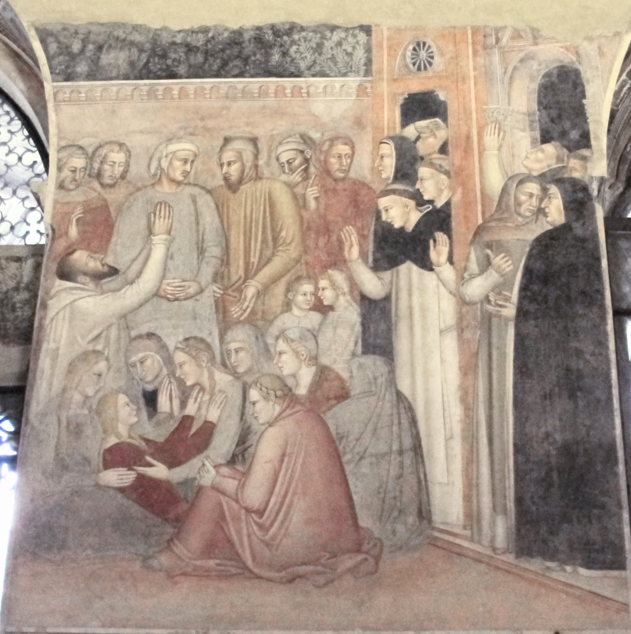
  <figcaption>Andrea di Bonaiuto, the healing of the paralytic Agata, detail of the entrance wall, 1366–1367. Fresco. Florence, Santa Maria Novella, chapter house. Photo: Sailko, <a href="https://creativecommons.org/licenses/by-sa/3.0/">CC BY-SA 3.0</a>, via <a href="https://commons.wikimedia.org/?curid=25415328">Wikimedia Commons</a> (detail).</figcaption>
</figure>

The scene stands at ground level beside the portal of the chapter house. A woman named Agata, deprived of the use of her limbs, is healed through the intercession of the martyred saint: dressed in red, her fair hair loose, she raises herself from the ground, her face lifted towards the veiled women who bend over her.

Around her the onlookers express their wonder. A bearded man at the far left raises both arms in astonishment, another presses his hand to his chin; a man in a rose mantle sits at her feet, seen from behind, closing the group around her.

At the right rises the façade of a church with an oculus and a Gothic portal, up whose steps dark-robed friars climb: the house of the Order towards which the miracle points. A pale enclosure wall with a band of dark foliage runs behind the figures.

The surface is much worn. The colours have faded to a muted harmony of earth tones, and whole passages read almost as underdrawing. The losses go back to the sixteenth-century tribune that was built against the wall.

The wear reveals Andrea's drawing. With the final layer of colour gone, the contours of the heads and the gestures of the hands appear with clarity, and they show the sureness of the painter's line.

### The Stories of Saint Peter Martyr: the Preaching

<figure>
  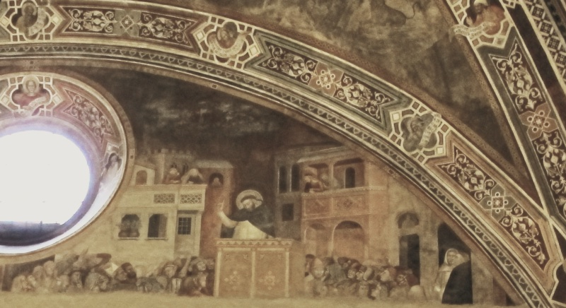
  <figcaption>Andrea di Bonaiuto, Saint Peter Martyr preaching, upper entrance wall, 1366–1367. Fresco. Florence, Santa Maria Novella, chapter house. Photo: Sailko, <a href="https://creativecommons.org/licenses/by-sa/3.0/">CC BY-SA 3.0</a>, via <a href="https://commons.wikimedia.org/?curid=25415383">Wikimedia Commons</a> (detail).</figcaption>
</figure>

At the upper right of the entrance wall, answering the Investiture at the upper left, Peter of Verona preaches. The scene shows the work from which the Order of Preachers takes its name, and it carried a local meaning: Peter had preached in Florence in the 1240s against the Patarene heretics.

The preacher stands in a wooden pulpit of ochre colour, its panels decorated with Gothic arches, leaning forward in the black and white habit, his right hand raised with the index finger extended in the gesture of argument. His head, inclined towards the crowd, shows concentration rather than rhetorical passion.

At the foot of the pulpit the audience presses on both sides, men and women in varied dress. Behind the preacher rise the buildings of the city, and from their windows and loggias other listeners lean out: a man in red, women in yellow and green veils.

The wider view shows the scene in its place, in the upper lunette of the entrance wall beneath the painted border of the vault, cut at the left by the real oculus of the wall. The colours have sunk to umber and bone, and the crowd at the lower edge is abraded.

The listeners at the windows extend the sermon vertically through the city. The preaching of the Order reaches not only the crowd in the square but every house, and the scene presents the Dominicans as the teachers of the whole city.

### The Stories of Saint Peter Martyr: the Listeners

<figure>
  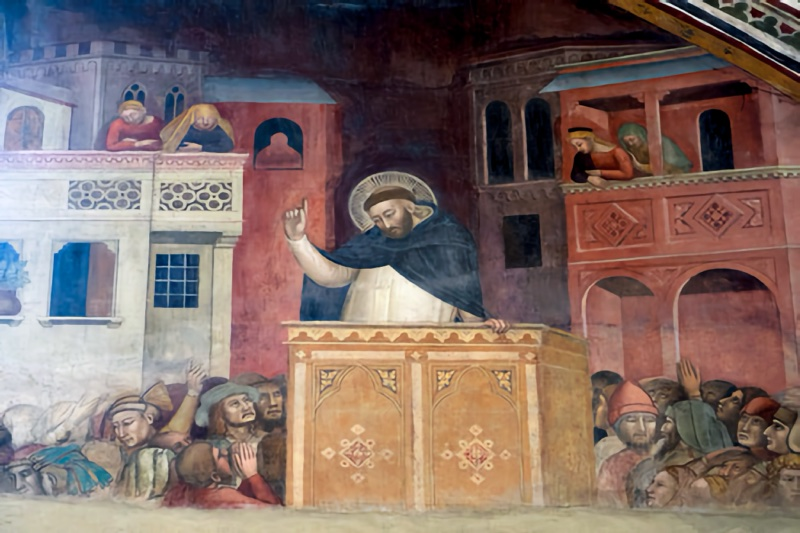
  <figcaption>Andrea di Bonaiuto, Saint Peter Martyr preaching, detail of the entrance wall, 1366–1367. Fresco. Florence, Santa Maria Novella, chapter house. Photo: Sailko, <a href="https://creativecommons.org/licenses/by-sa/3.0/">CC BY-SA 3.0</a>, via <a href="https://commons.wikimedia.org/?curid=25415575">Wikimedia Commons</a> (detail).</figcaption>
</figure>

The detail brings the preacher and his audience closer. Peter leans over the rim of the pulpit, his left hand gripping it, his right raised; the pulpit, with its arched panels and lozenge ornament, is the portable *pergamo* used for open-air sermons.

At its foot the crowd surges on both sides. Men in hoods and caps, women in veils, old and young, look up at the preacher; some listen intently, others talk among themselves. Andrea's crowd-painting is here at its most natural.

Behind the preacher a pale palazzo with mullioned openings and a balcony carries a man in red and a woman in a yellow veil, leaning out to listen. At the right a rose-red façade with lozenge inlays and a projecting loggia holds two more women, one in red, one in a green veil.

The architecture is of notable elegance, with arcaded porticoes, inlaid panels and balconies, and it gives the scene the appearance of a Florentine square of the fourteenth century rather than a street of thirteenth-century Lombardy.

The scene is a portrait of the Dominican mission as the friars of Santa Maria Novella understood it: preaching in the streets and squares of the city, to every class and condition, from a pulpit raised above the crowd.

### The Vault: History

The chapter house is covered by a single great four-celled rib vault. Its four triangular cells, the *vele* or "sails" of Italian architectural usage, each contain a scene that answers the wall below: the Resurrection above the Passion, the Ascension above the stories of Saint Peter Martyr, the Navicella above the Way of Salvation, the Pentecost above the Triumph of Saint Thomas.

The four scenes form two pairs. On one axis Christ's victory over death, the Resurrection and the Ascension; on the other the birth and life of the Church, the Navicella, the ship of the apostles saved by Christ, and the Pentecost, the descent of the Spirit. The vault gives each wall its answer from above.

The ribs are covered by broad painted borders of interlace, rosettes and foliage, set with medallions from which half-length prophets lean out with scrolls. At the crown of the vault, where the four borders meet, a medallion seals the programme.

Unlike the compartmented ceilings of earlier practice, each cell is a single continuous field, its landscape or architecture shaped to the triangle. The vault reads with the walls as one argument, an integration that recent scholarship counts among the achievements of the room.

It is in the vault, in the Navicella and the Pentecost above all, that scholars have most often recognised the hand of an assistant of Orcagnesque formation, perhaps the young Spinello Aretino. The attribution rests on style, but it reflects the workshop practice of a large commission.

The condition of the vault is fair. The blues of the sky have darkened and sunk, the lower zones of the cells are abraded, but the principal figures remain legible, and the ornamental borders keep their colours.

### The Stories of Saint Ranieri, Pisa: History

The second documented work of Andrea di Bonaiuto is in Pisa, in the Camposanto, the monumental cemetery beside the cathedral, whose walls were covered with frescoes in the fourteenth and fifteenth centuries. In 1376, under Pietro Gambacorta, lord of Pisa from 1370 to 1392, a cycle was begun on the life of Saint Ranieri, the patron saint of the city.

Ranieri, a Pisan merchant's son who died in 1160, had led a worldly life of music and pleasure before his conversion; he then went to the Holy Land, lived there as a penitent hermit, and returned to Pisa, where he died in the monastery of San Vito and was buried in the cathedral. His legend, written soon after his death, gave the painters a rich narrative.

Andrea painted the upper register of the cycle, in three scenes: the conversion of Ranieri, his voyage to the Holy Land, his taking of the penitent's habit and the vision of the Virgin, and his trials and temptations in the East, among them Satan threatening the saint at prayer and carrying him through the air. On 3 October 1377 he received the balance of his payment, 1,529 lire and 10 soldi.

The cycle was left unfinished. The lower register, with the return of Ranieri to Pisa, his death and funeral and his posthumous miracles, was painted by Antonio Veneziano in 1384–1386. The two painters' scenes stand one above the other on the same wall, on the right of the main entrance.

The Camposanto was struck by Allied artillery on 27 July 1944. A fire melted the lead of the roof, and the frescoes were badly damaged. They were detached from the walls in the years that followed, and after long restoration they have been returned to their original places, where the photographs show them, with large lacunae filled in a neutral tone.

The Pisan payment published by Bonaini in 1846 was the first document to name Andrea da Firenze, and the stories of Saint Ranieri were the starting point for the recovery of his name. Their style, compared with the Florentine chapter house, allowed Crowe and Cavalcaselle to attribute the Spanish Chapel to the same painter.

### The Stories of Saint Ranieri: the Voyage, the Habit and the Vision

<figure>
  
  <figcaption>Andrea di Bonaiuto, Saint Ranieri sails to the Holy Land, takes the penitent's habit and sees the Virgin (above), 1376–1377; Antonio Veneziano, the death of Saint Ranieri (below), 1384–1386. Fresco, detached and replaced. Pisa, Camposanto. Photo: Miguel Hermoso Cuesta, <a href="https://creativecommons.org/licenses/by-sa/4.0/">CC BY-SA 4.0</a>, via <a href="https://commons.wikimedia.org/?curid=36084807">Wikimedia Commons</a>.</figcaption>
</figure>

The photograph shows a section of the wall with two scenes one above the other. The upper scene, by Andrea di Bonaiuto, is well preserved and complete; the lower one, by Antonio Veneziano, is largely lost, its lacunae filled with plain plaster.

The upper scene reads from left to right. At the left a ship with a great white sail carries Ranieri, a young man with a halo, among merchants and sailors to the Holy Land; the sea beneath is green, with fish swimming in it, and an eagle in a roundel appears in the sky.

At the centre, under a Gothic tabernacle crowned with pinnacles, Ranieri kneels half-naked as a woman in blue, perhaps the Virgin, clothes him in the penitent's garment; around him stand men in long robes, one holding a purse, a sign that he has given away his wealth.

At the right, the Virgin sits enthroned among haloed female saints, a heavenly court that appears to Ranieri in a vision. The vision confirms his conversion and his new life of penance.

The scene combines several episodes in a single field, as Andrea did in the chapter house. Architecture divides the episodes, the ship, the tabernacle, the throne, but the figures pass from one to the next in a continuous movement.

The style is that of the Florentine frescoes. The figures are tall and slender, their faces gentle, their costumes varied; the architecture of the tabernacle, with its pinnacles and medallions, recalls the decorative inventions of the chapter house.

The lower scene, by Antonio Veneziano, shows the death of Ranieri: a crowd mourns around the body of the saint at the left, and a procession moves through the city. Its losses make the difference between the two registers dramatically visible.

The photograph also shows how the cycle was returned to the wall after restoration. The detached frescoes have been remounted on panels in their original positions under the timber roof of the gallery, and their edges are visible against the white wall.

### The Stories of Saint Ranieri: the Conversion

<figure>
  
  <figcaption>Andrea di Bonaiuto, the conversion of Saint Ranieri (above), 1376–1377; Antonio Veneziano, the return of Saint Ranieri to Pisa and the miracle of the inn (below), 1384–1386. Fresco, detached and replaced. Pisa, Camposanto. Photo: Kaho Mitsuki, <a href="https://creativecommons.org/licenses/by-sa/3.0/">CC BY-SA 3.0</a>, via <a href="https://commons.wikimedia.org/?curid=21892498">Wikimedia Commons</a>.</figcaption>
</figure>

The photograph shows the first scene of the cycle, in the upper register, with Antonio Veneziano's return of the saint to Pisa below. Andrea's scene tells the conversion of Ranieri, the young man of a rich Pisan family who lived among music and pleasures before his conversion.

At the left, in an elegant city of palaces and loggias, Ranieri appears among his companions, men and women in rich, fashionable dress. A young man holds a stringed instrument, the psaltery that the legend associates with the young Ranieri, and women in white and green gowns listen and talk.

At the centre, above the crowd, a woman stands on a balcony between two buildings; below, a group of figures turns towards the right, where the scene changes. A tree separates the worldly life from the conversion.

At the right, before the façade of a church with a dove of the Holy Spirit, Ranieri kneels before a haloed figure in white, probably Christ, who blesses him; a man in a blue mantle kneels beside him. The meeting marks the turning point of the saint's life.

The contrast between the two halves of the scene, the worldly crowd at the left and the kneeling penitent at the right, is the subject of the fresco. It recalls the contrast, in the Way of Salvation, between the life of the senses and the confession that leads to Paradise.

The colours of Andrea's scene are muted but varied: pinks, greens, blues and whites, against the pale ochre of the architecture. The figures have the elongated proportions and the elegant costumes of the chapter house.

Below, in Antonio Veneziano's scene, Ranieri returns to Pisa by ship, a vessel with two great sails and a red banner, and is welcomed by the crowd before the walls and towers of the city; at the right, in a loggia with a laid table, a miracle follows, probably that of the innkeeper who watered his wine. Antonio's figures are fuller and more solid than Andrea's.

The two registers show the change in Tuscan painting within a decade. Antonio Veneziano, trained in Florence and Venice, brought to the cycle a more naturalistic and monumental style, and the comparison helps to define the more decorative and linear art of Andrea.

### The Stories of Saint Ranieri: the Ship

<figure>
  
  <figcaption>Andrea di Bonaiuto, Saint Ranieri sails to the Holy Land, detail, 1376–1377. Fresco, detached and replaced. Pisa, Camposanto. Photo: «ho visto nina volare», <a href="https://creativecommons.org/licenses/by-sa/2.0/">CC BY-SA 2.0</a>, via <a href="https://commons.wikimedia.org/?curid=52252198">Wikimedia Commons</a>.</figcaption>
</figure>

The detail shows the ship that carries Ranieri to the Holy Land. It is a merchant vessel of the fourteenth century, with a single great lateen sail drawn with care, its rigging and ropes legible, its hull painted in pale ochre on a green sea in which fish swim.

At the stern, on a raised platform with a lattice rail, sits the steersman, a bearded man in a white turban. On the rail hang two shields, one red and one red with a white cross, the arms of Pisa: the ship is a Pisan vessel, and the voyage is the voyage of a Pisan merchant.

In the ship the crowd of passengers and sailors shows varied reactions. Ranieri, young and haloed, in a pink robe, raises his hands in prayer; a bearded man bows before him; a man in blue covers his face; sailors pull the ropes, and an old man leans over the side.

The scene combines the observation of a real ship, of the kind that sailed from Pisa to the Levant, with the narrative of the saint. Andrea's interest in the details of rigging, of the steering platform, of the hatch in the deck, matches his interest in costumes in the chapter house.

The ship recalls the Navicella of the chapter house vault, with its swollen sail fitted to the frame. In Pisa, a city of sailors and merchants, the motif took on a local meaning, and the saint's voyage became the image of the city's own maritime trade.

### The Resurrection and Ascension from Ognissanti: History

A detached fresco with the Resurrection and, above it, the lower part of an Ascension, from the church of San Salvatore in Ognissanti in Florence, appears in some photographic records under the name of Andrea di Bonaiuto or Pietro Nelli. It is discussed here among the works that have been connected with Andrea, and for the light it throws on the diffusion of his compositions.

The Italian national catalogue gives the fresco and its sinopia, the preparatory drawing on the underlying plaster, to Pietro Nelli, a Florentine painter active from about 1345 to 1419, following an attribution of Miklós Boskovits, and dates them about 1390. Hanna Kiel had proposed the circle of Agnolo Gaddi.

A date about 1390 excludes Andrea, who died between 1377 and 1379. The fresco nevertheless repeats a composition close to the Resurrection of the chapter house vault: the risen Christ in a mandorla of golden rays, holding the banner with the red cross, flanked by angels, in a garden of trees and rocks.

The fresco and its sinopia were detached during the restoration of the church after the flood of November 1966, which damaged many works in Ognissanti. The sinopia, 185 by 330 centimetres, shows the composition drawn in charcoal and red earth on the rough plaster; the fresco shows the finished painting, with losses.

The case shows how Andrea's inventions were taken up by the next generation. The Resurrection of the Spanish Chapel was one of the most visible images in Florence, and painters of the 1380s and 1390s, Pietro Nelli among them, adapted its type for other churches.

The attribution to Andrea cannot be maintained. The fresco is included here as a comparison and as a document of his influence, with the sinopia, which allows the painter's design to be followed beneath the finished surface.

### The Resurrection and Ascension from Ognissanti

<figure>
  
  <figcaption>Pietro Nelli (attributed; formerly connected with Andrea di Bonaiuto), the Resurrection and the lower part of the Ascension, about 1390. Fresco, detached. Florence, from San Salvatore in Ognissanti. Photo: Sailko, <a href="https://creativecommons.org/licenses/by/3.0/">CC BY 3.0</a>, via <a href="https://commons.wikimedia.org/?curid=70553745">Wikimedia Commons</a>.</figcaption>
</figure>

The detached fresco is mounted on a panel and shows two scenes one above the other, separated by a painted ornamental band. Large lacunae, filled in a neutral tone, interrupt both scenes, especially at the lower corners and at the top.

The upper scene is the lower part of an Ascension. Only the robes of the kneeling apostles survive, a frieze of draperies in green, violet, red, blue, yellow and a pink patterned fabric, with the hem of a scroll bearing writing at the right. The heads and the ascending Christ are lost.

The lower scene is the Resurrection. Christ stands at the centre, bare-chested, wrapped in a white mantle, holding the banner with the red cross, within a mandorla of golden rays against a deep blue sky. His face is calm and frontal, his right hand open in a gesture of display.

At either side kneel two pairs of angels with wings of red, green and yellow, their hands crossed on their breasts. Behind them rise trees with round, golden crowns, and at the right grey rocks; the tomb, at the bottom of the scene, is lost.

The composition recalls the Resurrection of the chapter house vault, with its Christ in a mandorla of golden rays holding the banner. But the figure is more solid and naturalistic, the landscape richer and more detailed, the colours brighter: features of the Florentine painting of the 1380s and 1390s.

The painted band between the scenes, with its geometric and foliate ornament, is of the type used throughout Florentine painting of the later fourteenth century, including the chapter house. It shows that the two scenes were part of a larger decorative scheme.

The fresco's state reflects its history: painted about 1390, damaged by the flood of 1966, detached and restored. What survives is enough to show the quality of the painter and the persistence of Andrea's compositions.

For the study of Andrea, the fresco is a reminder of the difficulty of attribution in the Florentine painting of the late fourteenth century, where painters of several generations shared models, compositions and workshop practices.

### The Ognissanti Resurrection: the Risen Christ

<figure>
  
  <figcaption>Pietro Nelli (attributed), the risen Christ, detail of the Resurrection, about 1390. Fresco, detached. Florence, from San Salvatore in Ognissanti. Photo: Sailko, <a href="https://creativecommons.org/licenses/by/3.0/">CC BY 3.0</a>, via <a href="https://commons.wikimedia.org/?curid=70553744">Wikimedia Commons</a>.</figcaption>
</figure>

The detail shows the Resurrection more closely. Christ stands frontally, his torso bare and modelled with care, his white mantle falling from his left shoulder; his face, framed by long hair and a short beard, looks straight out at the viewer.

The banner with the red cross, the sign of victory over death, waves above his right shoulder, its folds painted with a sense of movement. The mandorla of golden rays surrounds him like a flame against the deep blue of the night sky.

The angels at either side, two on each side, kneel with their hands on their breasts and gaze up at him. Their wings, painted in red, green, yellow and pink, are among the brightest passages of the fresco, and their haloes are tooled in the plaster.

The landscape is rich: trees with round golden crowns and dark green foliage at the left, grey rocks and bushes with small red fruits at the right. Its detail and colour are of the later fourteenth century, more naturalistic than the stylised gardens of the chapter house.

The comparison with Andrea's Resurrection in the vault of the chapter house shows both the debt and the distance. The type of Christ, the mandorla and the banner are the same; the solidity of the body and the richness of the setting belong to a later generation.

### The Ognissanti Resurrection: the Sinopia

<figure>
  
  <figcaption>Pietro Nelli (attributed), sinopia of the Resurrection and Ascension, about 1390. Red earth and charcoal on plaster, detached, 185 × 330 cm. Florence, from San Salvatore in Ognissanti. Photo: Sailko, <a href="https://creativecommons.org/licenses/by/3.0/">CC BY 3.0</a>, via <a href="https://commons.wikimedia.org/?curid=70558784">Wikimedia Commons</a>.</figcaption>
</figure>

The sinopia is the preparatory drawing that the painter traced on the rough first layer of plaster, the *arriccio*, before laying the fine plaster on which the fresco was painted. It takes its name from the red earth of Sinope used for the drawing, and it was revealed when the fresco was detached after the flood of 1966.

The drawing shows the same composition as the fresco. In the lower part Christ stands at the centre with a halo, holding the banner on its staff, his right hand open, within the outline of a mandorla; at the sides, quick lines indicate the wings of the angels and the trees of the garden.

In the upper band the figures of the apostles of the Ascension are drawn with their robes, standing or kneeling, more fully than in the fresco, where only their draperies survive. The sinopia thus preserves parts of the composition lost in the painted layer.

The drawing is free and rapid. The painter sketched the figures with broad lines, corrected them, and left the details for the painted stage. The number 5 written at the left is a later inventory mark.

According to the national catalogue the sinopia measures 185 by 330 centimetres and is in mediocre condition, with losses, the lower band where the tomb was drawn being missing. Its survival allows the working method of a Florentine fresco painter of the late fourteenth century to be followed from design to execution.

The sinopia is a valuable document for the study of attribution. Its free drawing, different from the finished surface, shows the painter's own hand more directly than the painted fresco, and it has supported the attribution to Pietro Nelli rather than to Andrea.

Sinopie of this kind were uncovered in great numbers in Florence and Pisa after the floods and war damage of the twentieth century, when frescoes were detached for conservation. In Pisa, the sinopie of the Camposanto, among them those of the stories of Saint Ranieri, form a museum of their own.

For a painter like Andrea, whose frescoes have survived mostly in place, the sinopie of contemporaries offer a comparison with the working methods he must also have used in the chapter house and in Pisa.

### The Tabernacle of Via San Gallo: History

At the corner of Via San Gallo and Via delle Ruote in Florence, a street tabernacle holds a detached fresco of the Virgin nursing the Child, with a female saint at the left. Photographic records describe it as coming from the oratory of San Silvestro, connected with Palazzo Pandolfini, and attribute it to Andrea di Bonaiuto.

Street tabernacles were a characteristic feature of Florence. From the fourteenth century onward images of the Virgin were set in niches at street corners, on house fronts and on walls, where passers-by prayed and lit candles. Many were painted by good masters, and many were moved from their original sites when buildings were demolished or rebuilt.

Via San Gallo, leading north from the centre to the Porta San Gallo, was lined with convents, hospitals and oratories. Palazzo Pandolfini, built in the early sixteenth century on a design by Raphael, stands on the street, and an oratory or chapel connected with it would explain the provenance recorded for the fresco.

The attribution to Andrea rests on the local tradition and on style, not on documents. The Virgin, with her oval face, small mouth and gentle expression, and the throne with its pointed arches and twisted columns are consistent with Florentine painting of the third quarter of the fourteenth century, in the circle of Orcagna and Andrea.

The subject, the Virgin nursing the Child, the Madonna del Latte, was popular in Florentine devotion, especially among women, who prayed to the nursing Mother for the health of their children. A street tabernacle with this image addressed the everyday piety of the neighbourhood.

The fresco is included here as an attributed work. Its condition, with the lower part much abraded, and its relocation make a precise judgement difficult, but it is a rare example of a fourteenth-century street image associated with Andrea's name.

### The Tabernacle of Via San Gallo

<figure>
  
  <figcaption>Andrea di Bonaiuto (attributed), the Virgin nursing the Child with a female saint, from the oratory of San Silvestro. Fresco, detached. Florence, tabernacle at the corner of Via San Gallo and Via delle Ruote. Photo: Francesco Bini, <a href="https://creativecommons.org/licenses/by-sa/4.0/">CC BY-SA 4.0</a>, via <a href="https://commons.wikimedia.org/?curid=153752827">Wikimedia Commons</a>.</figcaption>
</figure>

The fresco fills an arched niche. Under a Gothic canopy painted in green, red and white, with a pointed scalloped arch and twisted columns, the Virgin sits on a throne, dressed in a blue mantle over a red dress, a halo around her head.

She nurses the Child, who holds her breast with both hands and sucks, wrapped in a white and yellow cloth. The Virgin looks down at him with a tender expression, her head inclined, her hand supporting his body. The image is intimate and human, without the hieratic distance of the great altarpieces.

At the left a female saint with a halo, seen in profile, in a pale mantle, stands beside the throne holding an object, perhaps a book or a vessel. A second saint may have stood at the right, where the surface is lost behind the edge of the niche.

The Virgin's face, with its oval form, small mouth and long nose, and the Child's round head with curly hair recall the types of the Florentine painting of the 1360s and 1370s. The canopy, with its foliate decoration, belongs to the same decorative vocabulary as the chapter house.

The lower part of the fresco, the Virgin's red dress and the base of the throne, is much abraded, and the colours have faded to a mottled surface. The upper part, with the faces and the canopy, is better preserved.

The fresco's position in a street tabernacle exposes it to light, weather and the passing life of the city. The shadow of a plant falling on its lower edge in the photograph is a reminder of its setting: an image still offered to the devotion of passers-by.

The nursing Virgin recalls the Galaktotrophousa of the Yale dossal and other images of the Madonna del Latte in Tuscan painting. In the fourteenth century the image combined theology, the humanity of Christ nourished by his mother, with the tenderness of daily life.

Whether the fresco is by Andrea or by a painter of his circle, it shows the kind of devotional image that a Florentine master of his generation could provide for the street, alongside the great programmes of the churches.

### Saints Agnes and Domitilla, Accademia: History

The diptych with Saints Agnes and Domitilla in the Galleria dell'Accademia in Florence is the panel most securely attributed to Andrea di Bonaiuto. The *Dizionario Biografico* describes it as badly damaged but revealing, in its intact passages, the technical accomplishment of the chapter house. The national catalogue dates it about 1365–1370, the years of the frescoes.

The two panels entered the state collections in 1900, purchased from the Florentine hospital of Santa Maria Nuova, and passed at once to the Accademia. Their present form as a portable diptych, joined by metal eyelets, may not be original: they may have been the lateral panels of a larger altarpiece.

[Mario Salmi](/scholars.html#salmi-mario), publishing the panels in 1913, could describe their author only as an Orcagnesque painter in contact with Giovanni da Milano. [Bernard Berenson](/scholars.html#berenson-bernard), in 1932, gave them to Andrea Bonaiuti, and the attribution has generally been accepted.

Domitilla is a rare saint in Florentine painting. Flavia Domitilla, a Roman noblewoman of the imperial family, was venerated as a virgin martyr, and her relics were honoured in Rome. Her presence beside Agnes, the Roman virgin martyr par excellence, suggests a patron with a particular devotion to Roman virgins, or a church that held relics of both.

The diptych is a compendium of the goldsmith's side of Trecento panel painting. The gold grounds are framed by bands of punchwork, the haloes carry inscriptions and rosettes in the same technique, and the brocades of the gowns are built up in gold revealed through the paint layer.

The connection with the frescoes is close. The female type, with its long oval face, small mouth and gentle gaze, is the type of the young women of the Way of Salvation and of the sciences of the Triumph of Saint Thomas, and the delight in rich textiles is the same.

### The Virgin and Child with Ten Saints, London: History

The long, low panel in the National Gallery in London, only 28 centimetres high and more than a metre long, is the most singular object attributed to Andrea di Bonaiuto. The Gallery describes its design as unknown in any other Italian painting of the period, and dates it about 1365–1370.

Eleven arched compartments, divided by slender spiral columns, run the length of the panel. In the spandrels between the arches small glass beads imitate gemstones, and the central arch, taller than the others, holds the Virgin and Child. The frame is original.

The saints read, from the left: Mark with his lion; three Dominicans, Peter Martyr with his palm and bleeding head, Thomas Aquinas holding a church illuminated by rays from his hand, and Dominic with his lily; and Luke with his ox. To the right of the Virgin stand John the Evangelist, Catherine of Alexandria, Mary Magdalen, Gregory and Thomas Becket.

[Dillian Gordon](/scholars.html#gordon-dillian-rosalind), in a study of 2009 subtitled "the memory of a church", showed that every saint on the panel had a chapel dedicated to him or her at the east end of Santa Maria Novella in the fourteenth century, and that their order on the panel mirrors the disposition of those chapels on either side of the high altar, dedicated to the Virgin.

The panel's function remains unknown. The Gallery suggests two possibilities: a commission for a Dominican of Santa Maria Novella later posted elsewhere, who carried his church with him in effigy; or a devotional plan of the building for the use of worshippers.

Either way, the panel is a document of the church for which Andrea painted his greatest work. Its saints, its Dominican emphasis and its precious materials place it in the world of the chapter house.

### The Virgin and Child with Ten Saints

<figure>
  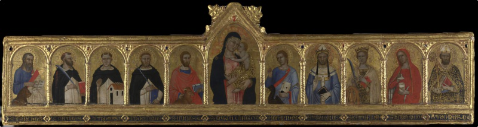
  <figcaption>Andrea di Bonaiuto, the Virgin and Child with ten saints, about 1365–1370. Egg tempera on wood, 28 × 105.8 cm, in its original frame. London, National Gallery, NG5115; presented by Mrs Richard F. P. Blennerhassett, 1940. © The National Gallery, London, <a href="https://creativecommons.org/licenses/by-nc-nd/4.0/">CC BY-NC-ND 4.0</a>.</figcaption>
</figure>

The panel is a long frieze of figures under arches. At the centre the Virgin, half-length, holds the Child under a taller gabled arch; on either side five saints stand in their own compartments, each named and identified by attributes, against a gold ground.

The arcade is a piece of miniature architecture. Spiral columns, painted to imitate twisted marble, divide the compartments, and the arches are crowned with small gables; in the spandrels glass beads glitter like gems, so that the panel resembles a reliquary or a piece of goldsmith's work.

The saints are small but carefully characterised. Mark's lion, at the left end, is rendered with whiskers and a curled mane; Peter Martyr shows the wound in his head; Thomas Aquinas holds a model of a church, from which rays of light stream from his hand, an image of the doctor illuminating the Church with his teaching.

Dominic, closest to the Virgin, holds his lily. On the other side John the Evangelist, Catherine with her wheel, Mary Magdalen with her ointment jar, Gregory the Great in papal tiara and Thomas Becket in episcopal vestments complete the company.

The order of the saints, as Gordon showed, follows the order of the chapels at the east end of Santa Maria Novella. The panel is thus a map of the church in the form of an altarpiece, and each saint stands for an altar where the friars said Mass.

The colours are rich: the black and white of the Dominicans, the reds and blues of the evangelists, the gold of the ground and of the haloes. The faces have the small features and gentle expressions of Andrea's types.

The panel's size and form suggest a private object rather than an altarpiece in the usual sense. It could be held, carried or placed on a shelf, and its owner could pray before the saints of his church even when far from it.

Among the attributed panels, the London panel is one of the most convincing, for its connection with Santa Maria Novella and the chapter house. It shows Andrea working on the smallest scale with the same Dominican programme he painted on the largest.

### The Triptych of Copenhagen and Houston: History

A small folding triptych for private devotion has been reconstructed from three panels now on two continents: the central Virgin and Child enthroned with saints and angels in the Statens Museum for Kunst in Copenhagen, and the two wings, the Nativity and the Crucifixion, in the Museum of Fine Arts in Houston.

[Richard Offner](/scholars.html#offner-richard) recognised the connection and published the reconstructed triptych in 1945; the Houston museum's bulletin confirmed it in 1958. The wings appeared in a private collection at Karlsruhe in 1922, passed through the trade to Percy Straus in New York in 1928, and entered the Houston museum with his bequest in 1944.

The physical evidence is strong. The Virgin of the Copenhagen panel and the Virgin of the Houston Crucifixion wear the same orange dress with the same gold pattern; the punchwork of the haloes and of the ribbon borders is virtually identical in all three panels; and scientific analysis has found genuine ultramarine in the Virgin's mantle in the Nativity.

The attribution is uncertain. The Copenhagen museum published the centre in 1946 as Jacopo di Cione and keeps that name, while recording Andrea as an alternative; Offner ended by assigning the group to an anonymous "Nardesque Master of the Statens Madonna"; Houston catalogues the wings under an unknown Italian painter. [Miklós Boskovits](/scholars.html#boskovits-miklos) gave the triptych to the young Andrea, reading in it the lessons of Maso di Banco.

The reconstruction is not perfect. The wings, 30.1 centimetres high, correspond to the rectangular field of the centre below its gable, but together they are nearly four centimetres wider than the centre, 47 by 22 centimetres; the Copenhagen panel has lost its original frame and has probably been trimmed.

Open, the triptych showed its first owner the Nativity at the left, the Virgin enthroned at the centre and the Crucifixion at the right: birth, glory and death gathered in a single object for private prayer.

### The Copenhagen–Houston Triptych: the Centre

<figure>
  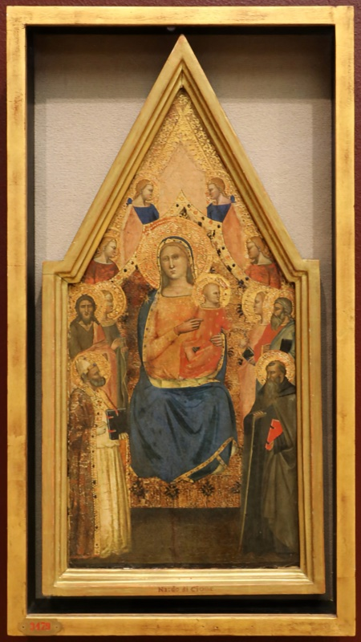
  <figcaption>Florentine painter (the young Andrea di Bonaiuto according to Boskovits), the Virgin and Child enthroned with saints and angels, centre of a portable triptych. Tempera and gold on panel, 47 × 22 cm. Copenhagen, Statens Museum for Kunst, KMS3479. Photo: Francesco Bini, <a href="https://creativecommons.org/licenses/by-sa/4.0/">CC BY-SA 4.0</a>, via <a href="https://commons.wikimedia.org/?curid=184214899">Wikimedia Commons</a>.</figcaption>
</figure>

The gabled panel in Copenhagen still carries on its frame an old nameplate reading "Nardo di Cione", a name no modern scholar defends. The panel itself is a small masterpiece of the Orcagnesque devotional industry, rich in gold and precise in execution.

The Virgin sits frontally in a deep blue mantle over an orange gown patterned in gold, her right hand raised across her body in the gesture of the Hodegetria, pointing to the Child on her left arm, who wears a red tunic sown with gold and reaches towards her.

Around the throne the court assembles in the compressed, planar manner of the mid-century: two pairs of half-length angels in blue and red flank the cloth of honour, and six saints stand below, among them John the Baptist, a bishop and Anthony Abbot.

The cloth of honour rises behind the Virgin in a pointed peak, and the gold ground is tooled with dense punchwork. The orange gown of the Virgin is the same as that of the Virgin in the Houston Crucifixion, the strongest material link between the panels.

The style of the panel, with its figures crowded into a shallow space, its clear contours and its rich gold, is that of the Cione workshop around 1350–1360. Whether it is the work of the young Andrea is the question the reconstruction cannot resolve.

### The Cleveland Crucifixion: History

The small Crucifixion in the Cleveland Museum of Art is the closest relative of the Houston wing: the same subject with the same three mourners, at almost the same size, 31 by 13.4 centimetres, and given by its museum to Andrea da Firenze. It was probably part of a small altarpiece for private devotion, and it is dated in the 1360s.

The panel is painted on walnut, a wood rare in Tuscan painting, where poplar was almost universal. It has been trimmed slightly at the bottom, cutting off the feet of the mourners and the strip of ground on which they stood.

Its provenance is unusually early for an Italian primitive in America. It belonged by 1858 to Minor K. Kellogg, an American painter living in Paris, passed from him to Liberty E. Holden, and entered the Cleveland Museum of Art with the Holden collection in 1916, among the founding works of its medieval holdings.

The existence of the Cleveland panel beside the Houston wing documents what a single panel cannot show: that this image of Calvary was a type repeated by a workshop for private clients, with small variations, rather than a unique invention.

The museum has released the panel into open access, and its image is one of the most widely available of Andrea's attributed works.

The panel's place in Andrea's catalogue depends on the whole group of small Crucifixions. Their common punchwork, their common types and their common composition point to a single workshop, which the literature connects with the painter of the Spanish Chapel.

### The Cleveland Crucifixion

<figure>
  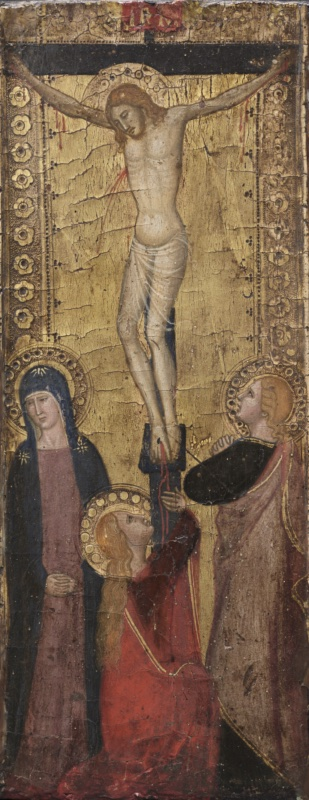
  <figcaption>Andrea di Bonaiuto (attributed), the Crucifixion, 1360s. Tempera and gold on walnut, 31 × 13.4 cm. Cleveland, The Cleveland Museum of Art, Holden Collection, 1916.776. Image: The Cleveland Museum of Art, Open Access (CC0).</figcaption>
</figure>

The field is a precinct of worked gold. Vertical bands of large punched rosettes run up both edges like embroidered orphreys, framing the scene as a textile frames a relic; the haloes are ringed with bold punches, and at the summit the titulus survives as a red tablet with gold letters, cut by the upper edge.

Against this shimmer hangs Christ, elongated and pale in the Orcagnesque manner, his head fallen to his right, the blood streaming from his wounds in long red threads down the dark blue cross. The body is drawn with a few contours, its anatomy summary but its silhouette exact.

At the left the Virgin, her blue mantle sprinkled with gold stars over a mauve gown, stands closed in grief, her hands gathered, her small face tilted. At the right John the Evangelist looks up, clasping a great dark book against his rose mantle.

At the centre kneels the Magdalen, red-cloaked, her golden hair loose, not at a reverent distance but against the Cross itself, her face flung upward, one hand reaching to the bleeding feet. Her movement is the emotional centre of the panel.

The surface shows its age: a dense craquelure webs the gold and the flesh. But the punchwork remains crisp, and the colours of the mourners, blue, mauve, rose and red, keep their intensity against the gold.

The comparison with the Houston wing is close. The composition, the types and the mourners are almost the same; the differences, the star-sprinkled mantle, the rosette borders, the more dramatic Magdalen, show the variations a workshop introduced in repeating a successful model.

The panel's support, walnut rather than poplar, is a puzzle. It may reflect the availability of wood in a particular workshop or the demand of a particular client; it does not in itself decide the attribution.

The Cleveland Crucifixion is a fine example of the small devotional images that Florentine workshops produced in great numbers in the second half of the fourteenth century, and one of the best preserved of the group connected with Andrea.

### The Carmine Polyptych: History

The polyptych in the sacristy of Santa Maria del Carmine in Florence is the only large altarpiece given to Andrea that still stands in a Florentine church, and probably in the church for which it was made. It is conventionally dated to the early 1360s, before the chapter house.

Its survival is remarkable. On the night of 29 January 1771 a fire destroyed most of the medieval church of the Carmine, sparing little beyond the Brancacci chapel and the sacristy; the polyptych survived because it was kept in the sacristy.

The altarpiece has five compartments under pointed arches with gilded crockets, divided by twisted columns. Each gold field holds a single monumental figure, named in an inscription along the base: the Virgin and Child at the centre, Leonard and Nicholas at the left, John the Baptist and the prophet Elijah at the right.

Elijah declares the altarpiece's destination. The Carmelites traced their origin to the hermits of Mount Carmel and, through them, to Elijah himself as their founder; the polyptych shows the prophet in the white mantle over a dark habit of the Order, an anachronism that painted the Carmelite claim into doctrine.

The polyptych is cited in the literature as the touchstone of Andrea's bold, firm contours. Its figures, grave and planar, its angels with oval faces, its tooled gold and inscribed base anticipate the chapter house.

It is the same logic Andrea would apply on a monumental scale for the Dominicans: an Order represented through its saints and its founder, its claims painted into images that the friars saw every day.

### The Carmine Polyptych

<figure>
  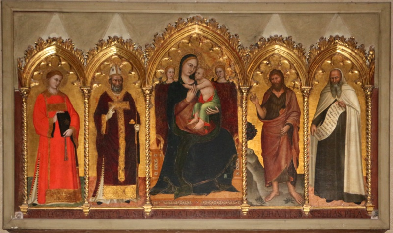
  <figcaption>Andrea di Bonaiuto (attributed), the Virgin and Child with Saints Leonard, Nicholas, John the Baptist and the prophet Elijah, about 1360–1362. Tempera and gold on panel. Florence, Santa Maria del Carmine, sacristy. Photo: Sailko, <a href="https://creativecommons.org/licenses/by/3.0/">CC BY 3.0</a>, via <a href="https://commons.wikimedia.org/?curid=42233428">Wikimedia Commons</a>.</figcaption>
</figure>

At the centre the Virgin sits enthroned on a broad seat draped in deep blue. The painter chose the most affectionate of formulas: the Child, in a green tunic lined with red, stands on her lap and throws his arms around her neck, while two angels look on from behind the throne.

The inscription at the base of the central panel reads AVE GRATIA PLENA DOMI[NUS TECUM], so that the Virgin is named by the words of the angel's greeting. The other saints are named in the same band.

At the left stands Leonard, young and tonsured in a red dalmatic worked with gold, holding a dark book from which hang fetters, the sign of the patron of prisoners. Beside him Nicholas of Bari, in a jewelled mitre and a crimson cope, holds his crozier and the three golden balls of his charity.

At the right John the Baptist, gaunt in his camel skin under a rose mantle, stands barefoot on rocky ground with a reed cross, pointing. At the far right the prophet Elijah, white-bearded on his rock, unfurls a long inscribed scroll, dressed in the white mantle over the dark habit of the Carmelites.

The figures stand against gold grounds under ogival arches, each in his own compartment, with the gravity and clarity of the Orcagnesque altarpiece. Their contours are bold and firm, their draperies broad, their faces individual.

The textiles are rich: the brocade of Leonard's dalmatic, the gold of Nicholas's cope, the blue of the Virgin's throne. The same love of precious materials appears in the Houston laterals and in the Accademia diptych.

The polyptych is in its original church, in the sacristy where it survived the fire of 1771. It is the only work of its kind by Andrea, or attributed to him, that can still be seen in the place for which it was made.

Its date, on the eve of the chapter house, makes it the bridge between the panels of the 1350s and the frescoes of 1366–1367. The Carmelite Elijah anticipates the Dominican saints of the Spanish Chapel.

### Four Saints from a Polyptych, Houston: History

Four tall lateral panels in the Museum of Fine Arts in Houston, each about 87 by 29 centimetres, represent Saints Agnes, Bartholomew, Nicholas of Bari and Elizabeth of Hungary. They are the surviving wings of a dismembered polyptych whose central panel, almost certainly a Virgin and Child, has never been identified. They are dated to the mid-1360s.

The panels entered the Houston museum with the bequest of Edith A. and Percy S. Straus in 1944, together with the wings of the Copenhagen–Houston triptych. Their earlier provenance is not documented.

The identification of one of the saints has varied. The *Enciclopedia dell'Arte Medievale* lists the second panel as Saint Barnabas; the flaying knife the apostle holds belongs to Bartholomew, and the museum names him so.

The panels are attributed to Andrea on the basis of their types and their technique. The Agnes repeats the Agnes of the Accademia diptych, with the same haloed lamb on the same arm; the Nicholas recalls the Nicholas of the Carmine polyptych, with the same frontal ceremony and the same brocade.

The four saints compose a programme of the Christian states of life: Agnes the virgin, Bartholomew the apostle, Nicholas the bishop, Elizabeth the wife, widow and tertiary. A congregation could find in them models for every condition.

The montage reproduced here shows the four panels side by side in their presumed order; the panels are then examined one by one, from photographs published by the museum through the Google Art Project.

### Four Saints from a Polyptych

<figure>
  
  <figcaption>Andrea di Bonaiuto (attributed), Saints Agnes, Bartholomew, Nicholas of Bari and Elizabeth of Hungary, the four laterals of a dismembered polyptych side by side, mid-1360s. Tempera and gold on panel, each about 87 × 29 cm. Houston, Museum of Fine Arts, 44.557, 44.556, 44.559 and 44.558. Images: public domain, via Wikimedia Commons (Google Art Project).</figcaption>
</figure>

The four panels stand side by side, each a tall, narrow lancet with a pointed top, each containing a single full-length saint against a gold ground. Together they suggest the scale of the lost altarpiece: with a central panel, it would have been well over a metre and a half wide.

The order is presumed. Agnes and Elizabeth, the two women, stand at the outer ends; Bartholomew and Nicholas, the two men, stand inside, nearer the lost centre. The heads of the outer figures incline towards the middle, as if towards the Virgin.

The four saints are designed as a rhythm, not a repetition. Agnes inclines gently, Bartholomew stands frontal and massive, Nicholas displays the full ceremony of his vestments, Elizabeth bows in a single fall of crimson.

The colours alternate: the green and red of Agnes, the white and rose of Bartholomew, the gold and orange of Nicholas, the crimson of Elizabeth. The palette is rich and balanced across the row.

The gold grounds are tooled with dense punchwork, and the haloes carry inscriptions with the saints' names. The textiles, Agnes's gold-worked mantle, Bartholomew's flowered white, Nicholas's brocaded cope, are the workshop's specialty.

The panels have suffered the common abrasions of dismembered laterals: the draperies are worn, the greens darkened, the gold rubbed to a warm glow. The faces, however, survive well.

The missing centre would have gathered all four gazes. Without it, the four saints wait like a court without its queen, and their survival as a group through dismemberment, sale and the crossing of the Atlantic is a small piece of good fortune.

For the study of Andrea, the four panels add an altarpiece's worth of evidence at full scale: two saints he painted elsewhere, a textile repertory continuous with the Carmine, and a female type continuous with the Accademia diptych and the frescoes.

### Four Saints from a Polyptych: Saint Agnes

<figure>
  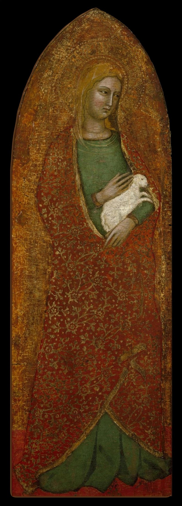
  <figcaption>Andrea di Bonaiuto (attributed), Saint Agnes, lateral of a polyptych, mid-1360s. Tempera and gold on panel, 86.2 × 28.9 cm. Houston, Museum of Fine Arts, 44.557. Image: public domain, via <a href="https://commons.wikimedia.org/?curid=29817825">Wikimedia Commons</a> (Google Art Project).</figcaption>
</figure>

Agnes, the child martyr of Rome, stands beneath the pointed arch of her panel against a gold ground worked into a dense shimmer of ornament. She is the youngest of the four figures, her fair hair falling loose to her shoulders, the sign of the unmarried girl.

She wears a green gown and a great mantle of red, its whole surface worked with a gold floral pattern, the folds falling to her feet in angular cascades. The mantle is a tour de force of the workshop's textile art.

She holds against her breast, with both hands, a small white lamb, the *agnus* that puns on her name and recalls her purity. The lamb is painted with care, its fleece rendered in fine white strokes.

Her face, a long oval with a high brow and a small grave mouth, inclines towards the centre of the lost altarpiece. It is the face of the Agnes of the Accademia diptych, and the comparison between the two is one of the most direct the corpus allows.

The panel opens the row of four. Agnes, the virgin, stands for the consecrated life, the first of the Christian states represented on the altarpiece.

### Four Saints from a Polyptych: Saint Bartholomew

<figure>
  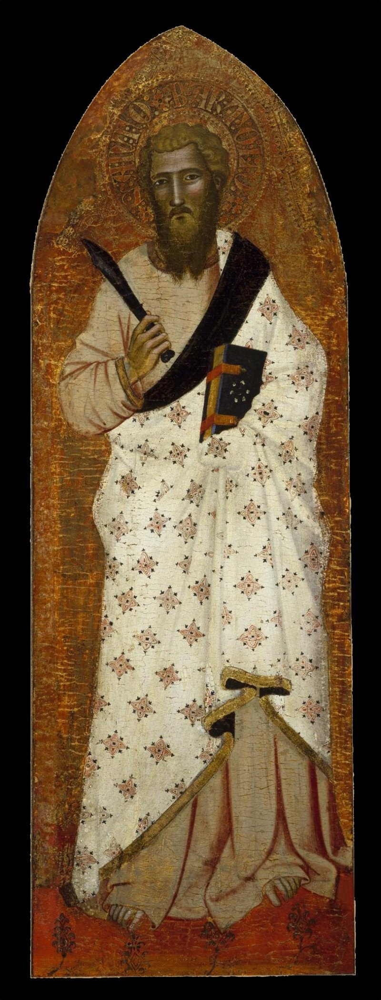
  <figcaption>Andrea di Bonaiuto (attributed), Saint Bartholomew, lateral of a polyptych, mid-1360s. Tempera and gold on panel, 87.2 × 29.1 cm. Houston, Museum of Fine Arts, 44.556. Image: public domain, via <a href="https://commons.wikimedia.org/?curid=29818698">Wikimedia Commons</a> (Google Art Project).</figcaption>
</figure>

The apostle Bartholomew stands frontally, a figure of grave bulk in the narrow field. His curly fair hair and long beard frame a long face with dark eyes; his tooled halo carries his name in punched letters.

He holds upright in his right hand the broad-bladed flaying knife, the instrument of his martyrdom, by which he was skinned alive in Armenia according to the legend. The knife admits no other reading, and it confirms the identification against the name Barnabas found in some literature.

He wears a white mantle strewn with small red and black rosettes over a pink tunic, crossed from the shoulder by a dark blue band, and falling in broad folds to his bare feet. In his left hand he holds a dark book with red and gold clasps, the Gospel he preached.

The knife and the book compress the apostle's meaning: the word carried to the ends of the earth, and the price paid for it. The violence is conceptual; the saint holds his instrument as calmly as a scholar holds a pen.

The red ground at his feet is patterned with small dark plants, a stylised meadow that recurs in the other panels. Bartholomew, the apostle, represents the missionary voice of the Church in the row.

### Four Saints from a Polyptych: Saint Nicholas of Bari

<figure>
  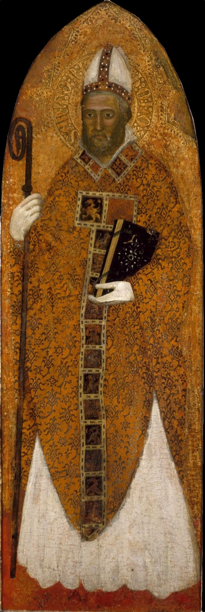
  <figcaption>Andrea di Bonaiuto (attributed), Saint Nicholas of Bari, lateral of a polyptych, mid-1360s. Tempera and gold on panel, 86.2 × 28.6 cm. Houston, Museum of Fine Arts, 44.559. Image: public domain, via <a href="https://commons.wikimedia.org/?curid=29818279">Wikimedia Commons</a> (Google Art Project).</figcaption>
</figure>

Nicholas, bishop of Myra, called "of Bari" in the West after the translation of his relics in 1087, stands in full pontificals. The painter gave him the richest wardrobe of the four: a white mitre with a jewelled band, a vast cope of orange-gold brocade over a white alb, white gloves.

Down the front of the cope runs a dark orphrey decorated with small scenes in square compartments, a painted imitation of the embroidered orphreys of real vestments. The detail shows the workshop's attention to the ornaments of the liturgy.

He holds a crozier with a curled head in his right hand and a dark book studded with jewels in his left. The three golden balls of his charity, which he holds in the Carmine polyptych, do not appear; the pontificals and the book are enough.

His face is that of the Nicholas of tradition: mature, short-bearded, wide-eyed, benevolent without softness. The halo behind his mitre is tooled in a burst of radiating ornament.

The comparison with the Nicholas of the Carmine polyptych supports the attribution. The same ceremonial frontality, the same brocade, the same crisp white of mitre and alb against saturated colour, the same grave head make it hard to separate the two panels.

### Four Saints from a Polyptych: Saint Elizabeth of Hungary

<figure>
  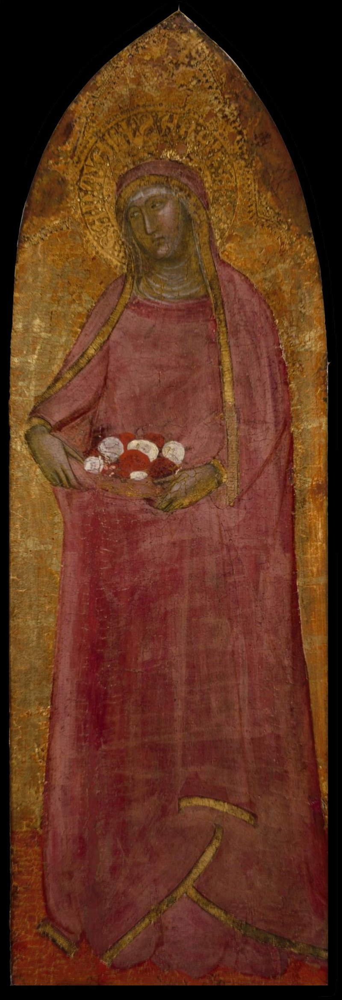
  <figcaption>Andrea di Bonaiuto (attributed), Saint Elizabeth of Hungary, lateral of a polyptych, mid-1360s. Tempera and gold on panel, 87.2 × 28.9 cm. Houston, Museum of Fine Arts, 44.558. Image: public domain, via <a href="https://commons.wikimedia.org/?curid=29818147">Wikimedia Commons</a> (Google Art Project).</figcaption>
</figure>

The row closes with Elizabeth of Hungary, princess by birth, landgravine of Thuringia by marriage, widow at twenty, Franciscan tertiary by choice, dead in 1231 and canonised in 1235. She stands veiled in a rose-violet mantle that falls unbroken from her head to the ground, edged with gold.

In a fold of her mantle she holds a bunch of red and white roses. According to the legend, surprised while carrying bread to the poor, she opened her mantle and found roses where the loaves had been. The painter tells the story without narrative, only the woman and the miracle in her hands.

Her face, long and grave, inclines towards the centre of the lost altarpiece, closing the row as Agnes opened it. The large tooled halo frames her head against the gold.

Elizabeth brings to the altarpiece the holiness of the married and the widowed, the female lay state raised to the altar. For a fourteenth-century congregation she was proof that marriage, wealth and widowhood could be spent in charity.

Pictorially she is the most subdued of the four. Her mantle absorbs the light that Nicholas's brocade scatters, and the purples are abraded, but the silhouette holds, and the drawing of the hands cradling the roses remains delicate.

### The Moscow Triptych: History

The triptych in the Pushkin State Museum of Fine Arts in Moscow is the most complete of the small tabernacles attributed to Andrea di Bonaiuto: an intact folding altarpiece with its original carpentry, its crocketed gable, its pinnacled frame, its moulded base with three small roundels of saints, and its wings on their hinges.

It measures 95 by 69.8 centimetres overall with the frame; the central field is 61 by 34.5 centimetres, each wing 61 by 17.3 centimetres. It is dated to the third quarter of the fourteenth century, and its inventory number is Ж-230.

Its history in Russia gives it an unusual distinction. It belonged to the princes Vyazemsky and hung at Ostafyevo, the estate outside Moscow known as the "Russian Parnassus", the house of the poet Pyotr Vyazemsky, friend of Pushkin, before passing to the museum that bears Pushkin's name.

The Russian literature on the museum compares its angels with those of a triptych in the Acton collection in Florence and of a work in the Museo Civico of Pistoia, and connects it with the same network of workshop repetitions as the small Crucifixions.

The triptych combines the devotional image and the narrative in a single object: the Virgin and Child with saints and a Nativity on the central panel, the Annunciation divided between the two wings, the Adoration of the Magi on the left wing and the Crucifixion on the right.

Its intactness makes it a model for the reconstruction of the dispersed triptychs of the group, and it shows how such objects looked and functioned when they were complete.

### The Moscow Triptych

<figure>
  
  <figcaption>Andrea di Bonaiuto (attributed), triptych with the Virgin and Child with saints and angels, the Nativity, the Annunciation, the Adoration of the Magi and the Crucifixion, third quarter of the fourteenth century. Tempera and gold on panel, 95 × 69.8 cm with the original frame. Moscow, Pushkin State Museum of Fine Arts, Ж-230. Photo: Sailko, <a href="https://creativecommons.org/licenses/by-sa/3.0/">CC BY-SA 3.0</a>, via <a href="https://commons.wikimedia.org/?curid=16652192">Wikimedia Commons</a> (background modified).</figcaption>
</figure>

At the summit of the gable, in a roundel on a blue field, the blessing Redeemer displays his open book: the eternal Christ presiding over the whole object. Below, the central panel is divided into two registers, glory above and earth below.

In the upper register the Virgin, in a dark mantle over a red gold-figured gown, holds the Child on her arm; he blesses and holds a scroll. Two angels flank them, and four saints stand below in conversing pairs: a female martyr with a palm, an aged ascetic with a staff, Saint Peter with his keys and another saint.

In the lower register the Nativity is staged in the kneeling mode: the Child lies on the bare ground in a humble stable, and the Virgin and Joseph kneel on either side in adoration, the devotional formula of humility that the later fourteenth century made its own.

The left wing carries, above, the kneeling angel Gabriel of the Annunciation, and below, the Adoration of the Magi: the eldest king kneels at the Child's feet, his two companions stand behind, and Joseph sits apart in his yellow mantle.

The right wing carries, above, the Virgin Annunciate, who receives across the open triptych the greeting of the angel on the opposite wing, and below, the Crucifixion: the Virgin swooning among the holy women, Saint John and a companion, and the Magdalen in yellow kneeling at the foot of the Cross.

The reading of the triptych is a meditation. Glory above, humility below; the Child enthroned and the Child on the ground; the angel's greeting and the Cross; and over all the Redeemer of the gable, the same person in another mode.

The three roundels of the base, with half-length saints, provided the final intercessors, at the level of the owner's eyes. The triptych ends with the Cross, not the Resurrection: the eye travelled from the greeting through the homage of the kings to the Cross, and rested there.

The surface has suffered the abrasions of six centuries, but nothing essential is lost, and the survival of the carpentry, the gable, the base and the hinges makes the object the most complete witness to what the dispersed panels of the group once were.

### The Vatican Predella with Saints Paul and Michael: History

A predella compartment in the Pinacoteca Vaticana, 19.5 by 39.5 centimetres, painted in tempera on poplar, shows Saint Paul and Saint Michael the Archangel in half-length within two quatrefoils. The museum dates it 1370–1377 and attributes it to Andrea di Bonaiuto; its inventory number is MV.40115.2.1.

The quatrefoil format ties it to the chapter house. Half-length holy figures in mixtilinear quatrefoils on coloured grounds are the formula of the borders of the Spanish Chapel, where prophets with scrolls lean from such frames along the ribs of the vault.

The museum's inventory links the panel to a second compartment, MV.40115.2.2, with Saint Augustine (?) and Saint Julian, recorded only in a black-and-white photograph. The predella thus ran to at least four quatrefoils across two sections.

Of the main tier of the altarpiece, a Virgin and Child at least with lateral saints, nothing has been identified. The predella is a fragment of a lost whole, like most of the panel works attributed to Andrea.

If the dating holds, the compartment belongs to the painter's last decade, the years after the chapter house, overlapping the Pisan commission and ending with the will of December 1377. It would be among the latest products of the workshop.

The two figures, both armed, the apostle with the sword and the archangel with the lance, declare an altarpiece of militant protection, in doctrine and in the struggle against evil.

### The Vatican Crucifixion with a Dominican Friar: History

The small Crucifixion of the Pinacoteca Vaticana, 32.5 by 22.2 centimetres, is the Roman member of the family of Calvaries connected with Andrea, of which the Houston wing and the Cleveland panel are the American examples. The museum dates it 1370–1377; its inventory number is MV.40118.0.0.

A third Crucifixion, formerly on the art market, has been tied to this panel by the close similarity of its punchwork. The connections show the scale of the workshop's production of such small devotional images.

Unlike the Houston Calvary, the Vatican panel was never part of a triptych: it is a self-contained devotional image, made to be hung or set up on its own.

It departs from the family formula in two ways. Its ground is a deep, nocturnal blue-black rather than gold, and at the foot of the Cross, in the place of the Magdalen, kneels a Dominican friar.

The substitution is the panel's meaning. The Magdalen's place at the Cross was the place of penitent love; to set a living Dominican there declares that the friar's vocation is that penitence, the daily station of an Order whose chapter house Andrea had organised around the Passion wall.

If the attribution holds, the panel shows what the painter of the Way of Salvation offered a single friar at the end of his career: not the Church Militant in panorama, but its smallest unit, one man at the foot of the Cross.

### The Vatican Crucifixion with a Dominican Friar

<figure>
  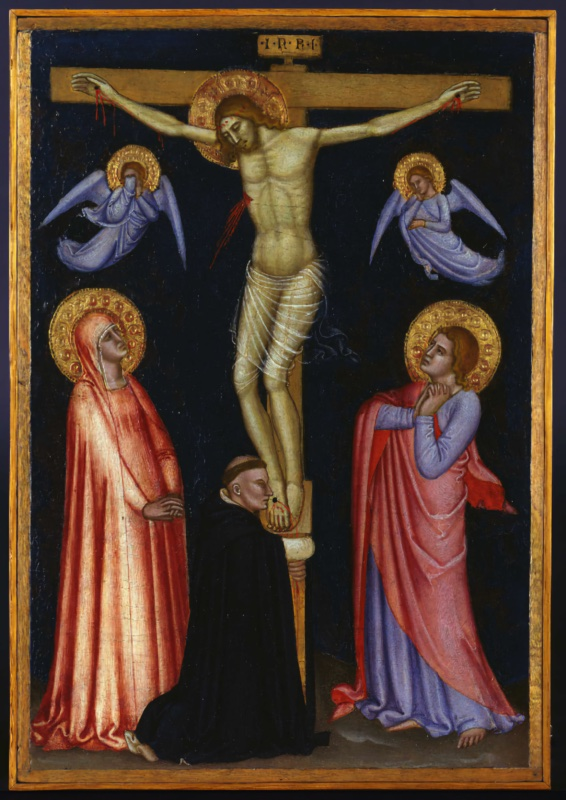
  <figcaption>Andrea di Bonaiuto (attributed), the Crucifixion with the Virgin, Saint John the Evangelist and a Dominican friar, 1370–1377. Tempera and gold on panel, 32.5 × 22.2 cm. Vatican City, Pinacoteca Vaticana, MV.40118.0.0. Image: public domain, via <a href="https://commons.wikimedia.org/?curid=12139361">Wikimedia Commons</a>.</figcaption>
</figure>

The panel opens onto a field of deep, nocturnal blue-black, against which the gold is concentrated where it shines brightest: in the great punched haloes of the Virgin and John, tooled into broad rosetted discs, and in the ochre wood of the Cross. The effect is Calvary at the hour when darkness covered the earth.

Christ hangs on the Cross between two mourning angels, his pale body drawn with the elongated grace of the workshop's Crucifixions. The angels, in flight, express the grief of heaven at the death of its Lord.

Below, the Virgin stands at the left, robed unusually in a single fall of rose-salmon from head to foot, her hands drawn to her breast. Saint John answers her at the right in lilac and red, a hand pressed to his throat, his face turned up along the Cross.

Between them, where the other panels of the family kneel the Magdalen with her streaming hair, kneels a tonsured friar in the black cappa and white habit of the Dominicans, embracing the foot of the Cross. He is perhaps the owner of the panel, perhaps a Dominican saint; no halo identifies him.

The friar's gesture is the gesture of the Magdalen, transferred to the religious life. The panel makes the penitent friar the heir of the penitent sinner, and his embrace of the Cross the model of Dominican devotion.

The punchwork of the haloes binds the panel materially to the other small Crucifixions; the Dominican protagonist binds it to Santa Maria Novella; the dating binds it to the years of Pisa and the will. It is a keystone of the late phase of the workshop.

The dark ground is unusual in Florentine painting of the period, and it gives the panel an intensity of mood that sets it apart from the golden Calvaries of Houston and Cleveland.

The panel shows how a workshop could adapt a standard type to a particular patron. The composition is the same; the substitution of a single figure transforms its meaning and makes it a personal image of devotion.

### The Mystic Marriage of Saint Catherine, Ajaccio: History

The triptych of the Mystic Marriage of Saint Catherine in the Palais Fesch, the museum of fine arts in Ajaccio, is one of the Italian primitives gathered in Rome by Cardinal Joseph Fesch, Napoleon's uncle, and bequeathed to his native city. It measures 178.5 by 166 centimetres.

The older biographical tradition, as late as the *Dizionario Biografico* entry of 1961, listed the triptych among the works of Andrea di Bonaiuto. The museum today catalogues it under Niccolò di Tommaso, a Florentine documented in Florence and Pistoia between 1346 and 1376, formed in the same Orcagnesque milieu and active, like Andrea, for Dominican patrons.

The reattribution requires no scandal. The two painters share the planar construction, the firm contour, the taste for tooled gold and the gentle facial types that made the products of their circle so similar. The same family resemblance once allowed Vasari to give Andrea's frescoes to the Sienese.

The triptych is included here as a rejected attribution. It documents not a work of Andrea but the porousness of the borders of his catalogue: a work good enough to have borne his name for decades, restored to a companion whose art explains the confusion.

Its Dominican subject, with Saint Dominic in one wing, and its date in the third quarter of the century, place it in the same world as Andrea's panels, and its comparison with them helps to define what is specific to each painter.

The case is a warning for the whole group of attributed panels. Where documents are lacking, attributions rest on style, and style in the Orcagnesque circle was shared by several masters.
