## Introduction: A Name in Search of an Oeuvre

Few figures of the Italian Trecento illustrate the perils and the fascinations of attributional art history as vividly as *Dalmasio degli Scannabecchi*. Here is a Bolognese painter whose existence is beyond doubt: a sequence of notarial deeds, militia rolls, a Pistoiese payment record and a will carry his name across three decades, from 1342 to 1373. And here, alongside him, is a body of painting of high quality and coherence — frescoes in [Santa Maria Novella](/Content/Churches/Basilica-Santa-Maria-Novella.html) in Florence and in San Francesco at Pistoia, a group of panels now dispersed between Bologna, New Haven, Seattle and Philadelphia — that for three quarters of a century has circulated under his name. Yet not a single document connects the man to any of these works. The painter is documented; the paintings are attributed; and the thread that joins them is an inference, brilliant but fragile, spun by [Roberto Longhi](/scholars.html#longhi-roberto) in the middle of the twentieth century and contested ever since.

The subject is therefore double. It concerns Dalmasio di Iacopo degli Scannabecchi, the man whom the Bolognese and Pistoiese archives allow us to follow with unusual precision for an artist of his rank: his family, his marriage, his property, his long Tuscan residence, his return, his death. And it concerns equally the critical construction that bears his name — the corpus that Longhi assembled around the frescoes of the Bardi chapel in Santa Maria Novella and the choir of San Francesco at Pistoia, the corpus that [Luciano Bellosi](/scholars.html#bellosi-luciano)'s chronological objections detached from the documented painter and rebaptised, with deliberate awkwardness, the "Pseudo-Dalmasio," and that a minority of recent scholarship has sought to restore to Dalmasio himself. The two subjects cannot be separated, because the literature has never separated them; but they must be kept distinct at every step, because the failure to do so is precisely what has generated the errors, the circular datings and the phantom biographies that still encumber accounts of this painter.

A word on method is therefore necessary at the outset. Everything asserted in what follows is graded. Documented facts — dates, names, payments, parishes — are presented as such, with the archival publications in which they were made known. Scholarly consensus, where it exists, is identified as consensus. Hypotheses, including the central hypothesis that the documented Dalmasio painted the attributed corpus, are identified as hypotheses, and the arguments on both sides are set out rather than silently resolved. And a number of claims that circulate in general accounts — a paternal uncle who was in fact maternal, a chapel dedication misdated by two decades, birth dates presented as records when they are inferences, frescoes in San Francesco in Bologna that belong to another painter entirely — are explicitly corrected. Only three modern scholars are named in the body of the text: Longhi, who built the corpus; Bellosi, who dismantled its chronology; and [Daniele Benati](/scholars.html#benati-daniele), whose entries in the standard reference works represent the most balanced recent assessment. The many other voices in a crowded debate are acknowledged anonymously.

What emerges, if the evidence is handled with this care, is not a diminished figure but a clarified one. Whether or not the attributed corpus is his, Dalmasio degli Scannabecchi stands at the centre of one of the most interesting problems in fourteenth-century Italian painting: the encounter, in the decades after [Giotto](/Content/Artists/XIII-c/Giotto-di-Bondone.html)'s Bolognese sojourn, between the expressive, nervous idiom of Emilia and the measured gravity of Tuscany. The painter of the Bardi chapel and the Pistoia choir — call him Dalmasio or call him the Pseudo-Dalmasio — is the principal witness to that encounter, and the documented life of the Scannabecchi painter, with its documented Tuscan residence, remains the most economical explanation of why such a witness should exist at all.

## Bologna in the Mid-Trecento: The Setting

The Bologna into which Dalmasio was born, probably in the second or third decade of the fourteenth century, was one of the great cities of Europe, and one whose artistic culture had just been transformed by two convergent events. The first was the long maturation of its native tradition. As the seat of the oldest university in the Latin West, Bologna had developed since the thirteenth century an industry of book production without parallel in Italy, and its illuminators — the masters of the great legal manuscripts — had forged a figurative language of dense colour, abrupt energy and sharp characterisation that stood at a deliberate distance from the serene monumentality of Tuscany. Panel painting and fresco in Bologna grew up in constant dialogue with this miniaturist culture, absorbing its vivacity and its taste for the expressive, even the grotesque.

The second event was external and datable: the arrival of Giotto. The Florentine master's polyptych for the city — the signed altarpiece now in the Pinacoteca Nazionale, generally connected with the years of Cardinal Bertrando del Poggetto's papal legation — placed before Bolognese painters the most authoritative statement of the Tuscan manner they had yet seen at first hand. The legation itself, which governed Bologna from 1327 until the revolt of 1334 and pursued an ambitious programme of building and decoration centred on the fortress-palace of Porta Galliera, briefly made the city a satellite of the Avignonese papacy's artistic ambitions. When the legate fell, the programme collapsed with him; but the seed had been planted. The generation of painters who came to maturity in the 1330s and 1340s — the generation of [Vitale da Bologna](/Content/Artists/XIV-c/Vitale-da-Bologna.html), documented from the early 1330s and author of the Madonna dei Denti of 1345, and of the younger Simone di Filippo, called dei Crocifissi, who would become Dalmasio's brother-in-law — worked in the force field created by this encounter between the local, linear, emotionally charged idiom and the gravity of Giotto.

It is precisely within this force field that the corpus attributed to Dalmasio must be situated, whoever painted it. What distinguishes the master of the Bardi chapel and the Pistoia choir from Vitale, his greatest Bolognese contemporary, is the proportion of the mixture. Where Vitale bends Giottesque structure to the service of an almost febrile expressiveness, the Dalmasian corpus moves in the opposite direction: it is the most Tuscan of Bolognese painting, measured, spacious, tonally restrained, as if its author had not merely seen Giotto's work in Bologna but had lived among Giotto's heirs in Tuscany itself. This observation — a stylistic datum on which virtually all critics agree, whatever their views on the attribution — is what has always made the documented biography of Dalmasio degli Scannabecchi so seductive. For Dalmasio is, as far as the surviving records allow us to know, the one Bolognese painter of his generation who demonstrably transplanted himself to Tuscany for a substantial period, living at Pistoia through at least the first half of the 1360s.

This reasoning is circumstantial. The records of Trecento Tuscany are incomplete; other Bolognese painters may have made journeys that left no trace; and the mere fact of a documented Tuscan residence does not demonstrate authorship of any particular Tuscan fresco. But the coincidence is real, and it is the hinge on which the whole critical history of the problem has turned. Before examining that history, however, we must first establish what the documents actually say about the man himself — a record more detailed than those of many better-known Trecento painters, and one that has too often been reported at second or third hand, with accumulating distortions.

## The Scannabecchi: Family and the Bolognese Documents, 1342–1356

The painter's full name, as the documents give it, is Dalmasio di Iacopo degli Scannabecchi. The Scannabecchi were an old Bolognese family name, and the painter's branch of it can be followed through the parish records of the city's south-eastern quarters. His father was a certain Iacopo; a brother, Giovanni, appears alongside him in property transactions of the early 1350s. Nothing in the surviving record tells us when Dalmasio was born, yet general accounts routinely supply a birth date — "circa 1315" is the most common, "circa 1325" also circulates — as if it were a matter of record. It is not. All such dates are inferences built backwards from two documents discussed below, and the inference itself has been read in more than one way: a recent study of the legal documents of Bolognese painters has argued for a different understanding of the age of majority implied by the 1350 deed, which would shift the painter's birth accordingly. The honest formulation is that Dalmasio was born in Bologna probably in the second or third decade of the fourteenth century, early enough to be a grown man by 1342.

That year provides the first secure sighting. On 24 September 1342 Dalmasio appears as a witness to a notarial deed, a record first made known in the nineteenth-century compilations of Bolognese documents. The role of witness tells us nothing about his profession at that date, only that he was present, legally capable, and resident in the city. The second and more informative document falls eight years later: on 5 April 1350 Dalmasio acknowledged receipt of the dowry of his wife, Lucia di Lippo Benvenuti, and in doing so declared himself to be over twenty-five years of age — the standard formula of full legal majority. This deed, published in the early twentieth century among the records of Bolognese painters, is the anchor of all modern attempts to calculate his birth, and it is also the document that establishes the single most important fact of his family network. Lucia was the sister of the painter Simone di Filippo Benvenuti, the artist universally known by his later nickname [Simone dei Crocifissi](/Content/Artists/XIV-c/Simone-dei-Crocifissi.html). Dalmasio and Simone were therefore brothers-in-law, and Simone was the maternal uncle of Dalmasio's son Lippo. The point matters because a widely reproduced error makes Simone Lippo's paternal uncle, which would make Simone a Scannabecchi and Dalmasio's brother. He was neither. The kinship ran through the women, and the marriage of 1350 (or shortly before it) is what bound together the two workshops whose cooperation can be traced for the next quarter-century.

The documents of the following years show a man of settled property and civic standing. On 11 January 1352 and again on 21 March 1353 Dalmasio and his brother Giovanni divided family property between them, deeds published in the fundamental corpus of Bolognese artists' documents assembled in the 1940s. The city's militia rolls, the so-called venticinquine, register him in the parish of Sant'Andrea degli Ansaldi in 1354 and in the parish of San Domenico in 1356 — the latter the neighbourhood of the family house in which, as we shall see, he would eventually dictate his will. These are modest records, the administrative sediment of an ordinary burgher's life, but their very ordinariness is valuable: they fix Dalmasio in Bologna, continuously, through the middle 1350s. The standard reference works do not agree on the precise span of this documented Bolognese residence — one authoritative catalogue gives 1350 to 1356, the most recent biographical dictionary entry 1352 to 1356 — a small discrepancy, but a useful reminder that even the documentary skeleton is transmitted to us through secondary literature that must itself be checked against the original publications. At some point after 1356, in any case, the record in Bologna falls silent; when Dalmasio next appears, he is a hundred and fifty kilometres away, across the Apennines, in Pistoia.

## The Pistoia Years and the Last Decade, 1359–1374

The first Tuscan document is a payment. On 9 December 1359 Dalmasio was paid in Pistoia "per dipintura e metere ad oro" — for painting and gilding — the doors, or shutters, of a marble image. The record was published in the fundamental 1941 corpus of Pistoiese artistic documents, and the secondary literature consistently identifies the work in question as connected with a tabernacle for the church of San Giovanni Fuorcivitas; that identification has not been verified against the original transcription, and it is reported with that caveat. Two things about the document stand out. The first is its modesty: this is decorative, artisanal work, the gilding of a sculptural fitting, not the commission of a fresco cycle — a salutary reminder that the documented Dalmasio earned his living, at least in part, in the unglamorous lower registers of the painter's trade, as most Trecento painters did. The second is what it presupposes. A payment of this kind implies an established local presence; Dalmasio was not passing through Pistoia in December 1359 but working there, and the natural inference — an inference, not a documented fact — is that he had settled in the city at some point after the Bolognese militia roll of 1356.

The second Pistoiese document is the more eloquent. On 23 March 1365 Dalmasio, expressly described as living in Pistoia, appointed the painter Simone di Filippo — his brother-in-law Simone dei Crocifissi — as his procurator, his legal agent, in Bologna. The deed tells us three things at once: that in the spring of 1365 Dalmasio's residence in Tuscany was still sufficiently settled that he needed representation at home; that he retained interests in Bologna worth representing; and that the family alliance sealed by the marriage of 1350 was functioning as a practical instrument of business between the two cities. Taken together, the two documents bracket a Tuscan residence of at least five and a half years, from before December 1359 to after March 1365, and they are compatible with a much longer one. How much longer is not known. General accounts sometimes extend the Pistoiese sojourn confidently to 1370 or beyond; the documents neither confirm nor exclude this, and the gap between 1365 and the painter's reappearance in Bologna is simply undocumented. The authoritative reference works place his documented return in the city at 1369–73 or 1370–73, again with a small but telling disagreement between them.

The final document is the will. On 2 November 1373 Dalmasio dictated his testament in the family house in the parish of San Domenico — the same parish in which the militia roll had registered him seventeen years earlier. The will names his son Lippo, already or soon to be a painter himself, and two daughters, Caterina and Agata. A second son, who would later bear his father's name Dalmasio, had not yet been born when the testament was drawn up — a detail that incidentally tells us the painter's wife was still of childbearing age, and that the testator expected, or at least provided for, a posthumous heir. No record of the death itself has been found. The will of November 1373, together with the fact that by 1377 Lippo was acting as his father's heir, has led scholars to place Dalmasio's death in the winter of 1373–74, and this is the formulation that should be used: probably the winter of 1373–74, not the bare "1374" that appears in many summaries as if it were an attested date. With that probable death, at an age we cannot calculate with certainty, the documentary life of Dalmasio degli Scannabecchi closes: some three decades of records, two cities, one marriage, one payment for gilding, and not one word about a fresco or a panel.

## The Silence of the Early Sources

If the archives are unusually generous to Dalmasio, the literary tradition is unusually barren. No fourteenth- or fifteenth-century source names him. He does not appear in the Bolognese chronicles as a painter of note, and — he does not appear in Giorgio Vasari<a href="/endnotes.html#fn-giorgio-vasari" class="footnote">1</a>. The Vite of 1568 contain, in the life of the Florentine Lippo, a digression on a Bolognese painter whom Vasari calls "Lippo Dalmasi": unmistakably Dalmasio's son, [Lippo di Dalmasio](/Content/Artists/XIV-c/Lippo-di-Dalmasio-degli-Scannabecchi.html). Vasari credits this Lippo with a Madonna in San Petronio bearing the date 1407, with the painting over the arch of the door of San Procolo, and with a Christ between Saints Peter and Paul in San Francesco in Bologna, signed, Vasari says, with large letters. He reports the Bolognese veneration of Lippo's Madonnas and the pious legend that the painter approached them fasting and in a state of grace. Of the father who gave Lippo half his name, Vasari says nothing at all. Dalmasio degli Scannabecchi entered the written history of art only in the nineteenth century, through the publication of documents, and entered the history of style only in the twentieth, through connoisseurship. He is, in the strict sense, a modern discovery.

This silence has consequences that need to be drawn out, because its neglect has bred confusion. The first concerns San Francesco in Bologna. Because Vasari places a signed work by "Lippo Dalmasi" in that church, and because father and son share a name, accounts of Dalmasio occasionally furnish him with frescoes in San Francesco in Bologna, sometimes even promoting him to a "Maestro di San Francesco" of that city. No source reviewed supports any such thing. The only San Francesco in the early literature on this family is Vasari's notice of the son's signed Christ; the San Francesco that matters to the father's critical fortune is the one at Pistoia, a hundred and fifty kilometres away. The two churches, and the two painters, must be kept rigorously apart, and the reader who encounters a "Dalmasio, Master of San Francesco in Bologna" should treat the formula as a warning sign of contaminated information.

The second consequence concerns Pistoia. Vasari did know the Franciscan church there, and he attributed its lost high-altar painting to [Puccio Capanna](/Content/Artists/XIV-c/Puccio-Capanna.html), the Assisan follower of Giotto. That attribution had a long afterlife: when the frescoes of the choir were brought back to light from under whitewash — a recovery variously dated in the sources, but completed with a restoration recorded in 1928 — local scholarship, taking its cue from Vasari, assigned part of the cycle to Puccio Capanna, a position argued in print at the end of the 1920s. The attribution is now superseded, but it illustrates the mechanism by which the early sources, precisely because they are silent about the true author, channelled the first modern interpreters toward Tuscan names. The frescoes themselves, as everyone who studied them recognised, presuppose direct knowledge of the Assisi cycle of the Legend of Saint Francis<a href="/endnotes.html#fn-francis-assisi" class="footnote">2</a>; a Giottesque Tuscan painter was therefore the path of least resistance. It took an eye trained on Bologna to see that the path led elsewhere.

The third consequence is historiographical in a broader sense. Painters who lack a Vasarian biography lack a narrative armature: no anecdotes, no character, no ready-made chronology for later writers to embroider. Everything said about Dalmasio's artistic personality has had to be built from scratch, out of documents that never mention art and paintings that never mention Dalmasio. That construction is the subject of the next three sections, and it bears the name of the scholar who undertook it.

## Longhi and the Construction of "Dalmasio"

The corpus began, as so much in Trecento studies did, with a juxtaposition of photographs and a conversation between connoisseurs. The founding observation was that the ruined frescoes of the Franciscan choir at Pistoia and the Stories of Saint Gregory in the Bardi chapel of Santa Maria Novella in Florence were by the same hand — an identity of authorship first suggested, according to the critical tradition, in a verbal communication to Roberto Longhi from a distinguished connoisseur of early Italian painting. The observation was acute, because the two cycles sit in different cities, different orders' churches and very different states of preservation; what they share is a figurative temperament, at once Giottesque in structure and unmistakably un-Florentine in accent.

It was Longhi who turned the observation into a painter. In his University of Bologna lectures of 1934–35 on the fourteenth century — the celebrated course whose ideas irrigated Bolognese Trecento studies for decades before their formal publication — and then, canonically, in the Mostra della pittura bolognese del Trecento of 1950, the exhibition that refounded the entire field, Longhi gathered around the Pistoia–Florence pair a group of panels and fragments and gave the whole the name of Dalmasio degli Scannabecchi. The logic of the baptism was documentary, and it is best stated in its strongest form, because it is stronger than casual summaries allow. The anonymous master's style showed a Bolognese formation saturated with Tuscan experience; the two fresco cycles stood on Tuscan soil, one of them in Pistoia itself; and Dalmasio is the only Bolognese painter of the relevant generation whom documents place in Tuscany — in Pistoia, precisely — for a period of years. The name was not plucked from a hat. It was the solution of an equation with, as far as the documents then published could show, a single admissible root.

As Longhi himself understood, the equation's elegance is not proof. The identification rested, and rests, on a coincidence of geography and a judgement of style; no payment, contract or signature connects Dalmasio to either cycle or to any panel of the group. The construction also carried an implicit chronology. If the corpus was Dalmasio's, its natural centre of gravity lay in the years of his documented maturity: the Pistoia frescoes would belong to the Tuscan residence attested in 1359–65, the Florentine chapel to the same general season, and the panels to the painter's middle and later career. This is exactly how the first generation of Longhi's followers read the material: a substantial monographic treatment of 1970, accepting the identification, dated the Pistoia choir to 1343 (a date that falls before the first record of Dalmasio in Pistoia), the Santa Maria Novella frescoes to 1353–56, and the panels to the 1360s, stretching the oeuvre comfortably across the documented life.

The corpus that circulated under this flag was, and in its core remains, coherent: the Saint Gregory cycle in the Bardi chapel; the Franciscan stories at Pistoia; a Crucifixion from San Martino Maggiore in Bologna; a Virgin and Child now at Yale that Longhi, with characteristic verbal felicity, dubbed the Madonna "of the flying carpet" for the strange airborne drapery of honour behind the figures; a Flagellation now in Seattle; and a scatter of smaller devotional panels and fresco fragments. Whatever has happened to the name since, the group itself — the perception that these works belong together and constitute a distinct artistic personality of high quality — has survived every subsequent storm essentially intact. That is Longhi's permanent achievement, and it is independent of the baptism. The baptism, however, was about to run into trouble, and the trouble came from the direction Longhi's heirs least expected: not from doubts about the style, but from doubts about the dates.

## Bellosi's Objection and the Birth of the Pseudo-Dalmasio

The challenge came in the 1970s, and its author was Luciano Bellosi. In studies of 1974 and 1977 — the first his fundamental book on [Buffalmacco](/Content/Artists/XIV-c/Buonamico-Buffalmacco.html) and the Triumph of Death at Pisa, with its revolutionary attention to datable costume and to the internal chronology of post-Giottesque painting — Bellosi re-examined the Dalmasian corpus and concluded that its style belonged not to the 1350s and 1360s but to the 1330s and 1340s. The master of the Bardi chapel and the Pistoia choir, on this reading, was not a follower in the wake of Vitale da Bologna's maturity but a precursor, or at least an elder contemporary, whose formative encounter with Giotto's manner preceded the full flowering of Vitale's expressionism. Everything in the corpus that the Longhian reading had placed in the painter's documented middle age, Bellosi moved back a generation.

The consequences for the attribution were immediate and severe, and the logic is often garbled in summary accounts. Bellosi's redating did not, in itself, prove that Dalmasio degli Scannabecchi had not painted the corpus: a man first documented in 1342 and of full legal age by 1350 could in principle have been active as a painter in the later 1330s. What the redating destroyed was the specific biographical fit that had given the identification its persuasive force. If the Pistoia frescoes belong to the 1340s, they can no longer be the fruit of the residence documented in 1359–65; the one piece of evidence that tied the documented man to Tuscany tied him there at the wrong time. The equation that had seemed to have a single root now had none — or rather, its root had become a different and undocumented person: a Bolognese painter in Tuscany a decade and more before Dalmasio is attested there. Rather than invent such a person outright, criticism adopted a name that wears its own scepticism on its sleeve: the Pseudo-Dalmasio. The label, which gained currency from the late 1970s onward, means precisely what it says — the painter formerly known as Dalmasio, an artistic personality defined by Longhi's grouping but detached from Longhi's identification.

The character of Bellosi's argument explains the subsequent debate. The argument was stylistic and, in the broad sense, antiquarian: it rested on comparative chronology, on the evolution of Giottesque language in the 1330s and 1340s, and on the kind of datable detail — dress, armour, fashion — that Bellosi had made newly probative. Arguments of this kind are powerful but not self-executing; they persuade in proportion to the reader's confidence in the comparative framework. Many were persuaded: from the later 1970s the prudent form of reference in catalogues and handbooks became "Pseudo-Dalmasio," sometimes with the gloss "active circa 1330 to the late 1340s," and the Philadelphia Virgin and Child with a dog, attributed to the master by Bellosi himself, is catalogued by its museum at circa 1330–35, squarely within the revised chronology. Not everyone was persuaded, however, and the earlier chronology never entirely lost its defenders. The result, by the 1980s, was a field divided not over the existence or the coherence of the painter — on that, there has been no serious dissent since 1950 — but over his dates, and therefore over his name.

The redating also changed the painter's historical position within Bolognese art. On the Longhian chronology, the master was a mature contemporary of Vitale, running a parallel, more Tuscanised course. On Bellosi's chronology he becomes something more interesting: one of the very first Bolognese interpreters of Giotto, active in the years immediately following the Bolognese polyptych and the Del Poggetto legation, and thus a figure standing at the headwaters of the whole Bolognese Trecento — a painter whose measured Giottism Vitale would have known, and reacted against, rather than the reverse. Much of the energy of the subsequent debate derives from the fact that these are two genuinely different art-historical stories, not merely two dates.

## The Debate Since: Identification Regained and Lost

The past five decades have seen the pendulum swing repeatedly, and tracing its arc is instructive, because the oscillation itself is the current state of knowledge. In the 1990s the standard reference literature settled into a posture of disciplined agnosticism: the entry on the painter in the Enciclopedia dell'arte medievale, written by Daniele Benati, set out the documented life and the attributed corpus side by side, registered Bellosi's chronological objection, and declined to force a verdict — while insisting, in a formulation that has proved durable, that the uncertainty over the name had done nothing to weaken the internal coherence of the group. Benati's own position, like that of other leading specialists of Bolognese painting, subsequently moved toward acceptance of Bellosi's chronology; by the time of the great Bolognese exhibition of 2005 devoted to Giotto and the arts in the city at the time of Bertrando del Poggetto — an exhibition that placed the Pseudo-Dalmasio material physically beside Giotto's Bolognese polyptych — the earlier dating of the corpus to the 1330s and 1340s had become the majority view, and "Pseudo-Dalmasio" the majority name.

Almost simultaneously, however, the identification found new champions. In the first decade of the new century several scholars working independently — in studies of 2004 and in museum catalogue entries of the same years — argued that the equation could be saved: either by accepting an earlier and longer Tuscan experience for Dalmasio than the surviving documents attest, or by loosening Bellosi's chronology at the edges. The fullest statement of this revived position came in 2013, in an English-language monograph on Lippo di Dalmasio by two specialists of Trecento Bologna, which treated the attributed corpus as the work of the documented Dalmasio and reconstructed the father's career accordingly, adding to the catalogue, among other things, a fresco fragment — the face of the Virgin — in the church of the Santissima Annunziata at Pistoia. The book's reviewers noted both the attractions and the circularity risks of the operation. And the pendulum has continued to move since: one recent doctoral dissertation on Bolognese Trecento painting, whose author had accepted the identification with Dalmasio in a study of 2012, reverted in its final 2019 form to the formula "Pseudo-Dalmasio, active circa 1330 to the late 1340s." A university course on Bolognese painting offered in Bologna itself in the academic year 2025–26 still lists the identity of this master among the unresolved problems of the field — as candid an indicator of the status quaestionis as one could ask for.

How, then, should a responsible account name the painter today? Two formulations circulate. The first, "Dalmasio," without qualification, is used by institutions as authoritative as the Pinacoteca Nazionale di Bologna, which labels its Crucifixion from San Martino with the painter's name while dating it circa 1335–40 — that is, while accepting Bellosi's chronology and the identification simultaneously, a combination that implicitly endorses the revived position. The second, "Pseudo-Dalmasio," is the prudent majority usage of the specialist literature. Neither has displaced the other, no doubt because the Dalmasio name, true or false, is too deeply woven into seventy years of bibliography to be extracted. Here "Dalmasio" is used for the documented man, "the corpus" or "the master" for the paintings, and treats the identity of the two as what it is: a hypothesis of great economy and real evidentiary weakness, neither proved nor refuted, on which the finest judges of the material have changed their minds in both directions within living memory. The reader should be suspicious of any account — and there are many — that presents either the identification or its rejection as settled fact.

## The Stories of Saint Gregory in Santa Maria Novella

The Bardi chapel, also known as the Cappella di San Gregorio, in the transept of the Dominican church of Santa Maria Novella in Florence, holds the corpus's most prestigious commission and its best-documented setting, and it is also the site of one of the most persistent factual errors in the literature, which must be dealt with first. On 15 February 1336 (1335 in the Florentine style of dating) the friars granted the chapel to the heirs of Riccardo di Ricco de' Bardi, of the great banking family, for the considerable sum of two hundred florins<a href="/endnotes.html#fn-gold-florin" class="footnote">3</a>. Because the chapel's frescoes depict the stories of Saint Gregory the Great<a href="/endnotes.html#fn-gregory-the-great" class="footnote">4</a>, and because the deed of 1336 is the obvious documentary landmark, accounts of the chapel routinely state that the Bardi acquired it and dedicated it to Saint Gregory, or that the dedication dates from 1335–36. This is wrong, and it has been known to be wrong for half a century: archival research published in 1976 demonstrated that the chapel already bore the dedication to Saint Gregory before 1316, well before the Bardi acquisition — the deed of 1336 itself describes the chapel as already so dedicated. The error nevertheless persists, reproduced even in authoritative reference entries and in the Italian state heritage catalogue, and the error should be corrected explicitly: the Bardi bought their way into an existing dedication; they did not create it.

The frescoes themselves — six scenes from the life and miracles of Gregory the Great, heavily damaged and in part lost, and restored in modern times — are the works around which the whole attributional edifice was first raised, since it was their juxtaposition with Pistoia that generated the master. Their dating is framed by the documents but not fixed by them. The acquisition of 1336 provides a plausible terminus post quem for a Bardi-financed decoration, though not a necessary one, since the dedication predates the family's patronage. At the other end, a reading of the convent's own records by the archivist-historian of Santa Maria Novella implies that the cycle was complete before 27 April 1348 — that is, before the Black Death reached its height in Florence. Within that bracket the specialist literature distributes itself: the fullest recent museum catalogue of the master's panels proposes circa 1336–46 for the chapel; dissenting voices have argued for a date after 1349; and the older Longhian tradition, as noted above, placed the frescoes in the mid-1350s, a position now held by few. Much turns on this: a Bardi chapel of circa 1336–46 is the keystone of the Pseudo-Dalmasio chronology, while a Bardi chapel of the 1350s would restore the biographical fit with the documented painter at a stroke. The dating argument and the attribution argument are, here as everywhere in this debate, the same argument wearing different clothes.

What is not in dispute is the quality and the historical interest of the cycle. A Bolognese hand frescoing a major funerary chapel in the most important Dominican church of Florence, within sight of the city's own masters, is in itself an extraordinary circumstance — the inverse of the usual Trecento current, which carried Tuscan manners outward to the provinces. The Gregory stories show the master at his most Giottesque: grave, architecturally lucid narrative, figures of real volumetric weight, a chromatic restraint foreign to the Bolognese mainstream. Yet the physiognomies, the nervous profiles, the slightly acidulous expressive charge betray the Emilian formation that no Florentine training would have produced. It was exactly this double signature — Tuscan syntax, Bolognese accent — that allowed the frescoes to be recognised as the work of a foreigner, and that continues to make the chapel the single most important document, in the stylistic sense, of what Bologna learned from Giotto and what it refused to learn.

### The Bardi Chapel and Its Stories of Saint Gregory: An Introduction

The six frescoes catalogued below form the most important surviving mural ensemble of the master's corpus, and they belong to a chapel whose history is longer, and more complicated, than the decoration that made it famous. The chapel of Saint Gregory, the first chapel at the right end of the transept of Santa Maria Novella, is known today as the Bardi chapel, after the family that acquired its patronage in the 1330s, and it was later also called the chapel of the Rosary; but its dedication to Gregory the Great is older than the Bardi, and the walls on which the master painted his stories had already been decorated once. Any account of the cycle must therefore begin by distinguishing three moments: the chapel before the Bardi, the Bardi decoration of the 1330s and 1340s, and the later interventions, from the eighteenth-century modernisation and the nineteenth-century refitting to the most recent restoration, that have shaped what the visitor sees today.

The dedication to Saint Gregory, as shown above, predates the Bardi by at least two decades. Current descriptions of the chapel record that from the thirteenth century it belonged to the Compagnia dei Laudesi<a href="/endnotes.html#fn-compagnia-dei-laudesi" class="footnote">5</a>, the confraternity for which [Duccio](/Content/Artists/XIII-c/Duccio-di-Buoninsegna.html)'s great panel of the Virgin and Child, the Rucellai Madonna, was commissioned in 1285, and the Italian state heritage record of the cycle likewise notes that the chapel had belonged to the Laudesi before the Bardi. The same descriptions attribute to Duccio, and date around 1285, the earliest painted decoration still visible in the chapel: the frescoes in the lunettes, with Christ between angels on the right wall and Saint Gregory enthroned between two palm trees on the left. The Bardi, in other words, chose — or accepted — a saint whose cult was already established on these walls.

Beyond the deed of 15 February 1336 discussed above, sixteenth-century Dominican chronicle tradition, drawing on an "old volume" of the convent now lost, records that the frescoes were commissioned by Riccardo's sons, named in his will as Piero, Alessandro and Tommaso; the lost volume has been identified with a book of records kept by a friar of the convent in the early 1340s. Other members of the family were living in the convent at the time, among them a brother of Riccardo who died in 1349, whose testamentary bequest one scholar has connected with the decoration in support of a later dating, and a Bardi of another branch who served for long periods as subprior and bursar of the house. The documents, in short, fix the moment from which the Bardi could commission a new decoration, but none of them names the painter or records a payment.

To the datings discussed above may be added: a recent study of the San Martino altarpiece places the decoration of the Bardi chapel around 1336–37, immediately before the altarpiece, a separate work for San Martino in Bologna that is itself dated around 1338–1342 in the reconstruction discussed below, while some current descriptions of the Bardi chapel still speak, with the older literature, of the second half of the fourteenth century. The catalogue entries that follow adopt the bracket circa 1336–1346, which reflects the prevailing view.

The Bardi patronage is commemorated in the chapel itself by a sculpted relief on the right-hand pilaster, which shows Riccardo de' Bardi kneeling before Saint Gregory. Current descriptions of the chapel give it to an anonymous Florentine sculptor, while the photographic archive of the Kunsthistorisches Institut in Florenz records it as attributed to Andrea Pisano and his workshop; the attribution, like the relationship between the relief and the frescoes, deserves further study. The image of the donor kneeling before the titular saint is, in any case, the key to the whole programme: the stories painted on the walls are the stories of the patron saint before whom the head of the family is shown in perpetual devotion, and the chapel is at once a place of cult, a family burial chapel and a declaration of the Bardi's standing within one of the city's most important churches.

The six scenes are arranged, according to current descriptions of the chapel, in a sequence that runs from the left wall to the right: Gregory, ill with fever, among the books he composed; the Justice of Trajan; Gregory and the angel; the alms to the shipwrecked man; Gregory found by the Romans under the column of light; and Gregory enthroned among the bishops. This order does not follow the chronology of the saint's life, in which the alms to the shipwrecked man and the election precede the events of the pontificate; it seems rather to group the scenes thematically, with the episodes concerning Trajan, the angel and Gregory's suffering on one side and those concerning his charity, his election and his authority on the other. The precise distribution of the scenes on each wall, and their relation to the windows, the altar and the tombs, has not been verified on site, and the reading of the programme remains provisional; the catalogue entries follow the order given above.

Each scene is framed by painted borders of great refinement, with geometric patterns of stars and hexagons interrupted by rosettes in hexagonal frames, and the lower part of the walls was decorated with fictive panels, one of which, below the scene of Gregory's illness, shows a lion's head holding a ring in a quatrefoil on a red ground. In several scenes, however, the large lacunae left by the loss of the fourteenth-century painting reveal traces of another painted layer: foliate and lily-like motifs in the alms to the shipwrecked man, architectural forms with what appears to be a barred window in the scene of Gregory and the angel, floral motifs in pink and green at the edge of the Justice of Trajan, and fragments of painted decoration above the scene of Gregory found by the Romans. The most recent museum catalogue of the master's panels states that the Bardi decoration replaced an earlier cycle, surviving fragments of which are now attributed to Duccio, and the lunettes with Christ between angels and Saint Gregory enthroned, described above, show that this earlier decoration has not entirely disappeared. Whether the traces visible in the lacunae belong to that earlier decoration, to an underlying preparatory layer or to later interventions cannot be determined from photographs, and the question has not been examined in the documentation of the restoration; it is one of the most interesting open problems of the chapel.

The modern condition of the frescoes is the result of a long history of transformation and recovery. In the early eighteenth century the chapel was rededicated to Saint Dominic<a href="/endnotes.html#fn-dominic-guzman" class="footnote">6</a> (1715) and thoroughly modernised: according to current descriptions it received a stucco vault by Marcantonio Pandolfi to a design by Benedetto Grilli and a fresco of Saint Dominic in glory by Pier Dandini (1708), a door by Giuseppe Arrigoni (1707) and an altar by Pier Francesco Silvani (1669) brought from elsewhere; Vasari's Madonna of the Rosary (1569), from which the chapel takes one of its names, was placed on the back wall only recently, having come from the third altar of the left aisle, where it had covered Masaccio's Trinity. The neutral fillings of the lacunae visible in every scene are the result of a modern restoration; a campaign of 2002–2004 is reported, but no documentation of it has been located, and neither its date nor its findings have been verified. An earlier refitting of the chapel is recorded by an inscription in the chapel itself, set beneath an image in a painted Gothic tabernacle flanked by coats of arms:

> Sacellum hoc reficiendum exornandumque curabant patres huius coenobii anno D[omini] [M]DCCCXLII

"The fathers of this convent saw to the restoration and decoration of this chapel in the year of the Lord 1842." The image above the inscription, a work of that campaign or a nineteenth-century reworking of an older piece, has not been studied; the inscription is cited here as evidence that the chapel was refitted by the Dominicans in the middle of the nineteenth century, a phase whose effects on the fourteenth-century decoration remain to be assessed.

What survives, despite the losses, is a cycle of exceptional quality and historical interest. It is the largest surviving fresco commission of the master, and the place where his art can best be measured against that of the Florentine painters who worked in the same church; it was the juxtaposition of these frescoes with the Franciscan choir at Pistoia that first allowed the master's personality to be recognised; and its scenes — the sick author among his books, the emperor stopped by the widow, the angel, the beggar with wings, the saint revealed by the light, the pope among his bishops — show a narrator of rare clarity, combining Giottesque structure with the sharp, individual observation of the Bolognese tradition. The catalogue entries that follow examine each scene in turn, recording what can be read in the available photographs; what the walls themselves show has not been verified.

### Gregory, Ill with Fever, and the Books He Composed (Florence, Santa Maria Novella, Bardi Chapel)

<figure>
  
  <figcaption>Dalmasio degli Scannabecchi (attributed; the "Pseudo-Dalmasio" of part of the critical literature), Gregory, Ill with Fever, and the Books He Composed, from the Stories of Saint Gregory the Great, c. 1336–1346, fresco. Florence, Santa Maria Novella, Bardi chapel (Cappella di San Gregorio).</figcaption>
</figure>

Among the surviving scenes of the Stories of Saint Gregory in Santa Maria Novella, this is the one that most directly concerns Gregory as a writer, and the only one, to judge from the photographs available, that carries a legible inscription. It is usually described as showing the saint, ill with fever, dictating his Dialogues; the inscription painted on the back wall of the room makes clear that its real subject is wider — Gregory as the author of a whole library of works — and the composition joins this theme to that of his illness. The fresco belongs to the cycle that the documents and the specialist literature place between the acquisition of the chapel by the heirs of Riccardo di Ricco de' Bardi in 1336 and, on the reading of the convent's records, the years before 1348; the dating used here, circa 1336–1346, is that adopted in the most recent museum catalogue of the master's panels.

The inscription runs in Gothic capitals across the back wall of the room, beneath the cornice, in three lines of which the first two are largely legible in the photograph. It reads, with its abbreviations expanded, ISTI SUNT LIBRI QUOS COMPOSUIT BEATUS GREGORIUS: MORALIA, DYALOGOS, PASTORALE[M] — "These are the books that blessed Gregory composed: the Moralia, the Dialogues, the Pastoral" — the last word evidently referring to the *Liber regulae pastoralis*, the Pastoral Rule. A third line, partly hidden by the cupboard and abraded, seems to begin REGISTRUM, the collection of Gregory's letters, and to continue with further titles that cannot be read with confidence in the photograph, perhaps including the Homilies. The list corresponds to the principal works that the Middle Ages attributed to Gregory: the Moralia on Job, the Dialogues, the Pastoral Rule, the Register of letters and the Homilies on the Gospels and on Ezekiel. The transcription proposed here is provisional, based on a photograph, and has not been checked against the wall or against the documentation of the most recent restoration.

The setting is one of the most elaborate architectural constructions of the cycle. The room is shown as an open box, its front wall removed, with a coffered cornice, a raised pedimented building and a domed structure rising above it, and at the right a narrow tower-like wall pierced by a two-light window. Inside, the bed occupies almost the full width of the room: a long, low structure resting on a step decorated with inlaid lozenges. Behind it stands a cupboard with its door open, showing books on its shelves, and a lectern or desk on which lies an open book with lines of script — the furniture of a scholar's study, which the inscription above names and explains. This kind of spatial box, inherited from the Giotto tradition and from the Assisi cycle in particular, is the master's characteristic way of staging a narrative: the architecture measures and frames the action without overwhelming it.

Gregory lies propped on his elbow on the bed, his head, haloed and covered with a close-fitting cap, resting on his raised hand in a pose of weariness or of thought. A man in a striped hood seated at the head of the bed takes his wrist in his fingers, in what appears to be the gesture of a physician feeling the pulse; on the step of the bed, in the foreground, lie a round fruit, perhaps a pomegranate, and a glass flask that may be read as the urine flask, the usual attribute of the medieval doctor. If this reading is correct, the scene shows the saint under medical care — a reference to the chronic ill health, gout and fevers that Gregory himself describes in his letters, and that his biographers made part of his image; in the *Legenda aurea*<a href="/endnotes.html#fn-jacopo-da-varagine" class="footnote">7</a>, moreover, his lifelong illness is the penance he chose after obtaining by prayer the salvation of the emperor Trajan, the subject of another scene of the cycle. At the left, two men in long garments and caps, one in brown and one wearing a purple headcloth, bend toward the bed with anxious attention. No one in the scene is visibly writing, and the identification of the subject as the dictation of the Dialogues, though common, rests on the inscription and on the books rather than on any act of writing shown.

The painting is a fine example of the master's narrative manner. The figures are few and grave, their emotions conveyed through posture and glance rather than gesture: the anxious lean of the two men at the left, the concentration of the physician, the weary repose of the saint. The draperies fall in heavy, simple folds, the colour is restrained — browns, greys and purples, with the white of the hood and of the bed linen — and the faces show the sharp, individualised drawing of the Bolognese side of his formation, especially in the profile of the man in the purple headcloth and in the bearded head of Gregory. The domestic details, the fruit and the flask on the step, the books in the cupboard, the inlaid step, give the scene a quiet realism that recalls the still-life passages of the Assisi cycle.

In the foreground, below the bed, the painter has set a fictive panel of the kind that forms the lower register of the wall: a square framed in white, with a diamond enclosing a quatrefoil on a red ground, at the centre of which appears a lion's head holding a ring in its mouth, like a bronze door-knocker. The motif belongs to the decorative system of the chapel rather than to the narrative, and it shows that the scene was conceived together with the painted architecture of the walls. The condition of the fresco is good in the photograph: the colours are coherent and the surface legible, although the halo of the saint is partly lost, leaving a pale disc around his head, and the left edge of the scene is damaged. The damage visible at the left margin, and the extent of the most recent restoration on this scene, have not been verified.

For the master's oeuvre, the scene is valuable for its iconography as much as for its style. It presents Gregory not only as pope and miracle-worker but as an author, with a painted catalogue of his works, and it does so in a church of the Dominicans, an order devoted to learning and preaching for whom Gregory's Pastoral Rule and Moralia were standard texts. Whether its painter was the documented Dalmasio or the anonymous Pseudo-Dalmasio, the fresco shows him as a narrator capable of combining doctrine, hagiography and domestic observation in a single, clearly organised space — the qualities that first allowed Longhi to recognise the same hand in Florence and in Pistoia.

### The Justice of Trajan (Florence, Santa Maria Novella, Bardi Chapel)

<figure>
  
  <figcaption>Dalmasio degli Scannabecchi (attributed; the "Pseudo-Dalmasio" of part of the critical literature), The Justice of Trajan (Trajan and the Widow), from the Stories of Saint Gregory the Great, c. 1336–1346, fresco. Florence, Santa Maria Novella, Bardi chapel (Cappella di San Gregorio).</figcaption>
</figure>

The scene of Trajan and the widow illustrates one of the most famous stories in the medieval legend of Gregory the Great, and one of the most surprising: the salvation of a pagan emperor through the prayers of a pope. In the version that the *Legenda aurea* made universally known, Gregory, passing through the Forum of Trajan in Rome, recalled the emperor's justice toward a poor widow and, moved to tears, prayed for his soul; a divine voice answered that Trajan had been spared eternal punishment, but warned the pope never again to pray for one who had died a pagan. The same story was told by Dante<a href="/endnotes.html#fn-dante-alighieri" class="footnote">8</a>, who carved it among the marble reliefs of humility in Purgatorio X — where the worth of the Roman prince is said to have moved Gregory "a la sua gran vittoria" — and placed Trajan among the just in the heaven of Jupiter in Paradiso XX. The fresco in Santa Maria Novella does not show Gregory's prayer but its occasion: the encounter between the emperor setting out for war and the widow who demands justice.

According to the legend, Trajan was mounting his horse to go to battle when a widow seized him and begged him to avenge her son, who had been unjustly killed. The emperor promised to do justice on his return; the widow asked who would satisfy her if he did not come back, and reminded him that the good done by another would not profit him. Persuaded, Trajan dismounted and did justice at once. The painter has caught the moment of the confrontation. At the left the widow, wrapped in a dark mantle, stands before the emperor and lays her hand on the chest of his horse, near his leg, holding him back; Trajan, crowned and wearing a pink cloak over his armour, turns toward her on a rearing white horse, his right hand raised and his left clenched on the reins, as the movement of the army is arrested by her plea.

The emperor is followed by his escort, compressed into the upper left corner: a soldier with a large shield and a white banner, another, bearded, in a pointed helmet holding a lance, and the head of a second, brown horse rearing beside the white one. Trajan's crown is set over a cap and topped by a small bird, perhaps an eagle, the imperial emblem; the soldiers' banner, once painted with a pattern of motifs now reduced to blue traces, flutters above them. The landscape is a rocky slope with a single palm tree, a sign of the distant, antique setting, against a dark ground. The rearing horse, its head turned and its mane flying, is one of the most accomplished animal studies of the cycle, and recalls the attention to horses already observed in the horsemen of the Acton Crucifixion.

At the right, separated from the main group by a stretch of rocky ground, a man in a yellow tunic and dark shoes walks away, carrying a staff over his shoulder from which a bundle seems to hang. His role in the narrative is not clear from the surviving painting, since his head is lost: he might be a servant or a traveller added to give depth to the scene, or a figure connected with the murder of the widow's son. His identity cannot be established from the photograph, and he should be described as an unidentified figure until the reading of the whole wall, and the restoration documentation, can be consulted.

The scene is the most damaged of those examined so far. Large lacunae, filled with a neutral tone during restoration, have removed the head of the widow, the head of the man at the right and most of the right-hand part of the field, along with portions of the landscape; at the right edge, beyond the painted border, fragments of another decorative layer appear, with floral motifs in pink and green, whose relationship to the cycle — whether an earlier decoration of the chapel or a different part of the same scheme — is not clear from the photograph. Trajan, his horse, his escort and the painted borders are well preserved.

Within the cycle, the Justice of Trajan has a precise function. It is the prologue to the miracle of Gregory's prayer, and in the *Legenda aurea* it is also connected with his sufferings: the angel who announced Trajan's salvation offered Gregory, as penance for his presumption, the choice between two days in purgatory and lifelong illness, and he chose illness — the gout and fevers that the scene of Gregory in his sickbed, discussed in the previous entry, shows him enduring. Whether the painter intended this link, the two scenes together present the pope as intercessor and sufferer, in a chapel whose patrons, a family of Florentine bankers, would have had reason to meditate on justice, mercy and the salvation of the soul.

Stylistically the fresco displays the master's narrative qualities on a larger scale than the panels. The figures are solid and clearly placed in space, the composition is organised on a diagonal from the widow at the lower left to the soldiers at the upper left and the palm at the centre, and the faces — Trajan's broad, grave profile, the bearded soldier in the helmet — show the sharp characterisation of the Bolognese side of his art. The palette is light, with pinks, whites and yellows against a dark ground, and the treatment of the horse's mane and the folds of the cloaks is fluent and confident. Even in its damaged state, the scene shows how the master could translate a story of moral weight into a lively, legible image, worthy of the Giotto tradition that he had absorbed.

### Gregory and the Angel (Florence, Santa Maria Novella, Bardi Chapel)

<figure>
  
  <figcaption>Dalmasio degli Scannabecchi (attributed; the "Pseudo-Dalmasio" of part of the critical literature), Gregory and the Angel, from the Stories of Saint Gregory the Great, c. 1336–1346, fresco, fragmentary. Florence, Santa Maria Novella, Bardi chapel (Cappella di San Gregorio).</figcaption>
</figure>

This tall, fragmentary scene is the third of the six Stories of Saint Gregory in the chapel, which run from the left wall to the right: Gregory, ill with fever, among his books; the Justice of Trajan; the present encounter of Gregory with the angel; the alms to the shipwrecked man; Gregory found by the Romans; and Gregory enthroned among the bishops. This sequence, recorded in current descriptions of the chapel, fixes the place of the fragment between the Trajan scene and the alms, and it resolves the doubt raised by its condition: the scene is not the discovery of Gregory under the column of light, which has its own, well-preserved field, but a distinct episode in which the saint meets an angel. Its precise subject, however, is not stated in the descriptions, and it must be inferred from what survives and from its position in the cycle.

The most probable reading connects the scene with the story of Trajan that precedes it. According to the *Legenda aurea*, after Gregory had prayed for the soul of the pagan emperor, an angel — or a divine voice, in some versions — announced to him that Trajan had been spared eternal punishment, but warned him never again to pray for one who had died unbaptised, and offered him, as penance for his presumption, the choice between two days in purgatory and lifelong illness; Gregory chose illness. Read in this way, the fragment would complete the narrative of the Trajan scene and link it to the scene of Gregory ill with fever at the beginning of the cycle: the saint, seen from behind and gazing upward, would be receiving the heavenly answer brought by the angel. The alternative, that the scene shows the angel who had appeared as the shipwrecked man returning as the thirteenth guest at Gregory's table, would suit its position before the alms scene, but the surviving elements — angels in flight and a figure in the clouds rather than a table — accord better with a vision.

The upper part of the surviving image is dominated by the heavenly figures. The angel in a pink garment, haloed and with wings outspread, rises in flight and points upward with his right arm, in a pose of great energy, as if returning to heaven or indicating the source of his message; above him, emerging from a bank of grey and yellow clouds, a second figure in grey drapery leans down and stretches out an arm toward the earth. Whether this upper figure is a second angel or a divine apparition — perhaps the voice of God speaking to the pope — cannot be established from the photograph, since its head is largely lost. The movements of the two figures, one upward and one downward, give the scene its spiritual axis, and the dark ground on which they move makes them appear as visionary presences above the rocky landscape.

At the lower left a haloed figure, wrapped in a heavy brown mantle over red and orange garments, is seen from behind, his head raised toward the vision; in the context of the cycle he is most probably Gregory himself. At the right, separated from him by the great lacuna that occupies the centre of the field, survives the lower part of a standing figure in a long pale robe, falling in fine folds and edged at the hem with an embroidered border, beside a grey rocky outcrop. The embroidered hem suggests a liturgical vestment, and the figure might be a cleric accompanying the pope, or Gregory himself if the haloed figure at the left is another saint; the loss of almost the entire figure makes any identification conjectural.

The condition of the scene is very poor. Most of the central and right-hand parts of the field are lost, replaced by bare plaster or by a neutral filling, and almost the whole of the figure in the pale robe has disappeared. In the upper part of the field, above the dark ground of the scene, the lacunae reveal traces of another painted layer with architectural motifs, among them what appears to be a tall window or a structure with vertical bars; as in the Justice of Trajan and the alms to the shipwrecked man, the relationship between these traces and the cycle — earlier decoration of the chapel, or another component of the same scheme — is not clear from the photograph and has not been verified against the restoration documentation. The painted borders at the left and bottom are well preserved.

Despite its state, the fragment preserves passages of high quality. The flying angel, with the vigorous movement of his body and the sharp drawing of his profile and wings, is one of the most dynamic figures of the cycle; the mantle of the saint at the left, falling in broad, heavy folds, has the weight and simplicity of the Giotto tradition; and the pale robe at the right, with its delicate folds and embroidered hem, shows the refinement of colour and surface that characterises the master. The rendering of the vision, with figures moving on a dark ground among clouds, shows a painter capable of giving form to supernatural events within the sober narrative language of the cycle.

If the reading proposed here is correct, the scene is the hinge of the left half of the chapel: it joins the Justice of Trajan to its consequence, Gregory's lifelong illness, shown in the first scene of the cycle, and presents the pope as the intercessor who obtains mercy for a pagan and accepts suffering in return. The identification remains a hypothesis until it can be checked against the specialist literature on the chapel and against a complete view of the wall, and the title used here, which follows the current descriptions of the cycle, deliberately leaves the episode unspecified.

### Gregory's Alms to the Shipwrecked Man (Florence, Santa Maria Novella, Bardi Chapel)

<figure>
  
  <figcaption>Dalmasio degli Scannabecchi (attributed; the "Pseudo-Dalmasio" of part of the critical literature), Gregory's Alms to the Shipwrecked Man, from the Stories of Saint Gregory the Great, c. 1336–1346, fresco. Florence, Santa Maria Novella, Bardi chapel (Cappella di San Gregorio).</figcaption>
</figure>

The scene of the alms to the shipwrecked man illustrates the most celebrated episode of Gregory's charity, and one in which the painter allowed himself a notable visual liberty. According to the early Life of Gregory by John the Deacon, taken up in the *Legenda aurea*, while Gregory was still living as a monk and writing in his cell, a man who claimed to have lost everything in a shipwreck came to beg from him. Gregory gave him six coins; the man returned, and received six more; when he came a third time and nothing else remained, Gregory gave him the silver dish in which his mother used to send him vegetables. Years later, when Gregory as pope used to feed twelve poor men at his table every day, he saw a thirteenth among them, and learned that this guest was the same shipwrecked man — an angel sent by God, to whose prayers he owed his election as pope.

The fresco shows the decisive moment of the story while revealing its secret at once. At the left, on a raised wooden platform beside a writing desk, sits Gregory, wrapped in a grey habit appropriate to his monastic life before the papacy; his head is lost, but his hands survive, extended across a slender column toward the visitor, holding a flat object. At the right stands the beggar: a bearded man with long hair under a white cap, barefoot, dressed in a torn white tunic and a ragged ochre mantle that leaves his arm and leg bare, his right hand laid on his breast in a gesture of humble thanks. Behind his shoulders, against the pink wall, rise a pair of wings. The painter has thus shown the beggar as what he truly is — an angel — while giving him all the outward signs of poverty: the rags, the bare feet, the patient posture.

The object that Gregory hands to his visitor is uncertain. A documentary photographer of the cycle has described it as a book rather than alms; in the photograph, however, it appears as a flat, rimmed, greyish object held horizontally between Gregory's hands and the beggar's fingers, a shape compatible with the silver dish of the legend, the gift that crowns the story and that the tradition singled out as the measure of Gregory's generosity. The reading as the silver dish is proposed here as the most consistent with the text and with the scene's title, but the object has not been examined in a higher-resolution image or on site.

The setting is an elaborate architectural construction in pink and white, typical of the cycle: a building opened at the front to show its interior, with a pediment containing a round window at the left, a cornice decorated with an arcaded frieze and with geometric inlay, a second gable crowned by a cross and, at the top right, a small statue standing on a pinnacle. The interior is divided by a slender column with a foliate capital, which separates the giver from the receiver and at the same time joins them across the gesture of the gift. Behind Gregory, above a doorway, a small lunette contains a painted figure, apparently winged — an image within the image that may anticipate the angelic nature of the visitor, though its subject is not clearly legible in the photograph. The building may stand for Gregory's monastery of Saint Andrew on the Caelian, where the legend places the episode; no inscription identifies it.

The condition of the scene is uneven. The right-hand half, with the beggar, the column and the architecture above, is well preserved, its colours fresh and its surfaces legible; the left-hand half is more damaged. Gregory's head is entirely lost, replaced by a patch through which earlier pigment layers show, and the grey of his habit is abraded; at the upper left a large lacuna removes part of the architecture and exposes, as in the Justice of Trajan and in the scene of Gregory's election, traces of an earlier painted layer with foliate and lily-like motifs, whose relationship to the cycle remains to be clarified from the restoration documentation. The painted border at the right is intact.

The figure of the beggar is one of the finest in the cycle and a key to the master's style. Its proportions are long and grave, the weight resting on one leg, the bare feet and legs drawn with anatomical care; the torn tunic and mantle fall in sharp, broken folds that describe the poverty of the cloth without losing the dignity of the figure; and the bearded face, in profile, with its downcast eye and quiet expression, shows the individualising precision that belongs to the Bolognese side of his art, held within the measured composure of the Giotto tradition. The decision to show the wings — to make the miracle visible from the first encounter — is a narrative choice that turns a scene of charity into a theophany.

Within the Stories of Saint Gregory, the alms to the shipwrecked man precedes the election and explains it: the legend makes Gregory's generosity toward the angel the cause of his elevation, and the scene therefore stands at the beginning of the papal narrative, before the vision of the angels over his hiding place. For a Dominican church and for a family of bankers like the Bardi, the image of a man who gave away even the silver of his own table carried an evident moral lesson. The fresco, among the best preserved of the cycle in its right half, is the clearest demonstration in Santa Maria Novella of the master's ability to unite narrative clarity, architectural order and a grave, compassionate observation of the human figure.

### Gregory Found by the Romans: The Column of Light over His Hiding Place (Florence, Santa Maria Novella, Bardi Chapel)

<figure>
  
  <figcaption>Dalmasio degli Scannabecchi (attributed; the "Pseudo-Dalmasio" of part of the critical literature), Gregory Found by the Romans: The Column of Light over His Hiding Place, from the Stories of Saint Gregory the Great, c. 1336–1346, fresco. Florence, Santa Maria Novella, Bardi chapel (Cappella di San Gregorio). Photo: Richard Stracke, CC BY-NC-SA 3.0.</figcaption>
</figure>

This scene shows the turning point of Gregory's life, his reluctant elevation to the papacy, through the episode that the *Legenda aurea* made famous. After the death of Pope Pelagius in the plague of 590, the Romans chose Gregory as his successor; unwilling to accept, he had himself carried out of the city hidden in a basket and took refuge in the woods and in a cleft of the rocks. While the people fasted and prayed to discover him, a column of light descended from heaven upon his hiding place, and a holy man saw angels descending and ascending along it — an image that recalls Jacob's ladder in Genesis — so that the Romans found Gregory and led him back to Rome to be consecrated. An online photographic source describes the fresco as Gregory being reluctantly elected pope by popular acclaim, and the composition leaves no doubt about the subject: the saint discovered in his refuge, revealed by the light from heaven, before the delegation that has come to bring him back.

The composition is divided into two clearly distinct parts. At the left stands Gregory alone, haloed and hooded, in the grey-brown habit of the monk he still is, his hands joined in prayer, in front of a dark diagonal cleft in the rock that marks his hiding place. Over him a broad shaft of golden light descends from a small cloud at the top of the field, striking his head and isolating him against the bare, pale slope. At the right, separated from him by an expanse of empty ground, the Romans advance in a compact group: at their head an old bearded man in a blue cope patterned with gold, perhaps a cleric leading the delegation; beside him a man in red who raises his hand toward the saint; behind them figures in caps and mantles of yellow, pink and green, one stooping in the foreground. Their gestures and glances converge on Gregory, while he, absorbed in prayer, does not turn toward them.

Above the group, on the crest of the hill at the upper right, rises a walled city of pink towers and buildings — Rome, the city Gregory had fled and to which he is about to be led back. The contrast between the dense, enclosed city and the empty wilderness in which the saint has taken refuge gives the scene its meaning: the man who sought solitude is claimed by the community and by God. The landscape is reduced to a few planes of pale rock and the dark cleft, and the column of light, rendered as a vertical band of gold against the dark sky, is the only element linking heaven and earth. In the legend, the light was accompanied by angels ascending and descending; in this fresco they are not visible in the available photograph, which suggests that they are lost or that the painter chose to concentrate on the column of light alone.

The scene displays the master's narrative economy at its clearest. Two groups, one isolated and one compact, face each other across an empty space charged with meaning; the gestures are few and legible; the colours — the grey of the monk's habit, the gold of the light, the blues, reds and yellows of the Romans — are distributed so as to lead the eye from the delegation to the saint. The heads of the Romans show the characteristic drawing of the corpus, with long noses, deep-set eyes and sharply defined profiles, the old man in the blue cope in particular recalling the bearded elders of the San Martino Crucifixion and of the Acton panel. The figure of Gregory, wrapped in his heavy habit, has the simple, columnar weight of the Giotto tradition.

The condition of the scene appears good in the available photograph: the composition is complete, the colours are coherent and the painted borders are intact. The surface is worn in places — the habit of the saint shows abrasion, and the blue cope has lost some of its gold pattern — and above the scene, in the upper register of the wall, fragments of another painted decoration are visible beneath the border. The photograph is small and of limited resolution, and details such as the faces of the Romans, the pattern of the cope and the precise shape of the cloud cannot be examined in it.

In the order of the legend this scene follows the alms to the shipwrecked man, whose angelic recipient the tradition made responsible for Gregory's election, and precedes the scenes of his pontificate: the enthroned pope among his bishops, the justice of Trajan, the illness and the books. For the Dominicans of Santa Maria Novella the image of the learned monk who flees honour and is drawn to government by divine will had an evident exemplary force, and for the Bardi, the patrons of the chapel, the dignity of a saint chosen by the people and confirmed by heaven may have carried its own civic resonance.

### Gregory Enthroned among the Bishops (Florence, Santa Maria Novella, Bardi Chapel)

<figure>
  
  <figcaption>Dalmasio degli Scannabecchi (attributed; the "Pseudo-Dalmasio" of part of the critical literature), Gregory Enthroned among the Bishops, from the Stories of Saint Gregory the Great, c. 1336–1346, fresco. Florence, Santa Maria Novella, Bardi chapel (Cappella di San Gregorio).</figcaption>
</figure>

After the scenes of Gregory's charity, his flight and his election, this fresco presents the saint in the fullness of his office: the pope enthroned, blessing, among the bishops of the Church. It is the most hieratic composition of the cycle and the one in which the narrative gives way most completely to the representation of authority. No inscription survives in the photograph to identify a specific event, and the scene can be read in two ways that are not mutually exclusive: as a ceremonial image of the pope presiding over the bishops, or as the representation of one of the synods that Gregory held in Rome during his pontificate. The figure kneeling at the lower right, now largely lost, may once have given the scene a more precise narrative content — a petition, a judgment, an act of submission — that can no longer be recovered; the title used here, describing what is visible, is the most prudent.

Gregory sits at the centre on a raised throne with pinnacled arms, placed on a dais decorated with inlaid geometric patterns and approached by steps. He wears the tall white papal tiara with a gold band, a gold halo, white pontifical gloves, a white alb and an orange-red mantle over which falls the white pallium with its pendant bands; his right hand is raised in blessing, and in his left he holds a red book resting on his knee — the book that, in this cycle, is never far from the hands of the author of the Moralia and the Pastoral Rule. His face, frontal and grave, with a short grey beard and large, steady eyes, is one of the most powerful heads of the cycle, and it recalls, in its symmetry and solemnity, the enthroned figures of the Giotto tradition.

The bishops are arranged in two groups at either side of the throne, seated on benches that recede into the space of the pavilion. They wear white mitres decorated with gold bands, some richly patterned, and vestments in pink, white, yellow and violet; several hold books, and most turn toward the pope with attentive, varied expressions — one looks up at him, one gazes out at the viewer, another leans forward with his hand raised. At the far left, behind the mitred bishops, a cleric wearing a red cap seems to whisper to his neighbour. The painter has given each head an individual character, with the long noses, narrow eyes and sharply drawn profiles that recur throughout the corpus, so that the assembly appears not as a row of types but as a gathering of distinct persons.

The architecture is one of the most ambitious in the cycle. The scene is set inside a many-sided Gothic pavilion, opened at the front, whose back wall is pierced by three round arches revealing a dark interior; slender columns with foliate capitals support a cornice decorated with a frieze of small arches, and above rises a sloping roof, framed at the corners by pinnacles and crockets. The structure is less a real building than a ceremonial canopy enlarged to the size of a hall, and it gives the enthroned pope a frame that is at once architectural and symbolic. Its spatial logic — the receding benches, the throne placed on its stepped dais in the centre — is handled with the clarity of the Giotto tradition, and it confirms the master's interest in measured, legible space observed in all the scenes of the chapel.

The condition of the fresco is good on the left and in the centre, but a large lacuna, filled in a neutral tone, covers much of the right-hand part of the field, from the upper corner down to the floor. It has removed part of the architecture, most of the bishops on that side and most of a figure kneeling before the throne at the lower right, of whom only an ochre garment, a round, cap-like form and part of a blue and brown mantle survive. Elsewhere the surface is worn in places, with losses in the blue of one bishop's vestment and in the paint of the throne; the colours, however, retain much of their warmth, and the faces and gloved hands on the left side are well preserved. The painted borders survive on all sides.

Stylistically the scene shows the master in a different register from the narrative episodes. The composition is symmetrical and frontal, the figures are many and closely packed, and the emphasis falls on the hierarchy of the Church rather than on action. Yet the same qualities are present: the solid, weighty figures, the broad draperies falling in simple folds, the sober colour, and above all the sharply characterised heads, which bring the formal assembly to life. The faces of the bishops, in particular, offer an exceptional gallery of physiognomies, comparable to the crowd of elders in the Acton Crucifixion and to the bystanders of the San Martino Calvary.

In the programme of the chapel, the enthroned Gregory is the culmination of the story that leads from the monk who gives away his mother's silver to the pope who governs the Church: the image of the pastor described in his own Pastoral Rule, teaching and blessing, surrounded by the bishops whom he guided. In a Dominican church whose friars were dedicated to preaching and doctrine, and in a chapel already dedicated to Gregory before the Bardi acquired it, the scene had an obvious exemplary value. Whether it represents a particular synod or a general image of papal authority, it is one of the most monumental compositions of the cycle, and, despite the damage on the right, one of the best witnesses to the master's capacity for grave, ordered and humane painting.

## The Franciscan Choir at Pistoia

The second pillar of the corpus stands in the main chapel — the cappella maggiore, serving as choir — of the church of San Francesco at Pistoia: an extensive cycle of the life of Saint Francis, modelled, as every student of the frescoes has recognised, on the canonical Legend of Saint Francis in the Upper Church at Assisi. The dependence is iconographic and compositional, and it extends beyond the walls: the starred vault of the chapel, with its medallions of Chastity in her tower, the yoke of Obedience and the Glory of Saint Francis, is a condensed version of the allegories in the crossing of the Lower Church at Assisi. The Pistoiese cycle transposes the Assisan scheme into a provincial Franciscan setting with the kind of fidelity that presupposes direct, sustained study of the prototype, and this Assisan filiation is itself a datum of some biographical interest, whoever the painter was, since it implies a journey and an education beyond both Bologna and Pistoia.

The cycle's external history is less secure than the literature often suggests. The frescoes were covered with whitewash in the early modern period and recovered in modern times, but the sources disagree on the date: one tradition gives the walls as uncovered in 1882–83 and the vault in 1929, current descriptions of the church speak of a discovery in the 1920s, and the state heritage record of the Stigmatization registers a restoration in 1928; the question has not been settled in the archives of the Florentine Soprintendenza. The condition of the walls is poor — among the worst of any major Trecento cycle — with large losses, abraded surfaces and the chromatic impoverishment that follows long burial under lime, while the vault and the saints on the pilasters of the entrance arch are better preserved; every stylistic judgement about the narrative scenes is a judgement about a ruin, a circumstance that should temper confidence on all sides of the attributional debate. The first modern attributions, as noted earlier, followed Vasari's lead toward Puccio Capanna; the recognition of the painter's Bolognese identity, and the pairing with the Bardi chapel, re-routed the cycle into the Dalmasian corpus, where it has remained.

The dating rests on a single piece of epigraphic evidence, and its interpretation is genuinely contested — a conflict that must be reported rather than resolved. An inscribed stone in the church records the endowment, in 1343, of the chapel by the Pistoiese merchant Bandino di Conte dei Ciantori, and the endowment as recorded includes provision for the "pitture del coro," the paintings of the choir. The majority of scholars have taken the stone at face value and dated the frescoes to 1343 or its immediate vicinity — a reading that harmonises perfectly with Bellosi's chronology for the master and is one of its strongest supports. A dissenting line of argument, however, holds that the inscription documents the assignment and endowment of the chapel rather than the completion of its decoration, so that the paintings could follow the endowment at some remove; on this reading the frescoes float free of 1343 and could, in principle, descend into the later 1340s or beyond. The elasticity matters enormously for the identification question. Those who would restore the corpus to Dalmasio degli Scannabecchi have sometimes proposed dating the Pistoia cycle to the documented residence of 1359–65 — a dating that fits the archive but strains against the stone, and against the stylistic arguments for an earlier placement. The honest summary is this: 1343 is the consensus date, anchored to the Ciantori endowment; the alternative later dating is a hypothesis constructed to save the identification, and it should always be presented as such, never as a documented fact.

One further cautionary note belongs here, because it concerns the records a researcher will actually encounter. Entries for parts of the Pistoiese cycle in the Italian state heritage catalogue appear under the name of Lippo di Dalmasio, the son — a cataloguing anomaly, almost certainly a confusion of the two names rather than a considered attribution, since no scholarly literature assigns the choir to Lippo, whose documented activity begins only in the 1370s. Official databases enjoy unearned authority here: as so often in this literature, the father and the son must be disentangled by hand. Despite its ruin, the Pistoia cycle remains the geographic heart of the whole problem — the one monument that stands in the very city where the documented Dalmasio demonstrably lived and worked, and thus the place where the hypothesis of identity is at once most tempting and most in need of the chronological charity the evidence may not permit.

### The Main Chapel of San Francesco at Pistoia: An Introduction

The main chapel of the Franciscan church of Pistoia — the cappella maggiore, which served as the friars' choir — contains the second great mural ensemble of the corpus and the one that, paired with the Saint Gregory frescoes of Santa Maria Novella, first allowed the master's personality to be recognised. It is also the monument that ties the attributed corpus most directly to the city in which the documented Dalmasio degli Scannabecchi lived and worked in the years around 1359–1365. Its decoration is far larger than a single cycle of stories: it comprises a starred rib vault with allegories of the Franciscan virtues, a narrative cycle of the life of Saint Francis on the two side walls, a company of saints in painted tabernacles on the pilasters of the entrance arch, and an extensive system of ornamental borders that binds all these parts together. The catalogue entries that follow examine each surviving part in turn; this introduction sets out the structure of the chapel and the evidence specific to it, referring to the introduction for its dating and attributional history.

The chapel's patronage and dating, discussed above, rest on the inscribed stone recording the endowment of 1343 by Bandino di Conte dei Ciantori, whom the Italian state heritage records also name as commissioner of the frescoes. The catalogue entries adopt "probably c. 1343", following the majority view, and treat the later dating into the documented Dalmasio's Pistoiese years as a hypothesis.

The narrative cycle occupies the two side walls, each divided into three registers containing two episodes apiece, to be read, according to current descriptions of the chapel, from left to right and from top to bottom; in the uppermost register, beneath the vault, the two episodes of each wall may share a single pointed lunette. On the left wall, devoted to the call of Francis, the sequence runs from the Dream of the Palace and the Gift of the Mantle in the lunette, through the Vision of the Crucifix of San Damiano and the Renunciation of Worldly Goods, to the Dream of Innocent III<a href="/endnotes.html#fn-innocent-iii" class="footnote">9</a> and the Approval of the Rule. On the right wall, devoted to his mission and sanctity, it runs from the Sermon to the Birds and the Expulsion of the Demons from Arezzo (probably in the damaged field to the left of the Trial by Fire), through the Trial by Fire before the Sultan and a lost scene, perhaps a miracle, to the Stigmatization on La Verna and the Death of the saint, the latter now lost. The arrangement of the right-hand lunette and of the badly damaged field to the left of the Trial by Fire is not entirely clear from the available evidence, and the position of the Expulsion of the Demons has not been verified on site. The cycle follows the choice of subjects of the Legend of Saint Francis in the Upper Church at Assisi, reinterpreted in the master's own spatial and decorative terms; several scenes carry Latin tituli in Gothic capitals, as in the Prayer in San Damiano and the Sermon to the Birds.

The rib vault, by contrast, derives from the crossing of the Lower Church at Assisi. On a deep blue ground strewn with gilded stars, its four webs carry gold-ground medallions with emblematic figures — Chastity in her tower, inscribed CASTITAS; a friar bearing the yoke of Obedience; a grey-robed elder, probably a second image of Obedience; and the Glory of Saint Francis — converging on a keystone with the bust of Christ blessing; small painted shields in lozenges at the apex of each web may record the patron or the commune, but their charges are damaged and whether one of them, a gilded fasces, belongs to the original decoration has not been established. On the pilasters of the entrance arch, finally, four saints stand in painted Gothic tabernacles, two on each pilaster: Saint John the Baptist, probably one of the physician saints Cosmas and Damian, probably Mary Magdalene, and her brother Lazarus. The ornamental borders, with their stars, lozenges, octagons and foliate scrolls, are closely related to those of the Bardi chapel in Santa Maria Novella and confirm that the whole decoration belongs to a single campaign.

The conflicting dates given for the recovery of the frescoes from beneath whitewash, set out above, have not been resolved against the records of the Soprintendenza. The photographs taken by the Gabinetto Fotografico of the Soprintendenza in Florence between about 1920 and 1939, preserved in the Fototeca of the Fondazione Federico Zeri, are the most valuable witnesses of the cycle: they document the state of the frescoes soon after their recovery and show that several scenes — the lunettes in particular — were far more legible then than they are today, which is why two of them are reproduced in the entries that follow. What is certain is that the decoration as we see it was restored in the late 1920s, and that it has deteriorated considerably since.

The state heritage records provide some precise data. The entry for the Stigmatization on La Verna, placed on the right wall in the first register counting from below, gives the dimensions of the scene as 300 by 250 centimetres, records its condition as poor, with extensive paint losses, and identifies the companion of Francis reading on the mountain as Brother Elias<a href="/endnotes.html#fn-elia-cortona" class="footnote">10</a> rather than Brother Leo, who is the companion named in the Franciscan sources and represented at Assisi; both identifications are reported in the entry for that scene. The scenes of the walls, of comparable size, are therefore monumental in scale, with figures close to life size, set before imposing architectural backdrops — a feature of the cycle that current descriptions of the chapel rightly emphasise.

Two attributional errors discussed above recur in the records a researcher will meet and are recalled here only briefly. The old ascription of part of the cycle to Puccio Capanna, which goes back to Vasari's notice of the lost high-altar painting and is still recorded as an alternative in the state heritage catalogue, is superseded; and the name of Lippo di Dalmasio, under which the state heritage records and Wikimedia Commons catalogue parts of the cycle, is a confusion of the son with the father, since Lippo's documented activity begins only in the 1370s.

Despite its losses, the main chapel of San Francesco remains one of the most complete Franciscan decorations of the fourteenth century outside Assisi: a choir in which the friars, singing the office, could see above them the vows they had professed and the glory of their founder, on the walls around them the stories of his life, and at the threshold the saints who framed their prayer. For the history of the master, it is the place where his art can be measured at the scale of an entire chapel, and where the question of his identity — Pseudo-Dalmasio of the 1330s and 1340s, or the documented Dalmasio of the Pistoiese years — is posed most sharply. The catalogue entries that follow describe what survives of it, scene by scene; what the walls themselves show has not been verified.

### The Dream of the Palace and the Gift of the Mantle: The Lunette of the Left Wall (Pistoia, San Francesco, Main Chapel)

<figure>
  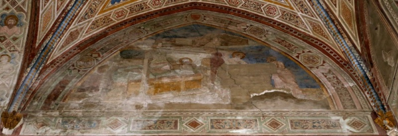
  <figcaption>Dalmasio degli Scannabecchi (attributed; the "Pseudo-Dalmasio" of part of the critical literature), The Dream of the Palace and the Gift of the Mantle, lunette of the left wall, from the Stories of Saint Francis, probably c. 1343, fresco. Pistoia, San Francesco, main chapel.</figcaption>
</figure>

The lunette at the top of the left wall, the first field of the cycle, contains two scenes rather than one — the Dream of Saint Francis, with the palace full of arms, and the Gift of the Mantle to a poor man — and this explains the apparent incoherence of its composition; it should not be confused with the Death of Francis, which occupied the last field of the right wall and is now lost.

Both episodes come from the first chapter of Bonaventure<a href="/endnotes.html#fn-bonaventure" class="footnote">11</a>'s *Legenda maior* and both are represented, as separate scenes, at the beginning of the Assisi Legend. In the first (I, 2), the young Francis, meeting a knight of noble birth reduced to poverty, took off his own fine cloak and gave it to him. In the second (I, 3), on the following night, he saw in his sleep a splendid palace full of arms marked with the sign of the cross, and heard Christ tell him that they were for him and for his knights. The Pistoia painter has set the two episodes side by side in the same lunette, the dream at the left and the gift at the right, reversing their order in the text — a choice that may have been dictated by the arrangement of the wall or by the wish to give the visionary scene the more prominent position.

At the left, within a timber structure that defines the bedchamber, the young Francis lies asleep on a bed with an ochre base and a green cover; his head, turned to the right and propped on pillows, is surrounded by a halo, in keeping with the Assisi tradition, which gives the saint a halo also in the scenes before his conversion. The bed is set in an open pavilion with slender posts and a curtain drawn back at the left. Above the roof of the bedchamber, against the dark sky, a figure in flight can be seen in the historical photograph discussed below — most probably Christ appearing to the sleeper, or an angel sent to him — while the palace full of arms, the object of the dream, is not clearly legible either in the present state of the lunette or in the older photograph.

At the right, the Gift of the Mantle is shown in a compact group. The young Francis, haloed and wearing a cap, stands at the corner of the bedchamber and holds out a large mantle, whose broad folds fill the space between him and the recipient; the poor knight, an older man in a cap and a long garment, bends forward to receive it, grasping the edge of the cloth. In the present state of the lunette, the mantle coincides largely with the great lacuna at the lower right, and only the young Francis, a hanging length of dark drapery and the bending figure of the knight can still be made out. The landscape in which, at Assisi, the encounter takes place, with the city on one hill and a church on another, has no counterpart here: the painter has set the episode immediately beside the bedchamber, against the dark ground of the lunette.

The reading of both episodes is confirmed by a black-and-white photograph taken by the Gabinetto Fotografico of the Soprintendenza in Florence between about 1920 and 1939 (negative 19271), preserved in the Fototeca of the Fondazione Federico Zeri in Bologna (inv. 28806, PI_0112/1/22), where it is catalogued under the title "Pseudo Dalmasio — Sogno di san Francesco d'Assisi; San Francesco d'Assisi dona il mantello al povero cavaliere". The photograph, taken soon after the frescoes were recovered and restored, shows the lunette in a far more legible state than today: the bedchamber with its posts, curtain and pillows, the sleeping saint, the flying figure above, and the group of Francis and the knight with the mantle are all clearly visible. It also documents, by comparison with the present condition, the deterioration of the painting during the twentieth century. A few letters visible at the lower left corner of the lunette in the old photograph may belong to an inscription; this has not been checked on the wall.

<figure>
  
  <figcaption>The lunette of the left wall, with the Dream of Saint Francis and the Gift of the Mantle, in a photograph of c. 1920–1939 by the Gabinetto Fotografico della Soprintendenza, Florence (negative 19271). Bologna, Fondazione Federico Zeri, Fototeca, inv. 28806.</figcaption>
</figure>

The condition of the lunette is very poor. Long cracks cross the whole surface, a large lacuna occupies the lower right, the colours survive only in faded patches, and the faces are almost entirely lost. The ornamental framework is well preserved: the frieze of foliate panels and lozenges below the lunette, the border of the arch with its octagons and geometric inlay, and the vault ribs with their twisted pattern of blue and gold; at the left, the pilaster carries busts of saints within quatrefoils. These decorative elements are closely related to those of the Bardi chapel in Santa Maria Novella and belong to the same campaign as the narrative scenes.

As the opening of the cycle, the lunette introduces the theme that runs through the whole left wall: the call of Francis, first expressed in an act of charity and in a dream he misunderstood, then revealed at San Damiano, made public in the renunciation of his father's goods, and finally recognised by the Church in the dream of Innocent III and the approval of the Rule. The prominence of architecture in these scenes — the palace of the dream, the ruined church of San Damiano, the tottering Lateran — gives the opening of the Pistoia cycle a striking coherence.

Even in its damaged state, the lunette preserves traces of the master's narrative manner: the clear division of the field between the two episodes, the construction of the bedchamber, and the slight, graceful figure of the young Francis, close in type to the youthful saints and angels of the Santa Maria Novella frescoes. Its reading rests on the order of the scenes recorded for the chapel and on the comparison with the Assisi model; direct examination of the upper zone and of the area around the red drapery would be needed to confirm the identification of the details.

### The Prayer in San Damiano (Pistoia, San Francesco, Main Chapel)

<figure>
  
  <figcaption>Dalmasio degli Scannabecchi (attributed; the "Pseudo-Dalmasio" of part of the critical literature), The Prayer in San Damiano, from the Stories of Saint Francis, probably c. 1343, fresco. Pistoia, San Francesco, main chapel.</figcaption>
</figure>

The Prayer in San Damiano is the best preserved scene of the Pistoia cycle examined so far, and the one in which the dependence on the Assisi Legend of Saint Francis, recognised by every student of the chapel, can be read most clearly. It represents the episode that opens Francis's conversion: praying before the crucifix in the half-ruined church of San Damiano, outside Assisi, the young man heard the image speak to him, commanding him to repair the house of God. In the Upper Church at Assisi the same episode forms one of the early scenes of the Legend; at Pistoia it keeps the essential elements of that model — the ruined church, the kneeling Francis in lay dress, the painted cross on the altar — while recomposing them in a more spacious and more architectural setting.

The subject is confirmed by the inscription that runs in Gothic capitals along the base of the floor. With its abbreviations expanded, it reads, as far as the photograph allows:

> IN ECCLESIA SANCTI DAMIANI BEATUS FRANCISCUS ORANS HOC AUDIVIT: FRANCISCE, VADE, REPARA DOMUM MEAM, QUAE, UT CERNIS, TOTA DESTRUITUR

"In the church of San Damiano the blessed Francis, praying, heard this: Francis, go, repair my house, which, as you see, is all falling into ruin." The words of the crucifix correspond to those of Bonaventure's *Legenda maior* (II, 1), the official life of the saint on which the Assisi cycle was based. The transcription is provisional, made from the photograph, and has not been checked on the wall, where some letters of the first words, heavily abbreviated, are not entirely legible.

The church of San Damiano is shown in cross-section, as a building opened at the front so that the viewer can see inside, according to the convention of the Giotto tradition. Its ruinous state, the reason for Christ's command, is described with great care: the tiled roof is broken open on the right to reveal the bare rafters, the walls of the nave are cracked and stained, and the upper windows are empty. Inside, a colonnade of slender columns supports an architrave decorated with geometric inlay and rosettes; at the left stand choir stalls inlaid with star-shaped patterns, and a small bell hangs by its rope near a window. At the right, an apse with a coffered half-dome, framed by columns, contains the altar on which the crucifix stands. The whole construction, with its exact perspective of the floor and its careful description of materials, is one of the most accomplished architectural interiors of the corpus.

Francis kneels at the centre, turned toward the crucifix, his hands raised in prayer and wonder. He wears not the friar's habit but the long pink garment of a young layman, as befits the moment before his conversion, and his halo, punched with fine rays, is the only sign of the sanctity to come. His face, in profile, is young, beardless and intent. The crucifix on the altar is a painted cross of the triumphal type, with the Christ alive and upright, the cross ending in broad terminals — a reminder that the historical crucifix of San Damiano, preserved since the thirteenth century in the church of Santa Chiara at Assisi, was itself a painted panel. In the fresco the cross does not stand quite upright on the altar but is set at an angle, inclined toward the kneeling Francis; whether the painter intended this inclination as a sign of the miraculous speech, or whether it reflects the condition of the paint, has not been judged on the original.

The scene is well preserved in comparison with the Trial by Fire, though not intact. The surface is worn throughout, with abrasion and staining on the walls of the church, a dark area of loss in the upper left part of the interior, and patches of retouching; the faces of Francis and of the crucified Christ retain their drawing but have lost much of their modelling. The broad border, with its geometric patterns of stars and lozenges in red, white and blue, survives on all sides, and the colours of the architecture — pinks, greys and greens — remain coherent. As in the Santa Maria Novella frescoes, the precise extent of modern restoration has not been checked against the documentation of the cycle.

Stylistically the scene confirms the kinship of the Pistoia cycle with the Florentine frescoes and the panels. The architecture is constructed with the same logic as the interiors of the Gregory cycle — compare the room in which Gregory lies ill — and shares their taste for inlaid ornament, rosettes and fictive marbles; the kneeling Francis, with his simple, weighty silhouette and his profile drawn with a fine, firm line, belongs to the same family of figures as the beggar in the alms to the shipwrecked man; and the overall sobriety of the colour, with its pinks, greys and greens, is that of the Florentine cycle. The scene also shows how the painter used the Assisi model: not as a pattern to be copied, but as a source of subjects and of a narrative language, reinterpreted in his own spatial and decorative terms.

In the sequence of the Pistoia cycle, the Prayer in San Damiano stands near the beginning of the story, before the episodes of the friar's mission such as the Trial by Fire before the Sultan, and it carries the programmatic meaning of the whole Franciscan legend: the command to rebuild the church, understood literally by the young Francis and allegorically by his biographers as the reform of the Church itself. In a chapel endowed by a Pistoiese merchant for the Franciscans of his city, that message had an obvious resonance. If the cycle dates, as most scholars believe, from around 1343, this scene is also one of the clearest demonstrations of how fully, a few years after Giotto's death, a Bolognese painter had absorbed the lesson of Assisi.

### The Dream of Innocent III (Pistoia, San Francesco, Main Chapel)

<figure>
  
  <figcaption>Dalmasio degli Scannabecchi (attributed; the "Pseudo-Dalmasio" of part of the critical literature), The Dream of Innocent III, from the Stories of Saint Francis, probably c. 1343, fresco. Pistoia, San Francesco, main chapel.</figcaption>
</figure>

The Dream of Innocent III is one of the best preserved and most immediately legible scenes of the Pistoia cycle. It represents the episode that, in the Franciscan legend, explains the pope's approval of the first Rule of the friars: when Francis and his companions came to Rome to seek recognition, Innocent III was at first hesitant, but he then remembered a dream in which he had seen the Lateran basilica, the cathedral of Rome and mother of all churches, about to collapse, and a poor, small and despised man holding it up with his shoulder. Recognising in Francis the man of his dream, the pope granted his request. Bonaventure tells the story in the *Legenda maior* (III, 10), and the episode forms one of the scenes of the Assisi Legend, which the Pistoia cycle follows in its choice of subjects.

The composition divides the field into two halves, the vision and the dreamer. At the left the Lateran basilica, rendered as a large church with a tiled roof, a cornice of inlaid geometric ornament with rosettes, and a tall Romanesque bell tower with arched openings, leans perceptibly to one side, its structure tilting toward the ground. Francis, haloed and wearing the grey-brown habit of his order, stands beneath it and supports it with his left shoulder against one of its columns, his right hand resting on his hip in an attitude of calm, almost casual effort — the paradox of the legend made visible: the poorest of men sustaining the head of Christendom without strain. The face of the saint, bearded and serene, is turned toward the viewer.

At the right, Innocent III sleeps in a bedchamber opened at the front, beneath a roof decorated with trefoil gables and a frieze of geometric ornament; a white curtain, drawn back and gathered around one of the bedposts, reveals the bed. The pope lies on a blue cover, wrapped in a red mantle, his head resting on a pillow at the right and covered by a gold headdress, his eyes closed. Above him, on a small white cloud, floats a young haloed angel in a pink garment, holding a green book in one hand and pointing toward the sleeper with the other — the messenger of the dream, who makes the divine origin of the vision explicit. The presence of the angel is a notable element of the Pistoia composition; whether it has a counterpart in the Assisi version of the scene, has not been checked in comparison with that fresco.

At the foot of the bed two attendants sit on the floor, keeping watch: one, bearded, in a pink garment with a white cap, looks out toward the viewer with a thoughtful expression; the other, wrapped in a dark mantle, is seen from behind with his head lowered, perhaps asleep. These figures, which give the scene its domestic and quiet atmosphere, are a familiar feature of the iconography of the episode, and their contrasting poses — one awake, one turned away — are rendered with the psychological attention characteristic of the master.

The condition of the fresco is comparatively good. The architecture and the figure of Francis are well preserved, and the colours of the bedchamber — the blue cover, the red mantle, the white curtain — retain much of their intensity, though the red mantle and the face of the pope are abraded, and the halo of the angel and the gold of the pope's headdress are partly worn. The border survives on all sides. Modern lighting fixtures attached to the wall at the left edge appear in the photograph.

Stylistically the scene is among the clearest demonstrations of the master's narrative and architectural skill. The two buildings, the leaning church and the open bedchamber, are constructed with the spatial logic of the Giotto tradition and the decorative taste — inlaid friezes, rosettes, trefoils — shared with the Gregory frescoes in Santa Maria Novella; the figure of Francis, with its simple, weighty silhouette, its long folds and its relaxed pose, recalls the beggar of the alms to the shipwrecked man and the kneeling Francis of San Damiano; and the attendants at the foot of the bed have the same individualised physiognomies as the bystanders throughout the corpus. The diagonal of the leaning church, set against the horizontal of the sleeping pope, gives the composition a dynamic balance that is all the more effective for the economy of its means.

In the sequence of the cycle, the Dream of Innocent III follows the Prayer in San Damiano and precedes the episodes of the mission, such as the Trial by Fire before the Sultan: after the call to repair the church comes the recognition of Francis by the papacy as the one who sustains it. The two scenes are bound by a single metaphor — the building of the Church, ruined at San Damiano and tottering in the Lateran — and the painter has underlined it by giving both scenes an architectural setting of unusual prominence. For the Franciscans of Pistoia, and for the merchant who endowed their choir, the image of the poor friar holding up the Church of Rome expressed with particular force the claims of their order.

### The Approval of the Rule (Pistoia, San Francesco, Main Chapel)

<figure>
  
  <figcaption>Dalmasio degli Scannabecchi (attributed; the "Pseudo-Dalmasio" of part of the critical literature), The Approval of the Rule, from the Stories of Saint Francis, probably c. 1343, fresco, fragmentary. Pistoia, San Francesco, main chapel.</figcaption>
</figure>

The Approval of the Rule is the last of the six scenes of the left wall of the main chapel of San Francesco at Pistoia, in the lowest register, beside the Dream of Innocent III. It represents the episode that the dream explains: Pope Innocent III, having recognised in Francis the poor man he had seen holding up the Lateran, approved the way of life of the friars and their first Rule, in 1209 or 1210, granting them leave to preach penance. Bonaventure tells the story in the *Legenda maior* (III, 9–10), and the Assisi Legend represents it in a scene in which the pope, enthroned at the right among his cardinals, hands the Rule to Francis, kneeling at the left with his companions.

The fresco is among the most heavily damaged of the cycle. The whole lower centre of the field, where the figures of the pope and of the friars stood, has been lost down to the plaster, leaving a large irregular area of bare surface in which only scattered fragments of colour survive. What remains of the narrative are two marginal fragments. At the left, below the side niche, part of a brown garment can be seen, compatible with the habit of a friar and therefore with the group of Francis and his companions. At the right, under the right-hand niche, survives part of a seated figure in yellow and pink beside a slender column; its position, at the side where the Assisi composition places the enthroned pope and his court, suggests that it belongs to the papal group, though it cannot be identified with certainty. A further fragment of reddish drapery survives within the lacuna at the centre.

The architecture, by contrast, is well preserved, and it is one of the most monumental of the cycle. The scene is set before a great building of pink and ochre marble: a front crowned by a pediment with a roundel in its tympanum, framing what appears to be a figure or a bust; a large round arch opening onto a dark interior; two trefoil oculi in the spandrels; gabled niches at either side, carried on slender columns with foliate capitals; and, at the upper left, a bell tower against a blue sky streaked with cloud. The structure, more a ceremonial portico than a palace, gives the papal audience a solemn frame and recalls, in its classicising details, the architectural constructions of the Gregory frescoes in Santa Maria Novella.

Within the area of loss, the photograph shows faint lines on the exposed plaster, apparently traces of drawing. They may belong to the preparatory drawing beneath the painted surface or to incisions made in the plaster, and if so they would preserve something of the lost composition. Their nature and extent cannot be judged from the photograph; they deserve close examination on site and in raking light, since they may be the only evidence for the arrangement of the figures.

The condition of the scene thus allows only a partial description, and it should be catalogued as a fragment. The identification of the subject, however, is secure: it rests on the order of the scenes recorded for the chapel, which places the Approval of the Rule at the end of the left wall, after the Dream of Innocent III, and on the agreement of the surviving fragments — the friar's habit at the left, the seated figure at the right, the ceremonial architecture — with the Assisi model.

In the sequence of the left wall, the Approval of the Rule completes the story of Francis's call: from the dream of the palace and the gift of the mantle, through the vision at San Damiano and the renunciation of his father's goods, to the dream of Innocent III and the recognition of the new order by the Church. Placed beside the Dream of Innocent III, it forms with it a pair that shows both the vision and its fulfilment, as at Assisi; for the Franciscans of Pistoia it represented the foundation of their own community and of the rule under which they lived.

What survives of the fresco confirms the quality of the cycle's architecture and the master's ability to give his narratives a monumental setting. The loss of the figures is one of the most serious in the chapel, and any future study of the scene should start from the traces of drawing in the lacuna and from the earliest photographs of the cycle, which may record the state of the fresco before later losses.

### The Sermon to the Birds: The Lunette of the Right Wall (Pistoia, San Francesco, Main Chapel)

<figure>
  
  <figcaption>Dalmasio degli Scannabecchi (attributed; the "Pseudo-Dalmasio" of part of the critical literature), The Sermon to the Birds, lunette of the right wall, from the Stories of Saint Francis, probably c. 1343, fresco. Pistoia, San Francesco, main chapel.</figcaption>
</figure>

The lunette at the top of the right wall of the main chapel of San Francesco at Pistoia represents the Sermon to the Birds. Its subject, uncertain in the present state of the painting, is established by a black-and-white photograph taken by the Gabinetto Fotografico of the Soprintendenza in Florence between about 1920 and 1939 (negative 19367) and preserved in the Fototeca of the Fondazione Federico Zeri in Bologna (inv. 28810, PI_0112/1/40), where it is catalogued as "Pseudo Dalmasio — San Francesco d'Assisi predica agli uccelli". The photograph shows the lunette soon after the frescoes were recovered and restored, and it reveals two details that are no longer legible today: a group of birds on the ground at the lower left, and the end of an inscription at the lower right, which reads clearly …ICAVIT. The composition, dominated by a walled city, might suggest the Expulsion of the Demons from Arezzo, but no demons appear above the city even in the old photograph, and the inscription is the ending of [PRED]ICAVIT — "preached".

The episode is told by Bonaventure in the *Legenda maior* (XII, 3) and represented in the Upper Church at Assisi. Travelling in the Spoleto valley near Bevagna, Francis saw a great number of birds gathered in a field; he went toward them, greeted them, and preached to them, reminding them of their duty to praise their Creator, who had given them feathers to clothe them, wings to fly and the air to live in; the birds stretched their necks, spread their wings and listened, and did not fly away until he had blessed them. The scene became one of the best-known images of Franciscan piety, and at Assisi it is set in an open landscape, with the saint bending toward the birds beneath a tree and a companion standing behind him.

The Pistoia painter set the episode before a city, which may stand for Bevagna, near which the legend places it. In the old photograph, the city occupies the centre of the lunette: a walled town with crenellated walls built of large blocks, a gate flanked by columns and surmounted by a lunette, and behind the walls a dense cluster of towers, houses and loggias rising in tiers. At the left, below the walls, a small flock of long-legged birds stands on rocky ground near the edge of the lunette; above them, at the top of a large lacuna that had already removed the central figures when the photograph was taken, survive a haloed head turned downward and, beside it, the head of a second figure. These are most probably Francis, preaching to the birds below, and his companion. At the right, before the walls, two friars stand facing left: the farther one, haloed, raises his right hand in a gesture of speech; his companion's head was already lost. The right-hand group may show Francis and his companion on their way, before the sermon, in a form of continuous narration that represents the saint twice in the same field, or it may belong to the same moment of the sermon; the photograph does not allow a firm choice between these readings.

The inscription at the lower right, of which the old photograph shows the letters …ICAVIT, preceded by faint traces of further letters, was evidently a titulus describing the scene, like those that accompany other scenes of the cycle, such as the Prayer in San Damiano. Its surviving ending, the verb *predicavit*, accords with the sermon, and the missing words may have named the birds to whom Francis preached. In the present state of the lunette only a few of these letters remain visible.

<figure>
  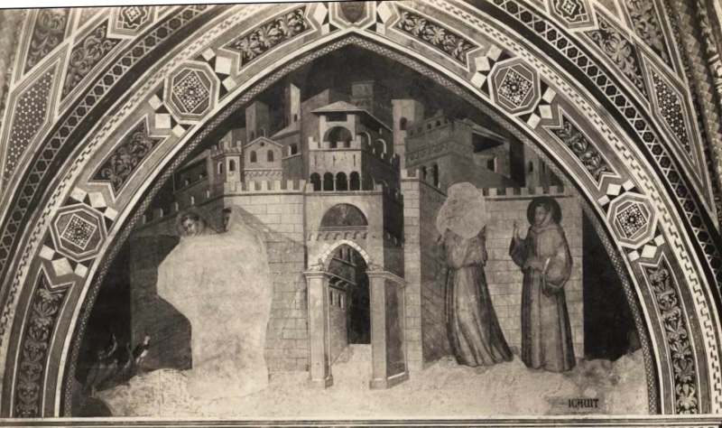
  <figcaption>The lunette of the right wall, with the Sermon to the Birds, in a photograph of c. 1920–1939 by the Gabinetto Fotografico della Soprintendenza, Florence (negative 19367). Bologna, Fondazione Federico Zeri, Fototeca, inv. 28810.</figcaption>
</figure>

Comparison between the old photograph and the present state shows the extent of the deterioration of the lunette in the course of the twentieth century. The great lacuna at the left was already present, but the birds, the heads above the lacuna, the architecture of the city and the gate were then clearly legible; today the birds and the heads have disappeared, the colours of the walls have faded to a uniform pink, the surface is crossed by long cracks, and the city survives only in its general outlines. The ornamental framework, by contrast, has survived largely intact, as in the opposite lunette. In the web of the vault above the lunette appears a medallion with a veiled woman in a fortified tower, inscribed CASTITAS, one of the Franciscan virtues.

The lunette opens the right wall of the chapel, whose scenes are devoted to the mission and sanctity of Francis. According to current descriptions of the chapel, the right wall also included the Expulsion of the Demons from Arezzo, described as barely legible; that scene must therefore have occupied another field of the wall, probably the badly damaged field to the left of the Trial by Fire in the register below, and its identification has not been verified on site. The Sermon to the Birds, the image of Francis's word reaching even the creatures of the air, thus stands at the beginning of a wall that continues with the saint's preaching before the Sultan and culminates in the Stigmatization.

The old photograph also allows the master's hand to be appreciated more fully than the present ruin permits. The city is one of the most elaborate architectural constructions of the cycle, built of interlocking volumes, towers and loggias, with its walls set at an angle to the picture plane, and it recalls the architecture of the Gregory frescoes in Santa Maria Novella; the birds, observed with the same curiosity that animates the animals of the Stigmatization on La Verna, add a naturalistic note to the composition.

### The Trial by Fire before the Sultan (Pistoia, San Francesco, Main Chapel)

<figure>
  
  <figcaption>Dalmasio degli Scannabecchi (attributed; the "Pseudo-Dalmasio" of part of the critical literature), The Trial by Fire before the Sultan, from the Stories of Saint Francis, probably c. 1343, fresco. Pistoia, San Francesco, main chapel.</figcaption>
</figure>

The scene of Saint Francis before the Sultan belongs to the cycle of the life of the saint in the main chapel of San Francesco at Pistoia, the second great mural ensemble of the corpus and the one that, together with the Saint Gregory frescoes in Santa Maria Novella, first allowed the master's personality to be recognised. The photograph was sent with the attribution "Lippo di Dalmasio?", which echoes the name under which parts of this cycle appear in the Italian state heritage catalogue. As set out in the introduction to the chapel, that label is a confusion of father and son rather than a considered attribution. The scene is therefore catalogued here under the same name as the rest of the corpus, and the Lippo label is recorded only as a cataloguing anomaly.

The dating follows the introduction to the chapel: the caption adopts "probably c. 1343", the year of Bandino di Conte dei Ciantori's endowment, and treats a later dating into the documented Dalmasio's Pistoiese years as a hypothesis. The condition of the fresco, as this scene shows, is poor.

The subject is the episode, told by Bonaventure and represented at Assisi, in which Francis, having gone to the East to preach to the Sultan of Egypt, offered to enter a fire together with the Sultan's priests to prove the truth of his faith; the priests withdrew, and Francis then offered to enter it alone, if the Sultan would promise to be converted, but the Sultan refused for fear of his people. Its essential elements — the enthroned Sultan, the fire between the parties, the friars and the departing priests — follow the Assisi model, though the arrangement of the figures and the setting are the painter's own and should not be assumed to reproduce the Assisi composition in detail.

The right half of the scene, the best preserved, is dominated by the Sultan. He sits on a Gothic throne set on a polygonal dais, under a circular canopy carried on slender columns, with a balustrade above and a coffered underside of small triangular facets; bearded, wearing a turban with a crown-like band and a red mantle draped over a light garment, he stretches out his right arm toward the fire in a gesture that seems to command the trial, or to invite his priests to it. Behind him crowd his councillors in turbans, their heads turned toward the centre; at the far right stands a guard with a long beard, a turban and a long yellow coat over green trousers, holding a bow — an exotic figure observed with evident curiosity. The canopy, with its rounded form and fine ornament, is one of the most inventive architectural motifs of the corpus.

The left half of the scene is largely lost. Beyond the fire, which blazes on the ground at the centre in tongues of red and yellow, a large lacuna, filled in grey, has removed the heads and much of the bodies of the figures who stood there. What survives are fragments of drapery — a brown mantle seen from behind, close to the fire, which may belong to Francis or to his companion; a white garment and a red-brown cloak further left; part of a turbaned head at the edge of the lacuna; and a figure in a patterned garment bending near the flames. The surviving fragments do not allow the figures to be identified with certainty, and in particular it cannot be established from the photograph whether the bent figures at the left are the friars or the Sultan's priests turning away from the trial.

The setting at the left is a large palace with a loggia on the upper floor, two-light Gothic windows and a row of square panels decorated with large foliate motifs, set against a dark sky. Its scale and its ornament are comparable to the architectural backdrops of the Santa Maria Novella frescoes, and the two buildings — the palace and the canopy — frame the scene as two poles, between which the fire occupies the empty centre. The painted border, with its pattern of small lozenges, survives along the top and the right edge.

Despite its condition, the scene offers several passages that confirm the identity of hand with the Florentine cycle and the panels: the heads of the Sultan and of the guard, with their long noses, heavy beards and sharply drawn profiles; the measured spatial construction, with figures set on a shallow stage before an architectural backdrop; and the taste for rare and decorative detail, from the coffering of the canopy to the costume of the archer. If the 1343 dating is correct, the cycle is contemporary with the Saint Onuphrius column in San Martino Maggiore and only a few years later than the Santa Maria Novella frescoes, and the Trial by Fire is among the most legible surviving witnesses of the master's work in Pistoia, the city whose name has always been bound up with the question of his identity.

### The Stigmatization of Saint Francis on La Verna (Pistoia, San Francesco, Main Chapel)

<figure>
  
  <figcaption>Dalmasio degli Scannabecchi (attributed; the "Pseudo-Dalmasio" of part of the critical literature), The Stigmatization of Saint Francis on La Verna, from the Stories of Saint Francis, probably c. 1343, fresco. Pistoia, San Francesco, main chapel.</figcaption>
</figure>

The Stigmatization on La Verna is the culminating episode of Francis's life, and in the Pistoia cycle it is also one of the most striking as a landscape. According to Bonaventure's *Legenda maior* (XIII, 3), in September 1224, two years before his death, Francis was praying on the mountain of La Verna, in the Casentino, when he saw descending from heaven a seraph with six wings, between which appeared the figure of a man crucified; when the vision vanished, the marks of the nails and of the wound in the side remained impressed on his body. The episode was represented in the Upper Church at Assisi, and the Pistoia scene keeps its essential elements — the seraph, the mountain, the chapel, the companion reading at a distance — while giving the setting an unusual breadth and naturalistic detail.

The great loss of the fresco must be acknowledged at once: the figure of Francis himself has almost entirely disappeared. A large lacuna, filled in a neutral tone, occupies the left-centre of the field, where the saint must have knelt to receive the stigmata; its position is confirmed by the rays that issue from the seraph and are directed downward and to the left, toward the lost figure. What survives is therefore the setting of the miracle and its witness, rather than its protagonist — a condition that gives the image a strange, almost visionary emptiness, but that must be clearly stated in any description of it.

The seraph appears near the top of the field, against a dark circular aureole surrounded by golden rays: the figure of the crucified Christ, arms outstretched, enveloped in six red wings — two raised above the head, two extended, two folded over the body. The type follows the iconography established in the Franciscan tradition from the thirteenth century onward, in which the seraph and the crucified are fused in a single figure. The rays that descend from it toward the lost Francis would have joined, as in other representations of the episode, the wounds of Christ to those of the saint; in the present state of the fresco, they lead only into the area of loss.

The landscape is among the most elaborate in the corpus. The mountain of La Verna is rendered as a vast slope of pale, fissured rock, broken by deep clefts and chasms — the split rocks for which the mountain was famous — rising toward a wood of tall, slender trees at the upper left and, at the upper right, a small pink chapel with a bell gable and an arched doorway, the oratory of the friars' hermitage. On the rocks the painter has placed a series of animals observed with evident pleasure: a deer lying among the stones in the middle distance, a dark bear walking across a ledge, and, in the foreground, a falcon perched at the edge of a chasm. The falcon may allude to the bird that, according to Bonaventure, kept Francis company during his stay on La Verna and woke him for the night office; the deer and the bear evoke the wildness of the mountain. The reading of the falcon as the bird of the legend is proposed here as a likely one; it has not been confirmed against the text.

At the right, seated on a rock at the edge of a chasm, a friar wrapped in a pinkish habit with the hood drawn over his head reads a book, absorbed and apparently unaware of the vision. He is the companion of Francis on La Verna, traditionally identified with Brother Leo (the state heritage record of the scene names him as Brother Elias), whose presence — at a distance, reading — is a feature of the Assisi scene as well. The contrast between the miracle above and the quiet reader below, which in Assisi underlines the solitude of Francis's experience, is here enhanced by the scale of the landscape that separates them.

The condition of the fresco is poor in its central part, as noted, and the surface is abraded throughout, with stains on the habit of the reading friar and losses in the rocks; the seraph, the trees, the chapel and the animals are, however, well legible. The lower part of the scene is cut by an arched opening with a decorated intrados, belonging to a later architectural intervention in the chapel, which has removed part of the foreground. Modern lighting fixtures appear on the right-hand border in the photograph. The date of the arched opening, and its relationship to the fourteenth-century decoration, has not been clarified.

Even in its damaged state, the Stigmatization reveals an aspect of the master's art that the other scenes show less fully: his capacity as a painter of landscape and of animals. The rocky mountain, constructed in broad planes of light and shadow and cut by dark fissures, follows the Giottesque convention for mountains, but the wood, the chapel and above all the animals introduce a naturalistic attention that recalls the still-life details of the Gregory cycle and the dog of the Philadelphia Madonna. If the cycle dates from around 1343, the scene is one of the most interesting landscapes painted in Tuscany in the years immediately after Giotto's death, and the loss of its central figure only makes more evident the quality of what remains.

### The Vault of the Main Chapel: Franciscan Virtues and the Glory of Saint Francis (Pistoia, San Francesco)

<figure>
  
  <figcaption>Dalmasio degli Scannabecchi (attributed; the "Pseudo-Dalmasio" of part of the critical literature), vault of the main chapel with allegories of the Franciscan virtues and the Glory of Saint Francis, probably c. 1343, fresco and gilding. Pistoia, San Francesco, main chapel.</figcaption>
</figure>

The rib vault of the main chapel of San Francesco at Pistoia is the best preserved part of the whole decoration, and the one that most directly reveals its model. Its four webs are painted with a deep blue sky strewn with gilded stars, edged by scalloped borders and framed by broad bands of ornament — octagons, quatrefoils, foliate scrolls and lozenges in red, white, ochre and green — that continue down the walls and frame the narrative scenes; the diagonal ribs are painted with a twisted band of blue and gold, and the inner faces of the arches carry busts of saints within quatrefoils. At the centre of each web, within a gold-ground medallion framed in pink and white, a half-length figure presents one element of a single programme: the vows on which the Franciscan life was founded and the glory of the saint who had embodied them. The vault thus forms the theological summit of the chapel, above the stories of Francis's life painted on the walls.

That programme is a deliberate reduction of the most famous Franciscan vault of the fourteenth century: the crossing of the Lower Church at Assisi, painted in the 1310s, whose four webs show the Allegories of Poverty, Chastity and Obedience and the Glory of Saint Francis enthroned. The Pistoia painter has kept the scheme of four webs and several of its key inventions — Chastity enclosed in a fortress-tower, the yoke of Obedience, the saint glorified in a radiant halo — but he has translated the crowded narrative allegories of Assisi into single emblematic figures, isolated in medallions against a starry sky. The derivation is an inference from the comparison of the two vaults rather than a statement made by a documented source, but it is consistent with the dependence of the wall cycle on the Assisi Legend of Saint Francis, and it shows that the model of the Pistoia chapel was the basilica of Assisi as a whole, upper and lower church alike.

Of the four medallions, only one carries a surviving inscription: CASTITAS, beneath the veiled woman in the tower. The friar bearing a yoke on his shoulders refers unmistakably to Obedience, the *iugum obedientiae* of monastic tradition; the haloed Francis with raised hands, set against rays of gold, corresponds to his glorification. The fourth figure, an elder in a grey mantle with a white headcloth who raises his hand to his face, is the least certain: his gesture recalls that of Obedience at Assisi, who lays a finger on her lips, while the logic of the three vows would lead one to expect Poverty in the remaining web. The individual entries that follow discuss these readings; the absence of inscriptions on three medallions, whether original or due to loss, has not been checked in close examination of the vault.

At the crossing of the ribs, a gilded boss with radiating foliate leaves frames a small medallion with the bust of Christ blessing and holding a book, the centre toward which all four webs converge. Around it, at the apex of each web, a small lozenge contains a painted shield. These shields are much damaged and their charges are hard to read in the photographs: one appears to bear a cross on a staff or banner, another a pale shield whose charge is lost, and a third a gilded bundle of rods with an axe-head, a fasces, whose bright and sharply defined gilding sets it apart from the others. If they are fourteenth-century coats of arms, they may record the patron of the chapel, the merchant Bandino di Conte dei Ciantori, whose endowment of 1343 is recorded by an inscribed stone in the church, or the commune of Pistoia; but the fasces in particular has not been examined on site, and its condition differs markedly from that of the other shields, and the vault is known to have undergone a restoration in the late 1920s.

The vault is also a key document for the master's decorative style. Its ornamental vocabulary — the octagons with inlaid geometric motifs, the foliate scrolls, the lozenges and the twisted ribs — is closely related to the borders of the Saint Gregory frescoes in the Bardi chapel of Santa Maria Novella, and the gold-ground medallions with their half-length figures recall, on a larger scale, the quatrefoil saints of the panels discussed below, from the Feigen strips at Yale to the Dublin and Detroit series. The figures themselves show the same grave, individualised heads and the same broad, heavy draperies as the narrative scenes on the walls. Painted with lavish use of gold and of blue, and in far better condition than the scenes below, the vault gives the clearest idea of the original splendour of the chapel that the Pistoiese merchant endowed for the Franciscans of his city.

#### Chastity

<figure>
  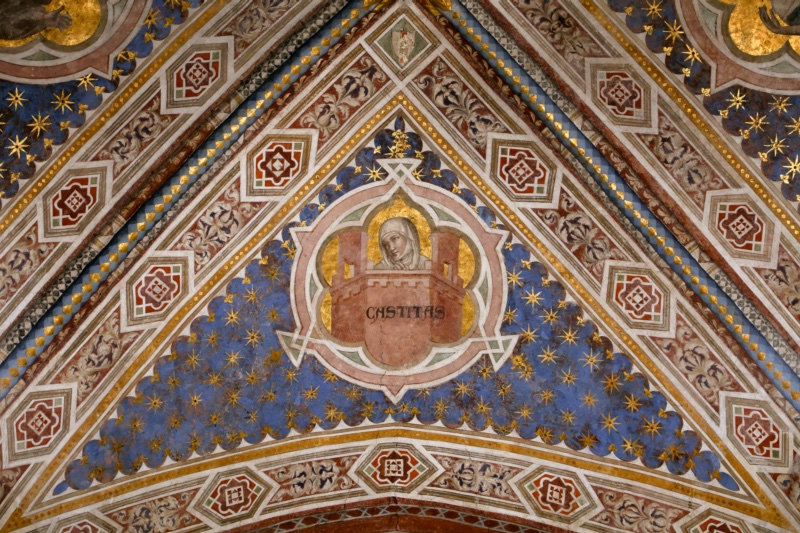
  <figcaption>Dalmasio degli Scannabecchi (attributed; the "Pseudo-Dalmasio" of part of the critical literature), Chastity (CASTITAS), medallion of the vault of the main chapel, probably c. 1343, fresco and gilding. Pistoia, San Francesco, main chapel.</figcaption>
</figure>

The medallion of Chastity is the only one of the four to preserve its inscription, and the only one whose subject is beyond doubt. Within a pink-framed medallion of four lobes, on a ground of gold leaf, a woman wrapped in a white veil and a grey-white wimple appears at the top of a red fortified tower, crenellated and flanked by two square turrets with small windows. She looks down, her head slightly inclined, and raises one hand to her chin in a gesture of modesty and reflection. Across the face of the tower runs the word CASTITAS in Gothic capitals. The medallion occupies the centre of a web of deep blue scattered with gilded stars, above the lunette of the right wall with the Sermon to the Birds.

The image of Chastity enclosed in a tower comes directly from the Allegory of Chastity in the vault of the Lower Church at Assisi, where the virtue sits, veiled, in a fortified tower guarded by armed figures and approached by the friars, while Love and the vices are driven away. The Pistoia painter has reduced this complex narrative to its core: the tower, the veiled woman and the inscription. The tower, an ancient symbol of virginity and of the enclosed life, here signifies the protection that chastity offers the soul; the red of its walls stands out against the gold ground with emblematic clarity, and its crenellations and turrets are drawn with the same attention to architecture that characterises the narrative scenes of the cycle.

The figure of Chastity is among the most refined in the chapel. Her face, long and pale, with heavy-lidded eyes, a long straight nose and a small closed mouth, has the grave melancholy of the master's female heads, from the Philadelphia Madonna to the mourners of the San Martino Crucifixion; the veil and wimple fall in soft, light folds around the head, and the hand raised to the chin is drawn with delicate precision. The gesture, which combines modesty and meditation, gives the allegory a personal and almost devotional quality, as if the virtue were also a model for the friars who sang the office in the choir below.

The condition of the medallion is good. The gold ground is worn in places, revealing the red preparation beneath, and a fine crack crosses the lower part of the tower; the inscription is entirely legible, and the colours of the tower and of the veil are well preserved. The blue of the web, with its gilded stars, and the surrounding bands of ornament are also in good condition, and the scalloped border of the starry ground, with small gilded lilies at its points, is clearly visible. At the apex of the web, a small lozenge contains a damaged shield, apparently charged with a cross on a staff or banner.

In the programme of the vault, Chastity represents one of the three vows of the Franciscan life, and its inscription provides the key to the reading of the other medallions, which lack one in their present state. Its derivation from Assisi, evident in the motif of the tower, confirms that the Pistoia vault was conceived as a condensed version of the vault of the Lower Church, adapted to the scale of a choir chapel and to the visual language of the master: emblematic, clear and grave.

#### A Grey-Robed Elder: Obedience (?)

<figure>
  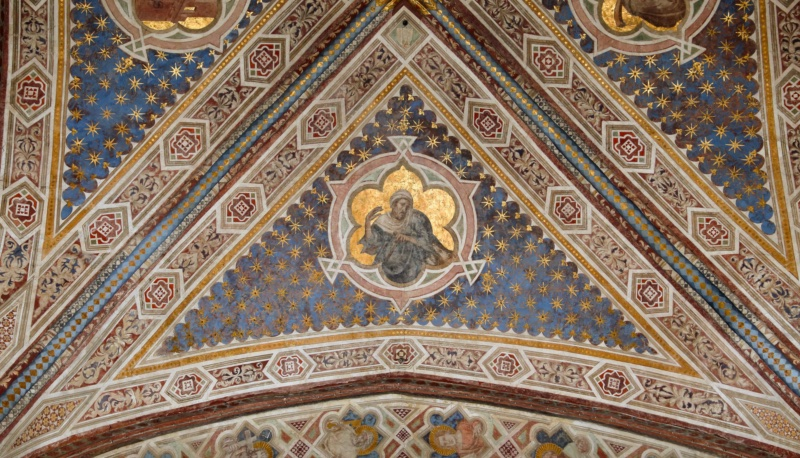
  <figcaption>Dalmasio degli Scannabecchi (attributed; the "Pseudo-Dalmasio" of part of the critical literature), A Grey-Robed Elder (Obedience?), medallion of the vault of the main chapel, probably c. 1343, fresco and gilding. Pistoia, San Francesco, main chapel.</figcaption>
</figure>

The fourth medallion of the vault presents the most uncertain figure of the programme. Within a gold-ground medallion framed in pink, an elderly man with a lined face and a short grey beard, his head wrapped in a white headcloth that falls over his shoulders, wears a heavy grey-blue mantle over a white garment. He raises his right hand to the level of his face, its fingers curled, and with his left hand he holds across his body a slender object, a staff or a cord, whose lower part disappears into the folds of the mantle. His gaze is lowered and his expression grave. No inscription is legible in the photograph.

Two readings can be proposed. The first identifies the figure as Obedience. In the vault of the Lower Church at Assisi, Obedience is represented as a figure in a monastic habit, seated within a loggia, who lays a finger on her lips — the gesture of silence that expresses the renunciation of one's own will — while placing a yoke on the neck of a kneeling friar. The raised hand of the Pistoia figure, held close to the face, may be a version of that gesture, and the object in his left hand could be the cord or strap of the yoke that appears in the neighbouring medallion, where a friar bears it on his shoulders. On this reading, the allegory of Obedience would have been divided between two medallions, the virtue and the friar who submits to it.

The second reading starts from the logic of the vows. The Franciscan Rule binds the friars to obedience, poverty and chastity, and Assisi devotes a web to each; at Pistoia Chastity and Obedience are certain, the Glory of Francis occupies a fourth web, and Poverty would be expected in the remaining one. The grey, roughly draped mantle and the humble headcloth of this figure might suit a personification of Poverty, or a poor man embodying her. Against this reading, however, Poverty is almost always represented as a woman, the bride of Francis, and nothing in the figure alludes to the Assisi image of the mystical marriage; the reading as Obedience is therefore preferred here, with the question left open until the medallion can be examined for traces of an inscription.

The figure is painted with the master's characteristic economy. The head, with its deeply furrowed brow, heavy eyelids and sunken cheeks, is among the most expressive of the vault, and its modelling, in soft greys and flesh tones, recalls the elderly heads of the San Martino Crucifixion and of the quatrefoil saints; the mantle falls in broad, angular folds, its grey-blue matched to the blue of the starry web. The condition is fair: the gold ground is worn, the lower part of the mantle and the object held in the left hand are abraded, and some losses affect the lower right of the medallion, where a further detail — possibly part of the yoke or another attribute — can no longer be read.

Whatever its precise meaning, the medallion completes the meditation on the religious vows that the vault offers to the friars gathered in the choir. If it represents Obedience, the Pistoia vault would contain a deliberate emphasis on that virtue, to which two of the four medallions would be devoted — an emphasis that would not be surprising in an order whose internal history, in the first half of the fourteenth century, was marked by bitter conflicts over obedience to the Rule and to the papacy.

#### A Friar Bearing the Yoke of Obedience

<figure>
  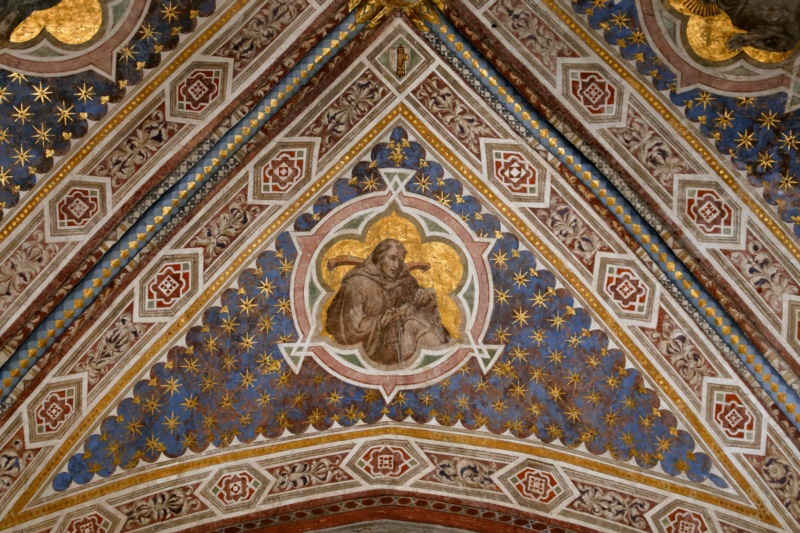
  <figcaption>Dalmasio degli Scannabecchi (attributed; the "Pseudo-Dalmasio" of part of the critical literature), A Friar Bearing the Yoke of Obedience, medallion of the vault of the main chapel, probably c. 1343, fresco and gilding. Pistoia, San Francesco, main chapel.</figcaption>
</figure>

The medallion with a friar bearing a yoke is the most explicit image of Obedience in the vault. Against a gold ground, a tonsured friar in the brown habit of the Franciscans, with its hood falling on his shoulders, carries across the back of his neck a curved wooden yoke, whose two ends project on either side of his head; with both hands, held before his chest, he grasps the cords or straps that hang from it, and below them the knotted cord of his habit falls from his waist. His head is slightly bowed and turned to the right, his eyes lowered, in an attitude of humble acceptance. The medallion occupies the web above the lunette of the left wall, with the Dream of the Palace and the Gift of the Mantle.

Like the grey-robed elder, the image derives from the Allegory of Obedience in the Lower Church at Assisi, described in the previous entry. The yoke is the traditional symbol of submission to the will of a superior, and it had a precise Gospel source in the words of Christ — "Take my yoke upon you… for my yoke is easy, and my burden is light" (Matthew 11:29–30) — which monastic and mendicant writers applied to the vow of obedience. At Pistoia the act of imposition is not shown: the friar already bears the yoke, and holds its cords as if he had taken it upon himself willingly. Whether he is a generic friar or Francis himself, the model of obedience, cannot be decided with certainty; no halo is visible against the gold ground.

The figure is one of the finest in the vault. The face, with its strong nose, heavy-lidded eyes and slightly parted lips, is modelled in warm flesh tones with soft shadows, and it shows the individual, almost portrait-like characterisation that the master gave to his friars, as in the Prayer in San Damiano and the Dream of Innocent III. The habit, rendered in shades of brown, falls in heavy, rounded folds that give the half-length figure a monumental weight within the small field, and the hands, holding the cords, are drawn with care. The yoke itself, a simple curved beam of wood, is rendered with a plain realism that makes the symbol immediately legible.

The condition of the medallion is good. The gold ground is worn and crackled in places, and the lower part of the habit is slightly abraded, but the head, the hands and the yoke are well preserved, as are the starry blue of the web and the surrounding ornament. In the small lozenge at the apex of the web, a shield is charged with a gilded fasces — a bundle of rods bound together with an axe-head — whose bright gilding and sharp outline set it apart from the more damaged shields of the other webs; its relation to the original decoration of the vault has not been verified, as noted in the introduction to the vault.

In the programme of the chapel, the yoked friar offered the community gathered in the choir an image of their own vow, in the simplest and most direct form. Placed above the wall that recounts the beginnings of Francis's vocation — his dream, his charity, his call at San Damiano, his renunciation of his father's goods and the approval of his Rule by the pope — it gives the vow of obedience a central place in the reading of the left wall, which ends with the submission of Francis and his companions to the authority of the Church.

#### The Glory of Saint Francis

<figure>
  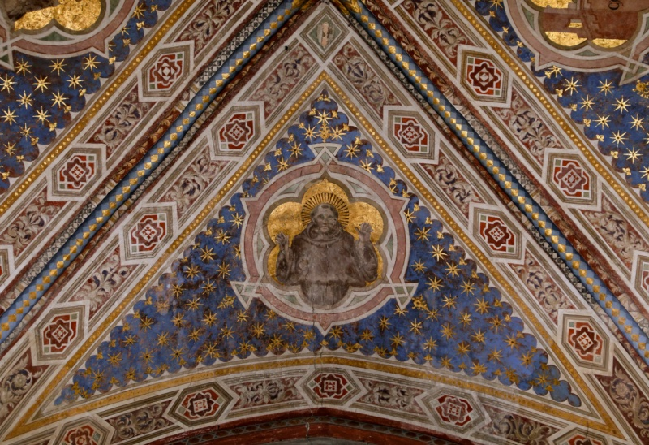
  <figcaption>Dalmasio degli Scannabecchi (attributed; the "Pseudo-Dalmasio" of part of the critical literature), The Glory of Saint Francis, medallion of the vault of the main chapel, probably c. 1343, fresco and gilding. Pistoia, San Francesco, main chapel.</figcaption>
</figure>

The medallion of the Glory of Saint Francis completes the programme of the vault. Against a gold ground, Francis appears frontally, at half length, wearing the grey-brown hooded habit of his order; his head, with its tonsure and short beard, is surrounded by a halo of dark rays that radiate outward against the gold, a sign of glory that distinguishes him from the other figures of the vault. He raises both hands to shoulder height, palms turned outward, in a gesture that is at once one of prayer, of blessing and of display: the gesture with which the stigmatised Francis shows the wounds of Christ impressed on his hands.

The image corresponds to the fourth web of the Assisi vault, where Francis, in a dalmatic of gold, is enthroned in glory amid a host of angels. The Pistoia painter has retained the essential idea — the saint in heaven, crowned by the light of glory — but has expressed it with a sobriety more in keeping with the Franciscan ideal and with the small scale of the medallion: Francis wears his plain habit, not a liturgical vestment, and the glory is conveyed only by the rays of the halo and the gold ground. The frontal pose and the raised hands give the figure the character of an icon, addressed directly to the friars who looked up at it from the choir.

Whether the stigmata were painted on the raised hands cannot be determined from the photograph: the palms are abraded and no red marks are clearly visible, but the gesture itself, so closely associated with the display of the wounds, suggests that they were intended. The face is grave and calm, with large eyes and a straight nose, of the same type as the Francis of the narrative scenes; the habit, painted in broad, flat areas of grey-brown with few folds, gives the figure a compact, almost architectural mass that holds the centre of the medallion.

The condition of the medallion is fair. A long vertical crack runs down through the lower part of the figure, the paint of the habit is abraded, and the gold ground is worn and crackled in places, especially around the head; the radiating halo, painted in dark strokes on the gold, is well preserved. The starry web and the ornamental bands are in good condition. The lozenge at the apex of this web contains a shield whose charge is now lost.

In the programme of the chapel, the Glory of Saint Francis is the culmination of the whole decoration: below, on the walls, the stories of his life, from his first dream to the stigmatization and death; above, in the vault, the vows he professed and the glory he attained. Set in the same starry heaven as the virtues, and converging with them toward the bust of Christ at the keystone, the glorified Francis expresses the Franciscan conviction that the saint, conformed to Christ in his wounds, had been raised to the highest place in heaven — an idea that the Pistoia friars, praying in the choir beneath him, could contemplate every day.

### Standing Saints in Painted Tabernacles on the Entrance Arch (Pistoia, San Francesco, Main Chapel)

The pilasters of the entrance arch of the main chapel carry four single standing saints, two on each pilaster, one above the other, each set within a painted Gothic tabernacle and framed by the same borders of stars and lozenges in red, white and blue that surround the narrative scenes. The tabernacles are identical in design: a niche with a rib vault, opened by a pointed arch on clustered pilasters, flanked by slender twisted columns with foliate capitals and crowned by a steep gable with a polylobed oculus, crockets, a finial and side pinnacles, the whole standing on a base decorated with a frieze and set against a dark blue ground. On one pilaster, Saint John the Baptist stands above a young martyr with a palm and a covered vessel; on the other, a young female saint with a vessel stands above Lazarus. Facing the nave, the four saints frame the view into the choir and greet the viewer before the stories of Francis on the side walls and the allegories of the vault come into sight. No inscriptions identifying them are legible in the photographs; the identifications below rest on their attributes and on their pairing.

#### Saint John the Baptist

<figure>
  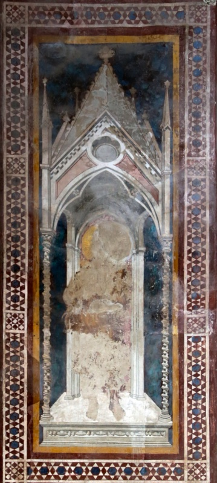
  <figcaption>Dalmasio degli Scannabecchi (attributed; the "Pseudo-Dalmasio" of part of the critical literature), Saint John the Baptist, probably c. 1343, fresco, fragmentary. Pistoia, San Francesco, main chapel, pilaster of the entrance arch (upper tabernacle).</figcaption>
</figure>

The upper tabernacle of one of the pilasters of the entrance arch preserves the architecture of its painted niche almost intact, but the saint who stood in it has been reduced to a ghost. Within the niche survive only a fragment of the gold halo at the upper left, the oval of plaster where the head was, scattered patches of brown, ochre and reddish pigment on the body, and the faint outline of the feet on the floor of the niche. The face, the hands and any attribute held in them have disappeared.

The figure is nonetheless identifiable as Saint John the Baptist. At the left, at the level of the shoulders and again around the waist, long wavy strands of brown hair and fur project beyond the outline of the body, and the brown and ochre tones of the lower torso show that the saint wore not ordinary drapery but a rough, hairy garment: the raiment of camel's hair described in the Gospels (Matthew 3:4), which in fourteenth-century painting is regularly shown beneath a mantle, with the long, unkempt hair of the prophet of the wilderness. His position, at the top of the pilaster, gives the Precursor a place of honour at the threshold of the chapel, as the one who announces Christ and calls to repentance.

The Baptist was a natural presence in a Franciscan choir. He was revered as the model of the ascetic and penitent life that Francis had embraced, and the Franciscan tradition associated the two saints closely, from the baptismal name Giovanni that Francis received at birth to the parallel between the Precursor and the herald of a new form of Gospel life. For a merchant patron and a community of friars, the Baptist also stood as the great intercessor at the Last Judgement, beside the Virgin.

The architecture of the tabernacle is well preserved and shows the care with which the master designed these fictive shrines. The gable, painted in grey with a dogtooth moulding, a polylobed oculus and a crocketed finial, rises between two tall pinnacles; the spandrels of the arch are pink; the twisted columns at the sides, with their foliate capitals and moulded bases, are drawn with an almost sculptural relief; and the base of the niche carries a frieze of small leaves. The blue ground survives in patches of deep blue and green.

The condition of the panel is very poor in the figure and good in the frame. The losses within the niche reveal the brown and reddish layers beneath the paint surface, and a long crack runs across the halo; whether the loss is due to the deterioration of passages painted *a secco* or to damage suffered under the whitewash cannot be judged from the photograph. Close examination of the panel, and the search for earlier photographs in the Fototeca Zeri, might recover details of the face and of the attributes — the cross-staff, the scroll with *Ecce Agnus Dei* — that the Baptist normally carries.

#### A Young Martyr with a Palm and a Covered Vessel (Saint Cosmas or Damian?)

<figure>
  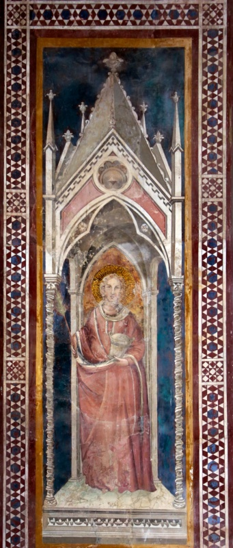
  <figcaption>Dalmasio degli Scannabecchi (attributed; the "Pseudo-Dalmasio" of part of the critical literature), A Young Martyr with a Palm and a Covered Vessel (Saint Cosmas or Damian?), probably c. 1343, fresco. Pistoia, San Francesco, main chapel, pilaster of the entrance arch (lower tabernacle, below Saint John the Baptist).</figcaption>
</figure>

Below the Baptist, in the lower tabernacle of the same pilaster, stands a young saint against a warm ochre background, which sets off his halo and head more vividly than in the other niches. He has curling fair hair, a short light beard and a calm, frontal gaze, and wears a long tunic and a mantle of rose-red that fall in heavy folds to the floor. In his right hand he holds a green palm, the sign of martyrdom, whose fronds rise beside his shoulder; in his left, held against his body, a covered vessel of pale metal, cylindrical and slightly flared, with a domed lid.

The combination of the palm and the covered vessel points to one of the martyr-physicians Cosmas and Damian, the twin brothers who, according to their legend, practised medicine without payment and were martyred under Diocletian; in Italian painting of the fourteenth century they are regularly represented in red robes, holding a pyx or a box of ointments and, often, the palm of martyrdom. None of the other three saints on the entrance arch represents the second brother, so the physician appears here alone, and it is impossible to say from the image whether Cosmas or Damian is meant. A reading of the vessel as an ointment jar, and of the figure as a female saint, is excluded by the light beard; the identification as one of the physician saints is therefore proposed as the most probable.

The figure is painted with the master's characteristic qualities. The face, with its broad brow, heavy-lidded eyes, long nose and small mouth framed by the short beard, has the gravity and the slight individual irregularity that mark his heads; the hair is drawn in soft, curling locks; the drapery, falling in long folds from the arm that holds the vessel, gives the figure a calm, columnar monumentality. The vessel, with its domed lid and moulded foot, is described with the same attention to objects as the flask and fruit in the Gregory frescoes of Santa Maria Novella.

The condition of the panel is fairly good. The rose-red of the tunic and mantle has faded and is abraded in places, especially in the lower part of the figure; the halo, with its incised rays, and the face are well preserved; and the ochre background within the arch, though worn, retains its warmth. The tabernacle, with its gable, oculus, pinnacles and twisted columns, is intact, and the blue ground and the geometric border are in good condition.

If the saint is indeed Cosmas or Damian, his presence may reflect a devotion of the patron or of the friars, since the physician saints were widely venerated in Tuscany. Set beneath the Baptist, the healer who served without payment offered the friars an image of charity in harmony with the poverty of their order, and with the penitent prophet above him he forms a pair of witnesses — the voice that prepares the way and the martyr who gives his life — at the threshold of the choir.

#### Mary Magdalene with Her Ointment Jar (?)

<figure>
  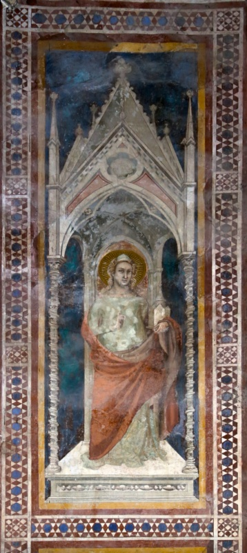
  <figcaption>Dalmasio degli Scannabecchi (attributed; the "Pseudo-Dalmasio" of part of the critical literature), Mary Magdalene with Her Ointment Jar (?), probably c. 1343, fresco. Pistoia, San Francesco, main chapel, pilaster of the entrance arch (upper tabernacle, above Lazarus).</figcaption>
</figure>

The upper tabernacle of the other pilaster contains the best preserved of the four figures: a young saint with fair, curling hair falling to the shoulders, a small white cap on the head, and a gold halo with fine radiating lines incised in the plaster. She wears a pale green garment with long sleeves, over which a red mantle is drawn across the body from the left shoulder, falling in broad folds to the floor. In the raised right hand she holds a slender rod, whose upper end is lost; in the left, against the edge of the mantle, a tall white object with a pointed top and a narrow opening.

The identification of the saint depends on that object and on her companion. Taken in isolation, it might be read as a small tower, the attribute of Saint Barbara. Its position directly above Lazarus, however, suggests a different and more coherent reading: a tall vessel with a pointed lid — the ointment jar of Mary Magdalene, the sister of Lazarus, with which, according to the medieval tradition that identified her with Mary of Bethany and with the sinner who anointed Christ, she anointed the feet of the Lord. The long, loose hair, the red mantle and the youthful face all accord with the iconography of the Magdalene, one of the saints most venerated by the Franciscans as the model of penitence and love; the slender rod in her right hand might be the stem of a palm or a small cross. The reading as Mary Magdalene is proposed here as the most probable, with Saint Barbara as an alternative if the object proves, on close examination, to be a tower with windows.

The figure is one of the most characteristic of the master's hand among the paintings of the chapel. The face, oval and pale, with a long straight nose, heavy-lidded eyes turned slightly to the side and a small closed mouth, belongs to the same family as the female heads of the Philadelphia Madonna, the Chastity of the vault and the angels of the ex-Askew panel; the red mantle, drawn across the body in a single diagonal sweep and falling in heavy, simple folds, has the weight and clarity of the Giotto tradition. The niche, with its vault and side columns, gives the figure a precise spatial setting, the saint standing within the shrine rather than in front of it.

The condition is fair. The pale green garment is mottled by patches of white efflorescence or loss, especially around the chest; the red mantle has lost some of its modelling; and the blue ground is worn and partly replaced by green tones. The face, the hair and the halo are well preserved, and the architecture of the tabernacle, with its gable, oculus and twisted columns, is intact. A vertical crack runs through the left side of the panel.

If the saint is the Magdalene, the pilaster presents a family group from the Gospel of John: the sister who anointed Christ above the brother whom Christ raised from the dead. The pairing would echo, on the threshold of the chapel, the theme of penitence and of the hope of resurrection, and it may reflect the devotion of the Franciscans, who promoted the cult of the Magdalene, or of the patron of the chapel.

#### Lazarus

<figure>
  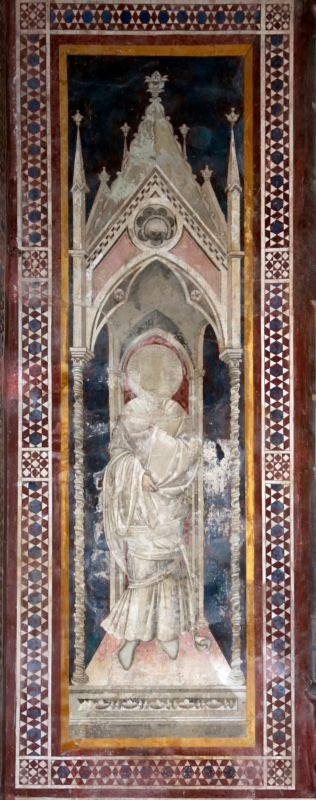
  <figcaption>Dalmasio degli Scannabecchi (attributed; the "Pseudo-Dalmasio" of part of the critical literature), Lazarus, probably c. 1343, fresco, fragmentary. Pistoia, San Francesco, main chapel, pilaster of the entrance arch (lower tabernacle, below Mary Magdalene).</figcaption>
</figure>

In the lower tabernacle of the second pilaster stands Lazarus of Bethany, the friend of Christ raised from the dead (John 11). His head has been lost, and the halo is reduced to a pale disc with faint incised rays against a dark red background within the arch of the niche; but the figure is identified by its dress. He is wrapped from the shoulders to the feet in white cloths, a long tunic and a sheet drawn around the body and gathered at the chest by his right hand, while a horizontal band binds them at the waist: these are the grave-clothes in which, according to the Gospel, Lazarus came out of the tomb "bound hand and foot with graveclothes". At the lower right, near the hem, the loose end of a band or of the winding sheet curls outward, a detail that reinforces the reading.

The whiteness of the drapery is therefore not, or not only, the result of the loss of pigment, as it might seem at first sight: the master painted Lazarus in the white of the shroud, modelling the folds in pale greys. The rendering — the sheet passing over the left shoulder, falling in long vertical pleats on the right side, and bound at the waist — has the clarity and weight of the Giotto tradition, and the band around the body recalls the swathed figure of Lazarus in Giotto's Raising of Lazarus in the [Arena Chapel](/Content/Churches/Cappella-degli-Scrovegni.html)<a href="/endnotes.html#fn-arena-chapel" class="footnote">12</a> at Padua, where the risen man stands still bound in his winding sheet.

The presence of Lazarus as a standing saint at the entrance of a choir is less common than that of the Baptist or the Magdalene, and it carries a precise meaning. Lazarus was the Gospel's great figure of the resurrection of the body, and his image at the threshold of a chapel that was also a place of burial — endowed by a merchant who would expect to be commemorated there — expressed the hope of the resurrection of the dead. Paired with Mary Magdalene above him, he forms with his sister a group from the household of Bethany, whose friendship with Christ was a model of devotion.

The tabernacle surrounding the figure is well preserved: the gable with its oculus and crockets, the pinnacles crowned by small finials, the twisted columns and the base with its frieze of leaves stand out clearly against the blue ground, which is, however, heavily abraded and patchy, with large areas of loss revealing the white plaster beneath. The floor of the niche is pink, and the feet, in pale wrappings, rest on it. The geometric border around the panel is intact.

The loss of the head deprives the figure of its expression, but the fragment remains one of the most interesting of the chapel for its iconography. Earlier photographs in the Fototeca Zeri or in the archive of the Florentine Soprintendenza may preserve the face of Lazarus, which could confirm the identification and allow the head to be compared with those of the narrative scenes.

## The Panel Paintings: The San Martino Group and the Devotional Panels

The panels attributed to the master are few, small and scattered, but they include works of singular beauty, and recent scholarship has given the core of the group a new physiognomy by proposing that several of the dispersed pieces once formed a single complex. The anchor is the Crucifixion with the Mourning Virgin and Saint John in the Pinacoteca Nazionale di Bologna, inventory 215: tempera on panel, 125 by 61.5 centimetres, from the Bolognese church of San Martino Maggiore. The museum, as noted, exhibits it under the name of Dalmasio with a dating of circa 1335–40, and it is the touchstone of the painter's panel style — a Calvary of concentrated stillness, in which the Bolognese taste for pathos is disciplined into something closer to Giotto's gravity than any contemporary Bolognese panel can show.

Around this Crucifixion, a reconstruction advanced in recent specialist scholarship regroups two of the master's most famous fugitives. The first is the Virgin and Child at the Yale University Art Gallery, the panel Longhi christened the Madonna "of the flying carpet" after the cloth of honour that hovers, unsupported, behind the Virgin — one of those verbal coinages of his that have shaped perception as much as any argument. The second is the Flagellation in the Seattle Art Museum, accession 61.147, a panel of 57.5 by 36.8 centimetres from the Kress collection. On this reconstruction, the three panels — with two others now lost — originally belonged to one five-part altarpiece painted for San Martino in Bologna around 1338–42, with the Crucifixion at the centre, the Flagellation to its left and the Yale Virgin at the outer left. The proposal rests not only on style but on the carpentry of the panels, in particular the dowel holes on the right edge of the Yale Virgin and their absence on its left; no document of the commission survives, but the reconstruction gives the master a major Bolognese retable commission at precisely the date Bellosi's chronology requires. The Seattle panel, incidentally, offers a compact lesson in the instability of this painter's catalogue data: the museum itself dates it circa 1330–39 under the name Pseudo-Dalmasio, while the Kress Foundation's records carry the older designation "Dalmasio Scannabecchi" with a dating of circa 1360 — the entire historiographical conflict fossilised in two database entries for a single object — and the panel had been sold to Kress in 1939 under a different name altogether, as Jacopo da Bologna.

The devotional panels extend the catalogue. The Virgin and Child in the Philadelphia Museum of Art (John G. Johnson Collection, catalogue 3; 46.5 by 30.5 centimetres) shows the Child playing with a small dog — a touch of domestic naturalism rare at this date — and is catalogued as "attributed to Dalmasio," circa 1330–35; the attribution is Bellosi's own, which is to say that the scholar who severed the corpus from the name continued to enlarge the corpus itself. A Virgin and Child Enthroned with six angels, formerly in the Askew collection in New York and with an older provenance from the Del Pero collection at Imola, passed through auction in New York in 2012 and is reported in the recent catalogue literature to be now in the Alana Collection. A series of half-length saints in quatrefoils survives in four strips of four medallions each, all of the same format, about 14 by 56 centimetres: two lent to the Yale University Art Gallery from the Feigen collection, one in the Detroit Institute of Arts (37.189.1–4) and one in the National Gallery of Ireland in Dublin (NGI.1113). The sixteen medallions evidently once decorated the framing apparatus of a single dismembered complex, and their saints point to its destination: among apostles or prophets, bishops, the Baptist and the Princes of the Apostles appear Saint Thomas Aquinas<a href="/endnotes.html#fn-thomas-aquinas" class="footnote">13</a>, canonised in 1323, Saint Dominic, Saint Catherine of Alexandria and a bishop identified by Dublin as Augustine<a href="/endnotes.html#fn-augustine-of-hippo" class="footnote">14</a>, whose Rule the Dominicans followed. The complex was therefore very probably painted for a Dominican church — San Domenico in Bologna is the obvious candidate, though no document confirms it — and not for the Carmelites of San Martino. Here again the databases preserve a fossil, for Detroit catalogues its strip under "Dalmasio di Jacopo" with the dating 1370–77, a chronology irreconcilable both with the current consensus, which places the series around 1335–40, and with the museum's own life dates for the painter, which end in 1373. Finally, a Crucifixion in the Acton collection at Villa La Pietra in Florence and a Descent from the Cross formerly in the Visconti di Modrone collection, now in a private collection in New York, were argued, in a study published in 1982, to be parts of a single further altarpiece, which the most recent biographical dictionary entry places among the master's early works, in the early 1330s; and an attribution advanced in 2004 has extended the master's activity into a different medium altogether, assigning to him the designs of gilded-glass roundels with figures of philosophers divided between the Museo Civico of Turin and the Musée de Cluny in Paris. Each of these satellite attributions carries its own degree of probability, lower than that of the core; none rests on documents; and the dimensions and inventory data given here are those of the holding institutions' current records.

## Catalogue Entry

### Crucifixion with Mourners and Prophets, from San Martino Maggiore

<figure>
  
  <figcaption>Dalmasio degli Scannabecchi (attributed; the "Pseudo-Dalmasio" of part of the critical literature), Crucifixion with Mourners (Gesù Cristo crocifisso e dolenti), c. 1335–1340, tempera on panel, 125 × 61.5 cm. Bologna, Pinacoteca Nazionale, inv. 215; from the church of San Martino Maggiore, Bologna. </figcaption>
</figure>

Among the panels gathered under Dalmasio's name, the Crucifixion of the Pinacoteca Nazionale di Bologna — *Gesù Cristo crocifisso e dolenti*, inventory 215, tempera on panel, 125 × 61.5 centimetres — holds the position of touchstone, and it earns it on every count. It is the only major panel of the corpus still in Bologna; it is the only one whose early provenance is secure, coming from the church of San Martino Maggiore, the house of the Carmelites, which also preserves the frescoed column attributed to the same hand; and it is the work through which the Pinacoteca has taken its institutional stand on the attributional question, exhibiting the panel under the plain name of Dalmasio with a dating of circa 1335–1340. That label, as argued above, is not a neutral formula: it quietly weds Bellosi's early chronology to Longhi's identification, endorsing both at once. Whatever one thinks of that marriage, the dating itself commands broad assent, and the panel may fairly be described as the clearest statement in panel painting of the master's artistic language — the place where his Tuscanised Bolognese idiom can be studied at close range, on an intact gold ground, without the ruin that veils the fresco cycles.

The format is tall, narrow and acutely gabled, the picture field framed by carved and gilded woodwork: spiral colonnettes at the sides, sprays of foliate ornament at the base of the gable, and a trilobed moulding drawn inside the cusp like the profile of a Gothic window. Whether this carpentry is original or a later dressing is a question for the technical literature, which has not been consulted; what the proportions themselves suggest is that the panel was not conceived as an isolated devotional image but as one element of a larger structure. Recent specialist scholarship has given that intuition a precise shape, reconstructing the Crucifixion together with the Virgin and Child at Yale — Longhi's Madonna "of the flying carpet" — and the Flagellation in Seattle as surviving members of a single five-part altarpiece painted for San Martino around 1338–1342. The proposal no longer rests on congruities of style, scale and provenance alone. The carpentry of the Yale Virgin — dowel holes on its right edge, none on its left — shows that it was the outer left element of a larger structure, and the examination of the three panels' construction on which the reconstruction is based identifies the present Crucifixion as the central compartment of a pentaptych, with the Seattle Flagellation and the Yale Virgin to its left and two lost Passion scenes to its right. No document of the commission survives, and the identity of the missing scenes remains conjectural; but the structure itself now has physical support, and the present panel can be regarded with some confidence as the centrepiece of one of the earliest fully Giottesque retables produced in Bologna, commissioned by the Carmelites within a few years of Giotto's own polyptych for the city.

The upper zone condenses the panel's theology into a few square centimetres of extraordinary invention. The cross is no squared carpenter's timber but a rough tree-trunk, its bark and lopped knots carefully described — the cross as living wood, the *lignum vitae* of medieval exegesis — and from its summit, above the titulus, an actual tree bursts into green leaf. In its crown a pale bird spreads its wings over a nest: the pelican, who in the bestiary tradition revives her brood with blood struck from her own breast, and who therefore perches over Calvary as the oldest of Eucharistic metaphors. Dead wood flowers; the instrument of execution becomes the tree of life; the sacrifice below is glossed by the sacrament above. The titulus itself is a white cartellino of two lines, the first legible as I.N.R.I. followed by further characters, the second in lettering that resists easy reading at photographic distance and may be intended to evoke the trilingual inscription of John's Gospel; the exact transcription has not been verified.

Flanking the cross at the height of Christ's arms, two half-length prophets swoop into the gold on gusts of drapery, each emerging beside a dark clump of trees and unfurling a scroll toward the scene below. The figure on the left, wrapped in a flame-red mantle, carries a scroll whose text can be read in the photograph as

> ASPICIU[N]T IN ME QUE[M]

recognisably the prophecy of Zechariah 12:10, "they shall look upon me whom they have pierced," the verse the Fourth Gospel itself applies to the Crucifixion. His counterpart on the right, in a rose-pink mantle, displays

> IBI ABSCONDITA E[ST] FORTITU[DO],

the words of Habakkuk 3:4, "there is his strength hidden." The identifications of the two prophets as Zechariah and Habakkuk follow from the texts and are proposed here on that basis, with the transcriptions, taken from the photograph, not yet collated against the panel itself. The pairing is a small masterpiece of visual exegesis: Zechariah supplies the prophecy of the piercing that the crowd below enacts, while Habakkuk's verse on hidden strength expounds the paradox of the limp, defeated body in which divine power lies concealed. Prophecy, image and sacrament are locked together across the gold.

At the centre hangs Christ, and it is here that the painter's Tuscan schooling declares itself most plainly. The body is long, slender and ivory-pale, swaying gently from the vertical, the head fallen onto the right shoulder in a silence without grimace; the loincloth is a veil of almost transparent white, the modelling soft and continuous, the blood reduced to the discreet minimum the subject requires. Nothing here belongs to the convulsive strain of Emilian Crucifixions — no torsion, no dramatised wounds, none of the expressive violence that Vitale or Simone dei Crocifissi would bring to the theme. The figure descends instead from the grave, weighted Christ of the Giotto tradition, and the comparison that imposes itself is with the measured pathos of the Bardi chapel frescoes: the same preference for stillness over spasm, the same conviction that gravity of form is itself a mode of feeling. This panel is a Calvary of concentrated stillness, and that stillness — maintained at the exact centre of a crowded, murmuring scene — is the painter's signature.

The crowd fills the lower third, pressed into two dense choruses on the narrow grey-green shelf of Golgotha, and it is in these heads that the Bolognese accent returns. On the left stand the mourners: the Virgin in a blue-black mantle, eyes closed, collapsing into the arms of a Mary in rose-pink who searches her face with open anxiety, while the young John, golden-haired and robed in vermilion, bends toward her from behind with knitted brows; at the foot of the cross the Magdalene, in her traditional red with a cascade of blonde hair down her back, embraces the tree-trunk shaft and lifts her face to the dead Christ. On the right the hostile party crowds in: a figure in a ragged yellow tunic raises the long reed of the sponge-bearer and stares upward; before him bearded elders in green and blue confer, one gesturing toward the cross as if in dawning recognition — the motif of the centurion's confession, here distributed across a conversation; behind them rises a thicket of heads, bald, helmeted, hooded, each cut with the sharp, individualising profile that no Florentine of the period would have drawn. Grief on one side and debate on the other are graded with the same psychological particularity, vivid without ever tipping into the grotesque.

Taken whole, the panel is the hinge between the corpus's two worlds, and its every element argues the pairing of Tuscan syntax and Emilian inflection on which the entire attributional edifice rests. The spatial economy — a shallow stage, a gold sky, two measured masses of figures — and the tonal sobriety of the palette align it with the Saint Gregory frescoes in Santa Maria Novella; the nervous physiognomies, the flying prophets, the bestiary wit of the pelican speak the dialect of Bologna. The dating of circa 1335–1340 adopted by the museum, refined to circa 1338–1342 by the altarpiece reconstruction, places the work at the heart of the decade in which, on the now-prevailing chronology, this master was teaching Bologna what it could make of Giotto; and the panel's survival in good legible condition — the craquelure of the gold and some abrasion of the frame gilding notwithstanding — makes it the natural point of entry for anyone who wishes to meet him. Whether he was Dalmasio degli Scannabecchi or the anonymous painter criticism calls the Pseudo-Dalmasio, this Crucifixion is where his art can still be judged on its own undamaged terms.

### The Flagellation of Christ (Seattle Art Museum)

<figure>
  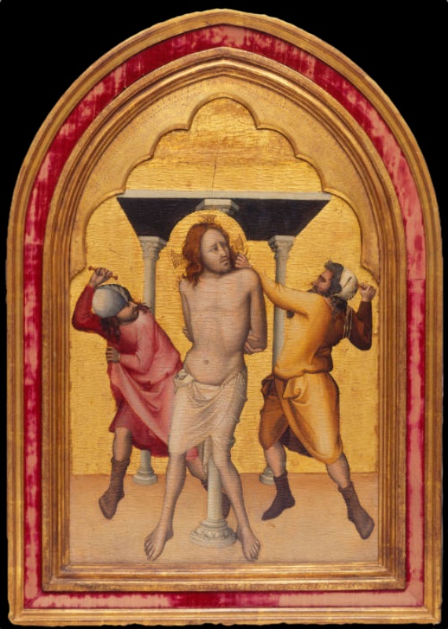
  <figcaption>Dalmasio degli Scannabecchi (attributed; the "Pseudo-Dalmasio" of part of the critical literature), The Flagellation of Christ, c. 1330–1339, egg tempera and gold on panel, 57.5 × 36.8 cm (71.1 × 49.5 cm with frame). Seattle Art Museum, Samuel H. Kress Collection, 61.147; formerly Achillito Chiesa and Contini Bonacossi collections.</figcaption>
</figure>

If the Bologna Crucifixion is the corpus's anchor, the Flagellation in the Seattle Art Museum is its most travelled ambassador, and its modern itinerary is itself a compressed history of the attributional problem. The panel — egg tempera and gold on wood, 57.5 × 36.8 centimetres of painted surface — surfaced in the Milanese collection of Achillito Chiesa, passed through Count Alessandro Contini Bonacossi, and was purchased by Samuel H. Kress in New York on 1 September 1939 under the name of Jacopo da Bologna. Eleven years later it crossed the Atlantic again to hang in the very exhibition that created its author: Longhi's Mostra della pittura bolognese del Trecento of 1950, where the catalogue listed it, with prudence, as "Dalmasio (?)". Since 1952 it has been in Seattle, formally accessioned into the Kress Collection in 1961, and its records now fossilise the entire subsequent debate in a single accession number: the museum catalogues it as Pseudo-Dalmasio, circa 1330–1339, while the Kress Foundation's own files preserve the older designation "Dalmasio Scannabecchi" with a dating of circa 1360 — Bellosi's chronology and the unreconstructed Longhian one filed side by side for the same object.

The panel is round-headed, and within the arch the scene is enclosed by a polylobed ogival frame drawn in the gold itself, its cusps curling like the profile of a Gothic window — a device that converts the ground into architecture and the architecture into reliquary. The whole is mounted in a frame faced with crimson velvet between gilt mouldings, which brings the overall dimensions to 71.1 × 49.5 centimetres; this velvet dressing has the look of a later, collection-era presentation rather than Trecento carpentry, and its date and origin have not been verified against the technical file. More important is what the painted field originally belonged to. In the reconstruction of the San Martino altarpiece discussed above, it occupies the inner left compartment, between the Yale Virgin at the outer left and the Bologna Crucifixion at the centre. The physical evidence is clearest on the Yale panel, whose dowel holes on the right edge alone mark it as the end of the row; whether the Flagellation's own edges preserve comparable traces of joining, inside its later velvet-faced frame, is a question for its technical file, which has not been consulted. Its near-identical figure scale and matching tonality with the Bologna Calvary complete the case, and the Flagellation thus stands where the narrative logic of the altarpiece requires it — the first episode of the Passion, between the Mother who presents the Child and the Son offered on the cross.

The setting is an abbreviation of genius. Four slender grey colonnettes carry a flat canopy with a dark underside — a baldachin standing for the whole Praetorium of Pilate — and beneath it rises the column of the Flagellation, so slim it reads almost as a fifth colonnette, to which Christ's hands are bound behind his back. Nothing else: no pavement drawn in perspective, no crowd, no Pilate, only this cage of architecture isolated against the gold. The reduction is Giottesque in its logic — space enough to make the bodies credible, nothing to dilute the event — and the little loggia performs the same role as the stage-architecture of the Bardi chapel frescoes, framing and measuring the action. Within it, the drama is built on an axis of stillness: the column and the body before it form a single vertical, and around that vertical the two executioners swing like a pendulum.

Christ is the brother of the Bologna Crucifixion's crucified: the same long, ivory-pale torso with its soft continuous modelling, the same white loincloth falling in quiet folds to the knees, the same reddish-gold hair parted onto the shoulders. He stands with his weight gently displaced, head inclined toward the left shoulder, and turns on his tormentor a gaze — sidelong, open-eyed, unprotesting — that carries the panel's whole theology. There is no visible wound, no blood, no grimace; the punched halo with its rosettes burns quietly against the gold. As in the Calvary, the painter refuses the Emilian rhetoric of laceration: the body's beauty and composure are themselves the argument, the *fortitudo abscondita* of Habakkuk's scroll made visible, strength hidden precisely in the figure who alone in the scene exerts none.

The two executioners, by contrast, are all exertion, and they are choreographed with a symmetry so deliberate it approaches dance. The man on the left, in a rose-pink tunic and pale cap, is seen in violent torsion from behind, right arm wound high above his head with the scourge at full cock, one booted leg braced; his companion on the right, in ochre with hanging sleeves and a white cloth wound about his head like a turban — the orientalising marker that assigns him to the enemies of Christ — grips the victim's shoulder with one hand while the other draws its whip back low. One blow is about to fall from above, the other from below; between them the vertical Christ is caught in a scissors of motion. The costumes are observed with the Bolognese relish for contemporary particulars — the cut of the sleeves, the wound headcloth, the heavy boots — and the faces are sharp, but the painter stops short of caricature: the violence is carried by the bodies' geometry, not by monstrous physiognomy.

It is on these two figures that the panel bears its most extraordinary evidence: the testimony not of its maker but of its first users. The museum reports that early viewers, inflamed by the image's injustice, attacked the painting itself, scratching the legs of Christ's assailants and gouging out their eyes — and the surface indeed shows abrasions concentrated, with telling selectivity, on the executioners, while Christ is left untouched. The interpretation of this damage as deliberate devotional retaliation is the museum's reading of the physical evidence, and it is reported as such; but the phenomenon it describes is well attested in late medieval panel painting, where the tormentors of Christ were scratched, stabbed and defaced by viewers for whom the image was not a representation but a presence. Taken so, the Seattle panel preserves something rarer than style: a record of Trecento beholding, the proof that this quiet, measured art provoked anything but quiet in front of it.

In the economy of the corpus, then, the Flagellation is the narrative counterpart of the Bologna Calvary and its closest stylistic kin: the same Christ type, the same shallow stage against gold, the same discipline of feeling, here applied to a subject that the Bolognese tradition habitually treated with expressionist fury and that this master treats instead with an almost liturgical restraint. The museum's dating of circa 1330–1339 sits squarely within the now-prevailing early chronology, and the altarpiece reconstruction would sharpen it to circa 1338–1342; the Kress Foundation's circa 1360 is a stratum of the old identification, not a live alternative. Catalogued under three names in under a century — Jacopo da Bologna, Dalmasio with a question mark, Pseudo-Dalmasio — the little panel has outlasted every label attached to it, and remains what Longhi's question mark already conceded in 1950: a work whose quality is certain and whose author is a problem.

### Virgin and Child Enthroned with Four Angels: The "Madonna of the Flying Carpet" (Yale University Art Gallery)

<figure>
  
  <figcaption>Dalmasio degli Scannabecchi (attributed; the "Pseudo-Dalmasio" of part of the critical literature), Virgin and Child Enthroned with Four Angels, c. 1340–1345 (museum dating; c. 1338–1342 in the reconstruction of the San Martino altarpiece), tempera and gold on panel, 51.1 × 39.9 cm. New Haven, Yale University Art Gallery, Bequest of Maitland F. Griggs, B.A. 1896, inv. 1943.260; probably from the high altar complex of San Martino Maggiore, Bologna. Catalogued by Yale as "Pseudo-Dalmasio".</figcaption>
</figure>

No painting in the corpus has done more to fix the master's image in the critical imagination than this small panel at Yale, and none owes more of its fame to a single phrase. Longhi called it the Madonna "del tappeto volante" — of the flying carpet — and the name has stuck because it captures exactly what is strange about the picture: the Virgin and Child are not enthroned on any piece of furniture but sit upon a great cloth of honour, deep blue and once incised with gilt patterns, that is stretched taut and borne up by angels like a hammock suspended in the gold. The panel — tempera and gold on wood, 51.1 by 39.9 centimetres, inventory 1943.260 — came to Yale with the bequest of the New York collector Maitland Fuller Griggs, who had bought it on the Italian art market in 1926 as a work of the Giottesque northern school. The museum now labels it "Pseudo-Dalmasio" with a dating of circa 1340–1345, while the reconstruction of its original altarpiece, discussed below, places it slightly earlier, between 1338 and 1342; the two brackets overlap and both belong squarely to the early chronology that has prevailed since Bellosi.

Its modern critical history is a miniature of the whole Dalmasio problem. On its acquisition the panel reportedly passed for a work of Vitale da Bologna in the eyes of the most celebrated connoisseur of the day; in 1927 it was assigned, more cautiously, to the Bolognese-Romagnole school around 1350, and it was shown under that label in the 1930 exhibition of the Griggs collection in New York. It re-entered the literature in 1950, published again as a Vitale on the very eve of the Bologna exhibition, only to be claimed in that same exhibition by Longhi for his newly constituted "Dalmasio," whose group was headed by the Crucifixion from San Martino. Longhi himself read the master as a follower of Vitale touched by Orcagnesque Tuscan models — a mid-century reading that the Yale catalogue rightly records as the starting point of a long reversal. Around 1970 the panel's own museum catalogue already dated it to about 1340 and found it "far more Tuscan" than the Bologna Crucifixion and the Seattle Flagellation, anticipating by several years the early chronology that Bellosi would give the entire corpus; it is a nice irony that the Madonna Longhi used to anchor a late, post-Vitalian Dalmasio became one of the first works to pull the master back toward Giotto's own Bolognese moment.

The most consequential recent contribution concerns not style but carpentry, and here the panel speaks for itself. The support, 2.7 centimetres thick, has never been thinned or cradled; its back edges are lightly bevelled; and two dowel holes have been drilled into its right edge, at 7 and 37.5 centimetres from the bottom, while the left edge shows no trace of dowels or any other attachment. The panel, in other words, was joined to a neighbour on its right and to nothing on its left: it was the outer left element of a larger structure. On this physical evidence, together with the style, scale and the Carmelite provenance of the Bologna Crucifixion, recent specialist scholarship has reconstructed a pentaptych for San Martino Maggiore in which the Yale Virgin occupied the far left, the Seattle Flagellation the inner left, the Bologna Crucifixion the centre, and two lost Passion scenes — perhaps a Descent from the Cross and an Entombment — the right side. The Yale catalogue describes the demonstration as convincing, and it represents the firmest structural argument the corpus has ever received; it also means that the reconstruction proposed in the preceding entries can now be stated with more confidence than a purely stylistic hypothesis would allow, though no document of the commission survives.

That reconstruction has an iconographic consequence as unusual as the flying carpet itself. A Virgin and Child relegated to the outer wing of an altarpiece, with the Crucifixion in the place of honour, would have been almost unthinkable in a Tuscan retable of the 1330s; in Bologna, open to Venetian and Riminese models, it was evidently possible. The arrangement makes the altarpiece a continuous Eucharistic narrative, read from left to right: the Mother presents the Child, the Child is scourged, the Son is offered on the cross. Within the panel, the motif of the book reinforces the reading. The Virgin holds open, on her left knee, a small volume toward which the Child stretches his right hand — a hand that is a modern restoration, a point that must temper any reading of the gesture — and its lines of script, though now largely illegible, preserve fragments of lettering that the photograph does not allow to be transcribed with confidence. Whatever the text was, its presence turns the image from a simple devotional Madonna into a scene of reading and recognition: the Child touching the words that foretell what the next two panels of the altarpiece will show.

The composition is as inventive in form as in meaning. The Virgin sits frontally and monumentally, her mauve mantle lined with green and gathered in broad, weighty folds over a white gown that pools upon a marble platform painted with careful veining in pink and green; she is set on a cloth rather than a throne, but her mass is that of a Giottesque enthroned Madonna, and the substitution is all the more surprising for it. The two kneeling angels in front, in brilliant orange robes heightened with yellow, grip the corners of the cloth, which sags with a convincing heaviness under the weight it bears — the detail of naturalistic observation that gives the conceit its conviction. Behind, two further angels rise above the cloth's raised upper edges, which spread out from the Virgin's shoulders like dark wings; old photographs suggest that they too were once shown holding up the far end of the material, now seemingly hanging in the air. The Child, half-naked, his lower body wrapped in a vivid red blanket and once covered at the shoulder by a diaphanous veil, sits slightly turned upon his mother's lap with the earnest gravity of the Giotto tradition.

Condition must be confronted squarely, because it conditions every judgement. The panel was heavily retouched before it reached Griggs; a harsh cleaning in 1964–67 then stripped it down, as photographs taken at the time show, exposing severe and extensive abrasion of the gilding and the paint layers; and a restoration of 2012 reintegrated some of the losses and returned the image to a semblance of its original appearance. The damage is most evident in the heads — the Virgin's face, and those of the background angels, now show the green underlayer through a thinned flesh tone — and in the surface ornament: the gilt borders that once edged the robes and the gilt sgraffito designs on the cloth of honour survive only as traces, though a faint foliate pattern can still be glimpsed on the blue at the right. A split rising the full height of the panel about 25.5 centimetres from the left has been repaired from behind with inserts of new wood. And along the lower edge three prominent scorch marks, at 24, 29.5 and 37.5 centimetres from the left, record the candles that once burned before the image — physical testimony, like the defaced executioners in Seattle, of the panel's life as an object of cult on an altar.

Even in this abraded state, the Yale Virgin remains what its first modern admirers felt it to be: an image of singular charm, unique in its composition and rare in its colour. The palette of mauve, green, white, orange and deep blue is unlike anything else in Bolognese painting of the period, and the conception — solid, Tuscan structure combined with an almost courtly inventiveness and a preference for exceptional tones — sums up the master's synthesis at the moment of its greatest Tuscan accent. For the attributional file the panel is a hinge as well. It is the work through which the ex-Askew Virgin and Child, now in a private collection in Delaware and regarded in part of the recent literature as among the master's earliest surviving panels, can be measured against his maturity, tracing a path from Bolognese formulas toward a progressively deeper Giottism; and it ties that development, through the San Martino altarpiece, to the Santa Maria Novella frescoes and the Pistoia choir of 1343 that bracket it in the current chronology. Whether its painter was the documented Dalmasio or the anonymous Pseudo-Dalmasio, the flying carpet is where his art comes closest to Giotto's, and furthest, in its fantasy, from anyone else's.

### Four Saints in Quatrefoils (Yale University Art Gallery)

<figure>
  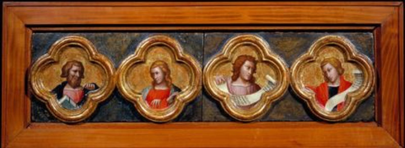
  <figcaption>Dalmasio degli Scannabecchi (attributed; the "Pseudo-Dalmasio" of part of the critical literature), Four Saints, c. 1335–1340, tempera on panel, 14 × 55.9 cm overall; each picture surface 10.2 × 10.8 cm. New Haven, Yale University Art Gallery, lent by the Estate of Richard L. Feigen, ILE2019.3.39. Catalogued by Yale as "Pseudo-Dalmasio".</figcaption>
</figure>

The smallest object in the corpus is also, in its way, one of the most instructive. The horizontal strip of Four Saints at the Yale University Art Gallery — tempera on panel, fourteen centimetres high by just under fifty-six long, lent by the estate of the collector Richard L. Feigen and currently on view in the European galleries — carries four bust-length figures in gilded quatrefoils, each painted field a mere ten centimetres square. Yale catalogues the strip under the name "Pseudo-Dalmasio (Bologna, active second quarter 14th century)" with a dating of circa 1335–1340, and the label is instructive: here is the prudent majority formula of the specialist literature, adopted by the very museum that also houses the corpus's famous Virgin and Child, while the Pinacoteca di Bologna, as we have seen, prints the unqualified name of Dalmasio on its wall. The two institutions, each authoritative, thus take opposite sides of the attributional question in their public labels — the whole seventy-year debate summarised in a pair of captions.

Physically the strip is a fragment wearing a collector's dress. A plain modern wood frame encloses a long, low field whose ground is now a dark, mottled blue-green — the familiar face of degraded azurite, once presumably a vivid blue — against which the four quatrefoils stand out in raised gilt mouldings, their lobes alternating with sharp cusps in the manner of Gothic tracery. A vertical break in the ground at the centre of the strip suggests that it is assembled from two boards, each carrying a pair of medallions, a point not verified against the technical file; and the format as a whole — figures locked into framing geometry on a continuous coloured band — declares at once that these are not independent pictures but harvested ornament, sawn from the carpentry of some larger dismembered structure.

The four busts read, from the left: a mature apostle-type with greying hair and beard, wrapped in a deep red mantle, his hand raised before his chest with what may be the edge of a book or scroll; a beardless youth in red, long fair hair falling to the shoulders, his hand opened downward in a gesture of address; a third young figure, crowned with an abundant mass of auburn hair, who raises and displays an unfurled white scroll across the lower lobes of his frame; and a fourth, again youthful and fair, in dark red and blue, through whose quatrefoil a second white banderole curls. No attribute specific enough for identification survives at reproduction scale, and the scrolls, which would settle the matter — prophets carry texts, as the flying witnesses of the Bologna Crucifixion remind us — appear blank or illegible in the photograph; whether traces of lettering survive on the originals has not been verified. Yale's deliberately neutral title, Four Saints, respects this uncertainty, and so should we: a bearded elder and three ephebic companions, two of them scroll-bearers, who may be apostles, prophets, or a mixture of the two.

Their original function, however, admits of little doubt in kind, if much in detail. Quatrefoil busts of this scale and format belong to the framing zones of Trecento complexes — predella faces, pilasters, the intermediate friezes of polyptychs — and the Yale strip does not stand alone. The corpus includes a scattered series of just such saints in quatrefoils: four panels in the Detroit Institute of Arts (37.189.1–4) and a further strip of four in the National Gallery of Ireland in Dublin (NGI.1113). The Detroit panels are catalogued with strip dimensions — around fourteen centimetres by fifty-six — that are to all practical purposes identical to the Yale fragment's, and the natural working hypothesis, here proposed as exactly that, is that these strips are companion members from the ornamental apparatus of a single dismembered Bolognese complex. Whether that complex was the five-part San Martino altarpiece reconstructed around the Bologna Crucifixion, the Yale Madonna and the Seattle Flagellation, or another structure entirely, is an open question that only technical comparison of the panels — wood, grounds, punchwork, the degraded blue — could begin to close.

The open questions should not obscure what the fragment positively shows, which is the master's manner compressed to its minimum unit. Each head is modelled with the same soft, continuous light that shapes the Christ of the Calvary and the Flagellation; the hair is drawn strand by strand into heavy, springing masses; the faces turn on their necks with the slight, alert obliquity that animates the crowd of the Bologna Crucifixion, every physiognomy particular, none grotesque. At ten centimetres square this is, in effect, manuscript illumination conducted in tempera on panel — and the observation returns us to the opening argument, that Bolognese painting grew up in the workshop culture of the miniaturists. The strip shows how naturally the master of the corpus could shift register from the monumental to the minute without surrendering either the Giottesque gravity of his figures or the sharpened Bolognese particularity of his faces: the same bilingualism, exercised at the scale of a hand's breadth.

For the attributional file, finally, the quatrefoil series is a cautionary exhibit of the first order. Yale dates its strip circa 1335–1340, in step with the prevailing early chronology and with the dating of the San Martino group; Detroit, as noted above, catalogues its Saint Paul from the same series as "Dalmasio di Jacopo, 1370–77" — a dating forty years adrift of Yale's for what are, on any reasonable view, products of one campaign. The discrepancy is not a scholarly disagreement about these objects but a stratigraphic accident: the Detroit record preserves, uncorrected, the old framework that stretched the corpus across the documented painter's late career, while Yale's reflects the post-Bellosi consensus. Future literature on the series should treat circa 1335–1340 as the operative dating and the Detroit chronology as a fossil to be corrected, not averaged.

Modest in size, mutilated in context, anonymous twice over — in subject and in author — the Yale strip is nonetheless a genuine measure of this painter. It demonstrates the workshop's reach across every zone of the altarpiece, from the great narrative fields to the smallest interstitial medallion; it ties the New Haven, Detroit and Dublin fragments into a single archaeological problem awaiting reconstruction; and it preserves, in four small faces, the unmistakable accent — grave, linear, quietly intense — of the most Tuscan painter Bologna ever produced. In a corpus built entirely on the recognition of a hand, it is fitting that the hand should remain recognisable even here, at the scale of a coin.

### Four Saints in Quatrefoils: The Second Feigen Strip (Yale University Art Gallery)

<figure>
  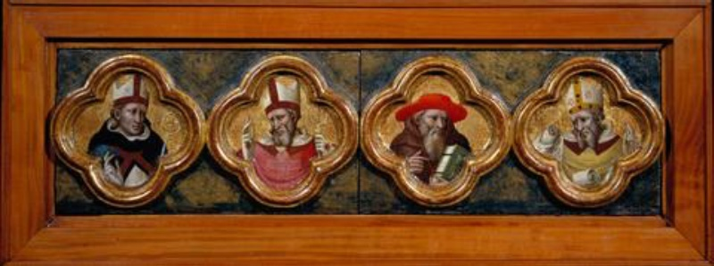
  <figcaption>Dalmasio degli Scannabecchi (attributed; the "Pseudo-Dalmasio" of part of the critical literature), Four Saints, c. 1335–1340, tempera on panel, 14.3 × 55.9 cm overall; each picture surface 10.8 × 10.8 cm. New Haven, Yale University Art Gallery, lent by the Estate of Richard L. Feigen, ILE2019.3.40. Catalogued by Yale as "Pseudo-Dalmasio".</figcaption>
</figure>

The first Feigen strip does not stand alone even in New Haven. A second panel of Four Saints, lent from the same estate under the consecutive loan number ILE2019.3.40 and displayed in the same galleries, repeats the format of its companion to the millimetre: a long, low board of 14.3 by 55.9 centimetres, four gilded quatrefoils on a dark ground, each painted field now 10.8 centimetres square. Yale catalogues it under the identical rubric — "Pseudo-Dalmasio (Bologna, active second quarter 14th century)", circa 1335–1340 — and the sequential numbering, shared provenance and matching carpentry put beyond reasonable doubt what the first entry could only propose: the two strips are siblings, harvested together from the ornamental apparatus of a single dismembered Bolognese complex, and they drag the Detroit and Dublin quatrefoils with them into the same archaeological problem.

Physically the second strip mirrors the first in every particular. The ground between the medallions shows the same dark, blotched blue-green of degraded azurite; the quatrefoils are built up in the same raised gilt mouldings, lobes alternating with cusps; a vertical seam at the centre again suggests two boards of two medallions each, joined in the modern plain-wood frame that both strips share — the collector's uniform dress of the Feigen pair. Whoever sawed the parent structure apart worked systematically, reducing its friezes or pilasters to saleable units of matching length; and the survival of two consecutive units in one collection hints that the dismemberment kept the series together longer than such operations usually allow.

What distinguishes this strip from its companion is the company it keeps. Where the first board offered a bearded apostle-type and three generic scroll-bearing youths, the four busts here are churchmen, and they are characterised with precision. At the left, a clean-shaven saint wears a white mitre above a black habit opening over white at the breast, one hand raised before him. Beside him, an aged bishop with a long forked grey beard, white mitre with hanging lappets and rose-coloured vestments lifts his right hand in blessing, the shaft of what may be a crozier beside him. The third figure is the key to the row: a white-bearded elder in sober brownish dress, a green-bound book in his hands, crowned by the broad red hat of a cardinal — the unmistakable costume of Saint Jerome<a href="/endnotes.html#fn-jerome" class="footnote">15</a>. The fourth is again a bishop, grey-bearded, in a pale cope and a golden mitre studded with ornament, the grandest headgear of the four.

Jerome's presence invites, though it cannot compel, a reading of the row as the four Latin Doctors of the Church. On that hypothesis the mitred figure at the left would be Augustine. This reading must now be held in reserve: the Dublin strip of the same series includes a bishop whom the museum identifies, with a question mark, as Augustine, and the left-hand figure here — beardless, dressed in a black cappa over white with what appears to be a red pallium — wears the colours of the Dominican order, so that a mitred Dominican prelate, still to be identified, is an alternative to be weighed against the Doctor; the two remaining bishops would be Ambrose<a href="/endnotes.html#fn-ambrose-of-milan" class="footnote">16</a> and Gregory the Great, the latter shown here — as fourteenth-century painters not infrequently did — with a mitre rather than the papal tiara that later convention made obligatory. The identification is proposed here as a working hypothesis; it has not been checked against the Yale catalogue entry or the panels themselves, where attributes invisible at reproduction scale may survive. If it holds, it carries a quiet resonance for this corpus in particular: the master whose largest surviving fresco commission is the cycle of the Stories of Saint Gregory in Santa Maria Novella would here have painted the same Doctor in miniature, a coin-sized echo of the Bardi chapel.

The pairing of the two strips also begins to disclose the programme of the lost parent structure. One register of prophets or apostles with scrolls, another of the Doctors of the Church: this is the standard hierarchical grammar of Trecento altarpiece ornament, in which the Old Dispensation and the apostolic witness frame the New, and the Doctors stand as its authorised interpreters. Eight quatrefoils at Yale, four at Detroit and four at Dublin already imply an apparatus of considerable extent — pilasters, predella face or framing friezes of a major polyptych. Its relation to the San Martino altarpiece remains, as stated in the previous entry, an open question, but with each strip the hypothetical structure grows more substantial.

Stylistically the second strip is, if anything, the finer of the pair, because age suits this painter. The young scroll-bearers of the first board show his grace; the churchmen here show his grip. The forked beard of the rose-clad bishop, drawn filament by filament; Jerome's hollowed cheeks and the heavy-lidded concentration of a lifelong reader; the jewelled mitre of the fourth figure, its ornament notated with a miniaturist's patience at a scale of millimetres — these are the same powers of individualisation that people the crowd of the San Martino Calvary, exercised within frames the size of a hand. And as there, the particularity never curdles into caricature: each Doctor is a person, observed with the grave, slightly acid attention that marks this master's faces wherever they appear, from Santa Maria Novella to a ten-centimetre quatrefoil.

For dating and attribution the second strip simply doubles the evidence of the first. Yale's circa 1335–1340 holds for both, aligned with the early chronology and with the San Martino group; the Detroit record's 1370–77 for the sibling series remains the fossil it was declared in the previous entry, now contradicted by two Yale strips rather than one. Together the Feigen boards restore to the corpus something the great narrative panels cannot show: the workshop's ornamental intelligence, its ability to populate the margins of an altarpiece with a college of small, vivid authorities. In the economy of a Trecento complex such figures were the supporting cast; in the economy of a reconstructed oeuvre they are witnesses of the first rank, and these eight have now testified twice.

### Four Saints in Quatrefoils: The Detroit Strip (Detroit Institute of Arts)

The third surviving strip of the quatrefoil series is in the Detroit Institute of Arts, where its four medallions are catalogued as separate objects — Saint John the Baptist (37.189.1), Saint Thomas Aquinas (37.189.2), Saint Paul (37.189.3) and Saint Peter (37.189.4) — acquired as a Founders Society Purchase from the General Membership Fund and displayed together as a single strip. The dimensions the museum gives for the ensemble, 14.3 × 56 × 3 centimetres overall (23.2 × 64.8 × 6 centimetres framed), correspond to the millimetre with those of the second Feigen strip at Yale, 14.3 × 55.9 centimetres; the format, the raised gilt quatrefoils, the degraded blue-green ground and the figure scale are identical. There can be little doubt that the Detroit and Yale strips are fragments of one and the same decorative apparatus, and that Longhi was right to gather them, together with the strip in Dublin, in a single series. The photographs of the individual panels show that each medallion now sits on a board of its own, which raises the question, not settled by the available material, of whether the present sequence of the four saints is original or the result of a later reassembly.

The Detroit records preserve an attribution and a dating that belong to an earlier stage of the critical history: the panels are given to "Dalmasio di Jacopo", with life dates "before ca. 1320 – 1373", and dated "between 1370 and 1377". The dating cannot stand. It is contradicted by the Yale catalogue, which dates the sibling strips circa 1335–1340, in line with the early chronology now accepted for the whole corpus; and it is contradicted by the museum's own record, since a painter whose life dates end in 1373 — and who, on the documents, made his will in November of that year and was probably dead by the following winter — cannot have painted works datable to as late as 1377. The 1370–1377 bracket is best understood as the fossil of the old Longhian framework, which placed the panels in the documented painter's last Bolognese years; the operative dating is that of the Yale strips, circa 1335–1340.

The four saints are of considerable iconographic interest, and one of them changes the terms of the reconstruction. Beside the Baptist and the two Princes of the Apostles stands Saint Thomas Aquinas, in the habit of the Dominican order. Thomas was canonised by John XXII<a href="/endnotes.html#fn-john-xxii" class="footnote">17</a> on 18 July 1323, so his haloed presence supplies a firm *terminus post quem* for the series, entirely consistent with a dating in the 1330s. More importantly, a Dominican saint of such recent canonisation in the ornamental apparatus of an altarpiece points, with reasonable probability though not with certainty, toward a Dominican destination. If the quatrefoil series belonged to a single complex, as its uniformity suggests, that complex is unlikely to have been the Carmelite altarpiece of San Martino Maggiore reconstructed around the Bologna Crucifixion, the Seattle Flagellation and the Yale Virgin; a Dominican church — in Bologna, San Domenico itself is the obvious candidate — would suit it better. This is offered here as a hypothesis, not a conclusion; but it is the first iconographic argument the group has yielded about its own origin, and it suggests that the master worked for at least two of Bologna's great mendicant houses.

#### Saint John the Baptist (37.189.1)

<figure>
  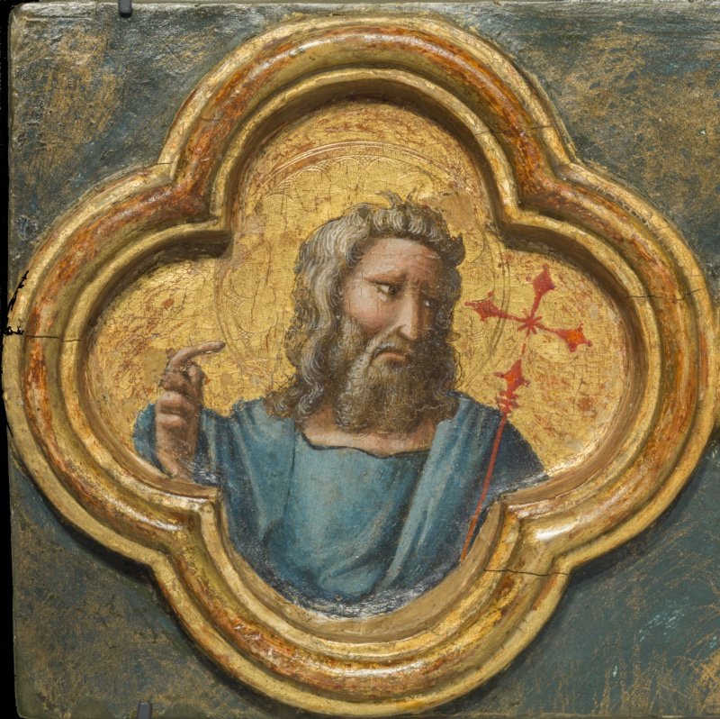
  <figcaption>Dalmasio degli Scannabecchi (attributed; the "Pseudo-Dalmasio" of part of the critical literature), Saint John the Baptist, c. 1335–1340 (museum dating 1370–1377), egg tempera on wood panel, in a quatrefoil; the four-panel strip 14.3 × 56 × 3 cm overall. Detroit Institute of Arts, Founders Society Purchase, General Membership Fund, 37.189.1. Catalogued by the Detroit Institute of Arts as "Dalmasio di Jacopo".</figcaption>
</figure>

The Baptist opens the strip in its present arrangement, and the painter gives him every mark of the prophet of the wilderness: a mane of long, matted hair falling to the shoulders, a full, wiry beard, a gaunt face with hollow cheeks and furrowed brow. He wears a mantle of light blue modelled in broad planes; in place of the usual camel-hair garment the painter shows only the mantle, the scale of the medallion leaving no room for the full costume. His right hand is raised with the forefinger extended — the gesture of the Precursor pointing to the one who comes after him, the *Ecce Agnus Dei* reduced to its essential sign — while in the crook of his left arm rests a slender red staff surmounted by a small cross with flared terminals, the processional cross that Trecento painters gave the Baptist as herald of the Passion.

The head is among the most expressive in the whole series. The eyes slide sideways under heavy brows toward the right, toward the Dominican doctor beside him, with an intensity that the tiny scale only sharpens; the drawing of the hair and beard, strand by strand, and the quick, sure modelling of the face show the miniaturist's precision that characterises all the quatrefoils. The type, with its long nose and the slight asymmetry of the features, recalls the bearded apostle of the first Feigen strip and the elders of the Bologna Crucifixion.

#### Saint Thomas Aquinas (37.189.2)

<figure>
  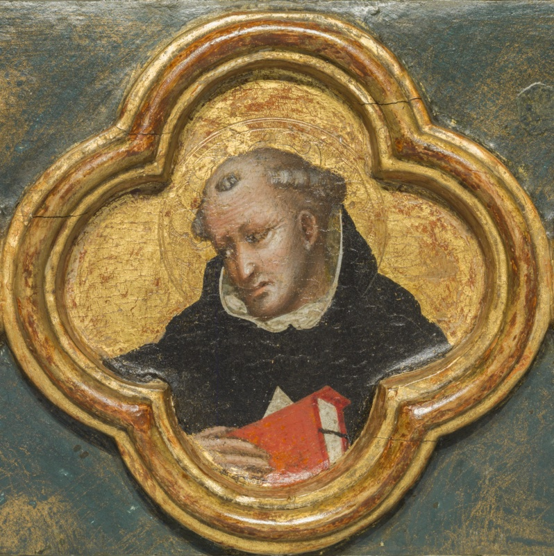
  <figcaption>Dalmasio degli Scannabecchi (attributed; the "Pseudo-Dalmasio" of part of the critical literature), Saint Thomas Aquinas, c. 1335–1340 (museum dating 1370–1377), egg tempera on wood panel, in a quatrefoil; the four-panel strip 14.3 × 56 × 3 cm overall. Detroit Institute of Arts, Founders Society Purchase, General Membership Fund, 37.189.2. Catalogued by the Detroit Institute of Arts as "Dalmasio di Jacopo".</figcaption>
</figure>

Thomas Aquinas is identified by his habit and his bearing rather than by any of the luminous attributes — the sun on the breast, the rays of doctrine — that later imagery would lend him. He wears the black cappa of the Dominicans over the white tunic, whose edge shows as a soft collar at the neck and a small white triangle at the breast; his head bears the tonsure, and his face, round and heavy-jowled, conforms to the tradition that described the Angelic Doctor as a large, corpulent man. In his right hand he holds a red-bound book before his chest, its white page edges carefully indicated: the book is the only attribute he needs, the sign of the theologian whose writings the order had made its own.

The pose is the most introspective of the four. While the Baptist and Paul look sideways out of their frames, Thomas bows his head and turns it toward the left, his eyes lowered in thought, as if absorbed in the text he holds. The contrast of the black habit against the gold, a sombre accent among the reds and blues of the companion medallions, is used with deliberate effect. As argued above, his presence, barely a decade or two after his canonisation in 1323, is the strongest clue the series offers to its original destination.

#### Saint Paul (37.189.3)

<figure>
  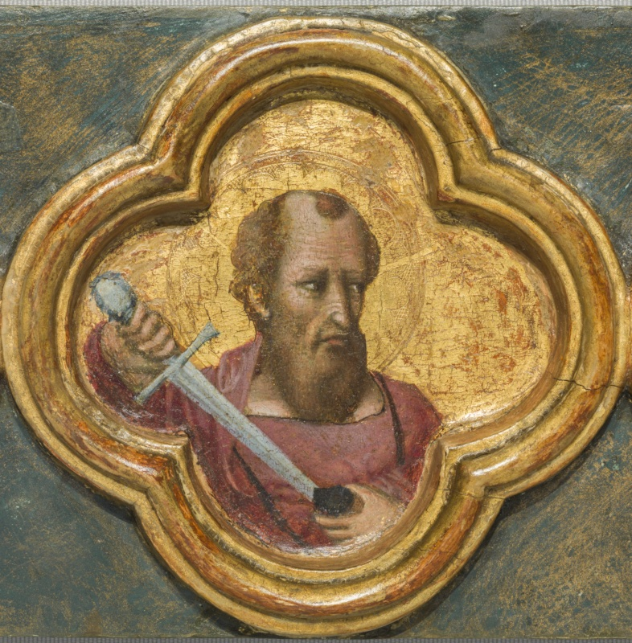
  <figcaption>Dalmasio degli Scannabecchi (attributed; the "Pseudo-Dalmasio" of part of the critical literature), Saint Paul, c. 1335–1340 (museum dating 1370–1377), egg tempera on wood panel, in a quatrefoil; the four-panel strip 14.3 × 56 × 3 cm overall. Detroit Institute of Arts, Founders Society Purchase, General Membership Fund, 37.189.3. Catalogued by the Detroit Institute of Arts as "Dalmasio di Jacopo".</figcaption>
</figure>

Saint Paul follows the traditional physiognomy established since early Christian art: a high, balding forehead with a single lock at the crown, a fringe of brown hair, a long pointed beard, a lean face with an aquiline nose. He wears a mantle of rose-red over a darker garment, and he carries his sword — the instrument of his martyrdom and, in Pauline exegesis, the sword of the Spirit — in an unusually active manner: his right hand grips the hilt with the pommel raised to shoulder height, while the blade runs diagonally across his chest and its point is gathered in his left hand, which closes over a small dark object at the lower edge of the field. The diagonal of the steel cuts across the medallion and gives it a tension that the other three lack.

The face is drawn with the sharp, individualising attention that marks the master's elders throughout the corpus. The sideways glance, under brows drawn together, gives Paul an air of vigilance, almost of challenge, that suits the apostle of controversy; the modelling of the bald skull and the play of light on the beard are handled with the same economy seen in the Detroit Peter beside him. The record of this panel is the one that carries the overall dimensions of the strip in the museum's database.

#### Saint Peter (37.189.4)

<figure>
  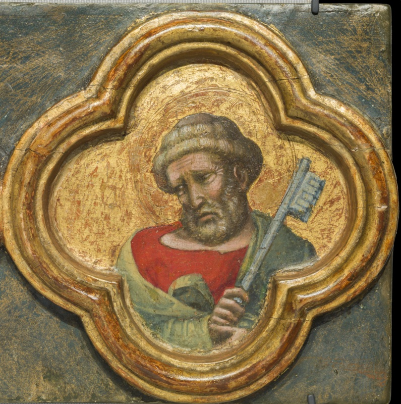
  <figcaption>Dalmasio degli Scannabecchi (attributed; the "Pseudo-Dalmasio" of part of the critical literature), Saint Peter, c. 1335–1340 (museum dating 1370–1377), egg tempera on wood panel, in a quatrefoil; the four-panel strip 14.3 × 56 × 3 cm overall. Detroit Institute of Arts, Founders Society Purchase, General Membership Fund, 37.189.4. Catalogued by the Detroit Institute of Arts as "Dalmasio di Jacopo".</figcaption>
</figure>

Saint Peter closes the strip with the type established by tradition: a broad face framed by a dense cap of tight grey curls and a short, curly grey beard. He wears a red tunic beneath a mantle of yellowish green, and holds upright in his right hand a large key, its silver now dulled to grey, its wards carefully described; in his left hand, half hidden by the folds of the mantle, he holds a dark object, probably a book. The key is the single attribute that identifies him, and the painter makes of it a strong vertical that answers the diagonal of Paul's sword in the adjacent medallion.

What distinguishes the Peter is its mood. His head is bowed, his brows lifted at the centre, his mouth drawn down: it is a face of sorrow, perhaps of penitence, that recalls the Peter of the denial rather than the triumphant keeper of the gates. Whether the painter intended so specific an allusion cannot be determined, but the expression belongs to the same register of grave, interiorised feeling that runs through the corpus, from the mourners of the San Martino Crucifixion to the melancholy Madonna of Philadelphia.

Taken together, the Detroit strip completes the picture of the quatrefoil series that the two Feigen strips began. With twelve medallions in the three strips at Yale and Detroit — the scroll-bearing apostles or prophets of the first Feigen strip, the churchmen of the second, and here the Precursor, a Dominican doctor and the two Princes of the Apostles — and a fourth strip of four in Dublin, discussed in the next entry, the apparatus of the lost complex emerges as an extensive college of authorities, mixing biblical and post-biblical saints in a programme whose logic, once the strips are reassembled, may reveal both its order and its patron. The physical study of the four strips side by side — wood, joins, grounds, the degraded blue, the tooling of the haloes — remains the necessary next step; on the present evidence they are the work of one hand, of one campaign, of circa 1335–1340, and very probably of a Dominican commission.

### Four Saints in Quatrefoils: The Dublin Strip (National Gallery of Ireland)

<figure>
  
  <figcaption>Dalmasio degli Scannabecchi (attributed; the "Pseudo-Dalmasio" of part of the critical literature), Four Saints: Saint Ursula, Saint Catherine of Alexandria, Saint Augustine (?) and Saint Dominic, c. 1335–1340, tempera on panel; each medallion 12 × 12 cm unframed, 19.3 × 60.6 × 7.8 cm framed overall. Dublin, National Gallery of Ireland, NGI.1113, purchased 1943. Catalogued by the National Gallery of Ireland as "Pseudo Dalmasio".</figcaption>
</figure>

The fourth surviving strip of the quatrefoil series is in the National Gallery of Ireland in Dublin, which purchased it in 1943 and catalogues it under the name "Pseudo Dalmasio" as *Four Saints: St Ursula, St Catherine, St Augustine (?) and St Dominic* — tempera on panel, each medallion 12 centimetres square unframed, the whole 19.3 × 60.6 × 7.8 centimetres in its frame. It was shown at the gallery's Centenary Exhibition in the autumn of 1964. The earlier literature referred to a single Dublin panel; the museum's own record makes clear that Dublin preserves a full strip of four, of exactly the format of the Yale and Detroit strips: the same raised gilt quatrefoils, the same dark blue-green ground of degraded azurite, the same figure scale. The museum gives no date; the dating adopted here, circa 1335–1340, is that of the Yale strips and of the series as a whole.

The Dublin strip is the most varied of the four in its company, and the most informative. Where the Yale strips present apostles or prophets and churchmen, and the Detroit strip the Baptist, Thomas Aquinas and the Princes of the Apostles, Dublin introduces two virgin martyrs — the first women of the series — together with a bishop and the founder of the Order of Preachers himself.

#### Saint Ursula

The first medallion shows a young woman with long, wavy fair hair bound by a fillet, in a simple dress of deep blue, who holds against her shoulder a white banner charged with a red cross — the standard of Saint Ursula, the British princess who, in the legend popularised by the *Legenda aurea*, led her eleven thousand virgin companions on pilgrimage to Rome and to martyrdom at Cologne. The staff of the banner runs diagonally to her right hand, which she holds before her breast. Her head is inclined, her eyes lowered, in an expression of gentle melancholy; the drawing of the hair and of the long-nosed oval face recalls the angels of the ex-Askew Madonna and the young saints of the first Feigen strip.

#### Saint Catherine of Alexandria

Beside her stands Catherine of Alexandria, crowned as a king's daughter with a jewelled golden crown, her golden hair falling to her shoulders, in a dress of vivid red bordered in darker red. In her left hand she holds a palm, the sign of martyrdom, and below it appears a white curved fragment of the spiked wheel on which, according to her legend, the emperor Maxentius attempted to break her. Her right hand is raised with the fingers lightly curled in a gesture of speech — the gesture of the learned virgin who confounded the philosophers in disputation, and whom the Dominicans, an order devoted to study and preaching, held in particular veneration. Of all the faces in the series, hers is perhaps the most refined, the sidelong glance under the crown animating a head of real delicacy.

#### A Bishop Saint (Saint Augustine?)

The third medallion presents an elderly, beardless bishop with a lined, somewhat severe face, wearing a tall white mitre decorated with gold bands and a small red jewelled ornament, a white hood drawn about his neck, and vestments of pale yellow with a dark red collar. He raises his right hand in blessing and holds in his left a crozier whose curled head stands out against the gold. The museum identifies him, with a prudent question mark, as Saint Augustine. The identification is plausible in a series that appears to be Dominican in destination, since the Order of Preachers followed the Rule of Saint Augustine; but nothing in the medallion — no book inscribed with the Rule, no heart, no habit of a specific order — establishes it, and the question mark is retained.

#### Saint Dominic

The last medallion leaves no doubt about its subject. A tonsured friar with grey hair and a short grey beard wears the black cappa of the Order of Preachers over the white habit, whose collar shows at the neck and whose scapular forms a white triangle at the breast; on his forehead a small red star — the star that, according to his early hagiography, his godmother saw shining on the infant's brow at his baptism — identifies him as Saint Dominic. He holds a book bound in white and red, the book of the preacher and of the Rule. His bowed head and lowered eyes give him the same introspective gravity as the Thomas Aquinas of the Detroit strip, his confrère and the order's great theologian; it is easy to imagine the two Dominicans placed in symmetry in the original apparatus.

The Dublin strip transforms the reading of the whole series. With Saint Dominic beside Saint Thomas Aquinas, the quatrefoils now include two Dominican saints, accompanied by a bishop whom the museum tentatively names as the author of the Rule the Dominicans followed and by Catherine of Alexandria, the patroness of their studies. A Dominican destination for the lost complex, proposed in the previous entry on the evidence of Thomas Aquinas alone, becomes here a strong probability, though not a documented fact; in Bologna, where the founder of the order died in 1221 and lies buried, the church of San Domenico is the obvious candidate, without any document to confirm it. It also follows that the quatrefoil series is unlikely to have belonged to the Carmelite altarpiece of San Martino Maggiore, and that the master's patrons included at least two of the great mendicant houses of Bologna.

The sixteen medallions of the four strips thus mix prophets or apostles, Doctors, the Precursor, virgin martyrs and the saints of the Order of Preachers. The variety of the four strips, and the probable presence of Augustine in Dublin, also call for a reconsideration of the identities proposed for the second Feigen strip. The technical comparison called for in the Detroit entry remains the only way to reassemble the programme; on the present evidence they are the work of one hand and one campaign, of circa 1335–1340, and very probably of a Dominican commission.

### Virgin and Child with a Dog (Philadelphia Museum of Art)

<figure>
  
  <figcaption>Dalmasio degli Scannabecchi (attributed; the "Pseudo-Dalmasio" of part of the critical literature), Virgin and Child with a Dog, c. 1330–1335, tempera and tooled gold on panel, 46.5 × 30.5 cm. Philadelphia Museum of Art, John G. Johnson Collection, 1917, Cat. 3.</figcaption>
</figure>

Among the devotional panels gathered around the San Martino group, the Virgin and Child with a Dog in the Philadelphia Museum of Art is the most intimate, and in some respects the most surprising. It is a small, upright panel — tempera and tooled gold, 46.5 by 30.5 centimetres — that entered the museum with the John G. Johnson Collection in 1917 and is catalogued there as made in Bologna and datable to circa 1330–1335. The museum presents it as attributed to Dalmasio, and the attribution has a precise and instructive origin: it was Bellosi who recognised the panel as a work of the master, so that the scholar who severed the corpus from the documented painter's biography was also among those who enlarged it. The dating the museum adopts sits at the very beginning of the early chronology, a little before the San Martino altarpiece and the Santa Maria Novella frescoes as currently placed; if it is right, the Philadelphia Madonna is among the first works in which this painter's personality can be grasped.

The image belongs to the type of the Virgin of Tenderness, the Byzantine Eleousa, in which mother and Child press their cheeks together, but it is reinterpreted with a directness that owes nothing to icon formulae. The Virgin is shown at half length, frontal and monumental within the narrow field, her head inclined to her left, while the Child, held high against her shoulder, presses his face into hers in a kiss and with one hand pulls at the white veil gathered at her throat. She does not return the embrace with her gaze. Her heavy-lidded eyes, set in a long, pale face with a long straight nose and a small, closed mouth, look sideways out of the picture at the beholder with an expression of grave and unsmiling melancholy. The contrast is the emotional engine of the panel: the Child's spontaneous affection, the Mother's foreknowledge; the warmth of the gesture, the gravity of the face. It is the same economy of feeling, restrained and weighted rather than declamatory, that governs the San Martino Crucifixion.

The detail that gives the panel its name is the small white dog that the Child holds in his left hand against the red folds of his mantle, its head turned toward the viewer. Pet animals in the hands of the Christ Child are not unknown in Trecento painting, but the goldfinch is the usual companion, and a dog is a rare and arresting choice. The museum proposes that the motif points to ownership by a Dominican friar or nun, since the Dominicans were punningly known as the *Domini canes*, the watchdogs of the Lord; the wordplay is genuinely medieval and well attested, and the reading is attractive for a devotional object of this size. It is an interpretation, nothing more: no provenance earlier than the Johnson Collection is recorded in the material consulted, and the dog could equally have carried the broader sense of fidelity that it bears in much medieval imagery, or have been, at least in part, a touch of domestic observation of the kind this painter enjoyed. Any of these meanings would sit comfortably with a private devotional panel, and the choice among them is not one the evidence settles.

The costume repays close attention, because it reveals the master as a painter of textiles and ornament. The Virgin wears a white veil under a mantle of deep blue-black lined with a lighter, cooler blue, which opens over a gown of pale pink; down the front of the gown runs a vertical band of embroidery, gold-ground and set with rosettes and quatrefoils in red, blue and green, rendered with the precision of a miniaturist. The Child wears a shirt of sheer white stuff, through which his shoulder and arm show, and a mantle of vivid vermilion that falls in heavy, sharply lit folds over his mother's hand; one bare foot emerges below it. Above the Virgin's veil rises a crown, now difficult to read against the abraded gold, which makes her the Queen of Heaven as well as the tender mother; and both haloes are richly incised and tooled, the Child's distinguished by the arms of its cross. In her left hand, at the lower edge, the Virgin holds a closed book bound in green, its page block visible — the attribute of the Mother as the seat of Wisdom and of the Word made flesh that the Child embodies.

The panel's place in the corpus can be measured against the works discussed in the preceding entries. The Virgin's elongated face, the long nose and the heavy, slightly drooping eyelids recur in the mourners of the Bologna Crucifixion and in the female heads of the Yale Virgin, as do the long, articulate fingers of her right hand, spread beneath the Child with an almost anatomical attention. The draughtsmanship of the Child's curls and the crisp contour of the profiles belong to the same linear habit seen in the quatrefoil saints. What is distinctive here is the scale of the figures relative to the field: the half-length format brings the master's faces close to the beholder, and in doing so it reveals the Bolognese edge of his art — the sharpness of characterisation, the sidelong, psychologically particular gaze — more openly than the larger narrative panels, where the Tuscan structure of the compositions holds it in check.

The physical state of the panel is, by the standards of the corpus, good. The gold ground is worn and spotted, with scattered losses visible in the photograph, notably around the crown, and a fine network of craquelure runs across the flesh and the robes; but the faces, the hands and the textiles retain their modelling and much of their colour, and the tooling of the haloes remains legible. Whether the panel survives at its original size, whether it was conceived as an independent image or as one wing of a small diptych, and whether it has lost an original frame, are questions that the museum's technical file, rather than the photograph, would answer; they remain open. Nothing in the image itself suggests a narrative context, and its intimacy of scale and subject is fully consistent with private devotion in a cell or a household.

For the history of the master, finally, the Philadelphia panel carries a double significance. Its dating to circa 1330–1335, if accepted, makes it one of the earliest works in which the fusion of Bolognese sharpness and Giottesque gravity can already be observed, a few years before the San Martino altarpiece brought that fusion to monumental scale; and its attribution, made by the very scholar who rejected the identification with the documented Dalmasio, shows how securely the corpus has been held together as a stylistic personality even while its name has been in dispute. The tender Eleousa with its grave Mother, its kissing Child and its improbable little dog thus stands at the threshold of the oeuvre: a small, private image in which the painter's essential qualities — the weight, the melancholy, the precision and the quiet wit — are present from the start.

### Madonna and Child Enthroned with Six Angels, ex-Askew (Alana Collection)

<figure>
  
  <figcaption>Dalmasio degli Scannabecchi (attributed; the "Pseudo-Dalmasio" of part of the critical literature), Madonna and Child Enthroned with Six Angels (Vierge à l'Enfant en majesté avec des anges), second quarter of the 14th century (regarded in part of the recent literature as among the master's earliest surviving panels), tempera on panel, gold ground. Newark, Delaware, Alana Collection; formerly Del Pero collection, Imola, and R. Kirk Askew, New York.</figcaption>
</figure>

The panel known in the literature as the "ex-Askew" Madonna occupies a special position in the corpus: it is, in the view of the most recent and comprehensive study of the problem, among the master's earliest surviving paintings, a point of departure from which his art moved toward the deeper Tuscan accent of the Yale Virgin and the San Martino altarpiece. Its documented history begins in the Del Pero collection at Imola; by 1934 it belonged to the New York dealer and collector R. Kirk Askew, director of the New York branch of Durlacher Brothers, and it remained with his family until it was offered at Sotheby's in New York in 2012 (Old Master Paintings, lot 6), as the work of the Pseudo-Dalmasio, with an estimate of 250,000–350,000 dollars. It now belongs to the Alana Collection in Newark, Delaware. The present photograph, taken in January 2020 and bearing the French title *Vierge à l'Enfant en majesté avec des anges*, appears to record the panel during the exhibition of the Alana Collection at the Musée Jacquemart-André in Paris (13 September 2019 – 20 January 2020); its inclusion in that exhibition is inferred from the photograph and its title and has not been confirmed against the exhibition catalogue.

The panel entered the critical literature with Longhi, who knew it in the Askew collection and published it as a work of Dalmasio in the guide to the Bologna exhibition of 1950, praising in it a "new expressive realism" informed by Tuscan painting; he returned to it in the essays later collected in his *Lavori in Valpadana*. Benati discussed it in the catalogue of the 2005 Bologna exhibition devoted to the years of Bertrando del Poggetto, and a further suggestion, still awaiting documentary confirmation, connects it with the church of Santa Croce at Imola, the city where its recorded history begins. The Sotheby's catalogue retained the Pseudo-Dalmasio label, observing that the historical Dalmasio would have been too young to paint the group, and compared the panel directly with the Philadelphia Virgin and Child with a Dog, whose facial types and handling it shares. These positions are attributions and hypotheses; no document links the panel to any painter or church.

The composition is built around a throne of marked architectural ambition. Rose-coloured and rendered as if in carved stone, it rises behind the Virgin in a tall round-arched back framed by slender colonnettes and pinnacles, its inner face opened by cusped Gothic tracery and a small carved roundel; at the sides, scrolled consoles project above massive blocks inset with panels of green marble, and the Virgin sits on a crimson cushion with gold-embroidered bands that spills over the seat. It was precisely this spatial structure that Benati singled out as a return to a more Gothic approach, the space compressed and the figures enclosed within an architectural frame, rather than the spacious stage of the Tuscan narratives. The throne is not a neutral seat but a shrine, and the figures are fitted into it as into a niche; its effect is quite different from that of the Yale Virgin, where the throne dissolves into a cloth of honour borne up by angels.

The Virgin is a figure of austere grandeur. Her mantle, of a deep blue-black, is worked over its entire surface with dense gold hatching that catches the light along every fold, and it opens over a gown bordered in orange-gold at the neck and down the front; a white veil frames the face beneath the mantle. She holds a closed book on her right knee and supports the Child on her left arm, her long fingers spread beneath him. Her face — oval, pale, with long nose, small mouth and heavy-lidded eyes — turns slightly while her gaze slides sideways toward the beholder with the same grave, unsmiling composure that marks the Philadelphia Madonna; the kinship of the two heads is the strongest argument for the common authorship that the auction catalogue proposed. The Child, in a red tunic shot through with gold hatching that leaves his chest bare, sits upright on her arm, raising his right hand to touch the edge of her veil near her temple while his left hand holds what appears to be a small bird, its wing spread, close to his chest — a motif that, if the reading is correct, belongs to the familiar Trecento symbolism of the Passion and the soul.

The six angels are the panel's most memorable invention. They are not ranged in the orderly tiers of a Tuscan Maestà but crowd behind and above the back of the throne, three on each side, their heads overlapping and their haloes, richly incised and punched with foliate patterns, jostling one another against the gold. Some peer around the throne at the Virgin and Child, one presses close behind the Child's halo, one at the left tilts its head in a gesture of tender curiosity. The Sotheby's catalogue described the effect as conveying the excitement of the angels against the serenity of the Madonna, and the phrase is apt: the contrast between the agitated, inquisitive heads above and the still, monumental figure below gives the image its peculiar emotional charge. The angels' faces, with their heavy curls bound by fillets, their long noses and their oblique, sharply drawn eyes, belong to the same family as the quatrefoil saints of the Feigen strips and the mourners of the Bologna Crucifixion.

In its stylistic make-up the panel reveals the master at an earlier and more Bolognese stage than the works of the San Martino group. The chrysography of the Virgin's mantle, the ornamental insistence of the throne and the crowded, decorative arrangement of the angels remain close to the local tradition of the miniaturists, while the solidity of the bodies, the Giottesque chiaroscuro of the faces and the spatial logic of the throne show the Tuscan lesson already at work; the recent literature sees in this combination the starting point of the gradual "Tuscanisation" that culminates in the Yale Virgin. The panel's condition, as reported in the auction literature, is stable: the support has been thinned and cradled, and the surface was described in 2012 as in need of cleaning; the present photograph shows a well-preserved paint surface with fine craquelure and a later frame. Its dimensions are not stated in the sources consulted and have not been checked against the Alana Collection's own records. Whatever name one gives its author, the ex-Askew Madonna is one of the works in which his voice can first be heard: grave, Gothic in its setting, and already alert to the new humanity of Giotto.

### The Descent from the Cross, ex-Visconti di Modrone (New York, private collection)

<figure>
  
  <figcaption>Dalmasio degli Scannabecchi (attributed; the "Pseudo-Dalmasio" of part of the critical literature), The Descent from the Cross, second quarter of the 14th century, tempera and gold on panel. New York, private collection (photographed on loan at The Metropolitan Museum of Art); formerly Visconti di Modrone collection, Milan.</figcaption>
</figure>

The Descent from the Cross formerly in the collection of the Visconti di Modrone in Milan is one of the most dramatic narrative panels in the corpus, and one of the least accessible. It was among the works that Longhi gathered around the San Martino Crucifixion when he first constructed the "Dalmasio" group, and the most recent catalogue literature records it as now in a private collection in New York. The present photograph shows it on display at the Metropolitan Museum of Art, where it does not appear in the museum's online collection database — the normal situation for a work lent by a private owner, whose loans are not always published online. The panel's dimensions, the lender and the terms and dates of the loan are not available in the sources consulted and have not been checked against the gallery label or the museum; the dating given in the caption, the second quarter of the fourteenth century, follows the early chronology now accepted for the corpus as a whole.

The panel's physical form already raises a question of reconstruction. The gold ground does not fill the rectangle of the board: at the upper corners, and down the sides, the bare gesso is exposed along a curving, lobed contour that traces the outline of a lost engaged frame, which originally closed the picture field at the top with a cusped arch. The board has thus lost its carpentry, and with it any direct evidence of the structure to which it belonged. A study published in *The Burlington Magazine* in 1982 proposed that the Descent formed part of a single altarpiece with the Crucifixion in the Acton collection at Villa La Pietra in Florence. More recently, the reconstruction of the San Martino altarpiece has suggested that the two lost compartments to the right of the Bologna Crucifixion may have shown later episodes of the Passion, such as the Descent from the Cross and the Entombment; the reconstruction does not name the present panel, and no connection between them has been established. The cusped-arch format of the lost frame invites comparison with the arch drawn in the gold of the Seattle Flagellation, but only a comparison of measurements and carpentry could show whether the two panels are commensurable; the question remains open.

The composition follows the Tuscan formula for the Deposition that Duccio's Maestà and the Lorenzettian fresco in the Lower Church at Assisi had made canonical, and inflects it with the master's characteristic intensity. The cross rises at the centre, its titulus a plain board inscribed I.N.R.I.; a ladder leans against the right arm of the crossbar, from whose empty nail holes blood still drips. Behind the cross, a bearded man in red, his head wrapped in a red cloth — Joseph of Arimathea in the traditional reading — supports the dead body under the arms as it slides forward from the wood. Christ's right arm has already been freed and hangs down, and the body, pale and elongated, with the long legs and soft modelling of the Bologna Crucifixion, sags against Joseph in a diagonal that carries the eye down to the feet, still nailed to the suppedaneum.

Around this axis the mourners are disposed with a precise economy of feeling. The Virgin, wrapped in a mantle of intense blue, reaches up with both hands to clasp her son's freed arm, pressing it to her and looking up into his face from below — the most moving motif of the panel, and one that the Sienese tradition had developed into the Virgin's embrace of the dead body. Behind her, a holy woman in a mauve mantle raises her hand to her face in grief. In the foreground the Magdalene, kneeling in red with her long fair hair falling down her back, lays one hand on her breast and stretches the other toward the bleeding feet, which she is about to receive; her type, with its round face, small features and flowing hair, is that of the Magdalene who embraces the foot of the cross in the Bologna Crucifixion.

At the right the narrative is carried by the instruments of the deposition. Saint John, young and fair, in a mantle of green, stands with his head bowed and holds in his hands a nail already drawn from the cross, wrapped in a cloth of blue patterned with gold — the relic received with reverence, as if at the altar. Below him, an old man with long white hair and beard, in a mantle of pink, kneels and grips with a pair of pincers the nail that still holds Christ's feet: Nicodemus, in the traditional reading, performing the last act of the descent. Blood runs in a long stream down the shaft of the cross and pools on the rocky ground at its foot; a grey crag rises at the right edge, the summit of Golgotha. The emphasis on the blood, and on the physical act of drawing the nails, gives the panel a Eucharistic and devotional insistence well suited to an altarpiece.

The panel shows the master's art at its most mature. The figures have the weight and the clear spatial disposition of the Giotto tradition; the colour — the blue of the Virgin, the vermilion of the Magdalene, the green of John, the pink of Nicodemus — is distributed in broad, luminous fields over the gold, with the same preference for rare and delicate tones observed in the Yale Virgin; and the faces, from Joseph's bearded profile behind the cross to the intent old face of Nicodemus, have the sharp, individualising draughtsmanship that marks the Bolognese side of his formation. The condition visible in the photograph is good in the figures, though the gold is crazed and the exposed gesso along the edges bears witness to the loss of the frame.

For the attributional file, the ex-Visconti Descent is one of the panels most in need of fresh study. Its inclusion in Longhi's original group has never been seriously questioned, but its physical history, its original structure and its relationship to the Acton Crucifixion and to the San Martino altarpiece remain open, and its presence on public view in New York offers a rare opportunity to examine it. Whatever complex it belonged to, the panel stands among the most eloquent narrative works of the corpus: a Deposition in which Tuscan structure and Bolognese pathos meet with an equilibrium that this master alone, in the Bologna of the 1330s and 1340s, seems to have achieved.

### The Crucifixion, Acton Collection (Florence, Villa La Pietra)

<figure>
  
  <figcaption>Dalmasio degli Scannabecchi (attributed; the "Pseudo-Dalmasio" of part of the critical literature), The Crucifixion, early 1330s (dating proposed in the recent literature), tempera on panel. Florence, Villa La Pietra, Acton Collection (New York University). Black-and-white photograph: Bologna, Fondazione Federico Zeri, Fototeca.</figcaption>
</figure>

The Crucifixion in the Acton Collection at Villa La Pietra, on the hills north of Florence, is the most populous narrative composition in the corpus and one of its least visible works. The villa, with the collection formed by Arthur and Hortense Acton and their son Sir Harold, passed to New York University on Harold Acton's death in 1994, and the panel has remained in a private setting, rarely exhibited and, to judge from the sources consulted, not published online in colour. The description is therefore based on the black-and-white photograph preserved in the Fototeca of the Fondazione Federico Zeri in Bologna, where it is catalogued under the name of Dalmasio di Jacopo degli Scannabecchi. That limitation must be stated at the outset: everything said here about the composition and the drawing rests on the photograph, while nothing can be said about the colour, the gilding or the state of the surface, which only the panel itself, or a modern colour photograph, could disclose. The dimensions and the inventory number are not available in the sources consulted and have not been checked with the collection.

The panel's critical history is short but significant. Before Longhi it was attributed to Vitale da Bologna; Longhi placed it in his "Dalmasio" group in 1950, alongside the San Martino Crucifixion and the other panels discussed here. The proposal of 1982, recorded in the previous entry, that it formed a single altarpiece with the Descent from the Cross ex-Visconti di Modrone is accepted by the most recent biographical dictionary entry, which places both panels among the master's early works and dates them to the beginning of the 1330s — earlier, that is, than the San Martino altarpiece of around 1338–1342. If this is right, the Acton Crucifixion belongs, with the ex-Askew Madonna and the Philadelphia Virgin and Child, to the first phase of the painter's activity, in the years immediately following Giotto's Bolognese commission; the dating is a proposal of the specialist literature, not a documented fact.

The composition is of a type very different from the concentrated Calvary of the San Martino panel. Instead of two compact groups of mourners and adversaries, the master here unfolds the *Crucifixion with a crowd* that Trecento painters, in Siena and Assisi above all, had developed into a panorama of the whole event. The cross rises in the centre, tall and narrow, beneath a titulus inscribed I.N.R.I.; Christ hangs from it with his arms stretched almost horizontally and his head bowed onto his right shoulder, the body slender and lightly modelled, the loincloth falling in soft folds — the same long, quiet figure that recurs in the Bologna Crucifixion and in the dead Christ of the Descent. Around the foot of the cross the crowd presses in from both sides, its upper edge broken by horsemen, lances and banners that fill the sky to left and right.

The left side belongs to the mourners and to the soldiers. In the foreground the Virgin, veiled, collapses among the holy women, her head lowered and her hands falling, while a young man with long hair in a pale mantle — Saint John — supports her arm and turns his face up toward the cross. Before them the Magdalene kneels at the foot of the cross, clasping it with one hand and gazing up at Christ, her long hair spread over her shoulders, in a pose very close to that of the Magdalene in the San Martino Crucifixion. Above this group, a mass of armed horsemen advances with lances couched and helmets glinting; two banners rise over them, one charged with a winged beast, perhaps a dragon or griffin, and the other with a pattern of small motifs that the photograph does not allow to be read. Such banners are the painter's sign of the Roman soldiery, and their heraldry, if it could be identified in a colour image, might yet tell something about the panel's patron.

The right side is the domain of the adversaries and of the witnesses. A young man in a short tunic raises the long reed with the sponge toward Christ's lips, holding in his other hand the vessel of vinegar; behind him, a rider on a rearing horse lifts his arm toward the cross in a gesture that, in the tradition of the scene, belongs to the centurion who recognises the Son of God. Beside and below, a crowd of bearded elders and priests in long mantles, one with a broad ornamental border, confer and turn their heads toward one another, some looking at the cross, some away from it, in a dense pattern of profiles and three-quarter views. Behind the cross, a helmeted soldier stands half-hidden. The ground beneath the crowd is rocky and strewn with stones, a summary sign of Golgotha.

Even in a black-and-white photograph the qualities that define the master emerge clearly. The heads have the sharp, individualised drawing seen in the elders of the San Martino Calvary and in the quatrefoil saints — the long noses, the narrowed eyes, the beards drawn strand by strand — while the bodies, though crowded, retain the weight and the spatial clarity of the Giotto tradition. The rhythm of the composition, with the horsemen and banners rising like a frieze above the crowd and the cross isolated in the empty centre, shows an ambition for the large narrative that the smaller panels of the corpus do not reveal, and that the Santa Maria Novella frescoes would develop on the scale of a chapel. The density of the crowd, and the expressive animation of the riders, may also reflect the Bolognese taste for vivid, populous narrative that the miniaturists of the city had long cultivated.

For the attributional file, the Acton Crucifixion is a key work awaiting its proper study. Its pairing with the Descent from the Cross needs to be tested by measurements and technical examination; its dating to the early 1330s, if confirmed, would make it one of the master's first ambitious narratives; and its banners may conceal a heraldic clue to its origin. A colour photograph, and if possible direct examination of the panel, are the necessary next steps: the description here, based on the Fondazione Zeri photograph, describes the composition and its place in the corpus, but its account of the painting is necessarily provisional.

## Fresco Fragments and the Margins of the Corpus

Beyond the two great cycles, the master's fresco activity survives in fragments, each attributed on style alone. In Bologna itself, a frescoed column in San Martino Maggiore — the church from which the Pinacoteca Crucifixion comes, and the presumed destination of the reconstructed altarpiece — bears figures of Saint Onuphrius with the prophet Elijah and Saint Anthony Abbot; the attribution to the master was advanced in the specialist literature of the 1970s, and the most recent study of the church dates the column to circa 1336–40, shortly before the foundation of a hospital of Saint Onuphrius in 1343 and close in time to the Bardi chapel, which would make San Martino the painter's principal Bolognese foothold, patron of both his surviving mural and panel work in the city. In Pisa, a Feast of Herod in the church of San Michele degli Scalzi, known today mainly through a photograph of 1926–32 and possibly among the mural paintings of that church detached after the Second World War, was added to the catalogue in 1975 — a further Tuscan station, if the attribution holds, strengthening the picture of a career conducted substantially south of the Apennines. And in Pistoia, the monograph of 2013 that argued for the identification with Dalmasio added a poignant scrap: the face of the Virgin, all that survives legibly of a fresco in the church of the Santissima Annunziata. Each of these items should be understood as carrying the probability of a stylistic attribution to a reconstructed anonymous master — real, but not of documentary grade.

Just as instructive are the works that have been proposed and rejected, for the edges of a constructed corpus are where method shows itself. The most important case is the Louvre triptych dated 1333, catalogued below: drawn at times into the Pseudo-Dalmasio's orbit, it is now assigned by prevailing opinion, and by the museum itself, to the distinct personality named after it the Master of 1333, and the older attribution is a minority view. The second case touches the greatest name in the debate: a proposal of 1978 assigned to the Pseudo-Dalmasio the predella of Giotto's Bologna polyptych itself — a suggestion of enormous implications, since it would place the young Bolognese master literally inside Giotto's workshop at the moment of its local commission. The idea has found little favour: Benati, in the reference entry of 1994, judged it unconvincing, and the fullest recent catalogue treatment likewise records it with scepticism. It remains on the table as a hypothesis of low current standing, and its acceptance would transform the master's early biography at a stroke.

Two general observations close this survey of the margins. First, the corpus has a characteristic shape: two monumental Tuscan fresco cycles, a Bolognese church (San Martino) accounting for most of the secure Bolognese material, and a periphery of small devotional panels and fragments. No signed work, no dated work, no documented work exists anywhere in it — a fact that catalogue conventions, with their confident names and dates, constantly obscure it. Second, the reader consulting museum databases should expect systematic inconsistency: the same master appears as "Dalmasio," "Dalmasio Scannabecchi," "Dalmasio di Jacopo," "attributed to Dalmasio" and "Pseudo-Dalmasio," with datings that range across forty years depending on which stratum of the critical history a given record fossilises. These inconsistencies are not carelessness so much as geology: each label preserves the moment at which an institution last took a position. Navigating them requires a layered account of this kind.

### Saint Onuphrius, with Elijah and Saint Anthony Abbot (Bologna, San Martino Maggiore)

<figure>
  
  <figcaption>Dalmasio degli Scannabecchi (attributed; the "Pseudo-Dalmasio" of part of the critical literature), Saint Onuphrius, c. 1336–1340, fresco on an engaged column (with Elijah above and Saint Anthony Abbot below). Bologna, San Martino Maggiore, third pier on the right, between the third and fourth bays.</figcaption>
</figure>

The frescoed column of Saint Onuphrius in San Martino Maggiore is the only mural work by the master still to be seen in Bologna, and it stands in the very church from which the Crucifixion of the Pinacoteca Nazionale came — the Carmelite house that, on the reconstruction discussed above, commissioned the San Martino altarpiece. The painting covers a slender engaged column set into the third pier on the right side of the church, between the third and fourth bays, according to the most recent study of the fourteenth-century remains of the building, published in 2018. That study records an almost identical column on the opposite side of the church and reports an older opinion, which it does not adopt as its own, that both columns may survive from the church of 1217 and were incorporated into the later Carmelite building. Its attribution, advanced in the 1970s, and its dating to circa 1336–1340 are discussed above.

The decoration of the column is organised in three superimposed fields, of which the present photograph shows the central one entire and the edges of the other two. At the top, within a polylobed opening inscribed in an octagon, appears the bust of the prophet Elijah, wearing the white mantle of the Carmelites and holding an open scroll; at the bottom, within a circular medallion, Saint Anthony Abbot is shown reading a book; and at the foot of the column two lions dig the grave of the saint, as the hagiographic account relates. Between them, occupying almost the whole height of the shaft, stands Saint Onuphrius, the hermit of the Egyptian desert. The programme, as the 2018 study observes, gathers three figures of the eastern eremitic tradition that the Carmelites claimed as their spiritual ancestry, with Elijah, the prophet of Mount Carmel, as the prototype of the order. Elijah and Anthony are expected in a Carmelite church; Onuphrius, rarely represented in Italy at this date, is the most unusual choice.

Saint Onuphrius stands frontally against a dark blue-black ground, naked as the desert hermits were said to live, his body veiled only by the immense growth of his grey hair and his white beard, which fall in long strands over his chest and arms down to his waist, and by a girdle of leaves about his loins. His hands are joined in prayer before his breast; his feet rest on a strip of brown, rocky ground that stands for the wilderness. The figure is long and narrow, adapted to the shape of the column, and the painter has made a virtue of the constraint: the vertical fall of the hair and beard, the straight, slender legs and the joined hands compose a single upward line that carries the eye to the halo and to the crown above.

Over the saint's head two small angels, their wings spread against the dark ground, hold a large golden crown surmounted by a cross. The 2018 study describes the saint as crowned by the angels; in the photograph the crown hovers above the halo rather than resting on it, as an emblem of the reward of the ascetic life about to be bestowed. The motif turns a figure of extreme austerity into an image of triumph: the naked, hair-covered hermit, who had renounced everything, receives the crown of glory. It is a theme that suited the Carmelites, who presented themselves as the heirs of the desert fathers, and perhaps also the charitable institutions associated with the saint's name.

Indeed, the 2018 study proposes to date the column slightly before 1343, the year in which a hospital dedicated to Saint Onuphrius was founded, and places it in close relation to the frescoes of the Saint Gregory chapel in Santa Maria Novella in Florence, which it considers probably executed shortly after 1336, following a proposal of Benati. The connection with the hospital is an attractive hypothesis that would explain the unusual prominence of the saint, but the study presents it as a context rather than a documented commission, and it should be reported in the same way. What the dating implies, if accepted, is that the column was painted in the same years as the San Martino altarpiece, circa 1338–1342: the master would thus have worked for the Carmelites both on the high altar and on the piers of their church.

The photograph allows an assessment of the column's style and condition, within the limits of a reproduction. The head of the saint is the most finely preserved passage: the long, grave face with its large eyes and straight nose, framed by the cascading hair and beard drawn in fine, light strokes, has the same physiognomic precision that marks the elders of the San Martino Crucifixion and the quatrefoil saints. The angels, with their small round heads and spreading wings, are of a type familiar from the corpus. The body is more abraded, and the dark ground is worn and uneven, with losses visible along the edges of the column; the lower field with the lions, much more damaged, is discussed in the detail entry that follows. A modern label and a candle bracket on the adjoining wall show that the column remains in devotional use within the church.

For the corpus as a whole the column is a document of particular value. It is the master's only surviving mural painting in Bologna; it ties him, together with the Crucifixion of the Pinacoteca, to a single Bolognese institution, the Carmelites of San Martino; and its dating, if correctly placed in the years around 1336–1340, makes it the Bolognese counterpart of the Florentine frescoes in Santa Maria Novella. Painted on a narrow column for a community that saw itself in the hermits of the desert, the Saint Onuphrius shows the master adapting his grave and measured art to the most austere of subjects, and finding in the constraint of the format a monumentality of his own.

#### Detail: The Bust of the Prophet Elijah

<figure>
  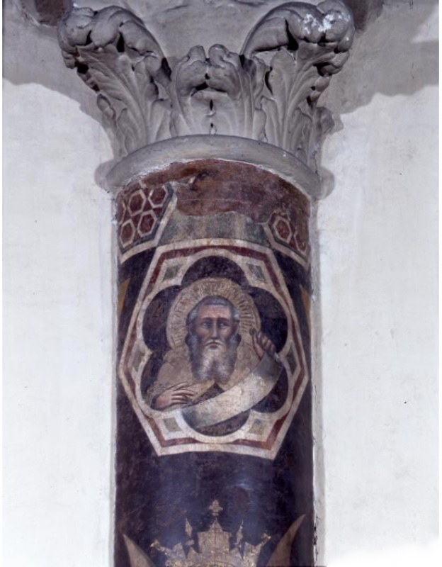
  <figcaption>Dalmasio degli Scannabecchi (attributed; the "Pseudo-Dalmasio" of part of the critical literature), Bust of the Prophet Elijah, detail of the frescoed column, c. 1336–1340. Bologna, San Martino Maggiore.</figcaption>
</figure>

The uppermost field of the column, immediately below its carved capital, holds the image that gives the whole programme its meaning in a Carmelite church: the bust of the prophet Elijah. The Carmelites traced their origins to the hermits of Mount Carmel and claimed Elijah, who had lived and prayed on that mountain, as the founder and model of their way of life; the 2018 study of the church accordingly reads the prophet as the prototype of the order, placed at the head of the column above the desert saints who were regarded as his spiritual descendants. The study identifies his garment as the white mantle of the Carmelites — the cloak that the order associated with the mantle Elijah left to his disciple Elisha — although in the present photograph its tone appears pale and warm rather than clearly white, a reading that has not been checked on site.

The prophet appears within an elaborate frame: an octagon outlined in white and red, with small green lozenges in its corners, enclosing a lobed opening whose dark blue ground sets off the figure; above it, a band of red hexagonal ornament marks the transition to the capital. Elijah is shown as an old man with grey hair, a long white beard and a gold halo; with one hand he holds the end of a long scroll, which unfurls in a broad curve across his chest, while the other rests below it. No text can be read on the scroll in the photograph, and whether an inscription survives has not been verified.

The bust is among the best-preserved passages of the column, and it shows the master's handling of the prophetic elder at close range: the frontal, grave face with large, wide-open eyes and a straight nose, the beard drawn in long light strokes, the volume of the head turned slightly within the frame. The type is close to that of the Onuphrius below, and both belong to the family of bearded elders that runs through the corpus, from the prophets with scrolls of the San Martino Crucifixion to the quatrefoil saints. At the lower edge of the photograph the cross-topped golden crown held by the angels over Onuphrius is already visible, showing how closely the painter linked the prophet of Carmel to the hermit crowned beneath him.

#### Detail: The Bust of Saint Anthony Abbot Reading

<figure>
  
  <figcaption>Dalmasio degli Scannabecchi (attributed; the "Pseudo-Dalmasio" of part of the critical literature), Bust of Saint Anthony Abbot Reading, detail of the frescoed column, c. 1336–1340. Bologna, San Martino Maggiore.</figcaption>
</figure>

Directly beneath the feet of Saint Onuphrius, within a circular medallion framed in white — distorted in the photograph into an oval by the curvature of the column — appears the bust of Saint Anthony Abbot, the father of Christian monasticism and the most celebrated of the desert hermits. The 2018 study describes him as reading a book, and the photograph confirms the motif: the saint, bearded and wrapped in the brown hooded habit of the monk, bows his head toward an open volume that he holds up in his hand at the right of the medallion, its pages lit against the dark blue ground. In the logic of the column he occupies the place between the standing Onuphrius and the lions of the burial scene: the reader and contemplative of the desert, set below the prophet Elijah and the crowned hermit, and above the death of the solitary.

The medallion is the most damaged of the column's figurative fields after the lions. The face of the saint is almost entirely abraded, so that only the outline of the head within the cowl, the beard and the bowed posture can be made out; the halo, with fine radiating lines incised in the plaster, survives better. A horizontal crack runs across the medallion at the height of the shoulders, and a neutral patch of modern filling interrupts the upper part of the frame and of the halo, between the feet of the saint above. The book and the hand holding it, picked out in light tones, are the clearest passages of the image. The condition does not allow a detailed stylistic analysis, and any assessment of the head would have to rest on direct examination or on earlier photographs, if such exist.

Despite its state, the medallion completes the meaning of the programme. Anthony, whose Life by Athanasius had made him the model of the eremitic vocation, was also the saint who, in Jerome's Life of Paul the Hermit, buried his companion in the desert with the help of two lions — the same motif that the painter set at the foot of this column for the burial of Onuphrius. The reading saint thus forms the link between the solitary at the centre of the column and the episode of his burial below, and the whole shaft, from Elijah at the top to the lions at the base, reads as a single sequence of the desert tradition that the Carmelites of San Martino claimed as their own.

#### Detail: The Lions Digging the Grave of Saint Onuphrius

<figure>
  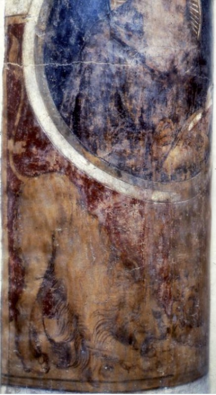
  <figcaption>Dalmasio degli Scannabecchi (attributed; the "Pseudo-Dalmasio" of part of the critical literature), Lions Digging the Grave of Saint Onuphrius, detail of the frescoed column, c. 1336–1340. Bologna, San Martino Maggiore.</figcaption>
</figure>

At the foot of the column, below the medallion of Saint Anthony Abbot, the painter set the last episode of the hermit's story: the lions that come out of the desert to dig his grave. The 2018 study of the church describes the scene as following the hagiographic account of the saint's death, in which the hermit, found by the monk Paphnutius at the end of his life, is buried in the wilderness with the help of wild beasts. The motif belongs to a well-established tradition of the desert fathers: the most famous version of it is Jerome's Life of Paul the Hermit, in which two lions dig the grave of Paul so that Saint Anthony can bury him. Its presence at the base of a column that also shows Anthony is therefore doubly apt, linking the hermits of the column in a single desert genealogy.

The field is the most damaged of the three on the column. The upper edge is cut by the curved white frame of the medallion above, whose blue ground survives only in an abraded state; below, the scene is painted on a warm ground of red-brown and ochre, rubbed and patchy, against which the lion's tawny body is barely distinguishable from the background. What remains legible is the drawing: the mane described in dark, curving strokes, and above all the great clawed paws turned downward toward the earth, in the action of digging. The curvature of the column means that a single photograph shows only part of the field, and whether the second lion, implied by the hagiographic account, survives on the other side of the shaft has not been verified on site.

Even reduced to its drawing, the detail shows the master's attention to animal form — the weight of the paws, the rhythm of the mane — and his readiness to give a narrative episode a place in a devotional image. In the economy of the column it closes the sequence that runs from Elijah at the top, through the standing Onuphrius crowned by the angels, to the reading Anthony and, at the bottom, the death and burial of the hermit: a vertical meditation on the eremitic life, from its prophetic origins to its end in the desert, painted for a community that claimed that life as its own.

### The Feast of Herod (Pisa, San Michele degli Scalzi)

A photograph of the detail is published in the [ICCD photographic archive](https://fotografia.cultura.gov.it/iccd/item/D001347).

The Feast of Herod in the church of San Michele degli Scalzi in Pisa is the most peripheral of the mural works attributed to the master, and the least known. The attribution goes back to a study of 1975, which added the fresco to the corpus as a second Tuscan station of the painter alongside Florence and Pistoia; it has been retained in the photographic archives, where the work is catalogued under the name of Dalmasio and, more cautiously, of the Pseudo-Dalmasio. No colour photograph of the fresco has been located. The description is based on a black-and-white photograph taken between 1926 and 1932 by the Gabinetto Fotografico Nazionale in Rome, now in the Fototeca Nazionale of the Istituto Centrale per il Catalogo e la Documentazione (negative D 1347), a print of which is preserved in the Fototeca of the Fondazione Federico Zeri (inv. 28763), where it opens the "Dalmasio" folder; the archive describes it as a detail of the composition.

The photograph shows three half-length figures seated behind a long table covered with a cloth, against a background of diamond-shaped trellis, perhaps the latticework of a pergola or a patterned hanging. At the left sits a bearded man wearing a crown — most probably Herod Antipas, the host of the banquet at which, according to the Gospels (Mark 6:21–28; Matthew 14:6–11), the daughter of Herodias danced and obtained as her reward the head of John the Baptist. At the centre a figure with a band in the hair raises one hand, framed by leafy stems that rise in front of the trellis; at the right a bearded man in a turban-like headdress rests his hand at his chin in an attitude of reflection or unease. The identity of these two guests cannot be established from the fragment. On the table at the right lies a large dish with a rounded object, whose outline is only partly legible; whether it is the charger with the head of the Baptist, the dramatic centre of the story, or simply a vessel of the feast, has not been verified on the original or in a better image.

The fragment confirms, as far as its condition allows, the features that justified its inclusion in the corpus. The heads, with their long noses, heavy-lidded eyes and individualised beards, belong to the family of grave, sharply characterised elders that recurs in the San Martino Crucifixion, the Acton Crucifixion and the bishops of the Santa Maria Novella frescoes; the frontal arrangement of the figures behind the table, the clear horizontal of the board and the decorative patterning of the background recall the architectural and ornamental order of the master's narrative scenes. The motif of a feast set behind a table, seen from the front, is also found in the Assisi tradition, and the Pisan fragment may be compared with the banquet scenes of the Baptist cycles painted by the followers of Giotto. The attribution nevertheless remains a hypothesis based on style, and the poor state of the fresco makes any judgement provisional.

The condition of the fragment, already in the 1920s and 1930s, was poor. The surface is abraded and spotted throughout, the faces and draperies survive largely in their outlines, a deep loss at the lower left exposes the masonry, and the lower part of the composition is worn almost to the plaster. Like many mural paintings in Pisan churches, the frescoes of San Michele degli Scalzi were whitewashed in the modern period, and after the Second World War several of them were detached, divided and mounted on new supports; some fragments from the church are now in the deposits of the Museo Nazionale di San Matteo, and the subject is the object of current research at the University of Pisa on the detached mural paintings of the city. The present location and condition of the Feast of Herod — whether still in the church or detached and in storage — has not been ascertained, and the standard repertory of medieval frescoes in Pisa has not been consulted for its catalogue data.

If the attribution is correct, the Feast of Herod extends the master's activity to Pisa, the third Tuscan city in which his work has been recognised after Florence and Pistoia, and places him in one of the great artistic centres of the region, where Buffalmacco and [Francesco Traini](/Content/Artists/XIV-c/Francesco-Traini.html) were at work in the same years. A fragment from a cycle of the Baptist, it would also confirm the importance of the Precursor in the master's repertory, from the Baptist on the entrance arch of San Francesco at Pistoia to the quatrefoil saint of the Detroit strip.

### Catalogue Entry (Rejected Attribution): The Triptych of 1333 (Paris, Musée du Louvre)

<figure>
  
  <figcaption>Master of 1333 (formerly attributed to the Pseudo-Dalmasio), Triptych with the Crucifixion, the Coronation of the Virgin, the Annunciation, the Virgin of Mercy, the Nativity and Saints, dated 1333, tempera on gold ground on panel; height 135 cm, width 73 cm (museum record). Paris, Musée du Louvre, Département des Peintures, INV 20197 (Campana 324); probably from a confraternity of San Vitale, Bologna.</figcaption>
</figure>

The triptych in the Louvre is the only Bolognese panel of the 1330s to carry a date, and for that reason it has occupied a central place in every attempt to establish the chronology of Bolognese painting in the years after Giotto's polyptych for the city — including the reconstruction of the corpus discussed here. An inscription in capitals on a brown ground on the reverse of the central panel records the date 1333 and states that the work was commissioned by a confraternity of devotees of the Virgin for the church, or chapel, of San Vitale, which the museum identifies, with a question mark, as San Vitale in Bologna. At times the triptych has been drawn into the orbit of the Pseudo-Dalmasio, as an early work that would anchor his chronology; the prevailing opinion today assigns it to a distinct anonymous painter named after its date, the Master of 1333, and the Louvre catalogues it under that name. It is included here as a rejected or minority attribution, both to record the debate and to show the difference between the two painters.

The provenance of the triptych is documented from the nineteenth century. It belonged to the collection of the Marquis Giampietro Campana in Rome and was acquired from the papal government, after Campana's bankruptcy, for the Musée Napoléon III in 1861; the catalogue of the Campana collection of 1862 described it as in the style of Giotto, of the Umbrian school. From 1863 to 1954 it was deposited in the museum of Perpignan, before returning to the Louvre, where it is now exhibited in the Salle des Sept Mètres. The museum records a height of 1.35 metres and a width of 0.73 metres — the latter presumably referring to the central panel or to the closed triptych, a point not checked — and notes that the gold ground, incised and in places painted with foliage, may in part be later, a suggestion made orally by a specialist in 2005.

The structure is that of a portable triptych with movable wings, crowned by gables and framed in marbled borders. In the central panel, the Crucifixion is set against a gold ground incised with a diamond pattern. Christ hangs dead on a tall cross, his body thin and twisted, his head fallen forward; at the left, the Virgin, wrapped in a black mantle, swoons into the arms of Saint John and a holy woman, while the Magdalene, in red, kneels at the foot of the cross and embraces it; at the right a group of soldiers crowds around a figure in elaborate armour with a shield and sword, who raises his hand toward the cross — the centurion who recognises the Son of God — while a red banner flutters above them. In the gable, within a quatrefoil, Christ crowns the Virgin, flanked below by the winged lion and ox with their books, the symbols of the evangelists Mark and Luke, who rest on the upper beam of the frame as if on the arms of a second cross.

The wings complete the programme. On the left wing, from top to bottom, appear the angel of the Annunciation, the Virgin of Mercy sheltering beneath her open mantle a crowd of kneeling devotees, and three female saints, identified by the museum as Margaret, Catherine and perhaps Lucy. On the right wing, the Virgin of the Annunciation, the Nativity — with the Virgin lying on a bed with a red border, the Child in the manger, the ox and the ass and Joseph seated in the corner — and three male martyrs holding palms. The Virgin of Mercy, with the devotees under her protection, refers directly to the confraternity named in the inscription, whose members are presumably represented among the kneeling figures; the triptych was evidently a devotional and processional object for a lay company devoted to the Virgin.

The comparison with the works of the corpus explains why the attribution to the Pseudo-Dalmasio has been abandoned by most recent scholars. The Master of 1333 is a more nervous and more emphatically Bolognese painter: his figures are elongated and angular, his drapery falls in sharp, broken folds, and his narrative, as in the agitated group of soldiers in the Crucifixion, has an expressive vehemence closer to Vitale da Bologna than to the measured, weighty manner of the San Martino Crucifixion, the Seattle Flagellation or the Yale Virgin. The faces, with their small features and pointed chins, differ from the long-nosed, heavy-lidded heads that characterise the corpus. These differences are visible even if the two painters shared a common formation in the Bologna of the early 1330s, and the triptych is best understood as a work from the same milieu rather than from the same hand.

The rejection of the attribution has consequences for the chronology of the corpus. If the Louvre triptych were by the Pseudo-Dalmasio, it would provide a dated fixed point for his activity in 1333; once it is assigned to another master, the only external anchor for the dating of the corpus remains the inscribed stone of 1343 at Pistoia, together with the documents of the Bardi chapel, and the early chronology of the master rests above all on stylistic comparison. The most recent museum catalogue of the master's panels accordingly calls for the presumed fixed points of his activity to be reconsidered, noting that the attribution of the 1333 triptych has been questioned by most recent authors.

Whatever its author, the triptych is a document of the first importance for the art of Bologna in the years of Bertrando del Poggetto's legation. It shows a local painter of the early 1330s absorbing the narrative and spatial lessons of Giotto while preserving the expressive intensity and the bright, decorative colour of the Bolognese tradition, and it records the patronage of a lay confraternity devoted to the Virgin. Set beside the panels of the San Martino altarpiece, it allows the visitor to measure the different paths that Bolognese painters took in the decade after Giotto's arrival, and it explains, by contrast, how distinctive the measured Giottism of the Pseudo-Dalmasio was.

## Style: Between Bolognese Expression and Tuscan Measure

Whatever name one attaches to it, the artistic personality assembled around the Bardi chapel and the Pistoia choir is among the most distinctive of the Italian Trecento, and its distinctiveness lies in a tension held rather than resolved. On one side stands the inheritance of Bologna: the linear vivacity bred by a century of manuscript illumination, the taste for the pungent physiognomy, the emotional directness that in Vitale da Bologna becomes vehemence and in Simone dei Crocifissi a kind of doleful intensity. On the other stands the lesson of Giotto, absorbed not at second hand through the Bolognese polyptych alone but — as the Assisan dependence of the Pistoia cycle and the Florentine commission of the Bardi chapel jointly attest — through prolonged, physical immersion in Tuscan painting on Tuscan ground. The master's solution is to build like a Tuscan and inflect like a Bolognese. His compositions have the clarified, stage-like spatiality of the Giotto tradition; his figures possess genuine weight and stand in architecture that could bear them; his palette is sober by Emilian standards. But across this Tuscan armature plays an Emilian nervousness — profiles cut with a draughtsman's edge, glances of sharp psychological particularity, a certain wiry tension in contour — that no Florentine of the period displays, and that identifies the hand as foreign in Santa Maria Novella as surely as it identifies it as Tuscanised in Bologna.

The critical tradition has consistently read this synthesis as the most "Giottesque" or most "Tuscan" moment of Trecento Bolognese painting, and the judgement seems right, but its historical meaning changes entirely with the chronology adopted — a point already made, here in stylistic terms. On the early dating now prevailing, the master is a founder: the first Bolognese painter to metabolise Giotto in depth, working in the 1330s and 1340s, so that Vitale's famous expressionism becomes, in part, a reaction against an existing Tuscanising current rather than the default Bolognese manner from which our master later departed. The relative sequence of the Bardi chapel, the San Martino panels and Vitale's documented works of the 1340s — the Madonna dei Denti of 1345 above all — then becomes the central problem of early Bolognese Trecento painting, and the 2005 exhibition's juxtaposition of these materials with Giotto's polyptych made the stakes visible to a broad public. On the late dating, by contrast, the master is a mediator of the mid-century, carrying a matured Tuscan manner back north in the 1350s and 1360s. The surviving works themselves are read persuasively in both frames by their respective advocates; the ruinous condition of the narrative scenes of both fresco cycles deprives stylistic argument of much of the fine grain — the handling of flesh, the original chromatic balance — on which such disputes are normally settled, and only the better-preserved parts, such as the vault and the pilaster saints at Pistoia, allow the painter's surfaces to be judged at close range.

One stylistic observation, finally, bears directly on the family history with which this account began. The art of Lippo di Dalmasio, the documented son, is itself a Tuscanised Bolognese art — softer and sweeter than the corpus discussed here, formed partly in Pistoia, where Lippo too lived and worked in the 1370s and 1380s before his definitive return to Bologna. If the corpus is the father's, the stylistic genealogy is seamless: a family workshop oriented toward Tuscany across two generations, the son's devotional gentleness a domestication of the father's graver synthesis. If the corpus is not the father's, then the documented Dalmasio becomes a painter whose entire oeuvre is lost, and the Tuscanism of the son must be explained by the son's own Pistoiese years alone — perfectly possible, but less economical. Even the stylistic arguments resolve into arguments about probability and parsimony; and parsimony is a principle of reasoning, not a fact about the fourteenth century.

## Lippo di Dalmasio and the Continuity of the Workshop

No account of Dalmasio can end without his son, both because the son preserved the father's name for posterity — it is only as "Lippo di Dalmasio" that the elder painter's name circulated at all between Vasari and the archivists — and because the relationship between the two careers is itself evidence in the attributional question. Lippo enters the record in his father's will of 2 November 1373 and is documented thereafter for nearly four decades, acting as his father's heir by 1377 and last attested by his own testament of 11 October 1410, after which he died. Between those termini lies the career that made him, in Bolognese memory, the beloved painter of Madonnas: the works Vasari saw and recorded — the Madonna in San Petronio dated 1407, the fresco over the door of San Procolo, the signed Christ between Peter and Paul in San Francesco — and the many surviving half-length Virgins, of which the so-called Madonna dell'Umiltà type became almost his signature, that earned him his quattrocento reputation for sanctity of hand. His formation must have begun in the paternal workshop, but since the father died when the son's career was barely under way, the standard and reasonable inference — an inference, once more, not a document — is that Lippo's training was completed in the orbit of his maternal uncle Simone dei Crocifissi, the brother of his mother Lucia, whose procuratorship of 1365 had already shown the two households functioning as one enterprise across the Apennines.

The Tuscan thread runs through the second generation as it ran through the first. Lippo himself resided and worked at Pistoia for a substantial period after his father's death, before settling definitively in Bologna, where his later career unfolded in the orbit of the city's churches and confraternities. The Pistoiese chapter of the son's career has generated its own attributional debates — the frescoed Madonna del Padiglione in San Domenico at Pistoia, given in the older literature to several Pistoiese painters, has recently been reassigned to Lippo and dated around 1380, while image archives still circulate it under his father's name (see the entry below) — and these debates are mentioned here chiefly as a warning. Because father and son share a name, a city of origin and a Pistoiese residence, the two catalogues leak into each other constantly: the state heritage database's mislabelling of the San Francesco choir under Lippo's name, noted above, is only the most official instance of a confusion that pervades older guidebooks and persists online. The rule of thumb is chronological and stylistic at once: the corpus discussed here belongs, on any current view, to the second quarter and middle of the fourteenth century and speaks a gravely Giottesque language; Lippo's securely attributable work belongs to the last quarter of the century and the first decade of the next, and speaks the softer, more devotionally ingratiating idiom of its generation.

Seen whole, the family's trajectory is one of the best-documented examples we possess of a provincial artistic dynasty organised around mobility. A Bolognese painter marries into a painting family in 1350; moves to Tuscany within the decade; maintains his Bolognese interests through his brother-in-law; returns, makes his will in the family house, and dies; his son repeats the Tuscan residence a generation later and then consolidates the dynasty at home, where a younger brother bearing his father's name Dalmasio carries it into the fifteenth century. Whether or not the great frescoes are the elder Dalmasio's, this documented pattern — Bologna and Pistoia as the two poles of a single family economy — is itself a significant datum of Trecento social history, and it is the soil in which Longhi's hypothesis grew. Hypotheses, like paintings, have contexts; this one has never lacked for fertile ground.

### The Madonna of Humility under a Pavilion with Saints Dominic and Catherine and Two Donors (Pistoia, San Domenico)

<figure>
  
  <figcaption>Lippo di Dalmasio (attributed; also given to Dalmasio degli Scannabecchi and, in the older literature, to other Pistoiese painters), Madonna of Humility under a Pavilion with Saints Dominic and Catherine of Alexandria and Two Donors (the "Madonna del Padiglione"), c. 1380, detached fresco. Pistoia, San Domenico, refectory.</figcaption>
</figure>

The so-called Madonna del Padiglione in the Dominican convent of San Domenico at Pistoia has a place here less as a work of the master of the San Martino altarpiece than as an object lesson in how the catalogues of father and son leak into each other. The fresco circulates online, in image archives, under the name of Dalmasio Scannabecchi with the qualification "attributed"; but none of the specialist literature reviewed assigns it to the father. Its attributional history, as recorded in the most recent studies, runs instead through a series of Pistoiese painters of the later fourteenth century — Giovanni Cristiani, Antonio Vite and Paolo Serafini have all been proposed — before arriving at Lippo di Dalmasio, to whom a study of 2012 devoted to the Madonna of Humility in Pistoia, followed by the 2013 monograph on the painter, assigned it as his most ambitious surviving Pistoiese work, datable around 1380. A review of that monograph described the fresco as stylistically situated between the work of Lippo's father and that of his uncle Simone dei Crocifissi — which is precisely why the father's name has attached itself to it. The fresco is therefore catalogued under Lippo, with the Dalmasio attribution recorded as an unsupported variant, in the section devoted to the son.

The chronology supports this placement. Lippo is recorded as a Bolognese citizen resident in Pistoia in 1377, is found in both cities in the mid-1380s, and returned definitively to Bologna toward the end of the decade; a fresco of around 1380 in a Pistoiese church thus falls squarely within his documented Tuscan years. The documented Dalmasio, by contrast, had made his will in Bologna in November 1373 and was probably dead by the following winter, and the stylistic corpus attached to his name belongs, on the prevailing view, to the 1330s and 1340s; neither the man nor the corpus fits a work of this date and character. The confusion is nonetheless instructive, for it repeats on a small scale the mechanism already observed in the state heritage records of San Francesco: a shared name, a shared city of residence, and a shared Bolognese-Tuscan idiom are enough to transfer a work from one generation to the other.

The composition is built around a devotional image that Lippo would make his own. At the centre the Virgin sits low, close to the ground in the posture of the Madonna of Humility, wearing a red gown and a dark mantle marked on the shoulder with a star, and she nurses the Child, who drinks at her breast while wrapped in a cloth of yellow. Behind her opens a great golden disc radiating fine lines of light — the sun with which the Woman of the Apocalypse is clothed, a motif routinely joined in the fourteenth century to the image of the humble Virgin. The type of the nursing Madonna of Humility was widely diffused in Bologna and Pistoia after the middle of the century, and the study of 2012 placed this fresco at the meeting point of the two traditions; the subject was to matter greatly for Lippo's later Bolognese career, in which the Madonna became his speciality and the source of his posthumous fame.

Above the Virgin hangs the feature that gives the fresco its name: a great pavilion of pale green fabric, patterned with small motifs, whose apex rises to the top of the field and whose curtains, edged in white, fall in swags drawn outward by two flying angels. The angels, their hair garlanded with red roses and their wings painted in long, flame-like feathers of pink, green and ochre, hold the edges of the cloth in both hands, and their curving bodies fill the upper corners. The device transforms the abstract ground into a ceremonial space: the Virgin sits beneath a canopy of state, but on the bare ground, so that humility and majesty are joined in one image. Laterally, broad borders of red ornament with a hexagonal pattern frame the scene as if it were hung on the wall like a textile.

The flanking saints declare the fresco's Dominican setting. At the left stands Saint Dominic, in the black cappa of the Order of Preachers over the white habit, holding a lily — the emblem of his purity — and a red book, and with his right hand he presents a small kneeling male donor, bearded and wearing a cap, his hands joined in prayer. At the right stands Saint Catherine of Alexandria, crowned, in a gown of warm ochre and red, her left hand resting on the rim of her wheel, while with her right she points down to a kneeling woman in a grey veil — the donor's wife or a widow, her identity, like his, unrecorded in the sources consulted. The pairing of Dominic and Catherine, the founder of the order and the patroness of its studies, is the same that appears among the quatrefoil saints of the Dublin strip, a coincidence of Dominican iconography rather than evidence of common authorship.

The fresco survives as a detached fragment with irregular, broken edges; the lower part, which presumably contained the base of the composition and perhaps an inscription naming the donors, is lost, and a plain modern support fills the gap. The surface is uneven: the faces of the Virgin, the Child, the angels and Saint Catherine retain much of their modelling and colour, while the habit of Saint Dominic and the gown of Saint Catherine are heavily stained and abraded, and a patch of lost intonaco interrupts the pavilion to the right of centre. The original location of the fresco within the convent, and the circumstances and date of its detachment, are not recorded in the sources consulted and have not been verified.

Stylistically, the fresco shows what the review of the 2013 monograph meant in placing it between father and uncle. The long-faced Virgin with heavy-lidded eyes and the gentle, slightly melancholy heads of the angels and of Catherine preserve something of the gravity of the Dalmasian corpus, while the soft, rounded modelling, the decorative richness of the pavilion and the sweetness of the expressions belong to the next generation — to the devotional idiom that Lippo would carry back to Bologna and that Vasari, two centuries later, would praise in his Madonnas. Read in this way, the Madonna del Padiglione does not enlarge the father's catalogue; it measures the distance between the father's art and the son's, and shows how much of the family's Tuscan experience the son inherited and transformed. Its proper place is at the threshold of Lippo's career, as one of the earliest substantial witnesses to the second Pistoiese chapter of the Scannabecchi family.

## Conclusion: The Current State of the Question

It remains to gather the threads and to state, as plainly as the material allows, what is known, what is believed, and what is merely repeated. What is known is the man: Dalmasio di Iacopo degli Scannabecchi, Bolognese, of age by 1350, husband of Lucia di Lippo Benvenuti and thus brother-in-law of Simone dei Crocifissi, property-holder in the parishes of Sant'Andrea degli Ansaldi and San Domenico, resident and working in Pistoia from before December 1359 to beyond March 1365 — where the one artistic act the archives record of him is the painting and gilding of the doors of a marble image — testator in Bologna on 2 November 1373, father of the painter Lippo and of two daughters, dead in all probability in the following winter. What is believed, by a critical tradition now three-quarters of a century old, is that this man is the author of a corpus of the highest quality: the Saint Gregory frescoes of the Bardi chapel in Santa Maria Novella, the Franciscan choir of San Francesco at Pistoia, the San Martino Crucifixion and its altarpiece companions at Yale and Seattle, now reconstructed as a single pentaptych on the evidence of their carpentry, the dispersed quatrefoils of a probably Dominican complex, and a constellation of smaller panels and fragments. And what is merely repeated — the precise birth dates, the paternal uncle, the 1335 dedication of the Bardi chapel, the frescoes in San Francesco in Bologna, the bare "died 1374," the Louvre triptych in the catalogue, the Pistoia choir and the Madonna del Padiglione under the father's name or the choir under the son's — is the sediment of a century of secondary literature copying itself, which the foregoing has tried, item by item, to filter out.

The identification question itself stands today in a state of principled irresolution. The majority of specialists, following the chronological arguments advanced by Bellosi in the 1970s, date the corpus to the 1330s and 1340s and therefore designate its author the Pseudo-Dalmasio, a Bolognese master in Tuscany a generation before the documented Dalmasio is attested there. A substantial minority, whose fullest statement is the monograph of 2013, maintains the identification, accepting as its price an undocumented early Tuscan sojourn or a loosened chronology. Major institutions take both positions, sometimes incoherently within a single collection. No new document has entered the debate in living memory, and absent one — a Pistoiese payment of the 1340s, a Florentine record naming a Bolognese in the Bardi accounts — the question is unlikely to be closed by argument alone, since every stylistic datum has now been enlisted by both sides. The honest position for a general account is the one adopted here: a corpus of secure coherence and insecure name, attached to a life of secure documentation and vanished works.

What should not be lost in the philology is the painter — whichever painter he was. The master of the Bardi chapel and the Pistoia choir occupies a position of genuine historical importance: the principal channel through which the full Tuscan achievement of Giotto's school flowed into Bolognese painting, and conversely the most accomplished Bolognese voice ever to speak inside a great Florentine church in the fourteenth century. If the early chronology is right, he stands at the origin of the Bolognese Trecento, the measured alternative against which Vitale's vehemence defined itself; if the late chronology is right, he is its great mediator at mid-century. In either case he is indispensable to the story of Bolognese painting in the fourteenth century: the story of how a city of jurists and illuminators, confronted with the most authoritative artistic language of its age, neither surrendered to it nor ignored it, but bargained with it — and produced, in the bargaining, some of the most individual painting of the Italian fourteenth century. Dalmasio degli Scannabecchi, the man of the documents, may or may not have held the brush; but the bargain itself, struck somewhere between the Apennines, is beyond dispute, and its finest surviving instrument still goes, for want of a better certainty, by his name.
