## Introduction

*Giovanni di Nicola* was a Pisan panel painter, probably the "Giovanni da Pisa" recorded in Siena in 1326 as a "disciepolo" of Lippo Memmi, and he died between July 1363 and December 1365. Only one surviving work carries his signature: the polyptych from the Pisan church of Santa Marta, now in the Museo Nazionale di San Matteo. Its date survives only as "MCCC" followed by one lost numeral, and it is read as 1350. Everything else in his catalogue is attribution, some of it well founded and some of it weak.

His interest lies less in invention than in position. He was formed in the Sienese manner that Simone Martini and Lippo Memmi brought to Pisa in the 1320s, absorbed something of Francesco Traini in the 1340s and 1350s, and handed on to the next generation of Pisan polyptych makers a set of figure types and ornamental procedures that they repeated for decades. The literature has judged him a repetitive painter of the rank and file. It has also recognised in him a craftsman of punched gold, pastiglia and painted textiles of real skill.

## Name and Identity

The name has first to be separated from its namesakes. "Giovanni di Nicola", "Giovanni di Niccola", "Giovanni di Niccolò" and "Giovanni da Pisa" are common forms in fourteenth- and fifteenth-century documents. In a Pisan setting they invite one confusion above all. Read literally, "Giovanni di Nicola da Pisa" describes Giovanni Pisano, the sculptor son of Nicola Pisano, born around 1248 and trained in his father's workshop. The two belong to different generations and different arts, and the Dizionario Biografico degli Italiani gives them separate entries.

Other namesakes are less dangerous. One is the Venetian Giovanni di Niccolò Mansueti, active from 1485 to 1526 and a follower of Gentile Bellini. Another is the generic "Giovanni da Pisa", under which the photographic archive of the Fondazione Zeri files works in a separate subfolder of the same box as our painter, beside Jacopo di Michele, Neri di Nello and Neruccio. "Giovanni da Pisa" is not automatically Giovanni di Nicola, and the link has to be argued, as it is for the Sienese document of 1326.

The form "Giovanni di Nicola di ser Cecco", which occasionally appears, has no documentary support. It is absent from the Dizionario Biografico, from the national catalogue of Italian cultural heritage and from the museum records of his works. The only painters "di ser Cecco" known in these years are unrelated: Nanni di Giovanni di ser Cecco, a Sienese painter named in a bequest of 1428, and Arrigo di Niccolò di ser Cecco, to whom a fifteenth-century fresco cycle is attributed. The patronymic is probably a borrowing from these namesakes.

The painter is therefore the Pisan master listed in the national catalogue as "Giovanni di Nicola (notizie 1326–1360)". The National Gallery in London calls him "documented 1326, died 1363–5", while the Williams College Museum of Art and the Kress Foundation give "active 1326–1358". These ranges do not contradict one another. They differ only over where to stop: at his last secure activity, in 1358 or 1360, or at his death, between 1363 and 1365.

## Pisa in the Trecento: the Sienese Current

Giovanni di Nicola's career makes sense only against the situation of painting in Pisa in the first half of the fourteenth century. The decisive event was the arrival of Simone Martini's workshop. Simone's polyptych for the high altar of the Dominican<a href="/endnotes.html#fn-dominic-guzman" class="footnote">1</a> church of Santa Caterina, signed and dated to 1319–1321, gave the city a model of Sienese courtly elegance on a monumental scale. Its forty-three half-length figures under trilobed arches set a standard of ornament, punchwork and refined figure types to which Pisan painters responded for a generation.

The polyptych stayed in Santa Caterina until after the fire of 1651. It was dismembered after 1680 and reassembled in the Museo Nazionale di San Matteo in 1949. Its later history shows how easily Sienese work in Pisa could be misattributed: in 1793 it was given to Lippo Memmi, and the signature under its central panel was not read until the nineteenth century.

Lippo Memmi, Simone's brother-in-law and collaborator, seems to have stayed in Pisa longer. The Enciclopedia dell'Arte Medievale speaks of the "long Pisan activity of the Martinian workshop", and especially of Lippo, "often present in Pisa between 1320 and 1335", who "had as collaborators some local artists, such as Francesco Traini or the repetitive Giovanni di Nicola". The phrase "il ripetitivo Giovanni di Nicola" sums up a verdict that recurs, in gentler words, throughout the literature. A *Triumph of Saint Thomas Aquinas*<a href="/endnotes.html#fn-thomas-aquinas" class="footnote">2</a> attributed to Lippo, usually connected with Thomas's canonisation in 1323, still hangs in Santa Caterina, and a polyptych by Lippo, once in Pisa Cathedral and later at Casciana Alta, is now in the San Matteo museum beside Giovanni di Nicola's works.

The second pole of Pisan painting in these decades was Francesco Traini, documented between 1321 and 1345, whose signed polyptych of Saint Dominic of 1345 anchors his chronology. Traini also drew on Sienese models, but he pushed them in a more expressive direction, closer to the Lorenzetti brothers, and used a pearly, luminous colour range that later Pisan painters admired.

The third element is the generation after Giovanni: Francesco di Neri da Volterra, Cecco di Pietro, Neruccio Federighi and Getto di Jacopo, who dominated Pisan altarpiece production in the second half of the century. Each built in his own way on the relaxed and increasingly formulaic manner of the 1350s. Giovanni di Nicola stands between these generations. He was formed in the Sienese manner of the 1320s, absorbed something of Traini, and in his last years saw younger colleagues respond to Florentine and Lombard ideas that he himself did not take up.

## The Documentary Record

The documents are few but firm enough to outline his career. The modern synthesis is Linda Pisani's entry in volume 56 (2001) of the Dizionario Biografico degli Italiani, which admits that nothing is known of his date of birth and calls him a painter "active mainly in Pisa between the 1320s and the 1360s".

**1326, Siena.** The first notice comes from Siena, not Pisa. A payment record of the Sienese Comune, published by <a href="/scholars.html#bacci-peleo">Peleo Bacci</a> in 1944, names a "Giovanni da Pisa" as Lippo Memmi's "disciepolo". He was paid with Lippo for a painting of Saint Ansanus for the Comune, in all probability for the Palazzo Pubblico. That this "Giovanni da Pisa" is the Giovanni di Nicola who later signed the Santa Marta polyptych is persuasive but remains an inference. Pisani writes that "it seems possible to recognise him", and the national catalogue argues the link from the Sienese character of the signed work. Giovanni di Nicola is probably the Giovanni da Pisa of 1326, and the Memmian character of his signed work makes the identification likely.

**1358, Pisa.** The next secure document is political. In July and August 1358 a "Iohannes Nicole pictor" sat on the Consiglio del Popolo of Pisa. The record was published in 1846 by <a href="/scholars.html#bonaini-francesco">Francesco Bonaini</a> among the documents relating to Francesco Traini. It shows Giovanni as a settled, enfranchised citizen of some standing in the decade after the Black Death, and it explains why several modern reference works end his activity in 1358.

**1360.** The Dizionario Biografico states that he "was still active in 1360", citing Alessandro da Morrona's *Pisa illustrata nelle arti del disegno*<a href="/endnotes.html#fn-alessandro-da-morrona" class="footnote">3</a>. The reference is almost certainly to a lost signed and dated panel of Saint John the Baptist that Da Morrona recorded in the Pisan church of San Pietro in Vinculis, known as San Pierino. A sale catalogue of 2006 gives the same panel the date 1340 and adds a second lost signed work, a polyptych of the Madonna and Child with Saints formerly in the Rinuccini collection in Rome. Neither statement cites a source. The date of 1360 has the better support, while the Rinuccini polyptych remains unconfirmed.

**1363–1365.** The last documents concern his death and estate. They come from a register of artists active in Pisa compiled from notarial records and published in 1991. Giovanni's will was registered on 28 July 1363. In December 1365 the painter Francesco di Neri da Volterra bought a piece of land that had belonged to him, and the deed describes him as already dead. His death therefore falls between those two dates. The link with Francesco di Neri ties Giovanni, at the end of his life, to the leading Pisan painter of the next generation, and it bears on the debate over the late works.

No guild registration, tax assessment or contract for a surviving altarpiece is known.

## Training: "Giovanni da Pisa" and Lippo Memmi

Calling Giovanni di Nicola Lippo Memmi's pupil rests on two supports of unequal weight: the 1326 document and the evidence of the paintings. If the identification with the "disciepolo" of 1326 holds, Giovanni was already a trained assistant in that year, which would place his birth probably in the first decade of the century.

The visual evidence is more consistent. The national catalogue finds in the signed polyptych Sienese characteristics drawn from Simone Martini and Lippo Memmi, and the same characteristics, without significant variation, in the other works attributed to him. Pisani likewise says that his manner was formed "in the shadow of Lippo Memmi and Simone Martini", both of whom had important works in Pisa.

Two refinements help define this formation. The influence of Simone is clearest in the works placed early: the Madonnas at Williamstown and in the Franchetti collection at the Ca' d'Oro in Venice, and one sold at Christie's, New York, in 1978. Pisani describes them as animated by "a more heightened Gothicism" that reflects "Giovanni's youthful Martinism". Lippo's influence lasts longest in the figure types: oval faces with long noses and small mouths, slanting eyes and the intimate gestures of the Child. In the signed polyptych these types persist even after the colour has moved towards Traini. Pisani distinguishes this turn carefully from the "deeper understanding" of Traini shown by painters such as the Master of the Carità. In Giovanni's case the borrowing stays on the surface.

Whether the apprenticeship began in Pisa, during one of Lippo's stays there, or whether a young Pisan went to Siena to train cannot be decided. The documented meeting of the two painters is in Siena in 1326.

## The Signed Polyptych from Santa Marta

The only firm point in Giovanni di Nicola's catalogue is the polyptych that the Dizionario Biografico calls the "certain anchor" for the reconstruction of his work. It came from the Pisan church of Santa Marta and is now in the Museo Nazionale di San Matteo, inv. 1595. Painted in tempera and gold on panel, it measures 215 by 148 centimetres.

**The programme.** The Virgin and Child occupy the centre. Saint John the Baptist and Saint Bona stand at the left, Saint Mary Magdalene and Saint Bartholomew at the right. Christ blessing fills the central pinnacle, and the other pinnacles hold the Doctors of the Church and Saint Anthony Abbot. The saints' names are inscribed on the frame below each panel, and the Baptist's scroll reads "Ecce agnus dei; ecce qui tollit peccata mundi".

**Saint Bona.** The presence of Saint Bona anchors the altarpiece in local devotion. She was a Pisan holy woman of the twelfth and thirteenth centuries, an oblate attached to the regular canons of San Martino. Her identity is beyond doubt because the panel carries her name at the foot. Giovanni gives her a thin cross ending in lilies, a dark habit belted with a cord, and a veil with a white wimple. Pisani has shown that Cecco di Pietro reused this type for a small figure of Bona in the predella of his Agnano polyptych, earlier misread as Saint Bridget of Sweden, so that Giovanni's figure became the reference image of the saint in later Pisan painting. A will of 1349, published in the same study, asked for a full-length panel of Bona "in the form and stature of a woman of proper size" for the church of San Martino. The cult was being actively promoted in exactly the years when Giovanni was painting.

**Provenance.** In 1792 Da Morrona saw the polyptych in Santa Marta, "hanging over the refectory door". It then passed to the Camposanto, where it hung in the Cappella dal Pozzo, and later to the gallery of the Accademia di Belle Arti before entering the civic and finally the national museum.

**The date.** The base carries a damaged date, "MCCC[.]". <a href="/scholars.html#carli-enzo">Enzo Carli</a>, in 1961, 1973 and 1994, argued from the little space that follows the "MCCC" that the missing sign must be an L, giving 1350, or 1351 at most. The argument rests on the space left on the base and on the assumption that the date was written in compact Roman numerals. It is a strong inference and is now generally followed; the National Gallery dates its *Saint Anthony Abbot* to about 1350 precisely by reference to it. Still, 1350 is a reconstructed date. The signature has been transcribed as "Johanes Niccole me pinxit A.D. MCCC..", while the scholarly records give only the date.

**The painting.** The polyptych shows Giovanni at a moment of balance. Pisani observes that it remains "mindful of the manner of Lippo Memmi at least in the types of the figures", while "a pearly chromatic range in line with the proposals of Traini makes its way", and the handling of drapery and gesture becomes "more relaxed and schematic". She reads this as a prelude to the manner of the next generation, of Neruccio Federighi, Getto di Iacopo and Cecco di Pietro. The judgement moves Giovanni from the position of an imitator of the Sienese to that of a link in a Pisan chain, a painter who turned the Martinian manner into formulas that later polyptych makers repeated. <a href="/scholars.html#caleca-antonino">Antonino Caleca</a> makes the matching point from the other side: Giovanni's works are so uniform that they are "difficult to distinguish at the chronological level".

## The Pisan Catalogue

Around the signed polyptych twentieth-century scholarship gathered a group of Pisan works whose attribution to Giovanni di Nicola is broadly shared, although their dates remain largely conjectural.

**The San Vito Madonna.** A Madonna and Child in the Museo Nazionale di San Matteo comes from the Pisan church of San Vito and includes a donor in a Benedictine habit. The Dizionario Biografico identifies it with the panel Da Morrona recorded in the sacristy of San Vito. The donor confirms the panel's link with the church, which belonged to a Benedictine monastery until 1373, and the work is placed, "perhaps", after the Santa Marta polyptych. The donor points to the character of Giovanni's patronage: conventual institutions within the city, rather than the high altars of the mendicant orders that went to Simone, Lippo and Traini.

**The Seminario Annunciation and the Madonna "n. 67".** For the 1350s the Dizionario Biografico proposes, in the conditional, an *Annunciation* in the Museo del Seminario in Pisa and a Madonna and Child in San Matteo listed as "n. 67". The *Annunciation* shares a specific architectural punch (no. 179 in the corpus of <a href="/scholars.html#skaug-erling">Erling Skaug</a>) with the signed polyptych and with the Williamstown and Ca' d'Oro Madonnas. Skaug's corpus classifies the *Annunciation* as a pair of pinnacles, the angel and the Virgin from the gables of a lost polyptych, and records on it seven punches, 75, 179, 360, 392, 418, 606 and 652, almost all of which recur on the Williamstown Madonna.

**The San Martino frescoes.** The detached frescoes of the Stories of the Virgin, now on the inner façade of the Pisan church of San Martino, are the only murals regularly given to Giovanni. Carli attributed them to him in 1961 and dated them early. The Dizionario Biografico calls the cycle "of very modest execution" and corrects the date from the women's costume, a fashion that "does not come into vogue before the middle of the century" and that recurs in Giovanni da Milano's Prato polyptych and Rinuccini Chapel frescoes in Santa Croce. The frescoes belong to the 1350s, near the end of Giovanni's career. Pisani adds that Giovanni, unlike Francesco di Neri, does not seem to have learned from Giovanni da Milano, whose art was probably represented in Pisa by a polyptych of the early 1360s. She applies the same costume test to date Cecco di Pietro's Agnano polyptych to the late 1360s, a method for dating Pisan works when documents are lacking.

**The Zucchetti polyptych.** Four panels in San Matteo came from the collection of canon Sebastiano Zucchetti, given to the Opera del Duomo in 1796: a Madonna and Child and three half-length saints, John the Baptist, Peter and Bartholomew. Lavagnino gave them to Giovanni in 1923 as parts of a single polyptych lacking a fifth panel, and <a href="/scholars.html#boskovits-miklos">Miklós Boskovits</a> in 1967 identified that panel in a *Saint James the Greater* in the Perkins collection at Assisi. Caleca in 1987 proposed a different reconstruction: the three saints and the Assisi panel would belong with a Madonna in the Gallone collection, while the San Matteo Madonna would be the centre of another, dispersed polyptych.

## Panels Outside Pisa

**London, National Gallery: Saint Anthony Abbot (NG3896).** The panel, in egg tempera on wood, probably poplar, measures 61.5 by 36 centimetres and is dated about 1350. It belonged to Henry Willett of Brighton, was sold at Christie's on 10 April 1905 as "Florentine School", bought by Henry Wagner and presented by him to the Gallery in 1924. The frame is a fourteenth-century Pisan original with later interventions: the outer moulding is modern, while the arch and cusps are original but regilded. The attribution rests on the cusps and on the scrolling pastiglia foliage of the spandrels, a Sienese idea that is a hallmark of Giovanni's panels, and on punches found on his other works, with the caveat that craftsmen could share tools. The saint leans on a tau-shaped staff and holds a book with blue clasps set at an angle to suggest depth; the studs on the binding were drawn in but never painted. The panel probably stood to the left of a central Virgin and Child. A study of 1975 discussed it under the name of Bartolo di Fredi, a Sienese painter of the following generation.

**Williamstown, Williams College Museum of Art: Madonna of Humility with Angels.** The panel, in tempera, measures 76.8 by 47 centimetres (inv. 60.13). Count Alessandro Contini Bonacossi sold it to Samuel H. Kress in 1927 "as attributed to Barnaba da Siena". Kress gave it to the National Gallery of Art in Washington in 1939; it was deaccessioned in 1952, returned to the Kress Foundation and given to Williams College in 1960. The Dizionario Biografico places it among Giovanni's earliest works, and Skaug records it as the central panel of a polyptych.

**Venice, Ca' d'Oro: Madonna of Humility.** The panel, from the Franchetti collection, is also placed among the early works and shares punches with the Williamstown picture.

**Palermo, Galleria Regionale della Sicilia: Madonna of the Milk.** The panel, which shows the Virgin nursing the Child, was first published under Giovanni's name in 1952, in a review of an exhibition of "Mediterranean primitives". The Dizionario Biografico reads it as a work sent to Sicily, a common practice among Pisan painters. Apart from the Sienese episode, it is the only work in the Dizionario Biografico's catalogue that takes his activity outside Pisan territory.

**Assisi, Museo del Tesoro, Perkins collection: Saint Ranieri.** The panel, a compartment of a polyptych measuring 63 by 34.5 centimetres, came from the Horne collection in Florence and was bequeathed by Frederick Mason Perkins to the Sacro Convento. It belonged to a polyptych formerly in the collection of canon Sebastiano Zucchetti of Pisa Cathedral. The attribution dates from 1964 and was published in the catalogue of the Perkins collection in 1988. Saint Ranieri, patron of Pisa, confirms the Pisan destination of the lost altarpiece.

**On the art market.** Three further Madonnas have been attributed to him: one sold at Christie's, New York, in 1978, placed among the early works; one of 62.2 by 39 centimetres sold at Christie's, London, in 2003, for which an alternative attribution to Ambrogio di Baldese has been proposed; and a round-topped panel offered at Sotheby's, London, in 2006, formerly in the Roberto Schiff collection in Pisa, which <a href="/scholars.html#van-marle-raimond">Raimond van Marle</a> had reproduced in 1925 as by "Giovanni di Niccolò". A Madonna in the Gallone collection in Milan shares his punches. Whether any of these privately owned panels are the same object is not known.

## Style and Technique

The literature is unanimous about the nature of Giovanni's art. Pisani places him among the "artisti di fila", the rank and file of the Pisan fourteenth century, and calls his output "prolific". She also says where his quality lies: in "the punchwork of the haloes, the decoration of the garments of the female figures, or again the pastiglia finishing of the frames", all "executed with great skill".

Giovanni was a craftsman of surfaces in a tradition that prized surfaces. Simone Martini's Pisan polyptych had shown how far punched and tooled gold could be pushed, and Lippo Memmi's workshop spread that repertory. Giovanni stayed faithful to it all his life. Skaug's corpus shows that he shared architectural punch no. 179 with Francesco Traini and Cecco di Pietro: it appears on the signed polyptych, the Seminario *Annunciation*, the Williamstown, Ca' d'Oro and Gallone Madonnas, a bishop saint by Traini and two Madonnas by Cecco di Pietro of the 1370s. Shared punches do not prove shared authorship, but they place Giovanni within a continuous Pisan workshop culture.

His flesh painting has a hard, polished, enamel-like quality, and his figure types repeat with little variation. The "repetitive" label of the Enciclopedia dell'Arte Medievale and Caleca's remark on the difficulty of dating his panels describe the same fact: Giovanni had a stock of types, largely Memmian in origin, which he reused over three decades.

In subject matter his work stands out for its local saints and its devotional formats. The signed polyptych gives the Pisan Saint Bona a place beside the Baptist, the Assisi panel shows Saint Ranieri, and the San Vito Madonna includes a Benedictine donor. Three of the Madonnas placed early, at the Ca' d'Oro, Williamstown and Palermo, seat the Virgin low, on the ground or on a cushion, in the Sienese type of the Madonna of Humility, and show her nursing the Child. The London *Anthony Abbot*, with its book turned at an angle, shows an interest in small illusionistic details that never develops into a real engagement with space, which explains why the literature treats him as a conservative painter.

## Chronology, Workshop and the Late Works

Only one work is dated, and only by inference, so his chronology is a sequence of probabilities. The Dizionario Biografico places the Gothic Madonnas at Williamstown and the Ca' d'Oro, and the Christie's panel of 1978, early; it puts the signed polyptych at about 1350 and the San Vito Madonna perhaps slightly later; and it assigns the Seminario *Annunciation*, the Madonna "n. 67" and the San Martino frescoes to the 1350s. The sequence is coherent, but the uniformity of the works means it should not be pressed too far.

No document names a workshop, assistants or pupils. The size of the catalogue and the repetition of figure types suggest workshop practice, and the old label "Scuola di Giovanni di Niccola" on the Francis and Clare Madonna shows that earlier connoisseurs already sensed a range of quality. The documented contact with Francesco di Neri in 1365 concerns property, not collaboration. Descriptions of Giovanni as a collaborator of Traini also lack documentary support: the evidence shows his influence, not a partnership.

**The "Francesco Pisano" problem.** The real controversy concerns his last phase. Part of the earlier literature identified it with the work of a so-called "Francesco Pisano", named after a polyptych now in the Fondazione Giorgio Cini in Venice, which came from the Pisan church of Santa Caterina and has Saint Paul enthroned at its centre. Documents published in 1930 recorded the commission of a panel for the altar of Saint Paul in Santa Caterina from a painter named only "Francesco", and a study of 1958 linked them to the Cini polyptych. Two later findings dismantled this figure. In 1976 much of the group around the Cini polyptych was shown to belong to a Pistoian painter known as the Master of Popiglio, and the documented "Francesco" was identified with Francesco di Neri da Volterra, paid in 1365 for a work for the same altar.

What remained were a polyptych in the Galleria Nazionale dell'Umbria in Perugia, a Madonna and Child in the Musée des Beaux-Arts at Angers and the Cini polyptych itself. A contribution to the 1994 catalogue of the Perugia gallery reassigned them to Giovanni's last period. The Perugia polyptych, given in turn to a follower of Allegretto Nuzi, to "Francesco Pisano" and, with doubt, to Giovanni, because of its affinities with the Zucchetti panels and the Williamstown Madonna, shows how unsettled the question remained. It is now given to an anonymous painter from Fabriano active in Perugia and dated about 1360–1365.

Pisani's conclusion of 2001 offers a balanced solution. She accepts that the Cini polyptych has unavoidable links with "the essential art of Giovanni da Milano", with Florentine Orcagnesque culture and with Giovanni's own manner, but assigns it to "a master who, while emerging from a rib of the prolific G., may have profited from the lesson of the Lombard painter". This master was associated with Francesco di Neri, who was paid for the work, but can hardly be Francesco himself, given the coherence of Francesco's catalogue. The view keeps Giovanni as the stylistic source of the late group but not as its author, and it fits Pisani's observation that Giovanni did not learn from Giovanni da Milano: a painter who did not absorb Giovanni da Milano can hardly be the author of a polyptych whose distinctive features depend on him.

## Removed Works and Recurring Confusions

The Dizionario Biografico lists three works removed from his catalogue. The first is a Madonna and Child with Saints in San Matteo ("n. 8"), reassigned in 1974 to the Master of the Carità. This is probably the *Madonna enthroned with Saints Francis*<a href="/endnotes.html#fn-francis-assisi" class="footnote">4</a> *and Clare*<a href="/endnotes.html#fn-chiara-assisi" class="footnote">5</a> (inv. 1589, 71.2 × 64.5 cm without the frame), which Sirén in 1914 and Lavagnino in 1923 gave to Giovanni and Vigni in 1950 to a pupil. Bellosi moved it to the Master of the Carità in 1974; Carli kept it as the work of a follower of Giovanni, and in 1999 it was placed more generally in the circle of Traini. The other two removed works are a badly damaged fresco of the Crucifixion in the former church of San Silvestro and a Madonna and Child in San Donnino, published by Carli under Giovanni's name in 1994 and now given to Turino Vanni. A further case shows how the early literature inflated his catalogue. A Madonna and Child in San Matteo (inv. 5727), given to Giovanni by Sirén in 1914, van Marle in 1925 and Marangoni in 1931, is now attributed to Francesco Traini, together with the half-length saints from the Zucchetti collection that Marangoni had joined to it. In the early twentieth century Giovanni's name served partly as a label for Sienese-looking Pisan panels.

Several confusions recur in general accounts. A birth date of "about 1326" turns the year of his first documented activity into a year of birth; no source gives his birth. The Madonna with Saints Francis and Clare is sometimes presented as the signed work from Santa Marta, although the signed altarpiece shows the Baptist, Bona, the Magdalene and Bartholomew and measures 215 by 148 centimetres. The signed work is also often described simply as "The Virgin and Child", though it is a full polyptych whose programme of saints, above all Bona, is central to its meaning.

## Critical Fortune

Giovanni di Nicola's reception falls into four phases.

**The antiquarian phase.** Eighteenth- and early nineteenth-century Pisan topography, above all Da Morrona, recorded his signed works in their churches: the Santa Marta polyptych over the refectory door, the San Vito Madonna in the sacristy and the lost Baptist in San Pierino. In 1796 the collection of canon Sebastiano Zucchetti entered the Opera del Duomo, and in 1846 Bonaini's publication of the Traini documents brought the council record of 1358 to light.

**Early twentieth-century connoisseurship.** An article of 1914 on the early paintings of the Pisan civic museum and the 1925 volume of van Marle's survey of the Italian schools built a first catalogue, generous enough to include works now given to Traini. A study of 1931 extended it. Bacci's publication of Sienese sources in 1944 made the document of 1326 available. A synthesis of 1950 consolidated the picture, the review of 1952 added the Palermo Madonna, and in 1964 the attribution of the Assisi Saint Ranieri was recorded in the archive of <a href="/scholars.html#zeri-federico">Federico Zeri</a>.

**The monographic phase.** This phase belongs above all to Carli. His *Pittura pisana del Trecento* (1958–1961) treats Giovanni in the second volume and gave him a coherent profile; Carli added the San Martino frescoes and established the reading of the date as 1350. He returned to the painter in a 1973 article publishing an unknown Madonna, in his 1974 guide to the Pisan museum and in his 1994 history of painting in Pisa. His catalogue was not free of over-attribution, as the San Donnino Madonna shows, but his framework has lasted. A study of 1967 opened the catalogue of Francesco di Neri, and a book of 1974 moved one major panel to the Master of the Carità, both changing the boundaries around Giovanni. The 1975 article on the London *Anthony Abbot* and Skaug's survey of Tuscan punchwork of 1994 brought technical evidence into the debate.

**Critical consolidation.** Caleca's survey entry of 1986 and his catalogue of the San Matteo museum of 1987, together with the joint study of Cecco di Pietro and the Agnano polyptych of 1986, placed Giovanni within a precise sequence of Pisan workshops. The notarial records published in 1991 supplied the will of 1363 and the land sale of 1365, the Perkins catalogue of 1988 published the Assisi panel, and the Perugia volume of 1994 proposed the late group. Pisani's entry of 2001 sifts the documents, sets out a chronology on stated criteria, lists the removed works and weighs the Cini problem, and her study of the Agnano polyptych (2010) added the iconographic dimension of Saint Bona. The National Gallery catalogue of 2011 offers a full technical and provenance study of a single work by him.

The documentary frame is secure. The signed polyptych and a core of Pisan works form a coherent group, and several panels abroad belong with it on grounds of style, technique and punchwork. The late group around the Cini polyptych is unresolved, and recent opinion keeps it apart from Giovanni's own hand.

## Conclusion

Giovanni di Nicola is a minor master, but he matters historically. He is one of the few Pisan painters whose career can be followed from Simone Martini's Pisan polyptych to the arrival of Giovanni da Milano's art. Trained, probably as Lippo Memmi's "disciepolo", in the Sienese manner brought to Pisa in the 1320s, he stayed faithful to its figure types and above all to its ornamental technique, and he became a citizen of standing who sat on the Consiglio del Popolo in 1358.

His single signed altarpiece, of about 1350, places the Pisan Saint Bona beside the Baptist. It shows how a foreign style was naturalised into a local devotional language, and it anticipates the relaxed formulas of the next generation of Pisan polyptych makers. The verdict that he was a repetitive painter of the rank and file is fair, but it should not hide his distinction as a craftsman of punchwork, pastiglia and painted textiles. Nor should it excuse the opposite error, which inflated his catalogue in the early twentieth century and still threatens to absorb the late Cini group.

## Catalogue Entry

### Madonna of Humility (Venice, Galleria Giorgio Franchetti alla Ca' d'Oro)

<figure>
  
  <figcaption>Giovanni di Nicola (attributed), <em>Madonna of Humility</em>, c. 1330–1340. Tempera and gold on panel. Venice, Galleria Giorgio Franchetti alla Ca' d'Oro. Photo: Mongolo1984, <a href="https://creativecommons.org/licenses/by-sa/3.0/">CC BY-SA 3.0</a>, via Wikimedia Commons.</figcaption>
</figure>

The Virgin is seated not on a throne but on the ground, on a strip of green floor, with a patterned cushion at her side. The type, the Madonna of Humility, was formulated in Siena in the circle of Simone Martini and spread rapidly in the second quarter of the fourteenth century; its humility lies in the lowly seat, which places the Queen of Heaven on the earth. Here it is joined to the theme of the nursing Virgin, the *Madonna lactans*: the Child, lying across her lap, sucks at her breast.

The Virgin, wrapped in a dark blue mantle with a punched and painted border over a pink dress, inclines her head towards the Child with a melancholy expression. Her long face, with its slanting eyes, long nose and small mouth, and her wavy reddish hair under the mantle are close to the Virgin of the Santa Marta polyptych, but here the figure is more slender and the head more steeply inclined.

The Child is wrapped in a cloth patterned with small stars and rosettes in red, white and gold, from which his bare legs emerge, crossed at the ankles. He clasps the breast with one hand and, while he feeds, turns his eyes outwards to the viewer, a motif that joins the intimacy of nursing to the address of the devotional image. His large head and heavy features are those of Giovanni's other Children.

The halo of the Virgin carries the angelic salutation, AVE MARIA GRATIA PLENA DOMINUS TECUM, tooled into the gold between bands of punches, as in the San Vito Madonna. The cusped arch, carved in relief, is pointed, and its spandrels are filled with gilded foliage in pastiglia. The tooling includes the architectural punch that Erling Skaug's corpus records also on the Santa Marta polyptych and on the Williamstown Madonna, a material link on which the attribution partly rests.

The panel belongs with the early, Martinian group of Giovanni's Madonnas. The sinuous fall of the mantle, the elongated figure of the Virgin and the rhythm of the border, which runs in a continuous line from her head to the floor, support that view and a date in the 1330s, before the more settled forms of the signed polyptych.

The flesh tones are the most damaged part of the painting. The pink glazes of the faces, the Virgin's neck and her hands have been largely lost, exposing the green underpaint, the *verdaccio* on which fourteenth-century painters modelled flesh. The losses give the faces a greenish cast that is not original, while the mantle, the patterned cloth and the gold remain well preserved.

The panel came to the Ca' d'Oro with the collection of Baron Giorgio Franchetti, who gave his palace and its contents to the Italian state in 1916. Its earlier provenance is not known. The presence of a Pisan devotional panel in a Venetian collection formed at the turn of the twentieth century reflects the market for Trecento gold-ground pictures, in which works of this kind circulated widely and often under other names.

The panel retains part of its original carved arch, but its outer edges are irregular, the corners at the top have been cut, and the lower part of the frame is lost. The gold of the spandrels and the ground shows small losses and scratches, particularly at the left.

### Madonna of Humility with Angels (Williamstown, Williams College Museum of Art)

<figure>
  
  <figcaption>Giovanni di Nicola, <em>Madonna of Humility with Angels</em>, c. 1330–1340. Tempera and gold on panel, 76.8 × 47 cm. Williamstown, Massachusetts, Williams College Museum of Art, 60.13; Samuel H. Kress Collection. Image: public domain, via Wikimedia Commons.</figcaption>
</figure>

The panel is among the richest in ornament of the Madonnas given to Giovanni di Nicola. Its frame has a dentilled cornice above and a moulded base below, and the base carries, in gold Gothic majuscules on a black band, the angelic salutation of Luke 1:28, its words separated by small four-pointed stars: AVE · MARIA · GRATIA · PLENA · DOMINUS · TECO. The last word is written *teco* instead of the Latin *tecum*, a form close to the vernacular that recurs in Tuscan inscriptions of the period. The letters are carefully drawn, with the rounded uncial forms of M and E typical of fourteenth-century Tuscan epigraphy. Within it a pointed cusped arch encloses the Virgin, and the spandrels hold six small angels.

The Virgin sits low, on the ground or on a cushion now barely visible at the left, in the posture of the Madonna of Humility. Her deep blue mantle, drawn over her head, spreads in a single broad curve from her shoulders to the lower edge of the panel; its gold border, falling in loose loops at the right, traces a flowing line of markedly Gothic character. Beneath it she wears a dress of gold brocade, sgraffito over gold and painted with foliage.

As at the Ca' d'Oro, the Child nurses at his mother's breast. He lies across her lap in a robe of gold-patterned cloth, holds the breast with one hand, crosses his bare legs and turns his eyes outwards. The Virgin bends her head over him, with the long face, slanting eyes and thin, straight nose of Giovanni's Madonnas, and supports him with a long, slender hand. The two panels share the same composition, which Giovanni evidently repeated for different patrons.

The angels in the spandrels, three at each side, are crowded together in half-length behind the arch, with gold haloes and mantles of red, blue and green. They turn towards the Virgin and fold their hands, a celestial court reduced to the corners of the image. Their sweet, oval faces and curling golden hair are of Sienese type, and they are the passage closest to Simone Martini and Lippo Memmi.

The ornament is of high quality. The gold ground is tooled over its whole surface with scrolling foliage, so that the figure stands against a patterned, textile-like field rather than a plain gold ground; the haloes are punched in concentric bands; and the brocade of the Virgin's dress and the Child's robe is rendered by scratching through paint to the gold beneath. The panel shows the quality that the literature recognises in Giovanni as a craftsman of surfaces.

The present frame, closed and self-contained, makes the panel read as an independent devotional image, while Skaug records it as the central panel of a polyptych. The two readings are not incompatible, since the frame may be a later assembly around an original arch; without a technical study of the frame the question remains open.

The comparison between the two Madonnas of Humility shows the range of a single model. The Ca' d'Oro panel, with its carved spandrels of pastiglia, places the Virgin on a green floor beside a cushion; the Williamstown panel sets her against a fully tooled ground, adds the angels and multiplies the gold. The second is the more ambitious and probably the more costly commission, and its quality makes it a reference point for Giovanni's early catalogue.

The panel is well preserved for its age. The blue of the mantle has worn in places to the underlying layer, and there are small losses in the gold and a few holes in the Virgin's face and in the ground, but the tooling, the brocades and the angels survive in good condition.

### Madonna of the Milk (Palermo, Galleria Regionale della Sicilia, Palazzo Abatellis)

<figure>
  
  <figcaption>Giovanni di Nicola (attributed), <em>Madonna of the Milk</em>, c. 1330–1340. Tempera and gold on panel. Palermo, Galleria Regionale della Sicilia, Palazzo Abatellis. Photo: Fabrizio Garrisi, <a href="https://creativecommons.org/licenses/by-sa/4.0/">CC BY-SA 4.0</a>, via Wikimedia Commons, cropped.</figcaption>
</figure>

The panel shows the Virgin nursing the Child, the theme of the *Madonna lactans* or Madonna of the Milk. It is the third version of the subject in Giovanni's catalogue, after the Madonnas of Humility at the Ca' d'Oro and at Williamstown, and like them it seats the Virgin low, on a cushion of which a red corner survives at the lower left, with her mantle spreading over the ground. The panel has lost its frame and is now set in a plain modern moulding; of the carved pointed arch only the left side survives.

The Virgin's head is bent steeply over the Child, with half-closed eyes and a long, narrow face framed by her mantle, a posture of absorbed tenderness more pronounced than in the other two versions. With her right hand she offers the breast, the long fingers curved around it; with her left she holds the Child against her. Her dark blue mantle is scattered with gold motifs and edged with a broad punched border, over a pink dress with a patterned neckline.

The Child, in a red tunic under an orange mantle patterned with small blue flowers, nurses with closed eyes, his hand raised to the breast. Unlike the Williamstown and Ca' d'Oro Children, who look out at the viewer while they feed, he is wholly absorbed in the act, and the image becomes a closed exchange between mother and Child.

The haloes are deeply punched with concentric bands and rosettes, and the borders of the mantle and the dress carry repeated punched motifs, the ornamental vocabulary of Giovanni's early Madonnas. In the spandrel at the upper left, the gold is tooled with scrolling foliage. These passages, which survive despite the general wear, support the attribution on technical as well as stylistic grounds.

Pisan panels travelled along the trade routes of the Tyrrhenian, and Tuscan and Ligurian paintings of the fourteenth century survive in Sicily. The Palermo Madonna is the only work of Giovanni that documents this trade.

In the same gallery, the Madonna of Humility signed in 1346 by the Genoese Bartolomeo da Camogli shows how widely the Sienese type of the low-seated, nursing Virgin had spread in the western Mediterranean by the middle of the century. Giovanni's panel belongs to the same diffusion, from the Pisan side: a Martinian invention, repeated in a Pisan workshop, and sent across the sea.

The close relation to the Madonnas of Humility at the Ca' d'Oro and Williamstown, which the Dizionario Biografico places among Giovanni's earliest works, suggests a date in the same years, in the 1330s. The steeply inclined head, the slender proportions and the sinuous edge of the mantle share their Martinian character.

The panel is badly damaged. The gold ground has been worn down to the red bole over most of its surface, and a large area at the right has lost both gold and preparation. The blue of the mantle has darkened and is crossed by a network of cracks, and the flesh tones have lost their glazes. The figures and the punched ornament nevertheless remain legible.

### Polyptych of the Madonna and Child with Saints Bona, John the Baptist, Mary Magdalene and Bartholomew, from Santa Marta (Pisa, Museo Nazionale di San Matteo)

<figure>
  
  <figcaption>Giovanni di Nicola, <em>Polyptych of the Madonna and Child with Saints Bona, John the Baptist, Mary Magdalene and Bartholomew</em>, signed and dated "MCCC[.]", read as 1350. Tempera and gold on panel, 215 × 148 cm. Pisa, Museo Nazionale di San Matteo, inv. 1595; from the church of Santa Marta. Photo: Francesco Bini, <a href="https://creativecommons.org/licenses/by-sa/4.0/">CC BY-SA 4.0</a>, via Wikimedia Commons.</figcaption>
</figure>

<figure>
  
  <figcaption>Giovanni di Nicola, <em>The central compartment with Christ blessing</em>, from the Santa Marta polyptych. Pisa, Museo Nazionale di San Matteo, inv. 1595. Photo: Francesco Bini, <a href="https://creativecommons.org/licenses/by-sa/4.0/">CC BY-SA 4.0</a>, via Wikimedia Commons, cropped.</figcaption>
</figure>

<figure>
  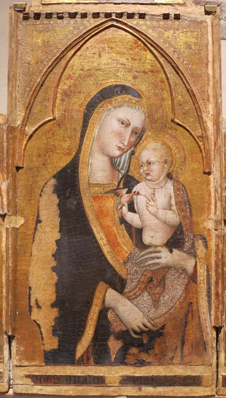
  <figcaption>Giovanni di Nicola, <em>The Virgin and Child</em>, from the Santa Marta polyptych. Pisa, Museo Nazionale di San Matteo, inv. 1595. Photo: Francesco Bini, <a href="https://creativecommons.org/licenses/by-sa/4.0/">CC BY-SA 4.0</a>, via Wikimedia Commons.</figcaption>
</figure>

<figure>
  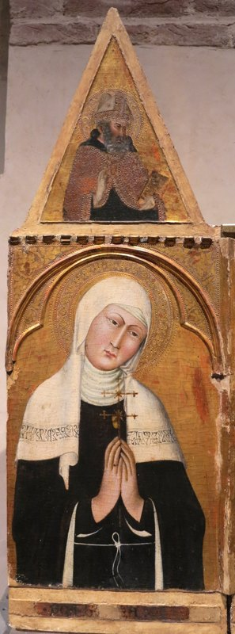
  <figcaption>Giovanni di Nicola, <em>Saint Bona, with a bishop saint in the pinnacle</em>, from the Santa Marta polyptych. Pisa, Museo Nazionale di San Matteo, inv. 1595. Photo: Francesco Bini, <a href="https://creativecommons.org/licenses/by-sa/4.0/">CC BY-SA 4.0</a>, via Wikimedia Commons.</figcaption>
</figure>

<figure>
  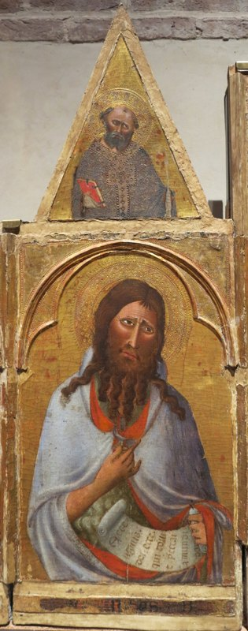
  <figcaption>Giovanni di Nicola, <em>Saint John the Baptist, with a bishop saint in the pinnacle</em>, from the Santa Marta polyptych. Pisa, Museo Nazionale di San Matteo, inv. 1595. Photo: Francesco Bini, <a href="https://creativecommons.org/licenses/by-sa/4.0/">CC BY-SA 4.0</a>, via Wikimedia Commons.</figcaption>
</figure>

<figure>
  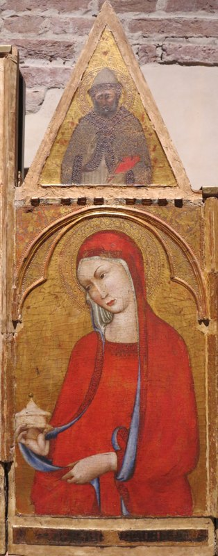
  <figcaption>Giovanni di Nicola, <em>Saint Mary Magdalene, with a bishop saint in the pinnacle</em>, from the Santa Marta polyptych. Pisa, Museo Nazionale di San Matteo, inv. 1595. Photo: Francesco Bini, <a href="https://creativecommons.org/licenses/by-sa/4.0/">CC BY-SA 4.0</a>, via Wikimedia Commons.</figcaption>
</figure>

<figure>
  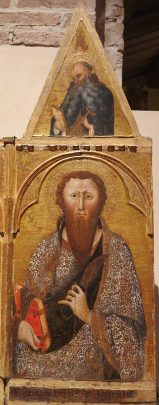
  <figcaption>Giovanni di Nicola, <em>Saint Bartholomew, with Saint Anthony Abbot in the pinnacle</em>, from the Santa Marta polyptych. Pisa, Museo Nazionale di San Matteo, inv. 1595. Photo: Francesco Bini, <a href="https://creativecommons.org/licenses/by-sa/4.0/">CC BY-SA 4.0</a>, via Wikimedia Commons.</figcaption>
</figure>

The altarpiece is a polyptych of five compartments in two tiers, with a predella-like base carrying the inscriptions. The central panel, taller than the others, ends in a pointed trilobed arch; the four lateral panels have round trilobed arches. Each compartment is crowned by a gabled pinnacle, and a row of small dentils runs along the tops of the main panels. The colonnettes that once separated the compartments and the frames of the pinnacles are lost, and the present arrangement shows the panels set close together.

The Virgin, half-length, inclines her head towards the Child, whom she holds on her left arm. Her dark blue mantle, edged in gold, falls over an orange dress; the Child, naked, wears a pendant of coral at his neck and holds a goldfinch by its wings. Both motifs were familiar in Sienese and Pisan painting: coral as an amulet against evil, the goldfinch as a sign of the Passion, from the legend that the bird took a thorn from Christ's crown. The Child's plump body and turned head are close to the Madonnas of Lippo Memmi.

The four saints are arranged in two pairs. At the left Saint Bona, in a black habit with a white veil, wimple and collar bordered by a band of pseudo-lettering, joins her hands in prayer around a small double-armed cross, and the Baptist, gaunt, with long hair and beard and a sorrowful expression, wears a pale violet mantle over his hair shirt, points to himself and unrolls his long scroll across his body. At the right the Magdalene, in a red mantle drawn over her head, holds the jar of ointment, and Bartholomew, with a long dark beard, holds the knife of his martyrdom and a red book, his mantle patterned in white and gold.

The pinnacles complete the programme. Christ blessing, with an open book, occupies the central gable. In the four side gables appear half-length saints: above Bona a bishop in a mitre and patterned cope, with a dark habit beneath, probably Augustine; above the Baptist a balding bishop with a red book; above the Magdalene a bishop in a low mitre who blesses and holds a red book; and above Bartholomew Saint Anthony Abbot, with a long grey beard, a book and the tau-shaped staff. The national catalogue identifies the three bishops as Doctors of the Church; their names are not inscribed.

The pairing of saints is calculated. The local saint Bona stands next to the Baptist, the forerunner who points towards the Virgin and Child; the Magdalene, model of penitents, stands beside the apostle Bartholomew. The choice of the Magdalene and Bona, two women associated with penitence and religious life, suits a church dedicated to Martha, the sister of Mary of Bethany, whom medieval tradition identified with the Magdalene.

The faces show Giovanni's types in a consistent form: long oval heads, long straight noses, small mouths and slanting eyes, all modelled with smooth transitions and little shadow. The Baptist and Bartholomew, with their dark beards and hollow cheeks, are the only figures that approach the intensity of Traini; the women and the Virgin remain within the Memmian repertory. The colour sets strong accents against the gold: the orange of the Virgin's dress, the red of the Magdalene, the black and white of Bona's habit and the cool violet of the Baptist's mantle.

The gold grounds are richly tooled. The haloes are punched with concentric bands and rosettes, the arches carry punched borders, and the spandrels of the central panel are decorated with fine incised patterns. These are the passages in which the literature recognises Giovanni's skill as a craftsman, and they are well preserved.

The polyptych is in fair condition. A vertical band of the Virgin's blue mantle at the left has been lost down to the preparation, and the gold of the grounds is worn in places, particularly in the pinnacles. The inscriptions on the base, with the names of the saints and the damaged date, survive only in part; the name of Bartholomew can still be read under his panel.

### Saint Anthony Abbot (London, National Gallery)

<figure>
  
  <figcaption>Giovanni di Nicola, <em>Saint Anthony Abbot</em>, about 1350. Egg tempera on wood, 61.5 × 36 cm. London, National Gallery, NG3896; presented by Henry Wagner, 1924. Image: public domain, via Wikimedia Commons.</figcaption>
</figure>

Saint Anthony Abbot, the Egyptian hermit regarded as the founder of monasticism, is shown half-length, turned slightly to the right while his eyes look sideways to the left, towards the centre of the lost altarpiece. He wears the black hooded cloak of the hermit over a brown habit, and a tawny cap shows beneath the hood. The figure fills the arched field almost to its edges, and the dark mass of the cloak stands out against the gold.

The head is the most carefully worked passage. The long white beard falls in two broad, wavy locks to the chest, each strand drawn with a fine brush in grey and white over a darker ground; the moustache curls at the corners of the mouth. The face, with its furrowed brow, hooded eyes and long nose, is modelled in warm flesh tones with green shadows, and the sideways glance gives the old man an alert, severe expression.

The tau-shaped staff on which the saint rests his hand recalls the crutch of the aged hermit and became the emblem of the Hospital Brothers of Saint Anthony, whose houses cared for the sick across Europe. The book probably alludes to the Rule attributed to him. Giovanni omits the pig and the bell often shown with the saint in later images; the panel presents him as a monastic father rather than as a healer.

The gold ground is richly tooled. The halo carries a band of leaves between borders of dots and small arcs, and the cusped arch, carved in relief, rests on short columns at the sides. The spandrels are filled with scrolling foliage in raised and gilded pastiglia, the motif that recurs on the lateral panels of the Zucchetti altarpiece in San Matteo.

Comparison with the Zucchetti saints confirms the attribution. The cusped arch, the pastiglia foliage, the punched haloes and the treatment of the hands, with long fingers and squared nails, are the same; Anthony's sideways glance and furrowed brow recall those of Peter and Bartholomew. The heavier, more sculptural modelling of the beard suggests that the London panel is among Giovanni's more ambitious single figures.

The panel was the left lateral of a polyptych whose other parts have not been identified. Its dimensions, about 61.5 by 36 centimetres, are close to those of the Zucchetti saints, which also lack a panel at the left; but that missing panel has been identified as a *Saint James the Greater* in the Perkins collection at Assisi, and no study has connected the London panel with the Zucchetti series. Its English provenance, from the Willett collection, gives no clue to its Pisan origin. The choice of Anthony, a monastic saint, suggests a destination in a monastic or hospital church.

In the pinnacles of the signed polyptych from Santa Marta, Anthony Abbot appears as a small half-length figure with the same white beard and dark habit. The London panel develops that type on a large scale, with the same elements: the hood drawn over the head, the long divided beard, the book held against the body. The repetition of the type from pinnacle to main panel is characteristic of Giovanni's method, in which a stock of figures served for compositions of every size.

The frame preserves the original arch and cusps, regilded, within a modern outer moulding. The gold ground shows small holes and losses along the right edge; the paint surface is otherwise well preserved, with the dark cloak intact and the beard in good condition.

### Madonna and Child with Saints John the Baptist, Peter and Bartholomew, from the Zucchetti collection (Pisa, Museo Nazionale di San Matteo)

<figure>
  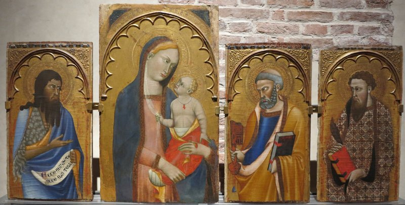
  <figcaption>Giovanni di Nicola, <em>Madonna and Child with Saints John the Baptist, Peter and Bartholomew</em>, c. 1340–1360. Tempera and gold on panel; Madonna 79.5 × 48.3 cm, saints c. 64.5 × 35 cm. Pisa, Museo Nazionale di San Matteo, inv. 1597, 1596, 1598, 1599; from the Zucchetti collection, given in 1796. Photo: Francesco Bini, <a href="https://creativecommons.org/licenses/by-sa/4.0/">CC BY-SA 4.0</a>, via Wikimedia Commons.</figcaption>
</figure>

<figure>
  
  <figcaption>Giovanni di Nicola, <em>Madonna and Child</em>, from the Zucchetti panels. Pisa, Museo Nazionale di San Matteo, inv. 1597. Photo: Francesco Bini, <a href="https://creativecommons.org/licenses/by-sa/4.0/">CC BY-SA 4.0</a>, via Wikimedia Commons.</figcaption>
</figure>

<figure>
  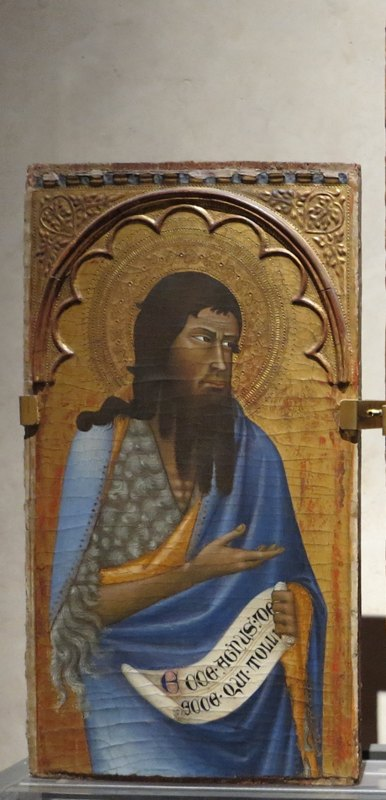
  <figcaption>Giovanni di Nicola, <em>Saint John the Baptist</em>, from the Zucchetti panels. Pisa, Museo Nazionale di San Matteo, inv. 1596. Photo: Francesco Bini, <a href="https://creativecommons.org/licenses/by-sa/4.0/">CC BY-SA 4.0</a>, via Wikimedia Commons, cropped.</figcaption>
</figure>

<figure>
  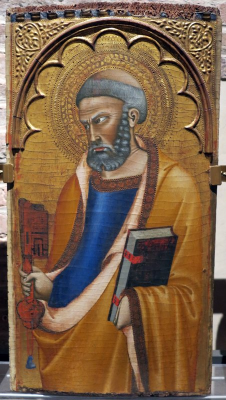
  <figcaption>Giovanni di Nicola, <em>Saint Peter</em>, from the Zucchetti panels. Pisa, Museo Nazionale di San Matteo, inv. 1598. Photo: Francesco Bini, <a href="https://creativecommons.org/licenses/by-sa/4.0/">CC BY-SA 4.0</a>, via Wikimedia Commons.</figcaption>
</figure>

<figure>
  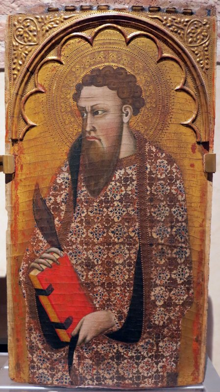
  <figcaption>Giovanni di Nicola, <em>Saint Bartholomew</em>, from the Zucchetti panels. Pisa, Museo Nazionale di San Matteo, inv. 1599. Photo: Francesco Bini, <a href="https://creativecommons.org/licenses/by-sa/4.0/">CC BY-SA 4.0</a>, via Wikimedia Commons.</figcaption>
</figure>

The four panels are displayed together in San Matteo as a single altarpiece, with the Madonna at the centre, the Baptist at the left, and Peter and Bartholomew at the right. A fifth panel, which would complete the symmetry at the left, is missing. The present arrangement follows the reconstruction proposed in 1923 and widely repeated since, but the panels do not form a structurally certain whole.

The Virgin, half-length, looks down at the Child with a slight inclination of the head. Her dark blue mantle, with a star on the shoulder, frames a pink dress and a transparent white veil that falls from her head to her breast. The Child, seated on her left arm, looks up at her and takes hold of the veil, a gesture of affectionate play that Giovanni took from Lippo Memmi's Madonnas. He wears a red cloth with a yellow lining over a white loincloth and, at his neck, a coral pendant on a blue cord. In her right hand, at the lower edge, the Virgin holds a white, ribbed form whose meaning is uncertain.

The three saints are shown half-length, turning towards the centre. The Baptist, gaunt and long-haired, wears a hair shirt under a blue mantle lined with yellow, gestures with his right hand and holds a scroll inscribed "Ecce agnus dei ecce qui tollit". Peter, with a furrowed brow and curly grey hair, holds a large red key and a black book with red clasps. Bartholomew, with reddish-brown curls and a long pointed beard, holds a knife and a red book, and his mantle is covered with a dense pattern of small flowers in blue, red and brown.

The faces show the two registers of Giovanni's art. The Virgin, with her long oval face, straight nose and small mouth, belongs to the Memmian repertory of the signed polyptych. The male saints, especially Peter and Bartholomew, have more marked features, with knitted brows and sidelong glances, and approach the expressive types of Traini. The difference is one of type rather than of hand: the modelling of flesh, the drawing of the hands and the treatment of hair are the same throughout.

The panels display Giovanni's ornamental technique with particular clarity. The haloes are punched with concentric bands of rosettes and foliage; the borders of the garments are tooled and painted with small repeated motifs; and Bartholomew's mantle reproduces a patterned textile with great care. On the lateral panels the spandrels above the arches are filled with foliage in raised and gilded pastiglia, the same scrolling motif that the National Gallery identifies as a hallmark of Giovanni's panels.

The central panel differs from the laterals in one respect. Its arch has the same cusps, but its spandrels are painted dark blue rather than filled with gilded pastiglia, and its proportions are wider. The difference may reflect the hierarchy between centre and sides, but it is also consistent with Caleca's separation of the Madonna from the three saints.

The date is uncertain. The national catalogue gives a broad range between about 1330 and about 1360. The closeness of the Virgin to the figures of the signed polyptych, and the turn of the male heads towards Traini, favour a date around the middle of the century.

The panels are in fair condition. Their tops and bottoms show bare wood, where a frame has been lost, and the Peter panel is slightly warped. The Madonna has losses of paint and gold in the left spandrel and along the upper edge, and a strip about three centimetres wide along its right edge lacks preparation.

### Madonna and Child, from San Michele and Grosseto Cathedral (Grosseto, Museo Archeologico e d'Arte della Maremma)

<figure>
  
  <figcaption>Giovanni di Nicola (attributed), <em>Madonna and Child</em>, c. 1350. Tempera and gold on panel. Grosseto, Museo Archeologico e d'Arte della Maremma; from the church of San Michele, later in Grosseto Cathedral. Photo: Sailko, <a href="https://creativecommons.org/licenses/by/3.0/">CC BY 3.0</a>, via Wikimedia Commons, cropped.</figcaption>
</figure>

The panel shows the Virgin at half length under a round arch, with the Child on her left arm. It came from the church of San Michele and later passed to the cathedral of Grosseto, before entering the Museo Archeologico e d'Arte della Maremma. If the attribution to Giovanni di Nicola is correct, it is with the Palermo Madonna one of the few works that document his production for clients outside Pisa, here in the Maremma, the coastal territory between Pisa and Siena.

The motif is one of play and tenderness. The Child, naked but for a white cloth that wraps his lower body and falls in soft folds below, reaches up and touches his mother's cheek; the Virgin inclines her head towards him and holds, between the fingers of her right hand, the string of a small bird, a goldfinch or similar, which perches against her breast. The bird, the plaything of the Child and the sign of his Passion, appears in the Santa Marta and San Vito Madonnas as well.

The Virgin's face is broader and softer than in the Santa Marta polyptych, with a faint smile, rosy cheeks and eyes turned sideways towards the viewer. The Child, with his round head and sharp glance, is close to Giovanni's other Children. The dark mantle, now green-black, is lined with yellow and opens on a red dress; the white of the Child's cloth, modelled with grey shadows, is the brightest area of the picture.

In the spandrels above the arch, on a green ground painted with dark scrolls, two gold roundels hold the Annunciation: the angel at the left, almost entirely worn away, and the Virgin Annunciate at the right, with her hands crossed on her breast. The pairing places the image of the Virgin and Child under the sign of the Incarnation, a common device in Tuscan devotional panels.

The panel differs from Giovanni's other works in several respects. The spandrels are painted rather than worked in gilded pastiglia, the arch has no carved cusps, and the ground lacks the dense punched decoration of his haloes. The handling of the faces is broader and the expression warmer. These differences may reflect a modest commission or the participation of the workshop, but they also leave room for doubt about the attribution, which rests on the figure types alone.

A date around 1350, proposed on stylistic grounds, places the panel near the Santa Marta polyptych. The fuller forms of the Virgin and the natural gesture of the Child could also suggest a slightly later moment.

The gold ground is badly worn, with the red bole showing through over most of its surface, and the roundel of the angel has almost entirely lost its paint. The mantle has darkened. The panel has been cut at the top, and the lower part is closed by a moulded base painted red, probably a later addition.

The panel is not listed among Giovanni's works in the Dizionario Biografico. Its attribution belongs to the wider and less controlled corpus that has grown around his name, and it remains a proposal to be tested against the core of his signed and documented work.

### Madonna and Child Enthroned with a Benedictine Donor, from San Vito (Pisa, Museo Nazionale di San Matteo)

<figure>
  
  <figcaption>Giovanni di Nicola, <em>Madonna and Child Enthroned with a Benedictine Donor</em>, c. 1350–1355. Tempera and gold on panel. Pisa, Museo Nazionale di San Matteo; from the church of San Vito. Photo: Francesco Bini, <a href="https://creativecommons.org/licenses/by-sa/4.0/">CC BY-SA 4.0</a>, via Wikimedia Commons.</figcaption>
</figure>

The panel, with a rounded top and its frame lost, shows the Virgin enthroned with the Child and a small kneeling donor. It is the panel that Alessandro da Morrona recorded in the sacristy of San Vito in Pisa, a church held by a Benedictine monastery until 1373. Unlike the polyptychs of Santa Marta and the Zucchetti collection, it is a single devotional image in which the whole figure of the Virgin is shown, seated on a monumental throne.

The throne is the most elaborate architecture in Giovanni's surviving work. It is built of white marble with green cornices and bases, its uprights inlaid with narrow bands of blue and gold in the manner of Cosmatesque work, and its arms end in small carved finials. A red cloth of honour hangs behind the Virgin. The structure is seen slightly from above, with its sides receding, a device of Sienese origin that Giovanni handles with more care than conviction: the seat and the step do not quite agree in their perspective.

The Virgin wears a deep blue mantle, with a star on the shoulder and a broad punched border, over a pink dress with a gold neckline. Her head, inclined towards the Child, has the long oval, the straight nose and the slanting eyes of the Santa Marta Virgin, and her halo carries the words of the angelic salutation, tooled into the gold and legible as far as AVE MARIA GRATIA PLENA DOMINUS TE, where the Child's halo covers the rest. Her right hand rests lightly on the cloth that wraps the Child.

The Child sits on her left knee, naked to the waist, with a gold-patterned orange cloth around his legs. He wears a coral pendant and a small cross at his neck, grasps the edge of his mother's mantle with one hand and holds a goldfinch in the other, pointing it downwards. The heavy, almost sullen face of the Child, with its full cheeks and small mouth, recurs in the Santa Marta and Zucchetti Madonnas and is one of the clearest signs of Giovanni's hand.

The donor, at the lower right, is painted at a tiny scale on the step of the throne. He kneels in profile, in a black hooded habit, with joined hands, and looks up towards the Virgin. His habit identifies him as a Benedictine, in keeping with the community that held San Vito, and his presence turns the panel into a votive image commissioned for the monastery's church or sacristy.

The panel is generally placed shortly after the Santa Marta polyptych. The ampler figure of the Virgin, the more developed throne and the greater weight of the Child suggest a slightly later moment, in the early 1350s, though the uniformity of Giovanni's types prevents a precise date.

The tooling is of high quality. The haloes are worked with concentric bands of punches and incised lettering; the borders of the mantle and the Child's cloth are punched and painted with small patterns; and the inlaid bands of the throne are painted with care. The colour, dominated by the deep blue of the mantle against the white and green of the throne and the red of the cloth, is unusually strong for Giovanni.

The gold ground is badly worn, especially at the upper right, where the red bole is exposed, and the edges of the panel are damaged where the frame has been lost. The blue of the mantle shows a fine network of cracks, and the flesh tones have lost some of their glazes, so that the faces appear greyish.

### The Stories of the Virgin and of the Infancy of Christ (Pisa, San Martino)

<figure>
  
  <figcaption>Giovanni di Nicola (attributed), <em>The Annunciation and the Visitation</em>, 1350s. Detached fresco. Pisa, church of San Martino. Photo: Sailko, <a href="https://creativecommons.org/licenses/by/3.0/">CC BY 3.0</a>, via Wikimedia Commons.</figcaption>
</figure>

<figure>
  
  <figcaption>Giovanni di Nicola (attributed), <em>The Birth and Naming of Saint John the Baptist</em>, 1350s. Detached fresco. Pisa, church of San Martino. Photo: Sailko, <a href="https://creativecommons.org/licenses/by/3.0/">CC BY 3.0</a>, via Wikimedia Commons.</figcaption>
</figure>

<figure>
  
  <figcaption>Giovanni di Nicola (attributed), <em>The Nativity and the Adoration of the Magi</em>, 1350s. Detached frescoes. Pisa, church of San Martino. Photo: Samuele, public domain, via Wikimedia Commons.</figcaption>
</figure>

<figure>
  
  <figcaption>Giovanni di Nicola (attributed), <em>The Presentation in the Temple</em>, 1350s. Detached fresco. Pisa, church of San Martino. Photo: Sailko, <a href="https://creativecommons.org/licenses/by/3.0/">CC BY 3.0</a>, via Wikimedia Commons.</figcaption>
</figure>

The frescoes came to light during a restoration of the interior of San Martino, were detached from their wall and are now displayed on the inner façade of the church. Five scenes survive, in four fields: the Annunciation and the Visitation, joined in a single field; the Birth and Naming of Saint John the Baptist; the Nativity; the Adoration of the Magi; and the Presentation in the Temple. All are framed by painted bands imitating inlaid marble, with a frieze of eight-pointed stars and lozenges at the top, the decorative language of Pisan church interiors.

The cycle follows the sequence of the Gospel of Luke, in which the infancies of John and of Christ run in parallel. The Annunciation is followed by the Visitation, in which Mary greets her kinswoman Elizabeth; the birth of John precedes the birth of Christ; the Adoration of the Magi and the Presentation close the series. The prominence given to John suggests a dedication or an altar in honour of the Baptist, but the original arrangement of the scenes on the wall is not known.

In the first field the Annunciation is staged under an arcade carried on slender twisted columns. Gabriel, in a robe patterned with red flowers, kneels with wings of red, white and black feathers raised behind him, beneath a branch of lilies. The Virgin sits frontally on a throne, an open book on her knee and her hand on her breast in a gesture of humble assent. At the right, before a red tower, the Visitation shows the two women in a restrained embrace. Small coats of arms in the frieze probably record the family that paid for the decoration.

The Birth of the Baptist is a crowded and animated scene. Elizabeth, propped on her elbow in a bed with a chequered cover, reaches for a bowl brought by a young attendant; the Virgin, seated on the floor, holds the swaddled infant; and Zacharias, who has recovered his speech, writes the name of John on a tablet, while women look in at the door. The boxed interior, with its red walls and curtained bed, is the most coherent space in the cycle.

The attendant at the left of this scene provides the evidence for dating the cycle. She wears a close-fitting dress with a wide, low neckline and long, tight sleeves, patterned with dark scrolls, and her hair is dressed in braids around the head. Her dress is the clearest instance in the cycle of the fashion on which its dating to the 1350s rests, and it shows the painter's attention to contemporary costume in a scene otherwise conceived in traditional terms.

The Nativity and the Adoration of the Magi share a rustic shed and a common landscape. In the Nativity the Virgin reclines beside a box-shaped manger and Joseph sits wrapped in his mantle, while angels announce the birth to the shepherds; in the Adoration the eldest king kneels to kiss the Child's foot and the two younger kings wait with their gifts, as a groom holds the horses of their train. In the Presentation, set before a temple seen as a long building with a tiled roof, Simeon reaches out for the Child above an altar covered with a white cloth.

The faces repeat the types of Giovanni's panels: the long oval face and slanting eyes of the Virgin, the long beards and drawn features of Zacharias, Joseph and Simeon. The execution, however, is summary, with broad areas of flat colour and little modelling, far from the care of the panels. The attribution rests on the figure types, and the share of the workshop is likely to have been large. The scenes are the only murals regularly given to Giovanni.

The cycle is in poor condition. Round losses interrupt the frieze above each scene, a deep crack runs down the right side of the Birth of the Baptist, and the Annunciation has lost its lower left corner. The colours have faded, the blues have largely disappeared and the backgrounds have darkened, but the drawing of the figures and the patterns of the dresses remain legible.

### Francesco Traini, polyptych from the Zucchetti collection, formerly attributed to Giovanni di Nicola (Pisa, Museo Nazionale di San Matteo)

<figure>
  
  <figcaption>Francesco Traini (formerly attributed to Giovanni di Nicola), <em>Madonna and Child with Saints Paul, John the Baptist, a virgin martyr and Peter</em>, c. 1325–1345. Tempera and gold on panel; Madonna 80 × 58 cm, Saint Paul 58 × 39.5 cm, Saint John the Baptist 59.5 × 38.5 cm. Pisa, Museo Nazionale di San Matteo, inv. 5727 (Madonna), 1591 (Paul), 1592 (Baptist); from the Zucchetti collection and the Opera del Duomo. Image: public domain, via Wikimedia Commons.</figcaption>
</figure>

The panels came from the collection of canon Sebastiano Zucchetti, which was given to the Opera del Duomo of Pisa in 1796, and are now displayed together in the Museo Nazionale di San Matteo as the parts of a single polyptych. The Madonna and Child (inv. 5727) is at the centre, Saint Paul (inv. 1591) and Saint John the Baptist (inv. 1592) at the left, and a young virgin martyr and Saint Peter at the right. Once given to Giovanni di Nicola and now attributed to Francesco Traini, the work marks the boundary between the two painters.

The Virgin, half-length, wears a dark blue mantle with a gold border and a star on the shoulder over a red dress patterned in gold. She inclines her head towards the Child, who is wrapped in a pink cloth, grasps the neckline of her dress and turns his face up to hers. The exchange of glances and the Child's grasping hand belong to the intimate type of the Virgin of Tenderness, which Sienese painters had made familiar in Pisa.

The four saints are shown at half length on gold grounds. Paul, bald and with a long dark beard, holds the sword of his martyrdom and a red book. The Baptist, with dishevelled dark hair and a hair shirt under a green mantle, points to his scroll, inscribed "Ecce agnus dei ecce qui tollit". At the right the young martyr, crowned with a wreath of red and white flowers and holding a palm, wears a red dress embroidered with gold, and Peter, with curly white hair and beard, holds a book with metal clasps.

The attribution has a long history. The Madonna was given to Giovanni di Nicola by Sirén in 1914 and by van Marle in 1925, and to Traini by Carli in 1959. For the saints, Polloni in 1837 named Traini; Supino in 1894 and Bellini Pietri in 1906 preferred the school of Simone Martini. Lavagnino in 1923 and <a href="/scholars.html#van-marle-raimond">Raimond van Marle</a> in 1925 doubted that the saints belonged with the Madonna, while Marangoni in 1931 united the panels into a single polyptych under the name of Giovanni di Nicola. Vigni in 1950 thought of the Master of the Triumph of Saint Thomas. <a href="/scholars.html#carli-enzo">Enzo Carli</a> in 1958, identifying that master with Traini, returned the saints to Traini, and <a href="/scholars.html#bellosi-luciano">Luciano Bellosi</a> in 1974 confirmed their link with the Madonna.

<a href="/scholars.html#caleca-antonino">Antonino Caleca</a> in 1987 placed the saints early in Traini's career, close to the *Triumph of Saint Thomas Aquinas* in Santa Caterina, and therefore after the canonisation of 1323. The national catalogue dates them about 1323–1330. For the Madonna, however, Caleca proposed a date close to Traini's signed altarpiece of Saint Dominic of 1345. A study of 2001 regards the saints as probable laterals of the Madonna, but the gap of some fifteen years between the two datings leaves the unity of the ensemble open. The present display reflects the reconstruction rather than a certain structure.

Set beside Giovanni di Nicola's works, the polyptych shows what separates the two painters. Traini's faces are broader and more strongly modelled, with heavy-lidded eyes and an intensity of expression, particularly in the Baptist and in Peter, that Giovanni's oval, smooth Memmian types do not attempt. The colour, warm and luminous, with the pearly flesh tones that later Pisan painters admired, is laid on in fuller volumes. Giovanni borrowed this colour range in his signed polyptych, but kept his figures within the repertory of Lippo Memmi.

The confusion between the two painters arose from a shared Sienese foundation and a shared workshop culture. Both worked in the wake of Simone Martini's Pisan polyptych, both used gold grounds with tooled haloes, and both built half-length figures on Sienese models. The comparison with Giovanni's own Zucchetti panels, the Madonna inv. 1597 and the saints inv. 1596, 1598 and 1599, which also came from canon Zucchetti's collection, shows how close the two groups could appear to early twentieth-century connoisseurs.

The lateral panels were cut at the top to fit rectangular frames, and the traces of their original trilobed arches remain. The panel of Saint Paul had lost its gold ground and had been repainted with a blue sky and ochre; a restoration by N. Carusi recovered the original preparation. On the Baptist, gold survives along the left side of the mantle and in the hair.

### Anonymous painter from Fabriano, central panel of a polyptych, formerly attributed to Giovanni di Nicola (Perugia, Galleria Nazionale dell'Umbria)

<figure>
  
  <figcaption>Anonymous painter from Fabriano active in Perugia (formerly attributed to Giovanni di Nicola), <em>Madonna and Child, with Christ Blessing</em>, central panel of a polyptych, c. 1360–1365. Tempera and gold on panel; the polyptych 140 × 237 cm overall. Perugia, Galleria Nazionale dell'Umbria, inv. 12. Image: public domain, via Wikimedia Commons.</figcaption>
</figure>

<figure>
  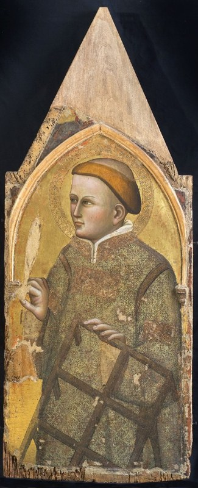
  <figcaption>Anonymous painter from Fabriano active in Perugia (formerly attributed to Giovanni di Nicola), <em>Saint Lawrence</em>, lateral panel of the polyptych, c. 1360–1365. Tempera and gold on panel. Perugia, Galleria Nazionale dell'Umbria, inv. 12. Image: public domain, via Wikimedia Commons.</figcaption>
</figure>

<figure>
  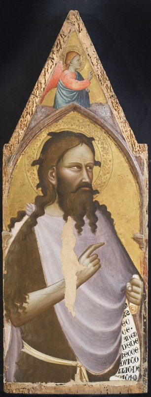
  <figcaption>Anonymous painter from Fabriano active in Perugia (formerly attributed to Giovanni di Nicola), <em>Saint John the Baptist, with the angel of the Annunciation</em>, lateral panel of the polyptych, c. 1360–1365. Tempera and gold on panel. Perugia, Galleria Nazionale dell'Umbria, inv. 12. Image: public domain, via Wikimedia Commons.</figcaption>
</figure>

<figure>
  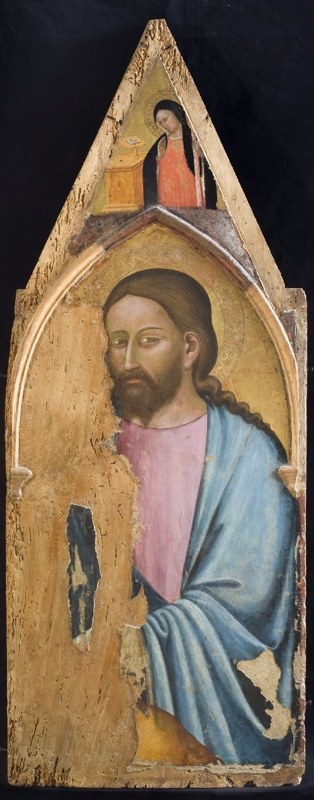
  <figcaption>Anonymous painter from Fabriano active in Perugia (formerly attributed to Giovanni di Nicola), <em>An apostle, with the Virgin of the Annunciation</em>, lateral panel of the polyptych, c. 1360–1365. Tempera and gold on panel, 104.5 × 41 cm. Perugia, Galleria Nazionale dell'Umbria, inv. 12. Image: public domain, via Wikimedia Commons.</figcaption>
</figure>

<figure>
  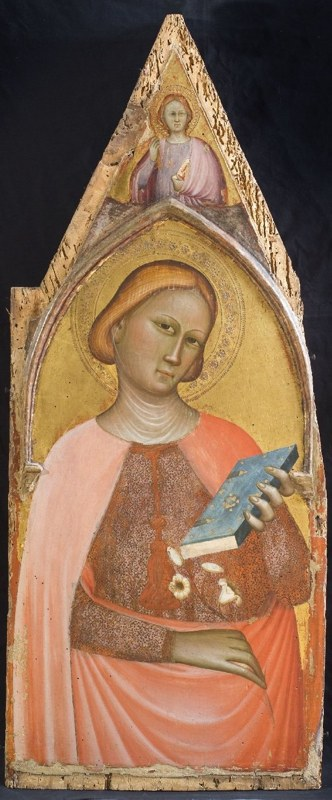
  <figcaption>Anonymous painter from Fabriano active in Perugia (formerly attributed to Giovanni di Nicola), <em>A female saint</em>, lateral panel of the polyptych, c. 1360–1365. Tempera and gold on panel. Perugia, Galleria Nazionale dell'Umbria, inv. 12. Image: public domain, via Wikimedia Commons.</figcaption>
</figure>

The panel is the centre of a five-part polyptych in the Galleria Nazionale dell'Umbria, which also includes, from left to right, Saint Lawrence, Saint John the Baptist, an apostle and a female saint with book and flowers, and, in the pinnacles of the two inner laterals, the angel and the Virgin of the Annunciation. It came to the gallery from the Accademia di Belle Arti of Perugia, which received it after the Napoleonic suppressions of 1810, as the seals on the back of each panel show. Its original church is unknown. It is included here because it formed the core of the late group that a part of the literature gave to Giovanni di Nicola.

In the pinnacle, Christ blesses with his right hand and holds an open book, above a cluster of red seraphim. Below, the Virgin inclines her head towards the Child, who wears a pink robe, stretches up to touch her chin and holds a small bird in his other hand. The motif of the Child caressing his mother's face is one of tender play; the bird, often a goldfinch, alludes to the Passion.

The structure of the altarpiece follows a common type. The lateral panels, each about 104.5 by 41 centimetres, show half-length saints under pointed arches. Gabriel appears in the pinnacle above the Baptist and the Virgin Annunciate above the apostle, so that the Annunciation flanks the blessing Christ at the centre; the outer pinnacle above the female saint holds a small half-length figure, while that above Lawrence is a modern replacement in plain wood. The surviving frame elements are dispersed, and other panels may have existed. The haloes were laid out with a compass incised in the preparation, while the figures were drawn freehand.

The Virgin's head, with reddish hair braided around it under a dark mantle, has a long face with heavy-lidded eyes and a thin, straight nose. The type recalls Giovanni's Madonnas, but the modelling is softer and the expression more withdrawn, and the long, bony hand that supports the Child, with its separated fingers, is drawn with a naturalism foreign to his work. The Child's pink robe is shaded with delicate transitions of tone.

The attribution has been unusually unstable. F. Santi in 1969 gave the polyptych to a follower of Allegretto Nuzi; <a href="/scholars.html#boskovits-miklos">Miklós Boskovits</a> in 1973 placed it in a Pisan context, under the name of "Francesco Pisano"; Ada Labriola in 1994, following Caleca's view of a late phase, proposed it tentatively for Giovanni di Nicola. Pisani in 2001 rejected that attribution in favour of a master close to Giovanni and associated with Francesco di Neri. Later studies returned to the Marche and Umbria: Subbioni (2003) proposed the circle of the Perugian painter Pellino di Vannuccio, and <a href="/scholars.html#de-marchi-andrea">Andrea De Marchi</a> and Giulia Mancini (2022) a painter from Fabriano active in Perugia, whose reference point is a work of 1368 in San Domenico.

The current attribution to an anonymous Fabriano painter and the date about 1360–1365 rest on this last reading. They explain the features that had suggested Allegretto Nuzi, the leading painter of Fabriano in these years, and they remove the polyptych from the Pisan sphere in which it had been placed for two decades.

Set beside Giovanni's works, the panel shows why the attribution to him could be proposed and why it has been abandoned. The long oval face and the slanting eyes of the Virgin derive from the Sienese tradition that Giovanni shared; but the softer modelling, the more naturalistic hands and the warmer relation between mother and Child belong to a later generation and to a different regional culture.

The polyptych is in poor condition. Much of the paint has flaked away, and the panels have been trimmed at different times. In the central panel the Virgin's mantle is largely lost down to the preparation; the apostle has lost almost the whole left half of his figure, and the Baptist's mantle is crossed by a long vertical loss. The frames are riddled with worm holes. The panel had been cut down at the base and was restored to its original size in 1992–1993, when earlier integrations were removed.

### Cecco di Pietro, polyptych from Agnano (Pisa, Palazzo Blu)

<figure>
  
  <figcaption>Cecco di Pietro, <em>Polyptych from Agnano</em>, c. 1386–1395. Tempera and gold on panel, c. 295 × 265 cm. Pisa, Palazzo Blu; from Agnano, San Giuliano Terme. Image: public domain, via Wikimedia Commons.</figcaption>
</figure>

The polyptych comes from Agnano, near San Giuliano Terme in the Pisan countryside, and is now in private ownership, displayed at Palazzo Blu in Pisa. It is a five-part altarpiece in three tiers, about 295 by 265 centimetres, with its carved and gilded frame of twisted colonnettes, cusped arches and gabled pinnacles largely intact. It is relevant to Giovanni because a small figure in its predella, which this reproduction does not include, repeats Giovanni di Nicola's type of Saint Bona.

In the main tier the crowned Virgin sits on a marble throne with the Child on her knee, between Saints Nicholas and Jerome at the left and Benedict and Margaret at the right. The middle tier holds eight half-length saints in pairs, Maurus, Catherine of Alexandria, Stephen, Peter, Paul and Lawrence among them, with the Annunciation above the centre; the pinnacles show Christ blessing and four prophets with scrolls. The prominence of Benedict and his disciple Maurus suggests a Benedictine or Camaldolese destination.

The type of the Virgin, with her long face and heavy-lidded eyes, still belongs to the Pisan tradition that Giovanni helped to form, but the figures have grown taller and more solid, the space of the throne is clearly constructed, and the patterned textiles of Margaret and of the Child's robe are rendered with a new richness. Cecco di Pietro, documented from 1371 and dead before 1402, was a principal Pisan painter of the last decades of the century.

The small figure in the predella, long read as Saint Bridget of Sweden, was recognised by Pisani as Saint Bona from the attributes Giovanni had fixed for her in the Santa Marta polyptych. Its place is modest, among the minor figures of the predella, but it shows that a generation later a Pisan painter turned to Giovanni's altarpiece when he needed an image of the local saint.

The case shows how a type devised by a painter of the second rank could outlive his reputation. In a city with few images of Bona, Giovanni's figure probably owed its survival less to its quality than to its function as the recognisable form of a local cult.

The date of the polyptych is debated. The national catalogue, following the joint study of Ciardi, Caleca and <a href="/scholars.html#burresi-mariagiulia">Mariagiulia Burresi</a> of 1986, places it about 1386–1395, while Pisani in 2010 dated it to the late 1360s on the evidence of the women's dress, the same test she applied to Giovanni's frescoes in San Martino. If the earlier date is accepted, the repetition of Giovanni's Bona follows his death by only a few years.

The polyptych also shows the next stage in the Pisan altarpiece. Compared with the Santa Marta polyptych, with its five half-length figures under round arches, Cecco's altarpiece multiplies the tiers and figures, sets full-length saints in the main register and builds an elaborate frame, the type that dominated Pisan production at the end of the century.

The polyptych is in good condition, with its frame, gold grounds and colours well preserved.
