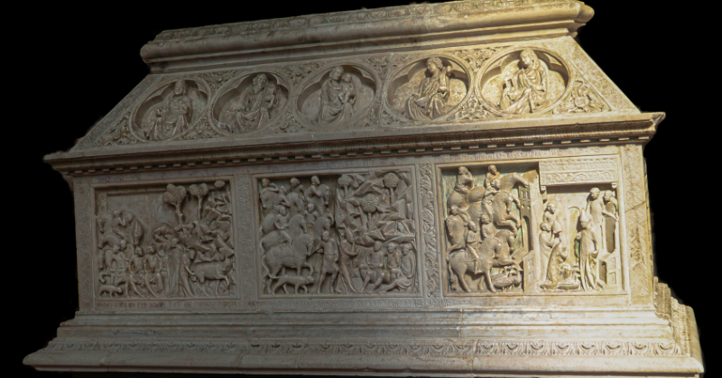

## A Sculptor of Two Signatures

Few sculptors of the Italian Trecento present the historian with so sharp a contrast between the brilliance of their surviving work and the poverty of their documentary trace as *Goro di Gregorio* of Siena. His name would mean little had it not been cut, twice, into marble: once in 1324, beneath the narrative reliefs of the reliquary chest of Saint Cerbonius in the cathedral of Massa Marittima, and once, in the Latin form *Gregorius*, on the side of the tomb of Archbishop Guidotto de' Tabiati (or d'Abbiate) in the cathedral of Messina, a monument whose epitaph records the prelate's death in March 1333. Between these two fixed points, and around them, lies a body of evidence of very uneven quality: a handful of fiscal and notarial records in Siena and Pisa, the transcriptions of eighteenth- and nineteenth-century antiquarians, and a catalogue of attributions that has grown remarkably since the 1980s, extending from marble tombs to small silver figures on a bishop's crozier and to a terracotta Virgin now in New York.

The interest of Goro lies precisely in this combination of a narrow documentary base and a highly distinctive artistic personality. Of all the Sienese sculptors active in the first third of the fourteenth century, he is the one whose language departs most decisively from the heroic, dramatic manner that Giovanni Pisano had brought to the façade of Siena Cathedral in the last decades of the Duecento. His figures are small, slender and quick; his landscapes are faceted like cut crystal; his ornament is so fine and so shallow that it has repeatedly been compared to the chased and enamelled surfaces of goldsmiths' work. It is a sculpture that seems to have been conceived for close and attentive viewing, by eyes accustomed to the panels of Duccio and Simone Martini and to the chalices and reliquaries that Sienese workshops were then sending across Italy and beyond.

The present essay follows the thread of the evidence rather than the convenience of a continuous biography. It begins with the sculptor's family, a lineage of carvers that reaches back to the workshop of Nicola Pisano, and with the scant records of his life in Siena. It then considers the question of his formation, before turning at length to the Arca di San Cerbone, the one work that allows us to observe Goro's narrative art in its full extension, and to the troubled history of its display. The tomb of the jurist Guglielmo di Ciliano, a modern rediscovery that has reshaped our understanding of the sculptor's Sienese activity, follows; then the Pisan workshop documented in 1326 and the great commission for Messina, with the marble Madonna known as the Madonna degli Storpi. A final part weighs the attributions proposed in the last four decades and the place that historiography has assigned to Goro within the Gothic sculpture of Tuscany.

The literature on Goro di Gregorio is a field in which the documented, the inferred and the conjectural are easily confused. Where an inscription survives, its wording is given; where two published transcriptions differ, the difference is stated rather than silently resolved. Where a date rests on stylistic argument, it is presented as such. Three modern scholars form the backbone of the subject: [Enzo Carli](/scholars.html#carli-enzo), whose monograph of 1946 first defined the sculptor's personality; [Roberto Bartalini](/scholars.html#bartalini-roberto), whose studies from the 1980s onwards transformed the catalogue and the chronology, culminating in the chapter on Goro in the collective volume *Scultura gotica senese 1260–1350* (2011); and [Gert Kreytenberg](/scholars.html#kreytenberg-gert), whose reconstructions of Tuscan Gothic tomb monuments bear directly on the Messina commission. Other contributions, to which this account is no less indebted, are mostly referred to by their place of publication; the authors of the individual Salini catalogue entries and of the Roccalbegna catalogue entry are named where those works are described.

Much is not known. There is no document of Goro's birth, apprenticeship or death. There is no contract for either of the signed monuments. There is no contemporary literary notice of him comparable to those that preserve the reputation of Simone Martini or of the Lorenzetti. The sculptor emerges, in other words, almost entirely from his works, and from the patient effort of scholarship to read them in relation to one another and to the Sienese culture in which they were made.

## A Family of Carvers

The name itself carries the first clue to Goro's origins. *Goro* is the common Tuscan reduction of *Gregorio*, and the sculptor's patronymic tells us that he was the son of a man of the same name. This is not an idle detail. In the Messina signature the sculptor calls himself, in Latin, *Gregorius*, while the Massa inscription uses the vernacular *Goro* followed by the Latin genitive *Gregorii*: the two monuments thus name the same person in two registers, and the apparent discrepancy has never been taken by scholarship as evidence of two different hands.

The father was himself a carver, and a Florentine. In 1272 the General Council of Siena granted citizenship to three masters who had come to work for the cathedral: Lapo, Donato, and a Florentine named Goro di Ciuccio (or Guccio) Ciuti. The request was made on their behalf by the *operaio* of the cathedral works, the Cistercian fra' Melano, and the deliberation, preserved in the Sienese state archive among the registers of the Consiglio Generale and published in the middle of the nineteenth century in the first great corpus of documents for the history of Sienese art, praises the group as *sagaces et subtiles magistri in intallis*, shrewd and subtle masters in the craft of carving. Lapo and Donato are well-known members of the workshop of Nicola Pisano; Lapo in particular is associated with the Arca of Saint Dominic<a href="/endnotes.html#fn-dominic-guzman" class="footnote">1</a> in Bologna and with the pulpit of Siena Cathedral, executed between 1265 and 1268. The *Dizionario Biografico degli Italiani* goes further and identifies Goro's father among Nicola's assistants on that pulpit. Whether or not his precise share in the Sienese pulpit can be isolated, the company he kept places him firmly within the first generation of Nicola's collaborators, the men through whom the Pisan renewal of sculpture was transplanted into Siena.

On the one hand, it means that Goro di Gregorio was born into the professional world of the cathedral works, in a city that had just become one of the two or three most important centres of marble sculpture in Italy. On the other hand, a sculptor born around 1275, as is commonly proposed, could not have known Nicola's workshop at first hand, and his own formative years would have coincided rather with the dominance of Giovanni Pisano in Siena. A 2001 study of the Arca di San Cerbone, published in the *Papers of the British School at Rome*, drew attention to the father's association with Lapo precisely because the Bolognese Arca of Saint Dominic, in which Lapo had participated, seems to have provided the essential typological model for the shrine at Massa Marittima. If this is right, a family memory of Nicola's most celebrated reliquary tomb may have been transmitted from one generation to the next, alongside the tools of the trade.

The household was not limited to father and son. The fiscal registers of the Commune of Siena record Goro together with two brothers, Meo and Ambrogio, who appear to have followed the same profession of stone-carving. Nothing further is known of them as artists, and no work has been convincingly connected with either. Their presence nonetheless reinforces the picture of a family enterprise, of the kind that was common among Tuscan masons and sculptors, in which skills, tools and perhaps commissions circulated among kinsmen. The detail recorded in 1312, to which the next section returns, that Meo was then styled *maestro* while Goro was not, suggests moreover that within this family hierarchy Goro was not, at least at that date, the senior figure.

It would be tempting to construct from these scraps a narrative of continuity, in which the son of one of Nicola Pisano's men grows up among the marbles of the Sienese cathedral and inherits a direct line of descent from the founder of the Gothic sculpture of Tuscany. The evidence permits the outline of such a story but not its colouring. What can be said is that Goro belonged to a milieu in which carving was a hereditary craft, that his father had been honoured by the Sienese commune for his skill, and that the family was established in Siena, as citizens, from the 1270s onwards. Everything else about the young sculptor's training has to be inferred from his works.

## The Documented Life

The documentary record of Goro di Gregorio's own life is short enough to be reviewed in its entirety, and almost every proposition about his career depends on how these few notices are read. No document gives his date of birth. The figure of around 1275 that appears in the *Dizionario Biografico degli Italiani*, and the slightly wider bracket of 1275 to 1280 adopted by the Museo Regionale in Messina, are reasonable estimates derived from the father's citizenship of 1272 and from the first appearance of the son in the records; they should not be repeated as facts.

That first appearance occurs in the fiscal books of the Commune of Siena for 1311 and 1312, where Goro is listed with his brothers Meo and Ambrogio. The entries are laconic, as such entries always are, but they have been read with great attention. Bartalini has stressed that in the record of 1312 Meo is qualified as *maestro*, a title that is not given to Goro. From this he has drawn a cautious but consequential inference: there is no documentary ground for supposing that Goro already led an independent career in the 1290s, as some attributions of earlier works would require. A sculptor not yet styled master in 1312 is more plausibly one whose mature activity begins in the second decade of the century. The point is not decisive, since titles in tax registers were not applied with perfect consistency, but it shifts the burden of proof onto those who would attribute to Goro works datable before about 1310.

The next two notices are known only through the Sienese antiquarian tradition of the nineteenth century, which transcribed them from records then accessible. In 1320 an entry in the *Libro della Presta*, a register of forced loans levied by the commune, places Goro in the contrada of Vallepiatta di Sotto, a district on the slope below the cathedral, close to the heart of the city's artistic workshops. In 1329 a payment is recorded to Goro and two other men for building work, described as *per edificallo*, at the fortress of Sassoforte in the Maremma, a stronghold that Siena was then consolidating in its southern territories. This last notice is of particular interest, because it shows the sculptor engaged in work of a more architectural or constructive character, as was common for Tuscan *maestri di pietra*, who moved readily between figurative carving and the building trade. Both notices, however, survive at one remove from their originals, and they carry correspondingly less weight than the inscriptions on the signed works.

Between these Sienese records stand the two dated monuments and a single document from Pisa. The Arca di San Cerbone bears the date 1324 and names its maker. In September 1326 Goro is documented in Pisa, where he had opened a workshop; the record, published in 1991 in the *Bollettino Storico Pisano*, arises from a lawsuit brought against him by two Sienese assistants, Bartaluccio di Mino and Simone di Bindo, who had been engaged in Siena some months before to work with him both in Pisa and in Messina. The Messina tomb, finally, carries the date of Archbishop Guidotto's death in 1333, which provides a *terminus post quem* for the completion of the epitaph, though not necessarily for the carving of the reliefs.

No document records Goro's death. The Fondazione Zeri photographic archive describes him as documented between 1300 and 1334, and the Metropolitan Museum of Art as active from around 1300 to 1334; the Messina museum writes that he died after 1334, and Kreytenberg has placed his death in the years around 1330 to 1335. These formulations differ more in emphasis than in substance: all of them recognise that the last secure trace of the sculptor is the Messina tomb, and that nothing is heard of him thereafter. The opening date of 1300 that appears in some summaries should be treated with caution, since it reflects the older view of an early activity rather than any document of that year.

The documents of Goro di Gregorio's life thus span, with certainty, a little under two decades, from the tax registers of 1311 to the payment of 1329; the last secure trace of the sculptor is the epitaph of the Messina tomb, dated 1333. Within that span the sculptor moved between Siena, the Maremma, Pisa and, directly or through his works, Sicily. It is a geography that already says something about his professional world: that of a Sienese master whose reputation was sufficient to attract commissions from the cathedral chapter of a mining town in the Maremma and from the archbishop of one of the great ports of the Mediterranean.

## Formation: Between the Pisani and the Goldsmiths

No document tells us where, or with whom, Goro di Gregorio learned his art. The question of his formation must therefore be approached through comparison, and here the literature offers two distinct, though not incompatible, readings. The first, which may be called the traditional view and which is reflected in the entries of the Treccani encyclopaedias, places the young sculptor in the orbit of Tino di Camaino, the Sienese master who was already *capomaestro* of Pisa Cathedral by February 1315 and later carried the Tuscan wall tomb to Naples. The second, developed by Bartalini, seeks the roots of Goro's style less in any single master than in a particular moment of Sienese sculpture and in its close dialogue with the city's goldsmiths.

The argument for Tino rests above all on the Messina tomb. Its structure, with an effigy laid on a bier above a chest decorated with narrative reliefs, and with a canopy implied by the different lengths of chest and bier, follows a type that Tino had established in his monument to Cardinal Riccardo Petroni in Siena Cathedral and in that of Bishop Antonio d'Orso in Florence. A sculptor called to design a prelate's tomb in the later 1320s could hardly have ignored these models, and the dependence of the Messina monument on Tino's formula is generally recognised. Yet typological dependence is not the same as apprenticeship. The figure style of Goro, with its small, agile bodies and its taste for ornamental precision, differs markedly from the broad, block-like and grave forms of Tino, and the relation between the two masters is better described as one of a younger sculptor's informed response to the prestigious tomb types of an older contemporary than as a relation of pupil to teacher.

Bartalini's reading starts from the situation of Sienese sculpture at the turn of the century. Between 1285 and 1297 Giovanni Pisano had directed the façade of Siena Cathedral and filled it with his tremendous prophets and sibyls, figures of an expressive energy without precedent in Italian sculpture. In the first two decades of the fourteenth century, however, a group of Sienese sculptors reacted against that manner, cultivating a more measured, refined and courtly idiom whose models lay beyond the Alps. [Gano di Fazio](/Content/Artists/XIV-c/Gano-di-Fazio.html), the author of the signed tomb of Tommaso d'Andrea<a href="/endnotes.html#fn-tommaso-d-andrea" class="footnote">2</a> at Casole d'Elsa, is one of the leading figures of this reaction. For Bartalini, the Arca di San Cerbone goes further still in this direction, and its true parallel is to be found not in contemporary marble sculpture but in the work of Sienese goldsmiths. The point of departure of that tradition is the chalice signed by Guccio di Mannaia and given by Pope Nicholas IV<a href="/endnotes.html#fn-nicholas-iv" class="footnote">3</a> to the basilica of San Francesco at Assisi, an object in which the Gothic of northern Europe was assimilated with extraordinary completeness. Bartalini describes this goldsmiths' art as the most organically *oltremontano*, the most thoroughly transalpine, produced in Italy at the time, and it is in this sense that he presents Goro as a kind of Gothic extremist in the Sienese context.

The affinity of Goro's sculpture with metalwork had been noticed long before. Already at the beginning of the twentieth century, a general history of Italian art remarked that the ornaments of the Massa arca seem to have been chased by a goldsmith. Carli developed the observation in a more precise direction, describing the extremely low-relief ornament of the arca as inspired by *champlevé* enamel, an effect that would have been still more evident before the loss of much of the original colour. The question is not merely one of resemblance. Several of the works attributed to Goro since the 1980s are themselves in silver, and the Metropolitan Museum of Art, describing its terracotta Enthroned Virgin, suggests that the piece may have served as a workshop model, perhaps for a goldsmith. A recent study of Tuscan marble in Sicily states without hesitation that Goro also practised the goldsmith's craft. Whether he did so in the strict sense of belonging to the goldsmiths' guild, or rather supplied models and figurative components to goldsmiths' workshops, the documents do not say; but the proximity of the two arts in his œuvre is a constant of all modern interpretations.

The role of painting in Goro's formation is harder to define and is, in the end, a matter of interpretation. The narrative reliefs of Massa share with the predellas of Duccio and his followers a taste for small-scale storytelling, for architectural settings that frame and divide episodes, and for incidental detail. Carli's notion of a Sienese predella style in sculpture, which he applied not to Goro alone but to the whole Sienese sculpture of the first third of the century, remains the most useful way of describing this convergence without claiming that any particular painter was the sculptor's model. What emerges, then, is a sculptor formed in the Sienese cathedral milieu after Giovanni Pisano, aware of Tino's tomb types, deeply attuned to the precious, transalpine Gothic of Sienese goldsmiths' work, and sharing with contemporary painters a narrative sensibility of unusual delicacy.

## Arca di San Cerbone — Lid Roundels and Chest Reliefs

The Arca di San Cerbone was made for a city at the height of its medieval prosperity. Massa Marittima, perched on the hills of the Colline Metallifere above the Tuscan Maremma, owed its wealth to the silver and copper mines of its territory and had developed, in the course of the thirteenth century, into a self-governing commune with its own statutes, its own mint and a cathedral of considerable ambition. The cathedral, dedicated to Saint Cerbonius, the sixth-century bishop of Populonia whose relics it preserved, had been built in Pisan Romanesque forms on a stepped podium and was being enlarged at the turn of the fourteenth century. An inscription records that work on the extension was begun in 1287 under the *operaio* Bigallo; the coat of arms of a Piccolomini *capitano del popolo* with the date 1304 marks the vault of the first bay of the new chancel, and the arms of the Tolomei bishop Cristofano di Mino Melloni, who held the see between 1310 and 1313, stand above the second. The polygonal east end in which the high altar and the canons' choir were accommodated was thus a recent and prestigious addition when Goro's shrine was commissioned.

The building campaigns of the cathedral were governed by an *operaio*, an official responsible for the fabric and its furnishings, elected, as a later document makes clear, by the Consiglio Maggiore of Massa in consultation with the bishop. Between the later thirteenth and the mid-fifteenth century the baptismal font, the extended east end, the sacristy and the choir stalls are all associated with individually named *operai*, and the Arca di San Cerbone belongs to the same pattern of civic and ecclesiastical patronage.

Its inscription, carved in Gothic capitals beneath the narrative reliefs, reads:

> ANNO D(OMI)NI MCCCXXIIII I(N)DI(C)T(IONE) VII MAGIST(ER) PERUCI(US) OP(ER)ARI(US) EC(C)L(ESI)E FECIT FI(ERI) H(OC) OPUS MAG(IST)RO GORO GREGORII DE SENIS

"In the year of the Lord 1324, in the seventh indiction, master Peruccio, *operaio* of the church, had this work made by master Goro di Gregorio of Siena."

The formula is a familiar one in Tuscan inscriptions of the period: it places the commissioner in the grammatical position of agent, and the sculptor in the ablative, as the instrument through which the work was made. The reading is consistent across the published transcriptions, including those of the *Dizionario Biografico degli Italiani*, the *Enciclopedia dell'Arte Medievale* and the 2001 study of the arca in the *Papers of the British School at Rome*.

The arca was not an isolated enterprise. A deliberation of the commune of Massa dated 8 January 1315 in the Sienese style, that is 1316 in modern reckoning, preserved in the Riformagioni di Massa in the Archivio di Stato in Siena and published in the nineteenth century, provided for the financing of a new panel of the Virgin for the cathedral through the sale of candles on the feast of the Assumption. That painting is generally identified with the Maestà in the Duccesque manner still in the cathedral, the panel known as the Madonna delle Grazie. The account of the cathedral's art published by the diocese, drawing on the monograph on the arca issued at Massa in 1995, connects the same *operaio* Peruccio with the advance of funds for this *tabula nova beate Marie Virginis*. The two works, a painted Maestà and a sculpted shrine for the patron saint's relics, thus appear as complementary components of a single programme of embellishment, carried out within a few years by the cathedral works under the same administration and entrusted, in both cases, to Sienese artists.

This Sienese orientation is significant. In the first decades of the fourteenth century Massa Marittima was drawn ever more closely into the political and economic orbit of Siena, which would annex it in 1335. The commissioning of Sienese painters and sculptors for the most important furnishings of the cathedral can be read as an expression of cultural affinity that preceded political subjection, and it would continue in the following decade with the great Maestà painted by Ambrogio Lorenzetti for the church of Sant'Agostino, now one of the treasures of the city's museum. The cathedral also preserves a reliquary of Saint Cerbonius, formerly kept in the Cappella delle Reliquie, which is now generally considered a fine example of fourteenth-century Sienese goldsmiths' work: an object whose presence in the same sanctuary as Goro's arca underlines once more the dialogue between marble and metal that runs through his art.

The arca, then, was a civic and devotional monument of the first importance. It enshrined the relics of the patron saint of the city and of its diocese, it was commissioned by the official responsible for the fabric of the cathedral, and it was entrusted to a master from the city whose art was then setting the standard of taste throughout southern Tuscany. That the commission went to Goro di Gregorio suggests that by 1324 he enjoyed a reputation sufficient to justify so prestigious a charge, a reputation of which, frustratingly, no earlier documentary trace survives.

### The Arca as an Object: Chest, Lid and Colour

In its form the Arca di San Cerbone belongs to the family of Italian reliquary shrines conceived as monumental sarcophagi, a type whose most influential example was the Arca of Saint Dominic in Bologna, carved in the 1260s in the workshop of Nicola Pisano. Goro's monument is a rectangular chest of white marble covered by a lid that slopes on all four sides, like the roof of a small house or of a portable reliquary casket enlarged to architectural scale. The analogy with metal reliquaries is not fanciful: the combination of a sloping lid, a crest along the ridge and figurative medallions on the roof slopes recalls the goldsmiths' shrines of northern Europe and of Tuscany alike, and contributes to the impression, shared by observers since the nineteenth century, that the arca is a goldsmith's object translated into stone.

The chest carries eight narrative reliefs, three on each of the long sides and one at each end, each accompanied by a brief Latin caption identifying the episode. The fields are separated by narrow vertical bands of acanthus scrolls, among whose leaves small fantastic animals appear, a decorative vocabulary drawn from manuscript margins and from the repertoire of metalwork. The relief of the figures is shallow and finely graduated; the backgrounds were originally coloured, and the architectural and landscape elements are worked with a precision of detail that invites, indeed requires, a viewing distance of no more than a few paces.

The lid is occupied by twelve figurative reliefs: five roundels on each of the long slopes and a trefoil field on each of the short ends. The central roundel of one long side shows the body of Saint Cerbonius mourned by angels, a funerary image that announces the function of the monument as the saint's tomb; the central roundel of the other shows the Virgin and Child, an image that Carli compared with Goro's *Madonna degli storpi* in Messina. These two central images are flanked by half-length or seated figures holding scrolls or books. On the side of the dead saint they appear to be a bearded prophet with a scroll, a female sibyl with a scroll, a second bearded prophet with a scroll and a male prophet or saint with a book. On the side of the Virgin they appear to be a bishop saint with a book, possibly Cerbonius himself, a bearded prophet or saint with a book, a sibyl with a scroll, and a veiled sibyl or female saint with a book. At each end of the lid the trefoil contains what seems to be another sibyl with a scroll. The 1995 monograph on the arca suggested that the scrolls and pages once bore painted inscriptions; no trace of such lettering is now visible. The programme, in which prophets and sibyls attend the Incarnation and the death of the saint, places the local cult of Cerbonius within the universal history of salvation announced by the voices of the Old Testament and of the pagan world.

Colour was an integral part of the conception. The arca retains significant traces of its original polychromy and gilding. Gilded stars can still be seen on the robes of the saint in the scene of the healing of the three sick men and in that of his meeting with Pope Vigilius; green pigment survives on the crest and on the leaf decoration of the lid; and remnants of blue ground remain in several of the narrative fields. In the final scene, the Mass celebrated in the presence of the pope, the altar frontal is carved and coloured in imitation of translucent enamel, a technique that Sienese goldsmiths had made their speciality in these very years. Here the analogy with metalwork ceases to be a metaphor: the sculptor deliberately reproduces in marble the effect of a precious liturgical furnishing, and within the narrative the change of material register signals the sacred focus of the scene.

The diocesan account of the cathedral's art observes that almost all of Goro's surviving works retain some trace of colour. The observation is borne out by his tomb of Archbishop Guidotto de' Tabiati in Messina Cathedral (1333), which a seventeenth-century Messinese historian described as a marble tomb illuminated with gold, and which a note preserved with the early photographs in the Fondazione Zeri archive likewise records as painted and gilt. This consistency matters for interpretation. The modern eye, trained on the white marble of restored monuments and on black-and-white photographs, tends to read Goro's reliefs as exercises in line and delicate modelling. Their original effect must have been closer to that of a painted and gilded altarpiece, or of an enamelled reliquary, in which the carving provided the armature for a surface of colour and light. The Arca di San Cerbone is thus not only a narrative cycle and a tomb but a polychrome object, and any assessment of Goro's art that ignores this dimension misses part of what his contemporaries saw.

### The Legend of Cerbonius in Eight Reliefs

The story that Goro had to tell was an old one, and it had come down to Massa in two layers. The earliest is the account in the third book of the *Dialogues* of Gregory the Great<a href="/endnotes.html#fn-gregory-the-great" class="footnote">4</a>, written at the end of the sixth century, which records how Cerbonius, bishop of Populonia, was condemned by the Gothic king Totila for having sheltered Roman soldiers and was exposed to a bear, which instead of attacking him meekly licked his feet; it also narrates the bishop's death and burial on the island of Elba. To this was added a later legend, probably of the eighth or ninth century, preserved in a Vatican manuscript published in the *Acta Sanctorum* and in a codex now in the Biblioteca Comunale of Siena, which supplies the more picturesque episodes of the bishop's conflict with his flock and of his journey to Rome. Local tradition had already given visual form to the cycle before Goro: the reliefs on the lintel of the cathedral's main portal, considerably older than the arca, show the saint's arrival from Africa by sea with his companions Regulus and Felix and place the miracle of the bear before the journey to Rome, an order that Goro would follow.

The sequence on the chest unfolds as follows. In the first scene Cerbonius, condemned by Totila, is exposed to the wild beast, which licks his feet. The sculptor sets the saint upright between a tower on the right and a stepped terrace from which the king watches, so that the miracle is framed as a public spectacle witnessed by power. In the second scene, now bishop of Populonia, Cerbonius is besought by his people to abandon his custom of celebrating Mass before dawn, and refuses. The third shows the citizens' envoys appealing to Pope Vigilius. The fourth, on one of the short ends, presents the papal legates summoning the bishop to Rome; here two townsmen look on with an almost furtive curiosity, a detail singled out in the diocesan account as characteristic of the sculptor's taste for incidental observation.

The journey to Rome occupies the following reliefs. In the fifth, the legates, who had refused to receive the Eucharistic bread from the bishop's hands, are tormented by a terrible thirst, which Cerbonius relieves with the milk of two hinds that allow themselves to be milked. In the sixth, near Rome, he heals three sick travellers, while a weary dog trots behind the group and a groom holds the saint's riderless horse. In the seventh, at the gates of the city, he calls down a flock of passing geese as a gift for the pope, who, aware of his powers, receives him standing. The city gate divides the field into two moments of the story; the procession winds behind the saint, and the horses are shown in profile, frontally and even from behind, an exercise in variety of viewpoint that has been admired. The eighth and final scene, on the other short end, shows Cerbonius celebrating Mass in the presence of the pope, when the angels are heard singing the *Gloria*; the secret that the bishop had humbly concealed, the reason for his early Masses, is thus revealed. Goro does not carve the angels at all. Their presence is conveyed solely through the astonishment of four clerics, a choice of remarkable restraint that entrusts the miracle to the reaction of the witnesses.

The meeting with Vigilius was evidently felt to be the heart of the legend. The great stained-glass oculus of the cathedral façade, generally dated to the later fourteenth century, takes as its central scene the pope standing to greet the saint, and the arca gives the episode a comparable emphasis. The cycle also places considerable weight on miracles of healing and provision: the milk of the hinds, the cure of the three sick men, the gift of the geese. The 2001 study of the arca's original location has argued that this emphasis echoes the programme of the Arca of Saint Dominic in Bologna, and that it suited a shrine intended to attract the devotion of the sick and of pilgrims.

The narrative technique of the reliefs favours rhythm over drama. Goro does not seek the convulsive pathos of Giovanni Pisano's pulpits; his episodes unfold with a measured, almost processional clarity, articulated by towers, gates and terraces that divide the field and guide the eye. The landscapes are built from crystalline, faceted rocks, and the foliage of the trees is worked with the drill. Kreytenberg has characterised what is most personal in this style as a crystalline cutting of forms, in landscape and drapery alike, which produces a vivid play of light and shadow; in his reading, Gothic expressiveness and a certain deliberate distortion coexist with faces that recall the gravity of classical sculpture. Carli's notion of a predella style captures another aspect of the same achievement: these are reliefs conceived pictorially, with lively figures and meticulous detail, which ask to be read episode by episode, as one reads the small panels beneath a Sienese altarpiece.

One further observation concerns the order of reading. The descriptions of the arca by eighteenth- and nineteenth-century visitors, who could see only some of the scenes while the shrine was walled beneath the high altar, reveal that at some point in its history the reliefs at the two ends of the chest had been exchanged, disrupting the coherence of the narrative. What we see today is the product of a long history of handling, dismantling and reassembly, to which the next section turns.

### Where the Arca Stood: Display and Displacement

Visitors to the cathedral of Massa Marittima today find the arca in the canons' choir, behind the high altar, where it can be approached and studied from all sides. This arrangement is modern, and the question of where the shrine originally stood has become one of the more interesting debates in the literature on Goro di Gregorio, because the answer bears directly on how the monument was meant to be seen and used.

The later history is reasonably clear. For several centuries the arca lay beneath the table of the high altar, walled in such a way that only part of its reliefs could be seen. The high altar was reconsecrated in 1588, as an inscription of Bishop Achille Sergardi records. In June 1600, in the course of a solemn recognition and translation of the saint's relics carried out under a papal bull of Clement VIII<a href="/endnotes.html#fn-clement-viii" class="footnote">5</a>, the official record and a contemporary narrative describe the bishop and canons replacing the casket of relics in the marble or travertine chest that had been walled beneath the high altar many years before, around which the life of the saint was carved in half relief. Between 1623 and 1626 the Sienese Flaminio del Turco built a new high altar, and the arca remained embedded within it. Eighteenth- and nineteenth-century writers saw it there and could make out only five or seven of the eight narrative scenes; it was from their accounts that the exchange of the two end reliefs became apparent. In the spring of 1943, for reasons of wartime safety, the arca was removed from beneath the altar and dismantled. Carli's monograph of 1946 records that its placement in the crypt was then being contemplated; the move took place in the 1950s, and the arca, together with the eleven statues associated with it, could then be seen in the lower church from all sides. By 1990 it had been returned to the upper church and set up in its present position in the choir; the exact date of that last move does not appear to have been published.

The earlier history is the subject of two distinct hypotheses. Bartalini has argued that the arca originally stood free, raised on small columns behind the high altar and connected with it, in the manner of the arca of Saint Benvenuto Scottivoli at Osimo; in this view the seventeenth-century altar of Flaminio del Turco reused the small columns when it enclosed the chest beneath its table. A short, spirally fluted column, divided at the centre by a cord and dated by local scholarship to the fourteenth century, has long been associated with the arca and the high altar; it now supports a free-standing altar table in front of the high altar.

The study published in 2001 in the *Papers of the British School at Rome* proposed a different solution. On the basis of the building history of the cathedral, the dimensions of the arca and the evidence of the 1600 translation, it argued that the shrine was placed beneath the high altar probably only in the 1480s. The record of 1600 is relevant here, for it reports that the travertine cover of the relic container bore wax seals with the arms of an earlier bishop, Girolamo de' Conti, and of the city of Massa, evidence of an earlier recognition of the relics. Before its enclosure beneath the altar, according to this hypothesis, the arca stood as an isolated monument in the north aisle of the cathedral, raised on supports to a height of about one and a half metres and set parallel to the axis of the church, so that it could be circled by the faithful and approached from the side door. Such a position, the study argues, would have suited the arca's design, with reliefs on all four sides and a narrative that reads correctly only for a viewer moving around it in a particular direction. It would also have allowed the shrine to serve as a focus of pilgrimage for travellers on the roads to Rome, whom the cathedral received through the hospice of the Opera di San Cerbone, documented as early as 1204.

The two proposals rest on different readings of the same scanty evidence. Both share an essential premise that has emerged clearly from modern research: the arca was not made to be walled beneath an altar, where its reliefs were half hidden for centuries, but to be seen in the round, as a free-standing shrine. This conclusion changes the way the monument should be read. Its eight scenes form a continuous frieze that unfolds as the viewer walks around the chest; its lid, with its roundels and crest, was meant to be seen from below and at an angle; and its colour and gilding, catching the light of candles and lamps, would have given it the appearance of a great reliquary set in the body of the church.

The eleven statuettes of saints and prophets long associated with the arca belong to this history of display rather than to Goro's œuvre. They represent Saints John the Baptist, Peter and Paul, four prophets and four apostles. Described in 1785 and in 1884 as grouped around the arca beneath the high altar, they were moved to the canons' choir in 1921, where Carli thought they had originally stood, observing that eleven figures could be arranged logically around the five sides of the polygonal choir. They followed the arca to the crypt around 1950 and were later removed to the security of the canonica; they are now in the Museo di Arte Sacra (former convent of San Pietro all'Orto). Their attribution has ranged from Gano di Fazio to Agnolo di Ventura, documented at Massa in 1336, whom Carli cautiously proposed; a conventional name, the Companion of Goro di Gregorio, has also been coined for their author. Whatever their authorship, the statuettes should not be counted in Goro's catalogue.

### Goro di Gregorio, Arca di San Cerbone, 1324

<figure>
  
  <figcaption>Arca di San Cerbone (Reliquary Shrine of Saint Cerbonius), 1324. Marble with traces of polychromy and gilding. Massa Marittima, Cathedral of San Cerbone, canons' choir. Long side with the Virgin and Child on the lid and scenes 5–7 of the saint's legend on the chest.</figcaption>
</figure>

#### Roundel 1 — A Bishop Saint with a Book, possibly Saint Cerbone

The roundel at the left end of this slope of the lid presents a half-length bishop, wearing a tall mitre and holding a book. The figure is contained within a circular moulding enclosing a polylobed inner field, a device that recurs across the whole lid and binds the five medallions of each slope into a continuous sequence. On a monument made to house the relics of the sixth-century bishop of Populonia, it is tempting to recognise Cerbonius himself, presented in his episcopal dignity above the narrative of his life; the identification, however, is not secured by any attribute peculiar to him.

The book is the key to the figure's role within the programme. Every companion of the Virgin on this slope carries a book or a scroll, the instruments of prophetic and apostolic testimony. Holding a codex rather than the crozier of his pastoral office, the bishop joins the company of those who announce or bear witness to the Incarnation. If he is Cerbonius, the local saint is thereby placed on the same footing as the prophets and sibyls, a voice in the universal chorus of salvation.

Goro gives the bishop a frontal, columnar presence, quite distinct from the animated figures of the chest below. The chasuble falls in broad, shallow folds that follow the curve of the frame, while the mitre rises almost to the inner lobes, so that the body seems pressed against the boundary of its medallion. This calibrated tension between figure and frame is characteristic of Sienese relief of the 1320s, which learned from Giovanni Pisano the force of compression but tempered it with a Duccesque regard for surface and contour.

The face is carved with restrained gravity: a long nose, heavy-lidded eyes and a closed mouth give the saint an air of ceremonial calm, appropriate to an image that functions as presence rather than narrative. The spandrels around the roundel are filled with dense, deeply undercut foliage, which once carried green pigment; its dark interstices make the polished figure stand out and turn the lid into an image of the heavenly garden in which the blessed reside.

If the identification with Cerbonius is accepted, the roundel establishes a dialogue with the chest reliefs, where the same bishop appears repeatedly as protagonist of his legend. Above, he is shown outside time, in the stillness of the blessed; below, he acts within history, travelling, healing and offering his gift to the pope. On the opposite slope the central roundel shows his body mourned by angels, so that the saint is present on the lid both as witness and as the dead whose relics the arca enshrines.

#### Roundel 2 — A Bearded Saint or Prophet with a Book

The second medallion contains an elderly bearded figure, seated or half-seated, wrapped in an ample mantle and holding a book. Without a legible attribute beyond the codex, the identification must remain open: the type is compatible with an apostle or evangelist, and equally with one of the prophets whom the older descriptions of the lid record alongside the Virgin and the saints. The book signals authority grounded in Scripture, whether as author, witness or herald of the Incarnation.

Goro sets the figure slightly off axis within the frame, the head inclined and turned as if in reflection or in response to the central Virgin and Child. This subtle rotation introduces movement into the sequence of roundels and directs the eye towards the centre of the lid. The device is characteristic of the sculptor's sensitivity to the reading of a series, in which each image is conceived not in isolation but as part of a rhythmic progression.

The drapery is the most accomplished element of the relief. The mantle falls in long, curving folds over the knees and arms, gathering in deep pockets of shadow that model the body beneath. The beard and hair are rendered in soft, flowing locks rather than in the drilled, schematic curls of earlier Tuscan carving, a refinement that reflects Sienese painting of the circle of Duccio and Simone Martini.

The weathering of the marble has softened the facial features, yet the head retains its expressive concentration: a furrowed brow, deep-set eyes and the long sweep of the beard convey age and wisdom. This is the physiognomy of the elder witness, a type that Goro would have known from the pulpits of Nicola and Giovanni Pisano, but here translated into a gentler and more meditative key.

Within the programme of the lid, this figure belongs to the company of holy witnesses who flank the Virgin. Whether apostle or prophet, he connects the local cult of Cerbone with the universal history of salvation, situating the bishop of Populonia within a lineage of sanctity that runs from the Old Testament through the Church. The precise identification has not been verified against the published descriptions of the Arca.

#### Roundel 3 — Virgin and Child

The central medallion holds the Virgin and Child, the axis around which the entire face of the lid is organised. Mary is shown seated and frontal, her head covered by a veil that falls to the shoulders, while the Child sits on her left arm and turns towards her. Its position at the centre of the sequence is deliberate: the saints and witnesses in the flanking roundels incline towards it, and the viewer's reading of the lid begins and ends here.

The composition follows the Sienese type of the enthroned Virgin, familiar from the panel paintings of Duccio and his workshop, translated into the more compact format of the roundel. Goro preserves the hieratic frontality of the Maestà while introducing a tender exchange between mother and Son. The Child's body is modelled with soft volumes, and his gesture towards the Virgin animates the otherwise symmetrical group.

The drapery of the Virgin's mantle falls in a sequence of vertical folds that broaden towards the knees, giving the figure a stable, almost architectural base within the curved field. The veil frames the oval of the face in a continuous line, an effect that emphasises the gentle tilt of the head. These qualities place the relief within Goro's mature idiom, close to his *Madonna degli storpi* in Messina.

The Virgin's presence on a reliquary tomb carries a precise devotional meaning. As intercessor par excellence, she presides over the relics of the local saint and over the prayers of those who came to venerate them. Her central position on the lid gives visual form to the hierarchy of intercession that underpins the cult of saints: the faithful approach Cerbone, Cerbone stands among the saints, and all converge on the Mother of God.

The Massa Marittima commission belongs to a moment in which Siena exercised strong political and cultural influence over the Maremma. The choice of a Sienese sculptor and of a markedly Sienese image of the Virgin, patroness of Siena itself, can be read as part of that broader alignment. The central roundel thus condenses devotion, civic identity and artistic allegiance into a single image.

#### Roundel 4 — A Sibyl with a Scroll

The fourth roundel shows a youthful figure with abundant, curling hair, turned in three-quarter view towards the right and holding a scroll that falls across the body. In the programme of the lid, which sets prophets and sibyls around the Virgin and Child and around the dead saint, she belongs to the company of pagan prophetesses believed in the Middle Ages to have foretold the coming of Christ. The scroll, which may once have carried a painted text, is her identifying attribute.

The presence of sibyls on a Tuscan monument of the 1320s has a distinguished precedent. Giovanni Pisano had given them a prominent place on his pulpits in Pistoia and Pisa, where they appear as inspired visionaries, turning sharply to hear the voice of revelation. Goro takes up the theme in a gentler key: the twist of the torso and the lifted head retain a suggestion of attentive listening, but the movement is contained by the circular frame and resolved in a calm, flowing contour.

The figure is the most animated of the five on this slope. The drapery swings across the body in long diagonal folds, and the scroll, unfurled along the arm, adds a line of movement that draws the eye towards the next medallion. This sense of direction is deliberate: Goro composes the roundels as a sequence, and the inclined figures at either side of the centre lead the gaze towards the Virgin and Child.

The treatment of the hair, in thick, rhythmic curls framing a smooth oval face, recalls the youthful types of Sienese painting of the 1310s and 1320s. The transition between the polished planes of the face and the textured mass of the curls is handled with great delicacy, an effect heightened by the raking light visible in the photograph, which also brings out the depth of the undercut foliage around the frame.

The sibyl's place within the programme is theological as well as decorative. By joining the voices of the pagan world to those of the Hebrew prophets, the lid presents the Incarnation as the fulfilment of a revelation addressed to all humankind. Set above the relics of a local bishop, the image extends the horizon of his cult: Cerbonius is honoured not only as the patron of Massa but within the universal history of salvation that the prophets and sibyls proclaim.

#### Roundel 5 — A Veiled Sibyl or Female Saint with a Book

The last roundel on this slope presents a seated female figure, veiled and wrapped in an ample mantle, with a book in her hands. Her head inclines towards the left, in the direction of the central Virgin and Child. Whether she is a sibyl or a female saint cannot be determined from her attributes alone: the veil and the book suit both readings, and no inscription survives to settle the question.

Within the programme of the lid, the figure closes a symmetrical sequence. A bishop and a bearded prophet or saint stand at the left of the Virgin and Child, a sibyl and this veiled figure at the right; all four carry books or scrolls. The symmetry is one of attributes and of orientation rather than strict pairing, and it gives the slope a measured, almost liturgical order, in which the four witnesses converge on the central image of the Incarnation.

Goro renders the figure through restraint rather than gesture. The body is compact and enclosed, the arms drawn in, the mantle falling in heavy folds that conceal the form and isolate it within the frame. This contained posture contrasts with the animated sibyl of the adjacent roundel, so that the two female figures present complementary modes of prophetic experience, inspired movement and contemplative stillness.

The face, framed by the veil, has the long oval and narrow features that recur in Goro's female types, as in the *Madonna degli storpi* in Messina. The modelling is soft, and the inclined head produces a gentle play of shadow across the brow and eyes. The light in the photograph, falling from the right, accentuates the projection of this roundel and reveals the depth of the undercutting.

The surrounding foliage, here particularly well preserved, frames the medallion with dense clusters of leaves that turn around the moulding and retain traces of their green colour. Their sharp edges and deep interstices show Goro's command of the drill and the flat chisel, which he uses to animate the marble surface without compromising the clarity of the figures.

#### Relief 1 — Scene 5: Saint Cerbone Relieves the Legates' Thirst with the Milk of Two Hinds

The left-hand relief opens the narrative on this face of the chest. A dense group of figures fills the left half of the field, some seated on the ground and others mounted, while the right half rises into a rocky landscape crowned by rounded trees. A standing figure in long garments occupies the centre, and a quadruped advances at the lower right, with a smaller animal in the lower left corner. The legend above the field is only partly legible in the photograph.

The relief shows the fifth episode of the cycle. Summoned to Rome by Pope Vigilius, Cerbonius travels with the papal legates, who had refused to receive the Eucharistic bread from his hands. On the road they are tormented by a terrible thirst, which the saint relieves with the milk of two hinds that allow themselves to be milked. The seated, exhausted travellers, the wilderness setting and the prominence of the animals correspond closely to this episode of the later legend.

The composition is built on a contrast between the human crowd and the rugged terrain. Goro treats the rocks as faceted, crystalline blocks, a convention inherited from Byzantine and Duccesque painting, while the trees appear as compact, globular masses on slender trunks. This stylised landscape provides a stage of several levels, enabling the sculptor to stack figures and animals without losing legibility.

The figures are carved in high relief, with heads and limbs projecting strongly from the ground. Faces are lively and individualised, and the varied postures, seated, turning, leaning, communicate the fatigue and expectation of the travellers. The narrative mode recalls Sienese panel painting, in which multiple actions are distributed across a single landscape and read through gesture and glance rather than through dramatic concentration.

The frame of the relief, a plain fillet set within a broader band of foliate ornament and twisted colonnettes, isolates the scene as a picture within the architecture of the chest. Below runs the dedicatory inscription with the date and the signature of the sculptor, which begins under this panel and continues along the base of the entire face, binding the narrative to the commission of 1324.

#### Relief 2 — Scene 6: Saint Cerbone Heals Three Sick Men near Rome

The central relief on this side of the chest, whose caption reads approximately *prope Romam sanat infirmos*, shows the sixth episode of the cycle: approaching Rome with the papal legates, Cerbonius heals three sick travellers. On the left the cavalcade of the legates and their escort advances, while a groom holds the saint's riderless horse and a weary dog trots behind the group. On the right the mitred bishop, now on foot, stands before the three sick men and blesses them.

The riderless horse is the narrative hinge of the composition. It tells the viewer that the saint has dismounted to attend to the afflicted, so that the relief compresses arrival, descent and miracle into a single field. Goro uses the rocky outcrop and the trees of the upper zone to separate the mounted group from the scene of healing, while a continuous ground line keeps the action legible as one episode.

The horses are carved with considerable naturalism, their heads overlapping in depth to suggest a crowded column, and the riders, partly hidden behind one another, form a stepped pattern that conveys distance without linear perspective. The dog at the lower edge is one of those incidental details through which Goro animates the sacred narrative, much as Sienese painters enlivened the predellas of their altarpieces with observed, everyday motifs.

The three sick men are treated with marked sympathy. Their bodies are compact and huddled, their heads raised towards the saint, and their varied poses suggest different infirmities. Gilded stars still visible on the saint's robes in this scene recall the original polychromy, which would have set the bishop apart from his companions and from the humble recipients of the miracle.

The episode belongs to the sequence of miracles of healing and provision that gives the cycle its distinctive character, together with the milk of the hinds and the gift of the geese. The bishop summoned to Rome as a suspect proves, through his works, to be a saint; and the image of the sick restored by his blessing would have spoken directly to the pilgrims and the infirm who came to the arca in search of his intercession.

#### Relief 3 — Scene 7: Saint Cerbone Presents the Geese to Pope Vigilius

The right-hand relief, whose caption reads approximately *papae Vigilio exhibet anseres*, shows the seventh episode of the cycle. At the gates of Rome Cerbonius calls down a flock of passing geese and offers them as a gift to Pope Vigilius, who, aware of the bishop's powers, receives him standing. The city gate, with its tall tower, divides the field into two moments of the story: the arrival of the procession and the encounter with the pope.

On the left the procession winds behind the saint. The horses are shown in profile, frontally and even from behind, rearing and turning in a confined space, an exercise in variety of viewpoint that has been admired as one of the most accomplished passages on the chest. The architecture of the gate and tower is rendered with miniature precision, with openings and courses of masonry that recall the townscapes of Sienese painting.

On the right the mood changes to ceremony. The mitred bishop stands with the geese gathered at his feet before the pope, who rises to greet him among his clerics, beneath a canopy whose carved ornament echoes the foliate frames of the chest. The vertical emphasis of the standing figures slows the narrative rhythm, as befits the solemnity of the meeting. Gilded stars on the saint's robes, still visible here, recall the polychromy that once distinguished the protagonist.

The geese are the saint's best-known attribute, and their obedience is the miracle of the scene: creatures of the air descend at his call and follow him as a gift for the pope. Goro places the birds at the saint's feet, at the point where the two halves of the field meet, so that they bind the arrival to the presentation and lead the eye across the architectural break.

The meeting with Vigilius was evidently felt to be the heart of the legend. The stained-glass oculus of the cathedral façade takes the pope standing to greet the saint as its central scene, and the arca gives the episode comparable emphasis. The accused bishop arrives as a saint attended by miracles, and the pope's gesture of welcome anticipates the vindication that the final scene, the Mass accompanied by the angelic *Gloria*, will make manifest.

## The Tomb of Guglielmo di Ciliano

For a long time Goro di Gregorio's activity in Siena could only be inferred. He was the son of a Sienese citizen and is recorded in the city's tax registers, so he must have worked there, yet no Sienese work could be securely assigned to him. The decisive change came with an article by Roberto Bartalini in *Prospettiva* in 1985. It concerned a composite funerary monument now in the courtyard of the Rettorato of the University of Siena. The case reveals something about Goro and about the hazards of monuments that have been dismantled and reassembled.

The monument comes from the church of San Domenico in Siena. According to the Italian Ministry of Culture's catalogue, it was moved to its present site in 1818. In its reassembled form it bears an inscription naming the jurist Niccolò Aringhieri, who died in 1374. The kinship between its carved parts and the Arca di San Cerbone at Massa Marittima was recognised early. Eighteenth-century writers noticed it, and an etching drawn by Vincenzo Gozzini and engraved by Giovanni Paolo Lasinio for the *Monumenti sepolcrali della Toscana* (Florence, 1819) reproduces the monument as the work of "Goro Sanese", showing it, according to the print's modern catalogue entry, still in San Domenico. Faced with the date of 1374, however, the older literature could only assign the work to a "school of Goro". That would have meant a following keeping his manner alive for half a century after the arca, an awkward hypothesis that nothing else supports.

Bartalini resolved the difficulty by showing that the monument as it now stands combines parts of different origin. The inscription belongs to the Aringhieri tomb. The figurative elements belong to an earlier monument, that of Guglielmo di Ciliano: the effigy, the relief of a doctor lecturing from his chair to his students, and a statuette of a small friar (*fraticello*). Guglielmo was a doctor of canon law at the Sienese Studio. He is last documented in April 1324 and was probably buried around 1325. Bartalini also identified a companion *fraticello*, formerly in a Milanese collection and now in the Salini collection, as part of the same tomb. With this reconstruction Goro gains a Sienese work dating almost exactly to the time of the Arca di San Cerbone, and the anachronistic "school of Goro" of the 1370s disappears.

The tomb also matters for the history of funerary types. In 1321 a substantial body of students and teachers left the University of Bologna, and part of this migration was received at Siena, where the commune was seeking to strengthen its own Studio. The Ciliano monument brought into Tuscany the type of tomb Bologna had developed for its doctors of law. In this type the deceased is commemorated not only by his effigy but by an image of his teaching. In Bartalini's reading the Ciliano tomb heads a Tuscan family of such monuments, whose best-known members are the tomb of the poet and jurist Cino da Pistoia in Pistoia Cathedral and that of the jurist Ligo Ammannati in the Camposanto of Pisa. If this reading holds, Goro di Gregorio was the sculptor who introduced into Tuscany one of the most characteristic commemorative forms of fourteenth-century university culture.

Monuments that reached the nineteenth century as assemblages of pieces of different date and origin could mislead attentive observers for generations. What the visitor sees in the Rettorato today is not a single fourteenth-century design but the result of a later recomposition. Each of its parts has to be read on its own terms before it can be read as a whole.

### The Funerary Monument of Guglielmo di Ciliano and Niccolò Aringhieri

<figure>
  
  <figcaption>Funerary monument of Guglielmo di Ciliano, c. 1324–1325, reassembled with elements of the tomb of Niccolò Aringhieri (d. 1374). Marble. Width: 232 cm, Depth: 23.5 cm. Siena, Università degli Studi, courtyard of the Palazzo del Rettorato; from the church of San Domenico, Siena.</figcaption>
</figure>

The monument now in the courtyard of the Rettorato is a vertical arrangement of four parts, set in a round-arched niche. From the bottom these are a moulded base with lion masks, the large chest with the lecture relief, a cornice and inscribed moulding, and an upper casket on which the effigy lies. The niche is framed by a broad decorative border of chequered squares and red and blue chevrons, which gives the ensemble a strong polychrome frame against the white marble. Whether this border belongs to the medieval setting or to the nineteenth-century installation remains to be verified in the university's documentation. The arrangement as a whole should therefore be read as the result of the recomposition discussed in the introduction, not as the original design of either tomb.

The lecture relief on the main chest is the heart of the monument and the clearest witness to Goro's hand. It reads as a single continuous scene across the front. At the left the doctor sits enclosed in his chair, his body turned towards an open book on a lectern. Facing him, the students fill the rest of the field in two tiers, a front row of seated figures and a row of heads and shoulders behind. Most hold books open on their knees or raised before them. Some bend over the page, while others turn their heads to a neighbour or look up towards the master. This variety of attitudes within a strict, frieze-like order is the same narrative device that animates the processions of the Arca di San Cerbone. It is the pictorial manner that Enzo Carli called the "predella style" of Sienese sculpture.

The figure style matches Goro's at Massa. The heads are small and rounded, with hair worked in compact curls or waves, and the drapery falls in long, soft folds that gather on the bench in shallow pools. The relief is low and finely graduated, and the overlapping of the two rows is managed through small shifts of plane rather than deep undercutting. The rendering of the teacher's chair and lectern, with their small architectural details, shows the same delight in miniature furnishings that runs through the Cerbonius cycle. Here that taste is applied to the furniture of a university lecture hall.

The theme belongs to a Bolognese tradition of commemoration. In the tombs of the doctors of Bologna, the deceased is shown in the act that defined his social identity: teaching from the chair before his students. Placed on the chest of a tomb, the scene turns a scholar's daily work into a lasting image of authority and transmitted learning. Goro's version is restrained and sober. There is no rhetorical gesture and no dramatic emphasis. Instead the scene conveys a steady, attentive community gathered around the book, fitting for a canon lawyer of the young Sienese Studio.

The effigy lies above, on the upper casket, under the curve of the niche. Its head rests on a cushion, and the body is wrapped in a long garment whose folds run the length of the figure, though at the photograph's distance the details of the dress and face cannot be made out. Bartalini assigns the effigy to the Ciliano tomb together with the lecture relief. Its present relationship to the casket beneath it is part of the later recomposition. The front of that casket is divided into five fields, three with heraldic shields and two with plain square panels. The shields seem to bear a simple charge, but they cannot be read clearly in this photograph.

The inscription runs along the moulding between the upper casket and the cornice of the main chest. This is the text that names Niccolò Aringhieri and the date of 1374, and it is what led earlier writers to date the whole monument late. It is illegible in this photograph, and its wording remains to be verified in the published transcriptions. Beneath the relief, the base carries five lion masks set at regular intervals, a common motif in Tuscan tomb architecture. Which of the two original monuments the base and the shielded casket belong to remains to be verified in the published literature. That question, together with the date of the niche border, belongs to the archaeology of the recomposition, not to the analysis of Goro's carving.

The two *fraticelli* that Bartalini assigned to the Ciliano tomb do not appear in this view. One is in the Salini collection, and the photograph does not show where the other is currently displayed. Their original position in the monument, whether beside the effigy, at the corners of the chest or elsewhere, has not been established.

Read part by part, the Rettorato monument preserves a work of Goro di Gregorio's maturity that can be dated close to the Arca di San Cerbone. In the lecture relief it also preserves one of the earliest Tuscan images of a university doctor teaching. Its present appearance is a palimpsest, combining a tomb of the 1320s with an inscription of the 1370s in a nineteenth-century setting.

### The Salini Friar: A Blessing Franciscan from the Tomb of Guglielmo di Ciliano

<figure>
  
  <figcaption>Blessing Friar with a Book, after 1324. Marble from the Montagnola Senese, 73.8 × 20.5 × 14.2 cm. Asciano, Castello di Gallico, Collezione Salini; formerly Milan, private collection (R. Bartalini, La Collezione Salini, II, 2009, pp. 68–75, cat. 11).</figcaption>
</figure>

This small standing friar in the Salini collection is the key to one of the most important reconstructions in recent scholarship on Goro di Gregorio. In the 2009 catalogue of the collection, Roberto Bartalini published it as Goro's work, carved after 1324 in marble from the Montagnola, the hills west of Siena whose quarries supplied the city's sculptors. The figure stands 73.8 centimetres high but is only 20.5 centimetres wide and 14.2 deep. These are the proportions of a figure carved to stand against a structure, not to be seen fully in the round. Formerly in a Milanese private collection, it was identified by Bartalini as the companion of the *fraticello* still in the courtyard of the Rettorato of the University of Siena. Both figures, in his reconstruction, belonged to the tomb of the canonist Guglielmo di Ciliano, a doctor of canon law at the Sienese Studio who is last documented in April 1324 and was probably buried around 1325.

The friar stands frontally, with a slight shift of weight. The hood of his habit is drawn up over his head and frames a face set off by a fringe of tonsured hair. Unlike the Pinacoteca friar, whose hood lies on his shoulders, this figure wears the hood raised, a detail that gives him a more withdrawn, contemplative air. His right hand is raised before his chest in a gesture of blessing, though the fingers are now broken. His left hand holds a closed book against his side, its spine marked by raised bands. The pairing of blessing gesture and book recurs in the Pinacoteca friar and appears to have been a standard type in Goro's workshop, the image of the friar as preacher and teacher.

A knotted cord hangs from the friar's waist down the front of the figure and ends in a loop near the knee. The cord is the distinctive girdle of the Franciscan habit and identifies the figure as a Friar Minor. The detail matters for the reconstruction of the Ciliano tomb. The composite monument in the Rettorato came from the Dominican church of San Domenico, yet the attendant friars appear to be Franciscans. Whether Guglielmo's tomb originally stood in San Domenico or was brought there from another church, perhaps a Franciscan one, remains to be verified in the primary documentation.

The statuette is badly worn. The face has lost the nose and much of the lower features, the blessing hand is broken, and the surface of the habit is abraded along the folds. These damages are consistent with a figure exposed to handling, transfers and perhaps weathering after the dismemberment of its original monument. Even in this state, the long fall of the habit, the soft fold of the hood around the face and the crisp line of the cord show the economy of means that characterises Goro's single figures, in which the drapery is reduced to a few long channels that give the body its vertical rhythm.

As one of the attendants of the Ciliano tomb, the Salini friar is part of the first Tuscan monument of the Bolognese type of tomb for university doctors. In this type the deceased is shown teaching from his chair, and the image of the scholar's lesson may be accompanied by figures of religious. Read beside the lecture relief and the *fraticello* in the Rettorato, the statuette helps restore an image of how the monument may have looked around 1325, when Goro was working at the same time on the Arca di San Cerbone.

## The Tomb of Archbishop Guidotto d'Abbiate: Introduction

The only document that shows Goro di Gregorio running a workshop outside Siena is also the one that explains how a Sienese sculptor came to work for a Sicilian archbishop. It was published in 1991 in the *Bollettino Storico Pisano*, in an article presenting two new documents on artistic activity in Pisa: one concerns Giovanni Pisano in 1307, the other Goro di Gregorio in 1326. The latter shows that in September 1326 Goro had opened a workshop in Pisa. The record survives because of a dispute. Two Sienese assistants, Bartaluccio di Mino and Simone di Bindo, had been engaged in Siena some six months earlier to work with the master in Pisa and in Messina, and they brought a lawsuit against him. The document therefore establishes three facts of the first importance: by the spring of 1326 the Messina commission was already in prospect; Goro had organised a workshop of Sienese collaborators to carry it out; and his base of operations was Pisa.

The choice of Pisa is easily understood. Pisa was the great Tuscan port, the natural point of departure for works bound for the south and the islands, and the city through which marble from the Apuan quarries reached the wider Mediterranean. The Messina tomb is carved in Carrara marble, so a sculptor working in Pisa had both the material at hand and the means to ship finished pieces by sea. A recent study of the traffic in Tuscan marble and sculptors to Sicily draws a suggestive parallel with Donatello and Michelozzo a century later. In 1426 they settled in Pisa for as long as it took to carve the marbles of Cardinal Rinaldo Brancaccio's tomb, which were then sent to Naples and assembled in the church of Sant'Angelo a Nilo. The parallel does not prove that Goro worked the same way, but it shows that this was a natural procedure for Tuscan sculptors working for distant patrons.

The patron was Guidotto de' Tabiati, also known as Guidotto d'Abbiate. Appointed archbishop of Messina in 1304, he held the see for almost thirty years, until his death on 5 March 1333. The Museo Regionale of Messina presents Goro's involvement, documented from 1326, as part of the archbishop's wider programme of embellishing his cathedral, carried out with a Tuscan workforce brought by the sculptor. Studies published in Messina in 1994 and 1997, in connection with the restoration of the tomb, explored how far that Tuscan presence extended in the cathedral works. Their conclusions concern the assistants as much as the master, and they are hard to verify from the surviving fabric of a building devastated twice in the twentieth century.

How the commission reached Goro is not known. Pisan trade with Sicily was long established, a Pisan colony is well attested at Palermo, and the sea route from the Tuscan ports to the Strait of Messina was a familiar one. A prelate seeking a monument in the most modern Tuscan manner could have heard of the Sienese sculptor through any number of channels, ecclesiastical or commercial. The documents are silent, and conjecture should not be presented as fact.

More can be said about where and when the tomb was made. Nineteenth-century Sicilian art historians, and some later Messinese studies, supposed that Goro spent a long period in Sicily. Gert Kreytenberg, by contrast, concluded that the tomb was completed in Pisa in 1326 or 1327, shipped to Messina and assembled there by assistants. On that view the Messina tomb directly follows the Massa arca in Goro's chronology. Roberto Bartalini accepts that the work was carved in Pisa and that the sculptor would have gone to Sicily to install it. He observes, however, that the reliefs continue the style of the arca without a break and may represent work begun well before the archbishop's death. A study published in *Paragone* in 2021 returned to the question while proposing new additions to Goro's catalogue. The disagreement matters for how the date on the tomb is read. If the monument was largely finished in the later 1320s, as Kreytenberg proposes, the year 1333 records only the completion of the epitaph after Guidotto's death. The tomb would then have been prepared in the archbishop's lifetime, as was not unusual for prelates of his rank.

Whatever the exact sequence, the Pisan document of 1326 changes our picture of Goro's professional standing. The sculptor of the Massa arca was not a provincial master tied to the Sienese countryside. He was an entrepreneur able to set up a workshop in another city, hire assistants under contract and take on a commission at the other end of Italy. The document is also a reminder of how fragile such enterprises were: we know of the workshop at all only because two of its members took their master to court.

The monument that resulted has suffered more than any other of Goro's works. It was dismantled at the end of the sixteenth century and soon rebuilt elsewhere in the cathedral in reduced form. It was damaged in the earthquake of 1908 and again in the fire caused by the bombing of 1943, and it was restored in a campaign published in 1994. What survives today is a twentieth-century reassembly, which Bartalini has described as badly recomposed. Any description of it must separate what Goro carved from what later centuries have added, rearranged or lost.

### The Tomb of Archbishop Guidotto and the Madonna degli Storpi

Of all Goro's works, the tomb of Guidotto de' Tabiati in Messina Cathedral is the one whose present appearance is least faithful to its original state. It survives, but in a condition that a recent study has frankly described as very poor, and in a twentieth-century reassembly from which it is difficult to imagine the luxurious Gothic character of the original ensemble. Any account of it must therefore proceed in layers: what remains, what the inscriptions say, what is known of its vicissitudes, and what modern scholarship has proposed for its original form.

The monument is a wall tomb. The archbishop lies on a bier set directly upon the chest, clothed in his episcopal vestments, and the chest bears six coats of arms. On its front are reliefs of the Annunciation and the Adoration of the Magi, separated by an inscribed tablet; on the right side is the Flagellation, and on the left the Crucifixion. The tablet occupies the place of a relief that is probably lost and is usually identified as a Nativity, which would have completed, with the Annunciation and the Adoration, a coherent sequence of the Infancy of Christ on the principal face. The entry on Goro in the *Enciclopedia Italiana* of 1933 states that the relief was replaced in the sixteenth century by an inscription concerning the sanctity of the Carmelite Saint Albert, a figure much venerated in Messina.

The inscriptions themselves pose a problem. According to the *Dizionario Biografico degli Italiani*, three texts can be read on the tomb: on the left side the date,

> Anno Domini MCCCXXXIII indictione prima V mensis martii;

on the front the epitaph,

> Presul Guidotus iacet hic XPI cola totus / hoc meruit vita qui moriretur ita,

which may be rendered as "Here lies the prelate Guidotto, wholly a worshipper of Christ; by his life he deserved to die thus"; and on the right side the signature,

> Magister Gregorius de Senis fecit.

The *Enciclopedia dell'Arte Medievale* gives the signature as *M(a)g(iste)r Gregor(ius) de Gregorio de Senis fecit* and the date without the day of the month. The two reference works therefore disagree on the wording of the signature and on the presence of the day. The date of 5 March 1333 for the archbishop's death, given in the most recent literature, is consistent with the reading of the *Dizionario Biografico*, and the same literature notes that the inscriptions are now in part lost. The fuller form of the signature has not been verified against the stone or reliable photographs of it, and is not quoted here as established. On either reading, however, the sculptor signs as *Gregorius*, the Latin form of his name, and on either reading the date is that of the archbishop's death and not of the carving.

The history of the monument is one of repeated disturbance. It was dismantled at the end of the sixteenth century and soon reconstructed elsewhere in the cathedral in a reduced form, with two low columns replacing the left-hand bracket. It was then damaged in the earthquake of 1908, which destroyed much of Messina and its cathedral, and again in the fire caused by the bombing of 1943. A restoration completed in 1994 was published in the volume *Recuperare i tesori della città*. The present arrangement, which Bartalini has described as badly recomposed, cannot be taken as a guide to the original design.

That design has been reconstructed by Kreytenberg on the basis of comparison with the tombs of Tino di Camaino for Cardinal Petroni in Siena and Bishop d'Orso in Florence. In his proposal the chest originally rested on three crouching lions, as in the d'Orso tomb, and the difference in length between chest and bier implies a canopy carried on piers, perhaps crowned by an aedicule. That aedicule, he suggests, may have housed the marble Madonna and Child now in the Museo Regionale of Messina, known as the Madonna degli Storpi.

The Madonna degli Storpi is a statue whose height is published as roughly ninety to one hundred centimetres and, by common consent, one of Goro's finest works. Carli, on whose authority the attribution has rested ever since, compared it with the roundel of the Virgin and Child on the lid of the San Cerbone arca, observing the same curly-haired Child, the same bent wrist of the Virgin's hand and the same sinuous curve of the body, while recognising in the statue a more monumental and fully structured conception than in the small relief. A recent study describes the figure as arched in a way that recalls the sculpture of Giovanni Pisano, yet with a preciousness worthy of the goldsmith's craft that Goro also practised; a recent cleaning has removed the patina and revealed the bright whiteness of the Carrara marble.

Whether the statue belonged to the tomb is unresolved. In the early twentieth century it stood on the altar of San Cristoforo "lo vecchio", and Carli thought it had been made for an altar. Bartalini, in the 2011 chapter, connects it with the tomb only with a cautious "perhaps", and the Museo Regionale presents it as presumed to belong to the monument. The question is not idle, because it determines whether the tomb culminated in a devotional image of the Virgin, an arrangement that would bind the archbishop's commemoration to the Marian imagery of the Annunciation and the Adoration below. The evidence at present allows the hypothesis but does not compel it.

### The Tomb of Archbishop Guidotto d'Abbiate in Messina Cathedral

<figure>
  
  <figcaption>Funerary monument of Archbishop Guidotto de' Tabiati (d'Abbiate), c. 1326–1333. Carrara marble, in a modern reassembly with mosaic surround. Messina, Cathedral of Santa Maria Assunta.</figcaption>
</figure>

The photograph shows the front of the monument as it stands today. The effigy lies above, set against a modern mosaic ground. Below it are a casket with shields, the main chest with narrative reliefs and a central tablet, a band of inscription, and a base with a carved frieze. The visual unity of the ensemble is largely the work of the twentieth-century reassembly. Gaps in the cornices and mouldings have been filled with reddish elements that are plainly modern, so the joins of the reconstruction can be seen, and the gold and coloured mosaic surround, with its scale-patterned pilasters and wave-scroll borders, belongs to the present setting, not to Goro's design. Within this frame the medieval carving survives in the white of the Carrara marble, worn and broken in places but still legible.

The archbishop’s effigy lies on a bier at the top, his head at the right on a cushion and his body wrapped in the long folds of his vestments. In the photograph the details of the face and of any mitre or crozier cannot be made out, but Barberis’s wood engraving of 1892 shows the figure with low headgear, perhaps a mitre, and with the hands crossed on the breast. The engraving also reveals that the effigy has been turned around. In 1892 the head lay at the left, whereas today it lies at the right. Since the inscriptions and reliefs in the engraving read in the correct direction, the image is not a mirror reversal, and the change must have occurred when the monument was reassembled after the disasters of the twentieth century. It is a small but eloquent sign of the recomposition that Bartalini has judged a bad one. Kreytenberg’s reconstruction further suggests that the difference in length between bier and chest once implied a canopy carried on piers. The effigy would then have been seen beneath a sheltering architecture, not against a flat wall.

The upper casket bears four chequered shields, each flanked by small scrolls of acanthus that curl around tiny creatures. Two more shields of the same chequered pattern close the frieze of the base. With these and the shields above, the six coats of arms recorded in the literature can be counted in the photograph. They presumably bear the archbishop's arms, though their identification remains to be verified in the heraldic literature. The fine, crisp carving of the scrolls, with leaves cut in sharp lobes and small figures nested in the foliage, is the same ornamental vocabulary that separates the narrative fields of the Arca di San Cerbone. It is the goldsmith-like precision that critics have long recognised in Goro's marble.

The main chest is divided into three fields by narrow pilasters carved with foliate ornament. The Annunciation on the left is set before an elaborate architecture: a crenellated palace with paired windows, an arcade of trefoil arches on corbels, a small tower at the far left and a staircase rising at the right. The archangel kneels at the left by an open doorway, and the Virgin is seated on a raised bench near the stairs, turned towards the messenger. Placing the event within a precisely described urban building, which encloses and frames the figures, belongs to the same narrative manner as the Massa reliefs, where gates, towers and terraces structure each episode.

The Adoration of the Magi on the right unfolds beneath a row of round arches carrying an upper gallery with small columns. Over the gallery tiny figures lean to watch the scene below, a detail of incidental observation typical of Goro. The episode reads from left to right. The retinue enters at the left with a horse and its attendants, while a dog trots in the foreground. The two younger kings stand in the centre, and at the right the eldest king kneels before the Virgin, who is seated with the Child on her lap and receives his homage. The kneeling figure is now worn and hard to read in the marble, but the 1892 engraving records it clearly. The crowding of figures within a shallow space, the variety of poses and the presence of animals recall directly the procession of Saint Cerbonius at the gates of Rome on the Massa arca. They bear out Bartalini’s observation that the Messina reliefs continue the style of the arca without a break.

Between the two reliefs, the central tablet occupies the place of a lost scene, usually identified as the Nativity, which would have completed an Infancy sequence with the Annunciation and the Adoration. According to the *Enciclopedia Italiana* (1933), the relief was replaced in the sixteenth century by an inscription concerning the sanctity of the Carmelite Saint Albert. The tablet in the photograph is consistent with that account. It is written in Roman capitals rather than Gothic letters and as recorded in Barberis’s engraving of 1892, it reads:

> GUIDOCTUS DE TABIATIS / ARCHIEPISCOPUS MESSANENSIS / ANGELIS CARMELITAM ALBERTUM / SANCTUM PROCLAMANTIBUS / ISTAM PROTOMETROPOLITANAM / SINGULARI MIRACULO INSIGNITAM / PRAESENS GRATULATUS EST

A long band of worn Gothic letters runs below the chest, across the full width of the monument. The literature records three medieval inscriptions on the tomb: the date, the epitaph *Presul Guidotus iacet hic XPI cola totus / hoc meruit vita qui moriretur ita*, and the signature *Magister Gregorius de Senis fecit*. In its present reassembly this band is certainly one of them. The two side reliefs, the Flagellation and the Crucifixion, are not visible in this frontal view.

The base carries a continuous frieze of acanthus scrolls forming roundels, each enclosing a small head, animal or figure, between the two chequered shields. It is among the best-preserved passages of the monument. In its rhythm and fine cutting it compares with the ornamental bands of the Massa arca. Seen as a whole, the monument preserves, in a much-altered state, the last secure work of Goro di Gregorio. It is a prelate's tomb of Tino di Camaino's type, translated into the miniaturist's idiom of the Sienese sculptor and sent across the sea to the far end of the peninsula.

### The Tomb of Guidotto de’ Tabiati before 1908: Barberis’s Wood Engraving of 1892

<figure>
  
  <figcaption>Monument to Archbishop Guidotto de Tabiatis in Messina Cathedral, wood engraving, 1892. The tomb (Goro di Gregorio, c. 1326–1333) is shown before its damage in the earthquake of 1908 and the fire of 1943.</figcaption>
</figure>

Giuseppe Barberis's wood engraving of 1892 records the tomb of Guidotto de' Tabiati as it stood in Messina Cathedral sixteen years before the earthquake of 1908. It is therefore an essential document for the history of the monument. It shows the late sixteenth-century recomposition, before the destruction and reassemblies of the twentieth century. Like all reproductive engravings of its period it interprets as well as records. The tonal hatching evens out differences in surface and condition, and small details of drapery and ornament may be simplified or regularised. Where it can be compared with the surviving marble, however, the engraving proves faithful in structure, ornament and iconography. Its testimony on the inscriptions, which have since been partly lost, is all the more valuable.

The most important evidence concerns the central tablet. The engraving shows it complete, in seven lines of Roman capitals:

> GUIDOCTUS DE TABIATIS / ARCHIEPISCOPUS MESSANENSIS / ANGELIS CARMELITAM ALBERTUM / SANCTUM PROCLAMANTIBUS / ISTAM PROTOMETROPOLITANAM / SINGULARI MIRACULO INSIGNITAM / PRAESENS GRATULATUS EST

This may be rendered: "Guidotto de Tabiatis, Archbishop of Messina, being present, rejoiced that this proto-metropolitan church was distinguished by a singular miracle, when the angels proclaimed the Carmelite Albert a saint." The text confirms the report in the *Enciclopedia Italiana* that the lost relief was replaced by an inscription concerning the Carmelite Saint Albert. It also makes clear what the inscription commemorates. It does not record the archbishop's death. It celebrates a miracle at which Guidotto was present, in a cathedral that the text calls by the title of *protometropolitana*, the claim to primacy among the metropolitan churches that Messina asserted. The inscription thus turns the tomb, in its Counter-Reformation form, into a witness to a local miracle and to the dignity of the Messinese see.

Comparison with the photograph of the present monument shows how much of this text has since been lost. Today only DE TABIATIS, fragments of MESSANENSIS, ANGELIS, part of ALBERTUM, SANCTUM PROCLAMANTIBUS, INSIGNITAM and the ending …TUS EST survive, around a large loss at the upper left. The engraving allows the gaps to be filled with some confidence. Its reading has not been verified against an independent transcription, and engravers could regularise or misread worn letters.

The engraving also clarifies the band of Gothic letters beneath the chest, which is barely legible today. The engraver's rendering of the letters is visibly approximate, and several words are garbled. The opening PRESUL GUIDOTUS and the sequence XPICOLA can still be recognised, which identifies the band as the epitaph recorded in the literature:

> Presul Guidotus iacet hic XPI cola totus / hoc meruit vita qui moriretur ita.

The engraving thus confirms that the epitaph runs along the front of the monument, below the narrative chest. It is not reliable enough, however, to settle the variants between the published transcriptions. The date and the signature, recorded on the sides of the tomb, are not visible in this frontal view.

A notable difference concerns the effigy. In the engraving the archbishop lies with his head at the left, on a cushion, wearing low headgear, perhaps a mitre, with his hands crossed on his breast. In the present arrangement the head lies at the right. Wood engravings were not normally printed in reverse, and the inscriptions and narrative reliefs here read in the correct direction. The effigy must therefore have been turned around when the monument was reassembled in the twentieth century. This is a small but telling sign of the recomposition that Bartalini has called a bad one. In addition, the engraving shows the monument against a plain ground, without the mosaic surround visible today. Either the mosaic postdates 1892, or the engraver chose to omit it.

The narrative reliefs and ornament agree closely with the surviving marbles, and the engraving fills out details that are hard to read in the photograph. In the Annunciation, the angel kneels on one knee at the left, before a doorway, and the Virgin sits on a raised bench near the staircase. In the Adoration of the Magi, the retinue enters from the left with a horse and a dog. The eldest king kneels at the right before the seated Virgin and Child, and the two other Magi stand behind him. Small figures look down from the gallery above the arches. The four shields of the upper casket and the two at the ends of the base frieze are all chequered, as in the marble, which supports their identification as a single family's arms, presumably the archbishop's.

Together with Alinari's photographs from the same years, the Barberis engraving is a primary source for any reconstruction of the Messina tomb before the twentieth-century disasters. It does not show Goro's original design, which had already been reduced and rearranged in the late sixteenth century. It does preserve the monument in the last state before its modern losses, and in particular it preserves the full text of an inscription that the stone no longer carries.

### The Madonna degli Storpi: Goro di Gregorio's Virgin and Child in Messina

<figure>
  
  <figcaption>Virgin and Child (the "Madonna degli Storpi"), after 1326. Carrara marble, height c. 90–100 cm. Messina, Museo Regionale (MuMe).</figcaption>
</figure>

The marble Virgin and Child in the Museo Regionale of Messina is, by common consent, one of Goro di Gregorio's finest works and the most important single statue that can be attributed to him. Its attribution rests on the authority of Enzo Carli, who compared it with the roundel of the Virgin and Child on the lid of the Arca di San Cerbone at Massa Marittima. He saw in both the same curly-haired Child, the same bent wrist of the Virgin's hand and the same sinuous curve of the body. At the same time he recognised in the statue a more monumental and more fully structured conception than in the small relief. A recent study of Tuscan marble in Sicily dates the figure after 1326, in accordance with the document that places Goro's Pisan workshop and his first commitment to Messina in that year.

The composition turns on an exchange of gazes. The Virgin sits upright on a simple block seat, but her head bends to her left and downwards, so that the axis of the figure describes the gentle curve that is a constant of Goro's art. The Child stands on her left knee, held at the side by her hand, which grips the cloth of his tunic. He leans back to look up into her face, his head tilted sharply upwards and his mouth slightly open. He also grasps the edge of his mother's mantle at her breast. The meeting of the two faces, one lowered and one raised, gives the group its emotional centre. It translates into monumental marble the tender intimacy of the Sienese Madonnas painted in the generation of Duccio and Simone Martini.

The drapery is handled with a virtuosity that rewards close viewing. The Virgin's mantle falls from her head and shoulders, wraps around the Child's body and is drawn across her lap. There it forms broad, deeply undercut curves that break, below the knees, into a cascade of rippling hems spilling over the seat. Her right hand rests on her lap, holding a fold of the mantle between her fingers, a small gesture that echoes the Child's grip on the cloth above. The Child's own garment hangs in long vertical folds from his shoulders to his feet. The edges of the folds are crisp and thin, and the transitions between hollow and ridge are sharp. This is the goldsmith-like precision that critics have repeatedly recognised in Goro's marble.

A recent study describes the figure as arched in a way that recalls the sculpture of Giovanni Pisano, yet with a preciousness worthy of the goldsmith's craft that Goro also practised. The two poles define the statue's place in Sienese sculpture well. The swaying posture, the inclined head and the dialogue between Mother and Child descend from Giovanni's great Madonnas. The intensity of Giovanni's manner, however, is softened here into a courtly refinement, and his rugged surfaces have given way to a polished, almost porcelain-like finish. A recent cleaning has removed the old patina and revealed the bright whiteness of the Carrara marble. The effect today is of extreme purity, although the statue, like Goro's other works, may originally have carried colour and gilding.

The original function of the statue remains uncertain. In the early twentieth century it stood on the altar of San Cristoforo "lo vecchio", and Carli thought it had been made for an altar. Gert Kreytenberg, reconstructing the original form of the tomb of Archbishop Guidotto de' Tabiati, has proposed instead that it crowned that monument from an aedicule set above a canopy on piers. Roberto Bartalini, in the 2011 chapter on Goro, connects it with the tomb only with a cautious "perhaps", and the museum itself presents the link as presumed. The question matters for the meaning of the work. As the summit of the archbishop's tomb, the Virgin would have presided over the Annunciation and Adoration of the Magi on the chest below, binding the prelate's memory to the Marian theme of the Incarnation. As an altar image, it would have stood as an independent devotional figure.

Whatever its first setting, the Madonna degli Storpi shows Goro di Gregorio at the height of his powers, working at a scale larger than that of the Massa reliefs without losing their delicacy. It is the statue that most clearly shows Goro as a sculptor of monumental figures, not only of small narratives and ornament, and it is a key witness to the presence of Sienese Gothic art in Trecento Sicily.

## The Widening Catalogue: Accepted, Proposed and Disputed Works

When Carli published his monograph in 1946, Goro di Gregorio was essentially the author of two monuments and of the Messina Madonna. In the two decades after 1980 the picture changed radically: by one count, at least twenty-two sculptures in marble, silver and wood were attributed to him in that period, and the process has continued, as the study of new additions published in *Paragone* in 2021 attests. Such an expansion is a measure of the vitality of the field, but it also demands discrimination, because the attributions are of very different weight. They are best considered according to the degree of consensus they have achieved, and to the kind of argument that supports them.

The firmest additions after the Ciliano tomb are the fragments of a large funerary monument now divided between two museums in San Gimignano: an angel holding a shroud or curtain and a fragmentary standing saint or apostle in the Museo d'Arte Sacra, and a headless figure of Christ blessing in the Museo Civico. Their attribution to Goro is widely shared, but their date and purpose are not. Kreytenberg places them around 1315, which would make them among the earliest works of the sculptor and would situate them before the Massa arca. Bartalini, on the contrary, dates them to the 1330s and regards them as the last work of Goro on record. He identifies the monument as the tomb of Saint Geminianus, probably erected in the church of San Francesco in San Gimignano, a convent demolished in 1553, and notes that the motif of angels drawing back a shroud derives from Tino di Camaino's tomb of Cardinal Petroni. For Bartalini these fragments, by their scale, break the received image of Goro as a specialist in small-scale sculpture: the sculptor of the delicate Massa reliefs was also capable of statuary of monumental presence. The disagreement between a date around 1315 and one in the 1330s is not a minor matter of chronology, for it determines whether the San Gimignano tomb stands at the beginning of the career or at its end.

A second group consists of isolated figures whose attribution rests on stylistic comparison and has met with reasonable acceptance. Among them are a Prophet formerly in the von Hirsch collection in Frankfurt and now in the Salini collection in Siena, a polychrome Madonna and Child in a Florentine private collection, and an Annunciate Virgin in the Museum of Fine Arts in Boston, published as Goro's by Bartalini in 1990. Works of this kind, detached from their original context and usually lacking documentation of provenance, are attributed on the basis of the morphology of faces, the treatment of drapery and the proportions of the figures, and such judgements, however expert, remain open to revision.

### The Salini Prophet: A Bearded Elder by Goro di Gregorio

<figure>
  
  <figcaption>Prophet, c. 1335. Marble, h. 75 cm. Asciano, Castello di Gallico, Collezione Salini (C. Bardelloni, La Collezione Salini, II, 2009, pp. 76–81, cat. 12).</figcaption>
</figure>

This standing figure of a bearded elder, 75 centimetres high, belongs to the group of independent statues that modern scholarship has added to the catalogue of Goro di Gregorio. Now in the Salini collection, it was published by Claudia Bardelloni in the 2009 catalogue of the collection as Goro’s work of around 1335. It is thus among the latest works associated with the sculptor, contemporary with the small Salini Madonna and with the years following the Messina commission. The scroll he holds identifies him as a prophet. Its scale suggests that it formed part of a larger ensemble, such as a tomb, a pulpit or an altar, in which prophets announced the mysteries of the Incarnation and the Passion. The treatment of its back, which would show whether it stood free or in a niche, remains to be verified in the catalogue.

The head is the most striking part of the statue. The figure is an old man with thick, wavy hair that frames his brow and temples. His beard is long and divided into twisted, rope-like locks that end in two points over his breast. The face is deeply furrowed, with knitted brows, a long straight nose and wide, searching eyes, and it conveys a grave, almost visionary intensity. It is the type of the Old Testament prophet, the inspired seer who looks beyond the present. In its gravity it confirms an observation that Gert Kreytenberg made about Goro's art: beside the Gothic expressiveness of his forms, the faces of his figures can recall the dignity of classical sculpture. The prophet's head, with its powerful volumes and sculpted beard, comes close to the bearded heads of ancient philosophers and river gods. Tuscan sculptors had known and studied such heads since the time of Nicola Pisano.

The body is wrapped in a long tunic and a heavy mantle, whose treatment shows the sculptor's command of drapery. The mantle falls from the shoulders in a broad, deep loop across the chest and abdomen, a curved cavity that catches the shadows. The prophet's left hand gathers the cloth at his side, so that it falls in a cascade of vertical folds. Along this side hangs a long rolled scroll, reaching to the height of the knee, its rounded end clearly visible at the bottom. The scroll is the characteristic attribute of the prophets, the bearers of the written word of God. It may once have carried a painted inscription with the prophet’s name or a verse of his prophecy, which would have identified the figure precisely. The right arm hangs close to the body. Below, the drapery falls to the feet in long, slightly diagonal folds, which give the figure a gentle movement despite its frontal stance.

The condition of the statue reflects a troubled history. Clear fracture lines cross the lower part of the drapery, showing that the figure was broken and later reassembled. The surface is worn in places, especially on the right forearm and hand. These damages are consistent with a work removed from its original setting and transferred more than once before entering the Salini collection, but its earlier history before the von Hirsch collection remains to be verified in the catalogue entry.

The date of around 1335 places the Prophet at the end of Goro's known activity, after the Messina tomb of 1333, or in the work of his immediate circle. It shows a side of the sculptor less evident in the small-scale narratives of Massa: an ability to give a single standing figure monumental presence and psychological weight. In this respect the Prophet stands beside the Messina Madonna as one of the most powerful single figures associated with Goro.

### The Salini Madonna and Child: A Small Devotional Relief by Goro di Gregorio

<figure>
  
  <figcaption>Madonna and Child, c. 1335. Marble, 26 × 17.6 cm. Asciano, Castello di Gallico, Collezione Salini (catalogue entry by G. Amato, La Collezione Salini, III, 2015, pp. 108–115, cat. 13).</figcaption>
</figure>

This small marble relief in the Salini collection at the Castello di Gallico is one of the most intimate works associated with Goro di Gregorio. In the third volume of the collection's catalogue, published in 2015, G. Amato gave it to the sculptor and dated it to around 1335. The relief measures only 26 by 17.6 centimetres. Its scale points to private devotion, whether as an independent image for a domestic setting or a small oratory, or as part of a larger ensemble. The Salini collection also contains a relief of the Crucifixion with the mourning Virgin and Saint John, given to Goro with the same date. The two reliefs were exhibited together in 2017, and whether they once formed a pair or belonged to a common furnishing remains to be verified in the catalogue.

The composition is enclosed in a precise architectural frame. A round arch, with a moulded edge and small projecting imposts at the springing, opens within a rectangular slab, and the upper corners are filled with sunken triangular spandrels. The figures are set within this niche at half length, so that the arch acts as both window and canopy. The device recalls the small-scale architecture of the Massa reliefs and the arched compartments of Sienese goldsmiths' work, and it gives the relief the character of a portable altarpiece in stone.

The relationship between Mother and Child is conceived with great tenderness. The Virgin bends her veiled head towards the Child, her face lowered and her gaze turned towards him. The Child sits on her left arm, his body turned outward and his head turned towards the viewer, so that the composition joins the intimate exchange between the two figures to a direct address to the faithful. One of his hands reaches up to touch the edge of his mother's veil at her neck, a familiar gesture of affection in Sienese images of the Virgin and Child. The other hand rests on his breast. The Virgin's right hand supports his outstretched legs, which cross her body in a gentle diagonal.

The motif of the Virgin's inclined head and the curly-haired, lively Child belongs to a type that runs through Goro's work. Enzo Carli recognised it in the comparison between the roundel of the Massa arca and the Madonna degli Storpi in Messina. In the Salini relief it is translated into a low and finely graduated relief. The Virgin's veil frames her face in a soft oval and falls over her shoulders, and her mantle descends across her lap in deep, curving folds whose crisp edges catch the light. The Child's body is modelled with soft, rounded volumes, his head covered in short curls rendered with small drill-like touches. In the treatment of the drapery the relief shows the same economy and sharpness of cutting that distinguishes Goro's marbles, though here on the scale of a devotional plaque.

The condition of the relief shows signs of a long history of handling. The Virgin's nose is chipped, the edges of the frame are damaged, especially at the upper corners, and the surface carries brownish stains, perhaps from iron deposits or old adhesives. No traces of colour are visible in the photograph. Given Goro's habitual use of polychromy and gilding, whether the background or the edges of the garments once carried colour, which would have given the small relief a still closer resemblance to an enamelled reliquary or a painted panel, remains to be verified in the catalogue.

The date of around 1335 proposed in the catalogue places the relief at the very end of Goro's known career, or just beyond it. His last secure work, the Messina tomb, records Archbishop Guidotto's death in 1333, and nothing further is documented of the sculptor. A date around 1335 is therefore plausible for a late work. It also belongs to the period in which his manner was continued by his workshop, and the relief should be read in that context. Whether by Goro himself or by a close collaborator, it shows how the formal and emotional language of his Madonnas, from the Massa roundel to the Messina statue, could be condensed into a small object for private prayer.

### The Roccalbegna Crucifix: Goro di Gregorio as a Sculptor in Wood

<figure>
  
  <figcaption>Crucified Christ, second quarter of the fourteenth century. Carved walnut, painted and gilded, 156 × 152 × 35 cm. Roccalbegna (Grosseto), Arcipretura dei Santi Pietro e Paolo; restored for Restituzioni 2018 (catalogue entry by Alessandro Bagnoli).</figcaption>
</figure>

The Crucifix of Roccalbegna, preserved in the arcipretura of Santi Pietro e Paolo in the small Maremma town for which it was presumably made, adds a third medium to the catalogue of Goro di Gregorio. Alongside the marble monuments and the silver figures attributed to him, it shows him as a carver of wood. Its restoration, carried out by Silvia Bensi under the direction of Anna Maria Emanuele of the Soprintendenza for Siena, Grosseto and Arezzo, with stratigraphic analyses by Marcello Spampinato, was presented in the 2018 edition of *Restituzioni*. In that catalogue Alessandro Bagnoli published the work as Goro's and dated it to the second quarter of the fourteenth century. The figure is carved in walnut, painted and gilded, and measures 156 centimetres in height, 152 centimetres across the arms and 35 centimetres in depth. It is thus a large processional or altar crucifix, made to be seen from a distance in a church interior.

The composition follows the Gothic type of the *Christus patiens*, the suffering and dying Christ. The arms do not stretch horizontally but rise diagonally from the shoulders, so that the weight of the body seems to hang from the nails in the hands. The head sinks towards the right shoulder, with the eyes apparently closed, framed by long locks of brown hair and a forked beard. The body sags slightly, the knees bend, and the feet are crossed one over the other and fixed by a single nail. Every element of the pose contributes to the image of a body abandoned to death, in keeping with the intensely affective devotion to the Passion that shaped Tuscan sculpture and painting in the generation after Giovanni Pisano.

The anatomy is modelled with restraint and precision. The torso is long and narrow, the ribcage articulated by shallow ridges that catch the light, and the sternum marked by a central furrow. Beneath it the abdomen swells gently before the waist of the loincloth. The arms are slender and smoothly rounded, without the exaggerated tension of the most dramatic crucifixes of the period. The suffering is expressed less through physical distortion than through the inclination of the head and the slackening of the whole figure. This measured pathos is close to the tone of Goro's marble narratives, where emotion is conveyed through gesture and posture rather than violent expression.

The loincloth is the passage in which the sculptor's hand is most recognisable. The cloth is wrapped around the hips and gathered at the waist. It falls across the thighs in broad curving folds and ends in a hem that breaks into thin, crisp edges. Its long, rhythmic curves and the sharp cutting of its borders recall the drapery of the Messina Madonna and of the Massa reliefs. They are the qualities that critics have repeatedly compared to goldsmiths' work, here translated into the softer material of walnut.

The polychromy is an essential part of the work's effect and has been brought back to legibility by the restoration. The flesh is painted in a warm, pale tone. The hair and beard are brown, and the wounds in the hands, the side and the feet are marked in red, with thin streams of blood running from the side wound down the torso to the edge of the loincloth. The loincloth itself is pale grey-white, with a blue lining visible at the waist and along the edge, and a reddish-brown border that probably carried gilding, in line with the published description of the work as painted and gilded. The stratigraphic analyses carried out during the restoration should establish which of these surfaces are original and which belong to later repaintings. Which surfaces are original has not been verified against the restoration report.

The catalogue entry published with the work describes Goro as documented from 1311 to 1326, the span of his records in Siena and Pisa; the Sassoforte payment of 1329 and the Messina epitaph of 1333 fall outside it. A date in the second quarter of the century places the Crucifix in the years of his maturity, after the Arca di San Cerbone of 1324 and in the period of the Messina commission. The provenance from Roccalbegna is also significant. The town lies in the southern Sienese territories, in the same Maremma where Goro is documented at Massa Marittima in 1324 and at the fortress of Sassoforte in 1329. A commission from a church in this area is entirely consistent with what is known of his professional geography, although no document connects the sculptor with Roccalbegna directly.

Wooden crucifixes were among the most widespread devotional images of the Trecento, and most of them remain anonymous. The Roccalbegna figure, restored and published in 2018, stands apart as one of the few that scholarship has felt able to connect with a named Sienese sculptor of the first rank. It shows that Goro di Gregorio, whose reputation rests on small-scale marble narrative and goldsmith-like ornament, could also create a monumental devotional image in wood, of quiet and moving intensity.

A third group touches the most intriguing aspect of Goro's personality, his relation to the goldsmith's art. The cast-silver figures on the crozier in the Museo Capitolare of Città di Castello and the Annunciation statuettes on a reliquary cross in the treasury of Padua Cathedral were first considered in connection with Goro in the exhibition *Il gotico a Siena* of 1982. If accepted, they would show the sculptor supplying figurative components for goldsmiths' work, or working in metal himself, and they would give substance to the analogy between his marbles and metalwork that has been noticed since the early twentieth century. The date of the crozier is itself disputed: Kreytenberg places it in the first decade of the fourteenth century, whereas other scholars, Bartalini among them, place it later, on the ground that its enamelled plaques presuppose Simone Martini's frescoes at Assisi. The attributions of these silver figures should be regarded as hypotheses, plausible within the framework of Goro's art but not established by any document.

The terracotta Enthroned Virgin acquired by the Metropolitan Museum of Art for The Cloisters in 1998, a small figure 44.8 centimetres high, belongs in a similar zone. The museum catalogues it under Goro's name and dates it to the first half of the fourteenth century, but its own entry presents it with caution, as a work that compares closely with the sculptor's style, in particular with a roundel of the Massa arca, and that may have served as a workshop model, perhaps for a goldsmith.

### Enthroned Virgin: A Terracotta Model from the Circle of Goro di Gregorio

<figure>
  
  <figcaption>Goro di Gregorio (attributed), Enthroned Virgin, first half of the fourteenth century. Terracotta, 44.8 × 25.4 × 24.1 cm. New York, The Metropolitan Museum of Art, The Cloisters Collection and Rogers Fund, 1998 (1998.214).</figcaption>
</figure>

The Enthroned Virgin acquired by The Cloisters in 1998 is one of the rarest objects in the Metropolitan Museum's Italian Gothic collection. The museum notes that no other Italian medieval sculpture in terracotta of this period is known to survive. The figure is a little under forty-five centimetres high. The museum catalogues it under the name of Goro di Gregorio, the Sienese sculptor of the Arca di San Cerbone at Massa Marittima, while presenting it as a working object rather than a finished devotional image. Its interest lies as much in what it reveals about how Trecento sculptors worked as in its attribution.

The Virgin sits frontally on a plain rectangular block, and the figure is built around an absence. Her left arm projects from her side, as if to make room for the Christ Child, who is not there. Her veiled head inclines towards that side, and her gaze drops to the place where the Child would have sat on her lap. The left hand is missing. The stump of the forearm, as the photograph shows, ends in a broken surface pierced by a small round hole. That hole could be read as the socket for a separately made hand or attribute, but its function has not been verified in the museum's summary or in the literature. The right hand, by contrast, is complete and draws a fold of the mantle against the body at the waist. This gesture gives the figure a quiet inward focus.

The drapery carries most of the sculptural effort. From the shoulders, the mantle descends in a sequence of broad, hanging folds that cross the breast and lap in deepening curves, an arrangement of great rhythmic regularity. Below the knees the cloth breaks into sharper forms: long, blade-like folds that curl back on themselves over the feet and spill onto the block. These folds give the lower part of the figure a crisp, almost metallic edge. The contrast between the soft cascade above and the angular breaks below is characteristic of the Gothic sculpture of Siena in the early Trecento. It is precisely the quality that critics have repeatedly compared, in Goro's marbles, to chased metal.

The face is the most carefully finished part of the figure. It is a small oval with lowered eyelids, a straight nose and a tight, slightly smiling mouth, framed by a veil and by waves of hair braided or rolled at the temples. In the museum's words, the face is treated with delicacy, while the modelling of the rest is sketchy. The contrast is visible in the photograph. The head is articulated with precision, but the back of the throne and parts of the lower drapery are summarily worked, and the surfaces at the sides remain broad and unrefined.

This unevenness of finish underpins the museum's interpretation. The museum argues that the sketchy modelling, the omission of the Child and other details suggest a workshop model rather than a finished sculpture. It records the proposal that the terracotta served as a goldsmith's model for a Virgin and Child group meant for the centre of an altarpiece. That hypothesis matters for Goro. It fits with the long-noticed closeness of his marble carving to Sienese goldsmiths' work, and with attributions to him of small cast-silver figures, such as those on the crozier at Città di Castello. A terracotta model, worked quickly in clay and then translated into silver by casting or chasing, would have been a normal tool of such collaboration. The object would thus give us a rare look at an intermediate stage of production that has almost entirely disappeared.

The attribution rests on comparison. The museum's entry links the figure with Goro's style and in particular with a roundel on the lid of the Massa arca. On the long side of the lid, the central roundel shows the Virgin and Child. This is the image that Enzo Carli compared with the marble Madonna degli Storpi in Messina, which shares a strong curve of the body and the bent wrist of the Virgin's hand. In the terracotta, the inclination of the head towards the Child and the flowing mantle belong to the same family of forms, but at a larger scale and in three dimensions. The figure should be read as a proposal within Goro's widening catalogue, not as a documented work. Like most attributions made since the 1980s, it depends on stylistic judgement alone.

The terracotta has a well-documented modern history, closely bound up with the fate of one of the great collections of early twentieth-century Vienna. Its first recorded owner was the industrialist August Lederer (1857–1936), whose collection, formed with his wife Serena, was among the richest in the Austrian capital. After August’s death the work passed by descent to Serena Lederer. Following the annexation of Austria, it was confiscated by Nazi officials between 1938 and 1939, part of the systematic seizure of Jewish-owned collections. After the war the Austrian government restituted it, in 1947–1948, to the couple’s son Erich Lederer (d. 1985), then living in Geneva. It remained with the family in Geneva until 1997, when it was offered at Sotheby’s in London on 2 July 1997 as lot 93. It then passed through the Munich dealer S. Mehringer, from whom it was acquired in 1998 for The Cloisters through The Cloisters Collection and the Rogers Fund. Its survival through confiscation and restitution makes it a document of twentieth-century history as well as of Trecento workshop practice. It also explains why so rare an object reached the market, and with it public scholarship, only at the end of the twentieth century.

The museum's commentary describes the Virgin's graceful pose, rhythmic folds and delicate face as consistent with the French-inspired style seen in Tuscany from the middle of the fourteenth century. Yet Goro's last secure trace is the Messina tomb of 1333, and the museum dates his activity to about 1300–1334. The broad dating to the first half of the fourteenth century covers both readings. But a style dated to mid-century sits uneasily with a sculptor apparently inactive after the mid-1330s. The tension remains to be verified in the museum's fuller catalogue entry; the caption therefore reads "attributed to Goro di Gregorio".

Small as it is, the Enthroned Virgin draws together several threads of Goro's art: the Sienese courtly Gothic of the generation after Giovanni Pisano, the close dialogue with goldsmiths, and a narrative tenderness that here turns on the bond between Mother and Child, even with the Child absent. Whether it is by Goro's hand, by his workshop or by a Sienese master in his orbit, it remains a precious witness to the working methods behind the finished marbles and silverwork of the Trecento.

The fourth group consists of attributions that are actively contested. Kreytenberg has assigned to Goro, around 1300, two busts and a lion on the inner side of the entrance wall of Siena Cathedral; Bartalini rejects the attribution on grounds of building history and dates the pieces to the 1290s, a period in which, as the tax records suggest, Goro is unlikely to have been working independently. Kreytenberg has likewise accepted three Apostles from the nave of the cathedral, among them a Saint Bartholomew, which Bartalini considers doubtful. To the same contested zone belong a relief of the Crucifixion from a tympanum, now in the Salini collection and attributed by Kreytenberg in 1999, and a small polychrome wooden Crucifix in an English private collection. The pattern of disagreement is revealing: the attributions that would extend Goro's activity back into the years around 1300 are precisely those that the documentary evidence of 1311 and 1312 makes most difficult to sustain.

### The Salini Crucifixion between the Mourners: Tino di Camaino or Goro di Gregorio?

<figure>
  
  <figcaption>Tino di Camaino (attributed; also given to Goro di Gregorio), Crucifixion with Two Mourners (catalogued as Cristo in pietà fra i due dolenti), 1329–1332. Marble, 54.7 × 65 cm. Asciano, Castello di Gallico, Collezione Salini (F. Aceto, La Collezione Salini, II, 2009, pp. 94–101).</figcaption>
</figure>

This marble relief in the Salini collection is a case in which the expanded catalogue of Goro di Gregorio meets that of his elder contemporary Tino di Camaino. In 1999 Gert Kreytenberg attributed the relief to Goro. In the catalogue of the Salini collection published in 2009, Francesco Aceto gave it instead to Tino and dated it between 1329 and 1332, the years of Tino's activity at the Angevin court in Naples. Both names have circulated since: the photographic record of the collection's 2017 exhibition labels the relief as Goro's work of around 1335. In the present state of the literature, the attribution to Tino in the collection's own catalogue should be given first, with the alternative attribution to Goro recorded beside it.

The composition is adapted with great skill to the pointed field. The cross rises along the central axis to the apex of the gable, the titulus set just below the point, and Christ's arms stretch upward in a V that echoes the slopes of the frame. The body hangs heavily, the ribcage drawn in, the loincloth knotted at the hips, the legs bent, and the feet fixed at the foot of the cross. The head inclines to one side, in the Gothic type of the dead or dying Christ. The narrowing of the field around the upper body intensifies the sense of weight and suspension.

The two mourners sit on the ground in the lower corners, in attitudes of extreme grief. On the left the Virgin, wrapped in her mantle, with her long hair falling loose about her face, rests her head on her hand. This ancient gesture of mourning turns her sorrow inward. On the right Saint John clasps his raised knee with both hands and throws his head back to gaze up at the cross. The contrast between the Mother’s closed, withdrawn grief and the disciple’s upward, questioning gaze is the most powerful invention of the relief. The choice of seated, almost crouching figures, in place of the standing Virgin and John usual in Tuscan Crucifixions, gives the scene an unusual intimacy. The Virgin is shown without the veil she normally wears, a departure from convention that strengthens the impression of grief stripped of all composure.

The ground of Golgotha is formed of faceted, crystalline rocks that break up the lower edge of the scene, a treatment also found in Goro's Arca di San Cerbone. That is probably one of the reasons for Kreytenberg's attribution. The ample, rounded drapery of the mourners and the broad, simplified volumes of the figures, however, are equally consistent with the late manner of Tino di Camaino. This is precisely the ground on which the two attributions meet. The lower edge of the slab, shaped as the extrados of an arch, shows that the relief crowned an arched opening. Its description in the catalogue as an "altarolo" suggests a small altar structure or tabernacle, but its original setting is not known.

### A Franciscan Friar with a Book: A Sienese Marble Statuette between Gano di Fazio and Goro di Gregorio

<figure>
  
  <figcaption>Gano di Fazio or Goro di Gregorio (attributed), Blessing Franciscan Friar with a Book, early fourteenth century. Marble. Siena, Pinacoteca Nazionale.</figcaption>
</figure>

This marble statuette of a friar in the Pinacoteca Nazionale of Siena is one of the Sienese sculptures of the early Trecento whose authorship remains genuinely open. In the photographic record and in some summaries the figure is given to Goro di Gregorio and dated to about 1330–1340. Other sources list it as a Saint Francis<a href="/endnotes.html#fn-francis-assisi" class="footnote">6</a>, an identification that the absence of the stigmata makes unlikely, and give it to Gano di Fazio, the Sienese sculptor of the signed tomb of Tommaso d’Andrea at Casole d’Elsa, who is documented as dead by 1318. The two proposals imply different chronologies. An attribution to Gano requires a date within the first two decades of the century. An attribution to Goro places the figure in the 1320s or early 1330s, close to a comparable Blessing Friar with a Book in the Salini collection, which Roberto Bartalini published as Goro’s work in 2009 and dated after 1324. The museum’s own documentation has not been consulted; the statuette is presented here as the work of a Sienese sculptor of the circle of Gano and Goro, with both names recorded.

The figure stands in strict frontality, with a slight shift of weight that animates the long fall of the habit. The friar raises his right hand before his breast, palm turned outward and fingers extended, in a gesture of blessing or address. His left forearm presses a closed book against his side, its cover crossed by a strap or clasp. The book is the attribute of the preacher and teacher. Together with the blessing gesture, it presents the friar as a figure of spiritual authority who both transmits doctrine and bestows grace. The same pairing of gesture and attribute appears in the Salini friar. That similarity is the strongest argument for reading the two figures as products of the same workshop and of the same funerary and devotional context.

The head is the most carefully characterised part of the statue. The tonsure is framed by a dense crown of short curls, rendered as a continuous wreath of rounded locks. The face is long and lean, with a straight nose, deep-set eyes beneath an emphatic brow and a short beard worked in small, tight curls. The expression is grave and concentrated, a little withdrawn, without the sweetness of Goro's Madonnas. It is an image of mature, ascetic dignity, suited to the representation of a holy man or of the religious community attending a tomb.

The habit is treated with the economy and clarity characteristic of Goro's marbles. The hood lies in soft folds around the neck. The sleeves widen into broad, heavy cuffs that frame the hands. The knotted cord at the friar’s waist is the distinctive girdle of the Franciscan habit, and it identifies the figure as a member of the Order of Friars Minor. Some lists of the museum’s holdings call the statuette a Saint Francis, but the hands, though fully visible, bear no stigmata. In Sienese art of the early fourteenth century the stigmata were the defining attribute of Francis, and it is hard to imagine a sculptor omitting them from a figure in which both hands are so prominently displayed, one raised in blessing and the other holding the book. The statuette should therefore be read as an unnamed Franciscan friar rather than as the founder of the order. The blessing gesture and the book present him as a preacher and teacher. Such figures could serve as attendants of a tomb, as on the funerary monuments of doctors and prelates, or as images of the order’s presence on an altar or in a chapel. Whether a particular Franciscan saint or beatus was intended cannot be established without knowing the statuette’s original context. At the hem the folds break and curl over the bare toes, and the edges are cut in thin, crisp ridges. In the Massa reliefs and the Messina Madonna, this treatment of the lower drapery gives Goro's figures their characteristic precision.

The identity of the friar raises a question that the photograph helps to frame. The knotted cord is the distinctive girdle of the Franciscan habit, whereas Dominicans wore a leather belt. On this evidence the statue represents a Franciscan, whether an anonymous friar or a saint of the order. One French guide to Sienese art nonetheless lists the work as a "Frate domenicano". That reading would fit the Dominican origin of the Ciliano tomb in San Domenico, but it is not supported by the cord visible in the image. The identification of the order, and of any specific saint, has not been verified against the museum's documentation.

The date depends on the attribution: within the first two decades of the century if the statuette is by Gano di Fazio, in the 1320s or early 1330s if it is by Goro di Gregorio. The rectangular plinth of veined marble on which the figure now stands appears to be a separate support. It is probably not part of the original carving, but this has not been verified.

Whether it is by Goro's own hand or from his immediate circle, the Pinacoteca friar is a valuable witness to an aspect of Sienese Gothic sculpture often obscured by the great narrative monuments: the production of small, independent figures of religious, which accompanied tombs and altars and gave visual form to the presence of the mendicant orders in the city's devotional life. Read beside the Salini friar and the *fraticello* of the Rettorato, it suggests that this type of figure was a recurrent element in Goro's workshop.

What emerges from this survey is an œuvre with a firm core and a broad, uncertain periphery. The core comprises the Massa arca, the Messina tomb, the Messina Madonna and the Ciliano tomb, around which the San Gimignano fragments form an accepted, if differently dated, extension. Beyond them lies a ring of isolated figures, silver statuettes and contested pieces, whose attribution depends on judgements of style that the specialists themselves do not share.

## Fortune and Place in Trecento Sculpture

The historiographical fortune of Goro di Gregorio mirrors the visibility of his works. For centuries the Arca di San Cerbone lay half hidden beneath the high altar of a provincial cathedral, and the Messina tomb, dismantled and reassembled, stood in a city repeatedly struck by catastrophe. It is not surprising that the sculptor long remained a name known chiefly to local antiquarians. Those antiquarians were nevertheless alert to his quality. The eighteenth-century descriptions of the arca, gathered and republished in the Massa monograph of 1995, admire its reliefs even as they lament the difficulty of seeing them, and the Sienese scholar who described the monument in 1785 commended its maker to the attention of connoisseurs. The same tradition, however, was responsible for the confusion that attached a school of Goro to the Aringhieri tomb of 1374, a confusion that was only dispelled in 1985.

The early twentieth century brought Goro into the general histories of Italian sculpture, where the goldsmith-like character of his ornament was recognised at once, and the exhibition of early Sienese art held in Siena in 1904 was the occasion for a study of the seventeenth-century high altar of Massa, published in a special issue of the Bullettino Senese di Storia Patria. But it was Carli's monograph of 1946, written in the aftermath of the war that had led to the dismantling of the arca and the destruction of much of Messina, that first defined the sculptor's artistic personality as a whole. Carli published the Messina works alongside the Massa reliefs, established the attribution of the Madonna degli Storpi, separated the eleven statuettes from Goro's hand, and placed the sculptor within the broader phenomenon of a Sienese predella style in sculpture. His book remains the indispensable foundation of the subject.

The decisive renewal came in the 1980s. The exhibition *Il gotico a Siena* of 1982 drew attention to the connections between Sienese sculpture and goldsmiths' work; Bartalini's article of 1985 restored to Goro the tomb of Guglielmo di Ciliano and opened the way to a reconstruction of his Sienese activity; Kreytenberg's studies of Tuscan Gothic tombs supplied the comparative framework for the Messina monument and proposed a series of further attributions. The publication in 1991 of the Pisan document of 1326 and the restoration of the Messina tomb in 1994 added new evidence, while the study of the arca's original location published in 2001 raised the question of how the Massa shrine had functioned in its first setting. Bartalini's synthesis on Gothic sculpture in Tuscany, published in 2005, and the co-authored chapter on Goro in the 2011 volume on Sienese Gothic sculpture, represent the most comprehensive modern treatment, and the debate has continued since in the pages of *Paragone* and in studies of the traffic of Tuscan marble towards Sicily.

Out of this literature a consistent image of Goro's historical position has emerged, even where the details of his catalogue remain disputed. He belongs to the generation of Sienese sculptors that came to maturity after Giovanni Pisano's work on the cathedral façade and that turned away from Giovanni's dramatic pathos towards a more refined, courtly and transalpine Gothic. Within that generation he is the most radical: no other Sienese sculptor of the period pushed so far the assimilation of marble carving to the precision and preciousness of goldsmiths' work. He is also, chronologically, the most important Sienese sculptor active between the departure of Tino di Camaino for Naples and the emergence of the generation of Agostino di Giovanni and Agnolo di Ventura, whose great enterprise, signed by both and dated 1330, was the cenotaph of Bishop Guido Tarlati<a href="/endnotes.html#fn-guido-tarlati" class="footnote">7</a> in Arezzo. In this sense Goro occupies a hinge in the history of Sienese sculpture, between the Pisan inheritance of the late Duecento and the narrative tomb sculpture of the 1330s.

His achievement can be summed up in three aspects. The first is narrative. The reliefs of Massa are among the most accomplished sculptural narratives of the Italian Trecento, comparable in their clarity, their sense of place and their attention to incidental detail with the predellas of the great Sienese painters, and they show a sculptor who thought in sequences of episodes and in the rhythm of a frieze. The second is typological. With the Massa arca Goro gave the reliquary shrine a refined Sienese form; with the Ciliano tomb, if Bartalini's reconstruction is accepted, he introduced into Tuscany the Bolognese tomb of the university doctor; with the Messina monument he carried the wall tomb of Tino's type to the far end of the peninsula. The third is material and chromatic: his works were conceived as polychrome and gilded objects, in which marble was treated with the delicacy of metal and the brilliance of enamel.

The sculptor who emerges from these works is, in the end, both precise and elusive. Precise, because the two signed monuments and the documents of 1311 to 1329 anchor him firmly in time and place, and because his style, once seen, is unmistakable. Elusive, because the record falls silent about everything that would allow us to understand him as a person: his training, his workshop, his clientele, the end of his life. What remains is the work, and in the work a voice of singular refinement, a goldsmith's imagination applied to marble, which modern scholarship has slowly learned to hear.
