## Introduction: a painter defined by others

Few painters of the Sienese Trecento have been so persistently described through someone else as *Lippo Memmi*. From the fifteenth century onwards he has been introduced as the companion, assistant, "brother" or brother-in-law of Simone Martini, and modern scholarship has spent much effort either detaching his work from Simone's or dissolving it into an undifferentiated family enterprise. Yet the documentary and epigraphic record, though thin, is firmer for Lippo than for many contemporaries. He signed a monumental civic fresco in 1317, co-signed one of the most celebrated altarpieces of the century in 1333, placed his own name in the same year on a small devotional diptych, signed at least three further panels, and appears in a short but significant series of payments and contracts in Siena between the mid-1320s and the later 1340s. This essay, the third in a sequence devoted to the "Siena group" after Simone Martini and Lippo's father Memmo di Filippuccio, sets out what is known, what is reasonably inferred and what remains hypothesis, distinguishing at each stage between documents, signatures and inscriptions, attributional consensus, and speculative construction.

Lippo's oeuvre has been shaped by three overlapping problems: his proximity to Simone, which makes the separation of hands in shared works genuinely difficult; the existence of a brother, Tederigo (or Federico), documented as a painter but without any secure work; and the long shadow of "Barna da Siena", a painter named by Lorenzo Ghiberti<a href="/endnotes.html#fn-lorenzo-ghiberti" class="footnote">1</a> and Giorgio Vasari<a href="/endnotes.html#fn-giorgio-vasari" class="footnote">2</a> whose very existence was questioned in 1927 by the Sienese archivist <a href="/scholars.html#bacci-peleo">Peleo Bacci</a>. Of the many modern scholars who have worked on these questions, only three are named here: Bacci himself; <a href="/scholars.html#caleca-antonino">Antonino Caleca</a>, whose reconstruction of three polyptychs in the 1970s provided the most influential argument for restoring the San Gimignano cycle, and much else, to Lippo; and <a href="/scholars.html#boskovits-miklos">Miklós Boskovits</a>, whose analyses of the 1333 Annunciation and whose catalogue entries for the National Gallery of Art in Washington offer the most coherent recent account of Lippo as an independent master. Other contributions are referred to collectively.

## The house of Memmo: family, training and San Gimignano

Lippo was the son of Memmo di Filippuccio, himself the son of a Sienese goldsmith named Filippuccio. According to the Dizionario Biografico degli Italiani, Memmo first appears in the Sienese Biccherna<a href="/endnotes.html#fn-biccherna" class="footnote">3</a> records in 1288, paying a fine jointly with his brother Mino (or Minuccio), also a painter; he must therefore have been of age, which places his birth around the early 1260s. His principal field of activity was San Gimignano, where he is documented between 1303 and 1317 as a salaried painter of the Commune, decorating books for the podestà in 1303 and 1305, providing banners and objects of current use, and executing monumental works in the Palazzo Comunale and the town's churches. His most famous surviving work, the secular cycle of conjugal scenes in the Camera del Podestà, was attributed to him only in the twentieth century on stylistic grounds and is dated by the same dictionary between 1305 and 1311. Memmo thus established the family as civic painters in a subject town of Siena, and it was in this environment, as the reference literature agrees, that Lippo must have received his first training.

The point matters because father and son are still confused. Memmo was formed, according to an old and still accepted proposal, in the decorative campaigns of the Upper Church at Assisi around 1290, and his style retained a Giottesque plasticity foreign to his son's Sienese linearism. Some general reference works claim that Memmo worked alongside Lippo on the New Testament cycle of the Collegiata, completed around 1345; this is unsupported. The last document concerning Memmo is the record of 1324 in which he sold a house to Simone Martini, recently become his son-in-law, and his biographer concludes that his death cannot be placed much after that date. Any attribution to Memmo of work in the 1340s therefore lacks documentary foundation.

Memmo's shop was conceived as a family enterprise. Both Lippo and his younger brother Tederigo became painters, and the marriage of Memmo's daughter Giovanna to Simone Martini, recorded in the Sienese Gabella dei Contratti for 1323–1324, linked the workshop to the most innovative Sienese painter of the generation after Duccio. The dictionary entry on Memmo states that Simone "almost certainly" spent a period of apprenticeship in Memmo's shop. This is an inference rather than a documented fact, but it is consistent with the hypothesis that Simone was active in San Gimignano when Memmo was the Commune's principal painter. The "Siena group" of this series was thus not a school in the abstract sense but a network of kin and business partners, in which the father's civic practice, the son-in-law's inventions and the son's assimilation of them were entangled from the outset.

Lippo's own date of birth is unknown. Databases that give 1291, or "c. 1285", or a death "c. 1361", present conjectures as facts. A suggestive but fragile inference is drawn from the payment of 1317 discussed below: since it names "Memmo pittore e Lippo suo figliuolo" while the fresco bears only Lippo's signature, one interpretation holds that Memmo was named because his son was not yet legally of age, which would place Lippo's birth in the 1290s.

The earliest works assigned to Lippo are in San Gimignano itself. In Sant'Agostino a large fresco of the enthroned Virgin suckling the Child with Saint Michael, mutilated by the insertion of an altar and repainted in 1844, has been attributed to him and dated around 1317–1320; the figures of Saints Fina and Catherine of Alexandria on the counter-façade of the Collegiata, accompanied by female devotees whose number is reported differently in the sources, are judged contemporary or slightly earlier. These attributions rest on stylistic comparison and represent consensus rather than proof. Sant'Agostino also housed the high altarpiece by Simone Martini, now partially reconstructed from panels in Cologne, Cambridge and a private collection, which Vasari recorded as the work of Lippo alone: an early instance of the confusion of the two hands.

## The documentary record

The documentary skeleton of Lippo's life is brief, and its brevity explains much of the critical uncertainty. The first document, known through a seventeenth-century transcription in the Spoglio Strozziano of the Biblioteca Nazionale in Florence, records a payment in 1317 for the "figure del palazzo cioè della Sala del Consiglio del Popolo per Memmo pittore e Lippo suo figliuolo". The Dizionario Biografico entry on Lippo and the Enciclopedia dell'Arte Medievale identify this commission with Lippo's signed Maestà in the council hall of San Gimignano. The later Dizionario Biografico entry on Memmo, however, states that criticism excludes the possibility that this document refers to the Maestà. The two entries are in open disagreement, and the question cannot be regarded as closed.

The next secure notice belongs to late 1326 and early 1327, when Lippo worked for the Commune of Siena on a painting of Saint Ansanus, with Simone Martini named as creditor for the same work. It is generally identified with a lost fresco in the old office of the Gabella dei Contratti in the Palazzo Pubblico, which bore Lippo's signature alone and a fragmentary date beginning "MCCCXX". In 1326 a Sienese record describes the Pisan painter [Giovanni di Nicola](/Content/Artists/XIV-c/Giovanni-di-Nicola-da-Pisa.html) as Lippo's pupil, the only member of his workshop other than his brother whose name is known from documents. Between 1329 or 1330 and 1333 run the payments for the Annunciation for the chapel of Saint Ansanus in Siena Cathedral: a payment for carpentry in 1329, and in 1333 one to "Maestro Simone dipintore e per lui a Maestro Lippo" and another to "Maestro Lippo per l'adornamento delle cholonne, civori e ciercini de la tavola de santo Sano", amounting, according to the Dizionario Biografico, to 70 florins<a href="/endnotes.html#fn-gold-florin" class="footnote">4</a> (212 lire, 6 soldi, 8 denari), plausibly a reimbursement for the gold used on the frame.

Between August 1341 and January 1342 Lippo and Tederigo received from the Commune of Siena 125 lire, 2 soldi and 6 denari "pro pictura turris" or for the "dipintura dela tore". Older literature took this as proof that Lippo designed the stone crowning of the Torre del Mangia; recent assessments note that the attribution lacks conclusive proof and that the payments might refer to frescoes never begun or left unfinished. What the document does establish is that the Memmi, like the Lorenzetti, received communal commissions in Siena and that the brothers worked together. Their names recur in 1343–1344 in the purchase of property, including a house; in 1344 they were paid by the rector of the hospital of Santa Maria della Scala for panels (three according to the Dizionario Biografico, a triptych with a richly carved and gilded frame according to the Enciclopedia dell'Arte Medievale), now lost; and in 1347 they signed a lost panel recorded by seventeenth-century witnesses, discussed below. The last notice concerns the purchase of a vineyard for his widowed sister Giovanna, which the Enciclopedia dell'Arte Medievale dates to 1347 and the Dizionario Biografico describes as concluded in March 1348.

The date of death is not documented. Vasari states that Lippo outlived Simone by twelve years, which, given Simone's death in Avignon in 1344, yields 1356, the date repeated in handbooks and authority files. Against it stands a Pistoiese document datable between 1347 and 1350 listing the best Sienese painters of the day without mentioning Lippo; from this silence both principal Italian reference works infer that he may have died in the plague of 1348. Neither date is secure, and the honest formula is the one adopted by the National Gallery of Art, which describes him as "active 1317/1347".

## The Maestà of San Gimignano (1317)

Lippo's earliest securely signed work is also his largest: the fresco of the Virgin and Child enthroned that occupies the end wall of the council hall, the so-called Sala di Dante, in the Palazzo Comunale of San Gimignano. Its dimensions are commonly given as 435 by 875 centimetres, a figure that circulates mainly in non-specialist literature. The Dizionario Biografico describes the Virgin enthroned with the Child between Saints Agatha and Agnes, a host of standing angels and a row of saints including Peter and Paul and the two Johns; the throne stands beneath a canopy held by two young armed saints, perhaps Ansanus and Crescentius, and by the bishop Gimignano. On the right the Sienese knight Nello di Mino Tolomei, podestà and capitano del popolo of San Gimignano, kneels and is presented to the Virgin by Saint Nicholas, wearing a long red gown with broad black stripes.

The inscriptions require particular caution. The principal Italian reference work cites Lippo's signature in normalised form as "Lippus Memmi de Senis me pinxit". A modern survey of the fresco reads "LIPPVS MEMMI [DE SENIS] ME PINSIT", with the place-name damaged and the verb in the vernacularised spelling pinsit, and the nineteenth-century English connoisseurs who first catalogued the Sienese school warned that the second syllable of "pinsit" and the date were later restorations. A vernacular inscription in the lower border records that the work was made in the time of Nello di Mino Tolomei of Siena, honourable podestà and capitano of the Commune and people of San Gimignano; the transcriptions consulted differ in spelling ("Talomei" or "Tolomei", "da Siena" or "di Siena") and in whether the year MCCCXVII closes the text, and one older Sienese manuscript compilation gives 1313, evidently a misreading. Saint Nicholas holds a long Latin scroll commending "Nellum domini Mini Tolomei" to the Virgin, while the Child's scroll repeats "Diligite iustitiam qui iudicatis terram" from the Book of Wisdom, the same admonition displayed in Simone's Maestà in Siena. None of these readings should be quoted as definitive until checked against the proceedings of the study day held on 28 October 2017 for the fresco's seventh centenary, La maestà di Lippo Memmi. 1317–2017 (Pacini, 2018), or a photographic survey.

The fresco did not survive unaltered. Four saints were added at the outer edges, Anthony Abbot and Fina on the left, the Blessed Bartolo Buonpedoni and Louis of France on the right, generally attributed to Bartolo di Fredi in 1366–1367. In 1467 Benozzo Gozzoli intervened, as an inscription at the lower right of the frame records: "BENOZIUS FLORENTINUS PICTOR RESTAURAVIT ANNO DOMINI MCCCCLXVII". Its extent is disputed even within the same publisher: the Enciclopedia dell'Arte Medievale speaks of a total restoration, the Dizionario Biografico of an intervention of slight extent. A civic museum devoted to Benozzo describes a campaign occasioned by the Commune's decision in 1461 to cut two doors through the painted wall, during which he restored the name labels, repainted certain faces and feet, regilded the throne and repainted the sky. What we see is a palimpsest of 1317, 1366–1367 and 1467.

The relationship with Simone's Maestà in the Sala del Mappamondo of the Palazzo Pubblico in Siena, signed in 1315 and reworked by Simone in 1321, is the fresco's central problem. Lippo's composition is unmistakably derived from Simone's: the canopy carried on poles, the frieze-like ranks of saints and angels, the civic image of the Virgin as protector of good government. Yet it is not a copy. The Italian reference works characterise it as a free reworking and an intelligent simplification, more intimately iconic, governed by an idea of order still Duccesque and archaising, while consciously reproducing the stylistic and technical peculiarities of the prototype. The presence of the podestà gives it a sharper political inflection: a Sienese magistrate governing a subject town places himself and his office under the Virgin's protection in the hall where the council deliberated. Some scholars propose that Lippo had worked as a young assistant on Simone's Sienese Maestà between 1313 and 1315; this remains a stylistic hypothesis. What the fresco demonstrates beyond doubt is that by 1317 Lippo had absorbed Simone's idiom so thoroughly that he could deploy it independently on a monumental scale, seven years before the two men became brothers-in-law.

## Kinship and partnership: Simone and Lippo before 1333

The years between 1317 and 1333 are those in which Lippo's identity is most deeply bound up with Simone's, and in which criticism has been most inventive. The documented points are few: the marriage of 1324, Memmo's sale of a house to Simone in the same year, and the joint involvement in the lost Saint Ansanus of 1326–1327. Around them criticism has woven a web of collaborations that the Dizionario Biografico summarises with appropriate conditionals: the two may have worked together on the polyptych for Sant'Agostino in San Gimignano, on the frescoes in the right transept of the Lower Church at Assisi, and on the polyptych for the Dominicans of Orvieto, signed by Simone with an incomplete date of 1320. None of these collaborations is documented.

In the same years Lippo appears to have built an independent practice that rivalled Simone's, a conclusion resting on polyptychs attributed to him on stylistic grounds. The first is the gabled five-part polyptych painted for the altar of Saint Stephen in Pisa Cathedral, a reduced version of Simone's polyptych of 1319 for Santa Caterina in Pisa, transferred in 1544 to the pieve of Santo Stefano a Vivaia and later to San Niccolò at Casciana Alta. Its present location has been reported inconsistently, the Washington biography placing it in the church at Casciana Alta; the Italian heritage catalogue records that it is now held on deposit in the Museo Nazionale di San Matteo in Pisa, as the Enciclopedia dell'Arte Medievale states. The second is the double-tiered polyptych recorded by Vasari as signed by Lippo in San Paolo a Ripa d'Arno in Pisa, whose now-lost signature and date were read by eighteenth-century witnesses as MCCCXXIV or MCCCXXIX. Its panels have been partially reassembled from works in Pisa, Palermo, Altenburg, Douai and elsewhere, and a Pisan inventory of 1796 reportedly cited the Saint Andrew now in Pisa as Lippo's work of 1325. It was this polyptych that Caleca used in 1976–1977 as the anchor for his argument that the master of the San Gimignano New Testament cycle was Lippo himself. A third double-tiered polyptych, long associated with San Francesco at Colle di Val d'Elsa and now traced to the Franciscan church of San Gimignano, was dismembered in the nineteenth century; its saints are scattered from New Haven to Providence, its central panel is lost, the Virgin and Child in Berlin once proposed for it being now doubted by most specialists, and for the Saints Francis and Louis in Siena even the hand of Francesco Traini has been proposed. These complexes suggest a workshop in which roles were interchangeable, sometimes with Simone's participation, and they show how much of Lippo's catalogue rests on connoisseurship rather than documents.

## Orvieto: the Madonna dei Raccomandati

The Madonna dei Raccomandati, or Madonna della Misericordia, in the Cappella del Corporale of Orvieto Cathedral is the only signed work outside Siena and San Gimignano connected with Lippo's early maturity. The standing Virgin shelters beneath her mantle the kneeling members of a confraternity of the Raccomandati, men and women in separate groups, surrounded by angels. The national catalogue record of the Italian Ministry of Culture transcribes the inscription on the Virgin's pedestal, in Gothic characters painted with the brush, as "LIPPUS DE SENA NAT(US) NOS PICX(IT) AME(N)A"; the Enciclopedia dell'Arte Medievale gives "Lipus de Sena natus nos pinxit amena". Both readings omit the patronymic: the painter calls himself only "Lippo of Siena".

That omission explains a century of uncertainty. Early twentieth-century surveys accepted the identification with Lippo Memmi but placed the panel late in his career; the Dutch historian of the Italian schools wrote in 1934, in words quoted by the ministry's catalogue record, "non mi ritengo in alcun modo sicuro che il Lippo il quale firmò codesta tavola possa identificarsi con Lippo Memmi"; and in 1951 the authoritative Italian handbook Il Trecento (p. 550) gave the panel to Lippo Vanni, noting, as the ministry's record puts it, its "caratteri lorenzettiani". The confusion of Lippo Memmi with Lippo Vanni, a Sienese painter and illuminator documented from the 1340s to the 1370s, is still encountered; nothing in Vanni's career connects him with Orvieto around 1320. The decisive arguments came from a Sienese historian's articles of 1961 and 1963, which returned the panel to Lippo "sulla base di precisi raffronti stilistici con alcuni affreschi a San Gimignano": the face of Saint Fina in the Collegiata and that of the crowned young woman nearest the Virgin share the same drawing of eyes, nose and mouth, and the female devotees correspond to the San Gimignano saints. The ministry's catalogue now states that the attribution to Lippo Memmi is definitively accepted, with a date at the beginning of the 1320s; the Dizionario Biografico notes that it has also been placed in 1318–1319 because of its closeness to the Maestà. The Web Gallery of Art's claim that "there is much disagreement" over the identification reflects an outdated phase of the debate.

Two qualifications are necessary. In the second half of the sixteenth century the panel was inserted into a wooden altar structure, which caused the cutting of the original cusp and lower margin; it was probably partly repainted in the late sixteenth century, and a nineteenth-century retouching in a purist taste affected the upper part. The lower zone with the kneeling Raccomandati is described as intact, and their sharply characterised, almost caricatural faces are the most reliable evidence of the painter's hand. Second, the Washington biography describes the panel as signed but "probably executed with the help of an assistant", and Boskovits proposed in 1983 a collaboration with Federico. The signature attests responsibility rather than exclusive execution, a distinction central to the Annunciation of 1333.

## Pisa and the Dominicans: the Triumph of Saint Thomas Aquinas

No work attributed to Lippo has a more contested history than the large panel of the Triumph of Saint Thomas Aquinas<a href="/endnotes.html#fn-thomas-aquinas" class="footnote">5</a> in the Dominican church of Santa Caterina in Pisa, measured by the national catalogue at roughly four metres by two and a half. Thomas sits enthroned with open books beneath Christ in a mandorla, flanked by Aristotle and Plato, with Moses, Saint Paul and the Evangelists as mediators of divine wisdom and rays linking their writings to him; below lies the defeated Averroes between two groups of onlookers. The combination of word and image addressed a learned Dominican public, and Thomas's canonisation in 1323 provides a plausible terminus post quem.

Vasari ascribed the painting to the Pisan Francesco Traini, an attribution that dominated local literature for centuries. In the 1930s it was reassigned to Simone's circle and specifically to Lippo; in 1958 an influential Sienese historian restored it to Traini; later it was given to an anonymous "Master of the Triumph of Saint Thomas". Caleca placed it in Lippo's orbit, recognising Traini's hand in the faces of the sacred authors above and dating it around 1330. Another strand of Italian criticism accepted Lippo's leading role with the participation of the young Traini, documented from 1321, and suggested that the programme might have been devised with the Dominican Bartolomeo da San Concordio. Boskovits argued in the Washington catalogue that the identification of Lippo with the anonymous Master had been revived and was gaining ground, and placed the panel close to 1323. Following its recent restoration under the Soprintendenza for Pisa and Livorno, diocesan and heritage presentations describe it as attributed to Lippo and dated to the 1320s, some specifying 1323. Yet the same publisher that endorses Lippo in one encyclopaedia entry upholds Traini in another, and the ministry's record still lists both names. The attribution to Lippo, with or without Traini, is the majority view but not a consensus, and it rests on stylistic and technical comparison rather than any document or signature.

## The Annunciation of 1333

The Annunciation with Saint Ansanus and a female saint, painted for the altar of Saint Ansanus in Siena Cathedral and now in the Uffizi, is the work through which Lippo is best known and the one in which his share is most often misstated. Commissioned in 1329, completed in 1333, it remained in the cathedral until 1676, passed to Sant'Ansano in Castelvecchio, and was sent to Florence at the end of the eighteenth century, entering the Uffizi in 1799 according to the museum's tradition (the Dizionario Biografico gives 1798). The original frame, carved by Maestro Paolo di Camporegio and gilded by Lippo, was renewed around 1420 and replaced in the nineteenth century; according to the Uffizi catalogue record only the base is original, though the four roundels with prophets were preserved. On that base runs the inscription transcribed as "SYMON MARTINI ET LIPPVS MEMMI DE SENIS ME PINXERVNT ANNO DOMINI MCCCXXXIII", whose plural verb after a singular object pronoun has been read as a signature of joint responsibility.

The female saint's identity is itself uncertain. According to the Uffizi record, the name Giulitta is legible beneath her feet, yet she has been identified with Saint Maxima, mother of Ansanus, while the cathedral inventory of 1458 calls her Saint Margaret. Titles in circulation therefore vary, and the inscribed name, insofar as it belongs to the original surface, should take precedence.

The division of labour is the crux. Because the payments of 1333 show Lippo receiving money "for" Simone and in his own name for gilding the frame, nineteenth-century connoisseurs limited his role to decoration. Later criticism gave him the two lateral saints; others only the prophets in the roundels; others denied that precise distinctions could be made. The Uffizi record states that recent critical orientation assigns the Annunciation to Simone and the lateral saints and roundel prophets to Lippo, while noting that one major Sienese historian excluded any distinction of hands. Boskovits, in 1986, offered a more nuanced reconstruction: Simone would have begun at the top, painting the prophets, the Annunciation and Saint Ansanus, and Lippo would have completed the altarpiece, executing the female saint on Simone's design; his later Washington biography states simply that in 1333 Lippo painted the female saint. A further hypothesis, formulated around the 1985 Sienese exhibition on Simone and his "chompagni", reads the joint signature as a public legitimation of Lippo as Simone's successor at the head of the workshop when Simone was already contemplating his move to Avignon, conventionally dated 1336.

It is therefore an error to present the Annunciation as an equal collaboration in which Lippo's hand can be found in the central scene; no serious scholarship assigns him the angel or the Virgin. It is equally an error to treat his role as purely artisanal, since the signature places his name beside Simone's and the documents show him as a payee in his own right. The most defensible statement is that the central Annunciation is Simone's, that Lippo's hand is most plausibly recognised in at least one, possibly both, lateral saints and perhaps the roundels, and that the gilding of the original frame was his responsibility. The difficulty of separating the hands measures how far Lippo had assimilated Simone's manner by 1333.

## The signed and associated Madonnas

If the Annunciation submerges Lippo's personality, the small devotional panels reveal it. The anchor is the diptych signed and dated 1333, divided between the Gemäldegalerie in Berlin and a private collection, formerly the Golovin collection in New York. The Berlin panel, inventory 1081A, is painted on poplar and measures 66.5 by 27.4 centimetres with a triangular gable, panel and frame being made from a single piece; it was acquired in 1841–1842 from the collection of the Sienese painter Francesco Galgani. The museum record transcribes the inscription in the gold ground at the lower edge as "+ LIPPVS+MEMMI+DE+SENIS+", followed by the Child's scroll "NVLLVS SVRREXIT MAIOR IOH(ANN)E BA(P)TI(TA)", an abbreviated Gospel quotation that anticipates the Baptist on the companion wing; a seal on the back reads "Insigne Campo Santo di Pisa". The Enciclopedia dell'Arte Medievale gives the signature as "Lippus Memme de Senis me pinxit", which does not match the museum's transcription; the museum record should be preferred. Although the museum dates the panel 1333, its transcription contains no date, which presumably appears on the companion Saint John. The figures are framed in a painted Gothic window whose spatial suggestion has been compared to Simone's solutions in the Saint Martin chapel at Assisi but is interpreted in Italian literature as Lippo's own reflection on optical illusion.

The Madonna del Popolo, from Santa Maria dei Servi in Siena, carries on its frame an inscription in white capitals, considered authentic by the Dizionario Biografico and cited as "Lippus Memi [...] pinxit". Its date ranges in the literature from the later 1320s to the years after 1333, and its location is reported variously as the Servite<a href="/endnotes.html#fn-order-servants-of-mary" class="footnote">6</a> church, the Pinacoteca Nazionale or, in the Washington biography, the Museo Diocesano of Siena. In it, the Dizionario Biografico observes, the interest in volume and space is combined with fidelity to the iconic character of the subject.

The third signed panel is the small enthroned Virgin and Child in the Lindenau-Museum in Altenburg, inventory 43, tempera on poplar, about 51 by 34 centimetres. The museum interprets it as the left wing of a devotional diptych whose lost companion probably showed a Crucifixion or Man of Sorrows, and dates it around 1320–1322, while its online text inconsistently calls it a late work. The inscription is reported as "LIPPUS MEMMI DE SENIS ME PINXIT". The Italian reference works place it after 1333, while the Washington catalogue groups it with the Pisan works of the early 1320s: a signed but undated work can migrate across a decade depending on how one reconstructs the painter's evolution.

Around these panels criticism has assembled unsigned works. The most securely accepted is the Madonna and Child with Donor in the National Gallery of Art, Andrew W. Mellon Collection, 1937.1.11, measuring 56.5 by 24.1 centimetres, recognised as Lippo's since its first public appearance at the London exhibition of Sienese painting in 1904. The half-length Virgin touches the Child's breast, a variation on the Hodegetria in which, in the words of the Washington catalogue, Mary indicates her son as the predestined sacrificial lamb, while a small tonsured donor kneels at lower left; the panel was probably the left wing of a diptych. Older Washington catalogues dated it around 1335; Boskovits, in the 2016 systematic catalogue, argued for 1325–1330, partly on the evidence of punch marks. The technical examination there recorded is informative: a single piece of wood, white gesso, gilding over red bole, a green underlayer beneath the flesh, thin paint layers, and a modern reconstruction of the cut gable, probably of 1927–1928.

The Italian reference works also place in the decade after 1333 a diptych divided between the Metropolitan Museum and the Louvre, and the Assumption of the Virgin in the Alte Pinakothek in Munich, whose circle of music-making angels has been compared with the spatial experiments of the anonymous Master of the Rebel Angels. The Munich panel, once associated with "Barna" and listed with a question mark after Lippo's name, is now catalogued by the Bayerische Staatsgemäldesammlungen as Lippo's work of about 1340, but it remains an attribution on stylistic grounds. These works, refined in colour and intimate in tone, are read as Lippo's personal elaboration of the illusionistic experiments Simone had conducted at Assisi. The same works list among them a Madonna with four busts of saints and a Dominican donor in the Isabella Stewart Gardner Museum; the panel in Boston, which shows the Virgin and Child above a predella of four small full-length saints and a kneeling Dominican nun, is catalogued by the museum under Simone's name and dated about 1325, while recent studies assign it to Simone and Lippo together. The same applies to the Madonna with Saints Augustine<a href="/endnotes.html#fn-augustine-of-hippo" class="footnote">7</a> and John the Baptist in the Nelson-Atkins Museum of Art in Kansas City, a Virgin and Child with a bishop saint and the Baptist in two roundels, which the museum dates about 1325–1330 and catalogues under Simone's name as formerly attributed to Lippo.

## Tederigo Memmi and the family firm in the 1340s

Lippo's younger brother, Tederigo, Federigo or Federico di Memmo, is known only through documents: the joint payment "pro pictura turris" in 1341–1342, the joint purchase of property in 1343–1344, the commission from Santa Maria della Scala in 1344, and the joint signature on the lost panel of 1347. Seventeenth-century witnesses, transmitted by early twentieth-century scholarship, recorded on that panel the inscription "[...] Lippus et Tedericus de Senis pinxerunt a(nno) D(omi)n(i) 1347". Its location is reported variously: the Enciclopedia dell'Arte Medievale places it in the chapel of Saint Ursinus in the Franciscan church of Avignon, the Dizionario Biografico calls it a polyptych made for one Roberto de Busto, formerly in Avignon, and the same encyclopaedia's entry on Barna mentions a polyptych signed by the two brothers in 1347 formerly at Carpentras. These variants may describe one object transmitted through different witnesses, but they cannot be reconciled without the seventeenth-century sources.

No work can be attributed to Tederigo on documentary grounds, and the Washington biography insists that he is a painter "of whom no authenticated works are known". He has nevertheless been invoked repeatedly: as Lippo's collaborator on the Orvieto panel, and as the author of the San Gimignano New Testament cycle, under the formula "Barna (Federico Memmi?)" adopted in the catalogue of the 1983 Avignon exhibition of Sienese Gothic art. These proposals seek a documented name for a stylistic personality, distinct from Lippo's, that critics perceive in works of greater dramatic intensity. But they are hypotheses built on an absence: the documents show Tederigo as Lippo's partner in the 1340s, not what he painted.

## The New Testament cycle in the Collegiata and the "Barna" problem

The frescoes of the life and Passion of Christ on the right aisle wall of the Collegiata of San Gimignano are among the most powerful narrative paintings of the Sienese Trecento, and their authorship is the most debated question connected with Lippo's name. One encyclopaedic description counts nineteen compartments, the Crucifixion four times the size of the others, the Entry into Jerusalem spread across two fields, four fragmentary scenes and six lunettes. The narrative combines dramatic, almost popular directness, robust plasticity and incisive contours with recollections of Duccio, qualities long thought difficult to reconcile with the refined linearism of Lippo's signed panels.

The literary tradition begins with Ghiberti, who around 1450 praised a Sienese master "el quale fu chiamato Barna" and credited him with "molte istorie del Testamento Vecchio" at San Gimignano; the Old Testament cycle in the opposite aisle is in fact signed by Bartolo di Fredi and dated 1367. Vasari, in 1550, likewise assigned Old Testament frescoes at San Gimignano to "Berna sanese" and printed an epitaph to a "Bernardo Senensi". In 1568 he transferred the attribution to the New Testament stories, adding that Berna died after falling from the scaffolding, that the work was finished by his pupil Giovanni d'Asciano, and that these "furono l'opera del Berna sanese nel 1381", a date incompatible with the style, which modern criticism unanimously places in the first half of the century. The only document connected with Barna is a mention in the register of the Sienese Mercanzia for January–July 1340 of a "Barna Bertini dipentore de populo Santo Pelegrino"; nothing connects him with San Gimignano.

In 1927 Peleo Bacci asked whether the painter of the Collegiata had ever existed. He reported a graffito "Lippo me pinse" scratched in the lower zone of the frescoes, recurring four times, once as "Lipo" and once as "Lapa", and concluded that no painter called Barna had existed. It is often forgotten that, according to the encyclopaedic summary of his argument, Bacci held that the inscription could refer neither to Lippo Memmi nor to Lippo Vanni. Other sources transcribe the graffito differently, the Washington biography as "Lipus de senis pinsit"; and a graffito is not a signature. Bacci's thesis was rejected by almost all critics for half a century.

The debate reopened in 1976 with an article in Paragone (no. 311, pp. 76–80) pointedly entitled "Is the Name Barna an Incorrect Transcription of the Name Bartolo?", which suggested that "Barna" arose from a faulty transcription of "Bartolo" in the manuscript of Ghiberti's Commentaries, so that Ghiberti's Old Testament notice correctly referred to Bartolo di Fredi, and that Vasari, having seen Bartolo's signature, transferred the name to the New Testament cycle; the same article proposed Tederigo as its painter. Almost simultaneously Caleca argued that the hand of the frescoes was identical with that of the San Paolo a Ripa d'Arno polyptych, seen signed by Lippo by Vasari, and therefore that the cycle was Lippo's. A study published in Arte Cristiana in 1986 (vol. 74, pp. 93–102) was explicitly entitled "Lippo Memmi's New Testament cycle in the Collegiata in San Gimignano", while the 1985 Sienese exhibition coined the neutral label "Compagno di Simone" for the painter of the cycle and related panels.

The state of the question can be summarised by levels of certainty. It is documented that Ghiberti and Vasari name "Barna" and that no work is documented to him, and that a painter "Barna Bertini" lived in Siena in 1340. It is attested that graffiti with the name Lippo exist on the frescoes, but their reading and date are uncertain. It is a hypothesis that "Barna" mistranscribes "Bartolo". It is a majority opinion, not a consensus, that the cycle was produced by the Memmi workshop under Lippo's responsibility, possibly with Tederigo among its collaborators, the graffiti perhaps functioning as a workshop mark; the Washington catalogue lists four contributions between 1985 and 2008, including Boskovits's own, in favour of returning the cycle to Lippo, against one of 2009 that "still preferred to speak of the 'cosidetto Barna'". Against this, a respected strand of Sienese scholarship maintains that the frescoes' dramatic force is foreign to Lippo's documented style and that Vasari's 1550 epitaph reflects a genuine local tradition. The date is equally disputed: a document of 1333 in which the Operai of the Pieve sought money "per fare le pitture e per far mettere in volta la detta Pieve" supports the 1330s, while reflections of Simone's Avignon style and a parallel campaign of illuminated choir books have led others to 1342–1345. The Wikipedia claim that the attribution to Lippo is "now generally agreed" overstates the position; it is more accurate to say that "Barna da Siena" has ceased to be a credible documented personality and that the cycle is now most often attributed to Lippo and his workshop.

## Avignon and the end

Many handbooks state that Lippo followed Simone to Avignon; the Wikipedia article on him even speaks of his return from that city. No document places Lippo in Avignon. The only Provençal connection is the lost panel of 1347 signed with Tederigo. Since Lippo is recorded in Siena that same year buying a vineyard for his sister, the Enciclopedia dell'Arte Medievale judges it difficult to suppose the brothers travelled there, even though late works such as the Munich Assumption, the New York–Paris diptych and a Louvre diptych of the Fall of the Rebel Angels and the Charity of Saint Martin, ascribed to Lippo by Boskovits, show spatial experiments suggestive of Provençal contacts. A panel could be sent; a painter need not travel with it. The Avignon sojourn is an unproven hypothesis.

The last work associated with Lippo is a fragmentary fresco of the Virgin and Child enthroned with an angel and Saints Paul, Peter and Dominic from the cloister of San Domenico in Siena, detached with its sinopia in 1971 and now in the Pinacoteca Nazionale. It no longer carries a legible signature: in 1625 Fabio Chigi, the future Pope Alexander VII, recorded the inscription as "Lippus me pinxit Memi quem gratia tinsit MCCCL...", the date mutilated. Since the last document concerning Lippo is of 1347 or 1348, the Enciclopedia dell'Arte Medievale suggests that the execution be placed some years earlier. The fresco's broad yet subtle style, advanced conception of space and minute stamped decoration, following a fashion inaugurated in Simone's frescoes at Notre-Dame-des-Doms in Avignon, are consistent with the later 1340s. Summaries stating that it "bears his signature" should read "once bore his signature, recorded in 1625".

## Workshop practice, punch tools and the gold ground

The difficulty of separating Lippo from Simone, and Lippo from Tederigo, reflects how Sienese workshops functioned. Large altarpieces were planned by a master and executed by several hands; carpentry was contracted separately, as the payment to Paolo di Camporegio shows; gilding was a distinct and costly operation, which in 1333 fell to Lippo; and the gold ground was decorated with punched motifs made with tools that belonged to the workshop. Systematic study of punch marks, culminating in the two-volume corpus Punch Marks from Giotto to Fra Angelico: Attribution, Chronology, and Workshop Relationships in Tuscan Panel Painting, c.1330–1430 (Oslo, 1994), has shown that as a general rule each workshop had its own set of tools, used by all its members but not normally by outsiders. The Dizionario Biografico accordingly speaks of a free circulation, within the secure production of Simone and Lippo, not only of stylistic features but of motifs, compositions and inventions such as the impressed stamps. The punches of the Uffizi Annunciation are catalogued in the Florentine punch-mark corpus under "Simone Martini and Martini-Memmi workshop", and the Washington catalogue notes that several punches on its Madonna and Child with Donor recur in works attributed to Simone between 1320 and 1333 and in the Triumph of Saint Thomas.

Punch evidence thus links works to a shared workshop and helps establish relative chronology, but it cannot by itself distinguish Lippo's hand from Simone's within a common stock of tools. Some scholars observe that motif punches applied to garments, in fresco and on panel, are restricted with rare exceptions to Simone and his closest associates, making them a technical signature of the Martini–Memmi circle rather than of an individual. The Washington panel's gesso, bole, green underlayer and thin tempera follow standard Sienese practice, and the sgraffito and textile patterns of the Munich Assumption belong to a shared workshop fashion. Lippo's personal contribution lies less in technical innovation than in a distinctive inflection of the common language: softer modelling, a more intimate tone, and a persistent interest in illusionistic framing.

## Historiography and reputation

Lippo's reputation was shaped by sources that made him Simone's double. Ghiberti presented him as Simone's close collaborator or even brother. Vasari treated the two together in one Life and introduced durable errors. He called Simone "Simone Memmi"; he described Lippo as Simone's "fratello" who had helped paint the chapter house of Santa Maria Novella, now recognised as the work of Andrea di Bonaiuto; in the first edition he claimed that Simone signed "Simonis Memmi Senensis opus" and Lippo "Opus Memmi de Senis me fecit", formulas contradicted by every surviving signature; and he gave Lippo alone the Sant'Agostino polyptych now assigned to Simone. Yet Vasari also recognised Lippo as the continuator of Simone's manner, praised his drawing, and recorded the signed San Paolo a Ripa d'Arno polyptych, without which modern reconstructions would be impossible. His verdict, that Lippo was a less "excellent" follower, set the tone for four centuries.

The nineteenth century inherited both the confusion and the hierarchy. The Annunciation entered the Uffizi as a work of Simone, and early connoisseurs reduced Lippo's part to gilding. The rediscovery of the "primitives" brought the signed panels to light but also built an extensive catalogue for "Barna". Bacci's article of 1927 had no immediate effect; only in the 1970s did the mistranscription hypothesis and Caleca's reconstruction reshape the field. The 1985 Sienese exhibition "Simone Martini e chompagni" marked the high point of a tendency to speak of an undifferentiated workshop of Simone and the Memmi. Boskovits, writing for the Washington catalogue, rejected this tendency as leading to "no convincing results", insisting that Lippo's considerable stature emerges clearly from his signed works and that it would be mistaken to regard him as merely an able imitator. The current picture is pluralistic: one tendency transfers the entire "Barna" corpus to Lippo or the Memmi family; another distinguishes works of greater dramatic power and assigns them to Tederigo or an anonymous master; a third reconstructs Lippo as an independent artist evolving from the robust figures of the Maestà and the Raccomandati, through the Pisan works of the 1320s, to the refined elegance of the signed panels of the 1330s.

## Conclusion

Lippo Memmi emerges from the evidence as more substantial than a shadow of Simone Martini and less clear-cut than an autonomous master with a fully documented career. The documents show a painter trained in his father's civic workshop at San Gimignano, active on his own account by 1317, associated with Simone in the commissions of the 1320s and early 1330s, working in partnership with his brother Tederigo in the 1340s, and last recorded in Siena in 1347 or 1348. Between these points lie long stretches without any notice, and most of what is said about Lippo's career is reconstructed from works rather than from records.

The signatures give that reconstruction its fixed points. The Maestà of 1317, the Madonna dei Raccomandati in Orvieto, the joint inscription of the 1333 Annunciation, the Berlin panel of the diptych of the same year, the Madonna del Popolo and the small Virgin in Altenburg carry, or are reported to carry, Lippo's name; the polyptych of San Paolo a Ripa d'Arno, the San Domenico fresco and the panel of 1347 with Tederigo are known as signed only through Vasari and later witnesses. A signature in the Trecento attests responsibility for a work rather than exclusive execution, and the Annunciation, where the plural verb joins two names on one altarpiece, shows how far the two could diverge.

Around these fixed points stands a larger group of attributed works, whose standing varies from case to case. The polyptychs of San Paolo a Ripa d'Arno, of the altar of Saint Stephen in Pisa Cathedral and of San Francesco in San Gimignano, the Washington Madonna with a donor and the Munich Assumption are generally attributed to him; the Triumph of Saint Thomas Aquinas in Pisa is assigned to Lippo by a majority, with or without the participation of Francesco Traini; the panels in Boston and Kansas City are divided between Simone and Lippo, and the Louvre panels of Saint Martin and of the Fall of the Rebel Angels are catalogued under the neutral name of the Memmi family. Each of these judgements rests on connoisseurship and technical comparison, not on documents.

The relationship with Simone remains the central difficulty. By 1317 Lippo had absorbed Simone's idiom well enough to restate the Sienese Maestà on a monumental scale, and from 1324 the two men were linked by marriage as well as by work. The shared stock of punch tools, the circulation of compositions and motifs within the workshop and the division of labour visible in the Annunciation make it possible to define a Martini–Memmi production, but not always to separate the hands within it. What can be said with confidence is limited: the central Annunciation of 1333 is Simone's, the gilding of its original frame was Lippo's, and his hand is most plausibly recognised in the lateral saints.

The New Testament cycle in the Collegiata of San Gimignano is the largest work connected with Lippo's name and the least secure. Since Bacci questioned the existence of "Barna" in 1927, and since Caleca linked the cycle to the San Paolo a Ripa d'Arno polyptych in the 1970s, the frescoes have most often been given to Lippo and his workshop, with Boskovits among those who supported the attribution. The graffiti bearing the name Lippo, the stylistic comparisons and the document of 1333 on the paintings of the Pieve support this view, but none of them amounts to proof, and the date of the cycle, in the 1330s or in the early 1340s, is still disputed.

Several hypotheses remain open. Lippo's apprenticeship on Simone's Maestà in the Palazzo Pubblico, his supposed stay in Avignon, his death in the plague of 1348 rather than in 1356, and the identification of Tederigo as the painter of the Collegiata cycle all lack documentary support. Their resolution depends on sources that are partly known but not yet fully examined: the seventeenth-century descriptions of the lost panel of 1347, the proceedings of the study day held in 2017 for the seventh centenary of the Maestà, and the systematic comparison of punch marks across the works attributed to the workshop.

Within the "Siena group" of this series, Lippo occupies a pivotal position. He links the civic practice of his father, still marked by the experience of Assisi, with the courtly and linear art of Simone, and he continued that art in Siena after Simone's departure for Avignon. The Washington biography describes him as a firm point of reference for the Sienese painters of the second half of the century, and the diffusion of the Martini–Memmi types of the half-length Virgin, of the enthroned saints and of the punched gold ground in later Sienese painting is consistent with that judgement.

Lippo's most personal contribution is perhaps to be found in the small devotional panels, where the iconic gravity of the Sienese Madonna is tempered by an intimate tone and by painted frames that open fictive spaces around the figures. To read his work requires a constant distinction: between what a document says and what it has been made to say, between a signature and an execution, between a graffito and an attribution, and between the tradition transmitted by Ghiberti and Vasari and the evidence of the walls and panels themselves.

## Catalogue Entry

### Maestà (San Gimignano, Palazzo Comunale, Sala di Dante)

<figure>
  
  <figcaption>Lippo Memmi, <em>Maestà</em> (the Virgin and Child enthroned with saints, angels and the podestà Nello di Mino Tolomei). Signed, dated 1317; saints at the outer edges added in 1366–1367; restored by Benozzo Gozzoli in 1467. Fresco. San Gimignano, Palazzo Comunale, Sala di Dante. Photo: Palazzo Comunale, San Gimignano, public domain, via Wikimedia Commons.</figcaption>
</figure>

#### History, Patronage and Meaning

The Maestà in the council hall of the Palazzo Comunale of San Gimignano is Lippo Memmi's earliest securely signed work and the largest he is known to have painted. It covers the end wall of the room in which the councils of the Commune met, known as the Sala di Dante from the local tradition that Dante addressed the council there as an envoy of Florence in 1300. The dimensions usually given for the whole painted wall, 435 by 875 centimetres, circulate mainly in non-specialist literature and have not been verified against a measured survey. The photograph shows the whole painted wall, including the four saints added at the outer edges half a century later and the two doors later cut through its lower part.

As in other Italian communes, the podestà of San Gimignano was by statute an outsider, appointed for a limited term to administer justice above local factions. In 1317 the office was held by a Sienese knight, Nello di Mino Tolomei, who was also capitano del popolo. A vernacular inscription in the lower border records that the work was made in his time, and he appears in the painting himself, kneeling at the right of the throne. The fresco therefore joins three authorities in one image: the Virgin as protector of the town, its patron saint Gimignano, and the magistrate who governed it in the year of the painting.

The documentary basis of the commission is a payment of 1317 known only through a seventeenth-century transcription in the Spoglio Strozziano of the Biblioteca Nazionale in Florence. It concerns the "figure del palazzo cioè della Sala del Consiglio del Popolo per Memmo pittore e Lippo suo figliuolo". The Dizionario Biografico entry on Lippo and the Enciclopedia dell'Arte Medievale connect it with the Maestà; the later Dizionario Biografico entry on Memmo states that criticism excludes this connection. The question remains open. If the payment does concern the fresco, the naming of the father alongside a son who signed alone may indicate that Lippo was not yet legally of age, an inference that would place his birth in the 1290s.

The inscriptions are the fresco's most direct testimony and its most uncertain. Lippo's signature is cited in normalised form as "Lippus Memmi de Senis me pinxit"; a modern survey reads "LIPPVS MEMMI [DE SENIS] ME PINSIT", with the place-name damaged and the verb in the vernacularised spelling pinsit, and nineteenth-century English connoisseurs already warned that the second syllable of "pinsit" and the date were later restorations. Transcriptions of the vernacular inscription differ in spelling ("Talomei" or "Tolomei", "da Siena" or "di Siena") and in whether the year MCCCXVII closes the text; an older Sienese manuscript compilation gives 1313, a misreading. None of these readings has been verified against the proceedings of the study day held for the fresco's seventh centenary, La maestà di Lippo Memmi. 1317–2017 (Pacini, 2018).

The composition is derived from Simone Martini's Maestà in the Sala del Mappamondo of the Palazzo Pubblico in Siena, completed in June 1315: the canopy carried on poles, the ranks of saints and angels gathered round the throne, and the civic conception of the Virgin as guardian of good government all come from the Sienese prototype. The derivation is free rather than literal. The Italian reference works describe the San Gimignano fresco as an intelligent simplification of its model, more iconic in effect and governed by an idea of order still close to Duccio, while reproducing the stylistic and technical peculiarities of Simone's work. The suggestion that Lippo had served as a young assistant on the Sienese Maestà between 1313 and 1315 rests on stylistic comparison alone.

The image addresses the council directly. The Child's scroll repeats the first verse of the Book of Wisdom, "Diligite iustitiam qui iudicatis terram" ("Love justice, you who judge the earth"), the admonition displayed in Simone's Maestà in Siena, here placed before men who sat in judgement in the same room. Saint Nicholas, standing behind the kneeling podestà, holds a long Latin scroll that commends to the Virgin, in the spelling legible in a detailed photograph of the scroll, "Nellum domini Mini Talomei". The magistrate does not appear as a private donor seeking salvation alone but as the holder of an office, presented by a saint to the patroness of the town in the place where that office was exercised.

According to the Dizionario Biografico, the Virgin and Child are flanked by Saints Agatha and Agnes, with standing angels and a row of saints that includes Peter and Paul and the two Johns; the canopy is held by two young armed saints, perhaps Ansanus and Crescentius, and by the bishop Gimignano, and the podestà is presented by Saint Nicholas. Name labels in the lower border identify several of the figures.

The fresco did not remain as Lippo left it. Four saints were added at the outer edges, Anthony Abbot and Fina on the left, the Blessed Bartolo Buonpedoni and Louis of France on the right, generally attributed to Bartolo di Fredi and dated 1366–1367. Their addition widened the company of patrons to include two figures of San Gimignano's own devotion, Fina and Bartolo, and adapted a Sienese image of 1317 to the town's later religious identity.

In 1467 Benozzo Gozzoli intervened, as an inscription at the lower right of the frame records: "BENOZIUS FLORENTINUS PICTOR RESTAURAVIT ANNO DOMINI MCCCCLXVII". The extent of his work is disputed: the Enciclopedia dell'Arte Medievale speaks of a total restoration, the Dizionario Biografico of an intervention of slight extent. A civic museum devoted to Benozzo connects the campaign with the Commune's decision of 1461 to open two doors through the painted wall, and describes it as the restoration of the name labels, the repainting of certain faces and feet, the regilding of the throne and the repainting of the sky. The surface visible today is a palimpsest of 1317, 1366–1367 and 1467, and any stylistic judgement on Lippo's own hand has to take account of all three.

Within Lippo's career the fresco establishes a fixed point. By 1317 he had absorbed Simone Martini's idiom thoroughly enough to deploy it independently on a monumental scale, seven years before the marriage of his sister Giovanna to Simone, recorded in 1323–1324, joined the two painters as brothers-in-law. Every later attribution to Lippo is measured, directly or indirectly, against this signed wall.

#### Description

The fresco extends across the whole end wall of the hall in a wide horizontal composition organised in three zones. Above, a canopy spans almost the entire width; in the middle the Virgin and Child sit enthroned at the centre of a continuous row of standing saints, with angels in tiers behind them; below, a pale floor runs to an inscribed border. The arrangement is symmetrical about the vertical axis of the throne, and the deep blue ground, now mottled and abraded, unifies the whole. The lower part of the wall is interrupted at left and right by two marble door surrounds.

The canopy consists of two valances divided into squares, in which gold fleurs-de-lis on blue alternate with white animals on red and with blue-and-white chequers, and of a broad red cloth patterned with pale roses that hangs between them in shallow festoons. A small shield with a red eagle on a white field marks the centre above it. The canopy is carried on thin gilded poles that rise at intervals from the row of figures, held by the saints who stand beneath them, so that the heavenly court appears as a civic procession gathered under a single baldachin.

<figure>
  
  <figcaption>Lippo Memmi, <em>Maestà</em>, central section (detail). San Gimignano, Palazzo Comunale, Sala di Dante. Photo: Comune di San Gimignano; Fondazione Musei Senesi, via Google Arts &amp; Culture.</figcaption>
</figure>

At the centre the throne rises above the heads of the standing figures. It is a gilded Gothic structure in the form of a church façade, with a tall central gable pierced by a rosette, flanked by slender pinnacles and two smaller gables with quatrefoils; under it a low dais is covered with small red, white and green squares. The Virgin sits frontally, wearing a thin crown over a white veil and a pale blue-grey mantle strewn with small gold flowers, which falls in broad folds to the dais. The Child sits on her left knee in a golden-brown robe, raises his right hand in blessing and holds in his left the scroll inscribed "Diligite iustitiam qui iudicatis terram".

Closest to the throne stand two young female saints, identified by the labels as Agatha on the left and Agnes on the right, in pale gold gowns with ermine-trimmed hems, their arms crossed on their breasts as they look up at the Virgin. Behind them, and behind the whole row of saints, rise tiers of haloed heads, the angels of the heavenly court, so that the gold of the haloes forms a continuous band across the wall at the level of the throne.

On the left of the throne, Saint Gimignano, white-bearded, in a jewelled mitre and a blue cope patterned in gold, grasps a canopy pole. Beyond him stand an elderly bearded saint holding an open book, a bald saint with a dark beard in a pale mantle holding a closed book, and a young saint in red holding a pole, one of the two young armed saints whom the Dizionario Biografico suggests may be Ansanus and Crescentius. At the left end, beyond the original group, stand the two figures added in 1366–1367: a young female saint in a pale robe, Fina, and an old bearded saint in a dark habit, Anthony Abbot.

On the right of the throne, Saint Nicholas, in a mitre and a cope strewn with gold stars, holds his long scroll above the kneeling Nello di Mino Tolomei, who faces the Virgin with joined hands in a long pink gown with broad black stripes. Beyond them stand Saint John the Baptist, gaunt and bearded, in a garment of camel hair under a red mantle; Saint Peter, with his keys, in green and gold; and a young saint in yellow holding a pole, the second of the young armed saints. At the right end stand the two figures added in 1366–1367: the Blessed Bartolo Buonpedoni in a grey habit and Saint Louis of France in a red mantle.

The lower border is a dark band in which the names of the saints appear in white capitals beneath the figures they identify; beneath the throne runs Lippo's signature, of which a detailed photograph shows "LIPPVS MEMM[I]" and "ME PINSIT", with the words between them lost. The two marble door surrounds at left and right cut through the floor and the border; the left one carries three carved shields. They correspond to the doors that the Commune decided to open through the painted wall in 1461, before Benozzo Gozzoli's restoration of 1467.

The condition of the surface is uneven. The blue ground is abraded and patched, the red cloth of the canopy is worn, and the upper edge of the wall has losses, while the gold of the haloes and of the throne survives well. The four figures at the ends stand slightly apart from the original rows, and their presence, together with the doors and the restoration recorded by Benozzo's inscription, makes the wall a visible record of the three campaigns of 1317, 1366–1367 and 1467.

### Madonna dei Raccomandati (Orvieto, Cathedral, Cappella del Corporale)

<figure>
  
  <figcaption>Lippo Memmi, <em>Madonna dei Raccomandati</em> (Madonna of Mercy), signed, early 1320s. Tempera and gold on panel. Orvieto, Cathedral, Cappella del Corporale. Photo: Opera del Duomo di Orvieto, public domain, via Wikimedia Commons.</figcaption>
</figure>

The Madonna dei Raccomandati, or Madonna della Misericordia, is the only signed work by Lippo Memmi outside Siena and San Gimignano, and it belongs to the years of his early maturity. It hangs in the Cappella del Corporale of Orvieto Cathedral. The title refers to its patrons, a confraternity of the Raccomandati, lay men and women who placed themselves under the Virgin's protection and are painted here sheltering beneath her mantle. The image belongs to the type of the Madonna of Mercy, in which the open mantle stands for the protection that the Virgin extends over a community of the faithful, a subject widespread in the confraternity art of fourteenth-century Italy.

The signature names the painter only by his Christian name and city. The national catalogue record of the Italian Ministry of Culture transcribes the inscription on the Virgin's pedestal, painted with the brush in Gothic characters, as "LIPPUS DE SENA NAT(US) NOS PICX(IT) AME(N)A"; the Enciclopedia dell'Arte Medievale gives "Lipus de Sena natus nos pinxit amena". The lower edge of the panel, where the pedestal lies, is not visible in the photograph. Because the patronymic is missing, the identification of this "Lippo of Siena" with Lippo Memmi was long contested, and in the mid-twentieth century the panel was given to Lippo Vanni, a Sienese painter and illuminator documented from the 1340s to the 1370s. The attribution to Lippo Memmi was restored in the early 1960s on the basis of close stylistic comparison with his frescoes in San Gimignano, in particular the face of Saint Fina in the Collegiata, and the Ministry's catalogue now regards it as definitively accepted.

The date is not documented. The Ministry's catalogue places the panel at the beginning of the 1320s; the Dizionario Biografico notes that it has also been dated 1318–1319 because of its closeness to the Maestà of San Gimignano. Later dates in the 1350s, still given by some image databases, belong to the phase in which the panel was confused with Lippo Vanni's work. The signature attests the painter's responsibility rather than his exclusive execution: the panel has been described as probably painted with the help of an assistant, and a collaboration with Lippo's brother Tederigo has been proposed.

The panel has been altered. In the second half of the sixteenth century it was inserted into a wooden altar structure, which caused the cutting of its original cusp and of its lower margin. It was probably partly repainted in the late sixteenth century, and a nineteenth-century retouching in a purist taste affected the upper part, including the Virgin's head and the angels. The lower zone with the kneeling Raccomandati is described as intact, and it is there that the painter's hand can be judged with the least uncertainty.

The composition is built on a strict hierarchy of scale. The Virgin, standing frontally at the centre, rises from the lower edge of the panel to its top and is several times larger than the figures around her. Her joined hands mark the vertical axis exactly. From her shoulders the mantle opens like a tent to both sides, and its lower edge, lifted by the angels, draws a broad shallow curve across the panel. Above the curve lies the gold ground with the angels; below it the devotees are packed into two dense groups that fill the corners up to the lower edge.

The Virgin wears a dark crown over a white veil drawn close around her face, and a gold halo tooled with fine ornament. Her red gown is strewn with small gold stars, and her deep blue mantle is edged with a gold band worked in a running ornament and lined in pale ivory, which shows where the angels hold it open. On each shoulder of the mantle shines an eight-pointed gold star, a sign associated with the Virgin as Star of the Sea. Her face is long and pale, with narrow eyes and a small mouth, and her expression is grave and withdrawn; her gaze passes above the heads of the devotees.

On either side of the Virgin's head and shoulders crowd two groups of angels, rising in tiers against the gold ground. They have reddish hair and gold haloes and wear red and orange tunics, some with dark wings, and most turn towards the Virgin in three-quarter or profile view. The lowest angel of each group holds the edge of the mantle in both hands, so that the gesture of protection is shared between the Virgin and her court.

Beneath the mantle the Raccomandati are divided by sex, as in the confraternity itself. On the left kneel the men, in caps and hoods of red, pink, green and brown, their faces rendered in sharp, individual and at times almost caricatural profiles; at their head an elderly man in a white cap lifts his face to the Virgin with joined hands. On the right kneel the women, most in white veils and wimples, led by a crowned young woman in red who joins her hands in prayer; her face, with its drawing of eyes, nose and mouth, is the one that was compared with the face of Saint Fina in San Gimignano when the panel was returned to Lippo. The gold ground is scored with scratches in its upper left and right areas.

### Annunciation with Saint Ansanus and a Female Martyr (Florence, Gallerie degli Uffizi)

<figure>
  
  <figcaption>Simone Martini and Lippo Memmi, <em>Annunciation with Saint Ansanus and a Female Martyr</em>, signed and dated 1333. Tempera and gold on panel, 184 × 210 cm (184 × 168 cm in the Uffizi's online record), in a nineteenth-century frame incorporating the original base. Florence, Gallerie degli Uffizi, inv. 1890 nos. 451–453. From the altar of Sant'Ansano in Siena Cathedral. Photo: Gleb Simonov, Wikimedia Commons (CC0).</figcaption>
</figure>

The Annunciation painted for the altar of Saint Ansanus in Siena Cathedral and now in the Uffizi is the only surviving work signed jointly by Simone Martini and Lippo Memmi. It was commissioned in 1329 and completed in 1333, as the first of four altarpieces planned for the altars of the city's patron saints. The central scene, with its kneeling angel, the golden words of the greeting and the recoiling Virgin, is described in detail in the catalogue of [Simone Martini](/Content/Artists/XIV-c/Simone-Martini.html). Lippo's part in the work rests on three kinds of evidence: the documents that name him, the inscription that places his name beside Simone's, and the two lateral saints in which his hand is most often recognised.

The payments of 1333 name Lippo twice. One is made to "Maestro Simone dipintore e per lui a Maestro Lippo", that is, to Lippo on Simone's behalf; the other to "Maestro Lippo per l'adornamento delle cholonne, civori e ciercini de la tavola de santo Sano", for the decoration of the columns, canopies and roundels of the frame. According to the Dizionario Biografico the second amounted to 70 florins (212 lire, 6 soldi, 8 denari), plausibly a reimbursement for the gold used on the frame, which had been carved by Maestro Paolo di Camporegio. The documents therefore show Lippo both as Simone's partner and as a payee in his own right, responsible for the gilding of the carpentry.

The original frame did not survive. It was renewed around 1420 and replaced in the nineteenth century by the present neo-Gothic structure; according to the Uffizi catalogue record only the base is original, and the four roundels with prophets were preserved. On the base runs the inscription transcribed as "SYMON MARTINI ET LIPPVS MEMMI DE SENIS ME PINXERVNT ANNO DOMINI MCCCXXXIII". The plural verb after the singular pronoun, the panel speaking of itself, records a joint responsibility. One interpretation reads the double signature as a public legitimation of Lippo as Simone's successor at the head of the workshop, at a time when Simone was already contemplating the move to Avignon conventionally dated 1336; no document confirms this reading.

How the two painters divided the work has been debated for a century and a half. Nineteenth-century connoisseurs, reading the payments literally, limited Lippo's role to decoration. Later criticism gave him the two lateral saints; others only the prophets in the roundels; others again denied that the hands could be distinguished at all. The Uffizi record states that recent critical opinion assigns the Annunciation to Simone and the lateral saints and roundel prophets to Lippo. A more precise reconstruction proposes that Simone began the work at the top, painting the prophets, the Annunciation and Saint Ansanus, and that Lippo completed it, executing the female saint on Simone's design. No serious scholarship assigns Lippo the angel or the Virgin.

<figure>
  
  <figcaption>Saint Ansanus, left compartment of the Annunciation of 1333 (detail). Florence, Gallerie degli Uffizi. Photo: Gleb Simonov, Wikimedia Commons (CC0).</figcaption>
</figure>

Saint Ansanus, the young patron of Siena to whose altar the panel belonged, stands in the left compartment. He is beardless, with short reddish-gold curls, and looks out frontally. His rose-red tunic and deeper red mantle, edged with gold, fall in long cascading folds on his left side, and the gold border of the mantle traces a sinuous line from his shoulder to his knees. In his right hand he holds a tall staff with the black-and-white banner of the Commune of Siena, the balzana, and in his left a palm, the sign of his martyrdom. He stands on a small green marbled base. The slight sway of the figure and the movement of the hem relate him to the elegance of the central scene.

<figure>
  
  <figcaption>Female martyr, right compartment of the Annunciation of 1333 (detail). Florence, Gallerie degli Uffizi. Photo: Gleb Simonov, Wikimedia Commons (CC0).</figcaption>
</figure>

The female saint in the right compartment wears a white wimple and a large grey-blue mantle, edged with gold and lined in dark green, drawn over her head and wrapped around her body above a red dress. She holds a slender red cross in her right hand and a palm in her left. Her identity is uncertain. She has been identified with Saint Maxima, mother of Ansanus, and the cathedral inventory of 1458 calls her Saint Margaret. According to the Uffizi record, the name Giulitta (Julitta) is legible beneath her feet; whether that inscription belongs to the original surface has not been verified against the Uffizi's technical documentation.

Compared side by side, the two saints differ in a way that the debate over the hands has often noted. Ansanus is slender, his drapery animated by long curving folds and by the hem that swings across his legs. The female saint is broader and more static: her mantle falls in large, simple planes, the modelling of the grey-blue cloth is smooth and even, and her long face, with its heavy-lidded eyes and straight nose, has a grave fixity. These observations from the photograph do not settle the question of authorship, but they are consistent with the reconstruction that gives the female saint to Lippo and Ansanus to Simone.

The most defensible statement is that the central Annunciation is Simone's, that Lippo's hand is most plausibly recognised in at least one, and possibly both, of the lateral saints and perhaps in the roundels, and that the gilding of the original frame was his responsibility. The difficulty of separating the two painters is itself the clearest evidence of how far Lippo had assimilated Simone's manner by 1333.

### Virgin and Child (Berlin, Gemäldegalerie)

<figure>
  
  <figcaption>Lippo Memmi, <em>Virgin and Child</em>, wing of a diptych, signed; dated 1333 by the museum. Tempera and gold on poplar, panel and frame in one piece, 66.5 × 27.4 cm including the gable. Berlin, Staatliche Museen, Gemäldegalerie, cat. 1081A. Photo: Staatliche Museen zu Berlin, Gemäldegalerie / Jörg P. Anders (Public Domain Mark 1.0).</figcaption>
</figure>

The small panel in the Gemäldegalerie in Berlin is the fixed point of Lippo Memmi's activity as a painter of private devotional images. It is one wing of a diptych signed and dated 1333; the other wing, with Saint John the Baptist, is in a private collection, formerly the Golovin collection in New York. The panel was made for close viewing, at home or in a private chapel, and its scale, its refinement of colour and the density of its tooled gold belong to a different register from the public altarpieces and the frescoes. It shows a side of Lippo's art that the Annunciation of the same year, where his share is disputed, cannot reveal.

The museum record gives the essential data. The panel is painted on poplar and measures 66.5 by 27.4 centimetres including its triangular gable; panel and frame are made from a single piece of wood. It was acquired for the Berlin museums in 1841–1842 from the collection of the Sienese painter Francesco Galgani. A seal on the back reads "Insigne Campo Santo di Pisa"; what it implies for the earlier history of the panel has not been verified against the museum's provenance file.

The record transcribes the inscription in the gold ground at the lower edge as "+ LIPPVS+MEMMI+DE+SENIS+". The Enciclopedia dell'Arte Medievale gives the signature as "Lippus Memme de Senis me pinxit", which does not correspond to the museum's reading; the museum's transcription, made from the object, takes precedence. The record contains no date, although the museum dates the panel 1333. The date appears on the companion panel of Saint John: when it was offered at Sotheby's in New York on 23 January 2003, from the Golovin estate, it was described as inscribed with the date 1333 and as the right half of the diptych whose left half is in Berlin. It did not sell, and its present location has not been verified.

The Child's scroll provides the link between the two wings. It carries the words "NVLLVS SVRREXIT MAIOR IOH(ANN)E BA(P)TI(TA)", an abbreviated form of Christ's words in the Gospel of Matthew that none greater than John the Baptist has arisen among those born of women. The quotation anticipates the figure of the Baptist on the companion panel and turns the diptych into a single image in which the Child points, by his words, to his forerunner. The Virgin's slight turn to the right agrees with the description of the Berlin panel as the left wing, with the Baptist on the right.

The Virgin is shown in half length within a painted Gothic arch whose tracery is rendered in tooled gold against the gold ground. The illusion of a window or niche framing the figures has been compared with Simone Martini's spatial solutions in the chapel of Saint Martin at Assisi, but it is read in the Italian literature as Lippo's own reflection on optical illusion. The arch is not drawn in perspective; it is suggested by changes in the punching and incision of the gold, so that the space it creates is shallow and almost entirely decorative.

The Virgin wears a deep blue mantle edged with a gold border over a red dress, and a white veil framing her face. A small gold star shines on her right shoulder, a sign associated with the Virgin as Star of the Sea. Her long face, with its narrow heavy-lidded eyes, straight nose and small mouth, inclines towards the Child, and her expression is grave and inward; she looks past him rather than at him. Her halo and the Child's are worked in fine punched ornament.

The Child sits on the Virgin's left arm and presses his cheek against hers, while turning his eyes towards the viewer. He wears a white tunic, its folds rendered in delicate grey modelling, and a crimson mantle with a gold border wrapped around his hips and legs. In his left hand he holds the small unrolled scroll. One of the Virgin's hands supports him at the waist; the other, lower down, holds his foot. The motif of the cheek-to-cheek embrace, tender and intimate, contrasts with the Virgin's withdrawn gaze, a contrast that gives the image its gravity.

In the gable above, a small roundel contains a kneeling angel holding a lily, painted in brown tones against the gold. The figure presumably formed part of an Annunciation divided between the gables of the two wings, with the Virgin Annunciate above the Baptist; this reconstruction has not been verified against the companion panel. The combination of a precisely documented signature, a secure provenance in the nineteenth century and a high state of finish makes the Berlin panel the standard against which other small devotional works attributed to Lippo are measured.

### Madonna del Popolo (Siena, from Santa Maria dei Servi)

<figure>
  
  <figcaption>Lippo Memmi, <em>Madonna del Popolo</em>, signed on the frame, later 1320s or after 1333. Tempera and gold on panel. From Santa Maria dei Servi, Siena; recorded in the Pinacoteca Nazionale di Siena when photographed in 2011. Photo: Combusken, <a href="https://creativecommons.org/licenses/by-sa/3.0/">CC BY-SA 3.0</a>, via Wikimedia Commons (background modified).</figcaption>
</figure>

The Madonna del Popolo comes from the Servite church of Siena, Santa Maria dei Servi, also known as San Clemente ai Servi. It is one of the few half-length Madonnas that carry Lippo's name. The frame bears an inscription in white capitals, considered authentic by the Dizionario Biografico and cited in abbreviated form as "Lippus Memi [...] pinxit"; the inscription is not legible in the photograph. With the Berlin panel of 1333, the Madonna del Popolo forms the basis on which the smaller devotional works of Lippo and his workshop are judged.

Its date is not documented. The literature places it anywhere between the later 1320s and the years after 1333, and no external evidence narrows the range. Its present location is reported variously as the Servite church, the Pinacoteca Nazionale of Siena or the Museo Diocesano; the photograph was taken in the Pinacoteca Nazionale in 2011, but where the panel is displayed today has not been verified. In the panel, the Dizionario Biografico observes, an interest in volume and space is combined with fidelity to the iconic character of the subject.

The panel retains an engaged frame with canted upper corners, its gilded mouldings decorated on the outer band with small red crosslets. Within it, the Virgin is shown in half length against a gold ground worked with punched borders and with a halo of fine punched ornament. The gold has suffered: it is worn and spotted, and to the right of the Virgin's head a large vertical patch of red bole shows through where the gilding has been lost.

The Virgin wears a very dark blue mantle drawn over her head, a white veil and wimple that frame her face and fall in soft folds over her breast, and a red dress. The gold border of the mantle is inscribed with letters, among which the words GRATIA PLE[NA] of the Angelic Salutation can be read above her forehead; the lettering continues along the borders that descend to the lower edge. A small gold star shines on her right shoulder. Her long face, with narrow eyes under heavy lids, a long straight nose and a small mouth, inclines towards the Child, but her gaze passes beyond him with an expression of grave melancholy.

The Child sits upright on the Virgin's left arm and faces the viewer directly. His expression is serious, almost severe, and his round face and curly hair are modelled with a softness that contrasts with the elongated drawing of his mother's features. He wears a pink-red tunic with a gold neckline and a rectangular panel of gold embroidery on the breast.

With his right hand the Child holds out an unrolled scroll inscribed EGO SUM VIA VERITA[S], the opening of Christ's words in the Gospel of John, "I am the way, the truth and the life". In his left hand he holds a small goldfinch, its red face clearly visible. The bird, which according to legend acquired its red marking from Christ's crown of thorns, is a common sign of the Passion in fourteenth-century images of the Virgin and Child; here it sets the future suffering beside the declaration of the scroll.

The Virgin's hands frame the Child. Her left hand, with long tapering fingers, supports him from below; her right hand, emerging from a red sleeve, rests lightly over his crossed bare feet. The gestures are restrained and almost weightless, and the hands are drawn with elongated, tapering fingers.

Compared with the Berlin Virgin and Child, the Madonna del Popolo is more frontal and more monumental. There the Child presses his cheek against his mother's; here he sits apart, upright and facing outward, offering the scroll as a statement of doctrine rather than a sign of affection. Both panels share the inclined head and withdrawn gaze of the Virgin, the gold star on her shoulder and the refinement of the tooled gold, features that also occur in Simone Martini's half-length Madonnas; in Lippo's panels they take on a graver and more static character.

### Enthroned Virgin and Child (Altenburg, Lindenau-Museum)

<figure>
  
  <figcaption>Lippo Memmi, <em>Enthroned Virgin and Child</em>, left wing of a diptych, signed, c. 1320–1322 according to the museum. Tempera and gold on poplar, 51.2 × 34.3 cm. Altenburg, Lindenau-Museum, inv. 43. Photo: Derbrauni, <a href="https://creativecommons.org/licenses/by/4.0/">CC BY 4.0</a>, via Wikimedia Commons (cropped).</figcaption>
</figure>

The small Enthroned Virgin and Child in the Lindenau-Museum in Altenburg is one of the few panels that carry Lippo Memmi's full signature. It is painted in tempera on poplar and measures 51.2 by 34.3 centimetres. The museum interprets it as the left wing of a folding diptych made for private devotion, whose lost right wing probably showed a Crucifixion or a Man of Sorrows. The interpretation rests on the format and on the Virgin's direction of gaze, since no companion panel has been identified.

The inscription runs along the lower edge of the gold ground and is reported as "LIPPUS MEMMI DE SENIS ME PINXIT"; the words "LIPPUS MEMMI DE SENIS" and "PINXIT" are clearly legible in the photograph, while the letters between them are partly worn. Unlike the Berlin panel of 1333, the Altenburg Madonna carries no date. The museum places it around 1320–1322, the Italian reference works after 1333, while the Washington catalogue groups it with the Pisan works of the early 1320s. A signed but undated work can thus move across a decade according to how the painter's development is reconstructed, and the question remains open.

The Virgin sits on a throne that is not shown as architecture but entirely concealed by a cloth of honour. The cloth is an orange-red brocade patterned in gold with small dark motifs, lined with ermine whose white fur and black tails appear where it falls over the sides of the seat. Spread behind and around the Virgin, it fills almost the whole width of the panel and turns the throne into a field of precious textile, against which the dark mantle of the Virgin stands out.

The Virgin wears a dark blue-green mantle edged with an ornamental gold border, drawn over a white veil, and a pink dress. A small gold star shines on her right shoulder. Her mantle spreads over her knees in a broad, simple mass, its gold border tracing a long curve from her lap to the lower edge of the panel, where her feet rest on a narrow ledge. The colour of the mantle, now close to a dark green, may reflect the alteration of the original blue pigment; its present state has not been verified against a technical report.

The Virgin inclines her head towards the Child and rests her cheek against his head, but her gaze is directed sideways and downward, beyond him. The museum reads this pensive glance as an allusion to the Child's future suffering, a reading consistent with the hypothesis that the companion wing showed the Crucifixion or the Man of Sorrows. Her long face, with narrow eyes, a straight nose and a small mouth, belongs to the type that recurs in Lippo's other half-length and enthroned Madonnas.

The Child stands on the Virgin's left knee, his body turned towards her and his face towards the viewer. He wears a pale tunic, a pink mantle and a light blue sash, and his round face and curly hair are modelled with soft transitions. He raises his right hand and holds out in his left a small unrolled scroll inscribed EGO SUM LUX MUNDI, the words of Christ in the Gospel of John, "I am the light of the world". The Virgin's left hand supports him at the chest, while her right hand rests at her waist, its long fingers spread.

The gold ground is enclosed by a punched border of small repeated motifs, and the haloes of the Virgin and Child are worked with fine punched ornament, the Child's overlapping his mother's. The surface shows a dense network of craquelure, most visible in the mantle and in the gold, and some losses along the lower edge, especially to the right of the inscription. The photograph was taken while the panel was on loan to an exhibition at the Gemäldegalerie Alte Meister in Dresden in 2025.

Compared with the Berlin wing and the Madonna del Popolo, the Altenburg panel shows the Virgin in full length and enthroned, and it replaces the gold window of the Berlin panel with an enclosing cloth of honour. What the three works share is the inclined head and withdrawn gaze of the Virgin, the gold star on her shoulder and the scroll with a saying of Christ held by the Child. Because it is signed, the Altenburg Madonna is one of the reference points for the group of small devotional panels attributed to Lippo, whatever date is finally accepted for it.

### The Polyptych of San Paolo a Ripa d'Arno, Pisa (dispersed)

In the second edition of his Lives, published in 1568, Vasari described a panel painted in tempera by Lippo Memmi on the high altar of San Paolo a Ripa d'Arno in Pisa, the church of a monastery of the Vallombrosan order<a href="/endnotes.html#fn-vallombrosan-order" class="footnote">8</a> on the south bank of the Arno. It showed the Virgin, Saints Peter and Paul, Saint John the Baptist and other saints, and Lippo had signed it. The altarpiece is one of the few works that the early sources connect with Lippo's name rather than Simone's, and the partial reconstruction of its dispersed panels has made it a reference point for his activity in Pisa.

The signature and the date were still visible in the eighteenth century, when local witnesses recorded them; the date was read as MCCCXXIV or MCCCXXIX, that is 1324 or 1329. A Pisan inventory of 1796 reportedly cited the Saint Andrew now in Pisa as Lippo's work of 1325. The inscription is now lost, and the date of the polyptych therefore rests on these transcriptions, which place it in the second half of the 1320s, the years of Lippo's closest association with Simone and of their work for Pisan and Orvietan patrons.

The panels were dispersed among several owners, and they have been reassembled only in part. In the main register, the saints were shown seated on folding stools whose arms end in lion heads and whose legs end in lion paws, a type of seat reserved in the Middle Ages for the highest secular and ecclesiastical dignitaries. The Lindenau-Museum in Altenburg points out that all the surviving fragments of this register show the same seat, which gives the altarpiece an unusual character: a court of enthroned saints around the Virgin rather than a row of standing intercessors.

The surviving saints of the main register are four. Saint John the Baptist is in the Lindenau-Museum in Altenburg (inv. 42), and according to the museum he stood to the right of the central Virgin. Saint Andrew, a figure that some studies have identified instead as Saint James, is in the Museo Nazionale di San Matteo in Pisa. Saints Peter and Paul, formerly in the Chiaramonte Bordonaro collection, are in the Galleria Regionale della Sicilia in Palazzo Abatellis, Palermo. The central panel with the Virgin and Child is lost or not identified; a Virgin and Child in the Museo d'Arte Sacra at Asciano has been proposed for it, but the proposal has not been generally accepted. The Asciano panel, an enthroned Virgin and Child with donors measuring 78 by 51 centimetres, came from the church of San Lorenzo in the Franciscan convent of Asciano, which it left in 1952; the Italian heritage catalogue assigns it to the workshop of Simone Martini around 1325–1330, records its frequent association with the "Barna" group and a proposal of 1985 naming Lippo's brother Federico as its author, and does not mention any connection with San Paolo a Ripa d'Arno.

The upper parts of the altarpiece are represented by three pinnacles. The central one, with Christ blessing, is in the Musée de la Chartreuse at Douai (inv. 34). The two lateral pinnacles in the Lindenau-Museum (inv. 44 and 45), each with a monastic saint in half length, are identified in the Enciclopedia dell'Arte Medievale as the Vallombrosan hermits Saint John Gualbert<a href="/endnotes.html#fn-giovanni-gualberto" class="footnote">9</a> and Blessed Torello da Poppi. A Saint Catherine in a private collection has also been connected with the polyptych, and a Mary Magdalene at Avignon has been mentioned in a non-specialist source without bibliography; neither has been verified against the specialist literature.

The presence of two Vallombrosan saints in the pinnacles fits the destination of the altarpiece. John Gualbert (c. 995–1073), a Florentine nobleman who became a monk, founded the abbey of Vallombrosa and the congregation that took its name; Torello da Poppi (d. 1282) was a Vallombrosan hermit venerated in the Casentino. Placed above the apostles and the Baptist, the two monks presented the patrons of the monastery as heirs of their founder, and the same gold six-pointed star on a blue ground appears in the gables of both panels.

The polyptych has a particular place in the debate on Lippo's work. In 1976–1977 <a href="/scholars.html#caleca-antonino">Antonino Caleca</a> used its panels, as parts of an altarpiece seen signed by Lippo by Vasari, to define Lippo's style independently of Simone, and on that basis he argued that the New Testament cycle in the Collegiata of San Gimignano, long given to "Barna", was Lippo's work. The polyptych thus became the anchor of the modern reconstruction of Lippo's catalogue, together with the Maestà of 1317 and the Annunciation of 1333.

The reconstruction is nevertheless not free of doubt. The Enciclopedia dell'Arte Medievale notes that the attribution, the date and the provenance of the panels remain controversial. A provenance from another Pisan church, Sant'Andrea Forisportam, has been suggested for some of them, and the identification of the Pisa saint as Andrew or James bears on that question. The altarpiece must also be kept distinct from the polyptych painted for the Franciscans of San Gimignano, whose standing saints were once connected with Vasari's description because they include Peter, Paul and the Baptist.

Within Lippo's Pisan activity, the polyptych stands beside the five-part altarpiece painted for the altar of Saint Stephen in Pisa Cathedral, later at Casciana Alta, and the Triumph of Saint Thomas Aquinas in Santa Caterina. Together these works show Lippo working for the principal religious institutions of Pisa in the 1320s: the cathedral, the Dominicans and the Vallombrosans. The seated saints on lion stools, with their monumental scale and their individual heads, show a register of his art different from the refined small panels of the following decade.

Of the surviving parts, the three panels in Altenburg belong to the Lindenau-Museum's collection of early Italian paintings. The Saint Andrew remained in Pisa, and the Saints Peter and Paul, measuring 91 by 47 centimetres each, were bought in Pisa in 1886 by the Palermitan collector Gabriele Chiaramonte Bordonaro, through the dealer Oreste Orsolini, from a previous owner named Luigi Gucci. In his collection they were attributed in turn to Lorenzo Monaco, to "Barna" and to Francesco Traini before being recognized as Lippo's work, and they later passed to the Galleria Regionale di Palazzo Abatellis. The scattering of the panels among Germany, France, Pisa and Palermo, and the loss of the central Virgin, explain why the altarpiece, despite Vasari's clear description, can be reconstructed only on paper.

#### Saint John the Baptist (Altenburg, Lindenau-Museum)

<figure>
  
  <figcaption>Lippo Memmi, <em>Saint John the Baptist</em>, from the polyptych of San Paolo a Ripa d'Arno, Pisa, c. 1330 (?) according to the museum. Tempera and gold on poplar, 111 × 50.8 cm. Altenburg, Lindenau-Museum, inv. 42. Photo: Lindenau-Museum Altenburg, public domain, via Wikimedia Commons.</figcaption>
</figure>

The Saint John the Baptist in Altenburg is a fragment of the polyptych that stood on the high altar of San Paolo a Ripa d'Arno in Pisa, the church of a Vallombrosan monastery. Vasari described the altarpiece in 1568 as signed by Lippo and as showing the Virgin, Saints Peter and Paul, Saint John the Baptist and other saints. According to the Lindenau-Museum, the Baptist stood to the right of a central Virgin and Child, now lost. The other surviving fragments identified by the museum are a Saint Andrew in Pisa and Saints Peter and Paul, formerly in the Chiaramonte Bordonaro collection and now in Palazzo Abatellis in Palermo.

The polyptych is one of the anchors of Lippo's activity in Pisa. Its signature and date, now lost, were read by eighteenth-century witnesses as MCCCXXIV or MCCCXXIX, and a Pisan inventory of 1796 reportedly cited the Saint Andrew as Lippo's work of 1325. The museum dates the Baptist around 1330 with a question mark. The panel is painted on poplar and measures 111 by 50.8 centimetres; its pointed arched top retains the shape of the original compartment, but the frame is lost.

The Baptist sits frontally on a folding stool whose arms end in carved lion heads and whose legs end in lion paws. The museum points out that such a seat was a sign of status, normally reserved for the highest secular and ecclesiastical dignitaries, and that the other surviving fragments of the polyptych also show their saints enthroned on lion stools. The whole altarpiece thus presented the saints not as standing intercessors but as a seated court of dignitaries around the Virgin.

The figure contrasts the dignity of the seat with the asceticism of the man. John is gaunt and dark-skinned, with wild dark hair standing up in spikes and a long beard falling in dark strands over his chest. His eyes are wide open under heavy brows, and his gaze is fixed directly on the viewer. A tooled gold halo surrounds his head. The museum reads the curly hair, the emaciated body and the fur garment as the attributes of the penitent preacher of the desert.

Over the shaggy fur garment, tied at the waist with a knotted white cord, the Baptist wears a large deep red mantle that covers his shoulders and falls in broad folds over his knees and down to the stool. The museum interprets its colour, which it describes as purple, as an allusion to his martyrdom by beheading. The edge of the mantle is torn in places, and a patterned cloth, blue-grey with small motifs, shows beneath it on the seat.

With his right hand the Baptist raises his index finger in a gesture of pointing upward, the gesture with which he announces the coming of Christ. If the museum's reconstruction is correct, the gesture was directed towards the centre of the altarpiece. In his left hand he holds a long, thin staff topped by a small cross, its foot resting on the footstool, a common attribute of the Baptist as forerunner.

His bare feet are crossed at the ankles and rest on a hexagonal footstool painted in perspective, its upper surface pale and its sides darker. The long, bony feet and the visible tendons of the legs below the hem of the mantle continue the description of the ascetic body. The gold ground is worn, with abrasions and dark spots, especially in the upper part of the arch, and the punched ornament of the halo has partly lost its definition.

The Altenburg Baptist is one of the few large-scale figures by Lippo outside the Annunciation of 1333 and the Maestà of San Gimignano, and it shows him working in a register different from his refined small panels. The frontal pose, the heavy mantle and the intense gaze give the figure a monumental gravity, while the lion stool and the scattered fragments of the polyptych testify to an ambitious commission for a Pisan monastic church in the years around 1324–1330.

#### Saint Andrew (Pisa, Museo Nazionale di San Matteo)

<figure>
  
  <figcaption>Lippo Memmi, <em>Saint Andrew</em>, from the polyptych of San Paolo a Ripa d'Arno, Pisa, 1325–1329. Tempera and gold on panel. Pisa, Museo Nazionale di San Matteo. Image for educational use only.</figcaption>
</figure>

The Saint Andrew is the only panel of the polyptych of San Paolo a Ripa d'Arno that has remained in Pisa. It is in the Museo Nazionale di San Matteo, and the Italian national heritage catalogue records it as a painting of 1325–1329. A Pisan inventory of 1796 reportedly cited it as Lippo's work of 1325, and the date agrees with the readings, MCCCXXIV or MCCCXXIX, of the lost inscription of the altarpiece recorded in the eighteenth century.

The identification of the saint has been discussed. The Enciclopedia dell'Arte Medievale records that the figure has also been taken for Saint James, and the question bears on a proposed alternative provenance from the Pisan church of Sant'Andrea Forisportam. The museum presents the panel as Saint Andrew, the apostle and brother of Peter, and the Lindenau-Museum in Altenburg lists a Saint Andrew in Pisa among the fragments of the polyptych to which its Saint John the Baptist belongs. Traces of an inscription on the base, now hard to read, may once have named the saint.

The apostle sits frontally on a folding stool whose arms end in carved lion heads, the same type of seat as the Baptist in Altenburg. A patterned red cloth covers the seat and hangs down at the sides, and the saint's bare feet rest on a white hexagonal footstool painted in perspective. The pointed arched top of the panel retains the shape of the original compartment, but the frame is lost, and the edge of the arch shows the bare preparation.

Andrew is shown as an old man, with long grey hair falling in unruly locks and a long grey beard divided into strands, the type fixed by tradition for the brother of Peter. His face is long and lined, with a straight nose and heavy brows, and his eyes are turned sideways to the right with a grave, attentive expression. A large tooled halo surrounds his head.

He wears a rose-red tunic with an embroidered collar and, over it, a large green mantle lined with orange-yellow and edged with a band of gold ornament. The mantle crosses the body in a broad diagonal from the left shoulder, falls over the knees in deep folds and ends in long hems that spill onto the footstool, where the yellow lining is turned outwards. The play of green and yellow, with the red of the tunic, gives the figure a strong, saturated colour.

In his right hand Andrew holds a long thin staff topped by a small cross, which rises from the footstool to the height of his shoulder. The cross recalls his martyrdom by crucifixion at Patras; the X-shaped cross that later became his usual attribute was not yet fixed in the iconography of the fourteenth century. In his left hand, resting on his knee, he holds a red book with a metal clasp, the sign of the apostles' teaching.

The figure is the counterpart of the Saint John the Baptist in Altenburg. Both saints sit frontally on lion stools, both hold a thin staff topped by a cross, both have bare feet on a hexagonal footstool, and both turn their eyes sideways. The two panels show how consistently the scheme of the enthroned saints was applied across the main register.

The panel is in relatively good condition. The gold ground is worn in places, revealing the red bole, especially in the upper part of the arch, and there are losses along the edges of the arch and in the lower part, where the red of the seat cloth and of the hem has flaked. The faces, the hands and the mantle are well preserved, and the panel gives a clear idea of the scale and colour of the main register of the polyptych.

#### Saint Peter (Palermo, Galleria Regionale della Sicilia, Palazzo Abatellis)

<figure>
  
  <figcaption>Lippo Memmi, <em>Saint Peter</em>, from the polyptych of San Paolo a Ripa d'Arno, Pisa, 1325–1329. Tempera and gold on panel, 91 × 47 cm. Palermo, Galleria Regionale della Sicilia, Palazzo Abatellis, formerly Chiaramonte Bordonaro collection. Photo: Fabrizio Garrisi, <a href="https://creativecommons.org/licenses/by-sa/4.0/">CC BY-SA 4.0</a>, via Wikimedia Commons.</figcaption>
</figure>

Saint Peter and Saint Paul, the patron of the church, were the two saints of the polyptych named by Vasari after the Virgin, and their panels are the only part of the altarpiece that has remained together. They were bought in Pisa in 1886 by the Palermitan collector Gabriele Chiaramonte Bordonaro, through the dealer Oreste Orsolini, from a previous owner named Luigi Gucci, and the purchase in Pisa is consistent with the Pisan origin of the altarpiece. Each panel measures 91 by 47 centimetres. They later passed with part of the collection to the Galleria Regionale della Sicilia in Palazzo Abatellis.

In the Chiaramonte Bordonaro collection the two panels were displayed as a pair on the wall of the picture gallery, beside a large polyptych, and they carry the collector's numbers, painted in the lower right corner; the Saint Peter bears the number 83. Their attribution changed several times while they were in the collection: they were bought as works of Lorenzo Monaco, were assigned to "Barna", were considered by the collector to be by Francesco Traini, and were finally recognized as works of Lippo Memmi.

The panels are now set in round-arched moulded frames that differ from the pointed arches of the Saint Andrew in Pisa and of the Saint John the Baptist in Altenburg. The frames appear to be later additions, and the original outline of the compartments has been altered or concealed; the gold ground follows the curve of the present frame. This difference in format should not obscure the identity of the figure scheme with the other panels of the main register.

Peter sits on the same folding stool with carved lion heads on the arms and lion paws on the legs as the other saints of the polyptych, with a patterned cloth thrown over the seat. His bare feet rest on a white hexagonal footstool seen in perspective, with a red base. He is represented as an old man, with short grey curly hair and a short grey beard, a broad face and eyes turned sideways to the right, with a grave and watchful expression. A large tooled halo surrounds his head.

He wears a blue tunic with an embroidered collar and, over his shoulders, a white pallium marked with black crosses that falls in a long strip down the front to the hem, the woollen band of the pope and of archbishops. The pallium, also worn by the Saint Peter of the San Gimignano polyptych in the Louvre, presents him as the first bishop of Rome and head of the Church. Over it falls a large orange-yellow mantle with a gold-patterned border, which covers his knees and spills in broad folds over the footstool.

In his right hand Peter holds two large gold keys, their bits worked with ornamental patterns and their bows shaped like quatrefoils, the keys of the kingdom of heaven. His left hand rests on a red book with a clasp and a gilded edge, standing upright on his knee. The keys are rendered in gold, so that they catch the light against the flat gold ground behind them.

The figure corresponds closely to the Saint Andrew in Pisa and to the Saint John the Baptist in Altenburg: the same seated pose, the same lion stool, the same hexagonal footstool, the same sideways glance and the same broad mantle with a decorated border. The orange-yellow of the mantle and the blue of the tunic, with the white of the pallium, give the panel a strong colour harmony that would have been answered by the violet and blue of the Saint Paul.

The panel is well preserved. The gold ground shows scratches and small losses, especially at the upper left and around the halo, where a vertical crack runs through the gold, and the paint surface is crossed by fine craquelure. The colours of the mantle, the tunic and the keys retain much of their brilliance, and the face and hands are intact.

#### Saint Paul (Palermo, Galleria Regionale della Sicilia, Palazzo Abatellis)

<figure>
  
  <figcaption>Lippo Memmi, <em>Saint Paul</em>, from the polyptych of San Paolo a Ripa d'Arno, Pisa, 1325–1329. Tempera and gold on panel, 91 × 47 cm. Palermo, Galleria Regionale della Sicilia, Palazzo Abatellis, formerly Chiaramonte Bordonaro collection. Photo: Fabrizio Garrisi, <a href="https://creativecommons.org/licenses/by-sa/4.0/">CC BY-SA 4.0</a>, via Wikimedia Commons.</figcaption>
</figure>

Saint Paul was the titular saint of the church of San Paolo a Ripa d'Arno, and in the polyptych his figure stood close to the central Virgin, probably as the counterpart of Saint Peter. The panel shares the history of its companion: bought in Pisa in 1886 by Gabriele Chiaramonte Bordonaro from the previous owner Luigi Gucci, through the dealer Oreste Orsolini, it passed with the Saint Peter to the Galleria Regionale della Sicilia in Palazzo Abatellis. It measures 91 by 47 centimetres.

The panel bears the collector's number 87, painted in the lower right corner. The numbers 83 for the Saint Peter and 87 for the Saint Paul are confirmed by the alphabetical list of the Chiaramonte Bordonaro paintings, with their inventory numbers, compiled by the Berensons' circle after a visit to Palermo and preserved at Villa I Tatti, where both panels are listed under Lippo Memmi. Like the Saint Peter, the panel was attributed in turn to Lorenzo Monaco, to "Barna" and to Francesco Traini before its recognition as a work of Lippo Memmi.

Paul sits on a folding stool with carved lion heads on the arms, the same seat as the other saints of the polyptych, with a patterned cloth over the seat. His bare foot rests on a white hexagonal footstool with a red base. He has the traditional physical type of the apostle: a high bald forehead with a fringe of dark hair, a long dark beard and a long straight nose. His head is turned to the right, and his eyes look sideways with an intent expression. A large tooled halo with a band of punched leaves surrounds his head.

He wears a dark blue tunic with an embroidered collar and a large violet mantle with a gold-patterned border, which covers both shoulders, falls over his knees in deep folds and descends to the footstool. The colour of the mantle is laid in thin glazes, with pink highlights on the ridges of the folds and deep shadows in the hollows, and the cloth seems to wrap the body in a single continuous mass.

In his right hand, held low against his body, Paul holds a sheaf of white letters, his epistles, with traces of inscriptions on the front sheet. In his left hand he holds upright a long sword in its scabbard, around which is wrapped a belt with gilded fittings and a hanging ring. Unlike the Saint Paul of the San Gimignano polyptych in New York, who raises a naked sword, here the weapon is sheathed, the instrument of his martyrdom held at rest.

The figure is the mirror image of the Saint Peter. Both apostles are seated on lion stools, both look to the right, both hold their attribute of authority, keys or sword, in one hand and a book or letters in the other. The violet and blue of Paul's garments answer the orange-yellow and blue of Peter's, and the two panels were probably designed as a pair to stand on either side of the centre of the altarpiece.

Like its companion, the panel is now set in a round-arched moulded frame of later date, which does not correspond to the pointed arch of the Saint Andrew and of the Saint John the Baptist. The gold ground follows the curve of this frame, and the original outline of the compartment has been altered or concealed.

The panel is well preserved. The gold ground is scratched and worn in places, especially at the right beside the sword, and the paint surface shows a fine craquelure. The violet of the mantle, the blue of the tunic and the details of the sword and the letters remain clear, and the face and hands are intact.

#### Christ Blessing (Douai, Musée de la Chartreuse)

<figure>
  
  <figcaption>Lippo Memmi, <em>Christ Blessing</em>, central pinnacle of the polyptych of San Paolo a Ripa d'Arno, Pisa, 1325–1329. Tempera and gold on panel, 52 × 33 cm. Douai, Musée de la Chartreuse, inv. 34. Image for educational use only.</figcaption>
</figure>

The Christ Blessing in the Musée de la Chartreuse at Douai crowned the central compartment of the polyptych of San Paolo a Ripa d'Arno, above the lost Virgin and Child. The Enciclopedia dell'Arte Medievale records it under inventory number 34 and places it between the two pinnacles with the Vallombrosan saints in the Lindenau-Museum at Altenburg. It measures 52 by 33 centimetres and is dated, like the rest of the altarpiece, to 1325–1329.

The panel retains its engaged frame with a pointed gable, and its structure corresponds closely to that of the two Altenburg pinnacles: a pointed trilobed arch rests on two slender engaged colonnettes, and the gable contains a roundel with a gold six-pointed star on a dark ground. The repetition of this star on all three surviving pinnacles is a physical argument for their common origin. A French account of the panel interprets the star as the emblem of David and, through him, as a symbol of the Messiah.

Christ is shown in half length, frontally, in the Byzantine tradition of the Pantocrator. His face is long and symmetrical, with reddish-brown hair parted in the middle and falling to his shoulders, a short beard and a direct, steady gaze. The halo is tooled with punched ornament and set with small red stones or pieces of coloured glass. The modelling of the face and hands, with greenish shadows obtained over a green earth underpainting, gives the figure a firm volume.

He wears a dark blue-green tunic with an embroidered collar and a large orange-red mantle that falls over his left shoulder and crosses his body in broad folds. He raises his right hand in blessing, with two fingers raised, and rests his left hand on a closed green book standing upright before him, the book of the Gospels. The book is painted in sharp perspective, with its spine and edges turned towards the viewer.

The contrast of the complementary colours, the orange-red of the mantle against the green of the book and the blue-green of the tunic, gives the small figure a strong presence at the summit of the altarpiece. The French account emphasizes the simplicity and rigour of the composition and the attention to volume in the face, the hands and the book, qualities that it relates to Sienese painting of the period.

As the central pinnacle, the Christ Blessing completed the vertical axis of the altarpiece: the Virgin and Child below, Christ the Redeemer above, the saints of the main register and the two Vallombrosan hermits in the lateral pinnacles on either side. This arrangement, common in Tuscan polyptychs of the fourteenth century, placed the incarnate Christ held by his mother beneath the risen Christ who blesses and judges.

The panel's history before it reached Douai has not been verified in the sources consulted. The connection with San Paolo a Ripa d'Arno rests on the reconstruction of the altarpiece, on the identical format and decoration of the Altenburg pinnacles and on the style of the figure, and it has been accepted in the Italian encyclopaedic literature.

The panel is relatively well preserved. The gold of the frame is worn along the mouldings, revealing the bole, and there are small losses at the edges of the gable and in the colonnettes. The face, the blessing hand and the mantle retain much of their colour.

#### Vallombrosan Saint: Saint John Gualbert or Blessed Torello da Poppi (Altenburg, Lindenau-Museum, inv. 44)

<figure>
  
  <figcaption>Lippo Memmi, <em>Vallombrosan Saint (Saint John Gualbert or Blessed Torello da Poppi?)</em>, pinnacle from the polyptych of San Paolo a Ripa d'Arno, Pisa (?), c. 1330 (?) according to the museum. Tempera and gold on poplar, 57.7 × 26.4 cm. Altenburg, Lindenau-Museum, inv. 44. Photo: Lindenau-Museum Altenburg, public domain, via Wikimedia Commons.</figcaption>
</figure>

The Lindenau-Museum holds two panels by Lippo Memmi of the same size and format, each with a half-length saint in a monastic habit, catalogued as inventory numbers 44 and 45. This panel measures 57.7 by 26.4 centimetres and is painted in tempera on poplar; the museum dates it around 1330 with a question mark. It retains an engaged frame with a steep triangular gable, so that its original shape as a compartment of a larger altarpiece is preserved.

The museum names the figure only as a saint in a monastic habit. The Enciclopedia dell'Arte Medievale identifies the two Altenburg monks as the Vallombrosan hermits Saint John Gualbert and Blessed Torello da Poppi and places them in the crowning of the polyptych of San Paolo a Ripa d'Arno, flanking the Christ blessing at Douai; it does not say which panel represents which saint. The museum's record of the Baptist from that polyptych does not list these panels among its fragments, so the connection rests on the encyclopaedia's reconstruction.

The architecture of the panel is carefully constructed. A pointed trilobed arch, its mouldings gilded and carved, rests on two slender engaged colonnettes with simple capitals, and frames the figure like a window. Above it, the gable is filled with tooled gold ornament and contains a roundel set in a punched border, with a gold six-pointed star on a dark blue ground. The same motif appears in the gable of the companion panel; its meaning in this context has not been established.

The saint is shown in half length, turned three-quarters to the left. He is an elderly man with a tonsure, grey hair, a short white beard and ruddy cheeks, and his gaze is directed to the left, beyond the edge of the panel. The turn of the body and the direction of the gaze suggest that the panel was placed to the right of a central image, towards which the saint looks.

He wears a dark grey-violet habit with a deep cowl that falls in heavy folds around his neck and shoulders. The modelling of the cloth is soft and continuous, with deep shadows in the folds and pale highlights on the ridges, and the volume of the figure is built through the mass of the habit rather than through line.

With his left hand the saint holds a red book with white page edges against his body, its cover shown in sharp foreshortening. With his right hand he grasps a wooden staff with a curved handle, a walking staff of the kind associated with monks, hermits and abbots. The hands are drawn with long fingers and modelled with care.

The halo is worked with a punched pattern of leaves arranged in a wreath, and the gold ground is crossed by fine craquelure. The frame shows wear along its edges, with the red bole visible beneath the gilding, and small holes near the top of the gable where metal fittings may once have been attached.

The gravity of the face, the restrained palette of grey-violet, red and gold, and the clear architecture of the frame give the panel a quiet monumentality within its small format. It shows Lippo as a painter of individual, characterised heads, a quality also visible in the kneeling Raccomandati of the Orvieto panel.

#### Vallombrosan Saint: Saint John Gualbert or Blessed Torello da Poppi (Altenburg, Lindenau-Museum, inv. 45)

<figure>
  
  <figcaption>Lippo Memmi, <em>Vallombrosan Saint (Saint John Gualbert or Blessed Torello da Poppi?)</em>, pinnacle from the polyptych of San Paolo a Ripa d'Arno, Pisa (?), c. 1330 (?) according to the museum. Tempera and gold on poplar, 57.5 × 26 cm. Altenburg, Lindenau-Museum, inv. 45. Photo: Lindenau-Museum Altenburg, public domain, via Wikimedia Commons.</figcaption>
</figure>

The second panel with a saint in a monastic habit in the Lindenau-Museum measures 57.5 by 26 centimetres, almost exactly the size of its companion, inventory 44, and is painted in tempera on poplar. The museum dates it, like its companion, around 1330 with a question mark. The two panels share the same frame, the same arch on engaged colonnettes and the same roundel with a six-pointed star in the gable, and they were very probably made for the same altarpiece.

As with its companion, the museum gives no name to the saint; the Vallombrosan identification comes from the Enciclopedia dell'Arte Medievale, which does not specify which of the two panels shows Saint John Gualbert and which Blessed Torello da Poppi. The two monks differ in age and features and are therefore not the same saint represented twice. In a polyptych they would have stood in an upper register or in lateral compartments, as members of a monastic order venerated by the patrons of the altarpiece.

Unlike his companion, this saint is shown frontally, and he looks straight out at the viewer. His face is broad, with heavy-lidded eyes, a long nose, a full grey-white beard and a tonsure framed by a ring of dark hair. The direction of his gaze, towards the viewer rather than towards a central image, suggests a position different from that of inventory 44, perhaps at the end of a row of saints, but the arrangement of the original altarpiece is unknown.

He wears the same dark grey-violet habit with a cowl, which here falls symmetrically over the shoulders and descends in long vertical folds. The broad mass of the habit, filling the lower part of the panel, gives the figure a block-like stability that differs from the turning movement of its companion.

In his right hand, at the lower left of the panel, he holds a wooden staff with a curved handle, of the same type as that of his companion. In his left hand he holds a red book with white page edges upright against his side, and his hand is covered by a fold of the habit, a gesture of reverence towards the sacred book that recurs in medieval images of monks and clergy.

The halo is worked with a punched pattern, and the gold ground within the arch is worn and crossed by fine craquelure. The frame is rubbed along its edges, with the red bole showing through the gilding, and the gable has lost some of its surface at the apex.

The roundel in the gable repeats the gold six-pointed star on a dark blue ground found on the companion panel. The repetition of the motif, rather than a symbol specific to each saint, indicates that it belonged to the decoration of the whole altarpiece. Whether it had a meaning connected with the patrons or the dedication of the altar has not been established.

Seen together, the two monastic saints in Altenburg show a contrast that Lippo appears to have sought: one turned and looking aside, the other frontal and looking out; one older and leaner, the other broader and graver. The contrast suggests that the painter characterised each saint individually within a common scheme, a practice consistent with the varied heads of the Orvieto panel and of the San Gimignano Maestà.

### Virgin and Child Enthroned with an Angel and Saints Paul, Peter and Dominic (Siena, Pinacoteca Nazionale)

#### Fragment with Saint Paul, an Angel and the Virgin

<figure>
  
  <figcaption>Lippo Memmi, fragment of a <em>Virgin and Child Enthroned with an Angel and Saints Paul, Peter and Dominic</em>, with Saint Paul, an angel and the head of the Virgin, later 1340s. Detached fresco. Siena, Pinacoteca Nazionale, from the cloister of San Domenico. Photo: Fabrizio Garrisi, <a href="https://creativecommons.org/licenses/by-sa/4.0/">CC BY-SA 4.0</a>, via Wikimedia Commons.</figcaption>
</figure>

The fresco from which this fragment comes was painted in the cloister of the Dominican convent of San Domenico in Siena. It showed the Virgin and Child enthroned with an angel and Saints Paul, Peter and Dominic. Only fragments survive, and they are now in the Pinacoteca Nazionale of Siena. The work is the last associated with Lippo Memmi and the only fresco of his late years of which substantial parts remain.

The fragments were detached from the wall together with their sinopie, the preparatory drawings beneath the painted plaster, in 1971. The painted fragments and the sinopie are now displayed separately, mounted on panels, so that the visitor can compare the final image with the drawing from which it was developed. This fragment preserves part of the left side of the composition and the head of the Virgin.

The fresco no longer carries a legible signature. In 1625 Fabio Chigi, the future Pope Alexander VII, recorded the inscription as "Lippus me pinxit Memi quem gratia tinsit MCCCL...", a Latin verse meaning "Lippo Memmi, whom grace has imbued, painted me", followed by a date of which only the first part could be read. Summaries stating that the fresco bears Lippo's signature should therefore be corrected: it once bore a signature, recorded in 1625.

The mutilated date, beginning MCCCL, would place the fresco in or after 1350. The last document concerning Lippo dates from 1347 or 1348, and the Enciclopedia dell'Arte Medievale therefore suggests that the execution be placed some years earlier, with the reading of the date open to question. The style of the fragments, with their broad yet subtle forms, advanced conception of space and minute stamped decoration, is consistent with the later 1340s. The stamped ornament follows a fashion introduced in Simone Martini's frescoes at Notre-Dame-des-Doms in Avignon.

At the left of the fragment stands Saint Paul, identified by the large sword whose blade rises diagonally past his head, the instrument of his martyrdom. He is bald, with a long brown beard, and wears a blue tunic and a red mantle. His face has suffered losses around the mouth and beard, but the broad forehead, the heavy brow and the downcast gaze are preserved, and they show the gravity with which Lippo characterised the older saints in his late work.

In the centre stands a winged angel with curly blond hair, in a pale pink robe, its wings tinged with green and pink. He turns towards the Virgin and holds out with both hands a golden bowl heaped with white and red roses, an offering to the Queen of Heaven. His profile, with a straight nose and a firm chin, and the sharp turn of his head give the figure an alert, attentive presence. Behind him hangs a pink cloth patterned with small orange motifs, part of the cloth of honour spread behind the Virgin's throne.

At the right the Virgin's head is preserved, framed by a white veil and a dark mantle and set against a pale halo. Her face is long, with narrow eyes, a straight nose and a small mouth, and her expression is grave and withdrawn, as in Lippo's panels of the 1330s. At the right edge of the fragment appear part of the Child's halo and his curly head, from which the position of the Child on the Virgin's left can be inferred.

The fragment has large losses, filled with neutral plaster, which interrupt the angel's bowl, the Virgin's mantle and the area between the figures. The blue of the background has darkened to a deep brown-black. Even in this state, the fragment shows the breadth of Lippo's late figure style and the delicacy of its colour, from the pink and green of the angel to the white of the roses.

#### Fragment with the Head of Saint Peter

<figure>
  
  <figcaption>Lippo Memmi, fragment of a <em>Virgin and Child Enthroned with an Angel and Saints Paul, Peter and Dominic</em>, with the head of Saint Peter, later 1340s. Detached fresco. Siena, Pinacoteca Nazionale, from the cloister of San Domenico. Photo: Combusken, <a href="https://creativecommons.org/licenses/by-sa/3.0/">CC BY-SA 3.0</a>, via Wikimedia Commons.</figcaption>
</figure>

This small fragment preserves the head of an elderly saint from the fresco in the cloister of San Domenico. It is displayed in the Pinacoteca Nazionale of Siena with the other fragments of the composition, which the sources describe as a Virgin and Child enthroned with an angel and Saints Paul, Peter and Dominic.

The head corresponds to the traditional type of Saint Peter in Sienese painting: thick, curly white hair and a short, rounded white beard. Since Paul is identified by his sword in the larger fragment and Dominic by his habit and lily in another, the head can be identified as Peter, the third saint named in the descriptions of the fresco. No attribute survives in the fragment itself.

The saint is shown turned three-quarters to the left, his gaze directed to the left and slightly upward. If, as in most compositions of this type, Peter stood near the throne, the direction of his gaze suggests that he was placed on the right of the Virgin, looking towards her. The arrangement of the original fresco is not documented, and this placement remains an inference from the fragment.

The modelling of the head is among the finest passages of the surviving fresco. The curls of the hair and beard are built up in grey and white strokes over a darker underlayer, and the face is modelled in warm flesh tones with red accents on the cheeks, the nose and the lips. The furrowed brow and the slight opening of the mouth give the face an expression of attention.

Behind the head is a large halo, now pale ochre and white, outlined by incised circles. Its present colour suggests that it was once gilded or decorated with metal leaf that has since been lost, though this has not been verified against a technical report. A fragment of the dark background survives at the upper left, and a patch of red at the neck belongs to the saint's garment.

The fragment is small and irregular, set into neutral plaster, and its surface is worn and slightly granular. On the right of the fragment, from the ear to the shoulder, much of the paint layer has been lost, which reveals the warm underlayer. These losses do not affect the central part of the face.

In its observation of age, the head of Peter can be compared with the grave elderly faces of Lippo's earlier work, such as the monastic saints in Altenburg and the Saint Paul in the larger fragment of the same fresco. Here the forms are broader and softer, and the transitions of tone more continuous, in keeping with the late date proposed for the fresco.

The head of Peter thus offers a rare close view of Lippo's handling of fresco in his late years. Separated from its context, it can be read only as a fragment, but it shows a painter who, by the later 1340s, combined the Sienese tradition of refined line with a sense of volume and individual characterisation.

#### Fragment with Saint Dominic

<figure>
  
  <figcaption>Lippo Memmi, fragment of a <em>Virgin and Child Enthroned with an Angel and Saints Paul, Peter and Dominic</em>, with Saint Dominic, later 1340s. Detached fresco. Siena, Pinacoteca Nazionale, from the cloister of San Domenico. Photo: Fabrizio Garrisi, <a href="https://creativecommons.org/licenses/by-sa/4.0/">CC BY-SA 4.0</a>, via Wikimedia Commons.</figcaption>
</figure>

This fragment preserves the bust of Saint Dominic<a href="/endnotes.html#fn-dominic-guzman" class="footnote">10</a>, the founder of the Order of Preachers, from the fresco in the cloister of San Domenico. His presence in the image is explained by its setting: the fresco was painted for the Dominican convent of Siena, and the founder of the order stood among the saints around the Virgin, alongside the apostles Peter and Paul.

Dominic is identified by his habit and by the lily that rises at the lower left of the fragment. The white lily, a sign of purity, is his usual attribute in fourteenth-century painting. Here it rises on a slender stem beside his shoulder, with two open flowers drawn in white against the dark mantle.

The saint is shown frontally, looking out at the viewer. His head is tonsured, with short dark hair, and his face has a long straight nose and a firm mouth. The paint layer of the face is heavily abraded, so that only the eyes, the nose and the outline of the mouth remain clearly legible, and the modelling has largely been lost.

He wears the Dominican habit: a white tunic, whose collar shows at the neck, under a dark mantle that covers his shoulders and chest. The mantle is painted in a deep brown-black, now worn and spotted, and its folds are suggested by a few broad strokes. A pale halo surrounds his head.

At the upper right a large dark curving shape extends beyond the saint's shoulder. It may belong to a drapery, to the mantle of another figure or to part of the setting, but its meaning cannot be determined from the fragment alone. Its presence shows that Dominic was not isolated but placed within a larger group.

The fragment has suffered more than the others. The surface is pitted, and large areas of the mantle have lost their paint layer. The edges are irregular, and the fragment is set into a neutral plaster panel, with screw holes visible at its upper corners.

The corresponding sinopia, detached with the fragment in 1971, survives and is displayed separately. It allows a comparison between the drawing and the final image, and it shows that the pose and the main lines of the figure were already fixed in the preparatory stage.

The fragment with Saint Dominic is important less for its pictorial quality, now much reduced, than for what it shows of the fresco's programme. By placing the founder of the order beside the apostles in a Virgin and Child enthroned, the fresco affirmed the Dominicans' place in the community of saints, in the cloister where the friars lived and prayed.

#### Sinopia of the Fragment with Saint Dominic

<figure>
  
  <figcaption>Lippo Memmi, sinopia of the fragment with Saint Dominic, from the <em>Virgin and Child Enthroned with an Angel and Saints Paul, Peter and Dominic</em>, later 1340s. Detached sinopia. Siena, Pinacoteca Nazionale, from the cloister of San Domenico. Photo: Fabrizio Garrisi, <a href="https://creativecommons.org/licenses/by-sa/4.0/">CC BY-SA 4.0</a>, via Wikimedia Commons.</figcaption>
</figure>

A sinopia is the preparatory drawing that fourteenth-century painters traced on the first layer of plaster, the arriccio, before applying the final layer, the intonaco, on which the fresco was painted. It takes its name from the red earth pigment, from Sinope on the Black Sea, with which it was usually drawn. When a fresco is detached in layers, the sinopia beneath it can be recovered.

This sinopia was recovered when the fresco in the cloister of San Domenico was detached in 1971. It lay beneath the fragment with Saint Dominic and shows the same figure in a bust-length drawing, in red-brown lines on the pale ochre plaster.

The drawing is rapid and economical. The head is a rounded shape with the tonsure indicated by an inner line, and the face is set down with a few strokes for the eyes, the nose and the mouth. The halo is drawn as a large circle, probably with the help of a compass or a cord, and the collar and mantle are shown by broad curving outlines across the shoulders.

Comparison with the painted fragment shows that the pose, the frontal view and the main proportions of the figure were already fixed in the drawing. The sinopia contains no detail of modelling or colour: its purpose was to place the figure on the wall and to guide the painter when he applied the intonaco in daily sections.

The whole surface is covered with small regular marks of a pointed tool. Such marks were made to roughen the surface so that the next layer of plaster would adhere firmly, and they are a common feature of detached sinopie. Their regular pattern across the drawing shows that the roughening was carried out after the sinopia had been drawn, when the intonaco was about to be applied.

The sinopia is mounted on a neutral plaster panel, with screw holes at the corners. Its surface is worn, and some lines are faint, but the main outlines of the figure remain legible. The irregular edges of the recovered plaster correspond roughly to the outline of the painted fragment.

Drawings by Sienese painters of the fourteenth century are rare, and sinopie are among the few direct witnesses of their drawing practice. This sinopia shows Lippo, or a painter of his workshop, setting down a figure with confidence and economy, without hesitation or correction, as the first stage of a monumental work.

Displayed beside the painted fragment, the sinopia allows the visitor to follow the process of fresco painting from the first drawing to the finished image. It also shows that what survives of the fresco in the cloister of San Domenico is only a fraction of the original work, recovered layer by layer from a damaged wall.

#### Sinopia of a Fragment with a Figure in Profile

<figure>
  
  <figcaption>Lippo Memmi, sinopia of a fragment from the <em>Virgin and Child Enthroned with an Angel and Saints Paul, Peter and Dominic</em>, later 1340s. Detached sinopia. Siena, Pinacoteca Nazionale, from the cloister of San Domenico. Photo: Fabrizio Garrisi, <a href="https://creativecommons.org/licenses/by-sa/4.0/">CC BY-SA 4.0</a>, via Wikimedia Commons.</figcaption>
</figure>

This second sinopia from the fresco in the cloister of San Domenico consists of three separate areas of recovered plaster mounted together on a square panel. Unlike the sinopia of Saint Dominic, it cannot be matched with certainty to one of the surviving painted fragments, and the figure it shows is not identified in the sources consulted.

On the largest area, at the left, a young figure is drawn in profile facing right. The curly hair is indicated by short curving strokes, the face by a continuous outline of forehead, nose and chin, and a ribbon or cord appears at the neck. Below, long lines of drapery fall in parallel folds.

The direction of the profile, turned to the right, and the curly hair recall the angel in the larger painted fragment, who turns towards the Virgin with his offering of roses. The sinopia may therefore show the angel, or another figure facing the throne from the left. The identification has not been verified, and the drawing may also belong to a part of the composition that has not survived in paint.

At the upper right a separate area of plaster shows faint horizontal and curving lines, perhaps part of the throne, of the cloth of honour or of another figure. A smaller area at the bottom of the panel shows further traces of drawing that cannot be interpreted. Their arrangement on the panel follows their position on the wall.

The drawing has the same character as the sinopia of Saint Dominic: rapid, economical lines in red-brown on the pale plaster, with no modelling. The profile is set down with a single continuous line, and the folds of the drapery with long parallel strokes, a sign of the painter's confidence in planning the composition directly on the wall.

The whole surface is covered with small marks of a pointed tool, made to roughen the plaster before the application of the intonaco, as in the other sinopia. Large areas between the fragments have been filled with neutral plaster, and the surviving lines are faint in places.

The panel is mounted with screws at the corners, like the other fragments, and is displayed with them in the Pinacoteca Nazionale. Together, the painted fragments and the sinopie give an idea of the scale of the lost fresco, which must have extended well beyond the parts that survive.

This sinopia adds little to the identification of the figures, but it confirms the method of the whole work: a composition first drawn on the arriccio in its entirety, then painted section by section. It is one of the few documents of Lippo's late working practice, and it completes, with the painted fragments, the evidence for his last known commission.

### Virgin and Child with a Donor (Washington, National Gallery of Art)

<figure>
  
  <figcaption>Lippo Memmi, <em>Virgin and Child with a Donor</em>, c. 1325/1330. Tempera and gold on panel, painted surface 50.8 × 23.5 cm. Washington, National Gallery of Art, Andrew W. Mellon Collection, 1937.1.11. Photo: National Gallery of Art, Washington, Open Access (CC0) (background modified).</figcaption>
</figure>

The small panel in Washington was the left wing of a diptych for private devotion. The position of the kneeling donor at the far left edge, turned towards the right, implies a second panel on that side, now lost. Diptychs of this kind usually paired the Virgin and Child with a Crucifixion, and the National Gallery of Art considers this the most likely subject of the missing wing, without identifying a surviving panel. The painted surface measures 50.8 by 23.5 centimetres, a size suited to an object held in the hands or set up on a small altar.

The panel is a single piece of wood, thinned to five millimetres and later cradled, with modern strips along its vertical edges. Its lower edge has been trimmed. The original gable was cut off just above the Virgin's halo: the triangular top that now completes the panel is a modern addition, about twelve to sixteen centimetres high, probably made during an undocumented restoration around 1927–1928. It is gilded and punched in imitation of the original decoration, so that the junction is not obvious at first sight.

The earliest known owner was a private collector in Paris. Around 1896 the panel was bought through Thos. Agnew and Sons by Robert Henry and Evelyn Holford Benson, of London and Buckhurst Park. It was shown in 1904 at the exhibition of Sienese painting at the Burlington Fine Arts Club in London, and in 1927 at the Benson loan exhibition in Manchester. In 1927 the entire Benson collection was sold to Duveen Brothers, from whom the Andrew W. Mellon Educational and Charitable Trust bought the panel in December 1936; it entered the National Gallery the following year.

The attribution to Lippo Memmi, first proposed in 1904, has seldom been questioned. The date is more disputed. Proposals range from the 1320s to 1335 or later; the National Gallery's current catalogue places the panel in 1325/1330, after the Triumph of Saint Thomas Aquinas in Pisa, connected with the canonization of 1323, and before the signed Madonna in Berlin of 1333. The punches used in the haloes and in the borders of the gold ground also recur in Lippo's Pisan works and in paintings attributed to Simone Martini between about 1320 and 1333.

The Virgin is shown at half length, slightly turned, her head inclined towards the Child and her gaze lowered and withdrawn. Her dark blue mantle, edged with a decorated gold border, covers her head over a white veil and falls in long vertical folds to the lower edge. A small gold star is painted on the mantle at her right shoulder, the sign of Mary as Star of the Sea, which also appears on the Virgin of the Berlin wing and on the Altenburg Madonna. Her red dress is visible at the neck and in the sleeve of her right arm.

The Child sits on the Virgin's left arm, dressed in a thin transparent shirt with a gold neckline and wrapped from the waist in a red mantle edged with gold. He turns his head towards his mother and stretches his right arm to hold the edge of her veil, while his left hand rests on his chest. The Virgin's right hand touches his chest with outstretched fingers, and her left hand supports his bare crossed feet. The scheme derives from the Hodegetria, in which the Virgin points to the Child as the way to salvation; the National Gallery reads the gesture towards the chest as an allusion to the sacrifice of Christ, and the tug at the veil as a foreshadowing of the shroud.

The donor kneels at the lower left, at a fraction of the size of the holy figures, with his hands joined in prayer and his face raised towards the Virgin. He wears a pale grey habit with a white collar, and his head is tonsured. His features are individual: a heavy, unshaven jaw and lined face, which the museum interprets as signs of age and perhaps of illness. He has not been identified, and the colour of the habit is not sufficient to assign him to a religious order. His gaze, turned upward and towards the right, led the viewer's eye from this wing to the lost companion panel.

The gold ground is decorated with dense punched ornament: rows of small rings and rosettes along the edges of the panel and the gable, and large polylobed haloes for the Virgin and Child. The green-tinged tone of the flesh is due to the green earth underpainting showing through the worn surface layers, and the warm tone of the gold to the red bole beneath it. A split about six centimetres long runs up from the centre of the lower edge, and there are losses in the gilding at the upper left and in the lower left corner, with retouching in the Virgin's mantle and the Child's robe.

### Saint John the Baptist (Washington, National Gallery of Art)

<figure>
  
  <figcaption>Lippo Memmi, <em>Saint John the Baptist</em>, probably c. 1325. Tempera and gold on panel, 94.3 × 45.3 cm overall. Washington, National Gallery of Art, Samuel H. Kress Collection, 1939.1.291. Photo: National Gallery of Art, Washington, Open Access (CC0) (background modified).</figcaption>
</figure>

The Saint John the Baptist in Washington was a lateral panel of a large polyptych. The arrangement of the main register is reconstructed with a Saint Peter in the Louvre, a Saint Paul in the Metropolitan Museum of Art in New York, a Saint John the Evangelist in the Yale University Art Gallery and Saints Louis of Toulouse<a href="/endnotes.html#fn-louis-toulouse" class="footnote">11</a> and Francis in the Pinacoteca Nazionale of Siena. A Virgin and Child in the Gemäldegalerie in Berlin (no. 1067, not the small panel of the diptych with the Golovin Baptist) has been proposed as the central panel, but its connection with the series is disputed. Half-length saints in other collections have been assigned to an upper register, and the central panel of that register is missing.

The provenance of the altarpiece was clarified by a study of the 1990s, which traced it to the church of San Francesco in San Gimignano. According to the National Gallery, the polyptych probably remained there until 1553; it was then in the church of San Giovanni Battista in San Gimignano until 1782/1787, and from 1787 until the mid-nineteenth century in San Francesco at Colle di Val d'Elsa, the location from which earlier reconstructions had started. An older hypothesis linked the panel to the Pisan polyptych of San Paolo a Ripa d'Arno described by Vasari, but that altarpiece had its own Baptist, now in Altenburg, and the two works are distinct.

The later history of the panel can be followed from the nineteenth century. It belonged to the Graf von Oriola at Schloss Büdesheim in Upper Hesse and was sold in Amsterdam on 13 April 1932 as a work of Taddeo di Bartolo. By 1934 it was with Jacques Goudstikker in Amsterdam and was exhibited that year at the Stedelijk Museum as by Simone Martini. Duveen Brothers bought it in 1937, and the Samuel H. Kress Foundation acquired it in 1938; it was given to the National Gallery in 1939, where it was catalogued under Simone Martini until 1959.

The attribution has moved between Simone, his workshop and Lippo. <a href="/scholars.html#boskovits-miklos">Miklós Boskovits</a>, in the National Gallery's catalogue of Italian paintings of the thirteenth and fourteenth centuries, assigns the panel to Lippo himself, citing the elegance of the figure and its close relationship with his signed works. He places it in Lippo's maturity, after the Maestà of San Gimignano of 1317 and before the Golovin Baptist of 1333, and finds the closest comparison in the Pisan polyptych of 1325; the date is given as probably around 1325. Other proposals have ranged from 1315 to 1335.

The Baptist is shown at three-quarter length, standing, his body slightly turned and his head inclined to the right. His long reddish-brown hair falls over his shoulders in separate locks, and his beard descends in narrow strands over his chest. The face is long and thin, with a straight nose, a small mouth and narrow brown eyes turned sideways towards the right, the direction in which the centre of the altarpiece must have lain. A large tooled halo, with concentric bands of punched ornament, surrounds his head.

Under the mantle John wears the camel-skin tunic of the desert, painted grey-green and covered with small wavy white strokes that suggest the hair of the hide; the edge of the tunic is frayed at the sleeve. A white cord, tied in a large knot, girds his waist. Over it falls a red mantle bordered with a thin gold line, which covers his shoulders, crosses in front of the body in a broad diagonal fold and descends in long folds to the lower edge. The National Gallery notes that the red drapery was extensively reglazed during the treatments of 1938–1939 and 1955.

With his right hand, which crosses his chest, John points towards the right with a gesture that the National Gallery describes as a blessing in the eastern manner, with the thumb, index and little finger extended. With his left hand he holds a scroll whose upper end is still rolled and whose lower part unrolls in a long curve across the mantle. It is written in Gothic capitals, with a red initial: ECCE AGNUS DEI ECCE Q[…], the beginning of the words of John 1:29 with which the Baptist pointed to Christ, "Behold the Lamb of God, behold him who takes away the sin of the world". The second part of the verse is partly lost at the edge of the scroll.

The panel is a single board with vertical grain, thinned and cradled by Stephen Pichetto in 1938–1939, when its edges were probably cut along the pointed arch. The arch keeps the first moulding of the original engaged frame, and inside it a trefoil arch defines the field of the figure; the spandrels between the two arches are decorated with punched ornament, as are the edges of the gold ground. A strip about two centimetres wide along the sides and the lower edge, hidden until 1938–1939 by a nineteenth-century frame, is a later restoration. The gold is abraded in places, and the varnish has discoloured.

### Madonna del Latte (San Gimignano, Sant'Agostino)

<figure>
  
  <figcaption>Lippo Memmi (attributed), <em>Virgin and Child Enthroned (Madonna del Latte) with Saint Michael and a Saint</em>, central part, c. 1315–1320. Fresco, whole painting 310 × 250 cm. San Gimignano, church of Sant'Agostino, altar of the Madonna delle Grazie. Chiesa di Sant'Agostino, San Gimignano, public domain, via Wikimedia Commons.</figcaption>
</figure>

The fresco is in the Augustinian<a href="/endnotes.html#fn-augustinian-order" class="footnote">12</a> church of Sant'Agostino in San Gimignano, on the altar of the Madonna delle Grazie, the town where Lippo painted the Maestà of the Palazzo Comunale in 1317. It shows the Virgin enthroned nursing the Child, between Saint Michael the Archangel on the left and a saint on the right of whom only a strip of red drapery survives at the edge of the image. The catalogue record of the Italian heritage inventory gives the dimensions of the whole painting as 310 by 250 centimetres and describes it as fragmentary, in mediocre condition.

The fresco has had an eventful history. In 1781, when the altars of the Madonna delle Grazie and of Saint Catherine of Siena were built, it was trimmed on both sides and probably covered with whitewash. In 1841 the German painter and collector Johann Anton Ramboux removed the whitewash, uncovered what survived and made a drawing of it. In 1844 the painter Antonio Marini repainted the whole surface. The repainting was removed in 1962, and the restoration also brought to light, in the upper part, the fragment of a kneeling knight attributed to Sebastiano Mainardi, painted over the cusp of the original aedicule at the end of the fifteenth century.

The attribution to Lippo Memmi is recorded as an attribution, not a certainty. Early in the twentieth century it was questioned, while other studies placed the fresco early in Lippo's career; Caleca proposed instead that it belongs to the late phase of Memmo di Filippuccio, Lippo's father. The heritage record dates it around 1315 and notes arguments for 1317, the year of the Maestà; other accounts place it around 1317–1320. Vasari mentions a panel in tempera painted by Lippo for the Augustinians of San Gimignano, but the record regards that as probably a different work.

The Virgin sits frontally on a large throne of white marble, seen in depth, its back and sides crowned by tall pinnacles with red mouldings and flame-shaped finials. A red cushion lies on the seat. The throne stands on a grey-green platform, set in turn on red steps that run across the lower edge of the fresco. Two slender white twisted columns with leafy capitals frame the throne at either side, and the ground behind it is a deep blue-violet.

The Virgin wears a white veil that frames her face and covers her neck, and over it a long blue-violet mantle that covers her head and falls to the platform in broad folds over her knees. The mantle is edged with a red and gold border decorated with small motifs, and a small gold star with radiating points is painted on her right shoulder, the sign of Mary as Star of the Sea that recurs in Lippo's panels in Berlin, Altenburg and Washington. Her face is long and pale, with a narrow nose and small mouth, and she inclines her head to the left, turning her eyes to the viewer rather than to the Child.

The Child is wrapped in a brown tunic and held against the Virgin's breast by her left hand, whose long fingers spread across his back. He turns his head to suckle, pressing the breast with one hand, and one bare foot protrudes from the hem of his tunic onto the Virgin's lap. With her right hand the Virgin raises her breast towards him. The theme of the Virgin nursing, the Madonna del Latte, stresses the human nature of Christ and the role of Mary as nourisher and intercessor, and was widespread in Sienese painting in the first half of the fourteenth century.

The haloes of the Virgin and the Child are in gilded relief with radiating incisions. At the left edge survive part of Saint Michael: a large dark wing, a pink robe, a broad belt studded with jewels, the point of a spear and the head of a dragon, the archangel's attribute. At the right edge, beyond the second column, only a strip of red drapery remains of the other saint, whom the heritage record suggests, without certainty, may have been Saint John the Baptist.

The fresco is among the earliest works associated with Lippo, close in date and place to the Maestà in the Palazzo Comunale. The inclined head of the Virgin, her withdrawn gaze and the star on her shoulder already anticipate his later Madonnas, while the solid throne, the frontal pose and the heavy fall of the mantle still reflect the formation of the painter in the workshop of his father. Its condition, the result of the trimming of 1781 and the repainting of 1844, makes judgement on the details uncertain, and the question of whether it belongs to Lippo or to Memmo remains open.

### Scenes from the New Testament, first bay (San Gimignano, Collegiata)

<figure>
  
  <figcaption>Lippo Memmi and workshop (attributed; formerly "Barna da Siena"), <em>Scenes from the New Testament</em>, first bay of the right aisle: Annunciation; Entry into Jerusalem; Pact of Judas; Last Supper. 1330s–1340s (?). Fresco. San Gimignano, Collegiata di Santa Maria Assunta. Collegiata di Santa Maria Assunta, San Gimignano, public domain, via Wikimedia Commons.</figcaption>
</figure>

The first bay from the entrance opens the New Testament cycle on the right aisle wall of the Collegiata. Its lunette shows the Annunciation, the first of the six childhood scenes in the lunettes. The middle band, read from the altar towards the entrance, ends here with the Entry into Jerusalem, which in this bay is spread across both compartments. The lower band, read in the opposite direction, begins here with the Last Supper at the right and continues with the Pact of Judas at the left. The bay thus joins the beginning of the cycle, the end of Christ's public life and the beginning of the Passion.

The Annunciation is set in a light, open building that fills the lunette and is cut away at the front to show its interior, a device of Sienese painting for placing figures inside an architecture seen in depth. At the left, before a staircase that rises to an upper floor, the angel Gabriel kneels in a white robe, his wings raised and his hands crossed on his breast. At the centre the Virgin sits on a bench before a green curtain, in a dark blue mantle, holding a book in one hand and raising the other to her breast. In the apex of the arch, above the building, a small motif with spread wings is now faint.

The scene includes a further figure: in a separate room at the right, divided from the Virgin's chamber by a wall, a young woman in an orange dress sits holding a distaff, her head turned towards the central room. She may be read as a servant of the Virgin, an everyday figure placed beside the sacred event. Her presence translates into painting the domestic setting that devotional texts gave to the Annunciation, and the distaff alludes to the tradition, recorded in apocryphal accounts, that Mary was spinning when the angel came.

The Entry into Jerusalem occupies the whole width of the middle band. In the left compartment Christ rides a white ass, seated sideways, his right hand raised in blessing, accompanied by the apostles, haloed, who press behind him; a foal walks beside the ass. In front a man kneels to spread a dark cloak on the ground, and in the tree at the right a boy climbs to cut branches, following the account of Matthew 21:8. The trees, with their dense foliage, divide the procession from the crowd that comes to meet it in the right compartment.

In the right compartment the people of Jerusalem pour out of a city gate set in walls with crenellated towers. The crowd, in long mantles and short tunics, advances towards the left; in front, young men turn back to the gate, and a man spreads his garment on the ground. Behind the walls rise the buildings of the city: towers, a church with a façade and bell tower, and at the right a domed polygonal building, perhaps intended for the Temple.

In the lower band, the Last Supper at the right is set in a hall with a coffered ceiling resting on brackets and with arched openings in the back wall. Christ sits at the centre behind a long table covered with a white cloth and set with dishes and bread; John, the beloved disciple, sleeps with his head on Christ's breast, following John 13:23. The other apostles, haloed, sit along the back and the ends of the table, and several sit on a bench in front, turned away from the viewer, their faces in profile. The symmetrical arrangement of the figures within the architecture gives the scene a solemn stability.

The Pact of Judas, at the left, shows the betrayal agreed with the chief priests (Matthew 26:14–16). Inside a small Gothic aedicule with a gabled front, pale green and white, a group of priests and elders gathers around Judas, probably the figure standing at the right in a pink mantle, who holds out his hand to receive the coins counted into it. At the left a young man in a white tunic watches. The compact group, closed within the architecture, isolates the transaction as a private agreement, in contrast with the public scenes above.

The bay is relatively well preserved. The painted bands with small star motifs frame the compartments, as in the other bays, and at the right the wall turns towards the ornament of the adjoining surface, with a painted quatrefoil. The colours of the Entry into Jerusalem and of the Last Supper remain bright, while the dark backgrounds are abraded in places and the lunette shows wear in the lower part. Like the rest of the cycle, the bay is attributed to Lippo Memmi and his workshop on stylistic grounds, and its date is uncertain between the 1330s and the early 1340s.

#### Annunciation

<figure>
  
  <figcaption>Lippo Memmi and workshop (attributed; formerly "Barna da Siena"), <em>Annunciation</em>, lunette of the first bay of the right aisle. Fresco. San Gimignano, Collegiata di Santa Maria Assunta. Collegiata di Santa Maria Assunta, San Gimignano, public domain, via Wikimedia Commons.</figcaption>
</figure>

The Annunciation is the first of the six lunettes with the childhood of Christ, and the first scene of the whole cycle, in the bay nearest the entrance. It illustrates the account of Luke 1:26–38, in which the angel Gabriel is sent to a virgin of Nazareth named Mary and announces that she will conceive and bear a son, and Mary answers, "Behold the handmaid of the Lord; be it unto me according to thy word".

The scene is set in a light pink building that fills the lunette and is cut away at the front to show its interior, a device of Sienese painting for placing figures inside an architecture seen in depth. At the left a staircase with a banister rises to an upper floor, and at the right a separate room opens under a lower roof. The architecture, with its straight lines and its perspective recession, divides the lunette into distinct spaces while keeping the scene unified.

At the left, before the staircase, the angel Gabriel kneels in a white robe patterned with small gold motifs, his large golden wings raised behind him. His head is bowed and his hands are crossed on his breast, a gesture of reverence rather than of speech: the angel is shown not in the act of announcing but in adoration of the Virgin who has accepted the message.

At the centre the Virgin sits before a green curtain whose border carries an inscription in decorative letters, beside a bed with a coverlet of yellow and red. She wears a blue-green mantle over a white veil and a pale dress, holds a book in her left hand and raises her right hand to her breast. Her head is inclined and her eyes lowered, in the attitude of humble acceptance that follows the angel's words.

In the apex of the lunette, above the roof of the building, a burst of golden rays surrounds a cluster of small winged angels' heads. The motif represents the heavenly realm from which the message comes, and a small radiant disc on the ceiling of the chamber, above the space between the angel and the Virgin, may mark the descent of the Holy Spirit; the reading of this detail has not been verified.

In the separate room at the right, divided from the Virgin's chamber by a wall, a young woman in an orange dress sits on the floor, holding a distaff with wool and looking towards the Virgin's chamber with a startled expression. She may be read as a servant of the Virgin, an everyday figure placed beside the sacred event. The distaff alludes to the tradition, recorded in apocryphal accounts, that Mary was spinning when the angel came, and the figure gives the scene a domestic and narrative dimension.

The colour of the lunette is light and luminous: the pale pink of the architecture, the white and gold of the angel, the blue-green of the Virgin's mantle, the green of the curtain and the orange of the servant's dress, set against a blue sky. The calm, balanced composition and the restrained gestures distinguish this scene from the dramatic scenes of the Passion in the lower band, and they bring it close to the refined manner of Lippo's panels.

The lunette is relatively well preserved. The blue of the sky is abraded in places, and the surface shows small losses and cracks, particularly at the left; the white robe of the angel and the faces remain clear.

#### Entry into Jerusalem, left compartment: Christ and the Apostles

<figure>
  
  <figcaption>Lippo Memmi and workshop (attributed; formerly "Barna da Siena"), <em>Entry into Jerusalem</em>, left compartment, first bay of the right aisle, middle register. Fresco. San Gimignano, Collegiata di Santa Maria Assunta. Photo: Holger Uwe Schmitt, <a href="https://creativecommons.org/licenses/by-sa/4.0/">CC BY-SA 4.0</a>, via Wikimedia Commons.</figcaption>
</figure>

The Entry into Jerusalem is the only scene of the cycle, apart from the Crucifixion, that extends over two compartments. It closes the middle band, read from the altar towards the entrance, after the Raising of Lazarus in the second bay, and it stands above the Last Supper and the Pact of Judas, which open the Passion in the lower band. The left compartment shows Christ and his followers approaching the city; the right compartment, the people of Jerusalem coming out to meet him.

All four Gospels tell the episode (Matthew 21:1–11, Mark 11:1–11, Luke 19:28–40, John 12:12–19). Jesus sent two disciples to fetch an ass and its colt, and rode into Jerusalem while the crowd spread their garments on the road, cut branches from the trees and cried "Hosanna to the Son of David". Matthew alone mentions both the ass and the colt, following the prophecy of Zechariah, and the fresco follows his account.

Christ rides at the centre of the compartment on a white ass, seated sideways in the traditional manner, his body turned towards the viewer and his head towards the city at the right. He wears a red robe and a blue mantle and raises his right hand in blessing. The white foal walks beside the ass, its head lowered, a direct illustration of Matthew 21:7.

Behind Christ the apostles follow in a dense group, their haloed heads ranked one behind the other so that only the nearest figures are seen in full. Beside the ass walks Saint Peter, recognizable by his grey hair and beard and his yellow mantle, perhaps holding keys. The compact group of haloes, overlapping in a band of gold, gives the procession weight and momentum.

In the foreground a kneeling man, bent forward, spreads a large dark brown cloak on the ground before the hooves of the ass. His humble gesture, the first act of homage of the crowd, is placed directly in the path of Christ and links the left compartment to the crowd of the right compartment.

At the right of the compartment a tree with dense green foliage rises among the figures. A boy in a yellow tunic has climbed into its branches and cuts them, while another, below, gathers the fallen branches to strew them on the road. At the upper left a second tree with rounded foliage closes the scene. The trees, painted with care and with a decorative sense of pattern, set the procession in the open countryside outside the city.

The composition moves from left to right, towards the city gate of the right compartment, in the same direction as Christ's gaze. The dark red background, which fills the sky above the figures, unifies the two compartments, and the ass and the foal, white against the coloured robes, mark the centre of the procession.

The compartment is well preserved, with bright colours and legible faces; the haloes retain their gilding. The lower part, with the cloak spread on the ground, shows small abrasions, and the painted frame of star motifs survives around the scene.

#### Entry into Jerusalem, right compartment: the People of Jerusalem

<figure>
  
  <figcaption>Lippo Memmi and workshop (attributed; formerly "Barna da Siena"), <em>Entry into Jerusalem</em>, right compartment, first bay of the right aisle, middle register. Fresco. San Gimignano, Collegiata di Santa Maria Assunta. Photo: Holger Uwe Schmitt, <a href="https://creativecommons.org/licenses/by-sa/4.0/">CC BY-SA 4.0</a>, via Wikimedia Commons.</figcaption>
</figure>

The right compartment completes the Entry into Jerusalem with the city and its inhabitants. According to John 12:12–13, a great crowd that had come to the feast, hearing that Jesus was coming to Jerusalem, took branches of palm trees and went out to meet him. The fresco shows this crowd emerging from the gate of the city and advancing towards the procession of the left compartment.

The city occupies the upper part of the compartment. Its walls, pale and crenellated, are punctuated by square towers, and through them opens a large arched gate at the right. Behind the walls rise the buildings of Jerusalem: houses, towers and a church with a pink façade, a rose window and a bell tower. The architecture, with its Gothic forms, presents Jerusalem in the guise of a fourteenth-century Tuscan town.

From the gate a dense crowd of men and women pours out towards the left. Their heads are ranked in depth, the nearest painted with individual features, those behind reduced to a mass of faces and head-coverings. Some look towards the procession, others turn to their neighbours, and the movement of the crowd leads the eye from the gate at the right to the figure of Christ in the left compartment.

In the foreground several figures act out the welcome. A man in a large red mantle turns back towards the crowd with an open gesture, as if calling them forward. Two young men in short tunics, one red and one green, stride towards the left, and a man in a short tunic patterned with gold spreads his arms. Their lively poses and contemporary costumes give the scene the immediacy of a civic festival.

At the far left of the compartment, nearest to Christ, a man in a pink mantle holds a palm branch and a woman in red stands beside him. These are the figures that meet the procession first, and the palm branch, the attribute of the crowd in John's account, makes the meaning of their gesture explicit.

The composition mirrors that of the left compartment: there the procession moves from left to right, here the crowd moves from right to left, and the two meet at the junction of the compartments. The painted frame that divides them interrupts the scene without breaking its continuity, so that the Entry reads as a single event spread over the width of the bay.

The city, with its walls and church, has a particular significance in a cycle painted in a town of towers such as San Gimignano. The image of Jerusalem as a walled Tuscan city welcoming Christ could be read by the faithful of the Collegiata as an image of their own community, although the painter's architecture is generic rather than a portrait of any real town.

The compartment is well preserved, with bright colours and clearly drawn faces. The pale architecture of the walls is slightly abraded, and the lower edge shows small losses. The detailed costumes of the young men in the foreground, with their short tunics and hose, give a precise image of contemporary dress.

#### Last Supper

<figure>
  
  <figcaption>Lippo Memmi and workshop (attributed; formerly "Barna da Siena"), <em>Last Supper</em>, first bay of the right aisle, lower register. Fresco. San Gimignano, Collegiata di Santa Maria Assunta. Photo: Holger Uwe Schmitt, <a href="https://creativecommons.org/licenses/by-sa/4.0/">CC BY-SA 4.0</a>, via Wikimedia Commons.</figcaption>
</figure>

The Last Supper is the first scene of the lower band of the cycle, which narrates the Passion in eight scenes over the first four bays, read from right to left. It stands at the right of the first bay, nearest the entrance, and is followed by the Pact of Judas at its left. The Gospels place it on the evening before the Passion, when Jesus ate the Passover with the Twelve and announced that one of them would betray him (Matthew 26:20–29, Mark 14:17–25, Luke 22:14–23, John 13:21–30).

The scene is set in a hall seen frontally, with a ceiling of coffers resting on carved brackets and a back wall opened by three arches with trefoil heads. The architecture, painted in pink and brown tones, forms a shallow stage closed at the sides by narrow walls, and the long table runs parallel to the picture plane across almost the whole width of the scene.

Christ sits at the centre behind the table, in a dark red robe and a blue mantle, his face frontal and grave. At his breast John, the beloved disciple, sleeps with his head resting on his arms on the table, as told in John 13:23. On either side of them the apostles sit behind the table, turning to one another and gesturing in questioning, the reaction to Christ's announcement of the betrayal.

The central action is the giving of the morsel. Christ stretches his right hand across the table and offers a piece of bread to an apostle in a pink mantle seated in front, who reaches out to take it: the sign by which, in John 13:26, Jesus identified the traitor. The figure receiving the morsel is therefore Judas, who appears to lack the halo given to the other apostles.

Four apostles sit on a long wooden bench in front of the table with their backs to the viewer, their faces seen in profile or lost profile, and others sit at the ends of the table. The device, which places figures between the viewer and the main action, creates a sense of depth and enclosure, and was widely used in Sienese and Florentine Last Suppers of the period.

The table is laid with care: a white cloth with a patterned border in black and white, wooden bowls, round loaves, glass beakers, knives and, at the centre, a dish with a roast lamb, the Passover lamb that foreshadows the sacrifice of Christ. The apostle at the right end holds a knife and a loaf, and the details of the meal give the scene the domestic precision characteristic of Sienese narrative painting.

The colour of the scene is dominated by the pink and brown of the architecture, the white of the tablecloth and the varied mantles of the apostles, green, orange, pink, yellow and blue. The faces are individualized, with long noses, heavy brows and narrow eyes, and the gestures of surprise and questioning give the scene a lively narrative rhythm.

The scene is well preserved, with bright colours and legible faces; the haloes retain their gilding, and there are small losses along the lower edge. Seen in the context of the whole bay, it stands below the Entry into Jerusalem and beside the Pact of Judas, opening the narrative of the Passion that continues through the following bays to the Way to Calvary in the fourth bay.

#### Pact of Judas

<figure>
  
  <figcaption>Lippo Memmi and workshop (attributed; formerly "Barna da Siena"), <em>Pact of Judas</em>, first bay of the right aisle, lower register. Fresco. San Gimignano, Collegiata di Santa Maria Assunta. Photo: Holger Uwe Schmitt, <a href="https://creativecommons.org/licenses/by-sa/4.0/">CC BY-SA 4.0</a>, via Wikimedia Commons.</figcaption>
</figure>

The Pact of Judas is the second scene of the lower band, which narrates the Passion from right to left. It stands at the left of the first bay, beneath the left compartment of the Entry into Jerusalem, and follows the Last Supper at its right; in the next bay, the Agony in the Garden continues the narrative. It illustrates Matthew 26:14–16, where Judas Iscariot goes to the chief priests and asks, "What will you give me, and I will deliver him unto you?", and they agree to pay him thirty pieces of silver.

The order of the scenes departs from the Gospel sequence, in which the pact precedes the Last Supper. The painters placed the Supper first, at the beginning of the band nearest the entrance, and the pact immediately after it, so that the betrayal follows directly on the meal in which Christ announced it.

The scene is set inside a small Gothic aedicule, painted in pale green and white, with a gabled roof, pointed windows with tracery and a vaulted interior seen in depth. The aedicule is open at the front and at the sides, so that the figures stand partly inside and partly outside it, and its slender architecture frames the group like a shrine.

At the centre a group of priests and elders, with long beards and covered heads, gathers closely around Judas. The bearded priest at the centre, in a pale robe and a gold-patterned mantle, holds out his hand and counts coins into the outstretched hand of Judas. The other elders lean in to watch the transaction, their heads bent over the coins.

Judas stands at the right in a pink mantle over a pale green robe, turned towards the priests, his hand extended to receive the money. He has no halo, unlike the apostles in the scenes around him. His figure, tall and slightly bent, expresses both eagerness and furtiveness, and he is placed at the edge of the group, as if about to leave with his payment.

At the left a young man in a pink robe with a yellow skirt stands outside the aedicule and looks on, his hand raised. He may be a servant or a witness of the transaction; his presence opens the composition towards the left and towards the next scene of the narrative.

The colour of the scene is restrained and cool: the pale green of the architecture, the pink and green of the robes and the soft gold of the priest's mantle. The quiet, almost conspiratorial grouping contrasts with the public scenes of the Entry above and the violent Betrayal in the second bay, isolating the agreement as a private act concluded in secret.

The scene is well preserved, with clear forms and colours; the faces of the elders, with their long beards and individual features, are legible, and the architecture retains its delicate detail. The painted frame of star motifs survives around the scene.

### Scenes from the New Testament, second bay (San Gimignano, Collegiata)

<figure>
  
  <figcaption>Lippo Memmi and workshop (attributed; formerly "Barna da Siena"), <em>Scenes from the New Testament</em>, second bay of the right aisle: Nativity; Transfiguration; Raising of Lazarus; Betrayal of Christ; Agony in the Garden. 1330s–1340s (?). Fresco. San Gimignano, Collegiata di Santa Maria Assunta. Collegiata di Santa Maria Assunta, San Gimignano, public domain, via Wikimedia Commons.</figcaption>
</figure>

The second bay from the entrance stands between the first bay, with the Annunciation, the Entry into Jerusalem and the Last Supper, and the third bay, with the Adoration of the Magi and the scenes of the Passion before Caiaphas and Pilate. Its lunette shows the Nativity, the second of the six childhood scenes. In the middle band are the Transfiguration and the Raising of Lazarus, two of the signs of Christ's divinity that precede his entry into Jerusalem; in the lower band, the Agony in the Garden and the Betrayal, the first episodes of the Passion after the Last Supper.

The order of the scenes follows the alternating direction of the three bands. The lunettes and the lower band are read from the entrance towards the altar, so that in the lower band of this bay the Agony in the Garden, at the right, precedes the Betrayal at the left. The middle band is read in the opposite direction, from the altar towards the entrance, so that the Transfiguration at the left precedes the Raising of Lazarus at the right, which in turn leads to the Entry into Jerusalem in the first bay.

The structure of the bay is the same as in the other bays: a broad painted frieze of small star motifs, edged with red and white strips, follows the arch of the lunette and divides the four scenes below into a regular grid. The ribs of the vault at the sides of the lunette are painted with geometric and foliate patterns.

The attribution of the cycle has moved from "Barna da Siena", the painter named by Ghiberti and Vasari, to Lippo Memmi and his workshop, possibly with the participation of his brother Tederigo. It rests on stylistic comparison and on the graffiti with the name Lippo found in the lower zone of the frescoes, and the date is uncertain between the 1330s and the early 1340s.

The bay combines very different moods. The calm and luminous Nativity in the lunette and the visionary Transfiguration contrast with the crowded and violent Betrayal in the lower band, in which a forest of lances, torches and shields fills the upper part of the scene. The Raising of Lazarus and the Agony in the Garden stand between these extremes, as images of the power of Christ over death and of his acceptance of it.

The colour of the bay is dominated by warm reds, oranges and browns, in the mantles of the apostles and the soldiers, set against the green of the landscape in the Agony and the pale light of the Transfiguration. The dark blue of the sky, which in the third bay forms the ground of several scenes, appears here only in the Betrayal, where it is filled with weapons.

The condition of the bay is relatively good. The lunette is abraded in its upper part, where the group of angels has lost much of its definition, and the edges of the scenes show small losses. The faces and the principal figures are well preserved, and the colours retain much of their intensity.

Seen together, the scenes of the bay show the range of the cycle, from the quiet narrative of the childhood to the visionary and the dramatic, within a single decorative system. The juxtaposition of the Agony and the Betrayal in the lower band, the solitary prayer and the violent arrest side by side, shows the narrative skill of the cycle.

#### Nativity

<figure>
  
  <figcaption>Lippo Memmi and workshop (attributed), <em>Nativity</em>, lunette of the second bay of the right aisle. Fresco. San Gimignano, Collegiata di Santa Maria Assunta. Collegiata di Santa Maria Assunta, San Gimignano, public domain, via Wikimedia Commons (cropped).</figcaption>
</figure>

The Nativity is the second of the six lunettes with the childhood of Christ, after the Annunciation in the first bay and before the Adoration of the Magi in the third. It follows the account of Luke 2:1–20, in which Mary gives birth to Jesus in Bethlehem, lays him in a manger because there was no room in the inn, and shepherds watching their flocks are told of the birth by an angel and come to see the Child.

The scene is set in a wooden shed with a sloping roof of boards resting on thin posts, built against a rocky slope that rises to the right. The combination of shed and rock joins the Western tradition of the stable with the Byzantine tradition of the cave of the Nativity, as in the Adoration of the Magi in the next lunette.

The Virgin sits at the centre of the shed, wrapped in a dark blue mantle, and bends towards the manger in which the Child lies, tightly swaddled. Her quiet attention, without the gesture of adoration found in later Nativities, gives the group a domestic intimacy. The ox and the ass, the animals that tradition derived from the prophecy of Isaiah 1:3, look out from behind the manger.

At the left, outside the shed, Joseph sits on the ground in a pink-red mantle, his head resting on his hand, in the meditative or drowsy pose often given to him in scenes of the Nativity. His separation from the Virgin and Child, emphasized by the post of the shed, expresses his role as the guardian of the mystery rather than its protagonist.

At the right two shepherds in short tunics, one carrying a staff, advance towards the shed, turning to each other as if discussing what they have heard. Above them an angel flies down the rocky slope towards them, the announcement to the shepherds being combined in a single image with their arrival at the stable.

At the top of the arch, above the roof of the shed, a group of angels appears in the sky. Their figures are now faint and abraded, but they would have represented the multitude of the heavenly host praising God that, according to Luke, accompanied the angel's announcement.

The composition is adapted to the shape of the lunette: the shed with its sloping roof occupies the left and centre, the rocky slope rises to the right under the curve of the arch, and the figures are arranged in a frieze along the lower edge. The muted colours, browns, blues and pinks against the pale stone, give the scene a calm and contemplative character.

The upper part of the lunette is abraded, and the angels at the top have lost much of their definition. The lower part, with the Virgin, Joseph and the shepherds, is better preserved, and the band of star motifs that frames the arch is largely intact.

#### Transfiguration

<figure>
  
  <figcaption>Lippo Memmi and workshop (attributed), <em>Transfiguration</em>, second bay of the right aisle, middle register. Fresco. San Gimignano, Collegiata di Santa Maria Assunta. Collegiata di Santa Maria Assunta, San Gimignano, public domain, via Wikimedia Commons (cropped).</figcaption>
</figure>

The Transfiguration is told in the Synoptic Gospels (Matthew 17:1–9, Mark 9:2–10, Luke 9:28–36). Jesus took Peter, James and John up a high mountain, and was transfigured before them: his face shone like the sun and his garments became white as light. Moses and Elijah appeared and talked with him, and a voice from a cloud declared, "This is my beloved Son". The disciples fell on their faces in fear.

In the middle band of the cycle, read from the altar towards the entrance, the Transfiguration follows the Marriage at Cana in the third bay and precedes the Raising of Lazarus in the same bay. It is one of the episodes in which the divinity of Christ is revealed before the Passion, and it was read as a foretaste of his glory after the Resurrection.

Christ stands at the centre, upright and frontal, in a white garment shot with gold, his right hand raised before his breast. He is enclosed in a tall mandorla of pale green and golden light, painted with fine radiating strokes, which separates him from the mountain and the figures around him. He holds a small book in his left hand, his face is calm and his eyes look out of the picture.

At his sides stand the two prophets, Moses and Elijah, representing the Law and the Prophets. The prophet at the left, an old man with a long white beard in a grey mantle, and the one at the right, in a green mantle, both turn towards Christ; the painting gives them no distinctive attribute, and their identification as Moses or Elijah individually is not certain.

In the lower part of the scene the three apostles have fallen to the ground, overwhelmed by the vision. At the left an apostle in yellow and blue, bearded, raises a hand to his face; in the centre one in a brown mantle bows his head and covers it with his arms; at the right one in white and green raises his hand towards the light. Their contorted poses, seen from different angles, contrast with the stillness of Christ.

The three disciples are traditionally Peter, James and John, and the bearded apostle at the left may be Peter, who in the Gospel speaks to Christ during the vision. The other two are not individually identifiable in the present state of the painting.

The composition is built on a strong vertical axis, the mandorla of Christ, and on a triangle formed by the two prophets above and the three apostles below. The pale light of the mandorla, against the brownish rocks of the mountain, gives the scene a luminous quality, and the dramatic gestures of the apostles give it the expressive force characteristic of these frescoes.

The scene is relatively well preserved. The faces of Christ and of the prophets remain clear, and the light of the mandorla retains its effect; there are small losses at the edges of the compartment and abrasions in the lower part.

#### Raising of Lazarus

<figure>
  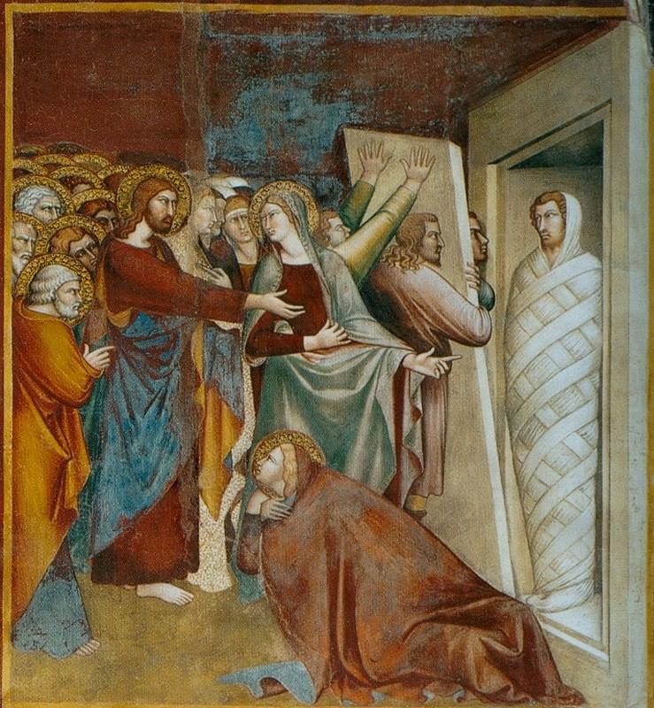
  <figcaption>Lippo Memmi and workshop (attributed), <em>Raising of Lazarus</em>, second bay of the right aisle, middle register. Fresco. San Gimignano, Collegiata di Santa Maria Assunta. Collegiata di Santa Maria Assunta, San Gimignano, public domain, via Wikimedia Commons (cropped).</figcaption>
</figure>

The Raising of Lazarus is told only in the Gospel of John (11:1–44). Lazarus of Bethany, the brother of Martha and Mary, had been dead four days when Jesus came to his tomb. Jesus ordered the stone to be taken away, called "Lazarus, come forth", and the dead man came out, bound hand and foot with grave-clothes, his face wrapped with a cloth. In John's Gospel the miracle provokes the decision of the chief priests to put Jesus to death.

In the middle band of the cycle the scene follows the Transfiguration and precedes the Entry into Jerusalem in the first bay, which in the Gospel of John immediately follows the raising of Lazarus. The two scenes together form the transition from the public life of Christ to his Passion.

Christ stands at the left centre, in a blue mantle over a red robe, and raises his right hand towards the tomb in a gesture of command. His face, in profile, is turned towards Lazarus. Behind him a dense crowd of men and women presses forward, their heads ranked one above the other, some of them looking at the tomb with expressions of astonishment.

Beside Christ stands a woman in a blue mantle, and at his feet another woman in a brown mantle kneels, bowing towards the ground. They are the two sisters of Lazarus, Martha and Mary; according to John, Mary fell at Jesus' feet when she met him. The painting does not make clear which of the two is which, and the kneeling figure is most probably Mary.

At the right stands the tomb, a pale stone structure with a doorway, whose slab is held open by two men. In the doorway Lazarus stands upright, wrapped from head to foot in white grave-clothes bound with crossing bands, only his pale face visible. His rigid, vertical figure, still bound, makes visible the moment of his return to life before he is released.

The composition is built on the diagonal from the raised hand of Christ to the standing figure of Lazarus, across the crowd. The density of the crowd at the left and the open space before the tomb at the right concentrate attention on the relation between the two protagonists.

The figures of the crowd, with their varied heads and gestures, show the narrative inventiveness of the cycle, and the white mummy-like figure of Lazarus, standing in the dark doorway, stands out in the cycle.

The scene is relatively well preserved, with legible faces and bright colours. The upper part of the crowd is slightly abraded, and there are small losses along the edges of the compartment.

#### Betrayal of Christ

<figure>
  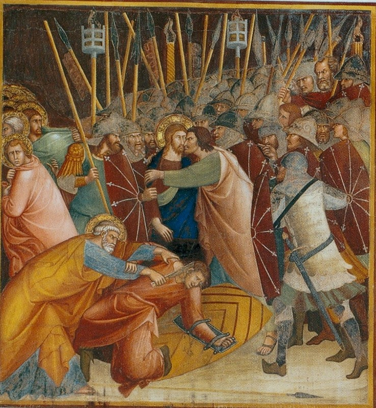
  <figcaption>Lippo Memmi and workshop (attributed), <em>Betrayal of Christ</em>, second bay of the right aisle, lower register. Fresco. San Gimignano, Collegiata di Santa Maria Assunta. Collegiata di Santa Maria Assunta, San Gimignano, public domain, via Wikimedia Commons (cropped).</figcaption>
</figure>

The Betrayal, or Kiss of Judas, follows the Agony in the Garden in the lower band of the cycle, which is read from the entrance towards the altar, and precedes Christ before Caiaphas in the third bay. According to the Gospels (Matthew 26:47–56, Mark 14:43–50, Luke 22:47–53, John 18:1–11), Judas came to the garden with a band of soldiers and officers carrying lanterns, torches and weapons, and identified Jesus by kissing him.

The scene is crowded from edge to edge. At the centre Judas, in a yellow and red mantle, embraces Christ and presses his face to his in the kiss of betrayal. Christ, in a dark blue mantle, stands still and accepts the embrace, his haloed head the only calm point in the composition.

Around them soldiers close in from both sides, seizing Christ. Above their heads rises a dense forest of lances, halberds and staves against the dark sky, among which hang two lanterns, the "lanterns and torches" of John's account, indicating that the arrest took place at night.

At the lower left an apostle in an orange mantle bends forward over a man who has fallen to the ground and cuts off his ear: the episode of Peter striking Malchus, the servant of the high priest, named in John 18:10. Malchus lies on his back across the foreground, his body foreshortened, beside a round shield.

At the right a soldier in full armour, with a helmet and a sword, stands in the foreground, and behind him soldiers carry large round red shields decorated with radiating patterns. The armour and weapons are rendered with precise detail, and they give the scene a contemporary military character.

The composition, with its dense mass of figures, its upward thrust of weapons and the violent action in the foreground, is strongly dramatic. It contrasts with the stillness of the central embrace, and the contrast between the violence of the crowd and the passivity of Christ is the expressive centre of the scene.

This intensity is one of the qualities that critics long found difficult to reconcile with the refined linearism of Lippo's signed panels, and that led them to look for a different painter, the "Barna" of the literary tradition. The Betrayal, with the Flagellation in the third bay, shows clearly the dramatic register of the cycle.

The scene is relatively well preserved, with legible faces and bright colours. The upper part, with the weapons against the dark sky, is slightly abraded, and there are small losses along the edges and at the lower right.

#### Agony in the Garden

<figure>
  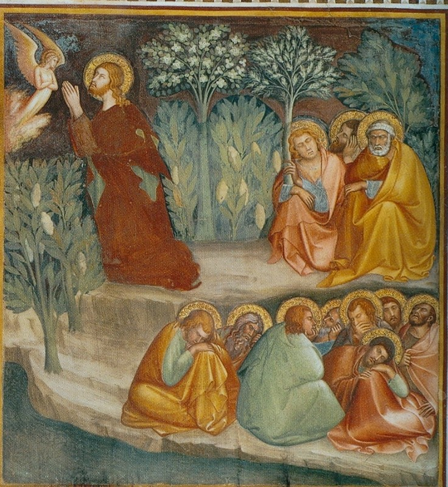
  <figcaption>Lippo Memmi and workshop (attributed), <em>Agony in the Garden</em>, second bay of the right aisle, lower register. Fresco. San Gimignano, Collegiata di Santa Maria Assunta. Collegiata di Santa Maria Assunta, San Gimignano, public domain, via Wikimedia Commons (cropped).</figcaption>
</figure>

The Agony in the Garden follows the Last Supper in the first bay and precedes the Betrayal of Christ in the same bay, in the lower band of the cycle, read from the entrance towards the altar. After the Supper Jesus went with his disciples to Gethsemane on the Mount of Olives, withdrew with Peter, James and John, and prayed that the cup might pass from him; returning, he found the disciples asleep (Matthew 26:36–46, Mark 14:32–42, Luke 22:39–46).

The scene is set in a garden on a rocky ground, with slender trees with pale, rounded foliage that rise among the rocks, an evocation of the olive grove of Gethsemane. The landscape, painted in greens and greys, fills the whole compartment and divides it into separate zones for the different groups of figures.

At the upper left Christ kneels on the rocks in a red mantle, his head turned upwards and his hands raised in prayer. In the corner of the sky above him appears a small angel, who according to Luke 22:43 came from heaven to strengthen him. The angel's figure, emerging from the edge of the scene, is the only sign of the divine answer to Christ's prayer.

At the upper right, a little apart from Christ, three apostles sit asleep against the slope: they are Peter, James and John, whom Jesus took with him and asked to watch. Their heads rest on their hands or on one another, and their sleep is rendered with gentle, relaxed poses.

In the lower part of the scene, separated from the upper zone by a ledge of rock, a larger group of apostles sleeps huddled together, their haloed heads bowed and their mantles of red, orange, green and grey pressed against each other. They are the other disciples, left at the entrance of the garden.

The composition separates the solitary figure of Christ from the sleeping disciples, expressing the abandonment that the Gospel narrative emphasizes: "Could you not watch with me one hour?" The distribution of the figures over the whole height of the scene, in different zones of the landscape, gives depth to the space and makes the garden a setting for the narrative.

The calm of the scene, with its sleeping figures and its quiet landscape, contrasts with the violence of the Betrayal in the adjacent compartment, which immediately follows it in the narrative. The two scenes together show the passage from the solitary prayer of Christ to his arrest.

The scene is relatively well preserved. The trees and the landscape retain their colours, and the faces of the apostles are legible. The upper left corner, with the angel, and the edges of the compartment show small abrasions.

### Scenes from the New Testament, third bay (San Gimignano, Collegiata)

<figure>
  
  <figcaption>Lippo Memmi and workshop (attributed; formerly "Barna da Siena"), <em>Scenes from the New Testament</em>, third bay of the right aisle: Adoration of the Magi; Calling of Peter and Andrew; Marriage at Cana; Flagellation; Christ before Caiaphas. 1330s–1340s (?). Fresco. San Gimignano, Collegiata di Santa Maria Assunta. Photo: Nicola Quirico, <a href="https://creativecommons.org/licenses/by-sa/4.0/">CC BY-SA 4.0</a>, via Wikimedia Commons.</figcaption>
</figure>

The New Testament cycle covers the right aisle wall of the Collegiata of San Gimignano, across its six bays and in three horizontal bands. The lunettes under the vaults show the childhood of Christ; the middle band, his public life and miracles; the lower band, the Passion. The Crucifixion occupies the two upper registers of the fifth bay together, and the last bay, beneath the lunette of the Flight into Egypt, holds four scenes after the Crucifixion, now partly fragmentary. Opposite, on the left aisle wall, the Old Testament cycle signed by Bartolo di Fredi and dated 1367 faces it.

The bay is the third from the entrance. Its lunette shows the Adoration of the Magi, the third of the six childhood scenes. In the middle band are the Calling of Peter and Andrew and the Marriage at Cana; in the lower band, the Flagellation and Christ before Caiaphas. The bands are read alternately in opposite directions, the lunettes and the lower band from the entrance towards the altar, the middle band from the altar towards the entrance. In this bay the lower band therefore runs from right to left, Christ before Caiaphas preceding the Flagellation, while the middle band runs from left to right, the Calling of the apostles preceding the Marriage at Cana.

The attribution of the cycle has passed from "Barna da Siena", the painter named by Ghiberti and Vasari, to Lippo Memmi and his workshop. Since the 1970s the frescoes have most often been connected with Lippo, possibly with the participation of his brother Tederigo, but the attribution rests on stylistic comparison and on the graffiti with the name Lippo found in the lower zone of the cycle, not on documents. The date is uncertain: a document of 1333 concerning paintings in the Pieve supports the 1330s, while other studies place the cycle in the early 1340s.

The structure of the bay is articulated by painted bands. A broad frieze of small white star motifs on a dark ground, bordered by red and white strips, follows the pointed arch of the lunette and separates the four square scenes, forming a grid that recalls inlaid marble work. At the springing of the arch, on each side, a small carved corbel projects from the wall. The ribs of the vault above the lunette are painted with geometric and vegetal ornament in red, white and green.

The Adoration of the Magi fills the lunette, its composition adapted to the curve of the arch. The Virgin and Child sit under a wooden shed at the left, the kings advance from the right, and the train of attendants and horses rises into the right part of the arch. The four scenes below are almost square and of equal size; their figures stand on a narrow ground plane and are set against dark blue or architectural backgrounds, so that the four compartments read as a regular sequence.

The bay brings together moments of different character: the epiphany of the Child to the kings, the call of the first disciples and the first miracle in the upper parts; the humiliation of Christ before the high priest and at the column in the lower band. The same painted frames and the same scale of the figures hold these episodes together, and the contrast between the calm scenes of the middle band and the violence of the Passion scenes is one of the expressive resources of the cycle.

The condition of the bay is uneven. The Marriage at Cana has lost a large area of plaster in the upper centre and at the lower left, where only the neutral plaster of the restoration remains; the Adoration shows abrasions in the lower part and at the right. The blue of the backgrounds and of the Virgin's mantle has darkened in places. The Flagellation and Christ before Caiaphas are better preserved, with legible faces and colours.

The bay shows the qualities on which the debate over the cycle's authorship turns. The courtly figures of the Adoration and the calm compositions of the middle band are close to the elegance associated with Simone Martini and Lippo's signed panels, while the energetic tormentors of the Flagellation and the striking soldier before Caiaphas show the dramatic force that led earlier critics to look for a different painter. The two registers may reflect different hands within one workshop, or one painter adapting his manner to the subject; the evidence does not allow a decision.

#### Adoration of the Magi

<figure>
  
  <figcaption>Lippo Memmi and workshop (attributed), <em>Adoration of the Magi</em>, lunette of the third bay of the right aisle. Fresco. San Gimignano, Collegiata di Santa Maria Assunta. Photo: Nicola Quirico, <a href="https://creativecommons.org/licenses/by-sa/4.0/">CC BY-SA 4.0</a>, via Wikimedia Commons (cropped).</figcaption>
</figure>

The Adoration of the Magi is the third of the six lunettes with the childhood of Christ, after the Annunciation and the Nativity and before the Presentation in the Temple. It follows the account of Matthew 2:1–12, in which wise men from the East, guided by a star, come to Bethlehem, worship the Child and offer him gold, frankincense and myrrh. The tradition that made them kings and represented them as three men of different ages, the oldest kneeling first before the Child, was established in Western art long before the fourteenth century.

The lunette is framed by the band of small stars that follows the pointed arch, and the composition is adapted to its shape. The holy group is placed under the lower left part of the arch, the kings occupy the centre, and the highest point of the curve is filled by the shed and by the heads of the horses at the right. The scene is set against a dark blue sky, and the ground rises at the left in a steep rocky slope.

The Virgin sits at the left under a wooden shed whose sloping roof of boards rests on thin posts; the rock behind recalls the cave of the Nativity in the Byzantine tradition. She wears a dark blue mantle over her head and holds the Child on her lap with both hands. The Child, dressed in a pale robe, leans forward towards the old king and stretches out his hand to him. The faces of the Virgin and Child are turned towards the kneeling king, who forms the centre of the action.

The oldest king kneels before the Child, bald and white-bearded, in a long pink robe with a broad gold collar and a gold border; his crown is not visible, and he bows his head close to the Child. His posture, folded into a compact mass of pink drapery, follows the curve of the lower edge of the lunette.

The second king, of mature age, stands behind him in a red robe, crowned and bearded, and holds in his left hand a round gold vessel with a lid, his gift for the Child. The third, young and beardless, with fair curling hair and a crown, wears a blue-grey robe with a gold border and holds his gift in both hands; he raises his head and looks upwards, perhaps towards the star, which is not visible in the present state of the painting. The three ages of the kings were read in the Middle Ages as the three ages of man, all called to worship Christ.

Behind the kings stands their retinue. An attendant holds a cloak with red and white stripes, perhaps the mantle of one of the kings; other young men in red and green tunics stand by the horses. At the right a brown horse with a red saddle, red harness and a gold stirrup turns its head, and above it the heads of two pale horses rise into the upper corner of the arch, their bridles held by grooms. The animals give the scene the character of a journey just ended.

The colour of the lunette is dominated by the dark blue of the sky and of the Virgin's mantle, against which the pink, red and blue-grey robes of the kings stand out. The figures are modelled with soft transitions of light and shade, and the vessels and borders are picked out in yellow and gold tones. The fine profile of the young king and the courtly elegance of his costume recall the refinement of Sienese painting in the circle of Simone Martini.

The surface is abraded in several places, especially in the lower part and in the area of the attendants and horses at the right, where the paint has partly lost its definition. The dark blue of the sky has darkened, and the lower edge of the lunette is worn. Despite these losses, the main figures remain legible, and the composition is complete.

#### Calling of Peter and Andrew

<figure>
  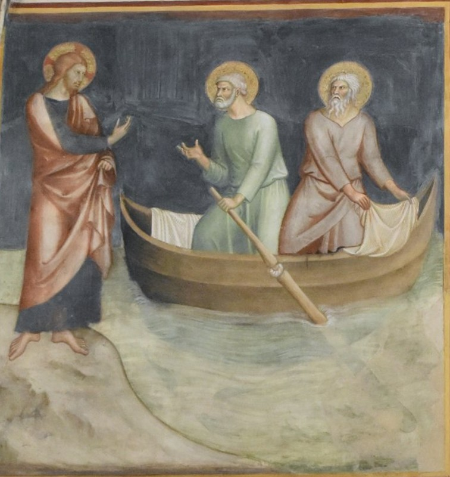
  <figcaption>Lippo Memmi and workshop (attributed), <em>Calling of Peter and Andrew</em>, third bay of the right aisle, middle register. Fresco. San Gimignano, Collegiata di Santa Maria Assunta. Photo: Nicola Quirico, <a href="https://creativecommons.org/licenses/by-sa/4.0/">CC BY-SA 4.0</a>, via Wikimedia Commons (cropped).</figcaption>
</figure>

The scene illustrates the call of the first disciples as told in Matthew 4:18–20 and Mark 1:16–18. Walking by the Sea of Galilee, Jesus saw two brothers, Simon called Peter and Andrew, casting a net into the sea, for they were fishermen, and said to them: "Follow me, and I will make you fishers of men". They left their nets at once and followed him. In the middle band of the cycle the scene comes after the Baptism of Christ and before the Marriage at Cana.

The composition is built on two elements: the standing figure of Christ on the shore at the left, and the boat with the two brothers on the water at the right. The shoreline is drawn as a long curve that runs from the lower edge to the left side of the compartment, separating the firm ground from the pale green water. Above, the sky is a uniform dark blue-black, against which the haloes and the pale robes stand out.

Christ stands barefoot on the shore, his body turned towards the boat. He wears a red mantle drawn around his body and over his left arm, over a dark blue tunic, and he raises a hand towards the two fishermen in a gesture of address. His face, framed by long brown hair and a short beard, is seen in three-quarter view, and his large gilded halo is decorated with punched ornament.

In the boat sit the two brothers, both haloed. In front is Peter, recognizable by his short grey hair and beard, the type fixed by tradition, in a green tunic. He holds a long oar whose blade enters the water near the shore, and he turns his head and an open hand towards Christ, as if answering his call. Behind him Andrew, with long white hair and a long white beard, in a pink tunic, holds with both hands the white net that he is drawing over the side of the boat.

The two brothers express the moment of the call in different ways: Peter has already turned to Christ, while Andrew is still at work with the net. The Gospel's "at once" is translated into a sequence of attitudes, from the work interrupted to the response. The boat, painted in brown with a high prow and stern, floats on water rendered with light curving strokes that suggest the movement of the waves around it.

The colour is restrained: the red of Christ's mantle, the green and pink of the fishermen's tunics and the pale tones of the water and the shore against the dark sky. The drapery of the figures falls in long, simple folds, and the forms are clearly outlined. The calm of the scene contrasts with the crowded and violent compositions of the Passion in the lower band of the same bay.

The scene is relatively well preserved. The dark sky shows some abrasions and spots, and the lower part of the water and the shore are worn, with small losses along the edges of the compartment. The faces and hands of the three figures, the gilded haloes and the boat remain legible.

The iconography of the scene, with Christ standing on the shore and the two brothers in a boat, follows a type common in Italian painting of the fourteenth century, also used for the call of the sons of Zebedee and for the miraculous draught of fishes. Here the presence of only two fishermen and the net in Andrew's hands identify the episode with the call of Peter and Andrew, as the brothers named in the Gospel text.

#### Marriage at Cana

<figure>
  
  <figcaption>Lippo Memmi and workshop (attributed), <em>Marriage at Cana</em>, third bay of the right aisle, middle register. Fresco. San Gimignano, Collegiata di Santa Maria Assunta. Photo: Nicola Quirico, <a href="https://creativecommons.org/licenses/by-sa/4.0/">CC BY-SA 4.0</a>, via Wikimedia Commons (cropped).</figcaption>
</figure>

The Marriage at Cana is the first of the signs of Christ in the Gospel of John (2:1–11). At a wedding in Cana of Galilee, at which the mother of Jesus was present, the wine ran out; Jesus told the servants to fill six stone water jars with water and to draw some out and take it to the master of the feast, who tasted the water made wine and praised the bridegroom for keeping the good wine until then. In the middle band of the cycle the scene follows the Calling of Peter and Andrew and precedes the Transfiguration.

The scene is the most damaged of the bay. A large area of plaster is lost in the upper centre, where the heads of the guests seated between Christ and the figures at the right have disappeared, together with part of the tablecloth; a second loss at the lower left has destroyed part of the servant and of the bench. The gaps are filled with neutral plaster, and small fragments of colour survive at their edges.

The composition is set behind a long table seen frontally and covered with a white cloth, on which lie round loaves, knives and glass beakers. The guests sit behind it. At the left a bearded man in a grey robe stands and holds a glass in his right hand: his position and his gesture suggest the master of the feast tasting the wine, although the identification is not certain. Beside him sit an old man with a long beard in red and Christ, haloed, in a dark blue mantle, his hand raised before his chest.

Beyond the lost area, at the right, a bearded figure in an orange robe, perhaps the bridegroom, sits behind the table with a companion whose hands are joined. The figures of the bride and of the Virgin, who must have been present at the table according to the Gospel and to the usual iconography, are not recognizable in the surviving parts and may have been in the lost area.

The lower part of the scene is devoted to the miracle itself. Six pale grey jars, swelling in the middle and with handles, stand in a row on a wooden bench in front of the table: their number corresponds to the six water jars of the Gospel. At the right a servant in a green tunic, bending forward, pours water from a large jug into the last jar; at the left a second servant in orange bends down to tip one of the jars, perhaps to draw out the wine for the master of the feast.

The arrangement translates the Gospel narrative into a sequence that runs across the scene: the servants fill the jars at the right and draw from them at the left, while above the table the master of the feast tastes the wine at the left and Christ, the author of the miracle, sits among the guests. The careful rendering of the jars, the loaves and the glasses on the table gives the scene a domestic precision characteristic of Sienese narrative painting of the period.

The colour combines the white of the tablecloth and the grey of the jars with the red, orange, green and blue of the robes. The modelling of the jars, with their highlights and shadows, is a careful passage of still life. The surviving faces, especially those of the old man and of Christ, show the long noses, narrow eyes and pronounced brows found throughout the cycle.

Beyond the two large losses, the surface is abraded in the robes of the guests, and small flakes of colour are missing from the jars and the bench. The upper edge of the compartment is also damaged. In its present state the scene preserves the essential elements of the miracle, the jars, the servants and Christ, but not the full company of the wedding.

#### Flagellation

<figure>
  
  <figcaption>Lippo Memmi and workshop (attributed), <em>Flagellation</em>, third bay of the right aisle, lower register. Fresco. San Gimignano, Collegiata di Santa Maria Assunta. Photo: Nicola Quirico, <a href="https://creativecommons.org/licenses/by-sa/4.0/">CC BY-SA 4.0</a>, via Wikimedia Commons (cropped).</figcaption>
</figure>

The Flagellation follows Christ before Caiaphas in the lower band of the cycle, which is read from the entrance towards the altar, and precedes the Crowning with Thorns. The Gospels record the scourging briefly: Pilate, having released Barabbas, had Jesus scourged before handing him over to be crucified (Matthew 27:26, Mark 15:15, John 19:1). The painters of the fourteenth century expanded this short notice into an image of physical suffering, set in a hall of justice before the judge and the accusers.

The scene takes place in a hall with a Gothic arcade of slender columns and pointed arches at the left. Behind the main figures hangs a red cloth of honour with a dense pattern and a green fringe, the sign of a seat of authority, and above it rises a row of spears held by guards who remain out of sight. The pale floor, seen in perspective, extends to the lower edge.

Christ stands at the centre, bound to a thin column with a striped shaft that rises to the top of the compartment. He is naked except for a white loincloth, his arms drawn behind him around the column, his head inclined towards his shoulder under a gilded halo. His body is pale and slender, painted with soft modelling, and his face shows suffering without contortion, in contrast with the violence of the men around him.

Two tormentors strike him from either side. At the left a man in a short yellow tunic, bending forward with legs apart, swings his arm back to bring down the scourge; at the right a man in a green tunic, seen from behind, raises his arm against Christ. Their bodies, bent and twisted in effort, are rendered with an energy that has been regarded as distinctive of the cycle.

Behind, on a raised step, stands a tall figure crowned with a wreath, in a long pink robe and a mantle, who extends one hand towards Christ and raises the other in a gesture of speech. His position and dignity identify him as Pilate, the Roman governor who ordered the scourging, presiding over the execution of his sentence.

At the right a group of old men with long beards and covered heads watches the scene, pressing together and turning to one another. The nearest, in a pale pink and white mantle over a green robe, stands with his back half turned to the viewer. They represent the chief priests and elders who had accused Jesus before Pilate, and their presence links the Flagellation with the trial that precedes it.

The colour is dominated by the pale tones of the floor, the column and the body of Christ, set off by the yellow and green of the tormentors and by the red of the cloth of honour. The architecture of the hall, the spears and the cloth of honour create a shallow stage behind the figures, a solution used throughout the Passion scenes of the cycle to set the action in front of a backdrop.

The scene is among the better preserved of the bay. The faces and the body of Christ remain clear, and the colours are bright. The surface shows small abrasions and losses in the lower part, at the feet of the figures, and in the upper left corner, where the arcade and the guards' heads are partly worn.

#### Christ before Caiaphas

<figure>
  
  <figcaption>Lippo Memmi and workshop (attributed), <em>Christ before Caiaphas</em>, third bay of the right aisle, lower register. Fresco. San Gimignano, Collegiata di Santa Maria Assunta. Photo: Nicola Quirico, <a href="https://creativecommons.org/licenses/by-sa/4.0/">CC BY-SA 4.0</a>, via Wikimedia Commons (cropped).</figcaption>
</figure>

After his arrest in the garden of Gethsemane, Jesus was led to the house of Caiaphas, the high priest, where the scribes and elders had gathered. According to Matthew 26:57–68, when Jesus declared that they would see the Son of Man seated at the right hand of Power, the high priest tore his clothes and said that he had spoken blasphemy, and those present declared him deserving of death. In the lower band of the cycle the scene follows the Kiss of Judas and precedes the Flagellation.

The high priest sits at the centre on a massive throne of grey stone, raised on steps and seen frontally, against a dark rocky background. He is an old man with white hair and a long white beard, wrapped in a red mantle over a dark robe. With both hands he appears to grasp the neck of his robe, in the gesture of tearing his garments described by the Gospel. His face, framed by the beard, is severe and frontal, and his eyes look out towards the viewer.

At the left, below the throne, stands a dense group of elders and scribes with long beards and covered heads, turned towards the high priest. The nearest, in a grey-green mantle over a yellow robe, stands in profile. The others are visible only as heads, ranked one behind the other, a device that suggests a crowd in a limited space.

At the right Christ is brought before the throne. He wears a dark blue mantle, and his head, with long hair and beard under a gilded halo, is slightly inclined. He is surrounded by soldiers in armour and helmets, one of whom carries a large round shield, and behind them rises a forest of lances, spears and halberds that fills the upper right part of the scene, the sign of the armed band that had arrested him.

A man in a short brown tunic, standing between the throne and Christ, raises an arm high above his head to strike him. The gesture recalls the episode in John 18:22, in which one of the officers struck Jesus with his hand for answering the high priest, and in the fresco it becomes the dramatic centre of the right side of the composition, its diagonal leading the eye from Christ to the high priest.

The composition is organized symmetrically around the throne, with the elders at the left and Christ and his captors at the right, but the symmetry is broken by the movement of the right side, where the striking arm and the bristling lances contrast with the stillness of the elders and of the high priest. The figure of Christ, quiet and inclined amid the soldiers, is the counterpart of the frontal and rigid high priest.

The colour opposes the red of the high priest's mantle at the centre to the dark blue of Christ's mantle and the grey-green, yellow and brown of the other figures, against the grey of the throne and the dark background. The faces of the elders and soldiers are individualized, with prominent noses and heavy brows, a feature that has been connected with the expressive realism of the cycle.

The scene is relatively well preserved, with legible faces and colours. The dark background above the throne is abraded, and there are small losses along the edges of the compartment and in the lower part, at the feet of the figures. The upper right area with the lances and halberds is partly worn, but the outline of the weapons remains clear.

### Baptism of Christ, fourth bay (San Gimignano, Collegiata)

<figure>
  
  <figcaption>Lippo Memmi and workshop (attributed; formerly "Barna da Siena"), <em>Baptism of Christ</em>, fourth bay of the right aisle, middle register. Fresco. San Gimignano, Collegiata di Santa Maria Assunta. Photo: Holger Uwe Schmitt, <a href="https://creativecommons.org/licenses/by-sa/4.0/">CC BY-SA 4.0</a>, via Wikimedia Commons.</figcaption>
</figure>

The Baptism of Christ belongs to the middle band of the cycle, which narrates the public life of Christ and is read from the altar towards the entrance. It is in the fourth bay, next to the Crucifixion, and precedes the Calling of Peter and Andrew in the third bay. All four Gospels record the baptism of Jesus by John in the river Jordan (Matthew 3:13–17, Mark 1:9–11, Luke 3:21–22, John 1:29–34), the event that opened his public ministry.

Christ stands frontally in the river, naked, the green water rising to his hips and making his legs visible beneath its transparent surface. His body is slender and pale, modelled with soft light, and his face, framed by long hair and a short beard under a gilded halo, looks out at the viewer. He raises his right hand before his breast in a gesture of blessing, sanctifying the water in which he stands.

At the right, on a rocky bank that descends steeply to the water, stands Saint John the Baptist, haloed, with long dark hair and beard. He wears a garment of camel skin, rendered with long brown strands, tied at the waist with a white cord, and over it a red mantle. Leaning forward, he raises a small bowl and pours water over Christ's head, the gesture of baptism by infusion common in medieval images of the scene.

At the left two angels with large wings, haloed and fair-haired, stand on the bank and hold Christ's garments, a white cloth and a red robe, ready to clothe him. The motif of the angels as attendants, holding the clothes, developed in Byzantine art and was widely adopted in Italian painting of the thirteenth and fourteenth centuries.

The river is painted as a broad green expanse that fills the lower part of the scene, its surface marked by light strokes and small fish swimming among the waves. The rocky bank at the right, pale and steep, forms a diagonal that leads from the Baptist down to the water and closes the composition.

The dark blue sky, against which the figures stand out, recalls the backgrounds of the scenes in the third bay. The dove of the Holy Spirit and the hand of God, which often appear above Christ in the Baptism, are not visible in the present state of the painting; they may have been lost or never represented.

The composition is calm and balanced, with the vertical figure of Christ at the centre between the Baptist and the angels. The restraint of the gestures and the clear, luminous colour contrast with the crowded and dramatic scenes of the Passion in the band below, and show the range of the cycle.

The scene is well preserved, with bright colours and legible figures; the blue of the sky is abraded in places. The painted frame of star motifs survives intact around the scene, and at the upper right corner a carved corbel marks the springing of the vault.

### Way to Calvary, fourth bay (San Gimignano, Collegiata)

<figure>
  
  <figcaption>Lippo Memmi and workshop (attributed; formerly "Barna da Siena"), <em>Way to Calvary</em>, fourth bay of the right aisle, lower register. 1330s–1340s (?). Fresco. San Gimignano, Collegiata di Santa Maria Assunta. Photo: LivioAndronico, <a href="https://creativecommons.org/licenses/by-sa/4.0/">CC BY-SA 4.0</a>, via Wikimedia Commons.</figcaption>
</figure>

The Way to Calvary belongs to the lower band of the New Testament cycle on the right aisle wall of the Collegiata, which narrates the Passion from the entrance towards the altar. The lower band, read from right to left, contains eight scenes over the first four bays: the Last Supper, the Pact of Judas, the Agony in the Garden, the Betrayal, Christ before Caiaphas, the Flagellation, the Crowning with Thorns and the Way to Calvary. The Way to Calvary is the last of them, in the fourth bay beside the Crowning with Thorns, and it leads to the Crucifixion, which fills the two upper registers of the fifth bay.

The Gospels record the carrying of the cross briefly. John (19:17) states that Jesus went out bearing his own cross to the place called Golgotha; the Synoptic Gospels add that the soldiers compelled Simon of Cyrene to carry it (Matthew 27:32, Mark 15:21, Luke 23:26), and Luke (23:27–31) tells of the women who followed him lamenting. Fourteenth-century painters expanded these notices into a crowded procession, drawing also on devotional texts that dwelt on the suffering of Christ and the grief of his mother.

Christ is at the centre of the scene, in a long brownish-red robe, barefoot, carrying a large cross on his left shoulder. His face, framed by long hair and a short beard under a gilded halo, is turned towards the viewer with a calm and sorrowful expression. A rope is tied around his neck, and a soldier in green scale armour at the left, seen from behind, drags him forward by it, while another figure grasps his arm.

Behind Christ a man in a short pink-red tunic, with a coarse, scowling face, pushes him forward with both hands and leans against the cross. Since he drives Christ forward instead of relieving him of his burden, he is more probably one of the executioners than Simon of Cyrene; the identification is not certain.

Around Christ the crowd presses in. Soldiers in dark helmets carry lances whose points rise against the dark sky; one man holds a hammer, another, in an orange tunic, a bundle of nails for the Crucifixion. A white-bearded old man in a white turban, perhaps one of the elders or priests, looks on with a hostile expression. Above the heads of the crowd two other crosses, for the two thieves, and a long ladder are carried towards Calvary, so that the instruments of the Crucifixion precede the event.

At the right, beneath the crenellated pink walls and the arched gate of Jerusalem, the Virgin and the holy women follow the procession. The Virgin, in a dark blue mantle, stretches out her hands towards her son, her face contracted with grief, and the women around her weep and lament. A soldier holds out his sword towards them, barring their way, a motif that expresses the separation of the mother from her son.

The composition moves from right to left, from the city gate towards the left edge of the scene, which corresponds to the direction of the narrative in the lower band. The diagonal of the cross, rising from the lower left to the upper right, crosses the whole scene and joins the mourning women at the right with the violent crowd at the left. The expressive faces of the executioners and the soldiers, close to caricature, give the scene the dramatic intensity characteristic of the cycle.

The scene is well preserved, with bright colours and legible faces. The gold of the haloes is partly worn, the helmets of the soldiers have darkened, and there are small losses in the lower part and along the painted border, whose corners show small medallions with animals.

### Crucifixion and Massacre of the Innocents, fifth bay (San Gimignano, Collegiata)

<figure>
  
  <figcaption>Lippo Memmi and workshop (attributed; formerly "Barna da Siena"), <em>Massacre of the Innocents</em> (lunette) and <em>Crucifixion</em>, fifth bay of the right aisle. 1330s–1340s (?). Fresco. San Gimignano, Collegiata di Santa Maria Assunta. Photo: Holger Uwe Schmitt, <a href="https://creativecommons.org/licenses/by-sa/4.0/">CC BY-SA 4.0</a>, via Wikimedia Commons.</figcaption>
</figure>

The fifth bay contains the largest scene of the cycle, the Crucifixion, which occupies the height of both the middle and the lower bands, about four times the size of the other compartments. Above it, in the lunette, is the Massacre of the Innocents, one of the six scenes of the childhood of Christ.

The lunette shows the Massacre of the Innocents ordered by Herod after the visit of the Magi (Matthew 2:16–18). Herod sits enthroned at the top of the composition, in the apex of the arch, and points downwards, giving the order. Below him soldiers, one in a scaled cuirass, stab infants and tear them from their mothers, and at the centre a heap of dead infants lies on the ground. At the right a mother sits with her dead child across her lap, raising her hand in lament, a figure that recalls the words of Matthew on Rachel weeping for her children.

The Crucifixion is set against a red ground. Christ hangs dead on the tall central cross, his head inclined, with the titulus above, and angels fly around the cross in grief. The two thieves hang on lower crosses at either side. Above the cross of the thief at the left, the penitent thief, angels receive his soul; above the thief at the right, demons with bat wings wait for his.

Horsemen and soldiers fill the middle of the scene. On a grey horse at the left of the cross a soldier in green pierces Christ's side with a lance, the episode of Longinus (John 19:34); at the right a horseman in yellow raises a club against the thief, the breaking of the legs (John 19:32). A haloed bearded man in red and white at the right points up towards Christ: the centurion who declared, "Truly this was the Son of God" (Matthew 27:54). A red banner rises behind the soldiers at the right, inscribed with letters that may read SPQR, the emblem of Rome.

At the lower left the Virgin has fainted and is supported by the holy women, with Saint John standing beside them in a red mantle. Behind them presses a crowd of women and children. At the bottom centre a group of men crouch and struggle over Christ's garment, the soldiers who divided his clothing (John 19:23–24).

The composition is divided into two zones: the upper zone with the crosses, the angels and the demons against the red sky, and the lower zone with the crowded earth, the horsemen, the soldiers and the mourners. The three crosses rise above the crowd, and the central cross dominates the scene, its vertical line continued downwards by the lance and the figures at its foot.

The scale and complexity of the Crucifixion, with its many figures and episodes drawn from the four Gospels, make it the focal point of the cycle and the culmination of the Passion narrated in the lower band. The contrast between the stillness of the crucified Christ and the agitation of the horsemen, the soldiers and the mourners gives it the dramatic intensity that characterizes the whole cycle.

The bay is relatively well preserved, with intense colours and legible figures. The red ground of the Crucifixion is abraded in places, revealing the blue beneath, and the lower part shows losses at the centre, among the figures struggling over the garment. The vault above, painted with gold stars on a blue ground and with patterned ribs, survives with its decoration.

### Crucifixion, detail with the Swooning Virgin (San Gimignano, Collegiata)

<figure>
  
  <figcaption>Lippo Memmi and workshop (attributed; formerly "Barna da Siena"), <em>Crucifixion</em>, detail with the swooning Virgin, 1330s–1340s (?). Fresco. San Gimignano, Collegiata di Santa Maria Assunta, right aisle wall. Photo: Nicola Quirico, <a href="https://creativecommons.org/licenses/by-sa/4.0/">CC BY-SA 4.0</a>, via Wikimedia Commons.</figcaption>
</figure>

The detail belongs to the Crucifixion of the New Testament cycle on the right aisle wall of the Collegiata of San Gimignano. In a sequence of scenes from the life and Passion of Christ, the Crucifixion is the largest compartment, about four times the size of the others. The group of the swooning Virgin is set beneath the cross, in front of the crowd of onlookers and horsemen that fills the ground of Calvary. The legs of a horse at the upper right of the detail belong to the mounted figures around the cross.

The authorship of the cycle has long been debated in connection with his name. Ghiberti and Vasari named its painter "Barna", a figure without documented works; <a href="/scholars.html#bacci-peleo">Peleo Bacci</a> in 1927 reported the graffito "Lippo me pinse" in the lower zone of the frescoes; and since Antonino Caleca's studies of the 1970s the cycle has most often been given to Lippo and his workshop, possibly with his brother Tederigo among the collaborators. The date is equally uncertain. A document of 1333 concerning paintings for the Pieve supports the 1330s, while other scholars place the cycle in the early 1340s.

The Virgin has fainted at the sight of her crucified Son and sinks backwards, her body abandoned in a long diagonal from the head at the centre of the detail to the knees at the lower right. Her eyes are closed and her lips parted, her face pale and bloodless. A white veil frames her face beneath a dark red-brown mantle drawn over her head, and under it she wears a blue-grey dress. One arm lies inert across her lap, the hand turned inwards, and a bare foot appears from beneath the blue folds at the bottom of the group.

To the left a haloed woman with loose fair hair, kneeling and wrapped in a large grey-green mantle over an orange-yellow dress, holds the Virgin's head in both hands. Her brows are raised and her mouth open in a cry. Behind the Virgin a second haloed woman, in a mauve-brown veil and dress, bends over her with knitted brows and open mouth, and lays a hand on her breast. Neither woman carries an attribute, and the scene does not allow them to be named with certainty among the Maries of the Gospel accounts.

At the right a fourth haloed figure kneels in profile, with long fair hair falling over the shoulders, a red-brown mantle and hands clasped in grief, the mouth open. The type, youthful and beardless, corresponds to that of Saint John the Evangelist, who in the Gospel of John stands at the foot of the cross with the Virgin; but loose fair hair is also an attribute of Mary Magdalene, and the identification of this figure, like that of the woman at the left, is not secure.

The holy figures are surrounded by bystanders. Above them, in the upper left part of the detail, a crowd of women in white turbans and fair hair braided around the head turn their faces upwards to the cross; one wears over her shoulder a white cloth with a fringed border woven with an interlaced pattern. A woman in a blue hood and white wimple looks out to the right. A bearded man in a white turban with green stripes and a pale green robe bends down towards the Virgin with his hands raised, the only bystander who looks at her. Children with headbands look out from behind the holy women at the left and at the right, one of them held by the shoulder by an adult whose hand alone is visible.

The contrast between the two zones is deliberate: the upper crowd watches the Crucifixion, while the lower group is closed in on itself around the fainting Virgin. The motif of the Virgin's swoon, absent from the Gospels, developed in late medieval devotional literature and became frequent in Italian Crucifixions of the fourteenth century, where it gave the Virgin a share in the Passion of her Son. The open mouths, contracted brows and gestures of grief give the scene the dramatic intensity that critics have long found difficult to reconcile with the refined linearism of Lippo's signed panels.

The haloes of the holy figures are gilded and decorated with a ring of punched rosettes. The painting retains much of its colour, but the surface shows abrasions and losses in the mantles, particularly in the blue-grey dress of the Virgin and the green mantle of the woman at the left, where the darker layers have partly flaked and the underlying tone shows through. The lower edge of the detail is worn. The faces, in contrast, are well preserved and show a precise drawing of eyes and brows and a soft modelling of the flesh.

### The End of the Cycle: the Sixth Bay (San Gimignano, Collegiata)

The sixth bay, the last of the right aisle wall towards the altar, closes the New Testament cycle. Its lunette shows the Flight into Egypt, the last of the six scenes of the childhood of Christ, which follows the Massacre of the Innocents in the lunette of the fifth bay. In the account of Matthew (2:13–15) an angel warns Joseph in a dream to take the Child and his mother and flee into Egypt, where they remain until the death of Herod. The lunette thus completes the sequence that begins with the Annunciation in the first bay.

Below the lunette, the two bands of the bay hold four scenes, two in each band, of the events after the death of Christ: the Deposition from the Cross, the Descent into Limbo, the Resurrection and Pentecost. They carry the narrative from the Crucifixion of the fifth bay to the foundation of the Church through the gift of the Holy Spirit. Their condition is poor: the Deposition is largely lost and the Descent into Limbo is fragmentary. One account in English describes all four scenes as destroyed in the fifteenth century, but Italian descriptions of the church list them as surviving, and their state is better described as fragmentary.

The cause of the damage has not been established in the sources consulted. The fifteenth-century building works in the church, including the vaulting of the nave between 1464 and 1473, the extension of the choir and the chapel of Santa Fina opened in the right wall from 1468, are not recorded as having affected this bay, and the chapel lies beyond it. The church and its frescoes also suffered considerable damage in the Second World War, when shells struck the building in July 1944, but no source connects that damage specifically with the sixth bay. The counts of the cycle in the reference works, which speak of nineteen compartments and of four fragmentary scenes, reflect the present state of the wall.

Even in its present state the cycle forms an extensive narrative ensemble: the childhood of Christ in six lunettes, his public life and miracles in the middle band, the Passion in eight scenes in the lower band and the Crucifixion at the culmination. Its attribution to Lippo Memmi and his workshop, its date in the 1330s or early 1340s and the role of the literary figure of "Barna" remain debated; on the opposite wall, the Old Testament cycle signed by Bartolo di Fredi and dated 1367 completes the decoration of the aisles.

### Virgin and Child over Saints Helen, Paul, Dominic, Stephen (?) and a Dominican Nun (Boston, Isabella Stewart Gardner Museum)

<figure>
  
  <figcaption>Simone Martini (and Lippo Memmi?), <em>Virgin and Child over Saints Helen, Paul, Dominic, Stephen (?) and a Dominican Nun</em>, c. 1325. Tempera and tooled gold on panel, 33.4 × 25.4 × 4.4 cm with engaged frame (painted surface 28.4 × 20.1 cm). Boston, Isabella Stewart Gardner Museum, P30w8. Possibly from the convent of San Paolo, Orvieto. Photo: Isabella Stewart Gardner Museum, Boston (<a href="https://gardnermuseum.emuseum.com/objects/1948/virgin-and-child-over-saints">gardnermuseum.org</a>).</figcaption>
</figure>

The small panel in the Isabella Stewart Gardner Museum entered the collection as a work of Lippo Memmi and is now catalogued by the museum under the name of Simone Martini. Isabella Stewart Gardner bought it from the Florentine dealer Stefano Bardini on 6 October 1897 for 6,000 lire, as Lippo's work, and the attribution to Lippo was kept in the museum's catalogue of 1931 and in several later publications. Its history before 1897 is unknown.

The change of attribution came in the second half of the twentieth century, when the panel was given to Simone himself in 1956 and again by Miklós Boskovits in 1986. More recent studies have returned part of it to Lippo: a monograph on Simone of 2003 and the catalogue of the exhibition on Simone's Orvieto works held at the Gardner Museum in 2022 assigned it to Simone and Lippo together. The panel thus stands at the point where the two painters' workshops are most difficult to separate, and its place in Lippo's catalogue depends on that joint attribution.

The date is given by the museum as about 1325 and by the 2022 catalogue as about 1330. This places the panel in the years of the closest collaboration between the two brothers-in-law, before the Annunciation of 1333 that they signed together, and in the period of the Orvieto commissions of Simone's workshop. The museum records it as possibly coming from the Dominican convent of San Paolo at Orvieto, and a recent study has proposed that it was painted for a Dominican nun of the Trasmondo family in that convent; no document confirms either the provenance or the patron.

The Virgin, shown in half length, fills almost the whole height of the painted field. She wears a deep blue mantle edged with gold over a white veil and a red dress, with a gold star on her shoulder, and inclines her long pale face towards the Child. The type, with heavy-lidded eyes, a small mouth and a gaze that does not meet the Child's, is the one found in Lippo's small Madonnas in Berlin, Altenburg and Washington, which share the star on the shoulder and the withdrawn expression; it is also the type of Simone's own Madonnas, and the similarity is one of the reasons for the shifting attribution.

The Child sits on the Virgin's left arm in a pale blue tunic, with a rose-pink mantle wrapped around his legs and gathered at his chest, and grasps a fold of the pink cloth while looking out at the viewer. The Virgin's right hand supports his feet. The blue and pink of his garments soften the dark mass of the mantle. The gold ground is framed by broad bands of punched lozenges and quatrefoils, and the haloes are densely tooled, a feature shared with the panels of Simone's workshop in the 1320s.

Below the Virgin a narrow predella of five arches on twisted colonnettes contains tiny full-length figures. From left to right they are a crowned female saint with a cross, identified as Saint Helen; Saint Paul with his sword; Saint Dominic in the habit of his order, with a lily and a red book, under the central arch; a young deacon in a red dalmatic with a book, probably Saint Stephen; and a kneeling nun in a black habit, in profile, with her hands raised in prayer. The figures are full-length, not busts, and the donor is a woman.

The kneeling nun, without a halo and placed among the saints, presents herself as the owner of the image. The presence of Saint Dominic at the centre and of a Dominican nun as patron links the panel to the Dominican milieu with which much of Lippo's work is associated, from the Triumph of Saint Thomas Aquinas in Pisa to the late fresco in the cloister of San Domenico in Siena.

The combination of a half-length Madonna with a miniature predella of saints and a donor adapts the structure of a large altarpiece to a panel made for private prayer. Whether the invention belongs to Simone, to Lippo, or to their collaboration cannot be decided on present evidence. For Lippo's catalogue, the panel is best treated as a work shared with Simone, whose design and execution reflect the common practice of the two workshops in the second half of the 1320s.

### Virgin and Child with a Bishop Saint and Saint John the Baptist (Kansas City, Nelson-Atkins Museum of Art)

<figure>
  
  <figcaption>Simone Martini (formerly attributed to Lippo Memmi), <em>Virgin and Child with a Bishop Saint (Augustine?) and Saint John the Baptist</em>, c. 1325–1330. Tempera and gold leaf on panel, 47.9 × 39 cm overall. Kansas City, Nelson-Atkins Museum of Art, F61-62, gift of the Samuel H. Kress Foundation. Photo: Daderot, public domain, via Wikimedia Commons.</figcaption>
</figure>

The panel in Kansas City was long attributed to Lippo Memmi and is now catalogued by the Nelson-Atkins Museum of Art under the name of Simone Martini, with a date of about 1325–1330. Its case is parallel to that of the small Virgin and Child in the Isabella Stewart Gardner Museum: a refined devotional panel first given to Lippo and later restored to Simone, which shows how closely the two painters' workshops worked in the second half of the 1320s. The Italian reference works on Lippo still include it in his catalogue, placing it after 1333, a date that the museum's catalogue does not support.

The history of the panel is known only from the twentieth century. It belonged to Henri Simon in Bordeaux and was with Wildenstein and Co. in New York by April 1940. Samuel H. Kress bought it at the end of 1942, and the Samuel H. Kress Foundation gave it to the museum in Kansas City in 1961, as part of the distribution of the Kress collection among American regional museums. Its origin and its first owner are not known.

The Virgin is shown in half length, her head inclined towards the Child under a large halo tooled with radiating and beaded ornament. She wears a black mantle drawn over her head, patterned all over with gold palmettes and edged with a band of ornament, lined in green, over a white veil and a red dress. On her breast a gold radiant ornament marks the dress. Her face is long and pale, with heavy-lidded eyes, and she looks out of the picture with a grave and sorrowful expression, not at the Child.

The Child sits on the Virgin's left arm, in a white shirt and a pink-red mantle wrapped around his legs. He turns his head up towards his mother and with his right hand pulls the edge of her white veil, which he draws out from beside her cheek; in his left hand he holds a small rolled scroll. The Virgin's right hand, with long slender fingers, rests under his legs, while her left arm supports him. The gesture of the veil, a motif of tender familiarity, recurs in Sienese small panels of these years, and the National Gallery of Art reads the same gesture in Lippo's Madonna with a donor in Washington as a foreshadowing of the shroud.

In the upper corners of the gold ground, two roundels framed by tooled bands contain half-length saints. At the left is a bishop with a mitre and a book, in red and gold vestments; the museum does not name him, while the Italian reference works identify him as Saint Augustine. His face has darkened, and the identification cannot be checked against an attribute. At the right is Saint John the Baptist, with long hair and beard and a red mantle, who extends his hand beyond the edge of his roundel and points down towards the Child, the gesture with which he announces Christ.

The gold ground is articulated by tooled arches that follow the outline of the Virgin's halo and the two roundels, and by bands of punched ornament along the edges. The dense punching of the haloes, with rows of small rings and radiating motifs, belongs to the repertory of Simone's workshop in the 1320s, which was shared with Lippo and is one of the reasons why the attribution between the two painters remains difficult.

The black mantle with gold palmettes departs from the blue mantle that the Virgin wears in Lippo's other small panels. The dark colour may reflect the alteration of an original blue pigment, a common phenomenon in panels of this period, or a deliberate choice of a precious textile; the question has not been verified against a technical study. The pink and white of the Child and the red of the Virgin's dress stand out against the dark mantle, and the green lining marks its edges.

The panel is shown in a broad gilded frame. The gold ground is worn in places, revealing the red bole beneath, especially at the right, and there are small losses in the gilding at the edges and in the roundels. The faces of the Virgin and Child are well preserved, while the bishop's face has darkened. In Lippo's catalogue the panel is best listed as a work formerly attributed to him, now given to Simone by its museum, in the same group as the Gardner panel.

### The Polyptych of San Francesco, San Gimignano (dispersed)

The Saints Louis of Toulouse, Francis, Peter, John the Evangelist and Paul, together with the Saint John the Baptist in the National Gallery of Art in Washington, are the surviving saints of the main register of a large polyptych painted for the Franciscans of San Gimignano. Their dispersal among Siena, Paris, New Haven, New York and Washington has made the reconstruction of the altarpiece a long-standing problem of Sienese painting of the fourteenth century, and its history, its centre and its authorship are still debated. What is not in doubt is the coherence of the six lateral panels: they share the same format, a pointed arch with an inner trefoil, the same scale of half-length figures and the same system of punched decoration.

The main register consisted, according to the reconstruction now generally accepted, of seven compartments: a central Virgin and Child, now lost or not identified, flanked on each side by three standing saints in half length. The surviving saints are Louis of Toulouse and Francis of Assisi<a href="/endnotes.html#fn-francis-assisi" class="footnote">13</a> in the Pinacoteca Nazionale of Siena, Peter in the Musée du Louvre, John the Evangelist in the Yale University Art Gallery in New Haven, Paul in the Metropolitan Museum of Art in New York, and John the Baptist in Washington. The presence of the two Franciscan saints, Francis and Louis, points to a Franciscan church, while the two Johns and the two princes of the apostles follow the usual order of honour of the great Tuscan polyptychs.

The Louvre describes its Saint Peter as the right lateral panel of the altarpiece, and the arrangement of the saints is otherwise uncertain. Analogy with other Sienese polyptychs suggests that Peter and Paul stood on either side of the centre, with the Franciscan saints towards the outer edges, but the sequence is not documented. The panels differ slightly in their present dimensions, from about 89 by 42 centimetres for the painted surface of the Saint Paul to about 105 by 46 centimetres for the two panels in Siena, differences that partly reflect the loss or survival of the original edges and frames.

Above the main register stood a second order of smaller panels with half-length saints. A series of five has been associated with the polyptych since the 1970s: Saint Clare<a href="/endnotes.html#fn-chiara-assisi" class="footnote">14</a> in the Metropolitan Museum, Saint Elizabeth of Hungary in the Museo Poldi Pezzoli in Milan, Saints Agnes and Anthony of Padua in the Frick Art Museum in Pittsburgh, and Saint Mary Magdalene in the Museum of Art of the Rhode Island School of Design in Providence. A sixth panel in a private collection has been added more recently; the Washington and Yale catalogues identify it as a Saint Augustine in the Salini collection near Asciano, the Louvre as a Saint Gimignanus, the patron of the town. The central panel of the upper register is missing.

The central Virgin and Child remains in dispute. A reconstruction of the 1930s proposed the Virgin and Child in the Gemäldegalerie in Berlin (no. 1067), and the proposal was accepted by several later studies. Doubts were raised in 1977 on the basis of differences in the punched decoration; Miklós Boskovits first agreed with them and later suggested again that the Berlin panel might belong to the altarpiece. The Yale catalogue rejects it, because its marginal punchwork and its engaged moulding are incompatible with the colonnettes that framed the lateral panels, and the Louvre states that most specialists no longer regard it as the centre of the polyptych.

The Yale catalogue has also considered the Virgin and Child from Lucignano d'Arbia, now in the Pinacoteca Nazionale of Siena and attributed to Simone Martini, whose height from the base to the spring of the arch is identical to that of the Saint John the Evangelist. The traces of the battens on the back, however, do not align with those of the lateral panels, and the panel is therefore unlikely to have been the centre, although it may reflect the appearance of the lost Virgin. The question of the central panel thus remains open.

The polyptych was long thought to come from the church of San Francesco at Colle di Val d'Elsa, where the two Siena panels are documented in 1865 before their transfer to Siena in 1867. In the 1990s a study of the Franciscan settlements of the area proposed that this was a secondary location. The Franciscans of San Gimignano had their church outside the walls of the town; when it was destroyed in 1553, they moved to the church of San Giovanni Battista inside the walls, where they remained until 1782. After the suppression of their chapter, they were transferred in 1787 to Colle di Val d'Elsa, presumably with the furnishings of their church.

According to this reconstruction, now accepted by the Louvre, the Metropolitan Museum, the National Gallery of Art and the Yale University Art Gallery, the altarpiece was painted for the high altar or a principal altar of San Francesco in San Gimignano, the town where his father had worked and where Lippo had painted the Maestà of the Palazzo Comunale in 1317. The church at Colle would have been only a place where the panels were gathered in the nineteenth century, as the Louvre's own record puts it. No document of the commission has been found, and the reconstruction rests on the provenance of the panels and on the Franciscan saints.

An older hypothesis connected the panels with the polyptych that Vasari saw signed by Lippo in San Paolo a Ripa d'Arno in Pisa, with the Virgin, Saints Peter and Paul, Saint John the Baptist and other saints. The coincidence of these saints suggested that the dispersed panels might belong to that altarpiece. The hypothesis was rejected in the 1970s, and the surviving fragments of the Pisan polyptych, among them the seated Saint John the Baptist in Altenburg, show a different structure, with enthroned saints, so that the two altarpieces must be kept distinct.

The panels were dispersed in the course of the nineteenth century. The Saint Peter was bought by the Louvre in 1864 from the Florentine dealer William Blundell Spence; the Saint Paul was given to the Metropolitan Museum by the Coudert Brothers in 1888; the Saint John the Evangelist passed through the collection of Giulio Sterbini in Rome, the Paris dealer Godefroy Brauer, Bernard Berenson and other owners before reaching Maitland Fuller Griggs in New York, who bequeathed it to Yale; the Saint John the Baptist was in the collection of the Graf von Oriola in Germany before it was acquired by the Kress Foundation. Only the two Franciscan saints remained in Italy.

The attribution of the panels has followed the general history of Lippo's catalogue. For a long time they were given to Simone Martini or to followers of Simone, and in the 1930s the Saint Paul was briefly assigned to "Barna". From the early 1950s the group was increasingly attributed to Lippo Memmi, and that attribution is now shared by the Louvre, the Metropolitan Museum, the National Gallery of Art and the Yale University Art Gallery, the latter with the qualification of Simone's workshop in its online record. For the two Siena saints the hand of the Pisan painter Francesco Traini has also been proposed.

Opinions differ on whether all six lateral panels are by the same hand. Some studies, including those of Boskovits, have separated the Washington Baptist and the Yale Evangelist from the others, as more refined in execution; a study of the late 1990s proposed that the altarpiece was painted by Lippo together with his brother Federico. The Yale catalogue argues instead that all six panels are by Lippo, and that the differences reflect the variety of the figures rather than different painters.

The date is equally uncertain. Proposals range from the early 1320s, around 1321–1323, to the 1330s. Most studies place the polyptych around 1330; the Yale catalogue sets it after the Pisan altarpiece of San Paolo a Ripa d'Arno, which was reported to bear the date 1325, on the basis of its figure types. The Washington catalogue prefers a date around 1325, the Metropolitan Museum and Yale around 1330, and the Louvre gives the broader range of the second quarter of the fourteenth century.

The six saints form a varied company: the young bishop in his Angevin cope, the poor friar showing his wounds, the old apostle with the keys, the young evangelist with his pen, the bearded apostle with his sword and letters, and the ascetic prophet with his scroll. Each is characterized by his attributes and by a distinct physical type, but all share the gold ground, the half-length format and the restrained gestures that give the altarpiece its unity. Seen together, they show the range of Lippo's figure types in the years of his closest association with Simone.

The panels have reached their present collections in different states. The two Siena panels and the Saint John the Evangelist preserve parts of their original carpentry, including the outer spandrels with dark sgraffito decoration and, in Siena, the lower boards; the Saint Peter and the Saint Paul are set in gilded mouldings that follow the pointed arch, described by the Metropolitan Museum in the case of the Saint Paul as an engaged frame. The gold grounds are worn to different degrees, and the cleaning of some panels in the twentieth century has caused losses that were later retouched. These differences should be taken into account when the panels are compared.

#### Saint Louis of Toulouse (Siena, Pinacoteca Nazionale)

<figure>
  
  <figcaption>Lippo Memmi, <em>Saint Louis of Toulouse</em>, from the polyptych of San Francesco, San Gimignano, c. 1325–1330. Tempera and gold on panel, about 105 × 46 cm. Siena, Pinacoteca Nazionale. Photo: Fabrizio Garrisi, <a href="https://creativecommons.org/licenses/by-sa/4.0/">CC BY-SA 4.0</a>, via Wikimedia Commons (background modified).</figcaption>
</figure>

Saint Louis of Toulouse (1274–1297) was the second son of Charles II of Anjou<a href="/endnotes.html#fn-charles-ii-anjou" class="footnote">15</a>, king of Naples. Held hostage in Catalonia for several years in his youth, he renounced his rights to the throne in favour of his brother Robert<a href="/endnotes.html#fn-robert-anjou" class="footnote">16</a>, joined the Franciscan order and was made bishop of Toulouse in 1296, dying the following year at the age of twenty-three. He was canonized in 1317. His cult was promoted by the Franciscans and by the Angevin court of Naples, and his presence in the polyptych reflects both the Franciscan destination of the altarpiece and the political alignment of Tuscan Guelf<a href="/endnotes.html#fn-guelphs" class="footnote">17</a> towns with the house of Anjou.

The panel is one of the two saints of the polyptych that remained in Italy. With the Saint Francis, it was recorded in the church of San Francesco at Colle di Val d'Elsa in 1865 and transferred to Siena in 1867; both panels measure about 105 by 46 centimetres. Unlike the Saints Peter and Paul, they retain the upper corners of the panel, the outer spandrels with dark sgraffito decoration and the lower board, which show how the lateral compartments of the altarpiece were built.

Louis is represented as a young, beardless bishop, as he was at his death, standing in half length and turned slightly to the right, his eyes lowered. His face is pale and smooth, with a long straight nose and a small mouth, and his head is covered by a tall white mitre set with jewelled bands and studded with small white dots like pearls. The large tooled halo behind the mitre is partly worn.

Over a brown Franciscan habit, girded with a white knotted cord whose end falls to the lower edge, he wears a dark blue cope patterned with gold fleurs-de-lis, the arms of the house of Anjou. The cope is edged with a broad orphrey decorated with geometric motifs and jewels and is fastened on the breast by a large round morse with a star-shaped centre. The contrast between the royal cope and the humble habit beneath expresses the saint's choice of poverty over royal power, the central theme of his legend.

In his right hand, which emerges from the cope, Louis holds a red book with metal clasps and a gilded edge, the sign of his office as bishop and teacher. In his left hand he holds the shaft of a gilded crozier, whose crook rises against the gold ground and ends in a spiral of leafy ornament around a flower. The crozier is painted with fine detail, with a knop of architectural form below the crook.

The richness of the costume is rendered with a combination of techniques: the fleurs-de-lis of the cope are painted in gold on the blue, the orphrey and the morse imitate goldsmith's work with raised dots and small coloured stones, and the mitre is studded with white pearls. Such detail recalls Simone Martini's altarpiece of Saint Louis in Naples, and the panel shows how the Angevin type of the saint was adopted in the Franciscan churches of Tuscany.

The gold ground is worn in large areas, especially at the left and around the halo, revealing the red bole beneath. The blue of the cope has darkened, and the painted surface shows abrasions in the habit and the lower part. The outer spandrels and the edges of the panel show losses of gesso and gilding, and the wood of the upper border and the lower board is exposed.

For the two Siena panels the hand of Francesco Traini has also been proposed, but the attribution to Lippo Memmi, accepted in the reconstruction of the whole altarpiece, places the Saint Louis in the same series as the Saints Peter and Paul. The calm, inward expression of the young bishop and the elegant fall of the cope correspond to the figure types of Lippo's panels of the late 1320s.

#### Saint Francis of Assisi (Siena, Pinacoteca Nazionale)

<figure>
  
  <figcaption>Lippo Memmi, <em>Saint Francis of Assisi</em>, from the polyptych of San Francesco, San Gimignano, c. 1325–1330. Tempera and gold on panel, about 105 × 46 cm. Siena, Pinacoteca Nazionale. Photo: Fabrizio Garrisi, <a href="https://creativecommons.org/licenses/by-sa/4.0/">CC BY-SA 4.0</a>, via Wikimedia Commons (background modified).</figcaption>
</figure>

Saint Francis of Assisi (c. 1181–1226), founder of the Order of Friars Minor, was the patron of the church for which the polyptych was painted. In a Franciscan altarpiece his figure carried particular weight, and his place among the saints of the main register, together with Saint Louis of Toulouse, identified the altarpiece as the work of a Franciscan community. Like the Saint Louis, the panel was recorded at Colle di Val d'Elsa in 1865 and transferred to Siena in 1867.

The saint stands in half length, his head inclined and his eyes turned sideways to the right. He wears the dark brown habit of his order, with a large hood falling around his shoulders, girded with a white cord tied in knots, whose end falls to the lower edge of the panel. The habit is painted with broad, simple folds that give the figure a solid volume against the gold ground.

His face is long and thin, with sunken cheeks, a long nose, a short beard and moustache and dark eyes under heavy lids. The head is tonsured, with a ring of dark hair, and surrounded by a large halo decorated with bands of punched rosettes and small arches. The expression is grave and absorbed, without the sweetness that later painting would give the saint.

The subject of the image is the stigmata, the wounds of Christ that Francis received on Mount La Verna in 1224. He raises his right hand, open, to show the wound in the palm, and with his left hand, also marked by a wound on the back, he draws aside the edge of a slit in his habit at his side, the place of the lance wound. The gesture presents the saint as an image of the crucified Christ, the central claim of Franciscan devotion.

The motif of Francis opening his habit to show the side wound had become frequent in Tuscan painting by the early fourteenth century, especially in altarpieces for Franciscan churches. Here it is treated with restraint: the slit is narrow, the wound small, and the action of the hands is slow and deliberate, so that the figure keeps the dignity of a saint in a polyptych rather than the immediacy of a narrative scene.

The panel preserves its original structure: the pointed arch with an inner trefoil framed by gilded mouldings, the spandrels with punched decoration, the outer spandrels with dark sgraffito ornament on the upper corners, and the lower board of bare wood. The punched decoration of the trefoil and halo corresponds to that of the Saint Louis, and the two panels are evidently twins in structure and decoration.

The gold ground is relatively well preserved, with a network of cracks and small losses at the edges and in the lower part. The dark brown of the habit has lost some of its modelling in the shadows, and small losses of paint are visible near the side wound and the hands. The outer frame shows losses of gesso and exposed wood, especially in the upper corners.

The type of the saint, with the long face, the narrow eyes and the gaze turned aside, is close to the figures of the other panels of the series, particularly the Saint John the Baptist in Washington, which shares the sideways glance and the sense of inner concentration. Together, the Siena panels preserve much of the appearance of the lateral compartments of the altarpiece before their dispersal.

#### Saint Peter (Paris, Musée du Louvre)

<figure data-no-download>
  
  <figcaption>Lippo Memmi, <em>Saint Peter</em>, from the polyptych of San Francesco, San Gimignano, second quarter of the 14th century. Tempera on gold ground on poplar, 94 × 44.2 cm. Paris, Musée du Louvre, Département des Peintures, MI 690. Photo © 2017 GrandPalaisRmn (musée du Louvre) / Franck Raux (background modified).</figcaption>
</figure>

The Saint Peter in the Louvre is described by the museum as the right lateral panel of a seven-part polyptych probably painted for the church of the Franciscan convent of San Gimignano, rather than for San Francesco at Colle di Val d'Elsa, which was probably only a place where the panels were gathered in the nineteenth century. The museum dates it to the second quarter of the fourteenth century, between 1325 and 1350, and lists among its companions the saints in New Haven, Washington, New York and Siena.

The panel was bought in 1864 from William Blundell Spence (1814–1900), an English painter and dealer active in Florence and later at Fiesole, who supplied many Italian paintings to collectors and museums. At its acquisition it was inventoried as a work of the Sienese school. It measures 94 by 44.2 centimetres and is painted in tempera on a gold ground on poplar. It was the first panel of the series to enter a museum.

Peter is represented frontally, in half length, as an old man with short grey curly hair, a short grey beard and a broad face with heavy brows and a straight, severe gaze directed at the viewer. He wears a blue tunic with a dark embroidered collar and a large orange-yellow mantle that covers his shoulders and falls in broad folds over his arms. A tooled halo surrounds his head.

Over his shoulders lies a white pallium marked with black crosses, the woollen band worn by the pope and by archbishops, which falls in a long strip down the front of the figure. The pallium presents him not only as an apostle but as the first bishop of Rome and the head of the Church, an emphasis that suits a Franciscan altarpiece of a period in which the order was closely bound to papal authority.

In his right hand Peter holds two large keys, their bits worked with ornamental patterns and one of their bows shaped like a quatrefoil, the keys of the kingdom of heaven entrusted to him by Christ (Matthew 16:19). In his left hand he holds a closed red book with black clasps and gilded edges. The two attributes, the keys of authority and the book of doctrine, are held close to the body, and the hands, broad and firm, are painted with care.

The figure has a gravity and a frontality that distinguish it from the softer, more inclined figures of Saints Francis and Louis. The heavy face, with its deep furrows, recalls the types of the older apostles in Lippo's works, and the strong colour contrast of the blue tunic, the yellow mantle and the red book gives the panel a clear, legible structure suited to a place close to the centre of an altarpiece.

The gold ground is heavily worn, with the red bole visible over large areas, particularly in the upper part around the trefoil and halo. The mantle and the pallium show abrasions, and the face has lost some of its modelling. The panel is set in a gilded frame that follows the pointed arch; whether it incorporates parts of the original engaged moulding has not been verified against the Louvre's technical documentation.

The Louvre attributes it to Lippo Memmi, and it has been at the centre of the reconstruction of the altarpiece since it was first connected with the panels in New York and Washington in the 1930s.

#### Saint John the Evangelist (New Haven, Yale University Art Gallery)

<figure>
  
  <figcaption>Lippo Memmi (or workshop of Simone Martini), <em>Saint John the Evangelist</em>, from the polyptych of San Francesco, San Gimignano, c. 1330. Tempera on panel, 104.9 × 44.7 × 2.5 cm. New Haven, Yale University Art Gallery, 1943.239, bequest of Maitland F. Griggs. Yale University Art Gallery, public domain, via Wikimedia Commons.</figcaption>
</figure>

The Saint John the Evangelist at Yale, known as the Griggs panel from the name of its last private owner, is the panel of the series whose physical structure has been published in detail. The Yale catalogue records its structure in detail: a wood panel with vertical grain, 2.5 centimetres thick and possibly thinned by up to five millimetres, with a height from the base to the spring of the arch of 61 centimetres. The outer spandrels are formed by a separate thin board with horizontal grain, decorated with bole, punched ornament and blue sgraffito, but missing their silver decoration and capping moulding.

The provenance of the panel is the longest of the series. It may have been in San Francesco at San Gimignano until 1553, in San Giovanni Battista until 1782 and in San Francesco at Colle di Val d'Elsa before 1865. By 1905 it belonged to Giulio Sterbini in Rome; it then passed to the Paris dealer Godefroy Brauer, to Bernard Berenson, who bought it in 1910, to Edward Hutton in London and to Wildenstein. By 1917 it was in the collection of Mrs. Benjamin Thaw in New York; it was sold in Paris in 1922, passed through Duveen Brothers and was bought in 1925 by Maitland Fuller Griggs, who bequeathed it to Yale in 1943.

The attribution moved from Simone Martini to Lippo Memmi in the course of the twentieth century. Early scholarship gave the panel to Simone or a close follower; it was connected with the panels in New York, Paris and Washington in 1939, and assigned to Lippo in 1952. It was later associated with the "Barna" group, and in the late 1990s with Lippo and his brother Federico. The Yale catalogue attributes it to Lippo, and the museum's online record names Lippo together with the workshop of Simone Martini.

John is represented as a young man, beardless, frontal, with short red-gold curls and a calm, direct gaze. He wears a light blue tunic with a collar embroidered in gold and a large red mantle that falls over his left shoulder and crosses his body in a broad diagonal. A tooled halo with bands of punched ornament surrounds his head, set against the trefoil of the arch.

As the author of the fourth Gospel and of the Apocalypse, John holds the instruments of writing. In his left hand he holds an open book with a green cover, its pages turned towards him; in his right, held low, a white quill pen, which he seems about to dip in a small dark inkwell painted at the lower edge of the field. The quiet action, between reading and writing, presents the evangelist as a witness and author rather than through the eagle, his usual symbol.

The panel has suffered in its conservation history. A split runs from the top edge down to the saint's forehead, and three smaller splits rise from the bottom. The cleaning of 1959 caused total losses in the green cover of the book, in the shadows of the blue tunic and in parts of the red mantle, which were filled and inpainted in 1985. The gold ground is abraded, especially on the right and around the points of the trefoil, revealing the red bole.

Along each side below the spring of the arch, strips about a centimetre wide are unfinished or lost, probably where colonnettes once stood; this evidence, with the dowel holes in the edges, is one of the bases of the reconstruction of the altarpiece's carpentry. The plain wooden board at the bottom of the panel belongs to the original structure, below the painted field.

The Saint John the Evangelist has been compared with the Saint John the Baptist in Washington as more refined in execution than the other panels, and some studies have separated them from the others on that ground. The Yale catalogue places the panel after the Pisan polyptych of San Paolo a Ripa d'Arno, on the basis of its figure types and of resemblances with Lippo's works of the 1330s; most studies date it around 1330.

#### Saint Paul (New York, The Metropolitan Museum of Art)

<figure>
  
  <figcaption>Lippo Memmi, <em>Saint Paul</em>, from the polyptych of San Francesco, San Gimignano, c. 1330. Tempera on wood, gold ground, painted surface 89.2 × 41.9 cm (95.9 × 48.3 cm overall with arched top and engaged frame). New York, The Metropolitan Museum of Art, 88.3.99, gift of Coudert Brothers, 1888. Photo: The Metropolitan Museum of Art, New York, Open Access (CC0), via Wikimedia Commons.</figcaption>
</figure>

The Saint Paul in the Metropolitan Museum entered the collection in 1888 as a gift of Coudert Brothers, a New York law firm. The museum dates it about 1330 and states that it belonged to an altarpiece made for the church of San Francesco in San Gimignano. Its painted surface measures 89.2 by 41.9 centimetres, and 95.9 by 48.3 centimetres overall with the arched top and engaged frame.

The panel was one of the first of the series to be connected with the others: a reconstruction of the 1930s linked it with the Saint Peter in the Louvre, the Saint John the Baptist in Washington and the Virgin and Child in Berlin. In the 1930s it was also briefly assigned to "Barna", an attribution later withdrawn, and from the early 1950s it has been attributed to Lippo Memmi, the name under which the museum now catalogues it.

Paul is represented frontally, in half length, with the physical type fixed by tradition: a high bald forehead with a fringe of dark hair at the sides, a long dark brown beard, a long straight nose and a grave, direct gaze. A large halo decorated with bands of punched quatrefoils and small arches surrounds his head. He wears a green tunic with an embroidered collar and a mauve-violet mantle with an embroidered border, which falls over his left shoulder and is drawn across his body.

In his right hand Paul holds upright a long sword with a dark blade and a gilded hilt and pommel, its point rising to the level of his halo. The sword recalls his martyrdom by beheading in Rome and was also read as the sword of the Spirit, the word of God, of his Letter to the Ephesians (6:17). Its vertical line runs almost the whole height of the panel, giving the figure a firm axis.

In his left hand he holds a fan of white sheets, his epistles. The front one is inscribed AD ROMANOS, the Letter to the Romans, and below PAVLUS; the others, partly hidden behind it, begin with the letter A, the opening of the formula "Ad" with which the titles of the other letters began. The museum describes the attribute as his epistles, beginning with the one to the Christian community in Rome, the city of his martyrdom.

The figure is the counterpart of the Saint Peter in the Louvre: the two princes of the apostles, one with keys and book, the other with sword and letters, are both frontal, both bearded and both wrapped in broad mantles, and they probably stood near the centre of the altarpiece, on either side of the Virgin. The contrast between Peter's grey hair and Paul's dark beard follows the traditional distinction of their physical types.

The panel is relatively well preserved. The gold ground is abraded in places and along the edges, and the green of the tunic and the violet of the mantle retain much of their depth. The panel is set in a gilded moulded frame that follows the pointed arch, described by the museum as an engaged frame.

The Saint Paul shows the qualities of Lippo's figures of the late 1320s and early 1330s: a solid, frontal presence, precise drawing of the face and hands and a restrained palette set against gold. With the other saints of the series, it documents the scale and ambition of the altarpiece painted for the Franciscans of San Gimignano, in the town where Lippo had begun his career.

#### Saint Clare (New York, The Metropolitan Museum of Art)

<figure>
  
  <figcaption>Lippo Memmi, <em>Saint Clare</em>, pinnacle from the polyptych of San Francesco, San Gimignano, c. 1330. Tempera on wood, gold ground, painted surface 39.4 × 19.1 cm (48.3 × 20.3 cm overall with shaped top and modern engaged frame). New York, The Metropolitan Museum of Art, 64.189.2, gift of Irma N. Straus, 1964. Photo: The Metropolitan Museum of Art, New York, Open Access (CC0).</figcaption>
</figure>

The Saint Clare in the Metropolitan Museum is one of the pinnacles of the polyptych painted for the Franciscans of San Gimignano. The museum states that it crowned the same altarpiece to which its Saint Paul belonged, and it dates the altarpiece to about 1325–1330. The panel entered the museum in 1964 as a gift of Irma N. Straus. Its painted surface measures 39.4 by 19.1 centimetres, and with its shaped top and frame 48.3 by 20.3 centimetres.

The pinnacles of the polyptych were first gathered in a study published in the Metropolitan Museum Journal in 1974, which added to the main register a series of half-length female and Franciscan saints: Clare in New York, Elizabeth of Hungary in Milan, Agnes and Anthony of Padua in Pittsburgh and Mary Magdalene in Providence. The presence of Clare, Elizabeth of Hungary and Anthony of Padua, saints of the Franciscan family, confirms the Franciscan destination of the altarpiece.

Saint Clare of Assisi (1194–1253), the follower of Saint Francis who founded the order of the Poor Clares, was canonized in 1255. In a polyptych for a Franciscan church her figure stood above the main register as a counterpart to Francis himself, and her presence among the pinnacles reflects the importance of the female Franciscan communities in the towns of Tuscany in the early fourteenth century.

Clare is shown in half length, her body turned slightly and her head inclined to the left, with a grave and gentle expression. Her face is long and pale, with narrow eyes and a small mouth, framed by a white wimple and a black veil that falls over her shoulders and is edged with white. She wears the brown habit of her order, girded with a cord tied in knots, and a large tooled halo with a band of punched leaves surrounds her head.

In her right hand she holds a red book with gold clasps and a gold ornament on the cover, the book of the Rule or of prayer. In her left hand, raised to the level of her shoulder, she holds a small golden lamp, which the museum identifies as her emblem, the flaming lamp. The lamp alludes to her name, Clara, the light, and it has also been connected with the lamps of the wise virgins of the Gospel parable.

The panel has been reframed. The present engaged frame, with its crocketed gable, finial, pinnacles and twisted colonnettes, is modern, and it gives the small pinnacle the appearance of an independent tabernacle that it did not have in the original altarpiece. The gold ground within the gable is crossed by a network of cracks, and the outline of the original pinnacle can be followed only in the shape of the painted field.

The figure shares the types of the main panels of the polyptych: the long, pale face of the Saint John the Evangelist at Yale and the restrained gestures of the Siena saints. The brown habit, the black and white of the veil and wimple and the red of the book create a sober harmony that recalls the Saint Francis in Siena,.

The panel is in fair condition. The gold ground is heavily cracked, especially in the gable and at the sides, and small losses are visible at the edges of the painted field. The face, the hands and the book are well preserved, and the punched decoration of the halo remains legible.

#### Saint Elizabeth of Hungary (Milan, Museo Poldi Pezzoli)

<figure>
  
  <figcaption>Lippo Memmi, <em>Saint Elizabeth of Hungary</em>, pinnacle from the polyptych of San Francesco, San Gimignano, c. 1330. Tempera and gold on panel. Milan, Museo Poldi Pezzoli. Photo: Sailko, <a href="https://creativecommons.org/licenses/by/3.0/">CC BY 3.0</a>, via Wikimedia Commons (background modified).</figcaption>
</figure>

The Saint Elizabeth of Hungary in the Museo Poldi Pezzoli in Milan is one of the pinnacles associated in 1974 with the polyptych painted for the Franciscans of San Gimignano, together with the Saint Clare in New York, the Saints Agnes and Anthony of Padua in Pittsburgh and the Mary Magdalene in Providence. Its format, a small half-length figure under a steep gable, and its scale correspond to those of the other pinnacles. The dimensions and inventory number of the panel have not been verified against the museum's record.

Elizabeth of Hungary (1207–1231), daughter of King Andrew II of Hungary and wife of Louis IV, Landgrave of Thuringia, devoted herself after her husband's death to the poor and the sick, founding a hospital at Marburg, and was canonized in 1235. Associated with the Franciscan movement as a model of lay penitence, she was venerated by the Franciscan Third Order, and her presence in the polyptych, beside Clare and Anthony of Padua, belongs to the Franciscan programme of the altarpiece.

The saint is shown in half length, her head inclined to the right and her eyes lowered, with a grave and gentle expression. Her face is long and pale, framed by a white wimple edged with a row of small pearls, and over it a grey-brown veil falls to her shoulders and joins a mantle of the same colour. The sober colours of her dress, the habit of a widow and penitent, contrast with the royal birth that her legend emphasized.

With her right hand she holds up a fold of her mantle, in which lie red and white roses. The attribute recalls the miracle of the roses: Elizabeth, carrying bread to the poor against the will of her family, was stopped and asked what she carried, and when she opened her mantle the bread had turned into roses. The legend, widespread in the fourteenth century, made the roses her usual attribute.

The panel retains part of its original structure: a steep gable edged with a crocketed moulding, whose crockets are partly broken, and the outer edges of the panel, which show the bare wood. The gold ground within the gable is decorated with punched ornament along its edges and with a tooled halo around the saint's head. The lower part of the panel shows the bare wood of the base.

The gold ground is crossed by a dense network of cracks and is worn in several places, revealing the red bole beneath. The grey-brown of the veil and mantle has lost some of its modelling, but the face, the wimple and the roses remain legible.

The figure has the types of the other female saints of the series, the long face and the inclined head of the Saint Clare and of the Mary Magdalene, and it shares with them the restrained gestures and the small attributes held close to the body. Together, the female saints of the pinnacles formed a series of models of holiness, from the founder of the Poor Clares to the royal penitent and the repentant sinner.

The attribution to Lippo Memmi follows that of the polyptych as a whole, and the panel shares its date, about 1325–1330 according to the American museums that hold its other parts, or around 1330 according to most studies. Its history before it entered the Poldi Pezzoli collection has not been verified.

#### Saint Mary Magdalene (Providence, RISD Museum)

<figure>
  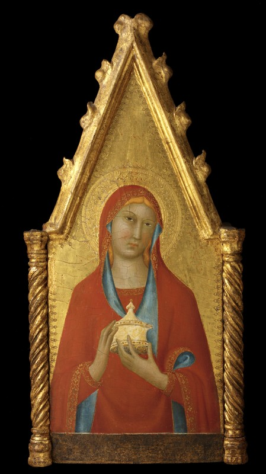
  <figcaption>Lippo Memmi, <em>Mary Magdalene</em>, pinnacle from the polyptych of San Francesco, San Gimignano, c. 1330. Tempera and gold on panel, 49.5 × 22.5 cm. Providence, RISD Museum, 21.250, Museum Appropriation Fund. Photo: RISD Museum, Providence, Open Access (CC0).</figcaption>
</figure>

The Mary Magdalene in the RISD Museum in Providence entered the collection through the Museum Appropriation Fund under the inventory number 21.250. The museum attributes it to Lippo Memmi, dates it about 1330 and describes it as the top element of a side wing of an altarpiece, placed above other saints. The panel measures 49.5 by 22.5 centimetres. It is one of the pinnacles associated in 1974 with the polyptych of San Francesco in San Gimignano.

Mary Magdalene, the follower of Christ who anointed his feet, stood at the foot of the cross and was the first witness of the Resurrection, was venerated in the Middle Ages as the model of the repentant sinner and of contemplative life. Her cult was especially strong among the Franciscans and in the towns of Tuscany, and in a Franciscan polyptych she represented penitence beside the founders and saints of the order.

The saint is shown in half length, frontal, with a grave and composed expression. Her long fair hair, loose as in her traditional iconography, falls at the sides of her face, and she wears a red mantle lined with light blue, drawn over her head and falling over her shoulders, above a red dress with gold borders at the neck and sleeves. A tooled halo surrounds her head.

With both hands she holds before her breast a white covered ointment jar, the vessel of precious ointment with which, according to the Gospels, she anointed Christ and which she brought to the tomb on Easter morning. The jar, painted with highlights and a domed lid, is the attribute that identifies her in most images of the period.

The panel is set in a crocketed gable flanked by twisted colonnettes. Whether this frame is original or a later reconstruction has not been verified against the museum's record; the Saint Clare in New York, also a pinnacle of the polyptych, is set in a modern frame of similar design. The gold ground within the gable is decorated with punched ornament along its edges.

The red of the mantle and dress dominates the panel, with the light blue of the lining providing a cool accent around the face and along the edges of the mantle. The colour combination recurs in the female saints of Lippo's small panels, and it gives the figure a strong presence in the small format of a pinnacle.

The panel is in good condition. The gold ground is worn in places, and there are small losses at the edges and in the lower part, but the face, the hands and the jar are well preserved. A Mary Magdalene in Avignon has also been mentioned in connection with Lippo's Pisan polyptych of San Paolo a Ripa d'Arno; the panel in Providence belongs instead to the San Gimignano series.

The figure has the type of the other female saints of the series: the long face, the narrow eyes and the inclined or frontal head of the Saint Clare and of the Saint Elizabeth. Seen together, the pinnacles show how Lippo's workshop adapted the refined female type of his small devotional panels to the upper register of a large altarpiece.

#### Saint Agnes (Pittsburgh, The Frick Pittsburgh)

The Saint Agnes in the Frick Art Museum in Pittsburgh is one of a pair of small panels, with a Saint Anthony of Padua, catalogued together under the inventory number 1970.38 and attributed by the museum to Lippo Memmi. Each panel measures about 41.3 by 19.1 centimetres, and the museum places them in Siena in the fourteenth century. The two were associated in 1974 with the pinnacles of the polyptych painted for the Franciscans of San Gimignano, together with the Saint Clare in New York, the Saint Elizabeth of Hungary in Milan and the Mary Magdalene in Providence.

Saint Agnes of Rome, a virgin martyr of the early fourth century, was venerated as a model of purity and of constancy in faith. Her usual attribute in Italian painting is a lamb, a play on her name and the Latin agnus, and in the Pittsburgh panel she holds one in her arm. Her presence among the pinnacles of the San Gimignano polyptych places her in a series of female saints, beside Clare, Elizabeth and Mary Magdalene, that offered models of virginity, widowhood and penitence.

The saint is shown in half length, her head inclined to the right and her eyes lowered, with the long pale face and the withdrawn expression of the other female saints of the series. Her fair hair is bound by a thin gold band, and an olive-green mantle is drawn over her head and falls over her shoulders, above a red dress. A tooled halo surrounds her head, set against the gold ground under the gable.

In the crook of her right arm, held against her body, she carries a small white lamb with a gold halo, supporting a red banner marked with a white cross. The haloed lamb with the banner of the Resurrection is the Lamb of God, so that the attribute of the saint also becomes an image of Christ, the bridegroom to whom, in her legend, Agnes consecrated her virginity. The red of the banner answers the red of her dress.

The panel is set in a gilded frame with a crocketed gable, a finial and a moulded base decorated with ornament, identical to that of its companion. The frames of the two Pittsburgh panels are of the same type as those of the Saint Clare and the Mary Magdalene, with crocketed gables, which suggests that several pinnacles of the polyptych were reframed in a similar manner after the dispersal; the date of the frames has not been verified against the museum's record.

The colours are restrained: the olive green of the mantle, the red of the dress and banner and the white of the lamb against the gold. The figure, with its inclined head and its attribute held close to the body, follows the scheme of the other female pinnacles, in which the saint is characterized more by her attribute than by gesture or action.

The museum gives the date only as the fourteenth century. The date of about 1325–1330 proposed for the altarpiece by the American museums that hold its other panels applies to the Saint Agnes if its connection with the polyptych is accepted. The panel's provenance before its acquisition by the Frick has not been verified.

The Frick has not released images of the two panels for free reuse. The museum's <a href="https://collection.thefrickpittsburgh.org/objects/36">online collection</a> reproduces the Saint Agnes beside the Saint Anthony of Padua in their matching frames.

#### Saint Anthony of Padua (Pittsburgh, The Frick Pittsburgh)

The Saint Anthony of Padua in the Frick Art Museum in Pittsburgh forms a pair with the Saint Agnes, under the inventory number 1970.38, and is attributed by the museum to Lippo Memmi. It measures about 41.3 by 19.1 centimetres. With the Saint Agnes it was associated in 1974 with the pinnacles of the polyptych of San Francesco in San Gimignano, beside the Saint Clare in New York, the Saint Elizabeth of Hungary in Milan and the Mary Magdalene in Providence.

Anthony of Padua (1195–1231), born in Lisbon, joined the Franciscan order in 1220 and became a celebrated preacher and teacher of the order. He was canonized in 1232, less than a year after his death, and his cult spread rapidly throughout Italy. In Tuscan painting of the fourteenth century he is usually shown as a young friar in the habit of his order, holding a book, the sign of his preaching and his learning.

The saint is shown in half length, turned slightly to the right, with his head raised and his eyes looking to the right. He is young and beardless, with a tonsure and a ring of dark hair, and a tooled halo surrounds his head. He wears the grey-brown Franciscan habit, with a hood falling around his neck, and the cord of the order is visible at his waist.

He holds a red book against his body with both hands, its cover marked with white, perhaps the clasp or an ornament of the binding. The book, the only attribute of the figure, presents Anthony as the preacher and doctor of the order. The simplicity of the image, a friar with a book against the gold, corresponds to the early iconography of the saint, before the lily and the Christ Child became his usual attributes in later centuries.

In the San Gimignano polyptych, Anthony represented, with Francis and Louis of Toulouse in the main register and Clare and Elizabeth in the pinnacles, the saints of the Franciscan family. The prominence of these saints, five in all among the surviving panels, confirms that the altarpiece was made for a Franciscan church, the basis of its connection with San Francesco in San Gimignano.

The panel is set in a gilded frame with a crocketed gable, a finial and a moulded base, identical to that of the Saint Agnes. The grey-brown of the habit against the gold and the red of the book give the figure a sober colour harmony close to that of the Saint Francis and the Saint Clare.

The museum gives the date only as the fourteenth century. If the panel belongs to the polyptych, it shares the date of about 1325–1330 proposed for the altarpiece. Its provenance before its acquisition by the Frick has not been verified.

The Frick has not released images of the two panels for free reuse. The museum's <a href="https://collection.thefrickpittsburgh.org/objects/36">online collection</a> reproduces the Saint Anthony beside the Saint Agnes.

#### Bishop Saint: Saint Gimignanus or Saint Augustine? (Asciano, Castello di Gallico, Salini Collection)

<figure>
  
  <figcaption>Lippo Memmi, <em>Bishop Saint (Saint Gimignanus or Saint Augustine?)</em>, pinnacle from the polyptych of San Francesco, San Gimignano, c. 1330. Tempera and gold on panel, 51 × 22 cm. Montecalvoli (Asciano), Castello di Gallico, Salini Collection. Image for educational use only.</figcaption>
</figure>

The bishop saint in the Salini Collection at the Castello di Gallico, near Asciano, is the sixth pinnacle associated with the polyptych painted for the Franciscans of San Gimignano, added after the five panels gathered in 1974. It measures 51 by 22 centimetres, a size close to that of the Mary Magdalene in Providence, and it is painted in tempera and gold on panel. Miklós Boskovits published it in the catalogue of the Salini Collection in 2009, as a work of Lippo Memmi of about 1330.

The identity of the bishop is uncertain. The National Gallery of Art in Washington and the Yale University Art Gallery name him as Saint Augustine; the Louvre, in its record of the Saint Peter, as Saint Gimignanus. A recent French presentation of the panel leaves both names open. Neither the figure nor its attributes, a book and a crozier common to all bishop saints, settle the question, and no inscription is visible.

Each identification has its reasons. Saint Gimignanus, bishop of Modena in the fourth century, was the patron of the town of San Gimignano, which took its name from him, and his presence in an altarpiece for a church of the town would have honoured the civic community; he appears, for example, in the Maestà that Lippo painted in 1317 in the Palazzo Comunale. Saint Augustine, the bishop of Hippo and doctor of the Church, was venerated throughout Tuscany and had a particular following in San Gimignano, where the Augustinian friars had their own church.

The bishop is shown in half length, frontal, with a long face, a white beard and short white hair under the mitre, and a grave, direct gaze. His white mitre is decorated with jewelled bands of red and dark stones edged with pearls, and a tooled halo surrounds his head. He wears a red chasuble patterned with dark arabesques, crossed by a broad orphrey that forms a collar around the neck and descends down the front, set with the same stones and rows of pearls as the mitre.

In his right hand, which wears a ring with a dark stone, he holds a dark green book with clasps against his body. In his left hand, also ringed, he holds an ivory-coloured crozier, its shaft decorated with a knop and its crook ending in a simple spiral. The jewelled vestments and the rings mark his episcopal rank with a richness that contrasts with the sober habits of the Franciscan saints of the same series.

The panel is set in a frame with a steep crocketed gable of the same type as those of the Saint Elizabeth in Milan, the Mary Magdalene in Providence and the Saints Agnes and Anthony in Pittsburgh, and the format of the figure, a half-length saint under the gable, corresponds to theirs.

The figure shares the type of the older male saints of the main register, the Saint Peter in the Louvre and the bishop Saint Louis in Siena: the frontal pose, the long face and the rich, carefully detailed costume. The restrained colours of the other pinnacles give way here to a strong red, which would have made the bishop a prominent accent in the upper register of the altarpiece.

The gold ground is worn in places, especially in the gable, and is crossed by fine cracks; the lower part of the panel shows the bare wood of the base. The face, the hands and the jewelled vestments are well preserved. With this panel the known pinnacles of the polyptych number six; the central pinnacle, above the lost Virgin and Child, has not been identified.

#### Virgin and Child, once proposed as the central panel (Berlin, Gemäldegalerie, no. 1067)

<figure>
  
  <figcaption>Lippo Memmi, <em>Virgin and Child</em>, 14th century (c. 1325–1330?). Tempera and gold on poplar, 86.1 × 55.4 cm with the pointed top, including a modern addition in the upper part. Berlin, Staatliche Museen, Gemäldegalerie, no. 1067. Photo: Staatliche Museen zu Berlin, Gemäldegalerie / Jörg P. Anders (Public Domain Mark 1.0).</figcaption>
</figure>

The Virgin and Child in the Gemäldegalerie in Berlin (no. 1067) was proposed in the 1930s as the central panel of the polyptych painted for the Franciscans of San Gimignano, and the proposal shaped the reconstruction of the altarpiece for several decades. The museum bought the panel in 1843 and catalogues it as a work of Lippo Memmi of the fourteenth century. It is a different painting from the small Virgin and Child in the same museum (no. 1081A), the left wing of the diptych completed by the Golovin Baptist.

The panel is painted on poplar and measures 86.1 by 55.4 centimetres with its pointed top. The National Gallery of Art in Washington gives the dimensions of the original part as 77.5 by 55.5 centimetres and notes that the panel was lengthened in its upper part by a modern addition about nine centimetres high. The present pointed arch with its trefoil and dark spandrels therefore belongs in part to a later reconstruction of the panel's shape.

The case for and against the panel as the centre of the San Gimignano altarpiece has been argued at length. Its scale and style suit the lateral saints, and the proposal was accepted by several later studies, including the reconstruction of 1974. Doubts were raised in 1977 on the basis of differences in the punched decoration, and Miklós Boskovits, after first sharing them, later suggested that the panel might belong to the altarpiece after all. The Yale catalogue rejects it, because its marginal punchwork and engaged moulding are incompatible with the colonnettes that framed the lateral panels, and the Louvre states that most specialists no longer regard it as the centre.

The Virgin is shown in half length, her head inclined towards the Child and her eyes turned outwards with a grave, sorrowful expression. She wears a dark blue mantle drawn over her head above a white veil and a red dress, and a small gold star marks her right shoulder, the sign of Mary as Star of the Sea that recurs in Lippo's Madonnas in Washington, Altenburg and the other panel in Berlin. Her face is long and pale, with heavy-lidded eyes and a small mouth.

The Child sits on her left arm, in a white shirt with long sleeves and a red mantle lined and edged with gold, wrapped around his legs. With his right hand he pulls the edge of his mother's white veil, a gesture of familiarity that recurs in Lippo's Madonna with a donor in Washington and in the Kansas City panel, and he looks out at the viewer. The Virgin's left hand supports him from below, and with her right hand she holds his bare foot.

The composition belongs to the type of the half-length Virgin and Child that Lippo and Simone Martini developed in the 1320s and 1330s, with the dark mass of the Virgin's mantle set against the gold and the bright colours of the Child. The scale of the figures, larger than in the small devotional panels, corresponds to that of a central panel in a polyptych, which is why the panel was proposed for the San Gimignano altarpiece.

The panel is in good condition in its painted parts. The gold ground is worn in places, and the dark blue of the mantle has lost some of its modelling. The faces, the hands and the red mantle of the Child are well preserved. The punched decoration of the haloes and of the edges of the gold ground, on which the debate over its place in the polyptych has turned, remains legible.

Whether or not it stood at the centre of the San Gimignano altarpiece, the Berlin panel is a work of the same years and of the same circle, and it shows the type of Virgin that the lost central panel probably resembled. The Yale catalogue suggests that the Virgin and Child from Lucignano d'Arbia in Siena, attributed to Simone Martini, gives another idea of that appearance, without belonging to the altarpiece either.

### Assumption of the Virgin (Munich, Alte Pinakothek)

<figure>
  
  <figcaption>Lippo Memmi, <em>Assumption of the Virgin</em>, with the Coronation of the Virgin in the gable, c. 1340. Tempera and gold on poplar, 72.5 × 32.5 cm. Munich, Bayerische Staatsgemäldesammlungen – Alte Pinakothek, WAF 671 (Wittelsbacher Ausgleichsfonds). Photo: Bayerische Staatsgemäldesammlungen – Alte Pinakothek München, <a href="https://creativecommons.org/licenses/by-sa/4.0/">CC BY-SA 4.0</a>.</figcaption>
</figure>

The small Assumption in Munich was acquired before 1825 by Crown Prince Ludwig of Bavaria, the future King Ludwig I, who formed one of the first German collections of Italian painting of the fourteenth and fifteenth centuries. Since 1923 it has belonged to the Wittelsbacher Ausgleichsfonds, the foundation that holds the art property of the former Bavarian royal house, and it is exhibited in the Alte Pinakothek. Its earlier history and its original destination are unknown.

The panel has been catalogued under different names. In the nineteenth and twentieth centuries it was associated with the anonymous painter called "Barna", and it has also been listed with a question mark after Lippo's name. The Bayerische Staatsgemäldesammlungen now catalogue it as a work of Lippo Memmi, dated about 1340, a date that places it among the last works attributed to him. Other proposals have placed it in the 1340s more generally. The attribution rests on stylistic comparison and is not supported by a signature or document.

The panel, painted on poplar and measuring 72.5 by 32.5 centimetres, has a tall format crowned by a steep triangular gable, and it is set in a gilded moulded frame. Its size and shape suggest that it was either an independent devotional image or one wing of a small portable altarpiece; no companion has been identified. The gold ground fills the whole field and is bordered along the edges by a band of punched ornament.

The Virgin is seated frontally at the centre of the main field, her hands joined in prayer and her gaze directed at the viewer. She wears a blue-grey mantle patterned with gold over her head and shoulders, falling over her knees, and beneath it a dress with a lozenge pattern visible at the breast. She sits on a dark cloud borne by red-winged angels, and golden rays, incised in the gold ground, radiate from her whole figure. The Virgin's body is not shown rising from the tomb, as in other versions of the theme, but already enthroned in glory among the angels.

Around her the angels form a ring that turns in space. At the sides and in front they kneel or float, and those in the lower part are seen from behind, their wings and robes turned towards the viewer, so that the circle appears to surround the Virgin in depth rather than on the surface of the panel. Several of the angels play instruments: long straight trumpets at the upper left and right, a drum with a stick, a lute, a small portative organ and pipes. The Bayerische Staatsgemäldesammlungen point to the spatial arrangement of the circle and to its naturalistic details as evidence of the painter's quality.

The upper part of the panel shows the heavenly realm that receives the Virgin. A band of dark blue sky, strewn with gold stars and curved like an arch, contains Christ in half length, surrounded by rays and stretching out his arms towards his mother. At either end of the arch, groups of bearded prophets and patriarchs look down from heaven with scrolls; among them, at the left, is a crowned king with a psaltery, David, the ancestor of the Virgin. In the apex of the gable, a small scene shows the sequel of the Assumption: Christ, seated beside the Virgin on a bench, places the crown on her head.

The museum describes the Munich Assumption as the earliest example of a type of image that remained standard in Tuscan painting into the sixteenth century: the Virgin enthroned in the air, surrounded by a choir of music-making angels and received by Christ above. The panel combines in a single vertical composition the Assumption, the welcome of Christ and the Coronation, read from bottom to top, and its circle of angels has been compared with the spatial experiments of the anonymous Master of the Rebel Angels.

The panel is in good condition. The gold ground is well preserved, with its punched borders and incised rays still legible, and the colours of the angels' robes and wings retain much of their brilliance. Small losses are visible in the gilding along the edges and in the lower part. The dense, refined execution and the delicacy of the small figures correspond to the character of the small devotional panels that, since the nineteenth century, have formed a large part of Lippo's catalogue.

### Virgin and Child with Saints and Angels, wing of a diptych (New York, The Metropolitan Museum of Art)

<figure>
  
  <figcaption>Lippo Memmi, <em>Virgin and Child with Saints and Angels</em>, left wing of a diptych, c. 1350 according to the museum. Tempera on wood, gold ground, painted surface 50.2 × 25.7 cm (66.7 × 33 cm overall with shaped top and partially modern engaged frame). New York, The Metropolitan Museum of Art, 43.98.6, Maitland F. Griggs Collection, Bequest of Maitland F. Griggs, 1943. Photo: The Metropolitan Museum of Art, New York, Open Access (CC0).</figcaption>
</figure>

The Virgin and Child in the Metropolitan Museum is the left wing of a small diptych for private devotion, whose right wing is the Crucifixion in the Musée du Louvre. The two panels share the steep gabled format and the scale of their figures, and the museum's catalogue of Italian paintings records their connection. The New York panel came to the museum in 1943 with the bequest of Maitland F. Griggs, the collector who also owned the Saint John the Evangelist now at Yale.

The museum attributes the panel to Lippo Memmi and dates it about 1350, a date later than the about 1340 given by the Louvre for its wing. The difference reflects the general uncertainty of the chronology of Lippo's late work, after the Annunciation of 1333, and the Louvre itself records that some critics give the diptych to Lippo, others to Simone Martini. The panel was altered in the twentieth century by the addition of framing elements, and its present engaged frame is partly modern.

The Virgin is shown in half length, her head inclined towards the Child and her eyes looking out of the picture with a grave and withdrawn expression. She wears a black mantle drawn over her head, edged with a gold border, over a red dress, and a small gold star marks her right shoulder, as in Lippo's Madonnas in Berlin, Altenburg and Washington. The dark mantle recalls that of the Virgin in the Kansas City panel.

The Child sits on his mother's left arm, wearing a transparent shirt and a red mantle patterned with gold, which wraps his legs. He turns his head up towards her and with his right hand pulls the edge of her veil, the gesture of familiarity found in Lippo's Madonna with a donor in Washington and in the Virgin and Child no. 1067 in Berlin; in his left hand he holds a small sprig. The Virgin's right hand supports his bare feet.

The gold ground around the figures is filled with angels. According to the museum, the nine choirs of angels described by Pseudo-Dionysius<a href="/endnotes.html#fn-pseudo-dionysius-areopagite" class="footnote">18</a>, the theologian of the celestial hierarchy, ornament the upper part of the panel: they are arranged in tiers in the gable and down both sides, their small heads and wings worked in the gold with incised and painted lines. The Virgin and Child thus appear at the centre of the whole heavenly court.

At the lower corners of the main field stand two tiny full-length saints: at the left Saint John the Baptist, in a hair shirt and a mantle, and at the right Saint Francis of Assisi, in the Franciscan habit, holding a red book. Their presence, and the choice of Francis, may reflect the devotion of the owner, but the diptych carries no coat of arms or donor figure that would identify him.

Beneath the main field, a narrow predella of seven arches contains half-length saints, painted on a minute scale: among them a female saint in a dark veil, a bishop in a blue and gold cope and saints with palms and books. The museum does not name them individually, and their identification has not been verified against its catalogue entry.

The panel's rich programme, angels, saints and predella, gives a small devotional image the structure of a full altarpiece, and the pairing with the Louvre Crucifixion, with its pelican and its skull of Adam, completed a meditation on the Incarnation and the Passion. The gold ground is worn in places, revealing the red bole, especially in the gable among the angels, and the black of the mantle has lost much of its modelling, but the faces of the Virgin and Child are well preserved.

### Crucifixion, wing of a diptych (Paris, Musée du Louvre)

<figure data-no-download>
  
  <figcaption>Lippo Memmi (or Simone Martini?), <em>Crucifixion</em>, wing of a diptych, c. 1340. Tempera and gold on poplar, 60.8 × 28.8 cm. Paris, Musée du Louvre, Département des Peintures, RF 1984 31. Photo © 2017 GrandPalaisRmn (musée du Louvre) / Franck Raux.</figcaption>
</figure>

The Crucifixion in the Louvre is one wing of a small diptych for private devotion. Its companion, a Virgin and Child flanked by Saints John the Baptist and Francis of Assisi, with choirs of angels above and saints in an arcade below, is in the Metropolitan Museum of Art in New York, which catalogues it as a work of Lippo Memmi. The two panels share the gabled format and the scale of their figures, and the Virgin and Child would have stood at the left, the Crucifixion at the right, following the usual arrangement of Sienese devotional diptychs.

The Louvre describes the panel as painted in the workshop of the Memmi family and notes that some critics see in it the work of Lippo, others that of his brother-in-law Simone Martini. It dates it to the second quarter of the fourteenth century, around 1340, while the Metropolitan Museum dates its own wing around 1350. The panel was formerly in the von Kaufmann collection; it entered the Louvre in 1984, as its inventory number indicates.

The panel is painted on poplar and measures 60.8 by 28.8 centimetres. On the back it bears punched decoration with a lozenge at the centre, a common finish for the outer faces of small diptychs, which were seen when the wings were closed. The front is set in a gilded frame that follows the triangular gable, and the gold ground fills the whole field around the figures.

At the centre a tall cross rises from a rocky mound, at whose foot lie a skull and bones stained with blood: the skull of Adam, buried according to tradition on Golgotha, washed by the blood of Christ. Christ hangs dead, his head inclined on his right shoulder and his eyes closed, his pale body marked by thin streams of blood from the wound in his side and from the nail in his feet. His loincloth is white and transparent. Above the cross-bar a red titulus carries the inscription in white letters, and two small angels fly at either side.

At the top of the cross a pelican stands in its nest, feeding its young. The bird, believed in the Middle Ages to wound its breast to feed its offspring with its own blood, was a symbol of the sacrifice of Christ and of the Eucharist, and its presence at the top of the cross makes explicit the meaning of the blood that flows down the wood to the skull of Adam.

At the left, the women gather around the Virgin. She stands in a dark mantle, her face turned up towards the cross, supported by a woman in a pink mantle behind her and accompanied by other haloed women, one of whom, in a purple mantle, stretches out her hand. Above them a soldier in a mail hood raises his hand towards the cross, and a spear rises behind the group. The grief of the women is expressed with restraint, through the inclined heads and the gestures of the hands, without the swoon of the Virgin found in the Collegiata of San Gimignano.

At the right, Saint John the Evangelist, young and haloed, in a blue tunic and a large red mantle, clasps his hands under his chin and looks up at Christ. Behind him stands a haloed bearded man pointing upwards, perhaps the centurion who recognized Christ as the Son of God, venerated as a saint, or another disciple; the identification is not certain. Behind them a crowd of soldiers in helmets carries spears, the sponge on a reed and a red banner.

The panel is in good condition. The gold ground is worn in places, revealing the red bole, and the punched decoration of the haloes remains legible. The fine execution, with small figures painted with precise drawing and bright colours, corresponds to the character of the small devotional panels of the Memmi workshop in the 1330s and 1340s, and the joint attribution to Lippo or Simone reflects the difficulty of separating their hands in works of this scale.

### The Fall of the Rebel Angels (Paris, Musée du Louvre, on deposit from the Musée du Berry, Bourges)

<figure data-no-download>
  
  <figcaption>Memmi family (Master of the Rebel Angels; attributed to Lippo Memmi or Simone Martini), <em>The Fall of the Rebel Angels</em>, originally the other face of the Saint Martin Dividing his Cloak (DL 1967 1 B), first half of the 14th century. Gold ground, transferred from panel to canvas in 1967, 64 × 29 cm. Paris, Musée du Louvre, Département des Peintures, DL 1967 1 A, on deposit from the Musée du Berry, Bourges. Photo © 2017 GrandPalaisRmn (musée du Louvre) / Franck Raux.</figcaption>
</figure>

The Fall of the Rebel Angels and the Saint Martin Dividing his Cloak, both in the Louvre, originally formed the two faces of a single panel, separated in 1967 when the paintings were transferred from wood to canvas. The Louvre catalogues the Fall under the inventory number DL 1967 1 A, with the same dimensions as its companion, 64 by 29 centimetres, and with the same attribution to the Memmi family, also called the Master of the Rebel Angels after this composition. The date given by the museum is the first half of the fourteenth century.

The panel shares the history of the Saint Martin. It passed through the collections of L. de Bourbon-Chalus and É. de Rougé, who gave it in 1963 to the Musée du Berry at Bourges, and in 1967 the city of Bourges deposited it at the Louvre. The attribution has moved between Simone Martini, Lippo Memmi and their workshop; Miklós Boskovits assigned both compositions to Lippo, and the Louvre now uses the neutral designation of the Memmi family.

The subject is drawn from the Apocalypse (12:7–9), where war breaks out in heaven, Michael and his angels fight against the dragon and his angels, and the dragon and his followers are cast down to the earth. Medieval theology identified this battle with the fall of Lucifer and of the angels who rebelled with him at the beginning of creation, and the panel represents this primordial event in three superimposed zones.

In the gable sits God, frontal and enthroned in a blue mantle, raising his hand in a gesture of judgement. He is surrounded by a mandorla of red seraphim with outspread wings, the highest of the angelic orders. His position at the summit of the panel makes him the source of the order that the rest of the composition depicts.

Below him lies the heavenly court. At either side angels in robes of blue, red, pink and green sit in rows on choir stalls in perspective, and at the centre the archangel Michael, in armour, stands with other armed angels. The seats at the right appear empty; if so, they would be the places left vacant by the fallen angels, which in medieval tradition were to be filled by the souls of the redeemed. A narrow band of dark blue sky sown with gold stars separates heaven from the space of the fall.

The lower field, the largest part of the panel, shows the rebel angels falling headlong through the air towards a dark mound at the bottom, the earth or the mouth of hell. The fall is represented as a progressive transformation: the angels at the top still have feathered wings and human bodies, those in the middle are already darkened, and those at the bottom have become black demons with bat wings, claws and tails, tumbling in every direction against the gold ground.

The composition is notable for this representation of a transformation in space and time. The scattered figures, seen from different angles and freed from any ground line, fill the gold as if it were an empty void, and the gradual metamorphosis from angel to demon makes the fall visible as a process. The spatial experiment has been compared with the circle of music-making angels in the Munich Assumption attributed to Lippo, and it gave the anonymous master his name.

The panel is in fragile condition, the result of its age and of the transfer to canvas. The gold ground of the lower field is worn and stained, and the edges of the gable are irregular; the upper zones, with God, the seraphim and the heavenly court, are better preserved. The combination of this subject with the Saint Martin on the other face has not been explained, and the original function of the double-sided panel, perhaps a processional image or the wing of a small altarpiece, remains unknown.

### Saint Martin Dividing his Cloak (Paris, Musée du Louvre, on deposit from the Musée du Berry, Bourges)

<figure data-no-download>
  
  <figcaption>Memmi family (Master of the Rebel Angels; attributed to Lippo Memmi or Simone Martini), <em>Saint Martin Dividing his Cloak</em>, originally the reverse of the Fall of the Rebel Angels (DL 1967 1 A), first half of the 14th century. Gold ground, transferred from panel to canvas in 1967, 64 × 29 cm. Paris, Musée du Louvre, Département des Peintures, DL 1967 1 B, on deposit from the Musée du Berry, Bourges. Photo © 2017 GrandPalaisRmn (musée du Louvre) / Franck Raux.</figcaption>
</figure>

The Saint Martin in the Louvre and its companion, the Fall of the Rebel Angels, originally formed the two faces of a single panel, whose original destination is unknown. They were separated in 1967, when the paintings were transferred from the wooden support to canvas. The two compositions gave their name to the anonymous Master of the Rebel Angels, a painter of the circle of Simone Martini whose small number of works has been attributed in turn to Simone himself, to Lippo Memmi and to their workshop. The Louvre now catalogues the panels under the name of the Memmi family.

The provenance is short. The panel passed through the collections of L. de Bourbon-Chalus at Villeperdue and of É. de Rougé at Moulins, who gave it in 1963 to the Musée du Berry at Bourges. In 1967 the city of Bourges deposited it at the Louvre, where it was inventoried under the name of "Barna" of the Sienese school. It measures 64 by 29 centimetres and is now on canvas, with its gold ground.

The attribution has followed the general history of works of this circle. The Louvre notes that some critics identify the author of the two compositions with Lippo Memmi, others with Simone Martini; Miklós Boskovits assigned them to Lippo. The date given by the museum is the first half of the fourteenth century. The Fall of the Rebel Angels, in which the rebel angels are shown falling and turning into demons, has attracted particular attention, and the spatial experiments it shows have been compared with the circle of angels of the Munich Assumption.

Saint Martin of Tours, a Roman soldier of the fourth century, met at the gate of Amiens a poor man without clothing in the cold of winter; he cut his military cloak in two with his sword and gave half to the beggar. The following night Christ appeared to him in a dream wearing the half of the cloak. The episode, told in the life of the saint by Sulpicius Severus<a href="/endnotes.html#fn-sulpicius-severus" class="footnote">19</a> and in the Golden Legend of Jacopo da Varagine<a href="/endnotes.html#fn-jacopo-da-varagine" class="footnote">20</a>, made Martin a model of charity, and it became the usual subject of his images.

In the Louvre panel the saint is not shown on horseback, as in most representations of the scene, but standing in half length beside the beggar. He has reddish-gold hair held by a band, a short red beard and a gentle face with lowered eyes, and a tooled halo surrounds his head. He wears a dark green tunic with gold borders, and with his left hand he holds up the red mantle, lined with blue, which falls over his shoulder; with his right hand he cuts it with a sword, whose blade is visible at the lower edge of the panel.

At the left only the head of the beggar survives, seen in profile with dark hair, bowed towards the saint. His body and the lower left part of the panel are lost, and the bare preparation is visible over a large area, so that the gesture of giving can no longer be followed. The contrast between the young, well-dressed saint and the poor man, now reduced to a head, remains legible in the inclination of the two faces towards each other.

The panel is in fragile condition. Besides the large loss at the lower left, the gold ground is worn over much of its surface, with scratches and abrasions and a network of fine cracks due in part to the transfer to canvas. The edges of the gable are irregular, and the paint of the tunic and mantle shows small losses. The face and hands of the saint, the halo and the mantle are better preserved.

The panel's original function is unknown. A panel painted on both faces, with the Fall of the Rebel Angels on one side and Saint Martin on the other, could have served as a processional or portable image, or as the wing of a small altarpiece that could be turned. The combination of the two subjects, the archangel's victory over the rebels and the charity of a soldier saint, has not been explained, and it may reflect the devotion of a particular patron or confraternity.

### Triumph of Saint Thomas Aquinas (Pisa, Santa Caterina)

<figure>
  
  <figcaption>Lippo Memmi (attributed; with Francesco Traini?), <em>Triumph of Saint Thomas Aquinas</em>, c. 1323–1330. Tempera and gold on panel, about 375 × 258 cm. Pisa, church of Santa Caterina d'Alessandria. Photo: Sailko, <a href="https://creativecommons.org/licenses/by/3.0/">CC BY 3.0</a>, via Wikimedia Commons.</figcaption>
</figure>

The Triumph of Saint Thomas Aquinas is a large panel in the church of Santa Caterina in Pisa, which belonged to the city's Dominican convent. It celebrates the theologian canonized by Pope John XXII<a href="/endnotes.html#fn-john-xxii" class="footnote">21</a> in 1323, and the canonization provides the earliest plausible date for the painting. It measures about three and three-quarter metres in height and over two and a half in width, and its composition presents Thomas not in a narrative scene but as the centre of a diagram of divine and human wisdom.

The attribution has been disputed for centuries. Vasari gave the panel to the Pisan painter Francesco Traini, and that name dominated local literature until the twentieth century, when the painting was moved into the circle of Simone Martini and specifically towards Lippo. It was later returned to Traini and then given to an anonymous "Master of the Triumph of Saint Thomas"; Caleca and other scholars placed it in Lippo's orbit, recognizing Traini's participation in some of the faces, and Boskovits considered it close to 1323. Recent presentations after its restoration describe it as attributed to Lippo and dated to the 1320s, but the Italian heritage record still lists both names, and the attribution rests on stylistic and technical comparison.

The composition is built on a vertical axis. In the central pinnacle Christ sits in a gold mandorla, holding a book, the source of all wisdom. Below him, against a blue band that follows the line of the gable, six authors of Scripture lean down from heaven with open books and scrolls: Moses and Saint Paul with the four Evangelists, who are accompanied by their symbols, the angel, the ox, the eagle and the lion. Golden rays pass from Christ and from their writings to the figure of Thomas below.

Thomas sits frontally at the centre, larger than all the other figures, in the black mantle and white habit of the Dominicans, within a great dark circle, a disc of glory from which rays spread in all directions. His face is broad and calm, framed by the tonsure. In his hands he holds an open book with the words of Proverbs 8:7 in Gothic script, "Veritatem meditabitur guttur meum et labia mea detestabuntur impium" ("My mouth shall meditate truth, and my lips shall hate wickedness"), and on his lap lie other open books, his own writings, from which further rays reach the crowds below.

At the sides, outside the circle, stand the two philosophers of antiquity whose thought Thomas reconciled with Christian doctrine. At the left Aristotle, labelled ARISTOTILES, an old bearded man in a red and pink mantle, holds up an open book towards Thomas; at the right Plato, labelled PLATO, in a dark mantle and a white head covering, offers a red book. The rays that join their books to Thomas show that pagan philosophy, received and corrected, flows into his synthesis, beside the revealed wisdom that comes from above.

At the bottom, between the two crowds, lies Averroes, labelled AVERROIS, the Arab commentator on Aristotle whose interpretations the Dominican theologians opposed. He is shown lying on the ground in a turban and a long robe, his book closed beside him, struck by a ray from Thomas's writings. The figure of the defeated adversary at the feet of the triumphant saint became a fixed element of the iconography of Thomas's triumph, repeated later in Florence and elsewhere.

Two crowds fill the lower corners and turn their faces up to Thomas. They include Dominican friars in black and white, monks in white habits, clerics, a figure in red, probably a cardinal, and laymen in coloured robes and caps. They represent the Church and the learned world receiving Thomas's teaching, and their varied types and costumes give the lower zone a sense of contemporary reality beneath the abstract structure of the upper part.

The painting's programme, with its precise texts and its hierarchy of authorities, was addressed to a learned Dominican public, and it may have been devised with a member of the convent; the Pisan Dominican Bartolomeo da San Concordio has been proposed. The panel has been restored under the Soprintendenza for Pisa and Livorno, and it is shown in the church. The gold ground is worn in places, especially in the pinnacle and along the upper edges, but the figures and inscriptions are legible, and the panel is an early document of the cult of Thomas Aquinas in the years after his canonization.

### The Polyptych of the Altar of Saint Stephen in Pisa Cathedral (Pisa, Museo Nazionale di San Matteo)

<figure>
  
  <figcaption>Lippo Memmi (attributed), <em>Virgin and Child with Saints John the Evangelist, Matthias with a Donor, Stephen and Thomas Aquinas</em>; in the pinnacles Isaiah, Saint Paul, Christ Blessing, Saint Peter and a Prophet. Polyptych from the altar of Saint Stephen in Pisa Cathedral, later in San Niccolò at Casciana Alta, 1320s (?). Tempera and gold on panel. Pisa, Museo Nazionale di San Matteo (on deposit). Photo: Francesco Bini, <a href="https://creativecommons.org/licenses/by-sa/4.0/">CC BY-SA 4.0</a>, via Wikimedia Commons.</figcaption>
</figure>

The polyptych was painted for the altar of Saint Stephen in the cathedral of Pisa. According to the Italian heritage catalogue, it was sold in 1544 to the pieve of Santo Stefano at Vivaia, where it remained until the church was destroyed by the earthquake of 1846, and in 1847 it was moved to the church of San Niccolò at Casciana Alta, near Lari. It is now in the Museo Nazionale di San Matteo in Pisa, where it is held on deposit, the property remaining with the State. The successive moves explain why the literature has placed it sometimes at Casciana Alta, sometimes in the Pisan museum.

The Enciclopedia dell'Arte Medievale describes the altarpiece as a simplified version, reduced in its proportions, of the polyptych that Simone Martini painted in 1319–1320 for the high altar of the Dominican church of Santa Caterina in Pisa, and it places the commission at the same time or shortly after. The relationship is visible in the scheme of half-length saints under arches with a row of pinnacles above, and in the presence of Saint Thomas Aquinas, the Dominican theologian canonized in 1323, among the saints of a cathedral altar.

The attribution has followed the general debate on Lippo and "Barna". The polyptych was restored between 1969 and 1971 under the direction of Antonino Caleca, who attributed it to Lippo and dated it to the 1320s; it was then shown in Pisa in 1971 and in Siena in 1985. It has also been given to "Barna", to the Memmi workshop with the participation of a collaborator and, with a question, to Francesco Traini. The heritage catalogue records the attribution to Lippo with these alternatives and gives the date only as the first half of the fourteenth century.

The altarpiece has five compartments in the main register, each with a half-length figure under a trefoil arch: from left to right Saint John the Evangelist, Saint Matthias presenting a donor, the Virgin and Child in the taller central panel, Saint Stephen and Saint Thomas Aquinas. Above them stand five triangular pinnacles with the prophet Isaiah, Saint Paul, Christ blessing, Saint Peter and a second prophet. The frame is painted red, with a small dentil cornice above each arch and spandrels decorated with green vegetal motifs.

The choice of saints reflects the destination of the altarpiece. Saint Stephen, the protomartyr, was the titular saint of the altar, and he stands at the right hand of the Virgin, the place of honour. Saint Matthias, the apostle chosen to replace Judas, presents a kneeling layman, the donor of the altarpiece, whose identity has not been established. Saints Peter and Paul in the pinnacles and the two prophets of the Incarnation complete a programme centred on the Virgin and the Church.

The presence of Thomas Aquinas, a saint of the Dominican order, on an altar of the cathedral is a sign of the prestige of the Pisan Dominicans, whose convent of Santa Caterina was the centre of Thomist studies in the city in these years. Lippo's polyptych thus belongs to the same Pisan milieu as Simone's altarpiece for Santa Caterina and the Triumph of Saint Thomas in the same church, and it shows the new saint entering the devotion of the wider city soon after his canonization.

The condition is uneven. The gold ground has fallen over large areas, especially at the left, and the red bole now dominates the background of several compartments, giving the whole altarpiece its present warm tone. The frame is worn and its outer uprights are damaged. The figures are better preserved: the faces, the vestments of Saint Stephen and the open book of Saint Thomas remain legible, but the Christ in the central pinnacle has lost much of the paint over his book.

In Lippo's catalogue the polyptych is one of the few altarpieces to survive with all its principal parts in their original sequence. Its main panels and pinnacles are described individually in their order from left to right, first the main register and then the pinnacles.

#### Saint John the Evangelist

<figure>
  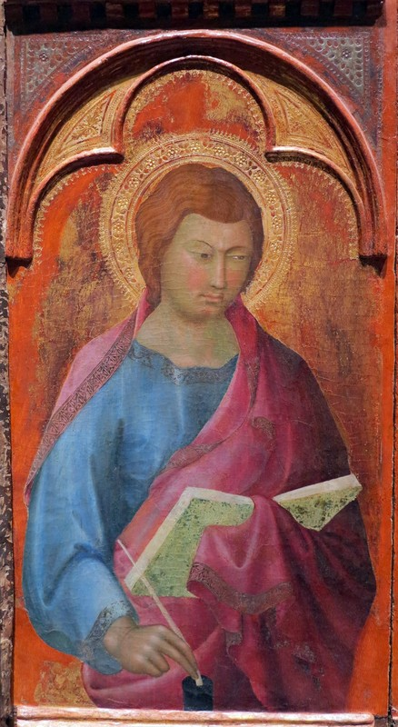
  <figcaption>Lippo Memmi (attributed), <em>Saint John the Evangelist</em>, left lateral panel of the polyptych from the altar of Saint Stephen in Pisa Cathedral, 1320s (?). Tempera and gold on panel. Pisa, Museo Nazionale di San Matteo. Photo: Francesco Bini, <a href="https://creativecommons.org/licenses/by-sa/4.0/">CC BY-SA 4.0</a>, via Wikimedia Commons.</figcaption>
</figure>

Saint John the Evangelist occupies the outer compartment at the left of the main register. As the author of the fourth Gospel he was a frequent presence in Tuscan polyptychs, and his position balances that of Saint Thomas Aquinas, the theologian, at the opposite end: the evangelist and the doctor of the Church frame the altarpiece as authors of sacred writing.

The saint is represented as a young man, beardless, with reddish-brown hair falling to his neck and a smooth, pale face. His head is slightly inclined and his eyes are turned sideways to the right, towards the centre of the altarpiece, with a grave and attentive expression. A large tooled halo, with a band of punched rosettes, surrounds his head and fills the upper part of the trefoil arch.

He wears a light blue tunic with an embroidered collar and cuffs, and over it a large pink-red mantle with a narrow embroidered border, which falls from the left shoulder and wraps the lower part of the body. The cool blue of the tunic and the warm red of the mantle are set against the red bole of the background, which in this panel has almost entirely replaced the gold.

The action of the figure is that of writing. In his left hand, wrapped in the mantle, John holds an open book with green pages, its edges painted white; with his right hand he dips a long white quill into a small black inkwell at the lower edge of the panel. The motif, also used in the Saint John the Evangelist of the San Gimignano polyptych at Yale, shows the evangelist in the act of composing his Gospel.

The book, seen in foreshortening, is painted with a simple geometry that projects it towards the viewer, and the hand dipping the pen is drawn with care, its long fingers relaxed. The quiet action contrasts with the gesture of presentation of Saint Matthias in the next panel, and it introduces the series of saints with an image of contemplative work.

The arch above the figure is formed by a moulded trefoil with gilded tracery in its spandrels, and the corners of the panel above the arch are decorated with punched ornament on a green ground. A small dentil cornice runs along the top of the compartment. These elements, repeated in all the panels of the main register, belong to the original carpentry of the altarpiece.

The gold ground has been lost over most of the panel, leaving the red bole exposed, particularly at the left and around the halo. The paint of the mantle shows small losses, and a vertical crack runs along the left edge. The face, the hands, the book and the pen are well preserved, and the panel retains its original arch.

The figure type, with its long face, narrow eyes and inclined head, recurs in Lippo's young saints of the 1320s and 1330s, including the Saint John the Evangelist at Yale and the Saint Ansanus of the Annunciation of 1333. The comparison with the Yale panel, in which the same action of writing is represented with slight variations, illustrates how the workshop reused successful inventions in different altarpieces.

#### Saint Matthias Presenting a Donor

<figure>
  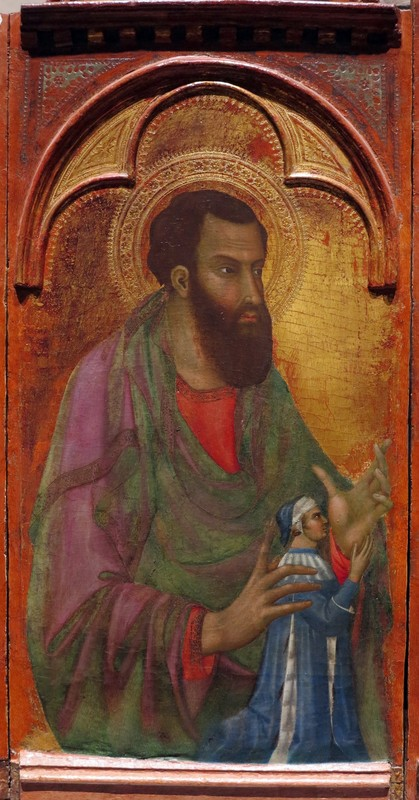
  <figcaption>Lippo Memmi (attributed), <em>Saint Matthias Presenting a Donor</em>, panel to the left of the centre of the polyptych from the altar of Saint Stephen in Pisa Cathedral, 1320s (?). Tempera and gold on panel. Pisa, Museo Nazionale di San Matteo. Photo: Francesco Bini, <a href="https://creativecommons.org/licenses/by-sa/4.0/">CC BY-SA 4.0</a>, via Wikimedia Commons.</figcaption>
</figure>

The panel to the left of the central Virgin shows Saint Matthias presenting a donor, according to the Italian heritage catalogue. Matthias was the apostle chosen by lot to take the place of Judas among the Twelve (Acts 1:23–26). He has no fixed attribute in Sienese painting of the period, and the panel shows none; his identification rests on the catalogue record and on the tradition of the altarpiece.

The saint is a tall, bearded man with dark hair and a full dark beard, turned to the right towards the Virgin, his eyes directed to the centre of the altarpiece. A large tooled halo surrounds his head. He wears a red tunic and a large mantle of changing colour, green in the folds and pink and violet in the lights, which falls from his left shoulder and covers most of the body.

With both hands the saint presents the donor to the Virgin: his right hand rests on the donor's back, his left is raised, open, in a gesture that directs him towards the central panel. The donor kneels at the saint's side, at a fraction of his size, his hands joined in prayer and his face, seen in profile, turned upwards towards the Virgin.

The donor is a layman, dressed in a long blue gown with a white hood edged in blue and a blue cap, a costume of the well-to-do citizens of the period. The catalogue describes it as the dress of a gentleman. His name is not recorded, and no coat of arms survives on the panel to identify him; he was presumably the patron of the altar of Saint Stephen or of its altarpiece.

The scheme of the patron saint presenting a kneeling donor was common in Tuscan altarpieces, and Lippo used it in the Maestà of San Gimignano, where Saint Nicholas presents the podestà Nello Tolomei. Here the donor is placed beside the central panel, so that his prayer is directed immediately to the Virgin and Child, in the position closest to the centre that a layman could occupy.

The panel has the same structure as the others of the main register: a trefoil arch with gilded tracery, punched spandrels on a green ground and a dentil cornice. The halo is tooled with a band of rosettes, and the gold ground, worn at the left, is better preserved at the right, behind the saint's raised hand.

The colour of the panel is dominated by the iridescent mantle, whose green, pink and violet tones are characteristic of the shot fabrics favoured by Sienese painters, and by the blue of the donor's gown. The modelling of the mantle, with broad, soft folds, gives the figure a monumental presence that recalls the robust figures of Lippo's Maestà of 1317.

The heritage catalogue notes that the gold ground has fallen mainly at the left and describes the condition as fair. The saint's face and hands and the figure of the donor are well preserved. The connection of this panel with the San Gimignano cycle in the Collegiata was underlined by one of the studies of the 1980s that returned the polyptych to Lippo.

#### Virgin and Child

<figure>
  
  <figcaption>Lippo Memmi (attributed), <em>Virgin and Child</em>, central panel of the polyptych from the altar of Saint Stephen in Pisa Cathedral, 1320s (?). Tempera and gold on panel. Pisa, Museo Nazionale di San Matteo. Photo: Francesco Bini, <a href="https://creativecommons.org/licenses/by-sa/4.0/">CC BY-SA 4.0</a>, via Wikimedia Commons.</figcaption>
</figure>

The Virgin and Child occupy the central compartment of the polyptych, taller than the lateral panels and crowned by the pinnacle with Christ blessing. The panel follows the type of the half-length Virgin that Simone Martini and Lippo used in their altarpieces of the 1320s, and it is the element in which the relationship with Simone's polyptych of Santa Caterina in Pisa is most evident.

The Virgin is shown in half length, slightly turned, her head inclined towards the Child and her eyes looking out of the picture with a grave and withdrawn expression. Her face is long and pale, with a narrow nose and heavy-lidded eyes. She wears a pale blue mantle drawn over her head above a white veil and a dark red dress, and a small gold star marks her right shoulder, the sign of Mary as Star of the Sea that recurs in Lippo's Madonnas.

The Child sits on his mother's left arm, wearing a light blue shirt with embroidered borders and a red mantle wrapped around his legs. He turns his head towards her and raises his right hand in a gesture towards her face, while in his left hand he holds a small unrolled scroll. The heritage catalogue records that its text is illegible. His bare feet rest in the Virgin's right hand, which supports him from below.

The colour of the Virgin's mantle, a pale, almost greyish blue, differs from the deep blue of Lippo's small panels and may reflect the alteration of the pigment. The light blue of the Child's shirt and the red of his mantle stand out against it, and the white veil frames the Virgin's face. The haloes are tooled with bands of punched rosettes, and the Child's halo carries a cross.

The gesture of the Child, reaching up towards his mother while holding the scroll, recalls the Child of Simone's Santa Caterina polyptych and of other Sienese Madonnas of the period. The composition is calm and frontal, suited to the centre of a large altarpiece, and it lacks the intimate motifs, such as the tug at the veil, that characterize Lippo's small devotional panels.

The panel is framed by a trefoil arch with gilded tracery, wider and taller than those of the lateral panels, with punched spandrels on a green ground and a dentil cornice above. The pinnacle with Christ blessing stands directly above it, forming the vertical axis of the altarpiece.

The gold ground has been almost entirely lost, and the red bole is visible over the whole background, especially at the left. The mantle of the Virgin shows abrasions and losses, particularly in the lower part. The faces of the Virgin and Child, their hands and the Child's clothing are well preserved.

As the centre of an altarpiece for the cathedral, the panel addressed the clergy and the citizens of Pisa with an image of the Virgin as mother and intercessor, flanked by the titular saint of the altar and by the donor presented by Saint Matthias. Its type links it with the series of Madonnas associated with Lippo and Simone in Pisa and Orvieto in the 1320s.

#### Saint Stephen

<figure>
  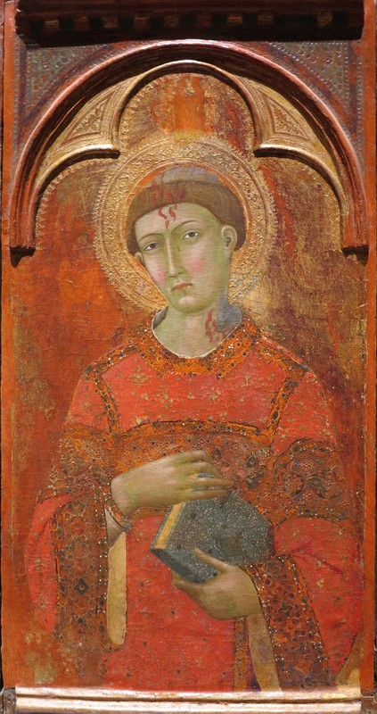
  <figcaption>Lippo Memmi (attributed), <em>Saint Stephen</em>, panel to the right of the centre of the polyptych from the altar of Saint Stephen in Pisa Cathedral, 1320s (?). Tempera and gold on panel. Pisa, Museo Nazionale di San Matteo. Photo: Francesco Bini, <a href="https://creativecommons.org/licenses/by-sa/4.0/">CC BY-SA 4.0</a>, via Wikimedia Commons.</figcaption>
</figure>

Saint Stephen, the deacon of the Church of Jerusalem and the first martyr, stoned to death outside the city (Acts 6–7), was the titular saint of the altar for which the polyptych was painted. He stands in the place of honour at the right hand of the Virgin, the compartment immediately to the right of the central panel as seen by the viewer.

The saint is represented as a young man, beardless, with brown hair cut short around a tonsure, a long pale face and eyes turned sideways to the left, towards the Virgin. A large tooled halo surrounds his head. On his forehead and at his neck run thin streams of red blood, the wounds of his martyrdom by stoning, painted with precise, wavy strokes.

He wears the red dalmatic of a deacon, richly decorated. Its bands, collar and sleeves are embroidered with gold patterns set with small stones in blue, white and green, and the red ground is scattered with tiny motifs. The decoration, painted with great care, turns the vestment into a display of goldsmith's work and textile, in keeping with the richness of a cathedral altar.

With both hands Stephen holds a grey-green book against his body, its cover decorated with small motifs and its edges gilded. The book is the sign of his office as deacon, who read the Gospel in the liturgy, and of his preaching. A pale strip, perhaps the end of a maniple, hangs at his left side.

The figure is calm and frontal in the body, with the head turned towards the centre. The wounds on the head are the only reference to his martyrdom, as the stones that often accompany the saint are not shown. The absence of narrative elements suits the solemn character of the main register.

The panel has the same trefoil arch, punched spandrels on a green ground and dentil cornice as the other compartments. The gold ground has largely fallen, leaving the red bole visible, especially in the upper part and at the right, where a large stain covers the background.

The red of the dalmatic against the red bole gives the panel an almost monochrome appearance in its present state, which the original gold would have counteracted. The face, the hands and the embroidery are well preserved, and the book retains its decoration.

As the titular saint, Stephen gave the altar its dedication, and his presence beside the Virgin, together with that of Thomas Aquinas at the right end, gives the right half of the altarpiece a strongly ecclesiastical character, balanced at the left by the evangelist and by the apostle presenting a layman.

#### Saint Thomas Aquinas

<figure>
  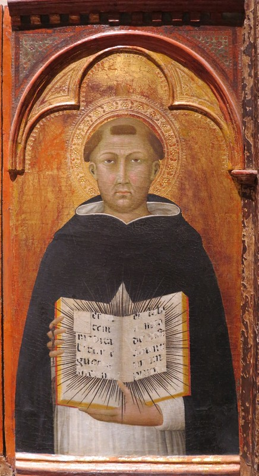
  <figcaption>Lippo Memmi (attributed), <em>Saint Thomas Aquinas</em>, right lateral panel of the polyptych from the altar of Saint Stephen in Pisa Cathedral, 1320s (?). Tempera and gold on panel. Pisa, Museo Nazionale di San Matteo. Photo: Francesco Bini, <a href="https://creativecommons.org/licenses/by-sa/4.0/">CC BY-SA 4.0</a>, via Wikimedia Commons.</figcaption>
</figure>

Saint Thomas Aquinas, the Dominican theologian canonized by Pope John XXII in 1323, occupies the outer compartment at the right of the main register. His presence provides the earliest probable date for the altarpiece, which cannot have represented him as a saint before his canonization, and it links the polyptych with the Dominican milieu of Pisa in which his cult was promoted.

Thomas is shown frontally, in half length, with a broad, heavy face, a tonsure and short brown hair, and a calm, direct gaze. The stout build and the full face correspond to the type of his early images. A large tooled halo with a band of punched rosettes surrounds his head. He wears the white habit of the Dominicans and the black mantle with its hood falling around the shoulders.

With both hands he holds before his breast an open book, from which black rays radiate in all directions over the black mantle and the white habit. The book is inscribed in Gothic script with the words of Proverbs 8:7, "Veritatem meditabitur guttur meum et labia mea detestabuntur impium", the text also displayed by Thomas in the Triumph of Saint Thomas Aquinas in Santa Caterina.

The rays from the book, the light of his teaching spreading over the world, are a characteristic attribute of Thomas in his early iconography. Here they are painted with fine dark strokes on the white pages and the white habit, so that the book appears as a source of light against the dark mantle.

From his right hand, holding the edge of the book, hangs a short string of beads, an unusual detail in a fourteenth-century image of the saint. Its significance, and whether it belongs to the original painting, have not been verified in the sources consulted.

The repetition of the same text and of the same rays in the Pisan Triumph of Saint Thomas, attributed to Lippo, confirms that the two works belong to the same moment and milieu. The polyptych presents in a single figure what the Triumph develops into a vast diagram of wisdom: Thomas as the teacher of truth, whose book illuminates the Church.

The panel has the same trefoil arch and punched decoration as the others. The gold ground has largely fallen, leaving the red bole visible, and the black of the mantle has lost some of its modelling. The outer upright of the frame at the right is badly damaged. The face, the book and its inscription are well preserved.

The figure of Thomas, broad and frontal, contrasts with the slender young Saint John at the opposite end of the altarpiece. The evangelist and the theologian, both shown with their books, frame the row of saints as two witnesses of revealed and taught truth, a theme suited to an altarpiece in the cathedral of a city with a strong Dominican school.

#### Pinnacle with the Prophet Isaiah

<figure>
  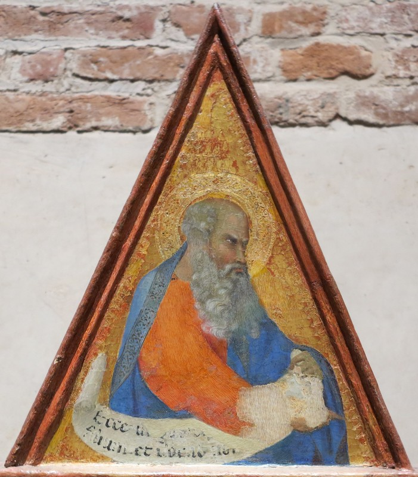
  <figcaption>Lippo Memmi (attributed), <em>The Prophet Isaiah</em>, left pinnacle of the polyptych from the altar of Saint Stephen in Pisa Cathedral, 1320s (?). Tempera and gold on panel. Pisa, Museo Nazionale di San Matteo. Photo: Francesco Bini, <a href="https://creativecommons.org/licenses/by-sa/4.0/">CC BY-SA 4.0</a>, via Wikimedia Commons.</figcaption>
</figure>

The pinnacle at the left end of the altarpiece shows a prophet whom the Italian heritage catalogue identifies as Isaiah. He stands above Saint John the Evangelist, and with the prophet in the pinnacle at the opposite end he frames the upper register of the polyptych, in which the apostles Peter and Paul flank Christ blessing.

The prophet is an old man with grey hair and a long white beard falling in curling strands over his chest. His face, seen in three-quarter view, is turned to the right with a severe, intent expression, the brows contracted. A tooled halo surrounds his head. He wears an orange tunic and a blue mantle with an embroidered border, drawn over his left shoulder.

With both hands he holds a white scroll that unrolls across the lower part of the pinnacle. Its text, in Gothic script, begins with the word "Ecce" and is partly damaged. The legible words are consistent with Isaiah's prophecy of the virgin birth, "Ecce virgo concipiet et pariet filium" (Isaiah 7:14), the text usually given to the prophet in images connected with the Virgin, but the full reading has not been verified.

The presence of Isaiah above an altarpiece centred on the Virgin and Child reflects the role of his prophecy as the principal Old Testament announcement of the Incarnation. With the second prophet at the right, he presents the Virgin of the central panel as the fulfilment of the promises of the Old Law.

The pinnacle is a triangular panel with a moulded red frame. The gold ground within it is decorated along its edges with a border of punched motifs, and it is worn over large areas, revealing the red bole, particularly at the top and at the left. The scroll has small losses along its lower edge.

The figure fills the triangle with a compact half-length form, the head placed near the centre and the scroll forming a broad base. The orange and blue of the garments, saturated and contrasting, are characteristic of the colour of the pinnacles, brighter than that of the main register in its present state.

The prophet's face, with its strong features, contracted brows and sideways glance, shows the expressive characterization of older figures that recurs in Lippo's works, from the elders of the Orvieto panel to the prophets of the Triumph of Saint Thomas.

The pinnacle is relatively well preserved in its painted parts, and in the present display of the museum it stands, as originally, above the Saint John the Evangelist.

#### Pinnacle with Saint Paul

<figure>
  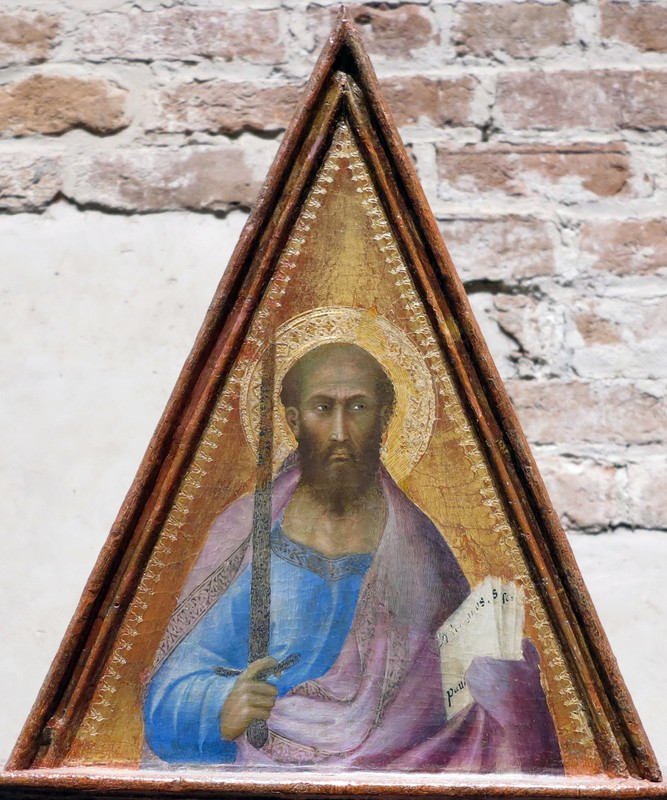
  <figcaption>Lippo Memmi (attributed), <em>Saint Paul</em>, pinnacle of the polyptych from the altar of Saint Stephen in Pisa Cathedral, 1320s (?). Tempera and gold on panel. Pisa, Museo Nazionale di San Matteo. Photo: Francesco Bini, <a href="https://creativecommons.org/licenses/by-sa/4.0/">CC BY-SA 4.0</a>, via Wikimedia Commons.</figcaption>
</figure>

Saint Paul occupies the pinnacle above Saint Matthias, to the left of the central pinnacle with Christ blessing. The pairing of Peter and Paul, the princes of the apostles, on either side of Christ crowned many Tuscan altarpieces.

The apostle is shown frontally, with dark hair, a high forehead and a full dark beard, and a direct, severe gaze. A large tooled halo surrounds his head. He wears a blue tunic with an embroidered collar and a pink-violet mantle with an embroidered border, drawn over his shoulders and across his body.

In his right hand he holds upright a long sword with a dark blade, its point rising to the level of his halo, the instrument of his martyrdom by beheading in Rome. In his left hand he holds a white sheet, folded like a letter, with an inscription in Gothic script of which the name "Paulus" is legible at the bottom, a reference to his epistles.

The attributes, the sword and the letter, are the same as those of the Saint Paul of the San Gimignano polyptych in New York and of the Palermo Saint Paul from San Paolo a Ripa d'Arno, and they show the stability of the apostle's iconography in Lippo's workshop. The dark beard and the high forehead also follow the traditional type of Paul.

The pinnacle has a moulded red frame and a gold ground bordered by a band of punched motifs that follows the edges of the triangle. The gold is well preserved in this pinnacle, with only small areas of wear revealing the bole. The figure fills the triangle with a strong vertical accent given by the sword.

The colour of the blue tunic and the pink-violet mantle, light and luminous, contrasts with the darker colours of the main register. The modelling of the face, with greenish shadows and a ruddy tone on the cheeks, is careful, and the eyes, turned slightly to the left, give the figure an attentive expression.

The pinnacle is among the better preserved elements of the polyptych. Small losses are visible at the lower edge and in the scroll, but the face, the sword and the drapery remain clear.

Saint Paul thus extends the apostolic theme of the left side of the altarpiece, while Saint Peter above Saint Stephen does the same for the right side, so that the upper register gathers the foundations of the Church around Christ.

#### Pinnacle with Christ Blessing

<figure>
  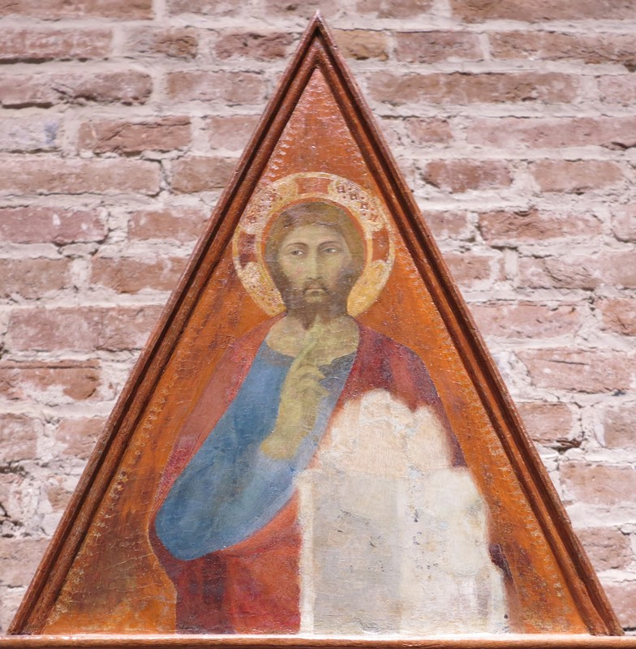
  <figcaption>Lippo Memmi (attributed), <em>Christ Blessing</em>, central pinnacle of the polyptych from the altar of Saint Stephen in Pisa Cathedral, 1320s (?). Tempera and gold on panel. Pisa, Museo Nazionale di San Matteo. Photo: Francesco Bini, <a href="https://creativecommons.org/licenses/by-sa/4.0/">CC BY-SA 4.0</a>, via Wikimedia Commons.</figcaption>
</figure>

The central pinnacle, the highest element of the altarpiece, shows Christ blessing above the Virgin and Child. The arrangement, with the Redeemer at the summit and the incarnate Christ held by his mother below, follows the scheme of Tuscan polyptychs of the period.

Christ is shown frontally, in half length, with long brown hair parted in the middle, a short beard and a direct, steady gaze. His halo is decorated with the arms of a cross, tooled with punched ornament, and parts of an inscription. He wears a blue tunic and a red mantle that falls over his left shoulder and crosses his body.

He raises his right hand in blessing before his breast, with two fingers extended. At the right, where his left hand would have held a book, a large area of paint has been lost, and the white preparation of the panel is now visible over the whole lower right part of the pinnacle, so that the book survives only in faint traces.

The loss is the most extensive in the polyptych and it affects the central element of the upper register. The gold ground of the pinnacle has also been lost almost entirely, leaving the red bole, so that the figure of Christ now stands against a uniform red ground.

The figure of Christ, frontal and symmetrical, has the solemnity of the Pantocrator, and the face, with its long, regular features, is close to that of the Christ Blessing at Douai from the San Paolo a Ripa d'Arno altarpiece. The comparison supports the attribution of both polyptychs to the same workshop and to the same years.

The pinnacle is larger than the four lateral pinnacles, in proportion to the central panel below, and it is framed by the same moulded red frame. A band of punched decoration, now faint, follows the edges of the gold ground.

The colours of the tunic and mantle, blue and red, are the traditional colours of Christ's garments, to which medieval writers gave different symbolic readings; the polyptych does not provide evidence for a particular one.

Despite its damage, the pinnacle completes the vertical axis of the altarpiece, from the Child holding the scroll of the Word in the central panel to the risen Christ blessing at the summit, and it gives the polyptych its liturgical focus above the altar of the protomartyr.

#### Pinnacle with Saint Peter

<figure>
  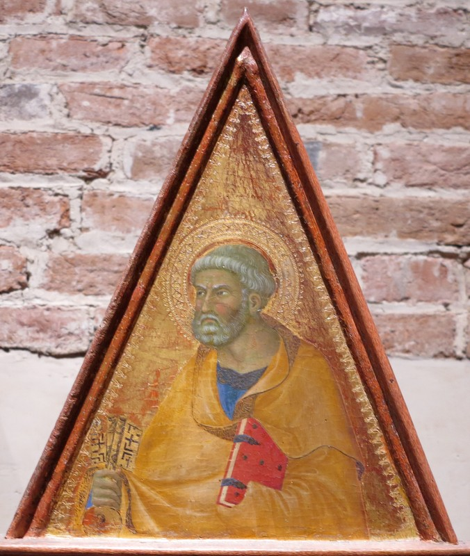
  <figcaption>Lippo Memmi (attributed), <em>Saint Peter</em>, pinnacle of the polyptych from the altar of Saint Stephen in Pisa Cathedral, 1320s (?). Tempera and gold on panel. Pisa, Museo Nazionale di San Matteo. Photo: Francesco Bini, <a href="https://creativecommons.org/licenses/by-sa/4.0/">CC BY-SA 4.0</a>, via Wikimedia Commons.</figcaption>
</figure>

Saint Peter occupies the pinnacle above Saint Stephen, to the right of the central pinnacle with Christ blessing, as the counterpart of Saint Paul. The two apostles, founders of the Church of Rome, flank the Redeemer in the upper register.

Peter is represented as an old man with short grey curly hair, a short grey beard and a broad, lined face. He is turned to the left, towards the centre of the altarpiece, and his eyes look upward with an intent, almost anxious expression. A tooled halo surrounds his head.

He wears a blue tunic, visible at the neck, and a large yellow mantle that covers his shoulders and falls in broad folds, its edges outlined with a dark line. In his right hand he holds the large keys of the kingdom of heaven, their bits worked with geometric patterns; in his left a red book with dark clasps, held against his body.

The yellow mantle is the traditional colour of Peter's garment in Sienese painting, and the same type, with the grey curly hair and the keys, recurs in the Saint Peter of the San Paolo a Ripa d'Arno altarpiece in Palermo and in the Saint Peter of the San Gimignano polyptych in the Louvre.

The pinnacle has a moulded red frame and a gold ground bordered by a band of punched motifs. The gold is worn in the upper part, where vertical streaks of red bole run down from the apex, but the figure itself is well preserved, with a fine modelling of the face.

The figure turns towards the centre, as does Saint Paul on the other side, so that the two apostles direct the viewer's attention to the Christ blessing between them. The gesture of the hands, holding the attributes close to the body, is restrained and suited to the small format.

The colour of the pinnacle, the bright yellow of the mantle against the gold and the red of the book, makes it among the brighter elements of the polyptych in its present state.

The pinnacle shows the same quality of execution as the Saint Paul, and the two apostles are among the better preserved parts of the altarpiece, giving an idea of its original brilliance.

#### Pinnacle with a Prophet (Jeremiah?)

<figure>
  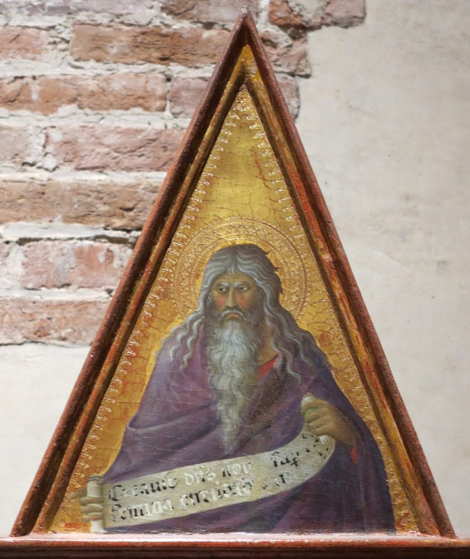
  <figcaption>Lippo Memmi (attributed), <em>A Prophet (Jeremiah?)</em>, right pinnacle of the polyptych from the altar of Saint Stephen in Pisa Cathedral, 1320s (?). Tempera and gold on panel. Pisa, Museo Nazionale di San Matteo. Photo: Francesco Bini, <a href="https://creativecommons.org/licenses/by-sa/4.0/">CC BY-SA 4.0</a>, via Wikimedia Commons.</figcaption>
</figure>

The pinnacle at the right end of the altarpiece shows a prophet whom the Italian heritage catalogue does not name. He stands above Saint Thomas Aquinas and corresponds to Isaiah in the pinnacle at the opposite end.

The prophet is an old man with long wavy grey hair falling to his shoulders and a long grey beard, his face turned slightly to the right and his eyes looking sideways with a severe, almost fierce expression under contracted brows. A tooled halo surrounds his head. He wears a violet mantle over a red tunic visible at the neck.

He holds with both hands a white scroll that unrolls across the lower part of the pinnacle. Its Gothic inscription begins "Creavit d(omi)n(u)s nov[um]" and continues "femina circumdabit", the words of Jeremiah 31:22, "Creavit Dominus novum super terram: femina circumdabit virum" ("The Lord has created a new thing on the earth: a woman shall compass a man"). The verse was read in the Middle Ages as a prophecy of the Incarnation, and it identifies the prophet as Jeremiah with some probability.

Paired with Isaiah's prophecy of the virgin birth at the left, the text of Jeremiah gives the two outer pinnacles a common theme: both announce the mystery of the Virgin bearing Christ, represented in the central panel below. The prophets thus frame the altarpiece with the Old Testament witnesses to the Incarnation.

The pinnacle has a moulded red frame and a gold ground bordered with punched motifs. The gold is relatively well preserved, with a network of cracks and small areas of wear. The scroll is legible in its first line and partly damaged at the end.

The figure, with its long hair and beard and its intense gaze, is among the more expressive of the polyptych. The violet of the mantle, modelled with deep shadows, gives it a sombre tone that contrasts with the bright orange and blue of Isaiah at the opposite end.

The prophet's face, with its sideways glance and strongly marked features, recalls the older figures of the Collegiata cycle in San Gimignano and of the Triumph of Saint Thomas Aquinas, and it is among the elements on which the stylistic links of the polyptych with these works have been argued.

The pinnacle is well preserved and completes, with the other four, the series of half-length figures that crowned the altarpiece, a series that has survived complete with the altarpiece.

### Christ the Redeemer, pinnacle of a lost polyptych (Pisa, Museo Nazionale di San Matteo)

<figure>
  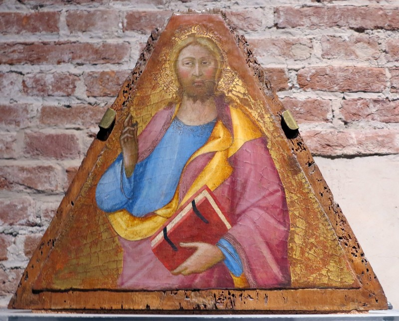
  <figcaption>Lippo Memmi (or Simone Martini?), <em>Christ the Redeemer</em>, pinnacle of a lost polyptych, c. 1320–1350. Tempera and gold on panel, 45 × 52.3 cm. Pisa, Museo Nazionale di San Matteo, inv. 5728. Photo: Francesco Bini, <a href="https://creativecommons.org/licenses/by-sa/4.0/">CC BY-SA 4.0</a>, via Wikimedia Commons.</figcaption>
</figure>

The panel in the Museo Nazionale di San Matteo in Pisa is the pinnacle of a polyptych whose other parts are lost. The Italian heritage catalogue records it under the title of Christ the Redeemer, with the inventory number 5728, and gives its dimensions as 45 by 52.3 centimetres. It has also been published under the title of God the Father, but the bearded type, close to that of Christ in other pinnacles by Lippo and his circle, supports the identification with Christ.

The history of the panel begins in the eighteenth century. It belonged to the Zucchetti collection, which it left in 1796, and passed to the Opera del Duomo of Pisa, from which it reached the museum. Its original destination and the altarpiece to which it belonged are unknown, and no other panel has been identified as part of the same polyptych.

The attribution has changed several times. A catalogue of 1906 assigned the panel to the Pisan school of the fourteenth century. In 1978 Antonino Caleca proposed Lippo Memmi, and in 1999, in a catalogue of the museum written with a colleague, he suggested, with a question, either Lippo or Simone Martini. The heritage catalogue records the attribution to Lippo, with Simone as an alternative, and gives the date as the fourteenth century, between about 1320 and 1350.

Christ is shown in half length, frontally, with long fair hair falling to his shoulders, a short beard and a calm, slightly sideways glance. His head is slightly inclined, and a tooled halo, partly worn, surrounds it. He wears a light blue tunic with an embroidered collar and a pink mantle lined with yellow, which falls from his left shoulder and crosses his body in broad folds.

He raises his right hand in blessing, with two fingers extended, and with his left hand holds against his body a red book with dark clasps, the book of the Gospels. The composition, frontal and symmetrical, follows the type of the blessing Christ that crowned the central compartments of Tuscan polyptychs, as in the pinnacle of the polyptych of the altar of Saint Stephen and in the Christ at Douai from San Paolo a Ripa d'Arno.

The light colours of the garments, the light blue, pink and yellow, are close to those of the pinnacles of the Saint Stephen polyptych, in particular the Saint Paul and the Saint Peter, and the type of the face, with its long features and softly modelled flesh, recurs in the figures of Christ associated with Lippo's workshop. These comparisons support the attribution but do not distinguish Lippo's hand from Simone's.

The panel shows clearly its condition as a fragment. The heritage catalogue notes that the apex of the pinnacle has been sawn off, and that a margin of bare wood about two centimetres wide runs along the edges, where a frame was probably once attached. The wood of these margins is worm-eaten, and two modern metal fittings now hold the panel in its display. The gold is lost in the halo, along the left edge and at the apex.

The width of the pinnacle, greater than its height, indicates that it crowned a broad central compartment, and suggests a polyptych of considerable size. If the attribution is accepted, the lost altarpiece belonged to the Pisan activity of the Sienese painters between the 1320s and the 1340s, of which the pinnacle is the only known witness.

## Works for Comparison

### Simone Martini, Polyptych of Sant'Agostino at San Gimignano (Cologne and Cambridge)

<figure>
  
  <figcaption>Simone Martini, <em>Madonna and Child</em>, central panel of the polyptych of Sant'Agostino, San Gimignano, c. 1316–1317. Tempera and gold on poplar, 79.5 × 57 cm (dimensions as given by the museum). Cologne, Wallraf-Richartz-Museum &amp; Fondation Corboud, WRM 0880. Photo: Raimond Spekking, <a href="https://creativecommons.org/licenses/by-sa/4.0/">CC BY-SA 4.0</a>, via Wikimedia Commons.</figcaption>
</figure>

<figure data-no-download>
  
  <figcaption>Simone Martini and workshop, <em>Saints Geminianus, Michael and Augustine, each with an Angel above</em>, lateral panels of the polyptych of Sant'Agostino, San Gimignano, c. 1316–1320. Tempera and gold on panel, each panel about 110.5 × 38.3 cm. Cambridge, The Fitzwilliam Museum, no. 552. Image © The Fitzwilliam Museum, Cambridge.</figcaption>
</figure>

The polyptych painted for the Augustinian church of Sant'Agostino at San Gimignano is a work by Simone Martini, but it belongs to the history of Lippo Memmi because Vasari, in the Lives, recorded it as Lippo's work. Its surviving panels are divided among three collections: the central Virgin and Child in the Wallraf-Richartz-Museum in Cologne, the lateral Saints Geminianus, Michael and Augustine, each with an angel above, in the Fitzwilliam Museum in Cambridge, and a Saint Catherine of Alexandria in a private collection in Florence. Together they formed a five-part altarpiece.

Vasari's attribution to Lippo is contradicted by a sixteenth-century writer who recorded on the altarpiece the signature "Simon Senensis pinxit", and the work is now generally given to Simone, with the participation of his workshop. The confusion is not accidental. San Gimignano was the town of the Memmi family, where Memmo di Filippuccio had his workshop and where Lippo painted the Maestà of the Palazzo Comunale in 1317, and an altarpiece by Simone in a church of the town could easily be associated in local tradition with the painter of the town's own family.

The date of the polyptych is not documented, but it is generally placed in the second half of the 1310s; the Cologne museum dates its panel around 1316–1317. The altarpiece is therefore almost exactly contemporary with Lippo's Maestà of 1317 in the same town, and it belongs to the years in which the relationship between Simone and the Memmi family was being formed, several years before Simone's marriage to Lippo's sister Giovanna, recorded in 1324.

The Italian reference works suggest, with appropriate conditionals, that Simone and Lippo may have worked together on the Sant'Agostino polyptych, as they may have done at Assisi and at Orvieto. No document supports a collaboration, and the attribution of parts of the altarpiece to assistants rests on stylistic observations, such as the smaller angels in the gables of the Cambridge panels. The polyptych nevertheless shows the models with which Lippo was familiar from the beginning of his career.

The Cologne Virgin and Child establishes a type that recurs in Lippo's later Madonnas: the Virgin in half length, her head inclined towards the Child, her face long and pale with heavy-lidded eyes, a small star on her shoulder, her hand supporting the Child's foot. The same features appear in the small Virgin and Child in Berlin, in the Altenburg Madonna, in the Madonna with a donor in Washington and in the Virgin and Child from the Gemäldegalerie once proposed for the San Gimignano polyptych, and they show how closely Lippo followed Simone's invention.

The Cambridge saints offer a comparison of a different kind. The bishop Geminianus, the patron of San Gimignano, in a jewelled mitre and red chasuble with a crozier and a book, is close in type to the bishop saint in the Salini Collection associated with Lippo's Franciscan polyptych for the same town, whose identification as Gimignanus or Augustine remains open. The jewelled vestments and the punched haloes reflect the goldsmith's taste that Lippo shared with Simone.

The choice of saints, the patron of the town and the father of the order that served the church, made the altarpiece a statement of the bond between the town and its Augustinian friars. Lippo's own works for San Gimignano, the Maestà of the Palazzo Comunale with its bishop Gimignano and the polyptych for the Franciscans with its Franciscan saints, follow the same principle of adapting the company of saints to the patrons and to the town.

The Sant'Agostino polyptych is therefore not part of Lippo's catalogue, but it is an essential term of comparison. It shows the source of his Madonna type, the setting of his early career in San Gimignano, and the point at which early writers began to confuse his work with that of Simone, a confusion that the modern reconstruction of his catalogue has had to undo.

### Simone Martini, Maestà (Siena, Palazzo Pubblico, Sala del Mappamondo)

<figure>
  
  <figcaption>Simone Martini, <em>Maestà</em>, completed June 1315, partly repainted by the artist in 1321. Fresco with applied materials, 763 × 970 cm. Siena, Palazzo Pubblico, Sala del Mappamondo (Sala del Consiglio), north wall. Photo: Museo Civico, Palazzo Pubblico, Siena, public domain, via Wikimedia Commons.</figcaption>
</figure>

Simone Martini's Maestà covers the north wall of the council hall of the Palazzo Pubblico in Siena, the room known today as the Sala del Mappamondo. Signed and dated in June 1315 and partly repainted by Simone in 1321, it is the first fixed point of his career and the model from which Lippo Memmi derived his own Maestà, painted two years later in the council hall of the Palazzo Comunale of San Gimignano. The comparison of the two frescoes is the starting point of every account of Lippo's art.

The Siena fresco shows the Virgin enthroned under a great canopy of red fabric, carried on slender poles by apostles and saints, with some thirty saints and angels standing in tiers on either side and the four patron saints of Siena kneeling in the foreground with two angels offering bowls of flowers. The Child stands on the Virgin's knee and unrolls a scroll with the words of the Book of Wisdom, "Diligite iustitiam qui iudicatis terram", and verses in the vernacular on the step of the throne and along the lower edge give the Virgin's counsel to the rulers of the city.

Lippo took from this model the essential elements of his composition: the canopy carried on poles, the frieze-like ranks of saints and angels, the Virgin as protector of good government, and the Child's scroll with the same admonition from the Book of Wisdom. The Italian reference works describe his fresco as a free reworking and an intelligent simplification of Simone's, more iconic and governed by an order still close to Duccio, while consciously reproducing the stylistic and technical peculiarities of the prototype.

The differences are as significant as the borrowings. Lippo's Maestà is smaller, its court less crowded and its space less deep. It replaces the four patron saints of Siena with the saints of San Gimignano and of its region, among them the bishop Gimignano holding one of the canopy poles, and it introduces the kneeling figure of the podestà Nello di Mino Tolomei, a Sienese magistrate presented to the Virgin by Saint Nicholas. The political message of the Siena fresco is thus transferred to a subject town governed by a Sienese official.

It has been proposed that Lippo worked as a young assistant on Simone's Maestà between 1313 and 1315, and that his familiarity with its forms and techniques comes from direct participation. The hypothesis rests on stylistic comparison and on the speed with which Lippo adopted Simone's idiom; no document records his presence in the Palazzo Pubblico. What the San Gimignano fresco shows beyond doubt is that by 1317 Lippo had absorbed Simone's language well enough to use it independently on a monumental scale.

The technical features of the Siena Maestà, the applied materials, the inset glass in the throne, the rock crystal brooch of the Virgin and the punched haloes, belong to a practice of enriching the painted surface that Lippo also adopted. The goldsmith's detail of his later panels, with their jewelled mitres and orphreys, continues this taste, and it is one of the elements that make the separation of the two painters' hands difficult.

The repainting of 1321, in which Simone remade the face of the Virgin and other parts of his fresco, shows the master revising his own work in the years of his closest association with Lippo. The Virgin's face of 1321, a long and delicate oval with heavy-lidded eyes, is the type that recurs in the Madonnas attributed to both painters in the 1320s and 1330s.

The Siena Maestà is therefore the indispensable term of comparison for Lippo's Maestà of 1317 and for his formation. It shows the model he adapted, the civic function of the image he transferred to San Gimignano and the artistic language he made his own, and it explains why the history of his art cannot be written without that of his brother-in-law.

### Simone Martini, Madonna and Child from Lucignano d'Arbia (Siena, Pinacoteca Nazionale)

<figure>
  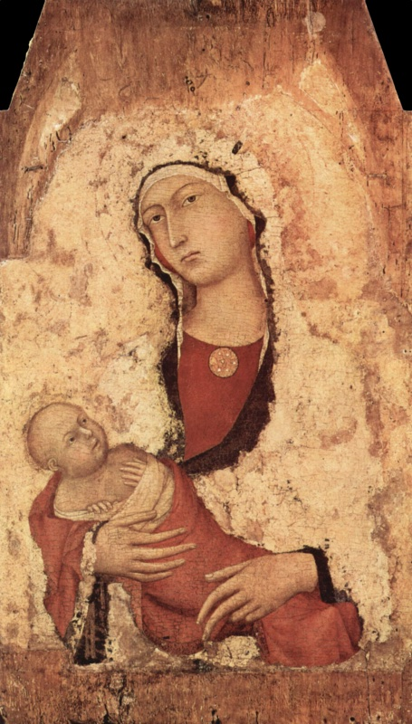
  <figcaption>Simone Martini, <em>Madonna and Child</em>, c. 1321, tempera on wood, 88 × 51 cm. Siena, Pinacoteca Nazionale (from the Pieve di San Giovanni Battista, Lucignano d'Arbia). Photo: Pinacoteca Nazionale di Siena, public domain, via Wikimedia Commons.</figcaption>
</figure>

The Madonna and Child from the Pieve di San Giovanni Battista at Lucignano d'Arbia, south of Siena, is a work of Simone Martini, now on deposit in the Pinacoteca Nazionale of Siena. It was discovered in 1957 beneath a sixteenth-century repainting, for which the gold ground and the blue of the Virgin's mantle had been scraped away, and it survives in an abraded and incomplete state. It is generally dated in the early 1320s and is considered the central panel of a lost polyptych.

The panel enters Lippo's catalogue as a term of comparison for the lost centre of the polyptych painted for the Franciscans of San Gimignano. In its catalogue of Italian paintings, the Yale University Art Gallery considered whether the Lucignano Madonna could have been that central panel, because its height from the base to the spring of the arch is identical to that of the Saint John the Evangelist at Yale, one of the lateral saints of the San Gimignano altarpiece.

The Yale catalogue concluded against the identification. The traces of the horizontal battens on the back of the Lucignano panel do not align with those of the lateral panels of the San Gimignano polyptych, and the two cannot have been joined in the same structure. The catalogue suggested instead that the Lucignano Madonna may reflect the appearance of the lost Virgin and Child, as a work of the same circle and of comparable dimensions.

The comparison is illuminating for the type of the Virgin. Mary is shown in half length, her head inclined to the right and her eyes looking out with a melancholy, distant expression, her face framed by a white veil, as in the Virgins associated with Lippo. The Child, however, is not the small boy of most Sienese Madonnas but an infant wrapped in swaddling bands, who looks up at his mother, an unusual iconography whose reasons are not documented.

The Virgin's long hands, one supporting the Child from below, the other resting across her body, and the intense exchange of glances between mother and son recur in a different form in Lippo's Madonnas, where the Child pulls at the veil or turns to the viewer. The comparison shows how Lippo, working beside Simone, adopted the general type of the half-length Virgin while modifying its motifs.

Two other panels have been proposed as the centre of the San Gimignano polyptych: the Virgin and Child no. 1067 in the Gemäldegalerie in Berlin, which most specialists now exclude, and the Lucignano Madonna, excluded by the technical evidence. The central panel of the altarpiece therefore remains unidentified, and both works serve only as indications of what it may have looked like.

The losses of the Lucignano panel, which deprive it of its gold and its blue, draw attention to the faces and hands, where the quality of Simone's painting remains evident. The comparison with Lippo's surviving panels of the San Gimignano polyptych, with their intact gold grounds and punched haloes, is therefore limited to the figures and their proportions rather than to the decoration.

The Lucignano Madonna is not part of Lippo's catalogue, and its attribution to Simone is generally accepted. Its place here is that of a comparative work, which documents the dimensions and the type of central panel used by the two painters in the 1320s and helps to visualize the missing centre of the Franciscan altarpiece of San Gimignano.
