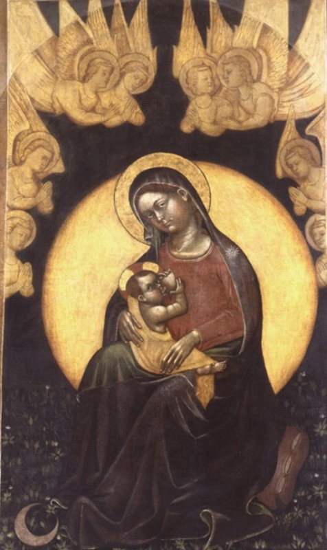
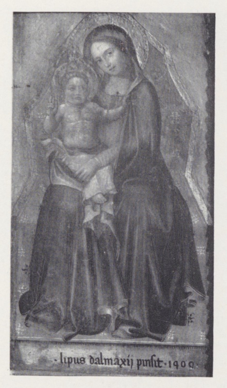
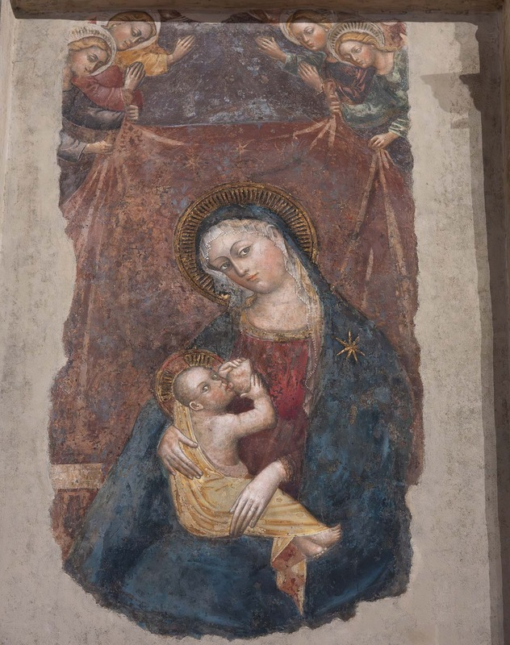
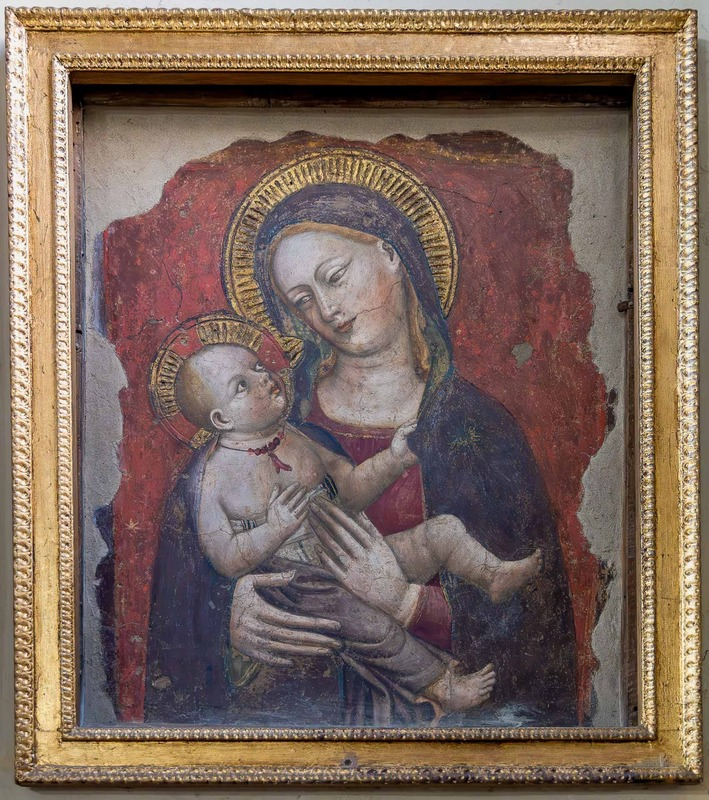
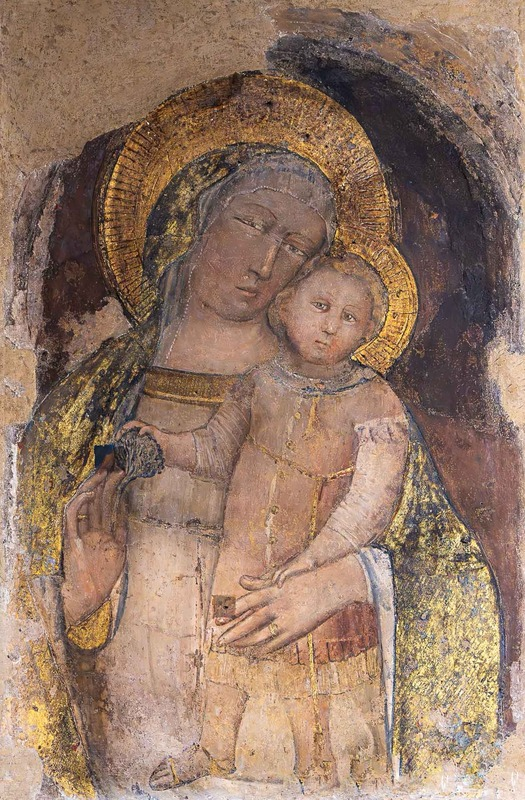
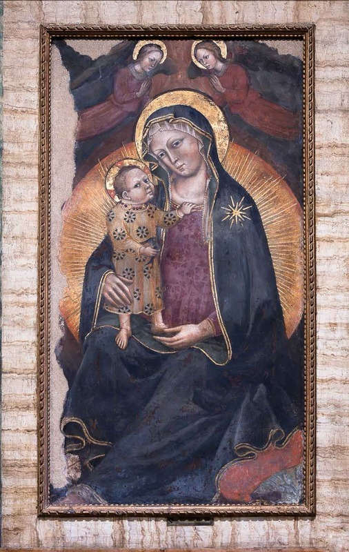

## Introduction: A Painter Overtaken by His Own Images

Few Trecento painters have had a stranger posthumous life than *Lippo di Dalmasio degli Scannabecchi*. The documents show a married Bolognese citizen, a property owner and the holder of an astonishing sequence of public offices; the literary tradition shows a quasi-monastic ascetic who fasted and took communion before daring to paint the face of the Virgin. His reputation as "Lippo dalle Madonne" rests on a real specialization in images of the Mother of God, above all the Madonna of Humility, but between [Francesco Cavazzoni](/scholars.html#cavazzoni-francesco) in 1603 and [Carlo Cesare Malvasia](/scholars.html#malvasia-carlo-cesare) in 1678 that specialization was enlarged into a hagiographic myth which modern scholarship has only lately taken apart. The two figures have to be kept distinct: the painter whom the archives of Bologna and Pistoia record, and the devout legend whom the Counter-Reformation required.

By the early seventeenth century Lippo was the most celebrated of Bologna's fourteenth-century masters. His Madonnas hung in churches, oratories and the houses of the patriciate, and popes were said to have prayed before them. Malvasia closed his account of the painter by observing that in its day there was no "persona di conto, e casata di proposito" that did not want to own a Madonna by Lippo, "ò dipinta sul muro in casa, ò sù picciola tavola in camera". By the nineteenth and twentieth centuries the same qualities that had made his fortune under the Counter-Reformation had turned against him: his art was called monotonous, modest and unoriginal. The organizers of the first monographic exhibition ever devoted to him, held at Bologna's Museo Civico Medievale from November 2023 to March 2024, acknowledged in their own presentation that his reputation had remained ambivalent until recent years, and they noted that the first monograph on the painter appeared only in 2010, followed by an expanded Italian edition in 2013. A figure who once stood beside [Giotto](/Content/Artists/XIII-c/Giotto-di-Bondone.html) in local esteem thus had to wait six centuries for a monograph — a measure of how completely the legend had displaced the painter.

Three layers of evidence, which the literature has often run together, have to be held apart. The first is the documentary record, most of it gathered in the Bolognese corpus *Miniatori e pittori a Bologna: documenti dei secoli XIII e XIV* (1947), in the Pistoia documents published in *Le Arti* in 1941–42, and in the archival biography of the painter published by [Raffaella Pini](/scholars.html#pini-raffaella) in 1998. The second is the evidence of the works themselves — their signatures, inscriptions, dates and physical condition, now best accessible through the technical literature and the 2023–24 exhibition. The third is the early literary tradition, from Vasari<a href="/endnotes.html#fn-giorgio-vasari" class="footnote">1</a> through Cavazzoni and Malvasia to [Lanzi](/scholars.html#lanzi-luigi): precious for the lost works it records and for what it reveals of the devotional reception of Lippo's images, but unreliable as biography. Where these layers conflict, the documents are given precedence, the works come second, and the tradition is treated as evidence of reception rather than of life.

## The Scannabecchi Household: Dalmasio, Lucia and Simone

Lippo was born into a family of painters. His father, [Dalmasio di Iacopo degli Scannabecchi](/Content/Artists/XIV-c/Dalmasio-degli-Scannabecchi.html), belonged to a branch of a Bolognese family whose Ghibelline<a href="/endnotes.html#fn-ghibellines" class="footnote">2</a> allegiances exposed it to banishment more than once in the factional politics of the Trecento. According to the *Enciclopedia dell'Arte Medievale*, Dalmasio is documented from 1342 to 1373. The military rolls of men fit to bear arms, the *venticinquine*, place him in 1354 in one Bolognese parish and in 1356 in the parish of San Domenico, in the quarter of Porta Procola. He then worked in Pistoia, where on 9 December 1359 he was paid "per dipintura e metere ad oro" the shutters of a marble image — a tabernacle commission that matters for his son's biography, because it explains why the family's later fortunes drew it towards Tuscany. It is also one source of a persistent confusion, since this documented Pistoiese work of the father has sometimes been transferred in popular accounts to the son.

The artistic identity of Dalmasio remains one of the open problems of Bolognese Trecento studies, and it cannot be ignored here, because any account of Lippo's training depends on how it is resolved. In the 1930s a substantial group of panels and frescoes was assembled under Dalmasio's name, including the cycle of the Life of St Francis in the main chapel of San Francesco in Pistoia and frescoes in Santa Maria Novella in Florence. Later research on the chronology of Bolognese painting placed this stylistic group earlier than the documents of the historical Dalmasio seemed to allow, and much of the literature consequently speaks of a "Pseudo-Dalmasio". The *Dizionario Biografico degli Italiani* entry of 2018 records that some recent scholars, Gibbs among them, have returned to the old identification, while noting that the unresolved quarrel does not threaten the stylistic coherence of the group itself. For a profile of Lippo the safe statement is this: his father was a documented painter active in Bologna and Pistoia; whether he was also the author of the "Dalmasio" corpus is not settled; and any reconstruction of Lippo's apprenticeship that leans on that corpus must be read as conditional.

The relation between Lippo and [Simone di Filippo](/Content/Artists/XIV-c/Simone-dei-Crocifissi.html), called "dei Crocifissi", is by contrast settled by the documents, and it is settled in a way the literature often misreports. The *Dizionario Biografico* states that Lippo's mother was Lucia, sister of the painter Simone di Filippo. Simone was therefore Lippo's maternal uncle — the brother of his mother and the brother-in-law of his father — and the *Enciclopedia dell'Arte Medievale* entry reaches the same conclusion independently, calling Simone "lo zio materno" in its summary of an act of 1377. Both notices descend, ultimately, from the documents Frati brought to light in 1909: Simone's testaments, which name his sister Lucia as Dalmasio's wife, and Lucia's own dowry act, transcribed in Frati's appendix; Gibbs and his co-author date the marriage to 1350. Some widely circulated English-language summaries describe Simone as Lippo's "paternal uncle"; this is wrong and should not be repeated, for the error dissolves the actual structure of the family workshop, in which two painting dynasties, the Scannabecchi and that of Filippo, were joined by marriage. The tie also had a working dimension: on 23 March 1365, with Pistoia already his residence, Dalmasio named his brother-in-law Simone his procurator in Bologna, with the fullest powers over his credits and property — an act that Frati's article of 1909 reports from the Bolognese archives.

Dalmasio made his will on 2 November 1373 in the family house in the parish of San Domenico in Bologna, and according to the *Dizionario Biografico* this testament is the first document in which Lippo appears. The children named are Lippo and his sisters Caterina and Agata; a younger brother, who would in time take his dead father's name, Dalmasio, was not yet born. The will thus establishes a family residence in the San Domenico parish that Lippo would keep for the rest of his life. The great Dominican<a href="/endnotes.html#fn-dominic-guzman" class="footnote">3</a> church remained the family's place of burial as well, and it was in the Scannabecchi tomb there that Lippo himself was laid after 1410 — a circumstance of no small consequence for the criticism of his legend.

## Birth and Minority: What the Documents Permit

No document records Lippo's birth, and every date found in the reference works and on museum labels is an inference. The *Enciclopedia Italiana* of 1936 printed "1352" — a figure Frati's article of 1909 already gave as "intorno al 1352" on the authority of Bolognini-Amorini's *Vite* of 1841, which is the convention's true birthplace; Pini's archival biography of 1998 carries "1353 ca." in its very title; the National Gallery catalogue prefers "c. 1353(?)"; and the material of the 2023–24 exhibition oscillates between "c. 1355" and "after 1350". All of these conventions are built on how one reads two notarial acts of 1377, and the two principal reference works read them in opposite ways.

On 7 August 1377 Lippo, described as resident in Bologna in the cappella of San Domenico but living in Pistoia, sold a house that formed part of his father's estate; his maternal uncle Simone attended as witness. The *Enciclopedia dell'Arte Medievale* summarizes this act as showing Lippo "di minore età". In the same year, however, Lippo provided the dowry for his sister Caterina's marriage and was named heir to a third of his father's goods, acting also on behalf of his younger brother, and the *Dizionario Biografico* reads this second act as proving that he was "sicuramente maggiorenne" by 1377. The two authorities therefore disagree on whether Lippo was legally a minor in that year, and the disagreement bears directly on the birth window, since each convention simply counts backwards from its chosen reading. Because the age of legal majority in Bolognese practice did not coincide with physical maturity, the most cautious statement the evidence allows is this: Lippo was born around or shortly after 1350, most probably in the early years of that decade, and the precise year cannot be fixed. The often-repeated "1352" and "1355" are conventions, not facts, and a scrupulous catalogue entry should present them as such.

## The Pistoia Years, c. 1377–1389

Lippo's adult career began in Pistoia, where his father had worked two decades earlier. The documents for this period were published from the Pistoiese archives in 1941–42 and have been expanded in the later literature, and they show a man firmly settled in the city rather than a transient journeyman. He lived in the parish of San Bartolomeo. In 1380 he witnessed the will of Stella di Fazio, and in the following year the same Stella made a legacy of a farm to fund, among other things, an altarpiece for the chapel of St Benedict in the Servite<a href="/endnotes.html#fn-order-servants-of-mary" class="footnote">4</a> church of Santa Maria dei Servi. The *Enciclopedia dell'Arte Medievale* records that in April 1383 Lippo carried out for that chapel a triptych with the Madonna and Saints Benedict, Andrew, John the Baptist and Paul; the *Dizionario Biografico* says the work was finished in 1384. The altarpiece is lost, but it is the earliest documented panel commission of his career, and it shows that by the early 1380s he was trusted with an altarpiece for a mendicant church in a city not his own.

Other Pistoia documents confirm his standing. On 4 September 1384 he stood surety for a loan of one hundred gold florins<a href="/endnotes.html#fn-gold-florin" class="footnote">5</a> — a guarantee implying credit well beyond that of an ordinary craftsman. In October of the same year he worked on the decoration of the catafalque of Jacopo Sandri, the kind of temporary ceremonial commission that occupied much of a Trecento painter's time and leaves no physical trace. Most remarkably, he was elected to the General Council of Pistoia and took part in its acts between 1385 and 1388, a notable sign of civic integration for a Bolognese immigrant. Nor did he cut his ties with his native city: the Bolognese *estimo* of 1385 records him as owning two houses, in the cappelle of San Procolo and San Domenico, and on 12 February 1387 Jacopo *de Nebulis* promised to sell him a plot of land. On 18 January 1389 he appointed two procurators, Jacopo di Marco and Guido di Mazzeo, to manage his remaining affairs in Pistoia, and this act marks his definitive departure.

Lippo's marriage also belongs to this period. His wife was Antonia di Paolo Sali of Pistoia, and the five children of the marriage are named in Frati's article of 1909: two sons, Giovanni and Sinibaldo, and three daughters, Giovanna, Giacoma and Veronica — Giacoma married on 22 February 1404, Veronica on 4 September 1408, and Giovanna twice, the second time in 1450. They rest on the Bolognese archival records Frati cited, not on anonymous tradition. The fact of the marriage itself, however, is not in doubt. Luigi Lanzi's *Storia pittorica della Italia* already recorded that Lippo, "creduto già carmelitano", had been shown in the Turin edition of [Baldinucci](/scholars.html#baldinucci-filippo) to have been "coniugato fino alla morte", and his will of 1410 names a son, Sinibaldo, as universal heir.

The surviving painted evidence from Pistoia raises the hardest attribution problem in Lippo studies. Three frescoes have been proposed as his. The first is the *Madonna of Humility between Saints Dominic and Catherine with two donors*, called the *Madonna del Padiglione*, a detached fresco of about 210 by 240 centimetres in the convent of San Domenico; the second is a *Madonna of Humility* in San Paolo; the third is a *Madonna with angels* in the Palazzo Comunale. The San Domenico fresco is the most ambitious. Gibbs attributed it to Lippo and dated it first to the late 1370s and later to around 1380, and the National Gallery catalogue of 2011 calls the attribution convincing. The photographic archive of the Fondazione [Zeri](/scholars.html#zeri-federico), however, records the same work under Lippo's name while noting alternative attributions to the Pistoiese Antonio Vite and to an anonymous local painter, and the *Dizionario Biografico* states plainly that the attribution of these frescoes to the young artist "non ha trovato la concordanza della critica". The co-curator of the 2023–24 exhibition went further, telling the press that no works survive from Lippo's Tuscan period, though its experience can be read in his later painting. The San Domenico fresco is discussed in its own section below.

The Palazzo Comunale *Madonna* has a history of its own and is discussed, together with the deliberation of 1407 that complicates its attribution, in the next section.

These facts lead to an important correction. Popular accounts sometimes mention a signed and dated *Madonna of Humility* by Lippo in Pistoia from the 1380s, placed either in the Palazzo Comunale or in San Giovanni Fuorcivitas. No such work is recorded in the scholarly literature consulted. The documented Pistoiese painting associated with San Giovanni Fuorcivitas is the tabernacle painted by Lippo's father Dalmasio in 1359, and the Pistoia frescoes given to Lippo are unsigned, undated and disputed. The safest formulation is that Lippo's Pistoia career is well documented in the archives but poorly documented in surviving paintings. What can be said with greater confidence — and the 2023–24 exhibition stressed the point — is that Pistoia was an important centre of the cult of the Madonna of Humility, and that Lippo's lifelong attachment to the subject is plausibly rooted in that Pistoiese experience.

### The Palazzo del Comune *Madonna of Humility*: Pistoia's Contested Witness

<figure>
 
 <figcaption>The Madonna of Humility with Four Angels, c. 1389(?). Detached fresco. Pistoia, Palazzo del Comune. Attribution to Lippo di Dalmasio debated: a communal deliberation of 1407 also bears on the work.</figcaption>
</figure>

No painting attributed to Lippo carries a heavier burden of argument than the arched fresco in Pistoia's Palazzo del Comune. If it is Lippo's, it is the sole surviving witness of his Tuscan decade — the only object against which the twelve documented Pistoiese years can be tested by eye; if it is not, those years remain, in paint, a blank. The *Enciclopedia Italiana* of 1936 called it the only work of Lippo still in Pistoia; the modern literature is far less sure. The dating adopted in the caption, about 1389 with a question mark, is the attributionist's reading — the eve of the painter's definitive return to Bologna — and it is held here provisionally, as one position in an open dispute rather than as a fact.

What survives, despite grave losses, is the most scenographically ambitious of all the humility images connected with Lippo's name. The Virgin sits low at the centre, her dark blue mantle open over a rose dress, nursing the Child who lies across her arm in a green-lined yellow wrap; around the pair bursts a pointed aureole of golden rays — not the round disc of the Bolognese versions but a flame-shaped glory, cusped like the architecture that encloses it — set against a field of green. The nursing group itself is close kin to the Misericordia fresco of 1397: the same turn of the head, the same heavy-lidded outward glance over the feeding Child, the register of public tenderness that the signed Bolognese wall-painting would fix eight years later, if the early dating holds.

Around this core a painted pavilion rises in full Gothic flower. Four twisted columns — white, spiralled, deliberately goldsmith-like — carry a scalloped arch with hanging tracery cusps; pinnacled turrets flank the composition; and above the arch a golden canopy swells against the blue, crowned at its summit by a miniature aedicule. This is the *padiglione*, the pavilion-tabernacle, rendered as architecture rather than as parted curtains: the same staging idea that the San Domenico fresco in Pistoia — the *Madonna del Padiglione* attributed to the young Lippo — realizes with cloth, here translated into a ciborium of paint. Whoever painted the Palazzo fresco, its scenography belongs recognisably to the Pistoiese family of humility images, the local tradition within which Lippo's specialization was formed.

The four angels complete the vision, and they add something no securely autograph work of Lippo preserves: music. Two red-robed angels fly in above the arch, hands raised in adoration, in the attitude of their counterparts on the Poletti fresco; two more kneel at the column bases below, one bowing a vielle, the other plucking a lute. Musician angels attend enthroned Madonnas across Tuscan painting of the late Trecento, but they are absent from the surviving Bolognese humility series — a difference that can be argued either way in the attribution debate: as evidence of a Tuscan ambient shaping a young Lippo, or as the mark of another painter altogether.

The dispute itself must be stated with its documents. The traditional attribution, already current in Chiti's chronicle of 1912 and consecrated by the *Enciclopedia Italiana* in 1936, has been defended in the modern monographic literature, which reads the fresco within Lippo's Pistoiese years and the city's cult of the Madonna of Humility. Against it, Benati, writing in the *Enciclopedia dell'Arte Medievale*, concluded that the attribution "deve cadere" — must fall — because a communal deliberation of 1407, published in 1912, refers to the image: a document from a year when Lippo had been settled in Bologna for nearly two decades. The *Dizionario Biografico* registers the stalemate, observing that the attribution of the Pistoiese frescoes to the young painter "non ha trovato la concordanza della critica", and the co-curator of the 2023–24 exhibition stated flatly that no works survive from Lippo's Tuscan period. No side is taken that the evidence does not allow: the fresco is catalogued here as attributed, debated, and documented to 1407.

Everything, in fact, turns on the notice of 1407, and that notice can be read. The page Benati cites — Alfredo Chiti's art chronicle in the *Bullettino Storico Pistoiese* of 1912 — does not transcribe the deliberation; it reports its substance, and in a sense that surprises both parties to the modern dispute: in 1407, Chiti writes, the painter "affrescava nella Sala Guelfa del nostro Palazzo Comunale quella Madonna col Bambino e Santi" — in 1407 Lippo was frescoing, in the Guelph<a href="/endnotes.html#fn-guelphs" class="footnote">6</a> Hall of the communal palace, the very image under discussion. The chronicle of 1912, that is, took 1407 as the year of execution and Lippo as its author, and even argued from it that the painter had remained in, or returned to, Pistoia. Benati's objection keeps the date and drops the painter; the attributionist case keeps the painter and must either accept a documented return to Pistoia in 1407 — a year, it is worth observing, for which the Bolognese list of Lippo's offices happens to record nothing — or set the notice aside as a misreading. The deliberation's own text, in Pistoia's communal archive, remains the final arbiter.

The fresco's material state asks its own questions. Detached and mounted on a rigid support with visible clamps, it has lost large areas — the upper right angel survives in fragments, the lower edge is ruined — and the painted border of dark red bands with geometric star inlay, which imitates marble intarsia, is interrupted by losses; faint traces along the red band of the arch may be lettering or merely damage, and deserve close examination. Chiti's chronicle supplies what the modern summaries do not: the fresco's original site was the Sala Guelfa of the palace, and by 1912 it had already been "tagliata dal muro ed applicata su altra parete della medesima sala" — cut from its wall and remounted on another wall of the same hall, which places the detachment around 1912 or shortly before. Chiti also calls the image a "Madonna col Bambino e Santi", where the surviving fresco shows angels, not saints — a loose description, or a hint that the ensemble was once larger.

The fresco's value survives the dispute. If Lippo painted it, it is the hinge of his biography made visible: the Pistoiese pavilion-stagecraft and the nursing group he would carry to Bologna, caught at the moment of departure. If he did not, it remains the clearest surviving statement of the civic, Tuscan humility tradition from which his specialization demonstrably came — the image a Bolognese immigrant saw honoured in the palace of the city that elected him to its General Council. Either way, no account of "Lippo dalle Madonne" can leave it out; what varies with the verdict is only whether it stands at the head of his catalogue or just outside its door.

### The *Madonna del Padiglione* of San Domenico

<figure>
 
 <figcaption>The Madonna of Humility between two angels, with Saints Dominic and Catherine of Alexandria and two donors ("Madonna del Padiglione"), c. 1380. Detached fresco. Pistoia, convent of San Domenico, old refectory (Sala San Domenico). Attributed to Lippo di Dalmasio; also given to Antonio Vite and to Paolo Serafini da Modena.</figcaption>
</figure>

The second Pistoiese witness is the finer of the two, and the better documented. The great detached fresco in the convent of San Domenico at Pistoia — the Virgin of Humility nursing the Child within a rayed glory, between Saints Dominic and Catherine with their diminutive donors, beneath a pavilion whose flaps two angels draw open — is, in the judgement of the study that Gibbs and his co-author have devoted to it, the one work in the city attributable to Lippo "with greater certainty than any other", in its Italian version published in the convent's own series of studies. The dating argued there is about 1380, in the heart of the painter's documented Pistoiese decade.

The fresco's history is unusually well recorded. It stood originally near the cloister door, on a wall beside the tomb of a certain Arrigo "teutonico" (died 3 July 1493), and the convent's Obituary describes it as it appeared about 1500: "beatae virginis cum filio, beati Dominici, beatae Katerinae cum papilione cum duobus angelis" — with the pavilion and the two angels already its defining note. Walled out of sight by a later construction in the cloister, it was rediscovered in the hollow of the wall by the Dominican historian of the convent, who published it in 1923 — as a work, he thought, of the Sienese school at its height. After the devastation of the Allied bombardment of 1943 it was detached by Alfio del Serra in 1958 and shown that year at the second exhibition of detached frescoes at the Forte Belvedere in Florence. The operation saved it at a price: a broad horizontal band below the Virgin's knees had already been destroyed by the insertion of a confessional, and a smaller zone above the angels' heads is likewise lost.

What survives is the most inventive image in the whole Pistoiese group. The Virgin, in red and deep blue, sits within a disc of golden rays — the same great sun that stands behind the signed London canvas — and nurses the Child at her right breast; Dominic, lily and book in hand, presents a kneeling layman, Catherine, crowned beside her wheel, a kneeling woman: husband and wife, in all likelihood, the donors of the image. Above them the pavilion rises, a blue-grey tent with scalloped, fur-lined edges, its flaps drawn apart by two flying angels so that the vision is disclosed to the worshipper as a king is disclosed in his tent. The two angels repeat a single cartoon, one of them reversed — the very economy that Piero della Francesca would employ, eighty years later, for the angels of the Madonna del Parto — and the left-hand angel, more generalized in its forms, may be a collaborator's share.

The pavilion is the crux, because it is Bolognese. The tent as tabernacle — the *tabernaculum* of Exodus, the "tabernaculum gloriae" that the Golden Legend<a href="/endnotes.html#fn-jacopo-da-varagine" class="footnote">7</a> makes of Mary herself — has a continuous pedigree in Bolognese illumination and painting: the tents of the Gratian manuscripts of the so-called Illustratore, the papal and imperial pavilions of the law books, [Vitale da Bologna](/Content/Artists/XIV-c/Vitale-da-Bologna.html)'s tent fragments at the Servi in Bologna and in the choir of Udine, and the whole Friulian descent that earned one anonymous follower the name of "Master of the Pavilions". Angels who draw its curtains descend from [Arnolfo di Cambio](/Content/Artists/XIII-c/Arnolfo-di-Cambio.html)'s Roman tombs and, further back, from the curtain-bearing victories of late-antique sarcophagi. In Tuscany the motif is an alien: its appearance over a Madonna of Humility in Pistoia is precisely the kind of imported, Emilian idea that points to a Bolognese hand — and this iconographic argument, first used to connect the fresco with Bolognese painting in 1931, is the backbone of the modern case for Lippo.

The attribution history is nonetheless a crowded field, and it is reported here whole. The author of the fundamental 1931 survey of Pistoiese painting first proposed Lippo, then withdrew in favour of an anonymous local master — a view shared by the editor of the Pistoia documents and by the author of the classic 1936 study of the humility type. Between 1932 and 1977 the fresco was repeatedly given to the Pistoiese Giovanni di Bartolomeo Cristiani, a proposal that founders on the flat painted borders of the Madonna, irreconcilable with Cristiani's elaborate illusionism in the same convent. A fundamental 1975 survey of late Trecento painting proposed the young Antonio Vite; the modern monographer of Vite answered in 2007 by reassigning the fresco to the Emilian Paolo Serafini da Modena. Against all of these, the Lists of Italian pictures and Gibbs have sustained Lippo, and the study of Gibbs and his co-author argues the case in detail; the *Dizionario Biografico*'s verdict that no consensus exists remains formally true, but the argument is no longer evenly balanced.

The stylistic case rests on comparisons inside Lippo's secure corpus, and each can be tested against the figures reproduced here. The rayed disc returns in the London canvas; the flowers in the angels' hair return in the Santa Croce triptych; the contours match the Servi false polyptych and the signed canvas of the Pinacoteca; the Child — wide-eyed, curved mouth, the careless bent toe — is the Child of the Misericordia fresco of 1397; the Virgin's hands are the hands of the *Madonna del Velluto*; Catherine anticipates her delicate counterpart in the Servi polyptych. A formula current in the literature sums up the whole, and it is the best sentence yet written on the young Lippo: here he stands "midway between the style of his father and that of his uncle" — Mary and the angels reflecting the Dalmasian manner, the Child's caprice and the donors' gravity reflecting Simone. Even the fur-lined tent, with its Emilian-Venetian "pineapple" patterning, belongs to Simone's decorative world. A final discriminator is disarmingly simple: in Lippo's Pistoiese group the Child nurses at the right breast, in Antonio Vite's at the left.

The fresco also opens a window on patronage and context. The humility cult is documented at Pistoia from 27 December 1362, when a testator endowed a lamp before an image of the Madonna dell'Umiltà in San Lorenzo; the most celebrated early image, the fresco from Santa Maria Forisportam — now in the basilica built after its miracle of 1490 — is attributed to Paolo Serafini, a painter a year or two older than Lippo who is recorded at San Domenico in Bologna in the company of Lippo's uncle Simone: the two "rival" humility images of Pistoia thus both descend from the Bolognese ambient. For the San Domenico fresco itself, the study points, without documentary proof, to the blessed Andrea Franchi — prior of the convent from 1370, bishop of Pistoia from the early 1380s, and traditional patron of the city's humility images — as the figure most likely to have brought a Bolognese painter's invention into the Dominican cloister.

The stakes, finally, are the inverse of the Palazzo del Comune's. There a late document threatens an attribution; here an early masterpiece, if accepted, gives Lippo's Tuscan decade its monument — his most Bolognese work anywhere, and his most adventurous: no surviving Bolognese Madonna of his repeats the pavilion, and beside this fresco, as the study itself concedes, they are "extremely conventional".

## The Return to Bologna and a Public Career, 1389–1410

The exact date of Lippo's return to Bologna is a matter of definition rather than of record. The exhibition panels and the National Gallery catalogue give 1387; the appointment of the Pistoia procurators in January 1389 marks the final legal break; and on 25 October 1389 he lodged a complaint in Bologna that he had been insulted while painting on the outer wall of Santa Maria dei Galluzzi, which places him physically at work in the city by that date. The political setting had meanwhile changed: the popular revolt against papal rule in 1376 had restored a communal regime, and the cancellation of the ban against the Ghibelline Scannabecchi has been suggested as one condition of his return.

What followed was a public career with no real parallel among Bolognese painters of the period. The *Dizionario Biografico*, drawing on the documents published in 1947 and in the expanded Italian edition of the monograph (2013), allows it to be followed almost year by year. The first office was the podesteria of the lands of Zappolino, conferred on 26 November 1390. He then served as castellan of San Martino and *podestà di sacco* of Medicina in 1392, as notary of the mills toll in 1393, as vicar of Tossignano in 1394, as vicar of Galliera and *portinarius* of the Palazzo degli Anziani in 1396, and in 1397 as vicar of Budrio while also holding the captaincies of Samoggia, of Porta San Donato and of the small fortress of Bazzano. In 1399 he held the captaincy of the small fortress of Castelfranco, of Piancaldoli and of Porta San Felice; in 1401 he was again vicar for Galliera; in 1402 captain of Porta Saragozza and vicar of Bruscoli; in 1405 vicar in Scaricalasino, Crevalcore, Savigno, Nonantola and Tiola; in 1406 vicar of Galliera, keeper of the Asinelli tower and castellan of Zola; in 1408 vicar of Montebello, castellan of several fortresses and once more captain of Porta San Felice; and in 1409 vicar of San Giovanni in Persiceto. On various occasions he also appears as a public creditor, as a communal tax-collector, as *notarius defensorum aversi*, as overseer of the *questori* of the Society of Notaries, as a *cavaliere* serving the judge of the office of the Procuratori, and as an elected judge of the Unicorno. The sequence, a dense but not continuous documentary record between 1390 and his death, is itself the historical fact.

Two cautions must accompany this reconstruction. The first concerns dates: the reference works disagree on several of them. The *Enciclopedia dell'Arte Medievale* gives the Zappolino and Medicina elections as 26 and 30 November 1391 rather than 1390, dates the notaryship of the mills toll to 1392, the Budrio vicariate to 1395 and Castelfranco to 1398. The two entries evidently draw on different stages of the documentary research. The second caution concerns rank. The claim, sometimes met in the literature, that Lippo sat among the Anziani — Bologna's supreme magistracy — has no support in the sources consulted here. What is documented is the far humbler post of *portinarius*, door-keeper, of the Palazzo degli Anziani in 1396. Most of his offices were rotating posts in the contado, vicariates, podesterie and castellanies of the kind the commune distributed among citizens of reliable standing; they attest trust and income, not membership of the ruling oligarchy. The exhibition's presentation sums the matter up fairly as a "brillante ascesa sociale in ambito civico", with offices including those of notary, *cavaliere* and judge.

This civic profile matters for how Lippo's art is read. A painter who spent part of almost every year administering a rural district or guarding a fortress had, of necessity, to run a workshop able to function without him. The *Dizionario Biografico* draws precisely this conclusion when it describes the late Madonnas as evidence of "un'intelligente produzione di bottega". The repetition of formulas that later critics took for monotony may therefore partly reflect something quite different: a business organized, deliberately and intelligently, to operate in its master's absence.

## Wealth, Household and the Will of 1410

The documents allow a modest but concrete picture of Lippo's economic standing. By 1385 he owned two houses in Bologna. In 1387 he arranged to buy land from Jacopo *de Nebulis*, and on 8 July 1404 he bought another house. His surety for a hundred gold florins in Pistoia in 1384 implies credit well beyond that of an ordinary craftsman, and his repeated appointments to salaried offices in the contado would have added a steady income alongside his earnings as a painter. The *Dizionario Biografico* speaks accordingly of his "facoltà economica" and of a "facoltosa situazione economica privata". To describe Lippo as notably wealthy is therefore reasonable; to put a figure on his fortune would be invention, since no full inventory has been published in the sources consulted.

On 11 October 1410 Lippo made his will and named his son Sinibaldo as universal heir. The *Dizionario Biografico*, citing Pini's biography, adds that he died soon afterwards and was buried in the Scannabecchi family tomb in San Domenico, while the firm terminus comes from a record of 1421, by which his adult daughter Giovanna released her mother from guardianship: Lippo was then already dead. Frati, who published the notice, dates it 5 May 1421; the *Enciclopedia dell'Arte Medievale* prints 5 March. Frati adds the household's afterlife: in 1429 the widow Antonia made her own will, with a legacy to the fabbrica of the church of Sant'Andrea degli Ansaldi. The "October 1410" so often printed as the month of his death is therefore an inference from the date of the will — a reasonable one, given the *Dizionario Biografico*'s "nel volgere di poco tempo spirò", but not a documented fact. One minor confusion should also be set aside here. In his life of the Florentine painter Lippo, Vasari writes "Furono le sue pitture circa il MCCCCX"; the sentence refers to the Florentine, not to Lippo di Dalmasio, whom Vasari treats only in an appended paragraph, and the coincidence of the date with the Bolognese painter's death is exactly that — a coincidence.

## Signatures, Dates and the Shape of the Corpus

Lippo signed his works more often than most of his Bolognese contemporaries, and taken together with his civic career this habit suggests a strong sense of professional identity. In a note to the London catalogue entry, the National Gallery catalogue of 2011 cites Pini's study of the Lambertini triptych for a list of signatures on ten surviving works and five recorded ones. The forms vary considerably. "Dalmaxii" or "dalmaxij" is described as the most usual; the Misericordia fresco of 1397 has "lippus dalmassi"; the London canvas has "lippus dalmasij pinxit"; the Pinacoteca canvas reads "LIPPUS DALMAXIJ FECIT"; and the 1394 Coronation carries the exceptional vernacular form "lipo de dalmase". The variety has tempted scholars to date works by the spelling of the signature, but the recorded versions break any neat sequence: a lost version of 1388 was recorded with "dalmaxii", while lost versions of 1405 and 1407 were recorded with "lippus" and, in one case, "dalmassi". If these records are accurate, orthography is not a reliable guide to chronology.

Three signed and dated works survive, and they are the fixed points around which everything else must be arranged. The first is the small panel with the *Coronation of the Virgin* in the Pinacoteca Nazionale di Bologna (inv. 1092, 63 by 27 centimetres), signed and dated 24 April 1394 and discussed in its own section below; Pini identified its patron as Redolfo, or Rodolfo, de' Lambertini, and the 2023–24 exhibition reunited it for the first time with its two wings, now in the Museo Stibbert in Florence (inv. 10348), which show the Annunciation with St Jerome<a href="/endnotes.html#fn-jerome" class="footnote">8</a> and St John the Baptist. The second is the detached fresco of the *Madonna of Humility* suckling the Child in Santa Maria della Misericordia in Bologna, signed and dated 1397 and measuring 140 by 105 centimetres. The third is the much repainted *Madonna enthroned* at Norton Hall in Gloucestershire, signed and dated 1409; the reference works name its owner differently — the "Pollen" collection in the *Dizionario Biografico*, the "Potter" collection in the *Enciclopedia dell'Arte Medievale* — a conflict the Lists resolve in Pollen's favour; the panel is discussed in its own section below. Around these anchors sit works that are signed but undated: the Santa Croce polyptych, the Pinacoteca canvas, the London canvas, a signed Madonna probably once owned by the eighteenth-century antiquarian Marcello Oretti and now in a private collection, and others.

The early sources record several further dated inscriptions on works now lost or untraced. According to Malvasia's text of 1678, a large Christ between Saints Peter and Paul stood in the old apse of San Pietro, the cathedral, "col suo nome in lettere grandi… col millesimo il 1404", and the exhibition panels likewise date the apse decoration of San Pietro to 1404. A half-length Madonna suckling the Child, described as "a olio sulla tela", hung in the private chapel of Lotto Guidalotti, inscribed "Lippus Dalmasij de Bononia me pinxit" with a date that the *Enciclopedia dell'Arte Medievale* reads as 1405. And a Madonna on a pillar of San Petronio, painted "per sua divozione" for Giacomo Ghisla, bore, according to Malvasia, the year 1407 — a work Vasari had already seen: "in San Petronio di Bologna, l'anno 1407, una Nostra Donna che è tenuta in molta venerazione". The *Enciclopedia dell'Arte Medievale* rightly calls these records "inverificabili".

The corpus as a whole, which the *Dizionario Biografico* describes as amounting to "alcune decine di opere", was put together slowly, and the older catalogue was, in the words repeated by that entry and by Benati's earlier article, "gravato… di numerosissime attribuzioni spurie". The modern catalogue grew in stages: lists published in the late 1960s and 1970s; Benati's contributions of 1992 and 1996; an article of 2010–11 in the bulletin of Bologna's civic museums that added a painted *Cross* in the Collezioni Comunali d'Arte among other works; and the monograph co-authored by Gibbs, of 2010, with its expanded Italian edition of 2013. The 2023–24 exhibition added at least one further painted cross, in the Museo Casa Rodolfo Siviero in Florence (162 by 116 centimetres), which, according to the exhibition's press dossier, Benati and another scholar recognized independently of each other. Benati has also observed that the "ridondanza di stilemi" in Lippo's painting makes attribution easier and dating harder — a remark that explains, better than any other, why the chronology of the undated works remains so disputed.

### The Lambertini *Coronation of the Virgin* of 1394

<figure>
 
 <figcaption>Coronation of the Virgin, with St John the Evangelist in the gable; central panel of a dispersed triptych. Signed and dated 24 April 1394, with the name of the patron, Rodolfo de' Lambertini. Tempera on panel, 63 × 27 cm. Bologna, Pinacoteca Nazionale, inv. 1092 (provenance Stanislao Rinaldi). The wings are in Florence, Museo Stibbert, inv. 10348.</figcaption>
</figure>

The earliest of Lippo's three signed and dated works is also the smallest and, by the Pinacoteca's own judgement, one of the finest. The little panel of the Coronation of the Virgin (inv. 1092) measures only 63 by 27 centimetres: a work of private devotion, the central element of a triptych now dispersed, whose painted surface the museum's description assigns to "il momento più alto di Lippo" — the painter's highest moment, in the very years when he was engaged at San Giacomo Maggiore and on the worksite of San Petronio. The panel reached the Pinacoteca from the collection of Stanislao Rinaldi, according to the museum's record.

What makes the panel historically precious is concentrated in the narrow white band along its lower edge. There, in minute Gothic script, run the date, the painter's name and the patron's: the year 1394 with the day, 24 April; the signature in the exceptional vernacular form "lipo de dalmase", unique among Lippo's recorded signatures, which otherwise prefer the Latin "dalmaxij"; and the statement that the work was made for Rodolfo de' Lambertini. Pini's study of the panel decrypted this commission and restored the patron to the great senatorial family of the Lambertini; the museum's description underlines how rare it is for a single Trecento panel to carry signature, date and patron's name together. The inscription is partly legible in the photograph.

The main field compresses a court ceremony into a hand's breadth. Under a painted cusped arch, against a cloth of honour of deep red patterned with punched motifs, Christ, in a rose mantle over a dark tunic with an embroidered square neckline, leans towards the Virgin and sets the crown on her head; she bows to receive it, hands crossed on her breast, wrapped in a white mantle whose silvery folds fall over a rose dress. The two figures kneel and bend towards one another in a single arc, the hieratic subject turned into an exchange of extraordinary gentleness — the same communicative warmth, here at courtly pitch, that animates the nursing Madonnas.

Behind the red hanging, filling the lunette of the arch, presses a choir of angels reduced to their essentials: a bank of blue seraph-like heads, each with its small gold halo, the heavenly host rendered as pure colour and number. The device recalls the golden angels of the Pinacoteca's great canvas, but inverted in key: there the angels are light against darkness, here they are a cool blue shadow behind the ceremony's red and gold. In so small a field the painter needed a way to signify multitude without crowding the protagonists, and the row of blue heads does exactly that.

In the gable above, framed by the carved acanthus of the original crocketed frame, a haloed figure blesses with his right hand and displays an open book inscribed with lines of script. The identification followed here, from the museum, is St John the Evangelist; part of the reference literature instead describes the figure as Christ Blessing. An Evangelist-visionary would sit well above a Coronation, the heavenly liturgy he witnessed in the Apocalypse; the book's inscription, if it can be read from better photography, would settle the question.

The panel's carpentry is a rare survival in itself. The engaged frame, with its gilt mouldings, its gable edged by leafy crockets and its flaming acanthus finial, appears substantially original, and two small carved heads mark the springing of the arch. The dispersed wings survive in the Museo Stibbert in Florence (inv. 10348), showing the Annunciation with Saints Jerome and John the Baptist, and the 2023–24 exhibition reunited centre and wings for the first time — a reconstruction that restored to view, however briefly, a complete Bolognese domestic triptych of the 1390s with its dated centre.

The Lambertini commission places Lippo's private clientele beside his public one. In 1394 the painter was at work for the fabbrica of San Petronio — the St George on linen was paid that May — and the chapel of St Cecilia at San Giacomo Maggiore was begun in the same year; the museum's description makes the point that the little Coronation belongs to precisely this moment of fullest activity. That a member of the Lambertini, one of the city's great families, should order from him a jewel-like triptych for private devotion in the same season shows the painter operating at every level of the Bolognese market at once: civic basilica, mendicant chapel, patrician chamber.

Within the corpus, finally, the panel is the first of the three fixed chronological points — 1394, 1397, 1409 — around which everything else must be arranged, and the only one that names its patron. It proves that the "painter of Madonnas" commanded other subjects with equal authority; that his workshop could change scale from processional canvas to miniature precision; and that the vernacular "lipo de dalmase", written small beneath a Coronation for a senatorial household, belongs to the same self-naming habit that spread his Latin signature across the walls and altars of the city.

### The Stibbert Wings of the Lambertini Triptych

<figure>
 
 <figcaption>The wings of the Lambertini triptych: the Annunciation, above Saints John the Baptist and Jerome, 1394. Tempera on panel. Florence, Museo Stibbert, inv. 10348. Photo: Guido Barbi.</figcaption>
</figure>

The wings that once closed over the little Lambertini Coronation survive together in the Museo Stibbert in Florence (inv. 10348), and their reunion with the Bologna centre at the 2023–24 exhibition restored, for the first time since the triptych's dispersal, the complete object that Rodolfo de' Lambertini commissioned in 1394. Each wing repeats the carpentry of the centre — the gabled gilt frame edged with leafy crockets — so that closed, the three gables rose together like a miniature church front.

Each wing is divided in two tiers, and the upper tier carries a single scene split across both: the Annunciation. In the left gable the Virgin, in a rose dress, sits at her lectern against a field of red; in the right gable Gabriel, robed in blue with a gold wing rising behind him, kneels with his hand lifted in salutation. The order is the reverse of the usual one — the angel at the right, the Annunciate at the left — and the inversion has a purpose that only the reassembled triptych reveals: both figures turn inward, so that with the wings open the angel's greeting travelled across the central panel itself. The Annunciation, beginning of the Virgin's story, thus framed the Coronation, its end — the whole of Mary's destiny compressed into three gables and a hand's span of panel.

The Annunciate is a study in stillness: seated, a book open on the tall lectern before her, her head bowed beneath a thin halo, she receives the salutation with no gesture beyond attention. Gabriel is her active counterpart, caught mid-genuflection, drapery still settling, the raised right hand carrying the whole of his message. At this scale — each gable field is smaller than a page — the painter could not stage the event; he could only distil it, and the distillation is the same that governs the Coronation below: sacred narrative reduced to two poses and an exchange.

The main field of the left wing belongs, once more, to John the Baptist. Gaunt in his camel skin under a grey-brown mantle, he points heavenward with one hand and with the other unrolls a scroll on which the Gothic lettering is unusually legible in the photograph: ECCE AGNUS DEI, with the continuation towards QUI TOLLIS PECCATA MUNDI — the Precursor's testimony from the Gospel of John. He is a recurrent figure in Lippo's work — lost Pistoiese altarpiece, Santa Croce wing, Savelli centre — and his presence on a private triptych of 1394 confirms that the Baptist accompanied Lippo's production at every scale, from church polyptych to bedchamber tabernacle.

The right wing holds the triptych's most engaging invention: Jerome, dressed in the full scarlet robe and broad-brimmed hat of a cardinal, with his lion not couched at his feet but rearing up against him like a great dog greeting its master. The motif turns the attribute into an event; the beast's golden-brown body against the scarlet robe is the strongest colour chord of the whole triptych. Jerome's cult — penitent, translator, model of learned piety — was expanding across Italy precisely in these decades, and his pairing with the Baptist gives the wings a coherent devotional theme: the desert, penance, and the word of God, flanking the courtly glory of the centre.

Why these two saints for Rodolfo de' Lambertini is not recorded. Neither is a name-saint of the patron, and the sources consulted say nothing of the family's particular devotions in 1394; the choice may reflect the dedication of a chapel, a confraternal allegiance, or simple personal piety, and the question is best left open. What the wings do document is the reach of the commission: a complete programme — Incarnation, witness, penance, coronation — executed for a single household, with the patron's name and the date written small beneath the central ceremony.

As painting, the wings sustain the centre's standard without strain. The Baptist's wiry asceticism and Jerome's massed scarlet are differentiated with the same care as the Savelli saints a decade later; the two Annunciation figures, despite their size, lose nothing in legibility; and the punched haloes and red grounds keep the goldsmith's register of the whole object. If the Coronation shows "il momento più alto di Lippo", as the Pinacoteca has it, the wings show that the height was not confined to the centre panel.

For the catalogue, the Stibbert panels close the file on the one work of Lippo's that survives complete in all its parts, signed, dated and documented to its patron.

## The Madonna of Humility: Iconography and Specialization

The image of the Virgin seated on the ground, usually on a cushion or in a flowering meadow and often nursing the Child, is the iconography most closely tied to Lippo's name. The 2023–24 exhibition summarized the received history of the type: it was associated with [Simone Martini](/Content/Artists/XIV-c/Simone-Martini.html)'s activity at Avignon around 1340 and was spread above all by the mendicant orders, Dominicans and Franciscans<a href="/endnotes.html#fn-francis-assisi" class="footnote">9</a>, because of its theological weight. In the exhibition's own words, Lippo is the painter who "contribuisce in modo decisivo alla fortuna iconografica della Madonna dell'Umiltà" in Bologna, and his Pistoia stay is called decisive precisely because the image enjoyed a widespread cult in that city. The National Gallery catalogue, citing the fundamental study of the theme published in 1936, stresses two peculiarities of the northern Italian branch of the tradition: the fusion of the Madonna of Humility with the Woman of the Apocalypse of Revelation 12:1, "clothed with the sun, and the moon under her feet, and upon her head a crown of twelve stars", and the flowered ground on which she sits. It adds that in northern Italy the subject seems to have been especially common in paintings on canvas, with at least three such examples by Lorenzo Veneziano surviving.

Lippo's versions deploy both features with remarkable consistency. In the Misericordia fresco of 1397, in the Pinacoteca canvas and in the London canvas, the Virgin sits within or before a great disc of sun, with twelve stars about her head and, in the two canvases, a crescent moon at her feet; in the 1397 fresco, where no moon is visible, one of the stars has migrated to her shoulder. The National Gallery catalogue notes that in most of these versions the Virgin turns to her right, looks out at the viewer and suckles the Child. The canvas now in the BPER Banca collection in Modena (118 by 97 centimetres), which Benati published in 2007, keeps the same apocalyptic apparatus and adds the dove of the Holy Spirit and two angels at each corner. The Madonna in the Poletti collection at San Martino in Soverzano, exhibited in 2023–24 as a detached fresco of about 1400, belongs to the same family, as does the *Madonna dell'Orazione* in the chapel of that name in San Colombano, which the *Dizionario Biografico* dates to 1399.

It would nonetheless be wrong to conclude that Lippo was simply repeating a formula. Recent studies point to iconographic motifs that were rare in Bologna before him, such as the swaddled Child standing upright on his mother's lap in the painted false polyptych in Santa Maria dei Servi, and to the small realistic touches that make his Christ Children so lively and engaging. The exhibition's presentation traced the "accento vivacemente comunicativo" of his sacred images back to the Bolognese tradition founded by Vitale da Bologna. The communicative warmth that Malvasia and his informants admired in these pictures is, in other words, a real quality of the paintings themselves, and not merely a projection of seventeenth-century piety onto them.

### The Misericordia *Madonna of Humility* of 1397

<figure>
 
 <figcaption>The Madonna of Humility, signed and dated 1397. Detached fresco, 140 × 105 cm. Signed "lippus dalmassi". Bologna, Santa Maria della Misericordia. Photo: © Church of Santa Maria della Misericordia, Bologna. Courtesy of MIBAC – Archivio Fotografico Soprintendenza BSAE – Bologna.</figcaption>
</figure>

Among the three works that carry both Lippo's name and a year, the fresco of 1397 in Santa Maria della Misericordia is the only one on a wall, and it is therefore the keystone of his entire fresco production. Signed "lippus dalmassi" and dated 1397, it stands chronologically between the small Lambertini *Coronation* of 1394 and the Norton Hall *Madonna* of 1409, and it fixes, at the midpoint of his Bolognese career, the form his most personal subject took when painted for public devotion. The fresco was detached from its wall at an unrecorded date and is now mounted on a movable support; the National Gallery catalogue describes it as "somewhat repainted", a caution that applies to any close reading of its surface.

The iconography is the one Lippo made his own, here in its most concentrated form. The Virgin sits low upon a red tasselled cushion, on a dark ground, and suckles the Child, who lies across her lap wrapped in a yellow cloth and reaches with both hands for her breast. Behind the pair burns the sun in glory, its gold rays rimmed with a band of red and orange flame that is more fiery here than in either of the canvases. Gold eight-pointed stars are scattered across the dark field about her halo; the catalogue counts the canonical twelve and observes that one of them has migrated onto the Virgin's shoulder, where in the London canvas a sunburst occupies the same place. The apocalyptic apparatus is thus present in the sun and the stars; no crescent moon is visible in the photograph.

One framing device distinguishes the fresco from the canvases: at either side a green curtain, knotted and lined with red, is drawn back from the vision. The motif turns the image into a revelation — a cloth of honour or tent opened before the worshipper — and it connects the Bolognese fresco with the Pistoiese tradition of the *Madonna del Padiglione*, the Madonna of the Pavilion, whose most ambitious example, in the convent of San Domenico at Pistoia, has been attributed to the young Lippo himself. Whatever the verdict on that attribution, the parted curtains of 1397 show the painter carrying back to Bologna a staging he had seen, and perhaps practised, in Tuscany.

At the upper left hangs a small tablet-like scroll, inscribed in Gothic minuscule. The letters are abraded and only partly legible in the photograph, and no transcription is given in the sources consulted. Its presence is nonetheless significant in itself: a speaking inscription addressed to the worshipper belongs to the devotional rhetoric of the image, and its position, balancing the drawn curtain on the right, shows that it was part of the original design rather than a later addition.

The figures themselves state the difference between this public image and the London canvas. Here the Virgin, her mantle drawn up over her head in the traditional manner, inclines her face towards the Child but turns her gaze outward, towards the spectator, in the frontal, engaging address that the National Gallery catalogue notes as the norm of Lippo's versions; the nursing Child, absorbed in his mother, belongs to the worshipper's world of tender observation. A thin red thread circles the Child's throat — most plausibly the string of a coral amulet or necklace, of the kind the Child wears in the *Madonna del Velluto* and in the panel from Santa Maria delle Laudi attributed to Lippo, coral carrying both protective and Passion associations; the reproduction does not allow beads or a pendant to be distinguished. The London canvas inverts this rhetoric, closing the pair in a private exchange of gazes; the fresco opens it, because a wall-painting in a church had to meet the eyes of whoever stopped before it. The two works are best understood as the same subject tuned to two different kinds of attention.

Of the fresco's material history little is published in the sources used here. The detachment — a *strappo*, to judge from the transfer to a movable support — is undated in the literature consulted, and the repainting noted by the National Gallery catalogue has not been mapped. The flesh tones, the modelling of the Virgin's face under its translucent veil, and the firm drawing of the Child's body nonetheless read as substantially authentic, and the fiery rim of the sun, a feature hard to invent, must belong to the original conception.

The signature matters as much as the date. "Lippus dalmassi", in the vernacular-tinged form also recorded on lost works, joins the London "lippus dalmasij pinxit", the Pinacoteca "LIPPUS DALMAXIJ FECIT" and the vernacular "lipo de dalmase" of 1394 in showing how variously the painter wrote his own name; the 1397 fresco proves that he signed wall-paintings as well as panels and canvases, exactly as Vasari and Malvasia report of the lost apses of San Francesco and San Pietro, where his name stood "in lettere grandi". For the attribution of unsigned frescoes — the San Procolo lunette, the false polyptych in the Servi, the Madonnas of the porticoes — this dated and signed wall-painting is the indispensable term of comparison.

The setting, finally, carries its own caution. The present church of Santa Maria della Misericordia, outside Porta Castiglione, was rebuilt from 1432 by the Olivetans<a href="/endnotes.html#fn-olivetan-order" class="footnote">10</a> and later passed to Augustinian<a href="/endnotes.html#fn-augustinian-order" class="footnote">11</a> friars; the fresco of 1397 therefore predates the building that now houses it, and must come from the earlier church or its dependencies. What is not in doubt is the continuity of devotion: a signed image of the nursing Virgin, made for a church of the Misericordia at the city's edge, kept its public through rebuilding, detachment and restoration, and in 2023–24 travelled to the Museo Civico Medievale as one of the anchors of the painter's first monographic exhibition.

### The National Gallery *Madonna of Humility* (NG 752)

<figure>
 
 <figcaption>The Madonna of Humility, c. 1390 (National Gallery dating; also placed c. 1400–1410). Egg tempera on canvas, 110 × 88.2 cm. Signed "lippus dalmasij pinxit". London, The National Gallery, inv. NG 752. Bought from Michelangelo Gualandi, 1866. Photo: © The National Gallery, London.</figcaption>
</figure>

The canvas in London is the work through which most non-Italian viewers meet Lippo di Dalmasio, and it is, by the National Gallery's own account, the only Bolognese painting of the fourteenth century in the collection. It shows the iconography with which the painter's name is inseparably linked: the Madonna of Humility, the Virgin seated not on a throne but on the ground, here in a meadow sown with flowering plants. Signed "lippus dalmasij pinxit" on a white band among the grasses at the lower edge, it is painted in egg tempera on canvas and measures 110 by 88.2 centimetres. The picture entered the Gallery in 1866, purchased from the Bolognese dealer and scholar Michelangelo Gualandi, after a documented history in two of Bologna's great patrician collections.

The composition fuses the humility theme with the apparition of the Woman of the Apocalypse of Revelation 12:1, "clothed with the sun, and the moon under her feet, and upon her head a crown of twelve stars". A vast disc of gold, engraved with radiating beams, rises behind the seated Virgin and fills the picture field almost to its edges; twelve mordant-gilt stars circle her halo, and a crescent moon, laid in silver leaf, lies at her feet among the plants. This cosmic apparatus, joined to the flowered ground, is the distinctively northern Italian form of the subject, and Lippo deployed it throughout his career, in fresco and on canvas alike: the signed fresco of 1397 in Santa Maria della Misericordia and the signed canvas in the Pinacoteca Nazionale di Bologna repeat the same celestial machinery around the seated Mother of God.

Within that formula, however, the London picture is the least formulaic of the series. In Lippo's other surviving versions the Virgin suckles the Child, looks out at the viewer, and wears her cloak drawn over her head. Here she does none of these things. Nearly bare-headed, her blue mantle slipped back to show her fair hair under a transparent veil, she bends her face to the Child, who rests one arm on her shoulder, reaches with the other towards her veil, and looks up into her eyes. The exchanged gaze and embracing pose have been connected by the National Gallery catalogue with Sienese models, above all Pietro and Ambrogio Lorenzetti, and read as the clearest painted evidence of what Lippo's long Tuscan residence in Pistoia gave to his art.

The tenderness of the central group is framed by an angelic liturgy. In each upper corner three angels lean inwards with joined hands, their wings tipped with red, adoring the vision from the dark spandrels left outside the sun's circumference. The Child is wrapped, rather unusually, in a length of red fabric instead of a dressed tunic, a warm note against the deep blue of the mantle; a golden sunburst glows on the Virgin's shoulder, a miniature echo of the great disc behind her. The meadow itself is painted with real botanical attention, the flowering plants laid in thick, pale strokes over a black preparatory layer — a technique that trapped small air bubbles in the paint, still visible under magnification.

The support deserves a paragraph of its own, for it settles an old error. It was long thought that the picture had been painted on panel and later transferred to canvas; the technical examination published in the Gallery's 2011 catalogue shows instead that the original support is canvas, a simple tabby weave of two pieces sewn together with a horizontal seam about 56 centimetres above the bottom edge, and that the damage follows the pattern of torn fabric, not of split wood. The restoration that Marcello Oretti recorded in 1773, carried out by Domenico Pedrini on a picture "in quattro pezzi rimessa in una nuova tela", was therefore a relining, not a transfer. A canvas support was no anomaly in Lippo's practice: the documents of the San Petronio worksite record him painting altarpieces "in panno lineo" in 1393 and 1394.

Time has not been kind to the surface. The flesh paint is thin and worn, the Child's head is crossed by a complex tear, and the haloes have been regilded with "gold" paint; the Virgin's azurite cloak has darkened almost to black, and the silver leaf of the moon has degraded to near darkness, so that the original contrast of gold sun and silver moon must now be imagined. The signature, by contrast, survives almost immaculate between its incised guidelines, with only a small repair to the initial "l" of "dalmasij" — a fortunate accident, since Lippo's habit of signing is central to his historical identity.

Both the date and the original function of the picture remain open questions, and they must be stated as such. The National Gallery proposes a date between 1387 and 1397, probably around 1390, on the strength of the picture's Tuscan accent; other scholarship has placed it instead in the painter's last years, around 1400–1410, among the products of his mature Bolognese workshop. As for function, the catalogue weighs the possibility that a Madonna on canvas served as a confraternity banner and concludes that an altarpiece is more likely: the prominence of the signature and the well-preserved lower edge both argue against processional wear, though the banner hypothesis cannot be wholly excluded for the companion canvas in Bologna.

The provenance is unusually full for a Trecento picture. The canvas was in the Malvezzi collection in Bologna by 1773, and is therefore presumably the otherwise undescribed Madonna that Malvasia, in 1678, records "entro il Palagio del sig. Lucio Malvezzi"; it passed to the Hercolani through the marriage of Count Astorre Hercolani to Marchesa Maria Malvezzi, is recorded in the Hercolani collection in 1816 and again in 1861, when Sir Charles Eastlake saw it there, and was bought by the Gallery in 1866 from Gualandi. Thus an image of exactly the kind Malvasia described — a Madonna by Lippo kept "in camera" by a great Bolognese house — travelled, by way of the nineteenth-century taste for the primitives, from a patrician palace to a public museum, where it now represents its school alone.

### The Pinacoteca *Madonna of Humility with Angels* (inv. 786)

<figure>
 
 <figcaption>The Madonna of Humility with Angels, c. 1390–1400 (also placed 1400–1405). Tempera on canvas, 175 × 103.5 cm. Signed LIPPUS DALMAXIJ FECIT. Bologna, Pinacoteca Nazionale, inv. 786. Photo: © Pinacoteca Nazionale Bologna. Courtesy of MIBAC – Archivio Fotografico Soprintendenza BSAE – Bologna.</figcaption>
</figure>

The third of Lippo's signed Madonnas of Humility is also the largest. The canvas in the Pinacoteca Nazionale di Bologna (inv. 786) measures 175 by 103.5 centimetres, half as tall again as the London picture, and with the Misericordia fresco of 1397 and NG 752 it completes the trio of signed versions on which every account of the painter's specialization must rest. Like the London picture it is painted in tempera on canvas — the support the San Petronio documents show Lippo using for altarpieces "in panno lineo" in 1393 and 1394 — and its signature, in Gothic capitals, reads LIPPUS DALMAXIJ FECIT.

The composition deploys the full apocalyptic apparatus in its canonical arrangement. The Virgin, her head covered by her mantle in the traditional manner that the London canvas alone abandons, sits on a dark ground sown with flowering plants and suckles the Child, who lies across her lap wrapped in a yellow cloth; a star shines on her shoulder, the great disc of the sun rises behind the pair, and a crescent moon lies in the grass at the lower left. The National Gallery catalogue groups it with the fresco and the London picture precisely for this shared machinery of sun, stars, moon and flowered ground, and notes that here, as in the fresco, the Virgin turns to her right and nurses the Child — the public, frontal rhetoric of the type, against the private exchange of gazes in London.

What the other versions do not have is the angelic glory that gives this canvas its name. Above and beside the sun, a crowd of adoring angels — at least ten are visible in the photograph — arches over the disc like a second, living halo, painted in gold against the dark ground so that they read as beings of light rather than of flesh. In the London canvas six angels in full colour occupy the upper corners; here the heavenly host has multiplied and been absorbed into the gold itself, a solution closer to the engraved rays and tooled surfaces of the goldsmith than to the coloured figures of panel painting. The effect, even through the veil of repainting discussed below, is of a vision framed by its own radiance.

The signature deserves attention for its form. LIPPUS DALMAXIJ FECIT, in Gothic capitals, uses the "dalmaxij" spelling that the documentary literature describes as the most usual in Lippo's signatures, and the verb *fecit* where the London canvas has *pinxit* — two formulas from the same workshop habit of self-naming that made "Lippo dalle Madonne" possible.

A heavy caution hangs over any close reading of the surface: the National Gallery catalogue calls the picture "extremely repainted". How much of the gold of the sun and of the angels, how much of the flowered ground, and how much of the flesh belongs to Lippo's own hand, and how much to later restorers, cannot be judged from a photograph; the broad invention — the scale, the nursing group, the angelic arc — is not in doubt, but the details are. A mapped account of the repainting, if one exists in the restoration files or in the 2004 catalogue entry, would transform the usefulness of this canvas for the study of Lippo's technique.

The date oscillates within a window of about fifteen years. The Pinacoteca's own presentation dates the canvas 1390–1400; the National Gallery catalogue places it close in date to the fresco of 1397; and the material of the 2023–24 exhibition preferred 1400–1405, among the works of the painter's last period. The disagreement is a small instance of the general problem Benati identified: the redundancy of Lippo's repertory makes his undated works easy to attribute and hard to date, because the same invention was repeated across two decades with only incremental change.

The question of function is openly stated by the holding museum. The Pinacoteca's presentation allows that the canvas may have been painted for the decoration of an altar, but that use as a confraternity banner — a *gonfalone* — "non è da escludere"; the National Gallery catalogue weighs the same alternatives for the London picture and decides for an altarpiece there. The great height of the Bologna canvas, its light support, and the taste of Bolognese confraternities for processional images of the Virgin keep the banner hypothesis alive here; a documented provenance, which the sources consulted do not supply, would settle it.

Set beside its two signed companions, the Pinacoteca canvas shows what serial production meant in Lippo's workshop. One invention — the nursing Virgin of Humility within the sun — was tuned to three different instruments: compressed and fiery in the fresco for a church wall, enlarged and thronged with golden angels on this canvas, softened into Tuscan intimacy in London. The repetition that nineteenth-century critics read as poverty of imagination is better read as what it was for the painter's contemporaries: a trusted image, recognisable at once, renewed for each setting without ever being merely copied.

### The Poletti *Madonna of Humility*

<figure>
 
 <figcaption>The Madonna of Humility, c. 1400 (also dated 1400–1405). Detached fresco transferred to canvas, 120 × 72 cm. San Martino in Soverzano (Minerbio), Michelangelo Poletti collection.</figcaption>
</figure>

A further surviving image in Lippo's humility series is the detached fresco now in the collection of Michelangelo Poletti at San Martino in Soverzano, near Minerbio, in the Bolognese countryside. Transferred to canvas at an unrecorded date, it measures 120 by 72 centimetres; the 2023–24 exhibition, to which it was lent, presented it as a work of about 1400, and other material connected with the exhibition gives 1400–1405. With the Misericordia fresco and the two signed canvases it adds to the surviving evidence for the invention on which the painter's name was built — and, with the BPER Banca canvas, it is one of the two outside a church or museum.

The composition strips the type to its devotional core. The Virgin sits low, her blue mantle spreading about her; her head is covered in the traditional manner, a white veil showing at the brow, and her rose dress is closed by a gold-trimmed neckline. Behind her the ground is not the dark field with disc, stars and moon of the other versions but a single radiance: gold rays filling the whole space around the figures, the sun-glory expanded until it becomes the picture's atmosphere. In the upper corners two angels in red tones, fragmentary but legible, adore with joined hands against a strip of blue-green sky. No stars and no crescent moon are visible in the photograph; whether the full apocalyptic apparatus was never painted here, or was lost at the edges in the detachment, is a question the condition of the margins leaves open.

The Child supplies the painting's most memorable invention. Held on his mother's left arm, nearly naked in a transparent white wrap, he raises a hand to his mouth — the universal gesture of infancy, caught with the directness that the exhibition's presentation called the "accento vivacemente comunicativo" of Lippo's sacred images. He does not nurse, as in the Misericordia and Pinacoteca versions, and the pair do not lock eyes, as in London; instead the Virgin looks down at him with lowered lids while he, finger at his lips, looks out — the engaging address of the public versions transferred from mother to son. A small red element at the Child's breast appears once more, as on the Misericordia fresco and the *Madonna del Velluto*; the recurrence strengthens the coral reading proposed there, and strengthens equally the case for checking all three originals together.

Nothing in the sources consulted records where this fresco originally stood. Its format and subject place it in the category of the devotional wall-image — on a house front, under a portico, in a chapel or tabernacle — that made Lippo's name visible across Bologna and gave his Madonnas their later history of veneration. A street or courtyard origin would also explain the losses and abrasion of the surface, weathered before it was ever detached. Recovering the provenance — the building, the detachment campaign, the passage into the Poletti collection — is the single most useful thing the exhibition catalogue entry could supply.

The condition asks for the same caution as the other detached pieces. The plaster has suffered along all four edges, the blue of the mantle has lost its upper layers in places, and the transfer to canvas has flattened the surface; yet the faces of mother and child, the Virgin's long right hand extended across her breast, and the rayed gold of the ground survive well enough to carry the design. That extended hand — elegant, weightless, the fingers barely parted — is the same hand that supports the Child's leg in the *Madonna del Velluto*, and it argues, as strongly as any document, for a dating of the two works within the same span of the painter's maturity.

Set beside the other versions, the Poletti fresco shows the humility invention at its most economical. The Misericordia version stages the vision with curtains and inscription; the Pinacoteca canvas multiplies angels into a golden glory; London refines the group towards Sienese intimacy; here the formula is reduced to mother, child and light. Whether that economy reflects a more modest commission, a domestic setting, or simply the painter's judgement of what a wall at close quarters required, it demonstrates the flexibility of serial production: the same core image, tuned once more to a different wall and a different purse.

The modern history of the piece belongs to the story of Bolognese collecting. The Poletti collection at San Martino in Soverzano has assembled, in recent decades, a significant group of Bolognese paintings of the Trecento and Quattrocento, and its loan of this fresco to the 2023–24 exhibition put before the public a work otherwise invisible to it. For the study of Lippo the loan mattered doubly: it added a further surviving Madonna of Humility to the comparative series, and it showed that works of his still circulate outside the museums — a reminder that the catalogue of "alcune decine di opere" is not closed.

Within the corpus, finally, the fresco rounds off the demonstration that the humility series was conceived across media. Fresco on the church wall, canvas for altar or procession, fresco again for a more intimate setting, each version signed or unsigned as its public required: the Poletti Madonna, unsigned and stripped to essentials, is the series' quiet member, and precisely for that reason the best witness to how far the invention could be simplified and still remain, unmistakably, Lippo's.

## Bologna: Altarpieces, Panels and the San Petronio Worksite

Lippo's Bolognese career coincided with the founding of San Petronio in 1390, the great civic basilica whose building site drew painters, sculptors and glaziers from Venice, Lombardy and Tuscany, and he was involved from the start. On 4 March 1393 he and Giovanni di Ottonello were paid 28 lire<a href="/endnotes.html#fn-lira-bolognese" class="footnote">12</a> for "unam tabulam magnam sanctorum cum multis figures, cum coloribus et aureo fino in panno lineo", with gilded wooden ornaments around it, placed at the altar of San Petronio. The 2011 London catalogue quotes this text and gives the date as 4 March; the *Enciclopedia dell'Arte Medievale* gives 14 March. The work in question was a large painting on linen for the provisional high altar, and it is lost. On 21 May 1394 Lippo was paid for a St George, "more consueto in panno lineo cum domicella, equo et serpente", for the chapel of St George, which was under the patronage of the Dieci di Balìa, and on 9 May 1409 he was paid for colouring and gilding a wooden crucifix for the basilica. Malvasia and Vasari both record the Madonna painted in 1407 on one of its pillars. The exhibition panels describe Lippo as "impegnato su più fronti" at the worksite, moving between fresco and tempera on canvas, and suggest that the canvas technique he employed for the high altar shaped his later production — a suggestion that gives the London and Pinacoteca canvases a precise institutional background.

The most substantial of these surviving commissions, the signed triptych from the church of the Conservatorio di Santa Croce, is discussed in its own section below.

Besides the great canvas *Madonna of Humility with Angels* discussed above, the Pinacoteca holds the *Agony in the Garden with Saints Ambrose and Petronius* and the small *Adoration of the Magi*, each discussed in its own section. Other works attributed to him include the lunette of the *Virgin and Child between Saints Sixtus and Benedict* over the door of San Procolo, which Vasari had already mentioned and which is dated before the completion of the façade in 1397; the painted false polyptych in fresco in Santa Maria dei Servi, whose terracotta frame suggests Venetian contacts and perhaps an early fifteenth-century date; the fresco bust of St Andrew in San Giacomo Maggiore; a *Pentecost* on canvas at the Fondazione Magnani Rocca; a small *Last Supper and Man of Sorrows* in a private collection; and the saints formerly in the Gallo collection in Turin, probably parts of the altarpiece for the chapel of St Cecilia in San Giacomo Maggiore, which the documents show was begun in 1394 and finished in 1408.

The *Madonna del Velluto* in the museum of San Domenico, probably the painter's masterpiece, is discussed in its own section below.

### The *Agony in the Garden* with Saints Ambrose and Petronius

<figure>
 
 <figcaption>The Agony in the Garden, with Saints Ambrose and Petronius, c. 1380–1390. Tempera on panel. Bologna, Pinacoteca Nazionale, inv. 613. Photo: Guido Barbi.</figcaption>
</figure>

The panel of the *Agony in the Garden* in the Pinacoteca Nazionale (inv. 613) is the odd member of Lippo's surviving production, and for that reason one of the most instructive. Its subject is narrative, not iconic — the only Gethsemane in the catalogue; its museum dating, 1380–1390, makes it the earliest panel attributed to him, contemporary with the documented Pistoiese years or with the first season of the return; and its attribution rests on the Pinacoteca's 2004 general catalogue, which assigned it to Lippo.

The format is a two-register panel: a story above, standing saints below, the two fields separated by the frame's horizontal member. It is the arrangement of a lateral panel or small dossal, and it poses the usual question of context — an element of a dismembered complex, or a self-sufficient devotional panel? Nothing in the sources consulted answers it; the rusted metal strips binding the edges suggest an old utilitarian framing whose history the technical literature may record.

The upper register compresses Gethsemane to its essence. Christ kneels in profile on a shelf of grey, Giottesque rock, his rose tunic and blue mantle the only strong colours in a mineral landscape dotted with small round-headed trees; he lifts his joined hands towards the upper left, where an angel in red flies down out of a burst of gold, carrying the sign of the Passion to come. Along the lower edge of the scene runs a strip of dark meadow sown with small flowers — the same flowered ground, it is worth noticing, that carpets the Madonnas of Humility, here pressed into narrative service.

What is missing is as eloquent as what is there: no sleeping apostles. The canonical foreground of Peter, James and John has been omitted — or lost, for the surface is damaged, and the dark meadow strip is exactly where they would lie. If the omission is original, the painter has reduced the episode to a single transaction between the praying Son and the Father's messenger: Gethsemane as pure obedience, stripped of witnesses — a devotional abbreviation entirely in keeping with the concentrated poetics of his Madonnas.

The lower register sets two bishops side by side against a yellow cloth of honour with a punched upper border. At the left, in a red cope over white, a bishop displays an open book lined with script and holds his crozier: Ambrose<a href="/endnotes.html#fn-ambrose-of-milan" class="footnote">13</a>, doctor of the church. At the right, dark-bearded, likewise coped in red, his companion holds the crozier and a model of a towered city: Petronius with Bologna in his arm. Between them runs a dark vertical interval — damage, or the shadow of a lost framing element — that should be clarified before the panel is described in print.

The pairing is the point. Ambrose and Petronius are the two episcopal protectors of Bologna, and they are exactly the saints who share the left wing and cusp of the Santa Croce triptych a decade or so later. If the museum's early dating holds, this panel is the first statement of the civic hagiography that Lippo's mature altarpieces would repeat: a painter barely returned from Tuscany — or not yet returned — already composing the city's heavenly magistrature. For the painter of the communal offices, no subject could have been more congenial, and its recurrence across his career looks less like convention than like a professional signature.

Stylistically the panel sits where the museum's presentation places it: in the painter's Giottesque inclination and his affinity with Vitale's tradition. The blocky rock shelf, the compact kneeling Christ, the firm frontal bishops belong to the neo-Giottesque discipline that the reference literature calls Lippo's "matrice"; there is none of the late Gothic ornament of the Velluto or the Savelli panels. Read against the Pistoia question, this early firmness matters: it is the manner one would expect of a painter formed between his father's generation and the Tuscan "composta accademia" of his documented years abroad.

For the catalogue, the panel extends Lippo's range in two directions at once: backwards in time, as the earliest attributed panel, and outwards in genre, as his one surviving narrative on wood.

### The Santa Croce Triptych

<figure>
 
 <figcaption>Triptych: the Virgin and Child Enthroned with Two Angels, between Saints John the Baptist and Ambrose (or Augustine) and Saints Peter and Paul; in the cusps, St Petronius with the model of Bologna and St Joseph. c. 1390. Tempera and gold on panel, central panel 160 × 86 cm, wings 169 × 64 cm each. Signed on the base of the throne. Bologna, Pinacoteca Nazionale (from the church of the Conservatorio di Santa Croce; on deposit since 1940).</figcaption>
</figure>

The triptych from the church of the Conservatorio di Santa Croce is the work the Pinacoteca Nazionale itself calls Lippo's "opera capitale", and it is the fullest surviving statement of what his workshop could do at the scale of a church altarpiece. The central panel measures 160 by 86 centimetres and each wing 169 by 64; the ensemble was deposited in the Pinacoteca by the Pii Istituti Educativi in 1940, according to the museum's own record, which inventories it as no. 10024 — the exhibition literature also cites the numbers 718–720. The *Dizionario Biografico* reports that the triptych has always been judged among the painter's highest achievements.

At the centre the Virgin sits enthroned on an airy architecture of pink and white Gothic pinnacles, the Child in a yellow wrap upright on her lap, turning towards her; two angels in pale lavender robes, their wings red, kneel in profile at the foot of the throne. Below them runs a white band with the painter's signature, which the photograph allows to be read as "lipus dalmaxy pinsit". The museum's online description calls the work "firmato e datato in basso al centro", yet gives its date as "1390 circa"; no year is legible in the photograph — and a dated work needs no circa.

The wings present four standing figures of deliberate monumentality. On the left, John the Baptist, gaunt in his camel skin and rose mantle, unrolls an inscribed scroll; beside him stands a bishop in a black habit under a green cope, mitred and holding his crozier. The reference literature names him Ambrose, some exhibition captions prefer Augustine<a href="/endnotes.html#fn-augustine-of-hippo" class="footnote">14</a>, and the black habit can be argued either way. On the right wing Peter, with his keys and a red book, is paired with Paul, leaning on his sword with a green book in hand — the two princes of the apostles, the first of them also titular of Bologna's cathedral.

The cusps carry the programme's most pointed choices. Above the left wing a mitred saint holds a model of a towered city: St Petronius with Bologna in his hands, the civic image already painted in the Agony in the Garden panel. Above the right wing an elderly man holds a carpenter's tool: St Joseph. The museum's description draws the consequence — a complex with a public, civic function, in which no fewer than three protectors of Bologna appear, and in which Joseph's placement "al pari di S. Petronio" points to a close relationship with the city's carpenters' guild, which had more than one seat in Bologna. If that reading holds, the triptych documents exactly the kind of corporate, civic clientele that Lippo's own career among the communal offices would lead one to expect.

The model of Bologna also bears on the date. The Asinelli tower in Petronius's model still carries its *corridore*, the wooden fortification that burned in 1398; unless the painter was repeating an older model, the triptych should predate that fire. Benati once proposed the late 1380s; the museum's record says about 1390; and the 2023–24 exhibition placed the work among Lippo's exchanges with Simone dei Crocifissi and Jacopo di Paolo in the years just after his return from Tuscany. The convergence of these indications on the first half of the 1390s is as close to a consensus as the literature on Lippo's undated works ever comes.

Style is where the triptych argues most clearly for its maker's double formation. Benati describes it as "segnato in parte da un corposo neogiottismo", with "nardeschi" accents — echoes of Nardo di Cione — already observed in the earlier literature, and the Pinacoteca's presentation stresses the influence of [Orcagna](/Content/Artists/XIV-c/Andrea-di-Cione-Orcagna.html); the exhibition spoke of a "spiccato neogiottismo" fused with memories of Tuscany. The sculptural gravity of the Virgin, the firm, column-like saints and the clear, high-keyed palette are indeed closer to the Florence of the Cioni than to the nervous expressiveness of Vitale's generation; this is the "composta accademia" of the reference literature made visible at full scale.

The carpentry tells its own story, legible even in the photograph. The two wings keep their carved and gilded frames, cuspidate tabernacles with crocketed ogees enclosing the cusp figures; the central panel, by contrast, appears shorn of its corresponding superstructure, its arched top bare. Whether the centre lost its frame and gable in a later reframing, and what the original crowning element showed, are questions for the technical literature; the present appearance of the ensemble, reunited on a single modern base, is in any case a museum arrangement rather than the altarpiece's original architecture.

From the church of the Conservatorio di Santa Croce — the female educational institution whose successor body, the Pii Istituti Educativi, still owns the work — the triptych entered the Pinacoteca on deposit in 1940, and it now anchors the museum's presentation of Bolognese painting between Trecento and Quattrocento. Within Lippo's corpus it is the indispensable complement to the Madonnas of Humility: proof that the painter of the serial devotional image could also compose a full polyptych of civic ambition, and that the two practices — the repeated Madonna and the public altarpiece — were faces of one workshop, organized, like its master's life, between devotion and the commune.

### The *Madonna del Velluto*

<figure>
 
 <figcaption>Madonna del Velluto (Madonna of the Velvet). Tempera on panel, 80 × 57 cm; datings in the literature range from the early 1390s to the painter's last years (c. 1400–1408). Bologna, Museo della Basilica di San Domenico.</figcaption>
</figure>

The panel that the *Dizionario Biografico* calls "probabilmente uno dei suoi capolavori" is a half-length Madonna of modest size — 80 by 57 centimetres, tempera on panel — kept in the museum of the Basilica di San Domenico in Bologna. The *Madonna del Velluto* is the single strongest argument against the old verdict that Lippo was a monotonous painter: nothing in the humility series prepares the viewer for this concentration of goldsmith's splendour, courtly costume and observed tenderness, and the reference literature reads it as the work in which the painter's Tuscan and Bolognese sides reach their balance, enlivened by an effective command of the late Gothic novelties of the new century.

The register here is regal, not humble. The Virgin wears a gold diadem over a transparent veil edged with pearls; her halo is not a plain disc but a broad wreath of punched foliate ornament, a piece of virtual metalwork; her dress is a deep crimson sewn with gold, and her dark mantle is covered edge to edge with gold scrollwork through which move winged heraldic beasts — the rampant griffins of the literature, a patterning that turns the garment into brocade. Where the Madonnas of Humility sit on the ground clothed in plain blue, this is the Queen of Heaven in court dress; the two Marian registers, humilitas and regina, issued from the same workshop, and the comparison measures its range.

The Child gives the image its meaning. Nearly naked, a transparent shirt slipping from his shoulder, he sits on a yellow cloth with a pale fur lining and looks up into his mother's face; in one hand he grasps a goldfinch, in the other a golden ear of grain bent towards the bird. The ear of grain at which the goldfinch pecks is read in the recent literature as a eucharistic image — the soul fed with the bread of life — while the goldfinch itself carries its familiar association with the Passion; a small red element hangs at the Child's breast, which an essay in the 2023 exhibition catalogue identifies as a coral necklace and reads within the same eucharistic frame, coral adding its protective and sacrificial meanings. Grain, bird and coral together make the little panel a compressed meditation on the Incarnation's end: the body that will be bread, the blood that the red coral foretells.

The griffins of the mantle deserve a separate note, because they are a Bolognese quotation. The same heraldic beasts pattern the mantle of Vitale da Bologna's *Madonna dei Denti*, signed and dated 1345, the most venerated Trecento Madonna of the city; their return on Lippo's panel half a century later reads less as coincidence than as deliberate continuity with the devotional imagery of Vitale's generation — the tradition that had reached Lippo at second hand through his uncle Simone. The painter of many Madonnas, dressing his most sumptuous Virgin, reached for the ornament of the city's most beloved one.

The name is reception history in miniature. "Del Velluto", of the velvet, is said to derive from the crimson velvet on which the panel was displayed by the late seventeenth century — an explanation known here only through popular literature and to be verified, but one that fits everything Malvasia's pages record of the seventeenth-century cult of Lippo's images: a panel so prized that it was mounted like a relic, its setting of velvet eventually naming the image itself. Whether or not the detail survives scrutiny, the name documents the panel's standing among the venerated Madonnas of Counter-Reformation Bologna.

Stylistically the panel is Lippo's fullest response to the International Gothic. The calligraphic gold of the mantle, the jewelled accessories, the elongated elegant hand supporting the Child's leg, the soft modelling of the faces — these are the "late Gothic novelties" of the reference literature, absorbed without surrendering the clear structure of his Trecento training: the firm oval of the Virgin's face and the robust, believable body of the Child keep the panel anchored in the neo-Giottesque discipline of the Santa Croce triptych. If the painter of the 1409 Norton Hall Madonna was accused by Benati of "una certa immobilità", the *Velluto* shows what the same workshop could do when it chose to move.

The date remains unsettled, and the uncertainty matters. The checklists of the 2023–24 exhibition printed the panel without a date; other exhibition material gave "1390–1395 ca."; the *Dizionario Biografico* and the press of the exhibition place it in the painter's last decade, around 1400–1408. On the early dating, the panel precedes the Lambertini Coronation as a demonstration of quality; on the late one, it becomes the decisive proof that Lippo's final years were not mere repetition.

There is, finally, a quiet biographical resonance in the panel's home. San Domenico was the Scannabecchi family's parish and burial church: Dalmasio made his will in its parish in 1373, and Lippo himself was laid in the family tomb there after 1410. That the painter's most sumptuous Madonna should be kept today in the museum of that same basilica — whatever the panel's original destination, which the sources consulted do not record — places his masterpiece a few steps from his grave, and closes the circle between the painter the documents reconstruct and the images for which the city remembered him.

### The *Adoration of the Magi*

<figure>
 
 <figcaption>The Adoration of the Magi, c. 1405–1410. Tempera on panel, 42 × 76.5 cm. Bologna, Pinacoteca Nazionale, inv. 279. Photo: Guido Barbi.</figcaption>
</figure>

The small horizontal panel of the *Adoration of the Magi* in the Pinacoteca Nazionale (inv. 279, 42 by 76.5 centimetres) is the work in which the 2023–24 exhibition saw Lippo taking up "the late Gothic novelties of the new century, though only in part" — and the qualification is the panel's whole interest. Dated in the exhibition's orbit to about 1405–1410, it belongs with the Savelli triptych and the late Madonnas among the productions of the painter's final years, and it is his one surviving essay in the subject that the International Gothic made its own: the royal cavalcade arrived at the manger.

The composition reads as a frieze from left to right, on a continuous stage of grey rock. At the right, the sacred pole: a shed of thatch raised on wooden poles shelters the Virgin, seated in blue with the Child on her lap, Joseph seated and haloed behind her, and the ox and ass leaning their heads over a crib of plaited wattle. Before them the eldest magus, his red mantle pooling about him, kneels with his head bowed over the Child. At the centre and left, the worldly pole: two standing magi in court dress conferring, and beyond them the retinue — young attendants in short belted tunics and parti-coloured hose, swords at their sides, with the horses and a groom half-seen among the rocks above.

The wattle crib deserves its small footnote, because it is a Bolognese inheritance. The plaited wicker manger is a signature motif of Vitale da Bologna's Nativity at Mezzaratta, the founding image of the city's Trecento tradition; its reappearance here, two generations later, is one more instance of Lippo's habit — seen already in the Velluto's griffins — of quoting the venerated images of Vitale's age. The old painter's modernity, such as it was, never came at the price of the local tradition through which, via his uncle Simone, he had received his art.

The novelties are all in the costume. The second magus wears a houppelande of red brocade with a deep white collar, the third an orange robe under a dark short cloak; the pages' parti-coloured hose and tight short tunics are the fashion of the new century, observed with evident pleasure. This is the courtly matter that Gentile da Fabriano would shortly carry to its apogee and that Giovanni da Modena was bringing to Bologna's own walls; Lippo registers it — the fabrics, the collars, the swagger — with the accuracy of a man who had spent two decades among the city's notables.

And yet the structure beneath the fashion is unregenerately Trecento, and this is the "only in part". The figures stand in a compact, friezelike row; the rocks are the stepped grey shelves of the Giottesque tradition, not the flowering hillsides of the International style; the shed is a carpenter's diagram; and the faces — the bowed old king, the Virgin's long oval — are the workshop's familiar types. Where Gentile would dissolve the subject into procession and ornament, Lippo keeps it a sacred conversation with courtiers attached: the comparison measures exactly how far the old master was prepared to follow the new taste, and where he stopped.

The panel's format raises the usual contextual question. At 42 by 76.5 centimetres it has the proportions of a predella compartment or of an autonomous small horizontal devotional panel; if a predella, the altarpiece it served is unidentified in the sources consulted, and no companion compartments are named in them. The provenance before the Pinacoteca is likewise unrecorded in the material used here. Both questions belong to the 2004 general catalogue entry.

Condition tempers every judgement of detail: two long horizontal scratches, with associated losses, cross the whole surface — the lower one running through the standing magi at shoulder height — and abrasion has thinned the landscape. The faces of the Virgin, the Child and the kneeling king survive best, and carry the panel's quality; the retinue is more worn. Whether the scratches record an old accident of storage or transport, and when they were secured, the restoration files may say.

The little Adoration completes the portrait of the final decade begun with the Savelli triptych and the Velluto: a workshop still secure in its standards, curious about the new century's fashions, and loyal to its city's images. If the nineteenth century dismissed the late Lippo as immobile, this panel is the measured answer: he moved — precisely as far as he chose to, and not a step further.

### The Savelli Triptych: Saints Andrew, John the Baptist and Peter

<figure>
 
 <figcaption>Saints Andrew, John the Baptist and Peter, c. 1405–1410. Tempera and gold on panel, 130 × 105 cm. Bologna, Savelli private collection.</figcaption>
</figure>

Among the works that the 2023–24 exhibition brought before a wide public for the first time, the triptych of Saints Andrew, John the Baptist and Peter in the Savelli collection in Bologna speaks for the painter's final years. The exhibition's own material dates it about 1405–1410, in the same season as the Norton Hall Madonna of 1409 and the gilding of the San Petronio crucifix paid in May of that year; it measures 130 by 105 centimetres overall, tempera and gold on panel, and it is the most substantial painting of Lippo's last period to survive in private hands.

The ensemble presents itself as a piece of miniature architecture. Three cuspidate tabernacles, divided by twisted colonnettes and crowned by densely crocketed gables with foliate finials, rise from a continuous moulded base; within each, a saint stands on a pale ground strip against a dark red backdrop, his halo punched into the gold. How much of this sumptuous carpentry is original, and whether the three panels always stood together in this arrangement, is an open question.

The Baptist holds the centre, and he is the triptych's reason. Gaunt, dishevelled, his camel-skin tunic showing beneath a rose mantle, he stands barefoot and lets fall from his hand a long unrolled scroll, suspended — a fine observed detail — by a thin red cord. The Gothic script is partly legible in the photograph and appears to carry the Baptist's own testimony, "qui post me venit… cuius non sum dignus…" (John 1:27), the words that make him the Precursor. The figure gathers up a thread that runs through Lippo's whole career: the Baptist stood in his lost Pistoiese altarpiece of 1383–84, on the Stibbert wing of the Lambertini triptych, and on the left wing of the Santa Croce ensemble — a lifelong companion, here given the place of honour.

At the left stands Andrew, white-haired and grey-bearded, a blue book in his draped hand, his orange-red mantle falling over a green robe in the firm, columnar folds of the painter's neo-Giottesque formation. His identifying attribute — the saltire cross one expects — is barely distinguishable in the photograph, and the identification rests on the exhibition's own titling; a better reproduction, or examination of the original, should confirm what he holds. The head, with its loose white locks and downturned gaze, is among the most individualized in Lippo's surviving work.

At the right, Peter answers him: stockier, his short grey beard squared, a green mantle crossing a blue-violet robe, the keys hanging on a cord from one hand and a red-bound book in the other. Peter too is a recurrent presence in the painter's altarpieces — paired with Paul on the right wing of the Santa Croce triptych, and titular of the cathedral whose apse Lippo painted in 1404 with his name "in lettere grandi". Read together, the three saints are a college of witnesses: the Precursor flanked by the first-called and the first of the apostles.

A triptych of standing saints with no Madonna at its centre is an unusual object in Lippo's catalogue, and its original function is an open question. The panels may always have formed a self-sufficient triptych for an altar whose dedication explains the choice of saints; or they may survive from a larger complex — the upper or lateral register of a dispersed polyptych — reunited within the present frame. The sources consulted record no provenance before the Savelli collection, and nothing of the work's earlier history.

For the debate over Lippo's late manner, the triptych is first-rate evidence. Benati's verdict on the Norton Hall Madonna of 1409 — "una certa immobilità e mancanza di aggiornamento" — has long stood for the whole final period; yet here, in the same years, the drapery falls with unforced weight, the three heads are differentiated with real attention, and the scroll on its red cord shows the observing eye still at work. Conservative the language certainly is: nothing here acknowledges Giovanni da Modena. But the execution is anything but tired, and together with the *Madonna del Velluto* — if the late dating of that panel holds — the Savelli triptych argues that the last decade of the workshop maintained its standards even as its idiom became, by the new century's measure, old-fashioned.

The triptych also rounds out the social picture of the late career. A painter-official who in these same years was vicar in half a dozen towns of the contado, keeper of the Asinelli tower and captain of city gates was simultaneously delivering, through his workshop, gilded tabernacle-triptychs of this refinement to Bolognese patrons. The Savelli panels, in a private Bolognese collection, are the kind of commission that Malvasia's "persona di conto, e casata di proposito" would later compete to own — the painter of Madonnas, at the end, still the painter of the Bolognese household altar.

### The Norton Hall *Madonna* of 1409

<figure>
  
  <figcaption>Madonna and Child Enthroned, signed and dated: "lipus dalmaxij pinsit 1409". Panel; dimensions unrecorded in the sources consulted. Formerly (1968) Norton Hall, Gloucestershire, collection of Capt. W. M. H. Pollen; present whereabouts untraced. Reproduced from B. Berenson, *Italian Pictures of the Renaissance: Central Italian and North Italian Schools* (1968), pl. 285.</figcaption>
</figure>

The third and last of Lippo's signed and dated anchors is the one no modern student has seen in colour. The *Madonna and Child Enthroned* of 1409 has been in England since at least the mid-twentieth century, at Norton Hall in Gloucestershire; the Lists of Italian pictures reproduce it as plate 285, with the owner's name that settles a small confusion of the reference literature — Capt. W. M. H. Pollen, the "Pollen collection" of the *Dizionario Biografico*, beside which the "Potter" of the *Enciclopedia dell'Arte Medievale* is presumably a misprint. Its present whereabouts are untraced in the sources consulted, its dimensions unrecorded, and the black-and-white plate reproduced here is, for now, the work's public body.

The inscription makes the panel precious out of all proportion to its fame. Along the base, in Gothic minuscule, runs "·lipus dalmaxij pinsit·1409·" — legible even in the halftone. The form repays attention twice over. It is the painter's last dated signature, set down the year before his will; and its construction — "lipus… pinsit" — is precisely the reading proposed, from the photograph, for the undated signature of the Santa Croce triptych, "lipus dalmaxy pinsit". The two inscriptions authenticate each other: the Norton Hall band, dated and published, shows that the formula was indeed the workshop's own, and the vernacular-tinged "pinsit" for "pinxit" joins "lipo de dalmase" of 1394 among the signatures that let the painter's Bolognese tongue show through his Latin.

The image is an enthroned Madonna of deliberate simplicity. The Virgin sits full-length on a bench throne, her mantle drawn over her head in the traditional manner, before a cloth of honour whose pattern survives in ghostly diapering and whose edges fall in long angular folds; a plain floor-line closes the space below. No angels, no saints, no glory of rays: the hieratic register at its barest, the panel equivalent of the frontal wall-Madonnas of Santo Stefano and the Grazie rather than of the humility series.

The Child gives the panel its one emphatic gesture, and it is a familiar one. He stands half-naked on his mother's lap, a white cloth about his hips, and raises his right hand in blessing towards the worshipper — the standing Child seen in the Servi false polyptych, the Santo Stefano and Sant'Isaia Madonnas and the Madonna della Vita, here in his final dated appearance. The semi-nudity is the late touch: the little body displayed almost as in an Ecce Homo, the blessing and the bared flesh together making the panel a compact statement of Incarnation — the same theology the coral and the grain carry elsewhere in the corpus, delivered here by pose alone.

Condition is the reading's constant caveat. The reference literature calls the panel much repainted, and the plate bears it out: the faces are smoothed to a soft evenness, the contours reinforced, the drapery's modelling flattened in a way that photographic halftone alone does not explain. Benati's famous verdict on the panel — that it confirms "una certa immobilità e mancanza di aggiornamento" in the late Lippo — was passed on this repainted surface; and while the Savelli triptych and the Adoration tell a livelier story, it is worth saying plainly that the Norton Hall panel, as it stands, cannot fairly arbitrate the question. A cleaned surface, or even a good colour photograph, might shift the verdict in either direction.

The English history belongs to the same collecting current that carried NG 752 to London. A signed, dated Bolognese primitive was exactly what the nineteenth- and earlier twentieth-century English taste for "early masters" sought out, and Norton Hall joins the Hercolani-to-Trafalgar-Square route of the London canvas as evidence of how Lippo's works travelled: through connoisseurship of the dated and documented. How and when the panel crossed the Channel, and where it has gone since the Pollen ownership was recorded, are the open questions of its file; a sale catalogue, somewhere, likely holds the answers.

The date carries the biography's full weight. In 1409 Lippo was vicar of San Giovanni in Persiceto; in May of that year the fabbrica of San Petronio paid him for colouring and gilding a crucifix; on 11 October 1410 he made his will. The Norton Hall panel is thus the last work of the painter's hand that can be fixed in time — begun and signed within two years of the testament — and its quiet, conservative gravity, whatever the repaint has done to it, is the register in which the documented career closes: a Madonna, signed, for a private devotion, by a man who had spent that same year governing a town and serving a basilica.

With this panel the three anchors — 1394, 1397, 1409 — are all illustrated, and the catalogue built around them closes its documentary frame. Everything between the Lambertini Coronation and this last enthroned Madonna — the humility series, the triptychs, the crosses, the wall-Madonnas — hangs from these three dated signatures; and it is fitting that the last of them, read from an old plate of a lost-sight-of panel, should still be doing the authenticating work the painter intended when he wrote his name, for the last recorded time, under his Virgin's feet.

### The Painted Cross of the Collezioni Comunali

<figure>
 
 <figcaption>Painted Cross (Christus patiens), c. 1395–1400. Tempera and gold on panel, 138 × 101 cm. Bologna, Collezioni Comunali d'Arte, inv. P 75, from the church of San Girolamo della Certosa. Photo: Guido Barbi.</figcaption>
</figure>

That Lippo di Dalmasio painted crosses at all is a fact with a family irony: he was the nephew, and in art the heir at one remove, of Simone di Filippo — "Simone dei Crocifissi", named for this very genre. The cross now in the Collezioni Comunali d'Arte of Bologna (inv. P 75), from the church of San Girolamo della Certosa, entered the painter's catalogue late: it was the article of 2010–11 in the bulletin of Bologna's civic museums, noted in the reference literature, that added it to the corpus. Tempera and gold on panel, 138 by 101 centimetres, it is dated in the recent literature to about 1395–1400, the years of the Misericordia fresco and the San Petronio canvases.

The object follows the classic Bolognese scheme of the Trecento cross at modest scale. The cross proper carries a deep blue field bordered in gold — the colour inheritance of Giotto's great crosses, transmitted through Vitale's and Simone's — with figured terminals at the arms, a rectangular cimasa above, and the shaft descending to a lower terminal now ruined. At 138 centimetres it is not a tramezzo cross but an altar or chapel cross, of the size a Carthusian community would hang above an altar or in a monk's chapel.

Christ is the *patiens* of the Bolognese tradition: dead, eyes closed, the head fallen to his right, the long pale body sagging from the nailed hands in a single exhausted curve. The anatomy is drawn with the clean contour and soft modelling of Lippo's Madonnas' Children grown to manhood — the same rounded belly, the same unemphatic musculature; a painter of tenderness applying his language to death. The white loincloth, knotted low, is handled with the translucency the workshop reserved for its finest linens.

The blood is calligraphy. From the nailed palms it does not fall but travels, in thin parallel rivulets, along the undersides of the outstretched arms towards the body — the convention of the Bolognese patiens that turns the arms into channels of the Precious Blood — while the side wound feeds its own red thread down the flank. Against the worn gold and the deep blue, these red filaments are now among the most legible lines of the painting, and they were always among the most important: the cross's devotional business was precisely this blood, contemplated drop by drop.

The subsidiary figures keep their stations. In the left terminal the Virgin, wrapped in blue over violet, presses a hand to her cheek in the immemorial gesture of grief; in the right, the young John clasps his hands, his rose mantle answering her blue. In the cimasa the Redeemer appears half-length in rose and blue, blessing with his right hand and displaying with his left an open book lettered in columns of pseudo-script — the eternal Christ above the dead one, promise above sacrifice. The summit finial above him is damaged, and whatever crowned the composition is lost.

The material history is written on the surface. The gold ground is worn through across large areas, exposing gesso and bole; the lower shaft has lost its terminal — suppedaneum, Golgotha mound or donor field, whatever it held — almost entirely; and old consolidations are visible along the losses. The provenance gives the frame of that history: San Girolamo della Certosa, the church of Bologna's charterhouse, which in 1801 became the city's monumental cemetery.

Attribution and genre illuminate each other. The 2010–11 proposal placed the cross in Lippo's hands on the evidence of the figure style — those Madonnine faces of Christ, Mary and John — and the documents lend circumstantial support: in May 1409 the fabbrica of San Petronio paid Lippo for colouring and gilding a wooden crucifix, proof that crosses passed through the workshop as a matter of course. Behind both stands the uncle: the scheme, the palette and the blood-rhetoric of this cross all descend from Simone's production, and the nephew's essay in the family genre reads as homage as much as commerce.

For the catalogue, the Certosa cross matters beyond itself: it broke the equation of Lippo with the Madonna alone, and prepared the recognition of the second cross discussed in the next section.

### The Siviero Cross of 1395

<figure>
 
 <figcaption>Painted Cross (Christus patiens), 1395 (dating from the exhibition material). Tempera and gold on panel, 162 × 116 cm. Florence, Museo Casa Rodolfo Siviero, inv. 29G. Photo: Guido Barbi.</figcaption>
</figure>

The second cross is the 2023–24 exhibition's own discovery. According to the exhibition's press dossier, the painted cross in the Museo Casa Rodolfo Siviero in Florence (inv. 29G) was recognized as Lippo's by Benati and by a second scholar independently of one another — the kind of double, unprompted convergence that gives a new attribution its best start in life. Tempera and gold on panel, 162 by 116 centimetres, it is published with the date 1395 — whether inscribed on the object or inferred from style, the material consulted does not say.

The type differs instructively from the Certosa cross. Here there are no figured terminals: the silhouette is shaped — *sagomata* — with stepped, tapering ends, and the mourners and blessing Redeemer are absent. The field is gold, edged in red, with a band of dark blue running behind Christ's arms; all attention belongs to the body. It is the reduced, essential form of the painted cross, made not for the many-figured liturgy of a nave but for close, single-minded contemplation.

The Christ is again the *patiens*, but keyed higher. The head, with its reddish hair, sinks to the right shoulder, blood beading at the brow; the torso sags with a weight the Certosa Christ only implies, the belly prominent, the ribcage drawn; the translucent loincloth is knotted at the hip. The modelling is fuller and the pallor warmer than in the Certosa cross — differences for the technical literature to weigh; the exhibition's 1395 places it immediately beside the Misericordia fresco, in the painter's strongest years.

What no viewer forgets is the blood. From the nailed hands it descends the arms in long, unbroken rivulets; from the side wound it springs outward in an arc before falling; from the feet it pours in streams over the dark rocky mound of Golgotha at the base. This is blood piety at the century's end made visible — the devotion of the Precious Blood that confraternal and mendicant preaching pressed on the laity — and the painter has given it an almost diagrammatic clarity: every drop traceable from wound to rock, the whole cross a map of the price of redemption.

The summit carries a red titulus panel lettered I N R I above the halo, and over it, against the gold, a dark spreading form now hard to read — a pelican in her piety, feeding her young with her own blood, would be the expected crown for such a programme, but a stylized tree or the ruin of another motif cannot be excluded from the photograph alone.

The cross's modern home gives it a second history. The Casa Siviero on the Lungarno Serristori is the house-museum of Rodolfo Siviero, the diplomat celebrated for recovering works of art taken from Italy during and after the Second World War, and its collection mixes recovered, acquired and bequeathed objects. How and when this Bolognese cross entered his possession is not stated in the sources consulted here; the museum's documentation should say.

The attribution's meaning for the corpus is what the previous section anticipated: with a second cross, the genre is no longer an isolated episode but a strand of the workshop's production — the nephew of Simone dei Crocifissi serving the market his uncle had defined, in at least two formats and across the 1390s. The payment of 1409 for the San Petronio crucifix then falls into place as the documentary tail of a practice the surviving objects now represent; and the old label "Lippo dalle Madonne", always a half-truth, loses another quarter.

### The Altenburg Panel: Madonna and Child Enthroned with Four Saints

<figure>
 
 <figcaption>Madonna and Child Enthroned with Four Saints (Catherine of Alexandria, John the Baptist, a Franciscan saint and a youthful saint with a ship), c. 1400. Lippo di Dalmasio, workshop(?). Tempera and gold on poplar, 30.2 × 25.8 cm. Altenburg, Lindenau-Museum, inv. 11.</figcaption>
</figure>

The smallest painting considered here is also the farthest from Bologna. The panel in the Lindenau-Museum at Altenburg, in Thuringia (inv. 11), measures only 30.2 by 25.8 centimetres — tempera and gold on poplar — and the museum catalogues it under Lippo's name with the double qualification that matters: "Werkstatt (?)", workshop, with a question mark. With it, the attributional periphery of the catalogue enters the discussion in person: not the signed and dated anchors, not the consensus attributions, but the class of small devotional panels in which the master's inventions were multiplied by his shop, and where the line between his hand and his assistants' is, by the holding institution's own admission, uncertain.

That such a panel sits in a small Thuringian city is itself a chapter of reception history. The Lindenau-Museum grew from the collection of Bernhard August von Lindenau, whose gathering of early Italian panels in the first half of the nineteenth century made Altenburg one of the significant homes of the Italian "primitives" outside Italy. How and when this Bolognese panel entered the collection is not recorded in the sources consulted here.

The composition is a sacra conversazione compressed to the scale of a page. The Virgin — enthroned, not seated on the ground: this is the hieratic register, not the humility type — occupies a throne hung with a red cloth patterned in gold scrollwork, close kin to the cloth of honour of the Lambertini Coronation. She holds the Child high on her left arm, wrapped in the familiar yellow, and extends her right hand across her breast in the weightless, long-fingered gesture that recurs from the *Madonna del Velluto* to the Poletti fresco — here perhaps the clearest single argument that the panel's designer, whoever held the brush, worked from Lippo's own repertory.

Four saints crowd the narrow field. At the left, Catherine of Alexandria, crowned, her red mantle falling over a yellow dress, rests her hand on the great spoked wheel of her martyrdom, which fills the lower corner; behind her the Baptist, in his camel skin, holds a tall cross-staff and an inscribed scroll whose minute script — presumably his habitual testimony — cannot be read in the photograph and should be transcribed from the original or the museum's documentation. The pairing repeats two of the workshop's most constant guests: the Baptist's presence needs no comment by now, and Catherine stood already beside the Madonna in the Pistoiese fresco of the Padiglione attributed to the young Lippo.

The right-hand pair is where identification falters, honestly. Behind stands a young tonsured friar in the grey-brown habit and knotted cord of the Franciscans — Anthony of Padua rather than Francis, to judge by the youthful face and the absence of visible stigmata, though neither attribute is decisive at this scale. Before him a beardless youth in a blue tunic and rose mantle carries a model ship in both hands. A ship is no one's exclusive attribute among the commonly painted saints; patrons of travellers and sailors such as Julian the Hospitaller come to mind, but the museum itself leaves the figure unnamed, and that caution is kept here. The choice of saints — a virgin martyr, the Precursor, a mendicant, a protector on journeys — reads like a family's personal roster, which is exactly what the format suggests.

For the panel is, in function, a portable altar of the most intimate kind. Smaller even than the Lambertini Coronation, it belongs to the market for miniature devotional pictures that Bolognese households of every rank sustained, and that Malvasia's later testimony — the Madonna "sù picciola tavola in camera" that every family of standing wished to own — shows still furnishing the city's bedchambers centuries later. Whether it ever had wings, a frame with a gable, or a dedication inscription, only examination of the panel's edges and reverse could say.

The attribution question should be stated rather than smoothed over. The museum's "workshop(?)" registers a quality judgement: the types are Lippo's — the Virgin's long oval face, the yellow-wrapped Child, the punched haloes against gold — but the execution, to the extent a photograph allows judgement, has a summary quality in the smaller heads that sits below the standard of the Velluto or the Savelli triptych. In the language of attributional tiers, the panel belongs among the workshop products designed from the master's models; whether Lippo touched it himself is precisely what the question mark refuses to decide. The entry in the catalogue raisonné co-authored by Gibbs, where the panel's critical history will be found, is the necessary next stop before any firmer wording.

Its value lies, finally, in what it documents: that the workshop's production radiated beyond the walls, altars and patrician chambers of Bologna into a European afterlife of collecting; and that the serial methods visible in the humility series operated at every scale, down to a hand-sized panel for private prayer. The painter of the city's great canvases and the supplier of its smallest domestic images were one enterprise — and the Altenburg panel, modest and partly anonymous, is that enterprise's furthest-travelled witness.

## Lippo as a Fresco Painter: The Madonnas on the Walls

Most of what has been lost of Lippo's art was in fresco, for the documents and the early sources show him working constantly on church exteriors, porticoes and house walls. In 1389, as already noted, he was insulted while painting the outer wall of Santa Maria dei Galluzzi, and trial records of 1398 show him again at work at that church. Vasari records the arch over the door of San Procolo and a large Christ between Peter and Paul in the apse of San Francesco, with the painter's name below "con lettere grandi". Malvasia describes the similar apse of San Pietro dated 1404; a Madonna on the wall of the Fronti house that worked miracles and was moved to San Colombano, where a small church was built from the alms it collected; and a Madonna on the wall of the Collegio di Spagna inscribed "Ave Mater Dei, & speciosissima Virgo", which he says was "una delle dilette di Guido Reni". He also lists a Magdalen washing Christ's feet in the cloister of San Domenico, which he calls "la prima opra che pingesse in pubblico". The exhibition panels confirm that images of the Madonna painted on outer walls were a central part of Lippo's production, and that they did much to give him the reputation of a devout painter.

The survivors are few and often damaged. Besides the Misericordia fresco of 1397, which was detached in the past and is, in the London catalogue's words, "somewhat repainted", there are the San Procolo lunette, the false polyptych in the Servi and a heavily damaged fresco under a portico in Via Saragozza. Several detached or transferred pieces have reached private collections, among them the *Madonna and Child with Saints* formerly in casa Tagliavini near San Paolo outside Porta Sant'Isaia, given to Lippo partly on the strength of a signature read in the nineteenth century, and the Poletti *Madonna of Humility* already discussed. The *Madonna del Baraccano*, in the sanctuary of that name in Bologna, is a case of tradition alone: the Catalogo generale record for the fresco says that the Virgin and Child "ricalcano l'antica immagine che la tradizione attribuisce a Lippo di Dalmasio", and that Francesco del Cossa, in 1472, added the landscape and the two angels ([ICCD record](https://sigecweb.beniculturali.it/sigec/item/print/ICCD2431768)).

This pattern of production fits the devotional history of his images precisely. Wall-paintings of the Virgin in streets and porticoes were the classic objects of urban miracle-cults in late medieval and early modern Italy, and the fact that so many of Lippo's surviving or recorded works belong to that category helps to explain why, two centuries after his death, his name came to be attached to so many venerated images. Seven of these surviving wall-images and venerated icons are examined singly in the sections that follow.

### The *Madonna dell'Orazione* of San Colombano

<figure>
 
 <figcaption>The Madonna of Humility nursing the Child, with four angels holding a cloth of honour (the "Madonna dell'Orazione"), 1399. Fresco. Bologna, complex of San Colombano, chapel of the Madonna dell'Orazione. Photo: Guido Barbi.</figcaption>
</figure>

Of the devotional wall-Madonnas that survive in Bologna's churches, the image in the chapel of the Madonna dell'Orazione at San Colombano is the one the reference literature treats with most confidence: the *Dizionario Biografico* dates it to 1399, placing it between the Misericordia fresco of 1397 and the documented San Petronio work of the new century. It gives its name to the chapel that houses it — a dedication taken from the image, not the reverse — within the ancient complex of San Colombano on via Parigi, today restored as a museum of the Genus Bononiae circuit, where the fresco presides over a space otherwise given to later painting.

The iconography is Lippo's core type with one variation of staging. The Virgin, in red and deep blue with the gold star on her shoulder, nurses the Child — at the right breast, the detail that the modern literature on the Pistoiese group treats as a marker of Lippo's own series — while he lies across her lap in the familiar yellow wrap, one hand raised to the breast. But where the Misericordia fresco stages the vision between parted curtains and the Poletti fresco strips it to pure radiance, here four angels, two at each side, stretch open a cloth of honour behind the pair: the drape of red-brown, scattered with faint gold stars, held taut at its corners like a portable heaven.

The motif joins the staging repertory seen at Pistoia. The angels who draw open the pavilion of the *Madonna del Padiglione* and the curtains of the Misericordia fresco here hold a hanging instead of a tent — the same Bolognese instinct for disclosure, the image presented to the worshipper as something unveiled. Four angels rather than two double the ceremony; their heads, bowed in pairs above the drape, survive in varying states, those at the right better than those at the left.

The date 1399 carries the fresco's significance. It falls between the captaincies of 1399 and the Galliera vicariate of 1401, in the painter's late maturity; and it makes this image the chronological neighbour of the Misericordia fresco, with which it shares the star on the shoulder, the rayed halo, and the nursing group almost gesture for gesture. Whether the 1399 rests on a document, an inscription or stylistic inference is not stated in the sources consulted.

A second question hangs over the image's earlier history, and Malvasia put it there. Among Lippo's wall-Madonnas the *Felsina pittrice* records one painted on the wall of the Fronti house, which worked miracles and was moved to San Colombano, where a small church was built from the alms it gathered. Whether the venerated image of the Orazione chapel is that very Madonna — detached from a private facade and translated into the church that grew around it — or a distinct work painted for San Colombano itself, the sources consulted do not say. If the identification held, the fresco would be the one surviving example of the exact process Malvasia describes: the street Madonna so loved that architecture formed around it.

The condition is that of a wall image that has been venerated rather than spared. The surface is abraded throughout; the drape has lost its lower portions and its left edge; the Virgin's mantle has darkened and lost its modelling in places. Yet the essential things — her long-lidded face turned to the worshipper, the Child's profile against her breast, the fine rays of the halo — survive with their legibility intact, and the gold star on the shoulder still catches light as it was meant to.

Within the corpus, the fresco closes the sequence of dated or datable nursing Madonnas — 1397, 1399 — that anchor everything else, and it shows the workshop's staging imagination still at work at the century's turn: tent, curtains, radiance, and now the angel-held drape, four solutions to the one problem of presenting the same beloved group. No other Trecento painter in Bologna can show the series; it is the clearest demonstration the city offers of what serial invention, as opposed to serial repetition, looked like.

### The False Polyptych of Santa Maria dei Servi

<figure>
 
 <figcaption>Madonna and Child Enthroned between two saints: fresco in the form of a polyptych, late fourteenth or early fifteenth century. Bologna, Basilica di Santa Maria dei Servi. Attributed to Lippo di Dalmasio. Photo: Guido Barbi.</figcaption>
</figure>

The fresco in Santa Maria dei Servi belongs to a genre of its own: painting that pretends to be carpentry. Three fields — an enthroned Madonna between two standing saints — are divided by painted borders with quatrefoil ornament, the whole imitating, on the flat wall, the form of a panel polyptych with its frame; the reference literature adds that a terracotta surround once sharpened the illusion, a device it reads as a sign of Venetian contacts and a ground for dating the work towards the early fifteenth century. The attribution to Lippo is the standard one, carried by the exhibition literature, though it rests on style alone.

The Servi was fitting ground for a Scannabecchi. Vitale da Bologna is documented at the Servite chapter on 4 June 1359, the year of his will, and his tent fragment in the old apsidal chapel is one of the ancestors of the pavilion iconography seen at Pistoia; Malvasia's pages on Lippo, moreover, record the Servites' jealously guarded little panel Madonna, lent yearly for the procession but never surrendered. A painter whose family tradition ran back through Simone to Vitale's circle was working, here, in a church whose walls already carried that tradition's memory.

The centre field holds the motif for which the fresco matters most to Lippo studies. The Child does not sit, nor lie nursing: he stands upright on his mother's lap, a small person in a buttoned grey-violet tunic, steadied by her arm — the motif that the recent literature singles out as rare in Bologna before Lippo. The Virgin, enthroned before a green cloth of honour patterned with dark sprigs, raises her free hand with a pale flower; the gesture, the long fingers, the inclined oval face are the workshop's own. Between standing Child and flower-bearing mother the field reads as a compressed Maestà, the humility register deliberately set aside for an altarpiece-like dignity — as befits a painting whose whole conceit is to be an altarpiece.

The lateral saints resist naming, and they are left unnamed here. At the left an elderly female figure, dark-veiled over a rose-red robe, holds a small round vessel; at the right a man in a red hood and blue robe carries a gilt casket. Vessel and casket suggest healing, ointment or alms — an Elizabeth, a Magdalene aged beyond her type, a physician saint — but each candidate founders on some detail, and the Servite church's own dedications are the likeliest key. The identifications belong to the 2004 catalogue literature or the Servite archives.

The condition divides the fresco in two. The upper two-thirds keep their surface: the faces are legible, the green hanging keeps its pattern, the painted frame its ornament. The lower third is ruined — broad losses eat the Virgin's throne and the saints' feet, and the exposed plaster shows the campaigns of consolidation that kept the rest on the wall. Nothing in the sources consulted records when the losses occurred or when the fresco was last treated; the basilica's documentation should say.

The false-polyptych conceit itself deserves a thought in Lippo's terms. A painter who delivered real polyptychs — Santa Croce, the dispersed Lambertini triptych — and real wall-Madonnas here produced the hybrid: the prestige-form of the altarpiece at the cost of the mural. For a chapel or an altar that could not afford panel, gilding and carpentry, the painted imitation offered the look of both; and no workshop in Bologna was better placed to supply it than the one that worked simultaneously in both media. The fresco is, in that sense, a document of the market as much as of devotion.

Within the corpus the Servi fresco matters on three counts: it carries the standing-Child motif that recent scholarship treats as Lippo's contribution to Bolognese iconography; it extends his activity into the Servite basilica, alongside the Vitale tradition; and its probable early fifteenth-century date adds one more item to the late period whose vitality the Savelli triptych and the Adoration have already argued. Its anonymity of saints and its ruined lower register keep it, honestly, in the attributed tier.

### The Madonna of San Martino Maggiore

<figure>
 
 <figcaption>Madonna and Child, fragment of a detached fresco, late fourteenth century. Bologna, Basilica di San Martino Maggiore. Attributed to Lippo di Dalmasio. Photo: Guido Barbi.</figcaption>
</figure>

The fragment in San Martino Maggiore is small, but it settles an argument pursued through several sections. Against a red ground, within a later gilt frame, the Virgin bends her head over the Child she holds across her body — and at the Child's chest, unmistakable at last, hangs a necklace of red coral beads with a branch of coral as its pendant. The red thread at the throat of the Misericordia Child, the red element on the Poletti Child, the necklace that the exhibition literature reads on the *Madonna del Velluto*: here the motif is intact and legible, beads, string and sprig together. Whatever examination of the other three originals concludes, the San Martino fragment proves that the coral amulet belonged to the workshop's repertory, worn exactly where the damaged versions suggest it.

The image itself is of the painter's most intimate register. No glory, no angels, no architecture: mother and child alone against red, the format of the private tabernacle enlarged to the wall. The Virgin's face — long-lidded, grave, inclined — is the face of the Misericordia and San Colombano frescoes; her two hands, crossed long-fingered over the Child's legs, are the hands seen from the *Velluto* to the Poletti fresco; the Child, nearly naked, turns his round head up to her with the wide fixed eyes of the family.

San Martino Maggiore is the Carmelite church of Bologna. A Madonna for a pillar or a nave altar is the natural reading of the fragment; its irregular plaster edges show it was cut from its wall, and where in the church it originally stood is not recorded in the sources consulted here.

And San Martino is the church of the legend. It was the habit "de' RR. PP. di S. Martino" — the Carmelites of this very house — that Malvasia's tradition made Lippo take in his final years, painting thereafter only for devotion; the documents refute the vocation. The fragment points to a real relationship beneath the legendary one: a painter whose Madonna was venerated on the walls of a Carmelite church, a professional connection and not a vocation. One can even see how the legend grew in such a soil: a house that owned his work, that saw his Madonnas venerated on its walls, had every reason to claim the painter for its own habit.

The coral deserves its iconographic note now that it is secure. Coral on the Christ Child carried a double sense in Trecento usage: the apotropaic amulet that real Bolognese infants wore against harm, and the red of the Passion — blood foretold at the breast of the infant — to which the exhibition literature adds, for the *Velluto*, a eucharistic reading. On this fragment the branch hangs directly over the heart. The motif's recurrence across at least four works of the corpus, in fresco and on panel, from the 1390s into the new century, makes it as much a workshop signature as the star on the Virgin's shoulder.

Materially the fragment is well preserved where it survives: the faces and hands keep their modelling, the coral its colour, the rayed halo its relief gilding. The detachment — date and occasion unrecorded in the sources consulted — and the gilt frame that now carries it belong to the church's modern history; the red ground, abraded at the edges, suggests the fragment was cut close around the figures, and that the original image may have been larger, with the usual apparatus lost.

Within the corpus, the fragment joins the San Colombano fresco in representing the late wall-Madonnas at their most tender, and it gives the attributed tier one of its strongest members: the convergence of face, hands, Child and coral with the secure works leaves little room for another author, even without signature or document.

### The *Madonna della Neve* of Santo Stefano

<figure>
 
 <figcaption>Madonna and Child (the "Madonna della Neve"), late fourteenth century. Fresco. Bologna, complex of Santo Stefano, crypt of the church of the Crocifisso. Attributed to Lippo di Dalmasio. Photo: Guido Barbi.</figcaption>
</figure>

In the crypt of the church of the Crocifisso, at the heart of Bologna's Santo Stefano — the "Sette Chiese", the city's oldest sacred complex — a worn fresco carries the name of the *Madonna della Neve* and, by local tradition, Lippo's. It is the humblest object in the group: half ruined, regilded, and documented, in the sources consulted here, by nothing more than the attribution under which it is kept. Precisely for that reason it has its place: a catalogue that shows only the secure works misrepresents how a Trecento painter survives in his city, which is also like this — as a name attached to a venerated ruin.

The name is a dedication, not a description. The Madonna "of the Snow" invokes the Roman legend of Santa Maria Maggiore — the August snowfall that traced the basilica's plan on the Esquiline — whose feast, on 5 August, spread the title across Italy from the later Middle Ages. When and why the Santo Stefano image acquired it, the sources consulted do not say; the title may record a lost altar dedication, a confraternity, or simply the devotion of those who prayed here. The question belongs to the literature on the complex.

What survives under the wear is a frontal, hieratic image unlike the tender diagonal groups of the late wall-Madonnas. The Virgin faces the viewer; the Child stands supported on her arm — the standing motif of the Servi fresco again — in a tunic now reading as gold; her right hand, a ring legible on one finger, holds a small dark object, a rose or a pomegranate, each with its Marian sense, neither certain at this state of the surface. The two great haloes, radiating gold in relief, are the image's best-preserved feature and its ancient core of veneration.

The gold is also the problem. Mantle, tunic and ground show gilding spread far beyond what a Trecento fresco would carry, laid over worn paint — the familiar fate of a venerated image, re-dressed in gold by later piety as its surface failed. Under such refurbishment the original drawing survives mainly in the faces: the Virgin's long oval, heavy-lidded eyes and small mouth are compatible with the workshop's types, but at this level of loss and repaint, stylistic argument strains. The attribution is best stated as traditional, awaiting whatever the restoration files of the complex may hold.

The setting carries its own suggestion. The crypt of the Crocifisso is a space of relics and burials, lit for devotion rather than display; an image here served pilgrims moving through the Sette Chiese circuit, one station among the complex's many Madonnas. Malvasia's pages, so rich for San Colombano and San Procolo, offer nothing the sources consulted could attach to this image.

For the corpus, the interest is twofold. If Lippo's, the fresco extends the workshop's reach into the city's most venerable sanctuary, alongside the mendicant churches, the civic basilica and the street walls — completing, in effect, the map of Bolognese devotional space. And its frontal, standing-Child scheme would add one more variant to the series of solutions seen so far, the hieratic register beside the tender one. Both gains, however, hang on an attribution that can only be reported here, not verified.

Prudence, then, sets this image at the outer edge of the attributed tier, with the Madonna delle Grazie of the earlier literature: two works whose connection to Lippo is a local tradition that modern scholarship has neither confirmed nor, so far, examined in print.

### The Madonna of Sant'Isaia

<figure>
 
 <figcaption>Madonna and Child in glory with two angels, fourteenth century. Detached fresco. Bologna, church of Sant'Isaia, sacristy. Attributed to Lippo di Dalmasio. Photo: Guido Barbi.</figcaption>
</figure>

The last of the five minor Madonnas hangs in the sacristy of Sant'Isaia, the church on the western stretch of via de' Marchi whose name has appeared once already: the detached *Madonna and Child with Saints* formerly in casa Tagliavini stood "near San Paolo outside Porta Sant'Isaia", in this same quarter. The present fresco is a different object — a detached fragment with irregular edges, set in a narrow gilt frame against the sacristy wall — and the literature consulted records it simply as a fourteenth-century Madonna under Lippo's name. A sacristy is a keeping-place: the image almost certainly stood elsewhere, in the church or on a wall of the neighbourhood, before detachment brought it indoors.

The composition is the humility scheme in its glory variant. The Virgin sits low, wrapped in a dark blue mantle over a purple-red dress, within a burst of golden rays that fills the ground behind her; the gold star shines on her shoulder; two angels in red lean down in adoration from the upper corners against the dark red field. Sun, star and paired angels: the apparatus of the Misericordia and Poletti frescoes, here compressed around a half-length group for a smaller wall.

The Child is this fragment's distinction. He stands on his mother's lap — the third standing Child of the minor group, after the Servi and Santo Stefano images — dressed not in the usual yellow wrap but in a golden tunic patterned with dark star-like flowers, a little figured textile rendered with evident pleasure; one hand reaches to his mother's neckline. The patterned tunic belongs to the decorative register of the late works — the *Velluto*'s brocades, the Savelli frame — and argues, as far as so worn a surface allows argument, for a date in the painter's maturity rather than his Pistoiese years.

The faces carry the attribution. The Virgin's — the long oval, the heavy lids, the small grave mouth under the pearl-edged veil — is the face of the San Martino fragment and the San Colombano fresco; the Child's round head and fixed wide eyes are the family's. The hands are more summary than the workshop's best, and the angels are worn to silhouettes; whether this registers a collaborator, a weaker moment, or simply loss, only examination could say.

Nothing in the sources consulted records the fresco's original site, the date of its detachment, or the occasion of its framing. The church of Sant'Isaia itself — ancient foundation, rebuilt interior — offers walls enough, and the quarter's street tabernacles offer more. The fragment's survival in a sacristy, cared for but unlabelled in the public literature, is itself a datum: this is how much of Lippo's wall production ended — cut out, framed, kept.

Seen from the corpus, the fragment rounds out the minor group's lesson. Five images, none signed and each worn: yet together they repeat the workshop's grammar — right-breast nursing, shoulder star, rayed glory, standing Child, coral, the long-fingered hands — with a consistency that no gathering of independent painters would produce. The attribution of the group stands on exactly this cumulative argument, and the Sant'Isaia fragment is its closing exhibit.

### The *Madonna delle Grazie* of Santi Bartolomeo e Gaetano

<figure>
 
 <figcaption>Madonna and Child with an open book, between Saint John the Baptist and another saint (the "Madonna delle Grazie"), fourteenth-century core under later repainting. Bologna, church of Santi Bartolomeo e Gaetano, baptistery chapel. Attributed to Lippo di Dalmasio. Photo: Guido Barbi.</figcaption>
</figure>

The venerated image of the baptistery chapel in Santi Bartolomeo e Gaetano — the church that stands against the Due Torri, where strada Maggiore enters the heart of the city — is the most stratified object in the group: a Trecento image that four centuries of devotion have repainted, crowned and reframed without ever letting it go. The attribution of its core to Lippo is the received one, carried by the photographic repertory through which the image reaches these pages; no modern catalogue discussion of it has been found in the sources consulted, and the attribution is stated here at that level.

What declares the Trecento core is the apparatus. The glory of fine golden rays around the seated Virgin, the stars scattered across the dark field about her halo, the shape of the haloes themselves: this is the celestial machinery of the humility series — the Misericordia, the Pinacoteca canvas, the Sant'Isaia fragment — laid out by a hand that knew its grammar. Whoever repainted the image in later centuries respected exactly these elements, as repainters of venerated images usually did: the gold was the sacred part, and it survives while the draperies around it changed costume.

The Virgin holds an open book — and this is the image's iconographic distinction within the group. None of the secure Madonnas of the corpus reads: the Misericordia and its sisters nurse, the Velluto displays grain and goldfinch, the Servi Virgin holds her flower. An open book in the Virgin's hand makes her the Sedes Sapientiae, the seat of Wisdom displaying the Word, a learned inflection of the Madonna that suited a city of jurists and notaries — the very world Lippo's civic career inhabited. Whether the book belongs to the original design or to a later campaign is exactly the kind of question the repainting leaves open.

The flanking saints survive as silhouettes of their former selves. At the left, the Baptist is recognizable — the red mantle, the thin tall staff, the ascetic head — and his presence needs no comment in this corpus by now. At the right, an elderly saint wrapped in a red-brown mantle has lost whatever attribute named him: Joseph, Petronius, an apostle — the repaint keeps the secret, and he is left unnamed here. Above, the two angels who lower a golden crown onto the Virgin's head are frankly later — their soft painterly style belongs to the seventeenth or eighteenth century — and they document the moment when the image's queenship was made explicit for a Baroque public.

That stratification is the image's historical content. A Trecento Madonna with rays and stars; a later crowning; the dedication "delle Grazie", the Madonna of Graces, the title par excellence of the thaumaturgic image; an arched gilt surround of devotional rather than museum character: every layer records a public that did not preserve the image but used it. Malvasia's pages on Lippo describe exactly this economy — the wall-Madonnas that worked miracles, gathered alms, acquired chapels — and if the attribution holds, the Grazie image is the group's best surviving demonstration of a Lippo Madonna still functioning as one.

The church's own history complicates and enriches the picture. Santi Bartolomeo e Gaetano is a Baroque rebuilding of the ancient San Bartolomeo di Porta Ravennate; the present fabric, its baptistery chapel included, postdates the image by centuries, so the fresco — if fresco it is beneath the repaint — was either detached and translated into the new church or preserved from the older one within the rebuilding.

For the corpus, the image extends the attributed tier in the one direction still unrepresented: the venerated image still in cult, crowned and dressed, neither musealized like the Misericordia fresco nor ruined like the Santo Stefano Madonna. Its evidential weight for Lippo's hand is, honestly, the weakest of the group — the repaint sees to that — but its documentary weight for Lippo's function in the city is among the strongest: this is what his images were for.

### The *Madonna della Vita*: Uncle or Nephew

<figure>
 
 <figcaption>Madonna and Child in tender embrace (the "Madonna della Vita"), late fourteenth century. Bologna, Santuario di Santa Maria della Vita. Attributed to Simone dei Crocifissi or to Lippo di Dalmasio; votive crowns applied later. Photo: Guido Barbi.</figcaption>
</figure>

The last of the Madonnas poses its question in the title of this section. The venerated image of the Santuario di Santa Maria della Vita — the hospital church of via Clavature, famous above all for Niccolò dell'Arca's Lamentation — is attributed in the repertory through which it reaches these pages to "Simone dei Crocifissi or his nephew Lippo di Dalmasio": the one object in this catalogue whose authorship is disputed not between Lippo and strangers but inside the family workshop itself. For a painter whose formation is traced to his maternal uncle at every step, no better closing exhibit could be asked.

The image is a tenderness piece, of a warmth beyond anything else in the group. The Child stands on his mother's lap in a golden tunic and presses his cheek against hers, one arm around her neck; she inclines to receive the embrace, her eyes toward the worshipper. It is the Glykophilousa, the Virgin of Tenderness of the Byzantine tradition, in its Bolognese translation — a register Simone practised throughout his career and Lippo inherited with everything else. Painted rings on the Virgin's fingers, the jewelled border of her mantle, the pale gold of the palette keep the image in the courtly key; the throne, between classical pilasters now abraded to shadows, gives it the frame of majesty.

What crowns the figures is not paint. Two gilded metal crowns, worked with red velvet and set with stones, are mounted over the heads of Mother and Child — votive crowns of the kind solemnly conferred on Italy's most venerated images, usually in the seventeenth or eighteenth century and often by grant of the Vatican Chapter. Their presence declares the image's status: not a painting with a cult, but a cult with a painting. When the coronation took place, and by whose authority, the sources consulted do not record; the sanctuary's and the confraternity's archives will.

The setting explains the status. Santa Maria della Vita was the church of the confraternity of the Battuti — the flagellants<a href="/endnotes.html#fn-disciplinati" class="footnote">15</a> "della Vita" — and of their hospital, one of medieval Bologna's principal charitable institutions, steps from the Piazza Maggiore. An image of the Virgin here stood over the sick, the dying and the serving brethren; the "della Vita" of its name is the confraternity's, but no medieval public would have missed the resonance of a Madonna of Life in a house of death. It is patronage of precisely the kind the painter knew from inside: the confraternal, civic, devotional Bologna in which Lippo held office and his uncle painted.

The attribution question deserves honest framing rather than a verdict. Simone's testament is of 1399 and Lippo's of 1410: a late Trecento image fits either life. The cheek-to-cheek scheme and the throne belong to Simone's repertory; but the Child's standing pose is the motif seen in the Servi, Santo Stefano and Sant'Isaia images, and the Virgin's long-lidded inclined face sits easily beside the San Martino fragment. The wear defeats finer argument from a photograph. What the double attribution really records is the historical truth the documents establish: between the workshop of the uncle and that of the nephew there was continuity of models, clients and craft, and at the margins the two hands blur — as they blurred, the *Dizionario Biografico* suggests, in Lippo's own formation.

The condition is that of five centuries of service. The surface is worn across its whole field; the throne architecture survives as undertone; campaigns of consolidation show at the edges. Yet the two faces — the whole devotional point of such an image — have been guarded, as at San Colombano and the Grazie: whoever maintained the image maintained its gaze. No restoration history has been found in the sources consulted; for an image of this rank in a Genus Bononiae complex, one certainly exists.

In the catalogue the image sits in a tier of its own: "Lippo or Simone", the boundary case that defines both catalogues. Its value does not depend on the verdict. If Simone's, it shows the model Lippo received; if Lippo's, the fidelity with which he kept it; in either case it closes the circle opened with Lucia's dowry and the procuratorship of 1365 — one family, two generations, a single devotional language that Bologna venerated without asking which Scannabecchi in-law had held the brush.

## Between Vitale and the International Gothic

Lippo stands between two generations. Behind him lies the expressive, inventive Bolognese painting of Vitale da Bologna and its systematization at the hands of Simone dei Crocifissi; around and after him lies the late Gothic culture that the San Petronio worksite drew into the city. The *Enciclopedia dell'Arte Medievale* gives the most influential account of his position: his family tie to Simone suggests that Lippo shared, to some degree, the "atteggiamento conservatore" with which Simone subjected Vitale's imaginative manner to a constant "normalizzazione", while his Pistoia experience pushed him further in the direction of a "composta accademia". The *Dizionario Biografico* adopts the same reading, speaking of his "matrice neogiottesca" and of an "atteggiamento conservatore, quasi accademico", and the 2023–24 exhibition presented him as a bridge across the Apennines, linking the neo-Giottesque tradition of the Florentine Orcagna brothers with that of Vitale.

This placement corrects one of the oldest errors in the literature: the claim that Lippo was Vitale's pupil. Malvasia wrote that Lippo inherited the title "dalle Madonne" from "Vitale suo Maestro", and Lanzi repeated that he "uscì dalla scuola di Vitale". But Vitale was dead by 31 July 1361, when his son Francesco is documented as "quondam magistri Vitalis pictoris", and Lippo was then a small child. The documented influences on his formation are his father and, by family connection, his uncle Simone, through whom Vitale's legacy reached him at second hand. A parallel caution applies to the claim, occasionally met, that the *Madonna dei Denti* belongs to the Scannabecchi circle: that celebrated panel in the Museo Davia Bargellini is signed by Vitale and dated 1345, has nothing to do with Dalmasio, and should never be cited as a work by Lippo's father.

In the new century Lippo was neither a revolutionary nor a holdout. Benati wrote that the Norton Hall Madonna of 1409 confirms "una certa immobilità e mancanza di aggiornamento", and the exhibition concluded that Lippo took only partial advantage of the late Gothic stimuli, "rimanendo profondamente legato fino alla fine alla sua formazione trecentesca". Against that verdict stand the *Madonna del Velluto* and the *Adoration of the Magi*, which show a painter able to absorb the softer rhythms and richer surfaces of the International Gothic while keeping the clarity of his Trecento training. The *Dizionario Biografico* places him, in these years, in dialogue with his "compagno di strada" Giovanni di Ottonello, with the more celebrated Jacopo di Paolo, and with the younger Pietro di Giovanni Lianori, "forse suo creato"; and by the exhibition's account it was the arrival of Giovanni da Modena that finally shifted the city's artistic balance towards a refined international Gothic, leaving Lippo, in his last years, the honoured representative of an earlier order.

## Legends of Piety: Cavazzoni, Malvasia and Guido Reni

The Counter-Reformation transformed Lippo's reputation, and the process can be followed closely in its sources. In 1603 the painter and writer Francesco Cavazzoni, in his manuscript *Pitture et sculture et altre cose notabile che sono in Bologna*, introduced a list of eleven of Lippo's Madonnas with the words: "Lippo dal Massi pittor bolognese. Questo fu assai valente pittore da quei tempi e omo esemplare di buona vita e costumi". Recent research shows that Cavazzoni also drew copies of Lippo's Madonnas within a programme of praise for devout painters, and the *Enciclopedia dell'Arte Medievale* identifies him as the author who inaugurated the stereotype of the "pittore cristiano e devoto della Madre di Dio". The expanded Italian edition of 2013 took its subtitle, "assai valente pittore", from Cavazzoni's phrase — a quiet acknowledgement of where the painter's modern fortune begins.

Malvasia gave the stereotype its classic form. His life of Lippo in the first volume of the *Felsina pittrice* (1678) contains three linked claims. First, he reports that Guido Reni was "solito dire" that he found in the faces of Lippo's Madonnas "un certo che di sovraumano", which made him think that the painter's brush was moved "più che da forza di uman sapere… da un occulto dono infuso"; Reni held that Lippo could express in those faces a holiness, modesty, purity and gravity that no excellent modern painter, "con tutti gli studii, e gli sforzi del Mondo", had ever managed to attain. Malvasia presents this as a conversation he himself had with Reni on the feast of the Annunciation, before a Madonna uncovered for the solemnity. The source is therefore Malvasia's own report of Reni's words: plausible, but reaching us only through Malvasia. Lanzi's later paraphrase, in which Lippo was "aiutato da una virtù superna", is Lanzi's wording, not Malvasia's, and should not be quoted as if it came from the *Felsina*.

Second, still in Reni's voice, Malvasia relates that Lippo never set himself to paint the Virgin without having fasted the evening before and, the next morning, gone to confession and received communion: "Che a pingerla mai si pose, che la sera innanzi digiunato, e la mattina seguente riconciliatosi, reficiato non si fosse col Pane de gli Angeli". Third, he relates that Lippo at last became a religious, taking the habit "de' RR. PP. di S. Martino" — that is, of the Carmelites of San Martino Maggiore — and that from then on he painted only for devotion and without payment, giving away his images, except where obedience to his superiors required other work, such as frescoes of the prophet Elijah. Elijah is the Carmelites' patron, and the choice of subject belongs to the story's internal logic. Malvasia closes the passage by naming his sources: this is "quel poco similmente, che per antica tradizione si sà di sua Vita", left in writing "dal Bucci, dal Zante, dal Cavazzone, dal Baldi, dal Bumaldo, e dal Masini".

The source criticism here is simple. The fasting-and-communion story and the religious vocation are not in Lippo's lifetime documents; they are a tradition that Malvasia attributes partly to Reni's conversation and partly to a chain of Bolognese writers beginning with Cavazzoni. The documents contradict the vocation outright. A man who made his will in 1410 naming his son as universal heir, who was buried in his family's tomb at San Domenico rather than among the Carmelites of San Martino, and whose last years were filled with vicariates and castellanies, did not end his life as a friar; Lanzi had already drawn this conclusion in the 1790s. The fasting story cannot be disproved in the same way, because no document could disprove it; but it has no contemporary support and belongs to a recognizable hagiographic type. It is worth adding that Malvasia himself never uses the word "Carmelitano": the label entered the literature through readers who, correctly, identified the "Padri di S. Martino" as Carmelites.

Malvasia's text also documents the real cult of Lippo's images, which is in the end more interesting than the legends. He reports that a Madonna in the "Ritonda" at Rome was said to be the one Gregory XIII kept by his bed; that a former majordomo of Innocent X<a href="/endnotes.html#fn-innocent-x" class="footnote">16</a> owned one that Innocent IX had venerated as a cardinal; and that Clement VIII<a href="/endnotes.html#fn-clement-viii" class="footnote">17</a>, before the Madonna over the door of San Procolo, granted an indulgence and declared that he had never seen images "le più divote, e che più lo intenerissero". He records the miracles of the Fronti house Madonna and the building of a little church for it at San Colombano. He records copies too: the Servites would not surrender their small panel Madonna to the Compagnia di San Biagio and allowed the company only "una semplice copia" for its oratory, while lending the original each year for the procession, and painters whispered that the Madonna on the Belvisi altar in San Paolo was itself a copy, left behind by a cardinal who took the original with him on being elected pope — the 1678 text names that cardinal. Some later accounts add that Lippo's Madonnas were engraved in the seventeenth century; Malvasia's life mentions no prints after them, and no scholarly confirmation of such engravings has been found. The only print in Malvasia's life is the woodcut portrait at its head, which he says was taken from a small panel portrait of Lippo then in his own possession. The documented forms of reproduction in this period are painted copies and Cavazzoni's drawings.

Malvasia also used Lippo for a further polemic. Relying on the judgement of the painter Alessandro Tiarini after the two of them climbed up to the San Procolo lunette, he argued that Lippo painted in oil, and hence that oil painting was practised in Bologna well before Antonello da Messina: "del 1400. e molto prima ancora dipinse Lippo a olio in Bologna". The claim belongs to Malvasia's anti-Vasarian patriotism; Lanzi duly reported it with scepticism; and it has no technical support, for the surviving works that have been examined, NG 752 among them, are in egg tempera.

## Critical Fortune and Errors to Retire

Lippo's critical fortune follows a clear arc. Vasari, in the 1568 edition of the *Vite*, appended to his life of the Florentine painter Lippo a short paragraph on "un altro pittore chiamato similmente Lippo Dalmasi", calling him "valente uomo" and recording the 1407 San Petronio Madonna, the San Procolo arch and the San Francesco apse. He also claimed that this Lippo taught "messer Galante da Bologna, che disegnò poi molto meglio" — a claim with no documentary basis, whose flattering coda Malvasia indignantly rejected. Vasari's placing of the Bolognese painter as an afterthought to a Florentine namesake is, moreover, the origin of a minor confusion between the two Lippos that still surfaces in indexes and catalogues.

Cavazzoni and Malvasia then turned Lippo into the model devout painter of the Bolognese school, and Lanzi, writing at the end of the eighteenth century, both preserved and corrected that tradition. He relayed Reni's admiration and Malvasia's claim about the Elijah frescoes, but he noted that the Carmelite story had been refuted, and he dismissed as "favola" the claim that Lippo had taught the future saint Caterina Vigri as a painter. His aesthetic verdict was cool: Lippo's manner differed from older painting, he judged, only in a better blending of tints and a better handling of drapery. Lanzi also added errors of his own, presenting Marco Zoppo as having passed "dalla disciplina di Lippo" to that of Squarcione — chronologically impossible for a painter born in the 1430s — and repeating the story of Vitale's teaching. In the early twentieth century a widely consulted English-language Catholic reference work felt it necessary to warn readers against confusing Lippo with the seventeenth-century painter Teresa Scannabecchi Muratori, a reminder that the surname itself has bred confusion.

The nineteenth and early twentieth centuries brought a reaction against Lippo's inflated reputation, summarized by the 2023–24 exhibition's presentation as a verdict of monotony, modesty and lack of originality, aggravated by the poor condition of many surviving works and by damaging restorations. The modern revival began with the documentary campaigns of the 1940s — the Pistoia publications of 1941–42 and the Bolognese corpus of 1947 — on which Pini's archival biography of 1998 and her study of the Lambertini triptych built. The catalogue was meanwhile rebuilt on stylistic grounds through the studies culminating in Benati's contributions; the monograph co-authored by Gibbs, of 2010, with its expanded Italian edition of 2013, gave the first full catalogue raisonné; the National Gallery catalogue of 2011 supplied the most detailed technical study of a single work; the *Dizionario Biografico* entry of 2018 summarized the field; and the 2023–24 Bologna exhibition, with its catalogue edited by the curators together with Silvia Battistini, finally set Lippo among the arts of his city.

At the end of this arc, a number of commonly repeated errors can be named plainly and retired. Lippo was not a Carmelite or any other kind of friar: he was married, had at least one son, and was buried in his family's tomb. His birth year is not documented, and "1352", "1353" and "1355" are conventions rather than facts. His death is documented only as falling after 11 October 1410 and before 5 March or 5 May 1421, though there is good reason to place it soon after the will. Simone dei Crocifissi was his maternal uncle, the brother of his mother Lucia, not a paternal one. He was not Vitale's pupil, for Vitale died when Lippo was a small child, and the *Madonna dei Denti* is Vitale's signed and dated work of 1345, not a painting by Lippo's father. No signed and dated Pistoia fresco by Lippo is known; the Pistoiese attributions are disputed; and the 1359 tabernacle of San Giovanni Fuorcivitas belongs to his father. The signed work of 1394 is a small panel triptych, not a fresco, while the dated fresco is the Misericordia Madonna of 1397. He never sat among the Anziani, though in 1396 he served as door-keeper of their palace. The London canvas was bought in 1866 from Michelangelo Gualandi, after Malvezzi and Hercolani ownership; it is painted on canvas, not transferred from panel; and its date remains disputed between about 1390 and about 1410. Finally, the stories of fasting, confession and communion come from Malvasia's report of Reni's conversation and of an "antica tradizione", not from any fourteenth- or fifteenth-century document.

## Conclusion

Lippo di Dalmasio is a rare case of a late medieval painter whose life is better documented than his art. The notarial, fiscal and communal records show a man born into a family of painters in the early 1350s who, through his mother, was the nephew of the dominant Bolognese painter of the age; who was settled and respected in Pistoia for more than a decade; and who then made a remarkable civic career in Bologna while running a workshop that served the San Petronio worksite, the mendicant churches, private chapels and the very walls of the city. The surviving paintings are fewer than one would wish, often damaged and hard to date, but they reveal a painter of real quality. His Madonnas of Humility combine the cosmic apparatus of the Woman of the Apocalypse with an engaging intimacy between Mother and Child, and in the *Madonna del Velluto* he absorbed late Gothic refinement without surrendering the clarity of his Trecento training.

Lippo's peculiar fame comes from the meeting of those images with a later devotional culture. The Counter-Reformation needed a model of the pious painter, and Bologna needed a native primitive to set against Vasari's Florentine Giotto; Lippo's many venerated Madonnas, in porticoes and on church walls, made him the obvious candidate. Cavazzoni supplied the moral portrait; Malvasia supplied Reni's testimony and the legends of fasting, communion and a religious vocation; and the popes and miracles Malvasia records show that the cult was real even where the biography was invented. Modern scholarship has rightly kept the cult and set aside the legends. For a specialist audience the lesson of Lippo is, in the end, methodological: the documents, the inscriptions and the technical evidence must be read first, and the early sources treated as evidence of reception before they are trusted as evidence of a life.

The Pistoia years deserve a more prominent place in any final reckoning than they have usually received. For more than a decade Lippo worked outside the city that later claimed him as its own, and the exhibition's image of a bridge across the Apennines, linking the neo-Giottesque tradition of the Florentine Orcagna brothers with that of Vitale, is more than a figure of speech. A painter who came from a Ghibelline family, and whose return may have been made possible by the communal regime of 1376 and the cancellation of the ban against the Scannabecchi, carried back a Tuscan experience that his Bolognese contemporaries did not share. That experience helps to explain the "composta accademia" that the *Enciclopedia dell'Arte Medievale* sees in his manner. It also explains why the Pistoiese attributions, so often asserted and so often disputed, remain one of the least settled chapters of his career.

The public career that followed the return in 1389 is the other half of the same story, and it changes the way the workshop should be imagined. A man who spent part of almost every year as podestà, vicar, castellan or captain in the contado cannot have painted every Madonna that left his bottega, and the repetition of formulas that later critics took for monotony is better understood as the visible sign of an organized business, one that could keep functioning while its master administered a rural district or guarded a fortress. Seen in this light, the criticism of "monotony, modesty and lack of originality" is not so much false as misdirected. It judges by the standards of the individual genius a production designed to meet a steady civic and devotional demand, at a quality and a price that Bologna's patrons were evidently content to pay.

The family network that frames the whole career also deserves a last word. Lippo was the son of Dalmasio, the nephew of Simone dei Crocifissi through his mother Lucia, and a colleague of the painters who surrounded them; his own household, with a wife, a son and heir in Sinibaldo, a daughter in Giovanna and a widow, Antonia, who was still making legacies in 1429, is among the best documented of any Bolognese painter of the age. It is this dense web of kin, witnesses, guarantors and heirs, far more than any abstract notion of a school, that ties the painters of fourteenth-century Bologna together, and Lippo is the last and latest figure of the picture they form. He stands at the end of a family tradition and at the threshold of a new artistic order, and his career shows what it meant to live in the interval between them.

His birth year is a convention; the date of his death is bracketed between October 1410 and March or May 1421; the dating of the London canvas is still disputed between about 1390 and about 1410; no inventory of his goods has been published, so that his wealth can be affirmed but not measured; and the Pistoiese corpus awaits a firmer critical footing. What has been achieved is perhaps more important than what is missing. The legends have been separated from the documents, the cult from the biography and the catalogue from the guesses, so that the painter now stands where he can be seen: a prosperous and trusted citizen, a skilled and prolific Madonna painter, a link between the Trecento of Vitale and Simone and the international Gothic of Giovanni da Modena, and an artist whose work is worth studying for itself and not only for the stories later told about it.
