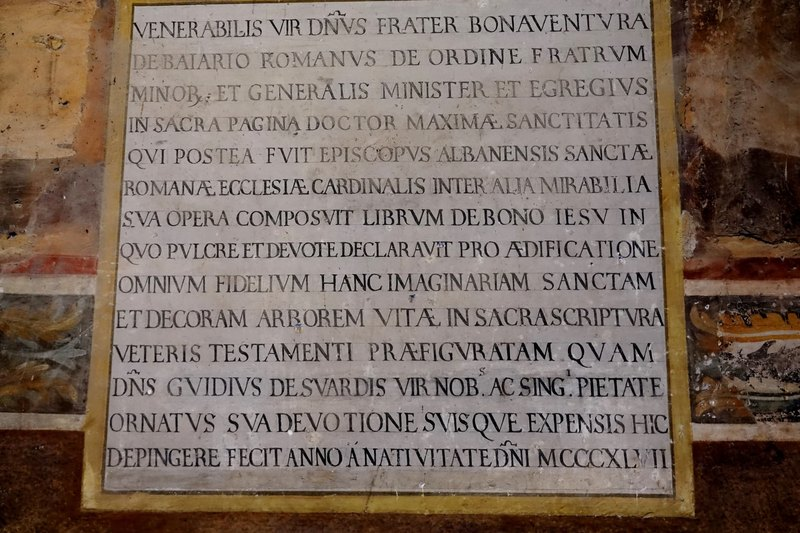

## A Painter Named after One Fresco

The *Maestro dell'Albero della Vita* is a name given by modern scholars to the anonymous painter of the *Tree of Life* in the basilica of Santa Maria Maggiore at Bergamo. The fresco covers the end wall of the right transept. It shows Christ crucified on a tree whose twelve branches carry forty-eight roundels with scenes from his life, and saints of the Franciscan order standing at its foot.

No document names the painter. Everything known about him comes from the fresco itself and from the inscription painted below it. The Lombardy catalogue of cultural heritage describes him as an anonymous painter active in the first half of the fourteenth century, of a refined culture rich in Lombard and Emilian elements. That description is the sum of what can be said with confidence.

The inscription gives the date 1347 and names as patron Guidino de' Suardi, a nobleman of Bergamo. Both facts must be handled with care. The inscription was probably repainted in the seventeenth century, and the kneeling figure of Guidino was added a secco on a later layer of plaster. The fresco is first recorded in the account books of the basilica in 1364.

The fresco follows the *Lignum vitae* of [Bonaventure of Bagnoregio](/endnotes.html#fn-bonaventure), a meditation on the life of Christ written about 1260. Bonaventure arranged the life of Christ as the twelve fruits of a tree, each fruit with four short verses. The painter turned the text into an image: twelve branches, four roundels on each, and on every branch a scroll with Bonaventure's words.

The previous version of this entry contained several errors. It inverted the dimensions of the fresco, which the regional catalogue gives as about 360 centimetres high and 690 wide. It presented Guidino's patronage and the date 1347 as certain. It listed as the master's works the Last Supper of the left transept, a disputed attribution, and three further works for which no source could be found.

It also said that Saint Bonaventure holds a mitre. In fact he kneels with a book and a scroll, and a red cardinal's hat lies on the ground beside him. It referred to "a thesis" and to "municipal and journalistic notices" without naming them. The account below rests on the regional catalogue and on the literature it cites, from Luigi Angelini (1953) to Mauro Zanchi (2003).

The account treats the basilica and its fourteenth-century painting, Bonaventure's text and its images, the inscription and the question of the patron, the history of the fresco after the Middle Ages, and the style of the painter with the question of his other works. The catalogue then examines the fresco in its parts, the disputed Last Supper, and two Florentine trees for comparison.

The fresco is illustrated by photographs published on Wikimedia Commons under free licences. The Last Supper is described in words only, because no image of it was available.

## Santa Maria Maggiore and Its Trecento Walls

Santa Maria Maggiore stands beside the cathedral in the upper city of Bergamo. It was the civic church of the city, and it is still owned and administered by the lay confraternity of the Misericordia Maggiore. The fourteenth-century decoration of its walls belongs to this civic setting.

That decoration was not a single programme. It consisted of many separate fresco panels, painted at different dates by different hands and paid for, in large part, by lay donors, who often appear in the paintings. The walls of the transepts and the apses were covered with images of saints, votive panels and narrative scenes, side by side.

Several painters have been distinguished among them. In a south-western apsidiole an inscription gives the date 1336 to a Madonna enthroned with saints, the name-giving work of the *Maestro del 1336*. In the same apse, a later group of paintings of about 1360 is given to the *Maestro dell'Adorazione dei Magi*; other panels have been linked to Pacino da Nova.

The Tree of Life is the largest of these panels and the most complex. It occupies the end wall of the right transept, in a position visible from the crossing. Its subject, a Franciscan meditation, set it apart from the votive images around it: it was not a single devotional figure but a book to be read on the wall.

The Last Supper on the end wall of the left transept is the other large surviving painting of the period. It was found under whitewash in 1944, when Arturo Cividini uncovered the transept wall, and it has been linked, with differing degrees of conviction, to the painter of the Tree of Life.

Much of this decoration was lost or hidden in later centuries. In the late sixteenth century the basilica was renovated under the direction of Pellegrino Tibaldi, and many fourteenth-century paintings were whitewashed. In the seventeenth century the interior was covered with stucco, gilding and large canvases, the setting in which the surviving frescoes are seen today.

The survival of the Tree of Life was not an accident. The regional catalogue records that Tibaldi himself asked that the fresco be spared. The request suggests that the image was valued in the late sixteenth century, both as a devotional work and perhaps as a memorial of the family named in its inscription.

The basilica's fourteenth-century paintings were studied by [Luigi Angelini](/scholars.html#angelini-luigi), whose *Affreschi trecenteschi in Bergamo* (1953) is still the basic survey, by [Stella Matalon](/scholars.html#matalon-stella) in *Affreschi lombardi del Trecento* (1963), by [Sandro Angelini](/scholars.html#angelini-sandro) in his monograph on the basilica (1968), and in the volumes *Pittura a Bergamo dal Romanico al Neoclassicismo* (1991) and *I pittori bergamaschi dal XIII al XIX secolo* (1992).

## Bonaventure's Lignum Vitae and Its Images

Bonaventure of Bagnoregio, minister general of the Franciscan order and later cardinal bishop of Albano, wrote the *Lignum vitae* about 1260. The treatise invites the reader to imagine a tree whose fruits are the mysteries of the life of Christ, and to meditate on them one by one, as a devotional exercise and an aid to memory.

The text is built on the number twelve. Its twelve fruits are grouped in three sets of four: the mystery of Christ's origin, the mystery of his Passion and the mystery of his glorification. Each fruit has four verses, each beginning with the name of Jesus, so that the whole life of Christ is distributed over forty-eight short meditations.

The structure lent itself to images. A painter could set the crucified Christ on the trunk, give each fruit a branch, and give each verse a roundel. The verses could be written on scrolls along the branches, so that the image could be read as a text and the text recalled through the image.

The best-known early image of this kind is the panel by [Pacino di Bonaguida](/Content/Artists/XIV-c/Pacino-di-Bonaguida.html) in the Galleria dell'Accademia at Florence, painted about 1305–1310. It has twelve branches and forty-eight roundels with narrative scenes, a vision of Paradise at the top and scenes from Genesis at the foot. Its scheme is close to that of the Bergamo fresco.

A different solution was chosen by Taddeo Gaddi in the refectory of Santa Croce at Florence. His Tree of Life fills its roundels with prophets holding scrolls rather than with narrative scenes, and places Bonaventure at the foot of the cross with Franciscan saints and the mourners. The Last Supper below and four scenes at the sides complete the wall.

The Bergamo painter followed the narrative type. His roundels tell the story of Christ from the Annunciation to the glory of heaven, and the scrolls on the branches carry the verses of Bonaventure. The regional catalogue states that the patron required the composition to follow Bonaventure's text, a requirement known from the later inscription.

The inscription itself names the source. It calls Bonaventure the author of a *liber de bono Iesu* in which he set out, for the edification of the faithful, this holy and beautiful imaginary tree of life prefigured in the Old Testament. The words "imaginary tree" correspond closely to Bonaventure's own invitation to picture the tree in the mind.

The fresco therefore stands at the meeting point of a written meditation and a public image. It addressed friars and lay people who could read the scrolls, and those who could recognise the scenes without reading. The saints at its foot, raising their scrolls and looking up, show the viewer the posture of contemplation the image was meant to teach.

## The Inscription, the Patron and the Date

Below Saint Bonaventure, at the centre of the lower field, is a painted plaque with fourteen lines of capitals. It reads:

> VENERABILIS VIR D(OMI)N(U)S FRATER BONAVENTURA / DE BAIARIO ROMANUS DE ORDINE FRATRUM / MINOR(UM) ET GENERALIS MINISTER ET EGREGIUS / IN SACRA PAGINA DOCTOR MAXIMAE SANCTITATIS.

It continues:

> QUI POSTEA FUIT EPISCOPUS ALBANENSIS SANCTAE / ROMANAE ECCLESIAE CARDINALIS INTER ALIA MIRABILIA / SUA OPERA COMPOSUIT LIBRUM DE BONO IESU IN / QUO PULCRE ET DEVOTE DECLARAVIT PRO AEDIFICATIONE / OMNIUM FIDELIUM HANC IMAGINARIAM SANCTAM / ET DECORAM ARBOREM VITAE IN SACRA SCRIPTURA / VETERIS TESTAMENTI PRAEFIGURATAM.

And it ends:

> QUAM / D(OMI)N(U)S GUIDIUS DE SUARDIS VIR NOB(ILI)S AC SING(ULAR)I PIETATE / ORNATUS SUA DEVOTIONE SUISQUE EXPENSIS HIC / DEPINGERE FECIT ANNO A NATIVITATE D(OMI)NI MCCCXLVII.

Guidino de' Suardi, a man noble and adorned with singular piety, had the tree painted here by his devotion and at his expense in the year 1347.

The lettering is not that of the fourteenth century. It is a classicising capital of the early modern period, and the regional catalogue judges the plaque to be a seventeenth-century repainting of an older text. The repainting introduced errors: *de Baiario Romanus* for Bonaventure's birthplace, Bagnoregio, is one of them.

The repainted text may preserve the substance of the original, and the catalogue considers that the fresco was probably painted close to the date it gives. But it cannot be read as a fourteenth-century document. Some sources give the year 1342, perhaps the year the work began; the two dates have been read as the beginning and the end of a single campaign.

The patron is also uncertain. Guidino de' Suardi, son of Tetualdo, lived near the square of the cathedral and Santa Maria Maggiore; he is documented in 1349 and was dead by 1353. A kneeling man in red at the foot of the tree has always been identified with him, but the figure is painted a secco on a later layer of plaster.

The regional catalogue concludes that the donor figure was added later, perhaps decades after the fresco was completed, and that Guidino's role as patron is therefore open to question. The figure and the inscription may record a later claim of the Suardi family on an image already in place rather than the original commission.

What is secure is the date by which the fresco existed: it is first mentioned in the account books of the basilica in 1364. Between that date and the 1340s given by the inscription and the style, the painting can be placed with reasonable confidence in the second quarter or the middle of the fourteenth century.

## The Fresco after the Middle Ages

The fresco survived the renovation of Santa Maria Maggiore in the late sixteenth century, when many fourteenth-century paintings in the basilica were whitewashed. According to the regional catalogue, Pellegrino Tibaldi, who directed the renovation, asked that it be spared.

In 1661 the wall was transformed. Pietro Liberi painted a large canvas of the Flood for the transept, and the canvas and a great stucco frame were set over the fresco, covering much of it. The seventeenth-century decoration of the transept, with its gilded stucco and white figures of prophets, still surrounds the fresco today.

The photographs reproduced here show the result. The upper part of the tree is framed by the stucco frame, with a seated prophet carved at its side. A cornice runs across the painting and separates this upper field from the lower one, so that the crucified Christ appears above the cornice and the base of the trunk below it.

The lower field is partly hidden at the right by the wooden entrance vestibule of the transept, the *bussola*, with its bronze statues. The wall has also been fitted with liturgical furniture, and nails have been driven into the plaster. The fresco is read today in two parts, neither of them complete.

The regional catalogue, compiled in 2010, judged the condition of the fresco poor. It recorded serious losses of paint, the loss of most of the secco finish, a general weakening of the painted surface, plaster detached and missing, water infiltration and overpainting. The scrolls of the branches are in places illegible.

The inscription is the most visible later intervention. Its seventeenth-century capitals, painted on a pale ground, stand out from the fourteenth-century painting around them and draw the eye to the name of the Suardi.

The roundels have suffered unequally. Some, such as the Circumcision in the lower field, keep their colour and their gold; others, especially in the upper field, are abraded or lost. The greenish trunk and branches, painted over a darker ground, have also lost much of their surface.

Despite its condition, the fresco remains legible as a whole. It is one of the most ambitious images of the fourteenth century in Bergamo, and one of the few surviving monumental versions of Bonaventure's tree in Italian wall painting.

## Style and the Question of the Corpus

Stella Matalon described the painter's art as marked by an emphatic, pathetic accent and a nervously Gothic drawing. The regional catalogue speaks of a refined painter of Lombard and Emilian culture. Both descriptions place him in the painting of the Po valley rather than in the direct succession of Giotto.

The fresco works on two scales. The saints in the lower field are large, standing figures, drawn with long folds and simple contours, their faces raised towards the tree. The roundels above are small narrative scenes, crowded with figures and furnished with architecture, chairs, vessels and fabrics.

The narrative scenes show a taste for concrete detail. In the Nativity the manger is a gilded box set in a landscape with sheep; in the Circumcision a boy holds out a basin; in the Adoration of the Magi the Virgin sits on a turned wooden chair. These details give the scenes an everyday immediacy.

The faces of the saints have a pronounced expression. Clare's eyebrows are drawn together in grief, Francis opens his mouth as he looks up, and the young Saint John turns his head sharply upwards. The pathos Matalon described is concentrated in these heads.

If both dates, 1342 and 1347, are reliable, they suggest a campaign of several years, natural for a wall of this size, which must have required assistants. The fresco nevertheless shows a single design, and it is treated as the work of one master and his workshop.

No other work is securely by him. [Roberta Pellati](/scholars.html#pellati-roberta), in *I pittori bergamaschi* (1992), attributed to him the Last Supper of the left transept, and considered him the author of most of the frescoes on that wall. Matalon had seen only an affinity of feeling between the two paintings.

The regional catalogue keeps the Last Supper anonymous and Lombard, noting that the painter's lesser quality is evident above all in the summary rendering of anatomical detail. The attribution therefore remains disputed.

The previous version of this entry also gave the master a Trinity in Sant'Agostino at Bergamo, frescoes in the convent of San Francesco and paintings in the Santissima Trinità at Fiobbio. No source for these attributions has been found, and they are not repeated here. The painter remains known, securely, from one fresco.

## Catalogue Entry

### The Tree of Life

<figure>
  
  <figcaption>Maestro dell'Albero della Vita, Tree of Life, c. 1347, fresco. Bergamo, Santa Maria Maggiore, end wall of the right transept. Photo: Sailko, <a href="https://creativecommons.org/licenses/by/3.0/">CC BY 3.0</a>, via Wikimedia Commons.</figcaption>
</figure>

The Tree of Life fills the end wall of the right transept of Santa Maria Maggiore. The regional catalogue gives its dimensions as about 360 by 690 centimetres. It is painted in fresco, with finishing passages a secco, most of which are now lost.

The photograph shows the wall as it is today. The fresco is divided by a seventeenth-century cornice into an upper and a lower field. The upper field is enclosed in a stucco frame of 1661, with a carved prophet holding a tablet at its left; the lower field is partly hidden by the wooden vestibule at the right.

The composition is built around the trunk, painted green, which rises through both fields. Christ is crucified on it, his arms nailed along the branches. From the trunk twelve branches, six on each side, rise diagonally; they are painted as broad white scrolls with lines of Gothic writing.

Along each branch hang four roundels, each about 82 centimetres in diameter, with a scene from the life of Christ. Following Bonaventure, the lower branches carry the Infancy, the middle branches the Passion and the upper branches the glorification.

At the foot of the tree stand saints of the Franciscan order and the mourners of the Crucifixion, with Saint Bonaventure kneeling at the centre. Below him is the painted plaque with the inscription, and at the right a small kneeling donor. A decorative band of polylobed frames with flowers encloses the fresco at the left and at the foot.

At the right of the upper field the photograph shows a further, damaged fresco with a horseman, which does not belong to the tree. The transept walls carried several fourteenth-century paintings, of which this is a fragment.

The fresco is the name-giving work of the master and the basis of everything said about him. Its date of about 1347 depends on the repainted inscription; its existence by 1364 is documented by the account books of the basilica.

The wall shows, in one view, the whole history of the painting: the fourteenth-century fresco, the seventeenth-century inscription, the stucco frame and cornice of 1661, and the vestibule that now stands before it.

### The Lower Field

<figure>
  
  <figcaption>Maestro dell'Albero della Vita, Tree of Life, the lower field, c. 1347, fresco. Bergamo, Santa Maria Maggiore. Photo: Sailko, <a href="https://creativecommons.org/licenses/by/3.0/">CC BY 3.0</a>, via Wikimedia Commons (detail).</figcaption>
</figure>

The lower field shows the roots of the tree and the first branches. The trunk rises at the centre from a sandy ground broken by low cut stumps, and divides into branches that climb towards the upper field.

The roundels of the lowest branches show the Infancy of Christ. At the left, an Annunciation is set in a double Gothic shrine, with the angel in one compartment and the Virgin in the other, and below it a Nativity with the Virgin and Child, a golden manger and shepherds.

At the right of the trunk are the Circumcision, an Adoration of the Magi with the Virgin enthroned, and, in the outer roundel, the Presentation in the Temple. The regional catalogue identifies the Presentation as the first roundel from the right and the Adoration of the Magi as the second.

Below the branches stand eight saints and the donor. From the left they are Saint Clare, Saint Francis and the Virgin; at the centre Saint Bonaventure; at the right the donor, Saint John the Evangelist, Saint Louis of Toulouse and Saint Anthony of Padua, identified as in the regional catalogue.

The saints are larger than the figures of the roundels and occupy most of the height of the field. They stand on a narrow strip of ground and turn their faces upwards, towards the trunk and the crucified Christ above. Four of them raise scrolls.

The composition is symmetrical around the trunk and the kneeling Bonaventure. Clare, Francis and the Virgin at the left answer John, Louis and Anthony at the right, and the donor kneels between Bonaventure and John.

At the centre of the foot is the painted plaque of the inscription, with its fourteen lines of seventeenth-century capitals. It interrupts the decorative band that frames the fresco and covers part of the ground below Bonaventure.

The field is damaged by losses and stains, and by nails driven into the plaster, but it is the best preserved part of the fresco. The colours of the saints' habits and of the roundels, and the gold of their haloes, are still legible.

### Saint Clare, Saint Francis and the Virgin

<figure>
  
  <figcaption>Maestro dell'Albero della Vita, Tree of Life, Saint Clare, Saint Francis and the Virgin, c. 1347, fresco. Bergamo, Santa Maria Maggiore. Photo: Fabrizio Garrisi, public domain (<a href="https://creativecommons.org/publicdomain/zero/1.0/">CC0</a>), via Wikimedia Commons.</figcaption>
</figure>

The three figures at the left of the lower field stand on the sandy ground at the foot of the tree. Each has a gilded halo, now worn, and each looks upwards towards the trunk.

Saint Clare stands at the left in the dark habit and white wimple of the Poor Clares. Her hands are joined in prayer and her brows are drawn together in grief. She is the first Franciscan woman, placed at the beginning of the row.

Saint Francis stands beside her in the brown habit and cord of the Friars Minor. He raises with his right hand an unrolled scroll and lifts his left towards it. His mouth is open, as if he were reading the text aloud.

The scroll carries the words EGO STIGMATA D(OMI)NI IESU IN CORPORE MEO PORTO, "I bear on my body the marks of the Lord Jesus", from Saint Paul's letter to the Galatians. The text refers to Francis's stigmata and to his identification with the crucified Christ.

The third figure is wrapped in a brown-red mantle drawn over the head, with one hand pressed to the breast and the face turned sharply upwards. The regional catalogue identifies her as the Virgin, standing as a mourner at the foot of the cross. Her surface is the most damaged of the three.

The figures are drawn with long, simple folds and firm outlines. The heads are small in relation to the bodies, and the gestures are few and clear. The faces carry the expression of grief and contemplation that Matalon called pathetic.

The grouping of Clare, Francis and the Virgin links the Franciscan order to the mourners of Calvary. The founders of the order stand beside the mother of Christ, as witnesses of the Passion that the tree above presents for meditation.

A gilded candlestick of the modern altar furniture crosses the foot of the image, a reminder of the liturgical use of the transept in front of the fresco.

### Saint Bonaventure

<figure>
  
  <figcaption>Maestro dell'Albero della Vita, Tree of Life, Saint Bonaventure, c. 1347, fresco. Bergamo, Santa Maria Maggiore. Photo: Richard Mortel, <a href="https://creativecommons.org/licenses/by/2.0/">CC BY 2.0</a>, via Wikimedia Commons (detail).</figcaption>
</figure>

Saint Bonaventure kneels at the centre of the lower field, at the foot of the trunk. He is the author of the text the fresco illustrates, and he is placed where the tree grows from the ground, as if the image grew from his book.

He wears the brown habit of the Friars Minor and holds a red book against his body with his left hand. With his right hand he raises a large scroll, its upper edge inscribed IESUM CRISTUM PREDICAMUS CRU[CIFIXUM], "we preach Christ crucified", the words of Saint Paul in the first letter to the Corinthians.

Beside him, on the ground at the right, lies a broad red hat. It is the cardinal's hat, the sign of the dignity Bonaventure received in 1273, when he was made cardinal bishop of Albano. The previous version of this entry described it as a mitre held in his hand.

The book in his hand is the *Lignum vitae*, the treatise from which the tree is drawn. The inscription below calls it the *liber de bono Iesu*, the book of the good Jesus, and describes the tree as his invention.

Bonaventure's face is turned upwards towards the trunk, in profile, with the same raised gaze as the other saints. His figure is placed on the axis of the composition, below the trunk and above the inscription.

Behind him the trunk divides into the first branches. At the upper left is the Nativity, with the Virgin holding the Child, Joseph seated below and the shepherds with their flock beside a golden manger; at the upper right, the Circumcision.

The detail shows the condition of the painting closely: the plaster is stained and worn, the green of the trunk is abraded to the underlying ground, and nails have been driven into the wall. The figure of Bonaventure and the roundels keep, nevertheless, their drawing and much of their colour.

The scroll and the book together state the programme of the fresco: Bonaventure preaches Christ crucified, and the tree above is his sermon translated into an image.

### The Donor, Saint John and the Franciscan Saints

<figure>
  
  <figcaption>Maestro dell'Albero della Vita, Tree of Life, the donor, Saint John the Evangelist and two Franciscan saints, c. 1347, fresco. Bergamo, Santa Maria Maggiore. Photo: Fabrizio Garrisi, public domain (<a href="https://creativecommons.org/publicdomain/zero/1.0/">CC0</a>), via Wikimedia Commons.</figcaption>
</figure>

The right half of the lower field holds the donor, Saint John the Evangelist and two saints of the Franciscan order. They answer the group of Clare, Francis and the Virgin on the other side of the trunk.

The donor kneels in profile at the left, much smaller than the saints. He wears a long red gown lined with white and a red hood, the dress of a wealthy layman of the fourteenth century, and joins his hands in prayer towards the trunk.

He is traditionally identified with Guidino de' Suardi, the patron named in the inscription. The regional catalogue observes that the figure is painted a secco on a later layer of plaster, perhaps decades after the fresco was completed; the identification and the date of the figure are therefore uncertain.

Saint John the Evangelist stands beside him, young, with curly hair, in a green tunic and a red-orange mantle. He clasps his hands at his waist and turns his head sharply upwards. With the Virgin at the left, he completes the pair of mourners of the Crucifixion.

The two friars at the right raise scrolls above their heads. The regional catalogue identifies them as Saint Louis of Toulouse and Saint Anthony of Padua. The scroll of the outer friar reads VESTIGIA EIUS SECUTUS EST PES MEUS, "my foot has followed his steps", from the Book of Job, the text the catalogue gives to Saint Anthony.

The scroll of the inner friar is no longer legible. Saint Louis of Toulouse, a Franciscan who became bishop of Toulouse and was canonised in 1317, was one of the new saints of the order; in the present state of the fresco he carries no visible episcopal insignia.

The figures are drawn like those of the left group: long folds, simple outlines, small heads and upturned faces. The drapery of John, with its broad diagonal folds and its play of red and green, is among the best preserved passages of the fresco.

The juxtaposition of the small donor and the large saints states the hierarchy of the image. The layman kneels at the edge of the sacred company, protected by its intercession and looking, like the saints, towards the tree.

### The Circumcision

<figure>
  
  <figcaption>Maestro dell'Albero della Vita, Tree of Life, the Circumcision, c. 1347, fresco. Bergamo, Santa Maria Maggiore. Photo: Fabrizio Garrisi, public domain (<a href="https://creativecommons.org/publicdomain/zero/1.0/">CC0</a>), via Wikimedia Commons.</figcaption>
</figure>

The Circumcision is one of the roundels of the lowest branch at the right of the trunk. It is the best preserved of the scenes of the Infancy and shows the painter's narrative manner at close range.

The scene is set against a blue ground. At the left an old priest, his head covered with a white cloth, in a pink mantle, holds the legs of the Child and bends towards him with the knife. A bearded man stands behind him.

The Virgin holds the Child against her, and the Child, frightened, clings to her face. Joseph stands at the right in a yellow mantle, his hand raised towards the Child. A boy in green kneels below and holds out a basin to receive the blood.

The gestures are direct and tender. The Child turning away from the priest towards his mother, and the boy stretching out the basin, give the scene the everyday immediacy that the literature has noted in the master's narrative painting.

The haloes of the Virgin, the Child and Joseph are gilded and still bright. The colours of the mantles, pink, dark red and yellow, keep much of their strength, and the faces are drawn with a fine brush.

In Bonaventure's text the Circumcision opens the second fruit, on the humility of Christ, with the verse *Iesus conformatus patribus*; it is followed by the Magi, the Presentation and the Flight into Egypt. The first fruit, with the Annunciation and the Nativity, occupies the branch at the left of the trunk, so that the order of the text runs across the foot of the tree.

Above at the right appears part of the next roundel, with the Virgin seated on a turned wooden chair: the Adoration of the Magi. At the left a corner of Bonaventure's scroll can be seen, and at the top a branch scroll with red letters.

The roundel is about 82 centimetres in diameter, a size at which the painter could give each scene several figures and a setting. The scale explains the care given to these small scenes, which were meant to be seen and recognised from the floor of the transept.

### The Inscription

<figure>
  
  <figcaption>Maestro dell'Albero della Vita, Tree of Life, the inscription below Saint Bonaventure, probably repainted in the seventeenth century. Bergamo, Santa Maria Maggiore. Photo: Richard Mortel, <a href="https://creativecommons.org/licenses/by/2.0/">CC BY 2.0</a>, via Wikimedia Commons.</figcaption>
</figure>

The inscription is painted on a rectangular plaque at the centre of the foot of the fresco, below Saint Bonaventure. It is framed in yellow and ruled with fine guide lines, on which fourteen lines of black capitals are written.

The text names first Bonaventure, a Friar Minor, minister general, doctor of sacred scripture and later cardinal bishop of Albano, who among other wonderful works composed the book *de bono Iesu*, and in it set out, for the edification of the faithful, this holy and beautiful imaginary tree of life, prefigured in the Old Testament.

It then names the patron: Guidino de' Suardi, a nobleman adorned with singular piety, who by his devotion and at his expense had the tree painted here in the year from the Nativity of the Lord 1347. The name appears in the Latin form *Guidius de Suardis*.

The letters are classicising capitals with serifs and ligatures, of a kind used in the sixteenth and seventeenth centuries, not the Gothic letters of the scrolls in the fresco. The regional catalogue judges the inscription to be a seventeenth-century repainting, probably of an older text.

The repainting introduced errors. Bonaventure is called *de Baiario Romanus*, a corruption of his birthplace, Bagnoregio, which suggests that the painter of the seventeenth century copied a damaged text he did not fully understand.

The date and the patron's name may therefore preserve the content of a fourteenth-century inscription, but the plaque cannot be read as an original document. The regional catalogue nevertheless considers that the fresco was probably painted close to the date it gives.

The repainting may belong to the same campaign as the stucco frame and Liberi's canvas of 1661, when the transept was redecorated. It kept the memory of the Suardi family before the fresco, at the moment when much of the painting was hidden.

The plaque is the most legible part of the lower field. It has become, for later viewers, the key to the fresco: it gives the subject, the source, the patron and the date in a single text.

### The Upper Field

<figure>
  
  <figcaption>Maestro dell'Albero della Vita, Tree of Life, the upper field, c. 1347, fresco. Bergamo, Santa Maria Maggiore. Photo: Rollroboter, <a href="https://creativecommons.org/licenses/by-sa/4.0/">CC BY-SA 4.0</a>, via Wikimedia Commons.</figcaption>
</figure>

The upper field is enclosed in the stucco frame of 1661, above the cornice that divides the fresco. It shows the crucified Christ and the branches of the Passion and the glorification.

Christ hangs at the foot of this field, his body pale against the green trunk, his head bowed in death and crowned with a red halo. His arms are stretched along the lowest branches of the field and his hands are nailed to them, so that the cross and the tree become a single form.

The branches rise diagonally from the trunk as broad white scrolls, inscribed in Gothic letters with the verses of Bonaventure. Many of the inscriptions are damaged, but the pattern of black and red letters is still visible along their length.

The roundels of the middle branches tell the Passion. Several show Christ on the cross with the mourners and soldiers; others show the Deposition, with a ladder against the cross, and the Lamentation over the body laid on a red sarcophagus.

The roundels of the upper branches show the glorification. Among them are the Virgin and Christ enthroned side by side and crowds of saints and angels, scenes that correspond to the last fruits of Bonaventure's tree.

At the right edge of the field, outside the tree, stand larger figures with scrolls, among them a figure in red and one in yellow. They belong to the decoration of the wall around the tree, and their identification is uncertain in their present state.

The surface of the upper field is more damaged than that of the lower. Several roundels are abraded or lost, the scrolls are partly illegible and the plaster is cracked.

The upper field was the part of the fresco most affected by the redecoration of 1661, when Liberi's canvas and the stucco frame were set on the wall. Seen today within that frame, it shows the culmination of the tree: from the cross, through the Passion, to the glory of heaven.

### The Last Supper (disputed attribution)

The Last Supper occupies the end wall of the left transept of Santa Maria Maggiore, opposite the Tree of Life. It is a fresco about 190 centimetres high and 700 wide, dated by the regional catalogue to about 1340–1360. No image of it was available for this entry, and it is described here from the catalogue.

The painting was found under whitewash in 1944, when Arturo Cividini restored the end wall of the transept and uncovered the fourteenth-century paintings hidden during the renovation of the late sixteenth century. Its condition was judged poor in 2010, with faded colours and the near-total loss of the secco finish.

The fresco shows Christ and the apostles at a long table, with Judas, Saint Peter and Saint John among them. The table is laid with plates, jugs, glasses, slices of lemon, cherries, bread and fish. A cornice of painted corbels runs along the top, partly covered by later stucco, and a thin geometric border frames the top and left edges.

The attribution to the Maestro dell'Albero della Vita was proposed by Roberta Pellati in 1992. She considered him the author of most of the frescoes on the end wall of the left transept, including the Last Supper.

Stella Matalon had earlier noted an affinity between the Last Supper and the Tree of Life: a sensibility marked, in both, by an emphatic, pathetic accent and a nervously Gothic drawing. She did not, however, claim that they were by the same hand.

The regional catalogue keeps the Last Supper as the work of an anonymous Lombard painter. It observes that the painter's lesser quality is evident above all in the summary rendering of anatomical detail, and that this supports Matalon's caution.

The question is therefore open. The two frescoes belong to the same building and the same decades, and they share a regional culture; whether they share a painter cannot be settled from the present literature.

The previous version of this entry listed the Last Supper among the master's works without qualification. It is placed here among the disputed attributions.

### Comparison: Pacino di Bonaguida, the Tree of Life

<figure>
  
  <figcaption>Pacino di Bonaguida, Tree of Life, c. 1305–1310, tempera and gold on panel. Florence, Galleria dell'Accademia. Photo: public domain, via Wikimedia Commons.</figcaption>
</figure>

The panel of Pacino di Bonaguida in the Galleria dell'Accademia at Florence is the closest surviving parallel to the Bergamo fresco. It was painted about 1305–1310, a generation earlier than the Bergamo fresco.

Pacino's tree has the same structure as the Bergamo fresco. Christ is crucified on a green trunk, and twelve branches, six on each side, each carry four roundels with scenes from his life: forty-eight scenes in all, following Bonaventure's forty-eight verses.

The narrative order is the same. The lowest branches carry the Infancy, the middle branches the Passion and the upper branches the glorification. Scrolls along the branches carry the verses of Bonaventure.

Pacino added a vision of Paradise in the gable, with the Virgin and Christ enthroned above choirs of saints and angels, and a pelican in its nest above the cross. At the foot are figures writing on scrolls and small scenes of the creation and fall of Adam and Eve.

The panel is a small object for private or conventual devotion, painted with gold grounds and the fine detail of a miniaturist; Pacino was also an illuminator. The Bergamo fresco translates the same scheme into a public wall painting several metres wide.

The comparison shows how closely the Bergamo painter followed an established type. His originality lies less in the scheme than in its scale, in the large saints of the lower field and in the everyday detail of the roundels.

At Bergamo the Franciscan saints at the foot take the place of Pacino's scenes of the Fall. The image addresses not the origin of sin but the response of the order and of the faithful to the Passion.

Pacino's panel also helps to imagine the lost or damaged parts of the Bergamo tree, especially the upper roundels of the glorification, which in the fresco are now partly illegible.

### Comparison: Taddeo Gaddi, the Tree of Life in Santa Croce

<figure>
  
  <figcaption>Taddeo Gaddi, Tree of Life with the Last Supper and four scenes, mid-fourteenth century, fresco. Florence, Santa Croce, former refectory. Photo: Armin Kleiner, <a href="https://creativecommons.org/licenses/by-sa/4.0/">CC BY-SA 4.0</a>, via Wikimedia Commons.</figcaption>
</figure>

Taddeo Gaddi's fresco on the end wall of the refectory of Santa Croce at Florence is the most famous monumental Tree of Life of the fourteenth century. It is close in date to the Bergamo fresco, though the dates proposed for it vary.

Like the Bergamo painter, Taddeo set the crucified Christ on a tree and wrote the verses of Bonaventure on scrolls along its branches. His tree, however, is not narrative: its roundels hold prophets with scrolls, not scenes of the life of Christ.

At the foot of the tree Taddeo placed the mourning women and Saint John at the left, Saint Francis embracing the cross, Bonaventure seated and writing, and saints of the order at the right. The grouping is close in spirit to that of Bergamo, where Bonaventure kneels at the foot of the trunk among Franciscan saints.

Taddeo's wall is a complete programme for a refectory. Below the tree runs the Last Supper, and at the sides four scenes: the stigmatisation of Saint Francis, Saint Louis of Toulouse serving the poor, Saint Benedict in the wilderness and the supper in the house of Simon with the Magdalene at the feet of Christ.

The comparison shows two ways of using Bonaventure's text. Taddeo made the tree an emblem of prophecy and meditation, set within a programme about food and charity; the Bergamo painter told the life of Christ in forty-eight scenes, as Pacino had done.

It also shows the difference of setting. Taddeo painted for the friars of Santa Croce, in their refectory; the Bergamo fresco was painted in the civic basilica of a Lombard city, for lay viewers and with a lay donor at its foot.

The two transepts of Santa Maria Maggiore, with the Tree of Life on one end wall and the Last Supper on the other, offer a distant echo of Taddeo's combination of the two subjects on a single wall.

Taddeo's fresco, well preserved and complete, also helps to imagine the effect the Bergamo tree had before the losses, the repainting and the stucco of the seventeenth century.
