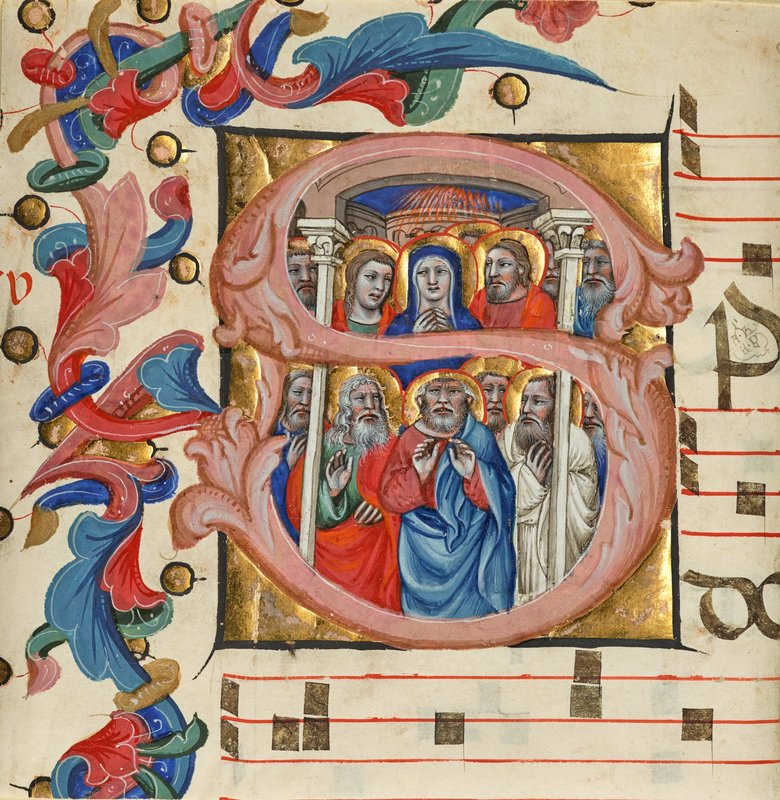
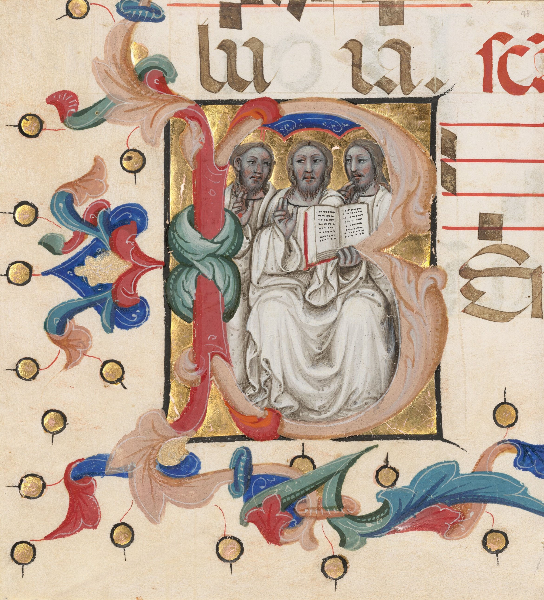
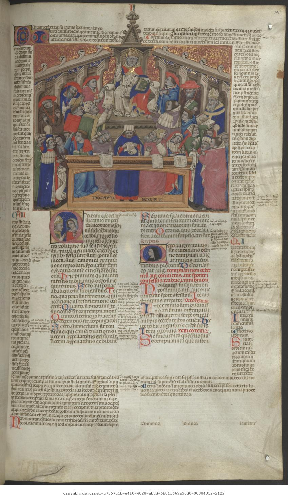

## A Name on the Page

Most medieval illuminators have reached us as conventional names: the "Master of 1328", the "Master of 1346", the "Illustratore", the "Master of the Brussels Initials". Against that background, the Bolognese miniaturist *Nicolò di Giacomo di Nascimbene* stands out with unusual sharpness. We know his father's name, his parish, his wife and children, his debts and deposits, the castles he commanded and the rural districts he governed for the commune. Above all, we have his name written inside his own miniatures, often several times in a single book. Beside the Bolognese painters of the Trecento, [Vitale da Bologna](/Content/Artists/XIV-c/Vitale-da-Bologna.html), [Dalmasio degli Scannabecchi](/Content/Artists/XIV-c/Dalmasio-degli-Scannabecchi.html), [Simone dei Crocifissi](/Content/Artists/XIV-c/Simone-dei-Crocifissi.html) and [Lippo di Dalmasio](/Content/Artists/XIV-c/Lippo-di-Dalmasio-degli-Scannabecchi.html), Nicolò is the necessary counterpart in book painting. He shared the panel and fresco painters' world through kinship, friendship and civic office, and he translated much of their visual language into the pages of law books, choir books, guild registers and classical texts.

He was also enormously productive, and his fame has worked against him. Early in the twentieth century it could be claimed, with pardonable exaggeration, that "non v'è quasi biblioteca d'Europa, la quale non possieda qualche codice miniato da lui" ("there is hardly a library in Europe that does not own some manuscript illuminated by him"). For decades this meant that works by older and better masters were absorbed into his name, and the modern catalogue has been built as much by subtraction as by addition. The sheer number of dismembered choir books, cuttings scattered across American and European collections, and workshop products of uneven quality makes him a figure whose oeuvre, as the author of his entry in the *Dizionario Biografico degli Italiani* has observed, can only be fully mastered in a monographic study that does not yet exist.

The documentary record, the signed and dated works that form the backbone of a chronology, and the large body of attributions around them have therefore to be kept apart, distinguishing what is documented, what is broadly accepted, and what is hypothetical or simply mistaken. Three modern scholars have shaped the subject. [Alessandro Conti](/scholars.html#conti-alessandro) defined the anonymous masters from whom Nicolò emerged. [Massimo Medica](/scholars.html#medica-massimo) reconstructed the Augustinian<a href="/endnotes.html#fn-augustinian-order" class="footnote">1</a> choir books, the guild manuscripts and the workshop succession. [Francesca Pasut](/scholars.html#pasut-francesca-rosa) has written the fullest biographical syntheses and much of the critical framework for his classical illustrations.

## Bologna, the Studium and the Economy of the Book

To understand why a Bolognese illuminator could build a career of half a century and an international clientele, one has to begin with the university. By the fourteenth century the *studium* of Bologna was the pre-eminent school of Roman and canon law in Latin Christendom. Its student-run organisation, in which the law students had by then grouped themselves into two *universitates*, cismontane and ultramontane, each with its rector, created a large and permanent market for books. Students and doctors from across Europe needed the *Corpus iuris civilis*, Gratian's *Decretum*, the *Decretals* of Gregory IX<a href="/endnotes.html#fn-gregory-ix" class="footnote">2</a>, the *Liber Sextus*, the *Clementines*, and the expanding apparatus of glosses and commentaries that accompanied them.

The answer to this demand was the *pecia* system. An approved exemplar of a text, checked by university committees, was deposited with a licensed stationer (*stationarius*) and divided into sections, the *peciae*, of a few leaves each. These were rented out so that many scribes could copy the same work at once. The statutes of the Bologna law university, in the redaction of 1317, regulated the system minutely. They punished stationers for corrupt peciae and appointed *peciarii* to inspect the exemplars. An exhibition text of the Robbins Collection at the University of California, Berkeley School of Law, drawing on those statutes, notes that "there were some 119 legal texts on the pecia list at Bologna in the early 14th century". Hundreds of surviving copying contracts show that scribes in Bologna were commonly paid per pecia.

This matters for the history of illumination because the pecia system standardised the text but not the decoration. A legal manuscript copied from a pecia exemplar arrived at the illuminator's bench with blank spaces reserved for frontispieces, historiated initials and marginal decoration. Their richness depended on the purchaser's purse. The Bolognese illuminators of the first half of the century, among them the anonymous Master of 1328, the Illustratore and the Master of 1346, created a repertory of image types for these texts. There were teaching scenes, enthroned popes and emperors issuing law, and *arbores* of consanguinity and affinity, together with narrative vignettes for individual *causae* of the *Decretum*. The scenes acted out the legal case in miniature: a betrothal, a disputed inheritance, a monk who leaves his monastery. Nicolò inherited this repertory and kept it alive, sometimes repeating compositions from his predecessors almost literally.

Bologna's prestige in book painting was old. When Dante<a href="/endnotes.html#fn-dante-alighieri" class="footnote">3</a>, in *Purgatorio* XI, has Oderisi da Gubbio concede that "più ridon le carte / che pennelleggia Franco Bolognese", he was already treating Bolognese illumination as a benchmark. Franco himself remains undocumented in the city archives. Two centuries of the city's legal and liturgical book production are nevertheless well attested, and they form the matrix from which Nicolò emerged.

The political frame of his career was turbulent. After the Pepoli lordship, Bologna passed in 1350 to the archbishop Giovanni Visconti<a href="/endnotes.html#fn-giovanni-visconti" class="footnote">4</a> of Milan. In the 1360s the papal legate Egidio Albornoz<a href="/endnotes.html#fn-egidio-albornoz" class="footnote">5</a> reasserted the authority of the Church and expelled the Visconti from the city. On 21 March 1376 a revolt drove out the papal vicar and restored the institutions of communal self-government, the so-called "regimen ad populum" or government of the people and the guilds. During the Great Schism the city sided with the Roman obedience, and the restored commune enjoyed a long period of relative external peace. Each of these phases left a trace in Nicolò's work: cardinals of the Avignon curia among his early patrons, a magnificent set of guild statutes and communal books after 1376, and a role in civic office that would have been unthinkable under the legates.

## The Documentary Record: Family, Parish, Household

The archival basis for Nicolò's biography was assembled in stages. A first regesta was published at the end of the nineteenth century, not without errors. It was absorbed and corrected in the great 1947 corpus of documents on Bolognese illuminators and painters of the thirteenth and fourteenth centuries, which still underpins every account. A 1979 article in the *Burlington Magazine* clarified the family relationships. A study of the *Venticinquine*<a href="/endnotes.html#fn-venticinquine" class="footnote">6</a> (the civic muster rolls) in 1981, and a volume on the world of Bolognese painters between 1348 and 1430 published in 2005, added further documents. The most recent synthesis, a 2023 monograph on a youthful breviary in the Biblioteca Universitaria, gathers this material and quotes many of the original formulae. The essential facts may be stated with confidence.

Nicolò was the son of Giacomo, or Jacopo, di Nascimbene, himself a painter. A document of 8 July 1372, recording a deposit of 30 lire<a href="/endnotes.html#fn-lira-bolognese" class="footnote">7</a> that a certain Giuliano di Antonio Giboncio received from the illuminator, gives the full patronymic: "Nicolao filio q. Jacobi Nassimbenis" ("to Nicolò, son of the late Jacopo Nascimbeni"). The phrase also shows that the father was dead by that date. Nicolò's name appears in the *Venticinquine* for 1357 and for 1360, in the latter year with his profession: "Nicolaus q. Jacobi miniator". The published sources differ slightly on what the rolls imply about age. The *Dizionario Biografico* speaks of citizens already eighteen, while the 2023 monograph states that registration at those dates began at twenty. Either way the rolls establish only that he was an adult by 1357. They cannot fix a birth year. The date "c. 1325" that appears in encyclopaedias and museum labels is an estimate, and an earlier proposal of about 1310, based on misread documents, has been rightly abandoned. The documents first name him in 1356 or 1357, depending on how one counts the earliest notarial mention.

He lived all his life in the quarter and parish of San Procolo, and the documents repeatedly identify him by trade and parish, as "luminatore pennelli capelle Sancti Proculi". The parish was not merely an address. On 23 February 1382 the Società dei Devoti, which met in the crypt of San Procolo at the altar of Saint Sixtus, elected him its procurator, which implies membership in that devotional confraternity. In 1369 he married Villana, daughter of Paolo di Duzzolo, and the couple had three children, Antonia, Ursolina and Andrea. The dowries he provided for his daughters are documented: 60 lire for Antonia, married to the shoemaker Guido di Guglielmo, and 70 lire for Ursolina, married to another shoemaker, Giacomo di Giovanni. These are respectable but not lavish sums. Marrying both daughters to artisans of the leather trades says something about the social milieu of a successful illuminator, prosperous within the world of the guilds but not part of the patriciate.

The son Andrea is a minor puzzle. He appears in 1394, when Nicolò took over an office for which Andrea had been drawn by lot ("Andree eius filii qui habuit breve"). Nothing indicates that he was an illuminator. His absence from the 1404 act naming Nicolò's heirs has led to the reasonable inference that he died before his father.

The most important family fact for art history is the link to the painter Jacopo di Paolo. Two donations registered on 31 December 1378 to the same young woman, Andreuccia, one made by Nicolò and one by Jacopo, clarify the relationship. The text of Nicolò's donation explains that Andreuccia's mother, Jacopa, "fuit filia quondam Pauli fratris ipsius Nicolai et est ipsius Nicolai neptis" ("was the daughter of the late Paolo, brother of the said Nicolò, and is the said Nicolò's niece"). Paolo was therefore Nicolò's brother and Jacopo di Paolo's father. Nicolò was Jacopo's paternal uncle, and the painter Jacopo di Nascimbene was Jacopo di Paolo's grandfather. This is documented fact. Statements in older literature or online that Jacopo di Paolo was Nicolò's son, his brother-in-law or his formally designated successor have no documentary basis. The relationship continued into the next generation: in 1401 and 1402 Nicolò stood in for Jacopo's son Battista ("Batiste Jacobi pictoris") as castellan and as vicar.

Nicolò's will was drawn up on 1 December 1398 by the notary Melchiorre di ser Damiano di Pace. It is lost, and we know it only through the act of 31 May 1404 naming his heirs. That act gives the terminus ante quem for his death. The terminus post quem is his election in 1402 as vicar of Monteveglio, which the *Dizionario Biografico* associates also with Nonantola. The death date frequently given as "1403" is a convention, not a document. Among the executors of his will was Bernardo di Pietro da Moglio, an intimate of the Florentine chancellor Coluccio Salutati<a href="/endnotes.html#fn-coluccio-salutati" class="footnote">8</a>. The detail, recently highlighted, places Nicolò at the edge of early humanist networks.

## Civic Office and Economic Standing

After the restoration of communal government in 1376, and above all from the 1380s, Nicolò combined his workshop with a series of public charges. Most of them were what historians of the Bolognese commune call minor magistracies: semester-long offices, often in the *contado*, which carried pay and some prestige and demanded periodic residence away from the city. The documented offices are numerous enough that his biography becomes, as the *Dizionario Biografico* puts it, almost a year-by-year record from 1390. They include the *podesteria* of Zappolino in 1383, and in 1386 a superintendency of the *baratteria*, the gaming tax. In 1391 he served as a *podestà di sacco* responsible for collecting dues in Bibulano, Scascoli and Campiano, and in the same year as vicar of Savignano, with the podestà of several districts subordinate to him. Also in 1391 he held the posts of "clauditor portarum civitatis", keeper of the city gates, and "depositarius datii moliturarum et panis", treasurer of the milling and bread duty. In 1394 he was "officialis provixorum", and he was castellan of the fortress of Serravalle ("roche Seravallis") in 1395 and of Castro ("roche Castri") in 1401. In 1402 came the vicariate of Monteveglio.

The pattern of these appointments is as interesting as their number. In several cases Nicolò held office not because his own name had been drawn but as substitute ("procuratorio nomine") for the person who "habuit breve", who held the ballot slip. Those persons were his son Andrea, his grand-nephew Battista, and in 1391 the illuminator Giovanni di fra Silvestro ("pro se ipsus qui habuit breve procuratorio nomine Iohannis fratris Silvestri aminiatoris"). The most recent study reads this as an informal derogation from statutory procedure, through which families and workshops kept offices within a trusted circle. The point bears on the workshop question: it shows Nicolò acting in an official capacity on behalf of a younger illuminator whom Massimo Medica has identified with the anonymous Master of the Brussels Initials.

Some offices commonly listed in secondary literature have not been verified against the encyclopaedic syntheses. These include a magistracy among the "tribuni della plebe" in 1380, an arbitration of book prices in 1388, and membership of the Council of the Four Hundred for Porta Procola in 1398 (or 1393, in another account). They appear in a museum catalogue entry and in popular summaries but not in the encyclopaedic syntheses. They may derive from the 1947 documentary corpus, against which they have not been verified.

The most persistent claim in English-language summaries, that Nicolò was "appointed illuminator to the city of Bologna in the 1380s", rests on no recorded office. It is repeated by the Getty Museum's online artist page ("appointed illuminator to the city in the 1380s") and by its 2018 online article on the Farneta gradual ("In the 1380s, toward the end of his career, he was named illuminator of the city of Bologna"), as well as by dealers, but neither the *Dizionario Biografico* nor the *Enciclopedia dell'Arte Medievale* nor the 2023 monograph mentions such an appointment. They speak instead of commissions from the commune, above all the communal statutes of 1376 written out in 1378 and the books of the creditors of the Monte of 1394–95, and of the minor offices listed above. The title "official illuminator of the commune" is an interpretation of his communal commissions; no document recording it is cited in the literature consulted.

The same caution applies to his wealth. The estimo of 1385 shows what the *Dizionario Biografico* calls a "relative" prosperity. An early twentieth-century study of his estate, by contrast, concluded from the inventories that he had not lived "nell'agiatezza", in affluence. The deposits and loans in the notarial record, the dowries of 60 and 70 lire and the string of paid offices suggest a man of solid artisan prosperity whose standing came as much from his civic role and his workshop's productivity as from accumulated capital. Calling him "wealthy" without qualification goes beyond the evidence.

## Signing the Page: Formulae, Placement and the Question of Self-Portraits

Nicolò's habit of signing is the single most important tool for building his catalogue, and it is what first distinguishes him from the anonymous masters who preceded him. No earlier Bolognese illuminator signed so consistently, and none placed the signature so assertively within the painted image rather than in a colophon or on a scroll.

The earliest and fullest signature is in the first volume of Giovanni d'Andrea's *Novella* on the Decretals of Gregory IX, now Vatican City, Biblioteca Apostolica Vaticana, Vat. lat. 1456. In the frame of the illustration on f. 179r it reads: "Nicholaus de Bononia fecit hoc opus anno Domini milleximo trecentesimo LIII die tertio mensis iunii" ("Nicholaus of Bologna made this work in the year of the Lord one thousand three hundred and fifty-three, on the third day of the month of June"). The formula is unusually complete for an illuminator. It gives name, city, the verb of making, and a day-exact date, in the manner of a notarial instrument or a monumental inscription. The spelling *milleximo* with *x* for *s* is typical of Bolognese notarial Latin. The insistence on *de Bononia* is significant in a book whose readers would be cosmopolitan jurists: the city's name functions almost as a guarantee of quality.

Later signatures become terser but no less frequent. A signed *Decretum Gratiani* now in the Universitätsbibliothek at Jena (El. f. 51c), which came from the Cistercian<a href="/endnotes.html#fn-cistercian-order" class="footnote">9</a> abbey of Grünhain, carries the signature at the foot of two miniatures, on f. 2r and f. 101r, in the form "Nicolaus de Bononia f[ecit]". A third miniature, on f. 271r, has the shorter "Nicolaus f[ecit]" in the middle. In the Vatican *Decretals* Urb. lat. 160 the frontispiece on f. 2v is signed "Nicolaus de bononia f.". The Morgan Library's liturgical miscellany M.800, an ordinal copied in Bologna around 1370 and probably made for a member of the Spanish community, perhaps of the Colegio de España, has a full-page Crucifixion on f. 39v signed, in the library's transcription, "Nicolaus de Bononia F.". A teaching resource reproducing the same page expands this as "Nicolaus de Bononia fecit". The library's reading is the more exact. By the end of the 1370s, according to the *Enciclopedia dell'Arte Medievale*, the artist, "ormai conosciuto", already well known, was signing simply "Nicolaus f(ecit)". An article in *La Gazzetta Italiana* reports that the detached Crucifixion in Cleveland carries, "in the lower right corner", the words "NICOLAUS.F[ecit]". The gradual Liber VII in the Biblioteca Antoniana at Padua is signed, and the 2011 restoration volume devoted to it bears the formula "Nicolaus de Bononia fecit" in the title of its principal art-historical essay. The Ascension leaf at the Los Angeles County Museum of Art, probably from a set of choir books for the cathedral of Gemona in Friuli, is described by the Getty Museum as signed.

The progression from the notarial fullness of 1353 to the bare "Nicolaus f." of the late works is telling. Once the name alone sufficed, the signature had become something like a mark of origin, the guarantee of a workshop product as much as an autograph declaration. It may also mean, as several recent studies suggest, that a signed page was not necessarily painted throughout by the master's own hand. The wide gap in quality between autograph miniatures and workshop pages in the later decades, which the *Dizionario Biografico* insists on, makes this a live question for every signed but uneven manuscript.

Is there also a self-portrait, as is sometimes claimed? The answer, on the present state of the published evidence, is no. None of the major syntheses identifies or proposes a self-portrait of Nicolò. They include the *Dizionario Biografico* entry, the *Enciclopedia dell'Arte Medievale* article, the 2023 monograph and the Vatican Library's online presentation. The early literature praised his "notevole capacità ritrattistica", a remarkable gift for portraiture. A manuscript of Augustine<a href="/endnotes.html#fn-augustine-of-hippo" class="footnote">10</a>'s *Dialogues* of around 1360, now among the Comites Latentes in Geneva, contains more than four hundred saints treated as portrait-like heads. Neither observation amounts to a documented self-image. Fourteenth-century Italian manuscripts do contain signed self-representations of illuminators, which is perhaps why the claim is easily transferred to Nicolò. For him, though, the claim currently rests on nothing more than his celebrity as a signer. No publication proposing a self-portrait is cited in the syntheses.

## Formation: The Illustratore, the Master of 1346 and the Shadow of Vitale

The question of how Nicolò learned his art is, in the words of the *Dizionario Biografico*, "fitta di problematiche critiche", dense with critical problems. It is also where the most persistent confusions about him originate.

At the end of the nineteenth century almost all fourteenth-century Bolognese illumination of quality was attributed to Nicolò, simply because he was the one master with a name and a documented career. A pioneering study of 1907 broke this monopoly. It isolated within the supposed corpus of Nicolò a homogeneous group of manuscripts by an older master, provisionally called "Pseudo-Niccolò". It also separated a second personality, the author of the illuminated matricola of the drapers' guild of 1346. Its author already recognised the relationship of dependence: "di fronte a questi maestri più vecchi di lui dai quali Nicolò dovette apprendere l'arte, egli ha il merito di aver migliorato i loro procedimenti" ("compared with these masters older than himself, from whom Nicolò must have learned his art, he has the merit of having improved their procedures"). In the mid-twentieth century the more important of the two, the great inventor of legal frontispieces active from the 1330s into the mid-1340s, received the name by which he is now universally known, the "Illustratore".

The second personality had to wait longer. For a time scholars tried to identify the Illustratore with documented figures: a Galvano da Bologna, a Tommaso di Galvano, or Andrea da Bologna. The last proposal rested partly on a supposed signature "[An]drea" in the Vatican *Decretum* Urb. lat. 161 and partly on the inscription "Andreas me pinsit" in the Kremsmünster Book of Hours. None of these identifications has won general acceptance. It was Alessandro Conti, in essays of 1978 and 1981, who gave full definition to the anonymous author of the drapers' statutes as the "Master of 1346". He assigned to him the missal of Cardinal Bertrand de Deux (Archivio del Capitolo di San Pietro, B 63), long a centrepiece of the "Pseudo-Niccolò" group, and recognised him as a younger companion of the Illustratore. Conti also proposed seeing Nicolò's first steps alongside the older master. He pointed to the *Compendium morale* of Luca Mannelli in Paris (BnF, lat. 6467), datable between 1346 and 1350, and to the Apuleius *Metamorphoses* in the Vatican (Vat. lat. 2194).

The present consensus, then, is a broadly accepted attribution rather than a documented fact. Nicolò formed himself, in the *Dizionario Biografico*'s words, "nel solco dei due massimi miniatori bolognesi del 1335-45". From the Illustratore he took "la grinta espressiva", expressive grit. From the Master of 1346 he took "il gusto per un naturalismo sottilmente acuto", a taste for subtly acute naturalism. He most probably trained in the Master of 1346's workshop. In the early *Clementines* in Madrid (Biblioteca Nacional, 1146) he copied a composition by that master outright.

In 2018 Massimo Medica took the argument one step further. He proposed, explicitly with caution, that the Master of 1346 might be identified with Nicolò's father, Jacopo di Nascimbene, a documented painter. The hypothesis is attractive. It would explain the continuity between the two workshops and the stylistic dependence of the young Nicolò, and the Biblioteca Universitaria in Bologna now cites it in presenting its manuscript 343. But it is a hypothesis. No document names Jacopo as an illuminator, and the 2023 monograph itself recalls the warning that "nessun indizio ci consente di affermare se il padre di Nicolò" ("no evidence allows us to affirm whether Nicolò's father") practised illumination as well as painting. In the critical literature the Master of 1346 must remain anonymous, and the Jacopo identification a possibility.

Panel and fresco painting shaped the young illuminator as decisively as the book tradition. A study of 1909 on the relations between illumination and painting in Trecento Bologna made the point memorably: Nicolò "non pensa da miniatore ma da pittore", he does not think like an illuminator but like a painter. The decisive model was Vitale da Bologna, whose broken, pulsing rhythm of agitated action in the Mezzaratta scenes now in the Pinacoteca Nazionale finds its closest echoes in Nicolò's early narratives. The frescoes of Santa Maria di Mezzaratta remained a lifelong quarry. Long after Vitale's death, Nicolò borrowed compositions from the Mezzaratta Old Testament scenes for the choir books of San Giovanni in Persiceto, notably the stories of Jacob attributed to the "Master of the Primogeniture of Jacob" and to the painter who signed "Jacobus". He also absorbed the forcefully characterised physiognomies of Tomaso da Modena. The third ingredient was Simone dei Crocifissi: in the 1350s and 1360s Nicolò aligned himself with the more vernacular, anecdotal reading of Vitale that Simone developed, rather than with the more spatially rigorous line of [Andrea de' Bartoli](/Content/Artists/XIV-c/Andrea-de-Bartoli.html). A recent study has called him Simone's "alter ego nel campo della miniatura", his alter ego in illumination.

## The Earliest Works and the Problem of 1349

The starting point of every chronology is a small Book of Hours (*Officium Beatae Mariae Virginis*) preserved in the treasury of the Benedictine<a href="/endnotes.html#fn-benedictine-order" class="footnote">11</a> abbey library of Kremsmünster in Upper Austria (Stiftsbibliothek, Schatzkasten 4). It was copied by the calligrapher Bartolomeo de' Bartoli, who signed it with the date 1349, and its miniatures, apart from an insertion by another hand on f. 11r, are now generally given to Nicolò. The inscription "Andreas me pinsit" in the frame on f. 11r has had a long and confusing history. A study of 1973 used it to give the miniatures to the painter Andrea de' Bartoli, the scribe's brother, and at least to assign him the marginal friezes on ff. 10v and 11r. Others have suggested that the name refers to a stationer rather than a painter. Most recently it has been suggested that the inscription may be a later addition.

Three cautions are in order. First, the date 1349 belongs to the scribe's colophon, not to a signature of Nicolò. The Book of Hours is therefore an attribution, albeit an almost universally accepted one, and not a documented work. Second, the book was made in Bologna and only later reached Kremsmünster. Popular accounts that describe it as made "for" the Austrian abbey confuse present location with original destination. Third, the *Dizionario Biografico* cites the manuscript as "Clm. 4", a slip borrowed from Munich shelfmark conventions. The correct reference is Schatzkasten 4.

The *Dizionario Biografico* insists that the Book of Hours "senz'altro non fu l'opera prima", was certainly not his first work. The recent literature has grouped around it a set of unsigned manuscripts placed in the late 1340s, all marked by a sharp, biting tone and graphic harshness. The group includes the two-volume hymnal in the Vatican (Rossiani 279–280), made for the Dominican nuns of Sant'Agnese in Bologna, whose nun-scribe's colophon and prioress's portrait are discussed in its catalogue entry. The group also includes a lectionary in the Museo Civico Medievale of Bologna (ms. 514) and the *Digestum* in Paris (BnF, lat. 14339). The Paris *Digestum* oscillates in the literature between Nicolò and the Master of 1346. A fourth manuscript once placed here, the *Logica* of Ockham in the Laurenziana (Conventi Soppressi 156), has recently been removed from his catalogue in favour of a Paduan hand.

The newest addition is a psalter-breviary from the Charterhouse of San Girolamo in Bologna, now Bologna, Biblioteca Universitaria, ms. 343, a small book of 180 by 127 millimetres. Its attribution to Nicolò was first presented in 2021 and published in full in the 2023 monograph. A fourteenth-century note on f. 1 records that in 1369 the prior of the Bologna Charterhouse bought the book for three florins from the prior of San Lorenzo al Galluzzo near Florence. The decoration, however, belongs on stylistic grounds to the very beginning of Nicolò's career, still dependent on the Master of 1346. Its palette is described by the library as limited, dominated by red and blue with more delicate greens and pinks. The case shows how the history of ownership and the chronology of style can diverge. The book was probably painted in Bologna around 1350, travelled within the Carthusian network, and came back to Bologna by purchase two decades later. The attribution is recent and convincing, but it has not yet been tested by the wider literature.

## The *Novella* of 1353–1354 and the Legal Manuscripts

The signed *Novella* of Giovanni d'Andrea is the masterpiece of Nicolò's youth and the fixed point of his early chronology. Giovanni d'Andrea, who died in 1348, was the most celebrated Bolognese canonist of his age, and his *Novella* on the Decretals was a standard work of the *studium*. Nicolò illustrated a three-volume copy whose parts are now in three countries. The volumes are the Vatican's Vat. lat. 1456, signed and dated 3 June 1353, the Biblioteca Ambrosiana's B 42 inf. in Milan, and the Benedictine abbey of St. Peter in Salzburg's a XII 10. The *Enciclopedia dell'Arte Medievale* dates the two latter volumes to the following year, 1354. It also associates with Vat. lat. 1456 another Vatican volume of the *Novella* on the third, fourth and fifth books of the Decretals, Vat. lat. 2534, as part of the same codex. The 2023 monograph, however, would place Vat. lat. 2534 earlier, at the end of the 1340s, on the strength of its harshness and of a frame resembling that of the Kremsmünster Hours. The disagreement is real and unresolved. In these legal books Nicolò shows himself already capable of complex, detailed inventions. He followed the established Bolognese formula of the frontispiece with enthroned authority and teaching scene. He filled it with crowds of individualised spectators and with narrative incidents drawn from daily life, and here the debt to Mezzaratta has long been recognised.

The Getty Museum's online artist page states that "the first signed works by Niccolò are all copies of Gratian's Decretals". The statement is a double confusion. Gratian compiled the *Decretum*, not the Decretals. The signed works of 1353–54 are copies of Giovanni d'Andrea's commentary on the Decretals of Gregory IX. Signed copies of Gratian do exist, for instance the Jena manuscript, but they come later. The Getty Museum's 2018 online article on the Farneta gradual goes further, speaking of "his earliest signed works of the 1340s and 1350s". No signed work of the 1340s is known. Another, a museum catalogue entry, cites the 1353 signature as being in "Codice R.42 inf." of the Ambrosiana. The correct shelfmark is B 42 inf., and the dated signature is in the Vatican volume, not the Milanese one.

Legal manuscripts remained a staple of the workshop throughout the century. Around the middle of the 1350s scholars place the *Decretals* Urb. lat. 160 in the Vatican, signed on f. 2v, together with the other Vatican legal volumes Vat. lat. 2534 and 2538. They also place there two detached leaves from a further *Novella*, one in the National Gallery of Art in Washington (B-22,225) and one in the Fitzwilliam Museum in Cambridge (ms. 331). The Toledo *Decretals* in the cathedral library (8-7), dated 1359, may have been painted by Nicolò in Padua, though this localisation is a hypothesis. The signed *Decretum Gratiani* in Jena has been dated by some to around 1360. The *Decretals* of Gregory IX in the Biblioteca Capitolare of Padua (A 1) belong to the more monumental phase of the 1370s, and its imposing architectural frame on f. 190r has been compared with the compositions of Andrea de' Bartoli. So does Bartolo da Sassoferrato's *Lectura super Infortiato*, Vat. lat. 2598, dated 1378, which has been analysed for its personifications of Vices and Virtues. Of particular interest is the volume of treatises by Giovanni da Legnano, Vat. lat. 2639, dated 1376, which Nicolò painted with his faithful collaborator Stefano degli Azzi. Giovanni was the leading Bolognese jurist of the second half of the century and a protagonist of the city's politics during the Schism. In its Stories of Christ on ff. 3r–v, Nicolò stacks scenes vertically and breaks them apart with almost furious invention, reproducing on the page the syntax of a frescoed wall.

A full census of Nicolò's legal manuscripts does not exist. A recent study has added to his catalogue two theological and reference manuscripts in the Vatican, Ugolino da Orvieto's *Quaestiones* on the *Sentences* (Vat. lat. 1094) and a miscellany in the archive of the Chapter of Saint Peter (B 51), though the second attribution has already been contested in favour of Stefano degli Azzi. The legal production, more than any other, must be read with the workshop in mind. These were books produced to a standard for a large market, and the gap between autograph frontispieces and routine secondary decoration is often wide.

## Choir Books and Liturgical Commissions

If the legal manuscripts made Nicolò's name, choir books made up the largest part of his output, and they are the most dispersed. In the nineteenth century many sets were cut up for their miniatures, and the resulting cuttings now lie in collections from Los Angeles to Berlin. The Getty Museum's 2018 online article on the Farneta gradual remarks that his output in choir-book illumination is so vast that "no comprehensive study exists of his oeuvre of liturgical books".

The chronology of the liturgical work begins with a dated error that needs correcting. An antiphonary in the Biblioteca Estense in Modena (lat. 1008) bears the date 1351, and dealers' catalogues and popular encyclopaedias still present it as his "first dated work", made for San Michele in Bosco. The *Enciclopedia dell'Arte Medievale* states plainly that the date 1351 does not belong to the section decorated by Nicolò, which was painted several decades later. The antiphonary therefore cannot anchor his early career. A related set of Olivetan<a href="/endnotes.html#fn-olivetan-order" class="footnote">12</a> choir books in the Estense (lat. 1001–1003, 1012, 1023–1025), formerly in the Obizzi collection at Catajo, has been linked by mistake to the date 1365. Whether they were made for San Michele in Bosco in Bologna or for the Olivetan house of San Benedetto Novello in Padua remains uncertain. The *Dizionario Biografico* places them in his maturity.

Among the choir book commissions that are broadly accepted, the earliest are the Dominican choir books in the Museo Diocesano at Imola, whose dating has varied in the literature. From the 1360s, which the *Dizionario Biografico* describes as a decade "fitta di commissioni profane e sacre", come the Paduan graduals. The Biblioteca Antoniana preserves Gradual VII, signed, together with Graduals XI and XII. They were made for the Franciscans of the Santo, and the *Dizionario Biografico* suggests they were probably painted on the spot at the beginning of the decade. A 2011 study prefers the late 1360s, on comparison with the Augustinian cycle in Bologna. The disagreement on date remains open. The Paduan work bound Nicolò to the Veneto, where his influence on local illumination became considerable.

The great Bolognese project was the cycle of choir books for the Augustinian Hermits of San Giacomo Maggiore, now in the Museo Civico Medievale. It was reconstructed by Massimo Medica in the exhibition and catalogue devoted to them. Begun in the 1360s with funding from the Isolani family, it was completed only in the 1390s with contributions from the Calderini and Bolognini. The cycle comprised some fifteen volumes, and Nicolò shared the early phase with Stefano di Alberto Azzi. The same exhibition also presented one of the five choir books Nicolò painted for the collegiate church of San Giovanni in Persiceto, now in the local Museo d'arte sacra, published in 2008. In these the borrowings from the Mezzaratta frescoes are especially clear: Isaac blessing Jacob on f. 207r and the Lament of Jacob on f. 218r of Corale A both reuse fresco compositions.

The late liturgical work includes the Olivetan graduals from San Michele in Bosco now in the Museo Civico Medievale (537–539). This is the commission for "San Michele in Bosco" that can actually be documented in the literature, and the *Dizionario Biografico* counts it among his representative late works. The other great late commission is the gradual for the Charterhouse of Santo Spirito at Farneta near Lucca. The archbishop Niccolò di Lazzaro Guinigi, a member of the banking family that dominated Lucca, commissioned it. He was raised to the see on 26 April 1394, which gives a lower date for the commission. The Getty Museum's object records and its 2018 online article on the gradual date the cuttings "about 1392–1402"; the Metropolitan Museum dates its initial "ca. 1394–1402". The monks sold the books in 1838 to a Scottish collector, after which they were cut up. Twenty historiated initials are known. The Getty held seven of them by 2017 (Ms. 86, and the six leaves of Ms. 115, nos. 2017.122.1–6, given in 2017 by James E. and Elizabeth J. Ferrell in Elizabeth's name) and received an eighth in 2025, the Nativity formerly in the Burke Collection (Ms. Burke 30); the Metropolitan Museum has the Martyrdom of Saint Stephen (2007.236), and Geneva's Comites Latentes an All Saints. One initial shows an archbishop in procession with the Guinigi arms on the canopy, which fixes the patronage. The Farneta initials show Nicolò in his final manner: squat, solid figures compressed into the curves of the letter, a Trinity of three identical bearded men in sculptural white, Saint Paul's head spurting blood amid the three springs of the Aquae Salviae. The Metropolitan's curators note that he paints the pink crossbar of an initial E last, so that it falls between the saint and his executioners.

Smaller liturgical books complete the picture. The *Dizionario Biografico* dates to 1374 the signed missal of Cardinal Pierre d'Estaing<a href="/endnotes.html#fn-pierre-d-estaing" class="footnote">13</a>, Munich, Bayerische Staatsbibliothek, Clm 10072, which the Munich catalogue dates 1374–1377 and attributes to the scribe Bartolomeo de' Bartoli. The *Dizionario Biografico*'s "Monaco, Stadtbibliothek" is a slip for the Staatsbibliothek. The missal later passed into the library of Jean de Berry. A missal for Urban V<a href="/endnotes.html#fn-urban-v" class="footnote">14</a> or his brother Anglic Grimoard is in Avignon (Bibliothèque municipale, ms. 136). Another missal is in Venice (Marciana, lat. III, 97), and breviaries are known in Imola (Museo Diocesano, owned by the Blessed Giovanni Tavelli) and in Trento (Castello del Buonconsiglio, ms. 1563). The Morgan ordinal M.800 is signed, and so, according to the Getty, is the large Ascension leaf at LACMA (M.75.3), which is probably from Gemona and dated about 1365. The Forlì Book of Hours (Biblioteca comunale, 853), dated 1385, is usually cited as a typical workshop product, with Nicolò's own hand confined, according to the most recent study, to eight miniatures of the Office of the Cross. A gradual in the Museo Correr in Venice was added to his catalogue in 2019. A catalogue entry of the London dealer Stephen Ongpin Fine Art groups "nineteen related illuminations" from "the same dismembered Dominican antiphonary", shared among Cambridge, Cleveland, Philadelphia, Venice and Washington. Washington's National Gallery holds a Birth of John the Baptist from an antiphonary (1949.5.86).

## Guild Statutes, Matricole and the Books of the Commune

No body of work ties Nicolò more closely to the social fabric of Bologna than the official books of its guilds and of the commune. A major exhibition curated by Massimo Medica in 1999 gathered these books under the title *Haec sunt statuta*.

The earliest securely dated guild books by Nicolò are the matricola and statutes of the Società dei Merciai, the mercers, of 1360, now Bologna, Museo Civico Medievale, mss. 635 and 636. The library's own nineteenth-century description records the spine titles "Marticula societatis merçariorum 1360" and "Statuta societatis merçariorum 1360". The statutes also contain reforms from earlier redactions back to 1356 and an approval of 1372. The frontispiece of the statutes, according to the museum's own exhibition description, shows the Virgin and Child enthroned among Saints Michael, Paul, Peter, Petronius and Francis<a href="/endnotes.html#fn-francis-assisi" class="footnote">15</a>. The *Dizionario Biografico* sees in these miniatures the culmination of his early research: refined interpretation and a new monumentality enriching his habitual fable-telling vein. The date 1360, as the 2023 monograph notes, coincides with the city's passage from Visconti control back under the Church.

Next came the matricola of the smiths (Rome, Biblioteca del Senato, Statuti, ms. 26) and that of the money-changers (formerly London, Sotheby's), both placed in the 1360s. After 1376 the guild books multiplied, as the restored popular regime revived the corporations as pillars of government. Nicolò decorated, among others, a book of the apothecaries, the Società degli Speziali (Bologna, Archivio di Stato, cod. min. 44). The goldsmiths' statutes of 1383 survive in the Archivio di Stato (cod. min. 23 according to the plate caption in the most recent monograph; another reference in the same text gives a different number). A headpiece from another copy, with the Virgin and Child enthroned between Saints Petronius and Alò (Eligius), is in the National Gallery of Art in Washington (B-13,659), dated by the museum "in or after 1383". There are books of the cordwainers (Turin, Palazzo Madama, inv. 923), and the Getty's Saint Dominic leaf of about 1386 (Ms. 82) is described by the museum as coming from the register of the shoemakers' guild. The Crucifixion in the Cleveland Museum of Art (1924.1013) is identified by the *Enciclopedia dell'Arte Medievale* as coming from the apothecaries' statutes of about 1390. A popular article reports a study showing the arms of the commune between those of the apothecaries on the shields. The museum's own current online record, however, catalogues the leaf as "Single Leaf from a Missal" and "attributed to" Nicolò. The museum's label and the scholarly identification disagree.

The communal books proper are among his most visible public works. The statutes of the commune of 1376, written out in 1378 (Bologna, Archivio di Stato, Comune-Governo, Statuti, vol. XIII), have historiated initials at the opening of each book, and f. 187r is reproduced in the recent literature. A 2004 study treated their political imagery as a manifesto of the communal restoration, under the title "politics in miniature". The three *Libri dei Creditori del Monte* of 1394–95 (Archivio di Stato, codici miniati 25–27), registers of the commune's public debt, have grandiose frontispieces framed by fleshy foliage. They are probably painted with assistants, and a leaf from a further volume is in a private collection in New York. One of the earliest essays on Nicolò saw in the Monte books the moment when "la sua sigla potente si allenta", when his powerful signature-style slackens. The comment is an early instance of the critical judgment, now much revised, that his late work was a decline.

The illuminator of the commune's statutes later held its offices. That is no coincidence, and recent research insists on the connection. After 1376 public office and artistic commission were communicating careers. Belonging to the guilds and holding minor magistracies brought an artist into the circles that commissioned the corporation's and the commune's books. Nicolò's guild manuscripts are therefore not merely decorative. They are visual statements of the corporate identity of the regime he served.

## Lucan, Seneca, Petrarch: Classical and Humanist Texts

In the 1370s, which the *Dizionario Biografico* identifies as the decade with the largest number of signed and dated works, Nicolò opened a field almost without precedent in Bologna: the lavish illustration of classical Latin poetry and drama. The texts were above all Lucan's *Pharsalia* and Seneca's *Tragedies*, and Francesca Pasut has studied these cycles more closely than anyone. They won him the esteem of intellectual patrons well beyond the city walls.

The key manuscript is the *Pharsalia* in the Biblioteca Trivulziana in Milan (cod. 691). It is dated 1373 in its colophon and bears the arms of Francesco Gonzaga, lord of Mantua from 1366 to 1407, on f. 3r. Its large narrative panels, many showing the clash of Caesar and Pompey, include the battle of Pharsalus on f. 88r. Scholars have compared their severe, almost courtly profiles with the frescoes of Jacopo Avanzi at Montefiore Conca, painted before 1372, and with Andrea de' Bartoli's Crucifixion in the Gonzaga ducal chapel. The point of the latter comparison is that the manuscript was destined for the same court. A second *Pharsalia* in Paris (BnF, lat. 8044) is roughly contemporary. A third, made in 1378 for the Boiardo of Ferrara, is in the British Library (Add. 11990). The 2023 monograph cites it as "Add. 1190", a typographical slip.

The phrase "the 1353 Lucan volume in the Trivulziana" circulates in some summaries. It is a conflation. The Trivulziana Lucan is dated 1373, and the year 1353 belongs to the Vatican *Novella*. No Lucan by Nicolò dated 1353 is known.

The Seneca manuscripts are equally important. The *Tragedies* in the Ambrosiana (C 96 inf.) belong, according to the *Dizionario Biografico*, to the early 1370s, a moment of maximum sensitivity to the "preziosismo dell'insieme", the preciousness of the whole. A second copy is in the Vatican (Vat. lat. 1645). A little-known copy in Siena (Biblioteca comunale degli Intronati, K V 10) is dated 1378. One in Innsbruck (Universitätsbibliothek, 87) has been studied as an example of the relation between text and image. The *Tragedies* made for the Paduan canonist Francesco Zabarella in 1395 are in the Marciana in Venice (lat. XII 26 = 3906). Nicolò had to invent iconographies for the mythological plots of Senecan drama with almost no precedent. His solutions became a model for later Italian illustrators of Seneca. The Vatican Library also identifies codices in his orbit, a Statius *Thebaid* (Vat. lat. 1615) and a Lucan (Vat. lat. 1619), painted by followers in whose work his own hand does not appear.

Through his Paduan contacts Nicolò also illustrated Petrarch<a href="/endnotes.html#fn-petrarch" class="footnote">16</a>. A *De viris illustribus* in the Escorial (d III 9), dated 1391–94, has been attributed to him. A more ambitious proposal would give him the *De viris* in the Vatican (Ottob. lat. 1883), prepared in Padua in 1380 by Lombardo della Seta and once owned by Coluccio Salutati. That attribution has been contested in the most recent study and is disputed. Two further secular commissions show the reach of the workshop. One is the *Verba Salvatoris* of Andalo da Imola for Astorre Manfredi, lord of Faenza (Trivulziana, cod. 542). The other is a copy of Vegetius's *Epitome de re militari* (BnF, Smith-Lesouëf 13), identified as made for the house of Aragon. A manuscript dated 1376 and connected with Francesco da Carrara, the *Currus carrariensis* (BnF, lat. 6468), was once described as "molto vicina a Nicolò di Giacomo". It is now usually assigned to a Paduan illuminator trained in Bologna.

Some online accounts credit Nicolò with a *Lancelot* romance in the Biblioteca Ambrosiana. No such manuscript appears in the scholarly catalogues of his work. His Ambrosiana manuscripts are the legal volume B 42 inf. and the Seneca C 96 inf. No shelfmark or published attribution supports the claim.

## Style and Technique

Descriptions of Nicolò's style have always oscillated between admiration and condescension, and the vocabulary of the critical literature is itself revealing. A study of 1911 recognised his gift for portraiture but also a somewhat heavy expressionism, verging on the grotesque, in his stocky, massive figures. A later description catalogued the typical features of the "true" Nicolò: "grandi orecchie a sventola, volti larghi [...] solcati da rughe e spesso angolosi, modellati con forza [...] nasi grossi, bocche carnose 'leonine', spesso aperte". The terms are large protruding ears, broad wrinkled and often angular faces, forcefully modelled, big noses, and fleshy "leonine" mouths, often open. The "leonine mouth" with corners turned upward, faces foreshortened backwards and broad drapery breaking into sharp-angled folds are the recurrent physiognomic signs by which his hand is recognised.

The Vatican Library's online presentation sums up the arc of the style. At first it is characterised by marked expressiveness, narrative skill and a brilliant colour range. Towards the last quarter of the century it turns to greater sobriety of execution and more controlled colour. This arc can be broken into phases, each with its own dominant reference. The early phase of the 1350s is sharp, colloquial and Vitalesque. In the 1360s, under the influence of Simone dei Crocifissi and of the Mezzaratta painters, he composes wide, animated scenes with concrete realism, soft modelling and luminous colour. Around 1360–1375 a calmer compositional order and a clearer spatial analysis appear, a neo-Giottesque discipline that the literature connects with Andrea de' Bartoli and Jacopo Avanzi. In the early 1370s his eye is increasingly drawn to the variety of the real, and his care for the precious effect of the whole reaches its height. After the middle of the decade a more agitated expressiveness returns, which the literature links to the "neo-Vitalesque" current in monumental painting. In the last phase his faces become almost caricatural, and space is treated "a volo d'uccello", from a bird's-eye view, crowded with figures stacked one above another.

His colour is consistent and recognisable. Red and blue dominate, and the early Bologna breviary already shows them set against more delicate greens and pinks. Gold is used generously in the late works, in tooled grounds and in the feathered acanthus of frames. His frames are inventive. They range from the mixtilinear fields of the early books, with small heads peering out of the margins, to the grandiose, fleshy foliage of the Monte books and the Urb. lat. 160, which belongs to late Gothic taste. In choir books he exploited the shape of the initial as a compositional device: the curve of an S divides the Virgin and six apostles from the rest at Pentecost, and the middle stroke of an M separates two groups of apostles.

The modern literature has steadily rejected the old verdict of decline. The *Dizionario Biografico* speaks of the last twenty years as rich in works "di qualità oscillante", of fluctuating quality. It also stresses that he kept his primacy, influenced younger illuminators and remained open to new stimuli, "non ultime certe eleganze di sapore tardogotico", not least certain late Gothic elegances. A mid-twentieth-century attempt to connect his monumentality with the Florentine culture of [Orcagna](/Content/Artists/XIV-c/Andrea-di-Cione-Orcagna.html) is now regarded as mistaken. The literature prefers to speak of Bolognese neo-Giottism. One shrewd late twentieth-century assessment called him "un artista tutt'altro che immobile", an artist anything but static, who followed "con sincero vigore l'evolversi dei tempi fino all'ultimo scorcio di secolo" ("with sincere vigour the evolution of the times to the very end of the century"), protagonist of Bologna's open dialogues "con l'area lombarda prima e veneta poi".

The recent literature has also noted one limitation. Unlike his nephew Jacopo di Paolo, who adopted grisaille for a Petrarch *De viris illustribus* (Darmstadt, ms. 101), Nicolò used the same expressive register for every genre: statutes, missals, Seneca and Petrarch alike. His humanist illustration is therefore not humanist in style. It is the Bolognese narrative manner applied to new texts.

## Workshop, Collaborators and Successors

A production of this scale required a large and organised workshop. The literature constantly distinguishes autograph miniatures from the cursive work of assistants, and the Vatican's presentation speaks of "una nutrita bottega". Different hands collaborate within manuscripts attributed to the master, and lesser codices were produced in his orbit without his intervention. Three named collaborators or successors stand out.

The first is Stefano di Alberto Azzi, or Stefano degli Azzi, son of the illuminator Alberto di Prendiparte Azzi and documented in Bologna in the second half of the century and the first decade of the fifteenth. He worked with Nicolò in the first phase of the San Giacomo Maggiore choir books and in the Giovanni da Legnano of 1376. The *Dizionario Biografico* calls him Nicolò's "fedele collaboratore". He was an independent master, described in the literature as a refined decorator and careful colourist rather than an inventive narrator, and not a family member. Attributions oscillate between the two, as the case of the Vatican Chapter manuscript shows.

The second is Giovanni di fra Silvestro. For decades the illuminator conventionally called the Master of the Brussels Initials was recognised as having begun in Nicolò's workshop. He later worked in Paris for Jean de Berry and painted the missal of Cardinal Cosimo Migliorati, the future Innocent VII, now at the Getty (Ms. 34). After several failed identifications, Massimo Medica proposed to recognise him as Giovanni di fra Silvestro. The proposal rested on the matricola of the confraternity of Santa Maria della Morte, dated 1393, in the Archiginnasio, which lists among its members "Ihoannes fratris Silvetri" with the qualification "miniator". It was supported by a gap in his Bolognese documentation between 1397 and 1410, coinciding with the Paris period. The identification is widely accepted in the Italian literature. The 1391 document in which Nicolò held the vicariate of Savignano on behalf of "Iohannis fratris Silvestri aminiatoris" gives it a striking archival corollary, a documented link between master and former pupil. The earliest works of the Brussels Initials Master, such as the Vatican Seneca Reg. lat. 1500 of 1389, and the Migliorati missal have been shown to depend on Nicolò's productions of the late 1380s.

The third is Jacopo di Paolo, the documented nephew. Primarily a painter, documented from 1371 to 1429, he was also active as an illuminator. Recent work argues that he learned the technical expertise of illumination from his uncle but quickly moved away from it towards a more transparent technique built with dense hatching, closer to his painting. A plausible hypothesis holds that Nicolò's workshop, as physical space and property, passed to Jacopo after his death, since Nicolò left no surviving male heir. The most recent study rightly asks whether the artistic succession really passed to him. The influence ran in both directions: the *Dizionario Biografico* sees the strong volumes of the late goldsmiths' statutes as reflecting Jacopo's neo-Giottism.

Beyond these three, the literature recognises a group of anonymous masters formed in Nicolò's orbit who carried his manner into the late Gothic. They include the Master of the Missal of the Servi, active in the Veneto, and the Master of the Laurentian Seneca. A Dante *Commedia* in the Laurenziana (Conventi Soppressi 204), long assigned to Nicolò's workshop, has been redirected to the latter. The Andrea son, the "Nicolò's circle" of the online literature, and any supposed nephew-illuminator other than Jacopo di Paolo have no documentary existence.

## Patronage: From the Avignon Curia to the Lords of the Po Valley

The map of Nicolò's patrons is remarkably wide for an artist who, as far as the documents show, never left the Bolognese territory for long. The Paduan graduals are the only works thought to have been painted on site, and that is itself a hypothesis.

The first circle was ecclesiastical and largely tied to the Avignon papacy and its legates in Italy. It includes the missal of Cardinal Pierre d'Estaing and the missal in Avignon associated with Urban V or Anglic Grimoard. It also includes the Franciscans of the Santo in Padua and the Dominicans of Imola and Venice. In Bologna there were the Dominican nuns of Sant'Agnese, the Augustinians of San Giacomo, the Olivetans of San Michele in Bosco and the Carthusians of San Girolamo. The most recent survey adds the Carthusians of Farneta and even a commission for Trento, then within the patriarchate of Aquileia. The Morgan ordinal, probably made for a Spaniard in Bologna, perhaps at the Colegio de España founded by Albornoz, shows how the international student and clerical population of the city fed the workshop.

The second circle was secular and courtly. It comprised Francesco Gonzaga in Mantua, the Boiardo in Ferrara, Astorre Manfredi in Faenza and the house of Aragon. In Padua there were Francesco Zabarella and the humanists of the Carrara circle. Through his executor Bernardo da Moglio, and perhaps through the Ottobonian Petrarch, he may also have touched the circle of Coluccio Salutati, though that link is not proven. Popular accounts sometimes extend this list to the Visconti of Milan and to the cathedral of Milan. Bologna was indeed under Visconti rule from 1350 into the early 1360s, and Nicolò's books passed through Milanese collections in later centuries, which is why the Ambrosiana and the Trivulziana hold so many. But no document or published attribution ties him to a Visconti commission, still less to the Veneranda Fabbrica del Duomo. The claim of a 1402 commission for Milan Cathedral sits badly with the documents, which show him in 1401–02 as castellan of Castro and vicar of Monteveglio for the Bolognese commune. It is most likely an error, perhaps a confusion with Lombard illuminators active for the cathedral in those years.

The third circle was civic: the guilds, the confraternities, the commune and the university. Here patronage and political allegiance were most closely bound together. That bond, more than any courtly commission, explains the unique position he occupied in his own city.

## Errors, Confusions and Myths

The errors that circulate about Nicolò show patterns that recur in the reception of medieval artists who have a name.

The first pattern is attraction. A named artist absorbs anonymous work. This happened with the Illustratore and the Master of 1346, both once "Nicolò", and it still happens with workshop products, cuttings and late Bolognese books on the market. Calling the Illustratore "Pseudo-Niccolò" was itself an acknowledgement of the problem, and the modern names keep the personalities apart.

The second pattern is the conflation of dates and objects — the Modena "1351", the Trivulziana "1353", the "Gratian" of the signed *Novella*, the Kremsmünster colophon — and it reaches the shelfmarks too: "Ambrosiana R 42 inf." for B 42 inf., "Kremsmünster Clm 4" for Schatzkasten 4, "Monaco, Stadtbibliothek" for the Bayerische Staatsbibliothek. The British Library Lucan is Add. 11990, not "Add. 1190". The published references to the 1346 drapers' matricola differ between cod. min. 12 and cod. min. 13 of the Archivio di Stato, and to the goldsmiths' statutes between cod. min. 23 and another number. Neither has been verified against the archive's inventory.

The third pattern is the inflation of status, from the "official illuminator of the city" and the unqualified wealth to the self-portraits, the Milan Cathedral commission and the Ambrosiana *Lancelot*. A database statement that Nicolò was a "student of Jacopo della Quercia", a sculptor born decades later, is an obvious aggregator error and illustrates how such data multiply.

The fourth pattern concerns family. Several popular accounts suggest that Nicolò and Simone dei Crocifissi were related by marriage. The documents say otherwise. On 22 December 1367, when Simone was paid for an altarpiece in Santa Maria dei Servi, Nicolò stood among the guarantors, and on 22 June 1399 he was among the witnesses at the last redrafting of Simone's will. A joint appearance in notarial acts from 1363 has not been verified against the published documents. These are relationships of trust and professional friendship, which the art-historical literature has turned into an artistic alliance. They are not kinship. One dealer's text claims that Nicolò was elected to a civic council "alongside" Simone; this has not been verified against the scholarly sources. The documented kinship is with Jacopo di Paolo, and through him with the painter-grandfather Jacopo di Nascimbene. Jacopino da Reggio, sometimes invoked as a "relative", was a copyist active in Bologna between 1269 and 1286 who was never called "miniator" in the documents. He has no connection with Nicolò's family, and the Bolognese writers who mention "Jacopino" alongside Vitale and the Illustratore are referring to a painter, the so-called Pseudo-Jacopino, not to a relative.

## Critical Fortune and Historical Position

Nicolò's name entered art history early. An early nineteenth-century French survey of medieval art reproduced his work as "Nicolò da Bologna". The first systematic regesta and catalogue of his manuscripts appeared in the 1890s. In the first decade of the twentieth century he was both celebrated and reduced. He was celebrated because his documented identity made him the natural anchor of Bolognese illumination. He was reduced because the separation of the Illustratore and the Master of 1346 revealed that the most inventive pages once credited to him belonged to his predecessors, and early criticism took this as evidence of decline. An influential mid-century reading went further. It treated his long late phase as a coarsening "mal celata dall'abbondanza decorativa", poorly concealed by decorative abundance. Popular encyclopaedias still repeat that judgment.

The rehabilitation came in several stages. Alessandro Conti's reconstruction of the generations of Bolognese illuminators, in 1978 and 1981, made it possible to see Nicolò as heir to a tradition rather than as its degeneration. Studies of the 1980s and 1990s, and Francesca Pasut's essays from 1998 onwards, defined his chronology and his classical illustrations and gave him an international context. The two great exhibitions curated or inspired by Massimo Medica, on the guild books (1999) and on the San Giacomo choir books, rebuilt his civic and liturgical oeuvre and showed the continuity of his workshop into the late Gothic. The San Giovanni in Persiceto volume (2008) and a series of articles from 2007 to 2020 expanded the catalogue. The 2023 monograph reopened the question of his beginnings. At the same time, American museums with major holdings, the Getty, the Metropolitan, Cleveland, Washington and the Morgan, have published and reconstructed dispersed choir books. They have brought his work to an international public, sometimes with over-simplifications.

His historical position is that of a hinge. Behind him stand the Illustratore and the Master of 1346, and, in painting, Vitale da Bologna and the Mezzaratta masters. Alongside him stand Simone dei Crocifissi and Jacopo Avanzi. After him come Jacopo di Paolo, Giovanni di fra Silvestro and the late Gothic illuminators of Bologna and the Veneto, and, according to one penetrating reading, even the visionary narrative of Giovanni da Modena in the Bolognini chapel of San Petronio. The *Enciclopedia dell'Arte Medievale* concludes that with Nicolò "si chiude il percorso illustre della miniatura bolognese", the illustrious course of Bolognese illumination closes. The judgment is fair if it means that he was the last great exponent of an unbroken Trecento tradition. It is too narrow if it suggests that the tradition died with him.

He is the bridge between the Bolognese painters of the Trecento and the history of the Bolognese book. He was Vitale's most faithful heir in the margins, and Simone's alter ego and the witness of his last will. He was uncle and teacher to Jacopo di Paolo, and a contemporary of Lippo di Dalmasio in the institutions of the popular regime.

## Catalogue Entry

### The Apuleius of the Beginnings (Vat. lat. 2194)

[Vatican City, Biblioteca Apostolica Vaticana, Vat. lat. 2194 — DigiVatLib](https://digi.vatlib.it/view/MSS_Vat.lat.2194)

The copy of Apuleius's *Metamorphoses* in the Vatican Library, Vat. lat. 2194, stands at the threshold of Nicolò di Giacomo's catalogue, in the uncertain territory where his hand first becomes distinguishable from that of his teachers. No signature, date or document attaches him to the book. Its place in his story rests on the proposal of Alessandro Conti, who pointed to this manuscript and to the Mannelli *Compendium morale* in Paris as the place to look for the young Nicolò at work alongside the older generation.

The text itself is remarkable. Apuleius's novel of Lucius transformed into an ass survived the Middle Ages by the narrowest of threads, through the Monte Cassino tradition, and its fourteenth-century fortune belongs to the first stirrings of humanism: Boccaccio<a href="/endnotes.html#fn-giovanni-boccaccio" class="footnote">17</a> himself copied the *Metamorphoses* with his own hand. That a copy was being produced and illuminated in Bologna in the late 1340s, in a city whose book trade lived on canon and civil law, is itself a signal of the widening tastes of the university public — and an unexpected overture to the career of an illuminator who, a quarter of a century later, would become the great Bolognese illustrator of Lucan and Seneca.

It is a hypothesis of juvenile work, formulated on style, within a phase of the artist's activity that no signed work anchors: the first signature comes only in 1353. What Conti recognised was a hand close to the anonymous Master of 1346 — the painter of the drapers' matricola — yet already distinct from him, sharper and more impatient. Whether that hand is the young Nicolò, or merely a companion formed at the same bench, is a question that connoisseurship can argue but not close.

The manuscript therefore matters most as evidence in the problem of his formation. Massimo Medica's cautious hypothesis of 2018, that the Master of 1346 might be Nicolò's own father, the documented painter Jacopo di Nascimbene, would make books like this one family products in the most literal sense. The hypothesis remains unproven, and the Apuleius is one of the few places where it could ever be tested.

Stylistically, the manuscripts grouped around 1346–1350 share what the literature describes as a sharp, biting tone and a graphic harshness: hard contours, abrupt gestures, a palette of strong reds and blues not yet softened by the luminous modelling of the 1360s. Within that shared idiom, the pages given to the young Nicolò are recognised by a quicker narrative pulse, the instinct — already — of a storyteller rather than a decorator. Between this book and the signed *Novella* of 1353 there is no stylistic break, only a gain in confidence.

Seen from the other end of the career, the Apuleius acquires a second significance. The lavish illustration of pagan narrative that Nicolò undertook in the 1370s for the Gonzaga, the Boiardo and the jurists of Padua had almost no precedent in Bologna; if the Vatican *Metamorphoses* is indeed his, the precedent was his own. The problems the mature master solved in the Lucan of 1373 — how to stage battle, council and omen for readers who knew the text — were first met here, in a story of witches, robbers and a golden ass.

The manuscript is an attribution of the critical literature, accepted as a working hypothesis for the artist's beginnings, not a documented work, and it cannot serve as evidence for Nicolò's style, which rests on the signed works. Its function is the opposite: it is where the signed works allow a beginning to be recognised, retrospectively and tentatively.

The manuscript is fully digitised on DigiVatLib. The identification of the illuminated folios, their distribution between hands and the dating within the bracket 1346–1350 depend on the specialist literature; the digitisation allows each claim to be checked page by page.

### The Hymnal of the Nuns of Sant'Agnese (Ross. 279–280)

[Vatican City, Biblioteca Apostolica Vaticana, Ross. 279 — DigiVatLib](https://digi.vatlib.it/view/MSS_Ross.279) · [Ross. 280 — DigiVatLib](https://digi.vatlib.it/view/MSS_Ross.280)

The two-volume hymnal now divided between Rossiani 279 and 280 was made for the Dominican nuns of Sant'Agnese in Bologna, and it belongs to the small group of unsigned manuscripts that the recent literature places at the very beginning of Nicolò's activity, in the late 1340s, around the Kremsmünster Book of Hours of 1349. It is the earliest liturgical commission associated with his name, and the first appearance of a clientele — the religious houses of Bologna — that would sustain his workshop for half a century.

The destination is itself eloquent. Sant'Agnese was the Dominican convent founded in the thirteenth century through the determination of Diana degli Andalò<a href="/endnotes.html#fn-diana-andalo" class="footnote">18</a>, one of the venerable female houses of the city. A hymnal — the book of the office hymns sung through the liturgical year — is a modest commission beside the great graduals and antiphonaries of later decades, and its scale suits a young illuminator still making his name in the shadow of the Master of 1346.

One of the volumes preserves the colophon of its scribe, and the scribe was a nun: "Finito libro [...] referramus gratias domino Iesu Christo [...] soror Lippa nomine felix" — the book finished, let us give thanks to the Lord Jesus Christ; sister Lippa, happy in her name. The formula is a precious document of female book production inside the Bolognese convents: the sisters wrote their own choir books and turned to the lay workshops of the city only for the painted decoration.

A second inscription fixes the book's horizon even more closely. A miniature on f. 64v shows a kneeling nun labelled "Sore Çoana conthesa", identified in the literature with Giovanna Mattugliani, who is documented as prioress of Sant'Agnese in 1339, 1342 and again in 1362. Her portrait at prayer is at once a donor image and a dating anchor: the hymnal belongs to the years of her government of the house, consistent with the stylistic placement in the late 1340s.

Stylistically the two volumes share the harsh, graphic idiom of the juvenile group: figures drawn with a hard, nervous line, strong red and blue, an expressive bluntness that the critical literature reads as the young Nicolò pushing beyond the subtler naturalism of the Master of 1346. The attribution is of the broadly accepted kind — unsigned, undocumented, but firmly embedded in the reconstruction of his beginnings that the 2023 monograph on the Bologna breviary has consolidated.

The hymnal also opens the Dominican thread that runs through the whole career. The friars and nuns of the order remained among Nicolò's steadiest patrons: the choir books of the Museo Diocesano at Imola, the dispersed Dominican antiphonary whose cuttings are now shared among Cambridge, Cleveland, Philadelphia, Venice and Washington, the breviary of the Blessed Giovanni Tavelli. The nuns of Sant'Agnese stand at the head of that line.

The two volumes reached the Vatican by a long detour. They belong to the Rossiano fondo, the collection of Giovan Francesco De Rossi, which passed through Jesuit custody in Vienna before coming to the Biblioteca Apostolica Vaticana in 1921 — which is why a Bolognese nuns' hymnal bears a Rossianus shelfmark rather than a Vaticanus one.

### The *Novella* on Books III–V of the Decretals (Vat. lat. 2534)

Vatican City, Biblioteca Apostolica Vaticana, Vat. lat. 2534. The manuscript has not been verified against DigiVatLib, where no record for this shelfmark is available.

Vat. lat. 2534, with the *Novella* on Books III–V of the Decretals, is the problem child of Nicolò's early chronology: its date is disputed between the *Enciclopedia dell'Arte Medievale*, which binds it to the signed set of 1353–54, and the 2023 monograph, which pushes it back to the end of the 1340s. The disagreement is real, unresolved, and worth keeping visible.

The author it serves was the most celebrated canonist Bologna ever produced. Giovanni d'Andrea taught canon law at the *studium* for half a century and died in the great plague of 1348; his *Novella* on the Decretals — according to a tradition already current in the later Middle Ages, named in honour of his daughter Novella — became at once a standard apparatus of the law school. Copies of it were in demand across Europe within years of his death, and the Bolognese stationers and illuminators supplied them.

The stakes of the dating dispute are biographical. If the volume belongs with Vat. lat. 1456 in 1353–54, it is part of the first signed enterprise of a master in his twenties, executed across several volumes with the help of the workshop. If it belongs to the late 1340s, it becomes one of the earliest works of all — evidence that Nicolò was already illustrating the most prestigious legal text of his city before he ever signed anything, and that the signed *Novella* of 1353 crowned rather than opened his engagement with Giovanni d'Andrea.

The stylistic argument of the recent literature turns on tone. The pages of Vat. lat. 2534 are read as sharper and more biting than those of the signed volume — closer to the graphic harshness of the Rossiani hymnal and the Kremsmünster Hours, with frames of the same mixtilinear type. The argument is coherent, but it is an argument from connoisseurship; the *Enciclopedia*'s codicological association with Vat. lat. 1456 is equally serious, and only a direct comparative study of the volumes could settle the matter.

Whatever its date, the manuscript shows the machinery of Bolognese legal illumination at work. A multi-volume *Novella* was a major capital investment: text copied from approved exemplars, spaces reserved for frontispieces at each book, decoration priced to the purchaser. The illuminator's task was to translate the structure of the commentary into a visual hierarchy — major openings, historiated initials, marginal apparatus — legible to a jurist leafing for a title.

Within the reconstructed set, the dispersal is itself instructive. The first volume remained in the Vatican (Vat. lat. 1456), the second is in Milan (Ambrosiana, B 42 inf.), the third in Salzburg (St. Peter, a XII 10); Vat. lat. 2534 covers books III–V. How and when the volumes separated is part of the larger, unwritten history of the migration of Bolognese law books across Europe — sold, pledged, carried home by the doctors and students who had used them.

The attribution is broadly accepted; the date remains disputed between c. 1348–1350 and 1354.

The manuscript has not been verified against DigiVatLib: no record for the shelfmark is available there, so the comparison with the signed volume that the dating question demands cannot yet be made in the viewer.

### The Signed *Novella* of 1353 (Vat. lat. 1456)

[Vatican City, Biblioteca Apostolica Vaticana, Vat. lat. 1456 — DigiVatLib](https://digi.vatlib.it/view/MSS_Vat.lat.1456)

Vat. lat. 1456 is the cornerstone of everything. The first volume of Giovanni d'Andrea's *Novella* on the Decretals carries, in the frame of the illustration on f. 179r, the day-dated signature of 3 June 1353 — the earliest and fullest of all Nicolò's signatures. From this sentence the entire catalogue radiates: every attribution, early or late, is ultimately measured against the pages of this book.

The signed page itself, f. 179r, opens one of the books of the commentary with the full apparatus of the Bolognese legal frontispiece. The digitised page shows a large framed miniature of an enthroned ecclesiastical authority beneath a blue canopy, surrounded by a crowded court of clerics and laymen with scrolls, and, at the head of the text below, a historiated initial with a seated figure at his writing desk — the author portrait of the canonist. The formula of enthroned authority and teaching scene was inherited from the Illustratore's generation; what Nicolò added was the press of individualised faces and the incidents of daily life that the literature traces to the Mezzaratta frescoes of Vitale da Bologna.

The volume did not stand alone. The second volume is in the Biblioteca Ambrosiana in Milan (B 42 inf.) and the third in the Benedictine abbey of St. Peter in Salzburg (a XII 10), both dated by the *Enciclopedia dell'Arte Medievale* to the following year, 1354; Vat. lat. 2534, with the *Novella* on books III–V, is associated with the set by the *Enciclopedia* and redated earlier by the 2023 monograph. Taken together, the enterprise shows a workshop already organised for serial production at the highest level of the market.

What the signature meant for the young master can be read in his subsequent habit. No Bolognese illuminator before him had signed consistently; after 1353 Nicolò signed again and again, in formulas that shrank over the decades to a bare "Nicolaus f." as the name alone came to suffice. The *Novella* of 1353 is thus not only his earliest documented work but the founding act of a professional self-consciousness — an illuminator presenting himself to the jurists of Europe with the precision of their own instruments.

Artistically, the volume shows the twenty-something master in full possession of the local tradition: the Illustratore's expressive grit, the Master of 1346's acute naturalism, and above all the broken, pulsing narrative rhythm of Vitale, translated from the fresco wall to the framed miniature. The complexity and detail of these inventions already mark him as the storyteller who would dominate Bolognese book painting for the next fifty years.

The manuscript is fully digitised on DigiVatLib, where the signature on f. 179r can be read at high magnification.

### A Legal Volume of the 1350s (Vat. lat. 2538)

[Vatican City, Biblioteca Apostolica Vaticana, Vat. lat. 2538 — DigiVatLib](https://digi.vatlib.it/view/MSS_Vat.lat.2538)

Vat. lat. 2538 appears in the recent literature among the Vatican legal volumes grouped around the middle of the 1350s, in the wake of the signed *Novella*, together with Vat. lat. 2534 and the *Decretals* Urb. lat. 160. It is the least studied of the group. Its placement in Nicolò's catalogue rests on the specialist literature; its precise textual contents have not been verified against the Vatican inventory.

Its interest lies first in what it represents: the ordinary, serial production of a Bolognese legal workshop at mid-century. Not every volume could be a signed showpiece like Vat. lat. 1456. For each frontispiece that carried the master's name, the shop turned out volumes of commentary and text whose decoration followed the established formulas — enthroned authorities, teaching scenes, historiated initials at the legal divisions — at a level of investment set by the purchaser's purse.

The 1350s were the decade in which that production found its stride; after the signature of June 1353 the workshop's legal output multiplies, and Vat. lat. 2538 belongs to this crowded middle ground between the dated anchors.

Reading such a volume demands the distinction drawn throughout the literature: between the autograph frontispiece and the routine secondary decoration of assistants. The gap in quality within a single legal manuscript can be wide, and it widens over the decades. A volume of this group may hold pages of the master beside pages of the shop; the attribution of the whole is a convenience of cataloguing, not a claim about every initial.

The economic frame is the *pecia* system. A text copied from approved exemplars arrived at the illuminator's bench with its spaces reserved; the decoration was the one element of the book not standardised by the university. Volumes like this one are therefore the best evidence for the workshop's ordinary pricing, pacing and division of labour — questions that the celebrated signed books, by their very exceptionality, cannot answer.

The volume is among the broadly accepted attributions of the 1350s, although it has not received the direct study given to the famous volumes. No signature is reported for it in the literature consulted, and no date; its bracket derives from stylistic association with the signed *Novella* group.

Its presence in the Vatican's Latin fondo beside Vat. lat. 2534 and the other law books is itself a trace of the historic migration of Bolognese legal manuscripts toward Rome, where the papal library absorbed, over the centuries, a substantial share of the *studium*'s production.

### The Decretals of Gregory IX (Urb. lat. 160)

[Vatican City, Biblioteca Apostolica Vaticana, Urb. lat. 160 — DigiVatLib](https://digi.vatlib.it/view/MSS_Urb.lat.160)

The *Decretals* Urb. lat. 160 is one of the signed works, and the signature shows the formula already contracting: on the frontispiece, f. 2v, the master wrote "Nicolaus de bononia f." — the notarial fullness of 1353 reduced to name, city and the abbreviated verb. The scholars place the volume around the middle of the 1350s, with the other Vatican legal books of the group; the signature makes it, with Vat. lat. 1456, one of the two fixed points of the decade.

The text is the central monument of classical canon law: the five books of decretal letters compiled by Raymond of Peñafort at the command of Gregory IX and promulgated in 1234, the *Liber Extra* that every canonist at the Bologna *studium* owned, glossed and argued. For the city's illuminators the Decretals were the staple commission of all, each of the five books opening with its frontispiece, the first — where Nicolò set his name — carrying the grandest of the series.

A frontispiece of the Decretals had a fixed programme by Nicolò's time: the enthroned pope promulgating the law, the court of cardinals and prelates, the doctors and students receiving the text. It was a scene the Illustratore's generation had perfected, and Nicolò's versions are recognised by what he poured into the formula — the crowding of individualised heads, the incidental life at the edges — rather than by any revision of its structure.

The volume raises a dating question. The literature places Urb. lat. 160 in the mid-1350s, yet its grandiose, fleshy foliate frames are grouped with those of the Monte books of 1394–95 as expressions of late Gothic taste. The two placements sit awkwardly together and probably reflect a genuine oscillation in the literature on the volume's date, which has not been verified against the specialist studies.

The shelfmark tells the volume's later history. The Urbinates are the library of the dukes of Urbino, acquired for the Vatican under Alexander VII in 1657; this Bolognese law book had therefore passed, by routes unrecorded, into one of the great princely collections of the Quattrocento before reaching Rome. Legal manuscripts travelled with their owners, and a signed Bolognese Decretals was an object worth keeping.

Within the signed corpus, the volume documents the middle term of the signature's evolution: fuller than the bare "Nicolaus f." of the 1370s and after, terser than 1353. The contraction reads as the growth of a trademark — the point at which the name alone sufficed to guarantee the product, with all the ambiguity that implies for the share of the workshop in signed books.

The volume is signed and securely attributed; its dating is discussed. Together with the Jena *Decretum* and the Morgan ordinal it forms the small set of books where Nicolò's authorship is not an inference but a written fact.

The manuscript is fully digitised on DigiVatLib; the signature on f. 2v, the structure of the five book-openings and the character of the foliate frames can all be examined there.

### The Tragedies of Seneca (Vat. lat. 1645)

[Vatican City, Biblioteca Apostolica Vaticana, Vat. lat. 1645 — DigiVatLib](https://digi.vatlib.it/view/MSS_Vat.lat.1645)

With Vat. lat. 1645 the catalogue turns from the law school to the theatre of antiquity. The volume contains the *Tragedies* of Seneca and is cited in the literature as a second copy beside the celebrated Tragedies of the Biblioteca Ambrosiana (C 96 inf.), which the *Dizionario Biografico* places in the early 1370s, at the moment of the master's greatest sensitivity to the preciousness of the whole. It belongs, that is, to his classical decade.

Seneca's ten tragedies had returned to the centre of Trecento reading through the commentary tradition of the early fourteenth century — the exposition of Nicholas Trevet above all — and through the appetite of the lords and jurists of the Po valley for the Roman stage. The series of copies associated with Nicolò measures that appetite: the Ambrosiana volume, this Vatican one, a copy in Siena dated 1378 (Intronati, K V 10), one in Innsbruck (UB 87), and the Tragedies made in 1395 for the Paduan canonist Francesco Zabarella (Venice, Marciana, lat. XII 26).

The artistic problem these books posed had no Bolognese solution ready to hand. The mythological plots of Senecan drama — Hercules maddened, Medea, Phaedra, Thyestes — lay outside the legal and liturgical repertory of the city's illuminators, and the cycles Francesca Pasut has studied are, scene by scene, the record of that invention.

The dating of the Vatican copy is uncertain. The Vatican's own thematic pathway on the Latin classics lists Vat. lat. 1645 with a late bracket, toward the end of the century, while its pairing in the literature with the Ambrosiana volume suggests the early 1370s. The Seneca series ran for twenty-five years, and the date of this copy has not been verified against the specialist literature.

The Vatican pathway also marks the outer edge of the field. Two further classical codices, the Statius *Thebaid* Vat. lat. 1615 and the Lucan Vat. lat. 1619, were painted by followers formed in Nicolò's circle, and the Library states plainly that no trace of the master's own hand appears in them. The contrast is instructive: the Seneca belongs to the catalogue, the Statius and the Lucan to its periphery — the large workshop and school through which his manner became the common idiom of late Trecento Bologna.

These books also map a clientele. The Seneca for Zabarella, the Lucan of 1373 for the Gonzaga, the Lucan of 1378 for the Boiardo: the classical cycles were made for lords, canonists and proto-humanists, a public that reached well beyond the walls of Bologna and that valued the master's name as much as his inventions.

### The Treatises of Giovanni da Legnano, 1376 (Vat. lat. 2639)

[Vatican City, Biblioteca Apostolica Vaticana, Vat. lat. 2639 — DigiVatLib](https://digi.vatlib.it/view/MSS_Vat.lat.2639)

Vat. lat. 2639, a volume of treatises by Giovanni da Legnano dated 1376, is a political object as much as an artistic one. Its author was the leading Bolognese jurist of the second half of the century — professor at the *studium*, author of the pioneering treatise on war, reprisals and the duel, and soon to be the great public defender of the Roman obedience in the crisis of the Schism. Its date is the year of the revolt of 21 March. A book made for such a man, in such a year, stands at the centre of the world Nicolò served.

The volume is also the clearest document of a working partnership. Nicolò painted it with Stefano degli Azzi, his faithful collaborator: in books like this one the division of labour between inventor and finisher can be studied on the page.

The celebrated opening is the Stories of Christ on ff. 3r–v, where the scenes are stacked vertically and broken apart as on a frescoed wall: the folio becomes a wall in miniature, its registers read like the bays of Mezzaratta.

The sacred opening of a legal miscellany is itself significant. Giovanni da Legnano's treatises ranged from war to astrology to the censures of the Church; prefacing them with the life of Christ placed the jurist's science under the economy of salvation, in the manner of the great Decretals frontispieces where law descends from enthroned authority. Nicolò's furious stacking turns that convention into drama.

The year 1376 opens the most public phase of the career. From the communal statutes written out in 1378 to the guild books of the following decades, the restored regime and its corporations became the workshop's steadiest patrons, and Nicolò himself, from the 1380s, an office-holder of the commune. The Legnano volume, made for the regime's most illustrious lawyer in the regime's first year, is the hinge between the artist's legal production and his civic career.

The partnership also matters for the catalogue's edges: as the case of the Chapter miscellany B 51 shows, where the two hands worked side by side, attribution oscillates, and the frontier between master, partner and workshop is drawn in pencil, not ink.

The Legnano volume is one of the dated pillars of the 1370s, standing between the Gonzaga Lucan of 1373 and the Bartolo of 1378. It is dated, attributed in the literature to the two named masters, and anchored to a patron and a year.

The manuscript is fully digitised on DigiVatLib; the Stories of Christ on ff. 3r–v can be studied there against the Mezzaratta frescoes.

### Bartolo da Sassoferrato's *Lectura super Infortiato*, 1378 (Vat. lat. 2598)

Vatican City, Biblioteca Apostolica Vaticana, Vat. lat. 2598. The manuscript has not been verified against DigiVatLib, where no record for this shelfmark is available.

Dated 1378, Vat. lat. 2598 carries Bartolo da Sassoferrato's *Lectura super Infortiato* and belongs to the monumental phase of Nicolò's legal illumination, beside the Paduan Decretals of the same decade. Its author needed no introduction to any buyer: Bartolo, dead for twenty years, had become the supreme authority of the civil law, the jurist of whom the schools said that no one was a lawyer who was not a Bartolist. A richly illuminated copy of his lectures was a statement about the owner as much as a tool.

The *Infortiatum* is the middle member of the medieval tripartition of Justinian's Digest — *Digestum vetus*, *Infortiatum*, *Digestum novum* — the division in which the civilians of Bologna had read the text since the twelfth century. Bartolo's *lectura* on it was among the most copied of his works, and Bologna, where he had taken his doctorate, remained a natural centre of its production.

What has drawn the critical literature to this copy is its allegorical programme: the volume has been analysed for its personifications of Vices and Virtues. Moral allegory was not standard furniture in civil-law books, and its presence here shows the mature Nicolò expanding the repertory of the legal frontispiece — bringing into a lecture on inheritance and dowry the figures of ethical choice that monumental painting had long commanded.

The date places the book in the artist's most agitated manner. After the middle of the 1370s, the literature traces a return of expressive turbulence connected with the neo-Vitalesque current in Bolognese painting; 1378 is also the year of the communal statutes and of the Lucan made for the Boiardo of Ferrara. The workshop was producing simultaneously for the commune, the courts and the law schools, and the dated books of these months measure its range.

A copy of this scale must also be read with the workshop question in view. In the later decades the gap between autograph miniatures and routine pages widens, and that a signed or dated book is not necessarily painted throughout by the master. The frontispieces and the allegorical figures are where his hand is sought; the running decoration belongs to the shop.

Politically, a Bartolo of 1378 is a document of continuity. Whatever regime held Bologna — legates, signori or the restored popolo — the law school and its book trade endured, and Nicolò served them across every change. His clientele of jurists, begun with Giovanni d'Andrea's *Novella* in 1353, reaches here its other pole: the canonist of the 1350s and the civilian of the 1370s, the two faces of the Bolognese *studium*.

The volume is dated, and its attribution is uncontested in the literature consulted. It is also, for the modern reader, one of the most approachable of the legal books: allegory travels better than gloss, and the Vices and Virtues speak where the *lectura* itself demands a Latinist and a lawyer.

### The *Quaestiones* of Ugolino da Orvieto (Vat. lat. 1094)

[Vatican City, Biblioteca Apostolica Vaticana, Vat. lat. 1094 — DigiVatLib](https://digi.vatlib.it/view/MSS_Vat.lat.1094)

Vat. lat. 1094, with the *Quaestiones* of Ugolino da Orvieto on the *Sentences*, is one of the newest entries in the catalogue: a recent study added it to the list of Nicolò's Vatican manuscripts, together with the Chapter miscellany discussed under the Legnano volume, and it stands, for the moment, as a fresh proposal awaiting the test of the wider literature.

The author belongs to a world Nicolò knew well. Ugolino da Orvieto was among the leading theologians of the Augustinian Hermits in the mid-fourteenth century, and his *Quaestiones* on Peter Lombard<a href="/endnotes.html#fn-peter-lombard" class="footnote">19</a>'s *Sentences* — the universal textbook of scholastic theology — circulated in the order's schools. Bologna housed one of the great Augustinian convents of Italy, San Giacomo Maggiore, whose choir books Nicolò and Stefano degli Azzi painted across three decades.

That Augustinian thread is the attribution's most suggestive context. A workshop that served San Giacomo from the 1360s to the 1390s was the natural address for an Augustinian theological text; if the attribution holds, the volume extends a documented patronage from the choir to the lecture hall. Context, however, is not proof, and the attribution remains recent, unsigned and untested.

Theological manuscripts are in any case a rarity in the catalogue. Nicolò's book world was law, liturgy, statutes and the classics; the *Sentences* literature belongs to a different market, with its own conventions of sober decoration. What a Nicolò-attributed theology book looks like — how much of the narrative exuberance survives in a genre that wanted little of it — is precisely what makes the proposal worth examining on the digitised folios.

The volume is a live proposal of the recent literature, attributed to Nicolò di Giacomo but not yet tested.

If confirmed, the volume would add a small but real dimension to the career: the illuminator of the Augustinian choir serving also the Augustinian school, as he served the jurists in both their books and their portraits of authority.

### The Petrarch of Coluccio Salutati (Ott. lat. 1883)

[Vatican City, Biblioteca Apostolica Vaticana, Ott. lat. 1883 — DigiVatLib](https://digi.vatlib.it/view/MSS_Ott.lat.1883)

The last Vatican entry is the most debated. Ott. lat. 1883 contains Petrarch's *De viris illustribus* in the redaction prepared in Padua in 1380 by Lombardo della Seta, the poet's disciple and literary executor, and it was once owned by Coluccio Salutati, chancellor of Florence and the central figure of early humanism. An ambitious proposal would give its illumination to Nicolò di Giacomo; the most recent study has contested the attribution, which is disputed.

The text is a monument of the new culture. Petrarch left the *De viris* — his gallery of the lives of illustrious Romans — unfinished at his death in 1374; Lombardo della Seta completed and organised it for Francesco da Carrara, lord of Padua, and the copies prepared in Padua around 1380 carried the work into the libraries of the first humanists. A Bolognese hand in such a book would mean Nicolò reaching the very centre of the Paduan-Florentine literary network.

The attribution is not without context. Nicolò's Paduan connections are real — the graduals of the Santo, the Decretals of the Capitolare, the Seneca for Zabarella — and a *De viris illustribus* in the Escorial (d III 9), dated 1391–94, is attributed to him in the literature. The workshop, moreover, touched Salutati's circle through a documented person: Bernardo di Pietro da Moglio, the chancellor's intimate, was among the executors of Nicolò's will. The threads exist; whether they pass through this manuscript is the question.

Against the attribution stands the verdict of the most recent study, and a general caution: a famous name attracts anonymous work, and the pull is strongest where the book is itself illustrious. The Ottobonian Petrarch, with its Salutati provenance, is exactly the kind of object that attribution inflates. Until the dispute is resolved, the caption formula must carry both positions.

The stylistic test is the one that applies to all the classical books: Nicolò's manner did not change register for humanist texts, and his Romans are Bolognese. Jacopo di Paolo's grisaille Petrarch in Darmstadt shows what a deliberately all'antica solution looked like in the same family; whoever painted the Ottobonian volume must be judged against that spectrum, on the digitised folios, not on the glamour of the provenance.

The shelfmark records the book's later fortunes: the Ottoboniani are the library of Cardinal Pietro Ottoboni, acquired for the Vatican in the eighteenth century — one more migration for a book that had already passed from Padua to Florence in the first generation of its existence.

It is a disputed attribution, weaker than the Escorial Petrarch and far weaker than the signed books, and it marks the outer, contested edge of the catalogue.

### Madonna and Child Enthroned between Saints Petronius and Eligius (Goldsmiths' Statutes, 1383)

<figure>
  
  <figcaption>Nicolò di Giacomo da Bologna, <em>Madonna and Child Enthroned between Saints Petronius and Alle (Eligius), with Christ in the Initial A</em>, headpiece leaf from a copy of the 1383 Statutes and Ordinances of the Goldsmiths' Guild of Bologna, in or after 1383. Miniature on vellum, 35.6 × 21 cm. Washington, National Gallery of Art, Rosenwald Collection, 1946.21.149.</figcaption>
</figure>

The great leaf in the National Gallery of Art in Washington (Rosenwald Collection, 1946.21.149) is the headpiece of a copy of the statutes and ordinances of the Società degli Orefici, the goldsmiths' guild of Bologna, redacted in 1383. At 35.6 by 21 centimetres it preserves an entire opening page — miniature, incipit, historiated initial, marginal spray and heraldic base — and it is therefore the most complete witness outside Bologna to the genre that bound Nicolò most closely to his city: the illuminated books of the corporations that governed it after the revolt of 1376. The museum dates it "in or after 1383", the year of the redaction; a companion copy of the goldsmiths' statutes remains in the Archivio di Stato of Bologna.

The miniature sets the guild under a double protection. On a tall Gothic throne of grey stone, crocketed and pinnacled like a piece of contemporary architecture, the Virgin sits in a blue mantle over rose, holding an open book in her right hand; the Child on her lap, wrapped in red, grasps an inscribed scroll — Wisdom and the Word enthroned above the guild's law. Two bishop saints flank the throne against a blue ground flourished in white, each named in capitals: "S. PETRONIUS" at the left, blessing, crozier in hand, in a red-and-blue cope over white; "S. ALLE" at the right, in a pale rose cope, displaying an open book.

The pairing is a small masterpiece of corporate theology. Petronius, the sainted bishop whose cult the commune had made the emblem of its liberty, stands for Bologna itself; Alle — Sant'Alò, the Italian name of Eligius, the Merovingian bishop who had been a goldsmith — is the universal patron of the metalworking trades. City and craft meet at the Virgin's throne: the goldsmiths present themselves as citizens of Petronius's Bologna and sons of Eligius's forge in a single image, exactly the fusion of civic and corporate identity on which the regime of the arts was built.

Below, the statutes open with the solemn invocation legible on the leaf, beginning in the initial A:

> Ad honorem laudem et reverentiam omnipotentis Dei glorioseque Virginis Marie, beatorum apostolorum sanctorum Petri et Pauli, beatorum sanctorum Petronii, Ambrosii et Floriani, beatorum confessorum sanctorum Dominici et Francisci, nec non gloriosissimi sancti Alle...

— to the honour, praise and reverence of almighty God and the glorious Virgin Mary, of the blessed apostles Peter and Paul, of the blessed saints Petronius, Ambrose<a href="/endnotes.html#fn-ambrose-of-milan" class="footnote">20</a> and Florian, of the blessed confessors Dominic<a href="/endnotes.html#fn-dominic-guzman" class="footnote">21</a> and Francis, and of the most glorious saint Alle.

The preamble goes on to invoke the good, peaceful and tranquil state and the magnificent exaltation of the commune and people of the city of Bologna and of its liberty, and to name the massaro, the ministrali and the rector of the society in whose term the statutes were compiled. In the initial A itself, on burnished gold, a half-figure of Christ blesses and displays an open book: the law of the guild placed under the Lawgiver.

At the foot of the page three shields translate the invocation into heraldry. At the left, the red cross on white beneath a chief of golden lilies on blue — the cross of the Bolognese popolo with the Angevin chief of its Guelph<a href="/endnotes.html#fn-guelphs" class="footnote">22</a> allegiance; in the centre, a field of blue strewn with golden fleurs-de-lis, the royal French arms long borne in the city's Guelph insignia; at the right, on blue, the golden chalice that is the emblem of the goldsmiths themselves, the masterwork of their craft made into their coat of arms. Commune, party and guild stand in a row beneath the saints: the whole constitutional order of post-1376 Bologna compressed into a single margin.

Stylistically the leaf belongs to the strong late manner of the 1380s. The faces are forcefully modelled, the Virgin's drapery breaks in the broad, sharp-angled folds of the mature style, and the architecture of the throne has the massive, neo-Giottesque gravity that the *Dizionario Biografico* reads in the late goldsmiths' volumes — a gravity it connects with the rising influence of Nicolò's nephew Jacopo di Paolo. The question of hands is therefore live here as in all the late guild books: the invention and the principal figures speak for the master, while the division of labour with the workshop, and with Jacopo's emerging manner, is exactly what these pages allow scholars to study.

The leaf's genre is the one Massimo Medica's exhibition of 1999, *Haec sunt statuta*, placed at the centre of Bolognese Trecento illumination, the corporate books that multiplied after 1376. Statutes were copied in more than one exemplar, for the guild hall and for the commune's control; the Washington leaf and the Archivio di Stato volume are relics of that plurality, and the detachment of this headpiece, at some unrecorded date, turned a constitutional document into a collector's miniature.

Its modern history belongs to the great age of American collecting. The leaf entered the collection of Lessing J. Rosenwald, whose gift founded the National Gallery's cabinet of miniatures in 1946 — hence the accession number — and it is catalogued as no. 17 in the Gallery's 1975 catalogue of miniatures. The museum's open-access programme makes the images freely reusable.

The leaf is among the securely attributed late works: unsigned, but anchored by date, genre and style to the documented heart of Nicolò's civic production.

### The Birth of Saint John the Baptist in an Initial F

<figure>
  
  <figcaption>Nicolò di Giacomo da Bologna, <em>The Birth of Saint John the Baptist in an Initial F</em>, cutting from an antiphonary, second half of the fourteenth century. Miniature on vellum, 25.8 × 22.5 cm. Washington, National Gallery of Art, Rosenwald Collection, 1949.5.86.</figcaption>
</figure>

The cutting in the National Gallery of Art in Washington (Rosenwald Collection, 1949.5.86) preserves a large historiated initial F from an antiphonary, together with generous margins of chant and border: at 25.8 by 22.5 centimetres it is nearly a quarter of the original choir book page. Its feast is the Nativity of Saint John the Baptist, 24 June — with Christmas itself, one of only two birthdays the medieval calendar celebrated with full solemnity, and therefore an opening on which a Bolognese workshop spent gold ground, full acanthus border and a double-colour letter.

The letter itself identifies the chant with fair probability. An F of this rank at the Baptist's Nativity most plausibly opens *Fuit homo missus a Deo, cui nomen erat Iohannes* — "There was a man sent from God, whose name was John" (John 1:6), the great responsory of the feast's office — and the Gothic letters visible beside the initial appear to continue the word.

Inside the letter Nicolò stages the scene as pure domestic narrative. The birth chamber is framed by a carved and gilded wooden bedhead with openwork cresting, set against a deep blue ground flourished in white; the burnished gold of the letter's field closes the room like a ceiling of light. The composition descends in a diagonal from the mother in her bed to the child in his tub — the two poles of every medieval birth scene — with the attendants distributed between them.

Elizabeth is the emotional centre, and she is a textbook figure of the master's physiognomic repertory. Haloed, propped against an enormous white pillow under a coverlet of red and blue, she is painted as what Luke says she was — a woman bearing a child in old age: the face furrowed, the mouth drawn, one hand raised to her cheek in a gesture that hovers between wonder and exhaustion. Behind the bed a woman in red lifts both hands, the neighbour of the Gospel account marvelling at the mercy shown to her; her glance crosses the scene and binds the two registers together.

The foreground belongs to the first bath, the detail through which Trecento painters domesticated sacred birth. A midwife in pink, her head wrapped in a white cloth, bends over a wooden tub and settles the haloed newborn into it with both hands, testing child and water with the concentration of ordinary practice; a young woman in blue kneels at the left, a towel ready across her arms. The vignette has the concrete, affectionate realism that runs from Vitale da Bologna and the Mezzaratta painters into Nicolò's narrative manner — sacred history told with the furniture of a Bolognese household.

The letter, as so often in his choir books, works as architecture. The red stem of the F closes the chamber at the left like a doorpost; the green bow arches over the blue ground like the vault of the room; the bar reaches across above the bed. Nicolò exploited the shapes of initials as compositional devices — the S that divides Pentecost, the M that separates the apostles, the E whose crossbar interposes itself in the Metropolitan's Martyrdom of Saint Stephen — and the Washington F belongs to the same intelligence, the letter not a frame around the story but a participant in it. Around it the border unrolls the familiar acanthus in blue, red and pink, studded with gold besants on black stalks.

The leaf's original book is a live question of the dispersed-cuttings literature: the Washington Birth of the Baptist is the natural candidate for the National Gallery's member of the dismembered Dominican antiphonary whose cuttings are shared among Cambridge, Cleveland, Philadelphia, Venice and Washington; the association has not been verified against that reconstruction. If it holds, the cutting joins the Dominican thread that begins with the hymnal of Sant'Agnese.

Like the goldsmiths' headpiece, the leaf came to Washington with Lessing J. Rosenwald's collection — the accession year 1949 is written into its number — and it stands as no. 16 in the Gallery's 1975 catalogue of miniatures.

### The Marriage, the Kiss of the Bride and the Bride Abandoned (Novella, Book IV)

<figure>
  
  <figcaption>Nicolò di Giacomo da Bologna, <em>The Marriage, with the Kiss of the Bride (initial P) and the Bride Abandoned (initial D)</em>, leaf from a copy of Giovanni d'Andrea's <em>Novella</em> on the Decretals of Gregory IX, opening of Book IV (<em>De sponsalibus et matrimoniis</em>), mid-1350s. Miniature on vellum, 44.5 × 27.3 cm. Washington, National Gallery of Art, Rosenwald Collection, 1961.17.5.</figcaption>
</figure>

Unlike the cuttings, the Washington leaf (Rosenwald Collection, 1961.17.5) is an entire page — 44.5 by 27.3 centimetres, two full columns of text and gloss — detached from a dismembered copy of Giovanni d'Andrea's *Novella* on the Decretals. The scholars place this *Novella*, known from this leaf and a sister leaf in the Fitzwilliam Museum in Cambridge (ms. 331), around the middle of the 1350s, with the Vatican legal volumes of the group.

The page is a textual hinge, and it says so. The running number "IIII" stands at the head, and the red rubric between miniature and text is legible on the leaf: *Explicit liber tercius decretalium. Incip(it) iiii. De sponsalibus* — the third book of the Decretals ends, the fourth begins, on betrothals and marriages. Book IV is the marriage book of canon law, the seat of the Church's entire doctrine of consent, impediment and dissolution, and Giovanni d'Andrea's commentary on it was required reading at the *studium*.

The frontispiece miniature translates the law into a wedding. Beneath a loggia whose balustrade fills with five peering onlookers — Nicolò's favourite device for turning doctrine into spectacle — the espousal takes place on burnished gold: the groom, in red, takes the hand of the bride and sets the ring on her finger. She is the loveliest figure on the page, slender in pale pink, her blonde hair in two long braids, crowned maidens pressing behind her; around the couple gather witnesses in blue, green and red, the crowd of individualised heads through which the master stages every public act.

And it is a feast. A musician at the left bends to her instrument; a long trumpet is blown slantwise across the gold above the groom's head; at the lower right a kneeling player beats a pair of nakers, the small paired drums of Trecento festivity. These are the sounds of a Bolognese wedding imported into a law book, and they carry a legal point: marriage is made by public, witnessed consent, and the music is its publicity.

The initial P below condenses the doctrine of the betrothal's force. In the bow of the letter a crowned bride and a man in red kiss — the *osculum*, the kiss that in the legal tradition was no mere tenderness but an act with consequences, decisive for the fate of gifts exchanged between the betrothed. Along the letter's tall silver stem a full-length lady in pink stands displayed, the *sponsa* herself presiding over the column of commentary that will argue about her.

The initial D further down gives the darker counterpart that Book IV also governs: a young woman alone, in green and pink, her hands drawn together, her glance turned away — the bride abandoned. Betrothals, the commentary teaches, can be dissolved, and the red-touched paragraph in the facing column takes up precisely the cases in which *sponsalia* are loosed. Read together, the three images of the leaf form a miniature treatise: the contract made in public joy, the bond sealed in the kiss, and the bond undone — law's whole arc of promise and release in one page.

Stylistically the leaf belongs beside the signed *Novella* of 1353: the same crowding of the frontispiece, the same braided elegance in the female figures, the gold grounds and mixtilinear framing of the master's first maturity. As a complete page it also shows what the cuttings cannot — the full architecture of a Bolognese law book, text and double gloss, red and blue paraphs, the images set exactly where a jurist's eye would fall when leafing for the opening of a book.

The leaf entered the National Gallery with the Rosenwald Collection — the accession year 1961 is written into its number — and stands as no. 15 in the Gallery's 1975 catalogue of miniatures, immediately before the Baptist cutting and the goldsmiths' headpiece at nos. 16 and 17: three Bolognese neighbours on the same shelf.

### The Signed Crucifixion in Cleveland

<figure>
  
  <figcaption>Nicolò di Giacomo da Bologna, <em>The Crucifixion</em>, single leaf, signed "NICOLAUS F", c. 1390. Ink, tempera and gold on vellum, 26.8 × 20.2 cm (sheet). Cleveland, The Cleveland Museum of Art, Gift from J. H. Wade, 1924.1013.</figcaption>
</figure>

The leaf in the Cleveland Museum of Art (1924.1013) is the most imposing single image in Nicolò's American diaspora: a full-page Crucifixion, 26.8 by 20.2 centimetres of vellum almost entirely given over to the scene, framed in red and closed by a ground of burnished gold worked with dense dark rinceaux — the tooled and flourished gold of the late manner, here covering the whole field like a brocade. It came to the museum in 1924 with the gift of Jeptha H. Wade, among the founding Italian miniatures of the collection.

It is also, with the Vatican, Jena and Morgan books, one of the places where the master wrote his name. In the lower right corner of the brown foreground, in dark Gothic letters, runs the signature "NICOLAUS : F" — name, double point and the bare initial of *fecit* under its suspension stroke, legible letter by letter at high magnification, exactly the fully contracted late formula the literature reports. The museum's own record nevertheless catalogues the leaf as "attributed to" Nicolò.

The image distils the Bolognese Crucifixion to five figures and four angels. Christ hangs heavy on an ochre cross beneath the titulus scroll, his body painted in the grey, drained flesh tones the Trecento reserved for the dead Saviour, the ribcage drawn line by line, the loincloth knotted low; blood runs from the side wound. The anatomy is unflinching in the master's way — not idealised but aged and emptied, the head fallen onto his left shoulder, to the viewer's right, within a punched gold halo, the whole figure sagging from nailed hands that have gone rigid. The titulus scroll, read at high magnification, carries the abbreviation "·Y·N·R·I·", each letter set between interpuncts: the familiar INRI with its first letter written as Y, the Gothic spelling of *Ihesus* (Yhesus) usual in Trecento Bologna. The second letter is an uncial N whose curved bowl can be mistaken for a D in reproduction; in context the reading N is the only possible one. The Morgan Library's own transcription of the titulus on the signed ordinal M.800 — "Y.N.R.I." — confirms that this was the workshop's standard formula.

Around the wounds the leaf stages the eucharistic reading of the scene. Four angels — green, white-gold, red and blue, swooping in from the flourished gold on scarves of cloud — hold chalices to the nail wounds of each hand and toward the side: the blood of the cross caught in the cup of the Mass. The motif ties the image directly to its liturgical function, for a full-page Crucifixion of this kind customarily faced the Canon of the Mass, the *Te igitur*, where the priest at the altar renewed exactly the offering the angels gather.

Below, the grief is divided into three registers of temperament. The Virgin stands at the left, withdrawn into an enormous blue mantle, hands clasped, the furrowed face bent — the contained, aged sorrow of the master's late physiognomies. John, at the right, answers her with the open gesture of mourning, hand to cheek, his pale yellow mantle breaking over the blue robe in the broad, sharp-angled folds of the 1380s. Between them the Magdalene, red-cloaked, her loose hair streaming, kneels against the shaft and kisses the bleeding feet — the one figure allowed contact, pressed to the wood with an abandon that carries the whole emotional charge of the page.

What book the leaf once opened is a divided question. The Cleveland record titles it "Single Leaf from a Missal", which the Canon-page iconography supports. The *Enciclopedia dell'Arte Medievale*, however, identifies the leaf as coming from the statutes of the Società degli Speziali, the apothecaries' guild, of about 1390, and a reported study found the arms of the commune between those of the guild on shields associated with the leaf. Statute books, as the Washington goldsmiths' headpiece shows, opened with full-page sacred images; a Crucifixion over an oath-page is as Bolognese as one over the Canon. No shields are visible on the recto, where only a trimmed strip survives at the foot of the leaf, and the identification has not been verified against the published study or the verso.

Either way the leaf belongs to the master's strongest late manner, around 1390, between the goldsmiths' statutes and the Farneta gradual: the same saturated red and blue against gold, the same massive drapery, the same grave, furrowed faces. Set beside the Metropolitan's Stephen initial of a few years later, it shows the two registers of the final style, hieratic monumentality here, narrative violence there, commanded by the same signing hand.

The leaf is signed and dated by consensus to about 1390; its original context, missal or apothecaries' statutes, remains double.

### Saint Dominic and the Shoemakers of Porta San Procolo

<figure>
  
  <figcaption>Nicolò di Giacomo da Bologna, <em>Saint Dominic</em>, leaf from the register of the shoemakers' guild of Bologna, c. 1386. Tempera and gold on parchment. Los Angeles, J. Paul Getty Museum, Ms. 82.</figcaption>
</figure>

The Getty leaf Ms. 82 shows a guild book doing its daily work. It comes not from a statute book, like the goldsmiths' headpiece in Washington, but from a register — the museum identifies it as the register of the shoemakers' guild of Bologna, of about 1386 — and its text is a matricola: a roll of members' names, entered column by column, to be kept current for decades. The Roman foliation "xij" at the upper right places it twelfth in its volume.

The red rubric at the head of the page declares its organising principle: "De q(ua)rterio p(orte) S(an)c(t)i P(ro)culi", with the facing column headed "De cap(ella) S(an)c(t)i P(ro)culi" — the members of the quarter of Porta San Procolo, listed by parish chapel. The Bolognese guilds enrolled their men by the city's four quarters, and this page opens the section of Porta Procola. For this artist the heading is practically an address: Nicolò lived his whole life in the parish of San Procolo, in this very quarter, and the documents call him "luminatore pennelli capelle Sancti Proculi". He was illuminating the membership roll of his own neighbourhood.

The names themselves are a small archive of artisan Bologna. The first entries, in the formal Gothic hand of the original campaign, run from "Andreas Proculi" and "Iacobus Proculi" through patronymic chains of fathers and sons; then other hands take over, in paler inks and increasingly cursive scripts, adding members into the fifteenth century. In the margins, crosses and the abbreviation "mor." — *mortuus*, dead — record the departures. A register like this was a living document: the illuminated page was painted once, and the guild then wrote, crossed out and annotated across it for two generations.

The image that presides over these names is Saint Dominic, full-length on a blue ground flourished in white, within a red frame: the black cappa over the white habit, the gold halo, the red book clasped under one arm and the stem of lilies in the raised hand — the standard attributes, painted with the master's late gravity. The choice of saint is eloquent for this quarter: the basilica and convent of San Domenico, where the founder lies, stand precisely in the quarter of Porta Procola, and a section of shoemakers enrolled under its chapels naturally placed itself under the Dominican patron. The relation of the figure to the register's structure has not been verified against the Getty record.

At the foot of the page, in a cusped frame of blue and red, hangs the guild's own escutcheon: black wares of the shoemaker's craft — the forms of boots and shoes read as heraldic charges — on a marbled field. It is the same grammar as the chalice of the goldsmiths on the Washington headpiece: the products of the bench raised into a coat of arms, the craft's identity made parallel to the noble families whose shields it imitates.

Stylistically the leaf belongs beside the goldsmiths' statutes of 1383: the same forceful modelling, the same saturated blue ground with white filigree, the same feathered acanthus and gold besants in the border. The date of about 1386 given by the museum sets it in the decade of the goldsmiths' statutes and the Monte books, when Nicolò — by then himself an office-holder in the making — had become the corporations' painter of reference.

The leaf is among the securely attributed late works, unsigned but anchored by genre, style and the museum's identification. Its special value is documentary: no other surviving leaf shows so clearly that these were not display pieces but administrative instruments, used, updated and mourned over — the visual counterpart of the Venticinquine rolls in which Nicolò's own name appears.

## The Farneta Gradual (c. 1392–1402)

The gradual of the Charterhouse of Santo Spirito at Farneta, near Lucca, is the last great commission of Nicolò's signed arc and the most dispersed object in his catalogue. Archbishop Niccolò di Lazzaro Guinigi, of the banking family that ruled Lucca, commissioned it for the hermit-monks of Farneta; his elevation to the see on 26 April 1394 anchors the dating, which the Getty gives as about 1392–1402, in its object records as in its reconstruction, and the Metropolitan Museum as about 1394–1402. In these initials the aged master's final manner speaks at full strength, and nothing in them supports the old thesis of a late decline.

The book's dispersal is a story of its own. The monks sold their choir books in 1838 to the Scottish collector and historian James Dennistoun; the set descended through his family to the collection of Kenneth Clark, and by 18 June 1962, when the miniatures passed through Sotheby's, the volume had been cut to pieces. Twenty historiated initials are known today: seven at the Getty by 2017 (the Pentecost bought in 2004 as Ms. 86, and the six leaves of Ms. 115 given by Elizabeth J. Ferrell in 2017), joined there in 2025 by the Nativity formerly in the Burke Collection at Stanford (Ms. Burke 30); the Martyrdom of Saint Stephen at the Metropolitan Museum; an All Saints reported in Geneva, a location that has not been verified against the Geneva holdings; and two initials in private collections, an archbishop in procession and monks singing the office.

Read together, the surviving initials show how deliberately the late workshop calibrated its registers feast by feast: hieratic ceremony for Pentecost and the Trinity, narrative violence for the martyrdoms of Stephen and Paul, visionary stillness for the Magdalene, domestic warmth for the Nativity — one hand, many voices. The pencil foliations that the cutters left on several leaves (91 on the Magdalene, 92 on the Stephen, 94 on the second Paul, 98 on the Trinity, 100 on the Apostles) preserve the skeleton of the dismembered volume's order and may guide a future reconstruction.

Eight initials of the gradual are reproduced, from the Martyrdom of Saint Stephen to the Nativity; the seventh leaf of the Getty's 2004–2017 group, the Assumption of the Virgin (Ms. 115, 2017.122.5), is not reproduced. All the American leaves are published under their museums' open-access programmes.

### The Martyrdom of Saint Stephen in an Initial E

<figure>
  
  <figcaption>Nicolò di Giacomo da Bologna, <em>The Martyrdom of Saint Stephen in an Initial E</em>, cutting from the gradual of the Charterhouse of Santo Spirito at Farneta, near Lucca, c. 1394–1402. Tempera, gold and ink on parchment, 19 × 17.6 cm. New York, The Metropolitan Museum of Art, 2007.236.</figcaption>
</figure>

Among the twenty historiated initials that survive from the dismembered gradual of the Charterhouse of Santo Spirito at Farneta, the Martyrdom of Saint Stephen now in the Metropolitan Museum of Art (2007.236) is perhaps the most dramatically conceived. The cutting, measuring 19 by 17.6 centimetres, preserves the initial together with a generous margin of the original choir book page: fragments of text and square notation on red four-line staves surround it on three sides, and a modern pencil foliation, "92", survives in the upper right corner. The museum dates it to about 1394–1402; it is thus one of the final statements of the Bolognese master, painted in the last decade of a career that had begun with the signed *Novella* of 1353.

The letter is an E, and in a gradual an E of this prominence at the feast of Saint Stephen can only open the Introit of 26 December, *Etenim sederunt principes, et adversum me loquebantur* — "For princes sat, and spoke against me" (after Psalm 118). The choice of text and image is unusually close: the psalm verse the monks would sing is precisely what Nicolò paints, the seated princes conferring above and the persecuted deacon below. The leaf therefore stood at the head of the first Mass after Christmas, one of the most solemn openings in the entire Temporale, which explains the lavish burnished gold field, the full foliate border fragment at the left, and the exceptional size of the initial itself.

The letter is the composition. Nicolò builds the E as a fleshy, foliate body in two tones of pink, heightened with white filigree flourishes, its terminals curling into acanthus tips; and he uses its horizontal crossbar as the narrative hinge of the scene. Above the bar sit the judges; below it kneels the martyr. The Metropolitan's curators have observed that the pink crossbar was painted last, laid down over the completed figures so that it physically interposes itself between Stephen and his persecutors. The device is characteristic of the late Nicolò, who treats the frame of the initial not as a window but as an active element of the drama: the letter divides accusation from suffering as decisively as the sentence it illustrates.

Stephen kneels in the lower half of the field, turned in profile towards the left, his hands raised in a gesture between protest and prayer. He wears the grey-blue dalmatic of his diaconal office, edged and crossed by broad gold orphreys ornamented with pseudo-Kufic patterning, over a white alb that spills onto the ground. His tonsured head, ringed by a burnished halo, is already wounded: three rivulets of blood run down from the crown, painted with the unflinching concreteness that Nicolò had learned half a century earlier from Vitale da Bologna and never abandoned. The upturned face, with its heavy nose and parted lips, is a textbook example of the master's late physiognomy, the "leonine" mouth open in speech — for Stephen dies praying aloud, *Domine, ne statuas illis hoc peccatum*.

The upper register compresses trial and execution into a single moment. At the far right, under a star-spangled blue vault carried on a Gothic aedicule, an enthroned king in red, crowned and collared in gold, points down at the deacon with the commanding gesture of a judge; beside him a white-veiled elder with a forked grey beard — the high priest of the Sanhedrin before whom Stephen spoke in Acts 6–7 — raises both hands in horrified refutation of the blasphemy. The crowned figure is an anachronism, since no king presided over Stephen's trial; Nicolò follows the common medieval convention that converts the council into a royal tribunal, and the regal profile here belongs to the same severe type he had developed for the Caesars of his Lucan manuscripts. Between judges and victim the executioners press in: a man in brilliant red lifts a great stone two-handed above Stephen's head, his bearded face sunk in grim concentration, while a second, in green with a white hat, crowds the left margin clutching smaller stones, and a third head in a blue hood peers over the top of the letter.

The palette is the late Nicolò at full strength: saturated vermilion and ultramarine played against the grey of the dalmatic, the pink of the letter and the gold of the ground, with green confined to the margins of the action. The modelling is forceful and sculptural, the faces furrowed and foreshortened, the figures squat and solid, packed into the curves of the letter until the stone-thrower's arms and the king's canopy are cropped by its frame. The drawing of the hands alone — Stephen's splayed fingers, the priest's double gesture, the king's pointing index — shows a narrator in complete command of his means, and the border fragment at the left, with its blue, rose and green acanthus wound around a gold bar, belongs to the "feathered" late Gothic foliage of his final manner.

The cutting is not signed; its attribution rests on its membership of the reconstructed series and on style, and it has never been doubted. Within the group it is the pole of narrative violence: at the end of his life Nicolò still reserved his old Vitalesque aggression for martyrdom.

The leaf's own path out of the dispersed gradual can be followed step by step. From the Dennistoun heirs the set passed to Isabella Dennistoun Henson and, around 1930, to Kenneth Clark, Lord of Saltwood; at Sotheby's on 18 June 1962 this miniature was lot 125, number 8 of eighteen miniatures offered together. It passed through H. P. Kraus in New York and the Hamburg antiquarian Jörn Günther before the Metropolitan purchased it in 2007. A page made to be sung from, year after year, in a Carthusian choir near Lucca thus survives as a framed picture in New York — mutilated, but preserving around its gold field just enough staves and letters to remember the book it once opened.

### Initial S: Pentecost

<figure>
  
  <figcaption>Nicolò di Giacomo da Bologna, <em>Initial S: Pentecost</em>, cutting from the gradual of the Charterhouse of Santo Spirito at Farneta, c. 1392–1402. Tempera and gold on parchment. Los Angeles, J. Paul Getty Museum, Ms. 86 (2004.48).</figcaption>
</figure>

The Pentecost initial, Getty Ms. 86, was the first of the Farneta cuttings to reach the museum, purchased in 2004; the six leaves of Ms. 115 joined it only in 2017, with the Ferrell gift, and together the seven make the Getty the largest single holder of the dispersed gradual. For a Charterhouse dedicated to Santo Spirito — the Holy Spirit — the Pentecost page was no ordinary opening: it was the titular feast of the house, and the splendour of the initial answers that rank.

The letter is an S, and in a gradual the S of Pentecost can only open the Introit of the feast: *Spiritus Domini replevit orbem terrarum* — "The Spirit of the Lord has filled the whole earth" (Wisdom 1:7). The identification has not been verified against the Getty record, but letter, feast and image lock together: the monks sang of the Spirit filling the world from the very page where the fire falls.

The S is not a frame around the scene but its architecture: the central curve of the letter divides the company of the upper room into two registers, the Virgin and six apostles above, six more below. The letter's swelling pink body, shaded like carved stone and tipped with acanthus, does the work that an architectural storey would do in a fresco.

The upper register is the event itself. Under a grey dome carried on slender colonnettes — the upper room become a domed aedicule — the Virgin stands orant at the centre in deep blue, flanked by the young John and the older apostles; from the vault the fire of the Spirit breaks in as a burst of red rays, streaking the blue ceiling above their gilded halos. Nicolò paints the descent not as discrete tongues of flame but as a single incandescent event in the architecture, a rain of fire filling the dome.

Below the bar, the second register answers. Six apostles — Peter white-bearded at the centre, in red and blue, hands raised toward the division — look up at what is happening above them; their gestures of amazement and reception carry the Introit's verb, *replevit*, across the letter. The division is hierarchical as well as spatial: the Virgin's register is the place of the event, the lower one the place of its witnesses, and the curve of the S is the threshold between them.

The Getty's reconstruction of the set has also recovered its most personal pages: an initial C with an archbishop in procession holding a monstrance, his canopy bearing the Guinigi arms, and an initial T with monks singing the office while the archbishop asperges — both now in private collections. Around the Pentecost, then, the gradual portrayed its own patron and its own singers: the book shows the community that used it, with the titular feast of the Spirit at its centre.

### Initial S: The Beheading of Saint Paul and the Miracle of Plautilla's Veil

<figure>
  
  <figcaption>Nicolò di Giacomo da Bologna, <em>Initial S: The Beheading of Saint Paul and the Miracle of Plautilla's Veil</em>, cutting from the Farneta gradual, c. 1392–1402. Tempera and gold on parchment. Los Angeles, J. Paul Getty Museum, Ms. 115 (2017.122.3).</figcaption>
</figure>

Among the six Ferrell leaves of Ms. 115, this initial S is the most literary: it compresses into one letter not only the martyrdom of Saint Paul but the tender legend that the *Legenda aurea* attached to it, the miracle of Plautilla's veil. The Farneta gradual gave Paul two initials — this S and the N with the execution — and the pair shows the workshop telling the same death twice, once as legend and once as execution.

The story runs thus in the hagiographic tradition: as Paul was led out along the Ostian Way, a pious Roman matron, Plautilla, wept for him; the apostle borrowed her veil to bind his eyes for the sword, promising to return it. After the beheading he appeared to her and gave back the veil, stained with his blood — the proof, delivered to a woman, that death had not interrupted him.

Nicolò divides the tale across the two curves of the S. In the upper register, against the blue flourished ground, sits the enthroned judge — Nero, in red and gold, crowned by his authority if not by a crown — who grasps the great sword upright and points to it: the sentence itself, the instrument displayed before it is used. Beside him a figure in green with a blue hat raises a hand, the court's gesture of assent or dispatch. It is the legal half of the scene, staged with the same throne-and-decree grammar as the master's Decretals frontispieces.

Below the bar, the sentence has been executed, and the legend has already begun. Paul's body, in pale grey-blue, lies collapsed; the severed head, bearded and haloed, rests on the ground beside it. Behind the body stands the executioner, sword held vertically, his work done, and at the left two veiled women — Plautilla and a companion — hold the white veil open between them: the cloth at the exact centre of the lower register, displayed to the viewer like a relic. A red garment draped over the seat at the right, abandoned, closes the scene with one of those still-life touches of circumstance that the master loved.

The chant behind the letter is most plausibly *Scio cui credidi* — "I know whom I have believed" (2 Timothy 1:12) — the Introit of the Commemoration of Saint Paul on 30 June, the one great Pauline mass text beginning with S. The identification has not been verified against the Getty record; it would be apt beyond the letter: the Introit is Paul's own declaration of certainty in the face of death, sung from a page that shows the certainty kept.

Stylistically the leaf holds two speeds in a single field: the stillness of the tribunal above and the pathos below, the women's bent heads set against the executioner's grim neutrality.

Within the reconstructed set, this leaf and its companion N form a diptych of Pauline devotion that must reflect the Charterhouse's calendar — the feast of the apostles and the commemoration of Paul falling a day apart at the end of June. Twenty initials are known from the gradual; that two of them belong to Paul says something about the weight of the apostle in the Carthusian sanctoral, and about the patron's willingness to pay for it.

### Initial B: The Trinity

<figure>
  
  <figcaption>Nicolò di Giacomo da Bologna, <em>Initial B: The Trinity</em>, cutting from the Farneta gradual, c. 1392–1402. Tempera and gold on parchment. Los Angeles, J. Paul Getty Museum, Ms. 115 (2017.122.1).</figcaption>
</figure>

The Trinity initial is the theological summit of the Farneta set. The leaf, first of the six in Ms. 115, preserves the initial with its margins — brown chant letters above, a pencil foliation "98" at the upper right — and the letter itself, a B whose red stem is knotted twice with green and whose pink bow opens the scene like a pierced wall.

The letter fixes the feast. A B of this rank in a gradual belongs to Trinity Sunday, whose Introit begins *Benedicta sit sancta Trinitas atque indivisa unitas* — "Blessed be the holy Trinity and undivided unity". The identification has not been verified against the Getty record, but the match of letter and image is exact, and the chant's second clause — *indivisa unitas* — is precisely what the painting undertakes to show.

The iconographic problem of the Trinity defeated most medieval solutions into diagram or hierarchy: the Throne of Grace, the three-faced head, the triangle. Nicolò chooses the rarer and riskier type of the three identical men, and makes identity itself the argument. The three figures share one face — the master's grave, bearded Christ-type, grey-fleshed and furrowed — one posture, one bench, one blue canopy; only their gestures differ, the central figure blessing over the open book, the outer two turning inward, each raising a hand toward him in a conversation without hierarchy.

The white is the leaf's boldest stroke. Against the saturated reds and blues of every other initial in the set, the three figures are painted in sculptural white — robes modelled in grey like carved marble — so that the group reads almost as grisaille, a monument rather than an event. The device at once sets the Trinity apart from narrative time and displays the painter's modelling at its purest: drapery built fold by fold without the help of colour.

The open book at the centre, its pages ruled with pseudo-script, belongs to the central person as the Word; the blessing hand above it turns the image into a liturgical act, the Trinity blessing the very community that sings its feast. It is the same self-reflexivity as the Pentecost initial: the book within the book, the blessing aimed out of the page at the choir.

Within the set, the Trinity marks the extreme of the hieratic register — the pole opposite the Stephen initial's violence and the Paul leaves' pathos.

The leaf ranks with its companions among the securely attributed final works, anchored by the Guinigi patronage and the reconstructed set.

### Initial N: The Beheading of Saint Paul

<figure>
  
  <figcaption>Nicolò di Giacomo da Bologna, <em>Initial N: The Beheading of Saint Paul</em>, cutting from the Farneta gradual, c. 1392–1402. Tempera and gold on parchment. Los Angeles, J. Paul Getty Museum, Ms. 115 (2017.122.2).</figcaption>
</figure>

The second Pauline leaf of the set, the initial N (2017.122.2), gives the execution itself, stripped of legend: no Nero, no Plautilla, only the sword, the soldiers and the severed head. The Getty's own account describes five men gathered around the executioner, and the count is the composition — a knot of armed men filling the letter, with the apostle reduced to the fallen diagonal at their feet.

The scene is staged at the instant after the stroke. The executioner, in red with his dagger belted at his back, is seen half from behind, gripping the great sword two-handed with its point driven down — the gesture of a man finishing, or cleaning, or simply resting the blade — while the headless body in grey-blue slumps forward across the lower curve of the letter. The severed head, bearded and haloed in gold, lies on the bare grey ground, and from it the blood runs out in distinct streams.

Those streams carry the leaf's one legendary allusion: at Paul's beheading, the tradition tells, his head struck the earth three times, and at each place a spring broke out — the Aquae Salviae, the Tre Fontane of Rome. Nicolò paints no fountains, only the blood branching on the ground; but in a gradual made for monks who knew the legend, the streams below the head would have read as the springs' first instant. The reading of this motif has not been verified against the Getty's description.

Around the act presses the escort, and here the old master is at his most contemporary: the soldiers wear the armour of his own decade — pale steel bascinets with mail aventails, a green brigandine studded with rivets, plate on the pointing arm. As in the Washington wedding or the Bolognini chapel a generation later, sacred history is dressed from the streets and armouries of the present; the effect is not anachronism but immediacy, Rome's soldiers become the men-at-arms of a Lombard company.

The chant behind the N is most plausibly *Nunc scio vere* — "Now I know truly that the Lord has sent his angel" (Acts 12:11) — the Introit of Saints Peter and Paul on 29 June, the only great N among the apostles' masses. Paired with the *Scio cui credidi* of the S leaf for the Commemoration of Paul on the following day, the two initials would sit a page apart in the gradual's sanctoral, a liturgical diptych of the apostle's end. Neither identification has been verified against the Getty record.

The pencil foliation "94" at the upper right, read with the "91" of the Magdalene leaf, the "92" of the Metropolitan's Stephen, the "98" of the Trinity and the "100" of the Apostles, preserves the skeleton of the dismembered volume's sequence — numbers pencilled, presumably, when the leaves were cut and sold in the nineteenth century. The sequence deserves study: whoever reconstructs the gradual's original order will lean on these small numbers, and they may yet refine the identification of more than one feast. The sequence has not been verified against the Getty's and the Metropolitan's records.

Within the set the N leaf is the pole of narrative violence, the Stephen initial's sibling: the same unflinching blood, the same crowd of individualised aggressors, the same compression of a public killing into the body of a letter. Against the white stillness of the Trinity three folios later, it measures the full tonal range the workshop commanded in its last decade.

### Initial M: The Apostles

<figure>
  
  <figcaption>Nicolò di Giacomo da Bologna, <em>Initial M: The Apostles</em>, cutting from the Farneta gradual, c. 1392–1402. Tempera and gold on parchment. Los Angeles, J. Paul Getty Museum, Ms. 115 (2017.122.6).</figcaption>
</figure>

The Apostles initial is the structural keystone of the surviving set, because its margin says what it opens. The red rubric above the letter reads "[Inci]pit co(mmun)e s(an)c(t)or(um). In nat(ale) [apostolorum]" — here begins the Common of Saints, on the feast of apostles. With this M, then, the gradual passed from the proper feasts of its sanctoral into the Common, the shared repertory of masses for the categories of saints; and the pencil foliation "100" at the upper right places the transition in the dismembered volume's sequence, two leaves after the Trinity.

The letter confirms the chant. The mass of the Common of Apostles opens *Mihi autem nimis honorati sunt amici tui, Deus* — "To me thy friends, O God, are made exceedingly honourable" (Psalm 138) — and the M of *Mihi* is this initial. The rubric makes this the best-anchored chant identification in the whole set, though it has not been verified against the Getty record.

The letter's central leg, a column of shaded pink falling to an acanthus tip, divides the college of the Twelve into six and six; the two outer strokes bow around them like a double niche. Here the letter becomes almost a choir screen, parting the apostles as a choir is parted into two facing halves. In a book made for antiphonal singing, the pun is irresistible, and probably intended: the apostles stand in two choirs, like the monks who sang from the page.

The attributes identify the leaders. At the lower left, white-bearded in red and blue with a bound red book, stands Peter, prince of the left choir; at the lower right his brother Andrew, long grey beard and tall wooden cross planted over an open book of pseudo-script, leads the right. Behind them the rows of haloed heads carry the college's furniture — a knife that must be Bartholomew's, books, staves, the young beardless John at the right rail — individualised in the master's late manner, each face furrowed differently.

The *Mihi autem* text gives the image its meaning: the apostles are the *amici tui*, the friends of God made exceedingly honourable, and Nicolò paints precisely an assembly of honour — frontal, crowded, ceremonial, the gold ground pressing the twelve forward like a mosaic college. After the narrative leaves of the martyrs, the Common opens with the Church's permanent senate.

Technically the leaf shows the late workshop at its most efficient: the twelve heads are variations on perhaps four types, inflected by beard, hair and turn — the economy of a bottega that had painted choirs of saints for forty years — while the two foreground princes receive the full autograph weight. It is the distribution of effort seen in the late signed books.

The leaf ranks with its companions among the secure final works, and its rubric is the one place where the Farneta gradual's own structure — proper to common — survives legibly on a cutting, the skeleton of the lost book showing through its scattered skin.

### Initial G: The Assumption of Saint Mary Magdalene

<figure>
  
  <figcaption>Nicolò di Giacomo da Bologna, <em>Initial G: The Assumption of Saint Mary Magdalene</em>, cutting from the Farneta gradual, c. 1392–1402. Tempera and gold on parchment. Los Angeles, J. Paul Getty Museum, Ms. 115 (2017.122.4).</figcaption>
</figure>

The Magdalene leaf (2017.122.4) is the most visionary of the Farneta cuttings, and the most Carthusian. Its red rubric says simply "magdalene.", its pencil foliation "91" opens the surviving sequence, and its image shows not the saint of the Gospels but the saint of the hermits: Mary Magdalene in the desert of Provence, clothed in nothing but her own hair, lifted bodily into the air by angels. For a community of hermit-monks at Farneta, no saint's legend held up a closer mirror.

The story is the one the *Legenda aurea* made universal: after the Ascension, the Magdalene withdrew to the wilderness of Sainte-Baume and lived there thirty years without food, and at each of the seven canonical hours angels raised her into the sky to be fed with celestial music. Her garments having fallen away, her penitential hair grew to cover her body. The image is therefore both an assumption and a timetable: what the monks saw at each office was a saint being lifted, as they sang, at the hour of singing.

Nicolò paints the elevation as a heraldic vision. On the blue disc of the letter's field, flourished with white vine-work, the Magdalene stands frontal and weightless, her body sheathed in the famous hair — painted as a continuous tawny fleece, stroke upon stroke, from shoulders to ankles, with only face, crossed hands and bare feet emerging. Four angels in red, orange and green, golden-winged, grip her at shoulders and knees, two rising, two kneeling into the curve of the letter; their orbit around her turns the circle of the G into the shape of the miracle itself.

Above, in a break of cloud, Christ appears in half-figure, white-robed, blessing — the direction of her upturned glance and the goal of the ascent. The vertical axis from her crossed hands to his blessing hand is the leaf's whole theology: penance answered, the sinner of the Gospels become the first contemplative, face to face with the Lord she once anointed.

The letter is a G, as the Getty's title states, opening the Introit *Gaudeamus omnes in Domino* — "Let us all rejoice in the Lord" — in the form proper to her feast of 22 July, *diem festum celebrantes sub honore Mariae Magdalenae*. The chant identification has not been verified against the museum record; if it holds, the monks sang their invitation to rejoice from inside the circle of her flight.

The hair-clad Magdalene elevated by angels was a theme with Tuscan monuments — the great Magdalene dossals and the sculpted figures of the Trecento — but rare at this intensity in Bolognese illumination. Nicolò treats the hair not as costume but as texture, lavishing on it the patient parallel strokes he elsewhere reserves for drapery; against the blue disc and gold field the figure reads as a reliquary statue set in an aureole.

### Initial P: The Nativity (Burke Collection)

<figure>
  
  <figcaption>Nicolò di Giacomo da Bologna, <em>Initial P: The Nativity</em>, cutting from the Farneta gradual, c. 1392–1402. Tempera colors, gold and ink on parchment, 18.8 × 16 cm. Los Angeles, J. Paul Getty Museum, Ms. Burke 30 (2025.59), Gift of T. Robert and Katherine States Burke; formerly Burke Collection.</figcaption>
</figure>

The Nativity completes the group. The initial P of the Farneta gradual was in the T. Robert and Katherine States Burke Collection at Stanford, where the Getty's 2018 account of the reconstruction placed it, and entered the Getty with the Burke gift in 2025 as Ms. Burke 30 (2025.59). The seventh leaf of the Getty's earlier group, the Assumption of the Virgin (Ms. 115, 2017.122.5), is not reproduced.

The letter is a P, and at Christmas in a gradual the great P belongs to *Puer natus est nobis* — "Unto us a child is born" (Isaiah 9:6) — the Introit of the third mass of Christmas Day, the most solemn chant of the whole Temporale. The bow of the letter holds the scene; the stem, cropped by the cutter, once dropped down the page alongside the opening of the mass the whole Church sings at dawn's end.

Within the bow Nicolò builds a complete Bolognese Nativity. Under a thatched lean-to whose golden straw catches the light, the Child lies swaddled on a wicker manger draped in red — raised like a little altar, as the Christmas liturgy demanded — haloed, alert, turned toward his mother. The Virgin kneels before him in an enormous deep-blue mantle, hands joined: the kneeling Adoration that the later Trecento preferred to the reclining Virgin of older Nativities, prayer replacing childbed.

Around the axis of mother and Child the household gathers. Joseph stands behind the manger in red, hand to chin in his traditional pensive wonder, holding what reads as a small light; the ox and the ass lean their heads in over the manger — the beasts of Isaiah who know their master — and below, with a homely literalness typical of the master, the saddled travelling donkey stands at rest, the journey from Nazareth still on its back. The red harness and wooden saddle are rendered strap by strap.

At the left, the Annunciation to the shepherds is compressed into the same moment: two grey-clad herdsmen, one with his straw hat slung on his staff, look up past their sheep toward the angel in red who dives over the roof from the upper left, wings spread, hand pointing the way. Announcement and adoration share one letter, as the Christmas masses share one night.

Its route from the dispersed gradual to the Burke Collection has not been verified against the Burke catalogue of 2021, its modern reference.

### The Signed Crucifixion of the Morgan Ordinal (MS M.800)

<figure>
  
  <figcaption>Nicolò di Giacomo da Bologna, <em>The Crucifixion</em>, signed "Nicolaus de Bononia F.", from a liturgical miscellany (ordinal), Bologna, c. 1370. New York, The Morgan Library &amp; Museum, MS M.800, fol. 39v, facing the Canon of the Mass. Image © The Morgan Library &amp; Museum.</figcaption>
</figure>

The Morgan Library's MS M.800 is a liturgical miscellany — an ordinal — copied in Bologna around 1370, and its full-page Crucifixion on fol. 39v is one of the anchors of Nicolò's signed corpus. The page faces the Canon of the Mass, the *Te igitur*: it is the classic Canon image, the picture the celebrant kissed and contemplated at the heart of every mass, and the one place in a book of this kind where a full-page painting was liturgically required. That the master signed precisely here is no accident — the Canon page was the manuscript's public face.

The signature, in the Morgan's own transcription, reads "Nicolaus de Bononia F.", written along the rocky ground at the lower right. In the arc of the signatures this is the middle form: fuller than the curt "NICOLAUS : F" of the Cleveland leaf of about 1390, shorter than the day-dated notarial declaration of 1353. Around 1370, at the height of his fame, the master still spelled out his city — *de Bononia*, the guarantee addressed to an international clientele — while compressing the verb to its initial. The placement on the ground of Golgotha itself, where the Cleveland signature would also go twenty years later, was by now a fixed habit of the workshop.

The titulus above the cross is transcribed by the Morgan as "Y.N.R.I." — exactly the formula read at high magnification on the Cleveland leaf, with the initial of *Ihesus* written as Y in the Gothic manner. Two signed Crucifixions, twenty years apart, with the same spelling: the formula was the workshop's house style, and the Morgan's independent transcription confirms the Cleveland reading.

The image itself is the eucharistic Crucifixion in its full form. Christ, cross-nimbed and — unlike the bare-headed Cleveland Christ — crowned with thorns, hangs with closed eyes and inclined head, affixed with three nails, the blood flowing from hands, feet and side; around him four nimbed angels in red and green swoop in on the patterned gold, one catching the blood of the side wound in a chalice. Facing the *Te igitur*, the chalice in the angel's hands and the chalice on the altar below the book were the same vessel: the page states the doctrine of the mass at the exact moment of its enactment.

Beneath the cross the grieving trio holds the arrangement that the Cleveland leaf would monumentalise: the Virgin at the left, veiled and mantled in blue, hands clasped; John at the right, in profile, his pale mantle gathered, hands likewise clasped; and the Magdalene in her red garment kneeling at the base of the cross, pressed to the wood below the bleeding feet. The profile John is a refinement worth noting — grief turned entirely toward the cross, nothing played to the viewer.

The ground behind is the same brocade-like field as in Cleveland: burnished gold worked over with dense dark scrollwork, closed by a red frame — the patterned gold that the workshop reserved for its most solemn single images. At about 1370 the page stands in the artist's central decade, between the Paduan graduals and the Gonzaga Lucan of 1373; the Canon Crucifixion shows the monumental register of those years at its most concentrated.

The book's destination ties it to the university city. The ordinal was probably made for a member of the Spanish community in Bologna, perhaps of the Colegio de España founded under Cardinal Albornoz in the 1360s, and it is a reminder that the workshop's liturgical clientele was as international as its legal one: a Spanish cleric at the studium, ordering his service book from the city's most famous illuminator, received a signed painting at its heart.

### The Signed Ascension Folio in Los Angeles

<figure>
  
  <figcaption>Nicolò di Giacomo da Bologna, <em>Folio from an Antiphonary with Initial P: The Ascension of Christ</em>, signed "EGO NICHOLAUS D(E) BOLONIA FECI(T)", c. 1365. Tempera and gold leaf on vellum, 73.7 × 53.3 cm. Los Angeles, Los Angeles County Museum of Art, M.75.3, Gift of Anna Bing Arnold. Photo: Los Angeles County Museum of Art.</figcaption>
</figure>

The Los Angeles folio is not a cutting but an entire antiphonary leaf, 73.7 by 53.3 centimetres of vellum, with its initial, its chant, its music and its full acanthus border intact on all four sides. Where the Farneta initials survive as excised pictures, this page survives as a page — trimmed at the edges, as the museum's notes observe, but still showing what a Bolognese choir book looked like open on the lectern: a sheet the size of a tabletop, written large enough for a whole choir to read at distance. The original antiphonary has never been identified and was probably dispersed leaf by leaf.

The chant is legible on the folio itself, in great Gothic letters on red four-line staves: "[P]ost passionem suam per dies quadraginta apparens eis et lo[quens]" — "After his passion, appearing to them for forty days and speaking" (Acts 1:3). It is the opening responsory of Matins of the Ascension, and it settles the initial's liturgical place without hypothesis: this P opened the night office of the feast, the antiphoner's counterpart to the gradual's *Viri Galilaei*. An antiphonary serves the office, not the mass — so this folio extends the catalogue's choir books from the sung mass of Farneta to the sung hours.

The signature makes the leaf one of the documents of the career. On the dark blue ground at the base of the letter's stem, where the museum's notes place it "in the blue tempera at the base of the initial P", in two small painted lines, runs "EGO NICHOLAU(S) D(E) / BOLONIA FECI(T)" — "I, Nicolò of Bologna, made this" — legible at high magnification on the museum's reproduction and transcribed by LACMA's curatorial notes as "Ego Nichola d Bolonia Fecit". The *Ego* is unique among his recorded signatures: a first-person formula, more speech than mark, that none of the other signatures carries. The museum argues chronologically — the fuller the formula, the earlier the phase — and on that reasoning the Ascension's "Ego … feci", at about 1365, stands nearest the notarial declaration of 1353.

The iconographic invention is the finest of the leaf. Within the bow of the P the earthly company remains: the Virgin at the centre among the haloed apostles, every face tilted upward, hands raised toward what they can no longer quite see — for at the top of the bow only a swirl of white drapery is left, the hem of the mantle and the cloud receiving it. Christ himself has left the letter. He reappears, whole, in the upper margin of the page — haloed, bearded, in white, climbing among the blue and red acanthus of the border with hands lifted — ascending literally out of the picture field into the page's own sky. The "disappearing Christ" was an old northern device; Nicolò's version turns the structure of the folio itself into the theology of the feast, the frame of the letter marking the boundary the apostles' eyes cannot cross.

The letter's stem is inhabited too. Down the long descender of the P stand further apostles, stacked in the narrow channel — bearded heads, red and grey mantles, gazes turned up the shaft toward the scene above — so that the whole letter becomes the Mount of Olives. The signature at the stem's foot thus sits at the very bottom of the sacred hill: the painter's "I" placed under the apostles' feet.

At about 1365 the folio stands in the master's central decade, between the Paduan graduals and the Morgan ordinal, and the style agrees: the softer, more luminous modelling of the 1360s, wide-eyed faces less furrowed than the Farneta types, blue and vermilion against the broad gold of the letter. The border of acanthus and gold besants, running on all four sides, preserves the full decorative frame that the cuttings only hint at.

The literature, following the Getty, associates this leaf with a set of choir books made for the cathedral of Gemona in Friuli; LACMA's own record and curatorial notes say nothing of Gemona and leave the original book unidentified. The hypothesis is therefore the literature's, not the museum's, and its basis has not been verified. The museum, for its part, catalogues the leaf under "called Niccolò di Giacomo da Bologna" — the same institutional caution met at Cleveland, here too beside a printed signature.

### The Augustine of the Four Hundred Saints (Geneva, Comites Latentes 20)

[Geneva, Bibliothèque de Genève, Comites Latentes 20 — collection on e-codices (manuscript not digitised)](https://www.e-codices.unifr.ch/en/list/one/bge/) · [Bibliothèque de Genève](https://www.bge-geneve.ch)

Among the works that the *Dizionario Biografico* places in the years 1355–60 stands a manuscript unlike anything else in his catalogue: a volume of the *Dialogues* of Augustine, now in Geneva as Comites Latentes 20. Beside the law books, the choir books, the statutes and the classics, it is the one patristic, devotional book of the early maturity — evidence that the young workshop's clientele already reached beyond the *studium* and the choir into the private reading of theology.

The Comites Latentes — "hidden companions", a deliberately discreet Latin name — are a private collection of manuscripts on deposit at the Bibliothèque de Genève, catalogued and consultable there but not owned by the library. Only a part of the collection has been digitised on e-codices, and this manuscript is not among the volumes online; its description rests on the published notices and the critical literature rather than on direct examination of the folios.

The title itself carries a problem worth stating. Augustine wrote no work called simply *Dialogues*: the label, common in medieval inventories, could cover the genuine early dialogues of Cassiciacum, the *Soliloquia*, or the pseudo-Augustinian devotional dialogues that circulated under his name throughout the later Middle Ages. Which text or texts Comites Latentes 20 actually contains has not been verified against the Geneva notice; the attribution of the illumination to Nicolò, not the identity of the text, is what the art-historical literature transmits.

What the literature does describe is extraordinary: the manuscript contains more than four hundred saints treated as portrait-like heads. It is this gallery that the early criticism had in mind when it praised his gift for portraiture, and the Geneva Augustine is the corpus's most concentrated display of that gift: hundreds of faces, each demanded distinct, in a book with no narrative scenes to carry them.

A gallery of four hundred heads is also a window onto workshop method. No illuminator invents four hundred physiognomies; he commands a repertory of types — ages, beards, tonsures, headdresses — and inflects them, and the interest for the connoisseur lies exactly in watching the variation system at work. The twelve apostles of the Getty M initial show the mature economy; the Geneva manuscript, thirty years earlier and a hundredfold larger, must show the system in formation.

The date matters for the biography. At 1355–60 the book sits between the signed *Novella* volumes and the mercers' statutes of 1360 — the years in which the documents first name Nicolò in the Venticinquine rolls and the workshop's clientele widens from the law school to the guilds. A private Augustine with a litany of saints painted into it suggests yet another market: the devotional book for a cleric or layman of means, the same public that would later order the Morgan ordinal.

Nothing in the sources consulted names the patron, the destination or the route by which the book reached the Comites Latentes. It is among the broadly accepted attributions of the early maturity, carried by the *Dizionario Biografico*'s citation; it is neither signed nor documented.

### Caesar before Pharsalus: the Gonzaga Lucan of 1373

<figure>
  
  <figcaption>Nicolò di Giacomo da Bologna, <em>Julius Caesar among his Officers</em>, in Lucan, <em>De bello civili</em> (Pharsalia), dated 1373, made for Francesco Gonzaga. Milan, Biblioteca Trivulziana, cod. 691, fol. 86v. Photo: Biblioteca Trivulziana, Milan.</figcaption>
</figure>

The Trivulziana Lucan anchors Nicolò's classical decade: the *Pharsalia* dated 1373 in its colophon, bearing on fol. 3r the arms of Francesco Gonzaga, lord of Mantua, the book that disproves the phantom "1353 Lucan" of the online summaries. Folio 86v carries one of the great narrative panels of the cycle: Caesar enthroned in his tent, baton in hand, among his officers.

The verses above the miniature identify the moment exactly, and they are legible on the page: "[M]ors quesita manu: fodientem viscera cernet / me mea, q(ui) no(n)dum victu(m) respexerit hostem. / Di, quor(um) curas abduxit ab ethere tellus / Romanusq(ue) labor, vincat quicu(m)q(ue) necesse…" — Lucan, *De bello civili* VII, 308–311, from Caesar's harangue to his troops on the morning of Pharsalus: death sought by my own hand awaits me if you falter; you gods whom earth's Roman struggle has drawn down from heaven, let him conquer whom necessity… The miniature is therefore the general's oration before the decisive battle — the battle itself follows on fol. 88r — and the painter has staged precisely what the poet wrote: the commander speaking, the army listening.

The tent is the architecture of the scene. Its grey-blue canvas fills the pictorial field to the frame, the pole splitting the view, the valance fringed in gold and blue running like a cornice; above it the ground is not sky but burnished gold worked with dark scrolling foliage — the same brocade-gold as the Cleveland and Morgan Crucifixions, here canopying a Roman camp. Two shields hang on the inner walls, and the field falls away to the dark earth where the squires stand.

Caesar himself is one of the master's great inventions of characterisation. Enthroned frontally on a golden bench, the baton of command upright in his right hand, he is painted as Suetonius describes and as medal-portraits imagined him: elderly, balding, grey-bearded, severe — the same regal profile family as the judging king of the Stephen initial and the Nero of the Paul leaf, but here studied, individual, almost a portrait. The comparison of these severe, courtly profiles with Jacopo Avanzi at Montefiore and Andrea de' Bartoli's Gonzaga chapel Crucifixion belongs exactly to heads like this one.

The heraldry is uncertain. Caesar's white surcoat is strewn with red fleurs-de-lis, and the two tent shields repeat the same semé of red lilies: attributed arms, assigned to Caesar by the cycle, whose significance — a conventional blazon for the imperial party, an allusion the Gonzaga court would have read, or simply the painter's invention — has not been verified against the literature on the manuscript. Medieval attributed heraldry for Caesar varies widely, and this lily-strewn version is not the common eagle.

Around the enthroned general, the Roman staff is a Trecento condottiere's camp. The officers wear bascinets with mail aventails, hooded capes in red and orange over mail, plate on the legs; a counsellor in a long blue robe and white coif — a civilian, a jurist's figure — speaks at Caesar's right hand; great swords are carried point-down like maces of office; and in the foreground three squires seen from behind, swords slung at their belts, look up at the dais, pulling the viewer into the audience. It is the Bolognese present dressed as Rome, Lucan's rhetoric filled with the military world his patrons commanded.

Within the career, the page stands at the head of the classical series Francesca Pasut has studied: the second *Pharsalia* in Paris (BnF, lat. 8044), the Boiardo Lucan of 1378 in London (BL, Add. 11990), the Seneca cycles. For the Gonzaga, a book of Caesar's war was both a classic and a mirror of princes.

## The Decretum of Grünhain (Jena, Ms. El. f. 51c)

The *Decretum Gratiani* now in the Thüringer Universitäts- und Landesbibliothek at Jena, Ms. El. f. 51c, holds a record in the signed corpus: Nicolò wrote his name in it three times, more than in any other surviving book. The literature places it around 1360, between the mercers' statutes and the Los Angeles Ascension folio — the moment when the young master's workshop was consolidating its command of the legal market the *Novella* of 1353 had opened.

Its provenance makes it the best witness to the export trade of the *studium*. The book belonged to the Cistercian abbey of Grünhain in Saxony: a Bolognese *Decretum*, written and illuminated for the pecia-fed market of the *studium*, carried across the Alps — bought, surely, by or for a German student or religious house — and absorbed centuries later into the Electoral collection from which Jena's "El." shelfmarks descend.

Gratian's *Decretum* — the *Concordia discordantium canonum*, compiled at Bologna around the middle of the twelfth century — was the foundation of the canon-law curriculum, and it was read in three great blocks: the Distinctiones of the first part, the hypothetical Causae of the second, with the long treatise De penitentia embedded in Causa 33, and the De consecratione of the third. Every copy sold at Bologna therefore offered its illuminator the same thresholds, and a buyer leafing to any of them expected a picture.

The readings of the three signed openings are taken from the ThULB's complete digitisation, through which every claim about the book can be checked folio by folio. The collation of the signatures with the printed catalogue has not been verified.

### The Thrice-Signed Decretum of Jena (Ms. El. f. 51c)

<figure>
  
  <figcaption>Nicolò di Giacomo da Bologna, frontispiece of the <em>Decretum Gratiani</em>, signed "NICOLAUS DE BONONIA F(ECIT)", c. 1360. Jena, Thüringer Universitäts- und Landesbibliothek, Ms. El. f. 51c, fol. 2r. Photo: Thüringer Universitäts- und Landesbibliothek Jena, <a href="https://nbn-resolving.org/urn:nbn:de:urmel-c7357c1b-e4f0-4028-ab0d-5b01f569a56d0">urn:nbn:de:urmel-c7357c1b-e4f0-4028-ab0d-5b01f569a56d0</a>, <a href="https://creativecommons.org/licenses/by-nc-sa/4.0/">CC BY-NC-SA 4.0</a>.</figcaption>
</figure>

Seen in the digitisation, the Jena book bears out every particular of the catalogue's report: the three signatures stand exactly where the literature places them, and they can now be read letter by letter, with their small variations of spelling and abbreviation.

The placement of the three names is the book's own architecture. The Decretum falls into three great structural blocks, and Nicolò signed at the door of each: on fol. 2r, under the opening frontispiece of Pars I, "NICOLAUS DE BONONIA F(ECIT)" on the pale band of the platform; on fol. 101r, at the opening of Pars II and its Causae, the same formula split into two segments along the base of the judicial bench, "NICOLAV(S) DE … BONONIA F(ECIT)"; and on fol. 271r, at the treatise De penitentia, the contracted "NICOLAU(S) F(ECIT)", small on the bare ground at the centre of the scene. A buyer leafing to any of the book's three beginnings met the maker's name — the signature as structural rubric, repeated where the eye was guaranteed to go.

The frontispiece of fol. 2r stages the Decretum's famous first sentence. Under the rubric "Incipit Concordia discordantium canonum", the text begins "Humanum genus duobus regitur, naturali videlicet iure et moribus" — mankind is ruled by two things, natural law and custom — and the miniature paints the proposition: Christ in a blue mandorla on red-gold brocade, enthroned among music-making angels with organ and lute, presides over two kneeling peoples divided by a golden fountain-tabernacle between two angels — clergy, monks and a mitred prelate on the left, laymen and an armoured knight on the right. The two orders of Christendom drink from the one source of law under the one Lawgiver; in the initial H below, Gratian himself writes at his desk, the monk of Bologna who reconciled the discordant canons.

<figure>
  
  <figcaption>Nicolò di Giacomo da Bologna, opening of the Causae (Pars II), signed "NICOLAV(S) DE BONONIA F(ECIT)", c. 1360. Jena, ThULB, Ms. El. f. 51c, fol. 101r. Photo: Thüringer Universitäts- und Landesbibliothek Jena, <a href="https://nbn-resolving.org/urn:nbn:de:urmel-c7357c1b-e4f0-4028-ab0d-5b01f569a56d0">urn:nbn:de:urmel-c7357c1b-e4f0-4028-ab0d-5b01f569a56d0</a>, <a href="https://creativecommons.org/licenses/by-nc-sa/4.0/">CC BY-NC-SA 4.0</a>.</figcaption>
</figure>

With fol. 101r the book passes from principles to cases, and the painter answers with a court. On the patterned gold, beneath a gabled tabernacle crowned with finials, the pope sits enthroned, blessing, a green-bound book in hand; cardinals in their red hats, bishops, canonists and friars press in from both sides with scrolls and petitions, and in the foreground the working bar of the court — jurists at a long bench strewn with open rotuli and documents. The Causae are hypothetical cases argued to judgment, and the frontispiece shows exactly where such cases ended: the consistory, the supreme court of the canon law the students of Bologna were buying this book to learn. The crowding of individualised heads, the scrolls passed hand to hand, the bench with its paperwork — this is the Decretals-frontispiece grammar of Vat. lat. 1456 matured into a full bureaucratic theatre.

<figure>
  
  <figcaption>Nicolò di Giacomo da Bologna, opening of the treatise <em>De penitentia</em>, signed "NICOLAU(S) F(ECIT)", c. 1360. Jena, ThULB, Ms. El. f. 51c, fol. 271r. Photo: Thüringer Universitäts- und Landesbibliothek Jena, <a href="https://nbn-resolving.org/urn:nbn:de:urmel-c7357c1b-e4f0-4028-ab0d-5b01f569a56d0">urn:nbn:de:urmel-c7357c1b-e4f0-4028-ab0d-5b01f569a56d0</a>, <a href="https://creativecommons.org/licenses/by-nc-sa/4.0/">CC BY-NC-SA 4.0</a>.</figcaption>
</figure>

Fol. 271r opens the treatise De penitentia, and its miniature is a complete theology of penance in three episodes. At the left a bishop preaches contrition from his pulpit to a seated crowd; at the centre, before a round chapel above which the chalice stands displayed, a white-habited monk embraces and absolves a half-naked penitent whose body bears the bleeding marks of his discipline; at the right, within the church, the mass proceeds at the altar while a woman kneels in confession to a seated friar. Contrition, confession, satisfaction and return to the sacrament: the scene maps precisely onto the question the text below opens — whether sins are forgiven "sola cordis contritione et secreta satisfactione, absque oris confessione", by contrition of heart alone without oral confession — the scholastic debate of De penitentia's first distinction, painted as the life of a parish.

Around 1360 the book sits at the turn from the early manner to the full maturity: the brocaded grounds and gabled tabernacles look forward to the 1370s, while the sharp-featured crowds still carry the graphic energy of the Novella years. The three frontispieces also measure the workshop's registers within one commission — theophany, tribunal and sacramental genre scene — with the master's name under each, a sampler of everything a Bolognese legal atelier could deliver.

## The Missal of Cardinal Pierre d'Estaing (Munich, Clm 10072)

Among the surviving books of Nicolò di Giacomo, none approaches the missal of Cardinal Pierre d'Estaing for scale, ambition or completeness. Munich, Bayerische Staatsbibliothek, Clm 10072 — formerly Cod.c.pict. 17 of the Mannheim Hofbibliothek — is a full missal "secundum consuetudinem Romane curie" of 380 parchment leaves measuring 42 by 28 centimetres, written by the calligrapher Bartolomeo de' Bartoli and illuminated by Nicolò and his workshop in 1374, the date the *Dizionario Biografico* adopts within the Munich catalogue's bracket of 1374–77. It is the grandest liturgical commission of the artist's maturity, and the only one that survives intact, in its own binding, with its full apparatus of frontispieces, feast initials, borders and penwork.

The patron placed the book at the centre of the artist's world. Pierre d'Estaing, a French prelate of the Avignon curia created cardinal by Urban V in 1370, served under Gregory XI<a href="/endnotes.html#fn-gregory-xi" class="footnote">23</a>, from 1371 to 1374, as papal legate in Italy, residing in Bologna — the office through which Avignon governed Bologna and its region. A cardinal-legate ordering a curial missal from the city's most famous illuminator was patronage at the summit of Nicolò's clientele, and the Canon itself names the reigning pope.

The collaboration that produced it frames the entire career. Bartolomeo de' Bartoli was the scribe who had signed and dated the Kremsmünster Book of Hours in 1349, the very manuscript around which Nicolò's beginnings are reconstructed; a quarter of a century later the two were still working side by side, the calligrapher's majestic Gothic modules and the blue filigree panels of his pen-decorators meeting the illuminator's gold at every opening. The missal is thus a duet as much as a monument — the mature summa of the longest professional partnership the Bolognese book trade of the Trecento can show.

The pictorial programme is organised around two poles. At the opening of the Temporale, the Advent frontispiece of fol. 8r reads the season as the double coming of Christ — Annunciation and Last Judgment, Limbo and Hell above the great A of *Ad te levavi* — with the patron's lily-strewn shield between two golden lions at the foot. At the book's heart, before the Canon, stands the invention that makes Clm 10072 unique in the catalogue: a painted litany of the mysteries and miracles of Christ, twenty-eight gold-framed compartments across the opening of ff. 170v–171r, each row keyed to a petition written in red in the margin — "Per adventum tuum, libera nos, Domine… In die iudicii, libera nos, Domine".

That invention replaces the expected image altogether. This missal has no Canon Crucifixion: fol. 171v carries no picture, and the Canon opens on fol. 172r with a *Te igitur* whose historiated initial holds the enthroned Father receiving the sacrifice. Where the Morgan ordinal answers the Canon with the crucified Son on gold brocade, the d'Estaing missal answers it with the whole economy of salvation told in pictures and petitions — a considered theological programme, surely negotiated with the patron, and without parallel among the master's surviving works.

Nicolò signed the book twice, in the mid-career formula of the Morgan years. On the Advent page the name runs along the lower frame beside the shield — "[Nicolau(s)] de Bononia f(ecit)" — and on fol. 170v it is painted as a masonry inscription on the pier of a miracle compartment, three lines on the stone beside the paralytic of Capernaum lowered through the roof: "Nicolau(s) / de Bononia / f(ecit)". Both were read directly on the digitisation; with Jena's three signatures and the single names of the Vatican, Morgan, Los Angeles and Cleveland leaves, they complete the series of his recorded signatures.

The book's later life wrote a second history over the first. Owned by Jean, Duke of Berry, before 1402, given to his Sainte-Chapelle at Bourges, reclaimed in 1412 and passed to the Celestines of Marcoussis, the missal served the French liturgy for generations, and around 1480–1520 a whole campaign of French initials and pasted sheets was added at the great feasts. From Marcoussis the book reached the Mannheim library and, with it, Munich. Few manuscripts anywhere carry two liturgical worlds so legibly on the same leaves, and the two layers are distinct.

The illuminated openings, in the order of the book, are the Advent frontispiece of fol. 8r; the two pages of the painted litany, ff. 170v and 171r; the *Te igitur* of fol. 172r; and the Easter opening of fol. 176v, where the Order of Mass ends and the year's highest feast begins. The French layer is excluded from Nicolò's corpus. The complete digitisation is the BSB's; the printed reference is the Munich catalogue of the Mannheim manuscripts (1991)<a href="/endnotes.html#fn-munich-mannheim-catalogue" class="footnote">24</a>, against which the open points on the missal have not been verified.

### The Advent Frontispiece of the d'Estaing Missal (Clm 10072)

<figure>
  
  <figcaption>Nicolò di Giacomo da Bologna, Advent frontispiece with the initial A (<em>Ad te levavi</em>), signed "NICOLAU(S) DE BONONIA F(ECIT)", 1374. Missal of Cardinal Pierre d'Estaing, Munich, Bayerische Staatsbibliothek, Clm 10072, fol. 8r (pencil foliation). Photo: Bayerische Staatsbibliothek München.</figcaption>
</figure>

This is the missal's gateway: the opening of the Temporale on the first Sunday of Advent. The rubric is legible on the page — "Incipit ordo missalis secundum consuetudinem Romane curie. Dominica prima de adventu" — and beneath it the great initial A begins the year's first Introit, *Ad te levavi animam meam*, with a crowd of the faithful lifting eyes and hands inside the letter: the psalm verb painted as a congregation.

The frontispiece above stages the double meaning of Advent with a theological completeness rare even in Nicolò. Four compartments in a gold interlace frame: the Annunciation, the first coming in humility; Christ enthroned in judgment, the second coming in glory, with the blessed at his side and the dead rising below; the patriarchs and prophets crowded in the dark cave of Limbo, scrolls in hand — the long first Advent-waiting of Israel; and the hell-mouth seething with demons, the judgment's other outcome. The season that opens the missal is presented as the whole arc of sacred time, from Gabriel's greeting to the last day; a pasted extension at the right edge even lets the rising dead spill into the margin.

At the foot of the page, two superb golden lions flank the owner's escutcheon — azure, strewn with golden fleurs-de-lis — and beside the shield's point, along the lower frame, runs the painted signature, legible at high magnification: "[NICOLAU(S)] DE BONONIA ·F(ECIT)·". It is placed exactly where the Washington guild statutes put their heraldry: the maker's name under the patron's arms.

The arms themselves pose an open question. A field semé of fleurs-de-lis is France ancient; the shield appears to carry a red border, and a bordure (engrailed) gules on France ancient is precisely the coat of Jean, Duke of Berry, the missal's owner before 1402. Whether the shield shows the cardinal's own augmented arms, or the duke's arms painted over them when the book changed hands, or simply a framed royal field, has not been verified against the Munich catalogue of the Mannheim manuscripts or the d'Estaing blazon.

Stylistically the page belongs with the Gonzaga Lucan of 1373 and the Morgan ordinal of c. 1370: the same saturated blues and vermilions, the brocaded golds, the crowds of furrowed, individualised heads packed into their compartments, and in the lions a piece of animal painting worthy of the Trivulziana tents.

In the Annunciation, the dove dives on its gold ray past Gabriel's raised hand while two small animals — a cat and a little dog — share the dais at the Virgin's feet, a domestic touch worthy of the Washington wedding; in the Judgment, the sword-bearing angel sits at the throne's step between the blessed in white and the rising dead. The initial A itself is built in two registers, Christ blessing with the open book among the apostles above, and below the kneeling faithful — clerics and laymen together — lifting their faces to him: *Ad te levavi animam meam* acted out inside its own letter. And on the frame's edge the trumpeting angel sounds outward, toward the pasted flap where the dead climb from their tombs beyond the ruled border — the Judgment literally overflowing the page.

### The Painted Litany before the Canon, I (Clm 10072, fol. 170v)

<figure>
  
  <figcaption>Nicolò di Giacomo da Bologna, pictorial litany of the mysteries of Christ, first page, signed "NICOLAU(S) DE BONONIA ·F·", 1374. Missal of Cardinal Pierre d'Estaing, Munich, BSB, Clm 10072, fol. 170v. Photo: Bayerische Staatsbibliothek München.</figcaption>
</figure>

The key to the opening is written in red in the margins, row by row: "P(er) adventum tuum, libera nos, Domine… P(er) incarnationem tuam… P(er) nativitatem tuam… P(er) circumcisionem tuam… P(er) apparitionem tuam… P(er) sapientiam tuam… P(er) baptismum tuum, libera nos, Domine". These are the deprecations of the litany — "by thy coming, deliver us, O Lord" — each petition answered by pictures: the prayer the priest knew by heart, turned into a wall of images at the threshold of the consecration.

This first page runs from the Advent of the Lord to his Baptism. The rows unfold the infancy with the master's full narrative apparatus: Annunciation and Visitation; the Nativity with the angel bursting over the stable roof toward the shepherds; Circumcision and Presentation with their temple furniture; the Epiphany cortège; the young Christ among the elders. The density is that of the Jena frontispieces multiplied — each compartment a miniature fresco bay, the whole page reading like a Mezzaratta wall folded into a book.

In the sixth row the painter set his name where no one could miss it who looked: painted in dark letters directly on the grey masonry of a compartment's pier, in three lines, "NICOLAU(S) / DE BONONIA / ·F(ECIT)·" — fully legible at magnification. The compartment beside it shows the healing of the paralytic of Capernaum (Mark 2:1–12): from the opened red roof above, men lower the sick man on his bed by ropes into the room where Christ waits — part of the miracle series in the right-hand column, and perhaps a knowing choice for the painter's name: the Gospel's own image of a work let down from above. Signature as masonry inscription: the painter carving himself, as it were, into the architecture of the sacred story.

The litany source explains the cycle's unusual shape. These petitions — per adventum, per incarnationem, per nativitatem — belong to the expanded Deprecatio of the litany of the saints as the papal curia sang it; a missal "secundum consuetudinem Romane curie" made for a cardinal-legate here gives the litany's christological core a pictorial recension, possibly at the patron's own request. The closest parallels in his work are the stacked Stories of Christ in the Giovanni da Legnano volume of 1376, two years later.

Style and date sit at the centre of the maturity: 1374, between the Trivulziana Lucan and the Legnano treatises, with the luminous colour and soft modelling of the decade at their richest. The gap in quality between autograph and workshop hardly opens here — a commission of this rank kept the master's own hand on page after page.

The opening runs on a double system. The left margin carries the petitions of the mysteries — adventum, incarnationem, nativitatem — while the right margin answers with a second series, "P. miracula… libera nos, Domine": by thy miracles, deliver us. Each row thus pairs mystery and miracle: beside the Visitation, the wedding at Cana with its white-clothed table and the servants at the wine-jars — "P. primum miraculum factum in nuptiis", the first miracle, done at a wedding; in the first row, the Temptation, the devil in a hermit's habit proffering his stones at the tower; further down, healings of the blind and the lame pressing toward Christ. Prayer, story and picture interlock across the whole opening in two voices, like the versicle and response of the litany itself.

### The Painted Litany before the Canon, II (Clm 10072, fol. 171r)

<figure>
  
  <figcaption>Nicolò di Giacomo da Bologna, pictorial litany of the mysteries of Christ, second page, 1374. Missal of Cardinal Pierre d'Estaing, Munich, BSB, Clm 10072, fol. 171r. Photo: Bayerische Staatsbibliothek München.</figcaption>
</figure>

The facing page carries the litany from Tabor to Doomsday, its petitions again in red at the margins: "P(er) transfigurationem tuam… P(er) passionem et crucem tuam… P(er) mortem et sepulturam tuam… P(er) resurrectionem tuam… P(er) ascensionem tuam… P(er) emissionem Spiritus Sancti Paracliti… In die iudicii, libera nos, Domine".

The Passion rows are the page's dramatic core, and pure late-Trecento Bologna: the mocking and crowning of the bound, white-clad Christ beside the road to Calvary, where he bends under the cross among the soldiery; then the Crucifixion amid the crowd and, beside it, the Deposition and Entombment with their white shroud and mourning women. The marginal petitions make each row a prayer said while looking — the priest about to enter the Canon rehearsed the whole redemption in pictures keyed to words he would murmur at the altar all his life.

The gloria follows with the same economy: the Resurrection over the sleeping guard with the Marys at the empty tomb; the Ascension as a mandorla of cloud leaving the apostles' upturned circle — the Lord already half out of the frame, as on the Los Angeles antiphonary folio of a decade earlier; Pentecost in an arcaded chamber with the fire descending. Every solution has its sibling elsewhere in the catalogue, and that is the point: this opening is a compendium of the workshop's narrative repertory at its 1374 state, signed once across the gutter for the whole.

The page closes under the turned petition — no longer “by thy mystery” but “In die iudicii, libera nos, Domine” — with the Judgment itself: Christ enthroned in red among the apostolic college, angels bearing the instruments of the great assize, and below them the naked dead climbing from their tombs. It is the same scene that opens the missal on fol. 8r, so that the book begins and pivots on the two comings of Christ — the pictorial programme closing the circle it drew at the first Sunday of Advent.

Folio 171 in Roman numerals stands at the head of the page. Its verso carries no image: the Canon follows directly on fol. 172r, and the twenty-eight scenes of this opening take the place of the expected Canon Crucifixion.

The left margin of this page carries the continuation of the miracle series begun opposite, and its compartments are a little Gospel of wonders: the possessed freed of their demons — small black devils escaping their mouths — while the Gerasene swine bolt away across the frame; the healing of Peter's mother-in-law, told in one frame as sick-bed and serving-table, illness and recovery side by side; the cleansing of the ten lepers; the raisings of the dead from their biers; the feeding of the five thousand, with the loaves passing over the crowd's heads; and the rescue from the storm, Christ drawing the half-sunk Peter from the waves beside the heeling boat. In the Transfiguration above, a scroll unfurls with the Father's words — "Hic est filius meus dilectus…", partly legible — the one written voice on two pages otherwise ruled entirely by the litany's petitions.

### The Te igitur of the d'Estaing Missal (Clm 10072, fol. 172r)

<figure>
  
  <figcaption>Nicolò di Giacomo da Bologna, opening of the Canon (<em>Te igitur</em>), 1374. Missal of Cardinal Pierre d'Estaing, Munich, BSB, Clm 10072, fol. 172r. Photo: Bayerische Staatsbibliothek München.</figcaption>
</figure>

Folio 172r opens the Canon of the Mass, and after the pictorial storm of the litany on the facing pages it is a page of deliberate sobriety: one historiated initial, the great prayer in a larger module of Bartolomeo de' Bartoli's script, and the quiet gold of decorated capitals. The hierarchy is liturgical. The louder pages prepare; this page is the sanctuary itself, where the celebrant lowered his voice, and the decoration lowers its voice with him.

The initial holds the prayer's addressee. "Te igitur, clementissime Pater" — Thee therefore, most merciful Father — and in the letter the Father sits enthroned on gold beneath a blue canopy, red-mantled, blessing with his right hand, the open book on his knee, while ranks of young angels crowd the throne on either side. Where the Morgan and Cleveland leaves answer the Canon with the crucified Son, this missal answers it with the Father who receives: the image completes the sentence around it, Deus the object of the prayer made visible at its first word.

The page carries the Canon's working apparatus. In the lines below, small gold crosses are painted into the text at "hec ✠ dona, hec ✠ munera, hec ✠ sancta sacrificia illibata" — the signs of the cross the celebrant traced over the offerings, built into the writing itself; a red rubric introduces the "Commemoratio pro vivis" with its Memento; and in the right column, after "Infra actionem", the Communicantes unrolls the Canon's roll-call — the Virgin, the apostles Peter and Paul, Andrew, James, John, Thomas, Philip, Bartholomew, Matthew, Simon and Thaddeus, then Linus, Cletus, Clement, Sixtus, Cornelius, Cyprian, Lawrence — each name opening with a gold or pink decorated initial, a painted litany of another kind.

One line of the text is a date. The celebrant prays "una cum famulo tuo papa nostro G." — together with thy servant our Pope G. — and in 1374 Pope "G." is Gregory XI (1370–78): the reigning pontiff written into the Canon, in exact agreement with the missal's date and with the Avignonese world of its cardinal patron. Immediately after, the phrase "et antistite nostro et rege nostro et omnibus orthodoxis…" appears in a heavier, darker script that interrupts the page's rhythm — to the eye a later addition or rewriting, and a telling one: "our king" belongs to the book's French life, when the Canon's intercessions were brought up to date. The codicological status of that line has not been verified against the Munich catalogue.

The decoration around the prayer shows the workshop's quieter registers: the acanthus and gold besants of the upper border, and down the columns the exquisite blue penwork panels — filigree cadels and rosettes in pen and wash — that frame the gilded initials, the calligrapher's art and the illuminator's meeting at their boundary.

### The Easter Page of the d'Estaing Missal (Clm 10072)

<figure>
  
  <figcaption>Nicolò di Giacomo da Bologna, Easter Sunday opening with the initials R (<em>Resurrexi</em>) and D (<em>Deus qui hodierna die</em>), 1374. Missal of Cardinal Pierre d'Estaing, Munich, BSB, Clm 10072, fol. 176v. Photo: Bayerische Staatsbibliothek München.</figcaption>
</figure>

This page is the missal's hinge, and its two columns belong to two different worlds. On the left, framed by tall panels of blue filigree penwork, the Order of Mass comes to its end with the priest's communion prayers — "Sanguis Domini nostri Ihesu Christi custodiat animam meam in vitam eternam", "Quod ore sumpsimus", "Corpus tuum, Domine, quod sumpsi", and finally the "Placeat tibi, sancta Trinitas", the celebrant's last bow before leaving the altar. On the right, a red rubric starts the year's highest feast: "Dominica resurrectionis. Statio ad sanctam Mariam maiorem. Introitus" — Easter Sunday, with the Roman stational church named in the curial manner proper to a missal "secundum consuetudinem Romane curie". Where the Ordo ends, Easter begins; the page design states the book's architecture at a glance.

The initial R opens the Introit whose voice is the risen Christ's own: *Resurrexi, et adhuc tecum sum, alleluia* — "I arose, and am still with thee" — the display capitals continuing on the gold-patterned panel beside the letter, and the text running on through its alleluias to the psalm verse, legible on the page: "Domine, probasti me et cognovisti me: tu cognovisti sessionem meam et resurrectionem meam". The first person of the chant governs the image: Christ does not merely rise, he speaks, the raised right hand pointing upward to the Father — *adhuc tecum sum* — while the left grips the white cross-banner.

Within the letter the scene is complete and beautifully economical. Christ in his red mantle, the chest wound showing, steps free above the pink sarcophagus; a white-clad angel sits upon the lid, turned toward the arriving women; the two haloed Marys press in from the left, the foremost in blue, her companion carrying the ointment jar that the empty tomb has made useless; and below, the armoured guards sprawl in the defeated sleep of Matthew's account, a sword slack across a knee. It is the invention of the litany's Resurrection compartment on fol. 171r, re-staged at festal scale — the same cast redistributed around the curve of a letter, workshop memory turned to variation, never to copying.

Around the letter the page's wit and luxury play. In the pink acanthus beneath the R hides an inverted bearded mask — a drollery grinning upside-down under the Resurrection, the kind of marginal mischief Bolognese illumination never renounced even at Easter; gold besants on black stems dot the borders; and the letter's grey-gold foliage hands over, down the column, to the blue filigree cadels of the pen-decorator.

Lower in the column, the initial D opens the collect, fully legible: "Deus, qui hodierna die per unigenitum tuum eternitatis nobis aditum, devicta morte, reserasti: vota nostra, que preveniendo aspiras, etiam adiuvando prosequere" — O God, who on this day, through thine only-begotten Son, death being conquered, hast unlocked for us the gate of eternity. In the letter, the risen Christ in his pink mantle stands before the Magdalene in red, her long hair loose, her hand lifted toward him: the apparition of Easter morning — *apparuit primo Marie Magdalene* — the collect's *hodierna die* given its Gospel face. The red cue "Ad Corinthios" at the column's foot already points to the epistle of the day, Paul's *Pascha nostrum*. The identification of the D's scene has not been verified against the Munich catalogue.

The page also anchors the missal's most curious later episode. The French Resurrection initial with the crowned arms of France, met among the added leaves of about 1480–1520, belongs to this very neighbourhood of the codex: a second Easter, painted a century later, doubled rather than displaced this opening. The original survived untouched — unlike books where refurbishing meant substitution — and the pairing documents the missal still serving the French liturgy generations after Bologna: the feast important enough, twice over, to be painted twice.

Within the campaign of 1374 the quality speaks for the master's own hand: a major feast in a cardinal's missal was no page for assistants, and the Marys' furrowed profiles, the angel's sculptural white and the economy of the staging bear comparison with the signed pages fore and aft.

### The French Layer of the d'Estaing Missal (c. 1480–1520)

The digitised missal contains, besides Nicolò's campaign of 1374, a large second layer of illumination: full-page initials and whole sheets of smaller historiated initials — a Nativity, a Tree of Jesse, a Resurrection, a Pentecost, a Trinity of the Throne-of-Grace type, a Requiem initial with a catafalque, and dozens of saints — painted in a wholly different style, with Renaissance architecture, landscape backgrounds, camaïeu d'or and strewn-flower borders. These belong to French illumination of about 1480–1520, and many are painted on separate pieces pasted into or over the fourteenth-century pages.

The explanation is the book's French life: in use at Bourges and Marcoussis for generations, the missal was modernised rather than replaced, and the added initials — including an Easter page bearing the crowned arms of France beside a second quartered coat — are the trace of that refurbishing. Which campaign, for which patron and by which hands has not been verified against the French literature and the Munich catalogue.

None of these pages is by Nicolò or his workshop, and none enters his catalogue. In the BSB viewer the French layer is met first and most often, since it clusters at the great feasts. The Bolognese layer is recognised by its brocaded golds, its compartment grids and its 1374 types; the French layer by its landscapes, its all'antica piers and its pasted edges.

The additions also imply losses: pasted initials sometimes cover or replace earlier ones. The Easter page survives; whether Pentecost and Nicolò's other major openings were sacrificed to the refurbishing has not been verified against the Munich catalogue's collation.

### The Youthful Psalter-Breviary in Bologna (BUB ms. 343)

[Bologna, Biblioteca Universitaria, ms. 343 — digitisation on BUB Digitale](https://bub.unibo.it/it/bub-digitale/ms-343) · [the 2023 monograph, open access on IRIS UniBo](https://cris.unibo.it/retrieve/3b7dd2f0-9c60-4466-be9f-a459608d5da3/Nicol%C3%B2+Di+Giacomo_pdf.pdf)

The psalter-breviary ms. 343 of the Biblioteca Universitaria di Bologna is the newest arrival at the threshold of the catalogue, and the manuscript around which the most recent account of the whole career was built. A small book — 180 by 127 millimetres, a hand's span — from the Charterhouse of San Girolamo at Bologna, it was attributed to the young Nicolò in a study first presented in 2021 and published in full in the 2023 monograph *Nicolò di Giacomo. Un "Breviario" giovanile tra Bologna e Firenze*; the same volume carries the fullest modern biography of the artist, quoting the archival formulae on which the documentary biography rests. A modest devotional book thus became the occasion for re-founding the documentary record.

Its best document is its own first leaf: the purchase note of 1369, by which the prior of the Bologna Charterhouse bought the book from his brother-prior at San Lorenzo al Galluzzo — the "between Bologna and Florence" of the monograph's title. The note is a rare piece of hard data in the economy of small books: a price, a date, and a route of circulation inside the Carthusian network, the same order that would later commission the Farneta gradual at the other end of the career.

Here ownership history and the chronology of style diverge. Bought in Florence in 1369, the book was painted — on the stylistic argument of the attribution — in Bologna around 1350, at the very beginning of Nicolò's activity, while his manner still leaned on the Master of 1346. It therefore joins the small juvenile group around the Kremsmünster Hours of 1349: the Rossiani hymnal of Sant'Agnese, the lectionary of the Museo Civico Medievale, the disputed early *Novella* volume — books of a sharp, graphic idiom, with the palette the library's own description notes here, red and blue dominant against more delicate greens and pinks.

For the problem of formation — and for Medica's family-workshop hypothesis, which the Biblioteca Universitaria cites in presenting the book — the manuscript is a live witness, and its digitised folios allow it to be weighed.

The book's type completes the map of the young workshop's markets. A psalter-breviary of this format is a private office book, made for one reader's daily recitation rather than for a lectern or a choir: beside the law books of the *studium* and the hymnal of the nuns of Sant'Agnese, it shows the beginner already serving the third market — personal devotion — that the Morgan ordinal and the Geneva Augustine would occupy in the maturity. That all three early clients are religious houses of Bologna says how local the beginnings were, for a career that would end with Gonzaga and Guinigi commissions.

The attribution is recent and convincing, but not yet tested by the wider literature. Its arguments are the monograph's: the frame types, the figure style, the dependence on the Master of 1346.

The manuscript is fully digitised on BUB Digitale and the monograph is open access on the university's repository: attribution, codicology and images sit one click apart, as for Jena and Munich.

## The Clementines of Madrid (BNE, MSS/1146)

The manuscript MSS/1146 of the Biblioteca Nacional de España — catalogued, after its spine label, as *Apparatus super Clementinas et alia* — is an early legal manuscript: eighty parchment leaves in two columns of eighty-one lines, carrying the last of the great canon-law collections with the apparatus of Giovanni d'Andrea and, among the “alia”, John XXII<a href="/endnotes.html#fn-john-xxii" class="footnote">25</a>'s bull on the plurality of benefices. The BNE's own record credits the illumination explicitly to “Niccolò di Giacomo da Bologna (ca. 1330–1403), iluminador”, dating the book broadly to the second half of the fourteenth century; the critical literature places it more precisely among Nicolò's first works, in the orbit of the 1350s. The whole volume is digitised on the Biblioteca Digital Hispánica. Where the Vatican *Novella* of 1353 shows the young master signing his maturity, the Madrid Clementines show him still learning it — and from whom.

The text itself has a Bolognese birth certificate. The constitutions gathered by Clement V<a href="/endnotes.html#fn-clement-v" class="footnote">26</a> after the Council of Vienne (1311–12) were promulgated only after his death, by John XXII in 1317, and sent to the universities with the bull *Quoniam nulla iuris sanctio* — addressed, in the copy this manuscript transmits and as its own first page still reads, "dilectis filiis doctoribus et scolaribus universis Bononie commorantibus": to the beloved sons, the doctors and scholars residing at Bologna. A Bolognese workshop illuminating the Clementines was decorating a law that had been mailed, in the most literal sense, to its own city.

For the biography the manuscript carries one precise and important claim: here the young Nicolò copied a composition of the Master of 1346 outright. No other surviving book documents the apprenticeship so directly — not influence, not shared repertory, but copying — and the Madrid frontispiece is therefore a primary exhibit for the master's formation. The book is among the broadly accepted attributions, with its early date and its dependence declared.

As an object the manuscript shows the Bolognese legal page at its most evolved: the text enthroned in islands within the double frame of Giovanni d'Andrea's gloss, red rubrics announcing the titles, gold bust-initials at each title's head, and marginal figures who walk, point and hand documents into the initials, turning the dry taxonomy of canon law into a populated street. The frontispiece concentrates the ceremony; the inner openings distribute the life.

The BDH record declares the work in the public domain and its images under licence CC BY 4.0, free to use without prior authorisation, with attribution to the Biblioteca Nacional de España.

### The Promulgation Frontispiece (fol. 1r)

<figure>
  
  <figcaption>Nicolò di Giacomo da Bologna, promulgation frontispiece of the <em>Constitutiones Clementinae</em>, 1350s. Madrid, Biblioteca Nacional de España, MSS/1146, fol. 1r. Photo: Biblioteca Nacional de España, <a href="https://bnedigital.bne.es/bd/es/viewer?id=bd175655-5fa7-44c3-af14-e9aed1fe34ce&amp;page=5">Biblioteca Digital Hispánica</a>, <a href="https://creativecommons.org/licenses/by/4.0/">CC BY 4.0</a>.</figcaption>
</figure>

The first page carries the bull before the law. Beside the miniature the text begins with John XXII's letter of transmission — "Iohannes episcopus, servus servorum Dei, dilectis filiis doctoribus et scolaribus universis Bononie commorantibus salutem et apostolicam benedictionem. Quoniam nulla iuris sanctio…" — the pope greeting the doctors and scholars of Bologna and explaining that no sanction of law avails unless it is known. The manuscript's first words are thus an address to the very public that would buy it, and the frontispiece stages their delivery.

The main miniature is the promulgation itself. Under a blue canopy spangled with gold stars the pope sits enthroned on burnished gold, the law issuing from his raised hand; at his right the Church receives it — cardinals in red hats, mitred bishops — and at his left the *studium*, lay doctors in blue and rose pressing forward with their scrolls. The two audiences of canon law, hierarchy and school, flank the throne in the same grammar as the Jena *Decretum*'s consistory, here at the beginning of the career rather than its middle.

Below the throne the law becomes a book. A tonsured clerk kneels at a desk draped in the same star-covered blue as the canopy, writing or reading in an open volume: the constitutions passing from the pope's voice into the glossed codex the reader is holding. And beneath the desk a crouching, bearded old man carries the whole edifice on his back — an atlas figure of the kind Bolognese illumination loved, the page's own wit about the weight of the law.

The upper and lower margins extend the ceremony. Above the miniature two angels fly in from the corners toward a domed aedicule where a half-figure sits writing — sanction from above for the writing below; in the lower left a small gold panel shows a bishop consigning the document to a standing cleric, the transmission re-enacted at the scale of the individual letter, while a tall blue-mantled religious stands in the margin beside a gilded bust: the marginal cast that the inner pages will multiply.

Here, according to the literature, stands the composition taken over bodily from the Master of 1346, whose model has not been verified; the page reads like it: the ceremonial symmetry, the canopied throne, the subtle naturalism of the attending heads belong to the older master's refined world, executed by a younger, harder hand.

### Offices and Officials: an Opening of Book I (ff. 14v–15r)

<figure>
  
  <figcaption>Nicolò di Giacomo da Bologna, opening of Book I with the titles on offices, 1350s. Madrid, Biblioteca Nacional de España, MSS/1146, ff. 14v–15r. Photo: Biblioteca Nacional de España, <a href="https://bnedigital.bne.es/bd/es/viewer?id=bd175655-5fa7-44c3-af14-e9aed1fe34ce&amp;page=19">Biblioteca Digital Hispánica</a>, <a href="https://creativecommons.org/licenses/by/4.0/">CC BY 4.0</a>.</figcaption>
</figure>

If the frontispiece is the book's ceremony, this opening is its daily life. The two pages carry a run of Book I's titles on the Church's officers — the contemporary finding-notes in the upper margin list them: *de officio vicarii, de officio et potestate iudicis delegati, de officio iudicis ordinarii, de officio legati* — each title opened by a red rubric and a gold initial, the text sitting in islands inside the continuous frame of the gloss. It is the ordinary architecture of the Bolognese law book, the standard product of the pecia market, shown here at the quality of a de luxe copy.

The initials follow the economical system of the inner pages: small gold squares, each holding a bust — a judge in his hood, a cleric, a pope — the office personified at the scale of a seal. After the crowded theatres of the frontispiece tradition, this is the other register of legal illumination, serial and heraldic, and the one in which a workshop's discipline shows most clearly: dozens of near-identical squares, inflected head by head.

What lifts the opening above routine is the marginal cast. Nicolò's figures do not merely decorate the gloss — they do business with the initials. On the left page a traveller in pink, hat on his head and flask at his belt, strides in from the intercolumn and hands a document toward the title of the delegated judge: the papal mandate arriving by courier, the very act that creates the office the rubric names. A woman in blue reaches toward another bust; on the right page a veiled figure leans out of the gloss; and across the lower margin a mitred bishop in a long blue mantle walks, arm outstretched, to point at the bust beside the rubric *De officio legati* — the legate presented by a colleague, as it were, to his own definition.

The invention is more than drollery. Each title of this stretch of the Clementines defines a role — vicar, delegate, ordinary, legate — and the margins populate the definitions: law as a street of officials in motion, documents changing hands, dignities pointed out. It is the same instinct that fills the Decretals frontispieces with incidental life, applied to the micro-scale of the title-initial, and it turns a dry taxonomy into a page a student could love.

The opening is the earliest full display of a grammar the later books refine: the figure-and-initial interplay returns in the Vatican legal volumes and the Jena *Decretum*, and the bust-initial system runs unchanged to the end of the career. Seen beside them, the Madrid pages show the system already complete in the 1350s — inherited, like so much here, from the generation of the Master of 1346, and already quickened by the younger man's taste for errands and gestures.

## The Italian Holdings: Textual Entries

The Italian collections hold manuscripts by Nicolò for which no freely reusable photography is available, from the civic institutions of Bologna to single volumes in Trento, Turin and Siena. For the Bolognese holdings the Fototeca Zeri's black-and-white campaign offers a visual control.

### Bologna, Museo Civico Medievale

[Museo Civico Medievale, Bologna](https://www.museibologna.it/medievale/) · [Fototeca Zeri](https://catalogo.fondazionezeri.unibo.it)

No single institution holds more of Nicolò than the Museo Civico Medievale in Palazzo Ghisilardi-Fava: four complexes that between them span the whole career — the lectionary ms. 514 of the beginnings, the mercers' matricola and statutes of 1360 (mss. 635–636), the great cycle of choir books from San Giacomo Maggiore, and the Olivetan graduals from San Michele in Bosco (537–539) of the final years. The museum of the commune keeps, fittingly, the books of the commune's painter.

The lectionary ms. 514 belongs to the juvenile group of the late 1340s. With the Biblioteca Universitaria's breviary 343 it makes Bologna the right place to study the beginnings — two early books a few streets apart.

The matricola and statutes of the Società dei Merciai, dated 1360, are the earliest securely dated guild books of the catalogue — the point at which the corporate series begins.

The San Giacomo Maggiore choir books are the museum's monument: the cycle for the Augustinian Hermits reconstructed by Massimo Medica. It is the longest-running commission of the career, three decades of the workshop's liturgical production in one place, and the documentary heart of the Nicolò–Stefano partnership.

The Olivetan graduals 537–539, from San Michele in Bosco, are the commission for that house that can actually be documented — against the Modena antiphonary's misleading date — and the *Dizionario Biografico* counts them among the representative late works, contemporaries of the Monte books and Farneta.

Together the four complexes make the museum the natural anchor of any future monograph: beginnings, guild book, monastic cycle and late graduals under one roof, with the city's archives ten minutes away. The catalogues of the two Medica exhibitions — *Haec sunt statuta* (1999) for the corporate books and the San Giacomo volume — are the standing references.

None of this material is freely digitised. Consultation is through the museum, and the Fototeca Zeri holds black-and-white photographs of much of it, searchable online. The shelfmarks, the exhibition-catalogue entries and the museum's current displays have not been verified directly.

### Bologna, Archivio di Stato

[Archivio di Stato di Bologna](https://archiviodistatobologna.it)

The Archivio di Stato keeps the constitutional gallery of the career: the statutes of the commune of 1376, written out in 1378 (Comune-Governo, Statuti, vol. XIII); the statutes of the Società degli Speziali (cod. min. 44); the goldsmiths' statutes of 1383; and the three *Libri dei Creditori del Monte* of 1394–95 (codici miniati 25–27). Here, more than anywhere, patronage and politics are the same document.

The communal statutes are the regime's self-portrait, the "politics in miniature" of the 2004 study, with fol. 187r as their specimen page. The illuminator of these statutes would soon hold the commune's own offices, and the two careers explain each other.

The apothecaries' statutes, cod. min. 44, carry the question met with the Cleveland leaf: the *Enciclopedia dell'Arte Medievale* identifies the signed Cleveland Crucifixion as coming from apothecaries' statutes of about 1390, and the reported study of the shields — the commune's arms between the guild's — belongs to that discussion. How the Archivio's volume and the Cleveland leaf relate, as surviving copy and dismembered sibling or otherwise, has not been verified by a collation.

The goldsmiths' statutes of 1383 are the copy that stayed home, companion to the detached headpiece now in Washington. The published references oscillate on its number — cod. min. 23 in the 2023 monograph's plate caption, another number elsewhere in the same text ; the number has not been verified against the archive's inventory.

The Monte books of 1394–95, registers of the commune's funded debt, close the sequence, with their grandiose late frontispieces, a stray leaf now in a New York private collection, and the old critical judgment they once provoked.

Read as a group, the Archivio's volumes are the visual statements of the post-1376 order: commune, guilds and public credit, each with its painted face, all from one workshop whose head was meanwhile keeper of the city gates and castellan in the contado. No other Italian artist's civic integration is documented at this density.

Access is archival, by reading room; nothing is freely digitised.

### Milano, Biblioteca Ambrosiana

[Veneranda Biblioteca Ambrosiana](https://www.ambrosiana.it) · [catalogo manoscritti](https://ambrosiana.comperio.it)

The Ambrosiana holds two manuscripts that mark the two poles of the mature production: the second volume of Giovanni d'Andrea's *Novella* on the Decretals, B 42 inf., of 1354, and the *Tragedies* of Seneca, C 96 inf., of the early 1370s — the law book of the young master and the classic of the celebrated one, acquired into Federico Borromeo<a href="/endnotes.html#fn-federico-borromeo" class="footnote">27</a>'s library as Bolognese books travelled west in the collecting centuries.

B 42 inf. belongs to the enterprise on which the whole catalogue hangs: the three-volume *Novella* whose first volume, Vat. lat. 1456, carries the day-dated signature of 3 June 1353, and whose second and third volumes — this one and Salzburg's a XII 10 — the *Enciclopedia dell'Arte Medievale* dates to the following year. Two errors attach to it in the secondary literature, of shelfmark and of signature.

As the middle volume of a serial commission, B 42 inf. is also the best Milanese witness to what the signed frontispiece guaranteed: an organised workshop delivering a multi-volume apparatus to the standard of the market's top, with the master's hand concentrated where the buyer's eye would fall.

C 96 inf. opens the other door. The *Dizionario Biografico* places the Ambrosiana Seneca in the early 1370s, at the moment of maximum sensitivity to the "preziosismo dell'insieme", and it stands at the head of the series that runs through the Vatican copy, Siena's dated 1378, Innsbruck and the Zabarella Tragedies of 1395 — the cycles, studied above all by Francesca Pasut, in which Nicolò invented an iconography for Senecan drama almost without precedent.

The pair is a lesson in range — Gratian's commentators and Seneca's furies served by one workshop twenty years apart — and the only Ambrosiana holding of Nicolò, which rules out the phantom "Ambrosiana *Lancelot*".

Consultation is through the Ambrosiana's reading room and its online catalogue; no open digitisation of either volume is known.

### Milano, Biblioteca Trivulziana

[Biblioteca Trivulziana — Castello Sforzesco](https://trivulziana.milanocastello.it) · [Grafiche in Comune](https://graficheincomune.comune.milano.it)

Beside the Lucan of 1373, cod. 691, the Trivulziana holds a second manuscript by Nicolò. The Trivulzio library, formed by one of the great Milanese collecting dynasties and civic property since 1935, acquired its Bolognese books on the antiquarian market through which the Po-valley courts' libraries dispersed.

The second manuscript is cod. 542, the *Verba Salvatoris* of Andalò da Imola, made for Astorre Manfredi, lord of Faenza. It is the catalogue's representative of a genre otherwise invisible in it — the vernacular-devotional compilation for a signorial household — and with the Boiardo Lucan of 1378 it documents the workshop's Romagnol clientele, the minor courts between Bologna and the Adriatic that took their books from the city of the studium.

Author and patron frame the object. Andalò da Imola's *Verba Salvatoris* — the sayings of the Saviour gathered for devout reading — belongs to the devotional literature the fourteenth-century laity consumed in the vernacular's orbit; Astorre Manfredi, head of the family that held Faenza through the century's political storms, is exactly the reader for whom a de luxe copy made sense: piety, display and Bolognese fashion in one commission.

For the career the volume extends a pattern: after 1370 the secular and courtly circle — Gonzaga in Mantua, Boiardo in Ferrara, Manfredi in Faenza, the house of Aragon — joined the clerical and civic clienteles, and the classical and devotional books travelled the same roads. The Manfredi volume is the devotional face of the same export that sent Caesar to the Gonzaga.

Its placement within the workshop's chronology and the distribution of hands rest with the specialist literature; no photography of it is available, and the literature records a de luxe devotional book, a named author, a named patron and a date in the mature decades.

The library's holdings are consultable at the Castello Sforzesco, and the Grafiche in Comune portal publishes part of the collections; whether cod. 542 has any imaging there has not been verified.

### Padova, Biblioteca Antoniana e Biblioteca Capitolare

[Centro Studi Antoniani / Biblioteca Antoniana](https://www.centrostudiantoniani.it) · [Biblioteca Capitolare di Padova](https://www.diocesipadova.it)

Padua is the second city of the career, and its two chapter libraries hold the proof. The Biblioteca Antoniana keeps three graduals made for the Franciscans of the Santo — Gradual VII, which is signed, with Graduals XI and XII — and the Biblioteca Capitolare a monumental copy of the Decretals of Gregory IX (A 1) of the 1370s. Between them they document both of Nicolò's Paduan trades: the choir and the law school.

The graduals of the Santo are the catalogue's one commission thought to have been executed on the spot: the *Dizionario Biografico* suggests the painter worked in Padua at the beginning of the 1360s, a decade it calls thick with sacred and secular commissions. The 2011 restoration study of Gradual VII — whose principal essay carries the formula "Nicolaus de Bononia fecit" in its title — prefers a later date, and the disagreement stands: early or late in the decade, the Santo was the bridgehead.

A signed gradual in the basilica of Saint Anthony mattered beyond the commission. Through it the Bolognese manner entered Veneto illumination, where his influence was considerable; the workshop's later Paduan clients — the canonist Francesco Zabarella, whose Seneca of 1395 is in the Marciana, and the humanist circle around the Carrara court — found the master already a known quantity in their city.

The Capitolare's Decretals A 1 belongs to the monumental legal phase of the 1370s: its frontispiece on fol. 190r, with the imposing architectural frame the literature compares to Andrea de' Bartoli's compositions, shows the Bolognese law book at its most ceremonial, contemporary with the Vatican's Legnano and Bartolo volumes. That a Paduan chapter bought its canon law from Bologna is the pecia economy working at a hundred kilometres' range.

The two holdings also show the two dating instruments: a signature on the one side, comparative style on the other — Gradual VII anchored by its "Nicolaus de Bononia fecit", A 1 floated on the 1370s by its architecture and its company.

Neither library has open digitisation of these volumes. The 2011 restoration publication on Gradual VII is the modern reference for the Antoniana set; for A 1 the capitular catalogues and the general literature serve.

### Modena, Biblioteca Estense Universitaria

[Estense Digital Library](https://edl.cultura.gov.it)

The Estense keeps the catalogue's most instructive trap: the Olivetan choir books — lat. 1001–1003, 1012, 1023–1025, formerly in the Obizzi collection at Catajo — and the antiphonary lat. 1008, whose date of 1351 still circulates in dealers' catalogues and popular encyclopaedias as Nicolò's "first dated work". The date does not belong to his section.

A second error attaches to the set: a mistaken link to the date 1365. Freed of both numbers, the group settles where the *Dizionario Biografico* puts it — in the maturity — and its destination remains genuinely open between the two Olivetan houses the literature names, San Michele in Bosco at Bologna and San Benedetto Novello at Padua. The uncertainty is itself informative: the same order, the same books, two cities of the career.

As a complex the Modena volumes belong with the Olivetan graduals 537–539 of the Museo Civico Medievale: one religious congregation, two surviving sets, and the reminder that the white monks of Monte Oliveto were among the workshop's steadiest late clients alongside Carthusians, Augustinians and Dominicans.

The provenance is a lesson in how choir books travelled after the suppressions: from an Olivetan choir to the Obizzi castle at Catajo, from Catajo to the Este collections, and with them to Modena — intact, unlike the cut-up Farneta volumes, because they moved as furniture rather than as pictures.

The set is among the broadly accepted attributions of the maturity, and its two rejected dates are the clearest case of how a wrong number, once printed, outlives its refutation.

The Estense Digital Library has digitised much of the library's holdings; whether these shelfmarks are online, and under what licence, has not been verified.

### Imola, Museo Diocesano

[Musei di Imola](https://www.imolamusei.it) · [BeWeB](https://www.beweb.chiesacattolica.it)

The Museo Diocesano of Imola holds the earliest choir books the literature accepts for Nicolò — the Dominican set whose dating has varied — together with a breviary owned by the Blessed Giovanni Tavelli. Twenty kilometres from Bologna, Imola was the first ring of the workshop's export.

The Dominican choir books continue the thread that begins with the nuns of Sant'Agnese, that begins with the hymnal of Sant'Agnese. A set whose dating the literature has moved about is also a reminder of how few fixed points the liturgical production offers before the signed Paduan gradual.

The breviary associates the workshop with a name: Giovanni Tavelli da Tossignano, the Jesuat who became bishop of Ferrara and was beatified — a later owner whose relic-value probably preserved the book. Whether he acquired a Bolognese breviary already old, as is likely on the chronology, or the book reached his circle otherwise, is for the local literature to say; the ownership, not the commission, is the documented fact.

For the geography of the career Imola matters as the Romagna's first station: from here the road runs to Faenza and the Manfredi volume of the Trivulziana, and on to the Boiardo Lucan — the diocesan museum's books are the ecclesiastical end of the same regional clientele.

The holdings are ecclesiastical property, catalogued through the CEI's BeWeB portal, which sometimes carries images; the diocesan museum's own displays and inventories govern access.

The choir books are anchored by their set character and old attribution; the breviary is an accepted attribution with its ownership noted.

### San Giovanni in Persiceto, Museo d'Arte Sacra

[Comune di San Giovanni in Persiceto](https://www.comunepersiceto.it) · [BeWeB](https://www.beweb.chiesacattolica.it)

The collegiate church of San Giovanni in Persiceto, in the Bolognese plain, ordered five choir books from Nicolò, and they are still in the town, in its Museo d'arte sacra: the catalogue's best case of a provincial commission surviving in situ. One of the five was shown in the San Giacomo exhibition, and the set was published in 2008.

Their celebrity in the recent literature rests on the two folios of Corale A — Isaac blessing Jacob and the Lament of Jacob — cited for their borrowings from the Old Testament frescoes of Mezzaratta.

The borrowings are the measure of what "influence" meant in this workshop: not a manner absorbed in youth and diluted, but a repertory physically returned to — compositions carried from a fresco wall into a choir book a generation later, for a collegiate church that would never see the originals. Provincial patrons got the metropolitan memory.

As a commission the set shows the late workshop's middle market: below the cardinal's missal and the Gonzaga Lucan, above the serial legal volumes — a collegiate chapter of the contado buying a full liturgical series from the city's leading shop.

With Imola and the lost rural commissions implied by the civic offices Nicolò held in these same villages — Zappolino, Savignano, Monteveglio are all within a day of Persiceto — the set sketches the capillary Bolognese countryside market the great collections never show.

The museum is communal-parochial; BeWeB and the 2008 publication are the references, and the San Giacomo catalogue illustrates the exhibited volume.

### Forlì, Biblioteca Comunale "Aurelio Saffi" (ms. 853)

[Biblioteca Comunale di Forlì](https://www.bibliotecaforli.it)

The Book of Hours ms. 853 of the Biblioteca Comunale of Forlì carries a date — 1385 — and a lesson. It is a dated work, yet the literature cites it as a typical workshop product, the master's own hand confined to the Office of the Cross. It is the catalogue's limit case: the book where "dated" and "autograph" part company most visibly.

That makes it, paradoxically, one of the most useful objects of the late period. A dated volume in which master and assistants can be told apart page by page is a laboratory for the question that runs through his work after 1370 — what the workshop's ordinary production looked like, and where the head of the shop chose to intervene. The Office of the Cross, the devotional heart of a Book of Hours, is exactly where a discerning client would expect the master; the distribution confirms the economics.

The genre matters too. Books of Hours are rare in the catalogue — the Kremsmünster Hours of 1349 at one end, this at the other — and the pair brackets the career: the book type of the beginnings returning in the mature shop's serial register, now priced for a broader devotional market.

At 1385 the volume sits between the goldsmiths' statutes and the shoemakers' register, in the thick of the civic decade; the workshop that signed the commune's books was simultaneously turning out private devotion at scale. Romagna, once again, was the natural market — Forlì's communal library is plausibly close to the book's original orbit, though its provenance has not been verified.

The volume is a workshop product dated 1385, with the Office of the Cross miniatures attributed to the master himself by the most recent study.

No digitisation is known; the communal library's manuscript collection is consulted on site.

### Trento, Castello del Buonconsiglio (ms. 1563)

[Castello del Buonconsiglio](https://www.buonconsiglio.it)

The breviary ms. 1563 of the Castello del Buonconsiglio is the catalogue's northernmost Italian outpost. The recent survey that lists it among Nicolò's works frames it as a commission for Trent — reaching, in that account, toward the orbit of the patriarchate of Aquileia — and with the Gemona hypothesis attached to the Los Angeles Ascension folio it sketches a north-eastern export corridor for the workshop's liturgical books.

A breviary is the companion genre to the catalogue's missals and Hours: the office book of the secular clergy, portable, personal, and — as the Imola and BUB volumes show at the career's two ends — a steady line of the shop's production. The Trent volume belongs to that series rather than to the great choir-book commissions.

Its interest is above all geographic. Trent's prince-bishops ruled a corridor between Italy and the Empire; a Bolognese breviary in their castle library is a datum in the same file as the Grünhain Decretum in Saxony — the book trade of the studium radiating north, by students, prelates and purchase.

The Buonconsiglio, seat of those prince-bishops and now of the provincial museum, is the right keeper for the question the entry leaves open: when and how the book arrived — a medieval acquisition, or an antiquarian one of the collecting centuries. It has not been verified against the catalogue record.

The breviary is an accepted attribution on the survey's authority; none of the sources consulted provides a closer study.

No imaging is known; the museum's library is the point of access.

### Venezia: Biblioteca Marciana e Museo Correr

[Biblioteca Nazionale Marciana](https://marciana.venezia.sbn.it) · [Museo Correr](https://correr.visitmuve.it)

Venice holds three objects in two institutions, and between them the career's two closing notes. The Marciana keeps a missal (lat. III, 97) and the *Tragedies* of Seneca made in 1395 for Francesco Zabarella (lat. XII, 26 = 3906); the Museo Correr a gradual added to the catalogue only in 2019 — the newest attribution of the Italian series.

The Zabarella Seneca is the prize: dated 1395, it is the last classical manuscript of the catalogue and the latest dated book before Farneta's bracket closes the career. Its patron, the great Paduan canonist and future cardinal at the heart of the conciliar epoch, is the final name in the line of jurists that began with Giovanni d'Andrea's *Novella* in 1353 — the career ringed, first to last, by the law school's luminaries, here commissioning not law but Seneca.

The volume also closes the Seneca series — Ambrosiana, Vatican, Siena 1378, Innsbruck — late in the master's life, when the iconography he had invented for the tragedies had become a settled repertory.

The missal lat. III, 97 extends the liturgical map to the lagoon; with the Dominicans of Venice among the clientele, it marks the Veneto's ecclesiastical demand alongside Padua's. Its date and destination have not been verified against the Marciana's catalogue.

The Correr gradual, attributed in 2019, represents the catalogue's living edge: the corpus still grows, a century and a quarter after the first regesta, and it enters as a recent proposal awaiting the literature's test.

No open digitisation of these volumes is known.

### Roma, Biblioteca del Senato (Statuti, ms. 26)

[Biblioteca del Senato "Giovanni Spadolini" — Patrimonio](https://patrimonio.senato.it)

The matricola of the Bolognese smiths, placed in the 1360s, survives in Rome, in the Biblioteca del Senato (Statuti, ms. 26) — an address that is itself the explanation: the Senate's library built the greatest Italian collection of communal statutes, and Bologna's guild books were gathered into it as monuments of municipal law. A fabbri matricola catalogued beside the statutes of a hundred communes reads exactly as its makers intended — as legislation.

Within the career the volume stands between the mercers' books of 1360 and the post-1376 flowering: with the money-changers' matricola, formerly on the London market, it documents the corporate clientele of the 1360s, when the guilds commissioned under papal government what they would multiply under the restored commune.

The smiths themselves — the Società dei Fabbri, the metal trades — belong to the same corporate world as the goldsmiths and shoemakers of the Washington and Getty leaves; their matricola would have carried the patron saint, the arms, and the roll of names by quarter that the Getty leaf shows for the calzolai. What its pages actually hold has not been verified against the catalogue record.

The volume's journey from a Bolognese guild hall to a parliamentary library is the civic counterpart of the choir books' dispersal: suppressions and the antiquarian market moved law as well as liturgy, and the Senate's collection became the unintended archive of the very regime Nicolò's books dressed.

The matricola is among the accepted attributions of the corporate series; no photography of it is available.

The Senate's Patrimonio portal catalogues the statutes collection and digitises parts of it; whether ms. 26 is imaged there has not been verified.

### Torino, Palazzo Madama (inv. 923)

[Palazzo Madama — Museo Civico d'Arte Antica](https://www.palazzomadamatorino.it)

Palazzo Madama's inv. 923 carries the statutes of the Bolognese cordwainers — the calzolai — and therefore the same corporation whose membership register produced the Getty's Saint Dominic leaf. Between the Turin statutes and the Los Angeles matricola page, one guild of shoemakers happens to document both halves of the corporate book: the law and the roll.

The pairing is worth drawing out. Statutes fixed the rules and were renewed by redaction; matricole accumulated names for generations. The Turin volume belongs to the first type — a counterpart of the mercers' and goldsmiths' statutes — and its decoration will have followed the same programme of sacred patronage and corporate arms that the Washington headpiece displays for the orefici.

That it is in a museum rather than a library places it with the Washington leaf too: guild books entered the art market as objects, prized for their miniatures, and Turin's civic museum of ancient art acquired its Bolognese statutes as it acquired goldsmiths' work and ivories — as artefacts of civic splendour.

Within the chronology the volume belongs to the corporate series whose dated anchors run 1360–1383; its own date, and the campaign to which it belongs, have not been verified against the museum's record and the guild-book literature gathered around the 1999 exhibition.

It is among the accepted attributions of the corporate series; no image of it is available.

Palazzo Madama's collections are partly online; the record for inv. 923 has not been verified.

### Siena, Biblioteca Comunale degli Intronati (K V 10)

[Biblioteca Comunale degli Intronati](https://www.bibliotecasiena.it)

The Seneca K V 10 of the Intronati is the quiet member of the tragic series: dated 1378, and little known. Its date is its distinction — among the Seneca manuscripts only this and the Zabarella volume of 1395 carry years — and it pins the series' middle just as the Ambrosiana copy opens it and the Marciana closes it.

The year itself is eloquent: 1378 is the catalogue's most crowded date — the Bartolo of the Vatican, the communal statutes written out, the Boiardo Lucan — and a dated Seneca in the same twelvemonth shows the full spread of the shop's simultaneous registers, civic, legal, epic and tragic, at the height of the post-1376 boom.

A classical de luxe book in Siena also poses the provenance question in its most interesting form: nothing ties the commission to Tuscany, and the Bolognese classics travelled to signorial and learned buyers — whether K V 10 came south with an early owner or a later collector has not been verified against the Intronati's record.

Within the series the volume is the natural control for Pasut's analyses of the tragic iconography: dated, little studied, and therefore the place where the established readings of the Ambrosiana and Vatican cycles can be tested rather than repeated.

It is a dated work with a thin literature; no image of it is available.

The Intronati's manuscripts are consulted on site; the library participates in national digitisation projects, and the shelfmark's status there has not been verified.

## Conclusion

Nicolò's catalogue begins with a name and ends with a body of evidence: what the documents and the signed books establish, and the attributions that grow outward from there only as far as the evidence carries them.

The documents give a life of unusual density for a medieval illuminator: a painter's son from the parish of San Procolo, married to Villana, father of Antonia, Ursolina and Andrea; uncle of Jacopo di Paolo, guarantor for Simone dei Crocifissi in 1367 and witness to his will in 1399; procurator of a devotional confraternity, then — after the revolt of 1376 — keeper of the city gates, treasurer of the milling duty, castellan of Serravalle and Castro, vicar of Monteveglio. They also mark the limits of what can be claimed: no self-portrait, no office of "illuminator to the city", no Milan Cathedral commission, no kinship with Simone. The life is remarkable precisely because it is ordinary for its milieu — an artisan of the guild city fully absorbed into its civic machinery, and the first of his trade whose career can be followed in that machinery at all.

The signatures are the second spine of the record. From the notarial declaration of 3 June 1353 in the Vatican *Novella*, through the thrice-repeated name of the Jena *Decretum*, the first-person "Ego … feci" of the Los Angeles Ascension, the "Nicolaus de Bononia" of the Morgan ordinal and the two signatures of the d'Estaing missal — one on the frame beneath the cardinal's arms, one painted on the masonry beside the paralytic of Capernaum — down to the bare "NICOLAUS : F" of the Cleveland Crucifixion, the formula contracts as the reputation grows. Read in sequence, the signatures are a dating instrument and a self-portrait of another kind: the record of a craftsman becoming a name, and of a name becoming a trademark that would outlast the hand that first wrote it.

The books themselves show a narrator above all. The legal frontispieces turn doctrine into theatre — the consistory of the Causae, the two peoples drinking from the fountain of law, the old man crouching under the weight of the Clementines; the choir books change their voice from feast to feast, from the white stillness of the Farneta Trinity to the blood running from Paul's severed head; the classics dress Caesar's army as a Lombard company and give Seneca's tragedies an iconography they had never had. And in the d'Estaing missal the narrator found his most unusual commission: a Canon that dispenses with the Crucifixion altogether, replacing the single image with twenty-eight scenes keyed, row by row, to the petitions of the litany — a theological programme, not a gap.

The workshop is the necessary counterpart of the narrator. The Forlì Hours of 1385, where the master's hand withdraws to the Office of the Cross; the serial bust-initials of the law books; the twelve apostles of the Farneta *Mihi autem* built from a handful of facial types — these show an organisation as much as an artist, and the signed name increasingly as its guarantee. The named collaborators and heirs — Stefano degli Azzi, Giovanni di fra Silvestro, Jacopo di Paolo — carried that organisation into the next generation, and with it the Bolognese manner to Padua, to Paris and to the courts of the Po valley.

The geography of the catalogue is itself a historical document. Its books lie today in Bologna and the Vatican, in Milan, Padua, Modena and Venice, in Munich, Jena, Madrid, Geneva and Salzburg, and — as cuttings — across American museums from New York to Los Angeles. The dispersal maps the routes that made Bologna's fortune: law books carried home over the Alps by students and abbeys, as at Grünhain; liturgical books bought by cardinals and Carthusians, refurbished for the French liturgy at Bourges and Marcoussis, or sold and cut to pieces in nineteenth-century Scotland; guild statutes collected as monuments of municipal law in a Roman parliamentary library. Every shelfmark in the catalogue is a chapter in the afterlife of a medieval book.

Several points remain open: dates the literature still disputes, from the Vatican *Novella* volumes to the Paduan graduals; chant identifications proposed from the letters of the Farneta initials and the Ascension folio; the heraldry of the d'Estaing frontispiece and the lilies of Caesar's tent; the location of the Farneta All Saints; the model by the Master of 1346 behind the Madrid frontispiece; the attributions of the last decade, from the Bologna breviary to the Correr gradual, still awaiting the test of the wider literature.

Nicolò di Giacomo was not the inventor of Bolognese illumination; that distinction belongs to the Illustratore and the Master of 1346, as Alessandro Conti showed. Nor was he its humanist reformer; that role, so far as anyone held it, passed to his nephew and his pupils. He was its great continuator — the painter who kept the inheritance of the 1340s alive for half a century, carried it into every genre the city's book trade could sell, and wrote his name into it more often and more proudly than anyone before him. The catalogue that Massimo Medica and Francesca Pasut have done most to rebuild still lacks the monograph it deserves. Until that book is written, the pages themselves remain the first evidence, signed, as their maker intended, so that their author would be known.
