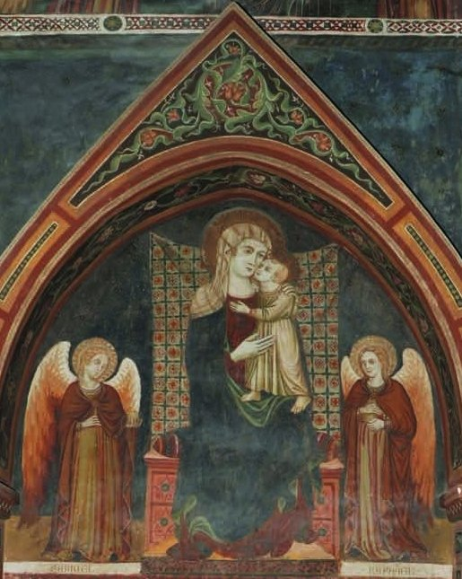

## An Anonymous Master and a Chapel of the Holy Cross

Among the anonymous personalities of Italian fourteenth-century painting, few are bound so tightly to a single room as the painter whom criticism calls the *Primo Maestro della Beata Chiara da Montefalco*, the First Master of the Blessed Chiara of Montefalco. His name of convenience derives from the Cappella di Santa Croce, the surviving apsidal chapel of the small church attached to the monastery at Montefalco where Chiara of the Cross had lived, governed her community, and died in 1308. There, in the year 1333, a dedicatory inscription records that Jean d'Amiel, lately rector of the Duchy of Spoleto, had the chapel decorated; and there, across the altar wall, the vault, and the right wall, an unnamed painter of remarkable expressive power set out a Crucifixion thronged with mourners and horsemen, an archaic Tetramorph wreathed in scrollwork, and a sequence of scenes in which the childhood and visions of the local holy woman are woven together with the legends of older saints. Because a second, distinguishable hand completed the left wall, the convention of calling the principal painter the "First" Master and his collaborator the "Second" arose in the scholarly literature, and it has held ever since, even as the question of who these men actually were has been asked with increasing insistence.

What can responsibly be said about the First Master depends on keeping different orders of knowledge distinct. A small core of facts is documented: the date and the patron named by the inscription, the identity and death of Chiara, the processes that investigated her sanctity, the survival of the frescoes themselves and of the altar dossal that left the monastery in the twentieth century and now hangs in the Vatican. Around that core stands a larger body of reconstruction: the division of hands within the chapel, the works attributed to the master elsewhere in the Spoletan hills, and above all the proposal, now favoured by leading scholarship but not yet universally accepted, that the First Master is none other than the late phase of the <a href="/Content/Artists/XIV-c/Maestro-di-Cesi.html">Maestro di Cesi</a>, the painter of a dossal dated 1308. Beyond that again lies a penumbra of tradition and error: confusions about the patron's rank, about the dates of the canonization proceedings, about a supposed painter's signature at Cesi. Each of these layers needs to be treated as what it is, and several commonly repeated mistakes need correcting.

The story that emerges is not only the story of a painter. The chapel of Santa Croce is one of those rare monuments in which the making of a saint and the making of pictures can be watched happening together, within a single generation and a few metres of wall. The frescoes of 1333 were painted above a venerated body, for an audience of enclosed women who had known the dead abbess personally, at the expense of a French official of the Avignon papacy whose administration had governed the duchy in which the monastery stood. To understand the First Master one must therefore begin some distance from him, with the town, the saint, and the long juridical labour of her cause, before entering the chapel and, finally, confronting the problem of his identity.

## Montefalco and the Duchy of Spoleto under the Avignon Popes

In the early fourteenth century Montefalco was a modest hill town of the Duchy of Spoleto, the band of papal territory that criticism of Umbrian art has learned to treat as a region with its own artistic physiognomy, distinct from the Umbria of Perugia and Assisi across the Tiber. With the departure of the popes for Avignon, the duchy came to be governed at a distance, through rectors and treasurers who were frequently French career officials, and whose presence gave the towns of the Valle Umbra an administrative class with continental horizons and considerable resources. It is within this world of papal governance in absentia that the patron of the chapel of Santa Croce made his career, and his biography deserves to be set out before the chapel itself, because almost everything about the decoration of 1333 — its date, its donor portraits, even its choice of saints — follows from it.

Jean d'Amiel, who appears in Italian documents as Iohannes de Amelio, served as treasurer of the Duchy of Spoleto from 1317 to 1323 and then as its rector from 1323 to 1332. His origins are less certain than the popular literature suggests: one strand of the sources gives him to the Quercy, in the orbit of Cahors, another to Provence, and the question should be regarded as open. What is not in doubt is the energy of his administration and his taste for building. Between 1322 and 1324 he rebuilt the rocca of Montefalco, reportedly taking the advice of Lorenzo Maitani, the Sienese master then directing the works of Orvieto cathedral — a detail which, if it stands, shows the rector already accustomed to dealing with artists of the first rank a decade before he turned to the painters of the Santa Croce chapel. Nor did his patronage in Montefalco end with the frescoes of 1333. In 1336 he commissioned from the painter known as the <a href="/Content/Artists/XIV-c/Maestro-di-Fossa.html">Maestro di Fossa</a> a polyptych for the church of San Francesco in the same town, a work whose dedicatory inscription was recovered during the restoration carried out at the Vatican in 2017. His later career carried him higher still: he ended as bishop of Spoleto, holding the see from 1348 or 1349 until about 1370.

The pattern is coherent. Here was a French officer of the Avignon administration who, over some two decades, invested repeatedly in the sacred topography of a single Umbrian town, binding his name to its fortress, to its Franciscan church, and to the burial chapel of its holy woman. It is tempting, and probably not wrong, to read this persistence as political as well as devotional. Montefalco's prestige in those years rested to a large degree on the fame of Chiara of the Cross, whose cause for canonization had been heard by an apostolic tribunal in 1318 and 1319 and was still, around 1330, under active consideration at the curia. A rector who adorned her tomb associated the papal government with the principal spiritual asset of the town; a former rector who did so in retirement, as the inscription of 1333 describes him, perpetuated that association in his own name. But the devotional reading should not be dissolved entirely into calculation. The chapel shows d'Amiel three times on his knees, and the saints who present him there — Blaise and Catherine — recur across the whole decorative enterprise with a consistency that suggests personal election rather than administrative convenience. In the duchy of the Avignon popes, piety and governance were not alternatives; the chapel of Santa Croce is among the most vivid surviving demonstrations of their alliance.

## Chiara of the Cross: a Life and a Prodigy

Chiara was born at Montefalco in 1268, the daughter of Damiano and Iacopa. While still a child she followed her elder sister Giovanna into a small community of recluses that Giovanna had gathered on the hill outside the town, one of those informal congregations of penitent women that dotted central Italy in the later thirteenth century, living by prayer and manual labour without belonging to any established order. The decisive institutional turn came in June 1290, when Gerardo, bishop of Spoleto, granted the community the Rule of St Augustine<a href="/endnotes.html#fn-augustine-of-hippo" class="footnote">1</a>, transforming the recluses into a regular monastery. Giovanna, its first head, died in the following year, and Chiara, then in her early twenties, was elected abbess in her place. She governed the house — known from its church as the monastery of the Croce — for seventeen years, acquiring a reputation for austerity, for theological discernment, and for visionary experience centred with unusual intensity on the Passion of Christ, until her death there on 17 August 1308.

What happened next determined everything that followed, including, at a distance of twenty-five years, the commission of the frescoes. Within days of her death the nuns opened Chiara's body and found in her heart what they took to be the symbols of the Passion, and in her gall bladder three stones. The discovery was treated from the first as a matter of public evidence rather than private marvel: on 22 August the podestà of Montefalco, Gentile dei Gilberti, made the seventeen nuns and Chiara's physician, Simone da Spello, swear that nothing had been fabricated. That civic oath, taken five days after her death, is an early and unusually formal document of testimony in a medieval cause, and it fixed the character of Chiara's sanctity for centuries: hers would be a holiness located in the body, verifiable, inspected, and — crucially for the painters who later served her cult — visualizable. The image of Christ planting his Cross in Chiara's heart, which the First Master would paint beside her tomb, is the pictorial translation of precisely this prodigy.

One point on which modern scholarship is firm deserves emphasis, because the older literature obscures it. Chiara belonged to no mendicant order. Disciplinarily she was an Augustinian nun, since her community lived under the Augustinian rule granted in 1290; but there is no proof that the monastery was institutionally tied to the order of Augustinian friars, and her spirituality was formed in the penitential and Franciscan-inflected climate of her region rather than within any order's school. For centuries after her death Augustinians and Franciscans disputed possession of her memory, and the dispute left its mark on the monuments: Benozzo Gozzoli, painting at Montefalco in the fifteenth century, showed Chiara in a Franciscan habit, which was replaced only after 1577. The modern student should resist both retrospective claims. The woman buried in the chapel of Santa Croce was the abbess of a local Augustinian-rule monastery, venerated first by her own nuns and her own town; and it was in that intimate, civic, and feminine setting — not in the great basilicas of the orders — that the First Master received his defining commission.

## Berengario di Donadio and the Road towards Canonization

The man who turned the prodigy of 1308 into a juridical cause was Berengario di Donadio, a cleric from Saint-Affrique in the Rouergue — he appears in the French literature as Béranger de Saint-Affrique — who served as vicar of Pietro da Monticchiello, bishop of Spoleto, from 1308 to 1310. It was Berengario who opened the diocesan informative process on 18 June 1309, within a year of Chiara's death; a fragment of twenty-six folios of the depositions taken in 1309 survives. It was Berengario, too, who composed the Vita sanctae Clarae de Cruce, the foundational narrative of her sanctity. The date of the Vita is disputed in ways that matter for the historian of the cult. Its most recent editor argues for 1310; an authoritative biographical study has proposed instead a second redaction composed after the inquiry conducted by Cardinal Napoleone Orsini<a href="/endnotes.html#fn-cardinal-napoleone-orsini" class="footnote">2</a> in 1316 and 1317; and <a href="/scholars.html#nessi-silvestro">Silvestro Nessi</a>, the scholar who did more than any other to reconstruct the documentary history of Chiara and her monastery, himself held different positions over the years, first favouring a span of 1310 to 1315 and later the narrower bracket of 1309 to 1310. However the redactional question is resolved, Berengario's advocacy continued at the highest level: in October and November 1316 he presented the cause at Avignon.

The papal response came a year later. By a letter of October 1317, registered in the Vatican registers (Reg. Vat. 67, f. 86r), John XXII<a href="/endnotes.html#fn-john-xxii" class="footnote">3</a> authorized an apostolic process, which sat from 6 September 1318 to July 1319, hearing the nuns and townspeople who had known Chiara. The record survives incomplete and has been available since the 1980s in a modern critical edition. Here a common error must be corrected: popular accounts, including widely consulted reference entries, state that the canonization process "opened in 1317". In fact 1317 is the date of the papal authorization; the tribunal itself sat in 1318 and 1319, and the distinction is worth preserving, since it is precisely the gap between authorization, inquiry, and judgment that shaped the decades in which the chapel was painted. Around 1330 the cause advanced another step with the report — the so-called Relazione — of the three cardinals charged with reviewing it, Napoleone Orsini, Pietro de Arreblayo, and Bertrando de Turre. And then nothing. No canonization followed in the fourteenth century, and scholarship can only hypothesize about the reasons; the suggestion that has carried most weight points to papal wariness of Chiara's associations with the Colonna family and with circles of Spiritual Franciscans, both objects of John XXII's suspicion. The formal canonization of Chiara of Montefalco came only on 8 December 1881, more than five and a half centuries after her death.

For the history of the chapel's decoration, the chronology of the cause is not background but motive. The Relazione of the three cardinals, around 1330, and the frescoes of 1333 stand within a few years of each other. The painting of the chapel thus belongs to the very moment when the hopes of Montefalco were at their height, when a favourable judgment from Avignon must have seemed imminent, and when a former rector of the duchy — a man of the Avignon administration himself — had every reason to endow the tomb of the prospective saint with a decoration worthy of the honours to come. That the honours were deferred for half a millennium takes nothing away from the ambition of the moment; it merely explains why the chapel, conceived in expectation, remained for so long the shrine of a beata rather than a sancta, and why the painter who adorned it is named, to this day, after the Blessed and not the Saint.

## The Monastery and the Chapel of Santa Croce

The room in which the First Master worked is itself a survivor. The present Cappella di Santa Croce is the apsidal portion — all that remains — of the small church of Santa Croce that served Chiara's monastery; the later monastic church of Santa Chiara grew up around and beyond it, enclosing the old sanctuary like a relic within a reliquary. Chiara rebuilt the church from 1303: a letter of Bishop Niccolò of Spoleto, dated 4 June of that year, sent her the blessed first stone and dedicated the building to God, the Virgin, the Holy Cross and Saint Catherine. This means the walls the painters frescoed in 1333 were barely a generation old, raised under the direction of the holy woman whose memory they were to serve.

The chapel's defining feature, however, is not architectural but funerary. From her death in 1308 until the translation of 26 June 1430, Chiara's body lay beneath the aedicula on the right wall of the chapel — that is, for the whole first century of her cult, and emphatically at the moment of the fresco campaign, the room was her tomb. This single fact governs the reading of everything painted there. The decoration of 1333 was not an ordinary chapel programme to which a burial happened to be attached; it was the monumental framing of a venerated body, the nearest thing Montefalco could offer to the painted shrines of the great pilgrimage saints, compressed into the intimate scale of a nuns' church. The aedicula above the body received the most doctrinally charged images of the cycle, and the hagiographic scenes of the right wall unfold around it like testimony around a reliquary.

Intimacy of scale brought with it a particular audience. Santa Croce was the sanctuary of an enclosed female community, and the nuns did not stand in the chapel as a lay congregation would; they watched the altar through openings in the enclosure. The implications of this arrangement for the disposition of the frescoes — the way certain scenes seem placed in deliberate relation to the points from which the community looked in — have been drawn out by recent scholarship and will be considered below, once the programme itself has been described. Here it is enough to register the unusual layering of functions the small room was asked to perform at once: monastic choir-sanctuary, Eucharistic chapel, civic shrine, tomb of a prospective saint, and monument to the piety of a papal administrator. Few painted spaces of the Italian Trecento carry so much purpose on so few square metres of plaster, and the density of the programme that follows is the direct consequence.

## The Patron and the Inscription of 1333

The documentary anchor of the whole enterprise is the dedicatory inscription in the chapel. It runs along the lower edge of the Crucifixion on the altar wall and reads: *In nomine Domini. Amen. Anno Domini MCCCXXXIII, indictione prima, reverendus vir dominus Iohannes de Amelio olim rectore Spoletani ducatus fecit fieri hoc opus*. The text repays attention. The year 1333 and the first indiction agree. The patron is styled a reverend man and lord, not a bishop. And he is described as olim rector, the former rector of the Duchy of Spoleto — a formula that fits his biography exactly, since d'Amiel had left the rectorship in 1332, the year before the date of the work.

Two errors that have attached themselves to the patron can be dispatched at once. The first calls him a bishop in 1333: he was not, and would not be for another decade and a half, since his episcopate at Spoleto began only in 1348 or 1349. The second confidently makes him a Provençal: as noted above, his origin is in fact uncertain, with the sources divided between the Quercy and Provence, and the confident epithet is an inheritance of repetition rather than of evidence. Both errors are instructive in a small way, because they show how easily the figure of the patron has been assimilated to a generic type — the French prelate of the Avignon century — when the documentary record presents something more particular: a lay-clerical administrator at the end of his mandate, spending his own authority and money on the shrine of a local holy woman.

Within the chapel d'Amiel is not merely named but seen, three times. He kneels, a small figure, at the foot of the Cross in the great Crucifixion of the altar wall; and he appears twice more on the left wall, presented to Christ by St Blaise in one image and by St Catherine in another. The triple portrait is a statement of unusual insistence for so small a space, and the choice of intercessors is anything but casual: Blaise and Catherine are precisely the saints whose legends run through the rest of the chapel and across the painted dossal that stood on its altar. Whether they were the patron's personal advocates, titulars of altars or devotions within the monastery, or both, the sources do not say, although Catherine was among the dedicatees of Chiara's church in 1303; what the walls themselves demonstrate is that the donor's devotion and the chapel's hagiographic programme were conceived together, as a single fabric. It is this integration — date, donor, saints, tomb, and altar bound into one scheme — that makes the chapel of Santa Croce so coherent a document of patronage, and the inscription of 1333, modest as it is, one of the precious fixed points of Umbrian Trecento painting: a dated, localized, patron-named fresco cycle by a master whose name we do not know.

## The Programme and the Nuns' Gaze

The decoration of 1333 covers the chapel as a continuous system. On the altar wall rises the Crucifixion, a Calvary of more than forty figures. The vault above carries the four symbols of the Evangelists set within rich decorative bands. The right wall — the wall of the tomb — combines an image of Christ blessing between angels with scenes from Chiara's childhood and visionary life, two episodes from the legend of St Blaise, and the aedicula over her body, with its enthroned Madonna and its image of Christ planting the Cross in Chiara's heart. The left wall, which the consensus of scholarship assigns to the Second Master, answers with Christ in a mandorla receiving the kneeling patron, the Death of Chiara, an Ecce Homo set beneath the window above the Eucharistic repository, and the Martyrdom of St Catherine. On the soffit of the arch stand Saints Francis<a href="/endnotes.html#fn-francis-assisi" class="footnote">4</a>, Fortunatus, Peter, Paul, Chiara, and the Magdalen, gathered around the Agnus Dei. Altar, tomb, tabernacle, and dedication are thus drawn into a single argument: the Passion of Christ at the centre, its re-inscription in the body of Chiara at the tomb, its sacramental presence at the repository, and around them the saints — universal, diocesan, and newly local — who guarantee the whole.

The most illuminating modern reading of how this programme actually worked is owed to <a href="/scholars.html#de-marchi-andrea">Andrea De Marchi</a>, who has drawn attention to the two grilles through which the enclosed nuns watched the altar. One opening lay below the scene of St Blaise imprisoned, fed in his cell by a widow — so that the women looking through it saw, immediately above their own aperture, an image of holy life as a captivity sustained by charity, a figure of their own enclosure. The other lay beside the swooning Virgin of the Crucifixion, placing the community's gaze at the very point where Mary collapses into the arms of the holy women — a company of grieving women on the wall continuous, as it were, with the company of praying women behind it. Whether or not every detail of this reading can be pressed, its central insight seems secure: the cycle was composed not for a neutral spectator standing in the middle of the floor, but for specific, embodied viewers whose positions were fixed by the architecture of enclosure, and its emotional economy is calculated accordingly.

De Marchi has also proposed a verbal analogy that captures the register of the whole: the chapel, he suggests, is the painted equivalent of a lauda — the vernacular devotional poetry of which Jacopone da Todi, from a nearby hill town, was the leading author. The comparison is critical shorthand rather than documented filiation, and it should be taken as such; but it answers to something real in the frescoes, their pitch of direct, sung-aloud feeling, their preference for grief and tenderness enacted rather than described, their utterly Umbrian fusion of theological seriousness with emotional immediacy. A programme that sets the Passion in the heart of a local woman, and sets the eyes of her daughters at the edge of the Virgin's swoon, is working in the same devotional key as the laude; the First Master's achievement was to find a pictorial language — archaic in some of its furniture, startlingly modern in its dramatic construction — adequate to that key.

## The Crucifixion Wall

The altar wall is the First Master's great statement, and it is built on crowding. More than forty figures — popular accounts like to give the precise figure of forty-five, which should be treated as a count of convenience rather than a verified census — are gathered around the Cross in a composition whose outer register is a ring of horsemen, pressing in from both sides so that the sacred drama unfolds within a mounted cordon. The device at once dates and places the painting: the encircling cavalry belongs to the new, post-Giottesque conception of Calvary as a historical event thronged with witnesses, armies, and officialdom, rather than the hieratic, symmetrical Crucifixion of the Duecento with its few isolated mourners. Within the ring, the narrative is organized around poles of feeling. At the foot of the Cross is the Magdalen, in her familiar office of unrestrained grief. To one side the Virgin collapses — the famous swoon — and is held by the holy women, her loss of consciousness made the emotional centre of gravity of the whole wall. St John stands in mourning; the centurion makes his confession; and, minute among the monumental actors, the patron Jean d'Amiel kneels at the foot of the Cross, inserting the Avignon official bodily into the first century.

De Marchi has identified the composition's essential model: the Crucifixion frescoed by <a href="/Content/Artists/XIII-c/Giotto-di-Bondone.html">Giotto</a> and his workshop in the right transept of the Lower Church of San Francesco at Assisi, datable around 1310–1312. The dependence is clearest exactly where the Montefalco wall is most affecting, in the swoon of the Virgin, which reworks the Assisi invention; but it extends to the whole conception of the crowded, witnessed Calvary. The observation matters for more than source-hunting. Assisi lies a short journey from Montefalco, and the Lower Church transept was the most authoritative new painting in Umbria in the generation before 1333; a painter who could absorb its lessons and redeploy them, within two decades, on the altar wall of a nuns' chapel was no provincial copyist but a professional in active dialogue with the most advanced art of his region. At the same time, the comparison measures the distance of his temperament from his model. Where the Assisi Crucifixion holds its grief within Giotto's gravity, the Montefalco wall heightens, sharpens, and accelerates; the mid-twentieth-century criticism that rediscovered the cycle praised precisely this quality, its breathless, impassioned sentimental immediacy, and the phrase has stuck to the master ever since.

It is worth pausing on what the wall asks of its audience. Set behind the altar, the Calvary stood directly above the daily sacrifice of the Mass; seen through the nuns' grille beside the swooning Virgin, it placed the community inside the circle of the holy women; surmounting the inscription, it converted the patron's record into a caption for the Passion itself. The First Master's Crucifixion is thus not an isolated showpiece but the hinge of the chapel's whole machinery of devotion, the image toward which the tomb, the repository, and the hagiographic walls all turn.

## The Vault and the Tetramorph

Above the Calvary's modernity, the vault speaks an older language. Its four cells carry the symbols of the Evangelists set within rich ornamental bands, and De Marchi has characterized them precisely: these are archaic, zoocephalic figures of the Tetramorph — beings with the heads of the lion, the ox, and the eagle joined to bodied forms, in the ancient manner — framed by scrollwork unwinding against a black ground. Nothing in the chapel marks the master's double allegiance more clearly. The painter who had studied the crowded Calvary of the Lower Church at Assisi chose, for the heaven of his chapel, a formula whose roots lie deep in the Romanesque and Byzantine inheritance of the Spoletan region: apocalyptic creatures rather than naturalized portrait-Evangelists at their desks, ornament rather than fictive architecture, black grounds rather than lapis skies.

It would be a mistake to read this archaism as incapacity or provincial lag. The decorative bands are handled with evident sophistication, and the choice coheres with the chapel's purpose. A vault of visionary creatures suits a room built around a visionary woman; the apocalyptic register of the Tetramorph belongs to the same spiritual climate as Chiara's Passion-centred mysticism, and the dark ground with its luminous scrollwork gives the little sanctuary something of the character of a treasury or shrine — an effect entirely appropriate above a venerated body. Scholarship on the Spoleto school has, moreover, taught us to see such choices as characteristic of the valley's workshops, in which older formulas were not discarded as the new Giottesque manner arrived but were kept in service alongside it, each register deployed where its connotations were wanted. The First Master's vault is the work of a painter selecting from a layered tradition, not struggling behind one.

For the visitor standing in the chapel, the effect of the superimposition is calculated and strong: below, the historical world of the Passion, crowded, agitated, and particular; above, the eternal frame of the four living creatures, ornamental, dark, and still. The frescoes of 1333 hold the two together, and in that respect the vault is not the cycle's least important part but its key signature — the clearest declaration that this master's art was made at the meeting point of the old Spoletan sacred craft and the new narrative painting of the age of Giotto.

## The Right Wall and the Aedicula

The right wall is the wall of the tomb, and its programme reads as a sustained act of hagiographic argument conducted above the body it concerns. An image of Christ blessing between angels presides. Around it unfold the scenes of Chiara's own story, chosen with evident care from the material the processes and the Vita had made available. The child Chiara is received by her sister Giovanna — the moment of her entry into the community of recluses, and a quiet assertion that her sanctity began in childhood and in obedience. In a second scene the Christ Child walks toward Chiara: an image of the visionary intimacy with Christ that the testimony of the nuns had described, rendered with the directness of a family encounter. These episodes belong to the earliest stratum of Chiara's iconography, invented within living memory of the witnesses, for viewers — the older nuns above all — who had known her; their domestic tenderness is not naivety but a form of evidentiary realism.

Interleaved with Chiara's scenes are two episodes from the legend of St Blaise: the saint in his cave, blessing the animals that came to him, and the saint in prison, fed by a widow. The pairing of the new beata with the ancient bishop-martyr served several purposes at once. It set the local cause within the universal company of the saints; it supplied, in the hermit's cave and the prison cell, two images of holy withdrawal that rhymed with the enclosed life of the community — the more pointedly if, as De Marchi has argued, one of the nuns' grilles opened directly below the prison scene; and it answered the devotion of the patron, who elsewhere in the chapel is presented to Christ by Blaise himself.

The wall culminates in the aedicula that sheltered Chiara's body until 1430. In its upper register the Madonna sits enthroned between two archangels, whose names are painted beneath them: Gabriel and Raphael. Some accounts name the second as Michael, but the inscriptions settle the question. Below, in the position closest to the body, stands the most doctrinally audacious image of the whole chapel: Christ plants the Cross in Chiara's heart, while the Blessed Giovanna stands by holding a palm. Here the prodigy of 1308 — the instruments of the Passion found in the opened heart — is converted from forensic marvel into sacred narrative: what the nuns discovered with knives, the fresco shows Christ himself performing, the Cross set into the heart as a planted, living thing, with the elder sister, haloed and bearing a palm, as witness. No image could declare more plainly what the chapel wished Avignon and the world to believe: that the body beneath was not merely a dead abbess but ground in which the Passion itself had been planted.

On the soffit of the arch, finally, the chapel assembles its heavenly court: Saints Francis, Paul, John the Baptist, the Magdalen, Peter and Fortunatus around the Agnus Dei. The selection compresses the shrine's whole frame of reference — the prince of apostles and the apostle of the gentiles for the universal Church, the Baptist as the forerunner who pointed to the Lamb, Fortunatus, patron of Montefalco, for the town's own sanctity, Francis for the penitential climate of the region, and the Magdalen for the economy of grief and love the Crucifixion wall enacts. Chiara herself, haloed and inscribed SCA CLARA, appears on the right wall among the scenes of her own life, painted as a saint half a millennium before the Church would formally declare her one. The attribution of these soffit figures, it should be noted, is among the points where the division of hands in the chapel remains under discussion, and we shall return to it.

## The Dossal in the Vatican

The chapel's altar was not bare wall and frescoes alone. It carried a painted dossal, a long horizontal panel of 82 by 281 centimetres, which remained in the monastery's possession for six centuries before being sold — the Vatican's own notes give 1927, while some accounts give 1925 — and which now belongs to the Vatican Pinacoteca, where it bears the inventory number MV 40523. The panel shows the Crucifixion at its centre, flanked by narrative scenes of St Blaise and St Catherine drawn from the Legenda aurea. It was restored in 1970 and again in 2017, and the Vatican's own catalogue attributes it to the Primo Maestro della Beata Chiara — an attribution that makes the panel the one portable work tied to the master by provenance as well as by style, since it comes from the very chapel that defines him.

The dossal's iconography locks it into the programme of the walls with a neatness that can hardly be accidental. Blaise and Catherine are exactly the two saints who present the kneeling Jean d'Amiel on the chapel's left wall; Blaise's legend occupies two scenes of the right wall, and Catherine's martyrdom one of the left; the Crucifixion at the panel's centre answered, at altar level, the great Calvary rising on the wall behind it. Altar panel and mural cycle thus formed a single apparatus, the dossal functioning as the programme's portable core and the frescoes as its monumental expansion — or the reverse, depending on which was conceived first, a question the sources do not settle. Either way, the correspondence strengthens the case that the whole ensemble, panel included, belongs to the patronage context of 1333 and to the circle of the First Master.

The panel has also acquired a role in the question of the master's identity. When it was shown in the exhibition dedicated to the Umbrian Trecento in 2018, its label presented it as the opera estrema — the final work — of the Maestro di Cesi, the anonymous painter of the dossal of 1308 from Santa Maria in Cesi. That formulation quietly assumes the identification of the First Master with the Cesi painter, an identification which, as the next sections will show, is a strongly argued but still hypothetical construction of recent criticism. The museum visitor who reads the label as settled fact is being told more than the evidence, strictly speaking, warrants; but the choice of words registers accurately where the weight of current scholarly opinion lies. For the student of the chapel, the dossal's departure remains a loss sensible on the spot: the altar of Santa Croce has been separated from the panel made for it, and the programme the First Master and his patron devised must now be reassembled in the mind, between Montefalco and the Vatican.

## Style and Formation: Spoleto, Assisi, and Giotto

The First Master's art belongs to a regional school that criticism has learned to call by the name earlier criticism gave it: the Umbria "to the left of the Tiber", the valley of Spoleto with its satellite towns — Trevi, Montefalco, Cesi, Vallo di Nera — whose painting followed a course distinct from that of Perugia and the Umbria across the river. This was a land of deep Romanesque and Byzantine habit, of painted crosses and Madonnas on carved thrones, of workshops in which — as recent scholarship on the Spoleto school has argued — the crafts of panel painting and wood sculpture could be practised side by side, and perhaps by the same hands. Its painters entered the fourteenth century carrying this inheritance with them, and the peculiar flavour of Spoletan Trecento painting lies in the way the new narrative art radiating from Assisi was received into, rather than substituted for, the older sacred craft. The First Master is the most vivid demonstration of that reception: a painter who could set a zoocephalic Tetramorph on black ground above a Calvary derived from Giotto's Lower Church, and make the conjunction feel not like contradiction but like liturgy.

Assisi is the hinge of any account of his formation. The dependence of the Montefalco Crucifixion on the Lower Church transept of about 1310–1312 is, as we have seen, a matter of visible fact; the further question is how early and how deep the painter's Assisian schooling ran. Here De Marchi has advanced the boldest claim in the literature: within his reconstruction, in which the First Master is the mature phase of the Maestro di Cesi, the painter's formation reaches back to the great worksite of the Upper Church around 1290, where he would have trained alongside the young Giotto himself on the cycle of St Francis. If that is right, the Montefalco frescoes of 1333 are the late work of a man who had stood on the scaffolds of the Upper Church, and his archaisms are the loyalties of an old master formed before the new manner hardened into system. The claim cannot be verified by documents; it stands or falls with the stylistic argument for the Cesi identification, and it should be held, like that identification, as a powerful hypothesis.

What can be said from the walls themselves is this: the First Master commanded the modern grammar — the crowded, witnessed narrative, the emotive figure groups, the donor inserted into sacred time — and bent it to a devotional temperament hotter and more immediate than Giotto's. His figures grieve, press, and swoon with an urgency that the mid-century criticism which rediscovered him described as breathless and impassioned; his ornament and his iconographic furniture keep faith with the old Spoletan sanctuaries; and his sense of audience — the calibration of the cycle to the nuns' enclosed gaze — shows a painter thinking liturgically, not only pictorially. It is a profile without a name, but it is not a profile without a physiognomy; and it is exactly this physiognomy that has driven the search for him elsewhere in the valley, among the works gathered in the following sections.

## The Critical Fortune of an Anonymous Painter

For a monument of such quality, the chapel of Santa Croce entered the modern literature late, and its critical history is brief enough to be told almost completely. The decisive act of rediscovery belongs to the mid-twentieth century: <a href="/scholars.html#longhi-roberto">Roberto Longhi</a>'s university course on central Italian painting, delivered in 1953–1954 and published only in 1973, brought the cycle before the eyes of the discipline and fixed its character in a memorable phrase, praising the sentimental immediacy of its breathless, impassioned expression. From that moment the Montefalco frescoes held a recognized, if modest, place in the map of the Italian Trecento — admired, quoted, but still unattached to any reconstructed artistic personality beyond the walls themselves.

The double name under which the chapel's painters now travel — Primo and Secondo Maestro della Beata Chiara — is a creature of this modern literature, but its paternity is surprisingly difficult to establish: the literature does not record who first coined the labels, and the point remains an open question. What can be documented is the moment the names received their canonical form. <a href="/scholars.html#todini-filippo">Filippo Todini</a>'s corpus of Umbrian painting of 1989, the indispensable census of the school, catalogues the Primo Maestro and assigns him the chapel's principal campaign together with the dossal now in the Vatican, and enters the Secondo Maestro separately with the left wall; Todini's pages gave the two anonymi their official existence, their boundaries, and their first systematically assembled corpora, and every subsequent discussion departs from them.

Parallel to the connoisseurship ran the documentary labour, and here one name stands above the rest: Silvestro Nessi, the historian of Montefalco, who across four decades edited and interpreted the sources on which all later work rests. Nessi studied the canonization processes in 1968 and the question of Chiara's relationship to Franciscanism in 1969; his article of 1972 in the journal Spoletium reconstructed the career of Jean d'Amiel as a precursor of the great legate Albornoz, giving the chapel its patron; and in 1991 he traced the paintings from Montefalco that had passed to the Vatican, the dossal among them. The division of labour between Nessi's archive and Todini's eye defined the state of the question at the end of the twentieth century: a dated chapel, a documented patron, a saint with an edited process, and two carefully bounded anonymous painters awaiting identity.

The third season of the chapel's fortune is the current one, and it bears above all the stamp of Andrea De Marchi, whose reading of the chapel — the nuns' grilles, the Assisi derivation of the Calvary, the lauda analogy, the archaic Tetramorph — has shaped the modern understanding of the room, and whose intervention in the question of the master's identity, made in his introduction to the 2015 monograph on the school of Spoleto and reflected in the Trecento exhibition of 2018, has reopened the entire file. To that question — whether the First Master of the Blessed Chiara had already had a whole career under another conventional name — we now turn.

## The Cesi Question

The Maestro di Cesi takes his conventional name from a dossal painted for Santa Maria in Cesi, in the hills above Terni, whose inscription dates it to 1308, under Clement V, in the sixth indiction, and names a donor, Domina Elena. One error must be cleared away before anything else: the Cesi inscription is a donor's record, not a painter's signature. The notion, met with in the popular literature, that the Cesi dossal is "signed" by a maestro — and hence that we possess the painter's name — is a myth born of misreading the word maestro in the modern conventional label back into the fourteenth-century text. The Cesi painter is exactly as anonymous as the Montefalco painter; what the inscription supplies is a date, a place, and a patroness.

The proposal that these two anonymi are one man — that the Primo Maestro della Beata Chiara is the Maestro di Cesi a quarter-century on — is the central event in the recent literature on both. Its most forceful advocate is De Marchi, who has declared the identification, in his own words, "per me incontrovertibile" — for him beyond dispute — and who anchors it in the reconstruction already described, by which the painter was formed at Assisi around 1290 alongside the young Giotto and carried that schooling through a long Spoletan career. The 2015 monograph on the school of Spoleto argues the same case in a chapter that asks, in its title, whether the two careers form "un percorso unitario", a single path; a study published in the journal Spoletium has treated the Madonna of Vallo di Nera, dated 1315, as precisely the bridge between the earlier and the later personality; and the 2018 exhibition of Umbrian Trecento masterpieces, as noted above, labelled the Vatican dossal the final work of the Maestro di Cesi without further qualification.

What exactly is being claimed, and on what evidence? The argument is stylistic through and through: a chain of works — the 1308 dossal, the 1315 Madonna, panels and frescoes scattered through the valley, the 1332 Madonna della Selvetta, the chapel of 1333 — within which the same artistic personality is held to be visible, aging and evolving but continuous. No document names a painter common to Cesi and Montefalco; no inscription, contract, or chronicle bridges the two. The identification is therefore a hypothesis of connoisseurship — of the strongest kind, argued by the scholars who know the material best, resting on a dated series with plausible internal development, but a hypothesis nonetheless. It has not been universally adopted: the older framework of two distinct masters, consolidated by Todini's catalogue, remains the formal state of the question, and prudent recent literature keeps both names in play, speaking of the First Master "identified by some" with the Cesi painter.

The point deserves insistence because the popular literature has already run ahead of the evidence. More than one widely read source now states the reassignment as settled fact, as though the First Master had been dissolved without remainder into the Maestro di Cesi. He has not. What has happened is that the centre of gravity of scholarly opinion has shifted toward the identification, carried by De Marchi's authority and the cumulative force of the Spoleto-school studies; and the shift matters enormously for how we see the Montefalco chapel — as the summation of a forty-year career rather than the isolated flowering of an unknown — but it remains, in point of method, a brilliant construction awaiting the document that would prove or break it. The master's conventional name therefore remains the appropriate one, and the identification should be reported as the strong current hypothesis it is.

## The Second Master and the Division of Hands

The First Master's name presupposes a Second, and the Second deserves more than a footnote, both because his work completes the chapel and because the frontier between the two hands is less settled than the tidy labels suggest. The consensus distribution, descending from Todini's catalogue, gives the Primo Maestro the altar wall with its Crucifixion, the vault, and the right wall with the tomb aedicula, and assigns to the Secondo Maestro the left wall: Christ in a mandorla receiving the kneeling Jean d'Amiel, who is presented by St Blaise and St Catherine; the Death of Chiara, with the community gathered around the bier; the Ecce Homo beneath the window, above the Eucharistic repository — the suffering Christ stationed over the sacrament in a pairing of image and reserve that belongs to the chapel's most considered liturgical thinking; and the Martyrdom of St Catherine. Yet even this clean division has wrinkles. The soffit of the arch, with its six saints and the Agnus Dei, has been discussed as shared ground; and a conference presentation of 2012, known only through press reports, was described as placing the change of hands at the right wall — a formulation that contradicts the standard distribution and is at least as likely to be a reporting error as a scholarly position. Until the relevant studies are published, the prudent statement is that the Primo Maestro painted most of the chapel, the Secondo its left wall, and the exact seam remains under discussion.

Who was the Second Master? Two proposals are on record, of very unequal weight. De Marchi has wondered aloud — his own phrasing makes clear that this is conjecture offered with explicit caution, not a claim — whether the Secondo Maestro might be the painter known as the Maestro di Sant'Alò, a personality of the Spoletan orbit, noting among other things the shared work on the soffit panels. The suggestion has the interest of drawing the chapel's second hand into the same tight regional web as the first, but its author's own hedging should be respected. The other proposal reached print only through journalism: a lecture of 2012 was reported as suggesting that the Second Master was the son of the First. No published argument substantiates the filiation, and it must be classed as unverified — a reminder of how much of the discussion of these anonymi still circulates in provisional and secondhand forms.

What matters for the history of the chapel is less the Second Master's identity than the fact of collaboration itself. Two distinguishable painters, working to a single programme under a single patron in a single year, with the junior or secondary hand entrusted precisely with the wall of the patron's own portraits and of Chiara's death: this is the ordinary physiology of a Trecento workshop enterprise, and it tells us that the First Master operated not as an isolated craftsman but as the head of an organized shop capable of delivering a complete chapel — walls, vault, and altar dossal — as a coordinated whole. However the hands are finally divided, the chapel's unity of conception has never been in doubt; and that unity is itself the strongest internal evidence that one mind, presumably the First Master's, governed the design of everything.

## Corpus, Chronology, and Legacy

Beyond the chapel and its dossal, a corpus has accreted around the First Master, its boundaries varying with the cataloguer and shifting further as the Cesi identification advances or recedes. The one dated anchor outside Montefalco is the Madonna della Selvetta of 1332, a panel of 157 by 63 centimetres from Colle del Marchese, painted the year before the chapel and attributed to the master in the modern literature. Around it the attributions gather: frescoes at Santa Maria di Turrita, in the countryside below Montefalco itself; a panel in the Victoria and Albert Museum in London; the painted altar frontal — the paliotto — of Santa Maria di Ponte; and frescoes in Sant'Agostino at Montefalco, the latter proposed by De Marchi. On the frontier between the First Master and the Maestro di Cesi stands the Madonna of Vallo di Nera, dated 1315, which some catalogues keep under the Cesi name and recent scholarship reads as the connective tissue between the two personalities. These attributions do not all carry equal conviction, and the catalogues — the photographic archive of <a href="/scholars.html#zeri-federico">Federico Zeri</a>, Todini's corpus, and the recent Spoleto-school literature — differ among themselves; a definitive catalogue of the master remains to be written, and will look very different depending on whether it is a catalogue of one painter or two.

The chronology follows from the corpus. Read minimally, the First Master is documented by a single dated campaign, 1333, with the Selvetta Madonna of 1332 immediately behind it: a personality of the early 1330s. Read through the Cesi identification, he becomes instead the protagonist of a career spanning at least a quarter-century, from the dossal of 1308 through the Madonna of 1315 to the chapel of 1333 — and, if the Assisian formation around 1290 is accepted, an artistic life of more than forty years, contemporary with the whole arc from the Upper Church cycle to the death of Giotto. The difference is not merely biographical. In the first reading the chapel is a sudden, isolated masterpiece; in the second it is a summation, the late style of a man who had spent his life translating the revolutions of Assisi into the idiom of the Spoleto valley. Recent scholarship has also set the master within a distinctive feature of that valley's artistic economy: the proposal that its workshops united painting and wood sculpture in a single practice, so that the Cesi painter would have worked alongside — or as — the carver of the Santa Cristina of Caso. The hypothesis, still under discussion, would make of the First Master's shop exactly the kind of polyvalent sacred-furniture enterprise that the region's churches demanded.

His legacy is regional but real. The expressive, impassioned manner of the Santa Croce chapel echoes in the minor masters of the valley — the painter known as the Maestro di Colle Altino among them — and the chapel itself became the model of what a saint's burial chapel in the duchy could be. More broadly, the First Master has become indispensable to the modern rehabilitation of Spoletan Trecento painting as a school with its own logic rather than a province of delays. In the chapel of Santa Croce, the duchy of the Avignon popes possessed a monument in which administration, sanctity, and art converged with rare completeness; and whether its painter was the old Maestro di Cesi at the end of his road or a distinct master of the 1330s, the walls he left are a major achievement of fourteenth-century Umbria — the work of a man who, nameless, gave a name to the hope of a town: the Blessed Chiara, painted among the saints, awaiting her sainthood for five hundred and forty-eight years, with the Cross planted in her heart.

## Catalogue Entry

### Crucifixion with Mourning Angels, the Holy Women and the Patron Jean d'Amiel

<figure>
  
  <figcaption>Primo Maestro della Beata Chiara da Montefalco (late Maestro di Cesi?), Crucifixion, 1333. Fresco, altar wall of the Cappella di Santa Croce, Santuario di Santa Chiara della Croce, Montefalco (Perugia). Commissioned by Jean d'Amiel, papal rector of the Duchy of Spoleto. Photo: Santuario di Santa Chiara della Croce, Montefalco, for educational use only.</figcaption>
</figure>

The Crucifixion on the altar wall is the most ambitious painting in the Cappella di Santa Croce, the one most often reproduced, and the image around which the whole decoration is organised. It fills the pointed lunette beneath the rib vault, so the architecture becomes a frame for the scene; the two converging arches enclose the event like a monumental tabernacle. Modern descriptions count more than forty figures, and the diocesan account gives forty-five. The painting belongs to the type of the "Calvario popoloso", the crowded Calvary that spread through Umbria in the first half of the fourteenth century. Its most influential model was [Pietro Lorenzetti](/Content/Artists/XIV-c/Pietro-Lorenzetti.html)'s Crucifixion in the left transept of the Lower Church at Assisi. At Montefalco, however, the type has been compressed into a much smaller, nearly square field. The painter has had to stack rather than spread his crowd, setting the soldiers in tight vertical tiers on either side of the cross and pushing the mourners right down to the lower edge. The diocesan description notes that the iconography draws on both the Johannine and the Lucan accounts of the Passion.

The figure of Christ dominates the field with a scale that has little to do with the logic of the surrounding space. The tall cross rises almost to the apex of the lunette, crowned by a rectangular titulus bearing the letters INRI. Christ's arms stretch nearly the full width of the crossbar. His body sags in a gentle curve, the head inclined towards his right shoulder, the eyes closed in death. Andrea De Marchi associated this towering, immense Christ with [Cimabue](/Content/Artists/XIII-c/Cimabue.html): the overall arrangement is up to date, but the Christ belongs to an older, more hieratic conception of the Crucified. The anatomy is rendered with clear contours and restrained modelling, the ribs and abdomen marked by linear accents rather than by a continuous play of light. Thin streams of blood run from the wounds in the feet down the shaft of the cross. They lead the eye directly to the Magdalene below, who embraces the wood at precisely that point.

Six angels hover around the cross in two symmetrical groups, two beside the titulus and two on either side of the arms. Their lower bodies dissolve into white, wispy trails, so they seem to be made of the cloud on which they move. This formula comes from the Giottesque Crucifixions at Assisi and Padua, but at Montefalco it is handled with a vehemence typical of the Spoletan tradition. The angels do not simply float in sorrow. They twist, raise their hands to their faces, throw out their arms and look towards Christ with expressions of acute grief. Against the deep blue-green ground, the warm reds, ochres and pinks of their wings create a ring of agitated colour around the pale body of Christ. The heavenly lament thus answers, at a higher register, the earthly lament below.

The left side of the composition belongs to the soldiers and to the group of the holy women. Behind a rider on a brown horse rises a dense cluster of helmeted figures, spears and lances. A red banner bears an emblem that cannot be securely read in the photograph, and a reed tipped with the sponge stands out against the sky. A soldier in a golden-orange tunic raises his hand, and grey-bearded elders crowd beside him, their heads packed together in the stepped manner typical of Spoletan Calvaries. Depth is suggested not by perspective but by accumulating heads and weapons, which give this half of the picture an almost tapestry-like density. In the lower left corner the Virgin collapses into the arms of the holy women, who hold her under the arms and around the shoulders. De Marchi recognised this group as directly dependent on the Crucifixion in the right transept of the Lower Church at Assisi, which he dates to around 1310–1312; the borrowing is clearest here. Yet the Montefalco painter has translated the borrowed motif into his own idiom. The faces are drawn with strong contours, the haloes overlap like a row of golden discs, and grief is stated with almost declamatory directness.

Immediately beside the swooning Virgin, a small square opening with an iron grating is cut into the wall. On De Marchi's reading, this was one of the grilles through which the enclosed Augustinian nuns followed the liturgy from their side of the wall. Its placement was deliberate. The nuns looked into the chapel through the very image of the Mother of Christ in her sorrow, and were invited to identify their own devotion with hers. The rhetoric of the fainting Virgin was therefore aimed not only at the clergy and laity in front of the altar but also at the community behind the wall. The image becomes an instrument of devotion addressed to two audiences at once.

At the foot of the cross kneels Mary Magdalene, in a green gown, her long, loose, reddish-gold hair falling down her back as she clasps the wood. She is the axis of the lower half of the painting, as Christ is of the upper. Her figure ties together the stream of blood from the wounded feet, the mourning women on the left and the horsemen on the right. Immediately beside her, separate from the group of holy women, appears a much smaller kneeling figure in dark clothing, hands joined in prayer. This is the patron, Jean d'Amiel, the French cleric who had governed the Duchy of Spoleto as papal rector. His reduced scale is conventional, but his position is not, and his presence is more than a routine donor portrait. In the church where Chiara had died, and where her devotees believed her heart had revealed the Cross, the patron set his own image at the very point where devotion to the Cross was concentrated. He was thus drawn into a community of mourning that joined the Gospel figures, the dead abbess and the living women of her monastery.

The right side mirrors the left with a different emotional tone. A rider on a white horse, seen in sharp profile, leads a group of helmeted soldiers and bearded figures, one of whom holds a large, pale shield. A helmeted figure near the cross, apparently the rider himself or the soldier just beside him, raises his hand towards Christ. The gesture traditionally identifies the centurion who, in the Synoptic Gospels, acknowledged the Son of God at the moment of his death; the photograph does not allow a certain identification. The two horses, one on each side, flank the cross rather than surround it. Their heads cut diagonally across the space and introduce movement into an otherwise frontal arrangement. In the lower right corner, a mourning figure in a red mantle over a green tunic sits huddled, head bowed and resting on one hand. This is presumably Saint John, shown in a pose of withdrawn, inward grief that contrasts with the collapsing Virgin opposite.

Stylistically, the fresco shows with particular clarity the tension that defines this painter. The structure of the composition, the swooning Virgin and the lamenting angels derive from Assisi. Yet, as De Marchi insists, the language is different: it speaks to the feelings first and to the intellect only afterwards, and its roots lie much deeper in the past. Colours are saturated and strongly contrasted. Faces are defined by emphatic outlines. Gestures are emphatic and held, made to be read at a distance, and the emotional pitch is sustained from one end of the wall to the other. Roberto Longhi first isolated this painter's personality in his lectures of 1953–54. The monastery's published account of the chapel reports his appreciation of the anonymous painters' "qualità di immediatezza sentimentale di espressione affannata e appassionata", their immediacy of feeling and breathless, impassioned expression. The phrase seems written for this wall. A modern diocesan guide speaks of the fusion of solid Romanesque traditions with Giottesque innovations arriving from Assisi. The wording is a guide's rather than a scholar's, but the judgement agrees with the specialist literature: the painter accepts [Giotto](/Content/Artists/XIII-c/Giotto-di-Bondone.html)'s compositional models but declines the core of Giottesque form, the construction of solid bodies in coherent space.

The vault above deepens this sense of conscious archaism. In the compartment directly above the lunette appears the eagle-headed figure of Saint John, and in the other compartments, partly visible, the remaining Evangelists take the same old zoocephalic form. Broad bands of foliate scrolls on a dark ground run along the ribs and the arch. De Marchi singled out this taste for festive ornament on black grounds, together with the zoocephalic Tetramorph, as habits of the late thirteenth century. In a work of 1333 they are best explained by the training of an older painter. This is one of the main arguments for identifying the Primo Maestro with the late phase of the Maestro di Cesi, a painter trained around the Assisi scaffolding of the 1290s whose first dated work is the Cesi dossal of 1308. <a href="/scholars.html#delpriori-alessandro">Delpriori</a> has supported the identification while presenting it, honestly, as a thesis rather than a certainty, and it remains the strongest current hypothesis rather than an established fact.

Read in its setting, the Crucifixion is not an isolated devotional image but the hinge of a carefully planned programme. It faced the clergy and laity before the altar while opening, through the grille beside the Virgin, towards the enclosed nuns. Across the chapel it was answered by the painted tabernacle in which Christ plants the Cross in Chiara's heart. The universal sacrifice on the altar wall and the particular sanctity of the local visionary were thus set in dialogue: the Cross of Calvary became the Cross that Chiara had received in vision and that her community believed had been found in her heart. Painted in 1333, while her cause still waited at Avignon, the fresco proclaims the Passion and, implicitly, the holiness of the woman whose church this had been. Together with the rest of the chapel, it is one of the most intact and eloquent documents of Spoletan painting in the first half of the fourteenth century.

### Vault with the Four Evangelists in Zoocephalic Form

<figure>
  
  <figcaption>Primo Maestro della Beata Chiara da Montefalco (late Maestro di Cesi?), Vault with the Four Evangelists, 1333. Fresco, vault of the Cappella di Santa Croce, Santuario di Santa Chiara della Croce, Montefalco (Perugia). Commissioned by Jean d'Amiel, papal rector of the Duchy of Spoleto. Photo: Santuario di Santa Chiara della Croce, Montefalco, for educational use only.</figcaption>
</figure>

The vault of the Cappella di Santa Croce is a ribbed cross vault: four triangular compartments, or webs, meet at a small central boss. Seen from below, as in this photograph, it forms the ceiling of a chamber that is almost a painted reliquary. The webs are painted a deep, slightly mottled blue, each framed by a narrow band of orange and green. In each sits a single winged Evangelist with a book. The surrounding surfaces, along the diagonal ribs, the transverse arch and the broad borders between them, are covered almost without interruption by ornament. Little of the architectural surface is left bare. The chamber is wrapped in a continuous skin of colour and pattern, which binds the vault visually to the walls below.

The figures are not simply the symbols of the Evangelists but the Evangelists themselves, in the old zoocephalic form: winged figures with human bodies, haloes, tunics and mantles, holding books, but with the heads of their symbolic creatures. In the compartment above the Crucifixion, at the left of the photograph, a figure in a green tunic and red mantle, his wings spread wide, holds a book, and above the shoulders rises the brown, hooked head of an eagle within a golden halo: Saint John. Opposite him, at the right, a figure in a brown mantle has the head of an ox: Saint Luke. At the bottom, towards the wall of the tabernacle, a figure in an orange mantle has the head of a lion and holds a small green book: Saint Mark. At the top, towards the wall with the patron, the figure seen upside down has a human face: Saint Matthew.

The arrangement is strictly radial. In each web the Evangelist is turned so that his head points towards the central boss and his body stretches out towards the springing of the vault. The figure at the top of the photograph therefore appears upside down, and those on the sides appear to lie horizontally. The effect cannot be appreciated from any single viewpoint, because the vault is designed as a centred whole rather than for a viewer standing in one place. The four writers of the Gospel converge on the apex of the vault as on a heavenly centre, directly above the altar and the Crucifixion. The arrangement is old: it belongs to a long tradition of vaults with Evangelists and Doctors of the Church that the Upper Church at Assisi had made canonical in central Italy at the end of the thirteenth century.

Here the Primo Maestro's conservatism is most openly displayed. De Marchi argues that identifying this painter with the Maestro di Cesi explains several archaisms that would otherwise be hard to account for in a work of 1333. One is the taste for festive ornamental scrolls on a black ground, which enliven the broad bands of the vault and which he associates with the late thirteenth century. Another is the old iconography of the Tetramorph in zoocephalic form, Evangelists with human bodies and the heads of their symbolic creatures, which by the 1330s had largely given way to purely animal symbols or to Evangelists in fully human form. Both features are plainly visible in the photograph, and together they give the vault a character closer to the decorative world of the 1290s than to that of the Lorenzettian 1330s.

A third archaism lies not on the vault but in the painted tabernacle on the side wall: the crumpled white veil on the shoulders of the enthroned Madonna. In De Marchi's view it derives from the roundel of the Virgin and Child on the inner façade of the Upper Church at Assisi, attributed to Giotto and painted some forty years earlier. At Montefalco, however, it has been emptied of the plastic and spatial meaning it had there. For De Marchi these are not the habits of a painter trained in the 1320s. They belong to a painter whose visual culture was formed in the Assisi of the 1290s and who kept them into the 1330s, whether by conviction, by habit or out of a sense of what devotional decorum required. The vault and the Madonna thus belong to the same line of argument. They make visible the generation to which the painter belonged.

The ornament deserves attention in its own right, because it is not mere filler. The diagonal ribs are painted with narrow strips of small, repeated geometric motifs in red, white and dark tones, a sort of painted inlay recalling the marble inlay of Roman cosmatesque work. The transverse arch at the top of the image carries a row of red and white dots like a string of beads. Between ribs and webs run the broad borders De Marchi describes: dark green or almost black grounds over which wind scrolling stems of foliage, punctuated by red and white rosettes. The effect is that of precious textile or embroidery laid over the architecture. The repetition is dense yet lively, because the scrolls vary in rhythm and the rosettes are freely spaced. In such a small room this decorative richness turns the vault into a canopy, almost a painted baldachin over the altar.

The Evangelists themselves are painted in the same idiom as the figures on the walls below. Their wings are rendered in broad, warm feathers of red, ochre and white that open like fans against the blue ground. Their drapery is described with clear contours and a few strong folds rather than with systematic modelling. Their hands, gripping the books, are drawn with the firm outline that characterises the whole chapel. The figures fill their triangular fields well, adapting to the narrowing shape of the web without appearing cramped. That is no small achievement in a vault of such modest size, and it shows a painter well practised at fitting figures to awkward architectural fields.

Colour binds the vault to the rest of the decoration. The deep blue of the webs is the same ground that sets off the angels and the cross in the Crucifixion. The red, orange and green of the frames recur in the clothing of the mourners and soldiers below. The warm tones of the wings echo the agitated ring of angels around the dead Christ. The chapel's colour system is thus unified from floor to apex, one of the reasons it reads, despite its two painters, as a coherent whole. Seen from below, the eye moves continuously from the Crucifixion to the eagle of John directly above it. The Evangelist who stood at the foot of the cross in the Gospel narrative is placed, in the vault, immediately above the Calvary he witnessed. That coincidence suits the chapel's programme, though whether it was intended is not known.

The edges of the photograph show how the vault fits into the room as a whole. At the top, upside down, appears the lunette of the wall with the patron: Christ in a mandorla among angels, and the kneeling Jean d'Amiel presented by Saint Blaise and Saint Catherine, with the bundle and the shield of his offering. At the bottom appears the lunette of the opposite wall, with Christ blessing between two angels, and below it the gable of the painted tabernacle with its scrolling foliage. These glimpses confirm that the decorative system of the vault continues without a break into the walls: the same borders, colours and patterns frame the narrative and iconic scenes below. This continuity is part of what De Marchi meant by describing the chapel as a microcosm in which the whole argument of Spoletan painting is condensed.

Read in its devotional context, the vault completes the theological structure of the chapel. Below, the altar wall presents the Crucifixion, and the side walls present the visions and death of Chiara and the patron's devotion to his chosen saints. Above, the four Evangelists, the authors of the Gospel account of the Passion, converge on the apex as witnesses and guarantors of the truth that the walls make visible. For the enclosed nuns who followed the liturgy through the grilles, and for the clergy and laity before the altar, the vault framed the whole room as a sacred space under the authority of Scripture. Painted in 1333, while Chiara's cause still waited at Avignon, it shows the Primo Maestro, whether or not he is the late Maestro di Cesi, using an old visual language deliberately and with conviction for a room that served at once as chapel, relic and memorial.

### Maestà: The Virgin and Child Enthroned between the Archangels Gabriel and Raphael

<figure>
  
  <figcaption>Primo Maestro della Beata Chiara da Montefalco (late Maestro di Cesi?), Maestà between the Archangels Gabriel and Raphael, 1333. Fresco, upper part of the painted tabernacle, side wall of the Cappella di Santa Croce, Santuario di Santa Chiara della Croce, Montefalco (Perugia). Commissioned by Jean d'Amiel, papal rector of the Duchy of Spoleto. Photo: Santuario di Santa Chiara della Croce, Montefalco, for educational use only.</figcaption>
</figure>

The Maestà occupies the upper part of the painted tabernacle on the side wall of the Cappella di Santa Croce. The tabernacle is a fictive niche under a pointed arch, and below the Maestà Christ, dressed as a pilgrim, drives the foot of his Cross into Chiara's breast. Image and vision are thus stacked one above the other within a single painted structure. Above is the iconic, timeless presence of the Mother of God with her Son; below is the dramatic moment that founded Chiara's mystical identity. The tabernacle faces the death of Chiara on the opposite wall, and on Andrea De Marchi's reading it was visible to the enclosed nuns through the grille opening beside the swooning Virgin in the Crucifixion on the altar wall. The Maestà was therefore not a separate devotional image. It was one element of a carefully planned programme in which each image answered another across the room.

<figure>
  
  <figcaption>Primo Maestro della Beata Chiara da Montefalco (late Maestro di Cesi?), the wall of the tomb, with Christ blessing, scenes of the childhood of Chiara, the painted tabernacle with the Maestà and Christ planting the Cross in Chiara's heart, and scenes of Saint Blaise, 1333. Fresco, Cappella di Santa Croce, Santuario di Santa Chiara della Croce, Montefalco (Perugia). Photo: Santuario di Santa Chiara della Croce, Montefalco, for educational use only.</figcaption>
</figure>

The Virgin sits frontally on a throne, her monumental figure filling the centre of the arch. Her proportions are those of an icon rather than of a narrative figure: she is markedly larger than the flanking angels, and her mass dominates the field. She wears a white veil over her head and shoulders, a dark mantle now much darkened, and beneath it a red dress visible at the neck. Her face is long and oval, with a straight nose, heavy-lidded eyes and a small mouth. Her expression is grave and inward, typical of the Spoletan painters, who placed restraint and melancholy at the centre of their Marian images. A large golden halo, partly faded, frames her head. Her right hand lies across the Child's body, close to her own chest, in a gesture both protective and presenting.

The Christ Child does not sit in his mother's lap. He stands on it, barefoot, in a pale tunic that falls in soft folds to his ankles. He throws his arms around her neck and presses his cheek against hers. The type is that of the Virgin of Tenderness, known in Byzantine tradition as Glykophilousa, in which the intimate affection between mother and child replaces the solemn presentation of the Hodegetria. The contrast between the Virgin's grave face and the Child's eager embrace gives the image its emotional charge: the tenderness is real, but it is shadowed by the mother's foreknowledge of the Passion. De Marchi's description of the tabernacle mentions the Madonna with the Child walking, and the standing pose here, the bare feet planted on her lap as if in mid-step, suits that description.

The most significant motif for the history of the painter is the white veil. De Marchi singled out the crumpled white veil on the shoulders of the enthroned Madonna as one of the archaisms of this master. In his view it derives from the roundel of the Virgin and Child on the inner façade of the Upper Church at Assisi, attributed to Giotto and painted some forty years earlier. At Montefalco, however, it has been emptied of the plastic and spatial meaning it had there. In the photograph the veil appears as a pale, softly folded surface that frames the face and falls onto the shoulders. Its folds are drawn rather than modelled; they describe the fabric without giving it volume in space. This is the kind of borrowing that, for De Marchi, betrays a painter formed in the Assisi of the 1290s who kept its motifs into the 1330s.

Behind the throne hangs a cloth of honour patterned with a dense chequer of small squares in red and white. Its upper edge is held out stiffly at the sides like a canopy. The textile is treated as a flat ornamental field, setting the figures against a vibrating pattern rather than within a defined space. The throne itself is barely visible, but at its lower corners appear fragments of geometric inlay in the manner of Roman cosmatesque work, which recurs in the borders of the chapel's architecture. The background beyond the cloth is the same dark blue that grounds the Crucifixion and the vault, binding the image to the colour system of the whole room.

The two angels stand on either side of the throne, smaller in scale than the Virgin and turned slightly towards her. The left one, with fair hair and a golden halo, wears a brown mantle over a lighter tunic, his large wings spread behind him, his hands crossed on his chest. The right one, with curly fair hair and a halo, wears a similar brown mantle and holds his hands to his chest as if clasping something small, though the photograph does not show what. A faint wing can be made out behind his shoulder. Neither angel carries a distinctive attribute, but their names are painted on the ground line beneath them: GABRIEL on the left and RAPHAEL on the right. The inscriptions settle a question on which popular accounts disagree, naming the pair as Gabriel and Michael in one case and as Raphael and Gabriel in another.

The arch that frames the niche is a small anthology of the chapel's ornamental vocabulary. Its inner band carries scrolling stems of dark foliage on a near-black ground, set with white and orange rosettes. These are the festive scrolls on a black ground that De Marchi associated with the late thirteenth century and that also enliven the vault. The outer band is articulated in ochre, orange and red, with inset strips of small lozenges and geometric motifs. On the right, the arch springs from a painted corbel or capital decorated with sawtooth and triangular patterns. Above it is a field of circular rosettes like inlaid tiles. The painted architecture thus imitates a real tabernacle built of precious materials, turning the niche into a fictive reliquary for the image it contains.

Stylistically, the Maestà shows the same tension between Assisi models and Spoletan language that defines the Primo Maestro's work on the altar wall. The composition of an enthroned Madonna between angels against a cloth of honour belongs to a widely shared Giottesque formula. The handling does not. Forms are defined by clear outlines, faces are elongated and melancholic, drapery is drawn rather than modelled, and space is suggested rather than constructed. The image speaks, as De Marchi put it of the Crucifixion, to the feelings first and to the intellect only afterwards. The tenderness between mother and child is stated with a directness that owes more to the expressive tradition of the late thirteenth century than to Giotto's measured gravity.

Within the programme, the Maestà and the scene below form a single devotional statement. Above, the Child embraces his mother in an image of the Incarnation; below, the grown Christ, now a pilgrim bearing the Cross, plants it in Chiara's heart. The vertical sequence leads from the tenderness of infancy to the Passion and to Chiara's participation in it, just as the Virgin's foreknowledge of the Passion shadows her expression above. De Marchi read the visionary dialogue between Chiara and the Child painted in this area as a model for the nuns. The Maestà offers the same model in iconic form: an intimacy with Christ that the community was invited to share, in the image of the Mother who first held him.

The Maestà was painted in 1333 as part of the decoration commissioned by Jean d'Amiel, while Chiara's cause still waited at Avignon. It is a key image for the question of the painter's identity. Its white veil is one of the motifs on which De Marchi and Delpriori base the identification of the Primo Maestro with the late Maestro di Cesi, the Spoletan painter whose dated dossal at Cesi goes back to 1308. Delpriori has presented that identification as a thesis rather than a certainty, and it should be read as such. Whatever name the painter finally bears, the Maestà shows him at his most composed and most tender, using the old language of his training to set the Mother of God at the head of a painted structure devoted to the Cross and to the woman who had received it.

### The Virgin Brings the Christ Child to the Blessed Chiara

<figure>
  
  <figcaption>Primo Maestro della Beata Chiara da Montefalco (late Maestro di Cesi?), The Virgin Brings the Christ Child to the Blessed Chiara (traditionally La Madonna fa giocare Santa Chiara con Gesù Bambino), 1333. Fresco, upper register of the side wall beside the painted tabernacle of the Cappella di Santa Croce, Santuario di Santa Chiara della Croce, Montefalco (Perugia). Commissioned by Jean d'Amiel, papal rector of the Duchy of Spoleto. Photo: Santuario di Santa Chiara della Croce, Montefalco, for educational use only.</figcaption>
</figure>

This fresco occupies the upper register of the wall of the tomb, at the right of the gable of the painted tabernacle. At the left of the gable, in the corresponding field, the child Chiara follows her sister Giovanna; in the tabernacle stand the Maestà and, below it, the scene in which Christ plants the Cross in Chiara's heart. De Marchi describes the relationship precisely: above, the Madonna appears with the Child walking, and below, Chiara physically receives the Cross. The intimate exchange between Chiara and the Child is presented as the model for the encounter with the adult Christ. Infancy and Passion, tenderness and suffering, the Child offered and the Cross received are thus set in sequence on a single wall, facing the death of Chiara on the opposite wall and, through the grille in the altar wall, the enclosed nuns.

The Virgin stands, tall and slender, occupying almost the whole height of the field. She is not enthroned, and her pose is neither the frontal presentation of the Maestà nor the seated intimacy of the Virgin of Tenderness. Her head inclines towards the right, towards Chiara, with an expression of grave, attentive gentleness. She wears a white veil over her head and shoulders, a grey-green mantle that has probably darkened and altered over time, and a red dress visible at the neck and down the front. A large golden halo with an incised border frames her head. Her monumental scale, far larger than Chiara's, marks the hierarchy of the image: the Mother of God dominates the space, the visionary kneels at its edge.

The central action is a gesture of opening. The Virgin's left hand draws back her mantle at the waist, while her right hand rests at her breast. From the space this opens, the Christ Child steps forward. He stands barefoot on the ground, dressed in a green tunic that falls to his ankles, with fair hair and a cruciform halo. His left foot is set forward as if in mid-step, and his right hand stretches towards Chiara, almost touching her raised hands. The motif recalls the protective gesture of the Madonna della Misericordia, who shelters the faithful beneath her mantle, but here it is reversed. The mantle does not enclose; it releases, and the Child emerges from it to go towards the kneeling nun.

Chiara kneels at the lower right, small in scale, her body turned towards the Child and her face lifted towards him. She wears the dark brown habit and white veil of her community, and a golden halo frames her head. Her hands are raised, palms open, in a gesture that is at once adoration and welcome, as if she were about to receive the Child into her arms. Her face is calm, with the long nose and heavy-lidded eyes typical of the chapel's figures, and her whole posture expresses an attentive, receptive stillness. The inscription SCA CLARA at the lower right, *Sancta Clara*, names her as a saint, consistent with her halo and with the local cult, which venerated her as holy long before any papal sanction. Whether this inscription is original or a later retouch should be checked on site before any conclusion is drawn from it.

The episode belongs to the visionary life of Chiara as remembered by her community. Guide literature records among the scenes on this wall Chiara's vision of the Virgin with the infant Jesus, and the fresco is traditionally titled *La Madonna fa giocare Santa Chiara con Gesù Bambino*, "the Madonna lets Saint Chiara play with the Infant Jesus". The motif of play could not be verified in Bérenger de Saint-Affrique's Life or in the canonisation testimonies consulted, and the traditional title is best quoted as such. What the image shows is unambiguous. The Virgin entrusts the Child to Chiara, and the Child goes towards her of his own accord. It is an image of intimacy granted, the kind of familiar, almost domestic encounter with the Christ Child that recurs in the visionary literature of religious women in the late Middle Ages.

The background reinforces the sense of a vision set apart from ordinary space. Behind the Virgin hangs a cloth patterned with a regular grid of rosettes, alternately white and reddish-brown, linked by small cross-shaped motifs. It is a brocade or embroidered hanging that functions as a cloth of honour for the standing Mother of God. To the right, behind Chiara, the ground is a deep blue scattered with eight-pointed stars, a heavenly field that marks the encounter as taking place outside earthly time. The contrast between the patterned textile and the starry sky divides the field into two zones: the precious, ceremonial zone of the Virgin and the celestial zone into which Chiara is admitted.

The painted architecture frames the image as part of a tabernacle. Along the right edge runs the intrados of the arch, decorated with a band of red and white triangles and small diamond motifs, the same geometric vocabulary that appears on the ribs of the vault and on the corbel beside the Maestà. The fresco is thus held within a fictive structure that imitates precious materials, turning the encounter into a sacred image set in a reliquary. The arrangement matches De Marchi's reading of the whole chapel as a system of images set in architectural frames, each answering the others across the room.

Stylistically, the fresco shows the Primo Maestro at his most lyrical. The forms are defined by clear contours, the drapery by long, simple folds that fall vertically, and the faces by the elongated, melancholic features characteristic of the chapel. The painter does not construct a coherent space; he sets the figures against flat ornamental fields and relies on scale, gesture and direction of gaze to carry the meaning. The Virgin's inclined head, the Child's extended arm and Chiara's raised hands form a descending diagonal that leads the eye from the Mother of God, through the Child, to the visionary. Here as elsewhere, what De Marchi called the painter's held gestures, made to be read at a distance, give the encounter its legibility and its emotional force.

The white veil around the Virgin's face links this image to the argument about the painter's identity. De Marchi singled out the crumpled white veil of the chapel's Madonnas as one of the archaisms of this master, derived from the Assisi roundel of the Virgin and Child attributed to Giotto and painted some forty years earlier, but emptied of its plastic and spatial meaning. Here too the veil frames the face in soft, drawn folds without real volume. Together with the ornamental vocabulary of the frame, it supports the identification, proposed by De Marchi and argued by Delpriori, of the Primo Maestro with the late Maestro di Cesi, a painter trained around Assisi in the 1290s. Delpriori presents the identification as a thesis rather than a certainty, and it should be read with the same caution.

Read within the programme, the fresco carries a precise devotional message. Above, the Child comes towards Chiara from beneath his mother's mantle; below, the grown Christ plants the Cross in her heart. The sequence leads from the gift of the Child to the gift of the Cross, from the joy of the Incarnation to participation in the Passion, and presents Chiara as the woman who received both. For the enclosed nuns who looked at this wall, it offered a model of the intimacy with Christ to which their life was directed, through the figure of a sister they had known. Painted in 1333, while her cause still waited at Avignon, and, if the inscription *Sancta Clara* is original, labelling her a saint in defiance of the slow pace of papal recognition, the image is both a vision and an affirmation: the community's own declaration that the woman who had died among them stood in the presence of the Mother and the Child.

### Christ Planting the Cross in the Heart of the Blessed Chiara

<figure>
  
  <figcaption>Primo Maestro della Beata Chiara da Montefalco (late Maestro di Cesi?), Christ Planting the Cross in the Heart of the Blessed Chiara (Cristo pianta la croce nel cuore di Chiara), 1333. Fresco, lower part of the painted tabernacle, side wall of the Cappella di Santa Croce, Santuario di Santa Chiara della Croce, Montefalco (Perugia). Commissioned by Jean d'Amiel, papal rector of the Duchy of Spoleto. Photo: Santuario di Santa Chiara della Croce, Montefalco, for educational use only.</figcaption>
</figure>

This fresco occupies the lower part of the painted tabernacle on the side wall of the Cappella di Santa Croce, beneath the Marian scenes of the upper zone, including the one in which the Virgin brings the walking Christ Child to Chiara. De Marchi describes the pairing as deliberate. Above, the visionary exchange between Chiara and the Child is set out as a model; below, Chiara physically receives the Cross that Christ carries on his shoulder as he drives it into her heart. The two images, one above the other, lead from the gift of the Child to the gift of the Cross. The Fondazione Zeri catalogue titles the scene *Christ planting the Cross in the breast of Saint Chiara of Montefalco*. It is the image that became the iconographic emblem of her cult and is still the image by which her sanctuary presents her.

The subject comes from the central episode of Chiara's mystical life. According to the tradition of her cult, early in 1294 Christ appeared to her as a weary pilgrim, bent beneath the weight of the Cross. The present-day profile of the saint issued by the Holy See renders his words in Italian: he had been seeking a strong place in which to plant the Cross, and had found it in her. From that moment, the tradition holds, Chiara felt the Cross within her heart. The episode is recorded in the cult's tradition and finds its context in the Latin Life written before 1320 by Bérenger de Saint-Affrique and in the testimonies of the apostolic process held at Montefalco in 1318–1319. The fresco turns these words into an action. Christ does not speak of planting the Cross; he plants it.

Christ stands at the centre, his body inclined forward, one knee bent as he steps towards Chiara. He wears a long, simple, reddish-brown garment that falls to the ground in long vertical folds, the dress of a wayfarer rather than the royal or priestly robes of iconic images. His forearms are bare. His face, framed by long fair hair and a beard, is turned down towards Chiara with an expression of sorrow and gentleness. A golden halo, now worn, surrounds his head. The Cross rests on his left shoulder, its crossbar and titulus rising behind him at the upper right. With both hands he grips the long shaft, which runs diagonally down to the left, so that its foot meets Chiara's breast. The whole figure is a single movement, a bending forward that combines effort and tenderness.

Chiara stands facing him on the left, upright and still. She wears the dark habit of her community, which in the darkened state of the fresco almost merges with the background, and a white veil that frames a pale, oval face. A golden halo surrounds her head. Her expression is calm and receptive, without the anguish one might expect. Her hand is raised beneath the foot of the Cross, as if to guide it towards her heart or to receive it, not to resist it. The contrast between the two figures carries the meaning of the scene. Christ, bowed and burdened, is the active figure; Chiara, upright and composed, is the willing recipient. The strong place Christ was seeking is shown as a woman who stands firm.

The composition is reduced to a few large forms that interlock with great clarity. The bent body of Christ forms one mass, the upright body of Chiara another, and the diagonal of the Cross binds them together. The crossbar and titulus at the upper right balance the composition, and the ochre mound on which Christ stands gives the scene a minimal suggestion of ground. The dark ground isolates the encounter from any setting, as though it took place in a visionary space outside the world, which in a sense it did. The scene is neither elaborate nor crowded. Its power lies in the directness with which a theological claim becomes a physical gesture, legible from a distance and from the grille through which, on De Marchi's reading, the enclosed nuns looked towards this wall.

The image's meaning depends on what happened after Chiara's death on 17 August 1308. According to Bérenger, the nuns who opened her heart found within it what he calls the treasure of the Cross, together with signs of the Passion. In the apostolic process a physician named Simone testified that, on the second or third day after her death, he had seen the cross and the scourge in the opened heart. The fresco binds the vision of 1294 to the discovery of 1308. It invites the viewer to understand that the cross found in the dead woman's heart was the one Christ himself had planted there. Painted in 1333, while her cause still waited at Avignon, it worked as a theological image of conformity to the Passion and, implicitly, as a kind of visual proof of her sanctity.

At the right stands a second haloed nun in the brown habit and white veil of the community, holding a palm branch. An older photographic caption in the Fondazione Zeri archive identifies her as the Blessed Giovanna, Chiara's elder sister and the founder of the community, and the identification suits the image: the palm and the halo mark her as a holy figure in her own right, and she appears again, with the child Chiara, in the upper register of the same wall. The scene thus includes a quiet record of the community's own history, binding the founder to the abbess and the abbess to Christ.

Stylistically, the fresco shows the Primo Maestro's characteristic fusion of Assisi models and Spoletan expression. The figure of Christ carrying the Cross belongs to the iconography of the Way to Calvary that the Giottesque cycles had made familiar. The handling, however, is not Giottesque. The forms are defined by contour rather than modelling, the folds of Christ's garment are long lines rather than volumes, and space is not constructed but implied by a mound of ground and an empty dark field. As De Marchi said of the painter's Crucifixion, the image speaks to the feelings first and to the intellect only afterwards. The intensity of the encounter lies not in naturalism but in the clarity of the held gesture and the emotional charge of the two faces.

The surface of the fresco has suffered considerably. The dark ground has lost much of its original colour, Chiara's habit has nearly dissolved into it, and the lower area shows whitish efflorescence, abrasion and losses, especially around the ochre mound and along the lower edge. Christ's garment has kept more of its colour, and the faces, haloes and hands have survived well enough to preserve the essential expression. These losses should be kept in mind when judging the painting. The present contrast between the luminous faces and the darkened bodies is partly the effect of time, and the original image was probably richer in colour and more legible in its details.

Within the programme of the chapel, the scene is the counterpart of the Death of the Blessed Chiara on the opposite wall, painted by the second master. Together the two walls frame Chiara's mystical life from the Cross received to the death after which the Cross was believed to have been found in her heart. Above this scene, the Virgin brings the Child to Chiara. On the altar wall, the crowded Calvary shows the universal sacrifice, with the patron Jean d'Amiel kneeling at its foot. Read in this context, the fresco is the hinge of the whole programme, the point at which the Passion of Christ and the life of the local visionary meet. Whether the Primo Maestro is an independent painter or, as De Marchi and Delpriori argue, the late Maestro di Cesi, here he created the defining image of Chiara of Montefalco, in the very church where she had lived, died and been venerated.

### The Death of the Blessed Chiara of Montefalco

<figure>
  
  <figcaption>Second hand of the chapel (Maestro di Sant'Alò?), Death of the Blessed Chiara, 1333. Not by the Primo Maestro: shown for comparison. Fresco, side wall of the Cappella di Santa Croce, Santuario di Santa Chiara della Croce, Montefalco (Perugia). Commissioned by Jean d'Amiel, papal rector of the Duchy of Spoleto. Photo: Santuario di Santa Chiara della Croce, Montefalco, for educational use only.</figcaption>
</figure>

The Death of the Blessed Chiara occupies a field on the side wall of the Cappella di Santa Croce, facing the wall with the painted tabernacle in which Christ plants the Cross in Chiara's heart. It shows the event that gives the chapel its meaning. In this very church, on 17 August 1308, the abbess of the community of the Holy Cross died, and her devotees later believed that her opened heart had revealed the signs of the Passion. Most of the literature gives the scene not to the Primo Maestro but to the second painter, who worked beside him in 1333. Its value for understanding the Primo Maestro lies precisely in this difference. Set against the altar wall and the tabernacle opposite, it shows how two painters of different training interpreted the same programme for the same patron, and why criticism has distinguished their hands since Roberto Longhi's lectures of 1953–54.

<figure>
  
  <figcaption>Second painter of the Cappella di Santa Croce, the wall of the patron, with Christ in a mandorla and Jean d'Amiel presented by Saints Blaise and Catherine, the Death of the Blessed Chiara, the Man of Sorrows and the Martyrdom of Saint Catherine, 1333. Not by the Primo Maestro: shown for comparison. Fresco, Cappella di Santa Croce, Santuario di Santa Chiara della Croce, Montefalco (Perugia). Photo: Santuario di Santa Chiara della Croce, Montefalco, for educational use only.</figcaption>
</figure>

Chiara sits upright on her bed rather than lying down, her back straight, her hands folded on her lap, her face turned upwards with eyes raised to heaven. The pose follows the tradition, recorded in her cult, that she died seated and erect, absorbed in contemplation. She wears the black habit of her Augustinian community with a white wimple and veil, and a large golden halo with incised rays frames her head. Her expression is calm and inward, without the vehement grief of the figures around her. She is the still centre of the composition. The rest of the painting moves towards her, while she is turned entirely away from the room towards the invisible goal of her gaze.

Around her the community gathers in two dense groups. On the left, three nuns in white veils press close behind her head. On the right, about ten more stand in tightly packed rows, hands clasped or raised in prayer, their long faces marked by sorrow. The painter has stacked them in tiers, head above head, so that the crowd seems to fill the entire right half of the space without any real depth. The faces are elongated, with long noses and heavy-lidded eyes, and the veils are rendered in many small, dense folds. De Marchi's description of this second hand fits closely: abundant drapery with dense small folds and a sour expressiveness of wasted faces, which he traced back to the [Maestro di Sant'Alò](/Content/Artists/XIII-c/Maestro-di-Sant-Alo.html), an early Spoletan painter formed between Cimabue and the young Giotto at Assisi.

Two tonsured friars in grey-brown habits stand among the nuns. The first, at the back, holds a red-bound book in his left hand and raises his right, as if speaking, reading the prayers for the dying or blessing. The second, closer to the bed, rests his cheek on his hand in a traditional gesture of grief and holds a small round-bodied flask, perhaps containing holy water or oil for the last rites. The figures are not identified. Their presence nevertheless reflects a historical reality: a community of enclosed women depended on male clergy for confession, the sacraments and spiritual direction. The scene records the death of an abbess within her community, not in isolation.

The foreground is closed by two kneeling nuns. On the left, a nun kneels against the bed and looks up at Chiara, her hands resting on its edge, in an attitude of intense, almost intimate attention. On the right, a large figure in a dark mantle kneels with her back to the viewer, a repoussoir that draws the eye into the scene and places the viewer, in effect, among the mourning community. The bed is covered with an ochre cloth patterned in red, whose lively surface contrasts with the dark habits. Behind the figures rises a wall of square panels alternating dark red and ochre, framed by grey-green bands. Above it a painted cornice with Gothic leaf ornament and a coffered ceiling in rudimentary perspective suggests an interior without constructing it coherently. The architecture is a backdrop rather than a space, in keeping with the Spoletan tendency to state space rather than build it.

The scene finds its meaning in the dialogue with the opposite wall. The wall opposite the death of Chiara is organised around a painted tabernacle, a fictive niche that guide literature describes as large. In its upper part the Madonna and Child appear between angels. Popular accounts disagree on the identity of these angels, but the names painted beneath them settle the question: they are Gabriel and Raphael. Below is the image that became the emblem of Chiara's cult. Christ, dressed as a pilgrim, his face marked by sorrow, carries the Cross on his shoulder and drives its foot into Chiara's breast. The Zeri catalogue titles the scene accordingly: Christ planting the Cross in the breast of Saint Chiara of Montefalco. At the right stands a haloed nun with a palm, identified in an older photographic caption in the same archive as the Blessed Giovanna, Chiara's sister and the founder of the community, so that the image is both a vision and a quiet record of the community's own history.

The planting of the Cross is the cycle's most original iconographic invention and the image that became the iconographic emblem of Chiara's cult. It turns words recorded in the tradition of her life, Christ seeking a strong place to plant his Cross, into an almost literal action. In doing so it binds together the vision of 1294 and the discovery in the heart in 1308, inviting the viewer to understand that the cross found within the dead woman's heart was the one Christ himself had placed there. Theologically, the image expresses Chiara's conformity to the Passion. In the circumstances of 1333, with the cause still pending, it also served as a kind of visual proof. The painter knew how to make such an idea legible at a distance. He reduced the encounter to a few large, interlocking forms: the bent body of Christ, the strong diagonal of the Cross and the upright, receptive figure of Chiara. The scene is neither elaborate nor crowded. Its power lies in the directness with which a theological claim becomes a physical gesture.

Seen together, the two walls frame Chiara's mystical life from beginning to end. On one side, the Primo Maestro shows the Cross received, the moment of 1294 when Christ planted it in her heart. On the other, the second master shows the death of 1308, after which, according to Bérenger de Saint-Affrique's Life and the testimonies of the canonisation process, the nuns opened her heart and found the signs of the Passion within it. The upright Chiara of the death scene, her eyes raised to heaven, answers the upright Chiara of the vision, receiving the Cross. Between the two walls the viewer stood, or the nun looked through her grille, inside the narrative itself, in the church where both events were believed to have taken place.

The stylistic contrast between the two scenes is instructive. The Primo Maestro builds his images from few, large forms and emphatic, held gestures that read clearly from a distance. The second master prefers crowding and detail: many faces, many folds, a multiplicity of small gestures of grief. His figures are more brittle and more densely draped, his pathos sharper and more acrid. De Marchi tentatively asked whether this second painter might be the Maestro di Sant'Alò himself, active around 1300 and otherwise lost from view. He was careful to add that the hypothesis would need further evidence. If it were correct, the chapel would be the joint work of two veterans of the Assisi generation, and the differences between their hands would reflect two distinct strands of the late thirteenth-century Spoletan tradition, rather than master and assistant.

Painted in 1333, while Chiara's cause still waited at Avignon, the death scene had a function beyond narrative. Its image of a holy woman dying upright in contemplation, surrounded by her sisters and by clergy, gave visual form to the testimony gathered at Montefalco in 1318–1319. It presented the death as the culmination of a life of conformity to the Cross. For the nuns who looked at it daily, it also offered a model of how to live and how to die within enclosure. Together with the tabernacle opposite, it makes the Cappella di Santa Croce not only a place of worship but a painted memorial of the community's own foundress and abbess, in the very room where her memory was most alive.

### Altar Dossal with the Crucifixion and Stories of Saint Catherine of Alexandria and Saint Blaise

The altar of the Cappella di Santa Croce once carried a long, low painted dossal, now in the Vatican Museums (MV 40523): a panel painted in tempera and gold, 82 by 281 centimetres. Its profile is distinctive: a row of gables runs across the top, three on each side, framing the upper scenes, and a taller, rounded central arch rises above the Crucifixion. At the centre is a Crucifixion surmounted by the mystic pelican tearing its breast to feed its young. On either side, in two registers, are six stories each of Saint Catherine of Alexandria, on the left, and Saint Blaise, on the right, drawn from Jacopo da Varazze<a href="/endnotes.html#fn-jacopo-da-varagine" class="footnote">5</a>'s *Legenda aurea*. The scenes are separated by narrow painted columns and set against a continuous gold ground. The whole reads as a single precious object: a horizontal frieze of narratives converging on the Cross, placed beneath the great frescoed Calvary of the altar wall.

The panel left Montefalco in the twentieth century. According to the Vatican's art-historical and restoration notes, it was sold to the Vatican in 1927, in very poor condition, because of the monastery's financial difficulties. When it arrived the panel was split in two, and a crack ran the full length of the painting. A first restoration in 1928 dealt with both the wooden support and the paint surface and consolidated the crack. A second followed in 1970, when the dossal was assigned to the furnishings of the papal apartments. The third, carried out in the Vatican laboratories in 2017, paid particular attention to the damage caused by popular devotion. In 2018 the panel was lent to the Umbrian exhibition *Capolavori del Trecento. Il cantiere di Giotto, Spoleto e l'Appennino*, which brought it briefly back to Montefalco. In 2019 it was shown in Room XVII of the Pinacoteca Vaticana, in the exhibition dedicated to Chiara of Montefalco and Jean d'Amiel, beside the polyptych given by the same patron to the Franciscans of Montefalco in 1336. Its usual location is in the papal representative apartments.

The Vatican curators state explicitly that the dossal was painted by the first of the two masters who frescoed the chapel, and describe its stories as told in a naive, fable-like manner, faithful to the Umbrian tradition. The literature dates the panel with the frescoes to around 1333 and assumes that d'Amiel commissioned it. That is a reasonable inference from its subjects, which repeat the patron's favoured saints, and from its provenance from the chapel's altar. In the absence of an inscription, however, it remains an inference. The Fondazione Zeri catalogue lists the dossal under the generic heading of the Maestro di Santa Chiara da Montefalco, records both the Primo Maestro and the Maestro di Cesi as alternative attributions, and cites the entry in the 2018 exhibition catalogue. The exhibition literature itself, reflecting De Marchi's position, presented the work plainly as an "opera estrema del più giottesco dei pittori spoletini, il Maestro di Cesi", a late work by the most Giottesque of the Spoletan painters.

The central compartment repeats, on a reduced scale, the crowded Calvary of the altar wall above it. Christ hangs on a tall cross against the gold, his body pale, blood running from his wounds, while angels hover at either side of the crossbar. Below, on the left, the Virgin collapses among the holy women in a dense knot of haloed figures. The Vatican notes observe that in this tragic group the painter gives poetic form to a way of feeling widely shared in the Franciscan world. On the right, soldiers crowd beneath a red banner, and a rider on a white horse turns towards the cross. Saint John sits mourning in the lower right corner, as in the fresco. In the roundel at the top of the central arch, the pelican piercing its breast to feed its young gives the sacrifice a Eucharistic reading, suited to an image standing directly behind the altar.

The left wing tells the story of Catherine, the young Christian of noble Alexandrian family who opposed the emperor Maxentius, was condemned to the torture of the wheel and finally beheaded. Her body, according to the legend, was carried by angels to Mount Sinai, where a monastery was dedicated to her. Several episodes can be recognised, though not every compartment can be read with certainty. They include Catherine, crowned and dressed in white, before an enthroned ruler; Catherine in prison, kneeling in a doorway; the torture of the wheels, shattered by an angel descending from the sky as she stands unharmed before the enthroned emperor; a scene with angels in the sky, a kneeling figure and soldiers, which appears to be her execution; and, in the upper register nearest the Crucifixion, her body laid in a tomb on a rocky mountain, with angels above. The Vatican notes record that in one scene milk rather than blood flows from her severed head, the miracle that made her patron of wet-nurses.

The right wing tells the story of Blaise, bishop of Sebaste in Cappadocia, who took refuge in a cave during the persecution of Diocletian. There, according to the legend, birds brought him food and animals came to him for his blessing. This episode is recognisable in the upper compartment nearest the Crucifixion, where a figure in red sits in a rocky cave beside a tree. After his arrest, a woman cooked for him the very pig he had once rescued from a wolf and restored to her. The Vatican notes point out that this episode appears both on the dossal and in the frescoes of the chapel. In another scene Blaise saves a child choking on a fishbone. Condemned to have his flesh torn with iron combs, he was finally beheaded. In the lower register a nearly naked figure stands bound between two torturers, an arched prison holds a haloed figure, and a final scene shows a kneeling figure in red beneath an angel in the sky, apparently the beheading. The notes add that Blaise's cult was dear to the Augustinians and to the rural world, which suits a community living under the Augustinian rule.

The Vatican curators stress the strong empathetic power the images exercised on the faithful, who immersed themselves in the drama of the Cross and took part ideally in the stories of the saints. Devout viewers were led to react with violence against the wicked figures and damaged them with pointed instruments. Scratches and losses of various sizes were deliberately inflicted on negative characters, above all in the martyrdom scenes, at the time when the dossal stood on the chapel's altar. The restoration of 2017 faced a delicate choice. After cleaning away glues, waxes and earlier retouching, the restorers treated these damaged areas with a watercolour stippling. This method restored the legibility of the stories and of the Crucifixion while preserving visible evidence of what the Vatican notes call the most genuine, quarrelsome and invasive expressions of the faithful's devotion. The damage is thus kept as a small, vivid document of reception: viewers took these stories literally enough to wound the images of the wicked.

The dossal is the clearest witness to the Primo Maestro's narrative manner on a small scale. Each scene contains few figures, set against the gold ground, with clear silhouettes and decisive gestures, so that it can be read at a glance. Architectural settings are reduced to a few signs: a doorway for the prison, an arch for an interior, a jagged rock for the mountain or the cave. Colour is bright and strongly contrasted, with the red of Blaise's vestments and of the soldiers' banner punctuating the gold. Delpriori describes this parcelled narrative, divided into many small compartments, as characteristic of Spoletan painting, along with the region's painted tabernacles with folding wings.

This narrative manner differs both from the expansive architecture of Giotto's Assisi cycles and from the courtly refinement of the Maestro di Fossa's polyptych of 1336. When the two works hung side by side in the Vatican in 2019, the contrast made concrete a choice between two ideas of painting available in Montefalco in the same decade and to the same patron. The Vatican curators describe the dossal as faithful to the Umbrian tradition and the polyptych as the fruit of exchanges between the Umbrian artistic world and Avignon. In the dossal, the old language of the Spoletan school serves a devotion that wanted to be moved, to participate, even to strike back, rather than to admire.

Within the chapel, the dossal completed a carefully planned programme. Behind the altar stood the panel with the Crucifixion and the pelican, beneath the great frescoed Calvary of the altar wall. Around it, on the walls and on the panel, were the patron's two saints: Blaise, whose cult was dear to the Augustinians, and Catherine, who also appears in the frescoes presenting d'Amiel to Christ. Facing it were the visions and death of Chiara. The dossal thus bound the liturgy of the altar to the stories of the martyrs and to the memory of the local visionary, in a single coherent decoration probably commissioned by one patron around 1333. Separated from its altar and now hanging in the papal apartments, it remains the most legible testimony to how the Primo Maestro told stories, and to how intensely the nuns and faithful of Montefalco responded to them.
