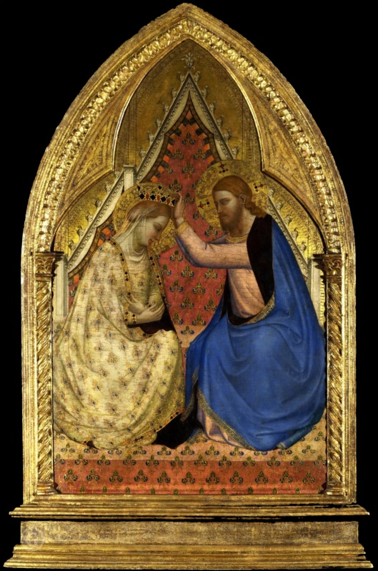

## Introduction: The Problem of a Name

Few figures in the study of fourteenth-century Florentine painting illustrate as vividly as *Puccio di Simone* the peculiar way in which the discipline of art history reconstructs an artistic personality: not from a stable biography supported by a continuous documentary record, but from the slow, contested convergence of two originally separate bodies of evidence — a name attested in guild lists and a small number of signed panels on one side, and an anonymous stylistic corpus assembled by connoisseurship on the other. For the better part of the twentieth century these two identities led parallel lives. There was "Puccio di Simone," a name attached to a signed polyptych in Florence and a dated Madonna, and there was the "Master of the Fabriano Altarpiece," a conventional label devised to hold together a group of paintings that had previously masqueraded under the name of a different painter altogether, the Marchigian Allegretto Nuzi. That the two were eventually recognized as one and the same artist is among the more satisfying episodes of Trecento connoisseurship, but the process was neither quick nor uncontested, and its most authoritative early protagonist went to his grave refusing to accept the equation.

What can be said with confidence about Puccio di Simone rests on documentary evidence, on signed and dated works and on the established scholarly literature. Much about the painter remains conjectural: we do not know when or where he was born or died; we cannot always agree on the sequence of his works; and the very shape of his oeuvre depends on stylistic judgments that continue to be debated. Where the evidence is firm — an inscription, a guild entry, a date painted on a panel — it can be stated as fact. Where scholarship is divided — on his formation, on the authorship of the great painted cross in San Marco, on the precise chronology of his development — the disagreement remains open. And where a widely circulated assumption is simply mistaken — as is the belief that his works hang in the National Gallery in London or the Walters Art Museum in Baltimore — the record needs correcting.

## Historical and Documentary Context: Painting in Florence Around the Black Death

To understand Puccio di Simone one must first situate him in the Florence of the second quarter of the Trecento, a city whose painting was still living in the long shadow of Giotto. Giotto died in 1337, but the pictorial culture he had established — monumental, sculpturally conceived, spatially coherent — was carried forward and modulated by a generation of pupils and associates whose names structure any account of the period: Taddeo Gaddi, Maso di Banco, Bernardo Daddi, and, a little later, Andrea di Cione, called Orcagna, and his brothers. It was within Bernardo Daddi's orbit above all that Puccio was formed, and it is against Daddi's example that his own achievement is most often measured.

Daddi occupied a distinctive niche in Florentine painting. If Maso di Banco pursued the grave monumentality of Giotto and Taddeo Gaddi his narrative energy, Daddi cultivated a more intimate, lyrical, decoratively rich manner especially suited to the small devotional panels and portable tabernacles that a prosperous urban clientele increasingly demanded. He ran one of the largest and most productive workshops in the city, and the sheer volume of Daddesque production — much of it necessarily the work of assistants — has long posed problems of attribution. <a href="/scholars.html#longhi-roberto">Roberto Longhi</a>'s celebrated 1959 essay, whose title juxtaposes "quality and industry," took precisely this tension between the master's hand and the shop's serial output as its theme, and it was in the course of that meditation that he made the observation that would give Puccio his corpus.

The demographic and economic catastrophe of the mid-century looms over any discussion of Florentine painting in these decades. The Black Death of 1348 devastated the city: the population of Florence was reduced from between roughly 110,000 and 120,000 inhabitants in 1338 to about 50,000 by 1351. According to a still-influential thesis about the period, the plague contributed to a stylistic reorientation away from the humane naturalism of the Giotto generation and toward a more hieratic, otherworldly, authoritarian imagery — the tendency most associated with Orcagna. Whatever one makes of the causal argument, the plague is more than a backdrop for Puccio: one of the earliest and most important documents naming him is best understood as a product of the immediate post-plague years, when the depleted ranks of the city's painters made the identification of the surviving "best masters" a matter of practical concern for those commissioning works.

Two institutional frameworks governed the professional life of a Florentine painter in this period, and Puccio is documented in relation to both. The first was the Arte dei Medici e Speziali, the guild of doctors and apothecaries, under whose umbrella painters were enrolled — a consequence of their dependence on the apothecaries who supplied pigments. The second was the Compagnia di San Luca<a href="/endnotes.html#fn-compagnia-san-luca" class="footnote">1</a>, the devotional confraternity of painters that took shape around the middle of the century and would in time evolve, over centuries, toward the modern Accademia delle Arti del Disegno. Puccio's name appears in the records of both, and these two entries, together with the Pistoiese list of "best masters," constitute the documentary skeleton on which his career must be reconstructed.

## Biography and Documentary Evidence

The hard biographical facts about Puccio di Simone can be stated briefly, because they are few. His birth and death dates are unrecorded, as is his birthplace, though his Florentine identity is beyond doubt and is even asserted in his own signature, where he calls himself *Florentinus*. He appears for the first time in the documentary record in a list of members of the Arte dei Medici e Speziali of Florence compiled between 1346 and 1348, a source clarified for modern scholarship in <a href="/scholars.html#hueck-irene">Irene Hueck</a>'s 1972 study of the Florentine painters' guild matriculations. The National Gallery of Art in Washington, whose systematic catalogue entry by <a href="/scholars.html#boskovits-miklos">Miklós Boskovits</a> synthesizes the evidence, frames the same fact precisely: "The artist, who was enrolled in the Arte dei Medici e Speziali in Florence between 1346 and 1348, must have been an established artist by this time... because a document datable between 1348 and 1349 lists him among the best Florentine painters of the day."

That second document is the most eloquent about his professional standing. Around 1349 the *operai* — the works officials — of the church of San Giovanni Fuorcivitas in Pistoia drew up a list of the "best masters of painting who are in Florence" in connection with a commission, and among the names appears one plausibly identified with the painter: "Maestro Puccio in via Larga." This document, first brought to scholarly attention by <a href="/scholars.html#chiappelli-alessandro">Alessandro Chiappelli</a> in 1900 in a study of a panel by Taddeo Gaddi in the same Pistoiese church, and later incorporated into the standard catalogue raisonné of Taddeo Gaddi as one of its supporting documents, is read as listing "Master Puccio among the six reputedly best Florentine painters of the time" — the citation being to Andrew Ladis, *Taddeo Gaddi: Critical Reappraisal and Catalogue Raisonné* (Columbia, Mo., 1982), pp. 56, 257, doc. 49. That an artist should be reckoned among the city's six best masters barely a year or two after first appearing in the guild rolls tells us that he must already have been active and established well before his first documented mention, a deduction confirmed by the fact that several works attributable to him appear to date from the 1340s or even earlier.

The third securely documented episode is his enrollment in the Compagnia di San Luca, recorded in 1357, which the *Dizionario Biografico degli Italiani* takes as evidence that by that year he had returned to Florence from his period of activity in the Marche. The last documentary trace, or rather its absence, provides the terminus: because Puccio does not appear in the registers of the *prestanze* — the forced loans levied on Florentine citizens — of 1362, it has long been inferred (following <a href="/scholars.html#offner-richard">Richard Offner</a>) that he had died by that date. The Washington catalogue accordingly places his death "a few years" after his last documentary mention in 1357, and the ranges "active c. 1330–1360" and "active c. 1345–1362" recur across museum records, reflecting the same body of evidence interpreted with slightly different emphases.

Two further, more speculative biographical threads deserve mention because they recur in the literature. The first is a possible family of painters. In the nineteenth century Cesare Guasti hypothesized that Puccio was connected to a dynasty including one Mone di Cambio and his children Neri di Mone and Margherita di Mone, all documented as painters. <a href="/scholars.html#chiodo-sonia">Sonia Chiodo</a>, the compiler of the modern *Dizionario Biografico* entry, revives this possibility in connection with the identification of Puccio's late collaborator, the so-called Master of Barberino, with Neri di Mone; were the hypothesis confirmed, it would restore to history a painting family active across the whole of the Trecento, comparable to the better-known lineage descending from Gaddo Gaddi. This remains, however, a conjecture built on circumstantial evidence. The second thread concerns the artist's own signature on the Alana Madonna, where the wording — invoking one "Dominus Agnolus Puccius" — has occasioned discussion about how exactly the inscription should be parsed.

## Formation and the Relationship to Bernardo Daddi

If the documents fix a handful of dates, it is style — and the collaborative division of labour visible in certain altarpieces — that reveals where Puccio came from as an artist. On this point the scholarly consensus is unusually firm in its broad outline and unusually divided in its particulars. The broad outline: Puccio was the most attentive follower and interpreter of Bernardo Daddi's figurative style, and his training was substantially accomplished within, or in the closest proximity to, Daddi's workshop. The particulars: exactly how and with whom that training began, and whether Daddi was his first master or a later one, remain contested.

The evidence for the Daddesque connection is not merely a matter of general stylistic affinity; it is documented, so to speak, in paint, through works in which the two hands can be distinguished within a single object. The most important of these is a dismembered and recomposed polyptych now in the Galleria dell'Accademia in Florence (inventory 1890, number 6140), in which Daddi confined himself to the central compartment with the *Crucifixion* while Puccio painted the four flanking saints — Saint Mary Magdalene, Saint Michael the Archangel, Saint Julian, and Saint Martha. The recognition that these lateral saints, long taken for a straightforward product of Daddi's shop, are in fact by Puccio's own hand was one of the contributions of Miklós Boskovits, who edited and expanded the standard *Corpus* of Florentine painting, and it led him to propose a direct, deliberate collaboration between Daddi and Puccio in the 1340s. A second complex of the same years shows how closely Puccio's practice followed Daddi's. The polyptych painted for the Dominicans of Perugia, reconstructed by Boskovits in 1987 and completed in 2019 by the recovery of two lateral saints, had at its centre a *Coronation of the Virgin*, now in the Museum voor Schone Kunsten in Ghent, that is a slightly modified repetition of Daddi's Coronation for Santa Maria Novella; the Ghent and Berlin museums now assign the whole altarpiece, including its lateral saints and its predella, to Puccio. The Saints Catherine and Lawrence of that polyptych, long lent by Berlin to the university collection at Göttingen, returned to the Gemäldegalerie in 1976.

Beyond these collaborations, Puccio's absorption of Daddi's repertoire is pervasive: the types of the Virgin and Child, the decorative vocabulary, the arrangements of angels and saints, the very "store of shapes and motifs," as Richard Offner put it, "bear the stamp of Daddi's atelier in the latter thirties or early forties, when he was learning his craft." Offner, attempting the first reconstruction of the artist he still called the Master of the Fabriano Altarpiece, conjectured that he was born around 1320, that he learned his craft "under the spell of Daddi" in the mid-1330s, that he "persisted in this state for about ten years," and that only around the time of Daddi's presumed death in 1348 did his own talents begin to "blossom into full flower."

It is on the question of the very beginning of this trajectory that scholarship divides. Boskovits came to believe that Puccio's earliest apprenticeship may have been passed not with Daddi but in the workshop of Giotto himself, during the 1330s, with the move to Daddi coming only after the death of the older master. A different view, advanced by <a href="/scholars.html#labriola-ada">Ada Labriola</a> in 2005 in connection with an exhibition of Florentine paintings from the Lindenau-Museum in Altenburg, located Puccio's beginnings not in direct contact with Giotto but with one of Giotto's pupils, such as Maso di Banco or the shadowy Master of San Lucchese. And a third position, argued by <a href="/scholars.html#tartuferi-angelo">Angelo Tartuferi</a> in the catalogue of the 2005 Florentine exhibition devoted to the painter, reaffirmed the more traditional idea of a formation directly at Daddi's side. The disagreement is not trivial pedantry: it bears on how one reads the sculptural monumentality that coexists in Puccio's art with his Daddesque decorative delicacy, and on whether that monumentality is an inheritance from the central Giotto tradition or an acquisition made later, under the impact of Orcagna. What all parties agree on is that Daddi is the indispensable point of reference; they differ on whether he is the origin or an early station.

## The Identification with the Master of the Fabriano Altarpiece

The reconstruction of Puccio's oeuvre is inseparable from a detective story spanning half a century, and it is worth telling in some detail because it exemplifies both the achievements and the hazards of connoisseurship. At its centre is a triptych, today in the National Gallery of Art in Washington, representing the *Madonna and Child Enthroned with Four Saints and Eighteen Angels* in the centre, *Saint Anthony Abbot* in the left wing, and *Saint Venantius* in the right.

The triptych surfaced on the London art market in July 1916, catalogued as "attributed to Allegretto Nuzi da Fabriano." The attribution to the Marchigian painter was natural enough: the work had a provenance from Fabriano, Allegretto's hometown, and it fitted the catalogue of that master which <a href="/scholars.html#berenson-bernard">Bernard Berenson</a> had begun to assemble a few years earlier. Berenson endorsed the attribution to Allegretto with full conviction in publications of the 1920s and 1930s, and a long line of scholars followed him. But doubts were not slow to appear. As early as 1924 the Dutch historian of the Italian schools <a href="/scholars.html#van-marle-raimond">Raimond van Marle</a> detected in the triptych elements of Daddesque, that is Florentine, culture that seemed to him incompatible with an attribution to Allegretto; and over the next few years several others endorsed his misgivings.

It was Richard Offner who transformed doubt into a positive hypothesis. Offner recognized that the triptych was the work of two distinct hands: that of Allegretto, who had painted only the left lateral with Saint Anthony Abbot, and that of an anonymous Florentine follower of Daddi, responsible for the central panel and the right wing. To this anonymous Florentine he gave the conventional name by which he would be known for decades — the "Master of the Fabriano Altarpiece" — a label he derived not from the Washington triptych itself but from a related panel of *Saint Anthony Abbot and a Group of Devotees*, dated 1353, that came from the church of Sant'Antonio Abate outside the Porta Pisana in Fabriano and is now in the Pinacoteca Civica Bruno Molajoli in that town. Offner's conclusions, first reported in the 1941 preliminary catalogue of the Washington gallery and then set out in full in the fifth volume of his *Critical and Historical Corpus of Florentine Painting* in 1947, gradually won acceptance.

Around this Fabriano Master, Offner assembled a substantial and internally coherent group of paintings. The decisive further step was taken by Roberto Longhi in 1959, in the essay "Qualità e industria in Taddeo Gaddi ed altri," published in the journal *Paragone* (no. 109, March 1959, and continued in no. 111, with the relevant identification at p. 9; the essay was later reprinted in Longhi's *Opere complete*, vol. VII, *"Giudizio sul Duecento" e ricerche sul Trecento nell'Italia centrale 1939–1970*, Sansoni, 1974). Longhi recognized that the anonymous Florentine of Offner's reconstruction was none other than the documented Puccio di Simone. His evidence was an inscription: on one of the paintings in Offner's Fabriano group — a *Madonna and Child* then known from the former Artaud de Montor collection in Paris, dated 1360, and now in the Alana Collection in Newark, Delaware — Longhi read the painter's name. The signed panel thus supplied the bridge between the anonymous stylistic corpus and the historical name, and it also fixed the late terminus of the oeuvre, since 1360 is the latest date to appear on any of Puccio's works.

The identification has been generally accepted since — but not universally, and not immediately, and its most distinguished early opponent was Offner himself. In the foreword to the eighth volume of his *Corpus* (1958), Offner explicitly rebuked those who wished to link the signed Accademia polyptych of Puccius Simonis "with a group of paintings like those of the Fabriano Master." He conceded that affinities existed "as between two painters from a common stock," but insisted that "it becomes the less likely that they are the same person as their paintings would have to show greater analogies of style than actually appear." Offner's resistance is now generally explained by an accident of conservation: the central panel of the signed Accademia polyptych was, until a restoration of the early twenty-first century, disfigured by a clumsy overpainting that rendered it nearly illegible and made a fair stylistic comparison with the Fabriano group impossible. Once cleaned, the panel could be compared on equal terms, and the identification that Offner had refused was, in effect, vindicated by the very evidence he had lacked. From the mid-1970s onward the joint authorship of the Washington triptych by Puccio (centre and right) and Allegretto (left) has been the standard view, and "Master of the Fabriano Altarpiece" has become a historical label — a name retained chiefly to describe a phase or a manner rather than a separate artist.

## The Two Signed Works

Because so much of Puccio's identity rests on connoisseurship, the two works that bear his signature carry a weight out of proportion to their number, and they deserve close attention.

The first is the polyptych of the *Madonna of Humility with Saints* in the Galleria dell'Accademia in Florence (inventory 1890, number 8569), which preserves the inscription *Puccius Simonis Florentinus pinxit hoc opus* — "Puccius, son of Simone, the Florentine, painted this work." This is the panel that anchored knowledge of the artist for generations: for a long time, as the Washington catalogue observes, "knowledge of Puccio in the art historical literature was confined" to it. The composition unites, in its five cusped compartments, the Virgin and Child at the centre — the Virgin shown in the humble posture of the *Madonna of Humility*, a type of devotional image that gained wide currency in Tuscany in precisely these decades — with saints, among them Lawrence, Onuphrius, James the Greater, and Bartholomew, in the flanking panels. The panel was among the works cleaned and studied for the 2005 exhibition, and its restoration was crucial in dissolving the last resistance to the Longhi identification.

The second signed work is the *Madonna and Child Enthroned* now in the Alana Collection in Newark, Delaware, formerly in the Artaud de Montor collection in Paris — the very panel through which Longhi made his identification. It carries a dated inscription that reads, in the transcription given by the *Dizionario Biografico*: *A tenpus Dominus Agnolus Puccius pinxit hoc opus / anno Domini MCCCLX adì X d'aprile* — recording the year 1360 and the day, the tenth of April. The syntax of this inscription is not entirely transparent, and the appearance of the name "Agnolus" alongside "Puccius" has provoked discussion; but the panel's status as an autograph, dated work by Puccio, and its role as the linchpin of the modern reconstruction, are secure. Stylistically it belongs to the very end of the painter's career, and its flattened space and ample, almost mannered forms exemplify the two-dimensional tendency of his final phase.

## The Marchigian Period and the Collaboration with Allegretto Nuzi

The most unusual chapter of Puccio's career, and the one that gave him his art-historical sobriquet, is his activity in the Marche around 1353–1354, in partnership with the leading local painter, Allegretto di Nuzio, called Allegretto Nuzi. This episode is remarkable on several counts, and it repays careful description because it is here that documentary evidence, dated works, and stylistic analysis converge most productively.

Allegretto Nuzi was a Fabrianese painter — the Getty Union List of Artist Names records his birth in the years 1316–1320 and his death in 1373/1374, while the National Gallery of Art lists him as "Umbrian, active from c. 1340; died 1373" — whose art fused a Tuscan formation with Sienese sweetness and a strong decorative sensibility. His presence in Florence is documented in 1346, when he enrolled in the Compagnia di San Luca — the same window in which Puccio first appears in the guild rolls — and it was presumably in Florence that the two painters became acquainted. What is striking about their subsequent collaboration is that it brought together two independent, fully formed masters of different origin and training: not a master and his assistant, nor two members of the same family workshop (the model of Simone Martini and his brother-in-law Lippo Memmi, or of the Cione brothers), but a Florentine and a Marchigian, each with his own manner, cooperating on a single altarpiece. The parts each executed can be clearly distinguished, and this legibility is precisely what makes the Washington triptych so valuable as a document of workshop practice.

The chronology of the Marche period is fixed by two works. The first is the panel of *Saint Anthony Abbot* dated 1353, from the church of Sant'Antonio Abate outside the Porta Pisana in Fabriano, now in the Pinacoteca Civica Bruno Molajoli — a large cusped panel (roughly 195 by 106 centimetres) showing the hermit saint standing frontally, venerated as protector of animals, which local tradition long attributed to Allegretto but which is now unanimously given to Puccio. The second is the triptych of 1354, now in Washington, executed jointly with Allegretto. The provenance of the Washington triptych from the same Fabriano church of Sant'Antonio Abate, though not documented, is regarded as virtually certain: it is suggested above all by the double presence of Saint Anthony, patron of the Antonine order, and by the fact that the securely Fabriano-provenanced panel of 1353 comes from the same church.

The Washington triptych is in several respects unusual, even unique, in central Italian painting of the century. Its figures are distributed with a striking disparity of scale — numerous and small in the crowded central panel, large in the laterals, where the standing saints are actually bigger than the enthroned Madonna herself. One saint, Anthony Abbot, appears twice, once among the four saints of the central panel and again, alone, in the left wing. And, uniquely, a nearly identical version survives in the Duomo of Macerata, with a provenance from the church of Sant'Antonio Abate in that town; it is dated 1369 and bears an inscription recording that it was commissioned by a member of the Antonine order named Johannes (Giovanni), the *preceptor* of Tolentino: *ISTAM TABULAM FECIT FIERI FRATER IOHANNES CLERICUS PRECEPTOR TOLENTINI: ALEGRITTUS DE FABRIANO ME PINXIT [...] MCCCLXVIIII*. The fifteen-year interval between the two triptychs, and the recurrence of an Antonine donor named Giovanni, make it likely that both were tied to the same patron or at least to the same devotional and institutional milieu.

The central panel of the Washington triptych repays iconographic attention. The Virgin holds the naked Christ Child, draped from the hips in a gold-embroidered cloth; with an apparently playful gesture she points her index finger at him. The Child wears a coral-branch pendant — a widespread medieval apotropaic charm believed to protect children from harm — and grasps a small bird, a motif carrying associations with the Passion and Resurrection. The Madonna and Child are flanked by tiered ranks of angels, probably alluding to the nine choirs of angels, a composition the Washington catalogue traces to a model developed in Daddi's shop or by Puccio himself. Four saints stand in the foreground: Catherine of Alexandria, unusually crowned with the imperial diadem; Benedict, whose place of honour is explained by the fact that the Antonine order's mother-house had originally been a Benedictine<a href="/endnotes.html#fn-benedictine-order" class="footnote">2</a> abbey; Anthony Abbot himself; and Elizabeth of Hungary, gathering flowers in her dress in token of her charity. In the gable above appears the isolated figure of the crucified Christ. The right wing presents Saint Venantius, patron of Camerino and titular saint of the collegiate church of Fabriano, as a young knight in a sumptuous brocaded tunic — one of the most lavishly rendered fabrics in mid-Trecento painting, embroidered with flowers, birds, and tortoises, and understood to reflect a Florentine textile type.

The division of hands is instructive. The ornamentation of the two laterals — the decorative frieze bordering the gold ground, the series of miniature foliated lunettes around the arches, the patterned carpet — is identical throughout and repeats types found in other, presumably earlier, works by Puccio, confirming that he was responsible for the overall design of the whole. Yet the Saint Anthony of the left wing, though it belongs to Puccio's figurative repertoire in pose, betrays a different hand in its unwrinkled, more youthful face and the fixed gaze of its almond eyes: this is Allegretto, who would repeat the same figure in later works. The saints and angels of the central panel and the effeminate, soft-complexioned Saint Venantius of the right wing, by contrast, display the alert, individualized naturalism characteristic of Puccio in this phase. Technical study of the punch-marks in the gilding supports the same division and even suggests that the lettered halo of Saint Anthony, executed in a manner foreign to Puccio's consistent practice, may have been finished by Allegretto — a hint, together with certain anomalies in the panel, that the left wing may have been modified in the course of the altarpiece's making.

The Marche sojourn coincided with a marked evolution of Puccio's language in a more Gothic direction. In these works, as the *Dizionario Biografico* observes, the silhouettes of the figures become more slender and elongated, the chiaroscuro is only lightly indicated, the folds of the drapery gather into soft loops, and great care is lavished on decorative motifs. It is a matter of scholarly debate how far this naturalistic, minutely observed manner depends on the presence in Florence of the Lombard painter Giovanni da Milano — a connection first proposed by Longhi — and how far it derives instead from earlier Florentine developments associated with Stefano Fiorentino and the Master of San Lucchese. Boskovits argued for the latter, and went so far as to suggest that Puccio should be considered not a follower of Giovanni da Milano or of Giottino but their fellow traveller, or even their predecessor, on the road toward pictorial realism. Whatever the precise genealogy, the Fabriano panel and the Washington triptych show that by 1353–1354 Puccio had committed himself to that road. His stay in the Marche also left a decisive imprint on the region: Allegretto, fortified by his contact with the best Florentine painters of his generation, would become the fountainhead of an entire Fabrianese school, and the collaboration is rightly seen as a conduit through which Florentine models passed into the painting of the Marche.

## Major Works and Attributions

Beyond the two signed panels and the Marchigian works, Puccio's reconstructed oeuvre is substantial and widely dispersed, and a survey of its principal components conveys both the range of his production and the geography of its present-day survival.

At the monumental end stand his altarpieces. Chief among the Florentine examples, apart from the signed Accademia polyptych, is the polyptych from the Oratory of San Pietro at Petrognano in the Val d'Elsa, now in the Museo di Arte Sacra at Certaldo, datable to the sixth decade of the century and possibly to 1357. Its five cusped compartments present the Virgin and Child at the centre, flanked by Saint Lucy and Saint Catherine of Alexandria, with Saint Anthony Abbot, Saint Nicholas of Bari, Saint John the Baptist, and Saint Francis in the outer panels; it measures roughly 144 by 191 centimetres. The Certaldo museum's own literature situates the work firmly in Puccio's maturity and recalls that its author was reckoned among "the best painting masters who are in Florence." To the late phase belong also two triptychs: the *Saint Matthew Enthroned between a deacon saint and Saint James the Greater* in the Accademia in Florence (inventory 1890, number 5063), and a *Crucifixion with Saints Francis, James, Catherine and a female saint* in the Fogg Art Museum at Harvard (number 1962.292), whose right-hand panel the *Dizionario Biografico* gave to the so-called Master of Barberino, whom it would identify with Neri di Mone; the Harvard Art Museums now catalogue the whole triptych under Puccio, dating it 1350–1362.

A recurring compositional theme in Puccio's production is the *Coronation of the Virgin*, of which several versions survive: a small panel in the Lindenau-Museum at Altenburg, dated by the museum about 1340–1345; the central *Coronation* of the Perugia polyptych in the Museum voor Schone Kunsten in Ghent, whose lateral saints and predella panels are divided between Berlin, New York and Copenhagen; another *Coronation* in the Musée du Petit Palais at Avignon; and a version in the Musée de Valence. These works, several datable to the 1340s, share the corbel-frieze arch mouldings and incised foliate lunettes that also appear in the Washington triptych, a decorative consistency that has helped bind the corpus together. Puccio's smaller devotional panels — the *Madonna and Child with Angels* now in the Norton Simon Museum at Pasadena (formerly in the Lehman collection), which served as the centre of a reconstructed triptych with lateral saints; polyptych fragments divided between the Galleria Nazionale in Parma and a private collection; a *Saint Paul* that has passed through the art market; and numerous half-length Madonnas — testify to the "conspicuous production of small-format works destined for individual devotion" that the *Dizionario Biografico* records as running alongside his altarpieces and frescoes, "often characterized by a refined and precious quality of execution."

In the United States, besides the Washington triptych and the Pasadena Madonna, Puccio is represented by *The Nativity* in the Metropolitan Museum of Art in New York, a small gold-ground panel of about 1350 from the predella of the Perugia polyptych; by a *Saint James the Greater* in the Seattle Art Museum, bought by Samuel H. Kress in 1936 as a work of Allegretto Nuzi and associated by scholarship with a dismembered polyptych; by a triptych in the Cleveland Museum of Art, whose original destination may, like that of the Fabriano works, have lain outside Tuscany; and by the signed Madonna in the Alana Collection. In Belgium the Ghent museum holds the *Coronation* already mentioned; in France the Petit Palais at Avignon and the museum at Valence hold Coronations; in Italy, beyond Florence, Certaldo, and Fabriano, works or fragments are recorded at Prato (Saints Lucy and Catherine, in the gallery of the Palazzo degli Alberti) and at Vinci (a Saint Ansano with two angels in the church of Saints Giovanni Battista and Ansano). A triptych with the Virgin and Child between Saints Benedict and Catherine and Saints Romuald and Louis of Toulouse<a href="/endnotes.html#fn-louis-toulouse" class="footnote">3</a>, acquired by the Italian State in 1987, is in the Galleria Nazionale delle Marche in Urbino. In the United Kingdom, panels attributed to Puccio are held by York Museums Trust — a pair of triptych wings combining the enthroned Virgin and Child with the Crucifixion and, above, the Annunciation and Nativity — and, according to the national catalogue of publicly owned art, a *Last Supper* at Upton House in Warwickshire, in the care of the National Trust.

A correction is required here. It is sometimes assumed that Puccio di Simone is represented in the National Gallery in London and in the Walters Art Museum in Baltimore. On close examination, neither institution holds a work attributed to him. In the National Gallery in London, Puccio's name appears only as a comparative reference within the catalogue entry, in <a href="/scholars.html#gordon-dillian-rosalind">Dillian Gordon</a>'s 2011 scholarly catalogue *The Italian Paintings before 1400*, for a *Coronation of the Virgin* (NG 6599) by Bernardo Daddi: the catalogue observes that there are "examples of polyptychs where small-scale saints are shown in the central panel with the Virgin and Child while large-scale saints appear in the lateral panels, for example several by Puccio di Simone, a collaborator and probably pupil of Bernardo Daddi," and it notes that a characteristic gesture of the Virgin invented by Daddi "was copied by Puccio di Simone." Puccio is here a foil for understanding Daddi, not the author of a work in the collection. Similarly, at the Walters Art Museum the relevant early-Florentine panel is a *Madonna and Child* (accession 37.553), the central compartment of a polyptych, catalogued as the work of Bernardo Daddi and his workshop (<a href="/scholars.html#zeri-federico">Federico Zeri</a>'s 1976 catalogue no. 4) and once owned by Bernard Berenson; it is not a Puccio di Simone. The confusion is understandable, since Puccio's art lives so intimately in Daddi's shadow that his name naturally recurs wherever Daddi is discussed; but accuracy requires that his authenticated works be sought in Washington, New York, Pasadena, Seattle, Cleveland, Cambridge (Massachusetts), Florence, Certaldo, Fabriano, Urbino, Ghent, Avignon, Berlin, Copenhagen, Parma, Altenburg, and the other collections named above — not in London or Baltimore.

## Style, Technique, and Iconography

What kind of painter was Puccio di Simone, once his corpus is admitted? The most quoted characterization remains Offner's, and it captures something essential. "At its best," Offner wrote, "his work is shot through with a winsome, sunny lyricism rare in the period"; and, he continued, "our painter's color, like his humor, is pitched in an upper key." This luminous, cheerful sensibility distinguishes Puccio from the more composed and solemn Daddi and, still more, from the austere gravity of Orcagna. In his Madonnas the Virgin is characteristically engaged in play with the Child, endowed, as Offner noted, with "artlessness" and "appropriate happiness untouched by the shadow of prophecy" — a warmth of human feeling that survives even as his late style flattens and formalizes.

Puccio's development can be sketched, with the caveats about chronology already registered, as a movement in three phases. In the 1340s, working in and around Daddi's shop, he speaks Daddi's language with fluency and charm, producing Coronations and Madonnas rich in the decorative vocabulary of the master. In the early 1350s, culminating in the Marche period, he distances himself from Daddi and embraces the naturalistic currents developed by Stefano Fiorentino and Giottino — a minute, observant vision that lends his faces individuality and his figures a new corporeal presence — while at the same time absorbing the monumentality and strong simplification of form emanating from Orcagna's workshop. In his final years, after his return to Florence, the plasticism is progressively attenuated: forms become ampler but flatter, space contracts, and the panels tend toward almost two-dimensional effects, as in the Alana Madonna of 1360, even as the delight in ornamented fabrics and tooled haloes persists undiminished.

Technically, Puccio was a painter in the standard Tuscan tempera-on-panel tradition, working over a gesso ground and gilding over red bole. His decorative fingerprints are distinctive: the corbel-frieze mouldings and incised foliate lunettes of his arches, the patterned carpets beneath his standing saints, and above all his punch-work in the gold grounds. The systematic study of punch-marks in Tuscan panel painting, undertaken by <a href="/scholars.html#skaug-erling">Erling S. Skaug</a>, has treated Puccio's tools and habits as a means of attribution and dating, and it was through such analysis that the halo of Allegretto's Saint Anthony in the Washington triptych could be recognized as executed in a manner foreign to Puccio's consistent practice — his lettered halos retaining their incised outlines, with granulation confined to the ground. His iconography, finally, is rich in the affective and apotropaic detail typical of mid-Trecento devotional art: the coral pendant and the small bird of the Christ Child, the play between mother and son, the crowded choirs of angels, the isolated crucified Christ in the gable, the sumptuous textiles that clothe his saints and betray the Florentine origin of the fabrics he loved to depict.

## Vasari, the Confusion with Puccio Capanna, and the Frescoes

No account of Puccio di Simone's critical fortune can omit the tangle created by Giorgio Vasari<a href="/endnotes.html#fn-giorgio-vasari" class="footnote">4</a>, whose *Lives* remain the foundational — and here the misleading — literary source. Vasari records, among the works he assigns to a painter he calls Puccio Capanna, frescoes in the Strozzi chapel of Santa Trinita in Florence, describing "a Coronation of the Virgin with a choir of angels that lean strongly toward the manner of Giotto, and on the sides stories of Saint Lucy." Modern scholarship recognizes these frescoes as the work not of Puccio Capanna — a distinct painter, documented at Assisi in 1341 and 1347, whom Vasari elsewhere presents as one of Giotto's most important pupils — but of Puccio di Simone, that is, of the Master of the Fabriano Altarpiece. Little of the decoration survives; the principal fragment is a *Noli me tangere*, painted in an arcosolium, now detached and preserved in the sacristy. There is even a suggestion in the documentary record that the Strozzi commission was originally given to Maso di Banco, who then entrusted its execution to Puccio.

The confusion between the two Puccios — the Florentine Puccio di Simone and the Assisi-based Puccio Capanna — is more than an antiquarian curiosity; it has real consequences for the attribution of a group of frescoes and panels that Vasari heaped upon "Capanna" and that later research has largely returned to their true authors. The Santa Maria Novella painted Crucifix that Vasari imagined as a collaboration between Puccio and Giotto, for instance, has been restored to Giotto himself. The disentangling of these threads is a reminder that the earliest "biography" of Puccio is in fact a composite fiction, and that the historical Puccio di Simone had to be recovered against, not merely from, the literary tradition.

One further attribution belongs to this domain of the uncertain: the large painted cross in the church of San Marco in Florence. Boskovits proposed including this *Croce* among Puccio's early works, and the proposal was reasserted in a specialized study of 2013 (by G. Utari) that even sought to attach a date to it. But the attribution remains doubtful for lack of decisive stylistic confirmation, as the 2005 exhibition catalogue cautioned, and it has been tentatively assigned instead to Stefano Fiorentino. The case is a useful index of how open the edges of Puccio's corpus still are.

## Critical Fortune and Historiography

The historiography of Puccio di Simone is, in a sense, the real subject of any study of him, since the painter as we know him is a creation of modern scholarship. But it is worth drawing the threads together into a connected narrative, because the sequence of interpretive moves is itself illuminating.

Through the nineteenth century and into the early twentieth, the works we now give to Puccio led a double life. The signed Accademia polyptych preserved the name "Puccius Simonis," but its disfigured central panel made it an unpromising foundation for a corpus, and knowledge of the painter scarcely advanced beyond it. Meanwhile the group of paintings that would eventually be recognized as his — including the Washington triptych and the Fabriano panels — was catalogued under the name of Allegretto Nuzi, on the strength of the Fabriano provenance of some of them and the authority of Bernard Berenson, who used them to build his picture of the Marchigian master. A local Marchigian antiquarian of the early nineteenth century, Amico Ricci, had already recorded some of these works in 1834, and the attribution to Allegretto seemed natural.

The dismantling of this misattribution began in the 1920s with van Marle's observation that the Washington triptych contained incongruous Florentine, Daddesque elements, and it culminated in Offner's recognition of two hands and his coinage of the "Master of the Fabriano Altarpiece." Offner's achievement was twofold: he separated the Florentine from the Marchigian contribution, and he assembled around the Fabriano panel a coherent group of paintings by a single Florentine follower of Daddi. His refusal, in 1958, to equate this master with the documented Puccio di Simone was, in retrospect, a failure of nerve occasioned by the poor state of the signed comparanda; but it was a principled one, grounded in his insistence that identity of authorship required a higher degree of stylistic analogy than the evidence then permitted him to see.

Longhi's 1959 identification cut the knot. By reading Puccio's name in the inscription on the Artaud de Montor Madonna, Longhi joined the anonymous corpus to the historical name and, in the same essay, offered a characteristically bold reading of Puccio's naturalism as a reflection of Giovanni da Milano's presence in Florence. The identification was progressively accepted through the 1960s and 1970s, and it was consolidated and refined above all by Miklós Boskovits, who edited the revised edition of the fifth volume of Offner's *Corpus* (2001), devoted his own ninth volume (1984) to the "miniaturist tendency" in which he situated much of Puccio's small-scale production, catalogued the Washington triptych for the National Gallery of Art, and repeatedly returned to the questions of Puccio's formation and chronology. It was Boskovits who proposed the hypothesis of an initial apprenticeship with Giotto, who argued for Puccio's independence from Giovanni da Milano, and who — in a candid scholarly self-correction — acknowledged that he had earlier erred in placing the Certaldo and signed Accademia polyptychs among the painter's late works.

The most recent chapter opened with the 2005 exhibition at the Galleria dell'Accademia in Florence, *Da Puccio di Simone a Giottino: Restauri e conferme* (15 November 2005 – 29 January 2006), curated by Angelo Tartuferi and Daniela Parenti, whose very title — "restorations and confirmations" — announced its method. The cleaning of the signed polyptych removed the overpainting that had troubled Offner and confirmed the coherence of Puccio's corpus; the accompanying catalogue reopened the questions of formation and chronology, with Tartuferi reviving the case for a direct Daddesque training and Labriola arguing for a beginning with Giotto's pupils. The entry in the *Dizionario Biografico degli Italiani*, published in 2016 and written by Sonia Chiodo, synthesizes this century of scholarship and represents the current state of the question. The trajectory is, in short, from misattribution (to Allegretto), through anonymity (the Fabriano Master), to identification (with Puccio di Simone), and finally to consolidation and refinement — a model instance of how a Trecento artistic personality is built.

## Conclusion

Puccio di Simone emerges from the evidence as a painter of real distinction and of considerable historical interest, even if the outlines of his life remain irrecoverable. Documented among the best masters of Florence in the anxious years around the Black Death, enrolled in the guild and in the painters' confraternity, active from at least the 1340s until about 1360 and dead by 1362, he was the most faithful and gifted interpreter of Bernardo Daddi's manner in the middle decades of the century — and yet he was more than an echo of his master. His art carries a "winsome, sunny lyricism," in Offner's phrase, that is his own; and in the early 1350s he moved decisively beyond Daddi, toward a minute naturalism that places him in the company of Stefano Fiorentino, Giottino, and Giovanni da Milano, whether as follower, fellow traveller, or, on one reading, precursor.

His significance is threefold. As an artist, he produced a body of altarpieces and devotional panels of high quality, distinguished by luminous colour, tender human feeling, and a refined decorative sensibility, dispersed today across the museums of Italy, the rest of Europe, and North America. As a historical figure, his career documents two phenomena of unusual interest: the collaborative practice by which a Florentine and a Marchigian master could jointly produce a single altarpiece, and the conduit by which Florentine models passed into the flourishing painting of Fabriano and the Marche through his partnership with Allegretto Nuzi. And as a case study, the recovery of his artistic personality — from the name buried in a guild list and on two panels, and the corpus assembled under a conventional label, to their eventual, contested union — offers a model of how the connoisseurship of the Trecento proceeds, with all its power and all its provisionality.

That provisionality should not be minimized. The chronology of Puccio's development is still argued; the circumstances of his formation remain a matter of competing hypotheses; the attribution of the San Marco cross is unresolved; the reading of his signatures admits of discussion; and the family to which he may have belonged is a matter of conjecture. Even the geography of his surviving works is subject to correction, as the mistaken belief in his presence in London and Baltimore illustrates. But these uncertainties are the ordinary condition of the field, and they do not diminish the achievement of the painter or of the scholarship that recovered him. Puccio di Simone remains, in the end, one of the more attractive and instructive personalities of Florentine painting between Giotto and Orcagna — a master whose "quality," to borrow Longhi's word, repays the industry that has been spent on his recovery.

## Catalogue Entry

### Coronation of the Virgin with Saints and Angels (Altenburg, Lindenau-Museum)

<figure>
  
  <figcaption>Puccio di Simone, <em>Coronation of the Virgin with Saints and Angels</em>, c. 1340–1345 (according to the museum). Tempera on panel, 68.9 × 38 cm. Altenburg, Lindenau-Museum, inv. 16. Lindenau-Museum, Altenburg, public domain, via Wikimedia Commons (background modified).</figcaption>
</figure>

The small panel in the Lindenau-Museum in Altenburg (inventory 16) measures 68.9 by 38 centimetres and shows the Coronation of the Virgin in the presence of saints and angels. The museum attributes it to Puccio di Simone and dates it about 1340–1345, which makes it one of the earliest works associated with his name, painted in the years of his activity in or beside the workshop of Bernardo Daddi.

The panel is closed by a pointed arch whose cusped border, modelled in relief and gilded, follows the curve of the top, and its sides are framed by twisted colonnettes. Its size and its single compartment suggest a portable altarpiece or the centre of a small triptych for private devotion, a type in which Daddi's workshop specialised and in which the Coronation was one of the favoured subjects.

At the centre Christ and the Virgin sit side by side on a white Gothic throne with slender pinnacles and gables, its back covered by a red cloth of honour patterned in gold and surmounted by a small tabernacle. Christ, seated at the right in a pink tunic and a blue mantle strewn with gold stars, raises his hand to place a crown on his mother's head. The Virgin, in a matching blue mantle over a pink dress, bows her head and crosses her hands on her breast in a gesture of humility, as in the Coronation of the polyptych for the Dominicans of Perugia.

Behind the throne stand angels, their heads rising above the pinnacles, and at either side tiers of saints fill the space up to the edges of the panel. At the left can be recognised Saint John the Baptist, several apostles, a bishop holding a red book and a nun in a dark veil; at the right Saint Peter with his keys, a bishop with a mitre, a Franciscan and a Dominican friar, a crowned female saint and a monk. The saints, small and densely packed, form a heavenly court around the central group.

The lower part of the panel is given to the angels. At the sides groups of angels in red, blue and green robes play musical instruments, among them a long trumpet held by an angel at the right, while at the centre a group of angels in white robes holds hands and dances in a circle. The dance of the angels, a motif that expresses the joy of heaven at the Virgin's glorification, is found in Florentine Coronations of these decades and gives the scene a festive character.

The composition, with its crowded court of saints and its dancing angels, is more elaborate than the Coronation of Ghent, where the two central figures are accompanied only by six kneeling angels. It shows Puccio drawing on the repertoire of Daddi's workshop, in which large Coronations with many saints were produced for altars and smaller ones for domestic devotion, and adapting it to a small format with a dense and lively narrative.

The colour is bright and varied: the deep blue of the mantles with their gold stars, the red of the cloth of honour, the pinks, greens and yellows of the saints' and angels' garments, and the white of the dancing angels against the gold. The punched decoration of the haloes and of the borders, and the tooled ornament of the cloth of honour, belong to the technical repertoire shared by Daddi and Puccio, whose punch tools Puccio is reported to have taken over with Daddi's workshop after 1348.

The panel is in good condition. The blue of the mantles is well preserved, the gold ground and the relief border show a network of fine cracks, and there are small losses along the edges and in the lower part, especially in the robes of the dancing angels. The faces of the saints and angels remain clearly legible.

### Coronation of the Virgin with Saints and Angels (Avignon, Musée du Petit Palais)

<figure>
  
  <figcaption>Puccio di Simone, <em>Coronation of the Virgin with Saints and Angels</em>, 1340s. Tempera and gold on panel. Avignon, Musée du Petit Palais. Photo: Musée du Petit Palais, Avignon, public domain, via Wikimedia Commons.</figcaption>
</figure>

The panel in the Musée du Petit Palais in Avignon shows the Coronation of the Virgin surrounded by a heavenly court of saints and angels. It belongs to the series of Coronations attributed to Puccio di Simone and generally dated to the 1340s, together with the panel in the Lindenau-Museum in Altenburg and the central panel of the polyptych for the Dominicans of Perugia in Ghent.

The panel is closed by a round-headed arch whose cusped border, gilded and modelled in relief, is studded with small bosses, and its sides are framed by twisted colonnettes. Its tall, narrow format and its single field suggest that it was the centre of a small altarpiece or a self-contained devotional panel, like the Coronation in Altenburg, with which it shares the type of the frame.

In the upper part, against the gold ground, Christ and the Virgin sit side by side, turned towards each other. Christ, at the right, wears a blue mantle over a tunic patterned with gold and raises his hand to place a crown on his mother's head. The Virgin, at the left, wears a pale cream mantle, bows her head and crosses her hands on her breast, in the gesture of humility that recurs in the Coronations of Ghent and Altenburg. Their throne is not represented: a red cloth patterned in gold spreads beneath and behind them.

Under the arch, at either side of the central pair, angels with red and blue wings fly or stand in tiers, filling the lobes of the cusped border. Below them the saints rise in two crowded groups along the edges of the panel. Among them can be recognised, at the left, a bishop in a mitre, Saint John the Baptist and Saint Anthony Abbot in his dark habit; at the right an apostle holding an open scroll and a book, and several female saints with books and palms, their identities uncertain in the absence of inscriptions.

At the centre of the lower half two angels raise long trumpets hung with banners, red with white crosses, and cross them above the heads of the saints. The banners, which resemble heraldic pennants, may allude to a patron or to a city, but their meaning has not been established; the herald's trumpets announce the triumph of the Virgin's coronation.

At the bottom, on a ground of deep blue, two angels in blue and yellow robes kneel facing each other. The angel at the left plays a fiddle with a bow, the angel at the right a small portable organ, so that music accompanies the crowning above. The blue ground, unusual beneath a Coronation, sets the musicians apart from the gold of heaven and the red of the cloth behind the saints.

The density of the figures, the bright colours and the attention to garments and instruments correspond to Puccio's work in the years of his association with Bernardo Daddi, whose workshop produced Coronations of this kind for altars and for private devotion. The panel shows how Puccio varied a common model, changing the colour of the Virgin's mantle, the arrangement of the saints and the role of the angels from one version to another.

The panel is in fair condition. The Virgin's pale mantle and Christ's blue mantle are abraded, the gold ground is worn in the upper part, and the blue ground at the bottom shows cracks and losses. The faces of the saints and angels, the trumpets with their banners and the musical instruments are well preserved, as is the gilded frame with its bosses and twisted colonnettes.

### Polyptych of the Crucifixion with Saints Mary Magdalene, Michael, Julian and Martha (Florence, Galleria dell'Accademia)

<figure>
  
  <figcaption>Bernardo Daddi and Puccio di Simone, <em>Crucifixion with the Virgin, Mary Magdalene and Saint John, and Saints Mary Magdalene, Michael, Julian and Martha</em>, c. 1345–1348. Tempera and gold on panel, lateral panels c. 81 × 33 cm. Florence, Galleria dell'Accademia, inv. 1890 no. 6140. Galleria dell'Accademia, Florence, public domain, via Wikimedia Commons.</figcaption>
</figure>

The five panels in the Galleria dell'Accademia (inventory 1890, number 6140) formed a polyptych with the Crucifixion at the centre and four standing saints at the sides. The catalogue of the Florentine museums lists Bernardo Daddi and Puccio di Simone as its authors and dates it about 1345 on stylistic grounds, while other descriptions place it between 1346 and 1348, the year of Daddi's death. The polyptych is thus a document of Puccio's activity within or beside Daddi's workshop, before the independent works of the 1350s.

The panels survive without their original frame, as five separate boards cut at the top, with the central one taller and closed by a carved, trilobed arch with foliate decoration in the spandrels. The catalogue gives the dimensions as 81 by 33 centimetres, which probably refer to a single lateral panel. The original provenance of the polyptych is not recorded, and nothing is known of its patron beyond what the choice of saints may suggest.

The central panel shows Christ on the cross against the gold ground, with the titulus above his head. Four small angels in blue robes fly around the cross, two above the arms and two lower down, in attitudes of grief. Below, the Virgin stands at the left, wrapped in a dark mantle with her head bowed; Mary Magdalene, in red, kneels at the foot of the cross and embraces it; and Saint John, in a pale pink mantle over a blue tunic, stands at the right and looks up towards Christ with raised hands.

In the far left panel stands Mary Magdalene as a penitent hermit, covered only by her long golden hair, which falls to her ankles. She lays one hand on her breast and holds with the other an unrolled scroll inscribed with the verses "Ne desperetis vos qui peccare soletis, exemploque meo vos reparate Deo", "Do not despair, you who are wont to sin; following my example, restore yourselves to God". The words make her a model of repentance for the faithful, and her presence beside the Magdalene of the Crucifixion doubles the importance of the saint in the programme.

Beside her stands the Archangel Michael, in armour and a short striped skirt, with large blue and red wings. He holds a sword and a red shield charged with a white field bearing a red cross, and he stands on a green dragon, the image of the defeated devil. His face and hands have darkened, probably through the alteration of the flesh tones, so that he now appears almost black.

At the right stands a bearded saint in a red tunic and a white mantle lined with fur, holding a long sword in its scabbard, whom the museum identifies as Saint Julian, probably Julian the Hospitaller, the noble huntsman who became a protector of travellers and innkeepers. At the far right stands Saint Martha, in a blue mantle with a white lining over a pale green dress, holding a thin staff; at her feet lies the dragon of Tarascon, which, according to the Provençal legend, she tamed with holy water and the sign of the cross.

The pairing of saints is significant. Mary Magdalene and Martha, the sisters of Lazarus, frame the polyptych at either end, and their dragons and attributes recall the Provençal legends that made them saints of penance and of active charity. Michael and Julian, warrior and knight, stand beside them as protectors. The combination suggests a commission connected with a confraternity, a hospital or a family devoted to these saints, but no document has been found.

The polyptych is in fair condition. The gold grounds are worn, especially at the edges of the panels and around the haloes, and the tops of the lateral panels have been cut. The flesh of Michael has darkened, the Magdalene's hair has lost some of its modelling, and the central Crucifixion shows abrasions in the body of Christ. The share of each painter has not been settled: the catalogue names both without dividing the panels between them.

### Polyptych for the Dominicans of Perugia (dispersed: Ghent, Berlin, New York, Copenhagen)

The polyptych, dated about 1345 by the Gemäldegalerie in Berlin, has been reconstructed from panels now divided among several collections. Its centre was the Coronation of the Virgin in the Museum voor Schone Kunsten in Ghent; four lateral saints are in Berlin, Catherine and Lawrence long known, John the Evangelist and John the Baptist recovered in 2019; and the predella included an Annunciation in a private collection in England, the Nativity in the Metropolitan Museum in New York, the Swooning of the Virgin in the Statens Museum for Kunst in Copenhagen and the Lamentation in Berlin, with a lost Crucifixion presumably at the centre. According to the Berlin museum, the altarpiece probably consisted of ten parts.

The reconstruction was built in stages. In 1925 <a href="/scholars.html#offner-richard">Richard Offner</a> connected the Lamentation with the Nativity and the Copenhagen panel, laying the foundation of modern research on Puccio; in 1987 <a href="/scholars.html#boskovits-miklos">Miklós Boskovits</a> joined the predella, by then enlarged by the Annunciation, to the Ghent Coronation and to the Berlin saints Lawrence and Catherine. An inscription on the back of the Copenhagen panel records that the altarpiece came from the Dominican convent in Perugia. The Coronation in Ghent, the four Berlin saints and the Lamentation all belonged to the collection of the merchant Edward Solly, acquired by the Prussian state in 1821, and they were separated in the first decades of the Berlin gallery.

The programme, as the Berlin museum describes it, set the joyful mysteries of the Virgin's life, the Annunciation and the Nativity, against the sorrowful ones, the Crucifixion and the Lamentation, with the rare scene of the Virgin's swoon as an extreme expression of grief, and crowned the sequence with her glorification in the central Coronation. The commission of a Florentine painter in Perugia may have been mediated by the Dominicans of Santa Maria Novella in Florence, for whom Bernardo Daddi had painted the Coronation of which the Ghent panel is a slightly modified repetition.

#### Coronation of the Virgin (Ghent, Museum voor Schone Kunsten)

<figure>
  
  <figcaption>Puccio di Simone, <em>Coronation of the Virgin</em>, central panel of the polyptych for the Dominicans of Perugia, c. 1345–1350. Tempera and gold on poplar panel, 159.6 × 69 cm. Ghent, Museum voor Schone Kunsten, 1903-A. Photo: Museum voor Schone Kunsten Gent, public domain (background modified).</figcaption>
</figure>

The panel in the Museum voor Schone Kunsten in Ghent (object number 1903-A) is the central compartment of the polyptych. The museum dates it about 1350 and gives its dimensions as 159.6 by 69 centimetres, while the Gemäldegalerie in Berlin, which places the whole altarpiece about 1345, records a width of 63 centimetres. On the back are a Prussian eagle stamp and the ink note "T. N. Nr. 8", referring to the partial inventory of the Solly collection made in the winter of 1820–1821. The panel probably left Berlin through a deaccession; it later belonged to the Ghent writer Philipp Bloemmart, who died in 1871, and to Professor Georges Hulin de Loo, who gave it to the museum in 1903 as a work of the school of Orcagna.

The subject is the Coronation of the Virgin, one of the most frequent themes in Puccio's production. Christ and the Virgin sit side by side, turned towards each other, on a throne that is not represented as an architectural structure but suggested by the continuous red ground behind them. Christ places a tall crown on his mother's head, and she receives it with her head bowed and her hands crossed on her breast, in a gesture of humility.

Christ sits at the right, in a pink tunic and a blue mantle lined in white, bearded and with long hair, his halo tooled with a pattern of crosses. He holds the crown with both hands, raising it above the Virgin's head. The crown is tall and pointed, worked in gold and set with jewels, and it stands out against the red ground at the centre of the composition.

The Virgin sits at the left, in a blue mantle over a red dress, a white veil over her hair. Her mantle and that of Christ are covered with gold foliate ornament, painted over the blue to imitate a luxurious brocade, and the same fine gold pattern spreads across the red ground of the panel. The Ghent museum regards this richly worked decoration as unusually modern for its time; it gives the whole surface the effect of a precious textile.

Below the two figures kneel six small angels, three at each side, turned towards the centre. Their wings are coloured in blue, green, red and yellow, and their robes in pale blue, pink and yellow. Some of them play musical instruments, among them a portable organ and a stringed instrument, and they celebrate, as the museum puts it, the apotheosis of the Virgin's life. Their small size marks, according to medieval convention, their place in the hierarchy beneath Christ and his mother.

Along the base runs the inscription "Ave Maria gratia plena Dominus tecum", a formula that appears at the foot of several altarpieces from the workshops of Bernardo Daddi and Puccio, among them the signed polyptych in the Accademia in Florence. Whether the lateral panels carried similar inscriptions, perhaps with the names of the saints, is not known.

The composition is a slightly modified repetition of the Coronation painted by Bernardo Daddi for Santa Maria Novella, the principal church of the Dominicans in Florence, now in the Galleria dell'Accademia (inv. 3449). The dependence on Daddi's model, at a date when Puccio was working closely with Daddi, suits a commission from the same order. The punch marks link the panel to the lateral saints: the halo of the Virgin is decorated with a motif of six-petalled rose sprigs that recurs, in reverse direction, in the halo of Saint Lawrence in Berlin.

The panel is in good condition. The blue of the mantles and the gold ornament are well preserved, as are the faces and the angels' wings. The red ground shows small losses and a network of fine cracks, a vertical crack runs through the lower part of the panel, and the inscription in the base is partly worn.

#### Saints Catherine of Alexandria and Lawrence (Berlin, Gemäldegalerie)

<figure>
  
  <figcaption>Puccio di Simone, <em>Saint Catherine of Alexandria</em> and <em>Saint Lawrence</em>, lateral panels of the polyptych for the Dominicans of Perugia, c. 1345. Tempera and gold on poplar panel; Saint Lawrence 121.7 × 39.5 cm (with frame). Berlin, Staatliche Museen, Gemäldegalerie, acquired in 1821 with the Solly collection. Photo: Sailko, <a href="https://creativecommons.org/licenses/by-sa/3.0/">CC BY-SA 3.0</a>, via Wikimedia Commons (background modified).</figcaption>
</figure>

The two panels with Saints Catherine and Lawrence came to Berlin in 1821 with the collection of Edward Solly, together with the Ghent Coronation and the other fragments of the polyptych. They have remained together since the altarpiece was dismembered: in the nineteenth century they were set facing each other in a frame in the style of the Trecento, and in 1884 they were lent to the university collection in Göttingen as a work "closely related to Giotto in time and manner, possibly Giovanni da Milano". They returned to the Gemäldegalerie in 1976, and the museum now catalogues them under Puccio di Simone.

The panels belong to a set of four lateral saints of the same format, each closed by a pointed arch of eleven segments and showing a single figure on a gold ground over a red carpet decorated with flowers. The other two, John the Evangelist and John the Baptist, were separated from them in 1837 and returned to the Gemäldegalerie only in 2019.

Saint Catherine, crowned with a jewelled lily crown and with long fair hair, wears a red dress and a blue mantle edged with a geometric border and a pseudo-Kufic inscription. She holds a palm, the sign of martyrdom, and a small book, a reference to the learning with which, according to the Golden Legend<a href="/endnotes.html#fn-jacopo-da-varagine" class="footnote">5</a>, she converted fifty philosophers. The two halves of a wheel studded with nails, visible at her sides, recall the instrument of her intended torture, which was miraculously broken.

Saint Lawrence, the Roman deacon martyred under Pope Sixtus II, is shown young and tonsured, in a red dalmatic, the vestment of his liturgical office, decorated with gold bands patterned with blue quatrefoils and a jewelled collar. He holds a book of the Gospels and rests his hand on the black gridiron on which he was burned, and a blue maniple hangs from his left arm. The rich silk patterns of the dalmatic stand out against its red ground.

The two saints occupied, according to the reconstruction, positions flanking the central Coronation, with the two Johns on the outer sides. Their poses, turned slightly towards the centre, and the colours of their garments, red and blue in alternation, would have created a balanced sequence across the altarpiece. John the Evangelist, in the place of honour at the Virgin's right, repeated the combination of colours of Catherine's dress in reverse.

The haloes are richly punched with motif stamps, which differ from saint to saint: Catherine's halo has a regular pattern of dots, lozenges and circles, Lawrence's is decorated with sprigs of six-petalled roses. The rose motif recurs in the halo of the Virgin in the Ghent Coronation, and this technical link, together with the matching dimensions, the continuous inventory numbers on the backs and the common provenance from the Solly collection, supports the reconstruction of the polyptych.

The figures show Puccio's style in the years of his close association with Bernardo Daddi: tall, calm figures, broad faces with soft modelling, and a bright colour enriched with patterned textiles. After Daddi's death in 1348, according to the Berlin museum, Puccio took over his workshop in the via Larga in Florence, together with many of his punch tools, which explains the continuity of technique between the two painters.

The panels are in fair condition. The gold grounds show a dense network of cracks and some losses, especially along the edges and in the arches, and the red carpets are abraded. The figures, the punched haloes and the patterns of the garments are well preserved, and each panel retains its cusped arch and slender colonnettes at the sides.

#### Saints John the Evangelist and John the Baptist (Berlin, Gemäldegalerie)

The two lateral panels with Saint John the Evangelist and Saint John the Baptist belong, with the Saints Catherine and Lawrence, to the set of four standing saints of the polyptych for the Dominicans of Perugia. They have the same format as the other two: each is closed by a pointed arch of eleven segments, and each shows a single figure against a gold ground. Like the rest of the altarpiece, they came to Berlin in 1821 with the collection of Edward Solly, and a label of unknown date attributed them, with the other panels, to Giotto.

Their history after 1821 is unusual. In 1837 they were sent on long-term loan to the Westfälischer Kunstverein in Münster as works of Spinello Aretino, part of a policy by which the Prussian authorities distributed fragments from the Berlin gallery to provincial museums as examples of schools and styles. They were exhibited in Münster until 1912, when they were returned and, at the suggestion of Wilhelm von Bode, sent the same year to the Catholic parish church of Sankt Andreas in Halberstadt.

In Halberstadt the panels were fixed with simple hinges at either side of a Venetian carved altarpiece that the church had received on loan in 1883, the Evangelist at the left and the Baptist at the right, in order to widen it. They remained there until the church was destroyed in April 1945. Rescued in time, they were later hung, without any knowledge of their history, in the parish rooms of the adjoining Franciscan friary, while the Berlin museum listed them as lost, without illustrations, in its documentation of wartime losses and in the Lost Art database. Their rediscovery led to their return to the Gemäldegalerie in the autumn of 2019.

In the polyptych, according to the Berlin reconstruction, the Evangelist stood in the place of honour at the Virgin's right, beside the central Coronation, with Saint Catherine, and the Baptist at the other side with Saint Lawrence. The museum notes that the Evangelist's dress repeats, in reverse, the colour combination of Catherine's: a red mantle over a dark lining, edged like hers with a geometric border and a pseudo-Kufic inscription.

Saint John the Evangelist, whom church tradition identified with the beloved disciple of Christ, wraps his red mantle from the left shoulder around his body; its lining, originally greenish blue, has darkened to black. He holds a quill and writes in a book with gilded edges the opening words of his Gospel, "In principio erat verbum et verbum erat apud Deum", "In the beginning was the Word, and the Word was with God" (John 1:1), of which the letters "INPR" and "DE" can be read. Like Catherine and Lawrence, he stands on a red carpet decorated with flowers.

Saint John the Baptist is the only saint of the four who does not stand on a carpet: he is placed on rocky ground enlivened by a stream and delicate plants, an allusion to the wilderness of his preaching. He faces the viewer, his gaze and his pointing gesture directed in opposite directions, and holds a staff with a double cross in his left hand. His curly hair falls on his garment of camel hair, which shows beneath a reddish mantle.

The haloes of the two Johns are decorated with the same motif of interlocking palmettes, distinct from the dots, lozenges and circles of Catherine's halo and the rose sprigs of Lawrence's. The punch marks, the matching format and the common provenance from the Solly collection support their place in the same altarpiece. The Berlin museum observes that the separate histories of the panels since the 1830s are reflected in their present state of preservation, which differs from that of the pair of Catherine and Lawrence.

The rediscovery of the two Johns completed the set of lateral saints and confirmed the reconstruction of the polyptych proposed in 1987 by Miklós Boskovits, who had joined the predella panels to the Ghent Coronation and to the Berlin Saints Catherine and Lawrence. With five fragments now again in the Gemäldegalerie, the altarpiece, probably composed of ten parts, is one of the most fully documented of Puccio's early works.

#### The Nativity (New York, The Metropolitan Museum of Art)

<figure>
  
  <figcaption>Puccio di Simone, <em>The Nativity</em>, predella panel of the polyptych for the Dominicans of Perugia, c. 1345–1350. Tempera on wood, gold ground, 20 × 38.1 cm. New York, The Metropolitan Museum of Art, Robert Lehman Collection, 1975, 1975.1.105. Photo: The Metropolitan Museum of Art, New York, Open Access, public domain.</figcaption>
</figure>

The Nativity in the Robert Lehman Collection of the Metropolitan Museum of Art (1975.1.105) is one of the predella scenes of the polyptych painted for the Dominicans of Perugia. It measures 20 by 38.1 centimetres, almost exactly the size of the Lamentation in Berlin (19.8 by 37.8 centimetres), and the Metropolitan dates it about 1350. Richard Offner was the first to connect it, in 1925, with the Berlin Lamentation and the Copenhagen Swooning of the Virgin.

In the programme of the predella, as the Berlin museum reconstructs it, the Nativity belonged with the Annunciation to the joyful mysteries of the Virgin's life, set against the sorrowful ones of the Crucifixion and the Lamentation. Its place at the left of the predella, before the central Crucifixion, would have opened the narrative that the Coronation above brought to its conclusion.

The scene is set in a landscape of pale, faceted rocks that rise at either side against the gold ground, the same kind of rocks that frame the Lamentation in Berlin. At the centre a simple wooden shed with a sloping roof of planks shelters a rectangular manger lined with a white cloth. Behind the manger, under the roof, the ox and the ass lean their heads towards the Child, the ass dark grey, the ox golden brown with a halter.

The Christ Child lies in the manger, wrapped in swaddling bands of red and white, his head turned towards his mother, his halo tooled with punched ornament. The red and white bands recall those of the swaddled baby carried by a woman in Puccio's Saint Anthony Abbot in Fabriano, a detail of everyday life that recurs in his paintings.

At the left the Virgin kneels beside the manger, wrapped from head to foot in a pale cream mantle that falls in long, simple folds to the ground, and reaches into the manger with her hands to touch her son. Her quiet, absorbed attitude presents the Nativity as a moment of contemplation, in keeping with the devotional character of the predella, in which each scene was meditated through the eyes of the Virgin.

At the right Joseph sits on the ground, an old bearded man in a yellow-orange mantle, resting his head on his hand and turning towards the manger. The pose of the pensive Joseph, withdrawn from the central action, is common in Tuscan Nativities of the fourteenth century and expresses his meditation on the mystery of the virgin birth.

The broad, simple masses of the figures, wrapped in their mantles, the clear construction of the shed and the manger, and the careful observation of the animals, the trees and the small plants with red flowers scattered across the ground show the Giottesque foundation of Puccio's art and the attention to natural detail that he developed in the 1340s within the workshop of Bernardo Daddi.

The panel is in fair condition. The gold ground is worn, especially at the upper left and in the sky above the rocks, and a network of fine cracks covers the surface, most visibly in the Virgin's mantle and in Joseph's yellow robe. The figures, the animals and the details of the landscape are clearly legible, and narrow strips of wood frame the panel at either end.

#### The Lamentation (Berlin, Gemäldegalerie)

<figure>
  
  <figcaption>Puccio di Simone, <em>The Lamentation</em>, predella panel of the polyptych for the Dominicans of Perugia, c. 1345 (the museum's record gives c. 1355). Tempera and gold on poplar panel, 19.8 × 37.8 cm. Berlin, Staatliche Museen, Gemäldegalerie, acquired in 1821 with the Solly collection. Photo: Staatliche Museen zu Berlin, Gemäldegalerie / Christoph Schmidt, <a href="https://creativecommons.org/publicdomain/mark/1.0/">Public Domain Mark 1.0</a>.</figcaption>
</figure>

The small panel of the Lamentation, 19.8 by 37.8 centimetres, is one of the predella scenes of the polyptych painted for the Dominicans of Perugia. It entered the Prussian collections in 1821 with the collection of Edward Solly, and in 1830 it was exhibited in the Berlin gallery as a work of the school of Taddeo Gaddi. In 1925 Richard Offner connected it with the Nativity in the Metropolitan Museum and the Swooning of the Virgin in Copenhagen, and the group became the starting point of modern research on Puccio di Simone.

The scene is set in a rocky hollow before a plain wooden cross, whose crossbar still shows the grain of a knot and the traces of blood left by the nails. The cross stands against the gold ground, from which the rocks rise at either side in pale, faceted forms. The body of Christ, taken down from the cross, lies on a white shroud spread across the laps of the mourners, its elongated proportions emphasising its lifelessness.

The Virgin, in a black mantle patterned with gold stars, bends tenderly over the head of her son, holding it against her. The black garment marks her as a widow, the type of the grieving mother that, according to the Berlin museum, corresponded to devotional tendencies particularly present in the culture of the religious orders in the fourteenth century.

Four women gather around the body. One, in red, joins her hands in prayer as she looks down at Christ; another, in dark red, raises both arms in a gesture of lament; a third, seen from behind in a green mantle, kneels in the foreground beside the body; and the fourth, wrapped in a light blue mantle, sits on the ground at the right with her head bowed. The figure seen from behind, a device that draws the viewer into the circle of mourners, derives from the compositions of Giotto.

From the left, Joseph of Arimathea, an old bearded man in a red tunic and an orange mantle, and the young Saint John, in a blue tunic and a pale mantle, approach the group. They extend their hands towards the dead Christ in a gesture that the Berlin museum reads as pointing consolingly to their Lord. Their standing figures balance the low, compact group of the women.

The rhythmic arrangement of the mourners, carefully attuned in gesture and in the colours of their garments, and the psychological intensity of the scene show, in the words of the museum, a close familiarity with Giotto's innovations. The museum notes indications that Puccio was connected with Giotto's workshop and may have trained there, before taking on a central role in the workshop of Bernardo Daddi in the 1340s.

Within the predella, the Lamentation belonged to the sorrowful mysteries of the Virgin's life, after the presumed Crucifixion at the centre and beside the rare scene of her swoon in the Copenhagen panel. Its place beneath the lateral saints and the central Coronation completed a sequence in which the Virgin's grief over her son's death found its fulfilment in her glorification above.

The panel is well preserved for its size and age. The colours of the garments are bright, the faces and hands retain their modelling, and the punched haloes are intact. The gold ground is worn and shows the red bole in several places, especially around the cross, and a fine network of cracks covers the surface. The Berlin record dates the panel about 1355, while the museum's own reconstruction of the polyptych places it about 1345.

#### The Swooning of the Virgin at the Tomb of Christ (Copenhagen, Statens Museum for Kunst)

<figure>
  
  <figcaption>Puccio di Simone, <em>The Swooning of the Virgin at the Tomb of Christ, with the Three Marys</em>, predella panel of the polyptych for the Dominicans of Perugia, 1348–1352 (according to the museum). Tempera on wood, gold ground. Copenhagen, Statens Museum for Kunst, KMS3756. Photo: SMK, Statens Museum for Kunst, public domain.</figcaption>
</figure>

The panel in the Statens Museum for Kunst in Copenhagen (KMS3756) is the predella scene that gives the polyptych its provenance: according to an inscription on its back, cited by the Gemäldegalerie in Berlin, the altarpiece came from the Dominican convent in Perugia. The Danish museum titles it "The Virgin Mary swooning, with the three Marys at the tomb of Christ" and dates it 1348–1352, while the Berlin reconstruction places the whole polyptych about 1345. Richard Offner connected the panel in 1925 with the Nativity in New York and the Lamentation in Berlin.

The subject is very rare. The Virgin, after the burial of her son, collapses in grief on the closed sarcophagus, a scene that has no basis in the Gospels and derives from the devotional literature of the late Middle Ages, which dwelt on the sorrows of the Mother of God. The Berlin museum describes it as an extreme form of mourning, and the dramatic dialogue between the Virgin dressed as a widow and Christ lying in the tomb as corresponding to forms of piety particularly present in the religious orders of the fourteenth century.

At the centre of the panel stands a large sarcophagus of white marble, its lid closed, its side decorated with green lozenges and small square insets. The tomb is shown at an angle, so that its front and the end of the lid are both visible, and it occupies the whole central part of the composition. The landscape behind it, with pale rocks and small leafy trees at either side, repeats the setting of the Nativity and the Lamentation of the same predella.

The Virgin, in a black mantle patterned with gold stars, the same garment she wears in the Lamentation, collapses over the lid of the tomb. Her head rests on her arm, her eyes are closed, and her other arm stretches across the marble towards the place where the body of her son lies. Her figure, almost entirely dark against the white stone, is the visual and emotional centre of the scene.

A woman in a blue mantle bends over her from behind and supports her with both hands, one on her shoulder and one beneath her arm. Behind the tomb stand two other haloed women and a bearded old man in an orange mantle over a blue tunic, joining their hands in prayer, and at the left a young woman in a long red mantle stands apart with joined hands. The three women are identified by the museum as the three Marys; the old man may be Joseph of Arimathea, who appears in the Lamentation in the same colours.

The figures are tall and calm, arranged in a frieze behind and around the tomb. Their restrained gestures, the joined hands, the inclined heads and the gentle support given to the Virgin, contrast with the abandonment of her collapsed body. The composition, built on the strong horizontal of the sarcophagus and the vertical figures, shows the Giottesque clarity that the Berlin museum recognises throughout the predella.

In the sequence of the predella, the panel stood among the sorrowful mysteries, after the Crucifixion and the Lamentation, and showed the Virgin at the lowest point of her grief. The Berlin museum reads this descent as finding its fulfilment in the glorious mystery of the Coronation above, where the mother who mourned her son at his tomb is crowned by him in heaven.

The panel is in fair condition. The gold ground is worn and shows the red bole in places, and fine cracks run across the marble of the sarcophagus and the rocks. The figures, the dark mantle of the Virgin with its gold stars and the decoration of the tomb remain clearly legible. The museum does not record the dimensions, which presumably match those of the other predella panels, about 20 by 38 centimetres.

### Saint James the Greater (Seattle, Seattle Art Museum)

<figure>
  
  <figcaption>Puccio di Simone, <em>Saint James the Greater</em>, late 1340s. Egg tempera on wood, 92.7 × 29.6 cm. Seattle Art Museum, Samuel H. Kress Collection, 61.172. Photo: Another Believer, <a href="https://creativecommons.org/licenses/by-sa/4.0/">CC BY-SA 4.0</a>, via Wikimedia Commons (cropped, background modified).</figcaption>
</figure>

The panel in the Seattle Art Museum (61.172) measures 92.7 by 29.6 centimetres and is dated by the museum to the late 1340s. It belonged to Count Alessandro Contini Bonacossi in Rome and Florence, from whom Samuel H. Kress bought it in New York on 1 June 1936 as a work of Allegretto Nuzi; it has been in Seattle since 1952 and was formally accessioned in 1961 as part of the Kress Collection. Its acquisition under Allegretto's name reflects the same confusion between the two painters that surrounded the Washington triptych until Offner's work in the 1940s.

The tall, narrow format and the single standing figure show that the panel was a lateral compartment of a polyptych, whose other parts have not been identified with certainty. Scholarship has associated it with a dismembered altarpiece. The panel is now set in a modern frame lined with red velvet, which reproduces the pointed arch of the original compartment.

Saint James the Greater stands frontally on a red carpet, his weight resting slightly on one leg. He is shown as a bearded man of mature age, with long reddish-brown hair falling to his shoulders and a calm, direct gaze. His halo is richly punched with a pattern of flower motifs, of the kind that the systematic study of punch marks has used to group Puccio's works.

He wears a blue tunic with borders embroidered in gold at the neck and sleeves, and over it a large cream mantle patterned with gold ornament, lined in pink and edged with an embroidered band. The mantle is drawn over his left shoulder and falls in broad folds to his feet, its pink lining turned outwards along the right side of the figure. The precious textile, painted with careful attention to its pattern, recalls the brocades of the Saint Venantius in the Washington triptych.

In his right hand James holds the pilgrim's staff, from which hangs a black pouch marked with a white scallop shell, the badge of the pilgrims who travelled to his shrine at Santiago de Compostela. The staff and the shell identify him as the patron of pilgrims, the role in which he was most widely venerated in the fourteenth century.

In his left hand he holds an unrolled scroll inscribed in Gothic capitals. Words such as "patr[em]" and "potent[em]" can be read, which suggest a passage from the Apostles' Creed, whose articles medieval tradition distributed among the twelve apostles; the full text is partly hidden by the saint's hand and has not been verified. The scroll gives the figure the role of a witness to the faith, beside his identity as a pilgrim saint.

The figure, tall and calm, with a broad face, soft modelling and an attentive expression, corresponds to Puccio's style at the end of the 1340s, in the years of his close association with Bernardo Daddi and before his journey to the Marche. The Saint James in the signed polyptych in the Accademia in Florence, with a pink mantle over a blue tunic, offers a close comparison for the type and the colouring.

The panel is in good condition. The blue of the tunic and the gold patterns of the mantle are well preserved, as are the face, the hands and the punched halo. The gold ground shows a fine network of cracks and some wear, the red carpet is abraded, and the lower edge of the mantle has small losses.

### Polyptych of the Madonna of Humility with Saints Lawrence, Onuphrius, James the Greater and Bartholomew (Florence, Galleria dell'Accademia)

<figure>
  
  <figcaption>Puccio di Simone, <em>Madonna of Humility with Saints Lawrence, Onuphrius, James the Greater and Bartholomew</em>, signed, c. 1348–1350. Tempera and gold on panel, 132 × 190.5 × 12 cm. Florence, Galleria dell'Accademia, inv. 1890 no. 8569. Galleria dell'Accademia, Florence, public domain, via Wikimedia Commons.</figcaption>
</figure>

The polyptych in the Galleria dell'Accademia in Florence (inventory 1890, number 8569) is one of the two works that bear Puccio di Simone's signature, and for a long time it was the only one known. Beneath the Virgin runs the inscription "Puccius Simonis Florentin(us) pinxit hoc opus", "Puccio, son of Simone, the Florentine, painted this work". The catalogue of the Florentine museums dates it about 1348–1350 and gives its dimensions as 132 by 190.5 centimetres, with a depth of 12 centimetres; other descriptions propose about 1346.

The work has been connected with the convent of Santa Lucia di Camporeggi on the via San Gallo in Florence, from which it would have been removed during the Napoleonic suppressions, and a coat of arms in the predella has suggested a connection with the della Ruota family. The polyptych preserves its five gabled compartments in a gilded frame with colonnettes; each gable, painted green and dark red, contains a gilded roundel, now without a visible image.

At the centre the Virgin sits low on a cloth patterned in gold, in the posture of the Madonna of Humility, a type that gained wide currency in Tuscany in these decades. She wears a dark blue mantle over a red dress and inclines her head, looking out at the viewer, while she nurses the Child, who lies across her lap in a red tunic and turns his face towards her breast. The base below her carries the opening words of the angelic salutation, "Ave Maria gratia plena Dominus tecum", which present the image as a prayer addressed to the Virgin.

The four saints stand in the lateral compartments on gold grounds, each named by an inscription in the base. At the far left is Saint Lawrence, young and tonsured, in a red dalmatic decorated with gold, holding a palm and a book. Beside him stands Saint Onuphrius, the Egyptian hermit, emaciated and covered only by his long hair and beard, leaning on a staff among grey rocks that evoke the desert.

At the right stands Saint James the Greater, bearded, in a blue tunic and a pink mantle, holding a pilgrim's staff and a book. At the far right is Saint Bartholomew, with a dark beard and hair, in a pale mantle patterned with gold, holding the knife of his martyrdom and a book. The choice of the four saints, a deacon martyr and a hermit at the left and two apostles at the right, may reflect the dedications of altars or the names of the patrons, which are not documented.

The figures show Puccio's early manner in the orbit of Bernardo Daddi: the Virgin's gentle tilt of the head, the soft modelling of the faces and the clear, bright colours are close to Daddi's devotional panels. At the same time the hermit Onuphrius, with the long strands of hair painted one by one and the bony body visible through them, and the individual heads of the apostles show the attention to natural detail that would develop in Puccio's work of the 1350s.

The central panel was for a long time disfigured by a heavy overpainting that made it almost illegible. Richard Offner, who knew the polyptych only in that state, refused in 1958 to identify its painter with the anonymous Master of the Fabriano Altarpiece, arguing that the styles were not close enough. The restoration carried out for the 2005 exhibition removed the overpainting, and the cleaned panel allowed the comparison that Offner had lacked, confirming the identification proposed by <a href="/scholars.html#longhi-roberto">Roberto Longhi</a> in 1959.

The polyptych is in good condition after its restoration. The gold grounds and the frame are well preserved, with small losses and abrasions along the edges and in the gables, and the blue of the Virgin's mantle has darkened in places. The inscriptions in the base, with the names of the saints and the Ave Maria, remain legible, as does the signature beneath the Virgin.

### Madonna and Child with Angels (Pasadena, Norton Simon Museum)

<figure>
  
  <figcaption>Puccio di Simone, <em>Madonna and Child with Angels</em>, c. 1350. Tempera on panel, 96.5 × 57.2 cm. Pasadena, Norton Simon Museum, The Norton Simon Foundation, F.1965.1.046.P. Photo: Wmpearl, <a href="https://creativecommons.org/publicdomain/zero/1.0/">CC0 1.0</a>, via Wikimedia Commons (background modified).</figcaption>
</figure>

The panel in the Norton Simon Museum in Pasadena (F.1965.1.046.P) measures 96.5 by 57.2 centimetres and is dated by the museum about 1350. It entered the collection of the Norton Simon Foundation in 1965 and was formerly in the Lehman collection in New York. It has been proposed that it served as the centre of a triptych with lateral saints, whose panels have not been identified.

The Virgin sits on a throne covered with a red cloth patterned in darker motifs, which extends behind her and beneath her feet. She wears a dark blue mantle drawn over her head and spreading in broad folds over her knees, and a red dress patterned with small gold ornaments; the white lining of the mantle shows at the edges and across her lap. Her halo carries an inscription with the opening words of the angelic salutation, tooled in the gold.

The Child sits on his mother's left arm, wrapped from the waist in a yellow cloth with a red sash, his chest and arms bare. He leans towards her and touches her chin with his hand, while she raises her right hand to his breast and inclines her head towards his face. The exchange of gestures and glances belongs to the tender type of the Virgin, which Puccio adopted from Bernardo Daddi and which Richard Offner described as characterised by "appropriate happiness untouched by the shadow of prophecy".

At the foot of the throne kneel two small angels in pale green and yellow robes, turned towards each other. Each plays a fiddle with a bow, held against the shoulder in the manner of the period. The music they make for the Virgin and Child adds to the image the note of celebration found in many Florentine devotional panels around the middle of the century, and their small scale marks their subordinate place.

The panel retains a frame that, whether original or partly reconstructed, completes the image as a small altarpiece: a pointed gable decorated with gold foliage on a dark blue ground, a trefoil containing the dove of the Holy Spirit, twisted colonnettes with Corinthian capitals at the sides, and a base inscribed "Ave gratia plena". The dove in the gable, placed above the Virgin, recalls the Incarnation announced in the words of the inscription below.

The two inscriptions, in the Virgin's halo and in the base, frame the image with the words of the Annunciation, a feature that recurs in several altarpieces from the workshops of Daddi and Puccio, among them the signed polyptych in the Accademia in Florence and the Coronation of the polyptych for the Dominicans of Perugia in Ghent. They invite the viewer to address to the Virgin the angel's greeting as a prayer.

The figures show the qualities of Puccio's work around 1350: the broad, softly modelled face of the Virgin, the plump and lively Child, the bright and luminous colour and the attention to patterned textiles. Offner's description of Puccio's colour as "pitched in an upper key" applies well to the contrast between the deep blue of the mantle, the warm red of the dress and the throne, and the light yellows and greens of the Child's cloth and the angels' robes.

The panel is in good condition. The blue of the mantle is well preserved, though slightly abraded in the lower part, and the gold ground and the frame show a fine network of cracks. At the left, beside the angel, a pale area of abrasion has exposed the underlying layers of paint, and the red cloth of the throne is worn in places.

### Portable Triptych with the Madonna of Humility, the Nativity and the Crucifixion (Avignon, Musée du Petit Palais)

<figure>
  
  <figcaption>Puccio di Simone, <em>Portable Triptych with the Madonna of Humility, the Nativity and the Crucifixion, and the Annunciation in the gables of the wings</em>, mid-14th century. Tempera and gold on panel. Avignon, Musée du Petit Palais. Photo: Herbert Frank, <a href="https://creativecommons.org/licenses/by/2.0/">CC BY 2.0</a>, via Wikimedia Commons (background modified).</figcaption>
</figure>

The small triptych in the Musée du Petit Palais in Avignon is a portable altarpiece for private devotion, with a central panel and two hinged wings that could be closed over it. It belongs to the "conspicuous production of small-format works destined for individual devotion" that the Dizionario Biografico records beside Puccio's altarpieces, works "often characterised by a refined and precious quality of execution". The museum assigns it to Puccio di Simone and identifies its lateral scenes as the Nativity and the Crucifixion.

The central panel is set in a gilded frame with twisted colonnettes, slender pinnacles and a gable edged with carved crockets and crowned by a large leaf. The gable and the carved ornament, more elaborate and in a fresher state of gilding than the painted surfaces, may have been partly renewed; the wings, cut to follow the outline of the gable, close over the central panel when the triptych is shut.

The central panel shows the Madonna of Humility, the type of the Virgin seated on the ground that Puccio also painted at the centre of his signed polyptych in the Accademia in Florence. Mary, in a dark blue mantle over a pink dress patterned in gold, sits low on a red cloth with a striped cushion and nurses the Child, who lies across her lap wrapped in a gold cloth. She inclines her head towards him with a gentle expression, and the small cross on a cord around the Child's neck recalls the Passion that the right wing represents.

The wings carry, in their triangular tops, the two figures of the Annunciation: at the left the angel Gabriel kneels and raises his hand in greeting, at the right the Virgin sits with a book in her lap, her hand on her breast. When the triptych was open, the Annunciation framed the Madonna at the centre, joining the moment of the Incarnation to the image of the nursing mother.

Below, the left wing shows the Nativity. Over dark hills an angel flies to announce the birth; beneath a wooden shed the Virgin, in a blue mantle, kneels beside the manger, where the Child lies swaddled in red and white bands before the ox and the ass; and in the foreground Joseph sits on the ground in a yellow mantle, his head resting on his hand. The arrangement repeats in a smaller format that of the Nativity in the Metropolitan Museum, painted for the predella of the polyptych for the Dominicans of Perugia, down to the striped swaddling bands and the pensive Joseph.

The right wing shows the Crucifixion. Christ hangs on the cross against the gold ground, and at its foot stand the Virgin, wrapped in a dark mantle, and Saint John, in a blue tunic and a pink mantle, raising his hand. Below the cross a skull lies on the rocky ground of Golgotha, the skull of Adam according to medieval tradition. The scene completes the sequence that leads from the Annunciation through the Nativity to the Passion, around the central image of the Virgin and Child.

The programme, compressed into a small object meant to be opened and closed, offered its owner a summary of the life of Christ seen through the Virgin: the announcement, the birth, the nourishment of the Child and the death on the cross. The close correspondence of the Nativity with the panel in New York, and the type of the Madonna of Humility, place the triptych within Puccio's production around the middle of the century.

The triptych is in good condition. The blue of the Virgin's mantle in the central panel is well preserved, as are the gold grounds and the punched haloes. The left wing shows losses and abrasions along its lower edge and in the dark hills above the Nativity, and the gold of the central panel is worn in the upper part.

### Triptych with the Madonna and Child and Saints Benedict, Catherine, Romuald and Louis of Toulouse (Urbino, Galleria Nazionale delle Marche)

<figure>
  
  <figcaption>Puccio di Simone (attributed), <em>Triptych with the Madonna and Child and Saints Benedict, Catherine of Alexandria, Romuald and Louis of Toulouse</em>, mid-14th century. Tempera on panel, 100 × 163 cm (overall). Urbino, Palazzo Ducale, Galleria Nazionale delle Marche, inv. 1990 D 22. Photo: Mongolo1984, <a href="https://creativecommons.org/licenses/by-sa/4.0/">CC BY-SA 4.0</a>, via Wikimedia Commons (background modified).</figcaption>
</figure>

The triptych in the Galleria Nazionale delle Marche in the Palazzo Ducale of Urbino (inventory 1990 D 22) was acquired by the Italian State in 1987. The national heritage catalogue attributes it to Puccio di Simone, recording that it had earlier been connected with the so-called Master of Fabriano, the anonymous personality later identified with Puccio, and dates it within his documented activity, between about 1343 and about 1362. The three panels measure together 100 by 163 centimetres.

The triptych has lost its original frame and the uprights that joined its parts, so that the three panels are now displayed separately, each cut at the top with sloping corners. The central panel is taller and wider than the wings, and each wing contains a pair of standing saints in three-quarter length, a format that sets the triptych apart from the single saints of the Washington and Seattle panels.

At the centre the Virgin sits before a red cloth patterned with quatrefoils and small motifs, wrapped in a dark blue mantle over a pale dress patterned with dark sprays. She holds the Child, who wears an orange tunic and presses his cheek against hers, his arm around her neck, in the tender type of the Virgin that Puccio derived from Bernardo Daddi. Around the Child's neck hangs a branch of red coral, the protective amulet that also appears in the Washington triptych.

In the left wing stand Saint Benedict, a bearded monk in a pale habit, and Saint Catherine of Alexandria, crowned, in a pink dress, holding a book and a palm, with the wheel of her martyrdom behind her. Benedict holds an open book whose page is inscribed in Gothic letters, transcribed by the heritage catalogue as "O bena possessio talem matre possidere cum fili", a Marian invocation on the blessedness of possessing such a mother with her son, which addresses the central image.

In the right wing stand Saint Romuald, an old hermit with a long white beard in a white habit, holding a book and a staff, and Saint Louis of Toulouse, the young Franciscan bishop of the Angevin royal house, wearing a mitre and a red cope patterned with gold fleurs-de-lis over the brown habit of his order, and holding a crozier and a book. The fleurs-de-lis recall his descent from the French royal family.

The choice of saints points to a monastic patron. Benedict, the father of Western monasticism, and Romuald, the founder of the Camaldolese order<a href="/endnotes.html#fn-camaldolese-order" class="footnote">6</a>, who followed the Benedictine rule, suggest a Camaldolese community, while Louis of Toulouse and Catherine may reflect particular devotions of the patrons. The heritage catalogue notes that Puccio's work was requested at Fabriano, where he met Allegretto Nuzi; the presence of the triptych in the Marche today, however, results from its purchase in 1987, and its original destination is not documented.

The figures have the solemn poses and the careful attention to garments that the catalogue recognises in the triptych: the patterned cope of Louis, the soft folds of the monks' habits, the bright pink of Catherine's dress. Their broad faces and calm expressions correspond to Puccio's work in the years around 1350, between the Florentine panels of the 1340s and the works painted in the Marche in 1353 and 1354.

The triptych is in fair condition, according to the catalogue. The paint surface is crossed by a dense network of cracks, especially visible in the blue of the Virgin's mantle and in the faces, and the gold grounds are worn, with losses along the edges. The red cloth behind the Virgin and the patterns of the garments remain legible, as does the inscription on Benedict's book.

### Saint Anthony Abbot Venerated by Two Groups of Devotees (Fabriano, Pinacoteca Civica "Bruno Molajoli")

<figure>
  
  <figcaption>Puccio di Simone, <em>Saint Anthony Abbot Venerated by Two Groups of Devotees</em>, 1353. Tempera and gold on a gabled panel, 195.2 × 106 cm. Fabriano, Pinacoteca Civica "Bruno Molajoli", from the church of Sant'Antonio Abate fuori Porta Pisana, Fabriano. Photo: Pinacoteca Civica "Bruno Molajoli", Fabriano. Image for educational use only.</figcaption>
</figure>

The panel comes from the church of Sant'Antonio Abate outside the Porta Pisana in Fabriano, the house of the Antonine order in the town, and is now in the Pinacoteca Civica "Bruno Molajoli". It measures 195.2 by 106 centimetres and is dated 1353 by an inscription along its lower edge, of which the museum reads "MCCCLIII DIE". Local tradition long attributed it to Allegretto Nuzi; it is now given to Puccio di Simone, and it is the work from which Richard Offner derived the name "Master of the Fabriano Altarpiece" for the Florentine painter later identified with Puccio.

The saint stands frontally at the centre of the gabled field, his figure rising almost to the apex. He is an old hermit with a long grey beard and a bald head, in a grey-brown mantle over a dark habit, his hood drawn around his neck. With his right hand he holds a tall staff, and with his left a red book with clasps, the rule of the monastic life of which he was regarded as the father. His halo carries an inscription naming him, as in the Washington triptych, after the Antonine mother house of Saint-Antoine in the Viennois.

At the saint's feet stand two black pigs with a white band around the body, one seated and one nuzzling the hem of his habit. The museum identifies them as pigs of the Cinta Senese breed, still raised in Tuscany. The pigs refer to the privilege of the Antonines to keep pigs that roamed freely in towns, and to the use of pork fat by the order's hospitals in treating "Saint Anthony's fire", a painful inflammation of the skin; they also present the saint as protector of animals, the role in which he was venerated in the countryside around Fabriano.

At either side of the saint kneel two groups of devotees on a smaller scale, the men at the left and the women at the right, their faces turned up towards him and their hands joined in prayer. The museum counts seven figures in each group. Their size, smaller than the saint's but larger than that of most donors of the period, and their individual features make them a portrait of the community that turned to the saint for protection, rather than a single family of patrons.

The men form a varied group. Among them are a soldier in a mail hood, a bearded man in a red tunic with sleeves of mail, and, at the lower edge, a kneeling figure in red boots with spurs, a sign of knightly rank; others wear caps and hoods of different colours. The women wear veils and dresses of pink, blue, orange and striped fabric, and one of them holds in her arms a baby wrapped in swaddling bands of red and white, a detail that points to the saint's protection of mothers and children.

Behind the groups, at either side of the gold ground, rise two squared grey rocks, each crowned by a dark tree, on which pairs of small birds perch. The rocks and trees recall the desert of Egypt where Anthony lived as a hermit, and the birds, painted with care, belong to the naturalistic observation that distinguishes Puccio's work in these years. The landscape remains a set of separate elements against the gold, rather than a continuous space.

The panel shows the evolution of Puccio's style during his stay in the Marche. The tall, slender figure of the saint, the soft folds of his mantle, the light chiaroscuro and the attention to the faces, costumes and animals correspond to the Gothic direction that the Dizionario Biografico recognises in his work of the early 1350s. The individualised faces of the devotees, each with a distinct age and expression, anticipate the alert naturalism of the angels and saints in the central panel of the Washington triptych of the following year.

The panel is in fair condition. The gold ground is worn and stained, especially in the gable, and the inscription along the lower edge is largely abraded, so that only the date can be read with confidence. The dark habit of the saint has lost part of its modelling, while the faces, the costumes of the devotees, the pigs and the birds are well preserved.

### Triptych of Sant'Antonio Abate in Fabriano (Washington, National Gallery of Art)

<figure>
  
  <figcaption>Puccio di Simone and Allegretto Nuzi, <em>Madonna and Child Enthroned with Saints and Angels, and Saints Anthony Abbot and Venantius</em>, 1354. Tempera and gold on panel; framed dimensions: central panel 150.5 × 66.7 × 8.3 cm, left panel 123.8 × 45.7 × 8.3 cm, right panel 123.8 × 43.2 × 8.3 cm. Washington, National Gallery of Art, Andrew W. Mellon Collection, 1937.1.6.a–c. Photo: National Gallery of Art, Washington, Open Access (CC0) (background modified).</figcaption>
</figure>

The triptych is the only work in which the hands of Puccio di Simone and Allegretto Nuzi can be seen side by side in a single altarpiece. According to the National Gallery of Art, Puccio painted the central and right-hand panels and Allegretto the left-hand panel with Saint Anthony Abbot. The museum dates the altarpiece 1354, the year after Puccio's Saint Anthony Abbot in Fabriano, and considers it the product of an unusual partnership between a Florentine and a Marchigian painter working from different cities.

The altarpiece was probably painted for the high altar of the church of Sant'Antonio Abate outside the Porta Pisana in Fabriano, the house of the Antonine order in the town, which was later demolished. The provenance is not documented but is suggested by the double presence of Saint Anthony and by the origin of the panel of 1353 from the same church. By the early nineteenth century the triptych was probably in a local private collection; it later belonged to the Barons Glanusk in Wales, was sold at Sotheby's in London in 1916 as a work of Allegretto, passed through Duveen Brothers and the collection of Carl W. Hamilton in New York, and was acquired in 1936 by the A. W. Mellon Educational and Charitable Trust, which gave it to the National Gallery in 1937.

The structure is a triptych of three gabled panels framed by twisted colonnettes, with a taller central panel and two narrower wings of equal height. Each panel closes in a pointed arch with a cusped arcade, whose lobes are filled with incised foliate lunettes, and each gable contains a small figure in a quatrefoil or trefoil: the crucified Christ at the centre, the angel and the Virgin of the Annunciation in the wings. The bands between the arches and the gables are painted with gold foliage on a dark blue ground.

The scale of the figures is distributed in an unusual way. In the central panel the Virgin is surrounded by eighteen angels and four saints, all small and closely packed, while the single saints of the wings are large, standing figures, taller than the enthroned Virgin herself. The arrangement, which the National Gallery's catalogue regards as almost unique in central Italian painting of the century, gives the wings the role of monumental patrons framing a crowded vision of heaven.

The programme is shaped by the Antonine order. Saint Anthony Abbot appears twice, among the saints of the central panel and alone in the left wing, where his halo names him "Sanctus Antonius de Viena", after the mother house of the Antonines at Saint-Antoine in the Viennois. Saint Benedict, among the central saints, recalls that the Antonine mother house had originally been a Benedictine abbey. Saint Venantius, in the right wing, was the patron of Camerino and the titular saint of the collegiate church of Fabriano, and linked the altarpiece to the town.

A fragmentary inscription in the base of the central panel names a brother Giovanni as the patron. A nearly identical triptych by Allegretto, dated 1369, in the cathedral of Macerata, was commissioned by the Antonine brother Johannes, preceptor of Tolentino, and the recurrence of a patron named Giovanni in the same order suggests that both altarpieces belong to the same milieu, if not to the same commissioner.

The division of hands is legible in the figures and in the technique. The decoration of the three panels, the frieze of the gold ground, the foliate lunettes and the patterned carpets, is uniform and repeats motifs found in other works by Puccio, which suggests that he designed the whole. The Saint Anthony of the left wing, with his smooth face and fixed almond eyes, belongs to Allegretto, while the saints and angels of the central panel and the Saint Venantius have the alert naturalism of Puccio in these years. The study of the punch marks supports the same division.

The triptych is in good condition, with its original engaged frame largely preserved. The gold grounds show a fine network of cracks and small losses, and the blue of the Virgin's mantle and of Saint Venantius's cloak keeps much of its intensity. The altarpiece was attributed to Allegretto alone when it appeared on the market in 1916; the recognition of a second, Florentine hand in its central and right panels was the starting point of the reconstruction of the anonymous Master of the Fabriano Altarpiece, later identified with Puccio di Simone.

#### Madonna and Child Enthroned with Four Saints and Eighteen Angels

<figure>
  
  <figcaption>Puccio di Simone, <em>Madonna and Child Enthroned with Four Saints and Eighteen Angels</em>, central panel of the triptych of Sant'Antonio Abate in Fabriano, 1354. Tempera and gold on panel, 150.5 × 66.7 × 8.3 cm (framed). Washington, National Gallery of Art, Andrew W. Mellon Collection, 1937.1.6.b. Photo: National Gallery of Art, Washington, Open Access (CC0) (background modified).</figcaption>
</figure>

The central panel is entirely by Puccio di Simone. It shows the Virgin enthroned with the Child, surrounded by eighteen angels and four saints, under a gable with the crucified Christ. Its crowded composition, with small figures packed into the arched field, contrasts with the single large saints of the wings and gives the centre of the altarpiece the character of a vision of the heavenly court.

The Virgin sits on a hexagonal throne covered with an orange cloth patterned in gold, wrapped in a blue mantle with a gold border, a gold star embroidered on her right shoulder. She holds the Child on her left arm and, with an apparently playful gesture, points her index finger towards his face. Her head is inclined towards him, and her expression is gentle rather than solemn, in keeping with the "winsome, sunny lyricism" that Richard Offner recognised in Puccio's Madonnas.

The Child is naked, wrapped from the hips in a cloth embroidered in gold, and wears a branch of red coral on a cord around his neck. Coral was a common amulet for children in the Middle Ages, believed to protect them from harm, and its presence gives the image a note of everyday life. In his hands the Child holds a small black and white bird, a motif that in Trecento painting carried associations with the Passion and the Resurrection.

The eighteen angels stand in tiers at either side of the throne, their haloed heads rising in rows towards the arch. The front rows wear robes of gold brocade and cross their hands on their breasts, while those behind are reduced to heads and haloes. The arrangement has been read as an allusion to the nine choirs of angels; the National Gallery's catalogue traces the composition to a model developed in Bernardo Daddi's workshop or by Puccio himself.

In front of the throne stand four saints on a smaller scale. At the left are Catherine of Alexandria, crowned with an imperial diadem, in a gold mantle lined with blue, the wheel of her martyrdom beside her, and Saint Benedict, a bearded monk in a black habit. At the right are Saint Anthony Abbot, in black, leaning on his staff, and Elizabeth of Hungary, in a pink dress, holding flowers in her lifted skirt, a reference to the legend in which the bread she carried for the poor was turned into roses.

The gable contains a small figure of the crucified Christ in a gold quatrefoil, isolated against a dark blue ground decorated with gold foliage. Placed directly above the Virgin and Child, the image of the Crucifixion connects the playful infancy of the central scene with the Passion foreshadowed by the bird, and completes the vertical axis of the altarpiece.

A fragmentary inscription runs along the base of the panel, beneath the feet of the saints. It names a brother Giovanni as the patron of the painting, which links the triptych to the Antonine brother Johannes named in the inscription of Allegretto's later replica at Macerata. The legible part of the inscription does not include the painter's name.

The panel is in good condition. The blue of the Virgin's mantle is well preserved, the brocades of the angels, the Child's cloth and the cloth of the throne keep their gold patterns, and the gold ground is tooled with punched haloes and an incised border following the arch. Fine cracks run across the surface, and there are small losses along the edges and in the base, where the inscription is partly abraded.

#### Saint Anthony Abbot

<figure>
  
  <figcaption>Allegretto Nuzi, <em>Saint Anthony Abbot</em>, left panel of the triptych of Sant'Antonio Abate in Fabriano, 1354. Tempera and gold on panel; painted surface 89.3 × 33.6 cm, 123.8 × 45.7 × 8.3 cm (framed). Washington, National Gallery of Art, Andrew W. Mellon Collection, 1937.1.6.a. Photo: National Gallery of Art, Washington, Open Access (CC0) (background modified).</figcaption>
</figure>

The left wing of the triptych is the work of Allegretto Nuzi, the Fabrianese partner of Puccio di Simone. It shows Saint Anthony Abbot, the patron of the Antonine order to which the church of Sant'Antonio Abate in Fabriano belonged, standing in full length under a cusped arch. In the gable, the angel of the Annunciation, in a trefoil, faces the Virgin Annunciate in the gable of the opposite wing.

Anthony is shown as an old hermit with a long white beard, in a grey-brown habit with a dark hood drawn over his shoulders. He turns slightly towards the centre of the altarpiece and raises his right hand, while his left hand holds a long staff with a curved, tau-shaped handle. The Tau was the emblem of the Antonine order, and the staff is a constant attribute of the saint in its images.

At his feet, at the lower left, appears a small black pig. The animal, associated with Anthony from the late Middle Ages, alludes to the privilege of the Antonines to let their pigs roam freely in towns, and to the saint's role as protector of domestic animals, in which the panel of 1353 from the same church also presents him.

The halo carries the inscription "Sanctus Antonius de Viena", which names the saint after the mother house of the order at Saint-Antoine in the Viennois, where his relics were venerated. The inscription identifies the altarpiece with the Antonine institution of Fabriano and addresses the brothers who served its church and hospital.

The figure is the clearest evidence of Allegretto's hand in the triptych. His smooth, unwrinkled face, more youthful than the beard suggests, the fixed gaze of the almond eyes and the broad, simple folds of the habit differ from the individualised, alert faces of Puccio's figures in the central panel. Allegretto would repeat the same type of Saint Anthony in later works, including the triptych of Macerata.

Technical study of the punch marks has suggested that the lettered halo of the saint was executed in a manner foreign to Puccio's consistent practice and may have been completed by Allegretto. Together with certain anomalies in the panel, this has led to the hypothesis that the left wing was modified while the altarpiece was being made, perhaps when the division of labour between the two painters was settled.

The setting, by contrast, follows the design of the whole altarpiece. The cusped arch with foliate lunettes, the incised border of the gold ground, the twisted colonnettes and the red carpet patterned with gold trefoils are identical in the three panels, and they belong to Puccio's repertoire. The sober colour of the figure, grey-brown against the gold, sets it apart from the brilliant textiles of the opposite wing.

The panel is in good condition. The gold ground shows a fine network of cracks, especially around the figure, and the dark habit has lost some of its modelling in the shadows. The face, the hands, the staff and the small Annunciation angel in the gable are well preserved, and the engaged frame survives with the rest of the triptych.

#### Saint Venantius

<figure>
  
  <figcaption>Puccio di Simone, <em>Saint Venantius</em>, right panel of the triptych of Sant'Antonio Abate in Fabriano, 1354. Tempera and gold on panel; painted surface 89.2 × 33 cm, 123.8 × 43.2 × 8.3 cm (framed). Washington, National Gallery of Art, Andrew W. Mellon Collection, 1937.1.6.c. Photo: National Gallery of Art, Washington, Open Access (CC0) (background modified).</figcaption>
</figure>

The right wing of the triptych, painted by Puccio di Simone, shows Saint Venantius standing in full length under a cusped arch. In the gable, in a trefoil, the Virgin Annunciate, her hand on her breast, answers the angel in the gable of the left wing, so that the Annunciation is divided between the two sides of the altarpiece above the large figures of the saints.

Venantius was a young martyr of Camerino, venerated as the patron of that city and of the Marche around it, and the titular saint of the collegiate church of Fabriano. His presence in the altarpiece adds to the Antonine programme a saint of local devotion, linking the order's church outside the Porta Pisana to the religious life of the town. His halo carries the inscription "Sanctus Venancius martiri".

The saint is presented as a young knight of noble birth, beardless, with long wavy fair hair falling to his shoulders. He turns towards the centre of the altarpiece with a calm, attentive expression. In his right hand he holds a staff with a banner, the attribute of a soldier saint and of a victorious martyr, patterned in black, gold and red; his left hand rests at his belt.

His tunic is the most remarkable feature of the panel. Of orange-red silk brocade, it is patterned with large blue rosettes, flowering branches, birds and small animals, among which tortoises have been recognised, and its hem carries a band of embroidered motifs. The National Gallery's catalogue counts it among the most lavishly rendered fabrics in mid-Trecento painting and relates it to a type of luxury textile produced in Florence.

Over the tunic falls a long mantle of brilliant blue, fastened at the neck and drawn back over the left shoulder, which covers the right side of the figure in a single broad sweep. Blue hose complete the costume. The contrast between the dense pattern of the tunic and the plain surface of the mantle gives the figure both richness and clarity against the gold ground.

The face, soft and pale, with full cheeks and lowered eyelids, shows the type that the literature describes as "effeminate" in Puccio's work of these years, and the naturalistic attention to the hair, the hands and the folds of the mantle. Set beside the Saint Anthony of the opposite wing, the figure makes the difference between the two painters visible at a glance: the brilliant colour and individualised features of Puccio against the sober, more schematic manner of Allegretto.

The setting repeats that of the other panels: the cusped arch with foliate lunettes, the incised border of the gold ground, the twisted colonnettes and the red carpet patterned with gold trefoils. Its ornament, identical throughout the triptych and found in other works by Puccio, is one of the arguments for his responsibility for the design of the whole altarpiece.

The panel is in good condition. The blue of the mantle and the colours of the brocade are well preserved, the gold of the textile's highlights still shines, and the halo with its inscription is intact. A fine network of cracks runs across the gold ground and the mantle, and there are small losses at the edges of the panel.

### Polyptych from San Pietro a Petrognano (Certaldo, Museo d'Arte Sacra)

<figure>
  
  <figcaption>Puccio di Simone, <em>Madonna and Child Enthroned with Saints Lucy and Catherine, and Saints Anthony Abbot, Nicholas, John the Baptist and Francis</em>, sixth decade of the 14th century (1357?). Tempera and gold on panel, 144 × 191 cm. Certaldo, Museo d'Arte Sacra, inv. 4, from the oratory of San Pietro a Petrognano, later in the church of San Giovanni Battista in Jerusalem at San Donnino. Museo d'Arte Sacra, Certaldo, public domain, via Wikimedia Commons.</figcaption>
</figure>

The polyptych comes from the oratory of San Pietro a Petrognano, in the Valdelsa near Certaldo, and was later moved to the church of San Giovanni Battista in Jerusalem at San Donnino before entering the Museo d'Arte Sacra of Certaldo (inventory 4). It measures 144 by 191 centimetres. The museum's guide presents it as the work of one of the most important painters active in Florence around the middle of the fourteenth century, recalling that a contemporary document numbers Puccio di Simone among "the best masters of painting in Florence".

The date rests on a report of the late nineteenth century. Guido Carocci recorded that a marble fragment beneath the mensa of the altar on which the polyptych originally stood seemed to bear the arms of the Belforti family of Petrognano and the date 1357. The fragment is not described as surviving, and the guide accordingly dates the polyptych to the sixth decade of the century, with 1357 followed by a question mark. If the date is correct, the altarpiece was painted after Puccio's return from the Marche, where his work beside Allegretto Nuzi had broadened his range.

The polyptych consists of five gabled compartments in a frame with colonnettes, the central one taller and wider. In the gables, within small gold roundels, appear half-length figures: Christ blessing at the centre and, according to the museum's description, three prophets and an evangelist in the lateral gables. The frame survives in a worn state, with much of its gilding lost, and the base below the panels is plain.

At the centre the Virgin sits on a throne covered with a red cloth of honour, in a light blue mantle over a pink dress, her head inclined towards the Child. She points her index finger towards him, the same playful gesture that appears in the central panel of the Washington triptych of 1354. The Child, in a pale tunic, reaches up to the edge of his mother's veil and holds a small bird in his other hand. His legs, short and awkwardly drawn, are among the details that the museum's guide considers less successful.

At the sides of the throne, on a smaller scale, stand two virgin martyrs in relaxed and slightly varied poses: at the left Saint Lucy, in a violet mantle, holding a palm and a small vessel, and at the right Saint Catherine of Alexandria, crowned, holding a book, with the wheel of her martyrdom beside her. Their reduced size, beside the large enthroned Virgin, repeats on a simpler scale the distribution of figures that Puccio had adopted in the Washington triptych.

In the lateral compartments stand four saints, all turned towards the centre. At the far left is Saint Anthony Abbot, in his dark habit and hood, with the tau-shaped staff and a small pig emerging from the lower corner. Beside him stands Saint Nicholas of Bari, in bishop's vestments with mitre, crozier and book. At the right is Saint John the Baptist, in his camel skin and a violet mantle, holding a cross-staff and a scroll on which the words "Ecce agnus Dei qui tollis pecchata mundi" can be read. At the far right Saint Francis, in the habit of his order, crosses his hands on his breast.

The polyptych shows the two sides of Puccio's art in the late 1350s. In the central compartment the volume and weight of the figures prevail, with the Virgin's mantle falling in broad masses and the throne giving depth to the space; in the lateral panels the naturalistic effect of careful chiaroscuro dominates, in the faces of the Baptist and of Anthony, in the folds of the habits and in the bishop's vestments of Nicholas. The museum's guide connects the sense of space and volume with the Giottesque tradition transmitted through Bernardo Daddi and Maso di Banco.

The polyptych is in fair condition. The light blue of the Virgin's mantle has lost much of its modelling and is abraded, the gold grounds are worn and show the red bole in many places, and the frame and the roundels in the gables are damaged. The faces of the saints, the Baptist's scroll and the vestments of Nicholas are better preserved.

### Saint Matthew Enthroned between a Deacon Saint and Saint James the Greater (Florence, Galleria dell'Accademia)

<figure>
  
  <figcaption>Puccio di Simone, <em>Saint Matthew Enthroned with Two Angels, a Deacon Saint, Saint James the Greater and Seven Devotees</em>, c. 1350–1360. Tempera and gold on panel. Florence, Galleria dell'Accademia, inv. 1890 no. 5063. Galleria dell'Accademia, Florence, public domain, via Wikimedia Commons.</figcaption>
</figure>

The triptych is in the Galleria dell'Accademia in Florence (inventory 1890, number 5063); its original location is not recorded. The photographic catalogue of the Florentine museums titles it "Saint Matthew Enthroned, Two Angels, a Deacon Saint, Saint James the Greater and Seven Devotees" and dates it about 1360, while other descriptions propose about 1350. It is generally placed in Puccio's late phase, after his return from the Marche.

The structure is a triptych of three gabled panels, the central one taller and wider, with a base that runs beneath all three. The frame survives in a worn state, with the gilding largely lost and the wood exposed, and the panels have lost the colonnettes and pinnacles that probably separated them. Each gable contains a painted roundel: Christ blessing with an open book in the centre, and two half-length figures in the wings, now hard to identify.

At the centre Saint Matthew sits frontally on a Gothic throne with slender pinnacles and gables, covered with a red cloth of honour patterned in dark motifs. Bearded and with short dark hair, he wears a grey-blue tunic and a large green mantle with a pale lining. He raises a pen in his right hand and holds on his knee an open book with written lines, presenting himself as the Evangelist in the act of writing his Gospel. His frontal pose and large scale give the figure the monumental presence that has been connected with the influence of Orcagna's workshop on Puccio in the 1350s.

Two angels in white robes stand at the sides of the throne, their hands joined or raised in prayer. At the foot of the throne kneel small devotees in black: at the left a man with a boy, at the right two women, one of them veiled like a widow or a member of a religious community. Together with the single figure in the left wing and the two in the right wing, they form the seven devotees named in the museum's title, probably the members of the family that commissioned the altarpiece.

The left wing shows a young tonsured deacon saint in a red dalmatic decorated with dark motifs, holding a palm, the sign of martyrdom, and a book. He has been identified as Saint Lawrence, while the museum's title leaves him unnamed; without a gridiron or an inscription the identification remains uncertain, and the figure could also be Saint Stephen. The right wing shows Saint James the Greater, bearded and with long hair, in a dark blue mantle lined with red over a red tunic, holding the pilgrim's staff that marks him as the patron of the shrine of Compostela.

The base contains three roundels: the Man of Sorrows at the centre, the mourning Virgin at the left and an abraded figure at the right, presumably Saint John, so that the three form a small Passion group beneath the saints. Two diamond-shaped panels with gilded motifs flank the central roundel. At the ends of the base are two coats of arms, a red shield at the left and a white shield charged with a black wheel at the right, which identify the patrons; the families they represent have not been identified.

Saint Matthew was the patron of the Florentine guild of money-changers, the Arte del Cambio, and was often chosen by families active in banking and commerce, but no document connects this triptych with the guild. The choice of the Evangelist as the central figure, enthroned like a Madonna and flanked by angels, is unusual for a family altarpiece and suggests a personal devotion of the patron, perhaps a man named Matteo. The devotees, the coats of arms and the Passion group of the base make the triptych a private commission for a family chapel or altar, whose location is not known.

The triptych is in fragile condition. The frame and the base have lost most of their gilding, the gold ground shows wear and losses along the edges of the panels, and the roundels in the gables and the base are abraded. The figures of the saints and the throne are better preserved, and the green of Matthew's mantle, the red of the deacon's dalmatic and the blue of James's mantle keep much of their colour.

### Triptych of the Crucifixion with Saints (Cambridge, Mass., Harvard Art Museums)

<figure>
  
  <figcaption>Puccio di Simone, <em>Crucifixion with Saints</em> (triptych), 1350–1362. Panel (described by the museum as oil on cradled panel), 168.7 × 179.3 × 10.2 cm. Cambridge, Mass., Harvard Art Museums/Fogg Museum, Bequest of Lucy Wallace Porter, 1962.292. Harvard Art Museums, public domain, via Wikimedia Commons (cropped); historical black-and-white photograph.</figcaption>
</figure>

The triptych in the Fogg Museum of the Harvard Art Museums (1962.292) entered the collection in 1962 with the bequest of Lucy Wallace Porter. Labels on the back of each panel and of the frame record the name and address of her husband, the Harvard medievalist Arthur Kingsley Porter, in Cambridge, Massachusetts, so that the triptych belonged to the Porters before it passed to the museum. The museum dates it 1350–1362 and catalogues it under Puccio di Simone.

The attribution has a history of its own. The triptych was once given to the school of Bernardo Daddi, and its right panel was attributed separately to the Master of Barberino and to Matteo di Pacino. In the census of Italian paintings in North American collections published in 1972 it was listed under the Master of the Fabriano Altarpiece, the conventional name of the anonymous painter later identified with Puccio. The museum now assigns the whole triptych to Puccio, while the Dizionario Biografico had described it as a collaboration with the Master of Barberino in the right-hand panel.

The three panels are set in an elaborate frame with crocketed gables, finials and twisted colonnettes, whose ornate forms suggest that it was made or heavily reworked in the nineteenth century. Each gable contains a small roundel with a half-length figure, whose subjects are not identified in the museum's record.

The central panel shows Christ on the cross under a pointed arch. At the foot of the cross a kneeling figure, presumably Mary Magdalene, embraces it, and a skull lies on the ground below, the skull of Adam that tradition placed beneath the cross on Golgotha. The Virgin stands at the left in a dark mantle, her hands joined, and Saint John stands at the right; behind him a bearded soldier in armour raises his hand towards Christ, probably the centurion who recognised him as the Son of God. A rocky outcrop closes the scene at the left.

The left panel shows two standing saints: Saint Francis, in the habit of his order, his hands crossed on his breast, and a bearded apostle in a mantle holding a staff, identified as Saint James the Greater. The right panel shows a young female saint holding a palm, with a spiked wheel at her feet, Saint Catherine of Alexandria, and beside her a veiled female saint in a dark mantle, whose identity is not established.

The arrangement, with paired saints in the wings and a crowded Crucifixion in the centre, is typical of the small and medium-sized altarpieces produced in Florentine workshops around the middle of the century. The presence of Francis suggests a connection with the Franciscan order or with a patron devoted to the saint, but the original destination of the triptych is unknown.

The figures, as far as they can be judged, show the features of Puccio's mature style: tall, slender saints with softly falling draperies, broad faces and calm gestures, and a Crucifixion in which the figures are spaced across the field with a clear sense of depth. The attribution of the right panel to a different hand, now abandoned by the museum, may reflect differences of execution within a single workshop.

The condition of the paint surface and the original colours are not described in the museum's record. The museum describes the support as cradled panel, which indicates that the boards were thinned and reinforced on the back, probably in the nineteenth or early twentieth century. No colour reproduction of the triptych has been published.

## Works for Comparison

### Allegretto Nuzi, Triptych of Sant'Antonio Abate in Macerata (Macerata, Duomo di San Giuliano)

<figure>
  
  <figcaption>Allegretto Nuzi, <em>Madonna and Child Enthroned with Angels and Saints, between Saints Anthony Abbot and Julian</em>, 1369. Tempera and gold on panel. Macerata, Duomo di San Giuliano, from the church of Sant'Antonio Abate, Macerata. Photo: Sailko, <a href="https://creativecommons.org/licenses/by/3.0/">CC BY 3.0</a>, via Wikimedia Commons (background modified).</figcaption>
</figure>

The triptych in the cathedral of Macerata is the work of Allegretto Nuzi alone, signed and dated 1369, fifteen years after the triptych he painted with Puccio di Simone for the Antonines of Fabriano, now in Washington. It comes from the church of Sant'Antonio Abate in Macerata, the house of the same order in that town, and it repeats with few changes the composition of the earlier altarpiece. Its place in Puccio's catalogue is that of a comparative work, which shows what became of the Washington design in the hands of his Marchigian partner.

The inscription on the base of the throne records the patron and the painter: "Istam tabulam fecit fieri frater Iohannes clericus preceptor Tolentini: Alegrittus de Fabriano me pinxit", followed by the date 1369. The patron was therefore an Antonine brother named Giovanni, preceptor of the house of Tolentino. The fragmentary inscription of the Washington triptych also names a brother Giovanni, and the recurrence of the name in the same order suggests that both altarpieces belong to the same institutional milieu, if not to the same commissioner.

The structure is the same as in Washington: three gabled panels, a taller central compartment and two narrower wings framed by twisted colonnettes, with the crucified Christ in a quatrefoil in the central gable and the angel and the Virgin of the Annunciation in the gables of the wings. The disparity of scale is also the same. In the centre the Virgin is surrounded by tiers of small angels and by four saints at the foot of the throne, while the single saints of the wings are large, standing figures.

The left wing repeats almost exactly the Saint Anthony Abbot that Allegretto had painted for the Washington triptych: the bearded hermit in a brown hooded habit, turned towards the centre, holding the tau-shaped staff and raising his right hand. The figure confirms the attribution of the left wing of the Washington altarpiece to Allegretto, since he reused his own design at Macerata.

The right wing differs from Washington in its saint. In place of Saint Venantius, the patron of Camerino and titular saint of the collegiate church of Fabriano, stands Saint Julian, the patron of Macerata, to whom the cathedral is dedicated. Like Venantius, he is shown as a young nobleman in a gold brocade tunic and a dark cloak, holding a lance with a red banner. The substitution adapts the programme to the town for which the altarpiece was made, while keeping the type of the young knight-saint that Puccio had created.

In the central panel the Virgin is crowned and wears a mantle patterned with gold, instead of the plain blue mantle of the Washington Virgin, and the Child sits upright on her arm. The angels and the four saints at the foot of the throne follow the arrangement of the earlier altarpiece, but the figures are flatter and more decorative, with the dense gold patterns that characterise Allegretto's late work.

The comparison makes the difference between the two painters visible. In Washington, Puccio's figures in the central panel and in the right wing have individualised faces and an alert naturalism, while in Macerata the same design is translated into Allegretto's manner, smoother, more schematic and more ornamental. The Washington triptych thus appears as the source of a model that Allegretto continued to use in the Marche, and as one of the channels through which Florentine painting reached the region.

The triptych has been restored and its gold grounds and gilded frame are bright. The faces and the punched haloes are well preserved, and the inscription on the base of the throne remains legible.

### Bernardo Daddi, Coronation of the Virgin (London, National Gallery)

<figure>
  
  <figcaption>Bernardo Daddi, <em>The Coronation of the Virgin</em>, c. 1340–1345. Tempera and gold leaf on wood, 111.7 × 75.5 cm. London, The National Gallery, NG 6599. Photo: Sailko, <a href="https://creativecommons.org/licenses/by/3.0/">CC BY 3.0</a>, via Wikimedia Commons (background modified).</figcaption>
</figure>

The Coronation of the Virgin in the National Gallery in London (NG 6599), dated about 1340–1345, is the work of Bernardo Daddi, the leading Florentine painter of the generation after Giotto and the master in whose workshop Puccio di Simone trained and worked in the 1340s. Its place among the works for comparison rests on the National Gallery's own catalogue, which uses Puccio as a point of reference for understanding this panel and Daddi's practice.

The catalogue observes that there are polyptychs in which small-scale saints are shown in the central panel with the Virgin and Child while large-scale saints appear in the lateral panels, "for example several by Puccio di Simone, a collaborator and probably pupil of Bernardo Daddi". It also notes that a characteristic gesture of the Virgin invented by Daddi "was copied by Puccio di Simone". Puccio's art thus serves the London catalogue as a foil for Daddi's, while Daddi's panel shows the model from which Puccio's Coronations derive.

Christ and the Virgin sit side by side under a Gothic canopy whose back is covered by a red cloth of honour patterned with gold fleurs-de-lis. Christ, at the right, wears a pink tunic and a large blue mantle, and raises his hand to place the crown on his mother's head. The Virgin, at the left, wears a pale gold mantle patterned with small motifs, bows her head and crosses her hands on her breast.

The gesture of the Virgin, with her hands crossed on her breast in humility as she receives the crown, recurs in all of Puccio's Coronations in the catalogue: in the panels of Altenburg and Avignon and in the central panel of the polyptych for the Dominicans of Perugia in Ghent. The National Gallery's observation that Puccio copied a gesture invented by Daddi finds its clearest illustration in this sequence.

The composition of the London panel is concentrated on the two central figures, without the court of saints and angels that surrounds them in Altenburg and Avignon. In this respect it is closer to the Ghent Coronation, where the central pair is accompanied only by six kneeling angels below. The Ghent panel is, according to the Berlin reconstruction of the Perugia polyptych, a slightly modified repetition of another Coronation by Daddi, painted for Santa Maria Novella in Florence and now in the Galleria dell'Accademia.

Daddi's figures are broad and calm, modelled in soft light, and set in a space defined by the canopy and the cushion on which they sit. The colour is restrained compared with Puccio's: the blue of Christ's mantle, the red of the cloth of honour and the pale gold of the Virgin's mantle dominate, without the dense gold patterns that Puccio spread over the mantles in Ghent and Altenburg.

The comparison shows both Puccio's dependence on Daddi and the direction in which he developed the model. He took from Daddi the composition, the gestures and the type of the faces, but he enriched the surface with ornament, crowded the scene with saints and angels and gave his figures a livelier, more individual expression, the "winsome, sunny lyricism" that Richard Offner recognised in his work.

The panel retains its pointed arch with a carved border and twisted colonnettes at the sides. The gold ground, the blue of Christ's mantle and the patterned cloth of honour are well preserved.
