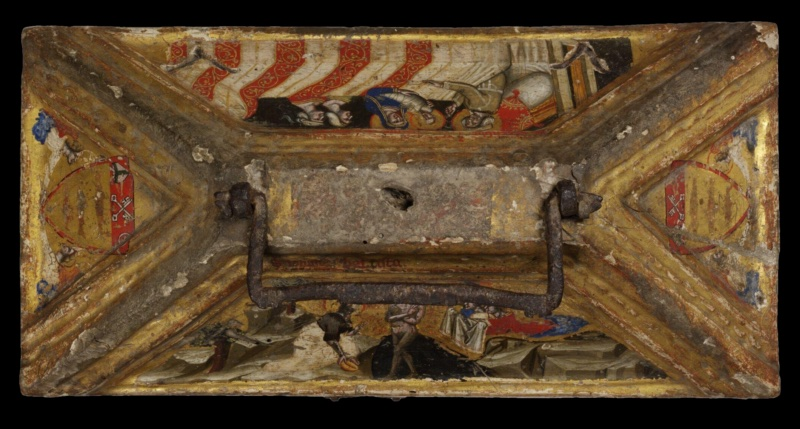
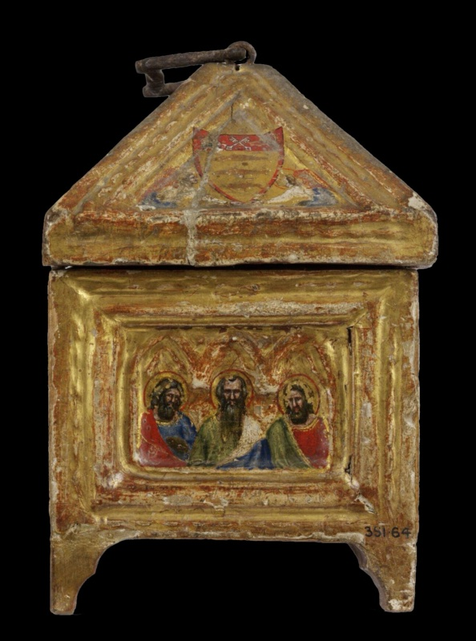
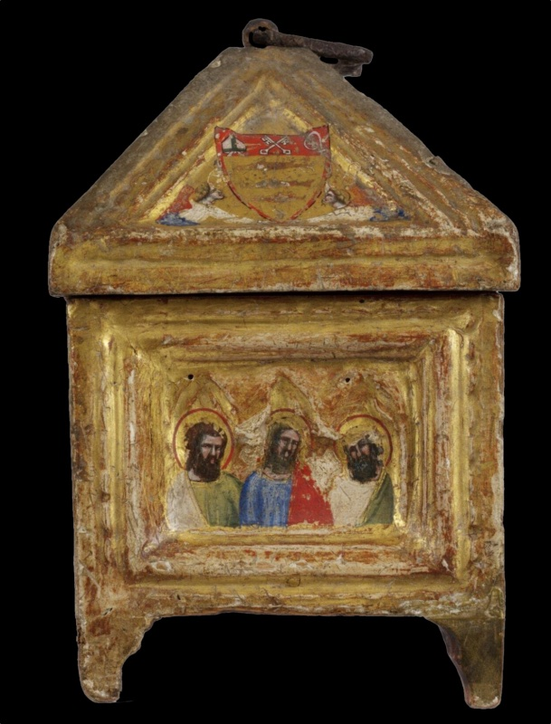
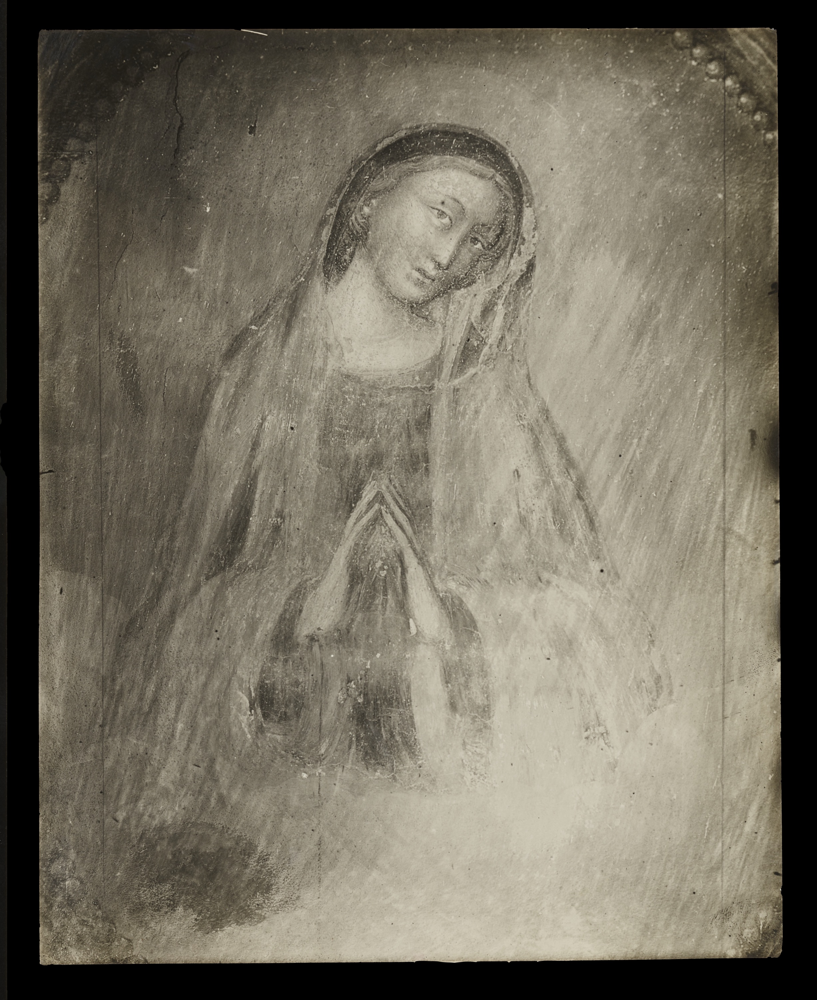

## Introduction

Writing about *Simone di Filippo*, the Bolognese painter posterity knows as Simone "dei Crocifissi", is difficult for several reasons. His name is a later invention. His reputation was long shaped by critics who admired the master he was supposed to have diluted. His very abundance has also worked against him. A painter who signs often, repeats successful formulas and supplies a whole city with altarpieces, crosses and small devotional images invites the suspicion that he was a manufacturer rather than an artist.

The documentary record, and half a century of patient reconstruction, tell a different story. Simone appears there as a figure fully embedded in the life of a great Italian commune. He was a prosperous householder and an office-holder of the popular regime. He was brother-in-law and uncle to painters. As an artist, he translated [Vitale da Bologna](/Content/Artists/XIV-c/Vitale-da-Bologna.html)'s aristocratic idiom into a language of devotion that the Bolognese public of the later fourteenth century evidently wanted.

Simone's record is best read in layers: archival fact, signed or dated works, attributions on grounds of style, scholarly hypotheses and later legend. [Roberto Longhi](/scholars.html#longhi-roberto)'s lectures of 1934–35 and his 1950 exhibition founded the modern understanding of Bolognese Trecento painting. [Daniele Benati](/scholars.html#benati-daniele), the leading authority on Emilian Trecento painting, wrote the entry on Simone in the Enciclopedia dell'Arte Medievale. [Gianluca Del Monaco](/scholars.html#del-monaco-gianluca) wrote the 2018 monograph and the Dizionario Biografico degli Italiani entry of the same year.

## The Name: Patronymic, Nickname and "Benvenuti"

In his own lifetime the painter appears in the notarial form of the commune: "magister Symon quondam Philippi pictor", Master Simon, son of the late Filippo, painter. This is a patronymic, not a surname. His father, Filippo di Benvenuto, was a shoemaker. Filippo appears in the Bolognese estimo of 1329 and in the venticinquine (the communal lists of men liable for military service) between 1328 and 1342. "Simone di Filippo di Benvenuto" is therefore accurate as a chain of patronymics. "Simone di Filippo Benvenuti", now standard on museum labels and in auction catalogues, turns the grandfather's Christian name into a family surname that the fourteenth-century documents do not record. The Dizionario Biografico accordingly heads its entry "SIMONE di Filippo".

The nickname has a more complicated history than the common statement that [Carlo Cesare Malvasia](/scholars.html#malvasia-carlo-cesare) "coined" it in the Felsina pittrice of 1678. Benati describes Simone as "denominated dei Crocifissi in the age of the Counter-Reformation, in keeping with a devotional and pietistic reading of the work of the 'primitives'". He notes that Giovanni Antonio Bumaldo's Minervalia Bononiensium civium of 1641 already singled out Simone's skill in making "Christi Crucifixi imagines". Malvasia then gave the idea its canonical Italian form: Simone painted "immagini grandi del Redentore per amor nostro confitto in croce", great images of the Redeemer nailed to the cross for our sake. By the late eighteenth century [Luigi Lanzi](/scholars.html#lanzi-luigi) could write that Simone, "che comunemente è detto in Bologna da' Crocifissi" ("whom Bologna commonly calls 'of the Crucifixes'"), excelled in these sacred images.

Three cautions follow. First, it is not established that Bumaldo used the Italian label itself. What is secure is that the epithet crystallised between Bumaldo and Lanzi, with Malvasia as its most authoritative transmitter. Second, Malvasia seems to have called the painter "Simone da Bologna". In the Pitture di Bologna of 1686 he ascribes a small panel of the Virgin pulling the Child's ear to "Simone da Bologna, che pregiandosi di una sì galante e viva espressione, vi scrisse il suo nome" ("who, prizing so gallant and lively an expression, wrote his name on it"). Third, the London National Gallery's artist page says the nickname came from four crucifixes painted late in his career. That claim has no documentary basis: the signed crosses span at least the 1370s to the 1390s, and the epithet is historiographical, not biographical.

## The Documentary Biography, 1354–1399

Few Trecento painters are as well documented as Simone. The core documents were published in a 1947 corpus on Bolognese miniaturists and painters; a 2005 social history of Bolognese painters between 1348 and 1430 enriched them, and the 2018 monograph added new finds. What emerges from this layered work is less a list of commissions than the career of a citizen, one in which painting, property, family and public service keep intersecting.

The story begins when Simone first appears in the venticinquine of the cappella of San Domenico, in the quarter of Porta Procola, already styled "magister": he is first documented in 1354 (a source gives 1355)<a href="/endnotes.html#fn-venticinquine" class="footnote">1</a>. The same lists allow a reasoned estimate of his birth. From 1352 every citizen aged twenty was entered, and Simone is absent from the parish's 1349 list, so he probably turned twenty around the start of the 1350s. That places his birth around 1330–33, and the conventional "c. 1330" is an inference of this kind, not a recorded date.

The parish of San Domenico remained the constant anchor of his life. He bought a house there in 1357, and the Dizionario Biografico states that he lived in that parish "for his entire life". Some summaries claim that he kept his workshop in the parish of San Michele dei Leprosetti, but the claim has not been verified against any document, and none of the sources consulted supports it.

The two decades after 1354 show a man consolidating his position quickly. On 4 February 1359 he received the dowry of his wife, Donella di Gerardino di Giovanni, and the new household was soon tied into the professional network around it: on 23 March 1365 his brother-in-law [Dalmasio degli Scannabecchi](/Content/Artists/XIV-c/Dalmasio-degli-Scannabecchi.html), about to leave for Pistoia, named him his procurator. Commissions followed, and they were not all of the kind later tradition would remember. On 14 June 1366 he contracted with the confraternity of the Madonna di Mezzaratta to paint five Old Testament scenes for 25 lire<a href="/endnotes.html#fn-lira-bolognese" class="footnote">2</a>, work that is now lost. In 1366–67 he was paid, together with a "Jacobus", for painting the arches and pillars of the courtyard of the Collegio di Spagna red, a reminder that a Trecento painter's trade included decorative work as a matter of course. On 22 December 1367 he received 62 lire for an altarpiece in Santa Maria dei Servi<a href="/endnotes.html#fn-order-servants-of-mary" class="footnote">3</a>, with the miniaturist [Nicolò di Giacomo](/Content/Artists/XIV-c/Nicolò-di-Giacomo.html) among the guarantors. Two days later, on 24 December, Egidia Malpigli, widow of the physician Alberto Zancari, ordered in her will that Simone paint a cross for San Giacomo Maggiore; this is the cross dated 1370.

The family and professional bonds held through the following decade. In 1373 Simone attended the drafting of Dalmasio's will, and on 7 August 1377 he witnessed an act for his nephew Lippo, explicitly as maternal uncle. The following year brought a commission whose paper trail is unusually rich. On 9 May 1378 Giovanni di Jacopo Tolana da Piacenza, a student at Bologna, left books to Biagia di ser Bondo, on condition that she place an image of the Virgin and Child with angels in Santa Maria del Monte, for ten gold florins<a href="/endnotes.html#fn-gold-florin" class="footnote">4</a>. That panel, inscribed "Hoc opus fecit fieri domina Blaxia pro anima magistri Johannis de Plaxencia", is now in the Pinacoteca Nazionale, so a student's bequest, its executrix and a surviving object can all be tied together.

The 1380s then added public office to the painter's résumé, which Del Monaco reads as direct participation in the popular regime established in 1376–77. In September and October 1380 Simone served as one of the Anziani for Porta Procola. In 1381–82 he was podestà "di sacco" of Crevalcore, one of the officials the commune sent to govern rural communities and whom the inhabitants paid in sacks of grain. In 1383 he held the same post at Funo, where he was also supervisor of the mills of the contado and a member of the magistracy of the colleges. By 1386 he was castellan and podestà di sacco of Zola and castellan of Tossignano, and in 1387 he was custodian of the fortress of Tossignano. These offices are documented. Membership of the Consiglio dei Seicento and service as massaro of the painters' guild are not, at least in the sources consulted; the office of "massaro delle arti" is documented in 1399 for Jacopo di Paolo, which may explain the confusion.

Such a career naturally had a fiscal counterpart, and here Simone's wealth was exceptional. In the estimo of 1385 he declared property assessed at 1,360 lire, the highest figure recorded for any Bolognese painter or illuminator that year. By the estimo of 1397 the assessment had fallen to 269 lire. Commissions nonetheless kept arriving: on 3 February 1390 Antonia de' Dalfini paid him for a panel with saints for an altar in San Giacomo, and in 1396 came the Cospi polyptych for San Petronio, discussed below.

The last documents concern the end of his life. Simone made wills on 7 December 1397 and 10 June 1399, and Benati's entry records a further redrafting on 22 June 1399, with Nicolò di Giacomo among the witnesses. A note at the foot of the 1399 will records its publication on 7 July, which implies his death, and a document of 27 September 1399 calls him deceased. He therefore died between late June and 7 July 1399, and the date of 9 November 1399 found in some popular sources is incompatible with this evidence. Burial in San Giacomo Maggiore is not documented in the sources consulted here; the burial clauses of the wills, published in 1947, would settle the question.

## A Family of Painters: Dalmasio, Lucia and Lippo

On 5 April 1350 Dalmasio di Jacopo degli Scannabecchi, a painter from a minor branch of a Ghibelline<a href="/endnotes.html#fn-ghibellines" class="footnote">5</a> noble family, acknowledged the dowry of his wife Lucia, Simone's sister; the marriage therefore took place in 1350 or shortly before. [Lippo di Dalmasio](/Content/Artists/XIV-c/Lippo-di-Dalmasio-degli-Scannabecchi.html) was their son. Simone was therefore Lippo's maternal uncle. The Enciclopedia dell'Arte Medievale calls him "lo zio materno" in the 1377 act. The Dizionario Biografico entry on Lippo states that "the mother of Lippo was Lucia, sister of the Bolognese painter Simone di Filippo, called dei Crocifissi".

Two errors recur in widely consulted sources. One makes Simone Lippo's "paternal uncle". The other, in a museum catalogue entry, makes Simone Dalmasio's "father-in-law". Both are wrong. Benati suggests that this kinship explains Lippo's share in the "conservative attitude with which Simone subjected the imaginative manner of Vitale da Bologna to constant 'normalisation'". The 2023 Lippo exhibition at the Museo Civico Medievale likewise presented him as son of "the still mysterious painter Dalmasio" and nephew of "the well-known artist Simone".

The procuration of 1365 and the presence at Dalmasio's will in 1373 show trust and probably professional collaboration. Simone, Dalmasio and Lippo, with the miniaturist Nicolò di Giacomo and Nicolò's nephew Jacopo di Paolo, formed a dense web of painting families. A 1979 Burlington Magazine study of "two families of painters at Bologna" first set it out. It is within this fabric of witnesses, guarantors and heirs, rather than in abstract "schools", that Simone's career must be read.

## Formation: Vitale, "Dalmasio" and the Question of the Teacher

Where Simone learned his trade is the one question the archives leave wholly unanswered, and the literature has filled the silence with three different accounts: a legend, a consensus and an alternative hypothesis.

The legend is the oldest and the weakest. A claim repeated in popular summaries holds that he trained with Franco Bolognese, the illuminator praised by Dante<a href="/endnotes.html#fn-dante-alighieri" class="footnote">6</a> and active around 1300. No document supports this, and the chronology makes it implausible, since Franco belongs to a generation that had passed from the scene decades before Simone was born. The claim is a vestige of Malvasia's genealogical tree of the Bolognese school, whose roots, as Lanzi remarked, lay "not in history but in very weak conjectures".

The consensus, by contrast, places Simone in Vitale's following, and it has proved durable. The view runs from the surveys of the 1920s, through the 1929–30 Rivista d'arte study that paired "Vitale delle Madonne" with "Simone dei Crocifissi", and through Longhi's lectures, to Benati's synthesis of 1999. For Benati, Simone "must have taken his first steps alongside Vitale", and his hand may even be detected in late products of Vitale's workshop, such as the diptych divided between the Fondazione Longhi in Florence and the National Gallery of Scotland. Del Monaco draws the stylistic conclusion: Vitale's late phase "remained for Simone a fundamental model of aristocratic, Gothically idealised beauty". Beauty of that kind was something Simone would spend a career translating into plainer terms.

The alternative hypothesis appeared in 1978 and was developed in 2004. It detects in Simone's earliest works Giottesque elements recalling the painter of the Crucifixion no. 215 in the Pinacoteca Nazionale, whom Longhi identified with Dalmasio. If that identification held, the marriage of Dalmasio and Lucia, in 1350 or shortly before, would support an apprenticeship within the family. Both Benati and Del Monaco stress, however, that the identification was convincingly questioned in 1974, hence the term "Pseudo-Dalmasio". To argue from the marriage to discipleship therefore assumes the very identity that is in doubt.

Del Monaco's own approach sidesteps the search for a single master and starts instead from the works now stably placed at the beginning of Simone's career. These are the triangular Annunciation panels in the Pinacoteca (inv. 223–224), the Coronation deposited at the Pinacoteca Civica of Budrio, the reliquary triptych formerly in the Salavin collection and now in the Louvre (D.L. 1973-15), and the Dream of the Virgin in Ferrara (inv. 57). Read together, they show a painter who took Vitale's late manner as his ideal while pursuing "a more disciplined and plastic figurative conception". He absorbed the Giottesque lesson partly through the Pseudo-Dalmasio, and he drew on the brio of the city's illuminators and of the Master of the Bologna Polyptychs while softening their harsher accents. The model that results is collective, not genealogical: a young painter assembling a manner from what the city's workshops offered.

The documents themselves should be read for what they lack. No act links Simone personally to Vitale, and the master–pupil relation, however plausible, is inferred from style alone.

## Mezzaratta: Signatures on the Wall

The confraternal church of Santa Maria (now Sant'Apollonia) di Mezzaratta, on the hills above Bologna, is in Benati's words "capital for the knowledge of the Bolognese Trecento". Most of its frescoes were detached around Longhi's 1950 exhibition and later campaigns, and moved to the Pinacoteca Nazionale. Vasari<a href="/endnotes.html#fn-giorgio-vasari" class="footnote">7</a> already recorded several painters' signatures there, Simone's among them.

Simone's documented Old Testament scenes of 1366 are lost. What survives lies on the opposite wall: New Testament scenes that specialists date a decade earlier. The signature "Symon" was legible on the Healing of the Paralytic and on the Raising of Lazarus. It recurred, together with that of an unidentified "Jacobus", on the Presentation in the Temple, which is still at Mezzaratta. The Pinacoteca today pairs the two names on further fields: it attributes jointly to "Jacobus" and Simone both the Adoration of the Magi (inv. 6352) and the field with the Healing of the Paralytic and the Pool of Bethesda (inv. 7031). The museum's account of the cycle, however, warns against assuming a single partner. It distinguishes a first "Jacobus", the presumed "Jacopino", who continued Vitale's work together with Simone, from Jacopo del Biondo, to whom it gives the Stories of Joseph and whom it tentatively identifies, "perhaps at a later date", with the "Jacobus" of the Pool of Bethesda. The double names may therefore record a partnership in some fields and successive campaigns in others. Either way, the pattern accords with Benati's observation that the opportunities of work led Simone, at Mezzaratta as elsewhere, to form partnerships for the completion of individual undertakings. The Flight into Egypt is also given to him. The Circumcision, once counted in his share, is assigned by the Pinacoteca today to "Jacobus" alone. The Massacre of the Innocents has been associated with him more doubtfully, and the Pinacoteca today assigns it to an anonymous "Master of the Massacre of the Innocents". Benati sees in these scenes "the noble eloquence of Vitale … translated into a robustly dialectal speech, impatient of refined cadences". The image of a "dialect" Vitale has become a commonplace, and it is a characterisation, not a condemnation. A dialect is a language with expressive resources of its own.

Two older errors attach to this evidence. The 1936 Enciclopedia Italiana treated Simone as Jacopo di Paolo's assistant at Mezzaratta, a chronology long abandoned: the Stories of Moses are now given for the most part to Cristoforo di Jacopo, and the frescoes of Jacopo di Paolo at Mezzaratta belong to the 1380s and later. Nor can the Mezzaratta or Collegio di Spagna "Jacobus" be identified with Jacopo di Paolo, who is first documented in 1371. A name has nonetheless been proposed: presenting the 2018 monograph, Benati suggests that this "Jacobus" is "perhaps the real Jacopino de' Bavosi", with whom Simone would have formed a partnership for specific undertakings. The suggestion is offered with a "forse" and should be repeated with one, but it would give the anonymous companion a plausible identity among the documented painters of the city.

## The Crosses that Gave Him His Name

The cross of San Giacomo Maggiore anchors this group. Egidia Malpigli's will of 1367 provided for it. It was set up on the last day of February 1370 — 28 February, that is, since 1370 was not a leap year, although a "29 February" circulates in the literature — probably as the crux de medio ecclesiae of the Augustinian<a href="/endnotes.html#fn-augustinian-order" class="footnote">8</a> church, and it is signed. For Benati it marks, with the Pietà of 1368 or shortly after, Simone's arrival at "that ungracious expressiveness (sgarbata espressività) which represents the painter's most recognisable signature". The 2012–13 exhibition texts also noted in it an updating towards neo-Giottesque solemnity.

Benati places the crosses of Santo Stefano and San Giuseppe after that of San Giacomo; the Fondazione [Zeri](/scholars.html#zeri-federico) catalogue dates the first about 1375–1380 and the second to the 1390s. The Santo Stefano cross, painted on panel, measures 325 by 236 centimetres according to the same catalogue (entry 9738), which places it in the "chiesa del Crocifisso" of the Santo Stefano complex. Malvasia recorded another cross in San Martino Maggiore, whose traces are lost after 1816. A further painted cross by Simone serves as the support for an older wooden crucifix remounted on it, now in the Collezioni Comunali d'Arte and exhibited in 2019–20. Simone also collaborated in the 1370s with the sculptor of the polychrome Magi group in Santo Stefano, a collaboration established in a 1981–82 exhibition.

These crosses were not new in type. Their force lay in directness: legible, heavy anatomy, broadly stated grief, signed surfaces. For Counter-Reformation Bologna, reading its "primitives" devotionally, they were exemplary images, old, local and moving. The nickname was a compliment before it became a label.

## The Signed and Dated Corpus

The Dizionario Biografico calls Simone "among the most prolific painters of the Italian Trecento, prodigal of signatures", and the 2018 monograph notes a number of signed works "relatively high for a painter of his time". Just how many works survive, however, depends on whom one asks. The 1936 Enciclopedia Italiana spoke of seventy works "original or attributed", and the figure has been repeated since, both by the National Gallery ("70 of his works still survive today") and by the Society of Antiquaries of London, owner of the London Dream ("some seventy of his works survive"). The 2018 catalogue raisonné goes further, numbering a Saint Andrew from a dismembered polyptych as no. 82 and including works known only from sources. The often-quoted figure of twenty to thirty signed works is not confirmed by the sources consulted here. Even the signatures themselves vary, from "Symon" or "Simon" to the fuller "Symon fecit hoc opus" on the 1382 Coronation.

Against this abundance stand only four works fixed by inscription or document, and they give the rest of the corpus its scaffolding.

The earliest is the Pietà with Angels and the Donor Giovanni da Elthinl in the Museo Davia Bargellini (inv. 173), about 78 by 50 centimetres (the inventory number and the measurements have not been verified against the museum's catalogue), whose inscription records that Giovanni died on 26 July 1368 and gave the panel for his soul. The same museum houses the Madonna dei Denti, which is Vitale's work, not Simone's. The Pietà is reported to have been shown in the Milan exhibition on the Vesperbild of 2018–19, a loan that has not been verified against the exhibition catalogue, and its influence is visible in a Bolognese Pietà of the late fourteenth or early fifteenth century sold at Sotheby's New York in 2010 (sale N08610, lot 236), which was catalogued with the remark that "the inspiration for the present panel is probably Simone dei Crocefissi's Pietá in the Palazzo Davia-Bargellini".

Next comes the San Giacomo cross of 1370, already discussed, and then, painted under the bequest of 1378, the Madonna and Child Enthroned with Angels and the Donor Giovanni da Piacenza (about 142 by 99.5 cm), now in the Pinacoteca. Until 1935 it was taken for an early work of Vitale on the strength of a signature and a date of 1320 that later proved apocryphal. The Pinacoteca records it under inventory number 225; the Enciclopedia dell'Arte Medievale gives 203, and the number has not been verified against the museum's printed catalogue.

The fourth fixed point is the Coronation of the Virgin, completed in October 1382, from the church of Santa Maria Incoronata and the adjoining Istituto Zoni, which is run by the Sisters of Charity of Saint Jeanne-Antide Thouret. It was first described in 1934, in «Il Comune di Bologna», as "un'opera di maturità dell'artista". According to the Fondazione Lercaro, it had reached the Incoronata in 1669 from the Terziarie dell'Annunciata in Borgo Orfeo, was later replaced in situ by a copy and was lost from view from the late twentieth century. The sisters rediscovered it, and it was restored under the Soprintendenza and presented in the Raccolta Lercaro on 12 December 2018. It is a small panel (reportedly 91 × 56 cm) of exceptional quality and preservation.

Around these points the literature arranges a broadly agreed sequence, while admitting, with Benati, that Simone's "settling on an easily repeatable formula, evidently welcome to his patrons, makes the ordering of his production difficult".

The earliest works, about 1350–60 (the Pinacoteca dates the Annunciation gables 1350–55), are generally taken to be the Annunciation and Budrio panels, a saint bishop in Santo Stefano, the pregnant Madonna fresco in Santa Maria dei Servi (whose attribution is disputed, much recent opinion giving it to Vitale) and the Madonna della Vittoria in San Salvatore, in which Benati notes an insistent graphic manner and elaborate punchwork. In the 1360s comes the signed polyptych no. 254 in the Pinacoteca, where for Del Monaco the components "begin to fuse in a unitary and recognisable language". Close to the benchmarks of 1368–70 stand the Louvre triptych, a Coronation that part of the literature assigns to San Giovanni in Persiceto (its identity is uncertain, since the "inv. 474" sometimes attached to it is, in the ministerial catalogue, the 1874 number of the polyptych now inv. 254), the Ferrara Dream and two Sacrati Strozzi lateral panels in Ferrara, which Benati finds "more gracious". Here the two scholars part company, since Del Monaco instead puts the Ferrara Dream and the Louvre triptych among the earliest works, a disagreement worth stating. To the same years, if the date of 1370 recorded on an early twentieth-century ministerial photograph is reliable, belongs a fresco of the Virgin in prayer in the Chiostrino delle Madonne of the Certosa, now the city's monumental cemetery; like the pregnant Madonna of the Servi, it is a single devotional image of the Virgin painted on a wall, and its present state is unknown. The 1370s are represented by the Harvard triptych (Harvard Art Museums, 1962.283), and the Moscow Annunciation (Pushkin Museum, inv. 236), which the museum dates to the early 1380s, follows close behind.

Two pictures have a more disputed placing: the signed Nativity in the Uffizi (inv. 3475), the only fourteenth-century Bolognese painting there, and the Saint Helena on canvas (Pinacoteca, inv. 220). Del Monaco places them between 1368 and 1378, Benati in the 1380s, but both agree on their greater compositional essentiality and broader monumentality.

The 1380s, anchored by the dated Coronation of 1382, are the richest decade. Further Coronations survive in Avignon (Petit Palais, on loan from the Louvre, INV 20202) and in the Alana Collection at Newark (Delaware). To the same years belong the large signed polyptych from the chapter of Santi Leonardo e Orsola (Pinacoteca, inv. 298), dated by the museum 1385–90, and the standing saints of the Museo di Santo Stefano, nine in all on three panels. For Del Monaco, in this decade Simone aimed at "a further monumental concentration, tending to isolate the volumes of figures and architectural elements".

## Iconographic Specialties: The Dream of the Virgin and the Coronation

Simone's name is tied to one of the rarest Trecento subjects, the Dream of the Virgin. Two panels survive: one in the Pinacoteca Nazionale of Ferrara (inv. 57) and one in the National Gallery, London. The London panel (L1030) is on loan from the Society of Antiquaries, measures 56.5 by 42.5 cm and is dated about 1365–80. The two panels should not be confused with Vitale's fresco of the subject at Mezzaratta, now in the Pinacoteca of Bologna, which has no panel of this subject by Simone.

As the National Gallery describes it, the Virgin, in blue, sleeps on a wooden bed with a patterned coverlet while a companion reads at its foot. From her womb rises a golden vine on which the crucified Christ hangs. Below, a hand reaches down to grasp Adam at the mouth of a dark cave, with Eve behind him and the gates of Limbo broken on the ground. Incarnation, Passion and the Harrowing of Hell are compressed into one vision, with the Virgin's body as the root of redemption. In the London panel later gilding long hid this iconography, until conservators at the Courtauld Institute removed it in 1994; a Burlington Magazine study published the results in 2000. The Gallery suggests, explicitly as conjecture, that the panel crowned a Marian polyptych in a Bolognese nunnery such as Sant'Agostino or San Lorenzo. The panel was reshaped and regilded after the Napoleonic suppressions.

Three strands of interpretation can be distinguished, from the securely textual to the speculative. The first is the medieval tradition of the Cross as a living tree, given narrative form in the Golden Legend<a href="/endnotes.html#fn-jacopo-da-varagine" class="footnote">9</a>, together with the Marian reading of Ecclesiasticus 24 ("As the vine I have brought forth a pleasant odour"). On this reading the crucified body is literally the "fruit of her womb". This is the National Gallery's interpretation. The second strand is the Tree of Jesse, which some scholars consider the most correct figurative precedent, with the Virgin replacing the recumbent Jesse. The third, more speculative, appears in a 2009 essay in Micrologus and a 2022 philological study. It links the image to the classical type of a prophetic dream of a vine growing from a mother's womb, as in Herodotus's story of Mandane, and to a widely circulated late medieval "Dream of the Virgin" prayer-legend. These are hypotheses about cultural background. None identifies a text Simone demonstrably used.

The immediate visual source is more secure. The National Gallery notes that Simone based his composition on Vitale's Mezzaratta Dream of the Virgin, which is similar "down to the distinctive pattern of the bedspread" but lacks Christ on the vine. That fresco faced a scene of Adam and Eve's release from Limbo across a Nativity. Simone fused two neighbouring scenes of a fresco programme into one panel and added the crucified Christ growing from the Virgin's body. That is theological condensation, and it refutes the notion that he merely repeated others' inventions. The image had a long afterlife: in 1920 Adolfo Wildt drew on the Ferrara Dream for his relief I pargoli cristiani.

The Coronation of the Virgin is Simone's other great subject, and what stands out is the range of scales at which he painted it. It appears as a small early panel (Budrio) and as the centre of a polyptych, as in the altarpiece from San Domenico (Pinacoteca, inv. 254). It is a modest altar panel in the 1382 Incoronata picture and the focus of the grand polyptychs of the 1380s, and it is reduced to small devotional versions (Avignon), while the Alana panel, more than a metre high, shows it at the scale of an altar. Late signed versions survive in Ferrara (inv. 6930, formerly 361) and in Pavia (Pinacoteca Malaspina, inv. 183), so the subject accompanies him from beginning to end.

The theology was conventional: Mary as Queen of Heaven and image of the Church as bride. What distinguishes Simone is adaptability. The same grouping could be expanded with angelic choirs for a monastic high altar or reduced for a private oratory: Christ and the Virgin side by side on a draped bench, Christ placing the crown, the Virgin bowing with crossed hands. Part of his productivity was this capacity to scale an image without losing legibility.

## Patrons, Publics and the Question of Papal Legates

Simone's documented patrons are socially varied, and read in chronological order they sketch a cross-section of Bolognese devotional life. The earliest, in 1366, is a lay confraternity, the company of Mezzaratta, and in the same years (1366–67) the Collegio di Spagna, founded under the will of Cardinal Albornoz<a href="/endnotes.html#fn-egidio-albornoz" class="footnote">10</a>, paid him for its decorative work. In 1367 he was paid for an altarpiece in the Servite church, and in the years 1367–70 a physician's widow ordered a cross for the Augustinians. A foreign donor, Giovanni da Elthinl, followed in 1368, and in 1378 a woman, Biagia di ser Bondo, executed a student's bequest through him. At the end of the century the clients are Antonia de' Dalfini in 1390 and, after 1396, a rising family, the Cospi.

Behind this succession of names lies a university city and communal capital of testaments, chantry altars, confraternities and mendicant churches. In that world a painter who reliably delivered legible devotional images would never lack work, and Simone's clientele, drawn from the pious laity, the religious orders, the university milieu and the new money of the commune, shows how fully he met that demand.

Simone's relation to papal government is only indirect. A signed panel of Pope Urban V<a href="/endnotes.html#fn-urban-v" class="footnote">11</a> is in the Pinacoteca (inv. 303, dated around 1375; the museum gives its provenance as unknown, although the cathedral of San Pietro has been suggested). It shows the pope enthroned and blessing, and its inscription calls him "beatus", so that it belongs to the early cult that followed his death in 1370 rather than to a commission from the living pope. No document in the literature consulted records a commission from Cardinal Androin de la Roche<a href="/endnotes.html#fn-androin-de-la-roche" class="footnote">12</a>, legate and vicar in Bologna in the 1360s, or from any other legate. None records a commission from the Pepoli.

The Cospi polyptych is the prestigious commission of his last years. Malvasia saw it in San Petronio on the altar of the family, which acquired the chapel on 10 April 1396. In 1992 a curator of the civic museums connected with it a predella of Stories of the Virgin bearing the Cospi arms (Pinacoteca, inv. 274–275). He also connected the signed Ferrara Coronation, four full-length saints of the Compagnia dei Lombardi and numerous small panels of saints. Benati accepted this in 1999. In 2018, however, Del Monaco published documents from the Aldrovandi-Marescotti archive in the Archivio di Stato di Bologna. They show that the Ferrara Coronation and the Lombardi saints "are not easily referable to the same Cospi polyptych". The predella remains the anchor, but the larger reconstruction is now doubtful. Since 2019 the Lombardi panels have been on loan to the Musei Civici d'Arte Antica. They were first shown with panels by Giovanni da Modena at the Collezioni Comunali d'Arte (October 2019 – February 2020). The civic cult that the new basilica celebrated also appears in a small panel with Saint Petronius holding a model of the walled city with its towers, now in the Museo di San Petronio (49 by 26.5 centimetres), once part of a polyptych; its dating within the second half of the century is too generic, however, to link it with the foundation of the basilica in 1390.

## Simone and Jacopo di Paolo: Colleagues, Not Kin

The title "Simone e Jacopo. Due pittori bolognesi al tramonto del Medioevo" has invited speculation about a marriage link between the two painters. None is documented. The exhibition ran at the Museo Civico Medievale from 24 November 2012 to 3 March 2013, curated by Benati and a curator of the civic museums. Its occasion was practical: a collector had deposited a Madonna by Jacopo and a Crucifixion by Simone with the civic museums. The texts presented "two distinct artistic personalities", heads of workshops that "dominated the local artistic scene".

The documents show professional and social proximity instead. Jacopo was grandson of the painter Jacopo di Nascimbene and nephew of Nicolò di Giacomo. He first appears on 7 May 1371 as a witness in Simone's house. The Dizionario Biografico states that he "formed himself under the influence first of Simone dei Crocifissi and then of the neo-Giottism headed by Jacopo Avanzi". Nicolò was guarantor for Simone in 1367 and witness to his last will in 1399. No document makes Jacopo the husband of a daughter of Simone, and no daughter of Simone appears in the sources consulted. A son-in-law of Jacopo is mentioned in the literature on Jacopo's son Orazio, which may be the origin of the confusion.

The comparison remains illuminating. Jacopo, a generation younger, absorbed Avanzi's rational neo-Giottism and later turned towards International Gothic. Simone received such novelties within what Del Monaco calls "a conservative attitude, always on the point of stiffening into an abbreviated and abstract formal simplification". In his late small panels, however, he attempted "an updating on the cruder neo-Giottesque realism of Jacopo Avanzi and Jacopo di Paolo". Giovanni da Modena belongs to a later moment. His association with Simone rests on the shared fate of their dismembered polyptychs in the Compagnia dei Lombardi, not on documented contact.

## Late Career and Workshop

An older judgement, recorded by Benati, holds that Simone, "showing no sign of internal renewal, left ever more room to the workshop". The remark needs nuance, because it mistakes a sign of organisation for a sign of decline. The volume of late production and Simone's fiscal position presuppose an organised bottega, in which assistants prepared panels, laid gold and painted secondary figures from shared patterns. Del Monaco's monograph puts "the organisation of the workshop with a view to commissions of different prestige" at the centre of its inquiry, and the phrase is apt: a painter supplying both grand polyptychs and small triptychs calibrated his own involvement accordingly, reserving his hand for the works that most required it.

Benati's assessment of the later Simone is balanced. Surpassed by painters "of more modern awareness", Jacopo di Paolo and Giovanni di Ottonello, Simone stayed bound to "the imagery of his own formation". An "expressive urgency, more embittered" came to prevail over his early Vitalesque elegance, with a "cursive and summary execution" and "immediate and simplified mimicry". Yet Benati also recognises what this late manner could achieve, and he appreciates "the artisanal care with which he prepares his paintings", above all in small works where "a pungent and rustic narrative taste" emerges.

It is among these small works that the point is easiest to see. The triptychs in Athens (Georgia Museum of Art), Austin (Blanton Museum of Art, 2017.1372, with an unrestored frame and a practically undisturbed paint surface), Oxford (Ashmolean Museum, WA1892.8), Parma (Galleria Nazionale, GN 427; GN 433), Rome (Gallerie Nazionali di Arte Antica, Palazzo Barberini, inv. 1537, signed, long on deposit at Palazzo Venezia) and the Collezioni Comunali of Bologna are examples, and the Walters diptych in Baltimore (37.723), dated by its museum to the 1360s, shows that the type was established early. The Yale University Art Gallery's panel with the Crucifixion, the Coronation of the Virgin and Christ among the apostles (1959.15.3), formerly in the Gozzadini collection, belongs in the same company. So does the crowded Crucifixion in the Detroit Institute of Arts (61.349), formerly in the Achillito Chiesa collection in Milan, whose carved frame, with medallions of Christ blessing and of the Annunciation, gives some idea of how such small devotional tabernacles may have looked when complete. A painted casket in the Victoria and Albert Museum extends the range beyond altarpieces and devotional panels, although it calls for caution: it was acquired as Florentine and is now given to Simone's workshop on stylistic grounds alone, on the strength of a curator's oral opinion.

The Cospi predella holds a special place among the late works. Del Monaco sees in it a recovery of "the lively rhythm that had distinguished his beginnings", probably through contact with the "international" openings of Nicolò di Giacomo and the younger illuminator Giovanni di fra Silvestro, and he speaks of "this extreme and happier phase" of Simone's career. The picture that results is of a painter who never stopped working on two registers at once: repetitive polyptychs for the market and lively narrative panels, coexisting to the end.

## Critical Fortune: From Malvasia to the Rehabilitation

Simone's fortune runs from devotional esteem through aesthetic disparagement to historical understanding. Bumaldo, Malvasia and Lanzi wrote within a patriotic historiography that sought a Bolognese pictorial genealogy independent of Florence. Simone's signed images mattered to them as evidence of local primitives. The false Vitale signature on the 1378 Madonna nonetheless shows that Vitale's name ranked higher.

Connoisseurship trained on Tuscan models saw Simone as the most provincial of a provincial school. The 1936 Enciclopedia Italiana put it frankly: Simone, "recognised as inferior to Vitale his master", stands out as a "rozzo semplificatore" (crude simplifier), for "raw realism" and an "ambiguous or exaggerated expression of grief". The 1929–30 Rivista d'arte study at least reconstructed his catalogue, though within a frame of Vitale as genius and Simone as popular simplifier.

Longhi changed the terms, if not at first the hierarchy. His 1934–35 lectures, later collected in Lavori in Valpadana, rescued Bolognese Trecento painting from the charge of provincialism and presented Vitale as a source of European courtly Gothic. Within this frame Simone was secondary but recognised. Longhi discussed individual works, among them the Madonna della Vittoria, the Ferrara Dream, the Madonna dell'Orecchio, the Elthinl Pietà and the Coronation polyptych. His 1950 exhibition at the Pinacoteca, around which the detachment of the Mezzaratta frescoes began, made Simone's murals and panels visible together. In its guide he called Simone "primo fornitore delle clientele locali", a double-edged phrase that grants commercial pre-eminence while implying a lower rank in invention. Another authentic Longhian coinage survives through quotation: in his presentation of the 2018 monograph Benati recalls the "icastic expression" with which Longhi had Simone adopt "pennelli dei due prezzi", brushes of two prices, calibrated to the greater or lesser rewards of each commission — a judgement of the same double-edged kind, which concedes the supremely organised workshop while smiling at its bookkeeping. A 1978 essay from Longhi's circle supplied the formula the Dizionario Biografico calls just: an "unstable point of equilibrium between passion and sigla".

The rehabilitation came through three converging lines of research. The archival and social line ran through the 1947 corpus, the 1979 study of painter families and the 2005 social history. It made Simone visible as a citizen whose assessment in the estimo of 1385 was the highest recorded for any painter that year. The connoisseurial line ran through Benati's syntheses of 1986–99, the Cospi studies of 1992, the exhibitions on the Santo Stefano Magi and on San Petronio, and recoveries from the market. It gave him a coherent oeuvre. The contextual line, studying confraternities and testamentary piety, allowed his "formulas" to be read as responses to specific demand.

The 2012–13 exhibition was a public milestone and 2018 the culmination. Del Monaco's 352-page monograph, with a presentation by Daniele Benati, appeared in January 2018 in Il Poligrafo's Biblioteca di arte (Padua, ISBN 978-88-7115-994-2), published with the support of the Dipartimento delle Arti of the University of Bologna and of Moretti Fine Art. It was the first study of Simone's entire activity, with a catalogue raisonné of "all the paintings attributable to the artist, those referred to him in the past, and those known only from the sources". The catalogue, which occupies the greater part of the volume, is ordered alphabetically by location and divided between works of secure attribution and works of doubtful or erroneous attribution, with a documentary regesto of the archival records closing the book. His Dizionario Biografico entry appeared the same year, and the 1382 Coronation reappeared. In January 2019 the Pinacoteca held a presentation of its Simone holdings, describing how he "re-elaborated the sophisticated language of Vitale, simplifying it and making it accessible to a broad public". The rehabilitation is cumulative.

## Conclusion: The Dialect of Devotion

Simone's career spans the second half of the fourteenth century in Bologna, from the walls of Mezzaratta in the 1350s to the Cospi chapel in the rising San Petronio. In between he became the city's most productive and probably wealthiest painter. He married into a network of painting families and served the popular commune in its council chamber and fortresses, and he supplied crosses, altarpieces and small devotional panels to an extraordinary range of patrons. His art was conservative in holding to Vitale's figurative world, yet inventive within it: it condensed narrative cycles into iconic images, scaled compositions from altarpiece to portable triptych and pursued an immediacy that made devotional meaning instantly legible.

The old verdict of a "crude simplifier" is therefore less false than beside the point, since it measures Simone against a standard of invention his patrons did not hold. The modern metaphors of a "dialectal" Vitale, a "pungent and rustic narrative taste" and an "unstable point of equilibrium between passion and sigla" are kinder, and they at least acknowledge that he spoke a language of his own: the language of late medieval Bolognese devotion.

The coordinates can be stated as a chain of relationships. Vitale was the creative source. Dalmasio, married to Simone's sister Lucia by April 1350, was Simone's brother-in-law, who named him his procurator in 1365, and only hypothetically his teacher. Lippo, the son of that marriage, was his nephew and in part his heir, while Jacopo di Paolo was a younger colleague and competitor, not a son-in-law. At the centre of the chain stands Simone himself, documented from 1354 and dead by July 1399, the indispensable middle term between Vitale and the late Gothic.

## Catalogue

### Pietà with Angels and the Donor Giovanni da Elthinl (Bologna, Museo Davia Bargellini)

<figure>
  
  <figcaption>Simone di Filippo, called "dei Crocifissi", Pietà with Angels and the Donor Giovanni da Elthinl, 1368 or shortly after, tempera and gold on panel, c. 78 × 50 cm. Bologna, Museo Civico d'Arte Industriale e Galleria Davia Bargellini, inv. 173. Signed "Symon pinxit".</figcaption>
</figure>

Among the works that scaffold Simone's chronology, none carries more weight than this small panel in the Museo Davia Bargellini. It is the earliest of the four paintings fixed by inscription or document, and it is the only one of them to join, on a single painted scroll, the memory of a patron and the name of the painter. Everything that the documents tell us about Simone in these years — a master in demand, embedded in the testamentary piety of his city, signing with unusual frequency — is condensed here into a devotional image of modest size and uncommon force. The panel is also, within the corpus, the first full statement of the manner that would define him: a sacred pathos stated bluntly, without the courtly softening of Vitale da Bologna, and aimed directly at the praying viewer.

The scroll at the foot of the panel is both epitaph and signature. Its text, read from the photograph with the abbreviations expanded, has not been verified against the transcription in the monograph of 2018; it runs:

> Hec opera fecit fieri Johannes de Elthinl, qui obiit anno Domini M CCC LXVIII die XXVI mensis Julii, cuius anima requiescat in pace. — Symon pinxit.
>
> "Giovanni da Elthinl, who died in the year of the Lord 1368, on the twenty-sixth day of the month of July, had this work made; may his soul rest in peace. — Simone painted it."

The formula deserves attention. The date it carries is not the date of the painting but of the donor's death, so that 26 July 1368 is strictly a terminus post quem, and the panel is best dated "1368 or shortly after": a memorial completed, or at least inscribed, once Giovanni was dead and the prayer for his soul could be added. The donor's name, a toponym or surname that has resisted secure identification, marks him as a foreigner in Bologna. And the two verbs divide the labour with notarial precision — Giovanni "had it made", Simone "painted" — the patron's fecit fieri answered by a pinxit that is rarer in Simone's signatures than his usual fecit, as if the painter had matched his formula to the legal cadence of the epitaph.

The composition is organised vertically in three registers of sharply different scale. A banded arc of blue and white, most naturally read as the bow that bounds heaven, cuts across the upper quarter of the panel; behind it six half-length angels in red and white grieve, their hands joined in prayer or pressed together, while great yellow wings close the upper corners. Below the arc, against a gold ground that darkens to a deep, nearly black zone behind the figures, the Virgin and her dead Son fill almost the entire field, their haloes tooled into the gold. At the foot of this monumental group the scale drops twice: first to the slender figure with the chalice at the left, then to the minute donor kneeling in red beside the scroll. The hierarchy is deliberate. Heaven mourns at a distance, the sacred group looms at full devotional scale, and the human client is admitted at the threshold, no larger than the letters that record his name.

The central group concentrates the panel's expressive force. The Virgin, engulfed in a blue mantle whose hem is picked out in gold, bends her head close to the thorn-crowned head of Christ, which her hand supports from behind, her brow furrowed and her eyes narrowed in a grief that is described, not idealised. From the upper right a long sword descends, its point driven toward her breast: the prophecy of Simeon — "and a sword shall pierce through thy own soul also" (Luke 2:35) — made disconcertingly literal, so that the Mother's inner sorrow is given the same physical evidence as her Son's wounds. Christ lies diagonally across her lap, his torso emaciated, the ribcage drawn with harsh insistence, the side wound bleeding freely, the long arms fallen slack. The anatomy is heavy and legible rather than graceful, and it is meant to be: the body is offered to the viewer as the object of meditation, close enough to count the wounds.

The two small figures at the lower left turn lament into liturgy. The attendant in a white alb scattered with dark crosses — an angel in liturgical dress, to judge from the pale forms rising behind the shoulders — raises a golden chalice beneath Christ's wounded side and hanging right arm, gathering the blood as it falls. The gesture binds the image to the Mass: the blood of the Passion is received in the very vessel in which the altar receives it, and the panel, whatever its original setting, declares itself an altarpiece in miniature, a painted argument that the sacrifice mourned by the Virgin is the sacrifice renewed in the Eucharist. Directly below, the donor kneels in profile, bearded, his hands lifted toward the group. His red robe is the one note of saturated colour in the lower zone, and his placement beside the scroll makes the program explicit: the image, the epitaph and the prayer for his soul work together, and the viewer who reads the scroll is enlisted in that prayer.

Within Simone's development the panel is a hinge. Benati has paired it with the San Giacomo Maggiore cross of 1370 as the moment of arrival at "that ungracious expressiveness (sgarbata espressività) which represents the painter's most recognisable signature", and the phrase fits the Pietà exactly: the faces brought close, the furrowed brow, the insistent ribcage are the aristocratic idiom of Vitale translated into plainer, harder speech. The undated works that criticism places nearby — the Louvre reliquary triptych, the Coronation reported from San Giovanni in Persiceto, for Benati also the Ferrara Dream of the Virgin, which Del Monaco instead moves earlier — are arranged around this fixed point, and the panel thus serves the corpus as the 1370 cross serves the crucifixes: a dated standard against which attributions are measured.

The panel's later fortune confirms its exemplary character. A Bolognese Pietà of the late fourteenth or early fifteenth century that passed through Sotheby's New York in 2010 was catalogued with the observation that its probable inspiration was precisely this painting, evidence that the composition circulated as a model in the city's workshops. In 2018–19 the panel is reported to have travelled to the Milan exhibition on the Vesperbild at the Castello Sforzesco (the loan has not been verified against the exhibition catalogue), among the works tracing the fortune of the theme of the Virgin with her dead Son in the decades before Michelangelo; its early date makes it an important Italian painted witness to that devotional current, whose sculpted German prototypes belong to the same century. For the student of Simone, finally, it is the natural first object: the earliest work with a fixed term (after 26 July 1368), the clearest statement of his expressive programme, and a reminder that the painter whom the Seicento would name for his crucifixes had already, by about 1368, built his art on the dead Christ.

### Crucifix of 1370 (Bologna, San Giacomo Maggiore)

<figure>
  
  <figcaption>Simone di Filippo, called "dei Crocifissi", Crucifix with the Mourning Virgin, Saint John the Evangelist and the Blessing Father, dated the last day of February 1370, tempera and gold on shaped panel. Bologna, San Giacomo Maggiore. Signed "Symon fecit".</figcaption>
</figure>

If one work had to stand for the name that the Seicento fastened on Simone, it would be this cross, the second fixed point of his chronology and the only one of his crucifixes whose genesis can be followed step by step through the documents. On 24 December 1367 Egidia Malpigli, widow of the physician Alberto Zancari, ordered in her will that Simone paint a cross for the Augustinian church of San Giacomo Maggiore; by the last day of February 1370 the cross was in place; and it still hangs in the church for which it was made, today in the ambulatory, where the ministerial cataloguing records it in the ninth chapel. Few objects of the Bolognese Trecento unite testament, payment horizon, dated inscription, signature and original building so completely, and the cross therefore serves the crucifix corpus as the Elthinl Pietà serves the panels: the standard against which every attribution is measured.

The inscription on the tablet at the foot of the cross, as transcribed in the ministerial record, gives the painter and the date:

> Symon fecit. A(nno) D(omini) MCCCLXX, die ult(imo) febr(uarii).
>
> "Simone made [this]. In the year of the Lord 1370, on the last day of February."

Two details deserve note. The dating formula counts by the last day of the month, and since 1370 was not a leap year that day was 28 February; the "29 February 1370" that circulates in the literature is calendrically impossible. And the verb is Simone's habitual fecit, where the Pietà of 1368 or shortly after has the rarer pinxit: the painter who signed more often than any Bolognese contemporary varied his formula, and the plain "made" suits an object that was carpentry and gilding as much as painting.

The cross is of the shaped, silhouetted type, its field a deep blue edged with gold, its terminals expanded into mixtilinear quatrefoils. At the apex a half-length figure raises his right hand in blessing over an open book — the Eternal Father, according to the ministerial record — and immediately below, at the crossing of the summit, a small field shows a bird with spread wings above a nest, most naturally read as the pelican in her piety, the old emblem of Christ feeding his young with his own blood; a scroll lettered INRI follows. The lateral terminals hold the canonical pair: on the left the Virgin, sunk in a dark mantle, her hand lifted toward her cheek; on the right Saint John the Evangelist, who presses his hand to his face in the immemorial gesture of grief.

Christ belongs to the fully dead type, the patiens, but rendered with the directness that is Simone's own. The head has sunk forward and to one side, the long fair hair spilling with it; the flesh is pallid to greenness, the ribcage drawn with the same harsh insistence as in the Pietà; blood runs from the nailed hands along the arms, wells at the side wound and sheets down from the feet. The loincloth is ample, grey-white and knotted at the hip, falling nearly to the knees. The anatomy is heavy, legible and close, built for a viewer who prays rather than appraises, and it is exactly this quality that Benati has in mind when he pairs the cross with the Pietà of 1368 or shortly after as the arrival of Simone's "ungracious expressiveness"; the texts of the 2012–13 exhibition added that the cross also registers an updating toward neo-Giottesque solemnity, visible in the breadth and weight of the figure.

The foot of the cross concentrates its theology. Two diminutive mourning women stand on the shaft at Christ's feet, the right-hand one with the loose fair hair that convention gives the Magdalen; below them his blood runs in a single long rivulet down the shaft, over the rocky mound of Golgotha and toward the skull of Adam, lodged in its dark cave — the old doctrine that the blood of the second Adam fell upon the grave of the first, stated here with almost diagrammatic clarity. Unlike the Pietà of 1368 or shortly after, the cross shows no donor figure in the photograph examined here: the testatrix Egidia Malpigli is present only through the bequest that brought the object into being, and through the prayers it was meant to solicit for her soul.

The cross's probable original function completes the picture. Scholarship has proposed that it was the crux de medio ecclesiae of the Augustinian church, the cross displayed at the boundary between the friars' choir and the lay nave, facing the congregation at the spiritual centre of the building; its scale, its silhouetted format and its blunt legibility suit such a station. The commission also shows the testamentary mechanics of Simone's market at their clearest: a widow's bequest, executors, a great mendicant church, and an image designed to solicit prayer for a named soul. San Giacomo remained a steady client — in 1390 Antonia de' Dalfini paid Simone for a panel of saints for an altar in the same church — and the cross was thus not an isolated commission but one node in a lasting relationship.

Within the corpus, finally, the cross anchors the group that generated the nickname. The later crosses in the Museo di Santo Stefano, dated by the Zeri cataloguing about 1375–1380, and in the Museo di San Giuseppe, the cross recorded by Malvasia in San Martino and lost after 1816, and the painted cross reused as the support of an older wooden crucifix now in the Collezioni Comunali d'Arte, all descend from the type fixed here. When Bumaldo in 1641 singled out Simone's "Christi Crucifixi imagines" and Malvasia enlarged the praise, it was the direct, blood-traced devotional rhetoric of crosses like this one that they were remembering; the San Giacomo cross, dated, signed and still in situ, is the genealogical head of that family and the proper first exhibit in any account of how Simone di Filippo became "dei Crocifissi".

### The Crucifix of 1370 in a Historical Photograph

A historical photograph of the cross by A. Villani e Figli, Bologna, is in the catalogue of the Fototeca Zeri (Università di Bologna), scheda 8175.

The cross of San Giacomo Maggiore is also recorded in an older black-and-white image from the Bolognese studio of A. Villani e Figli, preserved in the Fototeca of the Fondazione Zeri. The Zeri catalogue entry (number 8175) confirms the essential data of the work: a painted cross on panel by Simone di Filippo, attributed on the strength of the signature, dated 1370 and last recorded in the basilica of San Giacomo Maggiore. The photograph has been cut out along the silhouette of the cross and set against a flat ground, which isolates the object from its architectural setting.

The historical image is useful above all as a document of the cross's appearance before its most recent conservation. Its monochrome rendering makes the drawing of the body, the inclination of the head and the arrangement of the terminals particularly legible, and it confirms several readings proposed in the colour entry: the half-length figure with an open book in the upper terminal, the bird with spread wings above a nest, which is most naturally the pelican in her piety, the two small mourning women at the foot of the shaft, and the skull of Adam in the dark cavity of the lower terminal.

The comparison with the colour photograph also raises questions for the conservation history. In the black-and-white image the titulus appears as a dark, apparently empty rectangle, whereas the colour photograph shows a white scroll lettered I.N.R.I.; and the lower part of the cross, with the inscribed tablet bearing the signature and the date, is cut off. Whether the titulus was cleaned, reintegrated or simply rendered differently by the photographic process, and when the photograph was taken, have not been verified against the restoration records of the cross.

For the reader, the old photograph has a further value: it shows the cross as it was known to the generations of scholars who reconstructed Simone's career in the twentieth century. It is through images of this kind, preserved in archives such as the Fototeca Zeri, that the corpus of a painter like Simone was first assembled and compared, and their survival is part of the history of his rediscovery.

### Madonna and Child Enthroned with Two Angels and the Donor Giovanni da Piacenza (Bologna, Pinacoteca Nazionale)

<figure>
  
  <figcaption>Simone di Filippo, called "dei Crocifissi", Madonna and Child Enthroned with Two Angels and the Donor Giovanni da Piacenza, c. 1378 (after 9 May 1378), tempera and gold on panel, 142 × 99.5 cm. Bologna, Pinacoteca Nazionale, inv. 225; formerly Santa Maria del Monte, then Istituto delle Scienze.</figcaption>
</figure>

The third fixed point of Simone's chronology is, among the four, the one whose making the documents follow most closely, and the one whose identity was longest obscured. On 9 May 1378 Giovanni di Jacopo Tolana da Piacenza made a will in Bologna leaving books to Biagia di ser Bondo, on condition that she have an image of the Virgin and Child with angels placed in the church of Santa Maria del Monte, at a cost of ten gold florins. The panel now in the Pinacoteca Nazionale is that image. Malvasia already recorded it in the "Madonna del Monte"; it later passed into the collections of the Istituto delle Scienze, the route by which it reached the gallery. Yet for most of its modern history it bore another painter's name: until 1935 it was taken for an early work of Vitale da Bologna, on the strength of a signature and a date of 1320 that proved apocryphal.

The genuine inscription runs along the step of the throne, in Gothic minuscule, and it leaves no doubt about the circumstances of the commission. Read from the photograph, with abbreviations expanded, it gives:

> Hoc opus fecit fieri domina Blaxia pro anima magistri Iohannis de Plaxencia.
>
> "Lady Biagia had this work made for the soul of Master Giovanni da Piacenza."

The formula reverses the arrangement of the Pietà of 1368 or shortly after. There the man who died had the work made for his own soul; here a woman acts as executor of another's piety, and the panel commemorates its beneficiary in the third person. The title magister marks Giovanni as a man of learning in the university city, and the inscription names him with the prestige of that title even as it records his death. No signature of Simone is visible beside it in the photograph examined here, and the attribution rests on style and on the documentary sequence that ties the bequest to the panel.

The composition is a grand Maestà adapted to private commemoration. The Virgin sits on a tall Gothic throne whose side wings open in pointed arches, like the panels of a choir stall, and whose summits carry blue, flame-like finials; behind her a red cloth of honour, patterned in small rosettes and stars, rises to the cusped arch of the frame. Her dress is a warm salmon pink, her mantle a deep blue worked over its whole surface with gold brocade and lined in green, and the play of these colours against the gold ground gives the panel a luxury unusual in Simone's production. Two angels in pale robes stand at either side of the throne, their hands crossed on the breast, their faces lifted toward the group. The whole is held within a trefoil-cusped arch carried on twisted columns, an architectural frame that contributes to the impression of an altarpiece rather than a small devotional panel.

The relationship between Mother and Child gives the image its tenderness. The Child stands on the Virgin's knee, wearing a sheer, almost transparent shift, and grasps the edge of her mantle at the neckline as he looks up into her face; she supports him with both hands and turns her own gaze outward, toward the viewer, with the melancholy fixity that Simone gives his Madonnas. The motif of the Child plucking at his mother's garment is one of the affectionate formulas of Trecento painting, and its presence here recalls the Vitalesque models that Simone had absorbed: the panel shows how close his Marian imagery could still remain, in the late 1370s, to the courtly sweetness of Vitale — close enough, indeed, to make the forged attribution plausible.

At the lower right, set against the throne at the scale of the angels' knees, kneels the donor. He is shown in profile, his hands joined in prayer, wearing a long dark brown garment and a red cap. The cap, together with the inscription's magister, accords well with the dress of a learned man of the university, though the costume alone cannot establish his precise status; what matters for the image is that the commemorated soul is admitted into the presence of the Virgin, beneath the gaze of the angel at his side, while his name runs along the step at his feet. As in the Pietà of 1368 or shortly after, the small donor at the threshold, the written prayer for the soul and the sacred figures at full scale form a single devotional mechanism.

Within the corpus the panel fixes the late 1370s. It stands between the cross of 1370 and the Coronation of 1382, and it shows a facet of Simone that the crosses hide: the painter not of blunt pathos but of decorative splendour, capable of brocaded surfaces, elaborate throne architecture and an aristocratic Marian type. It is a reminder that the "ungracious expressiveness" which criticism has made his signature was only one register of a versatile practice, and that Simone could supply, when a patron's bequest demanded it, an image of courtly dignity measured to the ten gold florins of a scholar's will.

The panel also serves as a lesson in method. Its history — a documented bequest, a sanctuary named in the will and in Malvasia, a forged signature, a reattribution in 1935, a museum record that still calls it "1378 circa" — compresses into one object the whole process by which Simone's career has been reconstructed: by archives more than signatures, by context more than name. It is also the point at which Simone and Vitale touch most closely, since it was long mistaken for the master's work, and the mistake measures both how much Simone owed to Vitale and how completely he could make that inheritance his own.

### Coronation of the Virgin, 1382 (Bologna, Raccolta Lercaro)

<figure>
  
  <figcaption>Simone di Filippo, called "dei Crocifissi", Coronation of the Virgin, completed October 1382, tempera and gold on panel. Bologna, Raccolta Lercaro, on loan from the Istituto Zoni; formerly Terziarie dell'Annunciata in Borgo Orfeo, then Santa Maria Incoronata (from 1669). Signed "Symon fecit hoc opus" and dated.</figcaption>
</figure>

The fourth and last fixed point of Simone's chronology is also the most recently recovered. Signed and dated 1382, this small Coronation was first described in 1934, in «Il Comune di Bologna», as "un'opera di maturità dell'artista"; it then vanished from view in the late twentieth century, to reappear in the house of the Sisters of Charity of Saint Jeanne-Antide Thouret at the Istituto Zoni, beside the church of Santa Maria Incoronata in Bologna. Restored for the Fondazione Lercaro under the supervision of the Soprintendenza, it was presented to the public in the Raccolta Lercaro on 12 December 2018, the same year as the monograph that reconstructed Simone's career.

The panel carries two inscriptions, each in its own place and with its own function. On the step beneath the throne runs the signature, and along the lower edge the date, both read here from the photograph:

> Symon fecit hoc opus.
>
> Hoc opus factum fuit A(nno) D(omini) MCCCLXXXII, finito mese otubris.
>
> "Simone made this work." — "This work was made in the year of the Lord 1382, the month of October being finished."

The second formula is unusually precise, recording not the start but the completion of the work at the end of October, and its spelling — mese for mense, otubris for octobris — betrays the vernacular habits of a Bolognese scribe writing in Latin. The pairing of a signature in the body of the image with a dated colophon on the frame zone below suggests a painter conscious of both his name and his record: in 1382, at the height of his civic career, a few years before the estimo of 1385 would assess him as the richest painter in the city, Simone fixed both the authorship and the moment of completion with notarial care.

The composition belongs to a type that Simone repeated across his whole career, here given at its most concentrated. Christ and the Virgin sit side by side on a cushioned bench against a gold ground tooled with a fine textile pattern; Christ, crowned and bearded, sets the crown on his mother's head with his raised right hand while his left rests a slender sceptre on his knee; the Virgin bows, eyes lowered, her hands crossed on her breast in the gesture of humble acceptance. Above, the scene is bounded by a broad arc banded in blue and green and studded with gold stars on its lower edge, and behind it a row of angels, half-length, crowd together with inclined heads. The device is the same banded arc that crowns the Pietà of 1368 or shortly after, and its reappearance some fourteen years later shows how Simone carried a successful formula from one subject to another: the heavenly vault that had sheltered the grieving Mother over her dead Son now frames her triumph.

Colour and surface carry much of the panel's quality. The Virgin's mantle is a dark green worked over its whole extent with gold fleurons, its lining picked out in yellow-green, so that her figure reads as a single dense block of patterned colour; Christ's pink mantle, lined in blue, falls in broad, soft folds over a white tunic gathered by a gold belt, his cuffs and collar bordered in red and gold. The contrast between the closed, dark, ornamented figure of the bowing Virgin and the open, light-coloured figure of the crowning Christ structures the image as clearly as the gesture itself. The state of preservation, which the presentations of 2018 called exceptional, allows these surfaces to be read with a freshness rare in Simone's surviving work, so much of which has suffered from abrasion or repainting.

The panel's history explains both its loss and its survival. It came from the house of the Tertiaries of the Annunziata in Borgo Orfeo, who gave it up in exchange for a copy; in 1669 it reached Santa Maria Incoronata, where it was placed on the high altar in place of an old, ruined fresco that had been the focus of the devotion to Mary as Queen — a history that matches subject to dedication, since a church named for the crowned Virgin received in Simone's panel a Coronation to replace its decayed cult image. Later the panel was itself replaced in situ by a copy, and it was only after its rediscovery that the original could be studied again. Its format, modest in size and rectangular, without the polyptych setting of Simone's larger Coronations, accords with the needs of a convent of Tertiaries rather than a great conventual high altar.

Within the corpus the Lercaro panel anchors the 1380s, the richest decade of Simone's production, and it measures the distance travelled since the Coronations of his youth, such as the pinnacle panel at Budrio or the centre of the San Domenico polyptych. The figures have grown broader and more monumental, the composition has been simplified to its essentials, and the relationship between the two protagonists has acquired a gravity that Del Monaco has described as Simone's aim in these years: "a further monumental concentration, tending to isolate the volumes of figures and architectural elements". It is against this signed and dated panel that the other Coronations of the period — Avignon, the Alana panel, the late versions in Ferrara and Pavia — can now be ordered, and its recovery in 2018 gave the reconstruction of Simone's mature career the fixed point it had lacked for decades.

### The Healing of the Paralytic and the Pool of Bethesda (Bologna, Pinacoteca Nazionale, from Mezzaratta)

<figure>
  
  <figcaption>"Jacobus" and Simone di Filippo, called "dei Crocifissi", The Healing of the Paralytic at Capernaum and the Healing at the Pool of Bethesda, c. 1355–1360, detached fresco. Bologna, Pinacoteca Nazionale, inv. 7031; from the church of Santa Maria (now Sant'Apollonia) di Mezzaratta, right wall.</figcaption>
</figure>

Among the frescoes detached from the confraternal church of Mezzaratta and now in the Pinacoteca Nazionale, this field holds a special place in the reconstruction of Simone's career: it belongs to the group of New Testament scenes on which the name "Symon" was once legible, and it is therefore one of the documents of his earliest activity, before the dated panels of 1368–82. The Pinacoteca records it under inventory number 7031, shows it in Room 8, with the other frescoes of Mezzaratta, and attributes it jointly to "Jacobus" and Simone di Filippo. The double name admits two readings. It may reflect a partnership like the one documented on the same wall, where the two signatures appeared together on the Presentation in the Temple; but the museum's own account of the cycle suggests that the "Jacobus" of the Pool of Bethesda may be Jacopo del Biondo, the painter of the Stories of Joseph, working "perhaps at a later date", in which case the two episodes of this field would belong to two different campaigns, the Healing of the Paralytic to Simone and the Pool of Bethesda to his successor. The museum gives for the cycle as a whole the broad span 1338–1460 that covers the successive campaigns of decoration in the little church. Within that span, the scenes of the right wall associated with Simone are placed by specialists in the mid-1350s, a decade before the Old Testament scenes he contracted to paint in 1366 and which are now lost.

The field joins two episodes, both healings of paralytics, under a single architecture. At the left, in the house at Capernaum, is the story told by the Synoptic Gospels (Mark 2:1–12; Luke 5:17–26): the crowd around Christ is so dense that the friends of the paralysed man climb onto the roof, open it and let him down on his bed before the Lord. At the right, beyond a slender column, is the miracle of the pool of Bethesda, the "piscina probatica" of John 5:1–16, where Christ heals a man who had lain ill for thirty-eight years and commands him: "Rise, take up thy bed, and walk". The juxtaposition is deliberate and theological: two paralytics, two beds, two acts of healing that the Gospels themselves link to the forgiveness of sins, set side by side so that the viewer reads the second as the echo of the first.

The left scene is organised vertically, from the roof down. On the red tiles above, a man in green leans head-first into the opening, and his companions, now largely lost, worked with him to lower the bed; below the roof line hangs a blue cloth patterned in white, which on the evidence of the narrative should be the bed or its covering in the act of descent. Beneath it, inside the house with its round arches, Christ stands at the left in a pink mantle, his hand raised toward a press of bearded heads, while in the foreground turbaned men sit with their backs to the viewer and a large figure in red is seated at the centre. The scribes of Mark's account, who murmured that only God could forgive sins, are most naturally recognised in these seated, turbaned figures, though their identification rests on the narrative rather than on any attribute.

The right scene unfolds in two moments within one field. Under the second arch a group of bearded elders in yellow and red mantles stands together, their heads turned toward the right; beside them, against a rocky outcrop, a young man in a yellow tunic strides away with his rolled bed on his shoulder — the healed man obeying the command — while below him, at the lower edge, a man stands bent over his staff, still among the sick who waited by the pool. The elders correspond well to "the Jews" of John 5:10, who rebuked the healed man for carrying his bed on the Sabbath; the rock, if not merely a landscape device, may allude to the setting of the pool. The narrative is told by juxtaposition rather than by repetition of the protagonist, and the young man with the bed, given the most energetic movement in the whole field, carries the story's point.

Style supports Simone's presence in the field, even if the museum's double attribution leaves open how the field was shared between Simone and "Jacobus", and whether the two episodes were painted at the same time. The faces are broad and heavily characterised, the gestures direct, the figures crowded into the architecture without the elegant intervals that Vitale left between his actors; the colour, where it survives, is warm and saturated, dominated by pinks, reds, yellows and greens. This is the language that Benati has described as "the noble eloquence of Vitale … translated into a robustly dialectal speech, impatient of refined cadences", and the image of a dialect fits the scene well: the story is told energetically and legibly, with the narrative crowd treated as a single mass and the key actions — the descent through the roof, the departure with the bed — pushed into the clearest positions.

The condition of the fresco demands caution. A large loss at the lower left has removed part of Christ's figure and the foreground, the roof scene is abraded, and much of the surface survives only in its underlayers; the decorative borders at the sides, with their painted geometric bands, are better preserved than the scenes they frame. The detachment, carried out in the campaigns around Longhi's exhibition of 1950 and later, saved the paintings but separated them from their architectural context, and the photograph shows the field as an isolated panel rather than as part of the continuous wall narrative for which it was conceived.

The fresco is the earliest point at which Simone's hand can be seen at work in a public, collective enterprise. Mezzaratta was the great workshop of the Bolognese Trecento, where Vitale, Simone, the "Jacobus" with whom the museum pairs him in this very field, and later Jacopo di Paolo and others painted side by side for the same confraternity; it is here that the young Simone tested his narrative manner on the scale of a wall, before the panels of the 1360s and the crosses of the 1370s fixed his reputation. The two healings, with their crowded, earnest crowds and their emphasis on the visible act of restoration, already announce the devotional directness that would make him, a generation later, the leading supplier to the local clientele.

### The Flight into Egypt, Fragment (Bologna, Pinacoteca Nazionale, from Mezzaratta)

<figure>
  
  <figcaption>Simone di Filippo, called "dei Crocifissi", The Flight into Egypt, fragment, c. 1355–1360, detached fresco, 146 × 140 cm. Bologna, Pinacoteca Nazionale, inv. 6355; from the church of Santa Maria (now Sant'Apollonia) di Mezzaratta.</figcaption>
</figure>

This field is the most damaged of the Mezzaratta scenes associated with Simone, and it is included here less for what it shows than for what it records. The Pinacoteca catalogues it under inventory number 6355, as a fragment of the Mezzaratta cycle, measuring 146 by 140 centimetres, with the same broad dating, 1338–1460, that the museum gives to the decoration of the church as a whole; the museum attributes it to Simone di Filippo and exhibits it in Room 8, devoted to the frescoes of Mezzaratta. The attribution agrees with the literature on Simone, which has consistently counted the Flight into Egypt among the New Testament scenes that he painted at Mezzaratta, alongside the signed Healing of the Paralytic and Raising of Lazarus and the Presentation in the Temple shared with the mysterious "Jacobus", and it belongs therefore to the earliest phase of his career, in the mid-1350s.

What survives is little more than a single head. At the centre of the field, against a deep blue sky crossed by cracks, the Virgin appears veiled and haloed, her face turned slightly to the right, her features still legible: the long nose, the narrow eyes, the small mouth of the Vitalesque type that Simone adopted in his early Madonnas. Before her breast a hand is raised, and the gesture, in the context of the subject, is most naturally read as the hand that held the Child close during the journey, though the Child himself cannot be distinguished in the present state of the surface. The rest of the composition has been reduced to a pale, flaking ground, scattered with islands of colour, and at the left a large area of bare grey plaster marks the complete loss of the painted layer.

The fragments that remain around the head allow only a cautious reconstruction of the scene. At the upper left a curving band of red and a series of yellowish forms may belong to a figure or to a building, perhaps to the city gate from which the Holy Family departs or toward which it travels; at the lower left a vertical strip of red drapery survives beside the yellow border of the field, and it would suit the figure of Joseph, conventionally shown walking ahead or beside the donkey. At the upper right a series of curved, striated strokes, painted in green and ochre over the blue, may be the fronds of a tree. None of these identifications can be confirmed from the photograph, and they are offered here as possibilities rather than as readings.

If the striated forms at the upper right are indeed the crown of a tree, they would point toward one of the most popular apocryphal episodes attached to the Flight. The Gospel of Pseudo-Matthew (XX) tells how, on the third day of the journey, the Virgin rested beneath a palm tree and the Child commanded it to bend down its branches so that his mother might gather its fruit, and the bowing palm became a familiar motif in Trecento representations of the subject. The canonical account in Matthew 2:13–15 is brief, recording only the angel's warning to Joseph and the departure by night, and the painters of the fourteenth century regularly enriched it with such legendary details. Whether the Mezzaratta painter followed this tradition cannot be known without better documentation of the fresco before its losses.

The condition of the field reflects the history of the cycle as a whole. The frescoes of Mezzaratta suffered from damp, neglect and the alterations of the building over the centuries, and the detachment campaigns around Longhi's exhibition of 1950 and later saved what could still be saved; in a case such as this, what was saved is chiefly the evidence that a scene existed and a fragment of its painter's hand. The lower part of the field, where the donkey and the travellers would have stood, and the entire left side are effectively lost, and the remaining surface, with its abraded colour and exposed preparatory layers, demands that every statement about the composition be made with reserve.

The fragment nonetheless keeps a value for the study of Simone's beginnings. The head of the Virgin is, in its small way, a document of the formation that the literature has reconstructed: a face that still depends on the courtly types of Vitale, with the elongated features and soft modelling of the 1340s, but rendered with the firmer contour and the slightly heavier construction that would distinguish Simone's own Madonnas of the following decades. Set beside the better-preserved Healing of the Paralytic, it confirms that the young painter worked at Mezzaratta not only as a narrator of crowded scenes but also as a painter of Marian figures, the genre on which so much of his later production would rest.

For the visitor and the reader alike, the fragment is finally a lesson in the fragility of the evidence on which the history of Bolognese Trecento painting depends. Of a scene that once must have held the Virgin, the Child, Joseph, the donkey and probably a landscape setting, there remains a single head under a blue sky; and yet that head, given to Simone by the museum and by the literature on grounds of style and of its place in the cycle, is part of the small group of works through which the earliest Simone can still be seen. It is a reminder that the corpus of a fourteenth-century painter is built not only from intact altarpieces but also from such ruins, read with patience and stated with caution.

### Miracles of Christ, Fragment (Bologna, Pinacoteca Nazionale, from Mezzaratta)

<figure>
  
  <figcaption>Simone di Filippo, called "dei Crocifissi", Miracles of Christ, fragment, c. 1355–1360, detached fresco, 246 × 265 cm. Bologna, Pinacoteca Nazionale, inv. 7030; from the church of Santa Maria (now Sant'Apollonia) di Mezzaratta.</figcaption>
</figure>

The largest of the Mezzaratta fields presented here is also one of the most severely reduced. The Pinacoteca catalogues it under inventory number 7030, with the generic title "Miracles of Christ", measuring 246 by 265 centimetres, and with the broad dating 1338–1460 that the museum gives to the whole decoration of the church. The museum attributes the field to Simone di Filippo and shows it with the rest of the cycle in Room 8. What remains is an irregular strip along the upper edge and a patch at the right, while the lower two-thirds of the field has been lost entirely and is now filled with neutral plaster. The surviving fragments belong to the same narrative manner as the Healing of the Paralytic, and the museum's attribution places them within the group of New Testament scenes that document Simone's early activity at Mezzaratta.

The museum's generic title reflects a real difficulty of identification. The fragments preserve the upper part of a scene, or of two adjacent episodes, in which Christ performs a miracle before witnesses, but the decisive elements — the lower bodies of the figures, any bed, tomb, pool or other attribute, and any inscription — are gone. The reading is therefore descriptive first, and the identification of the episode has not been verified against the literature on the cycle or against photographs taken before the losses or before the detachment.

At the centre, Christ, recognisable by the pink mantle worn over a blue garment, leans toward a man in a grey-blue tunic and raises his hands to the man's head and face. The gesture is the core of the image, and among the miracles of the Gospels it accords best with the healings of the blind, in which Christ touches the eyes of the sufferer (Matthew 9:27–31; Mark 8:22–26; John 9:1–7); it could also belong to the healing of the deaf-mute, in which he touches the ears and tongue (Mark 7:32–35). The man's posture, close to Christ and turned toward him, suits either reading, and neither can be confirmed from the surviving surface. Behind the pair a slender tree with a dark green crown rises against the blue sky, a landscape note that places the episode out of doors.

At the left a dense crowd of heads looks toward the centre, some of them carrying traces of gilded haloes: the apostles who accompany Christ, pressed together in the tiered manner that Simone used also in the crowd of the Healing of the Paralytic. At the right a pink building with battlements and an arched doorway rises above a group of men — one bearded in a cap, one in a turban, one young and fair-haired — who stand together and turn toward the miracle. The building may stand for a city gate or for the town in which the miracle took place; if the episode is the healing of the man born blind, it might allude to the pool of Siloam where he was sent to wash, or to the Temple, but such a precision would go beyond what the fragment can bear. The men beneath it, with their varied headgear, play the role of witnesses, and possibly of the sceptical Pharisees who questioned the healed man.

The style of the surviving heads supports the museum's attribution. The apostles' faces are broad, earnest and individually characterised, crowded into a compact mass with little space between them; the men at the right are given the same blunt, expressive physiognomies, the turbaned figure and the bearded man in the cap echoing the scribes of the Healing of the Paralytic. The colour, where it survives, is the same warm range of pinks, blues, greens and ochres, and the narrative is told by the same means: a central action placed where it is most legible, with groups of witnesses massed at either side. Whether this field preserved the signature that the sources recorded on the Raising of Lazarus, or on the Healing of the Paralytic, cannot be determined from the image.

The scale of the field also matters. At almost two and a half metres by two and two-thirds, it is the largest of the fragments in the group, and it shows how ambitious the narrative programme of the right wall must have been: broad scenes with crowds of apostles and witnesses, set in landscape and architecture, unfolding along the wall of a small confraternal church. The condition of the fresco, reduced to its upper margin, means that this ambition can now be grasped only through the surviving heads and the outline of the composition; but even in this state the field gives an idea of the energy with which the young Simone handled narrative on the scale of a wall. The preparatory stage of the work also survives: the Pinacoteca preserves the detached sinopia of this field, likewise attributed to Simone (inv. 7101, 135 × 255 cm), mounted on a panel together with other sinopie from the church; it is not reproduced here, but it offers, where the painted surface is lost, the most direct evidence of the original design.

For the reconstruction of Simone's early career, the fragment adds little that is certain but much that is suggestive. It confirms the narrative breadth of his work at Mezzaratta, the dense, energetic crowds and the strong characterisation of heads, and it shows him working within a programme that combined miracles, Marian scenes and the Infancy of Christ. Its identification, its precise position on the wall and its relationship to the signed scenes have not been verified against the catalogue of 2018 or the literature on the Mezzaratta cycle; the museum calls it a fragment of the Miracles of Christ, in which the hand of Simone can still be recognised in the faces that survive.

### The Raising of Lazarus, Fragment (Bologna, Pinacoteca Nazionale, from Mezzaratta)

<figure>
  
  <figcaption>Simone di Filippo, called "dei Crocifissi", The Raising of Lazarus, fragment, c. 1355–1360, detached fresco, 246 × 72 cm. Bologna, Pinacoteca Nazionale, inv. 7033; from the church of Santa Maria (now Sant'Apollonia) di Mezzaratta.</figcaption>
</figure>

Few fragments of the Mezzaratta cycle carry so much historiographical weight in so small a surface. The Raising of Lazarus is one of the two scenes on which the name "Symon" was once legible, together with the Healing of the Paralytic, and it was on such signatures that the presence of the young Simone at Mezzaratta was first established. The Pinacoteca catalogues the surviving strip under inventory number 7033, attributes it to Simone di Filippo and hangs it in Room 8; it measures 246 by 72 centimetres and carries, like the other fields, the broad dating 1338–1460 that the museum gives to the decoration of the church as a whole. Within that span, the literature places Simone's New Testament scenes in the mid-1350s.

What survives is a tall, narrow vertical strip, with painted remains concentrated in its upper half and along its right edge; the rest is bare plaster. The proportions, nearly three and a half times as high as they are wide, show that this is not the whole scene but a section of it, cut from a broader field whose other parts are lost; the signature recorded by the sources does not appear on the surviving surface. The fragment must therefore be read as part of a composition whose centre, with Christ and Lazarus, may lie partly or wholly outside it, and every observation about the scene as a whole must be made with this limitation in mind.

The most eloquent detail is also the most secure in its meaning. Beneath the band of dark blue sky, a bearded man in a red cap presses a yellow cloth to his nose and mouth. The gesture translates into an image the words of Martha in the Gospel of John — "Lord, by this time he stinketh: for he hath been dead four days" (John 11:39) — and it became one of the standard motifs of the Raising of Lazarus in Italian painting, from Giotto's [Arena Chapel](/Content/Churches/Cappella-degli-Scrovegni.html)<a href="/endnotes.html#fn-arena-chapel" class="footnote">13</a> onward: a bystander who protects himself from the smell of the corpse as the tomb is opened. Its presence here identifies the subject beyond doubt, and it shows Simone adopting the narrative vocabulary that the great fresco cycles of the early Trecento had made common property.

Around this figure the fragment preserves other witnesses of the miracle. At the top left a figure in a white head-cloth turns toward the group; beside the bearded man a veiled figure in a green mantle raises a hand to the face, perhaps in the same gesture of revulsion or in grief; lower down appears a veiled female head, which might belong to one of the sisters of Lazarus, Martha or Mary, who in the Gospel and in the pictorial tradition kneel before Christ. From the left a long white form, wrapped like a bandaged limb or a shroud, extends across the group, and it is tempting to read it as part of the grave-clothes of Lazarus, bound "hand and foot with graveclothes" (John 11:44), though in the present state of the surface the reading remains uncertain. At the lower right fragments of reddish-brown drapery and a pale vertical object may belong to the figures who open the tomb or to the tomb itself.

The style accords with the attribution. The heads are broad and strongly characterised, the bearded man in the red cap given the same blunt physiognomy as the scribes of the Healing of the Paralytic and the witnesses of the Miracles of Christ; the figures are pressed close together, overlapping in a dense group that leaves little air between them; and the colours that survive — the yellow of the cloth, the green of the mantle, the red of the cap against the dark blue sky — have the warm saturation of the other scenes from the same wall. The gesture of the man covering his nose is rendered with particular directness, without elegance but with an immediate legibility that already anticipates the devotional rhetoric of Simone's later work.

At the very top of the strip, above the sky, survives a small separate fragment with a red and white shield-like motif and traces of other forms. Its relationship to the scene below is not clear from the photograph: it may belong to a decorative border, to an upper register of the wall, or to a different campaign of painting, and its reading has not been verified against the documentation on the cycle. Like the other fields from Mezzaratta, the strip was detached in the campaigns around Longhi's exhibition of 1950 and later, and its condition — a narrow island of colour in a sea of plaster — reflects both the damage the church had suffered and the limits of what could be saved.

For the study of Simone, the fragment matters above all as one of the scenes that bore his name. It is a reminder that the reconstruction of his early career rests in part on signatures that are no longer visible, recorded by older observers and now preserved only in the literature; and it shows, in the gesture of the man with the yellow cloth, the narrative intelligence with which the young painter chose and staged the most telling detail of his story. Read together with the Healing of the Paralytic, the Flight into Egypt and the Miracles of Christ, it completes the picture of a painter who, in the mid-1350s, already commanded the full range of the Gospel narrative on the scale of a wall.

### The Adoration of the Magi (Bologna, Pinacoteca Nazionale, from Mezzaratta)

<figure>
  
  <figcaption>"Jacobus" and Simone di Filippo, called "dei Crocifissi", The Adoration of the Magi, mid-fourteenth century, detached fresco, 220 × 288 cm. Bologna, Pinacoteca Nazionale, inv. 6352; from the church of Santa Maria (now Sant'Apollonia) di Mezzaratta.</figcaption>
</figure>

The Adoration of the Magi is the scene that the Pinacoteca has chosen to present the whole Mezzaratta cycle: its museum record carries the general account of the decoration, to which the records of the other fragments refer. That account is worth summarising, since it frames all the fields presented here. Although little more than half of the cycle survives, and part of it remains in the church, the paintings of the little church of Sant'Apollonia di Mezzaratta, on the hill above Bologna, detached for the most part from the time of the 1950 exhibition onward and moved to the Pinacoteca, remain the most important painted complex of the Bolognese Trecento. According to an iconographic arrangement now traditional, stories of the Old Testament occupied one side, stories of Christ the other, and a lower register held Stories of the Passion that the sources attributed to the Ferrarese Galasso. Begun by Vitale in the very early 1340s, the cycle was continued by his direct followers, among them Simone and the presumed "Jacopino", the first "Jacobus".

Within this framework the museum attributes the Adoration jointly to "Jacobus" and Simone di Filippo. It measures 220 by 288 centimetres, one of the largest fields of the group, and it carries the broad dating 1338–1460 that the museum gives to the cycle as a whole. The double attribution, which the museum also gives to the field with the Healing of the Paralytic and the Pool of Bethesda, may reflect the collaboration that the signatures documented on the Presentation in the Temple, where the names of "Symon" and "Jacobus" appeared together, although, as noted above, the museum itself distinguishes more than one "Jacobus" at Mezzaratta; which parts of this field belong to which painter is a question the photograph cannot settle, and it is best left open.

The composition follows the canonical pattern of the Trecento Adoration, read from right to left, from the Holy Family to the retinue. At the right, beneath a rustic shed with a sloping roof, the Virgin sits in a dark blue mantle with the Child on her lap, and behind her stands Joseph, bearded, wearing a red cap. Before them the oldest of the kings, in a voluminous yellow mantle, kneels and bends toward the Child, his head bare, as the tradition prescribes for the first king to adore; the Child leans toward him, and the encounter between the infant and the old man forms the emotional centre of the scene. The other two kings stand behind him in order of age: in the centre a bearded king, crowned, in a red tunic patterned with white, holding his gift, and at the left a third with long fair hair and beard, who gathers his pink-violet mantle in his hand as he advances.

The procession continues beyond the kings. At the left edge stand bearded attendants, one in yellow, the first members of the retinue that, in the Trecento imagination, accompanied the Magi on their journey; above them a rocky landscape rises against a blue sky, and across the upper centre a large pale banner or cloth billows in the wind, its folds painted in white and green. At the upper right, above the roof of the shed, faint traces of figures survive, perhaps of angels announcing the birth, while at the far right edge a figure in a white garment spotted with green, cut by the frame, may belong to the retinue or to an adjacent scene. The scale of the field allows the painters to give the procession a breadth and a sense of movement that the narrower scenes of the cycle lack.

The style of the surviving figures accords with the attribution to Simone's circle. The faces of the kings and of Joseph are broad and individually characterised, with heavy beards and strongly marked features; the Virgin keeps the oval face and the soft modelling of the Vitalesque type; the draperies fall in ample, simplified folds, especially in the great yellow mantle of the kneeling king, which spreads across the foreground as a single mass of colour. The palette — yellows, pinks, reds and blues against an ochre and blue landscape — is that of the other New Testament scenes associated with Simone, and the narrative clarity of the composition, with the key encounter placed where it is most visible, is typical of his manner.

The condition of the field is uneven. The figures of the kings and of the Holy Family are relatively legible, but the upper part has suffered serious losses, with a large patch of bare plaster at the upper left and extensive abrasion in the sky and landscape; the lower edge and the far right are damaged, and the surface throughout shows the effects of damp and of the detachment. The painted border at the left, with its geometric ornament, survives as a reminder that the scene was once part of a continuous wall decoration, framed and divided by such bands.

For the reconstruction of Simone's early career the Adoration has a particular importance. It is the scene through which the museum chooses to tell the history of the whole cycle, and it shows Simone, in partnership with "Jacobus", taking on one of the most prestigious subjects of the Christological series, on a scale that rivals the work of Vitale in the same church. The museum's account also sets the scene within the sequence of painters who worked at Mezzaratta after Vitale — Simone and the presumed "Jacopino", the "Master of the Adulteress", Cristoforo di Jacopo, Jacopo del Biondo, Jacopo Avanzi and Jacopo di Paolo — and so places the young Simone at the beginning of the line of continuators who, over half a century, completed the most important fresco cycle of fourteenth-century Bologna.

### Saint Peter Martyr and a Nun (Bologna, Pinacoteca Nazionale, from the Monastery of Sant'Agnese)

<figure>
  
  <figcaption>Painter close to Simone di Filippo, called "dei Crocifissi", Saint Peter Martyr and a Dominican Nun, c. 1375–1380, detached fresco, 228 × 107.5 cm. Bologna, Pinacoteca Nazionale, inv. 4685; from the monastery of Sant'Agnese, Bologna.</figcaption>
</figure>

The fresco is not a Mezzaratta narrative but a devotional image of Simone's maturity, or more precisely of his circle. It hangs in Room 6 of the Pinacoteca, among the fourteenth-century frescoes, under inventory number 4685; it measures 228 by 107.5 centimetres and comes from the monastery of Sant'Agnese in Bologna. The museum's record is more nuanced than its heading: while the summary line names "Jacobus e Simone di Filippo", the description of the work calls it "close to the style of Simone dei Crocifissi" and datable around 1380, and gives the dating 1375–1380. The second formulation, which is the museum's own critical judgement, is adopted here, and the fresco is presented as the work of a painter close to Simone rather than as an autograph.

The museum also records that the fresco was once flanked by another of the same hand, representing Saint Anthony Abbot, now in the museum's storerooms. The narrow strip of an adjacent field that survives at the left edge, with its ochre border and ornament, may be the last trace of that companion image, or of the frame that separated the two. The pair would have formed one of those sequences of single saints, each in its own field, that lined the walls of Bolognese churches and cloisters in the later Trecento, and that answered the devotional needs of particular patrons or communities rather than any unified narrative programme.

The saint is identified both by his dress and by the inscription. He wears the habit of the Order of Preachers, a white tunic under a black mantle, and holds against his shoulder the green palm of martyrdom; beside his head, on the blue ground, survive the Gothic letters "...us mar...", which can be completed, with the help of the faint traces at the left, as "[Beat]us [Petr]us mar[tir]". Peter of Verona, the Dominican inquisitor killed in 1252 on the road between Como and Milan and canonised the following year, was one of the great saints of the Order, and his cult was naturally strong in Bologna, the city of the tomb of Saint Dominic<a href="/endnotes.html#fn-dominic-guzman" class="footnote">14</a>. The usual attributes of his martyrdom, the cleaver in the head and the dagger in the breast, are reduced in the surviving surface to a red gash across the tonsure; the small green object at the top of the white tunic may belong to one of them, or to the palm, but the losses prevent a secure reading.

The second figure gives the fresco its devotional purpose. At the lower left, small in scale and kneeling in profile, a nun in a black veil and white wimple joins her hands and looks up toward the saint, while his right hand, now isolated by the losses, reaches out toward her in a gesture of protection or presentation. Her habit is that of the Dominican nuns, and her presence accords with the provenance: Sant'Agnese was a community of Dominican nuns, and the fresco shows one of its members commending herself to the great martyr of her Order. Whether she was an individual donor, an abbess or a figure representing the community cannot be determined, since no inscription naming her survives; the image nonetheless belongs to the same family of donor portraits as Giovanni da Elthinl and Giovanni da Piacenza in Simone's dated panels.

The quality of what survives is high. The head of the saint is modelled with soft transitions from light to shadow, the features regular and gentle, the gaze lowered toward the kneeling nun; the white tunic falls in long, parallel folds rendered with delicate greys; the nun's profile, with its upturned eyes and joined hands, is drawn with a clarity that makes her small figure immediately legible. The deep blue ground, the ochre border and the ornamental band at the top, with its eight-pointed stars and diamonds in red, ochre, white and blue, show the decorative care of a well-organised workshop. These are the qualities of the Bolognese manner of the 1370s and 1380s, shaped by Simone's formulas, and they explain both the museum's reference to his style and its caution in not claiming the work for his own hand.

The condition of the fresco is fragmentary. Large losses, now filled with neutral plaster, interrupt the figure of the saint at the waist and isolate his outstretched hand; the lower part of the field is almost entirely lost, and the blue ground survives only in islands. The detachment preserved what remained after the fresco had suffered from the vicissitudes of the monastery, which, like many religious houses in Bologna, underwent the suppressions and changes of use of the modern period. The legible parts — the head of the saint, the nun, the ornamental band — are nonetheless enough to convey the image's original clarity and its devotional intent.

For the study of Simone, the fresco is valuable precisely because it is not his. It shows how widely his language had spread in Bologna by the late 1370s, to the point that a painter working for a community of Dominican nuns could adopt his formulas for the saint's head, the arrangement of the donor and the decorative framework. It also illustrates the difficulty, which runs through the whole of Simone's catalogue, of drawing the line between the master, his workshop and his followers: the museum's own record moves between a double attribution and a stylistic proximity. Read alongside the dated panels, the fresco helps to measure the success of the "easily repeatable formula" that Benati identified as the key to Simone's fortune with his patrons.

### The Archangel Gabriel (Bologna, Pinacoteca Nazionale)

<figure>
  
  <figcaption>Simone di Filippo, called "dei Crocifissi", The Archangel Gabriel, c. 1350–1355, tempera and gold on panel, 50.5 × 31.7 cm. Bologna, Pinacoteca Nazionale, inv. 224; from the Istituto delle Scienze. Companion to the Virgin Annunciate, inv. 223. Photo: Pinacoteca Nazionale di Bologna.</figcaption>
</figure>

The small gable with the Archangel Gabriel opens the sequence of Simone's panel paintings, and it does so at the very beginning of his career. The Pinacoteca shows it in Room 2, devoted to the Gothic, under inventory number 224; it measures 50.5 by 31.7 centimetres, comes from the collections of the Istituto delle Scienze, and is dated by the museum to 1350–1355. Together with its companion, the Virgin Annunciate (inv. 223), it presents the Annunciation divided between two panels, and the museum's record states that the pair must originally have belonged to a dismembered polyptych, where the two cusps would have crowned the lateral compartments and faced each other across the central one, in the arrangement that Trecento altarpieces commonly reserved for the Annunciation.

The museum places the pair in the artist's earliest activity, on the strength of "the elegant tension that characterises the brushwork, rich in lifts and delicate gradations", and it reads in them "the influence of the graceful manner of Vitale da Bologna". The judgement accords with the literature, which counts the two triangular Annunciation panels among the works now stably placed at the beginning of Simone's career, together with the Coronation at Budrio, the Louvre reliquary triptych and the Dream of the Virgin in Ferrara. The dating 1350–1355 places the pair around the time of Simone's first appearance in the documents, as a master already in 1354, and before the New Testament scenes at Mezzaratta.

The angel appears at half length within a pointed, trilobed gold field, turned three-quarters toward the right, where the Virgin would have sat in the companion gable. His fair hair is bound with a pearled fillet and small white flowers, and his halo is tooled into the gold with fine punched ornament; behind his shoulders rise wings of a brilliant vermilion, their tips lost in the gold of the cusp. He wears a pale blue tunic with a dark collar, and a cream mantle lined in green is draped over one shoulder and gathered at his side. The colours are few and clear, and they are set against the gold with a refinement that recalls the luxury of Vitale's palette rather than the stronger contrasts of Simone's later panels.

The gestures carry the message of the scene. With his right hand, raised palm outward before his breast, the angel delivers the salutation of Luke 1:28, "Hail, full of grace, the Lord is with thee"; with his left he holds a slender stem of white lilies, the flower of the Virgin's purity, rendered stalk by stalk with delicate touches of white. The lily, rather than the olive branch that Sienese painters preferred for Gabriel, is the common attribute in Bolognese and northern Italian Annunciations, and its presence here places the panel within the local iconographic tradition. The angel's face, with its long nose, narrow eyes and small mouth, gazes toward the absent Virgin with an intent seriousness that gives the small figure a surprising concentration.

What the museum calls the "elegant tension" of the painting is visible in the drawing of the hands and of the profile, in the fine gradations of the flesh, and in the play of the vermilion wings against the gold. The modelling is soft, built up with small, careful strokes, and the contours have a nervous elegance that the later Simone would harden into a firmer, more emphatic line. Set beside the Pietà of 1368 or shortly after or the Madonna of 1378, the Gabriel shows a painter still close to the idealised beauty of Vitale's late manner, which, in Del Monaco's words, "remained for Simone a fundamental model of aristocratic, Gothically idealised beauty", and it helps to measure the distance that separates these beginnings from the "ungracious expressiveness" of his maturity.

The panel's condition is good for a work of its age. The gold of the cusp shows the fine craquelure of the preparation, and a long crack runs down the upper right of the frame; the frame itself, a plain moulding whose gilding has largely worn away to reveal the wood and the reddish bole beneath, appears to belong to the original carpentry of the gable, though only technical examination could confirm it. The paint surface of the figure is well preserved, with the vermilion of the wings, the blue of the tunic and the white of the lilies keeping much of their original intensity.

For the reconstruction of Simone's career, the Gabriel and its companion have a double value. They show the young painter at his most Vitalesque, and so give substance to the old view that he took his first steps alongside Vitale; and, as fragments of a lost polyptych, they remind us that much of his early production has reached us only in pieces, scattered among museums and collections. The central compartment and the lateral saints that these gables once crowned are not identified in the sources consulted here; their recovery, if it is ever possible, would allow the pair to be read in its original context, as the crowning of an altarpiece rather than as two isolated jewels.

### The Virgin Annunciate (Bologna, Pinacoteca Nazionale)

<figure>
  
  <figcaption>Simone di Filippo, called "dei Crocifissi", The Virgin Annunciate, c. 1350–1355, tempera and gold on panel, 50.5 × 32 cm. Bologna, Pinacoteca Nazionale, inv. 223; from the Istituto delle Scienze. Companion to the Archangel Gabriel, inv. 224. Photo: Pinacoteca Nazionale di Bologna.</figcaption>
</figure>

The Virgin Annunciate completes the pair begun with the Archangel Gabriel. It hangs beside its companion in Room 2, under inventory number 223; it measures 50.5 by 32 centimetres, almost exactly the size of its companion, and shares with it the provenance from the Istituto delle Scienze and the dating 1350–1355. The museum's record repeats for both panels the same judgement: two cusped tablets which together compose an Annunciation divided between two panels, once part of a dismembered polyptych, and which belong, by the refinement of their execution and their debt to the graceful manner of Vitale da Bologna, to the earliest phase of Simone's activity. An old photograph in the Fototeca Zeri, taken between about 1880 and 1920, already records the panel under Simone's name, so that the attribution has a long history behind it.

The two gables were made to be read together, across the central compartment of the altarpiece they crowned. The angel, on the left, turns three-quarters to the right and raises his hand in salutation; the Virgin, on the right, receives his words, her body facing the viewer and her head inclined toward the side from which the message comes. The carpentry confirms the pairing: the same plain moulding, the same pointed, trilobed gold field, the same crack running along the frame, mirrored from one gable to the other. Seen side by side, the two panels form a single scene stretched across the summit of the polyptych, a device as old as the Annunciation altarpieces of the early Trecento and particularly effective in the triangular fields of a gable.

The Virgin appears at half length before a red cloth of honour patterned with small dark quatrefoil flowers, its upper edge held by a brown rail, in the arrangement that Trecento painters used to suggest the private chamber in which Mary was surprised by the angel. She wears a pale dress beneath a very dark mantle that rises behind her neck; her face, framed by fair hair and a finely tooled halo, has the long nose, the narrow eyes and the small, closed mouth of the Vitalesque type, and her gaze is turned not toward the angel but outward, toward the viewer, with a gravity that draws the beholder into the moment of the Incarnation. At the lower left a lectern holds an open book, the text she was reading when the angel arrived, which medieval commentators identified with the prophecy of Isaiah, "Behold, a virgin shall conceive" (Isaiah 7:14).

Her gestures give the scene its emotional content. The right hand is raised, palm forward, in a movement that answers the angel's salutation and expresses the Virgin's surprise and reflection — the moment when, according to Luke 1:29, "she was troubled at his saying, and cast in her mind what manner of salutation this should be". The left hand is laid across her breast in the gesture of acceptance that corresponds to her final words, "Behold the handmaid of the Lord" (Luke 1:38). The two hands hold together, in a single image, the successive moments of the Gospel narrative, from disquiet to consent, and they do so with the economy and clarity that the small format demands.

Above her, at the apex of the gold field, the mystery of the Incarnation is made visible. A small blue-grey cloud, at the point of the trilobed arch, sends down a sheaf of golden rays, and along them the white dove of the Holy Spirit descends toward the Virgin's halo, fulfilling the angel's words, "The Holy Ghost shall come upon thee, and the power of the Highest shall overshadow thee" (Luke 1:35). In many Trecento Annunciations the rays issue from God the Father, shown in a medallion or a cloud; here the cloud stands alone, as the sign of the divine presence, and the image gains in concentration what it loses in explicitness. The descent of the dove links the apex of the gable to the head of the Virgin in a single vertical axis, the visual counterpart of the mystery the scene represents.

The painting shares the qualities that the museum's record attributes to the pair: an elegant, finely graded execution, rich in delicate transitions, and a palette of few, clear colours set against the gold. The contrast between the dark mantle and the red cloth of honour is particularly effective, and it gives the Virgin's figure a weight and a presence that already announce the more monumental Madonnas of Simone's maturity. The condition is good, with the gold showing the fine craquelure of the preparation and the frame, worn to the wood and the reddish bole, apparently belonging to the original carpentry, as in the companion panel.

Together, the Gabriel and the Virgin Annunciate are the most refined witnesses of Simone's beginnings. They show the young painter working within the courtly idiom of Vitale, with a care for detail and a delicacy of execution that the later production would rarely recover, and they remind us that the "dialectal" Simone of criticism was, at the outset of his career, capable of the most polished Gothic elegance. Their original polyptych has not been identified; the pair stands as a self-contained Annunciation, the earliest image of his corpus and the point from which Simone's long career can be measured.

### Polyptych with the Coronation of the Virgin, the Crucifixion and Saints (Bologna, Pinacoteca Nazionale, from Santi Leonardo e Orsola)

<figure>
  
  <figcaption>Simone di Filippo, called "dei Crocifissi", Polyptych with the Coronation of the Virgin, the Crucifixion and Saints, c. 1385–1390, tempera and gold on panel, 142.5 × 186.5 cm. Bologna, Pinacoteca Nazionale, inv. 298; from the chapter house of Santi Leonardo e Orsola, Bologna. Signed "Symon fecit hoc opus".</figcaption>
</figure>

The polyptych from Santi Leonardo e Orsola is the most complete altarpiece by Simone to have survived, and the clearest example of the large signed complexes on which his reputation rested in the last decades of his career. It is catalogued under inventory number 298 and hangs in Room 2; it measures 142.5 by 186.5 centimetres and comes from the chapter house of the Bolognese church of Santi Leonardo e Orsola. The museum dates it 1385–1390, and its record notes that it is signed by the artist in the inscription on the base of the central compartment, where the formula "Symon fecit hoc opus" repeats, letter for letter, the signature of the Coronation of 1382.

The structure follows the classic arrangement of the Trecento polyptych in two tiers. In the lower tier, the Coronation of the Virgin occupies the central compartment, flanked by three standing saints on each side; in the upper tier, the Crucifixion crowns the centre, flanked by three half-length saints on each side. The whole is held in an elaborate gilded frame, with pinnacles, crocketed gables, twisted colonnettes and fan-shaped lunettes above the arches of the lower tier, which gives the altarpiece the architectural splendour of a church façade. Whether the frame as we see it is entirely original or partly reconstructed has not been verified against the conservation records; its general form, in any case, corresponds to the type of the late Trecento Bolognese polyptych.

The central Coronation repeats the formula that Simone had fixed in the panel of 1382, now set into the larger structure of an altarpiece. Christ, in a pink mantle, sets the crown on the head of the Virgin, who bows before him with her hands crossed on her breast, wrapped in a blue mantle patterned with gold; behind them a gold cloth of honour hangs from a rail, and above, under an arc of blue sky, a row of angel heads looks down on the scene. The composition is the same as in the panel of 1382, from the gestures of the protagonists to the arc of heaven above them, and the comparison shows how Simone could transfer a successful image from an independent panel to the centre of a polyptych without losing its clarity.

Above the Coronation, the Crucifixion is presented, as the museum's record observes, in a simplified variant of a scene that the painter represented many times in the course of his career. Christ hangs on the cross beneath the titulus, between the mourning Virgin, in a dark mantle, and Saint John, in pink; at the foot of the cross a kneeling figure in green and red embraces the shaft, most naturally the Magdalen, according to a well-established convention. The juxtaposition of the two central images, the Passion above and the glorification of the Virgin below, gives the altarpiece its theological axis: the sacrifice of Christ and its fruit in the triumph of his mother, the image of the Church.

The saints of the lateral compartments are identified, as the museum's record specifies, not only by their usual attributes but also by inscriptions in Gothic letters set into their finely decorated haloes, "an element that testifies to the mastery of Simone and his workshop in the treatment of materials". These inscriptions, which cannot be read at the resolution of the photograph, are the decisive evidence for the identities of the figures and have not been verified against the original. Some identifications are nonetheless secure from the attributes: in the lower tier, the old bearded saint with the keys at the left of the centre is Saint Peter, and the figure in camel skin at the right of the centre is Saint John the Baptist, whose unrolled scroll carries, according to the ministerial catalogue, the words of John 1:23: "Ego vox clamantis in deserto, parate viam Domini" ("I am the voice of one crying in the wilderness: prepare the way of the Lord"; cf. Isaiah 40:3). The other figures — a bearded saint with a staff and a book, a bearded saint in red with a sword and a book (the attributes of Saint Paul), an old saint in a brown habit with a tau-headed staff and bells (those of Saint Anthony Abbot), a crowned saint in a red mantle with a sceptre, and, in the upper tier, a monk in black, mitred bishops and two crowned female saints — have not been verified against the inscriptions. Given the dedication of the church, one of the crowned female saints at the ends of the upper tier may well be Saint Ursula, though the inscriptions alone could confirm it.

The quality of the execution is high and even, and it reflects the organisation of a workshop capable of producing complexes of this scale with consistent care. The figures are monumental and solidly constructed, with the broad faces and ample, simplified draperies typical of Simone's maturity; the colours are rich and varied, with the reds, blues, pinks and greens of the saints' garments set against the gold of the grounds and haloes; the punched ornament of the haloes and the decorative details of the frame show the same attention to materials that the museum's record emphasises. The polyptych is a demonstration of what Del Monaco has called Simone's aim in these years: "a further monumental concentration, tending to isolate the volumes of figures and architectural elements".

For the understanding of Simone's career, the altarpiece is a key document. It shows the painter at the height of his success, in the years when the estimo of 1385 assessed him as the richest painter in Bologna, supplying a complete signed polyptych for a Bolognese church; it confirms the repetition of successful formulas, such as the Coronation of 1382, in different contexts and formats; and it shows the collaboration of the workshop in the production of a complex that, by its scale and the variety of its components, could not have been the work of a single hand. Together with the dismembered Cospi polyptych of the following decade, it is the best evidence of what Simone's great altarpieces must have looked like before the suppressions and the market dispersed so many of them.

### Polyptych with the Coronation of the Virgin, the Crucifixion and Saints (Bologna, Pinacoteca Nazionale, formerly San Domenico)

<figure>
  
  <figcaption>Simone di Filippo, called "dei Crocifissi", Polyptych with the Coronation of the Virgin, the Crucifixion and Saints, c. 1365–1370, tempera and gold on panel, 180 × 248.5 cm. Bologna, Pinacoteca Nazionale, inv. 254; acquired on the antiques market, formerly in San Domenico, Bologna.</figcaption>
</figure>

The polyptych inventory number 254 is the earliest of Simone's surviving altarpieces of large scale, and the work in which, according to Del Monaco, the different components of his early formation "begin to fuse in a unitary and recognisable language". It hangs in Room 2 of the Pinacoteca; it measures 180 by 248.5 centimetres, one of the largest panel paintings by Simone to survive, and is dated by the museum to 1365–1370. It reached the gallery from the antiques market, and the museum records that it was formerly in San Domenico, the great Dominican church of Bologna that houses the tomb of the founder of the Order. The museum also notes that the altarpiece is incomplete in some of its parts, which is not surprising for a complex that passed through the market before its acquisition.

The museum's record makes two observations that frame the reading of the work. The first concerns the carpentry: the structure of the polyptych and the internal division of its spaces are "linked to the Venetian milieu". The arrangement in seven vertical stacks, each rising in three tiers of diminishing compartments, from the large standing saints at the base through the smaller saints of the middle tier to the slender pinnacles at the top, recalls the great polyptychs of Paolo Veneziano and his circle, whose influence extended across the whole of northern Italy in the middle decades of the century. The second observation concerns the painting: "the luminous and light colour, as well as the graphic line, lead back to the works of the late Vitale". The altarpiece combines a Venetian framework with a Bolognese pictorial language, and it shows Simone, in the late 1360s, working at the meeting point of the two traditions.

At the centre of the lowest tier, the Coronation of the Virgin anticipates by more than a decade the formula of the panel of 1382. Christ, wrapped in a white mantle, sets the crown on the head of the Virgin, who bows before him in a dark blue mantle scattered with gold; above them an arc of blue sky encloses the scene, and at the foot of the compartment a small plaque carries an inscription that cannot be read at the resolution of the photograph. The ministerial catalogue confirms that this is the signature, painted "on the step of the central compartment, within a cartellino", but does not transcribe its text, which has not been verified against the original. Compared with the later Coronations, the composition is lighter and more graceful, the figures more slender, the colours brighter, in keeping with the museum's reference to the late Vitale.

Above the Coronation, a gabled compartment holds a Crucifixion of a very different character: not the simplified, iconic variant of the Santi Leonardo e Orsola polyptych, but a crowded scene with many figures gathered around the cross, in which the mourners at the foot of the cross and a throng of bystanders fill the space beneath the crucified Christ. At the summit of the central stack, a small pinnacle holds a seated figure in the act of blessing, perhaps the Redeemer or God the Father, presiding over the whole altarpiece. The vertical sequence of the central stack, from the triumph of the Virgin through the sacrifice of Christ to the blessing figure at the top, gives the polyptych its theological axis, as in the later altarpiece from Santi Leonardo e Orsola.

The lateral compartments are populated by saints whose identities, in several cases, can only be proposed from the photograph. In the lowest tier, the figure at the left of the centre, in a white mantle and holding a disc, is most probably Saint John the Baptist, whose attribute is often the Lamb of God in a medallion; the mitred bishops at the outer ends, in a gold and a green cope respectively, and most of the saints with books in the inner compartments cannot be named without inscriptions or clearer attributes; the second saint from the left in the lowest tier holds keys as well as a book, the attributes of Saint Peter. In the middle tier, several figures wear white habits, and given the provenance from San Domenico it would be natural to look among them for saints of the Order of Preachers, such as Dominic, Peter Martyr or Thomas Aquinas<a href="/endnotes.html#fn-thomas-aquinas" class="footnote">15</a>; the identification has not been verified against the original. The tiny figures in the pinnacles of the top tier are too small in the photograph to be identified.

The museum's description of the work as "incomplete in some parts" deserves attention. Some compartments show losses or a darkened state, the figure at the left end of the middle tier appears particularly damaged, and the relationship between the panels and the frame, after the passage through the antiques market, has not been verified against the conservation records. It is possible that some elements, such as a predella or parts of the original carpentry, are missing or have been replaced; the present arrangement, though coherent, should not be assumed to reproduce exactly the altarpiece as it stood in San Domenico.

For the reconstruction of Simone's career, the polyptych is a cornerstone of his first maturity. It shows the painter, around 1365–1370, taking on a commission of the highest prestige for the principal Dominican church of Bologna, and solving it with a confident combination of Venetian structure and Vitalesque painting. Set between the early Annunciation gables and the dated works of 1368–70 on one side, and the Santi Leonardo e Orsola polyptych of the late 1380s on the other, it allows us to follow the development of his altarpieces over two decades: from the light, graceful manner of the late 1360s, still close to Vitale, to the monumental concentration of his last years.

### Saint Bernard Gives the Monastic Rule (Bologna, Pinacoteca Nazionale)

<figure>
  
  <figcaption>Simone di Filippo, called "dei Crocifissi", Saint Bernard Gives the Monastic Rule, c. 1370, tempera on canvas, 54.5 × 48 cm. Bologna, Pinacoteca Nazionale, inv. 1078; from the Istituto delle Scienze. Inscribed "S. Bernardus".</figcaption>
</figure>

This small narrative painting shows Simone in a register that his crosses and Coronations rarely allow us to see: that of the storyteller working on an intimate scale. The Pinacoteca records it under inventory number 1078 and shows it in Room 2; it measures 54.5 by 48 centimetres, comes from the Istituto delle Scienze, and is dated by the museum to 1370. Its support is unusual: the museum records it as tempera on canvas, a technique that Simone also used for the Saint Helena in the same gallery, and that suggests either an original choice of a lighter support or a later transfer, a question that only the technical documentation can settle. The museum also observes that the work was once part of a polyptych, as the shaped outline of the painted surface proves, with its multilobed, cusped top edge cut against the gold.

The subject is identified by the inscription at the saint's feet, "S. Bernardus", and by the museum's title: Saint Bernard<a href="/endnotes.html#fn-bernard-of-clairvaux" class="footnote">16</a> gives the monastic rule. At the right the saint stands, haloed and tonsured, in a white habit under a red mantle fastened by a gold brooch, and holds out an open book inscribed in Gothic letters, which the ministerial catalogue transcribes as "Acipite regulam et ubidientiam" — that is, Accipite regulam et obedientiam, "Receive the rule and obedience". The spelling, with ubidientiam for obedientiam, reflects the vernacular habits of the painter or his scribe, as in the "mese otubris" of the Coronation of 1382. The words make the gesture explicit: the book is the rule he entrusts to his followers, and with it the vow of obedience. Behind him a monk in white holds his crozier, the sign of his abbatial authority, and a group of tonsured monks in white crowds at his shoulders. At the left a kneeling monk in a brown habit reaches up to receive the book, and behind him rise the ranks of those who will live by it: monks in brown habits and dark caps, and nuns in white veils and wimples. At the saint's feet a small figure lies prostrate, in the attitude of utter submission that the medieval imagination associated with monastic obedience.

The white habits of the monks around the saint suit Bernard of Clairvaux, the great reformer of the Cistercians<a href="/endnotes.html#fn-cistercian-order" class="footnote">17</a>, whose order was distinguished by the undyed white of its habit; and the scene would then represent Bernard as the lawgiver of the Cistercian family of men and women. One detail, however, deserves attention: Bernard of Clairvaux is usually represented beardless, while the saint here has a long grey beard. The discrepancy may be nothing more than a painter's freedom, but Bologna also knew another "Bernardus" in white: Bernardo Tolomei, founder of the Olivetan<a href="/endnotes.html#fn-olivetan-order" class="footnote">18</a> Benedictines<a href="/endnotes.html#fn-benedictine-order" class="footnote">19</a>, whose monks also wore white and who held San Michele in Bosco, above the city, from the 1360s. Whether the painting could belong to an Olivetan context, rather than a Cistercian one, is a question that only the literature on the work and the reconstruction of its original polyptych can answer; the inscription "Sanctus Bernardus" and the museum's title point, in any case, to Bernard of Clairvaux as the current identification.

The museum's record characterises the painting with unusual vividness: the painter "adapts his style to the narrative tone of the composition, giving the episode an almost cinematic character, in which the faces of the figures are rendered through forms exaggerated in their features and through a dense and summary handling of paint". The description fits what the photograph shows. The faces of the monks at the saint's shoulder are drawn with heavy, emphatic features, almost caricatural in their insistence; the crowd at the left is reduced to rows of rounded hoods and repeated profiles, receding in tiers like a theatre audience; and the action, the transmission of the book from the saint to the kneeling monk, is placed at the exact centre of the composition, where the eye cannot miss it.

That massing of the crowd is the most striking feature of the painting, and the most characteristic of Simone's narrative manner. The monks and nuns at the left are not individualised but multiplied: the same hooded profile, the same raised hands, repeated in row after row until the heads dissolve into a pattern of grey and white shapes against the gold. The effect is both economical and expressive, conveying the multitude of the order in a small space and with a minimum of means. It recalls the "pungent and rustic narrative taste" that Benati has recognised in Simone's small works, and it shows how the painter who supplied Bologna with monumental altarpieces could also handle narrative with wit and speed.

The condition of the painting is fair. Horizontal cracks run across the whole surface, with small losses along them, particularly through the centre; the gold ground is worn, and the tooled borders of the lobed top survive only in part. The colours, however, keep much of their intensity, especially the vermilion of the saint's mantle, which dominates the composition, and the faces remain fully legible. The words in the open book, "Accipite regulam et obedientiam", are a formula of monastic profession rather than a quotation from a specific rule, and they do not by themselves settle which order the painting was made for.

As a fragment of a polyptych, the painting raises the question of the complex to which it belonged. A narrative scene of this kind would most naturally have formed part of a predella or of a series of stories flanking a central image of the saint or of the Virgin, and the polyptych must have been made for a monastic community devoted to Saint Bernard or to the rule he gave. Its identification, which the museum's record does not provide, would allow the painting to be read in its original context; until then, it stands as one of the liveliest witnesses of Simone's narrative gifts, a small, crowded, emphatic scene that justifies the museum's comparison with the cinema.

### Saint Helena Adoring the Cross, with a Nun (Bologna, Pinacoteca Nazionale)

<figure>
  
  <figcaption>Simone di Filippo, called "dei Crocifissi", Saint Helena Adoring the Cross, with a Nun, c. 1370–1380, tempera on canvas, 212 × 135.5 cm. Bologna, Pinacoteca Nazionale, inv. 220; from the Dominican nuns of Sant'Agnese, Bologna.</figcaption>
</figure>

This large canvas is one of the most unusual works in Simone's catalogue, and one of the most instructive. It is inventory number 220 of the Pinacoteca, in Room 2; it measures 212 by 135.5 centimetres and reached the gallery from the Dominican nuns of Sant'Agnese, whose house was suppressed in the Napoleonic period. The museum's record proposes an earlier origin: the subject and the presence of the nun who commissioned the work suggest that it was made for the convent of Sant'Elena in via Vinazzi, from which it may have passed to Sant'Agnese. The hypothesis meets a chronological difficulty. According to a nineteenth-century topographical history of Bologna, the community of Sant'Elena was formed only in the sixteenth century: its founders, Suor Elena and Suor Cherubina, two Venetian women of the house (convitto) of Santa Monica in via dei Vinazzi, whose members were known as tertiaries of San Giacomo, bought a house in via Galliera on 26 April 1537, settled there in October of that year and, it is said, opened a church dedicated to Saint Helena in 1538; the convent of Augustinian nuns of Sant'Elena that grew from it was dispossessed in 1805 and its nuns left the habit in 1810. Nor does the earlier house in via dei Vinazzi resolve the difficulty: the same history records that the Augustinian tertiaries of Sant'Agostino e Santa Monica, known as "of San Giacomo", began their life there only on 17 July 1493, bought their house in 1495 and opened their church of Santa Monica in 1684. Neither community, therefore, existed when the canvas was painted, more than a century earlier. The canvas may have reached one of them later, by gift or purchase, and the subject would have made it especially welcome at Sant'Elena; but the museum's hypothesis of an original destination cannot stand in the form in which it is stated, and the question of the canvas's first home remains open. The habit of the kneeling nun, with a white tunic under a black mantle and veil, accords well with that of the Dominican nuns, and therefore with the documented provenance from Sant'Agnese. The same Dominican community also preserved the fresco of Saint Peter Martyr and a nun presented above, and the two images, though different in technique and in hand, document the place of such devotional pictures in the life of Bolognese convents.

The record makes three further observations. The canvas, datable around 1370, may have served as a processional standard, carried through the streets on feast days and kept in the church at other times. Its technique, tempera on canvas, makes it one of the earliest surviving examples in Bologna of a practice that became widespread only in the late Gothic period, although earlier instances must have existed and been lost. And on the back of the canvas there is a drawing whose connections with Venetian, and in particular Paduan, models have been recognised; the museum adds that comparisons can also be drawn with the Iberian and Catalan world, with which Bologna's contacts became more direct in the second half of the century, through the presence of Cardinal Albornoz and the foundation of the Collegio di Spagna — the institution for which Simone himself painted in 1366–67.

The image is reduced to its essentials. A plain wooden cross, without the body of Christ, rises at the centre of the canvas, its arms pierced by nail holes and crowned by a white titulus lettered "I.N.R.I."; behind it a rocky landscape with two pale hills opens under a blue-green sky. This is the True Cross, the relic that, according to the legend, Helena, mother of the emperor Constantine, found on Golgotha, and the bare wood, shown as an object of veneration rather than as the instrument of a narrative, makes the canvas an icon of the relic itself. At the right Helena kneels in profile, hands joined, gazing upward, in a white dress patterned with small gold stars under a voluminous red mantle lined in yellow; her crowned halo marks her as both empress and saint. At the lower left, at a much smaller scale, the nun, in a white tunic under a black mantle and veil, kneels in the same attitude, so that the two women, the saint and her devotee, kneel on either side of the cross in the same attitude.

The two figures speak. From each a band of Gothic script rises toward the cross, and the ministerial catalogue transcribes both. The nun's prayer, the longer of the two, climbs along the upright of the cross:

> Oro te sanctissima crux per Dominum omnipotentem quem pro redemptione humani generis in te affigi voluit ac mortem pati dignatus es, ut me liberes et conserves de omnibus infirmitatibus et necessitatibus et angustiis meis.
>
> "I pray you, most holy Cross, by the almighty Lord who willed to be nailed to you for the redemption of mankind and deigned to suffer death, that you free me and preserve me from all my infirmities, necessities and distresses."

Helena's, shorter, curves from her head toward the crossbeam:

> Te ergo quaeso, tuam famulam [subveni], quam pretioso sanguine redemisti, et opem tuae misericordiae conferre digneris.
>
> "I therefore pray you, [help] your handmaid, whom you redeemed with your precious blood, and deign to grant the aid of your mercy."

The transcriptions are those of the ministerial catalogue, with its spellings normalised here and the doubtful word in square brackets; the original spellings — "crus", "umani", "afigi", "amgustijs" — show the same vernacular colouring as the inscriptions of the Coronation of 1382 and the Saint Bernard.

The two prayers are of different kinds, and their pairing is the key to the image. The nun addresses the Cross itself, in the form of the prayers to the Holy Cross widespread in late medieval devotion, asking for protection from the ills of body and soul. Helena's words adapt a verse of the Te Deum — "Te ergo quaesumus, tuis famulis subveni, quos pretioso sanguine redemisti" — turned from the plural into the singular, so that "your servants" become "your handmaid". The handmaid may be Helena herself, but the logic of the image suggests that she speaks on behalf of the kneeling nun: the empress who found the Cross intercedes for the woman who prays to it. The canvas stages a small liturgy of intercession, in which the devotee's private petition is carried upward by the saint's prayer.

The style accords with the attribution and with the museum's dating. The figure of Helena, with its broad, simplified mantle spreading across the lower half of the canvas, its long profile and its upturned gaze, has the monumental simplicity that criticism has noted in the works of Simone's middle years, and that Del Monaco and Benati place, respectively, between 1368 and 1378 and in the 1380s. The museum's own record gives both "around 1370" and the range 1375–1380. The painting is broad and economical, the colours few and strong — the red of the mantle against the white of the dress and the blue-green of the sky — as suits an image meant to be seen at a distance and, perhaps, carried in procession.

For the understanding of Simone's art, the canvas is precious on several counts. It is one of the rare surviving examples of his work on canvas, a support he also used for the Saint Bernard; it preserves, on its reverse, a drawing that opens a window on his workshop and its models; and it shows the painter devising, for a female religious community, an image that joins the cult of a relic, the prayers of a devotee and the intercession of a saint. The museum's suggestion that the canvas reflects Venetian, Paduan and even Iberian currents reminds us that Simone's Bologna, the city of the university, of the Collegio di Spagna and of the papal legates, was open to influences far beyond the circle of Vitale, and that his apparently conservative art could absorb them.

*Source for the convents of Sant'Elena and Santa Monica:* Giuseppe Guidicini, *Cose notabili della città di Bologna, ossia storia cronologica de' suoi stabili sacri, pubblici e privati*, ed. Ferdinando Guidicini, 5 vols, Bologna 1868–1873, vol. II (1869), strada di Galliera, n. 558; vol. V (1873), via Vinazzi, nn. 3157–3158.

### Blessed Pope Urban V (Bologna, Pinacoteca Nazionale)

<figure>
  
  <figcaption>Simone di Filippo, called "dei Crocifissi", Blessed Pope Urban V, c. 1375, tempera and gold on panel, 196.8 × 62.5 cm. Bologna, Pinacoteca Nazionale, inv. 303; provenance unknown. Signed "Symon fecit" and inscribed "Beatus Urbanus papa quintus".</figcaption>
</figure>

Few works by Simone are as closely tied to the history of their time as this tall, gabled panel. The Pinacoteca shows it in Room 2 under inventory number 303; it measures 196.8 by 62.5 centimetres, is dated by the museum to around 1375, and its provenance is recorded as unknown. Two inscriptions identify painter and subject. On the footboard at the pope's feet runs the signature "Symon fecit", and on the base below, between two painted lozenges, the name of the sitter: "Beatus Urbanus papa quintus", Blessed Pope Urban V. The museum's record judges the panel close to the canvas of Saint Helena, and places its execution not long after the death of the pope in 1370, when his cult had rapidly established itself.

Urban V, born Guillaume de Grimoard and a Benedictine monk before his election in 1362, was the first of the Avignon popes to bring the papacy back to Italy: he entered Rome in 1367 and remained there until 1370, when he returned to Avignon, where he died on 19 December of the same year. The museum's record stresses the political weight of this return, which explains the eminence given to the figure. His reputation for sanctity grew immediately after his death, and miracles were reported at his tomb; but his formal beatification came only in 1870. The title "beatus" on the panel thus records not an official act of the Church but the devotion that surrounded him in the decade after his death, and the panel is one of the most eloquent witnesses of that early, spontaneous cult.

The pope sits frontally, filling almost the whole width of the narrow panel. He wears a red cope bordered with broad bands of gold embroidery and fastened at the breast with a lozenge-shaped morse, over a white alb; on his head is the tall triple tiara. His right hand is raised in blessing, while his left supports a small gabled diptych with the half-length figures of the apostles Peter and Paul. Two angels in pink, flying above him, hold the tiara on his head as if in the act of crowning him, and two others, below, stretch a patterned gold cloth of honour behind his shoulders. At the apex of the gable, a cloud sends down red rays, a dove descends from it, and beneath the dove two crossed keys, the emblem of the Petrine office, complete a vertical sequence from the Holy Spirit to the papal authority it inspires.

The diptych in the pope's hand is more than a generic attribute. The museum's record reads it as the image of Peter and Paul, "founders of the Church", and the reading can be made more precise: Urban V was the pope who, during his residence in Rome, honoured the heads of the two apostles, kept in the papal chapel of San Lorenzo (the Sancta Sanctorum), by having them transferred to the basilica of San Giovanni in Laterano and enclosed in new silver busts, completed in 1369 by the Sienese goldsmith Giovanni di Bartolo — an act long remembered as one of the most significant of his pontificate. The original busts are lost, and those now in the ciborium of the Lateran are nineteenth-century replacements by Giuseppe Valadier. The two half-length apostles, shown as if in a portable altarpiece, recall that devotion, and they present the pope as the restorer of the Roman Church and of the cult of its founders, the counterpart in images of his return to the city.

The museum's record also notes that the panel "identifies the figure in a precise and portrait-like manner". The face is indeed individualised to an unusual degree for Simone: clean-shaven, with a long, prominent nose, heavy lids and a direct, slightly asymmetrical gaze, it departs from the generic types of his saints and suggests the use of a model, perhaps one of the images of the pope that circulated after his death. The rest of the figure keeps the broad, simplified forms of Simone's maturity: the cope spreads across the lower half of the panel in a single expanse of red, its gold borders tracing a long, sinuous line down to the feet, and the angels repeat the types of his altarpieces.

The function of the panel can be inferred from its form. Tall, narrow and gabled, with a hook still at the top, it was, as the museum's record observes, almost certainly intended to hang on a wall, as an independent devotional image rather than as part of a polyptych. Such images of new or local saints, often commissioned soon after their death, served to promote and sustain a cult, and the presence of the blessing pope, the crowning angels and the descending dove gives the panel the character of an apotheosis. Bologna had particular reasons to honour Urban V. From March 1368 to July 1371 his own brother, Cardinal Anglic de Grimoard, governed the papal territories of Italy as legate and vicar in temporal matters, with his residence in Bologna; the cardinal, who in 1370 was also archpriest of the Lateran, left a famous survey of the city and its territory, the Descriptio civitatis Bononie eiusque comitatus of 1371. The panel may reflect the devotion of circles connected with that legation, though no document records its commission.

For the understanding of Simone's art, the panel is valuable on several counts. It is signed, and so belongs to the firm core of his catalogue; it can be dated with some precision, between the pope's death in 1370 and the following decade; and it shows the painter responding to a new devotional need with an image of a recent and uncanonised figure, combining the conventions of the enthroned saint with an attention to individual likeness rare in his work. It also shows how closely the art of Simone, the painter of the commune and of its confraternities, could engage with the great events of the Church in his time.

### The Cospi Predella: Seven Scenes from the Life of the Virgin (Bologna, Pinacoteca Nazionale)

<figure>
  
  <figcaption>Simone di Filippo, called "dei Crocifissi", Predella with Seven Scenes from the Life of the Virgin, from the Cospi polyptych, c. 1396–1398, tempera and gold on panel, two panels, 23 × 124 cm (inv. 274, four scenes) and 23 × 93.8 cm (inv. 275, three scenes). Bologna, Pinacoteca Nazionale, inv. 274–275; formerly Zambeccari collection; originally Bologna, San Petronio, Cospi chapel. With the Cospi arms.</figcaption>
</figure>

The two narrow panels reproduced here are all that can be securely connected with the most prestigious commission of Simone's last years, the polyptych for the chapel of the Cospi family in the new basilica of San Petronio. The Pinacoteca catalogues them under inventory numbers 274 and 275, from the Zambeccari collection, and dates them 1396–1398; the longer panel (inv. 274), with four scenes, measures 23 by 124 centimetres, the shorter (inv. 275), with three, 23 by 93.8 centimetres. The documentary anchor is the acquisition of the chapel by the Cospi on 10 April 1396, and the coat of arms painted at the lower right of the last scene, a shield crossed by a green diagonal band, identifies the patrons. The museum's record associates the predella with the signed Coronation of the Virgin in the Pinacoteca of Ferrara as parts of the same altarpiece, following the reconstruction proposed in 1992; Del Monaco's publication in 2018 of documents from the Aldrovandi-Marescotti archive has, however, made that association doubtful, and the predella is therefore presented here as the only firm remnant of the Cospi complex.

The museum's record calls the predella the best witness of Simone's last production, "often characterised, in works of small format, by an engaging narrative vein typical of contemporary illumination". The judgement agrees with Del Monaco's, who sees in these panels a recovery of "the lively rhythm that had distinguished his beginnings", probably encouraged by the "international" openings of the illuminators Nicolò di Giacomo and Giovanni di fra Silvestro, and who speaks of an "extreme and happier phase" of the painter's career. Benati, presenting the 2018 monograph, adds that the predella is, as far as is known, the first example of its type in Bologna. The seven scenes, each set in an arched compartment with a scalloped top against a dark red-brown ground, read as a continuous cycle of the life of the Virgin, from her birth to her assumption into heaven.

The cycle follows the sequence fixed by the apocryphal tradition and popularised by the Golden Legend. The upper panel gathers the four scenes of the Virgin's early life and of the infancy of Christ that concern her directly: her birth, her presentation in the Temple, her marriage to Joseph and the presentation of the Child in the Temple. The lower panel is devoted to the end of her earthly life: her death among the apostles, her funeral and her assumption. The scenes have been identified from the photograph and confirmed for the upper panel by the ministerial catalogue; those of the lower panel follow the established iconography of the Dormition cycle, and the details proposed below are offered as readings of the photograph. The Annunciation, the Nativity and the other scenes of Christ's infancy are absent, presumably because they were represented in the main tier of the altarpiece or because the predella reserved itself for the Marian episodes.

#### 1. The Birth of the Virgin

The first scene shows the birth of Mary in the house of Joachim and Anne. Saint Anne lies in bed at the upper left, propped against her pillows, while two women in pale and red garments attend her and hold the newborn child; in the foreground a maid kneels beside a round basin, preparing the first bath. The bed is covered with a red and green patterned cloth, and the scene is framed by a light architecture that suggests the interior of a room, in keeping with the domestic character that Trecento painters gave to the births of the Virgin and of the Baptist.

The episode is not narrated in the canonical Gospels. It derives from the Protevangelium of James, which tells how Anne, long barren, conceived after an angel announced the child to her and to Joachim, and how she gave birth to a daughter whom she named Mary; the account passed into the Golden Legend and into the feast of the Nativity of the Virgin on 8 September. The painter's version follows the formula established in Italian painting from the early fourteenth century: the mother in bed, the midwives with the child, the bath prepared in the foreground, all signs of a real, human birth that affirm the full humanity of the future Mother of God.

At the far left of the compartment, a pale square marked with a dark cross interrupts the painted surface. Its nature cannot be determined from the photograph: it may be a later repair or insertion, a consecration cross, or the trace of a lost element, and it has not been verified against the original. Its presence reminds us that the predella, which passed through the Zambeccari collection before reaching the Pinacoteca, may have suffered alterations in the course of its history.

The scene already shows the qualities that the museum attributes to the whole predella. The figures are small, lively and individually characterised, the gestures of the women quick and natural, the details of the bed, the cloth and the basin rendered with the precision of a miniature. The palette, with its reds, greens, whites and golds set against the dark ground, gives the compartment the brilliance of an illuminated page, and the composition, compact and clearly legible, prepares the viewer for the narrative that unfolds in the following scenes.

#### 2. The Presentation of the Virgin in the Temple

The second scene shows the young Mary ascending the steps of the Temple. At the centre a long flight of red and white steps rises diagonally toward the left, where the high priest, in white, waits at the entrance of the sanctuary; the small figure of the child climbs alone, while at the right her parents, Joachim and Anne, watch her from the foot of the stair. A slender architecture of columns and arches defines the Temple, and the diagonal of the steps gives the composition a strong upward movement.

The episode, again drawn from the Protevangelium of James and the Golden Legend, tells how Mary, at the age of three, was brought by her parents to the Temple of Jerusalem to be dedicated to God, and how she climbed the fifteen steps of the Temple unaided, to the astonishment of all who watched. The steps, which the commentators linked to the fifteen gradual psalms, became the visual signature of the scene, and painters from Giotto onward gave them a prominent place, as Simone does here.

The composition stresses the independence of the child and her separation from her parents. Mary, small and solitary on the great stair, turns toward the priest who receives her, while Joachim and Anne remain below, their role completed. The contrast of scale between the tiny figure and the monumental steps, typical of the Trecento versions of the subject, turns the episode into an image of the soul's ascent toward God, which the Marian devotion of the period read as the beginning of the Virgin's consecrated life.

Stylistically, the scene is one of the most successful of the predella. The architecture is drawn with a sure perspective sense, the steps receding convincingly toward the sanctuary; the figures, though small, are given weight and presence; and the colours — the pink of the steps, the blue of Mary's garment, the white of the priest — are distributed with a care that recalls the illuminators with whom the museum's record and Del Monaco associate the late Simone.

#### 3. The Marriage of the Virgin

The third scene shows the marriage of Mary and Joseph. Under an arcade of three arches, the high priest stands at the centre between the bride and the bridegroom: Mary, in a blue mantle, at the left, and Joseph, in a red mantle, at the right, joining hands before him. Around them crowd the witnesses, men and women, some of them young men who, according to the tradition, had hoped to win Mary's hand; the arcade, with its slender columns, gives the scene the solemnity of a ceremony performed in the Temple.

The episode is narrated by the Protevangelium of James and, in a more elaborate form, by the Golden Legend: when Mary reached marriageable age, the high priest summoned the widowers or the unmarried men of the house of David, each bearing a rod, and declared that the one whose rod blossomed, or on whose rod the dove of the Holy Spirit alighted, would become her husband. Joseph's rod flowered, and the disappointed suitors, in many Trecento versions, break their rods in frustration. In the photograph the suitors' gestures and rods cannot be distinguished with certainty.

The composition is symmetrical and ceremonial, centred on the priest and the joined hands of the couple. Mary's blue mantle and Joseph's red one balance each other on either side of the axis, and the crowd of witnesses fills the arcades behind them. The scene moves from the dynamic diagonal of the previous compartment to a static, frontal arrangement, a variation of rhythm that keeps the narrative lively across the length of the predella.

The marriage closes the cycle of Mary's youth and opens that of the Incarnation, which the predella skips, presumably because the Annunciation and the Nativity were represented elsewhere in the altarpiece. For the patrons, a family that had just acquired a chapel in the city's new civic basilica, the image of a marriage solemnised in the Temple may also have carried a resonance of family and lineage, though nothing in the documents allows us to say so with certainty.

#### 4. The Presentation of Christ in the Temple

The fourth scene, at the right end of the upper panel, shows the presentation of the Child in the Temple. At the centre, above an altar covered with a red cloth, the Christ Child is held between his mother, at the left, and the old Simeon, at the right, who receives him with veiled hands; behind Mary stands Joseph, and at the far right an elderly figure, most probably the prophetess Anna, completes the group. The scene takes place under a vaulted architecture, and the altar at its centre gives it the solemnity of a liturgical act.

The episode is narrated in the Gospel of Luke (2:22–38): forty days after the birth of Jesus, Mary and Joseph brought him to the Temple of Jerusalem to present him to the Lord and to offer the sacrifice prescribed by the Law; there the righteous Simeon, to whom it had been revealed that he would not die before seeing the Messiah, took the Child in his arms and pronounced the Nunc dimittis, and the aged prophetess Anna spoke of him to all who awaited the redemption of Jerusalem. The feast of the Purification of the Virgin, or Candlemas, celebrated on 2 February, commemorated the event.

In a cycle of the life of the Virgin the scene has a double meaning. It is an episode of the infancy of Christ, but it is also the Purification of Mary, who submitted to the law of Moses although she had no need of it; and it contains Simeon's prophecy to the Mother, "a sword shall pierce through thy own soul also" (Luke 2:35), the first announcement of the sorrows of the Passion. The prophecy that Simone had made literal in the sword of the Pietà of 1368 or shortly after is here present only in the gravity of the scene, which closes the upper panel on a note of foreboding.

The composition, organised around the altar, is one of the most balanced of the predella. Mary and Simeon face each other across the Child, their gestures meeting above the red cloth; Joseph and Anna frame the group at either side; the architecture, with its arches and its glimpse of a further space, gives the scene depth. The care with which the painter has rendered the costumes and the faces confirms the museum's comparison with contemporary illumination.

#### 5. The Death of the Virgin

The lower panel opens with the death of the Virgin. Mary lies on a bed covered with a cloth of gold, her head, wrapped in a dark veil, resting on a white pillow at the left, her eyes closed; around the bed the apostles gather in grief, some bending over her, some raising their hands, their haloed heads crowding the upper part of the compartment. At the centre, behind the bed, a haloed figure appears among them, most probably Christ, who in the tradition of the Dormition comes to receive his mother's soul; whether he holds the small figure of the soul, as in many Trecento versions, cannot be confirmed at the resolution of the photograph.

The episode derives from the apocryphal accounts of the Transitus Mariae, which circulated in many versions from late antiquity and were gathered in the Golden Legend under the feast of the Assumption. They tell how an angel announced to Mary her approaching death, how the apostles, scattered across the world, were miraculously brought back to Jerusalem to be present, and how Christ himself descended with the angels to receive her soul. The scene combines the sorrow of the apostles with the promise of glory, and the Byzantine tradition of the Koimesis, the "falling asleep" of the Virgin, gave the Western painters its basic composition.

The composition is dominated by the long horizontal of the bed, which crosses the whole compartment, and by the cloth of gold that covers it, the richest surface of the predella. Above it the heads of the apostles form a dense, irregular frieze, each face individually characterised, from the old Peter to the young John; the red, blue and yellow of their mantles give the scene a brilliance that contrasts with the stillness of the dead Virgin. The painter has concentrated on the emotional response of the witnesses, in keeping with the narrative vein that the museum's record identifies in his late small works.

In the sequence of the predella, the death of the Virgin opens the second movement of the cycle, devoted to her glorification. The scene was particularly dear to the devotion of the late Middle Ages, which saw in the peaceful death of Mary, surrounded by the apostles and received by her Son, the model of a good death; for a family chapel, intended as a place of prayer for the dead of the lineage, the image would have had an obvious resonance.

#### 6. The Funeral of the Virgin

The sixth scene shows the funeral of the Virgin. The apostles carry her bier, covered with the same cloth of gold, toward the tomb; at the left Saint Peter, or one of the leading apostles, walks ahead, and behind the bier the others follow, their faces turned toward the procession. In the foreground, at the right, a man in a yellow garment kneels and grasps the bier with both hands, while other figures press around him; his posture, with his arms stretched toward the bier, is the key to the scene.

The episode is the most dramatic of the Dormition cycle. According to the Transitus accounts and the Golden Legend, as the apostles carried the Virgin's body to the valley of Jehoshaphat, a Jewish priest, enraged by the honours paid to her, tried to overturn the bier; his hands stuck to it and withered, and he was healed only when, at Peter's command, he confessed his faith in Christ and kissed the bier, or, in some versions, touched it with the palm that John carried before the procession. The kneeling man in yellow, with his hands on the bier, is the protagonist of this miracle, and his presence identifies the scene beyond doubt.

The composition is lively and crowded, with the diagonal of the bier crossing the compartment and the kneeling figure introducing a dramatic counterpoint to the solemn movement of the procession. The painter has given the apostles a variety of attitudes and expressions, and the contrast between the dignity of the bearers and the violence of the episode in the foreground animates the scene. Whether the palm carried by John is visible in the procession, and whether the other figures around the kneeling man include his companions struck blind in some versions of the story, cannot be confirmed from the photograph.

The scene is rare in monumental painting but frequent in narrative cycles of the Virgin's life, where it served to affirm, through the conversion of the hostile priest, the truth of the Christian faith and the power of the Virgin's intercession. Its presence in the predella shows the completeness with which Simone and his patrons conceived the cycle, and it confirms the illustrative, almost miniaturistic character of the narrative, attentive to the episodes and details of the legend.

#### 7. The Assumption of the Virgin

The last scene shows the assumption of the Virgin into heaven. In the upper part of the compartment Mary sits in a mandorla of light, borne aloft by angels, her hands joined; below, an open tomb, a red sarcophagus seen in perspective, stands empty, and around it the apostles gather, some looking into it, others raising their eyes toward the ascending Virgin. At the left, a haloed figure in blue bends toward the tomb, and at the lower right, painted over the corner of the scene, is the coat of arms of the Cospi, a shield crossed by a green diagonal band.

The Assumption, the bodily taking up of the Virgin into heaven, was not defined as dogma until 1950, but it was universally believed in the Middle Ages and celebrated on 15 August as the greatest of the Marian feasts. The Golden Legend tells how, on the third day after the burial, Christ returned with the angels, reunited his mother's soul with her body and raised her to heaven; it also tells how the apostle Thomas, absent from the burial, doubted the Assumption until the Virgin dropped her girdle to him from the sky. The haloed figure in blue at the left of the tomb may be Christ, raising his mother from the sepulchre, or Thomas, but the girdle cannot be distinguished in the photograph, and the identification must be left open.

The composition unites the earthly and the heavenly in a single vertical movement. The empty tomb and the astonished apostles below, the Virgin in glory above, are linked by the gazes of the witnesses, which rise from the sarcophagus toward the mandorla; the gold and the light of the upper zone contrast with the red of the tomb and the varied colours of the apostles' mantles. The scene is the culmination of the predella, and, in all likelihood, it led the eye upward toward the main tier of the altarpiece, where the Virgin may have been represented enthroned or crowned in heaven.

The coat of arms at the lower right gives the scene, and the predella as a whole, its documentary value. It identifies the Cospi as the patrons, and so connects the panels with the chapel acquired by the family in San Petronio in 1396, the last great commission of Simone's career. Placed in the final scene, at the foot of the Assumption, the arms associate the family with the Virgin's triumph, in a gesture of devotion and self-representation typical of the private chapels of the period.

### The Crucifixion (Bologna, Pinacoteca Nazionale, inv. 286)

<figure>
  
  <figcaption>Simone di Filippo, called "dei Crocifissi", The Crucifixion, c. 1370, tempera and gold on panel, 51.5 × 37 cm. Bologna, Pinacoteca Nazionale, inv. 286; from the Istituto delle Scienze.</figcaption>
</figure>

This small gabled panel is one of the many Crucifixions that punctuate Simone's career, and one of the most carefully composed. The Pinacoteca hangs it in Room 1, "From the Duecento to the Gothic", under inventory number 286; it measures 51.5 by 37 centimetres, comes from the collections of the Istituto delle Scienze and is dated by the museum to around 1370. Its gabled outline, closed at the top by a pointed apex, suggests that it was the crowning compartment of a polyptych or a small independent devotional panel; the museum's record does not say which, and the question must be left open.

The record situates the panel within Simone's development with a precise comparison. Datable around 1370, it bears witness to "Simone's distancing from the Vitalesque manner, already freely interpreted in the cimasa of the same subject in the polyptych 474, and the search for a different organisation of the narrative". The reference deserves attention: the ministerial catalogue records 474 as the 1874 inventory number of the polyptych now numbered 254, the altarpiece from San Domenico presented above, whose central cimasa holds precisely a crowded Crucifixion. If, as seems likely, the museum's "polittico 474" is that altarpiece, the comparison opposes two moments of the late 1360s and early 1370s: the crowded, still Vitalesque cimasa of the San Domenico polyptych, and the more ordered, more legible narrative of the present panel.

The organisation of the scene bears out the museum's judgement. The cross divides the field into two balanced halves. At the left the Virgin, wrapped in a dark blue mantle, swoons into the arms of the holy women, while Saint John supports her from behind and turns his gaze toward the cross; in front of them the Magdalen, in a red mantle, her long fair hair loose on her shoulders, kneels and embraces the foot of the cross, in the attitude that had become her signature in Trecento Crucifixions. At the right a group of men, soldiers and Jews, gathers around a monumental figure in a red cloak over gilded armour, who raises his right hand toward Christ. The two groups, the mourners and the witnesses, face each other across the axis of the cross with a clarity that the crowded cimasa of the earlier polyptych did not attempt.

The great figure at the right is most naturally the centurion, who, according to the Gospels, recognised Christ at the moment of his death: "Truly this was the Son of God" (Matthew 27:54; Mark 15:39). His raised hand, the gesture of testimony, and his conspicuous scale and costume — the red cloak, the gilded scale armour, the tall pointed hat that Trecento painters gave to Jews and Orientals — single him out as the protagonist of the right half. Behind him, bearded men in hoods and turbans crowd together, one of them holding up a large white cloth, perhaps the seamless garment of Christ for which the soldiers cast lots, though the identification cannot be confirmed from the photograph; above them flies a red pennant. At the left, behind the mourners, helmeted soldiers raise a lance and a black-and-white banner, completing the armed presence that frames the scene.

Christ himself belongs to the type of the dead Christ, the patiens, that Simone had fixed in the cross of San Giacomo Maggiore of 1370. The body is emaciated, the ribcage drawn with harsh insistence, the head inclined, the loincloth knotted at the hip; blood flows from the hands and the side, runs down the cross and reaches the ground at the foot, where the Magdalen embraces it. Above the titulus, at the apex of the gable, a white pelican pierces her breast to feed her young in a nest set on a clump of dark foliage. The pelican "in her piety", which in the medieval bestiaries revives her offspring with her own blood, was the commonest emblem of Christ's sacrifice and of the Eucharist, and its place at the summit of the image gives the scene its theological key, as it does, in smaller form, on the cross of San Giacomo.

The quality of execution is high. The figures are small but solidly constructed, the faces sharply characterised, from the anguished Virgin to the bearded witnesses at the right; the colours — the reds of the Magdalen and the centurion, the dark blue of the Virgin, the yellow of the holy women, the white of the pelican and of the cloth — are distributed across the gold ground with a care that gives the composition balance and rhythm. The expressive vigour of the faces and the directness of the gestures are those of the "ungracious expressiveness" that Benati identified as Simone's signature from the years around 1370, here applied to a narrative scene of considerable complexity.

The panel offers, in small format, a demonstration of the change that the museum's record describes: the passage from the Vitalesque narrative of Simone's beginnings, crowded and animated, to a more structured and legible arrangement, in which the cross organises the space and the groups of figures are distributed around it according to their roles. Set beside the dated cross of 1370, it shows the same conception of the dead Christ translated into narrative; set beside the San Domenico polyptych, it measures the distance travelled in a few years. It is a reminder that the painter whom the Seicento named for his crosses was also, in the Crucifixions of his maturity, a careful and inventive storyteller.

### Christ and the Virgin Enthroned among the Apostles, with the Crucifixion, Saints and Two Devotees (Bologna, Pinacoteca Nazionale, inv. 302)

<figure>
  
  <figcaption>Simone di Filippo, called "dei Crocifissi", Christ and the Virgin Enthroned among the Apostles, with the Crucifixion, Saints and Two Devotees, c. 1390–1395, tempera and gold on panel, 80.5 × 77 cm. Bologna, Pinacoteca Nazionale, inv. 302; from the Istituto delle Scienze. Signed "Symon fecit hoc opus"; inscribed "S. Jeronimus" and "S. Agustinus".</figcaption>
</figure>

This compact, densely populated panel is one of the most iconographically ambitious works of Simone's last decade. It hangs in the same Room 1 of the Pinacoteca, under inventory number 302, with the title "Jesus Christ and the Virgin among saints and two devotees"; it measures 80.5 by 77 centimetres, comes from the Istituto delle Scienze and is dated by the museum to 1390–1395, in what its record calls, "rightly", the artist's late maturity. On the step of the throne runs the signature "Symon fecit hoc opus", the same formula as the Coronation of 1382 and the polyptych of Santi Leonardo e Orsola, and the ministerial catalogue records two further inscriptions naming saints of the upper register, "S. Jeronimus" and "S. Agustinus".

The panel is organised in two registers within a gabled frame carved with a running foliate ornament. The upper register, against gold, is dominated by the Crucifixion: the dead Christ on the cross between the Virgin, wrapped in a dark mantle, and Saint John, in pink, with the Magdalen in red kneeling at the foot. On either side kneel two further figures. At the left a bearded figure in a brown habit, whom the inscription beneath this side most probably identifies as Saint Jerome<a href="/endnotes.html#fn-jerome" class="footnote">20</a>, shown as a penitent hermit, with the red cardinal's hat hanging behind him, is accompanied by a young saint in orange; at the right a mitred bishop in an orange cope, identified by the inscription as Saint Augustine<a href="/endnotes.html#fn-augustine-of-hippo" class="footnote">21</a>, is accompanied by a kneeling saint in blue. The two Latin Doctors frame the Passion as its learned witnesses, and their presence suggests that the panel was made for a context in which their authority mattered, perhaps a religious community following the rule of Augustine.

A curved band, painted like a rainbow or the rim of heaven, separates the Passion from the vision below. Here Christ and the Virgin sit side by side on a broad throne, before a red cloth of honour whose upper corners are held by flying angels. The Virgin, at the left, in a grey-white mantle, lays a hand on her breast; Christ, at the right, in a blue mantle over a pink garment, turns slightly toward her. The ministerial catalogue reads him as the risen Christ enthroned, the museum's record speaks of the Virgin as "already crowned", and the arrangement is that of the joint enthronement which follows the Coronation in the Marian imagery of the period: the moment after the crowning, when Mother and Son reign together in heaven. Around them the twelve apostles crowd on either side, their haloed heads rising in tiers, a celestial court that echoes, on a smaller scale, the multitudes of the Saint Bernard.

The foreground introduces the human protagonists. At the left a saint in yellow and pink, perhaps the Magdalen or another female saint, presents a small kneeling nun in a black veil and white wimple; at the right a bearded saint presents a small kneeling layman in ochre. The two devotees, a religious woman and a lay man, are the "two devotees" of the museum's title, and their presence, at the feet of the enthroned Christ and Virgin and under the protection of their patron saints, gives the panel its devotional purpose. Their identities are not recorded; that the woman is a nun and the man a layman suggests a commission shared between a religious community and a lay benefactor, or a pair of relatives, but nothing more can be said.

The two figures in the lower corners are the key to the museum's interpretation. At the right, the bust of a pope wearing the tiara is identified by the record as Urban V, "the first pope to return, albeit for a short time, from Avignon during the period of Albornoz, and venerated as a saint immediately after his death (1370)" — the same figure whom Simone had represented, signed and named, in the tall panel presented above. At the left, the bust of a haloed woman in a black veil and white wimple is, "albeit with some doubt", Saint Bridget of Sweden, who had urged the pope's return to Rome and whose order received his approval in 1370; she was canonised in 1391. The record links to this identification the emphasis given to the Virgin, to the Passion and to the apostles, the themes of Bridget's Revelations, and recalls the importance of her cult in the new basilica of San Petronio, where the Pepoli chapel, dedicated to her, held a later panel with the Madonna and Child between Saints James, Philip and Bridget, and where a late Gothic fresco on a pier also represents her.

If the female bust is indeed Bridget, the panel acquires a precise historical meaning. The two corner figures, the pope who brought the papacy back to Rome and the visionary who had urged him to do so, would frame the vision of the enthroned Christ and Virgin as witnesses of the Church restored to its seat, at a time when the Great Schism had again divided it. Bridget's canonisation in 1391 falls within the museum's dating of 1390–1395, and her halo would be consistent with a date after that event, although the title "beatus" that Simone gave to Urban V, never canonised, shows that his Bologna honoured its recent holy figures before the Church did so formally. The identification, which the museum itself advances with caution, remains a hypothesis, but it is an attractive one, and it would make the panel one of the earliest images of Bridget in Italian painting.

The execution confirms the late date. The figures are small, solid and closely packed, the faces broad and sharply characterised, the draperies simplified into large planes of colour; the palette — the red of the cloth of honour, the blues, pinks and oranges of the apostles' mantles, the gold of the ground — is rich and decorative. The composition, with its two superimposed registers, its crowded court of apostles and its corner portraits, is less concerned with narrative than with the accumulation of devotional meanings: the Passion, the glory of the Virgin, the intercession of the saints, the memory of the recent holy figures of the Church. It is an image built for meditation, and it shows the aged Simone, in the 1390s, still capable of devising complex programmes for his patrons.

### The Massacre of the Innocents, Fragment (Bologna, Pinacoteca Nazionale, from Mezzaratta)

<figure>
  
  <figcaption>Master of the Massacre of the Innocents (associated in part of the literature with Simone di Filippo, called "dei Crocifissi"), The Massacre of the Innocents, fragment, mid-fourteenth century, detached fresco, 105 × 255 cm. Bologna, Pinacoteca Nazionale, inv. 6354; from the church of Santa Maria (now Sant'Apollonia) di Mezzaratta.</figcaption>
</figure>

This long, low fragment is included in the catalogue not as a work of Simone but as a work once associated with him, and its presence here serves to mark a boundary. The Pinacoteca shows it with the other Mezzaratta fields in Room 8, under inventory number 6354; it measures 105 by 255 centimetres and carries, like the other fields from the church, the broad dating 1338–1460. The museum assigns it not to Simone but to an anonymous "Master of the Massacre of the Innocents", a name derived from this very work. The literature on Simone has included the scene among those given to him at Mezzaratta only "more doubtfully", and the museum's choice of a separate anonymous name reflects a judgement that the hand is distinct from his.

What survives is the lower part of the scene, and with it the most poignant part of the story. The Gospel of Matthew (2:16–18) tells how Herod, deceived by the Magi, ordered the killing of all the children of Bethlehem aged two and under, and how the prophecy of Jeremiah was fulfilled: "In Rama was there a voice heard, lamentation, and weeping, and great mourning, Rachel weeping for her children, and would not be comforted, because they are not". Trecento painters usually divided the scene between Herod giving the order from his throne, the soldiers seizing and killing the children, and the mothers mourning their dead. Here the upper part, with Herod and the soldiers, is lost, and only the mothers remain.

Four women occupy the surviving strip. At the left a woman in a light blue dress and a white head-cloth holds a dead infant across her lap, its body limp, its head fallen back. Beside her a figure in a crimson garment bends forward over a white cloth, her head lost; then a woman in a bright yellow dress, a white cloth bound round her head, leans forward and rests her cheek on her hand beside a small dead child, in the timeless gesture of inconsolable grief; at the far right a figure in a dark red mantle, seen from behind, survives only as a silhouette. The women are seated or crouching on the ground, and their grouping, low and close, turns the lower part of the scene into a frieze of mourning.

The painter has chosen gestures of quiet desolation rather than the violent struggle that dominates many Trecento versions of the subject, where mothers grapple with soldiers and children are pierced before their eyes. Whether such violence once filled the lost upper part of the field cannot be known; what survives is the aftermath, the mothers holding their dead, and it gives the fragment a meditative character. The figure with the dead child across her lap, in particular, anticipates the image of the Virgin holding her dead Son, a parallel that medieval commentators drew explicitly, seeing in the Holy Innocents the first martyrs and the prefiguration of the Passion.

At the left edge, beyond a painted border of red and white ornament, survive fragments of another figure, in brown and blue, which belonged to the adjacent field; the border thus marks the division between two scenes of the wall. Along the bottom runs a painted base with traces of ornament and a few letters at the lower left, too abraded to be read. Their state is itself part of the history of the attribution: where the other fields of the wall preserved, or were recorded with, the names "Symon" and "Jacobus", this scene offers no legible signature, and in the absence of any documentary name its author can only be identified by the work itself.

The style of the surviving figures differs in some respects from that of the scenes securely given to Simone. The women are large, softly modelled and broadly draped, their colours — the light blue, the crimson, the brilliant yellow, the dark red — laid in wide, luminous areas; their gestures are slow and their faces, where they survive, gentle rather than emphatic. These qualities do not have the robust, crowded energy of the Healing of the Paralytic or the blunt characterisation of the Lazarus, and they explain why the museum has preferred to give the fragment a name of its own. The question of who the Master of the Massacre was, and of his relationship to Vitale, Simone and the other painters of Mezzaratta, remains open.

The fragment is a useful reminder of the limits of Simone's corpus. Mezzaratta was a collective enterprise, in which many painters worked over several decades, and not every scene of the New Testament cycle can be assigned to the young Simone; the attributions proposed by the literature vary, and the museum's own names — Simone alone, "Jacobus" and Simone, the Master of the Massacre — record a reading of the cycle as the work of several distinct hands. Presented here for comparison, the Massacre of the Innocents helps, by contrast, to define what is characteristic of Simone's own contribution.

### The Circumcision ("Jacobus"; Bologna, Pinacoteca Nazionale, from Mezzaratta)

<figure>
  
  <figcaption>"Jacobus" (Mezzaratta painter), The Circumcision of Christ, mid-fourteenth century, detached fresco, 235 × 220 cm. Bologna, Pinacoteca Nazionale, inv. 6353; from the church of Santa Maria (now Sant'Apollonia) di Mezzaratta.</figcaption>
</figure>

The Circumcision belongs to the same New Testament series of Mezzaratta as the scenes associated with Simone, but the museum's attribution sets it apart: the Pinacoteca, which hangs it in Room 8 under inventory number 6353, assigns it to "Jacobus" alone. It measures 235 by 220 centimetres and carries, like the other fields from the church, the broad dating 1338–1460. Part of the literature once counted the Circumcision among Simone's scenes; the museum's choice gives it instead to the companion whose name appeared beside Simone's on the Presentation in the Temple, and with whom it pairs him on the Adoration of the Magi and on the Healing of the Paralytic and the Pool of Bethesda. The scene is therefore presented here for comparison, as the clearest example of the hand of "Jacobus" working on his own.

The subject is narrated in a single verse of the Gospel of Luke (2:21): "And when eight days were accomplished for the circumcising of the child, his name was called Jesus". Medieval theology gave the episode a weight out of proportion to its brevity: the Circumcision was the first shedding of Christ's blood, the beginning of the Passion, and the sign of his submission to the Law, as the Golden Legend explains in its chapter for the feast, celebrated on 1 January. Trecento painters often represented it within the Temple, sometimes conflated with the Presentation, and gave the rite to a priest or to a mohel holding a knife over the Child.

The composition is gathered around the Child at the centre. An old bearded priest, in a red cap, a yellow cloak and a white veil over his shoulders, holds up the naked infant; before him a figure in a pink-red mantle, seen from behind and seated, bends toward the Child's lap to perform the rite, and behind them a bearded man in a blue mantle and a white hood leans forward to watch. The Child turns away from the operation, with a natural, almost anxious movement, toward the women at the left. The scene is set in an interior whose architecture, with red cornices, a round arch and a slender building at the right, survives only in faint outline in the abraded upper part of the field.

The witnesses are distributed on either side. At the left stand two women: the Virgin, in a dark blue mantle, holding a white cloth, perhaps the linen in which the Child will be wrapped after the rite, and beside her a woman in pink with a white head-dress. At the right a group of bearded old men, in yellow and red, gathers behind the priest. At the far right a tall old man, with a long white beard, in a dark blue habit and a white hood, stands behind a small kneeling figure in a grey garment adorned with a row of round buttons, who joins her hands in prayer: a donor, presented by a saint or a religious whose habit and hood suggest an abbot or a hermit, perhaps Saint Anthony Abbot. Neither identification can be confirmed from the photograph, but the presence of the donor reminds us that the scenes of Mezzaratta were also the gifts of individual members of the confraternity.

The style of the fresco helps to define the hand of "Jacobus" by contrast with Simone's. The figures are tall and stately, the draperies long and gently curved, the faces, especially those of the women and of the old men at the right, softly modelled and serene; the colours — yellow, pink, blue and red — are laid in broad, luminous areas. Compared with the crowded, emphatic Healing of the Paralytic or the blunt witnesses of the Lazarus, the Circumcision is calmer and more measured, closer in its gravity to the Giottesque tradition. These qualities, more than any signature, are what allow the museum to separate the hands of the two partners, and they support the idea that, in the jointly attributed fields, each painter may have been responsible for distinct parts.

The identity of "Jacobus" remains uncertain. The museum's account of the cycle calls him the "first Jacobus" and identifies him with the presumed "Jacopino", the companion of Simone in continuing Vitale's work; Benati, presenting the 2018 monograph, suggests that he may be "perhaps the real Jacopino de' Bavosi". The museum also distinguishes him from Jacopo del Biondo, the painter of the Stories of Joseph, whom it tentatively connects with the "Jacobus" of the Pool of Bethesda. The Circumcision, assigned to "Jacobus" without further qualification, is thus the best point of departure for any reconstruction of this elusive figure.

For the corpus of Simone, the fresco is a necessary counterpart. It shows what the New Testament cycle of Mezzaratta looked like when Simone was not the painter, and so clarifies, by contrast, the features of his own early manner: the denser crowds, the stronger characterisation, the narrative energy that the museum's attributions reserve for him. It also confirms that Mezzaratta was the work of a team, in which the young Simone found not only a field of experiment but also partners and rivals, among them the painter of this Circumcision.

### The Crucifix of Santo Stefano (Bologna, Santo Stefano, Chiesa del Crocifisso)

<figure>
  
  <figcaption>Simone di Filippo, called "dei Crocifissi", Crucifix with the Mourning Virgin, Saint John and the Blessing Redeemer, c. 1375–1380, tempera and gold on shaped panel, 325 × 236 cm. Bologna, complex of Santo Stefano, Chiesa del Crocifisso. Signed.</figcaption>
</figure>

The great cross in the church of the Crocifisso, the entrance church of the Santo Stefano complex in Bologna, is the second of Simone's monumental crosses that can be studied in the city, and the largest. The Fondazione Zeri catalogues it as a painted cross on panel measuring 325 by 236 centimetres, gives as the reason for the attribution the painter's signature, and dates it to the last quarter of the fourteenth century, about 1375–1380, citing Del Monaco's monograph (pages 109–111). Two older photographs in the Zeri archive record its changes of place and of reading: one describes it as the "Grande Crocifisso" in the museum of Santo Stefano, the other as a "Crucifix painted by Simone de' Crocifissi in 1380", in the church.

The type is that of the cross of San Giacomo Maggiore of 1370, enlarged and refined. The shaped, silhouetted panel carries the dead Christ on a gold ground bordered with dark blue, and its arms and summit end in lobed terminals. At the top the half-length Christ blesses against a burst of yellow and red rays, in place of the Eternal Father of the San Giacomo cross; beneath him a white titulus bears the letters I.N.R.I. In the lateral terminals the Virgin, in a dark mantle, lifts her hand to her cheek in the gesture of grief, and Saint John, in yellow and green, clasps his hands. The arrangement, with the Redeemer above the crucified body, places the risen and glorious Christ directly over the dead one, a juxtaposition of Passion and triumph that the viewer reads in a single vertical glance.

The body of Christ shows the development of Simone's type since 1370. The head is inclined, the long fair hair falling on the shoulder; the torso is lean but less harshly articulated than in the San Giacomo cross, the transitions softer, the pallor more luminous against the gold; the white loincloth, knotted at the hip, falls in ample, transparent folds. Blood runs from the side wound and from the nailed feet down the shaft. The effect is less aggressive than in the earlier cross and more solemn, in keeping with the monumental concentration that criticism recognises in Simone's work of the late 1370s and 1380s.

Beneath the feet of Christ, on either side of the shaft, two small pale tablets carry lines of Gothic script. One of them must hold the signature on which the Zeri catalogue bases the attribution; the other may contain a dedication, a prayer or a date, perhaps the source of the "1380" of the older photograph. Neither can be read at the resolution of the available image, and their transcription cannot be attempted at the resolution of the available image: it would tell us whether the cross bears a date, and who, if anyone, commissioned it.

The lower terminal, partly damaged, contains a fair-haired kneeling figure at the left, most probably the Magdalen, who in Simone's crosses often embraces or adores the foot of the cross, and a smaller figure at the right, whose identity cannot be determined from the photograph; it might be a donor, as on the Pietà of 1368 or shortly after and the Madonna of 1378, or a second mourner. Below them a dark rocky form represents Golgotha, and it may have held the skull of Adam, as on the San Giacomo cross, though the detail is not legible.

The setting of the cross gives it a particular meaning. The church of the Crocifisso, which opens the complex of Santo Stefano, the "Sette Chiese" that medieval Bologna regarded as its own Jerusalem, took its name from the image of the crucified Christ venerated there, and Simone's cross, whatever its original destination, has long been the focus of that dedication. Today the cross hangs in the raised presbytery of the church, rebuilt in Baroque form from the mid-seventeenth century, while the regional heritage catalogue still lists it in the second room of the Museo di Santo Stefano, among the gold-ground panels; together with the museum caption of one of the old photographs, this indicates that it has moved between the museum and the church in modern times. Whether it was painted for this church, or arrived from another part of the complex, is not established by any of the sources consulted here.

Within Simone's work, the Santo Stefano cross completes the picture of the painter who gave Bologna its crosses. Set beside the dated cross of 1370 in San Giacomo, it shows the same formula enlarged to the scale of a major church furnishing and rendered with a calmer, more luminous gravity; set beside the other crosses recorded in the literature, that of San Giuseppe and the lost one of San Martino, it is the most imposing of the group. It is, with the San Giacomo cross, the work that most fully justifies the name "dei Crocifissi" that the Seicento gave him.

### The Crucifixion with the Virgin, Saint John and the Magdalen (Bologna, private collection, on deposit at the Musei Civici d'Arte Antica)

<figure>
  
  <figcaption>Simone di Filippo, called "dei Crocifissi", The Crucifixion with the Virgin, Saint John and the Magdalen, c. 1395–1399, tempera and gold on panel, gabled, 52 × 22 cm. Bologna, private collection, on deposit at the Musei Civici d'Arte Antica.</figcaption>
</figure>

This small gabled Crucifixion belongs to the private devotional production that occupied so much of Simone's last years. Still in private ownership, it is now on deposit at the Musei Civici d'Arte Antica of Bologna, where it is exhibited with a dating of 1395–1399, at the very end of the painter's life. It is very probably the Crucifixion by Simone that a collector entrusted to the civic museums together with a Madonna by Jacopo di Paolo, and which gave occasion to the exhibition "Simone e Jacopo" at the Museo Civico Medievale in 2012–13; the identification is supported by the dimensions, the format and the composition, though it is not confirmed in the published records.

The panel has a longer documentary history in the ministerial catalogue of cultural heritage (Catalogo generale 08/00028730), where it is recorded as a painting on panel of cuspidate format measuring 52 by 22 centimetres, in private ownership in the comune of Bologna. It was shown at the antiques exhibition "La mostra bella" in the Palazzo Re Enzo in 1984, protected by a ministerial decree in 1986, and passed by inheritance to its present owners in 1999; a black-and-white photograph taken by the Soprintendenza of Bologna documents its appearance at the time of its cataloguing. The entry gives the work to Simone on stylistic grounds and sets it in his late activity, comparing it with the polyptych of Santi Leonardo e Orsola and with the Cospi predella, and contrasting it with gentler earlier works such as the Madonna of Giovanni da Piacenza. It refers the group to which the panel belongs, which includes a panel formerly in Florence, to the early 1390s, a moment in which the last echoes of Vitale's Gothic tradition met the "new sap" of the first International Gothic masters working on the building site of San Petronio; the cataloguer's dating and the museum's later bracket agree in placing the panel among Simone's last works.

The composition is a concentrated Crucifixion with three mourners. At the apex of the pointed field a pelican pierces her breast to feed her young in a dark nest, the emblem of Christ's sacrifice and of the Eucharist that crowns several of Simone's Crucifixions; beneath her a white titulus reads I.N.R.I. Christ hangs dead on the cross, his head bowed, his body painted in greyish tones with strongly marked ribs and muscles, a white loincloth around his hips, and its severity stands out against the gold ground. At the left the Virgin, wrapped in a dark blue-black mantle, rests her cheek on her hand in the gesture of grief that Simone used in the terminals of his crosses; at the right Saint John, in a pink mantle over a blue garment, presses his clasped hands to his chin.

In the lower left foreground the Magdalen, with long red-gold hair and a punched halo, kneels and lays her hand on the foot of the cross, which rises from a small rocky mound. She wears an olive-green dress and a red mantle whose white lining, turned back, spreads across the ground in a broad curve. Her gesture is calmer than in the version formerly in the Viancini collection, where she reaches for the blood falling from Christ's feet: here she simply touches the wood of the cross, in a quieter act of devotion.

The cataloguer observed that the image "follows while renewing" the fourteenth-century iconography of the subject, already present in the identical themes of Vitale and of "Jacopino". The arrangement — Virgin and John standing on either side, the Magdalen kneeling at the foot, the pelican above — is indeed a formula, which Simone repeated across his career and which his workshop could adapt to any format. Set beside the related Crucifixions — the Pinacoteca gable (inv. 286), the panel formerly in the Viancini collection and the central panel of the Ashmolean triptych — the panel shows how a single invention could be varied in colour, gesture and detail to suit different patrons.

The carpentry deserves notice. The sloping sides are edged with carved leaf crockets and the apex with a carved finial, so that the panel, even in its present isolated state, keeps the architectural vocabulary of the Gothic altarpiece. Such a narrow, gabled field could have been the central compartment of a small portable triptych, of the kind preserved in the Ashmolean Museum and presented next, or an independent devotional image; nothing in the documentation decides the question.

The condition calls for some caution. The ministerial entry notes that the colours, "as a result of evident restorations", are very strong and marked, and the panel shows a fine network of cracks across the gold and the paint and small losses in the haloes. Its interest, however, lies less in its individuality than in what it shows of Simone's practice at the end of his life: a small Crucifixion for private devotion, built on a repeatable scheme and executed with the intensity of expression that marks his late works — a clear example of the "easily repeatable formula" that Benati identified as the key to his success with his patrons.

### Portable Triptych with the Crucifixion (Oxford, Ashmolean Museum)

<figure>
  
  <figcaption>Attributed to Simone di Filippo, called "dei Crocifissi", Portable Triptych: The Crucifixion (centre); The Angel Gabriel and a Saint (left); The Virgin and Saint James (right), c. 1380, tempera and gold on panel, 45.5 × 58 cm (open). Oxford, Ashmolean Museum, WA1892.8; bequeathed by the Revd Greville John Chester, 1892. Nineteenth-century frame. Photo: Ashmolean Museum, University of Oxford. Image for educational use only.</figcaption>
</figure>

This small portable triptych is one of the works by Simone and his circle preserved in British collections, and, though in a nineteenth-century frame, one of the soundest in condition among his devotional triptychs. The Ashmolean Museum in Oxford records it under accession number WA1892.8, as a bequest of the Revd Greville John Chester in 1892; it measures 45.5 by 58 centimetres when open and is dated by the museum to about 1380, a date given as probable rather than certain. The museum's notes connect it with Simone, whose workshop produced numerous devotional works for private patrons, and suggest that it may belong to the later part of his career; they also record that the frame is a nineteenth-century replacement.

The frame shapes our first impression of the object and must be set aside in reading it. Its gilded gables, crockets and finial, and the base inscribed "PECCATA NOSTRA TULIT" — "he bore our sins", the words of Isaiah 53:4 and of the First Letter of Peter (2:24) — belong to the Gothic Revival taste of the nineteenth century, not to Simone's workshop; the inscription, carried on the modern base, cannot be used as evidence for the original programme, although it states its meaning accurately. Within this frame the three painted panels survive: a central Crucifixion and two wings, each divided into three fields, which would have closed over the centre to protect it during transport.

The central panel follows the formula of the small Crucifixion in a Bolognese private collection presented above. Under a pointed arch, a pelican feeds her young in a nest at the top, above a titulus lettered I.N.R.I.; Christ hangs dead on the cross, his head inclined; at the left the Virgin, in a dark mantle, lifts her hand to her cheek, and at the right Saint John, in a red mantle, clasps his hands; the Magdalen, kneeling, embraces the foot of the cross. The correspondence of figures and gestures with the private panel is close, and it shows how a single composition could serve, in Simone's workshop, both as an independent image and as the centre of a triptych.

The wings carry an Annunciation and two saints. At the top of each, in a small gabled field, appear the Angel Gabriel at the left and the Virgin Annunciate at the right, so that the Annunciation crowns the whole triptych when it is open, as the Annunciation gables did on the polyptych to which the Pinacoteca's Gabriel and Virgin once belonged. Below, in the middle fields, a haloed saint at the left, whom the museum leaves unnamed, and Saint James at the right, identified by his pilgrim's staff and beard, appear at half length. The choice of James may reflect the name or the devotion of the patron; the identity of the left-hand saint has not been verified against the original.

The lowest fields of both wings are painted with a gold cross on a dark ground, a decorative motif that marked the lower zone of the open wings. In the right-hand field, behind the cross, the faint figure of a kneeling donor can be discerned, and the museum's notes confirm that this panel depicts a male donor. The patron appears, as in Simone's larger works, at the foot of the sacred images, beneath the patron saint who may have been his own, and close to the Crucifixion he contemplated in prayer.

The function of the object is clear from its form. Small, hinged and closable, it was made to be carried, opened and closed, and set up for private prayer in a house, a chamber or on a journey, and its iconography combines the essential images of that devotion: the Incarnation in the Annunciation, the Redemption in the Crucifixion, the intercession of the saints and the presence of the donor. The museum's dating of about 1380, with a possible extension into Simone's late career, agrees with the style of the figures, broad, simplified and strongly expressive.

The triptych also raises the question of the workshop. The museum's cautious wording, which links the work to Simone's production for private patrons, reflects the difficulty of distinguishing in such objects the hand of the master from that of his assistants; Simone's organised workshop, which the literature describes as calibrated to commissions of different prestige, produced these small triptychs in numbers. Whatever the precise share of the master, the Ashmolean triptych is an exemplary witness of that production, and, together with the Bolognese private panel, it shows how a successful formula of the Crucifixion travelled from one object to another in the workshop of the painter "of the Crucifixes".

### The Coronation of the Virgin with the Apostles (Avignon, Musée du Petit Palais)

<figure>
  
  <figcaption>Simone di Filippo, called "dei Crocifissi" (catalogued by the Louvre as School of Simone dei Crocifissi), The Coronation of the Virgin with the Apostles, 1380s, tempera and gold on poplar panel, 51 × 75 cm (painted surface 50 × 73 cm). Paris, Musée du Louvre, Département des Peintures, INV 20202 (Campana 337); on long-term loan to Avignon, Musée du Petit Palais. Photo: Musée du Louvre.</figcaption>
</figure>

This horizontal panel is one of the Coronations of the Virgin that the literature on Simone groups around the dated panel of 1382, and the only one of them in a French public collection. It belongs to the Musée du Louvre, which records it under inventory number INV 20202, with the old Campana number 337, and has deposited it at the Musée du Petit Palais in Avignon, where it is exhibited. It measures 51 by 75 centimetres, with a painted surface of 50 by 73, and is painted on poplar with a gold ground. The Louvre catalogues it with caution as the work of the "school" of Simone dei Crocifissi, after an earlier inventory as an anonymous Umbrian painting, and dates it generically to the fourteenth century; the specialist literature, by contrast, counts it among Simone's own Coronations of the 1380s, and the dating to the 1380s follows that placement.

The panel's history is that of many Italian primitives that entered French collections in the nineteenth century. It belonged to the great collection of the Marchese Giampietro Campana in Rome, was bought with that collection in 1862, entered the Musée Napoléon III in Paris in 1863, and was then deposited at the museum of Troyes, where it remained from 1863 to 1954. In 1976 it was deposited at Avignon, in the Petit Palais, which gathers much of the Campana collection of Italian paintings. The museum's record suggests that it may have been the upper part of a polyptych; its horizontal format, however, would also suit an independent devotional panel or a dossal, and its original setting is unknown.

The composition repeats, in a broader format, the formula of the Coronation of 1382. Christ and the Virgin sit side by side on a bench before a red cloth of honour patterned in gold. Christ, at the right, already crowned, in a white tunic with a gold belt and a blue mantle lined with yellow, sets the crown on the Virgin's head with his raised right hand, while his left rests on his knee holding a small sceptre. The Virgin, at the left, in a white mantle over a blue dress, bows her head and crosses her hands on her breast, in the same gesture of humble acceptance that she makes in the Lercaro panel and in the Santi Leonardo e Orsola polyptych. The two figures form a single group, linked by the diagonal of Christ's arm and the inclination of the Virgin's head.

The upper zone is treated with unusual inventiveness. Two angels, their dark wings spread against the gold, hold the ends of a grey cornice, like the moulding of a canopy, from which gold drapery hangs in swags over the cloth of honour; behind the cornice a row of seven angel heads, their faces turned toward the scene, looks down on the Coronation. The device replaces the arc of heaven used in the Pietà of 1368 or shortly after and in the Coronation of 1382 with an architectural and textile structure, closer to the canopies of thrones and the hangings of a ceremonial space, and gives the scene the character of a court ceremony.

The apostles who flank the central group turn the Coronation into a gathering of the whole college. Six apostles crowd at either side, haloed, their hands joined in prayer, some kneeling and some standing, in tiers that rise toward the angels; among them Peter, with his short grey beard and curly hair, is recognisable at the left, and the young, beardless John may be the figure in blue in the lower left corner. The presence of the apostles links the Coronation to the moment of the Virgin's death and assumption, at which, according to the tradition, they were all present, and it makes the scene an image of the Church gathered round its Queen.

The execution is of high quality. The faces of the apostles are individually characterised, from the old men with long beards to the youthful figures at the edges; the draperies, especially the white mantle of the Virgin and the blue mantle of Christ, fall in broad, soft folds; the colours — the red of the cloth of honour, the white and blue of the protagonists, the varied reds, pinks, yellows and greens of the apostles — are bright and well preserved. These qualities, and the close correspondence of the central group with the signed and dated panel of 1382, support the attribution to Simone himself, while the Louvre's more cautious "school of" reflects the difficulty, ever present in his catalogue, of separating the master from his organised workshop.

Within the corpus, the Avignon panel belongs to the group of Coronations that the literature now orders around the Lercaro panel of 1382: a Coronation in the Alana Collection, the late signed versions in Ferrara and Pavia, and the central compartments of the polyptychs in the Pinacoteca of Bologna. It is the most richly staged of them, with its apostles and its canopy of angels, and it shows how Simone could expand his central formula into a broad, festive composition when the format and the commission required it. Its journey from the Campana collection through Paris and Troyes to Avignon also illustrates the dispersion that has scattered so much of his production across the museums of Europe and America.

### Reliquary Triptych with the Virgin and Child (Paris, Musée du Louvre)

<figure>
  
  <figcaption>Simone di Filippo, called "dei Crocifissi", Reliquary Triptych: the Virgin and Child, the Dead Christ, Saint John the Baptist, Saint Mary Magdalene and the Annunciation, c. 1355–1370, tempera and gold on panel, 50 × 55 cm. Paris, Musée du Louvre, Département des Peintures, DL 1973-15; Fondation de France, gift of Léon Salavin and his wife, née Jeanne Fournier, 1973. Photo: Musée du Louvre.</figcaption>
</figure>

This small reliquary triptych is one of the most sumptuous objects associated with Simone, and the most complete of his portable altarpieces. It belongs to the Fondation de France, which deposited it at the Musée du Louvre in 1973, where it is recorded under the number DL 1973-15 and exhibited in the Denon wing, in the Salle des Sept Mètres among the Italian primitives. It measures 50 by 55 centimetres and is painted on panel with a gold ground. It came from the collection of Léon Salavin, who died in 1976, and his wife Jeanne, née Fournier, who died in 1992, in Paris, and was given by them to the Fondation de France for deposit at the Louvre. The Louvre catalogues it under the name of Simone dei Crocifissi.

The literature places the triptych at the beginning of Simone's career, though not unanimously. Del Monaco counts it, with the Annunciation gables of the Pinacoteca, the Coronation at Budrio and the Dream of the Virgin in Ferrara, among the works now stably placed at the start of his activity, in the 1350s; Benati sets it closer to the benchmarks of 1368–1370, among the works he finds "more gracious". Both scholars agree, however, that the triptych belongs to the phase in which Simone was closest to Vitale's late manner, and the refinement of its execution supports that view.

The object is a reliquary as well as a painting. The central panel is framed by rows of small round cavities, now empty and lined with red, that once held relics, each presumably labelled and visible through the openings; a gable with leafy crockets crowns the centre, and the wings, crowned in the same way, close over it. The whole stands on a tall stepped base, its sloping upper part incised with lozenge patterns, its lower part pierced by a band of quatrefoil openings, and its lower moulding decorated with painted motifs. The combination of painted images and relics made the triptych an instrument of private devotion of the highest kind, in which the images of the saints were joined by their physical presence.

At the centre, on a gold ground densely worked with punched dots and marked with the Greek letters MP ΘY, the Virgin presses her cheek against that of the Child, who embraces her and wears an orange tunic. The type is that of the Virgin of Tenderness, the Byzantine Eleousa, which Vitale had made his own in the Bolognese context, and the Greek monogram underlines its descent from the icon. Above, in a small field beneath the gable, the dead Christ rises half-length from the tomb before the cross, the image of the Man of Sorrows that sets the Passion above the tenderness of the Mother and Child, in a juxtaposition dear to the devotion of the period.

The wings carry an Annunciation and two saints. At the top, the Angel of the Annunciation, in red, kneels on clouds in the left wing, and the Virgin Annunciate sits with a book in the right wing, so that the Annunciation crowns the triptych when it is open. Below, in the left wing, Saint John the Baptist, in a camel-skin tunic and a white mantle, holds an unrolled scroll, which presumably bears the words "Ecce Agnus Dei" (John 1:29), the opening letters of which seem legible; in the right wing Saint Mary Magdalene, clothed only in her long hair, stands with her hands joined between two angels and two small trees, the image of the penitent who, according to the legend, spent the last years of her life in the wilderness of Provence. The two saints, the precursor and the penitent, frame the central image as models of preparation and repentance.

The quality of the painting is exceptional. The figures are small but finely drawn and delicately modelled, the faces gentle, the colours clear and bright against the punched gold; the decoration of the gold grounds, with dense rows of punched dots and incised haloes, and the carving and gilding of the frame show the care lavished on an object meant to be handled and contemplated at close range. These qualities, close to the refined manner of the late Vitale, set the triptych apart from the more emphatic works of Simone's maturity and justify its placement among his earliest or early works.

The triptych is also a rare survival. Few reliquary triptychs of the Trecento have kept their original carpentry, their base and their relic cavities, and the Louvre example, despite the loss of the relics themselves, preserves the full structure of such an object. It shows Simone, at the beginning of his career, working for a patron of refined tastes and considerable means, on an object that united painting, carving and the cult of relics; and it reminds us that the painter who would later supply Bologna with crosses and polyptychs began, like Vitale, as a master of the precious, small-scale devotional image.

### The Crucifixion with the Virgin, the Magdalen and Saint John (formerly Venice, Viancini collection)

<figure>
  
  <figcaption>Simone di Filippo, called "dei Crocifissi", The Crucifixion with the Virgin, the Magdalen and Saint John the Evangelist, c. 1390, tempera and gold on panel with a shaped top, 45.7 × 34.6 cm (framed 53.3 × 39.4 cm). Formerly Venice, Ettore Viancini collection; London, private collection; offered at Sotheby's, New York, Master Paintings & Sculpture Day Sale, 31 January 2019, lot 103, and again at Sotheby's, New York, Old Masters Online, 24 January – 4 February 2020, lot 501, without reserve. Present whereabouts unknown. Photo: Sotheby's.</figcaption>
</figure>

This small gabled Crucifixion belongs to the same family as the panel in a Bolognese private collection and the central panel of the Ashmolean triptych presented above, and it is the best documented of the three. It measures 45.7 by 34.6 centimetres and is painted in tempera on panel with a gold ground and a shaped top. Its recorded history begins in the collection of Ettore Viancini in Venice and continues in a private collection in London, from which it was offered at Sotheby's in New York, in the Master Paintings and Sculpture Day Sale of 31 January 2019, as lot 103, under the name of Simone di Filippo. A year later it reappeared in Sotheby's online sale of Old Masters held in New York from 24 January to 4 February 2020, as lot 501, offered without reserve with an estimate of 20,000–30,000 dollars; in its frame it measures 53.3 by 39.4 centimetres. Its literature is substantial: it was published by Del Monaco in 2011 in a catalogue of the Carlo De Carlo collection and works of other provenance, shown in the exhibition "Simone e Jacopo" in 2012–13, included in the Bolognese exhibition "Da Cimabue a Morandi: Felsina pittrice" in 2015, and catalogued by Del Monaco in his monograph of 2018 as number 56, reproduced in colour as plate CV.

The composition follows the formula that Simone used for these small devotional images, with variations that give this version its own character. At the apex a white pelican pierces her breast above a dark, leafy nest, and below her a white titulus reads I.N.R.I. Christ hangs dead on the cross, his head bowed under the crown of thorns, his body pale and lean, a white loincloth knotted around his hips. At the left the Virgin, wrapped in a black mantle over a dark blue-green dress, presses her clasped hands against her cheek; at the right Saint John, in a green tunic and a pink-red mantle, presses his clasped hands to his chin. Low dark hills close the horizon behind the figures.

The Magdalen gives the panel its most intense accent. Kneeling at the foot of the cross, her long golden hair falling over a pale blue dress, a red mantle spread on the ground behind her, she reaches both hands toward the foot of the cross, where blood pours from Christ's nailed feet, runs down the shaft and gathers in red pools on the ground. Her upturned face and open hands, which seem to wait for the falling blood, translate into a single gesture the devotion to the Precious Blood that the late Middle Ages cultivated with growing intensity, and they make her the model of the viewer, who is invited to contemplate the same blood with the same fervour.

The blood is indeed the thread that runs through the whole image, from the pelican at the top, which feeds her young with her own blood, to the pools at the foot of the cross. The pelican, emblem of Christ's sacrifice and of the Eucharist, appears also in the Crucifixion of the Pinacoteca (inventory 286), in the Bolognese private panel and in the Ashmolean triptych; the vertical sequence that links it to the wounded body and the blood on the ground is here particularly explicit, and it gives the small panel the character of a meditation on the Redemption.

The figures have the broad, simplified forms and the emphatic gestures of Simone's late manner. The faces of the Virgin and of Saint John are lined with grief, their mouths drawn down, their brows contracted; the draperies fall in large, soft folds, the colours are laid in broad areas, and the contrasts — the black of the Virgin, the blue and red of the Magdalen, the green and pink of John — are strong. The dating "c. 1390" follows the ministerial cataloguer's placement of the related private panel in the early 1390s, which the museum now dates 1395–1399.

The condition report published for the sale gives a clear picture of the panel's state. It describes the painting as sound overall, but as having undergone more than one campaign of restoration: retouching addresses losses scattered across the picture, including much of the Virgin's mantle, and reinforces contours and shading, while wear in the gold ground has been integrated with retouching to match the red-orange bole beneath. The vertically grained panel shows a moderate convex warp, and a spring strainer has replaced an earlier cradle on the reverse. The orange tonality of the background in the photograph is thus partly the result of the worn gilding and its integration, and the dark mantle of the Virgin is in part a modern reconstruction.

Together with the Bolognese private panel and the Ashmolean triptych, this Crucifixion forms a small but coherent group, which shows how a single composition was repeated, adapted and varied in Simone's workshop for private patrons. Its passage through Venetian and London collections and through the salerooms, and its inclusion in two exhibitions and a published catalogue within a few years, also illustrate the renewed interest in Simone's work that followed the exhibition of 2012–13 and culminated in the monograph of 2018.

### Two Lateral Panels with the Annunciation and Four Saints (Ferrara, Pinacoteca Nazionale, Sacrati Strozzi Collection)

<figure>
  
  <figcaption>Simone di Filippo, called "dei Crocifissi" (attributed; catalogued as Bolognese school), Two Lateral Panels with the Annunciation; Saints Anthony Abbot and John the Baptist (left); Saints Bartholomew and James the Greater (right); with four female saints in the bases, c. 1360–1390, tempera and gold on panel, each 60 × 14.5 cm. Ferrara, Pinacoteca Nazionale (Palazzo dei Diamanti), Sacrati Strozzi collection, inv. 7120 (left panel) and 7121 (right panel); purchased from the Sacrati Strozzi heirs, 1992.</figcaption>
</figure>

The two narrow painted panels in the Pinacoteca Nazionale of Ferrara, at Palazzo dei Diamanti, belong to the Sacrati Strozzi collection, which had owned them since at least 1850 and from whose heirs, in Florence, the Italian State purchased them in 1992. The ministerial catalogue records the left panel under inventory number 7120 (formerly 410), measuring 60 by 14.5 centimetres, and describes it as a compartment of a dismembered complex — a polyptych or an altar frontal — rather than as the shutter of a portable altarpiece; the twin panel with Saints James the Greater and Bartholomew, of identical size, is catalogued as its companion under inventory number 7121 (formerly 411). Whether the two were hinged wings closing over a central image or fixed lateral compartments flanking it, they are the remains of a larger work whose central panel is lost. Each wing rises in three zones under a gable with large carved leaf crockets: in the gables, the two halves of an Annunciation; below, under a pointed, trilobed arch, two standing saints; and in a small carved base, two busts of female saints. Of the central image, perhaps a Madonna or a Crucifixion, nothing is known. The catalogue gives the panels to a Bolognese painter, recording the attribution to Simone as an alternative, and dates them broadly between about 1360 and 1390, on the basis of the 1992 catalogue of the Pinacoteca and of the Ferrara exhibition "La leggenda del collezionismo" of 1996. The specialist literature on Simone, by contrast, counts them among his own works of early maturity: Benati places them, with the Louvre triptych and the Ferrara Dream of the Virgin, among the more "gracious" works near the benchmarks of 1368–1370.

#### The Left Panel: The Angel Gabriel, Saint Anthony Abbot and Saint John the Baptist

In the gable of the left wing the Angel Gabriel kneels on a green meadow, beside a flowering lily plant, and raises his right hand in the gesture of salutation. He wears a pale dalmatic patterned with small dark crosses, the liturgical vestment of the deacon, which turns the messenger of the Incarnation into a minister of the altar; the same cross-strewn vestment appears on the angel who gathers Christ's blood in the chalice in the Pietà of 1368 or shortly after. The lily, planted in the meadow rather than held in his hand, is the flower of the Virgin's purity, and the open landscape gives the angel's descent the freshness of a garden, a motif that recalls the hortus conclusus of Marian devotion.

Beneath the gable, under the pointed arch, stand two saints of the wilderness. At the left is Saint Anthony Abbot, the father of monks, with his long white beard and his dark habit, his head bare, holding a red book and a long staff; at the right is Saint John the Baptist, in his camel-skin tunic under a pale mantle, his hair and beard unkempt. The pairing is natural: Anthony, the hermit of the Egyptian desert, and John, the voice crying in the wilderness, are the two great models of ascetic life, and their presence on a private altarpiece invited the owner to the same discipline of penance and prayer.

The Baptist points with his right hand to the scroll he unrolls in his left, on which the Gothic letters read, as far as the photograph allows: "Ego vox clamantis in deserto, parate viam" — "I am the voice of one crying in the wilderness: prepare the way" (John 1:23, after Isaiah 40:3). The same text appears on the Baptist's scroll in the polyptych of Santi Leonardo e Orsola, and its repetition shows how Simone drew on a repertory of fixed formulas for his saints. The pointing gesture directs the viewer from the saint to his words, and from the words to the central image of the lost altarpiece, toward which the Baptist, as Precursor, always points.

The figures are drawn with care and modelled with soft transitions. Anthony's dark habit falls in broad, heavy folds, relieved only by the red of the book; John's pale mantle, gathered over his arm, is rendered with delicate greys and creams, and his bare feet and legs are carefully drawn. The faces, the aged and serene one of Anthony and the gaunt, intense one of John, are individually characterised, and their gazes, turned toward each other, link the two figures in a silent dialogue. The gold ground, tooled with punched haloes and a trilobed arch, sets them in the timeless space of the icon.

In the base of the wing, within a small carved arcade, appear the busts of two female saints, one of them crowned, their identities not indicated by attributes visible in the photograph. Crowned female saints in Bolognese painting are often virgin martyrs of royal birth, such as Catherine of Alexandria or Ursula, but no identification can be proposed without a closer examination. Their presence in the base, beneath the main saints, completes a hierarchy of intercessors that rises from the virgin martyrs through the hermits to the Annunciation at the top.

The condition of the left wing is good. The gold of the gable and of the arch shows some wear, and the carved frame has lost parts of its gilding, but the paint surface of the figures is well preserved, with the colours keeping much of their intensity. The carved leaf crockets of the gable, the moulded arch and the small arcade of the base appear to belong to the original carpentry, and they give the wing the character of a miniature piece of Gothic architecture, in keeping with the fine objects of private devotion produced in Bologna in the second half of the century.

#### The Right Panel: The Virgin Annunciate, Saint Bartholomew and Saint James the Greater

In the gable of the right wing the Virgin Annunciate answers the angel. She stands in a dark mantle, her hands crossed on her breast in the gesture of acceptance, before a red brocade hanging that suggests her chamber; at the left a lectern, carved and inlaid, holds an open book, the text she was reading when the angel arrived, and from the upper right the dove of the Holy Spirit descends toward her. The elements of the composition, the hanging, the lectern and the dove, are those that Simone used, for a half-length figure, in the gable of the Virgin Annunciate in the Pinacoteca of Bologna, and the comparison shows the continuity of his formulas across different formats.

Beneath the gable, under the pointed arch, stand two apostles, identified by their attributes. At the left a saint in a pink mantle over a green-lined garment holds a book and a large knife with a red hilt, the instrument of his martyrdom: this is Saint Bartholomew, who according to the legend was flayed alive. At the right a saint with a full black beard, in a red tunic and a grey mantle patterned with a fine scale motif, holds a red book and a long staff, the pilgrim's staff of Saint James the Greater, whose shrine at Compostela was one of the great goals of medieval pilgrimage. The identifications follow the attributes visible in the photograph and remain subject to any inscriptions on the haloes.

The choice of saints may reflect the patron's devotions. Saint James was particularly venerated in Bologna, where the great Augustinian church of San Giacomo Maggiore — the church of Simone's cross of 1370 — was dedicated to him, and his presence, with Bartholomew, beside the hermits of the left wing suggests a programme combining the apostolic and the ascetic ideals. The pairing of saints on each wing, rather than single figures, was common in small portable altarpieces, where the limited space required the painter to group the intercessors.

The two apostles are among the finest figures of the pair. Bartholomew's pink mantle, lined with green, falls in ample, luminous folds; James's grey mantle, worked with a delicate patterned surface, contrasts with the brilliant red of his tunic and of his book; the faces, the gentle one of Bartholomew and the dark, bearded one of James, turn toward each other as in the left wing. The punched decoration of the haloes and the gold ground, and the care given to details such as the knife and the books, show the precision of execution that the literature associates with Simone's more refined small works.

In the base of the right wing appear two more busts of female saints, one in red, completing the group of four that runs across the bases of both wings. Like those of the left wing, they cannot be identified with certainty from the photograph; together, they may have represented a set of virgin martyrs particularly venerated by the patron or his household, or saints connected with the female members of the family for whom the altarpiece was made.

Seen together, the two panels reveal the logic of the lost complex. They presented the Annunciation across the two gables, the four standing saints beside the central image, and the four female saints along the base; if they were hinged wings, as their format and their narrowness suggest, they would also have closed over the central image and protected it. Whatever their exact function, they are a valuable witness of the small altarpieces produced in Simone's circle for private devotion, here in one of their most refined versions, with carved and gilded carpentry, carefully chosen saints and an Annunciation of particular grace.

### The Coronation of the Virgin (Ferrara, Pinacoteca Nazionale)

<figure>
  
  <figcaption>Simone di Filippo, called "dei Crocifissi", The Coronation of the Virgin, 1390–1399, tempera and gold on panel, 87 × 60 cm. Ferrara, Pinacoteca Nazionale (Palazzo dei Diamanti), inv. 6930 (formerly 361); gift of Natalia Valli, 1977. Signed "Symon pinxit hoc opus".</figcaption>
</figure>

The Coronation of the Virgin in the Pinacoteca Nazionale of Ferrara, at Palazzo dei Diamanti, is one of the late signed versions of the subject that accompanied Simone through his whole career, and the one that has played the most important part in the reconstruction of his last great commission. On the step of the throne, in Gothic minuscule, runs the signature "Symon pinxit hoc opus": not the "Symon fecit hoc opus" of the Coronation of 1382 and of the polyptych of Santi Leonardo e Orsola, but the "pinxit" also found on the Pietà of 1368 or shortly after and on several small panels. The variation shows once again that the painter did not sign by rote, and the panel adds a further firm point to the corpus of his signed works. The ministerial catalogue records it under inventory number 6930 (formerly 361), measuring 87 by 60 centimetres, and dates it to the last decade of the century, 1390–1399, on the basis of the 1992 catalogue of the Pinacoteca. It entered the State collections as a gift of Natalia Valli in Ferrara in 1977, and was restored in 1981 for the Soprintendenza of Bologna; its earlier history is not recorded in the entry.

The panel's importance in the literature comes from its association with the Cospi polyptych. In 1992 a curator of the Bolognese civic museums proposed that the Ferrara Coronation had been the central panel of the altarpiece painted for the chapel acquired by the Cospi family in San Petronio in 1396, together with the predella of the Stories of the Virgin in the Pinacoteca of Bologna and four full-length saints of the Compagnia dei Lombardi; the reconstruction was accepted by Benati in 1999 and is still repeated on the Bologna museum's record of the predella. In 2018, however, Del Monaco published documents from the Aldrovandi-Marescotti archive showing that the Ferrara Coronation and the Lombardi saints "are not easily referable" to the Cospi polyptych. The panel's place in the Cospi complex is therefore doubtful, and it stands as an independent late work, whose original destination is not established.

The format of the panel bears traces of its history. The painted area once ended in a rounded top: above the angels' heads the surface is unpainted, and the original curved outline of the picture field is still clearly visible against the later rectangular board. The panel was evidently cut from, or reframed out of, a shaped compartment, such as the arched central panel of a polyptych or a free-standing altarpiece with a rounded top; its present rectangular form is not original. This detail, which a close examination of the panel would clarify, is relevant to the question of its original setting.

The composition follows the formula fixed in the Coronation of 1382 and repeated in the Santi Leonardo e Orsola polyptych and in the Avignon panel, but with a new breadth. Christ and the Virgin sit side by side on a grey stone throne, on red cushions, before a gold-brocaded cloth of honour held up at its corners by two angels. The Virgin, at the left, wrapped in a dark blue-black mantle over a pink dress, bows her head and crosses her hands on her breast; Christ, at the right, crowned and bearded, in a pale blue tunic with a gold belt and a pink mantle, lowers the crown onto her head with his right hand, while his left holds a sceptre tipped with a lily. The gold lily that shines on his breast is the finial of the sceptre, a sign of royalty and of the purity of the Virgin he crowns.

Above the throne, behind a grey parapet, a dense choir of angels joins hands in prayer. Their haloed heads, in pastel garments of blue, lilac, green and red, rise in tiers and turn toward the scene, filling the whole upper part of the panel with a celestial court; the two angels at the sides, who hold the corners of the cloth of honour, lean toward the protagonists. The device replaces the arc of sky of the 1382 panel and the canopy of the Avignon Coronation with a multitude of adoring witnesses, and it gives the image a choral, almost liturgical solemnity.

The style is that of Simone's last years. The figures are monumental and broadly constructed, the draperies simplified into large planes of colour, the faces of the angels repeated with slight variations according to a well-tried pattern; the dark mantle of the Virgin, once enriched with a gold pattern now largely worn, contrasts strongly with the brilliant pinks and blues of Christ and with the gold of the brocade. The composition has the "monumental concentration" that Del Monaco recognised as the aim of Simone's maturity, and the signature, the formula and the scale combine to make the panel one of the most imposing statements of his late art.

Within the corpus, the Ferrara Coronation stands at the end of the long series that began with the Annunciation gables and the Coronation at Budrio in the 1350s. Its doubtful connection with the Cospi polyptych does not diminish its value as a signed work of the last decade; as it stands, it is one of the clearest images of the painter's final manner, and of the devotion to the crowned Virgin that runs through his entire career.

### The Dream of the Virgin (Ferrara, Pinacoteca Nazionale)

<figure>
  
  <figcaption>Simone di Filippo, called "dei Crocifissi", The Dream of the Virgin, c. 1355–1360, tempera and gold on panel, 75 × 52 cm. Ferrara, Pinacoteca Nazionale (Palazzo dei Diamanti), inv. 57; from the convent of Corpus Domini, Ferrara; purchased from the Galleria Costabili, Ferrara, 1874.</figcaption>
</figure>

The Dream of the Virgin in Ferrara is one of the two surviving panels of the subject with which Simone's name is most closely associated, and the one whose provenance is best documented. The ministerial catalogue records it in the Pinacoteca Nazionale at Palazzo dei Diamanti under inventory number 57, measuring 75 by 52 centimetres; it came from the convent of Corpus Domini in Ferrara and was purchased by the State in 1874 from the Galleria Costabili, the great Ferrarese collection dispersed in the second half of the nineteenth century. It was restored in 1985 for the Soprintendenza of Bologna by D. Magnani, and has been shown at the exhibition of Ferrarese painting of 1933 and at "La leggenda del collezionismo" in 1996. The catalogue dates it to about 1355–1360, in agreement with Del Monaco, who places it among the earliest works of Simone's career; Benati, by contrast, sets it closer to the benchmarks of 1368–1370.

The format is that of a gable, with a stepped, lobed outline that rises to a point, and the panel was most probably the crowning element of a polyptych, like the London Dream, for which the National Gallery suggests the summit of a Marian altarpiece in a Bolognese nunnery. A Ferrarese convent provenance is recorded here, but whether the panel was made for Corpus Domini or reached it later is not stated in the entry. The shape of the field determines the composition: the sleeping Virgin occupies the broad base, and the tree rises from her into the narrowing summit, where the pelican crowns the image.

At the bottom the Virgin, haloed, wrapped in a black mantle, lies asleep on a bed with a red coverlet patterned with flowers; at the left, at the head of the bed, a young woman in a white mantle sits beside her, resting her head on her hand over an open red book, as if she too had fallen asleep while reading. From the body of the sleeping Virgin rises a slender tree, its trunk speckled with gold, spreading branches and broad leaves across the gold ground. On the branches, without a cross, hangs the crucified Christ: his arms are stretched along the boughs, his head bowed, his body pale and lean. The tree is the cross, and it grows from the Virgin's own body.

The image condenses the whole mystery of the Redemption into a single vision. The Incarnation, in the body of the Virgin from which the tree springs; the Passion, in the Christ crucified on its branches; and the fruit of salvation, in the pelican at the summit, which pierces her breast to feed her young with her own blood. Medieval exegesis offered several sources for the motif: the tradition of the Cross as a living tree, the Marian reading of Ecclesiasticus 24, "As the vine I have brought forth a pleasant odour", and the figurative model of the Tree of Jesse, in which the Virgin takes the place of the sleeping patriarch. None of these texts accounts for the image exactly, and the panel is best read as a painter's theological synthesis rather than as the illustration of a single source.

The Ferrara version differs from the London panel in significant ways. In London the lower part of the scene shows a hand reaching down to draw Adam from the mouth of Limbo, adding the Harrowing of Hell to the vision; in Ferrara the mouth of Limbo is absent, and the space around the tree is filled instead with mourning angels emerging from small grey clouds, two red seraphim beside Christ's hands, and small towns with towers on the hills at the edges of the field. The angels and seraphim turn the tree into a Crucifixion attended by the heavenly host, and the towns, perhaps Jerusalem and Bethlehem or simply the world for which Christ dies, set the vision in an earthly landscape. The pelican at the top, absent from the London panel as it appears today, gives the Ferrara image its explicitly Eucharistic conclusion.

The style accords with an early date. The figures are delicate, the Virgin's face and that of her companion still close to the gentle types of Vitale, from whose fresco of the same subject at Mezzaratta Simone derived his composition; the tree, with its slender trunk and its broad, regular leaves, is drawn with the graphic precision of the early works; the red of the coverlet and the black of the mantle are set against a gold ground whose fine craquelure is visible throughout. The ministerial catalogue records an alternative attribution to a painter named Cristoforo, which the specialist literature has not followed; the panel is today universally given to Simone.

Within his catalogue the Ferrara Dream holds a special place. It is one of the inventions on which his reputation as an original painter rests, against the old image of a mere repeater of Vitale's formulas, and it shows him, at what Del Monaco considers the very beginning of his career, transforming a narrative scene of the Mezzaratta cycle into a concentrated devotional image of great theological density. Its presentation at the exhibition of Ferrarese painting in 1933, its comparison with the London panel after the removal of the later gilding from the latter in 1994, and its inclusion in the scholarship on the iconography of the Dream of the Virgin have made it one of the best-known works of the Bolognese Trecento.

### The Coronation of the Virgin (Budrio, Pinacoteca Civica "Domenico Inzaghi")

<figure>
  
  <figcaption>Simone di Filippo, called "dei Crocifissi", The Coronation of the Virgin, c. 1355–1359, tempera and gold on panel, 43 × 36 cm. Budrio, Pinacoteca Civica "Domenico Inzaghi", on deposit from the Pinacoteca Nazionale di Bologna; probably from San Domenico, Bologna. Signed "Symon fecit".</figcaption>
</figure>

This small panel, signed "Symon fecit" at its foot, is the earliest of Simone's many Coronations of the Virgin and one of the key works of his beginnings. It belongs to the Pinacoteca Nazionale di Bologna, which has deposited it at the Pinacoteca Civica "Domenico Inzaghi" in Budrio, in exchange, according to the regional heritage catalogue, for a painting of the same subject by Vitale. The same catalogue records its dimensions as 43 by 36 centimetres and dates it to about 1355–1359; it entered the Bolognese gallery with the Napoleonic requisitions after 1797 and probably came from the Dominican convent of San Domenico, while Malvasia, in the seventeenth century, had recorded it in the house of the rector of San Mamolo. The entry, compiled by Benati, reads the panel as an early work in which Simone takes his facial types, especially the female ones, from Vitale, but already shows a strong interest in plastic construction; it connects it with the Annunciation gables of the Pinacoteca of Bologna and with the Dream of the Virgin of Ferrara, the group with which the literature now opens his catalogue.

The composition is built around a single, striking device: a large almond-shaped mandorla, bordered in blue and white, that fills almost the whole panel and encloses the Coronation as a vision of glory. Outside it, on a red ground, red angels with punched gold haloes support the mandorla, their forms painted almost in monochrome so that they merge with the fiery ground; inside, against a dark brown field, rises a tall plain wooden cross, and behind the throne the hosts of heaven are gathered in the shadow, their rows of heads painted in the same dark tone. The contrast between the red, angel-filled exterior and the dark interior with the cross gives the image a mystical intensity unusual in Simone's Coronations.

Within the mandorla Christ and the Virgin sit side by side on a bench covered with gold brocade, with white marble sides. Christ, at the right, wears a yellow tunic and a white mantle lined with green; he raises his right hand to set a crown on the Virgin's head, while with his left he clasps her hands in his. Both wear crowns made of white pearls, applied in relief over their haloes, a costly technique that catches the light and gives the crowns a material presence. The Virgin, at the left, in a dark green mantle over a white dress, bows her head toward him, her eyes lowered.

Two details give the scene its theological depth. The first is the clasping of hands, a gesture rare in Coronations of the period and borrowed from the iconography of marriage: the Virgin is crowned not only as Queen of Heaven but as the Bride of Christ, in accordance with the reading of the Song of Songs that medieval exegesis applied to the Virgin and to the Church. The second is the small red lozenge on Christ's breast, the wound of his side, and the tall cross that rises behind the throne: the glorified Christ who crowns his Mother is the crucified one, and the Coronation is presented as the fruit of the Passion. Cross, wound and marriage gesture together make the small panel a dense meditation on the Virgin's share in the Redemption.

The style accords with the early date. The faces, especially the Virgin's with her long nose, narrow eyes and small mouth, are close to Vitale's types, while the bodies are constructed with a solidity and a sense of volume that already announce Simone's own manner; the throne is rendered plastically, with its marble sides seen in perspective, and the brocade of the bench is enriched with punching and with white glazes, as the regional catalogue notes. The punched gold of the haloes and of the angels, and the relief of the pearl crowns, show the refinement of execution that distinguishes the works of Simone's first phase.

The condition of the panel requires some caution. The regional catalogue describes it as mediocre: the area below the frame was repainted in an old restoration, which also applied the panel to a new wooden support because of horizontal splits, still visible across the surface; the red ground around the mandorla is worn, and the angels in it survive only in part. The entry notes that the panel, with its polylobed upper frame, may have been the central element of a dismembered polyptych, an observation that the signature at its foot, typical of central panels, would support.

For the history of Simone's art the Budrio Coronation is a point of departure. It is the first of a long series that runs through the Coronation of 1382, the Avignon panel and the polyptych of Santi Leonardo e Orsola to the Ferrara Coronation of the 1390s, and it shows that the formula of the two figures side by side on a bench, Christ crowning the bowing Virgin, was already fixed at the very beginning of his career. What distinguishes this first version from the later ones — the mandorla, the cross, the clasped hands, the pearl crowns — shows, however, a painter still experimenting, and gives the small panel an inventive richness that the later, more standardised Coronations would rarely recover.

### The Annunciation (Moscow, Pushkin State Museum of Fine Arts)

<figure>
  
  <figcaption>Simone di Filippo, called "dei Crocifissi", The Annunciation, early 1380s, tempera and gold on panel, 55.6 × 34.5 cm. Moscow, Pushkin State Museum of Fine Arts, inv. 236; formerly D. M. Khomyakov collection, Moscow; Rumyantsev Museum, 1901; Pushkin Museum since 1924. Photo: Pushkin State Museum of Fine Arts.</figcaption>
</figure>

The Annunciation in the Pushkin Museum is one of the few works by Simone in a Russian collection, and its history illustrates the slow recognition of his hand outside Bologna. The museum records it under inventory number 236, as tempera and gilding on panel measuring 55.6 by 34.5 centimetres, and dates it to the early 1380s, within the mature period of the painter's career. It was bought in Italy between 1886 and 1898 by the Moscow collector D. M. Khomyakov, who gave it to the Rumyantsev Museum in 1901; it has been in the Pushkin Museum since 1924. In the Khomyakov collection it was believed to be by the Florentine Spinello Aretino, and it entered the Pushkin Museum as an "icon" of the Florentine school of the late fourteenth century; only in 1978, in an article in the Burlington Magazine, did the museum's curator restore it to Simone.

The composition is set within a carved and gilded frame with a trilobed arch and foliate spandrels, which encloses the scene like a Gothic portal. At the left the Angel Gabriel, haloed, in a pale robe and a mantle lined in red and yellow, kneels on a green floor and raises his right hand in salutation, holding a slender lily stalk in his left. At the right, beneath a projecting wooden canopy that defines the Virgin's chamber, Mary sits on a throne with a red brocade back, in a dark blue mantle bordered with gold over a pale dress; she lays her right hand on her breast and holds an open book on her knees. The two figures face each other across the empty gold ground, and the distance between them is bridged by the gestures and the gazes.

The divine initiative of the Incarnation is made visible in the upper left corner. Within a mandorla of red and blue clouds, God the Father appears half-length and sends golden rays down toward the Virgin, and along the rays a small white dove, the Holy Spirit, descends toward her. The diagonal of the rays, crossing the gold from the corner to the Virgin's head, links heaven and the chamber, and it gives the composition a dynamic axis that counterbalances the static architecture of the canopy. The device, common in Trecento Annunciations, is here rendered with a delicacy of line that suits the small scale of the panel.

Between the angel and the Virgin, on the ledge of the throne, stands a red vase with a small round plant. Such vases are frequent in Annunciations of the period, where they usually hold the lily, the flower of purity; here the lily is in the angel's hand, and the round plant in the vase, rendered as a compact sphere of dark leaves, seems rather to evoke a garden of the enclosed chamber, the hortus conclusus of the Song of Songs that medieval devotion applied to the Virgin's virginity. Its exact botanical identity cannot be established from the image, but its central position, on the axis between the two protagonists, gives it a symbolic weight.

The style accords with the museum's dating. The figures are monumental for the size of the panel, the draperies broad and simplified, the faces of the angel and of the Virgin rendered with the soft, slightly heavy features of Simone's maturity; the projecting canopy, seen in an oblique view, and the throne with its steps show an interest in spatial construction that recalls the narrative works of the 1370s and 1380s. The Virgin's posture, inclined toward the angel, with her hand on her breast in the gesture of acceptance, repeats the formula of the Annunciation gables of the Pinacoteca of Bologna and of the Ferrara panels, transposed into a single, unified scene.

The condition of the panel is marked by a dense craquelure, visible throughout the gold ground and the paint surface, but the figures and the details remain legible. The carved frame, with its trilobed arch and spandrels, appears to belong to the original structure, although only a technical examination could confirm it. Its format, a vertical rectangle with an arched opening, suggests that the panel may have been an independent devotional image or, alternatively, a lateral element of a larger complex.

Within Simone's work the Moscow Annunciation is the most complete treatment of the subject, which elsewhere he divided between two gables. It shows him at his most narrative and spatial, combining the iconographic conventions of the Bolognese Annunciation with an architectural setting and a carefully balanced composition. Its long mistaken attribution to a Florentine painter is also a reminder of how little Simone's art was known outside Bologna before the twentieth century, and of how much the reconstruction of his catalogue owes to the comparison of works scattered far from their city of origin.

### The Nativity (Florence, Gallerie degli Uffizi)

<figure>
  
  <figcaption>Simone di Filippo, called "dei Crocifissi", The Nativity, c. 1365–1382, tempera and gold on panel, arched, 47 × 25 cm. Florence, Gallerie degli Uffizi, inv. 1890 no. 3475; gift of Ugo Baldi to the Galleria dell'Accademia, 1863; Uffizi since 1906. Signed "Symon pin[xit]".</figcaption>
</figure>

The small Nativity in the Uffizi is the only fourteenth-century Bolognese painting in the Florentine gallery, and one of the most engaging of Simone's narrative panels. The ministerial catalogue records it under inventory number 1890 no. 3475, as an arched panel measuring 47 by 25 centimetres, signed at the bottom "Symon pin[xit]". It was given in 1863 by the art dealer Ugo Baldi to the Galleria dell'Accademia in Florence, entered the Uffizi in 1906, when it was also restored, and was then deposited at Palazzo Pitti until 1952 and kept in the Uffizi storerooms until 1954; it was shown at the exhibition of Bolognese Trecento painting in Bologna in 1950. The catalogue also mentions a provenance from the Benedictine nunnery of San Niccolò di Cafaggio in Florence, which is not otherwise supported, since nothing else connects the panel with a Florentine house before its donation.

The dating is debated. The catalogue gives a range of 1365–1382, and notes the panel's closeness to the Pietà of 1368 or shortly after in the Museo Davia Bargellini; a Florentine catalogue of the 1960s placed it no later than 1380. The specialist literature on Simone is divided in the same way: Del Monaco places it between 1368 and 1378, Benati in the 1380s, while both agree on its compositional essentiality and its broad monumentality.

The composition is crowded with incident but clearly organised. Beneath a tiled roof carried on wooden posts, before a dark cave and a wattle fence, stand the ox and the donkey behind a wicker manger draped with a white cloth; between them shines the golden star. In the foreground the Virgin, in a deep blue mantle, sits on the ground holding the naked Child on her lap and lifting a white cloth to her breast, in the gesture of a mother about to swaddle her son; beside her Joseph, in a pink robe, a blue mantle and a red cap, dozes with his head propped on his hand, the old man's sleep that Trecento painters gave him as a sign of his detachment from the mystery. At his side, on the ground, lies a yellow pack-saddle, the saddle of the donkey that carried Mary to Bethlehem, a homely detail that recalls the journey.

The animals are drawn with a vivid naturalism. The ox, golden and calm, turns toward the Child; the donkey, grey, throws back its head and brays, its mouth wide open, in one of the most memorable details of Simone's work. The ox and the ass, drawn from the prophecy of Isaiah — "The ox knoweth his owner, and the ass his master's crib" (Isaiah 1:3) — and from the apocryphal Gospel of Pseudo-Matthew, were traditional witnesses of the Nativity; here the braying donkey turns the conventional motif into an expression of almost comic vitality, in keeping with the "pungent and rustic narrative taste" that Benati recognised in Simone's small works.

The upper part of the panel is given to the angels. Two groups of angels, kneeling or flying, hold up a jewelled crown above the stable, an unusual motif that may allude to the kingship of the newborn Christ or anticipate the crown of the Virgin, whose Coronation Simone painted so often; the meaning cannot be fixed with certainty, but the crown, set at the summit of the arch, gives the humble scene a regal dignity. At the right a flying angel in red points down to a shepherd, who stands with his staff, looking up in alarm and raising his hand, while black goats graze on the hillside below him: the Annunciation to the Shepherds, joined to the Nativity in a single continuous space.

The figures are monumental for the small scale of the panel, the draperies broad and simple, the colours strong and clear: the blue of the Virgin, the pink and blue of Joseph, the red of the angels and the gold of the ground. The emphatic poses — the startled shepherd, the sleeping Joseph, the braying donkey — make the emotions of the participants immediately legible, and they show the Bolognese taste for expressive narrative that distinguishes Simone's Nativity from the more composed versions of Tuscan painters. The carved and painted frame, with its coloured dentil border and punched spandrels, contributes to the panel's character as a luxury devotional object.

For the history of Simone's fortune the Uffizi Nativity has a particular importance. As the only Bolognese Trecento work in the Florentine gallery, it has long been the most widely seen example of his art outside Bologna, and its presence among the masterpieces of Florentine painting invites a comparison that has not always been to Simone's advantage. Read on its own terms, however, it is a compact narrative invention, in which the painter combines the tenderness of the Mother and Child, the gentle humour of the sleeping Joseph and the braying donkey, and the solemnity of the crowning angels in a single, coherent image.

### Tabernacle with the Coronation of the Virgin (Cambridge, Mass., Harvard Art Museums)

<figure>
  
  <figcaption>Simone di Filippo, called "dei Crocifissi", Tabernacle: the Coronation of the Virgin, with the Annunciation, Saint John the Evangelist on Patmos, Saint John the Baptist in the Wilderness, and Saints Benedict and Martial, fourteenth century (1370s), tempera and gold on panel, 87.5 × 71.5 × 2.9 cm. Cambridge, Mass., Harvard Art Museums/Fogg Museum, 1962.283; bequest of Lucy Wallace Porter, 1962. Photo: Harvard Art Museums. Image for educational use only.</figcaption>
</figure>

#### The Central Panel: The Coronation of the Virgin

The tabernacle in the Harvard Art Museums is one of the most complete of Simone's private altarpieces, and one of the few in which the carpentry, the wings and the central panel have survived together with a signature; the signed triptych in Rome is another. The museum records it under object number 1962.283, as tempera and gold on panel measuring 87.5 by 71.5 centimetres, made in Bologna in the fourteenth century; it entered the Fogg Museum in 1962 with the bequest of Lucy Wallace Porter. The central panel, the tallest of the three, rises to a pointed gable framed by large carved leaf crockets and filled with a carved rosette, and it carries the principal image of the tabernacle, the Coronation of the Virgin.

The Coronation follows Simone's formula with some distinctive features. Under a canopy whose curtain is held open by two angels, Christ, in a pale tunic and a blue mantle with a red scarf, sets the crown on the Virgin's head with his raised hand; she sits beside him in a dark green mantle, her hands crossed on her breast, her head bowed. The two figures share a single throne, and the diagonal of Christ's arm links them in the gesture that is the heart of the image: the Son crowning his Mother as Queen of Heaven.

Above the canopy opens a starry blue vault, in which three red seraphim and a group of angel heads look down on the scene. The Coronation takes place beneath the vault of heaven itself, rather than before the gold ground alone, and the deep blue, scattered with stars, gives the upper part of the panel a nocturnal, visionary quality. The device recalls the canopy of angels in the Avignon Coronation and the arc of heaven in the Coronation of 1382, and it shows how Simone varied the setting of his central formula from one work to another.

At the foot of the panel runs a signature in Gothic minuscule, partly abraded, which appears to read "Symon de Bononia pinxit" — "Simone of Bologna painted [this]". If the reading is confirmed, the signature is of particular interest: it is the only one known to us in which Simone adds the name of his city to his own, and it corresponds to the form "Simone da Bologna" under which Malvasia, three centuries later, still knew the painter. The addition may suggest that the tabernacle was made for a patron outside Bologna, or for a foreign client in the city, for whom the painter's origin was worth stating.

The museum gives no more precise date than the fourteenth century; the literature on Simone places the tabernacle in the 1370s. The execution of the central panel supports such a date: the figures are delicately drawn and modelled, the colours clear and well preserved, the gold enriched with punched ornament, and the carved and gilded frame, which appears to be original, is of the same high quality as that of the Louvre reliquary triptych. Within Simone's catalogue the Harvard Coronation stands between the experimental version at Budrio and the more standardised Coronations of the 1380s and 1390s.

#### The Left Wing: The Angel of the Annunciation, Saint John the Evangelist and Saint Benedict

The left wing, hinged to the central panel so that it could close over it, rises to a gable with carved leaf crockets and is divided into three fields: the Angel of the Annunciation in the gable, Saint John the Evangelist on Patmos in the middle, and Saint Benedict at the bottom. Read from top to bottom, it moves from the announcement of the Incarnation through the revelation of the end of time to the monastic life that prepares the soul for it, a sequence that gives the wing its own coherence within the programme of the tabernacle.

In the gable the angel Gabriel kneels on a small strip of ground against the gold, dressed in white, with his hands raised in salutation toward the Virgin in the opposite gable. The two halves of the Annunciation, divided between the wings, could be seen together only when the tabernacle was open, and they crown it in the same way as in the Ashmolean triptych and in the Ferrara wings. The kneeling posture and the white garment of the angel give the small figure a quiet dignity in keeping with the solemnity of the central Coronation.

In the middle field Saint John the Evangelist, white-bearded, in a blue tunic and a pink mantle, sits on the rocky island of Patmos and writes in a book, while his eagle, his symbol, appears beside him. He looks up at a vision that appears in the sky above him, the source of the Book of Revelation, which according to tradition he wrote in exile on the island (Revelation 1:9). The precise content of the vision cannot be identified at the resolution of the photograph; what is clear is the narrative character of the scene, set in a landscape with miniature trees and rocks.

In the lower field Saint Benedict, the father of Western monasticism, stands in the dark habit of his order, his long white beard falling on his breast; he holds an open book, the Rule that he gave to his monks, and a long staff. The figure is monumental for the size of the field, and the open book, displayed to the viewer, makes the Rule itself an object of devotion, as in Simone's Saint Bernard giving the monastic rule in the Pinacoteca of Bologna.

The pairing of the Evangelist and Benedict, the visionary and the lawgiver, may reflect the devotions of the patron. A Benedictine connection — a member of the order, a Benedictine community, or a patron devoted to the saint — would explain Benedict's presence; Urban V, whose cult Simone celebrated in the panel of the Pinacoteca, had been a Benedictine monk and abbot, although nothing connects the tabernacle with him directly. The execution of the wing, with its finely drawn figures and its miniature landscape, is of the same high quality as that of the central panel.

#### The Right Wing: The Virgin Annunciate, Saint John the Baptist and Saint Martial

The right wing mirrors the left: under a gable with carved leaf crockets, it holds the Virgin Annunciate in the gable, Saint John the Baptist in the wilderness in the middle field, and Saint Martial at the bottom. The two Johns, the Evangelist and the Baptist, face each other across the central panel, and the two lower saints, Benedict and Martial, form a second pair, so that the wings present a carefully balanced arrangement of intercessors around the Coronation.

In the gable the Virgin Annunciate, in a blue mantle, sits at a lectern with an open book, turning toward the angel in the opposite gable and laying her hand on her breast in the gesture of acceptance. The lectern, the book and the gesture repeat the formula of Simone's other Annunciations, from the gable of the Pinacoteca of Bologna to the Moscow panel, here reduced to the scale of a miniature. Together with the angel, she crowns the open tabernacle with the beginning of the story of salvation that culminates in the Coronation below.

In the middle field Saint John the Baptist kneels in a wooded wilderness, his gaunt figure clothed in camel skin under a mantle, his hands joined in prayer, his scroll unrolled beside him. Miniature trees and a rocky ground evoke the desert in which, according to the Gospels, he prepared the way of the Lord (Matthew 3:1–4), and a small red figure in the sky above, perhaps an angel or a seraph, may indicate the divine presence that inspired him. The scene, like that of the Evangelist opposite, shows the narrative vein that the literature recognises in Simone's small works.

In the lower field stands Saint Martial, identified by the museum, mitred and holding a crozier, in a red cope over a blue vestment. Martial, according to tradition the first bishop of Limoges and the apostle of Aquitaine, was the object of a cult centred on the Limousin, and his presence in a Bolognese tabernacle is unusual. It suggests a patron with French, and perhaps more specifically Limousin, connections — plausible in Bologna in the second half of the fourteenth century, when the city was governed by legates of the Avignon papacy, several of whose popes, among them Clement VI<a href="/endnotes.html#fn-clement-vi" class="footnote">22</a>, Innocent VI<a href="/endnotes.html#fn-innocent-vi" class="footnote">23</a> and Gregory XI<a href="/endnotes.html#fn-gregory-xi" class="footnote">24</a>, came from that region. The hypothesis cannot be confirmed without documentary evidence, but it accords with the signature naming the painter's city.

The right wing completes the programme of the tabernacle with a saint who points beyond Bologna, and it confirms the impression, given by the signature and by the choice of saints, of a commission from outside the usual Bolognese clientele. Its execution, like that of the rest of the tabernacle, is of the highest quality, and the three panels together make the Harvard tabernacle one of the finest of Simone's portable altarpieces, beside the Louvre reliquary triptych and the Ashmolean triptych, and one of the most informative.

### Painted Casket with Scenes from the Life of Saint John the Baptist and Saints (London, Victoria and Albert Museum)

<figure>
  
  <figcaption>Workshop of Simone di Filippo, called "dei Crocifissi", Casket with Scenes from the Life of Saint John the Baptist and Saints: front, with the Baptism of Christ on the lid, c. 1360 (also dated c. 1380), tempera and gilding on gesso over wood, 24 × 33.5 × 15.5 cm. London, Victoria and Albert Museum, 351-1864; purchased from M. Delange, Paris, 1864. Photo: Victoria and Albert Museum, London.</figcaption>
</figure>

#### The Front of the Casket

This small painted casket is the most unusual object associated with Simone, and the only one in his catalogue that is not a painting in the strict sense but a piece of painted furniture. The Victoria and Albert Museum records it under accession number 351-1864: wood covered with gesso, gilt and painted, measuring 24 by 33.5 by 15.5 centimetres. It was bought by the South Kensington Museum in 1864 from M. Delange of Paris for twenty pounds, as a Florentine work. The connection with Simone rests on style alone: it was first proposed orally by a distinguished curator of the museum and later supported in a study of Italian furniture published in 1984, and the national catalogue of British public collections, Art UK, now records the casket as a work of Simone's studio. The museum's current record dates it to about 1360, while an older gallery label gave "Italian (Bologna?), about 1380".

The casket has the form of a small chest on four bracket feet, with a lid shaped like a pitched roof — "characteristically shaped like a medieval Italian tomb", in the museum's words — an iron handle on the flat ridge and an iron hasp and lock plate at the front. Its whole surface is gilded, with eroded pastiglia work, and painted: the two long slopes of the lid carry narrative scenes from the life of Saint John the Baptist, the triangular ends of the lid carry a coat of arms, and the four sides of the box carry rows of half-length apostles and saints beneath painted arcades, identified in part by Gothic inscriptions.

The front slope of the lid, inscribed "S. Johannes Battista", shows the Baptism of Christ. Christ stands naked in the waters of the Jordan; at the left, on a rocky bank, John bends forward and pours water over his head; at the right, angels kneel holding his garments, a motif drawn from the Byzantine tradition, and small trees rise from the rocks (Matthew 3:13–17). The scene is fitted with skill into the narrow trapezoidal field of the lid, its figures disposed along a single horizontal band of landscape.

The front of the box carries the half-length figures of apostles and saints, which the museum lists from left to right: Saint Peter, with his keys; Saint John the Evangelist, with a book, named by the inscription "S. Iohannes"; an unidentified young saint in red; then, after the lock, whose fitting has destroyed the figures that once occupied the centre, Saint Bartholomew, with his knife, Saint Matthew, named by the inscription "S. Matteus ap[ostolus]", and Saint Andrew. The apostles, the first witnesses of Christ, are set directly beneath the scene of his Baptism, where his mission began.

<figure>
  
  <figcaption>The same casket seen from above, showing both slopes of the lid and the two coats of arms. Photo: Victoria and Albert Museum, London.</figcaption>
</figure>

#### The Lid Seen from Above and the Arms of the Patron

Seen from above, the casket reveals the full structure of its lid: the two long slopes, with the Birth of the Baptist on one side and the Baptism of Christ on the other, meet at a flat ridge that carries the iron handle and a short inscription in red Gothic letters, while the two triangular ends slope down toward the shorter sides of the box. The view shows how the two scenes of the Baptist's life were meant to be read in turn as the casket was turned in the hands, and how the coat of arms frames them at either end.

The coat of arms, painted at both ends of the lid and supported in each case by two half-length angels, identifies the patron. The museum describes it as three fishes in pale — three fish set one above another — probably the arms of the Baisi family of Bologna, beneath a red chief charged with a mitre, crossed keys and a crozier. These insignia, as an older gallery label put it, show that the owner was a bishop, although his name is unknown. The museum adds that caskets of this kind served in the household to keep precious objects, books and papers, but could also have an ecclesiastical use, holding Bibles, small liturgical utensils or even relics, and that the present casket was probably decorated for such a purpose. The identity of the prelate has not been verified against the documents of the Baisi family.

<figure>
  
  <figcaption>The same casket, back, with the Birth of Saint John the Baptist on the lid. Photo: Victoria and Albert Museum, London.</figcaption>
</figure>

#### The Back of the Casket

Seen from behind, the casket shows its most complete and least damaged face. The rear slope of the lid holds the Birth of Saint John the Baptist, set in an interior closed at the left by a column and a red curtain: Elizabeth, haloed, in a pale green dress and a soft cap, sits up against white pillows and reaches toward the child; the Virgin, haloed, in a blue mantle over a red dress, holds the tightly swaddled child, whose small haloed head rests against her breast; and two women with white head-cloths, their profiles sharply drawn, follow behind her. The rest of the field is filled by the long white coverlet of the bed, crossed diagonally by bands of red decorated with gold scrolls, a sumptuous textile that gives the scene its rhythm.

The inscription along the top of the scene names "S. Elizabet" above the mother and "S. Maria Mater Dei" above the Virgin, so that the painter leaves no doubt about the identity of the woman holding the child. The detail is the most interesting feature of the scene. The Gospel of Luke records only that Mary stayed with Elizabeth "about three months" (Luke 1:56); the Golden Legend, however, relates that she remained until the birth and was the first to take the child in her arms, and Trecento painters often showed her doing so. The casket's painter follows this tradition, linking the birth of the Precursor with the Mother of Christ, whose Son is baptised on the opposite slope of the lid; the programme of the lid, wholly devoted to the Baptist, may reflect the name or the devotion of the bishop for whom the casket was made.

On the back of the box, under a painted arcade of eight pointed arches, stand the eight saints listed by the museum. At the left are the four evangelists Luke, Mark, Matthew and John: an old saint with long white hair and beard in a red mantle, a dark-bearded saint in a blue mantle over a white and red garment, a young beardless saint in green holding a book, and an old bearded saint in red who writes in a green book with a pen, the most explicit image of an evangelist at work. They are followed by Saint Christopher, young and beardless, in white, holding a flowering palm while the Christ Child, in red, sits on his shoulder; by Saint Anthony Abbot, with a long white beard and a dark brown hood; by a mitred bishop in a red cope with gold orphreys; and, at the right end, by Saint Liberius, crowned with the papal tiara and wearing a green mantle over a blue garment. The inscription beneath the row, in red Gothic letters, is partly abraded, but the names of Matthew, John, Christopher and Anthony can be made out, confirming the museum's reading.

The two halves of the row express two aspects of the Church: the four evangelists, through whose writings the life of Christ was transmitted, and a group of saints of intercession and protection — Christopher, invoked against sudden death, Anthony, invoked against disease, and two prelates, a bishop and a pope. Pope Liberius, the fourth-century pontiff to whom tradition ascribed the foundation of Santa Maria Maggiore in Rome, is a rare presence that may point to a particular devotion of the patron or of his church. For a bishop who owned the casket, the row could be read as a mirror of his own office, set between the authority of Scripture and the protection of the saints.

<figure>
  
  <figcaption>The same casket, end, with the arms of a bishop, probably of the Baisi family, on the lid and three unidentified saints. Photo: Victoria and Albert Museum, London.</figcaption>
</figure>

#### The First End of the Casket

One short end, which bears the museum's painted inventory number 351-64 at its lower right, repeats the arrangement of both ends. On the triangular end of the lid, the coat of arms — the three fishes in pale beneath a red chief with the mitre, the crossed keys and the crozier — is supported by two half-length angels whose wings and hands appear at the edges of the field; the repetition of the arms at both ends makes the patron's identity visible from every side, as on the heraldic chests of the period, and the angels place his lineage and dignity under heavenly protection. A crack runs across the lid here, through the coat of arms.

Below, on the end of the box, three half-length saints stand under a painted arcade of three pointed arches, within a moulded gilded frame: at the left a bearded saint in red with a blue garment, holding a book or a small dish; in the centre an old saint with a long beard in a green mantle over blue; and at the right a bearded saint in green and red. The older gallery label of the museum describes the figures of the ends as apostles, which would bring the apostles of the front, two of whom, Matthew and John, reappear among the evangelists of the back, closer to a series of the Twelve; the present museum record prudently leaves them unidentified, and their attributes are too worn to allow a firmer identification.

<figure>
  
  <figcaption>The same casket, other end, with the arms repeated on the lid and three unidentified saints. Photo: Victoria and Albert Museum, London.</figcaption>
</figure>

#### The Second End of the Casket

The opposite end mirrors the first: the same coat of arms, supported by two angels, on the triangular end of the lid, and three half-length figures under a painted arcade on the end of the box. Here the central figure, in a blue and red mantle, stands between two bearded saints in green and white; like the figures of the first end, the three are left unidentified by the museum, and the older label's reading of them as apostles remains the most plausible.

The ends are the most worn parts of the casket. The gilding of the frames has largely rubbed away to reveal the red bole beneath, and the faces of the saints are abraded. Their condition reflects the use of the object, handled, opened and carried by its ridge handle over many years, and it is a reminder that such caskets were working objects as well as precious ones.

#### Style and Attribution

The museum's record notes that the figures of the saints bear the characteristic features of Simone's output, and compares them especially with the Crucifixion of about 1370 in the Pinacoteca Nazionale of Bologna (inv. 286), whose figures are very similar, though perhaps more refined, with features strongly outlined in a heavy black line. The narrative scenes of the lid, with their rocky landscape and their domestic interior, show the lively storytelling of Simone's small works, and the colours — the reds, blues, pinks and greens of the garments against the gold — remain bright where they survive, although the gilding is worn and the surface damaged, especially around the lock and on the ridge. The attribution has never been supported by documents or by a signature, and its classification as a work of the studio rather than of the master's own hand reflects that uncertainty.

Whatever its exact authorship, the casket is a rare document of the range of objects that a Bolognese painter's workshop could produce, and of the patrons for whom they were made. As the museum observes, its decoration would have made it a rare and much prized object, and its owner was most likely from Bologna, a city with a flourishing school of illuminators; at this time, and until the High Renaissance, decorating furniture was as much part of a painter's activity as painting altarpieces and illuminating manuscripts. The casket reminds us that Simone's organised workshop may also have worked on such objects, a production that has almost entirely disappeared, and its survival, in a museum devoted to the decorative arts, gives a rare glimpse of that lost part of Trecento painting.

### Saints Benedict, Sixtus II and Proculus (Bologna, Museo di Santo Stefano)

<figure>
  
  <figcaption>Simone di Filippo, called "dei Crocifissi", Saints Benedict, Sixtus II and Proculus, c. 1385–1390, tempera and gold on panel. Bologna, Museo di Santo Stefano. Inscribed with the saints' names on the haloes.</figcaption>
</figure>

These three standing saints, each under a pointed, crocketed arch carried on twisted colonnettes, belong, according to the Zeri photographic archive, to the same polyptych as six further standing saints preserved in the same museum, Paul, John the Baptist, Peter, James, Andrew and Bartholomew, discussed below; the literature places the whole group among Simone's works of the 1380s. They are dated here, following the Zeri archive, to about 1385–1390, the years of the Santi Leonardo e Orsola polyptych, and their arrangement — single full-length figures side by side under a continuous arcade of carved and gilded arches — suggests that they formed the lateral compartments of a large polyptych, or part of a dossal, whose central image is lost. The carving of the arches, with their crockets and their twisted colonnettes, is of the highest quality and appears to belong to the original carpentry.

Each saint is named by an inscription in Gothic capitals tooled into his halo. At the left, "S. Benedictus" identifies Saint Benedict, the father of Western monasticism, shown as an old man with a long white beard and the monastic tonsure, in the dark brown habit of his order, holding a red book bound with metal clasps — the Rule he gave to his monks. In the centre, "S. Sistus" identifies a pope, whom the museum names as Sixtus II, the Roman pontiff martyred under Valerian in 258 together with his deacons. At the right, "S. Proculus" identifies Saint Proculus, one of the patron saints of Bologna, a soldier martyred, according to the local tradition, under Diocletian at the beginning of the fourth century, and venerated in the Benedictine church of San Procolo in the city.

The pope in the centre is the most solemn figure of the group. He wears the tall gold tiara, a red cope with orphreys of blue and gold, fastened by a large lozenge-shaped gold morse, over a white alb, and he raises his gloved right hand in blessing while holding an open book in his left. The book carries a text in Gothic minuscule that can be read, with its abbreviations expanded, as

> Nolite tangere christos meos, et in prophetis meis nolite malignari
>
> "Touch not mine anointed, and do my prophets no harm" (Psalm 104:15; 1 Chronicles 16:22).

The verse, a divine warning against those who lay hands on God's consecrated servants, is singularly apt for a pope who was seized and beheaded by the imperial authorities while celebrating the liturgy, and it turns the book from a generic attribute into a statement of the inviolability of the clergy.

Saint Proculus is shown as a young lay nobleman rather than as a soldier: he wears a white fur cap, a green tunic, a pink mantle lined in blue, and red hose, and he holds in his left hand the palm of martyrdom while gathering his mantle with his right. The courtly costume, which recalls the fashions of the later fourteenth century, makes the city's martyr a contemporary of the Bolognese citizens who prayed before him, and it shows the attention to dress and fabric that distinguishes the works of Simone's maturity. His presence, together with that of Benedict, gives the group a strongly local and monastic character.

The choice of saints accords with the history of the Santo Stefano complex. The "Sette Chiese" were for centuries a Benedictine abbey, and Benedict's place at the head of the group is natural there; Proculus, one of the protectors of the city, was venerated in a nearby Benedictine church; and the presence of a martyred pope may reflect relics or a particular cult in the abbey, a question that the history of the complex would need to clarify. Whether the panels were painted for Santo Stefano itself or reached its museum from another Bolognese church is not established by the sources consulted here.

The execution is of high quality. The three figures, monumental and solidly constructed, stand firmly on the narrow ground of their compartments; the faces are individually characterised, from the gentle, aged Benedict to the grave pope and the youthful Proculus; the draperies fall in broad, simplified folds, enlivened by the decorative detail of the orphreys, the morse and the gloves. The colours — the dark brown of Benedict's habit, the red, white and gold of the pope, the green, pink and blue of Proculus — are rich and balanced across the three arches. These qualities correspond to the "monumental concentration" that Del Monaco recognised as the aim of Simone's work in the 1380s.

Within Simone's catalogue, the Santo Stefano saints are among the most impressive of his mature single figures, comparable with the lateral saints of the Santi Leonardo e Orsola polyptych. They show the painter at the height of his reputation, supplying a major altarpiece for one of the most venerable religious complexes of Bologna, and their inscriptions, legible and carefully tooled, make them also a valuable document of the cults that his patrons wished to see represented.

### The Crucifixion, the Coronation of the Virgin and Christ between the Twelve Apostles (New Haven, Yale University Art Gallery)

<figure>
  
  <figcaption>Simone di Filippo, called "dei Crocifissi", The Crucifixion; The Coronation of the Virgin; Christ between the Twelve Apostles, c. 1385–1390, tempera and gold on panel, 56.9 × 66.7 cm (painted surface 49.4 × 59.3 cm). New Haven, Yale University Art Gallery, 1959.15.3; gift of Hannah D. and Louis M. Rabinowitz; formerly Gozzadini collection, Bologna.</figcaption>
</figure>

This panel in the Yale University Art Gallery joins on a single board the two subjects that most fully define Simone's art, the Crucifixion and the Coronation of the Virgin, and sets beneath them a frieze of Christ among the twelve apostles. The museum records it under accession number 1959.15.3, as tempera and gold on panel measuring 56.9 by 66.7 centimetres, with a painted surface of 49.4 by 59.3, and dates it to about 1385–1390, in the late maturity of the painter. Its history begins in Bologna: it belonged to the collection of the Gozzadini family and was sold at the Rambaldi auction in Bologna on 12–13 March 1906 as lot 50; by 1936 it was with the dealers Elkan and Abris Silberman in New York, by 1945 with Hannah D. and Louis M. Rabinowitz at Sands Point, Long Island, who gave it to Yale in 1959. The museum lists the work among those whose provenance has gaps in the period between 1933 and 1945.

The format is that of a small dossal or an independent devotional panel, divided into two scenes of equal width by a narrow vertical band and closed below by a horizontal frieze. The wide unpainted margins of the board, worn, worm-eaten and broken at the edges, show that the panel has lost its original frame, and several vertical splits run through the painted surface, one of them across the figure of Christ on the cross and another across the Virgin of the Coronation; there are losses in the mantle of Saint John, in the robe of the Virgin and along the joins. The painting nevertheless keeps much of its colour and gold, and its two scenes are legible in all their essentials.

At the left is the Crucifixion, set against a gold ground. Christ hangs on the cross, his head bowed, the titulus above him now barely legible; at the left the Virgin, wrapped in a dark mantle, raises her hand to her cheek in the gesture of grief that recurs throughout Simone's Crucifixions; at the right Saint John, in a green tunic and a pink mantle lined with blue, clasps his hands beneath his chin. At the foot of the cross the Magdalen, her long golden hair falling over a blue dress, her red mantle spread on the ground, kneels and embraces the wood with both arms, while the blood of Christ runs down the cross to the ground beside her. The composition is a related formula to that of the Pinacoteca panel (inv. 286), in the Crucifixion formerly in the Viancini collection and in the Bolognese private panel, adapted here to a broader field.

At the right is the Coronation of the Virgin, set in a space of unusual richness. A crowd of haloed angels, crowding the upper part of the field in tiers, holds up a blue canopy studded with gold stars, curved like the vault of heaven, from which a red cloth of honour patterned with gold motifs falls behind the throne. Beneath it Christ, in a light blue tunic and a pink mantle, sets the crown on the head of the Virgin, who sits beside him in a dark blue-green mantle over a pink dress and bows her head, her hands joined in prayer before her breast. The starry canopy, the angels and the red cloth combine devices that Simone used separately in the Coronation of 1382, in the Avignon panel and in the Harvard tabernacle, and the gesture of the two protagonists is that of all his Coronations.

The juxtaposition of the two scenes is the key to the panel. The Crucifixion and the Coronation, the Passion and the glorification of the Virgin, appear side by side as the two poles of the history of salvation, as they appear one above the other in the polyptychs of San Domenico and of Santi Leonardo e Orsola; here they are set on the same level, so that the eye passes directly from the sorrowing Mother at the foot of the cross to the crowned Queen beside her Son. The Virgin is shown twice, in grief and in glory, and the two images comment on each other.

Along the bottom of the panel runs a narrow frieze of thirteen half-length haloed figures, set side by side against the gold: Christ among the twelve apostles, as the museum's title describes them. The frieze serves as a small predella to the two scenes above, and it gathers beneath the Passion and the Coronation the whole college of the apostles, witnesses of the Crucifixion and, according to tradition, present at the death and assumption of the Virgin. Several heads are well preserved, with the broad, strongly characterised features of Simone's late manner; others are damaged by the splits and losses along the lower edge.

The Yale panel condenses into a single object the essential themes of Simone's devotional painting: the Crucifixion with its mourners and its blood, the Coronation with its celestial setting, and the apostolic college that binds them. Its Bolognese provenance from the Gozzadini collection, one of the great nineteenth-century collections of the city, and its passage through the American art market illustrate the dispersal of Simone's work in the twentieth century; its present condition, with its splits and its worn margins, is a reminder of how much these small domestic altarpieces suffered from use and neglect before they reached the safety of a museum.

### New Testament and Apocryphal Scenes with Saints (Baltimore, Walters Art Museum)

<figure>
  
  <figcaption>Simone di Filippo, called "dei Crocifissi", New Testament and Apocryphal Scenes with Saints, 1360–1369, tempera and gold leaf on panel, two panels, overall 54.93 × 52.23 cm (right panel 54.93 × 26.04 cm; left panel 54.93 × 25.72 cm). Baltimore, Walters Art Museum, 37.723; acquired by Henry Walters with the Massarenti Collection, 1902.</figcaption>
</figure>

The two small panels in the Walters Art Museum, joined by hinges along their common edge, form one of the most intricate of Simone's devotional objects. The museum gives them the descriptive title of New Testament and Apocryphal Scenes with Saints, assigns them to Simone dei Crocifissi and dates them to the 1360s, which places them in the second decade of his documented activity, a decade earlier than most of his small altarpieces. They are painted in tempera and gold leaf, and together measure 54.93 by 52.23 centimetres, the left panel 25.72 centimetres wide and the right 26.04. The frames are carved from the same boards as the painted fields, and between the arches of the compartments they are pierced by round and square cavities, now empty, which according to the museum originally held relics. The object was therefore both a picture and a reliquary, a small domestic shrine in which painted images of the saints stood beside fragments of their bodies.

Each panel is divided by its moulded frame into three tiers of arched compartments, with slender columns separating the narrower fields of the upper and lower tiers. The sequence reads across both panels. In the upper tier of the left panel are the Resurrection and the Ascension, and opposite them, across the hinge, Pentecost; in the middle tier the Death of the Virgin faces a row of four standing saints; in the lower tier a group of virgin martyrs faces the Last Judgement. The narrative runs from the Resurrection of Christ through the foundation of the Church and the end of the Virgin's life to the end of time, with the saints standing between the scenes as witnesses and intercessors. The museum notes that hinge marks along the outer edge of the left panel suggest that the two panels are fragments of a larger ensemble, and that this incompleteness may explain why the cycle begins with the Resurrection and omits earlier events such as the Crucifixion, which would have been painted on a lost part of the object.

The Resurrection shows Christ stepping from the open tomb, his right hand raised in blessing and his left holding a banner with a cross, while below him a soldier in armour sleeps with his head resting on his arm. In the adjacent field the Ascension is reduced to its essential sign: the Virgin, in a dark mantle, kneels in the foreground with her hands raised, and the apostles crowd around her with their heads tilted back, looking up to the top of the arch, where only the feet and the lower hem of Christ's robe remain visible as he disappears into a cloud. Opposite, Pentecost is set in an architectural space: the Virgin sits frontally at the centre, her hands joined, and the apostles are gathered around her within a low polygonal enclosure, beneath a projecting roof of curved tiles that runs across the whole width of the field.

The Death of the Virgin occupies the whole middle tier of the left panel. The Virgin lies on a bier covered with a long striped cloth, her head on an embroidered cushion at the left, and the apostles are grouped behind it: Saint Peter, in a jewelled cope, reads from an open book; another apostle, probably Saint John, holds the palm that according to the apocryphal account of the Dormition was given to him to carry before the bier; others join their hands in prayer or bend in grief. In the upper part of the field, among the heads of angels, a small figure appears to hold a smaller one in its arms, probably Christ receiving the soul of the Virgin, the central event of the Dormition in the apocryphal tradition; its small scale and the condition of the surface make the reading less than certain. This scene carries the apocryphal side of the cycle named in the museum's title, and together with Pentecost, where the Virgin sits at the centre of the apostles, it gives her a place in the sequence equal to that of Christ.

The middle tier of the right panel shows four standing saints, each identified by a painted inscription at the top of the frame, which the museum transcribes as S. STEPHANUS, S. LAURECIUS, S. UICENCIUS and S. PETRUS MARTYR. The three deacons, Stephen, Lawrence and Vincent, wear dalmatics decorated with embroidered bands, and hold books, Stephen also a palm; the fourth saint, Peter Martyr, wears the black and white habit of the Dominicans, holds a palm and a book, and bears the blade that killed him lodged in his head. The lower tier of the left panel shows Saint Margaret, holding a cross and a book, with the dragon she overcame at her feet, and Saint Christina with her hands joined; in the adjoining compartment Saint Ursula, holding a banner with a cross, stands among her companions. Their inscriptions read S. MARGARITA, S. XRINA and S. URSOLINA. The presence of Peter Martyr among the early deacon martyrs points to a Dominican element in the devotion of the patron, while the group of virgin martyrs may reflect the preferences of a female owner; neither hypothesis can be confirmed from the object alone.

The Last Judgement, in the lower tier of the right panel, is reduced to the image of Christ as judge. He sits in a large mandorla edged with rays, naked to the waist, his mantle falling over his knees, and raises both hands to display the wounds of the Passion, the wound in his side clearly visible. The Virgin, kneeling in a dark mantle at the left, and Saint John the Baptist, in his rough garment at the right, intercede for mankind, and behind them crowds of haloed saints fill the field to the top of the arch. The scene closes the cycle on the same theme of intercession that runs through the whole object: the saints whose relics were kept in the frame stand, in painted form, in the company of the Virgin and the Baptist before the judging Christ.

The provenance of the panels is Roman rather than Bolognese. They belonged to the collection of Don Marcello Massarenti in Rome, whose catalogues listed them in 1881 as works of Giotto and in 1897 as School of Giotto, and they came to Baltimore in 1902 when Henry Walters bought the Massarenti collection; they passed to the museum by bequest in 1931. The old attribution to Giotto reflects nothing more than the general tendency of nineteenth-century collections to attach the great names to Trecento paintings. The photograph, in black and white, records with great clarity their stocky figures, the patterned fabrics of the bier and the dalmatics, and the dense crowds of heads that are typical of Simone's small-scale painting.

### Madonna and Child Enthroned between Saints John the Baptist and James, with Saints Ursula, Louis IX, an Evangelist (?) and Blaise (Parma, Galleria Nazionale)

<figure>
  
  <figcaption>Simone di Filippo, called "dei Crocifissi", Madonna and Child Enthroned between Saints John the Baptist and James; wings: Saint Ursula and Saint Louis IX of France (left), an Evangelist (?) and Saint Blaise (right), portable triptych, tempera and gold on panel, 46 × 47 cm. Parma, Complesso Monumentale della Pilotta, Galleria Nazionale, GN 427; GN 433. Provenance unknown; inventoried in 1887. The museum's record dates the work to the first half of the fourteenth century; its catalogue entry suggests the late 1370s or early 1380s.</figcaption>
</figure>

This small triptych in the Galleria Nazionale of Parma belongs to the most widespread type of devotional painting in fourteenth-century Italy, the portable altarpiece whose wings could be closed over the central panel to protect it on a journey or in a private room. It is painted in tempera and gold on panel and, open, measures 46 by 47 centimetres; the wings are attached to the centre by small metal hinges, and each of the three parts is closed above by a pointed gable framed with a moulding carved from the same wood. Nothing is known of its origin: the museum records that its provenance is unknown and that it was entered in the inventories in 1887, under the two numbers GN 427 and GN 433, which probably reflect the separate registration of its parts. The attribution to Simone has never been questioned in the literature.

The dating is less settled. The museum's technical record gives "the first half of the fourteenth century", a date that cannot be reconciled with a painter documented only from 1354, while the catalogue entry published in the gallery's 1997 catalogue, and reproduced on the museum's own page, places the panel in Simone's late maturity, perhaps in the late 1370s or early 1380s. That entry describes the work as a moment of transition, in which the painter still looks back to the youthful example of Vitale da Bologna while opening himself to the new models of the second half of the century, to the manner of Cristoforo di Jacopo, with whom his works were long confused, and to the first signs of the late Gothic style that would lead to the workshop of San Petronio. It also admits that the stylistic ambiguities running through Simone's whole career make firm points difficult to establish.

The central panel shows the Virgin enthroned, wrapped in a dark blue mantle that falls over a dress patterned in gold, against a red cloth of honour that hangs from the canopy of the throne and is edged by a gilded lattice. She holds the Child on her left arm and lays her right hand across his body; the Child, in a gold-orange tunic, twists round to look up into her face, a motif of intimacy familiar from Simone's half-length Madonnas. The throne rests on a semicircular step painted in perspective, on which the hem of the Virgin's mantle falls, and the gold of the background is enriched with punched haloes and with the brocade of the cloth.

At the left of the throne stands Saint John the Baptist, barefoot, emaciated, in a rough brown garment bound at the waist, his hand raised towards the Virgin and Child. He holds a long scroll that unrolls to the step of the throne, inscribed in Gothic letters with the words of the Gospel of John, "Ego vox clamantis in de[serto] / parate viam domini" ("I am the voice of one crying in the wilderness: prepare the way of the Lord"; cf. Isaiah 40:3), partly legible. At the right Saint James the Greater, in an orange mantle, holds a closed book and a slender staff topped by a knob, the pilgrim's staff by which the catalogue entry identifies him, noting that it had earlier been read as the sword of Saint Paul. The pairing of the Baptist and James is common in fourteenth-century painting, and the catalogue entry links it to the theme of the journey: the Baptist was patron of hospices for pilgrims and invoked along the roads, James the patron of pilgrimage itself.

The wings each hold two saints, one in half-length beneath the gable and one at full length below. In the left wing, at the top, a young crowned female saint holds a book: she must be Saint Ursula; below her stands a crowned king with a short beard, in a red mantle, holding a book, who must be Saint Louis IX of France. In the right wing, at the top, a bearded saint in a red mantle holds a closed book in both hands, perhaps an Evangelist; below him stands a bishop in a mitre and a gold cope fastened by a red morse, holding a crozier and a book, Saint Blaise, whose name appears to be written in a partly legible inscription at his feet. The catalogue entry identifies the same four saints, but describes the Evangelist (?) and Saint Blaise in the left wing, and Ursula and Louis in the right; the present arrangement of the wings in the photograph is the reverse, a discrepancy that may reflect either a reversal of the wings during an old restoration or a simple error of orientation in the description.

The choice of saints has been read in two complementary ways. On the one hand, the triptych is a protective object for travellers: John the Baptist and James, Blaise, venerated as a protector against illness and titular saint of churches along the main routes of the age, and Ursula, the pilgrim princess, all speak of journeys and of the need for protection on the road. On the other hand, the pairing of Ursula and Louis IX introduces the theme of sanctified royalty. Louis, the crusader king of France, appears frequently in fourteenth-century painting connected with the mendicant orders, beside Elizabeth of Hungary and Louis of Toulouse<a href="/endnotes.html#fn-louis-toulouse" class="footnote">25</a>; the catalogue entry goes further, and asks whether his presence here might allude to the restored autonomy of Bologna after 1376 and to the Angevin dynasty's protection of communal liberties. The suggestion is put forward as a question, and the object itself offers no means of confirming it.

The Parma triptych is a small but representative example of the domestic devotion for which Simone's workshop produced so many works. Its compact figures, the heavy folds of its draperies, the large dark eyes of the Virgin and of the saints, and the rich gold, punched and painted, are typical of his manner, and its iconography, with its saints of the road and of royalty, shows how the conventional formula of the portable triptych could be adapted to the particular devotions of a patron whose identity is now lost.

### The Adoration of the Magi (Piacenza, Musei Civici di Palazzo Farnese)

<figure>
  
  <figcaption>Simone di Filippo, called "dei Crocifissi" (attributed), The Adoration of the Magi, tempera on panel. Piacenza, Musei Civici di Palazzo Farnese, Rizzi-Vaccari collection; donated by Mariapia and Augusto Rizzi, 2006. Regional catalogue no. D0000094. Dated by the record within Simone's documented activity, 1355–1399.</figcaption>
</figure>

This small Adoration of the Magi entered the Musei Civici of Palazzo Farnese in Piacenza with the Rizzi-Vaccari collection. The regional catalogue of the Emilia-Romagna heritage, which records it under number D0000094, describes the collection as a private fund formed by Luigi Rizzi and his wife Paola Vaccari, chiefly in the 1950s and 1960s, and given to the city in 2006 by their children Mariapia and Augusto Rizzi in memory of their parents: seventeen paintings and three polychrome wooden sculptures, mostly Tuscan works of the Trecento and the late Gothic period, many of them small panels made for private devotion. The Adoration is catalogued as a painting in tempera on panel, attributed to Simone di Filippo and dated only within the span of his documented career, from 1355 to 1399; its state of preservation is recorded as good, but the record gives no dimensions, and nothing is known of its history before it entered the Rizzi collection.

The scene is set against a gold ground, and its composition runs from left to right towards the Virgin and Child. At the right, before a pink hut with a projecting roof of thatch supported on wooden poles, the Virgin sits on a stone seat whose side is decorated with an inlaid geometric panel. She wears a dark green mantle lined with red over a pale dress, and holds the naked Child on her knee with her right hand; with her left she holds out a golden cup, the gift already received, towards Saint Joseph, who stands at the far right in a white habit and a dark cap, leaning on a staff and looking down at it. The motif of Joseph receiving the gift is frequent in Bolognese painting of the period, and it gives the old man, often marginal, an active place in the scene.

The three kings represent, as usual, the three ages of man. The eldest, white-bearded, kneels before the Virgin in a voluminous red mantle that spreads across the foreground, bowing so low that his head reaches the Child's feet, while his hands rest on the ground at the hem of the Virgin's mantle. The Child leans towards him and stretches out his arm in a gesture of blessing. Behind the old king the second, bearded and crowned, in a white robe bordered with gold, turns and raises one hand towards the sky, pointing to the star that guided them, which is not painted, or no longer visible; the youngest king, crowned and beardless, in a red robe patterned with gold, holds his golden cup and looks up in the same direction. At the far left two young attendants, one of them in a yellow tunic gathered by a dark belt, wait on their masters; the one in yellow holds out a casket towards the second king.

The landscape behind the kings is reduced to a rocky hill rising diagonally towards the upper left, with a few trees, their crowns painted as dark rounded masses, standing out against the gold. In the upper part of the field a group of angels flies on a long grey cloud from the left towards the hut, led by one whose arm reaches forward; their haloed heads, crowded together in a row, recall the angel choirs of Simone's Coronations. Above them the gold ground shows the faint outline of a lobed arch, probably the trace of the original cusped frame, now lost, against whose profile the gold was first laid; the present frame is later.

The regional record describes the painting in a single sentence, emphasising the "accentuated liveliness" typical of Bolognese painting of the period and the lively gestures and glances of the figures. The description is apt. The movement runs through the whole scene, from the attendants and the pointing king at the left, through the bowing old king and the leaning Child at the centre, to the exchange of the cup between the Virgin and Joseph at the right, and the angels in the sky repeat the same direction. The figures are squat and heavy, with broad faces and large eyes, and the draperies are rendered in large planes of colour, red, white and dark green, set off by the gold borders and brocades.

Within Simone's work, the Piacenza Adoration belongs to the group of small narrative panels for private devotion, of which the Walters diptych and the scenes of the Cospi predella are other examples. The subject was one he knew well: he painted the polychromy of the wooden group of the Adoration of the Magi in Santo Stefano, and the Adoration attributed jointly to Simone and "Jacobus" in the Pinacoteca of Bologna (inv. 6352) shows the same theme on a larger scale. The kneeling old king in red, the pointing middle king and the exchange of the gift with Joseph are motifs of the Bolognese tradition established by Vitale da Bologna, and Simone reuses them here in the condensed, legible form suited to a small panel.

The attribution is given by the museum as "attributed", and the panel has not, as far as the record shows, been the subject of a dedicated study; its dating within Simone's career remains open. Its presence in a collection formed mainly of Tuscan paintings, and its arrival in a museum outside Bologna, illustrate how widely the small panels of his workshop were dispersed, and how much of his production for private devotion may still be recovered from private collections.

### The Adoration of the Magi, polychrome wooden group (Bologna, Santo Stefano, church of the Trinità)

<figure>
  
  <figcaption>Bolognese sculptor, with polychromy by Simone di Filippo, called "dei Crocifissi", The Adoration of the Magi (Saint Joseph, the Virgin and Child, and the three kings), c. 1360–1380, lime and elm wood, carved, painted and gilded. Bologna, complex of Santo Stefano, church of the Trinità, chapel of San Martino; originally in the chapel of the Magi under Bolognini patronage in the same church. Regional catalogue no. 08 00054406.</figcaption>
</figure>

This group of five wooden statues, the Virgin and Child, Saint Joseph and the three Magi, is an exceptional witness to the collaboration between Bolognese painters and sculptors in the fourteenth century, and to Simone's activity as a painter of sculpture. The regional catalogue record describes it as a sculptural group carved in lime and elm, painted and gilded, by a Bolognese workshop, and attributes the painting of the figures to Simone dei Crocifissi on the grounds of style and of the literature. It dates the group between 1360 and 1380, on the evidence of the fashion of the clothes worn by the kings, and states that Simone's intervention followed closely upon the work of the sculptor. The same record assigns the carving to the workshop that produced the wooden crucifix numbered 1291 in the Collezioni Comunali d'Arte of Bologna, so that the group stands at the centre of a small body of Bolognese wooden sculpture of the period.

The statues have a long and well-documented history. The record states that the group is mentioned from the earliest guidebooks of Bologna, and that it was originally placed in the chapel to the left of the main chapel of the church of the Trinità, within the complex of Santo Stefano, the so-called chapel of the Magi, under the patronage of the Bolognini family. When that chapel was demolished during the restoration of the church carried out by Collamarini in 1919–1920, the statues were moved to the church of Santi Vitale e Agricola, and later returned to the Trinità, where they now stand in the chapel of San Martino. They were restored in 1978–1979 under the direction of the Soprintendenza of Bologna.

The present arrangement in the chapel, the record notes, was studied in an attempt to reproduce the original fourteenth-century disposition. The group was certainly conceived to be seen from below, since its finest ornamental passages are limited to the most visible parts. Saint Joseph presumably stood slightly back, at the Virgin's right; the Virgin sat on a small throne, at whose foot the eldest king, Melchior, knelt in profile; and the two standing kings, Balthasar and Caspar, turned towards the viewer, must have stood in the foreground at the right, further forward than the other figures. The photograph reproduced here, which isolates the statues against a black background, follows the same order from left to right.

Saint Joseph, bearded and slightly bowed, wears a long dark blue robe and joins his hands in prayer; his halo is carved as a broad flat disc, set like a hat over a yellow hood. The Virgin sits frontally on a block-like throne, in a gold mantle lined with red, drawn over her head, and a blue dress scattered with gold stars; she holds the Child on her knee with both hands, and the Child, curly-haired and dressed in a light tunic, turns his head towards the kneeling king. The faces of the Virgin and of Joseph, with their oval shape, their long noses and their small, finely drawn mouths, show the painted modelling of the flesh, with pink cheeks and dark-rimmed eyes, that the record attributes to Simone.

The three kings again represent the three ages of man. The eldest, Melchior, kneels in profile on one knee, bareheaded, his long grey hair and beard falling over a gold robe decorated with a dark lattice of quatrefoils; he holds out an open round vessel of gold in both hands, the first gift, and his crown, as in the painted Adorations, has been laid aside. The second king, mature and bearded, stands upright in a gold tunic gathered by a belt set with coloured stones, beneath a green cloak lined with red and decorated with gold stars; he holds a gift shaped like a small building, a turreted casket, and raises his right hand towards his breast. The youngest, with a short beard, stands in a red mantle lined with gold over a gold robe, a jewelled collar at his neck, and holds a tall covered vessel. The record does not specify which of the standing kings is Balthasar and which Caspar.

The polychromy is where Simone's contribution lies, and it is of the highest quality. The gold of the garments is worked with painted patterns, lattices, stars and borders that imitate rich brocades; the colours, the deep blue of Joseph's robe and of the Virgin's dress, the red and green of the kings' cloaks, are laid in broad fields that respond to the large planes of the carving; and the flesh is modelled with a delicacy that gives the faces a gravity close to that of Simone's painted figures. The same compositional formula, the kneeling old king in profile before the seated Virgin, with the two younger kings standing behind, recurs in the painted Adorations attributed to him, in the field of the Pinacoteca of Bologna (inv. 6352) and in the small panel at Piacenza, and the group offers a rare chance to see how the painter's figures could be translated, or how they were already conceived, in three dimensions.

### Crucifix: Wooden Christ on a Cross Painted by Simone, with the Mourning Virgin and Saint John (Bologna, Collezioni Comunali d'Arte)

<figure>
  
  <figcaption>Anonymous sculptor, Crucified Christ, painted wood (thirteenth century?), mounted on a painted cross with the mourning Virgin and Saint John by Simone di Filippo, called "dei Crocifissi", tempera and gold on panel, second half of the fourteenth century. Bologna, Collezioni Comunali d'Arte (Palazzo d'Accursio).</figcaption>
</figure>

Among the crosses associated with Simone, this is the most unusual, because it is not, in the usual sense, his work. In the Collezioni Comunali d'Arte of Bologna, a large carved and painted wooden figure of the crucified Christ is mounted on a painted cross whose decoration, with the mourning Virgin and Saint John in the terminals, belongs to Simone. A recent account of medieval wooden sculpture in Bologna describes the work as a crucifix "remounted in the course of the fourteenth century on a cross painted by Simone dei Crocifissi", and it has been published under the double name of an anonymous sculptor and of Simone. It is therefore an object of two periods, in which a painter of the later Trecento supplied a new setting for an older devotional sculpture.

The wooden Christ is the dominant element. He is shown crowned, with a large circular halo carved with rays standing out from the cross behind his head; his long hair falls in wavy locks on his shoulders, and his short beard ends in two points. His head bows only slightly, his eyes are lowered, and his arms are stretched almost horizontally along the crossbar, the hands open and nailed. The torso is long and flat, the ribs and abdominal muscles marked by shallow parallel grooves; the loincloth, carved with fine, sharp vertical pleats, is knotted at the waist and falls in a long point below the knee. The legs bend slightly, and the feet are crossed and fixed by a single nail. The crown, the composure of the body and the stylised pleats belong to an earlier tradition than that of Simone's painted crosses, where Christ hangs dead and heavy, his head fallen on his shoulder; the figure has been dated to the thirteenth century, a dating that the forms make plausible but that only a technical study could confirm.

The cross that carries the figure is a substantial object in its own right. Its outline, with stepped rectangular terminals at the ends of the arms and of the upright and a broader panel behind the body, follows the pattern of the large painted crosses of the fourteenth century. The arms and the upright are painted a dark blue-green, now worn, and framed by raised mouldings that are gilded; the broader panel behind the Christ, where a painted cross would carry the body of the crucified figure, is here left light and gilded, to serve as a background for the sculpture. At the top a white tablet carries the inscription I·N·R·I in dark capitals, separated by points.

The terminals of the crossbar carry Simone's two mourners in half-length. At the left the Virgin, in a dark blue mantle drawn over her head and a red dress, bows and lays her cheek on her hand; at the right Saint John, in a pink mantle, leans his head on his hand in the same gesture of grief. They are the figures that Simone repeated, with small variations, in the terminals of his painted crosses, in San Giacomo Maggiore in 1370 and in the Chiesa del Crocifisso at Santo Stefano, and they are the most clearly autograph part of the object. Their small scale, compared with the size of the carved figure, makes them read as annotations to the sculpture rather than as its equals: they turn the isolated image of Christ into a scene of the Crucifixion, with the two witnesses whom the Gospel of John places at the foot of the cross.

The reason for the remounting is not documented. An older crucifix, perhaps venerated in a church or confraternity, may have needed a new cross when its original support had decayed, or it may have been placed on a new cross when it was moved to another altar or chapel; in either case the devotion attached to the sculpture was strong enough to justify keeping it, and the new cross was conceived to frame it rather than to replace it. Simone, whose large painted crosses had made his reputation and given him his name, was the natural choice for such a commission.

The object illustrates a practice common in late medieval Italy, in which revered images were preserved, restored and given new settings rather than discarded, and it shows Simone working not as an inventor but as a renewer of an older image. It also documents the close relationship between painting and wooden sculpture in Bologna in the second half of the fourteenth century, of which the group of the Adoration of the Magi in Santo Stefano, painted by Simone, is the other major witness. The painted cross and the carved Christ, separated by perhaps a century, were joined in a single image whose meaning depended on both: the venerable sculpture provided the presence of Christ, and Simone's mourners the human response to it.

### The Crucifixion (Detroit, Detroit Institute of Arts)

<figure>
  
  <figcaption>Simone di Filippo, called "dei Crocifissi", The Crucifixion, with Christ blessing, the Annunciation and the Pelican in its Piety, fourteenth century, paint on wood panel, 62.9 × 33.7 × 3.5 cm (overall). Detroit, Detroit Institute of Arts, 61.349; bequest of Mrs. Lillian Henkel Haass; formerly Achillito Chiesa collection, Milan.</figcaption>
</figure>

This small Crucifixion in the Detroit Institute of Arts is one of the most elaborate of Simone's devotional panels, both for the density of its narrative and for the richness of its frame. The museum catalogues it under accession number 61.349 as a fourteenth-century work by Simone dei Crocefissi, painted on wood panel, measuring 62.9 by 33.7 centimetres overall and 3.5 centimetres in depth, the measurements including the frame. Its recorded history begins in Milan, in the collection of Achillito Chiesa, which was dispersed at auction at the American Art Association in New York on 16 April 1926, where the panel was lot 11. It entered the museum in 1961 as the bequest of Mrs. Lillian Henkel Haass.

The panel is set in a carved frame of unusual elaboration. A round arch encloses the painted field; above it a pointed gable rises between two side pinnacles, crowned by crockets and foliate finials, and three lobed medallions are set in the frame, one at the summit and two at the shoulders. The gilding of the frame is now darkened, and it is difficult to judge from the photograph how much of its carving belongs to the original object and how much to later restoration or completion; the integration of the painted medallions into the carving suggests, however, that at least its main structure was conceived together with the painting. The format, with an arched field surmounted by a gable and medallions, is that of a small independent tabernacle rather than of a wing or a fragment.

The three medallions frame the Crucifixion with images of the beginning and the end of the history of salvation. At the summit Christ appears in half-length, blessing with his right hand and holding an open book in his left, as the Redeemer and Judge. In the medallions at the shoulders are the two figures of the Annunciation: at the left the angel Gabriel, in red and blue, and at the right the Virgin, veiled in white, bowing her head. The Incarnation announced in the medallions finds its fulfilment in the sacrifice painted below, and the Christ of the summit shows its consequence. Under the gable, in the small field above the cross, a pelican stands on her nest and pierces her breast to feed her young with her own blood, the traditional symbol of Christ's sacrifice, set directly over the head of the crucified Christ.

The Crucifixion itself is a "crowded Calvary", in which the cross rises from a crowd of figures that fills the whole field up to the arms of the cross. Christ hangs on a tall cross against the gold, his head bowed, his body pale and thin, his loincloth falling to the knees; the two thieves, much smaller, are bound to their crosses at the upper left and right, the cross-pieces hidden by the crowd. At the lower left the Virgin swoons, her eyes closed, and is held by Saint John, in a pale robe, who embraces her, and by a holy woman behind; the Magdalen, in red, kneels at the foot of the cross and holds it, while blood runs down the wood to the ground. Behind them rise the heads of the crowd and of two mounted soldiers, one on a white horse at the left, one on a brown horse at the right.

The right half of the scene is given over to the witnesses and the executioners. A bearded man in a red hat, probably the centurion who recognised Christ as the Son of God, raises his hand towards the cross; beside him a woman in blue joins her hands in prayer. Below, a soldier in a white tunic leans on a staff and looks up at Christ, and in the foreground a group of soldiers crouches on the ground to divide the robe of Christ, one of them cutting the cloth spread over their knees. The contrast between the grieving group at the left and the indifferent or hostile group at the right follows a long tradition of Italian Crucifixions, and Simone handles it with the clear, compact figures and the lively narrative that his small panels share.

The Detroit panel bears comparison with the many Crucifixions of Simone's workshop presented above, from the Pinacoteca Crucifixion (inv. 286), itself populated with soldiers and the centurion, and the simpler panel formerly in the Viancini collection, to the larger ensembles of the polyptychs. It differs from them in the number of figures and in the presence of the soldiers dividing the robe and of the horsemen, motifs that belong to the tradition of the crowded Calvary widespread in fourteenth-century Italian painting. The museum gives no more precise dating than the fourteenth century, and the panel's place within Simone's chronology is not determined.

Its history in the collection of Achillito Chiesa, an important Milanese collection of Italian paintings dispersed in the 1920s, and its sale in New York in 1926, illustrate the path by which many small Trecento panels left Italy for American collections in the years between the two World Wars. If its frame is substantially original, the panel preserves the complete appearance of a small devotional tabernacle of Simone's workshop, in which painting, carving and gilding were combined to produce an object of personal devotion that was also an ornament.

### Madonna and Child with Saints, portable triptych (Athens, Georgia Museum of Art)

<figure>
  
  <figcaption>Simone di Filippo, called "dei Crocifissi", Madonna and Child with Saints, portable triptych, 1370–1380, tempera on wood panels, 38.7 × 32.7 cm (sight); 52.4 × 45.4 × 7.3 cm (frame). Athens (Georgia), Georgia Museum of Art, University of Georgia, 1961.1895; The Samuel H. Kress Study Collection, K1201. Photo: Georgia Museum of Art.</figcaption>
</figure>

This small portable triptych belongs to the Samuel H. Kress Collection, which distributed Italian paintings among American regional museums in the mid-twentieth century; it is recorded under the Kress number K1201 and is now in the Georgia Museum of Art at the University of Georgia in Athens, as part of the Samuel H. Kress Study Collection, under object number 1961.1895. The museum attributes it to Simone dei Crocifissi, dates it to 1370–1380, in the full maturity of the painter, and describes it as tempera on wood panels. The painted surfaces measure 38.7 by 32.7 centimetres, and the triptych in its frame 52.4 by 45.4 centimetres, with a depth of 7.3 centimetres; the Kress Foundation's record, which gives 37.5 by 8 centimetres under the number 1961.1895A, evidently refers to a single part of the object.

The triptych keeps its original carved and gilded frame, of a richness unusual among Simone's small altarpieces. The central panel is closed by a steep gable crowned by a finial and bordered by large carved crockets; within it a pointed trilobed arch frames the main field, and twisted colonnettes run down its sides. The wings, attached by hinges, repeat the gable in half, so that when the triptych is closed their sloping tops complete the profile of the centre; each is divided into three fields, a triangular field in the gable, an arched field with a half-length saint, and a rectangular field below with a narrative scene. The gold, worn in places to the red bole beneath, covers the frame and the backgrounds alike, and unifies the whole as a single gleaming object.

The central field shows the Virgin enthroned, in a dark blue mantle over a pink dress, against a red cloth of honour patterned with gold foliage and held up at the top by two angels who lean over the back of the throne. She holds the Child on her lap with both hands; the Child, partly wrapped in a transparent veil that the Virgin draws across his body, turns and stretches out his hand towards a young saint in a pink mantle who stands at the lower right, looks up at him and holds a palm. The haloes of the Virgin and the Child are richly punched, and inscriptions run in the haloes, too small to be read in the photograph. The saint who receives the Child's gesture is not identified by any attribute other than the palm of martyrdom; the gesture of the Child towards a young martyr recalls the compositions of the mystic marriage of Saint Catherine, but no ring is visible, and the identification must remain open.

In the gable above the central field, the Man of Sorrows rises in half-length from the tomb, his head bowed, his arms crossed, his body grey with death. The image of the dead Christ standing in the sarcophagus, which Simone used in his Pietà of 1368 or shortly after and in other devotional works, is set directly above the Virgin and Child, so that the eye passes from the Incarnation to the Passion, and the transparent veil wrapped around the Child seems to anticipate the shroud. In the gables of the wings the angel Gabriel, kneeling on a cloud at the left, and the Virgin Annunciate, bowing beside a lectern at the right, frame the whole with the Annunciation, completing a programme that runs from the Incarnation through the Passion.

Below the Annunciation the wings show, in half-length, the two princes of the apostles: Saint Peter at the left, with the keys and a book, and Saint Paul at the right, with the sword and a book, set in arched fields against the gold. The lower fields hold two hermit saints in landscape or interior. At the right Saint Jerome, bearded, in a dark habit, sits at his desk and draws the thorn from the paw of the lion that crouches before him, while his red cardinal's hat hangs on the wall above: it is the episode of the Golden Legend that made the lion his companion. At the left a bearded saint, with long hair and a halo, in a red mantle over a green tunic, kneels in a rocky landscape with a tree and raises his hands in prayer towards a small dark winged form beside a radiant red sun. The composition recalls the Stigmatisation of Saint Francis<a href="/endnotes.html#fn-francis-assisi" class="footnote">26</a>, the saint receiving the wounds from a seraph on Mount La Verna; but the figure wears a red mantle rather than the Franciscan habit, and his long hair and beard do not correspond to the usual image of Francis, so that the scene may rather represent another hermit or penitent saint in prayer, and its identification remains uncertain.

The choice of saints suggests the devotion of a private owner rather than an institutional programme. Peter and Paul, the founding apostles of the Roman Church, and Jerome, the learned hermit and Doctor, were saints of universal veneration, and the hermit saints in the lower fields offered models of solitary prayer for the owner of a small altarpiece used in private devotion. The Man of Sorrows above the Virgin and Child, the most characteristic image of fourteenth-century Bolognese devotion, ties the object to the city's piety and to Simone's own repertory.

The Athens triptych shows the painter at his most refined, with the brocades and punched haloes of the central field, the delicate figures of the Annunciation and the tightly drawn, expressive scenes of the wings, and it confirms the importance of small devotional objects in the production of his workshop in the 1370s, the decade of the San Giacomo cross and of his growing standing in the city.

### The Coronation of the Virgin (Newark, Delaware, Alana Collection)

<figure>
  
  <figcaption>Simone di Filippo, called "dei Crocifissi", The Coronation of the Virgin, c. 1380–1385, tempera and gold on panel, 110.5 × 55.3 cm. Newark (Delaware), Alana Collection. Formerly Count of Turin, Turin; William Randolph Hearst, New York; Walter P. Chrysler Jr. Photo: The Alana Collection.</figcaption>
</figure>

This Coronation of the Virgin, now in the Alana Collection at Newark, Delaware, is one of the most sumptuous of Simone's treatments of a subject to which he returned again and again. The Zeri archive, whose record is the basis of these data, describes it as a panel measuring 110.5 by 55.3 centimetres, attributes it to Simone on the basis of the literature, and dates it to about 1380–1385, in the last quarter of the fourteenth century. That dating sets it close to the Coronation of 1382 now in the Raccolta Lercaro, the fixed point around which the literature arranges Simone's many versions of the theme, and the Alana panel is grouped with it in the literature. It has been catalogued in the published catalogue of the Alana Collection of 2009.

Its provenance can be followed over more than a century and across two continents. The Zeri record lists it first in the collection of Vittorio Emanuele of Savoy-Aosta, Count of Turin, then with the dealer A. De Clemente in Florence, and from 1931 in the collection of William Randolph Hearst in New York. Reported in the Stoop collection in Zurich, it passed through the Florentine dealer Bacarelli and was sold at Christie's in London on 26 June 1970, lot 49; it then belonged to Walter P. Chrysler Jr., at whose sale at Sotheby's, New York, on 1 June 1989 it was lot 3, and it reappeared at Sotheby's in New York on 14 January 1994, lot 55, before entering the Alana Collection. The sequence of princely, press and industrial collectors is a vivid example of the fortune of Trecento painting among collectors of the late nineteenth and twentieth centuries.

The panel is framed by an architectural setting carved in relief, painted green and gilded. Twisted colonnettes, gilded and green, rise at the sides on small bases and carry capitals decorated with painted rosettes; above them springs a round arch whose soffit is carved with stepped ribs, like a coffered vault seen from below, and the spandrels at the upper corners are filled with green panels framed in gold. Whether this frame is entirely original cannot be decided from the photograph, but its forms correspond to those of Bolognese altarpieces of the period, and it gives the composition the appearance of a heavenly loggia opening onto the scene.

Within the arch, the upper part of the field is filled with the court of heaven. Two rows of haloed angel heads, sixteen in all, crowd together against the gold, their faces turned in varied directions, each wearing a small pointed cap of blue and white; at the summit of the arch a small segment of dark blue sky is edged with gold rays. Beneath the angels a rainbow-coloured arc, in bands of blue and white, curves across the field, and below it hangs a canopy of deep blue scattered with gold stars and bordered in green. The setting combines the starred arc of the Coronation of 1382 with the red cloth of honour of the Avignon panel, as in the Yale panel, and here it is enriched by the rainbow, the sign of the heavenly throne in the Apocalypse.

Christ sits at the right, crowned with a tall gold crown, his long hair falling on his shoulders, his short beard forked. He wears a light blue tunic gathered by a gold belt, with dark cuffs decorated in gold, and a pink mantle lined with yellow that falls from his shoulders over his knees to the floor, leaving his bare feet visible. With his left hand he holds a slender gold sceptre ending in a fleur-de-lis; with his right he reaches across to set a crown on the head of his Mother, his gaze turned down towards her. The Virgin, seated at the left, bows her head and crosses her arms on her breast in a gesture of humility and acceptance. She wears a white veil under a dark blue mantle brocaded with gold vines and foliage and bordered with a band of ornament, over a lilac dress.

The relation between the two figures is characteristic of Simone's Coronations. Christ is larger and more upright, the Virgin smaller and bowed, so that the composition descends from his raised arm to her inclined head; the gesture of crowning, the crossed arms and the inclination of the head recur, with variations, in all his versions of the theme. In the Alana panel the figures are set in a deeper space than usual, on a grey step that runs across the foreground, against the red and orange of the cloth of honour, and the rich fabrics of the Virgin's mantle and of the cloth of honour give the image a particular splendour. The faces, with their long noses, small mouths and heavy-lidded eyes, are those of Simone's mature style.

The panel's tall, narrow format, with a single scene under an arch, suggests that it was conceived as the central element of an altarpiece, or as an independent image for an altar of modest size, rather than as a small domestic panel; its dimensions, more than a metre in height, place it among Simone's larger works. Its history, from a Savoy collection in Turin to the great American collections of the twentieth century, has separated it from whatever context it once had, and its original destination is unknown. It remains, with the Coronation of 1382 in the Raccolta Lercaro, the Avignon panel and the late signed versions in Ferrara and Pavia, one of the principal witnesses to the theme that, beside the Crucifixion, defined Simone's art.

### Triptych with the Virgin and Child, the Man of Sorrows, the Annunciation and Saints Peter and Paul (Austin, Blanton Museum of Art)

<figure>
  
  <figcaption>Simone di Filippo, called "dei Crocifissi", Triptych: the Virgin and Child, the Man of Sorrows, the Annunciation and Saints Peter and Paul, c. 1390–1395, tempera with gold leaf on wood panel, 60.2 × 47.3 cm (overall). Austin, Blanton Museum of Art, The University of Texas at Austin, The Suida-Manning Collection, 2017.1372. Photo: Blanton Museum of Art, The University of Texas at Austin.</figcaption>
</figure>

This small triptych in the Blanton Museum of Art at the University of Texas at Austin came to the museum with the Suida-Manning Collection. The museum catalogues it under object number 2017.1372, attributes it to Simone dei Crocifissi, and dates it to about 1390–1395, in the last years of the painter's career. It is painted in tempera with gold leaf on wood panel, measures 60.2 by 47.3 centimetres overall, and a further measurement of 54 by 11.7 centimetres, given separately, presumably records one of the wings. The museum's label stresses that the object's condition is exceptional: the paint surface is practically undisturbed, the gold leaf still shows its original pattern of application, and even the complex finials of the frame are unrestored.

That condition gives the triptych particular value as evidence of how Simone's small devotional altarpieces looked when they left the workshop. The frame is an architecture in miniature. The central panel is closed by a pointed gable flanked by slender pinnacles, the wings repeat its form in half, and the whole is crowned by openwork finials of curling leaves that rise above the gables and between them; the central panel stands on a low base whose front is painted with a band of ornament. When the wings are closed, their sloping tops complete the profile of the centre, and the finials, carved separately, form a continuous crest of gilded foliage. Few objects of this kind keep their crests, which were fragile and easily broken.

The central panel shows the Virgin in half-length, wrapped in a dark mantle patterned with gold over a red dress, her head inclined towards the Child, whom she holds with both hands. The Child, naked, sits on her arm, raises one arm and turns his head towards her, in a pose of lively intimacy that is typical of Simone's half-length Madonnas. The gold of the background, punched around the haloes, extends into the patterned borders of the Virgin's mantle, and the soft, warm modelling of the flesh, built over a dark underpainting, gives the faces their characteristic relief. The museum's label singles out precisely these qualities, the dark underpainting that heightens the contrasts in the flesh, the delicate drawing and the relatively loose handling of the paint, as characteristic of the Bolognese school of the period.

Above the Virgin and Child, within a pointed trilobed arch, the Man of Sorrows rises in half-length from the tomb before the arms of the cross, his head bowed, his arms resting on the edge of the sarcophagus. The juxtaposition of the Child and the dead Christ, which Simone used in several of his small triptychs, including the one in Athens, sets before the viewer in a single vertical the Incarnation and the Passion, and makes the half-length Madonna below a meditation on the body that will be sacrificed above.

The wings complete the programme. In their gables the angel Gabriel at the left and the Virgin Annunciate at the right frame the central image with the Annunciation, the beginning of the history of the Incarnation; below them, under pointed arches, stand the two princes of the apostles, Saint Peter at the left, in a red mantle, holding the keys, and Saint Paul at the right, in a blue tunic and a red mantle, holding a red book. The museum's label describes the painting as offering "a particularly efficient synopsis of the principal mysteries and foundation of the Christian church": the Incarnation in the Annunciation and the Madonna, the Redemption in the Man of Sorrows, and the Church in the two apostles on whom it was founded.

The label also places the work within Simone's career. It recalls that he normalised the style of his teacher Vitale da Bologna, became the leading painter of Bologna in the second half of the fourteenth century, owed his name to the monumental painted crosses that he made for the city's churches, and, once his reputation was established, added small polyptychs for private devotion to his specialities. The "prosaic charm and accessibility" of the figures, in the label's words, is typical of his style. The Austin triptych, with its sturdy saints and its direct, affectionate Madonna, exemplifies that accessibility, and its programme, very close to that of the Athens triptych, shows how Simone's workshop repeated and varied a successful formula for private patrons.

Set beside the triptychs in Athens, Parma and Oxford, the Austin triptych stands out, according to its museum, for the exceptional preservation of its paint surface, its gold and the crest of its frame. It shows that these small objects were conceived as glittering pieces of goldsmith-like carpentry as much as paintings, and that the gilded architecture of the frame, with its gables, pinnacles and leaves, was an essential part of their effect in the dim light of a private chapel or chamber.

### Painted Cross (Bologna, Convent of San Giuseppe dei Cappuccini)

Simone di Filippo, called "dei Crocifissi", Painted Cross, 1391–1399, tempera and gold on panel. Bologna, Convent of San Giuseppe dei Cappuccini (recorded in the refectory). A photograph is in the catalogue of the Fototeca Zeri (Università di Bologna), scheda 8173.

Of the large painted crosses that gave Simone his name, this is, on the dating of the Zeri archive, the latest. The Zeri archive, which records it under entry 8173, describes it as a painted cross on panel with the crucified Christ, gives it to Simone following the literature, and dates it to the end of the fourteenth century, between 1391 and 1399, the last decade of the painter's life. Its last recorded location is the convent of San Giuseppe of the Capuchin friars in Bologna, where the Zeri record places it in the refectory; the literature refers to it as the cross of the Museo di San Giuseppe, the small museum of the Capuchin convent. The record gives no dimensions.

The cross has the form of the late fourteenth-century Bolognese crosses, with a narrow apron behind the body of Christ and terminals shaped as lobed quatrefoils at the ends of the arms and of the upright. At the top the pelican pierces her breast above a dark nest to feed her young with her own blood, the emblem of Christ's sacrifice that recurs in many of Simone's Crucifixions. Beneath it a tall titulus carries three lines of Gothic letters, the central one reading I.N.R.I.; the lines above and below, whose letters cannot be read in the Zeri photograph, presumably render the same words in the other languages of the Gospel account, Hebrew and Greek, though they may be merely ornamental script. At the foot of the upright, in the lower terminal, a skull lies in a dark hollow in the rock: the skull of Adam, buried according to tradition beneath the place of the Crucifixion, whose sin is washed away by the blood that runs down to it.

Christ hangs dead, his head crowned with thorns and fallen to his right, his eyes closed. The body is slender and long, curving gently to the left from the shoulders to the knees, with the ribs and the muscles of the chest lightly modelled; the white loincloth, knotted at the left hip, falls in soft folds and ends in a fluttering point. The arms are stretched along the crossbar, the hands nailed, and blood runs from them in thin streams; the feet, crossed and pierced by a single nail, rest on a small rocky mound, the hill of Golgotha, down which the blood flows towards the skull. The gaunt, elongated body and the sinuous outline are those of Simone's late crosses, less massive than the San Giacomo cross of 1370 and more pathetic in their slenderness.

In the terminals of the crossbar the two mourners appear in half-length. At the left the Virgin, veiled in a dark mantle, rests her cheek on her clasped hands; at the right Saint John, young and long-haired, leans his head on his hands in the same gesture of grief. They repeat, with slight variations, the figures of all Simone's crosses, from San Giacomo to Santo Stefano and the cross in the Collezioni Comunali, and they confirm the stability of the formula that he established in the 1370s and maintained to the end of his career.

The Zeri dating to the 1390s places this cross at the end of the sequence that runs from the San Giacomo cross of 1370 through the Santo Stefano cross of about 1375–1380. Its iconography, with the pelican, the three-line titulus, the skull of Adam and the blood running down to Golgotha, is the most complete of the series, and it gathers into a single image the elements of the theology of the Redemption that Simone's smaller Crucifixions present separately: the sacrifice of Christ, its Eucharistic meaning, and the redemption of Adam and his descendants through the blood of the cross.

The cross's location in a Capuchin convent, an order that arrived in Bologna only in the sixteenth century, means that it cannot be in its original place; like many Bolognese works of the Trecento, it must have reached the convent after the suppression or rebuilding of an older church, and its first destination is unknown. A study of its dimensions, its technique and its history would allow it to be compared more closely with the San Giacomo and Santo Stefano crosses, with which it forms the core of the group that, from the seventeenth century onwards, gave Simone his name.

### A Saint Bishop (Bologna, Museo di Santo Stefano)

Simone di Filippo, called "dei Crocifissi", A Saint Bishop, c. 1355–1360, tempera and gold on panel, 94 × 42 cm. Bologna, Museo di Santo Stefano. A photograph is in the catalogue of the Fototeca Zeri (Università di Bologna).

This tall panel with a standing saint bishop, preserved in the museum of the complex of Santo Stefano in Bologna, is one of the works on which the reconstruction of Simone's beginnings rests. The Zeri record describes it as a panel measuring 94 by 42 centimetres, gives it to Simone, and dates it to the middle of the fourteenth century, between about 1355 and 1360, the years of his first documented activity in Bologna. The literature counts it, together with the Annunciation and the Budrio panels, the pregnant Madonna in Santa Maria dei Servi and the Madonna della Vittoria in San Salvatore, among the earliest works generally given to the painter, in which Benati has noted an insistent graphic manner and an elaborate use of punchwork.

The panel is closed at the top by a trilobed arch, whose form suggests that it was once the lateral compartment of a polyptych, one of the saints flanking a central image now lost or dispersed. The gold of the background is worn in many places, and losses along the edges and in the lower part reveal the preparation; the figure itself is relatively well preserved, especially in the face and in the patterned fabric of the cope.

The bishop stands at full length, turned slightly in three-quarter view, as if towards the centre of the altarpiece to which he must have belonged. He wears a white mitre bordered and banded with gold, a white alb whose vertical folds fall to his feet, and a wide cope of red brocade patterned with gold teardrop shapes enclosing foliate motifs, edged with a broad gold border and lined with blue. With his right hand he holds a tall gilded crozier, its staff articulated by an elaborate architectural knop and ending in a curled head; with his left hand, covered by a glove, he raises two fingers in blessing. His face, framed by a short dark beard and moustache, is turned in three-quarter view, the eyes looking down and to the side, under a halo punched with a delicate pattern.

The richness of the cope is the most striking feature of the painting. Its repeating pattern of gold teardrops and foliage, laid over the red ground with great precision and following the folds of the fabric only loosely, imitates the luxurious silks woven in Italy and the Near East in the fourteenth century, and it shows the decorative refinement that Simone inherited from Vitale da Bologna and that his early works display in abundance. The careful drawing of the face and hands, the firm contours and the punched halo correspond to the graphic insistence that the literature has recognised in his first works.

The bishop carries no attribute other than the mitre and crozier common to all bishops, and no inscription is visible; his identity therefore cannot be established from the panel itself. In the context of Santo Stefano, a complex closely tied to the memory of the early bishops of Bologna, and above all to Saint Petronius, its traditional founder, it is tempting to recognise one of them; but without an attribute or an inscription, and without knowledge of the altarpiece to which the panel belonged, any identification remains conjectural.

Set beside the later standing saints of Simone's maturity, the Santo Stefano bishop shows a painter still close to his training, more attentive to the precise rendering of fabrics and ornament than to the broad, simplified forms of his later work. As one of the earliest panels attributed to him, it marks the starting point of a career that would last more than forty years, and it confirms that from the beginning Simone was capable of the sumptuous, carefully crafted surfaces that his Bolognese patrons expected.

### The Virgin in Prayer, fresco (Bologna, Certosa, Chiostrino delle Madonne)

<figure>
  
  <figcaption>Simone di Filippo, called "dei Crocifissi" (attributed), The Virgin in Prayer, 1370 (?), fresco. Bologna, former Certosa, now Cimitero Monumentale, Chiostrino delle Madonne. Photograph, first quarter of the twentieth century: Ministero della Pubblica Istruzione photographic archive, MPI137997.</figcaption>
</figure>

This image of the Virgin in prayer is known through an early twentieth-century photograph preserved in the photographic archive of the former Ministry of Public Instruction, now held by the Italian Ministry of Culture under inventory number MPI137997. The archival record describes the photograph as a gelatin silver print of the first quarter of the twentieth century, representing a fresco of the fourteenth century in the Chiostrino delle Madonne of the monumental cemetery of the Certosa in Bologna. The mount on which the print was fixed carries a typed label, issued by the Ministry for Cultural and Environmental Heritage, that names the author as "Simone dei Crocifissi (second half of the fourteenth century)", gives the date 1370, describes the subject as "Madonna in preghiera" and the technique as fresco, and records the location as "Certosa, now Cimitero Comunale, Chiostrino delle Madonne".

The Certosa of Bologna, the Carthusian monastery of San Girolamo founded in the fourteenth century outside the walls of the city, became the municipal cemetery in the early nineteenth century, after the suppression of the religious orders. Its cloisters and chapels, transformed for funerary use, preserved fragments of their medieval decoration, and the name of the Chiostrino delle Madonne, the "little cloister of the Madonnas", suggests that images of the Virgin were gathered or preserved there. The date of 1370 given on the label would place the fresco in the decade of the San Giacomo cross, and it may derive from a documentary reference or from the dating of the Certosa's decoration; the label does not state its source, and the date has not been verified against any document.

The photograph shows the Virgin in half-length, turned slightly to her left. She wears a dark veil drawn over her head and falling over her shoulders as a mantle, over a dark dress whose neckline frames her throat. Her head is tilted, her eyes look down and to the side, and her hands are joined in prayer before her breast, the fingers pressed together and pointing upwards. The face, which has suffered least, has the long oval, the fine straight nose, the small mouth and the heavy-lidded eyes of Simone's Madonnas, and the delicate drawing of the features is still clearly legible beneath the wear of the surface.

Around the figure, light streaks radiate outwards across the background, as if the Virgin were surrounded by a glory of rays; the lower part of the image fades into a pale, worn area in which no forms can be distinguished, and which may once have shown clouds or a ground. At the upper right and in the lower corners appear fragments of a painted border of beads or pearls, which suggests that the image was enclosed in a round or lobed frame. A crack runs down from the upper left, and the whole surface is marked by losses and abrasions. The radiance around the praying Virgin may indicate that she was represented as the Virgin in glory, or as part of a larger composition, such as an Annunciation or an Assumption, of which only this fragment survives; the photograph alone cannot decide.

The present state of the fresco is unknown. The photograph, taken more than a century ago, may record the image in a condition that has since changed, and it is possible that the fresco has been detached, restored or lost.

If the attribution and the date given on the label are correct, the Virgin in Prayer of the Certosa adds to Simone's mural painting a further example, and one connected with the Carthusians of Bologna. Its composition, a single devotional image of the Virgin enclosed in a decorative border, belongs to the same family of votive images as the pregnant Madonna in Santa Maria dei Servi, and it confirms the importance of such images in the painter's activity for Bolognese churches and religious houses.

### Four Saints of the Compagnia dei Lombardi: Michael, John the Baptist, Catherine of Alexandria and Mary Magdalene (Bologna, Santo Stefano, Compagnia dei Lombardi; on loan to the Musei Civici d'Arte Antica)

Simone di Filippo, called "dei Crocifissi", Saint Michael the Archangel and Saint John the Baptist, two compartments of a polyptych, 1395–1399, tempera and gold on panel, 57 × 25 cm each. Bologna, Basilica di Santo Stefano, Compagnia dei Lombardi; since 2019 on loan to the Musei Civici d'Arte Antica. Photographs of the four panels are in the catalogue of the Fototeca Zeri (Università di Bologna), scheda 8146.

#### The panels and their history

These four panels, each showing a single saint at full length, belong to the Compagnia dei Lombardi, the confraternity of the Lombard community in Bologna, whose seat is in the complex of Santo Stefano. The Zeri archive, which records them together under entry 8146 and also preserves them in its Archivio Croci, describes them as four compartments of a polyptych, painted on panel and measuring 57 by 25 centimetres each, and dates them to the end of the fourteenth century, between 1395 and 1399, the last years of the painter's life. Since 2019 the panels have been on loan to the Musei Civici d'Arte Antica of Bologna, and they were first shown to the public in an exhibition at the Collezioni Comunali d'Arte, beside panels by Giovanni da Modena, from October 2019 to February 2020.

The four saints have been at the centre of the debate on the reconstruction of the Cospi polyptych. In 1992 they were connected, together with the predella of the Stories of the Virgin in the Pinacoteca and the signed Coronation in Ferrara, with the altarpiece that Malvasia saw on the altar of the Cospi family in San Petronio, whose chapel the family acquired in 1396; Benati accepted the reconstruction in 1999. The documents from the Aldrovandi-Marescotti archive published by Del Monaco in 2018 showed, however, that the Ferrara Coronation and the Lombardi saints are not easily referable to the same polyptych, and the hypothesis is now doubtful. The panels remain the fragments of an altarpiece whose original form and destination are unknown, though their dating to the last years of Simone's life is consistent with the date of the Cospi commission.

#### Saint Michael and Saint John the Baptist

The archangel Michael stands frontally, his large wings spread behind him against the gold, in a long robe falling in straight folds to the ground, with an embroidered collar and a decorated band across the chest. With his right hand he holds a long, slender staff, and with his left a globe surmounted by a cross, the sign of the universal dominion of the God whose armies he leads; at his feet lies the dragon he has defeated, its winged body stretched along the ground, its head turned up at the left and its tail curling up at the right. The archangel's face is calm and gentle, the head slightly inclined, and his punched halo is of particular delicacy. The image is that of Michael as guardian and prince of the heavenly host rather than as a warrior in combat: the battle is over, and the dragon lies beneath his feet.

Saint John the Baptist stands in a landscape of rocks and small trees, gaunt and long-haired, in a garment of camel hair, fringed at the hem and visible at the neck, under a mantle that he gathers across his body. With his left hand, raised before his chest, he points, presumably towards the centre of the altarpiece, where an image of Christ or of the Virgin and Child must have stood; with his right he holds an unrolled scroll on which the words "Ecce agnus dei" ("Behold the Lamb of God") are written in Gothic letters. The pointing gesture and the words of the scroll, taken from the Gospel of John, make the Baptist the herald of Christ, and they confirm that the panel was conceived to stand beside a central image. His bare feet, his emaciated features and the rough landscape around him recall his life in the wilderness.

Simone di Filippo, called "dei Crocifissi", Saint Catherine of Alexandria and Saint Mary Magdalene, two compartments of a polyptych, 1395–1399, tempera and gold on panel, 57 × 25 cm each. Bologna, Basilica di Santo Stefano, Compagnia dei Lombardi; since 2019 on loan to the Musei Civici d'Arte Antica.

#### Saint Catherine of Alexandria and Saint Mary Magdalene

Saint Catherine of Alexandria stands crowned, as befits the royal princess of the legend, in a long mantle drawn around her over a dark dress with an embroidered neckline. She holds the palm of martyrdom in her left hand and a closed book in her right, the sign of the learning with which she confounded the philosophers of the emperor Maxentius; at her feet, half hidden by the hem of her mantle, lies the broken wheel with which her executioners tried in vain to kill her. Saint Mary Magdalene, beside her, is shown with her long hair falling loose over her shoulders and down her back, in a pale mantle over a dark dress; she holds before her breast a small vessel, the jar of ointment with which she anointed the feet of Christ and with which she came to the tomb on Easter morning. Both women incline their heads slightly, and their faces, with their long ovals, straight noses and small mouths, are those of Simone's late Madonnas.

#### Style and significance

The four panels share the same format and the same setting. Each saint stands on a narrow strip of ground against the gold, beneath the faint outline of a lobed arch, which marks the profile of the frame that once enclosed the compartment and has since been removed. The haloes are punched with elaborate patterns, and the figures, tall and slender, are drawn with a clear, firm line and modelled with soft, even transitions of tone. The calm, frontal poses and the restrained gestures, characteristic of Simone's late style, give the saints a dignified, almost hieratic presence, while the landscape of the Baptist and the dragon of Michael introduce touches of narrative variety.

Whatever their original context, the Lombardi saints are among the most homogeneous groups of standing saints from Simone's last years. Their choice, the archangel, the precursor of Christ, the learned virgin martyr and the penitent disciple, covers the principal categories of the heavenly court, and their dating to the second half of the 1390s shows the painter still capable, at the end of his life, of the measured elegance that had distinguished his art for four decades.

### Saint Petronius (Bologna, Museo di San Petronio)

Simone di Filippo, called "dei Crocifissi", Saint Petronius, element of a polyptych, second half of the fourteenth century, tempera and gold on panel, 49 × 26.5 cm. Bologna, Museo di San Petronio. A photograph is in the catalogue of the Fototeca Zeri (Università di Bologna), scheda 8144.

This panel with Saint Petronius, bishop and patron of Bologna, is preserved in the museum of the basilica that bears his name. The Zeri archive, which records it under entry 8144 and also holds a photograph from the archive of Mario Berardi, describes it as a painting on panel measuring 49 by 26.5 centimetres, an element of a larger ensemble, and dates it generically to the second half of the fourteenth century, within the span of his documented activity from 1355 to 1399. The record does not specify the altarpiece to which it belonged, and its original setting is unknown.

The saint is shown in three-quarter length, turned slightly to his left, against a gold ground that fills a field cut to a lobed arch, the shape of a lateral compartment of a polyptych. He is an old man, with grey hair and a full grey beard, his brow furrowed and his gaze directed calmly outwards. He wears the full vestments of a bishop: a white mitre bordered and banded with dark ornament, a white alb whose folds fall to the bottom of the panel, and a red cope brocaded with gold, edged by broad gold orphreys and fastened on the breast by a large diamond-shaped gold morse. With his right hand he holds the crozier, its head curling into foliage, his index finger extended along the staff; on his open left hand he carries his distinctive attribute, the model of a city.

The model is the key to the identification and the most interesting detail of the panel. It shows a small walled city, with crenellated walls, a large arched gate at the front and tall towers rising behind, one of them noticeably taller than the others. Petronius, bishop of Bologna in the fifth century, was venerated as the protector and, in legend, the refounder of the city, and from the fourteenth century he was regularly shown holding Bologna in his hand; the towers that rise behind the walls are the city's most recognisable feature, and in many images they evoke the towers of the Asinelli and the Garisenda. In Simone's panel the model remains schematic, but its towers and gate make it immediately legible as an image of Bologna.

The cult of Petronius took on a new civic importance in the last decades of the fourteenth century. In 1390 the commune began the construction of the great basilica dedicated to him in the main square of the city, the church in whose chapels Simone and his nephew Lippo would work in the 1390s and which today houses the panel. A panel of the city's patron saint by Simone, the leading painter of Bologna in those years and a man active in its political life, belongs naturally in that context, though the generic dating of the Zeri record does not allow it to be tied to the foundation of the basilica, and the panel's original destination is not recorded.

Stylistically, the panel shows the broad, solid figure, the patterned fabrics and the strongly characterised face of Simone's mature and late work. The brocade of the cope, laid in gold over red with a rich floral pattern, the precise drawing of the mitre and the crozier, and the firm modelling of the old man's face give the image a grave, authoritative presence, appropriate to the protector of the city. Set beside the early Saint Bishop of Santo Stefano, it shows how the painter's treatment of the same type evolved over his career, from the elegant, slender figure of the 1350s to the heavier, more monumental and more individualised figure of his maturity.

### Saints Paul, John the Baptist, Peter, James the Greater, Andrew and Bartholomew (Bologna, Museo di Santo Stefano)

Simone di Filippo, called "dei Crocifissi", Saints Paul, John the Baptist and Peter; Saints James the Greater, Andrew and Bartholomew, compartments of a polyptych, c. 1385–1390, tempera and gold on panel. Bologna, Museo di Santo Stefano. A photograph is in the catalogue of the Fototeca Zeri (Università di Bologna).

These two panels, each with three standing saints, are preserved in the museum of the complex of Santo Stefano in Bologna, together with the panel of Saints Benedict, Sixtus II and Proculus presented above. The same archive describes the first panel as a set of three compartments of a polyptych, with Saints Paul, John the Baptist and Peter, and dates it, like the panel with Benedict, to about 1385–1390; it links all the panels in a single related entry, as compartments with saints from one and the same polyptych by Simone. These six saints would then join the three of the other panel to form a series of at least nine full-length figures, the remains of a very large altarpiece whose central image is lost.

The two panels have lost their carved frames, which survive on the panel with Benedict, Sixtus and Proculus: each saint stands under a lobed arch whose gold field rises against the dark wood once covered by the carpentry, and the narrow strips of ground at the bottom are continuous across each panel. The haloes carry the saints' names in Gothic letters, partly legible in the Zeri photograph, and each figure is identified also by his traditional attributes.

In the first panel, Saint Paul, bald and with a long dark beard, in a green tunic under a red mantle, holds the sword of his martyrdom and a closed book, the sign of his epistles. Beside him Saint John the Baptist, gaunt and barefoot, in a camel-hair garment under a mauve mantle, raises his right hand in a pointing gesture and holds an unrolled scroll, whose inscription cannot be read in the Zeri photograph. Saint Peter, white-haired and white-bearded, in a blue tunic under a pink mantle lined with yellow, holds a book and the keys. The presence of the Baptist between the two princes of the apostles suggests that the panel stood close to the centre of the altarpiece, towards which his gesture would have pointed.

In the second panel, Saint James the Greater, young and long-haired, in a red mantle over a green tunic, holds a book and the pilgrim's staff that recalls his shrine at Compostela. Saint Andrew, with a long white beard, in a blue tunic under a pink mantle, holds a red book and a small cross, the instrument of his martyrdom. Saint Bartholomew, dark-haired and dark-bearded, in a red tunic under a pale mantle patterned with small motifs, holds a book and the knife with which he was flayed. All three are apostles, and with Peter and Paul they make up a sequence of five apostles that, together with the Baptist, may have extended to the full apostolic college in the complete altarpiece.

If the Zeri archive is right to connect the nine saints, the original polyptych must have been an imposing work, combining the apostles and the Baptist with the local and monastic saints of the other panel, Benedict, the pope Sixtus and the Bolognese martyr Proculus. Such a combination of universal and local saints is typical of the large altarpieces commissioned for Bolognese churches in the late fourteenth century, and it would accord well with the Benedictine character of the Santo Stefano complex. The difference in the state of the frames, preserved on one panel and lost on the others, shows that the parts of the altarpiece followed different histories after it was dismembered.

The six saints display the same qualities as the panel with Benedict: monumental, solidly built figures, individually characterised faces, broad draperies in strong, balanced colours. The heads, with their large eyes, long noses and heavy beards, are typical of Simone's maturity, and the variety of the types, from the youthful James to the aged Peter and Andrew and the austere Baptist, shows the painter's capacity to animate a long row of standing figures. Taken together, the three panels in the museum of Santo Stefano, with their nine saints, form one of the largest surviving ensembles from Simone's workshop, and one of the most important for understanding his altarpieces of the 1380s.

### Triptych with the Virgin and Child Enthroned, the Annunciation, a Saint Bishop and a Nun (Rome, Gallerie Nazionali di Arte Antica, Palazzo Barberini)

<figure>
  
  <figcaption>Simone di Filippo, called "dei Crocifissi", Triptych: the Virgin and Child Enthroned with Angels; the Annunciation; a Saint Bishop and a Nun, 1380–1390, tempera on panel, central panel 64 × 27 cm, wings 63 × 13.2 cm and 63.2 × 13.5 cm. Signed on the step of the throne: SYMON PINXIT. Rome, Gallerie Nazionali di Arte Antica, Palazzo Barberini, inv. 1537 (F.N. 14891). Formerly Ferrara, Costabili collection; acquired from Sangiorgi, 1912; on deposit at the Museo di Palazzo Venezia from 1927.</figcaption>
</figure>

This small signed triptych, long known in the literature as the triptych of the Museo di Palazzo Venezia, belongs to the Gallerie Nazionali di Arte Antica in Rome and is now displayed in Palazzo Barberini, in the room devoted to the "golden Gothic". The museum records it under inventory number 1537, attributes it to "Simone da Bologna", dates it to 1380–1390, and describes it as tempera on panel; the central panel measures 64 by 27 centimetres, the wings 63 by 13.2 and 63.2 by 13.5. Its provenance links it to Ferrara: it belonged to the Costabili collection, one of the great Ferrarese collections of the nineteenth century, and was bought by the state from the dealer Sangiorgi in 1912. In 1927 it was deposited at the Museo di Palazzo Venezia, which explains the name under which it entered the literature, and it was returned to the Galleria Nazionale d'Arte Antica in the list of works restored to the gallery dated 29 December 1978.

Unlike most of the small works attributed to Simone, the triptych is signed. On the front of the step of the throne, in the central panel, runs the inscription that the museum transcribes as "Symon pinxit" and that the photograph shows in the form "symon pincxit", in Gothic minuscule. The signature, rare on the small domestic altarpieces of his workshop, gives the object a particular value as a fixed point among the many portable triptychs attributed to him on stylistic grounds, and it confirms that the painter himself could put his name to works of this modest size.

The central panel shows the Virgin enthroned, wrapped in a mantle of deep blue edged with a gold border over a pink dress, against a red cloth of honour patterned with gold that hangs from the back of the throne and is held up at the top by two angels who lean in from the sides. Two more angels stand at the sides of the throne, looking up at the Virgin. She holds the Child on her knee with both hands; the Child, partly wrapped in a yellow cloth, turns towards her and reaches with one hand towards her breast, a gesture that alludes to the nursing Virgin without showing it. In the apex of the gable a small patch of blue sky with golden rays opens above the scene, and below the throne the step bearing the signature is painted in perspective, its curved front projecting towards the viewer; at the bottom of the panel two worn shapes may be the traces of coats of arms, which the photograph does not allow us to read.

The wings carry the Annunciation and two standing figures. In the gable of the left wing the angel Gabriel, winged, in a pink robe, kneels and raises his hand in greeting; in the gable of the right wing the Virgin Annunciate sits reading at a lectern before a red hanging, her hand on her breast. Each gable opens at its apex onto a small patch of blue sky with golden rays, like that of the central panel. Below, at the left, stands a saint bishop with a long white beard, in a mitre, a red cope fastened by a jewelled morse and white vestments, raising his right hand in blessing and holding a crozier; he has no other attribute, and his identity cannot be established from the panel. At the right stands a nun, in a white wimple and a black habit, her hands joined, holding a string of coloured prayer beads that ends in a small cross with splayed arms.

The nun is the most unusual figure of the triptych. She is haloed, and therefore a saint or a blessed of a female religious order, but she carries no specific attribute other than her habit and her beads; her identity, like that of the bishop, remains open, and the photograph does not show an inscription that might name her. The pairing of a bishop and a nun suggests that the triptych was made for a female religious community, or for a member of one, and that the two figures may represent the patron saints of a particular convent; the Ferrarese provenance of the object raises the possibility that it was made for a patron outside Bologna, though nothing in the record confirms this.

Stylistically, the triptych belongs to Simone's mature production. The Virgin's long oval face and small mouth, the soft modelling of the Child's body, the angels crowded around the throne and the rich gold patterns of the cloth are typical of the works of the 1380s, and the clear, bright colours, the deep blue of the mantle against the red and gold of the throne, are particularly well preserved. The frames, plain and moulded, keep the pointed form of the gables.

The Rome triptych offers a rare combination: a signed work, a well-documented provenance, and a good state of preservation. Its history, from a Ferrarese collection to the Roman state galleries and from Palazzo Venezia to Palazzo Barberini, also explains why the literature has long referred to it under a location that is no longer its own.

### The Madonna della Vittoria (Bologna, Santissimo Salvatore)

<figure>
  
  <figcaption>Simone di Filippo, called "dei Crocifissi", The Madonna della Vittoria (Virgin and Child), c. 1355–1360 (catalogue: c. 1340–1360), egg tempera and gold on panel, 90 × 45 cm. Bologna, church of the Santissimo Salvatore, third chapel on the right; formerly in the church of the Madonna del Monte. State property, Fondo Edifici di Culto.</figcaption>
</figure>

The Madonna della Vittoria is one of the most venerated images of Bologna and one of the works on which the reconstruction of Simone's beginnings rests. The national catalogue of the Italian Ministry of Culture records it under the title "Madonna della Vittoria", attributes it to Simone on stylistic grounds and on the evidence of the literature, and describes it as a panel painted in egg tempera, measuring 90 by 45 centimetres, which stands on the altar of the third chapel on the right in the church of the Santissimo Salvatore in Bologna. As a property of the Fondo Edifici di Culto, it belongs to the Italian state through the Ministry of the Interior. The catalogue dates it on stylistic grounds to the middle of the fourteenth century, between about 1340 and 1360; the earlier limit precedes Simone's first documentation in 1354, and the literature, which counts the panel among his earliest works together with the Annunciation and Budrio panels, the Saint Bishop of Santo Stefano and the pregnant Madonna of the Servi, places it in the second half of the 1350s. Longhi discussed it in his lectures of the 1930s, and Benati has noted in this group of early works an insistent graphic manner and an elaborate use of punchwork.

The panel comes from the church of the Madonna del Monte, on the hills south of the city, on the site now occupied by Palazzo Aldini, and it reached the Santissimo Salvatore in 1867. Its name recalls the victory won on the eve of the Assumption in 1443 by Annibale Bentivoglio over the Visconti troops at San Giorgio di Piano, which the Bolognese attributed to the protection of the Madonna del Monte. A civic procession on the eve of the Assumption commemorated the event for centuries, with the participation of the city's authorities and guilds, until the civic feast was abolished in 1758; the image was invoked also against natural disasters and sickness, and, according to the same account, in 1458 for victory against the Turks. A new chapel was built for it to the east of the rotunda of the Madonna del Monte between 1444 and 1456, and there, according to the history of the image published on the website devoted to it, it was covered by a frontal that left only the eyes visible, in the manner of a Byzantine icon. The identification of Simone's panel with the image venerated in 1443 is, however, traditional rather than documented: the panel's provenance from the Madonna del Monte appears secure, but a 2007 study of the frescoes of the rotunda has suggested that the true Madonna della Vittoria was the older fresco icon of the Virgin in a niche of the church, of which only a detached fragment survives, and that the name passed to the panel later.

The image shows the Virgin seated on a throne, seen to the knees, against a gold ground closed at the top by a lowered arch cut into small scallops. The back of the throne is edged with a dark band decorated with a dense ornamental pattern and with a red border. The Virgin wears a transparent white veil drawn over her head and wrapped around her neck, a green dress with vertical bands of gold embroidery, and a mantle covered over its whole surface with gold patterns, a dense network of medallions and foliage. She looks out towards the viewer, her head slightly inclined, and holds the Child on her left knee with both hands. The Child, curly-haired and plump, is wrapped in a transparent white cloth that leaves his body visible; he turns his face up towards his Mother and lays his right hand on his chest.

The richness of the gold decoration is the most striking feature of the panel. The mantle of the Virgin, the bands of her dress, the border of the throne and the haloes are worked with stamped and tooled gold, applied with a precision that recalls the textiles of the period, and the transparent veils of Mother and Child, painted in thin white glazes over the flesh and the drapery, are of great delicacy. These qualities correspond to the decorative refinement that Simone inherited from Vitale da Bologna and that his earliest works display most fully.

The panel's history as a cult image has left its mark on its surface. In the seventeenth century crowns of gilded silver plate were fixed over the heads of the Virgin and the Child; a photograph taken between 1923 and 1927 still shows them, and they were removed in a restoration documented by a photograph possibly of 1956, which probably also secured lifting paint; a further, undocumented intervention left heavy fillings and retouchings that overflow the losses; and in 1986 the restorer Silvia Baroni carried out an extraordinary maintenance for the Soprintendenza, with cleaning of dust and oxidised varnishes, disinfestation and the consolidation of small losses, without removing the existing fillings. In 2019 a new restoration, supported by the Rotary clubs of the Bologna area, was undertaken with the aim of correcting the earlier interventions and recovering the original appearance of the image.

The Madonna della Vittoria is both a work of art and a document of civic devotion. Painted at the beginning of Simone's career, it came, nearly a century later and by a tradition that may have transferred the name from an older image, to be venerated as the palladium of the city in war and calamity, hidden behind frontals and crowns, carried in processions and moved from church to church; and its surface records, in its losses and fillings, the long history of veneration and of repeated restorations that such images underwent. Its recent restoration should allow a closer study of its original technique and of its place among Simone's earliest works.

### Triptych with the Virgin and Child Enthroned, Saints John the Baptist and Lawrence and the Annunciation (Bologna, Collezioni Comunali d'Arte)

<figure>
  
  <figcaption>Simone di Filippo, called "dei Crocifissi", and workshop, Triptych: the Virgin and Child Enthroned with Angels; Saint John the Baptist and the Angel of the Annunciation; Saint Lawrence and the Virgin Annunciate, c. 1390, tempera on panel, central panel 40 × 18 cm, wings 39 × 9 cm. Bologna, Collezioni Comunali d'Arte, Palazzo d'Accursio, Pelagio Palagi collection, inv. P71 (also 1299; Museo Civico 301).</figcaption>
</figure>

This small triptych belongs to the Collezioni Comunali d'Arte of Bologna, housed in the Palazzo d'Accursio, the city's town hall, and comes from the collection of the painter and architect Pelagio Palagi, which entered the city's possession with his bequest and is documented in the inventories of his estate preserved in the Archivio Storico Comunale. The regional heritage catalogue records it under inventory number P71, with the earlier numbers 1299 and 301 (Museo Civico), attributes it to Simone, and dates it to about 1390; it is painted in tempera on panel, the central panel measuring 40 by 18 centimetres and the wings 39 by 9. The catalogue describes its state of preservation as fair.

The triptych keeps much of its original carpentry, carved and gilded in a rich Gothic flowering of leaves, which the catalogue singles out as of notable quality. The central panel is closed by a steep gable, the wings by half-gables, and all three are edged with large crockets of curling leaves that rise above the frame; the central field is framed by a pointed arch on twisted colonnettes, and the wings are divided into an upper field with a figure of the Annunciation and a lower field, closed by a round arch, with a standing saint. The gilding is worn and the wood is damaged in many places, particularly along the lower edges, but the structure is substantially complete and gives a good idea of the appearance of these domestic altarpieces.

In the central panel the Virgin sits enthroned against a red cloth of honour, wrapped in a blue mantle, now much worn, over a pink dress. She holds the naked Child on her knee, and the Child reaches up with one arm towards her face in a lively gesture of affection; small heads of angels surround the throne and fill the arch above. In the upper fields of the wings the angel Gabriel, kneeling, and the Virgin Annunciate, seated with a book, frame the central image with the Annunciation. In the lower fields stand Saint John the Baptist at the left, in a camel-hair garment, holding an unrolled scroll, and Saint Lawrence at the right, young and tonsured, in the red dalmatic of a deacon, holding a gridiron and a book.

The dating of the triptych has shifted in the literature. A study of 1976 placed it shortly after the great Crucifix of San Giacomo of 1370, recognising in it the neo-Giottesque taste that established itself in Bologna in the 1370s and 1380s. Criticism now prefers a date around 1390, and the catalogue of the 2012 exhibition considered it a late product of Simone's workshop. The regional catalogue describes the pictorial execution, rapid and with strong highlights over a dark preparation, as characteristic of the more serial production of the artist, who often supplied works of simple craftsmanship, though of high quality, to a broad clientele.

That judgement places the triptych squarely in the context of Simone's late workshop, in which the demand of Bolognese households for small devotional images was met with a repertory of standard compositions, the enthroned Virgin with angels, the Annunciation in the gables, pairs of standing saints, executed with speed and assurance on carefully carved and gilded supports. The choice of the Baptist and Saint Lawrence, two saints of wide popularity, accords with that production for a broad market, in which the identity of the patron rarely left a mark on the iconography.

Compared with the more refined triptychs of Athens, Austin and Rome, the Bologna triptych shows the faster, broader handling of the workshop, but it shares with them the formula of the gabled triptych with the Annunciation and the enthroned Virgin, and its carved frame, though worn, is substantially complete. Its presence in the civic collections, through the bequest of a nineteenth-century artist and collector, also illustrates the role of local collecting in preserving the small devotional works of Bolognese Trecento painting.

### Comparison: Vitale da Bologna, The Dream of the Virgin (Bologna, Pinacoteca Nazionale, from Mezzaratta)

<figure>
  
  <figcaption>Vitale da Bologna, The Dream of the Virgin, c. 1353–1355, fresco, detached and transferred to canvas; 114 × 155 cm and inv. 6347 according to the museum's online record, which has not been verified against the printed catalogues. Bologna, Pinacoteca Nazionale, Room 8; from the entrance wall of Santa Maria di Mezzaratta, lower left wing.</figcaption>
</figure>

This ruined fresco from the entrance wall of Santa Maria di Mezzaratta, now in Room 8 of the Pinacoteca Nazionale of Bologna, is reproduced here for comparison, because it is the work from which Simone's two panels of the Dream of the Virgin, in Ferrara and in London, most directly descend. It belongs to the second campaign of Vitale da Bologna on the entrance wall, of about 1353–1355, which added two episodes beside the Nativity: the miraculous healing of the midwife and the Dream of the Virgin.

The Virgin lies asleep across the upper part of the field, her cheek resting on her joined hands, her blond hair loose against a white pillow, under a halo of radiating lines; her body, in a pale blue robe, stretches along a red bed of which little more than the colour survives. Around and below her runs a walled town seen from above, with a rose-coloured tower and the front of a church at the upper left, white houses and tiled roofs beneath the bed and further towers at the right, drawn with the minute care of an illuminator. The upper part of the scene, which would have shown the content of the dream, is lost, and the subject of the vision can no longer be read on the wall itself.

The National Gallery in London states that Simone based his composition of the Dream on Vitale's fresco, which is similar to it "down to the distinctive pattern of the bedspread" but lacks the figure of Christ crucified on the vine that grows from the Virgin's body. In its present condition the fresco keeps only the red colour of the bed, and the comparison of the bedspread must rest on older photographs or descriptions; what remains clearly comparable is the pose of the sleeping Virgin and the diagonal of the bed across the field, which Simone repeated in both his panels.

The comparison shows both the debt and the transformation. Vitale's Dream, set in a wide narrative wall among scenes of the Nativity, is a quiet image of sleep above a townscape; Simone, isolating the motif on small panels that probably crowned Marian altarpieces, turned it into a vision of the Passion, in which the cross grows from the sleeping body of the Mother. The fresco marks the point of departure of one of the inventions on which Simone's reputation as an original painter rests, and it shows how closely his early work was bound to the example of the master whose late manner he knew at first hand.

### The Pregnant Virgin (Madonna del Parto), fresco (Bologna, Santa Maria dei Servi, ambulatory)

<figure>
  
  <figcaption>Simone di Filippo, called "dei Crocifissi" (attributed), or Vitale da Bologna, The Pregnant Virgin (Madonna del Parto, also called Madonna in meditazione or Madonna dell'attesa), c. 1350–1360, fresco, fragment, 80 × 58 cm. Bologna, Santa Maria dei Servi, ambulatory, first bay on the left. State property, Fondo Edifici di Culto.</figcaption>
</figure>

This fragmentary fresco on the wall of the ambulatory of Santa Maria dei Servi in Bologna is one of the most unusual images of fourteenth-century Bolognese painting, and one of the most disputed. It shows a young woman seated, heavily pregnant, in a long loose dress, with a book in her lap, a basin on a stand beside her and a small animal at her feet. The national catalogue of the Italian Ministry of Culture records it under the title "Madonna in meditazione", as a fragment of mural painting measuring 80 by 58 centimetres, in the first bay to the left of the ambulatory, and attributes it to Simone dei Crocifissi, following an attribution of 1962 that noted, however, the closeness of its modelling and pose to the art of Vitale da Bologna. It is on that basis that the literature on Simone has counted it among his earliest works, together with the Annunciation and Budrio panels, the Saint Bishop of Santo Stefano and the Madonna della Vittoria.

Other sources give the fresco to Vitale himself. The Zeri archive catalogues it as a Madonna del Parto by Vitale da Bologna, and a didactic sheet published by the liturgical office of the Italian Episcopal Conference, under the title of the "Madonna dell'attesa", assigns it to Vitale and dates it to about 1349–1360, citing a notarial deed of 4 June 1359 that links the painter to the church and a signature reported to have been found before 1985; the same sheet regards the attribution to Simone as less convincing. The fresco was uncovered during the restoration conducted by Renato Pasqui in 1953–1955, and the restoration was completed in 1985. Given the closeness of the young Simone to Vitale's late manner, the disagreement is understandable, and it can be resolved only by a study of the fresco and of the reported signature on the wall itself.

The iconography, which the ministerial catalogue calls "unusual and poorly supported", has been read as the Virgin awaiting the birth of her Son. She sits with her legs slightly apart and her arms hanging down, her open hands resting on her knees in an attitude of weariness, her head tilted to one side, her eyes half closed and her lips parted; the loose dress swells over the belly, and the closed book lies in her lap, over the child she carries, as an image of the Word not yet manifested. Her long, curly blond hair falls over her shoulders, and a faint halo marks her sanctity. The intimacy of the image, which shows the Mother of God in the physical fatigue of pregnancy, is exceptional in Italian painting of the period.

The details around her are equally unusual. At the left, a small square table on a slender stand carries a terracotta basin pierced with a row of round holes, an object of everyday domestic use, perhaps a brazier or a vessel connected with the preparations for the birth. At the lower left a small furry animal, its head turned up, raises its paws and grasps the hem of the Virgin's dress; the ministerial catalogue describes it simply as the head of an animal, while the Episcopal Conference sheet reads it as a dog that stands, here, for the demonic dragon of the Apocalypse, waiting to devour the child about to be born. Whether domestic or symbolic, the animal introduces a note of threat or of everyday life into the quiet image of expectation.

The fresco survives as an irregular fragment, cut off at the top and along the sides, and its edges are surrounded by later plaster. Above it, partly covering the upper edge, is a painted tablet with the date 1619, which belongs to a later decoration of the wall and suggests that by the early seventeenth century the fresco was no longer visible in its full extent. The colours are faded, the blue background is worn, and the surface is marked by losses and abrasions; but the face, the hands and the folds of the dress keep the delicacy of the original drawing and modelling.

Whatever its author, the Pregnant Virgin of the Servi is an important witness to the naturalism that Bolognese painters of the mid-fourteenth century brought to devotional imagery. If it is by Vitale, it shows the late master at his most intimate; if by the young Simone, it shows how deeply he absorbed Vitale's capacity for observation of everyday life in the years of his first independent activity. In either case it is reproduced here because the literature on Simone has long included it among his works, and because the question of its attribution touches directly on the definition of his beginnings.

### The Madonna della Cintola: the Virgin in a Mandorla among Angels Giving her Girdle to Saint Thomas (formerly London, Christie's)

Simone di Filippo, called "dei Crocifissi", The Madonna della Cintola: the Virgin in a Mandorla among Angels Giving her Girdle to Saint Thomas, second half of the fourteenth century, tempera and gold on panel, diameter 62.8 cm. Last recorded at Christie's, London, 4 May 1979, lot 15; present whereabouts unknown. A photograph is in the catalogue of the Fototeca Zeri (Università di Bologna), scheda 8149.

This circular panel is known only through a photograph in the archive of the Fondazione Zeri, which records it under entry 8149 as a painting on panel with a diameter of 62.8 centimetres, showing the Madonna della Cintola in a mandorla between angels and Saint Thomas the Apostle. The record, following the literature, gives it to Simone and dates it generically to the second half of the fourteenth century, within the span of his documented activity; its last recorded appearance was at Christie's in London, on 4 May 1979, as lot 15. The present whereabouts of the panel are unknown.

The subject is the legend of the Virgin's girdle, which enjoyed great popularity in fourteenth-century Italy. According to the apocryphal accounts of the Assumption, the apostle Thomas, absent at the Virgin's death and doubting, as he had doubted the Resurrection, saw her rising to heaven, and received from her the girdle she wore as a proof of her bodily assumption. The relic of the girdle was venerated in the cathedral of Prato, and the image of the Madonna della Cintola spread from Tuscany to the rest of Italy, often combined, as here, with the image of the Assumption.

At the centre of the panel the Virgin sits within a pointed mandorla edged with fine rays, which rests on a bank of clouds. She is crowned and haloed, and she wears a gown and a mantle covered with a dense pattern of small motifs, which falls in a long fringed hem over the lower part of the mandorla. With her right hand she lowers the long girdle towards the lower left, where Saint Thomas kneels on the clouds, seen from behind, his long curly hair falling over his shoulders, and stretches up both arms to receive it. The girdle runs diagonally from the Virgin's hand to the apostle's, and its line ties the heavenly vision to the earthly witness.

On either side of the mandorla, winged angels crowd in rows that follow the curve of the frame. Some join their hands in prayer or look up towards the Virgin; at the left an angel plays a viol with a bow, and at the right another plays a psaltery held against the chest, so that the vision is accompanied by the music of heaven. At the lower right an angel kneels on the clouds beside the mandorla, as if bearing it upwards. The angels' faces, with their small features and their haloes of curling hair, and the patterned fabrics of the Virgin's dress correspond closely to the angel choirs of Simone's Coronations, and they make the attribution plausible even in the absence of colour.

The circular format is rare in Simone's work and in Bolognese painting of the fourteenth century. The tondo may have been an independent devotional image, or the crowning element of an altarpiece, where a round panel with the Assumption would have closed a sequence of Marian scenes; the photograph shows it in a later moulded frame resting on carved foliate supports, which give no indication of its original setting. Its iconography connects it with the Marian themes of Simone's maturity, in which the Coronation and the Assumption, the last episodes of the Virgin's life, recur repeatedly.

Known only from a black-and-white photograph and from an auction record of more than forty years ago, the Madonna della Cintola is one of the many works of Simone that have passed through the art market and disappeared from view.

### Saint Peter (formerly Milan, Algranti)

Simone di Filippo, called "dei Crocifissi", Saint Peter, fourteenth century, tempera and gold on panel. Last recorded with the dealer Algranti, Milan, before 1972; present whereabouts unknown. A photograph is in the catalogue of the Fototeca Zeri (Università di Bologna), scheda 8148.

This half-length Saint Peter is known through a photograph in the archive of the Fondazione Zeri, which records it under entry 8148 as a painting on panel and attributes it to Simone on the basis of the archive's own classification, under which the photograph was filed. The record gives no dimensions and dates the panel only within the span of the painter's activity; its last known location is the Milanese dealer Algranti, where it was recorded before 1972. Its present whereabouts are unknown.

The apostle is shown in half-length, slightly turned, his head inclined to the right and his gaze directed outwards with a grave, attentive expression. He has the traditional features of Peter: short curly hair with a tonsure, a full, rounded beard, a broad face with a strong nose. He wears a tunic and a mantle drawn over his left shoulder, and he holds his two attributes, a large key in his right hand, resting against his shoulder, with a cord hanging from its ring, and a closed book, clasped against his body with his left. His halo is large and elaborate, edged with a border of punched dots and carrying the inscription PETRUS APL in Gothic letters, the abbreviated form of Petrus Apostolus, "Peter the Apostle".

The format, a narrow vertical panel with the figure cut at the waist, suggests that the Saint Peter was a lateral element of a polyptych, from an upper register of half-length saints or from a series of single figures flanking a central image, now dismembered. The breadth of the figure, the firm modelling of the face and the large, carefully drawn hands correspond to Simone's mature works, and the type of the apostle recalls the Peter of the Santo Stefano panels and of the small triptychs, where the saint appears with the same short beard and the same key.

Like the Madonna della Cintola formerly at Christie's, this panel belongs to the group of Simone's works that are documented only by photographs taken when they passed through the art market. Only their rediscovery would allow colour, dimensions and technique, and in this case the connection with other panels of the same altarpiece, to be studied.

### The Dream of the Virgin (London, National Gallery, on loan from the Society of Antiquaries of London)

Simone di Filippo, called "dei Crocifissi", The Dream of the Virgin, about 1365–1380, tempera on wood, 56.5 × 42.5 cm. London, National Gallery, Room 65, L1030; on loan from the Society of Antiquaries of London. The painting and the museum’s record can be seen on the [National Gallery’s collection page](https://www.nationalgallery.org.uk/paintings/simone-dei-crocefissi-dream-of-the-virgin).

The London Dream of the Virgin is the better known of the two panels of this rare subject with which Simone's name is associated, the other being the Dream in the Pinacoteca Nazionale of Ferrara (fig. 31). It belongs to the Society of Antiquaries of London and is exhibited on loan at the National Gallery, in Room 65, under the inventory number L1030. The Gallery dates it to about 1365–1380, describes it as tempera on wood, and gives its dimensions as 56.5 by 42.5 centimetres. Its present rectangular shape is not original: the panel was reshaped and regilded after the Napoleonic suppressions, and later gilding long concealed part of its iconography until it was removed by the conservators of the Courtauld Institute in 1994. The outline of the original pointed field is still visible in the gold ground, where the patterned gold of the old surface gives way, along a curved line, to the plainer gilding added around it.

The Virgin lies asleep on a wooden bed, her head with its golden halo on a white pillow, her cheek resting on her hand, in a blue mantle over a pink dress; the coverlet of the bed is patterned with bold red and green motifs. From her body rises a golden trunk, like the stem of a vine, on which the crucified Christ hangs against a ground of gold enriched with a pattern of foliage; his arms stretch along the branches, his head is bowed, and a white loincloth flutters at his hips. On either side of the vine rise rocky hills crowned by tall pink towers, and further towers with crenellations stand at the lower corners, evoking a city around the sleeping Virgin. At the foot of the bed, on the right, a woman in a red dress and a purple mantle sits reading a book, the companion who keeps watch while the Virgin sleeps.

Below the bed opens a dark cave, the Limbo of the Fathers. At its mouth Adam, white-haired and bearded, stretches his arm upwards towards the foot of the vine, with Eve, naked, behind him; on the ground before them lie the broken doors of Limbo. The vision gathers into a single image the Incarnation, in the body of the Virgin from which the cross grows, the Passion, in the crucified Christ, and the Harrowing of Hell, in the release of the first parents, so that the sleeping Mother becomes the root of the whole history of redemption.

The National Gallery reads the image in the light of the medieval tradition of the Cross as a living tree and of the Marian interpretation of the verse of Ecclesiasticus "As the vine I have brought forth a pleasant odour", so that the crucified body is literally the fruit of her womb; other interpretations link it to the Tree of Jesse or to the classical type of the prophetic dream of a vine growing from a mother's womb. The Gallery also notes that Simone's composition derives from Vitale's fresco of the Dream of the Virgin at Mezzaratta (fig. 56), similar to it down to the pattern of the bedspread, but lacking the Christ on the vine, and it suggests, as a conjecture, that the London panel crowned a Marian polyptych in a Bolognese convent of nuns.

Compared with the Ferrara panel, which keeps its original gabled shape and its documented provenance from the convent of Corpus Domini, the London Dream is the richer in narrative detail, with its towers, its reading companion and its scene of Limbo, and the more complete in its theological programme. Together the two panels show Simone, in the first decades of his career, transforming a motif taken from Vitale into one of the most original images of fourteenth-century Italian painting, and they are the works on which his reputation as an inventor of images, and not merely a repeater of formulas, chiefly rests.
