## Introduction: A Painter Known by a Single Signature

Few Trecento painters show as clearly as *Ugolino di Nerio* how much the history of early Italian painting depends on lost objects and surviving words. The tradition remembers him as Ugolino da Siena or, in Vasari's Tuscan<a href="/endnotes.html#fn-giorgio-vasari" class="footnote">1</a>, "Ugolino Sanese". For centuries his name was attached to a major commission of early fourteenth-century Florence: the great polyptych for the high altar of the Franciscan church of Santa Croce.

That altarpiece has not survived as a whole. It was removed from the high altar in the sixteenth century and set up again in the friars' dormitory. At the end of the eighteenth century it was cut apart and sold piecemeal to collectors. Its fragments now hang in the National Gallery in London, the Gemäldegalerie in Berlin, the Metropolitan Museum of Art in New York, the Philadelphia Museum of Art and the Los Angeles County Museum of Art. The Virgin and Child of the central panel is lost; only the angels above it survive, in Los Angeles. With it went the one direct guarantee of authorship, the inscription *Ugolinus de Senis me pinxit*, which survives only because an eighteenth-century Franciscan saw and recorded it.

Every reconstruction of Ugolino's career therefore starts from a paradox. The painter's identity rests on a work we know only in fragments, through a signature we know only from a description, in an arrangement we know only from drawings. Everything else attributed to him depends on stylistic and technical comparison with the Santa Croce panels. That includes the large heptaptych at Williamstown and the small devotional *Virgin and Child* in London that was long thought to be by Duccio.

The construction rests on documentary and literary evidence, on the material history of the Santa Croce altarpiece and its reconstruction, and on the other polyptychs and panels now generally given to Ugolino, with the disputes over attribution and chronology they have raised. Three modern scholars have defined the field. <a href="/scholars.html#stubblebine-james-h">James H. Stubblebine</a> catalogued Duccio and his school. <a href="/scholars.html#gordon-dillian-rosalind">Dillian Gordon</a> catalogued and studied the National Gallery's Santa Croce panels technically. <a href="/scholars.html#kanter-laurence">Laurence B. Kanter</a> proposed a revised chronology that extends Ugolino's activity well into the 1330s.

## Siena in the Age of Duccio: The Historical Setting

Ugolino's career unfolded in the decades when Sienese painting reached its first great authority and began to spread across Tuscany and beyond. The defining artistic event of that generation was Duccio di Buoninsegna's *Maestà* for the high altar of Siena Cathedral, painted between 1308 and 1311. It set a standard of narrative ambition and decorative refinement that his many followers spent decades absorbing, repeating and adapting.

The Duccesque workshop tradition was not a single shop with a fixed membership. It was a set of overlapping practices, shared models and family businesses. Within it, painters such as Segna di Bonaventura and Ugolino di Nerio worked alongside many anonymous masters. Art historians have had to name these anonymous figures after their key works: the Master of Badia a Isola, the Master of Città di Castello, the Master of Monte Oliveto and others.

Kanter observed that among Duccio's "numerous close followers, amounting to almost an entire generation of artists, only two are known today by name: Segna di Bonaventura and Ugolino di Nerio." That remark describes the evidence as much as the history. Workshop production on this scale left almost no written trace, and the line between master, collaborator and follower is drawn largely by connoisseurship.

The Duccesque idiom also kept its prestige well beyond Siena. A pupil of Duccio was called to paint the main altarpiece of a principal Florentine church while Giotto was active in the same building. The choice shows how far the Sienese master's fame had travelled.

The mendicant orders were the other great force in this world. Franciscan patronage of Sienese painters in the early Trecento was extensive. It ranged from Simone Martini's frescoes in the Lower Church of San Francesco at Assisi to Ugolino's own long series of altarpieces for Franciscan churches, which culminated in the Santa Croce commission. The Dominicans of Santa Maria Novella<a href="/endnotes.html#fn-dominic-guzman" class="footnote">2</a> also appear in the tradition as his patrons. Ugolino's career thus sits where the authority of Duccio's Siena meets the growing devotional and institutional demands of the friars, who were rebuilding and furnishing their great urban churches on a new scale.

## A Life in Fragments: The Documentary Record

The documentary record for Ugolino is very thin, and what survives says nothing about his art. The few known documents that mention him, of 1317, 1318, 1324–25 and 1327, are financial or property transactions and do not refer to his artistic activity. Some catalogues end his documented life in 1327 and suggest that he died about 1329, while Kanter's article of 1981–82 speaks of documents of 1315, 1325 and 1327, which shows how unstable even the basic outline of the biography has been. No surviving document records a payment for a painting, a contract for an altarpiece or a named commission, and for his life Vasari remains a principal source.

The family is better documented, and it matters for understanding his workshop. According to the 2020 entry in the *Dizionario Biografico degli Italiani*, Ugolino's father, Nerio di Ugolino, was also a painter. He is documented in 1311 and was already dead by 1318. Ugolino was probably the eldest son, since he was named after his paternal grandfather. Two brothers, Guido and Giacomuccio (called Muccio), also worked as painters.

No work has been securely linked to Nerio, Guido or Muccio. A proposal of 1955 identified Nerio with the anonymous Master of Badia a Isola, one of Duccio's earliest followers, whose works have points in common with Ugolino's earliest paintings. The idea is attractive because it would give Ugolino a family training before, or alongside, any time in Duccio's shop, but it remains unproven. It has been suggested that Ugolino's workshop included his father and two of his brothers, and that he may have relied on this family workshop to complete the Santa Croce commission.

One family document has gained weight in recent debate about dating. Ugolino's brother Guido enrolled in the guild of Florentine painters in 1327. The *Dizionario Biografico* entry uses this enrolment as circumstantial support for dating the Santa Croce altarpiece somewhat later than was once assumed. It sets it beside two other facts: Giotto, the natural candidate for such a commission, left Florence in 1328, and 1328 was also the centenary of Saint Francis's canonisation<a href="/endnotes.html#fn-francis-assisi" class="footnote">3</a>. None of these facts proves anything alone. Together they show how a career without dated works has to be reconstructed by triangulation: from circumstantial dates around it, from style, and from the physical evidence of the objects.

Ugolino's date of death is equally uncertain. A death about 1329, as proposed in some catalogues, contrasts sharply with the dates given by Vasari and with the activity in the 1330s that Kanter proposed. The silence of the documents after 1327 can be read as a sign of early death, or simply as a gap in the archive. Kanter's chronology rests on preferring the second reading.

## Vasari, Della Valle and the Early Literary Tradition

The written tradition on Ugolino begins with Giorgio Vasari, and Vasari's account was shaped by his own interests and by his own intervention in Santa Croce. In the first edition of the *Vite* (1550), Ugolino has a short life of his own. Vasari writes that the Sienese painter "fece moltissime tavole et infinite cappelle per tutta Italia" (made a great many panels and countless chapels throughout Italy). He adds that Ugolino held "ancora gran parte della maniera greca come già vecchio in essa" (still in great part to the Greek manner, as one already grown old in it). Even after Giotto's arrival, Ugolino "aveva come caparbio e duro la maniera di Cimabue in grandissima venerazione più che quella che usò Giotto" (being headstrong and obstinate, held Cimabue's manner in greater veneration than the one Giotto used).

As evidence Vasari cites the panels in Siena, "e similmente in Fiorenza la tavola di Santa Croce allo altar maggiore in campo tutto d'oro" (and likewise in Florence the high-altar panel of Santa Croce, on a ground all of gold). He also cites another panel "della medesima maniera" (in the same manner) in Santa Maria Novella. It had stood for many years on the altar of the main chapel and had since been moved to the chapter house, where the Spanish community used it for the feast of Saint James. In the 1568 edition this material is merged into a combined life of Stefano and Ugolino. Vasari again gives Ugolino both the Santa Croce panel and the former Santa Maria Novella high-altar panel. He ends the life by saying, in the standard English translation, that "Ugolino passed away from this life, being old, in the year 1349, and was buried with honour in Siena, his native city."

The difference between the two editions became a lasting problem: the first gives Ugolino's death as 1339, the second as 1349. Seventeenth-century Sienese writers took the earlier date. Isidoro Ugurgieri Azzolini's *Le Pompe Sanese* (1649) says Ugolino "fù sepolto in Siena l'anno 1339" (was buried in Siena in 1339). <a href="/scholars.html#baldinucci-filippo">Filippo Baldinucci</a>'s *Notizie* (1681) hedged with "nell'anno 1349 o 1339" (in the year 1349 or 1339). Baldinucci also stressed that in both editions Vasari had said plainly that Ugolino "operò di maniera greca, anzi che tale antica maniera greca volle egli sempre ostinatamente tenere" (worked in the Greek manner, and indeed always obstinately kept to that ancient manner), even though Giotto and many others already worked in a much better one. Eighteenth-century editors of Vasari corrected 1349 to 1339 as a misprint. Modern catalogues give both dates or prefer a much earlier death, about 1329.

Vasari's account has to be read in light of his role at Santa Croce. Ugolino's altarpiece was removed from the high altar in 1566, during Vasari's remodelling of the church, to make way for a new ciborium of his design. The *Enciclopedia dell'Arte Medievale* places the dismantling between 1566 and 1569. So the man who displaced the altarpiece was also the one who described Ugolino as a backward-looking follower of the "Greek manner". The description served Vasari's larger story of art's progress from Cimabue through Giotto. Modern scholarship has reversed Vasari's judgement while keeping his attributions. The Santa Croce altarpiece remains the anchor of Ugolino's catalogue, and the Santa Maria Novella altarpiece has become a much debated question in his work.

Vasari also left a smaller, revealing remark. In the life of Duccio he mentions at San Gimignano "una tavola a tempera che tiene della maniera d'Ugolino Sanese" (a tempera panel that has something of the manner of Ugolino of Siena). This suggests that by the mid-sixteenth century Ugolino's name already served as a recognised stylistic label, at least among Florentine and Sienese connoisseurs.

The principal eighteenth-century witness is the Franciscan <a href="/scholars.html#della-valle-guglielmo">Guglielmo Della Valle</a>. In the second volume of his *Lettere sanesi* (1785) he described the altarpiece as he saw it in the dormitory of Santa Croce towards the end of the century. He recorded the inscription beneath the central panel, *Ugolinus de Senis me pinxit*. His testimony and the late eighteenth-century drawings discussed below form the documentary basis of the attribution. When the drawings were made, the signature was noted on the frame of the altarpiece. Della Valle's description was later combined with the observations of the German connoisseur Gustav Friedrich Waagen, who saw fragments in William Young Ottley's London collection in 1835, to reconstruct the polyptych.

The Sienese chronicler Sigismondo Tizio is sometimes cited in the Santa Croce literature. His enormous *Historiae Senenses*, however, remain largely unpublished, and no passage about Ugolino has been traced in them. Until such a passage is traced to the manuscript or a critical edition, the written evidence for the signature rests on Della Valle and the drawings.

## Ugolino and Duccio: The Duccesque Inheritance

Every account of Ugolino starts from his relationship to Duccio and stresses that the relationship was creative as well as dependent. He has been described as an original and accomplished follower of Duccio and probably continued his training in Duccio's workshop; more cautious accounts say only that his style suggests he was trained, or at least heavily influenced, by Duccio.

Scholars have naturally asked whether Ugolino worked on the *Maestà* itself. Italian handbooks have sometimes claimed to see his hand in the half-length apostles of the upper tier. Gordon's catalogue of the National Gallery's Italian paintings is more cautious. It points out that assigning separate parts of the *Maestà* to separate named collaborators assumes a division of labour that does not match how a medieval workshop was organised. Even so, Gordon considers that painters such as Ugolino and Simone Martini must have worked with Duccio on it. The *Madonna and Child* in the Metropolitan Museum, of the late 1310s and once the centre of a polyptych, is modelled on the Virgin of the *Maestà*, and Ugolino may have used templates to transfer the design. The template idea is significant. It suggests that Duccio's legacy passed through physical studio materials, cartoons and patterns, not only through imitation. A Ducciesque composition could then be reproduced, varied and adapted across a series of commissions.

The clearest case of Ugolino's dependence on Duccio, and of his divergence from him, is a small panel in London. The *Virgin and Child with Four Angels* (NG6386) was bought by the National Gallery in 1968 as a work by Duccio. On technical grounds it is now attributed to Ugolino and dated about 1305. Infrared examination showed that its underdrawing differs markedly from that of works firmly attributed to Duccio, such as the triptych of the *Virgin and Child with Saints Dominic and Aurea* and the *Patriarchs and Prophets*. It does, however, "compare well … with the drawing found on The Betrayal of Christ from the Santa Croce altarpiece".

The composition, in which the Child reaches to touch his mother's face, recalls Duccio's *Stoclet Madonna* in the Metropolitan Museum. The underdrawing shows that the painter changed his mind and departed slightly from Duccio's version by turning the Child's face towards the viewer. If the attribution and date are right, Ugolino was working in an intimately Ducciesque idiom several years before the *Maestà* was finished. He absorbed the master's compositions and, in a sense, his handwriting, while already making small independent choices.

Kanter's reconstruction of the early work rests on the same principle. He took as Ugolino's earliest surviving picture the *Madonna and Child* from the Tadini-Buoninsegni collection, now in the Contini Bonacossi Collection of the Uffizi. Its composition "recalls Duccio's Stoclet Madonna, where the Virgin's hands and draperies are almost identically disposed and the Child similarly reaches up to clutch the Virgin's veil with his right hand." The figures are "arranged as closely as possible parallel to the picture plane with minimal attempts at foreshortening". The draperies fall in simple folds, and the haloes are decorated with engraved designs on a cross-hatched ground rather than with punched tooling. Kanter notes that this technique "was largely supplanted in Sienese painting after about 1320 by the use of tooled punches", and the observation became one of the pillars of his chronology. The Louvre *Virgin and Child*, dated about 1315–20 and associated with a *Saint Michael* in Kraków and a *Saint Catherine* in Urbana-Champaign, belongs to the same early phase, as does the *Crucifixion with Saint Francis* in the Pinacoteca Nazionale of Siena.

What Ugolino took from Duccio was more than a set of compositions. It was an idea of the painted image as a precious object for contemplation, in which line, colour and gold work together to suggest a sacred presence. This was different from the dramatic immediacy that Giotto was introducing in Florence and Padua. What Ugolino added, more and more over his career, was a heightened emotional register and an intensity of decorative line that, in his latest works, came close to stylisation. Though in many respects Duccio's most faithful follower, he preferred more intense, contrasting colours, which underline the higher emotional pitch of the stories he represented.

## The High Altarpiece of Santa Croce: Commission and Programme

The Santa Croce altarpiece was the principal commission of Ugolino's career and among the largest altarpieces of its time. It was painted for the high altar of the Franciscan church of Santa Croce in Florence. By the 1320s that church was being rebuilt on a vast scale and was becoming the burial place and devotional centre of the city's leading families.

The altarpiece's programme fitted its setting. It centred on the Passion and the Resurrection of Christ, a theme suited to a church dedicated to the Holy Cross and to the annual procession of its relic of the Cross.

The patronage can be reconstructed with some probability. The altarpiece was probably commissioned by four brothers of the Alamanni family. Letters written to their descendants in the sixteenth century seem to refer to their coats of arms on the altarpiece, and the family seem to have held rights over the high altar.

The date falls within a fairly narrow range. It is usually dated about 1325, or possibly 1325–8, and was probably in position by 1326, the centenary of Saint Francis's death, or by 1328, the centenary of his canonisation. The recent *Dizionario Biografico* entry favours a slightly later date for the reasons already described. A technical study of the polyptych's construction proposed that it was completed around 1330. Whichever centenary it was meant for, its Franciscan character is plain. Saint Francis and the Franciscan bishop-saint Louis of Toulouse<a href="/endnotes.html#fn-louis-toulouse" class="footnote">4</a> stood on the main tier, as the surviving spandrel angels from above their lost panels show.

The commission's significance for Florentine artistic politics has often been stressed. The *Dizionario Biografico* notes that Giotto was the natural candidate. Yet the friars chose a Sienese painter for the high altar of the city's chief Franciscan church, in the very building where Giotto and his workshop were painting the Bardi and Peruzzi chapels. The choice says something about Duccio's standing in Florence and about the friars' tastes.

The *Dizionario Biografico* goes further. It argues that Ugolino's close relations with the Franciscans, built up through earlier altarpieces for their churches, prepared the way for the Santa Croce commission. It even suggests he may have come to Florence specifically to carry it out. Kanter counted "at least seven altarpieces and three smaller devotional panels" by Ugolino painted for Franciscan churches. If that count is accepted, Santa Croce was the culmination of a long relationship.

## The Structure of the Altarpiece

Thanks to the drawings, technical analysis and the surviving fragments, the altarpiece's original appearance is unusually well understood. It had four tiers of images.

The main tier had a central Virgin and Child flanked by saints within pointed arches decorated with angels, three on each side of the centre. Above it ran a row of six panels with saints in pairs. The uppermost tier had six pinnacle panels, three on either side of a central image that probably showed the Crucifixion, itself topped by a Blessing Redeemer. Below the main tier ran a predella of seven Passion scenes, painted on a single horizontal plank and later cut into seven scenes, all of which survive.

The order of the predella, from left to right, is now established:

1. The *Last Supper* (Metropolitan Museum, Robert Lehman Collection)
2. The *Betrayal of Christ* (London)
3. The *Flagellation* (Berlin)
4. The *Way to Calvary* (London), at the centre
5. The *Deposition* (London)
6. The *Entombment* (Berlin)
7. The *Resurrection* (London)

The late eighteenth-century drawing shows that the *Last Supper* stood at the left end of the predella.

On the main tier, three of the lateral saints survive in Berlin: Saint John the Baptist, Saint Paul and Saint Peter. The panels of Saint Francis and Saint Louis of Toulouse are lost, but their spandrel angels survive in London, so their positions are known. The upper part of the central panel, with the angels that surrounded the Virgin, is in the Los Angeles County Museum of Art.

The middle tier of paired apostles and saints is unusually well preserved. London has *Saints Simon and Thaddeus* and *Saints Bartholomew and Andrew*; the latter originally stood above the Saint Paul now in Berlin. Berlin has *Saints James the Greater and Philip*, *Saints Matthew and James the Less*, and a pair showing Saint Matthias with a female saint. The female saint is identified in different ways: she has been identified as Saint Clare<a href="/endnotes.html#fn-chiara-assisi" class="footnote">5</a> and, with a question mark, as Saint Elizabeth of Hungary. Either would suit the Franciscan setting.

Four of the six prophets from the pinnacles survive. Three are in London (*Isaiah*, *Moses* and *David*), and a *Daniel* is in the John G. Johnson Collection at the Philadelphia Museum of Art. The London pinnacles show Ugolino's care with iconography and inscriptions. Isaiah's damaged scroll still shows the end of the word *nomen*. This points to Isaiah 7:14, the prophecy of the Virgin who will conceive and "shall call his name Immanuel".

King David was long misidentified as Aaron because his identifying inscription had almost vanished. He holds a scroll inscribed with Psalm 132:11, God's promise to set one of the sons of his body on his throne. Technical examination has shown that his crown is made of gold and silver leaf beaten together to give a duller shade of gold, a refined material distinction that sets the earthly crown apart from the pure gold of the haloes and background. The pinnacle panels also have holes on either side of the pointed arch, where decorative framing elements were slotted in. It is a reminder that the carpentry was as elaborate as the painting.

Physical examination has also produced measurements. A technical study of the supports concluded that the main storey was originally about 419.2 cm wide, or 7 Sienese *braccia*. The same study argued that the altarpiece was designed with interlocking battens and dowels so that it could be assembled in modules, which made the large main panels transportable. This bears directly on a Sienese commission destined for Florence. The panels may have been painted in Siena and carried to Florence, or painted in Florence by a Sienese team; Guido's 1327 enrolment in the Florentine guild may point to the latter. Either way, the construction shows a workshop used to monumental projects and to the practical problems of installing them.

## Dismemberment, Dispersal and Reconstruction

The altarpiece's later history explains why it now has to be studied across three countries. In 1566 it was removed from the high altar and replaced with a crucifix within Vasari's new arrangement. It was then reassembled in the friars' dormitory. Della Valle saw it there in the 1780s, and the late eighteenth-century drawings record it there.

Late in that century, perhaps by about 1790 according to one technical study, the altarpiece was dismembered. The predella was sawn into seven scenes, and the main panels were separated from their frames. By 1835 the surviving panels belonged to the English collector William Young Ottley, one of the pioneers of collecting early Italian painting in Britain, and Waagen saw them in his collection that year.

The dispersal that followed can be traced through provenance records. At the Warner Ottley sale of 30 June 1847, the pinnacles of *Moses* and *David* were offered together as a pair, with *David* catalogued as "Aaron", and were bought in. They reappeared at the Ottley sale of 24 June 1850, still as "Aaron" and Moses. In 1910 Herbert Cook bought them from a dealer in Cheltenham, and they stayed in the Cook collection at Doughty House until the National Gallery bought them by private treaty in 1983. The *Isaiah* also passed through the 1847 sale, where it was sold together with four predella panels under the mistaken title "Saint John".

*Saints Simon and Thaddeus* went from the 1847 sale to the Revd J. Fuller Russell, in whose collection Waagen saw it again in 1851. It was sold in 1885 to Henry Wagner, who gave it to the nation in 1919. The London predella panels and the other fragments reached the Gallery through a series of separate acquisitions over the following century. The *Last Supper* entered the Metropolitan Museum with the Robert Lehman Collection in 1975.

The reconstruction has been as much a technical achievement as an art-historical one. The key document is a late eighteenth-century drawing now in the Vatican Library (Vat. Lat. 9847, ff. 91v–92r). It belongs to the material assembled for Jean-Baptiste Seroux d'Agincourt's history of art and is attributed to the Dutch draughtsman David Pierre Giottino Humbert de Superville. The drawing was published in 1978 in *Paragone* as a source for reconstructing the polyptych. It shows the whole altarpiece: the central Virgin and Child, the flanking saints, the paired saints above, the pinnacles with the central Crucifixion and Blessing Redeemer, and the predella.

Its reliability has been questioned. The draughtsman made obvious adjustments, and the proportions of the figures relative to the frame are wrong. Opinions are divided on whether the drawing was made before or after the altarpiece was cut up, and so on how far the draughtsman recorded what he actually saw. One technical study has argued that it records the predella after its panels had already been sawn apart and reassembled.

The decisive step was checking the drawing against the physical evidence of the panels. Technical analysis revealed where the panels had been joined to one another and proved that the drawing records their original arrangement accurately. The classic statement of this method is the 1984 study by Gordon and the conservator Anthony Reeve in the *National Gallery Technical Bulletin*. It was written when the Gallery acquired *Moses*, *David* and a pair of spandrel angels. Through the cleaning and examination of the new panels, it presented "evidence for the reconstruction of the altarpiece". Gordon's later catalogue *The Italian Paintings before 1400* (2011) refined these results with X-radiographs of the polyptych and studies of tooling, armour and pigment.

Among dismembered Trecento polyptychs, the Santa Croce altarpiece is now well reconstructed. Its principal image, however, is still missing: of the central panel, which carried the Virgin and Child and the signature, only the upper part with its angels survives, in Los Angeles.

## The Predella: Passion Narrative between Siena and Florence

The predella is where Ugolino's relationship to his Sienese model and his Florentine setting can be studied closely. Its scenes are clearly derived from the corresponding scenes on the back of Duccio's *Maestà*, and some compositions, such as the *Entombment*, follow their prototypes closely. Yet the predella is not just a reduced version of the *Maestà* narrative.

The *Last Supper* shows how Ugolino reworked his source: his point of departure was Duccio's scene on the *Maestà*, but he reorganised the composition on lines close to the work of Giotto, who was also active in Santa Croce. Christ, at the far left, announces the betrayal, and Judas, without a halo, sits at his right. The coffered ceiling and the carefully rendered table, with platters of lamb, fruit and glasses of wine, show his exploration of space and his attention to the objects of the scene. A recent study of medieval ceramics in painting has even pointed to the quick, oblique white brushstrokes with which Ugolino defined the rims of the earthenware dishes, a small sign of his attention to the material world of the scene.

The central scene, the *Way to Calvary*, sat directly below the lost Virgin and Child, on the altarpiece's central axis. It gave the procession with the Cross the place of honour, which suited a church dedicated to the Holy Cross and its annual procession of the relic. The *Betrayal of Christ* is notable for the soldiers' elaborate armour, which Gordon's catalogue studied in detail. As noted above, its underdrawing has also served as a benchmark for other attributions. The *Resurrection* closed the sequence: Christ steps from the tomb with the banner of victory while four soldiers sleep below, the triumph towards which the whole Passion programme pointed.

The predella also shows clearly that the commission was a collaborative effort. Differences in quality between the predella panels in particular suggest the involvement of more than one artist, as was usual for a work of this scale. The differences are most easily explained by the participation of Ugolino's family workshop, possibly including his brothers. They are a reminder that the signature *Ugolinus de Senis me pinxit* claimed responsibility and authorship in the medieval sense, not execution by one hand alone.

## Other Polyptychs: Williamstown, Cleveland, Siena and Brolio

Around the Santa Croce panels, scholars have grouped a large number of polyptychs and devotional works. Most are attributed on stylistic and technical grounds, and some remain disputed.

The largest is the heptaptych in the Sterling and Francine Clark Art Institute at Williamstown, Massachusetts, acquired in 1962. Its saints, from left to right, are Francis, Andrew, Paul, Peter, Stephen and Louis of Toulouse. They flank the Virgin and Child, with angels in the spandrels above, prophets in the upper tier and Christ at the centre. It measures about 164 by 341 cm and is dated about 1317–21. Kanter counted it among the largest and best-preserved altarpieces of the early fourteenth century.

Its Franciscan programme gives it a chronological anchor. Louis of Toulouse was canonised in 1317, so the altarpiece cannot be earlier than that year. Kanter observed that its figures "are taller and of more elongated proportions" than those of the Tadini Madonna. The Child turns firmly to one side and rests his foot on his mother's arm. The Virgin's hands are more convincingly foreshortened, and the draperies are "enlivened with pockets of shadow and decorative folds". The haloes, however, keep the engraved decoration of the earliest works, which places the altarpiece before Ugolino adopted punched tooling.

Kanter linked a second early Franciscan altarpiece to the Clark polyptych, also because it includes Saint Louis of Toulouse. This one survives incomplete. Its Saint Louis is now in the Fine Arts Museums of San Francisco (Legion of Honor), with a Saint Mary Magdalene from the same complex, and Kanter judged it "almost certainly earlier than its counterpart in the Clark polyptych". He also proposed that a fragmentary predella at Lucca, which includes a bust-length Saint Louis of Toulouse, stood beneath yet another heptaptych, whose central panel may have been the Tadini Madonna. Taken together, these connections suggest that around and soon after 1317 Ugolino produced a series of large polyptychs for Franciscan houses. Each followed a similar formula, with saints chosen for the commissioning community.

The polyptych in the Cleveland Museum of Art is smaller but just as characteristic. It was acquired in 1961 and published that year in the Museum's *Bulletin*. It has five arched panels: a central Virgin and Child flanked by Saints Francis, John the Baptist, James and Mary Magdalene. Above are five triangular gables, with a Crucifixion at the centre and four apostles. It is dated about 1320. Together with Williamstown, Cleveland shows Ugolino's command of the multi-tiered Sienese polyptych just as that format was becoming standard, and the continuity of his Franciscan clientele.

In Siena itself the key work is Polyptych 39 in the Pinacoteca Nazionale. Its five panels are badly damaged, but Kanter recognised the central Virgin and Child and the Saint Francis at the far right as autograph. The design of the central panel derives from Duccio's own Polyptych 28 in the same gallery, while its execution "is unmistakably the same as in the Clark and Tadini Madonnas".

Polyptych 39 is crucial to the chronology because of its haloes. Here, for the first time, Ugolino decorates haloes "with tooled punches against a stippled ground". The rosette and lozenge punches that appear here "recur in all of Ugolino's later works", together with the three-petalled leaf punch "which grows along a vine in the haloes". Polyptych 39 therefore marks the shift from the engraved haloes of the earliest works to the punched decoration of the mature ones.

Between Polyptych 39 and Santa Croce, Kanter placed a dispersed altarpiece. Its known parts are a Saint John the Baptist in Poznań and a Saint Andrew formerly in the J. Paul Getty Museum (70.PB.47; 76.2 by 45.7 centimetres according to the museum, 71.7 by 40.9 in the sale catalogue), which bought it in 1970 and sold it at Christie's, New York, on 21 May 1992, long recognised as belonging together, plus a female saint holding a lily, tentatively identified as Saint Eustochium. The Poznań Baptist is "a slightly earlier version of the same figure in the Santa Croce or Brolio altarpieces". It is more frontal, with simpler drapery and the left arm parallel to the picture plane. The former Getty Saint Andrew already approaches "the dramatic intensity of the Santa Croce saints", and its halo has five concentric rings of geometric decoration, like theirs.

Close in date to Santa Croce, and probably just after it, is the Ricasoli pentaptych at the castle of Brolio in Chianti. According to Kanter, only the central Virgin and Child, the Baptist and perhaps Saint Peter are wholly autograph. Saints John the Evangelist and Paul are "less inspired and drier in execution". In the central panel the Christ Child crosses his legs, and his robe falls over his thigh in deep folds "more suggestive in their density and fluidity of the whorls in a sea shell than of the behaviour of real cloth". He pulls at his mother's veil with an energy "that seems almost to pull her head down towards Him". At both Santa Croce and Brolio, the simple round arch of the earlier panels gives way to the more fashionable ogival arch, and the haloes become more complex.

## Florence and Its Contado: Santa Maria Novella and San Casciano

The second Florentine commission Vasari credited to Ugolino, the high altarpiece of the Dominican church of Santa Maria Novella, remains an open question. Vasari saw it in the chapter house after it had been moved from the high altar. It has never been securely identified; the *Enciclopedia dell'Arte Medievale* calls it "disperso e non ancora identificato" (dispersed and not yet identified).

A proposal of 1916 recognised its central panel in the *Virgin and Child Enthroned with a Donor* in the church of the Misericordia at San Casciano in Val di Pesa. That church, formerly Santa Maria al Prato, was a Dominican foundation of Santa Maria Novella. The panel is certainly by Ugolino. The same encyclopedia entry, however, considers it probably not the Santa Maria Novella altarpiece, since a high altarpiece for the Dominicans' main Florentine church should have matched the Santa Croce polyptych in size.

The San Casciano group is the core of Kanter's late chronology. The church keeps three panels by Ugolino: the gabled *Virgin and Child Enthroned with a Donor*, now behind the high altar, and two half-length saints, Francis and Peter. Kanter argued that the size and gabled shape of the Virgin and Child show it was conceived as an independent image. He saw its treatment as "even more stylized than in the Brolio polyptych", with the sharp folds of the Child's clothes "resolved into pure pattern".

Kanter then built a contextual date from the rest of the church. The church is said to have been founded in 1335 by the Dominicans of Santa Maria Novella. Its pulpit carries a marble *Annunciation* by Giovanni di Balduccio, which Kanter dated to about 1335. That was just before the sculptor left Florence for Milan to carve the Arca of Saint Peter Martyr, which is dated by inscription to 1339. The church also has a painted *Crucifix* by Simone Martini and his workshop, which Kanter dated to about 1335, before Simone left for Avignon in 1336. In his view, "the coincidence of so many nearly contemporary great works of art being found in a small provincial church is too enormous to consider an historical accident". He concluded that the paintings belonged to an initial decorative campaign, "probably in the years 1334 to 1336", rather than having been transferred piecemeal from Santa Maria Novella.

The sources disagree about the church's foundation, and this weakens the argument somewhat. Some local accounts date the Dominican foundation of Santa Maria al Prato to 1304, and others give 1335 for the Gothic building. If the earlier date is right, the coincidence Kanter relied on is less compelling, though not necessarily fatal, since a church founded in 1304 could still have been decorated in the 1330s. The case illustrates a general feature of Ugolino studies. Without documents, chronology depends on chains of inference in which each link carries considerable weight, whether it is a foundation date, a sculptor's departure or a punch mark.

At the far end of the sequence Kanter placed the triptych from San Giovanni d'Asso, also now in the Contini Bonacossi Collection of the Uffizi. It hangs opposite the Tadini Madonna, whose cartoon it shares. In this triptych, Kanter wrote, "the quality of caricature latent beneath Ugolino's emotional sensitivity has been unleashed". The decorative exaggeration of every line almost hides the Ducciesque source. The two Madonnas, built on closely similar cartoons and painted by the same artist, "seem worlds apart from each other. The one is redolent of the grace and majesty of Duccio, the other is as raucous as a work by the Ovile Master near mid-century."

## Late Works and Devotional Panels: Ottawa, New York and Madrid

Three late works have been especially important in the debate over the end of Ugolino's career.

The first is the *Saint Anne and the Infant Virgin* in the National Gallery of Canada, Ottawa (no. 26956, purchased in 1982), the subject of Kanter's article of 1981–82. The panel, 75.9 by 50.6 centimetres, in egg tempera with gold leaf and mordant gilding, was the central element of an altarpiece; the outline of its original lobed arch is still faintly visible. It is an unusual two-figure image of Saint Anne holding her young daughter, a type rare in Italian painting before the iconography of Saint Anne settled in the later fourteenth century. Kanter connected it with the Franciscan and Carmelite promotion of her cult, and in the Franciscan case with their defence of the then controversial doctrine of the Immaculate Conception. He was careful, however, not to tie the commission to either order.

On style, he argued that the panel's "softened roundness", its "darker and more varied palette" and the relative freedom of its figures' movement depend on Pietro Lorenzetti. He pointed to Pietro's Carmelite altarpiece of 1329 and his Madonnas from Monticchiello and Castiglione d'Orcia. If that influence is real, then "notions of the progress of Ugolino's career are in need of reconsideration and total revision."

Kanter linked the Ottawa panel to a bust of *Saint Matthew(?)* in the Robert Lehman Collection at the Metropolitan Museum. It is the only other panel by Ugolino whose gold margins, as well as its haloes, are decorated with punches. From the curvature of surviving fragments of moulding he estimated the original sizes of both panels. Their proportions match those of central and side panels in many Sienese altarpieces. He concluded that "the Lehman Saint Matthew and the Ottawa Saint Anne once formed part of the same altarpiece", painted after Brolio and before San Casciano. He dated the Ottawa panel "shortly before 1335 and after 1330". On this reading the *Saint Anne* is "a document of the survival of an older and more conservative tradition well into the period of its supposed decline". The Metropolitan Museum, however, now dates the Lehman *Saint Matthew(?)* to the late 1320s, a reminder that Kanter's late dates have not been universally adopted.

The third key late work is the *Crucifixion with the Virgin, Saint John and Angels* in the Museo Nacional Thyssen-Bornemisza, Madrid. It is painted in tempera and gold on a panel measuring 135 by 89 cm and is dated about 1330–35. The panel was cut down at the bottom: the Virgin and Saint John were originally full-length figures standing beside the cross. A smaller version in a private collection in Florence, without the angels, records the original composition.

Its earliest known provenance may be the Franciscan friary of San Francesco at San Romano, near Empoli. It seems, though this is not certain, to have passed to the Museo Civico in Pisa and then to the collection of Giuseppe Toscanelli, where it is recorded around 1883. Baron Hans Heinrich Thyssen-Bornemisza acquired it in 1968. It was first published as a work by Duccio, and was once even proposed as part of the *Maestà*. A 1955 article in *The Art Bulletin* attributed it to Ugolino, an attribution now generally accepted.

It is a work of his maturity, with a pyramidal composition crowned by the top of the cross, in which the restraint of the mourners is set against the open lament of the angels.

Another tradition, recorded in the *Enciclopedia dell'Arte Medievale*, connects a crucifix by Ugolino in the Thyssen collection with the Bardi chapel in Santa Croce. It rests on less secure ground than the Empoli provenance the museum gives.

A number of other works complete the picture of a prolific master. The *Enciclopedia dell'Arte Medievale* also lists:

- a mourning Virgin from the Servite church at Montepulciano, now in the Pinacoteca Nazionale, Siena;
- panels in Boston, a *Virgin and Child* later venerated as a *Madonna del Soccorso* and a fragment of *Saint Mary Magdalen*;
- panels in Dublin and Birmingham;
- a Madonna and Child in Princeton;
- an enthroned Virgin and Child with saints and a Dominican friar in Chicago, the wing of a small diptych, catalogued as attributed to Ugolino.

To these may be added a *Saint Margaret* in Portland, Oregon, also catalogued as attributed to Ugolino.

At least eight polyptychs survive in part. Even allowing for disagreement over individual attributions, his oeuvre is among the largest of the Sienese painters of his generation.

## Attribution, Chronology and the "Ugolino Lorenzetti" Problem

The reconstruction of Ugolino's oeuvre was shaped from early on by a historiographical detour that used his name without directly involving him: the case of "Ugolino Lorenzetti".

In 1917, in the pages of *Art in America*, a group of mid-fourteenth-century Sienese paintings was gathered under that invented name. It was meant to describe a painter formed by the combined influence of Ugolino di Nerio and Pietro Lorenzetti. Taking the first name of one and the surname of the other, <a href="/scholars.html#berenson-bernard">Bernard Berenson</a> created a composite artist whose style supposedly sat between Ugolino's late Ducciesque manner and Pietro's more robust, plastic idiom.

In 1923 a related group of works was gathered under the name "Ovile Master", after a Madonna from the church of San Pietro a Ovile in Siena. In 1931 <a href="/scholars.html#meiss-millard">Millard Meiss</a> argued in *The Art Bulletin* that the two groups were by one painter. In 1936 Meiss, writing in *Rivista d'arte* under the title "Bartolommeo Bulgarini altrimenti detto 'Ugolino Lorenzetti?'", proposed that this painter was Bartolomeo Bulgarini. Bulgarini was a Sienese master documented from the 1330s until his death in 1378 and named in contemporary sources, but no surviving work had been linked to him. The identification was resisted at first. It was confirmed when a *Nativity* in the Fogg Art Museum, previously given both to "Ugolino Lorenzetti" and to the Ovile Master, was identified as a documented work by Bulgarini.

The problem matters for Ugolino di Nerio in two ways. First, it shows that by the early twentieth century his late style was already seen as a source from which a younger painter's mannerisms could derive. Kanter put it directly: "That painter's mannerisms are derived from the late works of Ugolino, as his name is intended to suggest."

Second, and more practically, it created an area of overlap in which works could move between Ugolino's catalogue and Bulgarini's. The clearest case is the San Giovanni d'Asso triptych. Stubblebine, in *Duccio di Buoninsegna and His School* (1979), assigned it to "Ugolino Lorenzetti", that is, to Bulgarini. Kanter rejected this. He argued that the triptych is "executed in a radically different technique, one fully consonant with Ugolino's San Casciano Madonna". He also pointed out that it "employs none of the small set of tooled punches that appears in every work by 'Ugolino Lorenzetti'", while "its punches do appear elsewhere among Ugolino's works." The Uffizi now catalogues the triptych as Ugolino's with the probable collaboration of Bulgarini. Kanter's argument shows how punch analysis became, from the late 1970s and 1980s, a decisive tool for telling apart painters whose styles converge.

Stubblebine's two volumes were the first comprehensive catalogue of Duccio and his followers. They remain the starting point for any study of Ugolino, both for their scope and for the sharpness of their judgements. Stubblebine took a restrictive line. He removed several works from Ugolino's catalogue that others had accepted and gave them to followers or to other anonymous masters.

Later scholarship has restored many of these works. The *Enciclopedia dell'Arte Medievale* notes that the features of Ugolino's mature style visible in the Santa Croce altarpiece have allowed scholars to attribute to him a series of other works, "comprese quelle che Stubblebine (1979) aveva espunto dal catalogo" (including those Stubblebine had removed from the catalogue). On that basis they have traced his career from about 1310. Kanter's notes record several such disagreements. In one case he blames repainting, pointing out that much of the Virgin's face is modern, for features that Stubblebine had read as the work of a follower. In another, Kanter reports Stubblebine's view that a group of panels belonged to two different altarpieces, both distinct from the one Vasari saw at Santa Maria Novella. Stubblebine also held that Ugolino painted all three of these altarpieces around 1325, in the same short span as Santa Croce.

The debate over dating comes down to two competing models.

The first is implicit in much of the older literature and in the proposed death about 1329. In this model, Ugolino's career was essentially contemporary with Duccio's last years and ended soon after them. The Santa Croce altarpiece of the mid-1320s is his last major work. Ducciesque painting as a whole, in the words Kanter used to summarise the view he opposed, "is usually assumed to have run its course by 1320".

The second model was worked out most fully by Kanter. His sequence runs as follows:

- Ducciesque beginnings in the 1310s;
- the Franciscan polyptychs around 1320;
- Polyptych 39, then the Getty–Poznań altarpiece;
- Santa Croce and Brolio in the later 1320s;
- the Ottawa–Lehman altarpiece, San Casciano and San Giovanni d'Asso in the 1330s.

On this model, Vasari's death date of 1339 is broadly credible, and Ugolino's late style absorbed the influence of Pietro Lorenzetti.

Neither model can be proved from documents, and several museums still date to the late 1320s works that Kanter placed in the 1330s, such as the Lehman *Saint Matthew(?)*.

## Style, Technique and Workshop Practice

In recent decades, technical study has done more than anything else to define Ugolino's artistic personality. Above all, it has shown how deliberately his painting practice differed from Duccio's.

A key finding concerns his blues. Pigment analysis of the Santa Croce panels, published in the National Gallery's *Italian Painting before 1400* (1989), showed that "the entire palette of Ugolino's high altarpiece for Santa Croce in Florence was determined by his initial decision to use for his blue pigment a greenish azurite rather than brilliant lapis lazuli." His design and composition show Duccio's influence, but his technique was markedly different, with azurite for the blues rather than ultramarine, a rich and complex palette and little preliminary underdrawing.

The choice of azurite was not just a matter of economy, although azurite was much cheaper than ultramarine. It set off a chain of colour decisions. The other colours had to be tuned to azurite's cooler, greener tone, and the result was the "intense, contrasting colors" and "coloristic splendor" that catalogue writers have long noticed in the predella panels. That initial decision gave Ugolino's colour a distinct identity. It was neither Duccio's luminous harmony nor Simone Martini's enamel-like brilliance, but a saturated, slightly acid range of his own.

The relatively sparse underdrawing, compared with Duccio's, has also become a tool of attribution. The reattribution of the London *Virgin and Child with Four Angels* rested on two comparisons: with the underdrawing of the Santa Croce *Betrayal of Christ*, which it resembles, and with the drawing beneath works by Duccio, which it does not. The underdrawing itself thus served as a kind of signature, carried over from the one signed work to an unsigned one.

The tooling of the haloes has been just as important, both for dating and for separating hands. In the earliest works the haloes are engraved freehand against a cross-hatched ground. A Ugolino panel sold at auction in 2012 shows this method; the freehand tooling of its haloes and border suggested a date of about 1320 at the latest. From Polyptych 39 onwards Ugolino used punches against a stippled ground, with a small recurring set of motifs: the rosette, the lozenge, and the three-petalled leaf that seems to grow along a vine. At Santa Croce these punches fill five concentric bands. At Brolio the painter "reverted to three bands of decoration but expanded them into more elegant and complex patterns". Only in the latest works (the Ottawa *Saint Anne*, the Lehman *Saint Matthew(?)* and the San Casciano Madonna) are the gold margins punched as well as the haloes.

A technical study of the Santa Croce polyptych goes further. It argues that Ugolino's halo tooling had a marked influence on Florentine painters in the following years. If so, the Sienese commission became a channel through which Sienese tooling practice entered Florentine workshops.

Several features recur in Ugolino's figure style. His figures are elongated, especially from the Clark altarpiece onwards. His draperies develop from the simple folds of the earliest works, to the deep, almost sculptural pockets of shadow of Santa Croce and Brolio, to the calligraphic abstraction of San Casciano and San Giovanni d'Asso. His faces combine Duccio's long-nosed type with an expression that grows increasingly tense, even anxious.

Kanter called the mature saints "dark, tense figures". He saw Ugolino gaining "a stronger three-dimensionality" through "more ambitious torsions in the design of his figures" and "a greater sensitivity to nuance in surface modelling and sfumato lighting effects". At the same time, "perhaps paradoxically", Ugolino developed "a more exquisite sense of pattern and linear refinement". This double movement, towards plastic volume on one hand and decorative line on the other, explains why Ugolino can look Giottesque in structure yet archaising in surface. It also explains why Vasari could see him as a stubborn adherent of the old manner.

Workshop practice runs beneath all these observations. Several kinds of evidence point to a highly organised enterprise:

- the uneven quality within the Santa Croce predella and the Brolio pentaptych;
- the probable use of templates to reproduce Ducciesque Madonnas;
- the reuse of the cartoon of a Saint Catherine, now in Urbana, Illinois, for a later female saint;
- the family structure of the shop.

Such a workshop could produce large polyptychs in series, with the master's own hand concentrated on the central panels and the most visible figures. This fits what is known of Sienese workshop practice in the generation after Duccio. It also explains why the problems of attributing Ugolino's work are so persistent. A workshop that reproduced the master's designs and used his tools inevitably produced works that sit on the borders between autograph, collaborative and derivative production.

## Critical Fortune and Historiography

Ugolino's reputation has passed through four broad stages.

The first, from Vasari to the eighteenth century, was mainly literary. Ugolino was a name attached to two great Florentine altarpieces and to a stylistic label, the *maniera greca*. In Vasari's scheme that label marked him as a survivor of a superseded age. Sienese local historians, such as Ugurgieri Azzolini and later Della Valle, kept his memory alive as a Sienese master honoured in Florence. Della Valle's sight of the signature gave that tradition its documentary anchor.

The second stage began with the dispersal of the Santa Croce altarpiece and the rise of collecting "primitive" Italian painting in nineteenth-century Britain and Germany. Ottley's ownership of the panels, Waagen's descriptions and the panels' gradual entry into the National Gallery and the Berlin museums turned Ugolino into a museum painter. His work could now be studied directly, though only in pieces. The repeated misidentifications in the sale catalogues ("Aaron" for David, "Saint John" for Isaiah) show how poorly the iconography and structure of the altarpiece were understood at first.

The third stage, roughly from the 1910s to the 1950s, was the age of connoisseurship. Ugolino's catalogue grew through stylistic attribution. The San Casciano Madonna was recognised in 1916. The "Ugolino Lorenzetti" construct was invented and then dissolved. Works such as the Thyssen *Crucifixion* were moved from Duccio to his follower. Around the end of this period, the large American polyptychs entered public collections: Cleveland in 1961 and the Clark in 1962. Their acquisition shifted the centre of gravity of the oeuvre towards North American museums.

The fourth stage, from the late 1970s onwards, has been dominated by systematic cataloguing and technical study. Stubblebine's catalogue of 1979 set out the whole Ducciesque school and imposed a demanding critical standard. The publication of the Vatican drawing in 1978 and the National Gallery's technical work of the 1980s put the reconstruction of Santa Croce on a firm material footing; that work culminated in the 1984 *Technical Bulletin* article and later in Gordon's catalogue of 2011. Kanter's article of 1981–82 showed how punch analysis and contextual dating could reshape a chronology and recover a career that continued into the 1330s. Later studies have refined these results without overturning them: work on the polyptych's carpentry, its tooling and its patronage, and the *Dizionario Biografico* entry of 2020. The result is a painter whose oeuvre is now fairly stable in outline, while individual attributions, and above all the dates, are still debated.

## Legacy

Ugolino's legacy has to be measured on more than one scale.

In Siena he was among those who ensured that Duccio's idiom did not die with Duccio. Through his polyptychs for Franciscan houses across Tuscany, the Ducciesque formula became a standard type: the enthroned Virgin among saints, with prophets above and narrative below. It was repeated, with variations, for a wide range of patrons. His family workshop carried the formula into the 1320s, and, if the longer chronology is accepted, into the 1330s, alongside the newer art of Simone Martini and the Lorenzetti brothers without being absorbed by it. If Kanter is right, the Ottawa *Saint Anne* and the San Casciano panels document "the survival of an older and more conservative tradition well into the period of its supposed decline", and the vitality of that tradition.

In Florence his importance was different, and arguably greater. The Santa Croce altarpiece placed a Sienese work at the liturgical centre of the city's principal Franciscan church, in a building where Giotto and his followers were redefining monumental painting. The predella's dialogue between Duccio's narrative models and Giotto's spatial structures, clearest in the *Last Supper*, shows that influence ran both ways. A Sienese painter could absorb Florentine lessons while keeping his own idiom. Florentine painters, in turn, could learn from Sienese tooling and colour. Two pieces of evidence point to real exchange between the schools: the suggestion that Ugolino's halo tooling influenced later Florentine workshops, and the likelihood that his brother Guido worked as a member of the Florentine guild from 1327. Vasari's account of the Florentine tradition largely suppressed that exchange.

In the longer history of scholarship, Ugolino's name survived, ironically, in "Ugolino Lorenzetti". The very existence of that invented painter testified to how recognisable Ugolino's late manner was. Its dissolution into the documented Bartolomeo Bulgarini helped clarify the history of Sienese painting in the mid-century. Ugolino's late style came to be seen, in Kanter's words, as the source of "that painter's mannerisms", a link between the Duccesque generation and the painters active after the Black Death.

## Conclusion: Reconstructing a Master from Fragments

Ugolino di Nerio is in many ways a model case for the study of Trecento painting. He is almost undocumented as an artist and is known to have signed only one work, which was later dismantled and dispersed. Yet he has become one of the best-understood figures of the Ducciesque generation, through the combined work of written sources, drawings, connoisseurship and technical analysis.

The Santa Croce altarpiece is the indispensable foundation, reconstructed on paper and in the laboratory from panels scattered between London, Berlin, New York, Philadelphia and Los Angeles. The other works carry the oeuvre outward from it in time and place: the polyptychs of Williamstown, Cleveland, Siena and Brolio, the panels of San Casciano, the Ottawa *Saint Anne* and the Thyssen *Crucifixion*.

What emerges is not Vasari's obstinate archaist but a painter who turned loyalty to Duccio into a personal style. He chose azurite over ultramarine and built an individual palette around that choice. He developed a distinctive vocabulary of punched ornament. He reorganised Ducciesque narratives on Giottesque principles of space. In his late works he pushed Ducciesque line towards an expressive, almost ornamental abstraction.

Real uncertainties remain:

- the identity of the Santa Maria Novella altarpiece;
- the reliability of Vasari's death dates;
- the date of the San Casciano panels;
- how much of the work was done by the workshop;
- where Ugolino's late manner ends and his followers' begins.

These uncertainties are not peculiar to Ugolino; they are built into the medieval workshop and its documentation. Few new commission documents are likely to surface. The questions are more likely to be narrowed, if at all, by further technical study and by the publication of sources such as Tizio's unpublished chronicle.

The sources disagree on Ugolino's dates of activity and death, on the date of Santa Croce, on the identity of the female saint in Berlin, and on the foundation date of Santa Maria al Prato at San Casciano. Kanter's chronology extending into the 1330s is a persuasive hypothesis, not an established fact. And the Santa Croce signature rests on Della Valle's eighteenth-century testimony and the drawings, since the panel that carried it has never been found.

## Catalogue Entry

### The Virgin and Child with Four Angels (London, National Gallery)

<figure>
  
  <figcaption>Attributed to Ugolino di Nerio, <em>The Virgin and Child with Four Angels</em>, about 1305. Egg tempera on wood (probably poplar), 41.2 × 28.5 cm. London, National Gallery, NG6386; bought with contributions from the Lewis Fund and the Art Fund (Eugene Cremetti Fund), 1968. © The National Gallery, London, <a href="https://creativecommons.org/licenses/by-nc-nd/4.0/">CC BY-NC-ND 4.0</a>.</figcaption>
</figure>

The panel, 41.2 by 28.5 centimetres in its original frame, is a small image for private devotion. Its reverse is painted to imitate marble, which shows that it was meant to be seen from both sides and handled rather than fixed to a wall. It may have been one wing of a diptych, closing like a book over a second image, and its owner could have carried it on journeys as a focus for prayer.

The Virgin is seated on a green cushion upon a marble seat shaped like a box. Its surface and the step beneath her feet are inlaid with coloured marble outlined in gold, and its front is carved with rosettes and acanthus leaves, in the manner of Roman sarcophagi. Corbels jut out beneath the upper surface, as though the structure had a lid. The throne is also a tomb, an allusion to the death and resurrection of the Child who sits upon it.

Two angels above hold up behind the Virgin a red cloth embroidered with gold, which turns the marble chest into a throne. Two more stand at its sides, looking up at her, and each rests a hand on an open book laid on the seat. The four angels, with their varied mantles of red, violet, green and pink, form a frame of colour around the dark blue of the Virgin.

The Child stands on his mother's knee, wrapped in a pink cloth, rests one foot on her wrist and reaches up to touch her face. The Virgin inclines her head towards him, but her expression is sorrowful, as though she already foresees his Passion. The intimacy of the gesture and the gravity of her face combine the tenderness of the Child with the knowledge of the sacrifice signified by the throne.

The composition follows Duccio closely. The type of the Virgin, the turned head and the Child reaching towards her derive from the Madonnas of his workshop, and the angels holding the cloth recall those of the *Maestà*. The panel was bought as a work by Duccio and long exhibited under his name.

The infrared examination that led to its reattribution is discussed in the essay. Its conclusion rests on the comparison between this underdrawing and that of the *Betrayal of Christ* from Santa Croce, catalogued above, and it makes the panel the earliest work now given to Ugolino.

The marble throne, with its carved rosettes and inlaid step, is painted with particular care. Its precise, small-scale ornament, picked out in gold, is matched by the embroidery of the cloth of honour and the gold borders of the mantles, which together make the panel a precious object.

The panel is in good condition. The gold ground is worn in places to the red bole, especially at the top, and the blue of the Virgin's mantle has darkened, but the faces, the throne and the angels are well preserved.

### Virgin and Child, the Tadini Buoninsegni Madonna (Florence, Gallerie degli Uffizi, Contini Bonacossi Collection)

<figure>
  
  <figcaption>Ugolino di Nerio, <em>Virgin and Child</em>, c. 1310. Tempera on panel, gold ground, 85 × 54 cm. Florence, Gallerie degli Uffizi, Contini Bonacossi Collection, inv. Contini Bonacossi 26. Image: Gallerie degli Uffizi, for educational use only.</figcaption>
</figure>

The panel, 85 by 54 centimetres, was the central compartment of an altarpiece whose lateral panels are lost. It belonged in the early twentieth century to the Tadini Buoninsegni collection in Pisa, was bought by Alessandro Contini Bonacossi in 1950, and came to the Uffizi with his collection; it now hangs in the Contini Bonacossi rooms. It was once attributed to Duccio.

The Virgin, half-length, is wrapped in a very dark blue mantle that falls in broad, simple masses, with gold stars on her forehead and shoulder. Under the mantle a fine veil, bordered with gold, frames her face and falls over her breast. Her head, inclined towards the Child, has the long oval, narrow eyes and thin nose of Duccio's Madonnas, and her expression is gentle and withdrawn.

The Child sits on her left arm, wrapped in a dark red cloth patterned with small gold motifs, his bare feet resting on her hand. With both hands he grasps her veil and looks up at her face. The gesture brings mother and Child into an intimate dialogue; it has also been read as a foreshadowing of the Passion, the veil announcing the shroud in which Christ's body would be wrapped after the Deposition.

The round-headed arch of the frame, carved in relief, survives with its dark spandrels above. Ugolino used this simple arch in his earlier polyptychs and replaced it in the later ones with pointed and ogival arches; together with the haloes, decorated freehand rather than with punches, it supports an early date.

The Virgin's hands are long and slender, the right one supporting the Child's feet, the left resting beneath him. The flat, almost frontal arrangement of the two figures, set close to the picture plane, gives the image the stillness of an icon, while the play of the Child's hands introduces a note of movement.

The comparison with the Madonnas in New York and Paris shows how Ugolino varied a common model. The Child's grasping of the veil returns in the Louvre panel, while in the Metropolitan panel he turns outwards; the dark mantle, the gold stars and the long hands are constant.

In the Contini Bonacossi rooms the panel hangs opposite the triptych from San Giovanni d'Asso, which reuses its design, so that the visitor can compare the early and the late Ugolino in two works built on closely similar cartoons.

The paint surface is in fair condition. The dark mantle has lost much of its modelling, the gold ground is worn in places to the bole, and the spandrels above the arch are abraded. The faces, the hands and the patterned cloth are well preserved.

### Madonna and Child (New York, The Metropolitan Museum of Art)

<figure>
  
  <figcaption>Ugolino di Nerio, <em>Madonna and Child</em>, late 1310s. Tempera on wood, gold ground, arched top, 89.9 × 58.4 cm. New York, The Metropolitan Museum of Art, Robert Lehman Collection, 1975.1.5. The Metropolitan Museum of Art, open access, <a href="https://creativecommons.org/publicdomain/zero/1.0/">CC0</a>.</figcaption>
</figure>

The panel, 89.9 by 58.4 centimetres with an arched top, was the central element of a polyptych whose lateral saints are lost. The shoulders at either side of the arch, where the panel steps out, mark the points at which it was joined to the frame and to the neighbouring compartments. It entered the Metropolitan Museum with the Robert Lehman Collection in 1975.

The Virgin is shown at half length, turned slightly to the right, her head inclined towards the Child. Her dark blue-green mantle, now darkened, is drawn over her head and edged with a narrow gold border; small gold stars mark her forehead and shoulder, the traditional sign of her virginity. Beneath the mantle a white veil, bordered with a band of pseudo-Kufic lettering, frames her face and falls over her breast.

The Child sits on her left arm, but his body faces outward and his eyes meet the viewer's directly. He wears a transparent white shirt, through which his body shows, and is wrapped in a purple mantle scattered with small gold stars. With one hand he grasps the edge of the mantle at his chest; his bare feet hang down against his mother's dark robe. His full cheeks, curly reddish hair and solemn gaze give him a weight and gravity beyond his age.

The Virgin's hands are drawn with particular care. The right hand rests lightly on the Child's knee, the left supports him from below, both drawn with long, tapering fingers and modelled in soft greenish shadows. Their elegant, almost weightless gesture, and the long oval of the face with its narrow eyes, thin nose and small mouth, follow Duccio's types closely.

The haloes are engraved with scrolling foliage on the gold ground rather than decorated with punches, the technique of Ugolino's early works that Kanter used as a chronological marker. The gold ground has worn away in many places, revealing the red bole beneath, particularly at the upper left and around the Virgin's head, but the engraved lines of the haloes remain legible.

The painting belongs to the phase in which Ugolino stayed closest to Duccio. The Child's outward gaze and the solemn frontality of the two figures are more severe than in the Tadini Madonna, where the Child reaches towards his mother; here the image is more hieratic, a devotional icon at the centre of an altarpiece.

The paint surface is in good condition, with the flesh tones, the mantles and the gold stars well preserved. The losses are concentrated in the gold ground, where the gilding has worn through to the bole.

### Virgin and Child (Paris, Musée du Louvre)

<figure>
  
  <figcaption>Ugolino di Nerio, <em>Virgin and Child</em>, central panel of a polyptych, c. 1315–1320. Tempera and gold on poplar, 69.5 × 47.5 cm. Paris, Musée du Louvre, Département des Peintures, RF 1986 56. © 2003 Musée du Louvre, Dist. GrandPalaisRmn / Angèle Dequier, image for non-commercial educational use.</figcaption>
</figure>

The panel, 69.5 by 47.5 centimetres, is the central element of a dismembered polyptych. It entered the Louvre in 1986. The museum associates with it two lateral saints, a *Saint Michael* in the Czartoryski collection of the National Museum in Kraków and a *Saint Catherine* in the Krannert Art Museum of the University of Illinois at Urbana-Champaign, which would have stood at either side of the Virgin.

The panel has lost its frame. The outline of a rounded arch, cut down to the bare wood, remains around the gold ground at the top, and the original shape of the compartment can be read from it: a round-headed arch of the type that Ugolino used in his earlier polyptychs, before he adopted the pointed and ogival arches of Santa Croce and Brolio.

The Virgin is shown at half length, turned slightly to the right, her head inclined towards the Child. Her dark mantle, lined with olive green, is drawn over a white veil edged with a band of pseudo-Kufic lettering, the same ornament as on the Metropolitan Madonna. Her long, oval face, narrow eyes, thin straight nose and small mouth follow the type of Duccio's Virgins.

The Child sits on his mother's left arm, wrapped from the waist in a mauve cloth. He turns his face up towards her and grasps the edge of her veil with his right hand, the motif that Kanter traced to Duccio's Stoclet Madonna and found in the Tadini Madonna. His heavy body, round head and curly reddish hair belong to the same type as the Child of the Metropolitan panel.

The Virgin's hands are long and slender, with tapering fingers, and rest lightly on the Child without holding him, an elegant gesture that recurs in the Metropolitan Madonna. The two panels share the same cartoon in their main lines, but here the Child looks up at his mother rather than out at the viewer, and the exchange of glances makes the image more intimate.

The haloes are engraved with fine concentric lines and foliate motifs rather than punched, which places the panel among Ugolino's early works, in keeping with the museum's date of about 1315–1320. The panel belongs to the series of polyptychs that Ugolino painted before Santa Croce, in which the central Virgin was repeated with small variations from a common model.

The polyptych reconstructed by the Louvre, with Saint Michael and Saint Catherine, is one of several early altarpieces by Ugolino known only in fragments. The choice of the archangel and the virgin martyr does not indicate a particular order, and the original church is unknown.

The paint surface is covered with a dense network of cracks, especially in the dark mantle, which has darkened further. The gold ground is worn to the bole in many places, and the wood at the top, outside the arch, is bare, with knots and worm holes. The faces and the hands are well preserved.

### The Crucifixion with Saint Francis (Siena, Pinacoteca Nazionale)

<figure>
  
  <figcaption>Ugolino di Nerio, <em>The Crucifixion with Saint Francis</em>, c. 1310–1320. Tempera and gold on panel, 67 × 44.4 cm, with its original frame. Siena, Pinacoteca Nazionale, inv. 34. Image: public domain, via Wikimedia Commons.</figcaption>
</figure>

The panel shows the Crucifixion with the Virgin and Saint John, and Saint Francis kneeling at the foot of the cross. It measures 67 by 44.4 centimetres and keeps its original frame. Recorded in the Galleria d'Arte Senese of the Istituto di Belle Arti by 1816, it passed to the Comune of Siena in 1866 and to the State in 1930. It is a small devotional image, probably intended for a Franciscan setting, and it documents Ugolino's early activity for the order.

The cross is not the usual squared beam but a rough tree trunk with lopped branches, forming a Y. This type, the *arbor vitae* or tree of life, presents the cross as the living tree whose fruit is Christ, a theme developed in Franciscan devotional literature, above all in Bonaventure's *Lignum vitae*. Christ's arms, stretched upward along the branches, follow the shape of the tree, and his body hangs heavily from them.

Christ is shown dead, his head fallen on his right shoulder, his eyes closed, his body long and pale with the ribs and abdomen modelled in soft gradations. A white loincloth, transparent at the edges, falls to the knees. Above his head the titulus, painted in red with white letters, reads *Ihs Naçarenus Rex Iudeorum*.

Saint Francis kneels at the foot of the cross, embraces the trunk and kisses Christ's feet, while blood flows from the wounds down the wood to the rocks of Golgotha. The motif, which places the founder of the order at the place traditionally given to the Magdalene, expresses Francis's identification with the crucified Christ, sealed by the stigmata he received at La Verna.

The Virgin, at the left, is wrapped in a black mantle over a red dress and raises her hands in a gesture of lament, her head inclined towards her Son. Saint John, at the right, in a pink mantle over a blue robe, clasps his hands and looks up at Christ with an expression of grief. The two figures stand apart from the cross, leaving the centre to Christ and Francis.

The composition is spare. Four figures stand on a narrow strip of pale rock against a broad gold ground, which isolates them and gives the image the character of a meditative icon rather than a narrative scene. The proportions, with long figures and small heads, and the drapery falling in simple folds, place the panel in Ugolino's early Ducciesque phase; the national catalogue dates it about 1310. The attribution has varied: Crowe and Cavalcaselle and Brandi gave it to Ugolino, while van Marle, Berenson and Meiss placed it under the name of "Ugolino Lorenzetti", and one study divided it between Ugolino and an anonymous collaborator.

The figure of Francis at the cross recurs in Franciscan painting of the period, from the Assisi workshop to Sienese panels, and was a powerful image of the order's devotion to the Passion. In Ugolino's work it anticipates the Franciscan emphasis of the large altarpieces for the order, culminating in Santa Croce.

The panel is in fair condition. The gold ground is worn to the bole in many places, giving the background an uneven orange tone, and the Virgin's mantle has darkened, but the figures and the titulus are well preserved.

### Saint Louis of Toulouse and Saint Mary Magdalene (San Francisco, Fine Arts Museums, Legion of Honor)

<figure>
  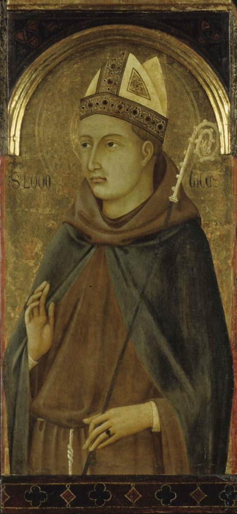
  <figcaption>Ugolino di Nerio, <em>Saint Louis of Toulouse</em>, c. 1320. Tempera and gold leaf on wood panel, 75.6 × 35.6 cm. San Francisco, Fine Arts Museums, Legion of Honor, 1952.36; gift of Arthur Sachs. Image: public domain, via Web Gallery of Art.</figcaption>
</figure>

<figure>
  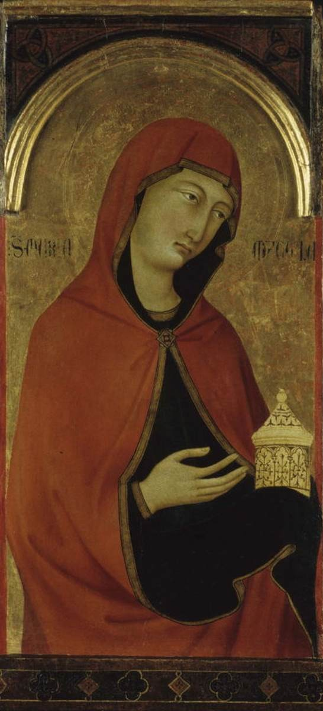
  <figcaption>Ugolino di Nerio, <em>Saint Mary Magdalene</em>, c. 1320. Tempera and gold leaf on wood panel, 75.6 × 35.6 cm. San Francisco, Fine Arts Museums, Legion of Honor, 1952.37; gift of Arthur Sachs. Image: public domain, via Web Gallery of Art.</figcaption>
</figure>

The two panels, each 75.6 by 35.6 centimetres, are lateral compartments of the same altarpiece, given to the Fine Arts Museums of San Francisco by Arthur Sachs. The saints turn inward towards the lost centre, probably a Virgin and Child: Louis of Toulouse looks to the left, the Magdalene to the right, so that they stood on opposite sides of the central panel. Each is named by an inscription in gold on the ground beside the head.

Both panels keep their round arches, with dark spandrels above and a band of quatrefoils and lozenges below. The round arch is the form Ugolino used in his early altarpieces, before he adopted the pointed and ogival arches of Santa Croce and Brolio.

Louis of Toulouse, young and beardless, wears the bishop's mitre set with jewels over the brown habit and hood of the Franciscan friars, with a dark cope over his shoulders. The contrast between the humble habit and the episcopal mitre expresses his renunciation of the Angevin throne for the order and his brief appointment as bishop of Toulouse. He blesses with his right hand and holds a crozier; the knotted cord of the order hangs at his waist.

Louis was canonised in 1317, and his presence gives the altarpiece a date after that year. The panel is close in type to the Louis of the Williamstown polyptych, but the figure is turned more strongly and the cope is plain rather than patterned with fleurs-de-lis.

The Magdalene, wrapped in a red mantle drawn over her head and closed at the neck, wears a black dress beneath. She holds a small gilded box with a pointed lid, decorated with foliate ornament, which the museum identifies as an ivory pyx, a container for ointments and cosmetics. Here it alludes to her anointing of Christ's feet and to the spices she brought to the tomb.

Her long oval face, narrow eyes and inclined head repeat the type of Ugolino's early Madonnas, and her hand, raised towards the box, has the same long, tapering fingers. The red of her mantle against the gold and the black of her dress give the figure a sober, intense colouring.

The pairing of a Franciscan bishop and the Magdalene, a model of penitence dear to the order, points to a Franciscan church. The same pairing recurs in the Cleveland polyptych, where Francis and the Magdalene flank the Virgin, and it belongs to the series of altarpieces Ugolino painted for Franciscan communities around 1320.

The reproductions are of modest resolution. As far as they allow a judgement, the panels are in good condition, with the gold, the inscriptions and the colours well preserved, and the frames retaining their original arches and lower bands.

### Saint Mary Magdalen (Boston, Museum of Fine Arts)

<figure>
  
  <figcaption>Ugolino di Nerio, <em>Saint Mary Magdalen</em>, about 1320. Tempera on panel, 36.5 × 24.8 cm. Boston, Museum of Fine Arts, 15.952; gift of Mrs. Walter Scott Fitz. Image: <a href="https://www.mfa.org">Museum of Fine Arts, Boston</a>, for non-commercial educational use.</figcaption>
</figure>

The panel, 36.5 by 24.8 centimetres, is a fragment of a lateral compartment of a polyptych, cut on all sides. The halo is cropped at the top and left, and at the lower edge the lid of a small ointment jar is just visible, the attribute that identifies the saint as Mary Magdalen together with the letter *M* painted beside her head.

The saint is shown at bust length, wrapped in a red mantle edged with a gold band, drawn over her head and falling over a red dress with a gold neckline. The red of mantle and dress, unbroken except for the black of the inner lining and the dark hair beside her face, makes the figure a single mass of colour against the gold.

Her head is inclined to the left, her eyes lowered, her mouth closed in an expression of quiet sorrow. The long oval of the face, the narrow eyes and the long straight nose belong to the type of Ugolino's Madonnas of around 1320, and the hand raised at the lower left, with its long, separated fingers, has the same elegance.

The figure turns to the left, towards the place where the central image would have stood, which means that the panel was set to the right of the centre. As a mourning witness of the Passion and a model of penitence, the Magdalen was a frequent presence in Franciscan altarpieces, and she appears in this role in the Cleveland polyptych and among the saints in San Francisco.

The Museum of Fine Arts accessioned the panel in 1915 as a work by Segna di Buonaventura, the name under which it was given by Mrs. Walter Scott Fitz. It had been sold to her that year by Philip Gentner of Worcester, Massachusetts. The attribution to Ugolino is now accepted, and the museum regards the quality of the head as evidence of the master's own hand rather than of his workshop.

The comparison with the Magdalen in San Francisco is instructive. In both, the red mantle is drawn over the head and edged with gold, and the face is turned in three-quarter view; but the Boston figure is more intimate in scale and expression, the head larger in relation to the field, the sorrow more concentrated.

The single letter *M*, painted in black Gothic script on the gold at the right of the head, is what remains of an inscription that named the saint across the ground, as on the panels in San Francisco and Williamstown. The rest, at the left, was lost when the panel was cut down.

The paint surface is covered with a dense network of cracks, especially in the red mantle and the flesh, and the gold ground is worn and scratched. The face, the hand and the colours are otherwise well preserved.

### Madonna and Child (Princeton, Princeton University Art Museum)

<figure>
  
  <figcaption>Attributed to Ugolino di Nerio, <em>Madonna and Child</em>. Tempera on wood panel, 79.5 × 56 × 5 cm. Princeton, Princeton University Art Museum, y1937-357; gift of Dan Fellows Platt, Class of 1895. Image: Princeton University Art Museum, public domain.</figcaption>
</figure>

The panel, 79.5 by 56 centimetres, was the central compartment of a polyptych, now framed as an independent image under a round arch. It came to the Princeton University Art Museum as a gift of Dan Fellows Platt, a collector of early Italian painting, and the museum catalogues it as attributed to Ugolino di Nerio.

The Virgin, half-length, is wrapped in a dark blue mantle with a gold star on the shoulder, edged with a red lining, over a white veil. She inclines her head to the right, towards the Child, but her gaze is directed outwards to the viewer, with a melancholy expression. The type, with its long oval face, narrow eyes and long nose, is that of Ugolino's Madonnas.

The Child departs from the formula of the other Madonnas. He does not pull the veil or turn to his mother, but faces the viewer directly, with a solemn, almost sullen expression, and holds a small object at his breast. Naked to the waist, he has a white cloth over one shoulder and a dark red cloth wrapped around his hips; his bare feet, crossed, rest in his mother's hand at the lower edge.

The frontal gaze of the Child recalls the Metropolitan Madonna, in which he also turns outwards. Both versions present the Child as a figure to be contemplated rather than as a participant in a scene of tenderness, an emphasis closer to the Byzantine Hodegetria than to the Madonnas with the veil.

The haloes, now hard to read on the worn gold, are decorated with fine incised scrolls rather than dense punching, a feature of Ugolino's earlier works. The round arch and the incised haloes would place the panel in the years around 1320.

The attribution is less secure than for the Madonnas in New York, Paris and Boston. The flesh has lost its pink glazes, leaving a greenish tone that hardens the faces, and the losses in the surface make the modelling difficult to judge. The composition and the types are Ugolino's, but the execution may involve his workshop.

Within the catalogue the panel shows the second of the two formulas Ugolino used for his central Madonnas: the Child turned outwards to the viewer, as in New York and Princeton, rather than the Child pulling his mother's veil, as in the Tadini, Louvre and Boston panels.

The panel is in poor condition. The gold ground is heavily cracked and worn, the dark blue mantle has lost its modelling, and the flesh tones have lost their glazes. The red cloth of the Child and the gold star on the Virgin's shoulder are better preserved.

### Virgin and Child with Saints Francis, Andrew, Paul, Peter, Stephen and Louis of Toulouse (Williamstown, Clark Art Institute)

<figure>
  
  <figcaption>Ugolino di Nerio, <em>Virgin and Child with Saints Francis, Andrew, Paul, Peter, Stephen, and Louis of Toulouse</em>, c. 1317–21. Tempera and gold on panel, 163.7 × 341.4 cm. Williamstown, Massachusetts, Clark Art Institute, 1962.148; acquired by the Clark, 1962. Image: Clark Art Institute, for educational use only.</figcaption>
</figure>

The altarpiece is one of the few Sienese polyptychs of the early fourteenth century to survive complete, with its seven main panels, its seven pinnacles and much of its original carpentry. It measures 163.7 by 341.4 centimetres; the central panel is 59.5 centimetres wide, the lateral panels 129.3 by 40 centimetres. Its original church is not known, but its saints point to a Franciscan house.

The main tier presents the Virgin and Child at the centre and six saints at half length, each named by an inscription in gold letters on the ground at either side of the head: *S. Franciscus*, *S. Andreas* and *S. Paulus* at the left, *S. Petrus*, *S. Stephanus* and *S. Lodovicus* at the right. Francis and Louis of Toulouse, the founder of the order and its most recent saint, stand at the outer ends, so that the Franciscan identity of the altarpiece frames the whole tier.

The Virgin, wrapped in a dark blue mantle over a pink veil, holds the Child on her left arm. He sits wrapped in a red cloth, his bare legs crossed, his foot resting on her arm, and looks up at her; she inclines her head and looks out towards the viewer. The type is that of the Metropolitan and Louvre Madonnas, but the Child turns more decisively and the figures have greater freedom of movement.

Louis of Toulouse, at the far right, wears the bishop's mitre and a cope patterned with gold fleurs-de-lis, the arms of his Angevin family, over the brown habit and knotted cord of a Franciscan friar. The combination records his renunciation of the throne of Naples for the order. Stephen, beside him, wears the patterned dalmatic of a deacon, and both carry their attributes with the restraint of Ugolino's early style.

The pinnacles hold Christ blessing at the centre and six prophets with scrolls. Their texts announce the Incarnation and can be partly read: Moses' scroll repeats the burning bush of Exodus 3:2, David's the promise of Psalm 132:11, and Daniel's the stone cut from the mountain without hands of Daniel 2:45, while a scroll at the left begins with the words of Isaiah 7:14, *Ecce virgo concipiet*, and another carries *Vidi portam*, the closed gate of Ezekiel 44:2. Several of these prophets and texts recur in the pinnacles of Santa Croce a few years later, showing that Ugolino kept a programme of Marian prophecies for the upper tiers of his altarpieces.

In the spandrels of every arch two small angels lean towards the saints, as on the Santa Croce panels and their London fragments. The device, which may derive from Duccio's polyptych for San Domenico in Perugia, gives the whole main tier a celestial frame and a regular rhythm across its seven compartments.

The saints follow a deliberate variety of colour and type: the brown of Francis and Louis at the ends, the red of Andrew, the dark blue of Paul, the green of Peter, the pink of Stephen. Old and young, bearded and beardless alternate, a principle that Ugolino applied on a larger scale in the middle tier of Santa Croce.

The polyptych is in good condition for a work of its size and age. The gold, the colours and the inscriptions are well preserved, and the frame retains its columns, arches and pinnacles; there are local losses in the gold and the faces show the greenish underpaint where the flesh glazes have worn.

### Virgin and Child with Saints Francis, John the Baptist, James and Mary Magdalene (Cleveland, Cleveland Museum of Art)

<figure>
  
  <figcaption>Ugolino di Nerio, <em>Virgin and Child with Saints</em>, c. 1320. Tempera and gold on wood panel, 122.5 × 192.5 cm overall (framed 122.2 × 200.3 cm). Cleveland, Cleveland Museum of Art, Leonard C. Hanna Jr. Fund, 1961.40. Image: Cleveland Museum of Art, open access, <a href="https://creativecommons.org/publicdomain/zero/1.0/">CC0</a>.</figcaption>
</figure>

The polyptych, 122.5 by 192.5 centimetres, survives with its five main panels, its five gables and much of its frame. Smaller than the Williamstown altarpiece, it has the same basic structure: a central Virgin and Child flanked by saints at half length under round arches, with a row of gables above. Its original church is unknown.

The saints are named by inscriptions in gold on the ground at either side of their heads. At the left stand Saint Francis, in his brown habit, holding a red book and raising his hand to his breast, and Saint John the Baptist, in a hair shirt under a pink mantle, holding a tall reed cross and gesturing towards the centre. At the right are Saint James the Greater, in a green mantle, raising his hand in blessing, and Saint Mary Magdalene, in a red mantle, holding her ointment jar.

The Magdalene's jar is shaped like a small domed building, white and turreted, a refined detail that turns her attribute into a reliquary-like object. Her red mantle drawn over her head and her melancholy face are painted with particular delicacy.

At the centre the Virgin, wrapped in a dark blue mantle with a gold star on the shoulder, inclines her head towards the Child. He wears a red tunic under a mantle patterned in gold and reaches up to touch her cheek, while she supports his bare feet with her long hand. The gesture, taken from Duccio's Madonnas, is one Ugolino used in the London *Virgin and Child with Four Angels*.

The central gable shows the Crucifixion, a small figure of Christ on a cross planted on the rock of Golgotha against the gold. The four lateral gables hold half-length apostles with books, among them Paul with his sword at the left and Peter at the right. The Crucifixion above the Virgin anticipates the arrangement of Santa Croce, where the Crucifixion crowned the central axis.

The frame is painted red, with bands of quatrefoils on the outer moulding and decorated spandrels above the arches. Its colour, unusual beside the gilded frames of Santa Croce and Williamstown, is probably the result of the loss of the gilding over the red bole, which now shows over most of the carpentry.

The Franciscan presence, with Francis at the left and the Magdalene, a model of penitence dear to the order, at the right, places the altarpiece in the series that Ugolino painted for Franciscan communities around 1320. The choice of James may reflect a dedication or the name of a donor.

The paint surface is well preserved, with fine cracks across the gold and the flesh. The colours of the saints' mantles are intact, while the dark blue of the Virgin's mantle has darkened and lost some of its modelling.

### Virgin and Child (Boston, Museum of Fine Arts)

<figure>
  
  <figcaption>Ugolino di Nerio, <em>Virgin and Child</em>, about 1325–30. Tempera on panel, 81.4 × 52.1 cm. Boston, Museum of Fine Arts, 16.65; gift of Mrs. Walter Scott Fitz. Image: <a href="https://www.mfa.org">Museum of Fine Arts, Boston</a>, for non-commercial educational use.</figcaption>
</figure>

The panel, 81.4 by 52.1 centimetres, was probably the central compartment of a polyptych whose lateral saints are lost. It is now framed as an independent image under a round arch, a shape and frame that may date from the seventeenth century. An inscription on the back records a restoration of that period: *Questa Madonna del soccorso restavro il prete Angelo Sirigatti lanno 1630*, "The priest Angelo Sirigatti restored this Madonna of Mercy in the year 1630".

The inscription shows that in the seventeenth century the panel was venerated as a "Madonna del Soccorso", a miracle-working image of the Virgin who comes to the aid of the faithful, and that it was then refitted and regilded for its new role. Much of the present gilding is modern. The Rome dealer Rodolfo Colafranceschi sold it in 1916, through Philip Gentner of Worcester, to Mrs. Walter Scott Fitz, who gave it to the museum the same year.

The Virgin, wrapped in a dark blue mantle with gold stars on her forehead and shoulder, inclines her head and looks out at the viewer. Under the mantle, edged with a red lining, she wears a white veil bordered with a band of pseudo-Kufic lettering, the ornament of the Metropolitan and Louvre Madonnas. Her long, oval face and narrow eyes keep the type of the earlier panels.

The Child sits on her left arm, wrapped in a red cloth patterned with small gold motifs over a transparent white shirt. He pulls the edge of her veil with both hands and looks up at her, the motif of the Tadini Madonna and of the San Giovanni d'Asso triptych. His bare foot rests on his mother's hand, whose long fingers frame it.

The haloes differ markedly from those of the early Madonnas. They are densely punched with rosettes and bands of foliate motifs on a stippled ground, the decoration that Ugolino adopted around 1320 and used in all his mature works. Together with the fuller forms of the Child, this supports the museum's date of about 1325–30, the period of Santa Croce.

The Virgin's right hand, placed horizontally beneath the Child's foot, and her left, laid flat beneath his body, are drawn with long, tapering fingers. The gesture of support, without grasping, gives the group the weightless poise characteristic of Ugolino's Madonnas.

Set beside the other Madonnas of the catalogue, the Boston panel shows how the same model, the Child pulling the veil, was repeated across two decades, from the Tadini Madonna to San Casciano, with changes mainly in the decoration of the haloes and the treatment of drapery.

The paint surface is in good condition, apart from the modern regilding of the ground and frame. The faces, the veil with its lettering and the patterned cloth of the Child are well preserved, and the blue of the mantle keeps much of its modelling.

### The Santa Croce altarpiece in an eighteenth-century drawing (Vatican City, Biblioteca Apostolica Vaticana)

<figure>
  
  <figcaption>Anonymous, <em>The high altarpiece of Santa Croce, Florence</em>, late eighteenth century. Drawing. Vatican City, Biblioteca Apostolica Vaticana, Vat. Lat. 9847, ff. 91v–92r. Image: public domain, via Wikimedia Commons.</figcaption>
</figure>

The drawing records the Santa Croce altarpiece as a whole, before its dismemberment, and is the reference for every reconstruction of it. It is reproduced here as the key to the panels catalogued in the entries that follow, now divided between London, Berlin, New York and Philadelphia.

The structure has four tiers. The main tier shows the Virgin and Child at the centre, between three saints on each side under pointed arches with angels in the spandrels. Above it runs a row of six panels with paired half-length saints, each with twin arches and a trefoil; above these rise six gabled pinnacles with prophets and, at the centre, a tall gable. Along the bottom runs the predella with seven scenes.

The predella can be read in full and matches the surviving panels exactly: the *Last Supper* in New York, the *Betrayal* in London, the *Flagellation* in Berlin, the *Way to Calvary* in London at the centre, the *Deposition* in London, the *Entombment* in Berlin and the *Resurrection* in London. The compositions are recognisable down to details such as the column of the *Flagellation* and the sleeping soldiers of the *Resurrection*.

In the main tier the Baptist and Paul stand to the left of the centre and Peter to the right, as in the three panels in Berlin; the Baptist holds his long scroll and Paul his raised sword. At the far right a mitred bishop with a crozier is Saint Louis of Toulouse. The compartment beside Peter shows only a tonsured head on an otherwise blank field, and the outer compartment at the left is effaced: the drawing records panels already damaged, which explains why some of them were discarded when the altarpiece was cut up.

The central Virgin, half-length, holds the standing Child, who turns towards the viewer. The panel, which would have carried the signature, is the principal lost element of the altarpiece. In the drawing its lower part is shaded and indistinct, and the faint marks along its base cannot be read at this scale.

The middle tier shows the twelve figures of the paired panels, among them, at the outer ends, two women saints with veils, in the positions that the reconstruction assigns to Clare and Elizabeth of Hungary. The pinnacles show five prophets with scrolls; the first at the left is faded, and the central gable, where the Crucifixion stood, is blank above a faint scene.

The drawing simplifies the frame, which it renders as a regular grid of piers, arches and cornices, and it adjusts the proportions of the figures. Its value lies in the order of the panels rather than in their appearance: it fixes the sequence of the predella and the positions of the saints and prophets, which technical study of the surviving panels has confirmed.

The reproduction is a scan of a printed photograph of the drawing, at a resolution that does not allow inscriptions to be read. It serves here as a plan of the altarpiece, against which the panels catalogued in the following entries can be located.

### The Last Supper, from the predella of the Santa Croce altarpiece (New York, The Metropolitan Museum of Art)

<figure>
  
  <figcaption>Ugolino di Nerio, <em>The Last Supper</em>, from the predella of the high altarpiece of Santa Croce, Florence, c. 1325. Tempera and gold on wood, painted surface 34.3 × 52.7 cm. New York, The Metropolitan Museum of Art, Robert Lehman Collection, 1975.1.7. The Metropolitan Museum of Art, open access, <a href="https://creativecommons.org/publicdomain/zero/1.0/">CC0</a>.</figcaption>
</figure>

The panel was the first scene of the predella, at its left end, and opened the Passion cycle that ran beneath the main tier of the altarpiece. It measures 34.3 by 52.7 centimetres in its painted surface, within a modern engaged frame, and is the only part of the Santa Croce altarpiece in an American collection besides the Philadelphia *Daniel*. It came to the Metropolitan Museum with the Robert Lehman Collection in 1975.

The scene is set in a shallow room closed by a grey wall, a dark coffered ceiling and a side wall at the right pierced by a narrow window. Two pegs on the back wall carry a rod from which hangs a striped towel, the cloth with which Christ will wash the disciples' feet in the episode that follows in the Gospel of John. The table, set parallel to the picture plane and covered with a white cloth, runs almost the whole width of the panel.

Christ stands at the far left, in a red robe and a dark mantle, and leans towards the table. John, the youngest apostle, rests his head on the table at Christ's side, a figure taken from the Gospel account of the beloved disciple leaning on Jesus' breast. Behind the table six apostles sit in a row: Peter, white-haired, raises his hand in protest; others look at one another or hold food, one cutting a fruit with a knife.

In front of the table five apostles kneel on a long wooden bench, seen from behind, turning their heads towards Christ. The first, closest to him and the only one without a halo, is Judas. The device of placing apostles with their backs to the viewer, already used by Duccio in the *Maestà*, creates a second row of figures that frames the table and draws the eye along it towards Christ.

The moment represented is the announcement of the betrayal, and Ugolino distributes the reactions along the table. Peter's raised hand and the turned heads of the kneeling apostles answer Christ's words, while those at the far end, further from him, continue to eat and drink, one holding a red glass, another a fruit. The narrative thus moves from shock near Christ to unawareness at the edge of the scene, a gradation that gives the long, narrow format its rhythm.

The haloes are punched with rosettes and small motifs against a stippled ground, the decoration that Ugolino adopted after Polyptych 39 and used in all his mature works. Each halo of the front row overlaps the edge of the table and the figures behind, so that the punched gold becomes a means of marking depth as well as sanctity.

The colours are bright and contrasted: the red, green and blue of the mantles alternate across both rows, so that no two neighbours wear the same colour. The faces are individualised, with the long noses, heavy brows and furrowed cheeks of Ugolino's apostles, close to the paired saints of the middle tier now in Berlin and London.

The panel is cracked at the lower left, where a split runs diagonally through Christ's mantle and the bench, and there are small losses at the edges, where the predella was sawn into separate scenes. The colours and the gold are otherwise well preserved.

### The Betrayal of Christ, from the predella of the Santa Croce altarpiece (London, National Gallery)

<figure>
  
  <figcaption>Ugolino di Nerio, <em>The Betrayal of Christ</em>, from the predella of the high altarpiece of Santa Croce, Florence, possibly 1325–8. Egg tempera on wood (probably poplar), 40.4 × 58.8 cm. London, National Gallery, NG1188; bought 1885. © The National Gallery, London, <a href="https://creativecommons.org/licenses/by-nc-nd/4.0/">CC BY-NC-ND 4.0</a>.</figcaption>
</figure>

The panel was the second scene of the predella, between the *Last Supper* now in New York and the *Flagellation* in Berlin. It preserves its original fourteenth-century frame, a simple gilded moulding that once separated the scenes on the single plank of the predella before it was sawn apart.

The composition follows the scene of the same subject on the back of Duccio's *Maestà*, with fewer figures. The crowd is compressed into a dense frieze before a gold sky, above a bare, pale landscape of sloping rock with three dark trees, so that the gold reads as a night sky lit only by the lanterns of the soldiers.

At the centre Judas, in a yellow robe and a red mantle, leans forward to kiss Christ on the cheek, the agreed sign by which the soldiers were to recognise him. Christ stands upright and still, wrapped in a dark blue mantle, his gaze fixed on his betrayer. The calm of his figure, framed by the agitation around him, is the expressive centre of the scene.

At the left Peter, white-haired and white-bearded, seizes a man by the head and cuts off his ear with a knife, the episode of Malchus, the high priest's servant. Behind him stand the bearded elders and priests of the Temple, and in the background a few apostles look on. The violence of Peter's gesture answers the stillness of Christ, who in the Gospel orders him to put away his sword.

At the right the soldiers close in. Their dark helmets were originally covered in silver leaf, now oxidised to grey-black, and they wear chain-mail hoods. One of them, in a moulded leather cuirass with decorative scrolls, lays his hand on Christ's arm. Above their heads rise spears, halberds and two lanterns with red flames, a detail taken from the account of the arrest in the Gospel of John.

The eyes of several soldiers were scratched out before the panel entered the National Gallery, probably deliberately by a devout owner or viewer, a common fate of the figures of Christ's tormentors in medieval narrative painting. The damage, now retouched, is visible on close inspection of the faces at the right.

The colour is varied and luminous: the green, red, yellow and blue of the apostles' mantles at the left are answered at the right by the browns and greys of the soldiers' armour. The faces of the elders, with their long curling beards and furrowed brows, show Ugolino's interest in individual characterisation.

The panel is in good condition, with the gold, the colours and the frame well preserved. A fine network of cracks runs across the paint surface, and the silver of the helmets has darkened.

### The Flagellation, from the predella of the Santa Croce altarpiece (Berlin, Gemäldegalerie)

<figure>
  
  <figcaption>Ugolino di Nerio, <em>The Flagellation</em>, from the predella of the high altarpiece of Santa Croce, Florence, c. 1325. Tempera on poplar, 40.6 × 58.4 cm with frame. Berlin, Staatliche Museen, Gemäldegalerie, 1635A; acquired on the English art market, 1906. Photo: Staatliche Museen zu Berlin, Gemäldegalerie / Jörg P. Anders, <a href="https://creativecommons.org/publicdomain/mark/1.0/">Public Domain Mark 1.0</a>.</figcaption>
</figure>

The panel was the third scene of the predella, between the *Betrayal* and the central *Way to Calvary*, both in London. It entered the Gemäldegalerie in 1906 from the English art market, together with the *Entombment*, and keeps its gilded frame.

The scene is set in a shallow interior, a box-like room with a dark green back wall divided into three panels, a ceiling patterned with dark lozenges and pale corner consoles at either side. The architecture, reduced to a stage closed on three sides, gives the figures a measurable space and recalls the interiors of Duccio's narrative scenes on the *Maestà*.

Christ stands at the centre, naked but for a white loincloth, his wrists bound to a slender white column with a small capital. He does not struggle or flinch but looks out at the viewer with a sorrowful, steady gaze, the only figure in the predella to address the onlooker so directly. His thin body, with its long legs and narrow shoulders, is modelled in pale, greenish flesh tones.

Two tormentors flank him. Each raises a scourge high above his head, one in a red tunic, the other in a violet tunic, and their bodies twist in opposite directions, so that their arms form a symmetrical frame around Christ. The man at the right seizes Christ's arm and leans back to give force to his blow, his face set in a grimace.

The composition is strictly symmetrical: the column, Christ and the central panel of the wall form the axis, and the two tormentors answer each other at the sides. The symmetry gives the brutal scene an almost ceremonial order, which suits its place at the centre-left of the predella, beside the *Way to Calvary*.

The tormentors' coarse features, rough hair and bare legs contrast with the refinement of Christ's figure. Ugolino gives them heavy, individual faces, close to those of the soldiers and servants in the London scenes.

The column, painted white with a delicate capital and base, stands in front of Christ rather than behind him, so that he seems to embrace it. The detail, found also in Duccio's version of the subject, makes the column a visible instrument of the Passion, venerated in Rome as a relic.

The panel is in good condition. The colours are well preserved; the gold of the frame and of Christ's halo is slightly worn, and fine cracks run across the paint.

### The Way to Calvary, from the predella of the Santa Croce altarpiece (London, National Gallery)

<figure>
  
  <figcaption>Ugolino di Nerio, <em>The Way to Calvary</em>, from the predella of the high altarpiece of Santa Croce, Florence, possibly 1325–8. Egg tempera on wood (probably poplar), 40.8 × 58.5 cm. London, National Gallery, NG1189; bought 1885. © The National Gallery, London, <a href="https://creativecommons.org/licenses/by-nc-nd/4.0/">CC BY-NC-ND 4.0</a>.</figcaption>
</figure>

The panel stood at the centre of the predella, the fourth of seven scenes, between the *Flagellation* in Berlin and the *Deposition* in London. Like the other London predella scenes, it keeps its original gilded frame. The great cross that Christ carries rises diagonally across the gold sky at the centre of the composition.

Christ, stripped of the blue mantle he wore in the *Betrayal*, walks to the right in a deep pink robe, the cross on his shoulder. A man in a short brown tunic pulls him forward by a rope tied around his neck, while soldiers behind push him on. Christ turns his head back, against the direction of the march, towards his mother.

Ugolino's composition derives from Duccio's scene on the *Maestà*, but he moves Christ further to the right, so that the turn of his head towards the Virgin crosses the whole width of the panel. The distance between mother and Son, filled by the soldiers' armour, becomes the measure of the emotion of the scene.

At the left the Virgin, wrapped in a dark mantle, raises her hand to her face in grief. She is accompanied by two holy women, one in violet and one in red, probably two of the Marys named in the Gospels; the one in red may be Mary Magdalene. The Virgin's mantle was painted with ultramarine, which has darkened over time to an almost black blue.

The soldiers wear moulded leather cuirasses decorated with scrolls, coloured hose and boots, and their helmets, like those in the *Betrayal*, were once silvered and are now dark. One carries a large shield, decorated in relief. Behind Christ, at the right, the bearded elders and priests who had been present at his arrest follow the procession, and an old man in a violet mantle at the far right gestures towards the rocks of Golgotha.

The prominence of the cross on the central axis of the predella suited a church dedicated to the Holy Cross. The scene stood directly beneath the central panel of the altarpiece, and above that, at the top of the structure, was the Crucifixion, so that a vertical line linked the procession, the enthroned Virgin and Christ on the cross.

The figures are densely packed and overlap in several layers, the soldiers' heads forming a row of dark helmets against the gold. Ugolino uses colour to separate them: the pink of Christ's robe, isolated at the centre, is the brightest area of the picture.

The panel is well preserved, with a network of cracks in the gold of the sky and small losses at the edges. The ultramarine of the Virgin's mantle and the silver of the helmets have darkened.

### The Deposition, from the predella of the Santa Croce altarpiece (London, National Gallery)

<figure>
  
  <figcaption>Ugolino di Nerio, <em>The Deposition</em>, from the predella of the high altarpiece of Santa Croce, Florence, possibly 1325–8. Egg tempera on wood (probably poplar), 40.7 × 58.6 cm. London, National Gallery, NG3375; presented by Henry Wagner, 1918. © The National Gallery, London, <a href="https://creativecommons.org/licenses/by-nc-nd/4.0/">CC BY-NC-ND 4.0</a>.</figcaption>
</figure>

The panel was the fifth scene of the predella, following the *Way to Calvary* and preceding the *Entombment* in Berlin. The cross stands slightly to the right of centre, against a gold ground, between steep, bare rocks of a cold green. The arid landscape evokes Golgotha, the place of the skull.

The body of Christ is being lowered from the cross. A white-haired man stands on a ladder behind it, holding the body under the arms; he is probably Joseph of Arimathea, who according to Luke removed Christ from the cross. Below, a bearded man kneels and draws the nails from the feet with pincers, perhaps Nicodemus, who in John's Gospel came to the cross with spices for the burial.

The body, pale and limp, slumps forward from the cross into the arms of the Virgin, who receives it and presses her face against her Son's. The gesture, cheek to cheek, is the emotional core of the scene. John, in a red mantle, embraces Christ's legs and looks up at him in grief.

At the left Mary Magdalene, in a bright red mantle, takes Christ's hand and presses it to her cheek, while two other holy women stand behind her. A woman in green between the Magdalene and the Virgin is barely visible: her head, between the haloes, is painted over the gold ground, a sign that she was added late in the work, after the gilding had been laid.

Blood flows from the wound in Christ's feet down the shaft of the cross and pools on the ground below, rendered in bright red against the green rock. The detail insists on the physical reality of the sacrifice, in keeping with the Passion programme of the whole predella.

As in the other predella scenes, Ugolino based his design on Duccio's *Maestà*, but reduced the number of figures, omitting two of the women present in Duccio's version. The concentration on a few figures gives each gesture greater weight.

The colours are strong and contrasted: the reds of the Magdalene and John, the dark blue of the Virgin and the violet and green of the other women stand out against the gold and the cold green of the rocks. The faces are drawn with fine lines and modelled in greenish shadows.

The panel is in good condition. A network of cracks covers the gold and the paint, and there are small losses along the edges of the frame, which survives in a fragmentary state.

### The Entombment, from the predella of the Santa Croce altarpiece (Berlin, Gemäldegalerie)

<figure>
  
  <figcaption>Ugolino di Nerio, <em>The Entombment</em>, from the predella of the high altarpiece of Santa Croce, Florence, c. 1325. Tempera on poplar, 40.8 × 58 cm with frame. Berlin, Staatliche Museen, Gemäldegalerie, 1635B; acquired on the English art market, 1906. Photo: Staatliche Museen zu Berlin, Gemäldegalerie / Jörg P. Anders, <a href="https://creativecommons.org/publicdomain/mark/1.0/">Public Domain Mark 1.0</a>.</figcaption>
</figure>

The panel was the sixth scene of the predella, between the *Deposition* and the *Resurrection*, both in London. With the *Flagellation*, it came to Berlin from the English art market in 1906.

Christ's body, wrapped in a white shroud that falls in soft folds, is being laid in a stone sarcophagus with panelled sides, seen from a slight angle so that its length runs across the panel. The rocky landscape behind, in brown terraces, closes the scene like a wall, as in the *Resurrection*.

At the left John, in a red mantle, supports Christ's head. The Virgin, wrapped in a dark mantle, bends over the body and presses her face against her Son's, the same gesture with which she received him in the *Deposition*. At the centre an old bearded man in a blue mantle, probably Joseph of Arimathea, lowers the body by the shroud into the tomb.

Behind the sarcophagus the holy women give way to grief. One covers her face with her hand, another weeps, and a woman in red at the back, her face hidden, flings both arms upward in lament, a gesture of open despair rare in Sienese painting of the period. At the right a woman in green and a bearded man in red, perhaps Nicodemus, watch in silence.

The composition follows the corresponding scene on Duccio's *Maestà* closely, more than any other part of the predella. The arrangement of the figures along the tomb, the Virgin's embrace and the raised arms of the mourner derive directly from Duccio.

The haloes form a row of punched gold discs above the heads, overlapping each other and the rocks, and the sequence of their curves gives rhythm to the dense group of mourners. The colours, dark blue, red, green and orange, are set against the warm brown of the landscape and the pale stone of the tomb.

The scene concentrates on the bodily contact between mother and Son, repeated across three successive panels, the *Deposition*, the *Entombment* and, by contrast, the *Resurrection*, in which Christ rises alone. The sequence gives the right half of the predella its narrative unity.

The panel is well preserved, with fine cracks over the whole surface, small losses along the frame and slight wear in the gold of the haloes.

### The Resurrection, from the predella of the Santa Croce altarpiece (London, National Gallery)

<figure>
  
  <figcaption>Ugolino di Nerio, <em>The Resurrection</em>, from the predella of the high altarpiece of Santa Croce, Florence, possibly 1325–8. Egg tempera on wood (probably poplar), 41.5 × 58.1 cm. London, National Gallery, NG4191; presented by Viscount Rothermere, 1926. © The National Gallery, London, <a href="https://creativecommons.org/licenses/by-nc-nd/4.0/">CC BY-NC-ND 4.0</a>.</figcaption>
</figure>

The panel was the seventh and last scene of the predella, at its right end, after the *Entombment* in Berlin. It closed the Passion cycle with the triumph over death towards which the whole programme of the altarpiece pointed.

Christ steps out of a white marble sarcophagus, one bare foot on its rim, the other still inside. He is naked to the waist and wrapped in a pale violet mantle, and holds a long staff with the white banner of the Resurrection, marked with a red cross. His frontal pose and steady gaze give him the stillness of an icon, in contrast to the slumped figures below.

The lid of the tomb lies askew behind him, leaning against the rocks. The sarcophagus is shown as a plain rectangular chest with panelled sides, set obliquely to the picture plane, so that its open interior is visible from above. The rocky landscape behind, in steep brown terraces, closes the space like a wall.

In the foreground four soldiers, the guards of the tomb, sleep on the ground. They wear chain-mail hoods and tunics of yellow, pink, green and red, and rest against their round shields, which were covered in silver leaf, now darkened. Their sleep, with heads bowed or thrown back, shows that the Resurrection happened beyond their power to prevent or witness it.

Duccio's *Maestà* has no surviving scene of the Resurrection, so this panel offers an idea of how a Sienese painter of Duccio's circle treated the subject. The composition, with the risen Christ standing in or on the tomb above the sleeping soldiers, is close to that of contemporary tomb sculpture in Siena and Florence, suggesting that a standard image of the subject was already established.

The colours of the soldiers' tunics form a sequence across the foreground, while the pale violet of Christ's mantle and the white of the tomb concentrate the light at the centre. The figures of the soldiers, foreshortened and intertwined, show Ugolino's attempt to render bodies lying in depth.

The scene answers the *Betrayal* at the other end of the predella. There the soldiers seized Christ in the night; here, in the same armour and helmets, they lie powerless while he rises, so that the first and last scenes of the arrest and the triumph frame the cycle between them.

The panel is in good condition, with fine cracks across the paint, small losses in the gold at the upper corners and darkened silver on the shields.

### Saints John the Baptist, Paul and Peter, from the main tier of the Santa Croce altarpiece (Berlin, Gemäldegalerie)

<figure>
  
  <figcaption>Ugolino di Nerio, <em>Saints John the Baptist, Paul and Peter</em>, from the main tier of the high altarpiece of Santa Croce, Florence, c. 1325. Tempera on poplar; outer frame 191.6 × 61.5 cm. Berlin, Staatliche Museen, Gemäldegalerie, 1635; acquired on the English art market with the collection of Cyril B. Harcourt, London. Photo: Staatliche Museen zu Berlin, Gemäldegalerie / Jörg P. Anders, <a href="https://creativecommons.org/publicdomain/mark/1.0/">Public Domain Mark 1.0</a>.</figcaption>
</figure>

The three panels are the only surviving saints of the main tier, which originally had three saints on each side of the lost Virgin and Child. The Baptist and Paul stood at the left of the centre, Peter at the right; the panels of Saint Francis and Saint Louis of Toulouse, at the outer ends, are lost, though their spandrel angels survive in London. Each panel keeps a pointed arch, with two angels in the spandrels, and above the Baptist and Paul survives a band of quatrefoils with small busts of prophets.

The saints are shown at nearly full length, larger than any other figures of the altarpiece except the lost Virgin. They stand against gold grounds within their arches, turned slightly towards the centre, and each is identified by his attributes rather than by inscription.

Saint John the Baptist, gaunt and long-haired, wears a hair shirt under a red mantle. He points to himself with his right hand and holds an unrolled scroll inscribed with his words from the Gospel of John:

> Ecce agnus dei, ecce qui tollit peccata mundi. Hic est de quo dixi: post me venit vir qui ante me factus est, quia prior me erat
>
> "Behold the Lamb of God, who takes away the sin of the world. This is he of whom I said: after me comes a man who ranks before me, for he was before me" (John 1:29–30).

Saint Paul, balding, with a long dark beard and a fierce sidelong glance, wears a dark mantle over a green tunic. He holds a long sword, the instrument of his martyrdom, with its point raised above his shoulder, and a red book of his Epistles. The severity of his expression gives the figure the authority of the preacher.

Saint Peter, with white curly hair and a short white beard, wears a green mantle. He holds two keys, gold and silver, with a red cord, and a red book. His face, frontal and calm, contrasts with the turned head of Paul; the two princes of the apostles flanked the Virgin at the centre of the altarpiece.

The angels in the spandrels lean over the arches as in the London fragments, looking up or across, and their varied colours repeat the alternating scheme of the whole altarpiece. The small heads in the quatrefoils of the frieze, bearded and crowned, are prophets and kings, an extension of the pinnacle tier into the framework.

The figures are monumental and severe. Their faces, drawn with firm lines and modelled in greenish shadows, keep the restraint of Duccio's types, while the heavy mantles fall in broad, simple folds. The panels show Ugolino working on a scale far beyond that of the predella, with figures meant to be read from the nave of a large church.

The panels are in good condition. The gold grounds are crossed by cracks, and the frames have been partly restored, but the figures, the angels and the inscriptions are well preserved.

### Saints Simon and Thaddeus, from the middle tier of the Santa Croce altarpiece (London, National Gallery)

<figure>
  
  <figcaption>Ugolino di Nerio, <em>Saints Simon and Thaddeus</em>, from the middle tier of the high altarpiece of Santa Croce, Florence, possibly 1325–8. Egg tempera on wood (probably poplar), 70.4 × 62.2 cm. London, National Gallery, NG3377; presented by Henry Wagner, 1919. © The National Gallery, London, <a href="https://creativecommons.org/licenses/by-nc-nd/4.0/">CC BY-NC-ND 4.0</a>.</figcaption>
</figure>

The panel belonged to the middle tier of the altarpiece, the row of six paired panels above the main saints. It stood above the lost *Saint Francis*, whose spandrel angels survive in London, and below a lost pinnacle. Its frame, original with later interventions, has two pointed arches on slender columns, a trefoil between them and a band of quatrefoils below.

The tier consisted of six panels each showing two apostles. Because Peter and Paul stood in the main tier, beside the Virgin, their places among the apostles were taken by two Franciscan women saints, Clare and Elizabeth of Hungary, in the panel with Saint Matthias now in Berlin.

Thaddeus, at the right, is identified by a faded inscription, *S. THA.*, to the left of his halo. Nothing remains of the inscription of the other saint, but he is likely to be Simon, the only apostle not identifiable among the other surviving panels. The two are shown at half length behind a ledge, turned slightly towards the centre of the altarpiece.

Simon, bearded and dark-haired, wears a brown mantle over a pink tunic and holds a red book. Thaddeus, younger, with short brown hair and a light beard, wears a violet mantle over a blue tunic and a green sash. Both mantles have suffered large losses, now filled with a neutral tone, which interrupt the drapery but leave the heads intact.

In the quatrefoils beneath the apostles appear small painted heads: two bearded older men in black and a younger, beardless and plump man. They are so individual that they may be portraits, perhaps of Franciscan friars of Santa Croce. Between them, in circles set within squares, are a bird and an imaginary two-legged creature, painted with care.

The decoration in the trefoil between the arches was originally laid with silver leaf, now degraded, and traces of sgraffito show that the painter worked through paint to the metal beneath. The frame and its ornaments were thus as carefully finished as the figures.

The heads of the two apostles are among the best preserved passages of the altarpiece. Simon's furrowed face and Thaddeus's softer features show Ugolino's range of types within a single panel.

The paint surface has large losses in both mantles, particularly in the lower half of the panel, and fine cracks across the gold. The heads, the hands and the decoration of the quatrefoils are well preserved.

### Saints Bartholomew and Andrew, from the middle tier of the Santa Croce altarpiece (London, National Gallery)

<figure>
  
  <figcaption>Ugolino di Nerio, <em>Saints Bartholomew and Andrew</em>, from the middle tier of the high altarpiece of Santa Croce, Florence, possibly 1325–8. Egg tempera on wood (probably poplar), 70 × 62 cm. London, National Gallery, NG3473; presented by the Earl of Crawford and Balcarres through the Art Fund, 1919. © The National Gallery, London, <a href="https://creativecommons.org/licenses/by-nc-nd/4.0/">CC BY-NC-ND 4.0</a>.</figcaption>
</figure>

The panel stood in the middle tier on the left side of the altarpiece, above the *Saint Paul* now in Berlin and below the pinnacle of *David*. Both saints turn their eyes to their left, towards the central Virgin and Child, which confirms their position.

The two apostles are sharply contrasted. Bartholomew is a man in his prime, with thick curly red hair and a long, full red beard; Andrew is an old man with long grey hair and a forked grey beard. The contrast of age and colouring, repeated across the tier, gives each pair a distinct character.

Bartholomew wears a purple mantle wrapped over his shoulder and arm, over a tunic painted with an elaborate pattern and set with small coloured stones. Brown leaf-like shapes on the tunic are probably mordant, the adhesive used to attach gold leaf, which shows that these areas were originally gilded. He raises one hand towards his chest and holds a small scroll in the other.

Andrew wears a blue tunic under an olive-green mantle and holds a red book with a gold clasp against his body. The edges of both mantles were probably also gilded. The inscriptions that identified the saints, at either side of their haloes, are very damaged; traces of letters are visible near the central column.

The haloes are punched with the rosettes and foliate motifs of Ugolino's mature works, now worn, and the gold ground of each arch is crossed by fine cracks. The faces are modelled in soft greenish shadows, with the long noses and heavy-lidded eyes typical of Ugolino's apostles.

The band of quatrefoils beneath the panel, unlike that of *Saints Simon and Thaddeus*, is empty: it is a modern imitation of the original bands on the other panels of the tier, added when the frame was restored.

The comparison with the Berlin panels of the same tier, *Saints James the Greater and Philip* and *Saints Matthew and James the Less*, shows how carefully Ugolino varied the poses, colours and ages of the twelve figures of the row.

The panel is in good condition. The paint surface of the figures is well preserved, apart from the lost gilding of Bartholomew's tunic, and the gold ground shows only fine cracks and small losses.

### Saints James the Greater and Philip, Matthew and James the Less, and Matthias with a Female Saint, from the middle tier of the Santa Croce altarpiece (Berlin, Gemäldegalerie)

<figure>
  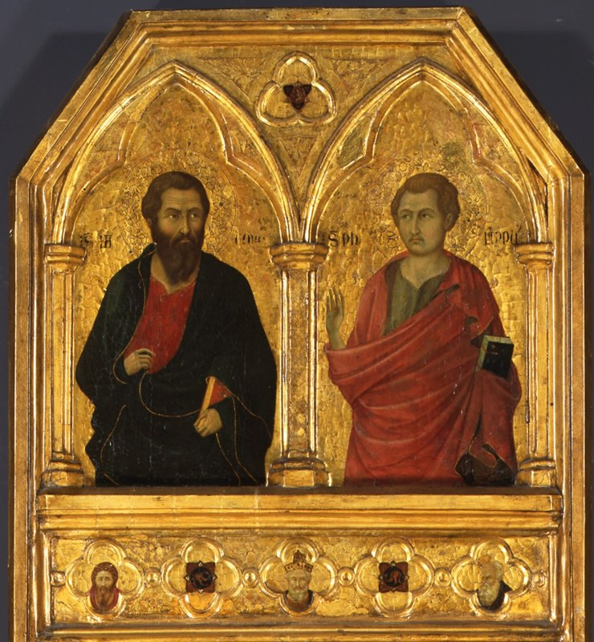
  <figcaption>Ugolino di Nerio, <em>Saints James the Greater and Philip</em>, from the middle tier of the high altarpiece of Santa Croce, Florence, c. 1325. Tempera on poplar. Berlin, Staatliche Museen, Gemäldegalerie, 1635C; gift of Helene Tepelmann-Vieweg, 1911. Photo: Staatliche Museen zu Berlin, Gemäldegalerie / Jörg P. Anders, <a href="https://creativecommons.org/publicdomain/mark/1.0/">Public Domain Mark 1.0</a>.</figcaption>
</figure>

<figure>
  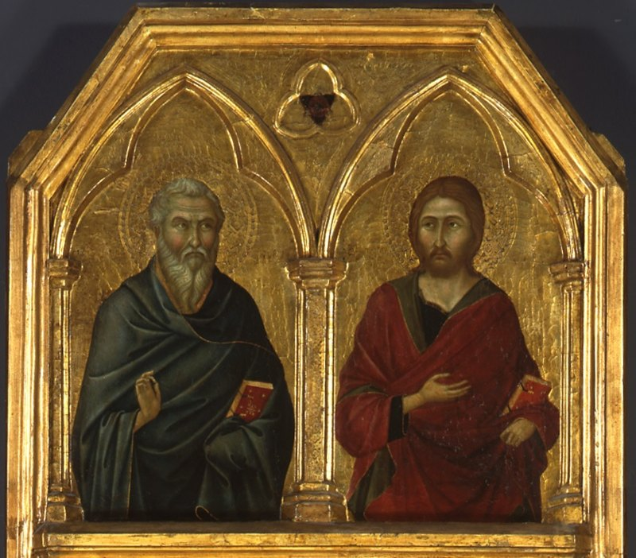
  <figcaption>Ugolino di Nerio, <em>Saints Matthew and James the Less</em>, from the middle tier of the high altarpiece of Santa Croce, Florence, c. 1325. Tempera on poplar. Berlin, Staatliche Museen, Gemäldegalerie, 1635D; gift of Helene Tepelmann-Vieweg, 1911. Photo: Staatliche Museen zu Berlin, Gemäldegalerie / Jörg P. Anders, <a href="https://creativecommons.org/publicdomain/mark/1.0/">Public Domain Mark 1.0</a>.</figcaption>
</figure>

<figure>
  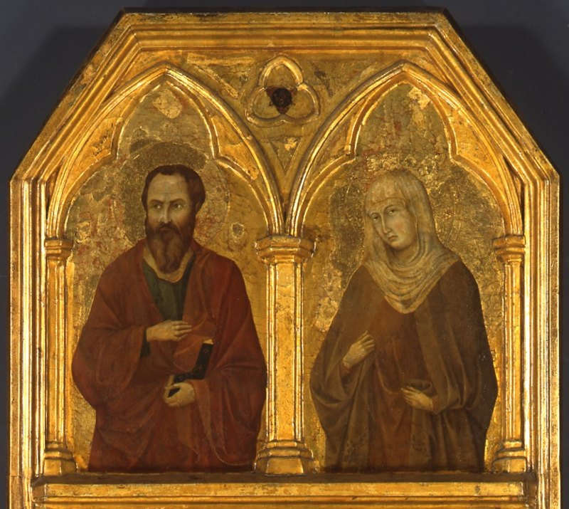
  <figcaption>Ugolino di Nerio, <em>Saint Matthias and a Female Saint (Elizabeth of Hungary or Clare)</em>, from the middle tier of the high altarpiece of Santa Croce, Florence, c. 1325. Tempera on poplar. Berlin, Staatliche Museen, Gemäldegalerie, 1635E; gift of Helene Tepelmann-Vieweg, 1911. Photo: Staatliche Museen zu Berlin, Gemäldegalerie / Jörg P. Anders, <a href="https://creativecommons.org/publicdomain/mark/1.0/">Public Domain Mark 1.0</a>.</figcaption>
</figure>

The three panels, given to the Gemäldegalerie by Helene Tepelmann-Vieweg in 1911, are half of the middle tier of the altarpiece, whose other two surviving panels are in London. Like those, they show pairs of saints at half length behind a ledge, under twin pointed arches separated by a slender column, with a trefoil between the arches. The inscriptions on the gold, partly legible, read *S. Iacobus* and *S. Philippus*, *(Mat)teus* and *S. Iac(obus)*, and *S. (Matti)as*.

*Saints James the Greater and Philip* stood above the Baptist, beneath the pinnacle of *Isaiah*. James, with dark hair and beard, wears a dark green mantle over a red tunic and holds a scroll; Philip, young and beardless, in a red mantle, raises his hand and holds a dark book. Below them the band of quatrefoils keeps its small heads: a bearded saint, a crowned king and an old man, alternating with animal motifs, as in the London panel of *Simon and Thaddeus*.

*Saints Matthew and James the Less* set an old man and a young one side by side. Matthew, grey-haired and grey-bearded, wrapped in a dark green mantle, raises his hand; James the Less, with long auburn hair and a short beard, lays his hand on his breast. James the Less was traditionally represented with features resembling those of Christ, his kinsman, and Ugolino gives him the long hair, parted beard and oval face of the Christ of the predella.

The third panel pairs the apostle Matthias, chosen to replace Judas, with a female saint in the brown habit and white veil of a Franciscan religious. The Berlin record identifies her, with a question mark, as Elizabeth of Hungary, and other scholars as Saint Clare. Because Peter and Paul stood in the main tier, the twelve places of the middle tier were filled by ten apostles and two Franciscan women saints, Clare and Elizabeth; this panel holds one of them, and the other is lost.

The pairs are carefully contrasted in age, colour and gesture. Young and old, bearded and beardless, red and green alternate along the row, and each pair turns slightly towards the centre, so that the tier formed a continuous procession of saints towards the Virgin and Child below.

The faces are those of Ugolino's mature types: long noses, heavy-lidded eyes, firm mouths, modelled with greenish shadows and pink highlights. The female saint, with her pale face framed by the white wimple and her downcast eyes, is the gentlest figure of the series.

The frames are original in their main elements, with later interventions. The trefoils between the arches, like those in London, once held decoration in silver leaf, now darkened.

The condition varies. *James the Greater and Philip* and *Matthew and James the Less* are well preserved; the panel with *Matthias and the female saint* has lost much of its gold ground, worn to the bole, and the habit of the saint has darkened.

### Prophets from the pinnacles of the Santa Croce altarpiece: Isaiah, Moses, David and Daniel (London, National Gallery, and Philadelphia Museum of Art)

<figure>
  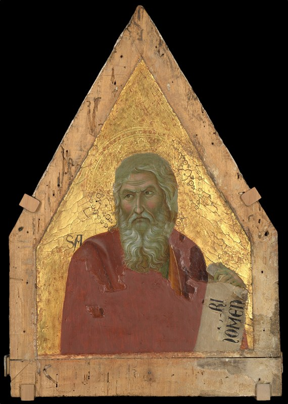
  <figcaption>Ugolino di Nerio, <em>Isaiah</em>, pinnacle of the high altarpiece of Santa Croce, Florence, possibly 1325–8. Egg tempera on wood (probably poplar), 45.8 × 31.5 cm. London, National Gallery, NG3376; presented by Henry Wagner, 1918. © The National Gallery, London, <a href="https://creativecommons.org/licenses/by-nc-nd/4.0/">CC BY-NC-ND 4.0</a>.</figcaption>
</figure>

<figure>
  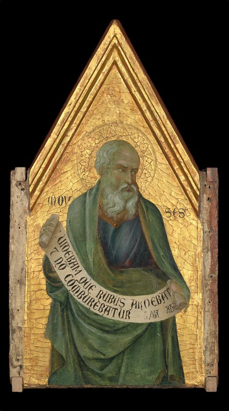
  <figcaption>Ugolino di Nerio, <em>Moses</em>, pinnacle of the high altarpiece of Santa Croce, Florence, possibly 1325–8. Egg tempera on wood (probably poplar), 55 × 31.4 cm. London, National Gallery, NG6484; bought 1983. © The National Gallery, London, <a href="https://creativecommons.org/licenses/by-nc-nd/4.0/">CC BY-NC-ND 4.0</a>.</figcaption>
</figure>

<figure>
  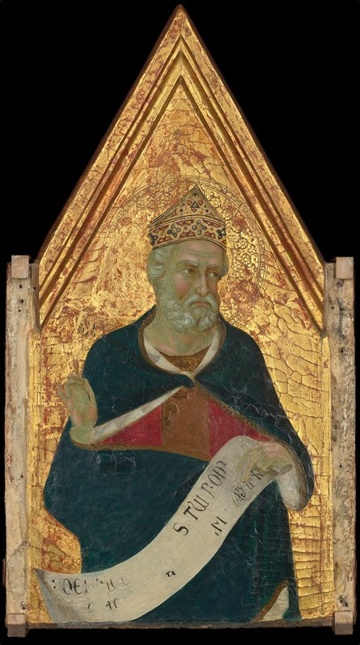
  <figcaption>Ugolino di Nerio, <em>David</em>, pinnacle of the high altarpiece of Santa Croce, Florence, possibly 1325–8. Egg tempera on wood (probably poplar), 55.2 × 31.2 cm. London, National Gallery, NG6485; bought 1983. © The National Gallery, London, <a href="https://creativecommons.org/licenses/by-nc-nd/4.0/">CC BY-NC-ND 4.0</a>.</figcaption>
</figure>

<figure>
  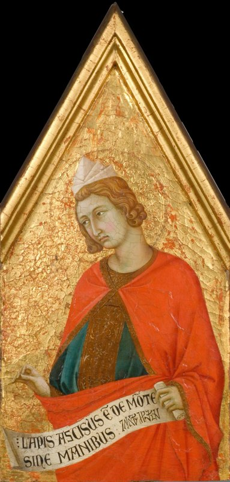
  <figcaption>Ugolino di Nerio, <em>Daniel</em>, pinnacle of the high altarpiece of Santa Croce, Florence, c. 1325. Tempera and tooled gold on panel, 54 × 31 cm. Philadelphia Museum of Art, John G. Johnson Collection, 1917, cat. 89. Image: Philadelphia Museum of Art, for educational use only.</figcaption>
</figure>

The four panels are the surviving pinnacles of the altarpiece, which originally had six, three on either side of the central Crucifixion. Three are in London; the fourth, *Daniel*, entered the Philadelphia Museum of Art with the John G. Johnson Collection in 1917. Each shows a prophet or king of the Old Testament at half length, holding a scroll with a text that foretells the coming of Christ.

*Isaiah* stood above the panel of *Saints James the Greater and Philip*, which in turn stood above the *Saint John the Baptist*, both now in Berlin. The prophet's face and beard are well preserved, but much of his red mantle and of the inscription on his scroll is lost. The panel has also lost its frame, and the bare wood of the gable surrounds the gold field.

*Moses* is identified by the letters *MOY–SES* at either side of his head. His scroll carries an adaptation of Exodus 3:2, *Videbam que rubus ardebat et non comburebatur*, "I saw that the bush was burning and was not consumed". The burning bush, through which God spoke to Moses, was read as a figure of the Virgin, who conceived without losing her virginity, and so the text joins the prophecies of the Incarnation on the other scrolls.

*David*, crowned, stood above the panel of *Saints Bartholomew and Andrew*. He blesses with his right hand and holds a scroll with a damaged inscription. His blue cloak is lined with white painted with dark patches in imitation of ermine, the fur of royalty, and his jewelled crown proclaims his kingship and his place as the ancestor of Christ.

*Daniel*, the youngest of the prophets, is beardless, with curly auburn hair under a white pointed cap, and wears a bright red-orange mantle over a brown tunic patterned in gold. His scroll carries Daniel 2:45, *Lapis abscisus est de monte sine manibus*, "a stone was cut out of the mountain without hands". The stone that destroys the statue of Nebuchadnezzar's dream was read as Christ, born of the Virgin without human father, so that Daniel's text, like those of Moses and Isaiah, refers to the Incarnation.

The four figures are carefully varied. Isaiah, with long flowing hair and beard, turns slightly to the left; Moses, bald and white-bearded, turns to the right and unrolls his scroll across his body; David, crowned and short-bearded, faces the viewer more frontally and blesses; Daniel, young, inclines his head and looks down. Their gazes and gestures, directed towards the centre of the altarpiece, linked the pinnacles to the Crucifixion between them.

The scrolls give the pinnacle tier a theological unity. Read together, they present the prophets as witnesses to the Incarnation and the royal lineage of Christ, while the Passion unfolded in the predella below and the Crucifixion crowned the centre.

The haloes of the four prophets are punched with rosettes and foliate motifs, and the gold grounds are crossed by networks of cracks, with the red bole showing through in many places, especially on *David*. *Moses*, *David* and *Daniel* keep their moulded gables, while *Isaiah* has lost his.

The condition varies. *Moses* and *Daniel* are well preserved, with legible inscriptions, though the gold of *Daniel* is worn to the bole in many places. *David* has suffered abrasion in the gold and losses in the inscription. *Isaiah* has lost large areas of its mantle and scroll, while the face survives intact.

### Spandrel angels from the main tier of the Santa Croce altarpiece (London, National Gallery)

<figure>
  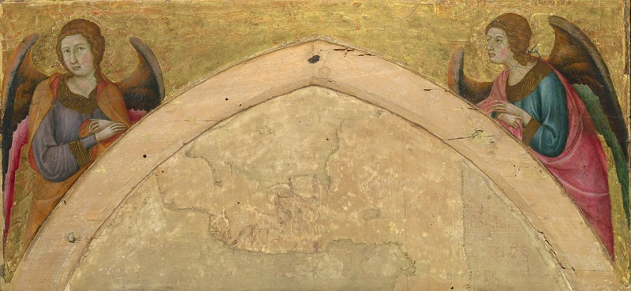
  <figcaption>Ugolino di Nerio, <em>Spandrel Angels</em>, from above the lost <em>Saint Francis</em> of the high altarpiece of Santa Croce, Florence, possibly 1325–8. Egg tempera on wood (probably poplar), 28.7 × 57.2 cm. London, National Gallery, NG3378; presented by Henry Wagner, 1919. © The National Gallery, London, <a href="https://creativecommons.org/licenses/by-nc-nd/4.0/">CC BY-NC-ND 4.0</a>.</figcaption>
</figure>

<figure>
  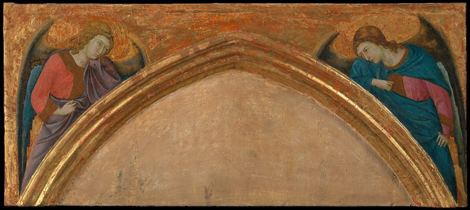
  <figcaption>Ugolino di Nerio, <em>Spandrel Angels</em>, from above the lost <em>Saint Louis of Toulouse</em> of the high altarpiece of Santa Croce, Florence, possibly 1325–8. Egg tempera on wood (probably poplar), 27.5 × 56.7 cm. London, National Gallery, NG6486; bought 1983. © The National Gallery, London, <a href="https://creativecommons.org/licenses/by-nc-nd/4.0/">CC BY-NC-ND 4.0</a>.</figcaption>
</figure>

The two fragments come from the upper parts of two panels of the main tier, which showed Saint Francis and the Franciscan bishop Saint Louis of Toulouse. In each, the saint stood under a painted arch within a rectangular panel, and the spandrels at either side of the arch were filled with angels. The saints are lost; the arches now frame empty fields, where the bare preparation and the canvas laid over the wood are visible.

The first pair stood above Saint Francis, whose panel in turn stood below *Saints Simon and Thaddeus*. One angel looks up, while the other looks across at him, both leaning on the edge of the arch with their hands crossed or folded. The second pair, above Saint Louis, look down towards the lost image of the saint below.

The angels are shown at half length, with large wings of brown, green, red and blue feathers that fill the corners of the spandrels. Their robes and mantles alternate in colour, violet and orange, blue and pink, red and violet, in the same way as the apostles of the predella and the middle tier.

The device of angels leaning over the arch of a saint's panel, as though at a window, links the figures of the main tier to the heavenly court. Ugolino used a similar arrangement in the polyptych at Williamstown, and the idea may derive from Duccio's polyptych for San Domenico in Perugia.

An eighteenth-century drawing shows the altarpiece in the friars' convent, with the panel of Saint Francis already badly damaged. It was probably discarded and the angels kept because they were in better condition. The panel of Saint Louis appears in good condition in the drawing, and why its angels were separated from it is not known.

The two fragments confirm the positions of the lost Franciscan saints in the main tier, the patron of the order and the Franciscan bishop canonised in 1317, and so the Franciscan character of the programme. The angels' looks and gestures, upwards, across and down, vary a single motif across the tier.

The angels' faces, with long noses, almond eyes and wavy hair, and their delicate hands are close to the angels of Ugolino's other polyptychs. The gold of the spandrels is worn, and in the second fragment the red bole shows through over much of the surface.

Both fragments are damaged. The arches are worn and cracked, and the empty fields within them preserve only the preparation. The angels themselves are relatively well preserved, though their gold and haloes are abraded.

### Worshipping Angels, from above the central Virgin of the Santa Croce altarpiece (Los Angeles County Museum of Art)

<figure>
  
  <figcaption>Ugolino di Nerio, <em>Worshipping Angels</em>, from above the central panel of the high altarpiece of Santa Croce, Florence, c. 1325. Tempera on panel, 44.4 × 74.9 cm. Los Angeles County Museum of Art, William Randolph Hearst Collection, 49.17.40. Photo: Wikimedia Commons contributor, <a href="https://creativecommons.org/publicdomain/zero/1.0/">CC0</a>.</figcaption>
</figure>

The fragment comes from the top of the central panel of the main tier, above the lost Virgin and Child. Its arch, wider than those of the lateral saints, matches the central compartment of the eighteenth-century drawing, in which groups of angels fill the spandrels above the Virgin. It is the only surviving part of the central panel, and it entered the Los Angeles County Museum of Art with the William Randolph Hearst Collection.

The angels are more numerous than in the spandrels of the lateral saints: four at the left and five at the right, crowded together and overlapping, their haloes and wings forming a dense cluster against the gold. They lean over the arch and look down towards the image of the Virgin that once filled the field below, some with hands raised in wonder, one with hands crossed on the breast.

The angels wear robes and mantles of red, green, blue, violet and orange, alternating from one figure to the next. Their faces, with long noses, almond eyes and wavy reddish hair, are close to those of the London spandrel angels, and their haloes are punched with the same rosettes. Their gestures vary within a single theme, so that the group reads as a choir rather than a row of repeated figures.

The multiplication of angels distinguished the central panel from the lateral ones, where only two angels flank each arch. The arrangement, which goes back to Duccio's *Maestà*, surrounded the Virgin with a celestial court, carried up into the spandrels of the frame. Seen from the nave, the angels would have marked the centre of the altarpiece above the Virgin enthroned.

The empty field within the arch, now filled with white, shows where the panel was cut. The Virgin and Child, the signed central image, was separated from this upper part and is lost; the fragment thus preserves the frame and the attendant angels of the principal image without the image itself.

The fragment also gives a measure of the central panel. Its width, about 75 centimetres, exceeds that of the lateral compartments by a wide margin, and confirms the hierarchy of the main tier recorded in the drawing, in which the Virgin's panel was both wider and taller than those of the saints.

The fragment keeps a gilded cornice along the top, a later or reworked moulding that closes the panel, and the moulded arch, which belongs to the original structure.

Two of the angels at the left have lost almost all their paint, leaving only the outlines of their haloes and the gesso beneath. The others are well preserved, with their colours and faces intact; the gold of the ground is worn in places to the bole.

### Saint Margaret Holding the Cross (Portland, Oregon, Portland Art Museum)

<figure>
  
  <figcaption>Attributed to Ugolino di Nerio, <em>Saint Margaret Holding the Cross</em>, c. 1330. Tempera on wood, 60.6 × 28.4 cm (image). Portland, Oregon, Portland Art Museum, 61.41; gift of the Samuel H. Kress Foundation. Image: Portland Art Museum, public domain.</figcaption>
</figure>

The panel, a lateral compartment of a dismembered polyptych, shows a young female saint at half length under a round arch. It came to the Portland Art Museum as a gift of the Samuel H. Kress Foundation. An old label etched on the frame describes it as *Saint Margaret* by a "follower of Segna di Buonaventura, Sienese school, circa 1330"; the museum now catalogues it as attributed to Ugolino di Nerio.

The saint is identified as Margaret of Antioch by the small cross she holds, the cross with which, according to her legend, she overcame the dragon that had swallowed her. The dragon itself, often shown at her feet, does not appear, perhaps because the lower part of the panel is lost or because the half-length format left no room for it.

She wears a blue mantle sown with small gold fleurs-de-lis, edged with a broad gold border set with stones and fastened at the breast by a square brooch, over a violet dress. A long white veil falls from her head over her shoulders and down her front. The richness of the mantle, with its royal fleurs-de-lis, marks her as a virgin martyr of noble birth.

Her face, long and oval, with heavy-lidded eyes, a long nose and a small mouth, turns slightly to the right, towards the lost centre of the altarpiece. The head is inclined with a gentle melancholy that recalls the Virgins of the Metropolitan and the Louvre, and the long fingers of the hand that holds the cross have the same tapering elegance.

The halo is outlined with a ring of punched dots and small motifs, and the arch above carries a moulded frame and a dark frieze with a foliate pattern. The punched decoration links the panel to Ugolino's work after Polyptych 39, when punches replaced engraving.

The attribution is cautious. The figure type and the treatment of the hands are close to Ugolino's, but the softer modelling and the decorative emphasis of the mantle have suggested to some the hand of an assistant or of a follower working on Ugolino's patterns. The earlier name of Segna di Buonaventura, Duccio's nephew, points to the same circle of Ducciesque painters active in Siena in the 1320s and 1330s.

The panel belongs with the female saints of Ugolino's polyptychs, such as the Saint Catherine in Urbana-Champaign associated by the Louvre with its Virgin and Child. The repetition of these figures, with variations in costume and attributes, shows how the workshop adapted a stock of types to the dedications of each altarpiece.

The paint surface is covered with fine cracks, and the gold is worn in places. The mantle, the veil and the face are well preserved.

### Saint Matthew(?) (New York, The Metropolitan Museum of Art)

<figure>
  
  <figcaption>Ugolino di Nerio, <em>Saint Matthew(?)</em>, late 1320s. Tempera on wood, gold ground, 38.4 × 32.4 cm. New York, The Metropolitan Museum of Art, Robert Lehman Collection, 1975.1.6. The Metropolitan Museum of Art, open access, <a href="https://creativecommons.org/publicdomain/zero/1.0/">CC0</a>.</figcaption>
</figure>

The panel, 38.4 by 32.4 centimetres, shows an elderly apostle at bust length. It is a fragment of a larger compartment, probably a lateral panel of a polyptych, and the punched decoration visible in the upper corners suggests that the gold continued beyond the present edges, around an arch now lost. The identification as Matthew, marked with a question mark by the museum, rests only on the type of the bearded elder, since the book or other attribute that would have named him is lost.

The saint faces the viewer almost frontally, his gaze direct and severe. The broad, long beard, painted in grey and white strands over a greenish ground, falls in rhythmical waves to his chest, and the swept-back hair repeats the same pattern of curls. The furrowed brow, heavy upper lids and deep lines beside the nose give the face an intensity that Ugolino reserved for his older saints.

The deep red mantle is wrapped across the body in a single broad sweep, over a dark green tunic, and its folds are modelled with few strokes in darker red. The simplicity of the drapery concentrates attention on the head, which occupies the upper half of the panel.

The halo is punched with three-petalled leaves along a vine and small rosettes on a stippled ground, within bands of tiny circles: the repertory that Ugolino adopted after Polyptych 39 and used in all his mature works. The punching continues into the gold of the upper corners, where fragments of foliate motifs survive.

The comparison with the apostles of the Santa Croce altarpiece is close. The paired saints of the middle tier, in Berlin and London, share the massive heads, the dense, wavy beards and the severe expressions of the Lehman saint, though he is broader in conception and more frontal than their turned, interlocked figures.

The beard is painted with particular attention to pattern. Its locks, laid in parallel curving strokes of grey and white, form a rhythmic surface that is at once a description of hair and a decorative motif, the kind of linear stylisation that grows in Ugolino's later works.

The red of the mantle and the green of the tunic are the principal colours, set against the gold. The restricted palette, compared with the varied colours of the *Last Supper*, suits a single figure meant to be read at a distance as part of a larger altarpiece.

The paint surface is in fair condition, with a network of fine cracks over the flesh and the gold, and small losses along the edges where the panel was cut. The punched decoration of the halo is well preserved.

### Virgin and Child Enthroned with Saints Peter, Paul, John the Baptist and Dominic and a Dominican Supplicant (Chicago, Art Institute)

<figure>
  
  <figcaption>Attributed to Ugolino di Nerio, <em>Virgin and Child Enthroned with Saints Peter, Paul, John the Baptist, and Dominic and a Dominican Supplicant</em>, c. 1325–1335. Tempera on panel, 37.2 × 23.2 cm (framed 43.4 × 29.1 cm). Chicago, The Art Institute of Chicago, Mr. and Mrs. Martin A. Ryerson Collection, 1937.1007. Image: Art Institute of Chicago, <a href="https://creativecommons.org/publicdomain/zero/1.0/">CC0</a>.</figcaption>
</figure>

The panel, only 37.2 by 23.2 centimetres, is an image for private devotion, made for a Dominican friar. Traces of hinges on its left edge show that it was the right wing of a diptych, probably paired with a Crucifixion; closed, the two leaves would have protected each other, and opened, they would have set the Virgin beside the crucified Christ. It came to the Art Institute with the Ryerson collection.

The Dominican chronicler Gerard de Frachet wrote in 1260 that the friars kept in their cells "before their eyes images of Mary and her crucified son, so that while reading, praying and sleeping they could look upon them and be looked upon by them with eyes of compassion". The Chicago panel belongs to this practice of private, constant contemplation.

The Virgin sits at the centre on a marble throne with slender colonnettes and carved capitals, hung with a red cloth of honour flecked with gold. Her blue mantle, edged with a gold border that loops over the folds, covers her whole figure. The Child stands on her knee in a red cloth, reaches up to touch her chin and looks into her face, a gesture of tenderness that recalls the Madonnas with the veil.

Four saints stand at the sides of the throne, two on each side, one above the other: Peter, with the keys and the book, and the Baptist, in his hair shirt and red mantle, at the left; Paul, with the sword and the book, and Dominic, in the white habit and black mantle of his order, at the right. The arrangement in two tiers, without architectural divisions, gives the small panel the effect of a polyptych compressed into a single field.

Below Dominic kneels a small friar in the same habit, his hands joined, looking up towards the Virgin. Dominic raises his hand above him, presenting his follower to the Virgin and interceding on his behalf. The friar is probably the owner of the diptych, shown in the act of prayer for which the panel was made.

The gold ground is densely punched along its upper edge with bands of rosettes and foliate ornament, and the haloes are tooled in the manner of Ugolino's mature works. The step of the throne carries a band of gold pseudo-lettering, and the floor is a green carpet patterned with gold, a rich setting that turns the miniature panel into a precious object.

The museum catalogues the panel as attributed to Ugolino and dates it 1325–1335. The types of the Virgin and of the saints, and the punchwork, are close to his works of the years around Santa Croce. Its Dominican character links it to the Dominican side of Ugolino's career, to which belong the lost altarpiece of Santa Maria Novella and the San Casciano Madonna.

The panel is in good condition. The gold, the colours and the tooling are well preserved; the blue of the Virgin's mantle has a granular surface, and there are small losses in the gold of the lower part of the field.

### Triptych from San Giovanni d'Asso: Virgin and Child with Saints Paul and Peter (Florence, Gallerie degli Uffizi, Contini Bonacossi Collection)

<figure>
  
  <figcaption>Ugolino di Nerio, probably with Bartolomeo Bulgarini, <em>Virgin and Child with Saints Paul and Peter</em>, from San Pietro in Villore, San Giovanni d'Asso, 1325–1330. Tempera on panel, gold ground, 148 × 152 cm. Florence, Gallerie degli Uffizi, Contini Bonacossi Collection, inv. Contini Bonacossi 4. Image: Gallerie degli Uffizi, for educational use only.</figcaption>
</figure>

The triptych comes from the oratory of San Pietro in Villore at San Giovanni d'Asso, near Montalcino. The Gori-Pannilini family, who held the patronage of the oratory, sold it to Alessandro and Vittoria Contini Bonacossi in 1938, and it came to the Uffizi with their collection. It measures 148 by 152 centimetres as now mounted on velvet within a modern gabled frame, which brings together the three main panels and three pinnacles.

The main panels show the Virgin and Child at the centre, Saint Paul at the left and Saint Peter at the right, identified by fragmentary inscriptions on the frame, *S. Paulus Apl* and *S. Petrus Apl*. The dedication of the oratory to Peter explains the choice of the two princes of the apostles. Paul holds a book and the sword of his martyrdom, Peter a book and the keys of the kingdom of heaven.

The sword and the keys were made with thin metal foil applied to the surface, to give them the glint of real objects. The foil is now almost entirely lost, so that the sword survives only as a pale diagonal outline behind Paul and the keys as a faint shape in Peter's hand.

The pinnacles form a second triad: Christ blessing at the centre, the deacon Saint Stephen, the first martyr, at the left, with a wound on his head, and Saint Andrew, Peter's brother, at the right. The arrangement mirrors the main tier, with the first martyr above Paul and Peter's brother above Peter.

The Virgin holds the Child on her left arm. He wears a red cloth and pulls her veil towards him with both hands, the gesture of the Tadini Madonna, which hangs opposite this triptych in the same room and shares its design. The comparison between the two Madonnas, built on closely similar cartoons, is discussed in the essay.

The Uffizi attributes the triptych to Ugolino with the probable collaboration of a younger painter, Bartolomeo Bulgarini, to whom are ascribed the scowling expressions of the figures and their more marked emotional charge. Paul's knitted brows and sideways glance, and Peter's hard, staring face, are far from the gentle types of the early Madonnas, and they explain why the panel has been placed at the far end of Ugolino's development or associated with a second hand.

The museum dates the triptych 1325–1330, close to Santa Croce, while Kanter placed it later, in the 1330s, at the end of Ugolino's career. The proposed collaboration with Bulgarini, who was documented from 1337/1338, would favour the later date and would make the triptych a point of contact between Ugolino and the next generation of Sienese painters.

The panels are in fair condition. The gold grounds and the colours of the mantles are well preserved, but the metal foil of the attributes is lost, the frames have been reworked, and the mounting on velvet is modern.

### Virgin and Child Enthroned with a Donor (San Casciano in Val di Pesa, Church of the Misericordia)

<figure>
  
  <figcaption>Ugolino di Nerio, <em>Virgin and Child Enthroned with a Donor</em>, c. 1334–1336. Tempera and gold on panel. San Casciano in Val di Pesa, Church of the Misericordia (formerly Santa Maria al Prato). Image: public domain, via Wikimedia Commons.</figcaption>
</figure>

The panel, tall and gabled, stands behind the high altar of the church of the Misericordia at San Casciano in Val di Pesa, formerly Santa Maria al Prato, a Dominican foundation dependent on Santa Maria Novella in Florence. It is one of the three panels by Ugolino in the church, with half-length figures of Saint Francis and Saint Peter, and its shape and size show that it was made as an independent image.

The Virgin is shown at full length, seated on a monumental throne of white marble. The throne is inlaid with dark lozenges and bands, crowned at the sides by carved capitals, and hung with a red cloth of honour patterned in gold that rises behind the Virgin. Two tasselled cushions hang at the arms. The structure, built in perspective with its sides receding, is the most elaborate throne in the works catalogued here.

The Virgin's black mantle covers her whole figure and falls to the floor in broad masses, edged with a narrow gold border that loops and twists over the dark surface in an independent ornamental line. Her head, inclined towards the Child, keeps the long oval and narrow eyes of the earlier Madonnas, but the features are more sharply drawn.

The Child sits on her knee in a green tunic, wrapped in an orange-red mantle, and pulls her white veil towards him with both hands, the gesture of the Tadini Madonna and of the San Giovanni d'Asso triptych. The folds of his mantle are reduced to a few sharp, decorative curves, the stylisation that Kanter described as drapery "resolved into pure pattern".

At the lower right a small donor in a brown habit kneels on the red marble floor with joined hands. The scale of the figure, a fraction of the Virgin's height, marks the distance between the devotee and the queen of heaven, while his presence turns the panel into a votive image.

The date is discussed in the essay. The connection with the decoration of the church in the mid-1330s, alongside Giovanni di Balduccio's pulpit and the crucifix by Simone Martini and his workshop, would make the panel one of Ugolino's last works.

The panel is set apart from Ugolino's polyptychs by its full-length enthroned Virgin, its gabled shape and its single donor, closer to the tradition of the large Marian panels of Duccio's circle than to the half-length Madonnas of his altarpieces.

The reproduction available is of modest resolution and does not allow the condition to be judged in detail. The gold ground shows wear in the gable and around the haloes, and the black of the mantle has lost much of its modelling, but the throne, the cloth of honour and the figures appear well preserved.

### The Crucifixion with the Virgin, Saint John and Angels (Madrid, Museo Nacional Thyssen-Bornemisza)

<figure>
  
  <figcaption>Ugolino di Nerio, <em>The Crucifixion with the Virgin, Saint John and Angels</em>, c. 1330–1335. Tempera and gold on panel, 135 × 89 cm. Madrid, Museo Nacional Thyssen-Bornemisza. Photo: Francesco Bini, <a href="https://creativecommons.org/licenses/by-sa/4.0/">CC BY-SA 4.0</a>, via Wikimedia Commons.</figcaption>
</figure>

The panel has a gabled top and has lost its frame: its edges show the bare, worm-eaten wood on which the moulding was once fixed. The cross rises through the whole height of the panel, its upper arm entering the gable, so that the shape of the support follows the shape of the cross.

The cross is painted a deep blue, edged with a thin light line, against the gold. Christ hangs from it with his arms almost horizontal, his body sagging in a gentle curve, his head fallen on his right shoulder. The titulus at the top is blank, its inscription lost or never painted. Blood flows in thin red lines from his hands and feet and spurts in an arc from the wound in his side.

The body is modelled with care: the ribs, the abdomen and the muscles of the thighs are built from finely graduated planes of pale flesh and soft greenish shadow, and the transparent loincloth, through which the legs show, falls in delicate folds. The cruciform halo, incised with red rays, frames a face of calm, closed-eyed suffering.

Six angels fly around the cross: two in the gable above the arms, four beside the body. Their bodies end in swirling drapery instead of legs, and their wings are coloured red, blue, green and pink. One covers its face with its mantle, others wring their hands or throw up their arms. Their agitation fills the gold ground with movement around the still, central body.

Below, the Virgin and Saint John stand at either side of the cross, cut off at the knees by the lower edge of the panel. The Virgin, wrapped in a dark blue mantle with a gold star on her forehead, bows her head and lets her hands fall, one over the other, at her waist. John, in a red mantle, clasps his hands and inclines his head. Both look down, their sorrow contained within the closed outlines of their mantles.

The contrast between the mourners' restraint and the angels' lament is the expressive idea of the image. The human witnesses bear their grief in silence, while the heavenly beings around the cross show openly what the mourners hold back, a double register of emotion that Ugolino developed in his late works.

The composition, with the cross rising into the gable and the mourners at its foot, is that of the painted crosses and gabled Crucifixions of Duccio's circle, while the agitated angels and the softer modelling of the body belong to the more expressive manner of Ugolino's maturity.

The gold ground is worn over much of its surface to the red bole, and there are losses at the lower edge, beside the Virgin and at the foot of the cross. The figures, above all the body of Christ and the angels, are well preserved, and a vertical crack runs through the panel along the line of Christ's left leg.
