## Introduction

The basilica of Sant'Ambrogio stands in the west of Milan, outside the circuit of the Roman walls, on the site of an ancient Christian cemetery. It was founded by Ambrose, bishop of Milan from 374 to 397, as a church for the martyrs, and it became his own burial place. For more than sixteen centuries it has been the second church of Milan after the cathedral, and for long periods its rival.

<figure>
  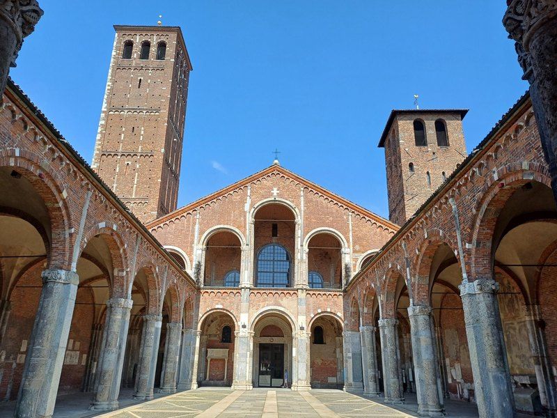
  <figcaption>The atrium and the façade of Sant'Ambrogio, with the canons' bell tower (left) and the monks' bell tower (right). Milan. Photo: Radosław Botev, <a href="https://creativecommons.org/licenses/by/3.0/pl/deed.en">CC BY 3.0 PL</a>, via Wikimedia Commons.</figcaption>
</figure>

The church seen today is not the church of Ambrose. It is a Romanesque building of the eleventh and twelfth centuries, raised on the foundations of the early Christian basilica and preserving its plan and its orientation with only a slight shift. Before it stands an atrium with porticoes on four sides; between the atrium and the church is a narthex, the deep porch whose capitals and portal carry the richest sculpture of the building.

Two bell towers rise on either side of the façade. The lower one, on the right, belonged to the Benedictine monks who served the basilica from 784; the taller one, on the left, to the canons, who were given it by the archbishop in 1128. The two towers are the visible sign of the two communities that shared the church and its revenues for more than seven centuries.

Inside, the church keeps three of the most important works of early medieval art in northern Italy: the golden altar of Wolvinius, made under Archbishop Angilbert II between 824 and 859; the ciborium above it, with columns of porphyry and gables of painted stucco; and the mosaic of the apse, with Christ between the martyrs Gervasius and Protasius. The chapel of San Vittore in Ciel d'Oro, attached to the south aisle, preserves mosaics of the fifth century, among them the oldest surviving image of Ambrose.

The building has been studied for three centuries, and its dating has been one of the great debates of Italian architectural history. In the late nineteenth century scholars divided between those who gave the vaults of the nave to the ninth century and those who placed them in the second half of the eleventh. The second view prevailed, and with it the place of Sant'Ambrogio as a founding work of Lombard Romanesque architecture.

The sculpture of the church received less attention than its architecture. Seventeenth- and eighteenth-century writers saw in the capitals the work of rough and unskilled carvers; nineteenth-century scholars used them to argue about dates. Only recently has the sculpture of the narthex been studied as a coherent programme. Laura Riva's study, *Alle porte del paradiso*, reads it as an image of the path that leads the Christian from the world to the gate of heaven.

This entry follows that path. It begins with the foundation of Ambrose and the Carolingian monastery, describes the Romanesque church and its towers, and then enters the atrium, the narthex and the portal, where most of the sculpture is concentrated. It continues inside the church with the ciborium, the golden altar, the apse mosaic and the pulpit, and ends with the later transformations, the restorations and the war.

The facts of the building's history follow the records of the regional catalogue of Lombardy, which collects the results of the literature. The analysis of the sculpture of the narthex follows Laura Riva. Where the two disagree, as on the dates of the restorations, both are given. The golden altar, the apse mosaic and the chapel of San Vittore are discussed more fully on the site's page on [Saint Ambrose](/Content/Saints/Saint-Ambrose.html), and the pulpit on the page on [Anselmo](/Content/Artists/XII-c/Anselmo.html).

## The Basilica Martyrum of Ambrose

Milan in the late fourth century was the residence of the Western emperors and one of the great cities of the empire. Its bishop, Ambrose, a former provincial governor elected in 374, gave the city a ring of new churches outside the walls. One of them, built in the cemetery to the west of the city where Christians had been buried since the time of the persecutions, was the basilica that would bear his name.

According to the regional catalogue, Ambrose founded the *Basilica Martyrum* around 379. It was a church of three aisles with a timber roof, probably ending in a single apse. Its name declared its purpose: it was built to receive the relics of martyrs, and its bishop meant it to become the burial church of the Milanese saints.

The relics came in June 386. In the middle of his conflict with the Arian court of the empress Justina, Ambrose had the ground dug before the chancel of the church of Saints Nabor and Felix and found two skeletons, which he identified as the martyrs Gervasius and Protasius. He described the discovery in a letter to his sister Marcellina, and the healing of a blind man during the translation is recorded both by Ambrose and by Augustine, who was then in Milan.

The relics were placed under the altar of the new basilica, which was dedicated with them. Ambrose prepared his own tomb beside them, and when he died, on 4 April 397, he was buried there, between the two martyrs.

From then on the basilica was the church of Ambrose. Its dedication shifted from the martyrs to the bishop, and it became the centre of his cult, the place where the Milanese church and its rite, called Ambrosian, kept the memory of their founder. The golden altar made in the ninth century was placed directly above the tomb.

Little of the fourth-century building can be seen. The regional catalogue records that the Romanesque nave was rebuilt with a slight change of orientation, so that the ancient remains do not align exactly with the present walls. The sarcophagus called of Stilicho, under the pulpit, is one of the few monuments that has stood in the same place since the fourth century, and it follows the axis of the early building, not that of the medieval church.

Laura Riva insists that the basilica was born beside the cemetery *ad martyres*, and that many archaeological remains bear witness to it: fragments of inscriptions and reliefs kept in the atrium, a frieze with putti harvesting grapes above the door of a bell tower, the sarcophagus of Saints Nabor and Felix, and the sarcophagus of Stilicho. The medieval builders lived among these remains and sometimes reused them.

The chapel of San Vittore in Ciel d'Oro, a small funerary chapel that Ambrose's brother Satyrus was buried in around 378, belongs to the same world. Its mosaics, usually dated to the second half of the fifth century, show Ambrose standing between Gervasius and Protasius. They are the oldest image of the bishop and the only part of the early Christian decoration of the complex that survives.

<figure>
  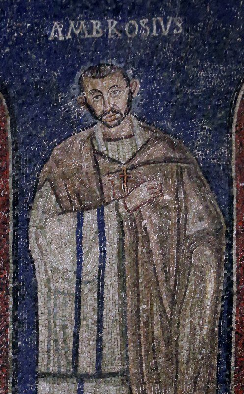
  <figcaption>Ambrose, mosaic, late fifth century. Milan, Sant'Ambrogio, chapel of San Vittore in Ciel d'Oro. Photo: Sailko, <a href="https://creativecommons.org/licenses/by/3.0/">CC BY 3.0</a>, via Wikimedia Commons.</figcaption>
</figure>

## Monks, Canons and the Carolingian Church

In 784 a Benedictine monastery was founded beside the basilica. The regional catalogue connects the foundation with a document of 789, confirmed by Charlemagne in 790. From then until the end of the fifteenth century the monks lived to the south of the church and shared it with a chapter of canons, the clergy who served the basilica on behalf of the archbishop.

The coexistence of the two communities shaped the building. The monks and the canons each had their rights, their offices and their revenues, and their rivalry runs through the documents of the basilica's history. The two bell towers on either side of the façade are its most visible trace: the monks had their tower first, and the canons had to wait three centuries for theirs.

The monks' tower, the lower tower to the right of the façade, is dated by the regional catalogue to the period of the foundation of the monastery, except for the present belfry, which is later. It is a square tower of brick, plain and massive, with small openings; it is among the oldest bell towers of Lombardy.

The ninth century brought the works that made the basilica the treasure-house of the Milanese church. Archbishop Angilbert II, who held the see from 824 to 859, commissioned the golden altar, signed by the master smith Wolvinius, and placed it above the tomb of Ambrose and the martyrs. The regional catalogue connects the altar with a renewal of the apse and the crypt that housed it.

The ciborium above the altar, with its four columns of red porphyry, belongs to the same campaign in its stucco decoration. Its columns, capitals and bases are older, of the fourth to sixth centuries, and were reused; the gables of painted stucco were made in the ninth century, according to the regional catalogue. The apse mosaic, too, was remade in the Carolingian period, and some details of its side scenes survive from that phase.

The name of another archbishop, Anspert, who held the see from 868 to 881, is attached to the atrium. Tradition and older literature called it the "atrium of Anspert", and Adriano Peroni, cited by Riva, suggested that the present atrium of the early twelfth century closely follows the ninth-century one, which in turn followed the porticoes of the early Christian basilicas. The regional catalogue keeps the name but dates the completion of the atrium to the turn of the eleventh and twelfth centuries.

The regional catalogue places a restructuring of the apse area at the end of the ninth or in the tenth century. A fragment of mural painting near the apse, with a bust in a roundel above panels of stylised foliage, is described in its photograph as a painting of the tenth century; it is one of the few traces of the decoration of the church before the Romanesque rebuilding.

<figure>
  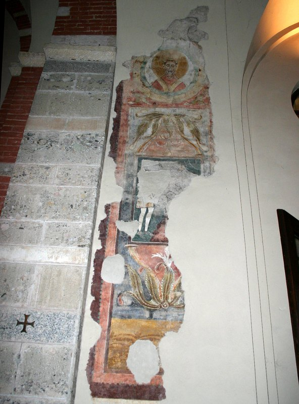
  <figcaption>Fragment of mural painting near the apse, dated to the tenth century in the description of the photograph. Milan, Sant'Ambrogio. Photo: Giovanni Dall'Orto, <a href="https://commons.wikimedia.org/wiki/Template:Attribution">attribution licence</a>, via Wikimedia Commons.</figcaption>
</figure>

By the end of the first millennium Sant'Ambrogio had become, in Riva's words, a civic institution and a church equal in importance to the cathedral. It held the tomb of the patron of the city and the most precious altar of the diocese; and it was served by two communities, each with its own claims. This was the church that the eleventh century would rebuild.

## The Romanesque Church

In the eleventh century the three aisles of the basilica were rebuilt from the ground. The regional catalogue describes a radical reconstruction, with a slight variation of orientation, in which the timber roof of the old church was replaced by rib vaults carried on compound piers. The new church kept the plan of three aisles and the single great apse, but it changed the structure and the scale of the building.

The nave is divided into bays, each covered by a square rib vault resting on massive piers of brick and stone. The aisles are covered with smaller vaults and carry galleries above them. The piers alternate in size, with stronger piers carrying the transverse arches of the nave and lighter ones between them. The light comes from the façade and from the octagonal tower over the last bay before the presbytery.

The date of these vaults was the central question of the scholarship of the late nineteenth century. Fernand De Dartein, in his study of Lombard architecture published between 1865 and 1882, gave the rebuilding to the ninth century. Raffaele Cattaneo, in 1888, contested that dating and placed the church in the second half of the eleventh century. The debate that followed, as Riva recalls, occupied scholars of both sides for at least forty years.

Cattaneo's arguments were partly sculptural. He distinguished between reliefs of an "Italo-Byzantine" art, which he dated to the ninth century, such as the jambs of the central portal, and the richer capitals of the atrium and the interior, which he saw as the flower of early Lombard Romanesque sculpture in the second half of the eleventh century. Giovanni Teresio Rivoira, in 1908, supported the eleventh-century date and compared the sculpture of Sant'Ambrogio with that of San Michele and San Pietro in Ciel d'Oro at Pavia and of the cathedral of Modena.

The American scholar [Arthur Kingsley Porter](/scholars.html#porter-arthur-kingsley), in his *Lombard Architecture* (1915–1917), devoted four chapters to the basilica. He reconstructed its history from the chronicles of the period, in particular that of Landulf the Younger, and from the documents of the monastery and the canons, and his work remains, in Riva's judgement, fundamental for the architecture of the church.

The eleventh-century date is now generally accepted. The regional catalogue records that in 1123 the chapels of the Deposition, of San Bartolomeo, of San Giorgio and of San Satiro are documented, and places the doubling of the narthex and the completion of the atrium at the turn of the eleventh and twelfth centuries. The façade, according to the same record, was built in the same phase.

The Romanesque church is built in brick, with stone used for the piers, the capitals and the dressings. Its walls are articulated by pilaster strips and friezes of small arches, the decoration that became the hallmark of Lombard building. The same vocabulary of brick, stone and arcading runs from the nave through the narthex and the atrium to the bell tower of the canons.

<figure>
  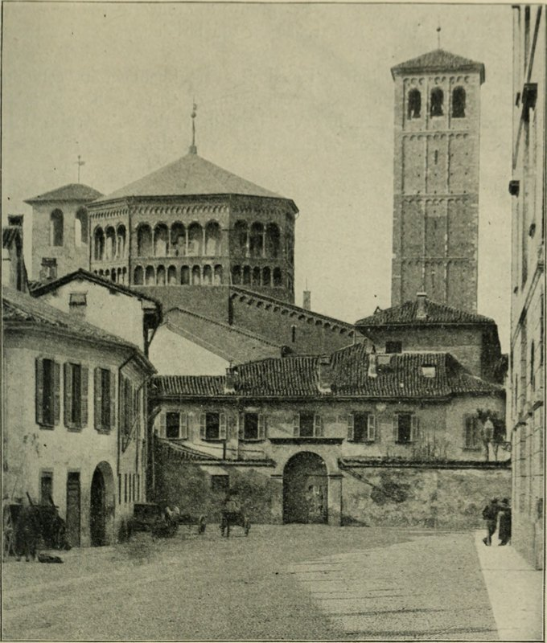
  <figcaption>Sant'Ambrogio from the east, with the octagonal tower over the crossing and the canons' bell tower, photograph published in C. A. Cummings, <i>A History of Architecture in Italy</i>, 1901. Internet Archive Book Images, no known copyright restrictions, via Wikimedia Commons.</figcaption>
</figure>

Seen from the east, the church shows its octagonal tower over the presbytery, ringed by two tiers of small open arcades, and the tall square tower of the canons beyond. The photograph published by Charles Cummings in 1901 shows the basilica among the low houses that still surrounded it before the urban changes of the twentieth century.

## The Bell Towers and the Façade

<figure>
  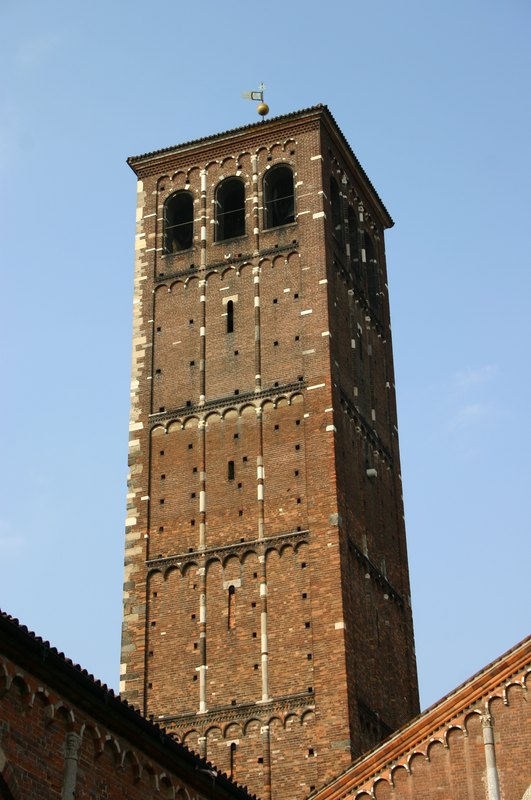
  <figcaption>The bell tower of the canons, begun in 1128, completed in the nineteenth century. Milan, Sant'Ambrogio. Photo: Giovanni Dall'Orto, <a href="https://commons.wikimedia.org/wiki/Template:Attribution">attribution licence</a>, via Wikimedia Commons.</figcaption>
</figure>

The canons' bell tower, to the left of the façade, is one of the most famous Romanesque towers of Lombardy. According to the regional catalogue, in 1128 Archbishop Anselm V of Pusterla gave the canons a new bell tower, and the tower was built between 1128 and 1144. It remained unfinished, however, until the nineteenth century, when the last storeys were completed.

The tower is square and very tall. Its faces are divided horizontally into storeys by friezes of small hanging arches, and vertically into three panels by slender pilaster strips of brick and white stone. The corners are reinforced with dressed stone. The small square holes that dot the walls are the putlog holes left by the scaffolding of the builders. At the top a belfry opens with three round-arched windows on each face, under a low tiled roof crowned by a gilded ball and a weathervane. The regularity of the design, repeated storey after storey, makes the tower a model of Lombard Romanesque building; its upper part, completed in the nineteenth century, follows the forms of the medieval lower storeys.

<figure>
  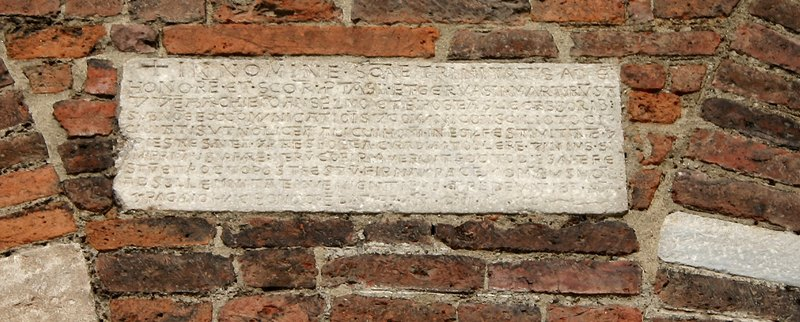
  <figcaption>Inscription with the decree of Archbishop Anselm on the feast of Gervasius and Protasius, 1098, in the outer wall of the atrium. Milan, Sant'Ambrogio. Photo: Giovanni Dall'Orto, <a href="https://commons.wikimedia.org/wiki/Template:Attribution">attribution licence</a>, via Wikimedia Commons.</figcaption>
</figure>

Set into the outer wall of the atrium, to the right of the main gate, is a marble slab with an inscription dated 1098. Vincenzo Forcella published it in his corpus of the inscriptions of the churches of Milan (vol. III, 1890, p. 276), and his reading of the stone is followed here:

+ IN NOMINE SANCTAE TRINITATIS AD EIUS HONOREM ET SANCTORUM PROTASII ET GERVASII MARTIRUM STATUTUM EST AB ARCHIEPISCOPO ANSELMO ET EIUS POSTEA SUCCESSORIBUS SUB NOMINE EXCOMMUNICATIONIS ET COMUNI CONSCILIO TOCIUS CIVITATIS UT NON LICEAT ALICUI HOMINI IN EORUM FESTIVITATE ET DIES TRES ANTEA ET PER TRES POSTEA CURTADIAM TOLLERE ET IN IUS SIBI PROPRIUM USURPARE: ITERUM CONFIRMAVERUNT PER OCTO DIES ANTE FESTUM ET PER OCTO POST FESTUM FIRMAM PACEM OMNIBUS HOMINIBUS AD SOLLEMNITATEM VENIENTIBUS ET REDEUNTIBUS ADAM ET PAGANO HUIC BONO OPERE DANTIBUS ANNO DOMINI M IIC

"In the name of the Holy Trinity, to its honour and that of the holy martyrs Protasius and Gervasius, it was established by Archbishop Anselm and afterwards by his successors, under pain of excommunication and with the common counsel of the whole city, that no man may levy the *curtadia* on their feast, and for three days before and three days after, nor usurp it as his own right. Again they confirmed, for eight days before the feast and eight days after, a firm peace for all men coming to the solemnity and returning from it, Adam and Pagano giving to this good work, in the year of the Lord 1098." The *curtadia* was the toll levied on the market held at the feast of the two martyrs, on 19 June. Forcella understood the decree as issued by Archbishop Anselm II, who died in 896, and confirmed in 1098 through the good offices of two citizens, Adam and Pagano, who obtained a peace of sixteen days for those attending the feast; Giovanni Pietro Puricelli had attributed it instead to Anselm IV of Bovisio (1097–1101), and Giuseppe Antonio Sassi disagreed with him. For the regional catalogue the inscription gives only a date after which the atrium was in use.

The monks' tower, on the right, is lower and plainer. Its walls of brick are less regular, and it has none of the arcading of the canons' tower. The contrast between the two towers, one massive and early, the other tall and refined, is the first thing a visitor sees from the square.

<figure>
  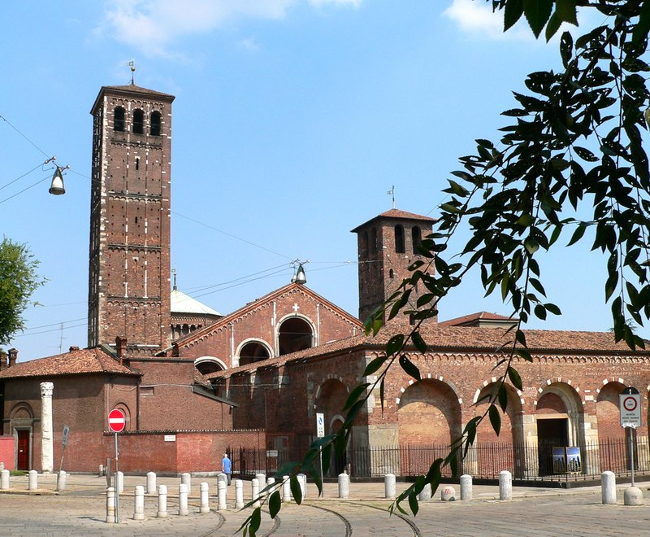
  <figcaption>Sant'Ambrogio from the square, with the outer wall of the atrium, the façade and the two bell towers. Milan. Photo: Novellón, <a href="https://creativecommons.org/licenses/by-sa/4.0/">CC BY-SA 4.0</a>, via Wikimedia Commons.</figcaption>
</figure>

From the square the basilica presents a closed front: the long outer wall of the atrium, with large round arches partly walled up, hides the church behind it. Only the gable of the façade, with its loggia, and the two towers rise above the roofs of the porticoes. The church is reached through a gate in the wall of the atrium, which opens on the courtyard in front of the façade.

The façade itself is a screen of two storeys. Below, the three arches of the narthex open on the atrium; above, a loggia of three arches stepping up towards the centre rises to the gable. Riva observes that the loggia recalls the structure of an imperial triumphal arch, and the sequences of round arches of the atrium the arcades of Roman aqueducts. At the top of the gable is a cross containing the Greek letters Alpha and Omega, which Riva reads as the opening of the whole sculptural programme of the narthex.

<figure>
  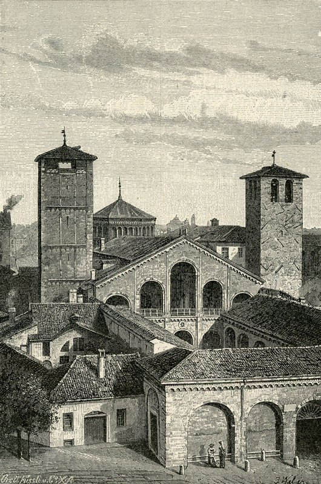
  <figcaption>J. Weber (engraver), Sant'Ambrogio, from G. Strafforello, <i>La patria. Geografia dell'Italia. Provincia di Milano</i>, Turin 1894, published by Orell Füssli. Public domain, via Wikimedia Commons.</figcaption>
</figure>

The engraving published in Gustavo Strafforello's geography of Italy in 1894 shows the basilica from above the roofs of the quarter: the façade with its loggia, the octagonal tower, the canons' tower on the left and the monks' tower on the right, with the low roofs of the atrium in front. It is a document of the appearance of the church at the end of the nineteenth century, after the great restoration campaign.

## The Atrium

The atrium is a rectangular courtyard enclosed by porticoes on four sides. It is as wide as the church it precedes, and it separates the basilica from the streets of the city. Riva describes it as a zone of passage, a diaphragm between sacred and profane space, between the hurried rhythm of daily life and the calm suggested by the regular succession of its bays.

Its architecture is regular and carefully proportioned. The side corridors are a third as wide as the central space, and in elevation the three arches of each short side correspond to six arches on each long side. The arches are round, with a double ring of white and red bricks; slender colonnettes rise from the capitals of the piers to a band of small hanging arches, above which runs a sawtooth cornice.

The visitor can choose between two paths. The central corridor, open to the sky, leads directly to the façade, with the loggia and the two towers rising before it; the side porticoes, under their vaults, offer a dimmer and quieter route. Either way, Riva notes, the visitor must pause before entering, and the pause gives weight to the moment of crossing into the consecrated space.

The atrium bears the name of Archbishop Anspert, who ruled the Milanese church from 868 to 881. Adriano Peroni suggested that the present atrium, of the first half of the twelfth century, follows closely the ninth-century one, which in turn followed the porticoes of the early Christian basilicas. Maria Luisa Gatti Perer stressed the *firmitas* and *venustas* of the atrium, qualities that led the architect Cesare Cesariano in the sixteenth century to cite it among the Milanese examples of the rules of Vitruvius.

The regional catalogue dates the completion of the atrium to the turn of the eleventh and twelfth centuries, in the same campaign that doubled the narthex. Its capitals, less rich than those of the narthex, are mostly of the Corinthian type, with leaves, volutes and interlace. Many of them were remade in the seventeenth and nineteenth centuries.

Traces of painting survive on the walls of the porticoes. Riva records two scenes on the right wall, with Christ enthroned adored by saints and a Crucifixion; a damaged Madonna and Child on the back wall, to the left of the entrance; and two haloed heads under the first arch on the left of the outer façade. Fragments of inscriptions and reliefs from the ancient cemetery are set into the walls.

The atrium had liturgical functions. Riva recalls that atria were places of welcome, where pilgrims, beggars and the poor found shelter, because the house of the Lord is a place of peace. They were also places of waiting and exclusion: catechumens before baptism and penitents before their reconciliation stood outside the church, and the rites that admitted them took place at its doors.

The atrium was restored several times. According to the regional catalogue, Francesco Maria Richini rebuilt some of its vaults and its upper arcading between 1631 and July 1632, for Cardinal Federico Borromeo; Riva dates the seventeenth-century campaign to 1630–1631. In the twentieth century Ferdinando Reggiori consolidated it after the bombing of 1943, which hit above all the outer portico.

## The Narthex

The arm of the atrium nearest the church is different from the other three. It is the narthex, a deep porch of three bays running along the façade, and Riva shows that it was conceived as an independent space, distinguished from the rest of the atrium by its structure, its decoration and its function.

Its piers are thicker than those of the other arms and are compound, with half-columns and colonnettes. The two central piers of the front are not crowned by the usual colonnettes but by broad pilaster strips that divide the façade into three fields corresponding to the bays behind. The three arches of the narthex are narrower and lower than the arches of the other sides, and the central one is enriched with sculpture that the other two lack.

The principal difference is the vaulting. The narthex is covered with rib vaults, which require more complex piers and diagonal capitals and give the bays greater stability. The narthex carries the upper storey of the façade, with its loggia, and its structure is heavier than that of the other three arms, which carry no weight above them.

Riva observes, citing a plan drawn by Reggiori during the restorations, that the side walls of the narthex are not perpendicular to the inner façade: the outer front is wider than the inner one. The narthex was enlarged at the turn of the eleventh and twelfth centuries, in the phase that the regional catalogue calls the doubling of the narthex.

The narthex is also the most richly decorated part of the atrium. It holds the most carefully carved capitals and the greatest number of figured subjects, on the capitals, the piers, the lintel and the archivolt of the portal. Its vaults and walls still show traces of painting absent from the other bays: geometric and vegetal bands on the vaults and ribs, and flaming suns on the walls, which Riva assigns to the late fifteenth century.

Older paintings survive beneath them. To the left of the tomb of the humanist Pier Candido Decembrio a fragment shows a hand of God emerging from a cloud, which Riva compares to the two scenes on the south wall of the atrium, datable towards the end of the twelfth century. Beside the south portal two haloes in relief belonged to a votive image of the Madonna and Child, with a sixteenth-century inscription.

Beside the north portal are two images of the patron saint. One is a painted roundel with his face; the other is a carved slab with Ambrose seated on a throne in episcopal vestments, holding the crosier and the flabellum, the liturgical fan. According to Giovanni Valagussa, cited by Riva, both belong to the second half of the twelfth century. The narthex also holds the tomb of Decembrio and funerary inscriptions of various periods.

For Riva, the independence of the narthex from the other three arms is confirmed by every kind of evidence: by the style and the subjects of its sculpture, by the observations made during the restorations, by liturgical practice, and by the symbolic meaning of the threshold in Romanesque thought. It was the last space before the church, the place of judgement and of admission, and its sculpture was made for that place.

## The Central Portal

<figure>
  
  <figcaption>The central portal of the narthex, with the lamb on the lintel, late eleventh to early twelfth century; through the door, the nave, the ciborium and the apse mosaic. Milan, Sant'Ambrogio. Photo: Chabe01, <a href="https://creativecommons.org/licenses/by-sa/4.0/">CC BY-SA 4.0</a>, via Wikimedia Commons.</figcaption>
</figure>

The central portal is the culmination of the sculpture of the narthex. It consists of jambs carved with interlace and geometric panels, a lintel with a row of roundels among vine scrolls, and an archivolt carved in the same manner. Above the lintel, the tympanum is filled with plain brick. Through the open doors the eye passes directly down the nave to the ciborium and the apse.

At the centre of the lintel, in a roundel, is the Lamb of God, standing on its hind legs with a cross behind its head and a staff. Riva identifies it with the victorious Lamb of the Apocalypse, the image of Christ who has conquered death through his sacrifice, and who sits on the throne of the heavenly Jerusalem. The vision of the Lamb, in the last chapter of the Apocalypse, is the reward of the just.

The roundels on either side of the Lamb hold the four living creatures of the Apocalypse, the lion, the ox, the man and the eagle, which turn their gaze towards the centre. Riva cites the passage of the Apocalypse in which John describes the throne of God with the four living creatures around it: the portal shows the heavenly court gathered round the Lamb.

Along the lintel and the archivolt, animals run and feed among the vine scrolls, and birds peck at bunches of grapes. At the top of the archivolt three birds, which Riva identifies as eagles, occupy the keystone: the noblest animals, the closest to the heavens, they stand for the souls of the blessed who have completed their ascent to God.

The jambs are lined with six carved slabs, which Riva considers possibly contemporary with the Romanesque decoration. They show flowers and birds with positive connotations, recalling a paradise setting, and one shows a man with a club beside a lion, which Riva reads as an image of the dangers the Christian must overcome to reach paradise. Cattaneo, in 1888, had dated the jambs of the central portal to the ninth century, as works of an "Italo-Byzantine" art.

Riva reads the portal through the lines of force described by Gérard de Champeaux in Romanesque portals. On the vertical axis, the keystone of the arch is the highest point and receives divine or Christological subjects; on the semicircle, the most important subjects occupy the centre of the lintel. At Sant'Ambrogio both lines are present: the Lamb at the centre of the lintel, the eagles at the top of the arch.

The portal itself carries a strong symbolic meaning. Riva recalls the words of Christ in the Gospel of John: "I am the door; if anyone enters by me, he will be saved, and will go in and out and find pasture." The door of the church is Christ, who reopened the way to the lost paradise, and the Lamb at its centre makes the identification visible.

Pietro Toesca, in 1927, was the first to compare the portal of Sant'Ambrogio with oriental architecture, in particular with the Armenian practice of decorating the exteriors of churches; he related it to the portals of the cathedral of Ani, completed by 1010, and of the mosque of Ibn Tulun in Cairo (872–879). Giovanni Teresio Rivoira saw in the portal of Sant'Ambrogio the prototype of the splayed portals that spread first to Pavia and then throughout Lombardy.

## The Capitals of the Narthex: Originals and Restorations

The capitals of the narthex are the richest group of sculpture in the basilica. They crown the compound piers, with separate capitals for the half-columns, the colonnettes and the corners, and many of them carry figured subjects: animals, monsters, men and angels among interlace and leaves. Reading them requires first separating the original Romanesque capitals from those made by later restorers.

Two great campaigns of restoration affected the sculpture of the basilica. The first, in 1630–1631 according to Riva, was promoted by Cardinal Federico Borromeo and concentrated on the capitals of the north arm of the atrium, which was also repaired structurally. The second, between 1858 and 1881 in Riva's account, and between 1857 and 1876 in the regional catalogue, sought to remove everything that was not Romanesque and remade a great many capitals.

The two campaigns had different aims. The seventeenth-century carvers, when a capital had to be replaced, chose the most typically Romanesque subjects visible in the basilica or in the Milanese area, such as the lamb with the cross, dragons with serpent tails, sirens and addorsed animals, but rendered them in the style of their own time: softer forms, rounded lines, looser manes, freer compositions. They also eliminated the abaci. In the narthex the capitals of pier VII, the southern capitals of pier V and almost all those of pier VI are seventeenth-century.

The nineteenth-century restorers aimed instead at deception: they wanted the new capitals to be as close as possible to the originals. Often they did not replace whole capitals but added pieces to complete the original parts, which makes recognition even harder. Some remade capitals are casts in cement, with very regular, symmetrical decoration; others show too rich and varied a design of plant interlace; those with animals can be recognised by flat, shallow relief or by the rigidity of the plumage.

The decisive study of the restorations was made by Adriana Summa in 1995. Using account books, records of pastoral visits, engravings and drawings made before the nineteenth century, and the private letters of the provost Francesco Maria Rossi, who directed the nineteenth-century works, she distinguished three groups among the capitals of the basilica: the original Romanesque ones, those made in 1630–1631, and those made in the second half of the nineteenth century.

Roberto Cassanelli, in 1988, had already drawn attention to the problem. The study of the restorations, he wrote, is decisive for the critical understanding of the monument; the restorations constitute the culminating points of its critical history and irreparably condition its reading. Before Summa, scholars had often analysed and dated capitals that were seventeenth- or nineteenth-century works.

Riva follows Summa in most cases and departs from her in some. The original capitals, she observes, follow and reinforce the structure of the capital, emphasising its symmetry and its origin in the Corinthian type; their interlaced ribbons are slightly irregular, do not stand far from the ground and do not create strong contrasts of light and shade. She warns that the state of preservation is an unreliable guide, because restored capitals exposed to weather and pollution may reach the decay of the old ones in a few years.

Her conclusion is that the narthex is the part of the basilica least affected by restoration. Most of its capitals are original, and they can be read as a coherent ensemble made at one time, at the end of the eleventh or the beginning of the twelfth century. Jane Elliot McKinne, in 1985, placed the capitals of the narthex and the atrium in a campaign that followed the decoration of the eastern half of the church and was concluded around 1110; Riva notes that this proposal has been widely accepted and has practically ended the controversy.

## The Capitals of the Narthex: The Cross and the Flock

The figured capitals of the narthex form a bestiary in stone. Lions, griffins, dragons, rams, eagles, doves, a centaur, monks and angels appear among the leaves and ribbons, bent and twisted to fill the faces of the capital. Earlier writers saw them as the fantasies of uncultivated carvers; Riva argues that their positions are never casual and that they speak a precise symbolic language.

The animals obey the structure of the capital. Whether facing each other or back to back, Riva notes, they always meet at the centre: their heads fill the upper half of the face, their bodies and legs the lower half. The space is divided into four parts, as if an invisible cross rose in the middle, and often the division is marked by a real cross or by a tree that recalls its shape.

<figure>
  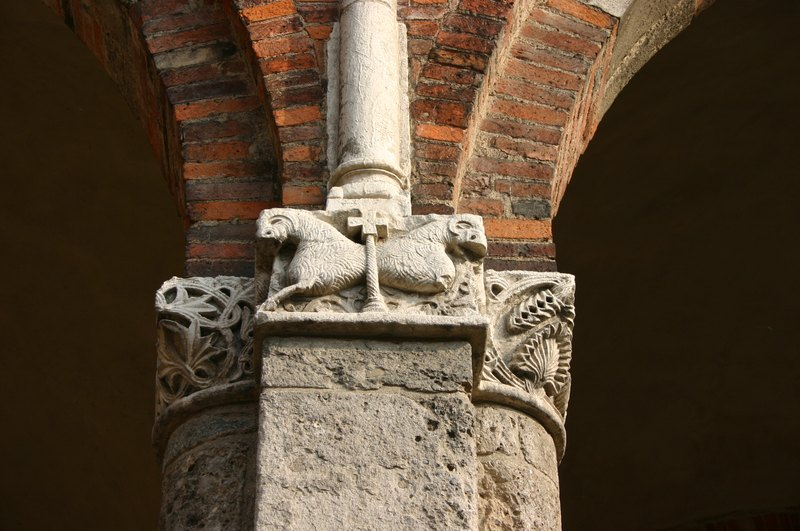
  <figcaption>Capital with two rams and a processional cross, late eleventh to early twelfth century. Milan, Sant'Ambrogio, narthex. Photo: Giovanni Dall'Orto, <a href="https://creativecommons.org/licenses/by-sa/2.5/it/deed.en">CC BY-SA 2.5 IT</a>, via Wikimedia Commons.</figcaption>
</figure>

The cross is the key to the programme. Riva recalls that the cult of the cross expanded in Milan between the eleventh and twelfth centuries, from the institution of the feast of the Exaltation of the Cross in 1053 through the years of the Pataria and the preaching of Arialdo, to the First Crusade, for which Milan raised its own expedition under Archbishop Anselm of Bovisio. The Milanese chronicler Landulf the Elder describes the processions of the clergy preceded by three lighted crosses.

In the eleventh century the cross meant above all victory over evil and the salvation brought by Christ. Crosses spring up among the ribbons and leaves of the capitals as signs of protection against the forces of evil, lurking in the dark forest of human life. A monk on one capital holds a cross on his breast while, on the adjoining face, two rampant animals try to attack him; the cross both marks him as a cleric and defends him.

Two great crosses occupy the shafts of two piers. On one, a cross is held by a lamb and inhabited by animals, with a bird walking upwards along it, the traditional image of the soul aspiring to paradise. On the other, near the portal, the cross stands alone; there, Riva writes, its protective function was felt by the faithful, who kissed and touched the holy cross before entering the church, and from which indulgences were distributed.

The pier to the right of the portal is carved only with sheep and cattle. On a corner of its base is the head of a ram with spiral horns; along its half-column an ox, seen from behind with its smiling face turned to the viewer, and a deer embrace the shaft above a processional cross; on its front capital two rams lie back to back, separated by a processional cross. Riva identifies the animals and reads them as the flock of Christ.

The ram, leader of the flock, was for Christian exegetes an image of the leaders of the Church, the apostles and the priests; as a sacrificial animal, especially when shown with the cross, it also recalls the sacrifice of Christ. The deer recalls the psalm "As the hart longs for the flowing streams, so longs my soul for thee, O God", sung for baptism and for the dead, and Ambrose himself wrote that Christians should become deer, following the voice of Christ. The ox, in Paul's reading of the Law, is the preacher who ploughs the hearts of men.

<figure>
  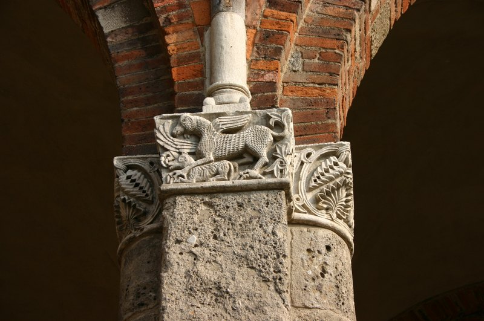
  <figcaption>Capital with a griffin seizing an animal, late eleventh to early twelfth century. Milan, Sant'Ambrogio, atrium. Photo: Giovanni Dall'Orto, <a href="https://commons.wikimedia.org/wiki/Template:Attribution">attribution licence</a>, via Wikimedia Commons.</figcaption>
</figure>

The cross is carried even by the animals of the flock. Riva reads the ox and the deer that seem to embrace the half-column of the pier, their bodies almost merging with the stone, as an image of the faithful who are compared in the New Testament to the living stones of the church: "like living stones be yourselves built into a spiritual house". The animals cling to the column as Christians cling to the cross, which Ambrose compared to the mast to which Ulysses was bound to resist the sirens.

## The Capitals of the Narthex: Predators and Monsters

Not all the animals are benign. On the capitals of the western side of the narthex, the side farthest from the façade, Riva lists scenes of tension: a dragon seizing an animal and dragging it away from the church, two monsters attacking a cleric, a serpent approaching a tree, a man beside a beast baring its teeth and a monstrous quadruped with a bird's face. Lions with serpent tails recall that the coming of the heavenly Jerusalem will not happen without the scourges of the Apocalypse.

<figure>
  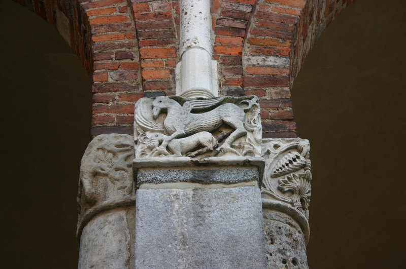
  <figcaption>Capital with a griffin seizing an animal, late eleventh to early twelfth century. Milan, Sant'Ambrogio, atrium. Photo: Giovanni Dall'Orto, <a href="https://commons.wikimedia.org/wiki/Template:Attribution">attribution licence</a>, via Wikimedia Commons.</figcaption>
</figure>

The griffin seizing an animal, which appears on more than one capital of the atrium, belongs to this repertory of predators. The winged monster with a bird's head and a lion's body stands over its prey, its scales and feathers rendered in fine striations. Edoardo Arslan traced such compositions to Islamic ivories, Sasanian textiles, Fatimid bronzes and Lombard brooches; Riva accepts the derivations but asks why such models were taken up in eleventh-century Milan, and answers with their meaning.

<figure>
  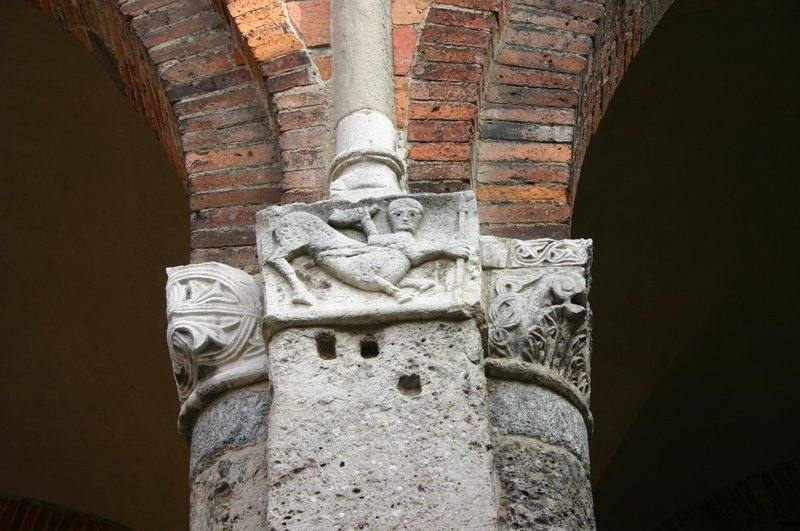
  <figcaption>Capital with a centaur, late eleventh to early twelfth century. Milan, Sant'Ambrogio. Photo: Giovanni Dall'Orto, <a href="https://creativecommons.org/licenses/by-sa/2.5/it/deed.en">CC BY-SA 2.5 IT</a>, via Wikimedia Commons.</figcaption>
</figure>

The centaur belongs to the same moral world. On the capital to the left of the portal, Riva describes a contrast between two kinds of music: on one side the just man who plays the cithara, on the other the centaur who plays the horn. It is the contrast between *musica bona* and *musica mala*, between the two roads that lie before every soul, the road to damnation and the road to salvation.

The carving of the original figured capitals has its own marks. Riva notes the thickness of the relief, the smooth bodies, the soft and somewhat irregular rendering of the plumage, and the use of small spheres of lead for the eyes, details absent from the work of the nineteenth-century restorers. The lions with lead eyes and tails passing between their legs and ending in an arrow recur on several capitals; where they are flat and schematic, they betray the hand of a restorer.

Riva's analysis also corrects earlier misreadings. Earlier writers saw in the animals of the portal pier a sow or apes baring their teeth at the faithful; Diego Sant'Ambrogio, in 1907, tried to explain the mixture of processional crosses and animals by the rogations, in which the priest blessed domestic animals and drove away wild beasts. Riva objects that the Milanese rogations, restored in the twelfth century as the Litanie Triduane, were city processions with other aims, and that the animals of Sant'Ambrogio carry meanings well known in a Milan where the *Physiologus* and the works of Ambrose were read.

The sources of the forms are as varied as their meanings. Géza De Francovich, in 1937, identified four sources of inspiration for Lombard Romanesque sculpture, valid for Como and Milan alike: Lombard carving of the early Middle Ages, oriental textiles, Ottonian goldsmiths' work and Burgundian sculpture. René Jullian, in 1945, stressed how the animals of Sant'Ambrogio are bent into bold deformations to fit the space of the capital.

Pietro Toesca had found the figured scenes clumsy, citing the scenes of the hunt and the dance, and praised instead the plastic sense of the vegetal and animal ornament. For Riva the body language of the animals, their poses, their gestures and the direction of their gaze, is never casual: the animal that presents its prey to the church and the animal that drags its victim away from it say opposite things.

The predators thus belong to a precise place in the programme. They are concentrated on the western side of the narthex, farthest from the church, where the world and its dangers are represented. As the visitor moves towards the portal, the monsters give way to the cross, the flock and the garden.

## The Capitals of the Narthex: The Garden of Paradise

The positive images multiply as the visitor approaches the church. On the capitals of the façade, Riva observes, the plant interlace becomes more intricate, the trees are loaded with large ripe fruit, and the abaci fill with flowers of every kind. This is the zone closest to the church, and it holds subjects that are essentially positive: an eagle, the two rams, two birds pecking at a tree, the lamb with the cross.

<figure>
  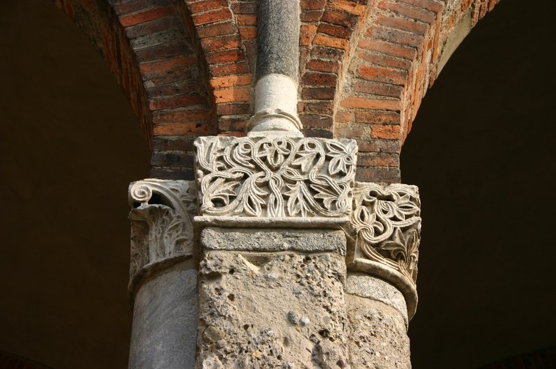
  <figcaption>Capital with interlaced stems and leaves, late eleventh to early twelfth century. Milan, Sant'Ambrogio. Photo: Giovanni Dall'Orto, <a href="https://commons.wikimedia.org/wiki/Template:Attribution">attribution licence</a>, via Wikimedia Commons.</figcaption>
</figure>

Most of the capitals of the atrium and narthex are vegetal. They derive from the Corinthian capital, with its volutes and leaves, but transform it into a dense web of ribbons, stems and foliage. Jane McKinne classified their types: Corinthianising capitals, capitals with one volute or two, with a central knot, with heads at the corners. Arslan admired their richness and their attention to rhythm and symmetry, which he considered characteristic of a distinct Milanese school.

<figure>
  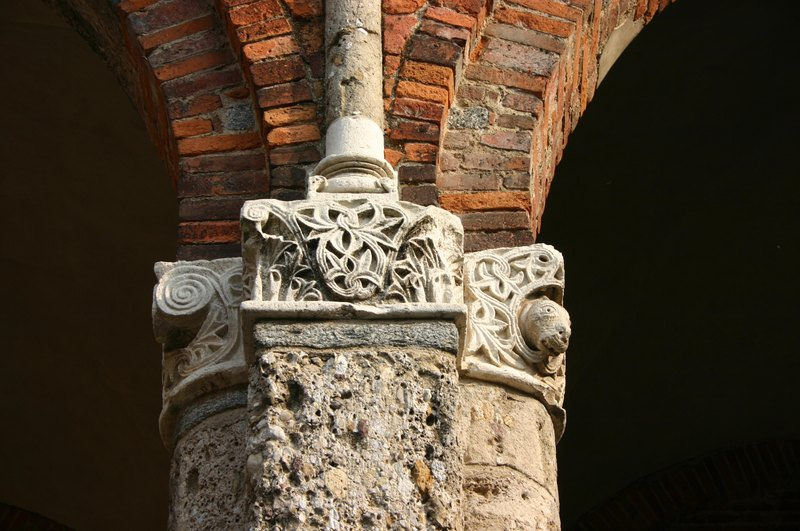
  <figcaption>Capital with interlace, a volute and a lion's head at the corner, late eleventh to early twelfth century. Milan, Sant'Ambrogio. Photo: Giovanni Dall'Orto, <a href="https://creativecommons.org/licenses/by-sa/2.5/it/deed.en">CC BY-SA 2.5 IT</a>, via Wikimedia Commons.</figcaption>
</figure>

Among the leaves appear pine cones, set at the centre of the capital or at its corners, and heads of animals projecting from the corners, like the lion's head on one of the capitals shown here. Riva notes that three identical capitals with a central pine cone flanked by two others set obliquely seem to have been made in series by the nineteenth-century restorers; the originals are distinguished by their irregular ribbons and their shallow relief.

<figure>
  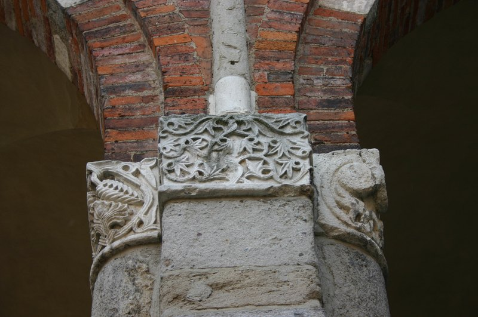
  <figcaption>Capital with vine scrolls, late eleventh to early twelfth century. Milan, Sant'Ambrogio. Photo: Giovanni Dall'Orto, <a href="https://creativecommons.org/licenses/by-sa/2.5/it/deed.en">CC BY-SA 2.5 IT</a>, via Wikimedia Commons.</figcaption>
</figure>

The vine is the most frequent plant. Riva recalls that the Church was founded by Christ, who is the vine, and by the apostles, who are the branches; the vine scrolls of the capitals and of the portal, with birds and animals feeding on the grapes, are images of the Church and of the Eucharist. Doves drinking from a chalice and animals feeding appear on other capitals of the narthex with the same meaning.

On the capitals of the compound piers flanking the portal the vegetation is richest. Riva describes flowers of various kinds among the vine scrolls, trees with very large leaves falling symmetrically on either side of the trunk, and richer versions of the tree with two pine cones and four leaves. These, she writes, are images of the garden of delights, the earthly paradise that opens its doors again to mankind.

The tree has a double meaning. It is the tree of life of the heavenly Jerusalem, from which the blessed will eat; and it is the cross, the wood of salvation. In the story of the *Physiologus*, which circulated in Milan, the dove pursued by the dragon finds refuge among the branches of a leafy tree; on a capital of the narthex two lions guard a schematic tree, which Riva identifies as the guardians of the tree of life.

Angels appear twice on the capitals: on one, two angels in flight carry a round loaf of bread; on another, two angels display a solar wheel, the symbol of Christ. Lions stand guard beside them. The bread recalls the Eucharist, the wheel the light of Christ, and both are placed, like the Lamb of the portal, in a zone of the narthex that announces the heavenly city.

An eagle with spread wings, its beak damaged and its plumage fine and irregular, appears on a corner capital of the façade side; Riva considers it original. The eagle, which in the tradition of the *Physiologus* renews its youth by flying towards the sun and plunging into water, was an image of baptism and of the soul rising to God, and it belongs, with the lion and the deer, to the baptismal imagery that runs through the narthex.

## A Programme between Judgement and Paradise

Riva's central thesis is that the sculpture of the narthex forms a single programme, which places the church in the long tradition that saw the church building as an image of the heavenly Jerusalem. The tradition, she shows, goes back to the early Christian period, is transmitted by the Fathers, is present in the liturgy and was taken up by Romanesque art.

Its scriptural root is the dream of Jacob at Bethel, where a ladder reached from earth to heaven and Jacob, waking, said: "This is none other than the house of God, and this is the gate of heaven." The liturgy of the dedication of churches, Riva recalls, called the church the hall of the King and the shining gate of heaven, which receives all who seek the homeland of life, and read the passage of the Apocalypse on the new Jerusalem descending from heaven.

The space before the church was charged with the double meaning of welcome and exclusion. Its medieval name, *galilea*, recalled both the land of the gentiles and the place where Christ began and ended his mission. Baptism, funeral rites and the reconciliation of penitents were celebrated before the doors of the church, and all of them were passages from one state to another, never separated from the idea of judgement.

The programme of Sant'Ambrogio follows a hierarchy that rises from the atrium to the narthex, the nave, the choir and the apse. The outside of the church represents the world, with its dangers and temptations; the inside, the new paradise, the dwelling of the elect. In the narthex, Riva shows, the capitals of the western side, farthest from the church, hold the images of danger, while those of the façade and the portal hold the images of salvation.

The programme opens at the top of the façade, with the cross containing Alpha and Omega, the words with which Christ in the Apocalypse calls himself the beginning and the end. At the summit of the central arch of the narthex is the blessing hand of God, as if to recall that only the elect will pass that threshold. Judgement is shown twice: on the bases of the main arch, where two lions stand over two animals, one protecting its prey and presenting it to the church, the other subduing its victim and barring its entry; and on the lintel of the south portal, where damnation is a serpent and election a lion.

Between danger and salvation stands the cross. The cleric besieged by evil holds it close; the soul, in the form of a dove, rests on it and climbs upward. The tree and the vine are the Church, outside which there is no safe path; the sacraments, above all baptism and the Eucharist, are the means of the Christian's ascent. The constant presence of the cross, the tree and the lamb, even on the western side of the narthex, gives the whole programme a hopeful tone.

The message culminates at the portal. The piers and capitals flanking it show the flock of Christ and the choice between two kinds of music; the lintel and the archivolt show the beatitude of heaven, the Lamb on his throne among the four living creatures, the animals feeding among the vines, the eagles at the summit. The path the faithful must follow begins with baptism, continues with prayer and penance, and ends with death, the passage to eternal life.

Riva's reading places the programme in the Milan of the early twelfth century, in the years of the Crusade and of the expansion of the cult of the cross, in a city where the *Physiologus* and the works of Ambrose circulated. It gives a meaning to sculpture that older scholarship had treated as decoration, and makes the narthex of Sant'Ambrogio one of the most coherent sculptural programmes of Lombard Romanesque art.

## The Interior

Through the central portal the visitor enters a nave of great breadth and solemnity. The Romanesque church is divided into three aisles by massive compound piers, which carry the transverse arches and the ribs of the vaults. The arches are outlined in alternating bands of brick and white stone, and the walls of the nave rise to galleries over the aisles, opening on the nave through arcades.

The nave is covered by a sequence of square rib vaults, each spanning one bay of the nave and two of the aisles. The vaults, heavy and slightly domed, rest on the stronger piers; the lighter piers between them carry the arcades of the aisles. This system of alternating supports, of square bays and of rib vaults is what made Sant'Ambrogio the reference point of the debate on the origins of the rib vault in Lombardy.

The last bay of the nave, before the presbytery, is covered by an octagonal tower, the *tiburio*, which rises over the roofs and lights the space around the altar. Its exterior, with two tiers of small open arcades, is one of the characteristic features of the church's silhouette, visible in the photograph published by Cummings in 1901. The regional catalogue records that Pellegrino Tibaldi modified its lantern and the coffered decoration of the dome inside.

The presbytery is raised above a crypt, which holds the relics of Ambrose, Gervasius and Protasius. The regional catalogue records that from 1863, during the nineteenth-century restoration, work was done in the choir and presbytery, and the ciborium was raised to enlarge the crypt. Behind the altar the apse opens with its mosaic.

The aisles were transformed in the Renaissance. When the Cistercians took over the monastery at the end of the fifteenth century, according to the regional catalogue, the side walls were opened to create seven chapels on the north side and three on the south, and the apse of the right aisle was demolished to make way for the chapel of Santa Giustina. The nineteenth-century restorers removed some of these additions in their search for the Romanesque church.

In 1123 four chapels are documented in the basilica: those of the Deposition, of San Bartolomeo, of San Giorgio and of San Satiro. The last recalls the brother of Ambrose, who was buried in the ancient chapel of San Vittore in Ciel d'Oro, where the fifth-century mosaics survive.

The furnishings of the nave are concentrated along its axis. On the left side of the nave stands the pulpit, raised on a portico of columns over the sarcophagus called of Stilicho. At the end of the nave, under the octagonal tower, rises the ciborium, and beneath it the golden altar. The visitor who enters by the central portal sees the pulpit on the left and the ciborium straight ahead.

This alignment is the result of a long history. The sarcophagus has stood in its place since the fourth century and follows the axis of the early Christian basilica; the pulpit rebuilt above it at the end of the twelfth century follows the axis of the Romanesque church; the altar and the ciborium mark the place of the tomb of Ambrose. The interior of Sant'Ambrogio is a palimpsest of the basilica's successive phases.

## The Ciborium

<figure>
  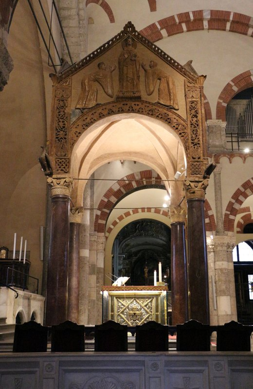
  <figcaption>The ciborium over the golden altar, columns of the fourth to sixth century, stucco gables of the ninth century. Milan, Sant'Ambrogio. Photo: Sailko, <a href="https://creativecommons.org/licenses/by/3.0/">CC BY 3.0</a>, via Wikimedia Commons.</figcaption>
</figure>

The ciborium is a canopy that stands over the high altar and the tomb of Ambrose. It rests on four columns of red Egyptian porphyry, set on bases of granite and crowned by capitals of white marble. The regional catalogue dates the columns, capitals and bases to the fourth to sixth centuries: they are reused pieces of late antiquity, perhaps from the early Christian basilica itself.

Above the columns rises a dome of brick reinforced with ribs, hidden on the outside by four gables. The gables, one on each side, are decorated with reliefs in stucco, a mixture of clay and red ochre modelled in relief and painted. The regional catalogue dates the stucco decoration to the ninth century, and links it with the golden altar of Wolvinius placed beneath it.

Each gable carries a scene. On the side towards the nave, Christ enthroned hands the Gospel to Saints Peter and Paul, the *Traditio legis*. On the side towards the choir, Saint Ambrose stands between Gervasius and Protasius, who present to him a deacon and a bishop bowing before him. On the side towards the left aisle, the Virgin stands holding a crown, with the dove of the Holy Spirit above her head, between two women in prayer. On the side towards the right aisle, a crowned bishop is crowned by a hand from heaven, with two crowned figures, perhaps emperors, bowing to him.

<figure>
  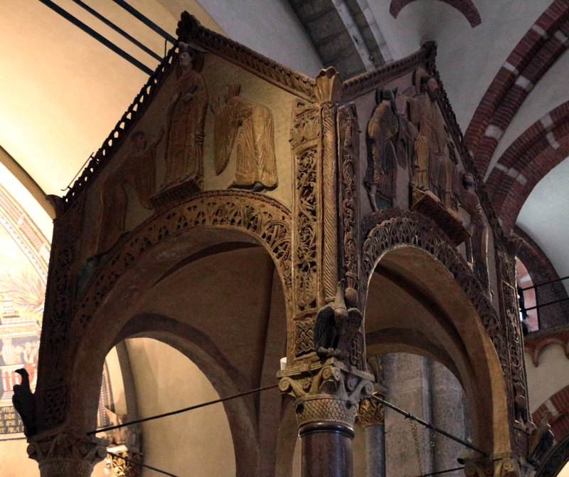
  <figcaption>The ciborium, two of the stucco gables and the ornament of the arches, ninth century. Milan, Sant'Ambrogio. Photo: Sailko, <a href="https://creativecommons.org/licenses/by/3.0/">CC BY 3.0</a>, via Wikimedia Commons.</figcaption>
</figure>

The arches below the gables are framed by bands of stucco ornament: leaves, palmettes, interlace and knots, gilded and painted. Eagles stand at the corners above the capitals. The figures of the gables are in high relief, almost detached from the ground, and their drapery falls in long parallel folds.

The gables are anonymous. The regional catalogue records that critics have distinguished three hands among them, on stylistic grounds. Adriano Peroni studied the stucco sculpture in 1972, and a monograph on the ciborium was published in 1981 under the direction of [Carlo Bertelli](/scholars.html#bertelli-carlo), after the restoration of 1977–1979.

The ciborium has been repaired many times. The regional catalogue records interventions in the fourteenth century, when the gable walls were repaired after material had fallen, with stucco fills, repainting, blue backgrounds and gilded figures; in the seventeenth century, on the front gable, the arches and the ribs; in 1873, with stucco replacements, altered colours, ultramarine backgrounds and metal stars on the vault; and in 1945–1950, with small fills after the removal of the anti-bomb protections.

The restoration of 1977–1979, carried out by the Soprintendenza of Milan under Carlo Bertelli, cleaned the gables, removed the nineteenth-century repainting and the altered varnishes, took away added plaster and reintegrated losses with watercolour. It returned the stucco to a state closer to the medieval one, though the layers of seven centuries of repair cannot be fully undone.

The ciborium joins the two themes of the basilica: the universal Church, in the *Traditio legis* of Christ to Peter and Paul, and the Church of Milan, in Ambrose receiving the homage of its clergy between the martyrs he discovered. Placed over the tomb, it made the altar of Sant'Ambrogio a shrine as well as a place of the liturgy.

## The Golden Altar and the Apse Mosaic

<figure>
  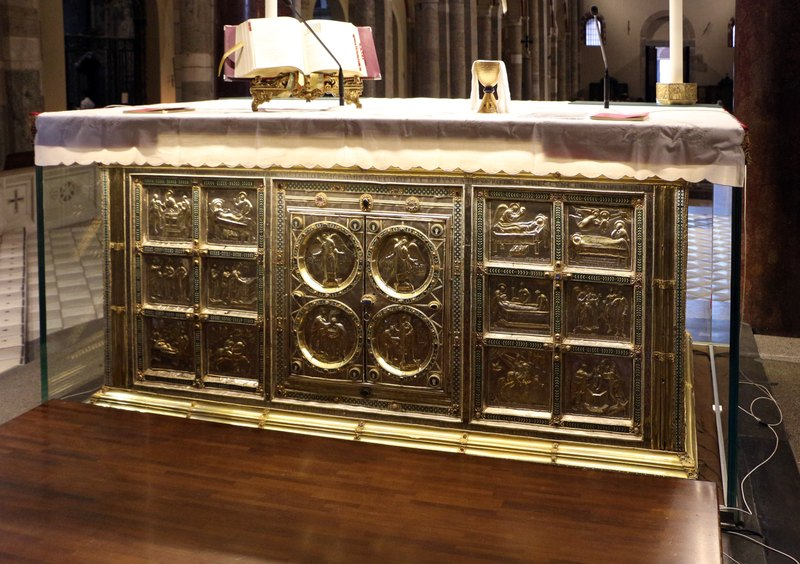
  <figcaption>Wolvinius, golden altar, back, 824–859, silver gilt, gold, enamels and gems. Milan, Sant'Ambrogio. Photo: Sailko, <a href="https://creativecommons.org/licenses/by/3.0/">CC BY 3.0</a>, via Wikimedia Commons.</figcaption>
</figure>

The golden altar stands under the ciborium, directly over the tomb. It was commissioned by Archbishop Angilbert II, who held the see from 824 to 859, and it is signed on the back by Wolvinius, *magister phaber*. It is a wooden chest covered on all four sides with plates of gold and silver gilt, enamels and gems.

The front, towards the nave, is of gold, with Christ in glory among the symbols of the evangelists and the apostles, and twelve scenes of the life of Christ. The short sides carry saints and angels. The back, towards the apse and the clergy, is of silver gilt and is devoted to Ambrose: in the centre a pair of doors, the *fenestella*, opened onto the tomb below, and on either side twelve scenes narrate the life of the saint.

On the doors, four medallions show the archangels Michael and Gabriel and, below, Ambrose crowning Archbishop Angilbert, who presents the altar, and Ambrose crowning Wolvinius. The image of the maker beside the patron, both received by the saint, is almost unique in early medieval art.

The twelve scenes of the back follow the *Life of Ambrose* by Paulinus, with one exception: the two scenes of Ambrose at the funeral of Martin of Tours, a legend first told by Gregory of Tours. The scenes are discussed one by one on the site's page on [Saint Ambrose](/Content/Saints/Saint-Ambrose.html).

The regional catalogue distinguishes the hand of Wolvinius, on the back, with its firm contours, solid figures and empty pauses around them, from the hands of the other masters who made the front, closer to Byzantine art and to manuscript painting. The altar was restored in 1982–1983 and placed in a glass case designed by the architect Caccia Dominioni.

<figure>
  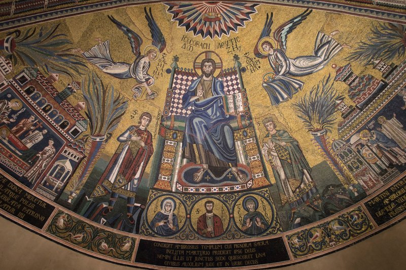
  <figcaption>Apse mosaic with Christ enthroned between Saints Protasius and Gervasius and scenes of Ambrose at Tours and Milan. Milan, Sant'Ambrogio. Photo: Dominik Matus, <a href="https://creativecommons.org/licenses/by-sa/4.0/">CC BY-SA 4.0</a>, via Wikimedia Commons.</figcaption>
</figure>

The apse is covered with a mosaic of Christ enthroned, blessing, with an open book inscribed EGO SUM LUX MUNDI, between the archangels Michael and Gabriel and the martyrs Protasius and Gervasius. Below the throne three medallions show Marcellina, Satyrus and Saint Candida; at the two ends of the apse, Ambrose appears at the burial of Martin in Tours and asleep at the altar in Milan.

The regional catalogue reconstructs a long history for the mosaic: a composition perhaps conceived in the time of Ambrose, remade in the Carolingian period, damaged by subsidence between 1190 and 1198 and partly remade early in the thirteenth century, reworked again in the fourteenth, heavily restored in the nineteenth, and partly destroyed by a bomb in 1943, after which it was rebuilt following the earlier iconography. A thin red line separates the surviving original parts from the restorations.

The altar, the ciborium and the mosaic form a single ensemble around the tomb. The mosaic shows the martyrs whose relics lie below, and the bishop who placed them there; the altar narrates his life above his body; the ciborium crowns both. In the eyes of the Milanese, the presbytery of Sant'Ambrogio was the visible presence of their patron.

## The Pulpit

<figure>
  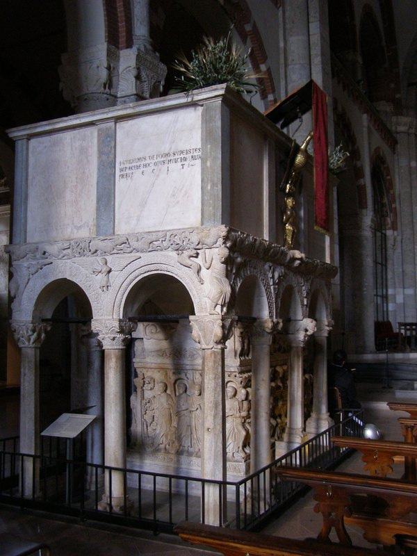
  <figcaption>Pulpit of Sant'Ambrogio, recomposed by Guglielmo da Pomo, 1196–1201, above the late Roman "sarcophagus of Stilicho". Milan, Sant'Ambrogio. Photo: Andrzej Otrębski, <a href="https://creativecommons.org/licenses/by-sa/3.0/">CC BY-SA 3.0</a>, via Wikimedia Commons.</figcaption>
</figure>

The pulpit of Sant'Ambrogio is the only medieval pulpit preserved in a church of Milan. The regional catalogue describes its unusual structure: the upper chest, made of smooth marble slabs joined by plain marble pilasters, does not stand on the ground but on a richly carved portico, carried by seven columns with decorated capitals.

An inscription on one of the slabs, on the left side of the pulpit, records that the work was carried out by Guglielmo da Pomo: GUGLIELMUS DE POMO SUPERSTES HUP ECCLE HOC OPUS MULTAQUE ALIA FIERI FECIT. According to the regional catalogue, the earlier pulpit collapsed in 1196, and the new one was finished by 1201.

The work of Guglielmo was not the carving of new sculpture but the recomposition of the old. The regional catalogue explains that the rebuilding reused materials from the damaged pulpit and, to complete its bold composition, marbles from the older basilica, of different types and subjects. The frieze of the portico, with its animals, interlace and figures, was recovered in this way.

On the long side towards the nave, the chest is decorated with two figures in embossed copper: a beardless man with curly hair, seated on a throne with a book, looking up towards an eagle holding a book above him. They have been identified as the symbols of the evangelists Matthew and John, the angel and the eagle; the angel has lost its wings. The regional catalogue records that their date and origin are unknown, and that many scholars doubt they belonged to the original pulpit.

The pulpit was built so that the sarcophagus beneath it remained visible. The sarcophagus called of Stilicho is one of the few surviving witnesses of the basilica built by Ambrose, and it has stood in its present place since the fourth century. It follows the orientation of the early Christian church, whereas the pulpit above it follows the axis of the medieval building.

The sarcophagus is of the type called "with city gates", with urban gateways as the background of its carved scenes. It was probably imported from Rome or made by craftsmen of Roman culture. Its traditional name derives from the belief that it held the remains of Stilicho, the commander of the Western Roman army; in the centre of the high front of its lid a medallion held by two cupids shows the deceased couple, the husband in a cuirass and military cloak turned towards his wife, who leans on his arm, elegantly dressed and adorned with jewels.

The regional catalogue records three restorations of the pulpit: in 1866–1869, when its marble staircase was replaced and some columns and capitals were remade; in 1943–1949, under Ferdinando Reggiori, with cement fills, consolidation with colophony resin and a coat of wax and oil on the sarcophagus; and in 2000, under Maria Chiara Ceriotti, which removed the oily layer and the altered fills and consolidated the surfaces.

Barbara Natoli has proposed that one of the reliefs of the pulpit, the so-called Last Supper or Agape, should be attributed to Anselmus, the sculptor of the Porta Romana, and inserted in a reworking of the pulpit ordered by Archbishop Galdino della Sala in 1174. Her proposal is discussed on the site's page on [Anselmo](/Content/Artists/XII-c/Anselmo.html).

## Later Transformations

At the end of the fifteenth century the monastery of Sant'Ambrogio was in decline. The regional catalogue records that in 1487 the abbey was in decay, and that in 1489 it was given in commendam to Cardinal Ascanio Sforza, brother of Ludovico il Moro. The cardinal called Donato Bramante, then working in Milan, to rebuild the residence of the canons and the monastery.

Bramante designed the canonica, begun in 1492 with its portico and capitals, the Doric and Ionic cloisters of the monastery and its library. According to the regional catalogue, his intervention gave the complex its Renaissance form, though the cloisters were built after he had left Milan. The portico of the canonica, along the north side of the church, is the part of his work most closely connected with the basilica.

In 1497 the Benedictines were replaced by Cistercians from the abbey of Chiaravalle. The first stone of the new monastery buildings was laid on 9 May 1498. In the basilica, as noted above, the side walls were demolished to create seven chapels on the north side and three on the south, and the apse of the right aisle gave way to the chapel of Santa Giustina.

At the beginning of the seventeenth century Cardinal Federico Borromeo, archbishop of Milan, promoted the restoration of the complex. According to the regional catalogue, Pellegrino Tibaldi modified the lantern and the coffered decoration of the dome. Between 1631 and July 1632 Francesco Maria Richini restored the atrium, rebuilding some of its vaults and its upper arcading; in 1630 a second cloister was built.

The seventeenth-century restorers remade many capitals of the north arm of the atrium. Riva shows that they imitated the Romanesque subjects visible in the basilica, the lamb with the cross, dragons with serpent tails, sirens and addorsed animals, but carved them in the softer, rounder style of their own time and removed the abaci. These capitals are recognisable today among the originals.

In 1789 the chapter was suppressed by the Cisalpine Republic, and the buildings of the monastery were used first as barracks and then as a military hospital. Church and chapter were restored in 1799, with the return of Austrian rule. A first campaign of maintenance was completed by the fourth decade of the nineteenth century.

The canons' bell tower, begun in 1128, remained unfinished for more than seven centuries. It was completed in the nineteenth century, and the works on Bramante's canonica, begun in 1892, were concluded in 1926. In 1932 the Università Cattolica del Sacro Cuore acquired the area of the former monastery; today the complex holds the church, the university and private dwellings.

These transformations made Sant'Ambrogio a layered monument, in which the Romanesque church, the Renaissance canonica and cloisters, the Baroque restorations and the nineteenth-century reconstructions stand side by side. Much of what the visitor sees as medieval is in fact the result of later interventions, and the study of the building begins with the study of its restorations.

## Restoration and War

The great restoration of the basilica took place in the second half of the nineteenth century. The regional catalogue dates it to 1857–1876, under the provost Francesco Maria Rossi and the architect Gaetano Landriani; Riva gives 1858–1881. Its purpose was to restore the Romanesque church by removing everything that was not medieval.

The restorers dug a cavity around the walls to protect them from water infiltration, removed the side chapels added in the Renaissance and Baroque periods, and worked on the choir and presbytery, raising the ciborium to enlarge the crypt. In 1858 they restored the mosaics and structures of the chapel of San Vittore in Ciel d'Oro.

Their treatment of the sculpture was radical. Many capitals of the atrium and narthex were remade, some entirely, some by adding new pieces to the originals. The restorers sought to deceive the eye, and Riva shows how difficult it is today to distinguish their work from the medieval carving. The letters of the provost Rossi, published in 1884, are among the sources that allowed Adriana Summa to identify the remade capitals.

The engravings made by Fernand De Dartein before and during the restorations remain fundamental, Riva notes, for the study of the sculpture, because they record the capitals before the nineteenth-century interventions. The restoration also produced the photographs and drawings on which later scholars relied.

In 1921 the architect Ferdinando Reggiori, of the Soprintendenza, began to work on the complex, and continued until 1941. His studies, published in 1945 and 1966, are a principal source for the history of the building. Reggiori drew the plan of the church during the restorations that Riva cites for the irregular walls of the narthex.

In 1943 the bombing of Milan struck the basilica, above all its outer portico and the dome. A bomb destroyed a large part of the apse mosaic, including the figure of Christ, part of the throne and the left-hand angel. The ciborium had been shielded by anti-bomb protections, which were removed between 1945 and 1950.

After the war Reggiori directed the reconstruction. According to the regional catalogue, he rebuilt the abbot's house, worked on the canons' bell tower, enlarged the foundations, restored many chapels on the right side, and consolidated the atrium of Anspert and the ciborium over the golden altar. The apse mosaic was reassembled following the earlier iconography.

The restorations continued in the following decades: the ciborium in 1977–1979, the golden altar in 1982–1983, the pulpit in 2000. Each of them has removed some of the layers added by earlier interventions and returned the works to a state closer to their medieval appearance, while recording what had been lost.

## The Study of the Basilica

The literature on Sant'Ambrogio begins with the guides to Milan. Carlo Torre, in *Il ritratto di Milano* (1674), dismissed the capitals of the atrium as the work of rough chisels with poorly designed figures and ornaments. Servilliano Latuada, in 1737, described the animals of the portal, some of them upside down, as remains of pagan temples placed there in contempt.

The Dominican Giuseppe Allegranza, in 1757, was the first to reject this judgement. He analysed the sculpture of the narthex as sacred monuments with a religious message, drawing on the Bible and the Fathers, though, as Riva observes, he sometimes saw subjects that do not exist. Giulio Ferrari, in 1824, mocked his interpretations and returned to the traditional view of the carvings as the foolish caprice of the sculptors.

The nineteenth century brought the great architectural studies. Fernand De Dartein identified some subjects and distinguished two phases of the sculpture; Celeste Clericetti, in 1869, compared the capitals of Sant'Ambrogio with those of Santa Maria in Aurona and dated both to the eighth century. Raffaele Cattaneo, in 1888, moved the church to the second half of the eleventh century and opened the debate on its dating.

Carlo Romussi, in 1897, defended the contemporaneity of the portal slabs and the atrium and offered moral readings of the figures. Diego Sant'Ambrogio, in a series of articles, was the first to consider the public for whom the sculpture was made and the liturgy that took place in the atrium. Giovanni Teresio Rivoira, in 1908, supported the eleventh-century date and compared the sculpture with that of Pavia and Modena.

[Arthur Kingsley Porter](/scholars.html#porter-arthur-kingsley)'s *Lombard Architecture* (1915–1917) gave the fullest account of the building's history, though it recorded only the most evident subjects of the sculpture. [Pietro Toesca](/scholars.html#toesca-pietro), in 1927, compared the portal with Armenian and Islamic architecture, and Géza De Francovich, in 1935 and 1937, defined a Comasque current of Lombard Romanesque sculpture distinct from the Emilian school of Wiligelmo.

Edoardo Arslan, in his essay on Romanesque sculpture in the *Storia di Milano* of the Fondazione Treccani (1954), isolated an independent Milanese school, with Sant'Ambrogio as its principal witness, and placed the capitals around 1080. Jane Elliot McKinne, in 1985, refined the chronology and placed the capitals of the narthex and the atrium in a campaign concluded around 1110.

From the late 1980s the restorations moved to the centre of attention. Roberto Cassanelli (1988) and Adriana Summa (1995) distinguished the original Romanesque capitals from those of the seventeenth and nineteenth centuries. The volume edited by Carlo Bertelli, *La basilica di S. Ambrogio: il tempio ininterrotto* (1995), gathered the results of the research, and Carlo Capponi's guide (2003) offers a modern account of the whole complex.

[Laura Riva](/scholars.html#riva-laura)'s *Alle porte del paradiso* gives the sculpture of the narthex the attention long reserved for the architecture. Building on Summa's distinction between originals and copies, she reads the capitals, the piers and the portal as a single programme, a path from the dangers of the world to the gate of the heavenly Jerusalem, set in the religious culture of Milan in the early twelfth century.

## Catalogue Entry

**Name:** Basilica of Sant'Ambrogio (Basilica Martyrum; Basilica Ambrosiana), Milan.

**Foundation:** By Ambrose, c. 379; relics of Gervasius and Protasius deposited 386; Ambrose buried 397.

**Main phases:** Benedictine monastery from 784 (monks' bell tower); golden altar and stucco gables of the ciborium, ninth century; Romanesque nave with rib vaults, eleventh century; narthex doubled and atrium completed, late eleventh to early twelfth century; canons' bell tower, 1128–1144 (completed in the nineteenth century); pulpit recomposed, 1196–1201; Bramante's canonica, from 1492; Richini's restoration of the atrium, 1631–1632; restoration of 1857–1876 (regional catalogue) or 1858–1881 (Riva); bombing of 1943 and reconstruction under Ferdinando Reggiori.

**Sculpture of the narthex:** capitals with the cross, the lamb, rams, an ox and a deer, lions guarding the tree, angels with bread and with a solar wheel, a monk assailed by monsters, griffins and dragons seizing animals, a centaur and a player of the cithara; central portal with the Lamb among the four living creatures on the lintel and eagles at the top of the archivolt. Many capitals remade in 1630–1632 and in the nineteenth century.

**Furnishings:** golden altar of Wolvinius, 824–859; ciborium with porphyry columns of the fourth to sixth century and stucco gables of the ninth century; apse mosaic, Carolingian with later remakings; pulpit of Guglielmo da Pomo over the sarcophagus called of Stilicho; mosaics of San Vittore in Ciel d'Oro, fifth century.

**Bibliography:** C. Torre, *Il ritratto di Milano*, 1674; V. Forcella, *Iscrizioni delle chiese e degli altri edifici di Milano dal secolo VIII ai giorni nostri*, III, Milano 1890, p. 276; S. Latuada, *Descrizione di Milano*, 1737; G. Allegranza, 1757; F. De Dartein, *Étude sur l'architecture lombarde*, 1865–1882; R. Cattaneo, 1888; G. T. Rivoira, 1908; A. K. Porter, *Lombard Architecture*, 1915–1917; P. Toesca, 1927; F. Reggiori, *La basilica di Sant'Ambrogio a Milano*, 1945 and 1966; E. Arslan, "La scultura romanica", in *Storia di Milano*, III, 1954; A. Peroni, on the stuccoes, 1972; C. Bertelli et al., on the ciborium, 1981; J. E. McKinne, 1985; R. Cassanelli, 1988; A. Peroni, 1988; C. Bertelli (ed.), *La basilica di S. Ambrogio: il tempio ininterrotto*, 1995; A. Summa, "La decorazione medievale di Sant'Ambrogio", 1995; C. Capponi, *La basilica di Sant'Ambrogio a Milano: guida storico-artistica*, 2003; L. Riva, *Alle porte del paradiso. Le sculture del vestibolo di Sant'Ambrogio a Milano*; Lombardia Beni Culturali, catalogue records LMD80-00028 (basilica), 3o210-01282 (pulpit), 3o210-01283 (apse mosaic), 3o210-01284 (ciborium), 3o210-01285 (golden altar).
