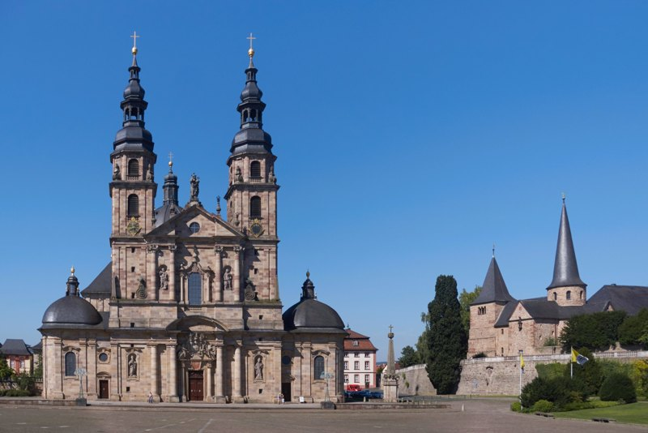
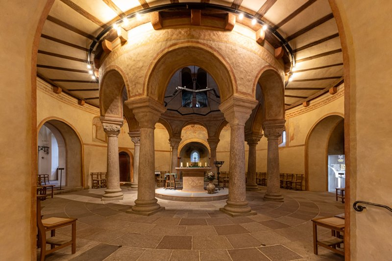
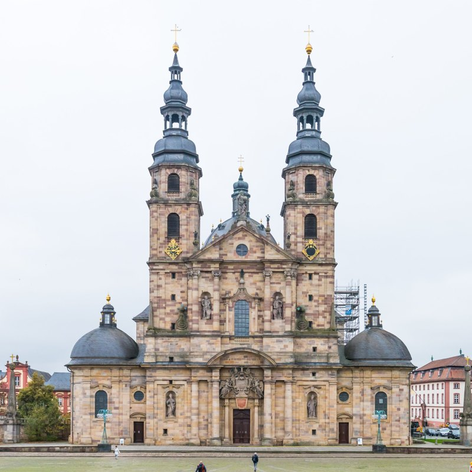
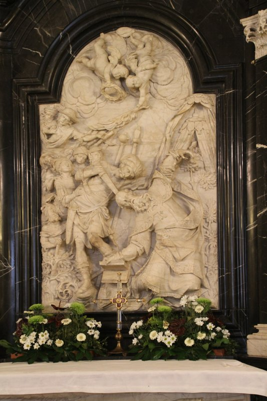
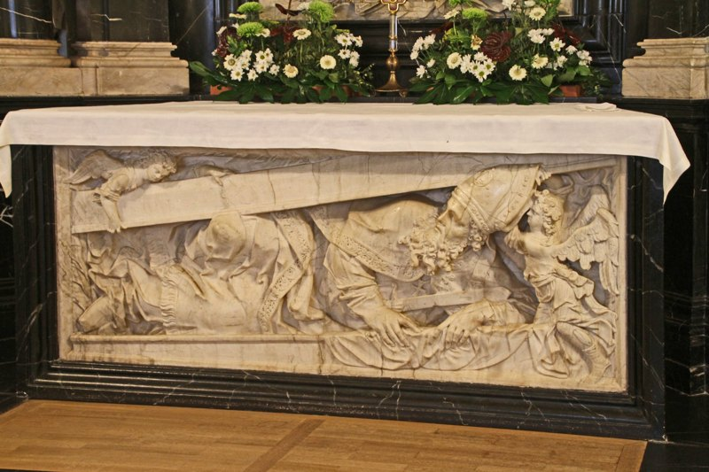
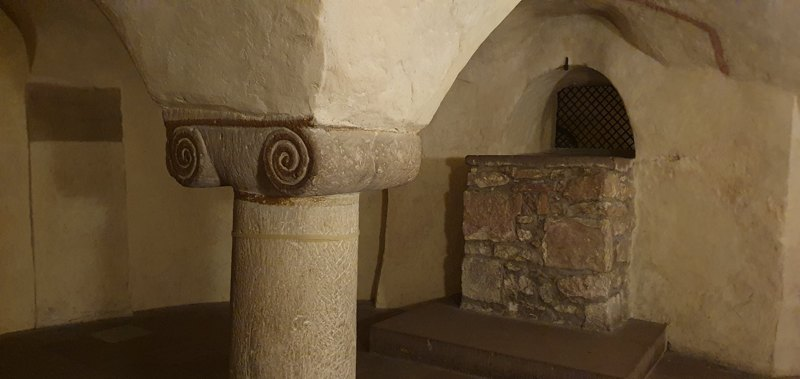
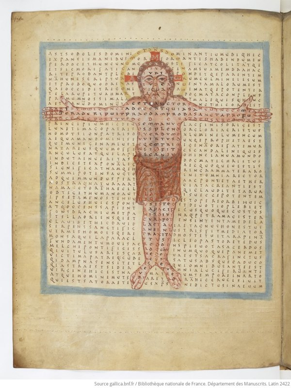
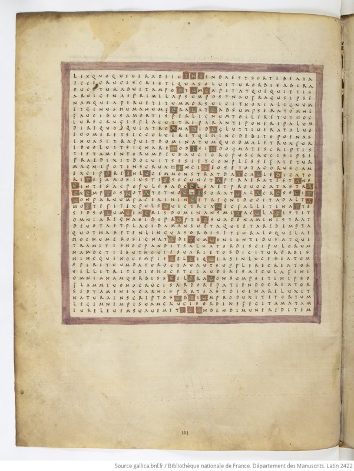
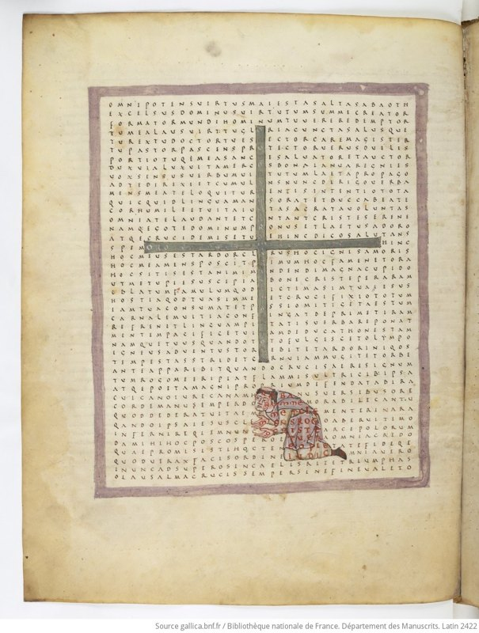

## Boniface, Sturmi and the Foundation

Fulda owes its existence and its fame to Boniface, the Anglo-Saxon monk Wynfrith of Wessex who, as missionary, papal legate and archbishop, reorganised the Church east of the Rhine in the first half of the eighth century. In the 740s Boniface sought a place in the forests of Buchonia, on the river Fulda, where he could found a monastery under the Rule of Saint Benedict that would serve as a spiritual centre for the mission and as a retreat for himself. The site was found by his disciple Sturmi, a Bavarian, and the monastery was founded on 12 March 744 on land granted by the Frankish mayor of the palace Carloman. Sturmi became its first abbot and held the office until 779.

Boniface obtained for the new house a privilege from Pope Zacharias in 751, which placed it under the direct protection of the Holy See. When he was killed with his companions by a band of Frisians near Dokkum on 5 June 754, his body was brought to Fulda, according to his own wish, and buried in the abbey church. The tomb of the martyr transformed the monastery: it became a place of pilgrimage, attracted donations from all over the Frankish kingdom, and gave Fulda a prestige that it retained through the Middle Ages and beyond. The claim, still found in popular accounts, that the abbey was founded by Charlemagne is impossible: Charlemagne was then a small child.

Under Sturmi and his successor Baugulf (779–802), Fulda grew rapidly in numbers and wealth. It was Baugulf who received Charlemagne's<a href="/endnotes.html#fn-charlemagne" class="footnote">1</a> letter *De litteris colendis*, written around 780–800 and probably drafted with the help of Alcuin<a href="/endnotes.html#fn-alcuin" class="footnote">2</a>, in which the king urged bishops and abbots to cultivate learning so that their monks could understand and correctly copy the sacred texts. The letter survives in the copy addressed to Fulda and has become the emblematic document of the Carolingian programme of education.

## The Ratgar Basilica

<figure>
  
  <figcaption>Fulda, the cathedral square with the Baroque cathedral (left), built on the site of the Ratgar basilica, and St Michael’s Church (right). Photo: Verum, <a href="https://creativecommons.org/licenses/by-sa/3.0/">CC BY-SA 3.0</a>, via Wikimedia Commons.</figcaption>
</figure>

The first church of Sturmi was soon too small for the community and for the pilgrims. In 791, under Baugulf, work began on a new abbey church, which was continued with great ambition by his successor Ratgar (802–817), a monk-architect, and consecrated in 819. The building, known after him as the Ratgar basilica, was among the largest churches north of the Alps, nearly a hundred metres long. Its most remarkable feature was its western end: a great transept and an apse placed at the west, over the tomb of Boniface, in deliberate imitation of Old St Peter's in Rome, where the tomb of the apostle lay in the western apse. Richard Krautheimer made the Ratgar basilica a principal example of the "Carolingian revival of Early Christian architecture": Fulda presented itself as a Roman church and Boniface as an apostle comparable to Peter.

The cost of the building weighed heavily on the community. In 812 the monks addressed to Charlemagne the *Supplex libellus*, a petition complaining of excessive labour and of the neglect of the liturgy and of study, and in 817 Ratgar was deposed. His successor Eigil (818–822) completed the church and had the west apse painted; the painter was the monk <a href="/Content/Artists/IX-c/Candidus-of-Fulda.html">Brun Candidus</a>, who records his work in his verse life of Eigil. The Ratgar basilica survived, with later alterations, until 1704, when it was demolished to make way for the present cathedral.

## Eigil and St Michael's Church

<figure>
  
  <figcaption>Fulda, St Michael’s Church, the rotunda, built 820–822 under Abbot Eigil and raised in the tenth and eleventh centuries. © Superbass / <a href="https://creativecommons.org/licenses/by-sa/4.0/">CC BY-SA 4.0</a> (via Wikimedia Commons), <a href="https://commons.wikimedia.org/wiki/File:2024-11-01-Kirche_St._Michael_in_Fulda-0084.jpg">original</a>.</figcaption>
</figure>

Eigil also built, on a rise to the north of the abbey church, the cemetery chapel of the monks, dedicated to Saint Michael and completed in 820–822. It is the only Carolingian building of Fulda that survives. Its core is a rotunda: a ring of eight columns surrounding a central space, enclosed by an ambulatory, above a crypt. The circular plan recalls the Anastasis rotunda over the Holy Sepulchre in Jerusalem, and its meaning as the burial chapel of the community, consecrated to the archangel who weighs souls and leads them to paradise, has been read in this light.

The church was enlarged in the tenth and eleventh centuries: the rotunda was raised, a nave was added to the west, and a west tower was built. The present appearance, with its tall conical roof over the rotunda, owes much to these campaigns and to the restoration of 1853, but the columns, the ambulatory and above all the crypt preserve the structure of Eigil's building.

## Hrabanus Maurus and the School

The most famous abbot of Fulda was <a href="/Content/Artists/VIII-c/Rhabanus-Maurus.html">Hrabanus Maurus</a> (c. 780–856), a pupil of Alcuin at Tours, master of the school of Fulda from about 804, abbot from 822 to 842 and later archbishop of Mainz. Under him the school and the library of Fulda reached their height. His pupils included Walafrid Strabo, later abbot of Reichenau, Lupus of Ferrières and Otfrid of Weissenburg, the author of the first Old High German Gospel harmony in verse. Hrabanus himself wrote biblical commentaries, a manual for the education of clergy, *De institutione clericorum*, and an encyclopaedia, *De rerum naturis*.

His most original work is the cycle of figure poems *In honorem sanctae crucis*, composed at Fulda around 810–814 and later dedicated to Pope Gregory IV and to the emperor Louis the Pious. Each of its twenty-eight poems is written on a grid of letters in which certain letters, set off by colour and outline, form figures, crosses, Christ, angels, the emperor, and spell out further verses; a prose commentary explains each page. The work, edited by <a href="/scholars.html#perrin-michel-jean-louis">Michel Perrin</a> and studied by <a href="/scholars.html#chazelle-celia">Celia Chazelle</a> among others, combines poetry, theology, number symbolism and image in a way that has few parallels in medieval literature. It is the most important artistic production that can be linked with certainty to Fulda.

## Library and Scriptorium

From the beginning Fulda possessed books that came with Boniface and the Anglo-Saxon mission, and three of them, the so-called *Codices Bonifatiani*, are still preserved in the city: the *Codex Fuldensis*, a Gospel harmony and New Testament written for Bishop Victor of Capua in 546–547; the *Codex Ragyndrudis*, a collection of theological treatises of around 700; and the *Cadmug Gospels*, a small Irish pocket Gospel book. They show the Insular and Mediterranean roots of the early library, and the early scriptorium of Fulda wrote in Anglo-Saxon script before adopting the Caroline minuscule.

In the ninth century the library of Fulda became one of the richest in Europe. <a href="/scholars.html#bischoff-bernhard">Bernhard Bischoff</a>'s work on Carolingian script and libraries has shown how much of the transmission of classical and patristic texts passes through Fulda: works of Tacitus, Ammianus Marcellinus, Suetonius and others survive, directly or indirectly, thanks to Fulda manuscripts. The scriptorium also produced the Old High German translation of Tatian's Gospel harmony, written around 830 and now in St Gall, and one copy of the *Hildebrandslied*, the only surviving fragment of Old High German heroic poetry; the *Annales Fuldenses*, a principal source for the history of the East Frankish kingdom, were compiled in part at Fulda. The place of Fulda in the culture of the Carolingian world has been set out by <a href="/scholars.html#mckitterick-rosamond">Rosamond McKitterick</a>, among others.

Fulda's book painting is less easy to define than its writing. Apart from the copies of Hrabanus's figure poems, few illuminated manuscripts can be attributed to the scriptorium in the ninth century. A distinctive Fulda style emerges clearly only in the late tenth century, with a group of richly illuminated sacramentaries produced around 975 for Fulda and for other churches, among them those now in Göttingen, Bamberg and Udine.

## From Princely Abbey to Cathedral

<figure>
  
  <figcaption>Johann Dientzenhofer, Fulda Cathedral (St Salvator and St Boniface), 1704–1712, west front. © Raimond Spekking / <a href="https://creativecommons.org/licenses/by-sa/4.0/">CC BY-SA 4.0</a> (via Wikimedia Commons).</figcaption>
</figure>

From 1220 the abbots of Fulda ranked as princes of the Empire, ruling a territory of their own. The library, the treasury and the archives suffered in the Peasants' War and above all in the Thirty Years' War, when the abbey was occupied and many manuscripts were carried off; the surviving books are now scattered among Kassel, Basel, the Vatican, Paris and other libraries, and only a small part remains in Fulda.

In 1704 Prince-Abbot Adalbert von Schleifras had the Ratgar basilica pulled down and commissioned a new church from Johann Dientzenhofer. The present cathedral, completed in 1712, follows the orientation of its predecessor and keeps the tomb of Boniface in a crypt under the western choir. In 1752 Fulda became a bishopric, and the abbey church a cathedral. In 1802 the prince-bishopric was secularised, and the monastery came to an end; the cathedral and the tomb of Boniface remained, and since the nineteenth century the German bishops have regularly held their conference at Fulda.

## Catalogue Entry

### The Tomb of Saint Boniface (Fulda Cathedral, crypt)

<figure>
  
  <figcaption>Johann Neudecker the Elder (reliefs), tomb altar of Saint Boniface, early eighteenth century. Black marble and alabaster. Fulda Cathedral, crypt of Boniface. Photo: Harvey Kneeslapper, <a href="https://creativecommons.org/licenses/by-sa/4.0/">CC BY-SA 4.0</a>, via Wikimedia Commons.</figcaption>
</figure>

<figure>
  
  <figcaption>Johann Neudecker the Elder, the martyrdom of Saint Boniface, relief of the tomb altar. Alabaster. Fulda Cathedral, crypt of Boniface. Photo: Gerd Eichmann, <a href="https://creativecommons.org/licenses/by-sa/4.0/">CC BY-SA 4.0</a>, via Wikimedia Commons.</figcaption>
</figure>

<figure>
  
  <figcaption>Johann Neudecker the Elder, Saint Boniface rising from the tomb, relief on the front of the tomb altar. Alabaster. Fulda Cathedral, crypt of Boniface. Photo: Gerd Eichmann, <a href="https://creativecommons.org/licenses/by-sa/4.0/">CC BY-SA 4.0</a>, via Wikimedia Commons.</figcaption>
</figure>

The tomb of Boniface is the reason for the existence of the church above it, and the place to which all the successive buildings of Fulda have been oriented. The Carolingian builders placed it in the western apse of the Ratgar basilica, on the model of the tomb of Saint Peter in Rome; when the basilica was replaced by the Baroque cathedral, the tomb was kept in the same position, in a crypt beneath the western choir, and given a new monumental altar.

The altar, of black marble veined with white and set with white alabaster reliefs, belongs to the first decades of the eighteenth century; the reliefs are by the sculptor Johann Neudecker the Elder (d. 1722). Two great angels flank the altar, putti and the arms of the prince-abbot crown it, and the contrast of black and white, of polished marble and finely carved alabaster, gives the small crypt a funerary solemnity.

The main relief shows the martyrdom. Boniface kneels in his episcopal vestments and raises a book above his head to protect himself from the sword of a soldier, while other armed men press in from the left; his mitre and crozier lie on the ground, and putti descend from the clouds with the wreath and palm of martyrdom. The detail of the book follows a tradition recorded in the early tenth century, according to which the saint shielded himself with a codex when he was struck down; the book itself is preserved at Fulda.

The relief on the front of the altar shows Boniface rising from his tomb. Two angels lift the heavy lid of the sarcophagus, and the saint, in mitre and vestments, sits up, his hands resting on its edge. The image does not illustrate an episode of his life but expresses the faith in the resurrection and the presence of the saint at his tomb, the foundation of the cult that brought pilgrims to Fulda for more than a thousand years.

The Baroque altar is not a medieval work, but it is the present form of the oldest and most important place of the abbey, and it shows how the memory of Boniface, martyr and founder, was renewed in each period of the history of Fulda. It also gives a visual form to the legend that links the saint to one of the books that survive from his time.

### The Codex Ragyndrudis (Fulda, Hochschul- und Landesbibliothek, Codex Bonifatianus 2)

<figure>
  
  <figcaption>Codex Ragyndrudis, fols. 38v–39r, with the end of the letter of Agnellus and the beginning of a treatise attributed to Faustus, c. 700. Ink and colours on parchment. Fulda, Hochschul- und Landesbibliothek, Codex Bonifatianus 2. Image: Hochschul- und Landesbibliothek Fulda, public domain, via Wikimedia Commons.</figcaption>
</figure>

The Codex Ragyndrudis is a small collection of theological treatises, many of them directed against the Arian heresy, written around 700 in a Merovingian script and named after a woman, Ragyndrudis, who commissioned it according to an inscription. It is one of the three books traditionally associated with Boniface and preserved at Fulda since the eighth century, together with the Codex Fuldensis and the Cadmug Gospels.

The pages reproduced here show the transition between two texts: on the left the end of a letter attributed to Agnellus, on the right the red titles *Explicit epistula Agnelli* and *Incipit libellum Fausti confessoris*, followed by a large initial formed of fish and a cross, coloured in orange, yellow and brown. The script is irregular and full of abbreviations; the decoration, with its zoomorphic initials and simple ornaments, is typical of Merovingian book production in Gaul.

What has made the codex famous, however, is its damage. Deep cuts run into the parchment from the upper and lower edges of the leaves, as if a blade had struck the closed book. According to a tradition attested in the life of Boniface written around 900, this is the book with which the saint protected his head when he was attacked at Dokkum in 754, and the cuts are the marks of the sword. The legend is depicted in the Baroque relief of the martyrdom in the crypt of the cathedral.

The tradition cannot be proved, and other explanations have been proposed, among them deliberate damage or a later use of the book in a binding. What is certain is that the codex was already in Fulda in the early Middle Ages and that it was venerated as a relic of the martyr; its preservation, despite the damage, is due to that veneration.

Together with the Codex Fuldensis and the Cadmug Gospels, the Ragyndrudis codex documents the books that came to Fulda with Boniface and his companions: Italian, Frankish and Irish manuscripts brought by a missionary for whom the possession and use of books was part of the work of conversion.

### St Michael's Church: the Crypt

<figure>
  
  <figcaption>Fulda, St Michael’s Church, the crypt with its central column, 820–822. Photo: Qwertzu111111, <a href="https://creativecommons.org/licenses/by-sa/4.0/">CC BY-SA 4.0</a>, via Wikimedia Commons.</figcaption>
</figure>

The crypt beneath the rotunda of St Michael's is the best-preserved part of Eigil's building and one of the most evocative Carolingian interiors in Germany. It is a small round space covered by an annular vault that springs from a single central column, so that the vault turns around it like a ring. A narrow passage gives access, and an altar stands against the curved wall beneath a small niche.

The column is short and thick, and its capital, a simple block with two large spiral volutes on each face, derives from the Ionic order. Its rough carving shows how Carolingian masons transformed classical forms: the volutes are flat spirals cut into the surface rather than three-dimensional scrolls, and the capital becomes a heavy cushion that receives the thrust of the vault.

The central column has been interpreted symbolically. In a chapel dedicated to the burial of the monks and modelled on the Holy Sepulchre, the single support at the centre of the round crypt has been read as an image of Christ, the column on which the Church rests, and the circular form as an image of eternity. Such readings are suggested by the poems of Hrabanus Maurus and Brun Candidus on the buildings of Fulda, which interpret architecture in theological terms.

The crypt served as a burial place and as a place of prayer for the dead of the community, and it was here that the commemoration of the monks of Fulda, recorded in the abbey's lists of the dead, found its liturgical setting. Above it, the rotunda with its ring of eight columns repeated on a larger scale the same centralised form.

Together with the rotunda, the crypt is the only surviving architecture of Carolingian Fulda. It gives an idea of the scale and character of the buildings that once surrounded the Ratgar basilica, and of a monastic architecture in which form, number and dedication were bound together.

### Hrabanus Maurus, In honorem sanctae crucis (Paris, BnF, lat. 2422)

<figure>
  
  <figcaption>Hrabanus Maurus, In honorem sanctae crucis, carmen I: Christ with outstretched arms, ninth century. Ink and colours on parchment. Paris, Bibliothèque nationale de France, lat. 2422. Source: gallica.bnf.fr / Bibliothèque nationale de France.</figcaption>
</figure>

<figure>
  
  <figcaption>Hrabanus Maurus, In honorem sanctae crucis, figure poem with a cross formed of highlighted letters, ninth century. Paris, Bibliothèque nationale de France, lat. 2422. Source: gallica.bnf.fr / Bibliothèque nationale de France.</figcaption>
</figure>

<figure>
  
  <figcaption>Hrabanus Maurus, In honorem sanctae crucis, the final poem with the cross and the author kneeling in prayer, ninth century. Paris, Bibliothèque nationale de France, lat. 2422. Source: gallica.bnf.fr / Bibliothèque nationale de France.</figcaption>
</figure>

*In honorem sanctae crucis*, also known as *De laudibus sanctae crucis*, is the masterpiece of Hrabanus Maurus and the most original work connected with Fulda. Composed at the abbey around 810–814, when Hrabanus was master of the school, it consists of twenty-eight figure poems, *carmina figurata*, each written on a grid of capital letters of equal size, in which some letters, set off by colour and outline, form figures and spell out further verses. Each poem is accompanied by a prose explanation, and the work was later presented, with dedication poems, to Pope Gregory IV and to the emperor Louis the Pious.

The first poem of the cycle shows Christ with arms outstretched, his body covering the grid. The letters within his head, arms, body and legs, written in red, form separate verses on the meaning of the crucified Christ, so that the figure is at once an image and a text. The posture is that of the cross, but there is no cross: Christ himself is the cross, and the words of the poem run through his body. The figure, with its cross-nimbus and short loincloth, is drawn in a simple outline with modelling in red and brown.

Other poems use geometric figures. In the page with the highlighted letters, the cross is formed only by small squares of colour set within the grid, each containing a letter, which together compose a new verse; the effect is of a hidden cross that the reader discovers by following the colours. The combination of number, letter and figure, carefully calculated so that the lines of the grid and the verses coincide, reflects the Carolingian interest in the harmony of the created world and in the cross as the measure of all things.

The last poem of the cycle carries a large cross in grey-green over the grid and, at its foot, the small kneeling figure of Hrabanus himself, his hands raised in prayer; the letters within his figure form the verse in which he asks Christ to protect him on the day of judgement. It is one of the earliest self-representations of an author in medieval art, and its humility, the monk kneeling at the foot of the cross, contrasts with the precision of the construction around him.

The Paris manuscript, BnF lat. 2422, is one of several ninth-century copies of the work, which include the presentation manuscripts in the Vatican (Reg. lat. 124), with the famous figure of Louis the Pious as a soldier of Christ, and in Vienna (ÖNB, Cod. 652), with the portraits of Hrabanus presenting his book. The poems were copied throughout the Middle Ages and printed in 1503; they remain the most celebrated example of the union of word and image in Carolingian culture.
