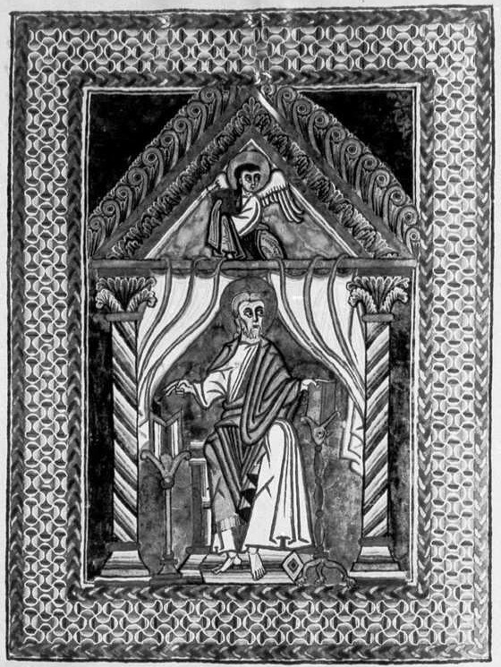
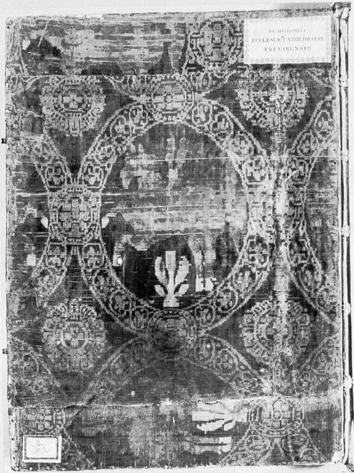
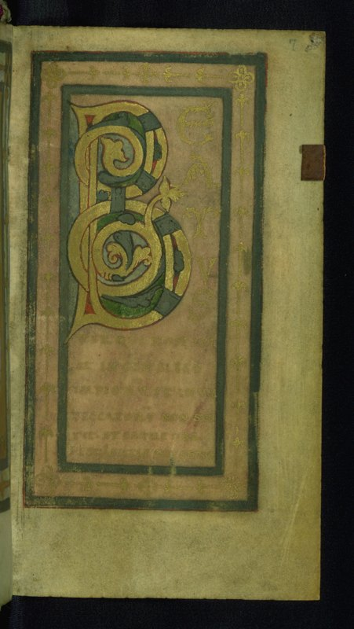
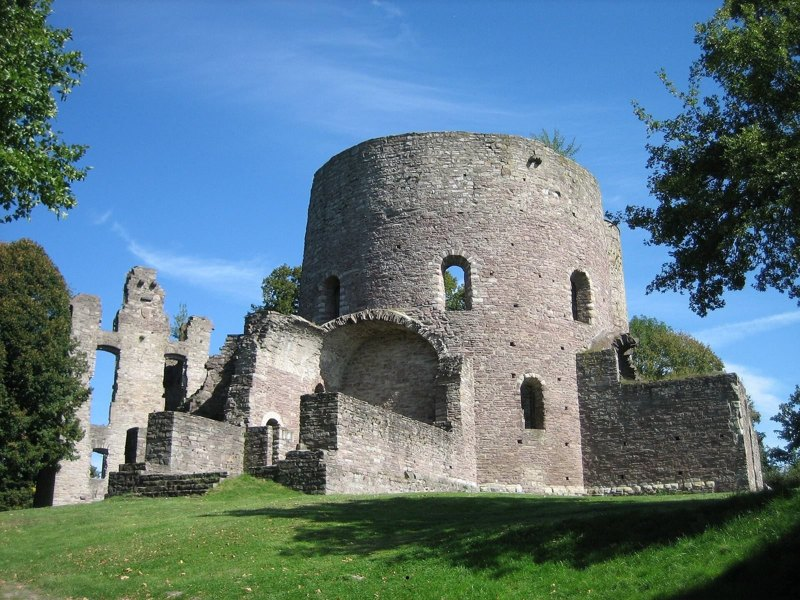
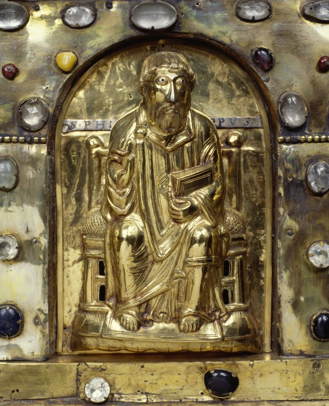
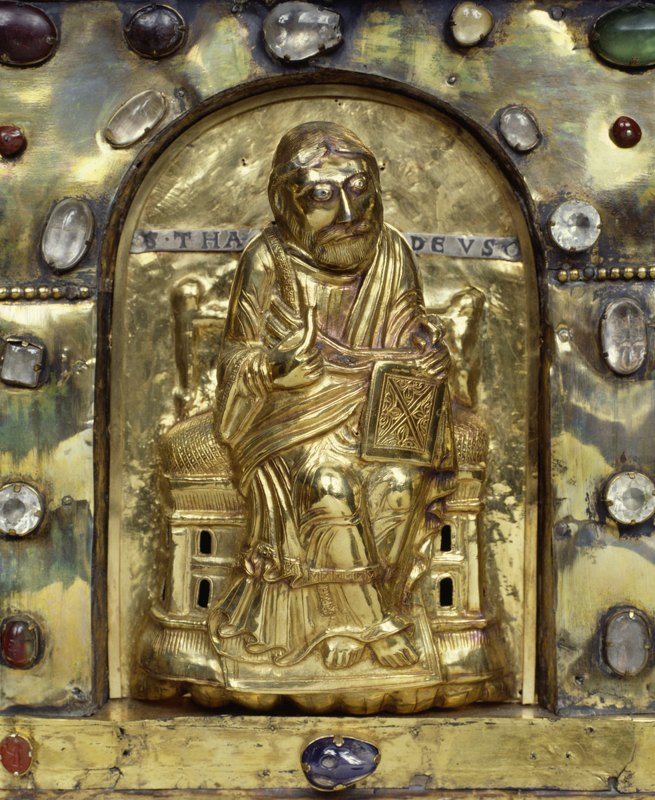

## A small house of outsized consequence

Few monasteries of medieval Germany have so modest a physical afterlife and so large a presence in the history of art as the Benedictine abbey of Helmarshausen. Almost nothing remains at the site, a small town on the lower Diemel shortly before its confluence with the Weser, now part of Bad Karlshafen in the north Hessian county of Kassel. Paving stones trace the outline of the vanished abbey church; an eastern range and a chapel survive from the conventual buildings; and on the spur above the town the ruins of the Krukenburg enclose the shell of a twelfth-century centrally planned chapel. Yet the objects which left this place in the twelfth century are among the most closely studied works of Romanesque art anywhere: two portable altars in the Erzbischöfliches Diözesanmuseum at Paderborn, an engraved cross in the Museum Schnütgen in Cologne, a jewelled book cover in the cathedral treasury at Trier, Gospel books in Trier, Los Angeles and Gniezno, a psalter in Baltimore, the Corvey Liber vitae in Münster, and above all the Gospels of Henry the Lion<a href="/endnotes.html#fn-henry-the-lion" class="footnote">1</a> and Mathilda of England in the Herzog August Bibliothek at Wolfenbüttel. That book was sold at Sotheby's in London on 6 December 1983 for a price reported as £8,140,000. According to the published sale record it remained the most expensive book in the world until the Codex Leicester was sold by Christie's on 11 November 1994.

The significance of Helmarshausen has always been bound up with a name. The monk Roger, "Rogkerus" in the single documentary source that mentions him, has served since the nineteenth century as one of the very few named artists of the early twelfth century north of the Alps, and he has been identified with the author who called himself "Theophilus, humilis presbyter" and wrote the most comprehensive technical treatise on the arts to survive from the Middle Ages. The scholarship of the last four decades has turned both Roger and the abbey from fixed points into problems. The primary sources allow a fairly precise account of the foundation, the political fortunes, the relic cult, the workshops and the decline of Helmarshausen, and the image of the abbey has moved from a romantic portrait of the monk-artist towards an understanding of collaborative production within a network of monasteries, bishops and princes.

## Foundation and the first decades (944–1017)

The place enters the written record before the monastery does. In 944 King Otto I gave a royal estate at "Helmerateshusa" to a noblewoman, a matrona named Helmburg. By the later tenth century the property had passed to a Count Ekkehard, usually identified as a member of the Reinhausen family, and to his wife Mathilde. Local tradition holds that the couple were moved to found a monastery by the death of their young son; the firmer evidence is that a Benedictine community dedicated to the Virgin, the Saviour and St Peter existed here before 997. The historical gazetteer of Hesse records the settlement successively as a villa in 944, a locus in 997 and, around 1000, an oppidum. The last term comes from the abbey's own early twelfth-century translation narrative, whose opening words, "Est oppidum in provincia Saxoniae", place Helmarshausen firmly in the Saxon world rather than in the Hessian identity it would acquire much later.

The foundation was placed under royal and papal protection with unusual speed. A diploma in the name of Otto III dated 997 confers market, mint and toll rights together with immunity on the same terms as the great Carolingian abbey of Corvey downstream on the Weser. Pope Silvester II is recorded as approving the foundation, and the gazetteer of Hessian monasteries notes a further papal confirmation by Benedict VIII in 1014. Coins struck at Helmarshausen survive, so the mint was no paper privilege. The diploma itself, however, needs critical handling: the text published in the Monumenta Germaniae Historica is flagged in the Hessian gazetteer as "vermutlich Fälschung", probably a forgery, or at least reworked in the abbey's later interest. This is the first sign of a problem that runs through Helmarshausen's documentary history. The abbey that became famous for the artistry of its scribes became equally notable for the creativity of its archive, and a careful modern historian of the house has called it a "convent of calligraphers, artists and forgers".

The early fabric is known from excavation. The first church, built after 997, was a three-aisled basilica with apses at both east and west ends, a type characteristic of Ottonian Saxony. It was consecrated in June 1011 by Bishop Meinwerk of Paderborn, the great builder-bishop of the early eleventh century, an event that foreshadows the decisive turn of the abbey's constitutional history six years later.

## Between empire and bishop: Meinwerk, Leitzkau and the advocates

The imperial status granted in 997 proved short-lived. When Count Ekkehard's heirs complained to Henry II that the foundation had stripped them of their rights, the case came before an assembly of princes at Leitzkau in 1017, and the emperor resolved it by transferring the abbey to Bishop Meinwerk and the church of Paderborn. The decision was not quietly accepted. Among the disappointed heirs was Thietmar, brother of the Billung duke Bernhard II of Saxony, who answered the judgment by raiding Paderborn territory; a final settlement was reached only in 1024. From then on Helmarshausen was in practice a proprietary monastery of the bishops of Paderborn, who promoted it, consecrated its buildings and used it as a seat of archidiaconal authority over the lower Diemel and the adjoining Weser region. Its abbots never forgot that the house had begun as a royal abbey.

The bond with Paderborn also linked Helmarshausen to one of the most ambitious artistic programmes of the eleventh-century Empire. The Life of Meinwerk records that the bishop sent Wino, the second abbot of Helmarshausen, to Jerusalem to bring back the measurements of the church of the Holy Sepulchre, and the Busdorf church that Meinwerk built at Paderborn, consecrated in 1036, was conceived as a copy of the Jerusalem rotunda. Helmarshausen was thus involved from its earliest decades in the transfer of architectural forms across great distances, and its own later Jerusalem chapel on the Krukenberg would carry the same idea into the twelfth century.

Secular protection was organised through advocacy. The counts of Northeim and then the counts of Winzenburg held the office of advocate (Vogt) in succession, and in the twelfth century it passed to Henry the Lion, duke of Saxony and Bavaria, until his fall in 1180. The patronage that produced the most famous Helmarshausen manuscript thus came from the man who was, for several decades, the abbey's lay protector. The convent also attracted donations from a wide circle of regional nobility, among them the counts of Reinhausen, Poppenburg, Schwalenberg, Dassel and Ziegenberg and the Malsburg and Padberg families. These gifts, recorded in the abbey's tradition book now preserved at Marburg, gave the house the material base for rebuilding its church and supporting its workshops.

## Abbot Thietmar and the coming of St Modoald (1107)

The decisive turn in the abbey's fortunes, and in its artistic history, came under Abbot Thietmar, who ruled from about 1080 to 1112. His great achievement was the acquisition of relics, above all the bones of St Modoald, a seventh-century bishop of Trier, which he obtained in 1107 from the collegiate church of St Paulin in Trier, where they had lain since a translation of 1047–49. Thietmar also brought back relics of the Trier bishop Abrunculus and of St Auctor, whose cult would later have a significant afterlife in Brunswick. Modoald became co-patron of the abbey alongside St Peter.

The event is documented by the Translatio s. Modoaldi, composed at Helmarshausen between 1107 and 1112, attributed in the standard repertory of German medieval sources to a Helmarshausen author of Thietmar's circle, and dedicated to Abbot Stephen of Saint-Jacques at Liège. At Thietmar's request Stephen had written a Life of Modoald, already judged by nineteenth-century source critics to be historically almost worthless, a work of hagiographic invention that even made Modoald a kinsman of the Carolingians. The Translatio is a different matter. It opens with an account of the foundation and early history of Helmarshausen, narrates the abbot's negotiations and journeys to Trier, and follows the relics through the Eifel to Cologne, where the cortège stopped at the Benedictine abbey of St Pantaleon, and on through Soest and Paderborn to the Diemel. Printed in the Acta Sanctorum and edited by the Monumenta Germaniae Historica in the twelfth volume of the Scriptores, with a separate collection of Modoald's miracles, it has been read both as a source for the topography and sacred furnishings of Trier around 1100 and as evidence of the "spiritual network" that bound Helmarshausen to the monasteries of the Rhine and Meuse.

For the art historian the Translatio matters in two ways. It describes the setting into which the relics were received, mentioning the textile hangings that adorned the walls of the abbey church on their arrival. More importantly, the translation explains why Helmarshausen suddenly needed and could afford precious objects on a new scale: pilgrims came in hope of miracles, gifts of money and land followed, and a saint of this rank required a shrine, liturgical books and altar furnishings. The shrine of Modoald does not survive, but contributors to the 2006 Paderborn colloquium volume have argued that this lost reliquary was the principal project of the Helmarshausen goldsmiths and perhaps the very reason a skilled metalworker was recruited from the west. The stop at St Pantaleon has in turn become a cornerstone of the reconstructed biography of Roger.

## The goldsmith workshop and the problem of Roger

The name of Roger rests on one sentence in one document: a charter in the name of Bishop Henry II of Paderborn<a href="/endnotes.html#fn-henry-ii-of-werl" class="footnote">2</a>, a member of the comital house of Werl who held the see from 1084 to 1127, dated 1100 and recording the bishop's dealings with Helmarshausen. In it the bishop refers to a "scrinium, quod nostro sumptu frater eiusdem ecclesie Rogkerus satis expolito opere in honorem sancti kyliani atque liborii fabricauerat", a shrine which Brother Rogkerus of that same church had made at the bishop's expense, in highly polished work, in honour of Saints Kilian and Liborius, the patrons of Paderborn cathedral. A 1916 study of the "Rogerus altars" connected the scrinium with the silver portable altar of Henry of Werl in the Paderborn cathedral treasury, a connection that held for most of the twentieth century and made the altar the anchor of an entire oeuvre.

The charter, however, is not what it claims to be. Diplomatic criticism had long recognised that the document dated 1100 is a later fabrication; the Enciclopedia dell'Arte Medievale dates the forgery to around 1215, and the review literature describes it as falsified in the thirteenth century. For decades scholars accepted the forgery while trusting its information about Roger. A diplomatic reassessment in the 2006 Hirmer volume changed the terms of the debate. The review in *sehepunkte* describes it as amounting to "einer Destruktion bisheriger Gewissheiten", a destruction of previous certainties. Its author pointed out that "scrinium" is an unusual word for a portable altar, that the charter singles out Kilian and Liborius whereas the cathedral altar gives the Virgin pride of place, and that the document speaks of the bishop restoring (restituimus) the scrinium, together with a golden cross, to the monastery. The older reading, in which the bishop paid for the two works with property, could not stand; the charter looks instead like part of the abbey's thirteenth-century effort to claim treasures that had remained at Paderborn, and at least the cross evidently did remain there. The volume was reviewed in sehepunkte 7 (2007), no. 10, by an art historian of the Institut für Kunstgeschichte at the University of Stuttgart. In that reviewer's words, one can no longer believe that the cathedral altar is the scrinium of Henry of Werl, yet the origin of the works in the Helmarshausen workshop "ist jedoch kaum zu bezweifeln", is scarcely to be doubted.

The fullest biography of Roger was built from the commemorative books of the monasteries. In a long study published in Frühmittelalterliche Studien in 1981, "Roger von Helmarshausen in seiner monastischen Umwelt", the historian <a href="/scholars.html#freise-eckhard">Eckhard Freise</a> used confraternity lists and necrologies to place a monk of this name in a precise setting. On his reconstruction Roger was first a monk at Stavelot in the Meuse valley, one of the centres of Mosan art; around 1100 he moved to St Pantaleon in Cologne; and in 1107, perhaps with Modoald's relics, he came to Helmarshausen. Freise also identified the goldsmith with a deceased monk "Roggerus" entered among the Helmarshausen brethren in the Liber vitae of Corvey, itself decorated at Helmarshausen around 1158; if the identification holds, Roger was dead by then. The reconstruction is elegant and fits the strongly Mosan and Rhenish character of the Helmarshausen metalwork, but it remains a chain of prosopographical inferences: names in memorial books are rarely unique, and the decisive link to the Paderborn altar has now been loosened. The commemorative sources were re-examined in the chapter on memorial books and necrologies (pp. 28–41) of the 2006 Hirmer volume. That re-examination kept Freise's monastic setting while treating the biographical details as hypothesis.

Recent catalogues therefore speak more cautiously of a "Helmarshausen workshop" or a "Roger group". <a href="/scholars.html#westermann-angerhausen-hiltrud">Hiltrud Westermann-Angerhausen</a>, who co-edited the 2006 Paderborn volume and examined the two Paderborn altars in a separate study, has criticised both the older and the newer image of Roger and shifted attention to the objects themselves, their makers' intentions and the conditions of production available to them. The goldsmith remains a historical possibility, but neither the objects nor the documents can carry the weight of the personal style once attributed to him.

## The portable altars of Paderborn and the works around them

The cathedral portable altar (Paderborn, Hoher Dom, inv. DS 2), now shown in the Diözesanmuseum, is dated by the museum to "Helmarshausen, um 1120–1127". It is an oak box about 34.5 cm long, clad in partly gilt silver, engraved and nielloed, with gold and silver filigree, gemstones and pearls, a front in repoussé, bronze feet and an altar stone of green verde antico. On one narrow end Christ sits as Judge and Creator on the rainbow within a circular glory, flanked by Kilian and Liborius, whose relics had come to Paderborn from Würzburg and Le Mans in the period of the Saxon conversion. On the opposite end the Virgin, patroness of the cathedral since its Carolingian foundation, raises her hands in prayer between John and James, and along the long sides five enthroned apostles sit under arcades, with Peter and Paul at the centre. The top plate, framed by the evangelist symbols, carries two engraved scenes: the donor, Henry of Werl, censing the altar while holding his crozier, with the verse "Let my prayer rise like incense before your face, Lord God" (Ps. 141:2), and his predecessor Meinwerk raising the chalice, with "I will take the cup of salvation and call upon the name of the Lord" (Ps. 116:13). A metrical inscription around the base plate names the gift: Bishop Henry offers this ornamented gift to the holy Mary in pious devotion, so that he may not be shut out of eternal life, and asks Liborius and Kilian to stretch out their hands to him.

The museum reads the iconography convincingly as a statement of legitimacy. Henry of Werl held his see during the Investiture Controversy and his position was contested; showing him at the altar with the crozier, which the celebrant would normally hand to the deacon, says that here stands a rightful bishop, and pairing him with the revered Meinwerk places him in an unbroken line of Paderborn's great pastors. The altar's later history is equally revealing. By the seventeenth century at the latest it had a lock and hinges and served as a reliquary, and Prince-Bishop Dietrich Adolf von der Recke (1650–1661) turned its interior into a display of relics. A nineteenth-century inventory calls it the "Markuskasten" and records that it was carried in the mounted rogation procession on St Mark's day; technical examination found that the gilding at the centre of the underside, which shows St Liborius under a turreted arcade, has been completely worn away and the plate deformed, apparently by repeated contact with a saddle pommel.

The second Paderborn altar comes from the Benedictine abbey of Abdinghof, west of the cathedral. After secularisation it passed to the Franciscans and is now on loan to the Diözesanmuseum (inv. PR 50), whose catalogue is notably more cautious about its origin: "Westfalen oder Wesergebiet (Helmarshausen?), 1120–1130". Instead of silver and niello the oak box is covered on all four walls with gilt copper in opus interrasile, the openwork technique in which the background is cut away. On the top plate the abbey's patrons Peter and Paul stand under arcades with Felix and Blasius, whose relics the altar contained, and the long sides narrate the martyrdoms in crowded scenes: Felix of Aquileia is beheaded and Blasius of Sebaste is torn with iron combs. The figure of Felix and part of the foliage on the top are nineteenth-century restorations, a warning against reading every detail as original.

A detailed comparison of motifs and stylistic devices in the 2006 Hirmer volume, summarised in the sehepunkte review, concluded that the two altars are not by the same hand. It grouped the cathedral altar with two works generally accepted as Helmarshausen products and set the Abdinghof altar apart. The first is the so-called Modoald cross in the Museum Schnütgen in Cologne (inv. G 579), a sheet of engraved and gilt copper about 42 by 33.5 cm that once formed the back of a lost jewelled cross, with the evangelist symbols at the ends of the arms, the Lamb of God at the centre and St Modoald on the shaft; the museum dates it to around 1107, while other catalogues place it in the 1120s. The second is the cover of the oldest Helmarshausen Gospel book in the Trier cathedral treasury (Hs. 139), an assembly of gilt copper figures in repoussé, gemstones and rock crystal that the treasury presents as a book cover "of Roger of Helmarshausen" and whose enamels agree strikingly with the instructions of the Theophilus treatise. Other contributors stressed the shared "parcelling" style of the Helmarshausen metalwork and book painting, in which surfaces are divided into small, sharply bounded fields, and showed how much the workshop owed to Mosan, Cologne, Italian and even Islamic models. The influence of Helmarshausen can in turn be traced in Hildesheim, notably in the disc crosses of the cathedral treasury of about 1120–1140.

The most consequential result concerns dating. Once the altar is detached from the forged charter of 1100, nothing obliges us to place the group at the start of the century. A stylistic dating to the 1120s and 1130s, argued in the same volume and accepted by its principal reviewer, fits the objects far better, and the museum's dating of 1120–1127 reflects this consensus. As that reviewer put it, all the relationships built on the supposedly secure date of the Paderborn altar have to be revised, and the chronology of Romanesque metalwork in the first half of the twelfth century redrawn.

## Theophilus and De diversis artibus

Much of the fame of Roger, and therefore of Helmarshausen, comes from his supposed identity with Theophilus. Under the pseudonym "Theophilus, humilis presbyter" there survives a Latin treatise in three books, known as De diversis artibus or Schedula diversarum artium, which gives detailed instructions for almost every kind of medieval artistic production. The first book deals with painting: pigments, inks, binding media and the laying of gold on parchment and walls. The second treats glass, from furnaces and the blowing of vessels to the design and painting of windows. The third and longest, clearly the work of someone with first-hand knowledge of the craft, covers metalwork, from the setting up of a workshop and the making of tools to chalices, censers, niello, cloisonné enamel, filigree, gem setting, the casting of bells and the building of organs.

Each book opens with a prologue, and these prologues are important twelfth-century reflections on the religious value of skilled labour. Artistic skill is presented as a divine gift, inherited by human beings from the first creation, to be exercised in the service of God's house without pride or greed. In the prologue to the first book the author advertises the range of his compilation: the reader will find whatever Greece possesses in kinds and mixtures of colours; whatever another land knows of enamel and niello, the manuscripts differing between Tuscia and Ruscia; whatever Arabia shows in work of casting, chasing and engraving; whatever Italy decorates with gold in vessels and in the carving of gems and ivory; whatever France loves in its precious variety of windows; and whatever industrious Germany approves in work of gold, silver, copper and iron, of wood and of stone. The passage is a programme rather than a factual geography, the claim of a self-conscious author to gather the techniques of the known world into a single body of knowledge.

The textual tradition is old and broad. A Viennese manuscript (Österreichische Nationalbibliothek, Cod. 2527) and a Wolfenbüttel manuscript (Herzog August Bibliothek, Cod. Guelf. 69 Gud. lat.) both date from the twelfth century, the latter from St Pantaleon in Cologne, a provenance that sits suggestively beside Freise's reconstruction of Roger's career. The most complete text is in London (British Library, Harley MS 3915), written in north-west Germany early in the thirteenth century and later owned by Nicholas of Cusa. A 2010 University of Michigan doctoral dissertation, "Theophilus' On Diverse Arts: The Persona of the Artist and the Production of Art in the Twelfth Century", counts eight nearly complete copies, two of them from the mid-twelfth century, and seventeen further witnesses with incomplete texts or excerpts. The modern reception of the work began at Wolfenbüttel. In 1774 the ducal librarian of the Herzog August Bibliothek, in office there since 1770, published extracts from the Gudian codex in his essay "Vom Alter der Ölmalerey aus dem Theophilus Presbyter". In 1872, according to the Neue Deutsche Biographie, the Viennese art historian who went on to edit the treatise in 1874 read the words "qui et Rugerus" ("who is also called Rugerus") attached to the author's name in the Vienna manuscript and identified Theophilus with Roger of Helmarshausen. This founded the long-lived hypothesis of a practising and literate monk-craftsman who headed a Saxon workshop and was a key figure in the emergence of Romanesque style in Germany. Even the status of that note is contested: the Dictionary of Scientific Biography describes it as a seventeenth-century addition on the title page, while other recent studies read it as part of the prologue signature.

Freise's prosopographical work gave the identification new support in 1981, but the consensus has since moved in the opposite direction. The 2016 article on Theophilus in the Neue Deutsche Biographie states plainly that the author-and-workshop hypothesis has been called into question by recent research, and that interest has shifted to the character of the text and its complex transmission: the treatise passes on traditional and contemporary practice to a literate public, reflects the twelfth-century revaluation of the mechanical arts, and in its encyclopaedic arrangement points to the context of natural-philosophical, technical and medical writing shaped by Arabic learning since the mid-eleventh century. The same article reports a rival hypothesis based on a fifteenth-century Helmstedt codex (Wolfenbüttel, Cod. Guelf. 1127 Helmst.) whose excerpts from the first two books are attributed to "Northungus humilis Theophilus", a name borne by a priest-monk of St Michael's at Hildesheim who appears in the cathedral necrology under 11 September and who may have compiled a late-twelfth-century medical treatise preserved at Bamberg. Whether the Schedula is the work of a single author at all is now also doubted.

The relationship between the treatise and the abbey's works should therefore be described as one of affinity rather than authorship. The techniques Theophilus describes, especially niello, engraved silver, openwork copper and cloisonné enamel, are precisely those seen in the Paderborn altars and the Trier cover, and specialists have repeatedly noted agreements in detail, so the Schedula remains the most important single text for understanding how such objects were made. Hiltrud Westermann-Angerhausen, writing with a philosopher in the 2006 volume under the title "Ein Handbuch mittelalterlicher Kunst? Zu einer relecture der Schedula diversarum artium", has proposed reading the text as a literary and theological construction rather than a workshop manual. Even so, as its reviewer observed, the volume as a whole was not willing to draw a sharp line between the Helmarshausen Roger and Roger-Theophilus. The cautious conclusion is that Roger may have been Theophilus, that the treatise and the workshop drew on a shared culture of technique, and that neither the charter nor the manuscript note proves the identity.

## The scriptorium: from Corvey's heir to a supra-regional workshop

If the goldsmiths' work stands at the beginning of Helmarshausen's artistic fame, the scriptorium sustained it far longer. The fundamental modern account is <a href="/scholars.html#wolter-von-dem-knesebeck-harald">Harald Wolter-von dem Knesebeck</a>'s "Buchkultur im geistlichen Beziehungsnetz. Das Helmarshausener Skriptorium im Hochmittelalter", published in the 2003 Kassel volume on the abbey's book culture and goldsmith work. It builds on a monograph of 1933 on Helmarshausen illumination in the age of Henry the Lion, a three-volume study of 1972 on the abbey's writing and painting workshop, and the palaeographical census of books and charters from Helmarshausen and Corvey published by the Monumenta Germaniae Historica in 1992. Its central argument is announced in its title: Helmarshausen book culture must be understood within a network of confraternities, relic exchanges, patronage and commissions, rather than as the output of an isolated house.

In the twelfth century Helmarshausen took over from Corvey the role of the leading centre of book production in northern Germany, producing charters as well as luxury manuscripts between about 1120 and 1200. The beginnings of its style lie in close contact with the Rhine and Meuse, the same orientation seen in the metalwork, and through the reception of western models Romanesque book painting entered Saxony at Helmarshausen around 1120–1130. Collaboration with other houses was part of the system: in some cases ornament was cultivated at Helmarshausen while figural decoration was supplied elsewhere, and Helmarshausen manuscripts were delivered to distant patrons. Around the middle of the century output grew while the circle of patrons narrowed to Saxony and lay patrons appeared in increasing numbers. In the last quarter of the century commissions from Henry the Lion brought a renewed flowering and a new type of book, the luxury psalter for lay use, probably on English models.

Several surviving manuscripts allow this development to be followed. The Gospel book in the J. Paul Getty Museum (Ms. Ludwig II 3), formerly Dyson Perrins MS 120, is dated by the museum to about 1120–1140; its leaves measure 22.9 by 16.5 cm, and it has painted architectural frames for the canon tables and an evangelist portrait and decorated text opening for each Gospel. A Morgan Library exhibition text describes how its evangelist portraits combine new styles from the Rhine-Meuse region with local Saxon tradition: the Luke portrait is drawn in strong outlines with nested V-folds and heavy bands of shading, while the facing page imitates textile patterns cultivated at nearby Corvey in the tenth century. In the Trier cathedral treasury the manuscript census of Rhineland-Palatinate distinguishes an "oldest" (Hs. 139) and a "middle" (Hs. 138) Helmarshausen Gospel book, together with a Gospel book from Abdinghof. A study of the textile pages in Hs. 138 and 139 has shown that their miniatures were painted on separate bifolia, which complicates any simple choice between Paderborn and Helmarshausen as place of origin and supports a model of divided labour. A later Trier Gospel book (Hs. 142), probably painted at Helmarshausen around 1195, shows a clear change of style under English and Byzantine influence, its narrative scenes even drawing on models of the older Winchester school.

Further afield, a Helmarshausen Gospel book in Gniezno is the subject of a detailed study of its programme and iconography published in 2002/2003, and the Gniezno Archdiocesan Archive lists among its treasures a twelfth-century Gospel book attributed to the Saxon-Westphalian school of Helmarshausen. The Walters Art Museum in Baltimore owns a small Helmarshausen psalter (W.10) of the second half of the twelfth century, with three miniatures of very high quality, made for the private devotion of a noblewoman whose portrait appears on fol. 6v. Because the portrait has no inscription and the facing page is missing, her identity remains open; Gertrud, daughter of Henry the Lion, Clementia of Zähringen, his first wife, and Mathilda, his second, have all been proposed. Wolfenbüttel holds a Gospel book dated 1194 (Cod. Guelf. 65 Helmst.) whose attribution to Helmarshausen has been rejected on palaeographical grounds by the editor of the 1992 census, a reminder that the boundary of the "Helmarshausen school" is still under negotiation.

The Liber vitae of Corvey (Münster, Landesarchiv NRW, Msc. I 133) is a key document for both the scriptorium and the Roger question. Made at Helmarshausen around 1158 for the neighbouring abbey, this parchment book of 192 leaves with a dedication miniature contains lists of Corvey's abbots and of the monks professed under them from 822 to 1146, a register of the dead, and the names of the houses joined to Corvey in prayer confraternity, including Helmarshausen itself. A Helmarshausen-made book thus preserves the list in which Freise found his "Roggerus", a neat example of how the abbey's artistic and memorial cultures were bound together. After the Reformation the abbey's books were dispersed, and its manuscripts and fragments now lie in Marburg, Darmstadt, Göttingen, Wolfenbüttel, Berlin and Trier, and also in Copenhagen, Uppsala, London, Baltimore and Los Angeles; the Royal Library in Copenhagen keeps a distinct group of fragments catalogued as "Helmarshauseniana", most of them reused as wrappers for documents in the sixteenth and seventeenth centuries.

Production of luxury manuscripts ended around 1200. Wolter-von dem Knesebeck explains the end through several factors working together: a division of labour within the scriptorium, visible in the late Trier Gospels; a break with Romanesque tradition that never found its way into the emerging Gothic idiom; the competition of scriptoria in the episcopal cities, some of them lay workshops closer to the book market; and the absorption of the abbey's energies in its struggle with Paderborn over the restoration of its imperial status.

## The Gospels of Henry the Lion

The Gospels commissioned by Henry the Lion and Mathilda of England<a href="/endnotes.html#fn-matilda-of-england-saxony" class="footnote">3</a> are generally regarded as the principal work of twelfth-century Romanesque illumination in northern Germany. The book is held by the Herzog August Bibliothek as Cod. Guelf. 105 Noviss. 2° and is co-owned by the federal government, Lower Saxony, Bavaria and the Stiftung Preußischer Kulturbesitz, which is why it also carries the Munich shelfmark Clm 30055. The library's catalogue describes a parchment manuscript of 225 leaves (226 in most of the literature), measuring 34.2 by 25.5 cm, made at Helmarshausen around 1188. The usual count of fifty full-page miniatures includes seventeen canon tables, four evangelist portraits and nine decorated pages alongside twenty figural pictures, and the text is articulated by some fifteen hundred smaller initials.

The manuscript names its makers. On fol. 4v a Latin dedication poem of twenty hexameters in gold capitals praises Duke Henry and his consort, recalls his descent from Charlemagne<a href="/endnotes.html#fn-charlemagne" class="footnote">4</a> and the gift of Mathilda by England, and declares that "this book shining with gold" is offered to Christ in hope of eternal life: "Inter que Christe fulgens auro liber iste / offertur rite spe perpetue tibi vite". The last three lines record that the work was carried out at the command of Abbot Conrad of Helmarshausen, acting on the duke's order, and end with the signature "Petre tui monachi liber hic labor est Herimanni", "this book, O Peter, is the labour of your monk Herimann", Peter being the patron of the abbey. Herimann's name is thus attested by the manuscript itself, and he is the one Helmarshausen artist whose responsibility for a surviving work is beyond dispute.

The book was destined for the altar of the Virgin in the collegiate church of St Blasius at Brunswick, the Welf foundation that Henry rebuilt from 1173 as the setting for his memoria and tomb. The dedication image on fol. 19r shows the ducal couple led by St Blasius and St Aegidius into the presence of the enthroned Virgin. The coronation image on fol. 171v is the manuscript's most discussed page. Above, Christ unrolls a scroll among apostles, saints and bishops; below, two crossed hands descend from heaven to place crowns on the heads of the kneeling duke, who holds the Gospel book, and of Mathilda, surrounded by their ancestors, among them Emperor Lothar III and Richenza on the duke's side and King Henry II of England<a href="/endnotes.html#fn-henry-ii" class="footnote">5</a> and the Empress Matilda on hers. The figures carry crosses, and scrolls promise that those who venerate the saints will be established in life.

The meaning of the crowns cannot be separated from the date of the book, and the date has been fiercely contested. Some scholars, and the 1983 sale catalogue, placed the book around 1173–1175, at the height of Henry's power, when the crowns could express royal ambitions before his conflict with Frederick Barbarossa. Since the 1980s the majority has preferred a date around 1188, after the duke's fall and exile, linking the book to the consecration of the Marian altar in that year; on this reading the crowns are eschatological, the crowns of life promised to the just, and the image becomes a statement of hope for heavenly reward from a dynasty stripped of its earthly rank. Wolter-von dem Knesebeck supports the late dating on stylistic grounds, and his study "Göttliche Weisheit und Heilsgeschichte" reads the cycle of miniatures as a structured theology of salvation history centred on divine Wisdom. The Heidelberg historian who wrote the companion study in the 2003 volume, on the Welf images in the book, prefers to leave the span 1173–1189 open, a fair reflection of a debate that rests on interpretation rather than on a dated document.

The book's later history is a chapter in the history of European collecting. At an unknown date it reached the cathedral chapter of Prague, where it was by 1593 at the latest, and in 1594 it was rebound at the expense of Georg Barthold Pontanus von Breitenberg, dean of St Vitus; the surviving binding has a front board of dark red silk velvet containing relics of Saints Sigismund and Mark and bears the dean's arms. In 1861 King George V of Hanover bought it from the chapter for his Guelph museum. After Prussia's victory in 1866 it went with the family's private property to Schloss Cumberland at Gmunden in Austria, where, as the "Gmunden Gospels", it was last made available for study in 1932/33, and its whereabouts were then unknown for almost forty years. In August 1983 an unnamed consignor offered it at Sotheby's in London. On 6 December 1983 it was bought for about 32.5 million Deutschmarks, a price reported in sterling as £8,140,000, with funds from Lower Saxony, Bavaria, the federal government and the Stiftung Preußischer Kulturbesitz and substantial public donations. Exhibited at Brunswick in 1985, the book is now at Wolfenbüttel, which makes it available in full digital reproduction.

## The Krukenburg and the architecture of Helmarshausen

The abbey church has vanished, but its excavated plan and later views give some sense of its scale. After several building phases the church, begun as the double-apsed basilica consecrated in 1011, reached a length of more than sixty metres, its rebuilding financed by the donations that followed the arrival of Modoald's relics. A view of the abbey with the Krukenburg by Wilhelm Scheffer, called Dilich, of 1591 is the principal visual record of the complex before the church partly collapsed in 1604; in 1749 its stones were reused for a large tithe barn.

The most important surviving monument of the abbey's architectural ambitions stands on the Krukenberg above the town: the chapel of St John the Baptist. Its cruciform plan is formed by four lower, barrel-vaulted arms around a rotunda more than thirteen metres in diameter, originally domed, with a stair tower at the side. Its model was the church of the Holy Sepulchre, and the excavations of 1934–1939 found that the crypt held a replica of the Holy Sepulchre itself. The chapel was consecrated in 1126 as a foundation of Bishop Henry of Werl, built according to local tradition as a substitute for a vowed pilgrimage to the Holy Land; some regional accounts add that the consecration was performed by Bishop Sigward of Minden. The building belongs to the tradition of Meinwerk's Busdorf church, in which Helmarshausen had been involved through Abbot Wino's journey a century earlier. Whether a wooden baptismal church of the Carolingian mission stood on the hill before it, as regional writers claim, cannot be proved from the written record. Regional heritage literature describes the chapel as the most completely preserved Romanesque copy of the Holy Sepulchre north of the Alps.

The castle that now surrounds the chapel is a century later. It was built in about 1215–1220 under Abbot Conrad III, first mentioned in 1220, and enlarged with the "Paderborn house" of 1338 and a residential tower of 1401–1415; it decayed after 1617. The fortification belongs to a phase in which the abbey sought armed protection against its own diocesan bishop, and the juxtaposition of a twelfth-century Jerusalem chapel and a thirteenth-century castle is a fitting emblem of the abbey's fortunes, as spiritual prestige gave way to territorial politics.

## Forgers, protectors and the long decline (c. 1150–1538)

From the second half of the twelfth century the relationship with Paderborn deteriorated sharply. Under Abbot Conrad II, the abbot named in the dedication poem of the Gospels, the abbey produced forged documents to support its claim to independence, so that the scriptorium which wrote some of the finest books of Saxony also wrote tendentious charters. Pope Alexander III confirmed Helmarshausen's subjection to Paderborn around 1160. The dispute reached its climax in 1191, when Pope Celestine III confirmed the abbey's possessions and privileges and the newly elected Abbot Thietmar III refused investiture from Bishop Bernhard II of Paderborn, who excommunicated him. The forged charter dated 1100, with its account of Roger's scrinium, belongs to this continuing effort to assert the abbey's rights. Eckhard Freise's characterisation of the house as a "convent of calligraphers, artists and forgers" captures this unity of artistic, memorial and documentary production.

The conflict drew in a more powerful neighbour. Archbishop Engelbert I of Cologne, extending the ducal authority of his church in Westphalia towards the Weser, exploited the quarrel. Around 1220 the abbey ceded half of the town of Helmarshausen to Cologne in return for protection, and in 1223 it formally placed itself under that protection despite the economic losses involved. The town was fortified, the Krukenburg was built, and Helmarshausen became one of Cologne's most important outposts on the Weser; it acquired urban status around 1230, and the archbishop confirmed its rights in 1254. The arrangement collapsed with Cologne's power after the defeat at Worringen in 1288. By 1326 Bishop Bernhard V of Paderborn had regained spiritual supervision of the abbey and come into possession of Cologne's half of the town and of the Krukenburg, and Abbot Reimbold turned to the archbishopric of Mainz, to which he sold half of the part of the town still held by the abbey.

These manoeuvres went together with internal decline. Income no longer sufficed, and more and more properties were pledged or sold. After the Mainz–Hesse war of 1427 the landgraves of Hesse brought the Mainz possessions of the region under their control, and in 1479 the abbot had to place himself under landgravial protection. The once imperial abbey had become a minor monastic lordship caught between Paderborn, Cologne, Mainz and Hesse, and it had long since ceased to produce art of supra-regional importance.

## Dissolution and afterlife

The end came with the Reformation in Hesse. Landgrave Philip I dissolved the abbey in 1538; some accounts give 1540 for the effective end of the convent. A long legal dispute with Paderborn followed, ending only in 1597 when the bishopric renounced its rights. The landgrave established a tithe office in the conventual buildings, and the abbey's properties were granted as fiefs to noble families. In 1848 the town took over the surviving buildings for use as a school, and since 1965 they have housed a Protestant kindergarten and a youth centre. The objects dispersed far more widely than the buildings: the Paderborn altars stayed in the city for which they were made, the Modoald cross went to Cologne, the Trier cover and Gospel books remained in the Trier treasury, and the Gospels of Henry the Lion travelled from Brunswick to Prague, Hanover, Gmunden, London and finally Wolfenbüttel. Locally, the memory of the abbey is cultivated by a civic heritage association, a facsimile of the Gospels in the local museum, and an archaeological trail leading from the abbey site to the Krukenburg.

## Historiography: from the genius to the network

The historiography of Helmarshausen can be read as a gradual movement away from the personalisation of artistic achievement. The first phase, from the Enlightenment publication of Theophilus at Wolfenbüttel to the Viennese identification of Theophilus with Roger in 1872, produced the figure of the monk-artist who both made and theorised art, an image that suited nineteenth-century ideas of individual creativity. In the 1916 study of the Paderborn altars this image took the form of a creative partnership between an artist and his episcopal patron, a construction that rested on the forged charter. The twentieth century added the systematic study of the scriptorium in the monographs of 1933 and 1972.

The second phase belongs to the historians of memoria and monastic community. Freise's study of 1981 placed Roger within the commemorative culture of Stavelot, St Pantaleon, Helmarshausen and Corvey and gave the old identification a new documentary underpinning. Exhibitions then brought the objects back into view: the Salian exhibition at Speyer in 1992 showed the metalwork attributed to Roger, and the Brunswick exhibition of 1995 presented the Helmarshausen manuscripts in their Welf setting. The repurchase of the Gospels in 1983, and the dating debate that followed, made Helmarshausen briefly a matter of national attention in Germany.

The third phase, since about 2000, has been critical and contextual. The Kassel volume of 2003 drew together history, archaeology, art history and the study of books, with Freise's history of the abbots and monks, Wolter-von dem Knesebeck's account of the scriptorium and of the programme of the Gospels, and studies of the abbey's goldsmith work, its Welf images and its buildings. The two colloquia on Roger held at Cologne in 2003 and Paderborn in 2005, published in 2006 as "Schatzkunst am Aufgang der Romanik. Der Paderborner Dom-Tragaltar und sein Umkreis" and co-edited by Hiltrud Westermann-Angerhausen, took the critique to its logical conclusion: they dismantled the documentary link between Roger and the cathedral altar, separated the altars into distinct hands, moved the group's date into the 1120s and 1130s, and reopened the question of what the Schedula is. Studies of the treatise as a text, including the digital critical edition prepared at the University of Cologne, have moved it away from Helmarshausen and into the broader intellectual history of the twelfth century.

What emerges is not a diminished Helmarshausen but a different one. In place of a single master there is a workshop able to execute silver and niello, gilt openwork copper, enamel and repoussé to the highest standard. In place of a self-contained scriptorium there is a house that collaborated with other monasteries, sent its books as far as Poland, and adapted its production to new lay patrons and new types of book. And in place of an untroubled monastic idyll there is a convent whose artistic excellence went hand in hand with relic politics, memorial culture and the forging of its own legal past.

## Conclusion

Helmarshausen's importance rests on its position at a moment of transition, when Romanesque forms from the Meuse and the Rhine entered Saxony in the decades after 1100. The abbey was one of the main channels of that transfer, through the circulation of relics, monks and models and through goldsmiths and painters of exceptional ability. The translation of St Modoald in 1107 gave the house the cult, the wealth and the need for precious furnishings; the bishops of Paderborn, above all Henry of Werl, provided patronage and a demanding iconographic agenda; and in the second half of the century Henry the Lion turned the scriptorium into a court workshop in all but name. The Gospels signed by the monk Herimann at the command of Abbot Conrad are the summit of that development and also mark its end, for the scriptorium did not find a way into the Gothic, and the abbey's attention turned to its struggle with Paderborn.

The name of Roger will continue to be attached to the Paderborn altars, the Modoald cross and the Trier cover, and his identity with Theophilus will continue to be discussed, but both connections rest on evidence that is suggestive rather than conclusive: a forged charter, a disputed annotation and a memorial-book entry. The more secure conclusion is the one that the objects themselves support. Helmarshausen was a community in which technical mastery, liturgical need, relic cult, princely and episcopal ambition and the memory of the dead were inseparably bound together, and its art cannot be understood apart from that community, its network of houses, and the forgeries with which it defended its own past.

## Catalogue Entry

### The Modoald Cross (Cologne, Museum Schnütgen)

<figure>
  
  <figcaption>Helmarshausen workshop (formerly attributed to Roger of Helmarshausen), <em>The Modoald Cross</em>, back plate of a lost jewelled cross, c. 1107 (or 1120s). Engraved copper with traces of gilding, height 41.7 cm. Cologne, Museum Schnütgen, inv. G 579. Photo: Bildarchiv Foto Marburg / Albert Hirmer and Irmgard Ernstmeier-Hirmer, <a href="https://creativecommons.org/licenses/by-nc-sa/4.0/">CC BY-NC-SA 4.0</a>.</figcaption>
</figure>

The so-called Modoald cross is a single sheet of copper, cut in the shape of a cross with square terminals and engraved on its whole surface. It was not an independent object. The nail holes along its edges show that it was fixed to a wooden core, and it formed the back of a cross whose front, presumably covered with gold, gems and a figure of the Crucified or a cross of precious stones, has been lost. Back plates of this kind were meant to be seen when a processional or altar cross was carried or turned, and they were often decorated with a programme complementary to the front.

The programme is concentrated in the roundel at the crossing and in the four terminals. In the centre the Lamb of God, carrying a cross-staff, stands within a circular inscription that can be read as *Agnus qui occisus est ab origine mundi*, "the Lamb that was slain from the foundation of the world", the words of the Apocalypse. In the terminals the four evangelist symbols each hold or accompany a book, and each is labelled with the opening words of its Gospel: *In princ(ipio)* for the eagle of John at the top, *Vox cla(mantis)* for the lion of Mark at the left, *Fuit in die(bus)* for the ox of Luke at the right, and *Liber ge(nerationis)* for the angel of Matthew at the bottom.

The lower shaft carries the figure that gives the cross its name. A standing archbishop in mitre, chasuble and pallium, holding a crozier and a book, is identified by the inscription above him as *S(anctus) Modoaldus archiep(iscopus)*. Modoald was archbishop of Trier in the seventh century, and his relics were brought to Helmarshausen in 1107 under Abbot Thietmar, an event that brought the abbey prestige, pilgrims and donations. The presence of the saint on the cross ties the object to the abbey and to the cult that the translation established.

The rest of the surface is covered with ornament. The arms carry continuous scrolls of foliage with rosettes and heart-shaped leaves, enclosed by borders of small engraved stars; the terminals are framed in the same way. The engraving is fine and even, and the contrast between the linear figures and the dense ornamental ground was originally heightened by gilding, of which only traces remain. In the black-and-white photograph the engraved lines appear as light marks on a dark ground, which makes the drawing particularly legible.

The style of the engraving is the main reason for grouping the cross with the altar of Henry of Werl. The figure of Modoald, with its drapery divided into small sharp fields and its hems broken into angular folds, belongs to the same linear manner as the apostles on the long sides of the Paderborn altar, and the evangelist symbols are drawn with the same compact, hatched forms. The comparison in the 2006 Paderborn volume placed the cross, the Henry of Werl altar and the cover of the Trier Gospels together as a coherent group, distinct from the Abdinghof altar.

The date is uncertain. The Museum Schnütgen dates the cross to about 1107, linking it directly to the translation of Modoald's relics, which would make it the earliest dated work of the group. Other catalogues, following the redating of the Paderborn altar, place it in the 1120s, on the grounds that the stylistic relationship with the altar makes so wide a gap unlikely. The connection with the translation of 1107 explains the choice of saint, but it does not require the cross to have been made in that year.

The place of making is also debated. The photographic record of the Bildarchiv Foto Marburg gives Fritzlar as the place of origin, while most of the literature places the cross in the Helmarshausen workshop, to which the cult of Modoald points. The two hypotheses need not be far apart, since Fritzlar and Helmarshausen lie in the same region of northern Hesse, but they illustrate how uncertain the boundaries of the "Helmarshausen workshop" remain.

The cross shows, on a small scale, the qualities for which Helmarshausen metalwork is known: precise engraving, a clear programme linking the Lamb, the Gospels and a local saint, and a decorative system in which figure and ornament are equally carefully worked. Detached from its lost front and now displayed as an independent object in Cologne, it remains one of the few works that can be linked to the abbey through its subject as well as its style.

### Portable Altar of Bishop Henry of Werl (Paderborn, Erzbischöfliches Diözesanmuseum)

<figure>
  
  <figcaption>Helmarshausen workshop (formerly attributed to Roger of Helmarshausen), <em>Portable altar of Bishop Henry of Werl</em>, c. 1120–1127. Oak core clad in partly gilt silver, engraved, nielloed and in repoussé; engraved gilt copper; gold and silver filigree; gems and pearls; gilt bronze feet with niello; altar stone of green marble; 16.5 × 21.2 × 34.5 cm. Paderborn, Hoher Dom, inv. DS 2, in the Erzbischöfliches Diözesanmuseum. Photo: Bildarchiv Foto Marburg / Michael Jeiter, <a href="https://creativecommons.org/licenses/by-nc-sa/4.0/">CC BY-NC-SA 4.0</a>.</figcaption>
</figure>

The portable altar made for Bishop Henry of Werl is the object around which the modern image of the Helmarshausen goldsmiths was built. It is a small casket on four feet, about thirty-five centimetres long, of a type designed to carry a consecrated altar stone and relics and to allow Mass to be celebrated away from a fixed altar. Its oak core is entirely clad in metal, and almost every technique of the twelfth-century goldsmith is present on its surfaces: repoussé, engraving, niello, filigree, the setting of stones and pearls, and the gilding of silver, copper and bronze.

The top is organised around the altar stone, a slab of green speckled marble set in a frame of gold filigree. Around it, engraved silver plates carry the evangelist symbols and the two scenes of the donor and his predecessor at the altar, described above; in the photograph they appear only as faint lines on the silver surface, which explains why they are best studied in detail views. The outer border, set with cabochon stones and small gilt rosettes, and the vertical strips at the corners of the ends are later Gothic additions, a reminder that the casket was repaired and adapted during its long use as a reliquary.

<figure>
  
  <figcaption>Portable altar of Bishop Henry of Werl, short end with Christ enthroned between Saints Kilian and Liborius. Photo: Bildarchiv Foto Marburg / Erich Müller-Cassel, <a href="https://creativecommons.org/licenses/by-sa/4.0/">CC BY-SA 4.0</a>.</figcaption>
</figure>

The short end with Christ is the most sculptural part of the altar. The figures are worked in repoussé in gilt silver and stand out strongly from the flat ground. Christ sits on an arc within a circular glory bordered with stones and pearls, bearded and with a cross-nimbus, raising his right hand in blessing and holding an open book. At his sides stand the two patrons of Paderborn cathedral, each in chasuble and pallium with a crozier: Kilian on the left, blessing, and Liborius on the right, holding a book. Their names and Christ's monogram run along the upper band, *S(anctus) Kilianus · Xpc · S(anctus) Liborius*. The figures are stocky, with large heads and hands, and their drapery is described by parallel ridges and sharp, nested folds.

The lower band of this end carries the dedication, *Offert mente pia decus hoc tibi*: "with a devout mind he offers this ornament to you". The line is addressed to Christ above it, and it completes the statement of the top plate, where the donor appears at the altar. The bronze feet, decorated with a chequer pattern in niello and ending in lion paws, show that the care given to the object extended to its least visible parts.

<figure>
  
  <figcaption>Portable altar of Bishop Henry of Werl, long side with five enthroned apostles, Peter at the centre. Photo: Bildarchiv Foto Marburg / Albert Hirmer and Irmgard Ernstmeier-Hirmer, <a href="https://creativecommons.org/licenses/by-nc-sa/4.0/">CC BY-NC-SA 4.0</a>.</figcaption>
</figure>

The long sides use a different technique and a different visual register. Here the figures are not in relief but engraved on gilt copper plates against a finely stippled ground. On the side shown, five apostles sit on thrones under a continuous arcade carried by twisted and fluted columns, with scrolling foliage in the spandrels: Thaddeus, Andrew, Peter, Thomas and Simon, named on the band above. Peter, holding the keys, sits at the centre, as Paul does on the opposite side. The figures turn towards one another in pairs, gesturing and holding books, so that the row reads as a conversation rather than a static series.

The engraved figures show the linear style that the literature has called the "parcelling" manner of Helmarshausen. Each figure is divided into small, sharply bounded fields of drapery, separated by double lines and filled with parallel hatching; the folds over the knees form tight ovals, and the hems break into zigzags. The same manner appears in the engraved plate of the Modoald cross and in the miniatures of the Helmarshausen scriptorium, and it is the main basis for grouping the altar with those works. The contrast between the relief figures of the ends and the linear figures of the sides suggests that different procedures, and perhaps different hands, contributed to a single object.

The altar is the work by which the dating of the whole group was revised. Once detached from the charter of 1100, which proved to be a later forgery, it could be placed on stylistic grounds in the 1120s, and the museum now dates it to about 1120–1127, at the end of Henry of Werl's long episcopate. Its later history as the "Markuskasten" carried in procession, and the wear of its underside, are described above. What the photographs show is the object as it survives: a liturgical instrument of great technical range, adapted over centuries, in which the workshop associated with Helmarshausen combined relief, engraving and ornament into a single programme for the bishop of Paderborn.

### Portable Altar from the Abbey of Abdinghof (Paderborn, Erzbischöfliches Diözesanmuseum)

<figure>
  
  <figcaption>Westphalia or the Weser region (Helmarshausen?), <em>Portable altar from the Benedictine abbey of Abdinghof</em>, long side with the refusal of Felix to worship the idol, the ruler handing a sword to a horseman, and the beheading of the saint and his companions, c. 1120–1130. Oak core, engraved gilt copper in openwork (opus interrasile) over brown varnish, silver sheet, gilt bronze feet. Paderborn, Erzbischöfliches Diözesanmuseum, inv. PR 50 (on loan from the Franciscan friary). Photo: Bildarchiv Foto Marburg / Albert Hirmer and Irmgard Ernstmeier-Hirmer, <a href="https://creativecommons.org/licenses/by-nc-sa/4.0/">CC BY-NC-SA 4.0</a>.</figcaption>
</figure>

The second portable altar from Paderborn belonged to the Benedictine abbey of Abdinghof, the other great monastery of the city, whose patrons were the apostles Peter and Paul. It is of the same type as the altar of Henry of Werl, an oak casket on four feet with an altar stone set into the top, but its decoration takes a different form. Instead of silver, niello and relief, the walls are clad in gilt copper worked in *opus interrasile*: the background of each plate is cut away, so that the engraved figures stand as a gilt lattice against the dark, varnished wood beneath.

The technique gives the altar its distinctive appearance. Seen from a distance, the walls read as a pattern of gold and shadow; seen closer, every figure is outlined by the cut edge of the metal and modelled by engraved lines inside it. The method is described in detail in the third book of Theophilus's treatise, and it requires great control, since each figure must remain connected to the frame by enough metal to hold the plate together. The narrow bridges that join heads, weapons and limbs to one another and to the border are part of the design, and they give the frieze its dense, interlocking rhythm.

The long side shown in the photograph narrates the martyrdom of Felix, one of the two saints whose relics the altar contained. The story runs from left to right without dividing frames. At the left, Felix stands beside a pagan idol, a small naked figure with shield and spear raised on a column, and refuses to worship it. Next, a crowned ruler sits enthroned under two hanging lamps and hands a sword to a mounted soldier, giving the order for the execution. The horseman rides on, followed by soldiers in mail with long shields and spears.

The right half shows the execution itself. An executioner swings his sword, and a head falls to the ground; further to the right a figure raises his hands, and bodies and shields lie on the ground among the horses' legs. The catalogue of the Bildarchiv Foto Marburg identifies the scene as the beheading of the saint and his two companions. The compression of several moments into a single continuous strip, without architectural divisions, recalls the narrative friezes of earlier metalwork and ivory and gives the side the character of a chronicle rather than a sequence of separate images.

The opposite long side tells the martyrdom of Blaise of Sebaste, torn with iron combs, and the top plate, between the frames of the altar stone, shows the patrons of the abbey, Peter and Paul, under arcades with Felix and Blaise. The figure of Felix on the top and part of the foliage are nineteenth-century restorations. The altar stone, dark and veined, is framed by engraved silver bands, and the base and the cornice carry gilt and silver borders with small foliate motifs.

The figure style is related to that of the Henry of Werl altar but not identical with it. The faces are smaller and more lively, the movements more violent, the drapery less divided into the small sharp fields typical of the cathedral altar. The horses, with their arched necks and stiff legs, and the soldiers in mail, with their long kite-shaped shields, give the scene an air of contemporary life, close to the world of the knights who served the bishops and abbots of the region.

The attribution is the most uncertain point. The museum's catalogue describes the altar as made in "Westfalen oder Wesergebiet (Helmarshausen?)", and the comparison of motifs in the 2006 Paderborn volume concluded that it is not by the same hand as the cathedral altar. The Foto Marburg catalogue still lists it under the name of Roger of Helmarshausen, reflecting the older view. The safest description is that the altar belongs to the same milieu of Paderborn and the Weser region in the 1120s, in which Helmarshausen was the leading workshop, without being securely assigned to it.

The altar's history reflects the fate of the monastic treasures of Paderborn. After the secularisation of Abdinghof in the nineteenth century it passed to the Franciscans of the city, who still own it, and it is now shown on loan in the Diözesanmuseum beside the altar of Henry of Werl. Placed together, the two caskets show how a single object type could be realised in two very different techniques within a few years, one rich in silver, relief and gems, the other built almost entirely from engraved and pierced gilt copper.

### The Oldest Helmarshausen Gospels (Trier, Dombibliothek, Hs. 139)

<figure>
  
  <figcaption>Helmarshausen, <em>The evangelist Matthew</em>, fol. 14v of the oldest Helmarshausen Gospels, first quarter of the twelfth century. Tempera and gold on parchment. Trier, Dombibliothek, Hs. 139 (Domschatz 68). Photo (1935): Bildarchiv Foto Marburg, <a href="https://creativecommons.org/licenses/by-sa/4.0/">CC BY-SA 4.0</a>.</figcaption>
</figure>

The Gospel book kept in Trier as Hs. 139, and in the cathedral treasury as no. 68, is the earliest of the Helmarshausen Gospel books, distinguished in the manuscript census of the Rhineland-Palatinate as the "oldest" from the "middle" Gospels, Hs. 138. It joins the two arts for which the abbey was known: its pages were decorated in the scriptorium, and its binding carries a cover of goldsmith's work that the treasury presents as a work "of Roger of Helmarshausen". The book is therefore the only object in which the illumination and the metalwork of Helmarshausen can be seen together.

The cover, an assembly of gilt copper figures in repoussé, gemstones and rock crystal, is the part most often cited in the literature, because its enamels agree closely with the instructions given in the third book of Theophilus's treatise. No photograph of the front cover is available under a free licence. The inside of the front board, by contrast, can be shown: it is lined with a Byzantine silk of the ninth century, woven with large roundels and pearl borders enclosing stylised plants, a precious fabric reused to protect the board and the first leaf.

<figure>
  
  <figcaption>Oldest Helmarshausen Gospels, inside of the front cover, lined with a Byzantine silk of the ninth century. Trier, Dombibliothek, Hs. 139. Photo (1966): Bildarchiv Foto Marburg, <a href="https://creativecommons.org/licenses/by-sa/4.0/">CC BY-SA 4.0</a>.</figcaption>
</figure>

The silk links the book to the long tradition of Byzantine textiles in the treasuries of western churches. Such fabrics arrived as diplomatic gifts, as wrappings for relics or through trade, and were kept and reused for centuries. In the Helmarshausen books they had a further role: the scriptorium imitated them on parchment in the so-called textile pages, decorative leaves painted with patterns of roundels and animals that recall woven silks, a practice inherited from the scriptorium of Corvey. A study of the textile pages of Hs. 138 and 139 has shown that their miniatures were painted on separate bifolia and inserted into the books, which suggests a division of labour between scribes and painters.

The portrait of Matthew on fol. 14v shows the scriptorium's early figure style. The evangelist stands in a shallow, stage-like space between two twisted columns with leafy capitals, before a curtain drawn back in heavy loops. He rests one hand on an open book on a lectern at the left and holds a closed book in the other. Above, in the gable of a pediment edged with scrolls, his symbol, the winged man or angel, holds a book. The whole is enclosed in a broad frame of interlaced chain ornament, an old motif of Ottonian and Corvey illumination.

The figure is drawn with firm outlines and simple, strongly marked folds: the mantle falls in a series of dark parallel stripes over the hip, and the tunic in long vertical pleats. Compared with the small, sharply divided fields of drapery on the Paderborn altar, the style is broader and less nervous, closer to the late Ottonian tradition from which Helmarshausen illumination developed. The architecture, with its pediment and twisted columns, belongs to the same repertory of framing forms that the scriptorium used in its canon tables and evangelist portraits throughout the twelfth century.

The text is written in a regular late Caroline minuscule, with titles and explicits in capitals. A page photographed by the Bildarchiv Foto Marburg (fol. 78) shows the end of the Gospel of Mark, *Explicit evangelium secundum Marcum*, followed by the chapter list of Luke, in alternating lines of coloured capitals. The book was made for liturgical use, and its layout, with large clear script and articulated openings, serves reading aloud at the altar.

The date of the book depends on the date of its cover and on the chronology of the Helmarshausen group. The older literature placed it around 1100, together with the Paderborn altar and the forged charter; the redating of the altar to the 1120s has made a date in the first quarter of the twelfth century more likely, though the illumination may be somewhat earlier than the metalwork. How the book reached Trier is not known; a label inside the front cover records its later place in the cathedral library.

As a whole, the oldest Trier Gospels is the clearest witness to Helmarshausen as a centre in which several crafts worked together. The scribe, the painter of the miniatures and textile pages, the goldsmith of the cover and the reuse of an imported silk are all present in a single volume. Whether or not the cover is the work of a monk called Roger, the book shows the conditions in which the abbey's reputation was formed: a house able to produce, decorate and bind a liturgical book of the highest quality within its own walls.

### Gospel Book (Los Angeles, J. Paul Getty Museum, Ms. Ludwig II 3)

<figure>
  
  <figcaption>Helmarshausen, <em>Saint Luke</em>, fol. 83v of a Gospel book, c. 1120–1140. Tempera colours, gold and silver on parchment, 22.9 × 16.5 cm. Los Angeles, J. Paul Getty Museum, Ms. Ludwig II 3. Image: public domain, via Wikimedia Commons.</figcaption>
</figure>

The Gospel book in the J. Paul Getty Museum, formerly in the Dyson Perrins and Ludwig collections, is the best preserved of the early Helmarshausen manuscripts outside Germany. It is a small book, its leaves measuring 22.9 by 16.5 cm, and its decoration follows a fixed scheme: painted architectural frames for the canon tables, and for each Gospel a full-page portrait of the evangelist facing a decorated opening of the text. The two openings shown here, for Luke and John, illustrate that scheme and the two currents that meet in the book.

The portrait of Luke on fol. 83v sets the evangelist on a cushioned chair with a high back, before a rectangle of burnished gold on a blue ground. He looks up, as if listening for inspiration, and sharpens his quill with a knife; on the lectern at the right a scroll unrolls the first words of his Gospel, *Fuit in diebus Herodis*, "There was in the days of Herod". The heading above, in alternating gold and silver capitals, reads *Inicium s(an)c(t)i evangelii s(e)c(un)d(u)m Lucam*. The figure is drawn with strong outlines; the green mantle over his knees is built of nested curved folds and heavy bands of shading, the features singled out in the Morgan Library's description of the book as a sign of new styles from the Rhine and Meuse.

<figure>
  
  <figcaption>Helmarshausen, decorated opening of the Gospel of Luke, <em>Quoniam quidem multi</em>, fol. 84 of the same Gospel book. Los Angeles, J. Paul Getty Museum, Ms. Ludwig II 3. Image: public domain, via Wikimedia Commons.</figcaption>
</figure>

Facing the portrait, the opening of the Gospel is written on a page that imitates a textile. The great initial Q, of gold filled with interlaced scrolls of gold and silver foliage on blue and green grounds, stands at the upper left; the following words, *Quoniam quidem multi conati sunt ordinare narrationem*, run in alternating gold and silver capitals. Behind them the ground is painted in pinkish red with a pattern of arches and palmettes, in the manner of a woven silk, and the page is framed by a fret border with gilt bosses. These "textile pages" were a tradition inherited from the Ottonian scriptorium of Corvey, and the Getty book shows how Helmarshausen kept it alive.

<figure>
  
  <figcaption>Helmarshausen, <em>Saint John</em>, from the same Gospel book. Los Angeles, J. Paul Getty Museum, Ms. Ludwig II 3. Image: public domain, via Wikimedia Commons.</figcaption>
</figure>

The portrait of John uses the same scheme with a different figure. The evangelist sits frontally on a cushioned throne, bearded and grave, holding a pen-knife and a scroll on which the opening words *In principio erat* are written in red. The lectern at the right, carried on a twisted column, holds an open book. The drapery is more schematic than Luke's: the blue robe falls over the knees in a series of parallel curved lines, and the hems are bordered with gold bands. The frame of interlace and stepped fret, with gilt knots, is again different from the frames of the other portraits, so that each opening has its own decorative identity within a common structure.

<figure>
  
  <figcaption>Helmarshausen, decorated opening of the Gospel of John, <em>In principio erat verbum</em>, fol. 128 of the same Gospel book. Los Angeles, J. Paul Getty Museum, Ms. Ludwig II 3. Image: public domain, via Wikimedia Commons.</figcaption>
</figure>

The opening of John is the most elaborate of the decorated pages. A tall initial I, made of interlaced gold and silver ribbons enclosing foliage, runs down the left side, and a smaller N stands at the upper right; the text, *In principio erat verbum, et verbum erat apud Deum*, follows in descending lines of gold and silver capitals. The ground is again painted as a textile, here with large roundels and rosettes recalling imported Byzantine silks, and the frame is made of striped bands with medallions containing gilt rosettes. A page devoted entirely to the opening words of the Gospel makes the word itself the object of decoration.

The book combines two traditions. The portraits, with their strong outlines, layered folds and gold grounds, belong to the Romanesque style that reached Saxony from the Rhine and Meuse around 1120–1130; the textile pages and the ornamental frames continue the local tradition of Corvey. This combination is the characteristic achievement of the early Helmarshausen scriptorium, and the Getty book shows it with exceptional clarity because its decoration is complete and well preserved.

Compared with the Matthew of the oldest Trier Gospels, the Getty evangelists are more richly coloured and more fully modelled, and their setting, with throne, lectern and gold ground, is more consistently worked out. Compared with the Gospels of Henry the Lion, made at the end of the century, they are simpler and more restrained. The Getty book thus marks an intermediate stage in the development of the scriptorium, between its Ottonian beginnings and the elaborate manuscripts made for the Welf court.

### The Helmarshausen Psalter (Baltimore, Walters Art Museum, W.10)

<figure>
  
  <figcaption>Helmarshausen, <em>A noblewoman at prayer</em>, fol. 6v of a psalter, second half of the twelfth century. Tempera and gold on parchment. Baltimore, Walters Art Museum, W.10. Image: The Walters Art Museum, <a href="https://creativecommons.org/licenses/by-nc-sa/3.0/">CC BY-NC-SA 3.0</a>.</figcaption>
</figure>

The small psalter in the Walters Art Museum was made at Helmarshausen in the second half of the twelfth century for the private devotion of a noblewoman, probably a relative of Henry the Lion. The museum's provenance record assigns it to Herimann, the monk who signed the Gospels of Henry the Lion, and calls it the work of the same monastery; it is much smaller and simpler than the Gospels, with only three full-page miniatures, but the quality of its painting is very high. Its later history took it to Salzburg, where in the early fifteenth century it belonged to Petrus Grillinger, canon of the cathedral, and then to the Gruel and Engelmann collection in Paris before Henry Walters bought it; it came to Baltimore with his bequest in 1931.

The book opens with a double page. On the left, fol. 6v, a woman stands alone on a gold ground, turned to the right with her hands raised and joined in prayer. She wears a white veil, a long pale robe with tight patterned sleeves, and a red mantle lined and patterned with gold crescents, fastened at the throat by a gold clasp. She stands on a narrow scalloped strip of ground, and the gold behind her is framed by stems of gold fleurs-de-lis on a blue and green ground. The figure is tall and slender, its long robe falling in fine parallel folds to the feet.

<figure>
  
  <figcaption>The Helmarshausen Psalter, initial B of Psalm 1, <em>Beatus vir</em>, fol. 7r. Baltimore, Walters Art Museum, W.10. Image: The Walters Art Museum, <a href="https://creativecommons.org/licenses/by-nc-sa/3.0/">CC BY-NC-SA 3.0</a>.</figcaption>
</figure>

On the facing page, fol. 7r, Psalm 1 begins with a large gold initial B, its two bowls filled with scrolling foliage, set on a pinkish-purple field within a double frame bordered with gold fleurs-de-lis; the rest of the word, *eatus*, follows in gold capitals, and the first verse, *Beatus vir qui non abiit in consilio impiorum*, runs below. The woman of fol. 6v therefore stands before the opening of the Psalter, turned towards it in prayer: she is the reader for whom the book was made, shown in the act for which it was intended.

Her identity cannot be established. The portrait bears no inscription, and the page that faced it before the present opening, which may have shown her patron saint, is missing. Scholars have proposed three women of the Welf court: Gertrud, Henry the Lion's daughter; Clementia of Zähringen, his first wife; and Mathilda of England, his second. The faint band around her head has sometimes been read as a halo, which would make the figure a saint rather than a portrait, but the costume and the position before the opening psalm favour the reading as the owner of the book.

<figure>
  
  <figcaption>The Helmarshausen Psalter, <em>The Crucifixion with the Virgin and Saint John</em>, fol. 41v, before Psalm 51. Baltimore, Walters Art Museum, W.10. Image: The Walters Art Museum, <a href="https://creativecommons.org/licenses/by-nc-sa/3.0/">CC BY-NC-SA 3.0</a>.</figcaption>
</figure>

The other two miniatures mark the main divisions of the Psalter, before Psalms 51 and 101, following the traditional threefold division of the psalms. On fol. 41v the Crucifixion is reduced to its essentials. Christ hangs dead on a red cross against a gold ground, his head bowed and his body marked by fine red lines; the titulus reads *Ihc Naz(arenus) rex Iud(aeorum)*. The sun, as an eight-pointed gold star, and the moon, as a grey crescent, appear above the arms of the cross. The Virgin, in a green mantle and red veil, crosses her hands on her breast; Saint John, holding a book, raises one hand. The border of gold arches enclosing pale rosettes gives the scene the look of a jewelled panel.

<figure>
  
  <figcaption>The Helmarshausen Psalter, <em>Christ in Majesty with the symbols of the Evangelists</em>, fol. 77v, before Psalm 101. Baltimore, Walters Art Museum, W.10. Image: The Walters Art Museum, <a href="https://creativecommons.org/licenses/by-nc-sa/3.0/">CC BY-NC-SA 3.0</a>.</figcaption>
</figure>

On fol. 77v Christ sits in majesty within a red-edged mandorla on a gold ground, enthroned on an arc with his feet on a green globe. He raises his right hand in blessing and holds an open book. In the corners, on a pale blue ground, the four evangelist symbols with gold haloes hold their books: the angel of Matthew and the eagle of John above, the lion of Mark and the ox of Luke below. A frame of green, blue and red leaves encloses the scene. The image is the same theophany that appears on the end of the Henry of Werl altar and in the roundel of the Modoald cross, here transposed into the idiom of late twelfth-century painting.

The figure style of the Psalter is lighter and more elegant than that of the earlier Helmarshausen books. The figures are slender, the drapery falls in fine, closely spaced lines, and the faces are small and delicately drawn; the gold grounds are large and smooth, and the borders, of fleurs-de-lis, rosettes and leaves, are varied and precise. These features link the book to the late phase of the scriptorium, when commissions from Henry the Lion and his circle brought a new type of book, the luxury psalter for lay use, probably on English models. The Walters Psalter is one of the earliest surviving examples of that type in Germany, and it shows Helmarshausen working, at the end of its history, for a private and courtly reader rather than for an altar.

### The Gospels of Henry the Lion: the Coronation Miniature (Wolfenbüttel, Herzog August Bibliothek)

<figure>
  
  <figcaption>Herimann of Helmarshausen, <em>The coronation of Henry the Lion and Mathilda</em>, lower register of fol. 171v (detail), Gospels of Henry the Lion, c. 1188. Tempera and gold on parchment. Wolfenbüttel, Herzog August Bibliothek, Cod. Guelf. 105 Noviss. 2° (also Munich, Clm 30055). Image: public domain, via Wikimedia Commons.</figcaption>
</figure>

The Gospels of Henry the Lion, written and painted at Helmarshausen and signed by the monk Herimann, are discussed at length above. The entry concentrates on the most famous of its pages, the coronation on fol. 171v, reproduced here in a detail of its lower register. It is the image through which the Gospels, and with them the late phase of the Helmarshausen scriptorium, are best known.

In the upper register of the page, not shown here, Christ unrolls a scroll among apostles, saints and bishops. Below, in the scene reproduced, two hands descend from an arc of heaven and lower crowns onto the heads of Duke Henry and his wife Mathilda, who kneel facing each other at the centre. The duke wears a robe patterned with blue quatrefoils and holds a small cross; Mathilda, in a white veil and a gold-patterned mantle, holds a cross in the same way. Their hands are raised, as if receiving the crowns and offering themselves at once.

They are surrounded by their ancestors, each identified by an inscription along the upper edge. On the duke's side stand the empress Richenza and the emperor Lothar III, his maternal grandparents, and his parents, the duchess Gertrud and Duke Henry the Proud. On Mathilda's side stand her father, King Henry II of England, and her grandmother, the empress Matilda, here named *regina*. All hold crosses, a sign that they too are shown among the blessed. The genealogy runs from emperors and kings to the couple at the centre, joining the Welf and the Angevin lines in a single image.

The miniature shows the late style of Helmarshausen at its most ambitious. The figures are tall and solid, their faces drawn with firm outlines, large eyes and carefully modelled cheeks; their garments are covered with dense patterns of flowers, quatrefoils and stars, painted with a precision that recalls embroidered and woven textiles. The ground is divided into zones of deep blue and burnished gold, and the whole is framed by striped borders. Compared with the Getty Gospels and the Walters Psalter, the forms are heavier and more richly ornamented, and the composition more crowded.

The meaning of the crowns has been the subject of the debate summarised above. If the book was made around 1173–1175, at the height of Henry's power, the crowns could be read as an expression of royal ambition. If, as most scholars now believe, it dates from about 1188, after his fall and exile, they are the crowns of life promised to the just, and the image is a statement of hope in heavenly reward. The crosses held by all the figures, and the scrolls in the full page promising that those who venerate the saints will be established in life, support the eschatological reading.

The image also illustrates how the scriptorium served its patrons. The ancestors are identified individually, their dress and attributes are differentiated, and the scene combines liturgical and dynastic meaning in a way that only a workshop accustomed to courtly commissions could achieve. The same scriptorium that had made Gospel books for altars and psalters for private devotion here produced a monument of dynastic memory, intended for the altar of the Virgin in the church of St Blasius at Brunswick, where the duke and his wife would be buried.

The page is the last great work of Helmarshausen illumination. Within a few years of its making, the production of luxury manuscripts at the abbey came to an end, for the reasons discussed above. The coronation miniature therefore stands both as the summit of the scriptorium's achievement and as its conclusion, the point at which a monastic workshop of the Weser region reached the highest level of courtly patronage in twelfth-century Germany.

### The Chapel of St John the Baptist on the Krukenberg (Helmarshausen)

<figure>
  
  <figcaption>Chapel of St John the Baptist on the Krukenberg, consecrated 1126, with the ruins of the Krukenburg castle (c. 1215–1220 and later). Helmarshausen (Bad Karlshafen, Hesse). Photo: Magnus Mertens, <a href="https://creativecommons.org/licenses/by-sa/2.5/">CC BY-SA 2.5</a>, via Wikimedia Commons.</figcaption>
</figure>

The chapel on the Krukenberg, the hill above the town of Helmarshausen, is the most important surviving building connected with the abbey. Little remains of the abbey church itself, but the chapel of St John the Baptist, consecrated in 1126 as a foundation of Bishop Henry of Werl, still stands to almost its full height, enclosed within the ruins of the castle that was later built around it. It is the only monument that allows the architectural ambitions of Helmarshausen in the age of its goldsmiths to be seen directly.

The plan is a central one. A rotunda more than thirteen metres in diameter forms the core, and four lower arms, originally barrel-vaulted, project from it to form a cross. In the photograph the rotunda rises as a tall cylinder of reddish sandstone rubble, pierced by small round-arched windows at two levels; the arms, now roofless, extend at its foot, and the large open arch at the junction of one of them shows where a vault once met the drum. The rotunda was originally domed, and a stair tower at the side gave access to the upper parts.

The model of the building was the church of the Holy Sepulchre in Jerusalem, whose round Anastasis over the tomb of Christ was copied, more or less freely, in many western churches from the Carolingian period onwards. The excavations of 1934–1939 found that the crypt held a replica of the Sepulchre itself, so that the chapel reproduced not only the form of the Jerusalem church but its most sacred object. Local tradition holds that Henry of Werl built it in place of a vowed pilgrimage to the Holy Land, a common motive for such foundations.

The chapel belongs to a regional tradition. In the early eleventh century Bishop Meinwerk of Paderborn had built the Busdorf church as a copy of the Holy Sepulchre, sending Abbot Wino of Helmarshausen to Jerusalem to obtain its measurements. The Krukenberg chapel, a century later and founded by one of Meinwerk's successors, renewed that link between Paderborn, Helmarshausen and Jerusalem. The same bishop for whom the portable altar was made thus also commissioned, at the same moment, a monumental image of the holy places on the hill above the abbey.

The building is plain. Its walls are of roughly coursed rubble with dressed stone at the openings, and the windows are small and widely spaced; there is no surviving sculptural decoration. Its effect depends entirely on its mass and geometry, the tall drum rising above the cross-shaped arms. The contrast with the jewelled and engraved surfaces of the Paderborn altars is striking, but the two belong to the same programme of patronage: the altar made the bishop's devotion portable, the chapel fixed it in the landscape.

The castle around the chapel is later. It was built under Abbot Conrad III in about 1215–1220, enlarged in 1338 with the so-called Paderborn house and in the early fifteenth century with a residential tower, and abandoned in the seventeenth century. Its ruined walls, visible at the left of the photograph, belong to the period in which the abbey sought armed protection against its own bishop. The juxtaposition of the twelfth-century Jerusalem chapel and the thirteenth-century fortification sums up, in a single view, the change in the abbey's fortunes from spiritual prestige to territorial conflict.

Regional heritage literature describes the chapel as the most completely preserved Romanesque copy of the Holy Sepulchre north of the Alps. Whatever the comparison with other examples, it is certainly the most substantial surviving witness to Helmarshausen in its greatest period. Standing above the town where the abbey once stood, it is the visible counterpart of the objects now dispersed among the museums and libraries of Paderborn, Cologne, Trier, Baltimore, Los Angeles and Wolfenbüttel.

### Comparison: The Shrine of Saint Godehard (Hildesheim, Cathedral)

<figure>
  
  <figcaption>Hildesheim goldsmith, in the circle of the Helmarshausen workshop, <em>Shrine of Saint Godehard</em>, the side of Saint Paul and the end with the Deesis, c. 1131–1132 (renewed 1787, restored 1971–1972). Oak core, silver and copper, gilt, repoussé and chased; niello; gems and rock crystal; brown varnish; 65 × 122 × 51 cm. Hildesheim, Cathedral of St Mary, crypt (Dommuseum Hildesheim). Photo: Bildarchiv Foto Marburg / Dommuseum Hildesheim, no copyright, contractual restrictions apply (NoC-CR), for non-commercial educational use.</figcaption>
</figure>

The shrine of Saint Godehard is not a Helmarshausen work in the strict sense, and it is included here as a comparison. Godehard, bishop of Hildesheim from 1022 to 1038, was canonised in 1131, and his relics were translated in the following year into this shrine, made for the cathedral and, according to the catalogue, in Hildesheim itself. The Bildarchiv Foto Marburg catalogues it under the "school" of Roger of Helmarshausen, and it is the largest surviving work of the circle of goldsmiths whose manner was formed by the Helmarshausen workshop. It shows how the forms developed for small portable altars were transferred, within a decade, to the scale of a monumental reliquary.

The shrine has the form of a house, about 1.2 metres long, with a pitched roof. Its oak core is clad in gilt silver and copper, its roof covered with small gilt tiles in relief, and its ridge crowned by an openwork crest of gilt foliage with knobs of rock crystal. The crest and other parts were renewed in 1787, and the shrine was restored in 1971–1972, so not every detail of the present surface is twelfth-century. The rings at the feet, for carrying poles, show that the shrine was meant to be carried in procession.

The long sides are organised as arcades. On each, six apostles sit under round arches, separated by broad panels set with cabochon stones and rock crystals in regular rows. The side shown here, known as the side of Saint Paul, carries Simon, Thaddeus, James, Philip, Bartholomew and Paul, each named on a silver band at the springing of his arch. At the end, three standing figures form a Deesis, Christ between intercessors, under a gable with a further figure in relief; a silver band with an inscription runs around the base.

<figure>
  
  <figcaption>Shrine of Saint Godehard, the apostle Philip. Photo: Bildarchiv Foto Marburg / Dommuseum Hildesheim / Lutz Engelhardt, NoC-CR, for non-commercial educational use.</figcaption>
</figure>

The apostles are worked in high relief in gilt silver, and they are the shrine's principal point of comparison with Helmarshausen. Philip sits frontally on a throne shaped like a small building, with arched windows in its sides and cushions on its seat, raising his right hand in speech and holding a closed book in his left. His head is large, with wide-open eyes, a long straight nose and a beard divided into regular strands. The drapery falls in broad planes edged by sharp, double-lined folds, and the hem breaks into angular zigzags over the feet.

<figure>
  
  <figcaption>Shrine of Saint Godehard, the apostle Thaddeus. Photo: Bildarchiv Foto Marburg / Dommuseum Hildesheim / Lutz Engelhardt, NoC-CR, for non-commercial educational use.</figcaption>
</figure>

Thaddeus, beside him, turns slightly to one side, wrapped in a mantle whose folds form deep, curving ridges over the knees, and holds a book whose cover is engraved with a geometric pattern. The variety of pose within a fixed scheme, the architectural thrones and the strongly patterned drapery link these figures to the repoussé figures on the end of the Henry of Werl altar, where Kilian and Liborius stand in the same compact proportions and the same linear treatment of folds. The relation is one of family resemblance rather than identity of hand.

The difference of scale is significant. On the Paderborn altar the relief figures are a few centimetres high and fill a narrow field; on the Godehard shrine they are large enough to be read across a church, and the goldsmith has given them heavier bodies, deeper relief and more individual faces. The rows of stones around them turn the walls of the shrine into a jewelled architecture, a celestial city in which the apostles sit as its foundations.

The shrine also shows how the Helmarshausen manner spread. Hildesheim was a major episcopal city with its own tradition of metalwork going back to Bishop Bernward, and its goldsmiths in the 1130s took up the forms and techniques associated with Helmarshausen while working for their own cathedral. The catalogue label "school of Roger" expresses this diffusion, but it should not be read as evidence that the abbey itself made the shrine: the catalogue gives Hildesheim as the place of making.

The comparison therefore helps define the limits of the Helmarshausen group. The Paderborn altars and the Modoald cross form its core, bound by style, technique and, in the case of the cross, subject. The Godehard shrine stands at its edge, a work made elsewhere by goldsmiths who shared the same visual language. Together they show that what the literature calls the Helmarshausen workshop was less a single shop than a regional style, centred on the abbey and carried by goldsmiths active in Paderborn, Hildesheim and the Weser region in the first half of the twelfth century.
