## The Cathedral of Saint Geminianus

*Modena Cathedral* stands at the centre of the city, on the Via Emilia, between the Piazza Grande and the old market square. It is dedicated to the Virgin of the Assumption and to Saint Geminianus, bishop of Modena in the late fourth century, whose body lies in its crypt. The present building was begun in 1099 and is one of the founding monuments of Romanesque art in Italy. It is also one of the best documented: two inscriptions carved into its walls give the names of its architect, Lanfranco, and of its sculptor, Wiligelmo, and an illustrated chronicle written by its clergy, the *Relatio*, tells how it was begun, how the saint's body was moved into it and who was present.

<figure>
  
  <figcaption>Modena Cathedral, the west façade: Lanfranco's arcaded front with Wiligelmo's Genesis reliefs and main portal, the rose window and side doors added by the Campionese masters, and the Ghirlandina at the left. The small slab with Enoch and Elijah holding the foundation inscription is set into the wall to the left of the porch. Photo: Mongolo1984, <a href="https://creativecommons.org/licenses/by-sa/4.0/">CC BY-SA 4.0</a>, via Wikimedia Commons.</figcaption>
</figure>

The photograph shows the west front from the square, in strong light under a deep blue sky. The façade is divided into three parts by two tall buttresses that rise to the roof, and the central part, corresponding to the nave, is raised above the two lower side parts, corresponding to the aisles. The whole front is faced with pale stone, in large regular blocks, and its outline is crowned by two small open turrets at the top of the central gable.

Across the full width of the façade runs the gallery of triple arches on slender columns, the same gallery that continues along the flanks and round the apses. It ties the front to the rest of the building and gives it its characteristic rhythm of light and shadow. Below the gallery the wall is smooth, and the Genesis reliefs are set into it at the height of the porch, one on either side of the main portal and one above each side door.

At the centre the porch projects on two columns that rest on lions. Above it rises a small loggia, which repeats in miniature the porch below and opens towards the square. The main portal, with its deep archivolt, opens beneath the porch; the two side doors, smaller and lower, are later additions of the Campionese masters, as is the great rose window that fills the upper part of the central gable.

The rose window, with its ring of radiating colonnettes and its central cross, transformed the upper part of Lanfranco's façade in the thirteenth century. Above it stand small statues on the gable, and the slender buttresses are crowned by open pinnacles. The effect is of a façade that grew in stages over two centuries while keeping the clarity of its first design.

At the left the Ghirlandina rises beside the apses, its upper storeys and octagonal spire completed by the Campionese masters in 1319. The tower, the façade and the square together form the monumental centre of Modena, inscribed on the UNESCO World Heritage List in 1997. The overhead wires that cross the photograph are a reminder that the cathedral stands in a living city street, as it has since the day of its foundation.

The building is a basilica with a nave and two aisles, without a projecting transept, closed to the east by three apses. Under the raised presbytery a large hall crypt holds the tomb of the saint. Outside, the walls are articulated by tall blind arches enclosing galleries of triple openings, which run round the whole church at the same height and give it its unity; inside, the nave is carried on an alternation of compound piers and columns. The timber roof of the first building was replaced by rib vaults in the fifteenth century.

The sculpture of the cathedral was made in several campaigns. Wiligelmo and his workshop carved the Genesis reliefs and the main portal of the façade at the beginning of the work; his successors made the two great side doors, the Porta dei Principi and the Porta della Pescheria, in the following decades. From the second half of the twelfth century the cathedral was entrusted to the masters from Campione on Lake Lugano, who for more than a century carved the pontile, the screen that divides the nave from the presbytery, opened the rose window and the Porta Regia, and completed the bell tower.

The older version of this page attributed the foundation to Matilda of Canossa, gave the building a crossing tower it never had, confused the ambo of the pontile with the pulpit of 1322 and drew most of its information from tourist and heritage websites. It has been rewritten from the inscriptions, the *Relatio* and the scholarly literature, and the works of the fifteenth century have been left outside its scope.

## Before 1099: The Charter of Charlemagne

The cathedral of 1099 was not the first church on the site. Since late antiquity the bishops of Modena had kept the tomb of Geminianus, and by the eighth century the church that held it was the seat of a powerful bishopric. The most important evidence of this earlier history is a parchment preserved in the cathedral's chapter archive: a diploma of Charlemagne, dated 26 September 782, by which the king took the church of Modena under his protection and granted it immunity. It is the only original charter of the first Carolingian generation to survive in the Modenese archives, and it is kept together with a notarial copy made in 1201.

<figure>
  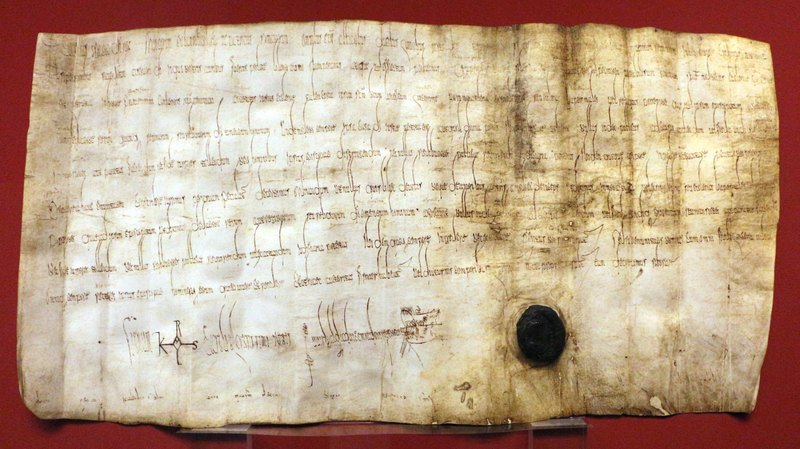
  <figcaption>Diploma of Charlemagne granting immunity to the church of Modena, Gondreville, 26 September 782 (facsimile). The original is in Modena, Archivio Capitolare. Photo: Sailko, <a href="https://creativecommons.org/licenses/by/3.0/">CC BY 3.0</a>, via Wikimedia Commons.</figcaption>
</figure>

The charter is a single broad sheet of parchment, wider than it is tall, as was usual for royal diplomas of the Carolingian chancery. It is shown here in a facsimile mounted against a red ground, with its folds, stains and the slight curling of its edges reproduced from the original.

The text runs in long lines across the whole width of the sheet in the elongated cursive of the chancery, with tall ascenders that rise well above the line. The first line, with the invocation and the name and titles of the king, is written in even more elongated letters, the so-called *litterae elongatae*, which marked the solemnity of the document.

In the lower left part of the sheet stands the monogram of Charles, the letters of his name, KAROLUS, arranged round a cross. The king himself is thought to have added only a small stroke to complete it, the so-called *Vollziehungsstrich*, while the rest was drawn by the scribe. Beside it the recognition of the chancellor closes the text with its own complex sign.

At the lower right a round wax seal is fixed to the parchment. Its dark, almost black colour is that of old wax, and its impression, of which little can be read in the photograph, carried the image of the king. Seal and monogram together gave the diploma its legal force.

The charter is the oldest surviving document of the church of Modena. By granting immunity to the bishop and his church, it recognised a public authority over their lands and people that would later underpin the bishop's lordship over the city. The cathedral built three centuries later rose on the site of the church named in this document.

The charter was issued at the royal residence of Gondreville, in Lorraine, at the request of the bishop of Modena, who bore the name of his patron, Geminianus. It was written entirely by the chancery notary Wigbald, who checked it in the name of the chancellor Rado; the monogram of Charles, in a darker ink, was completed separately, and the sheet still bears the remains of its wax seal. The date is given in the double reckoning of the king's two crowns: the fourteenth year of his reign over the Franks and the ninth over the Lombards, whose kingdom he had conquered in 774.

The text forbids any public judge to enter the monasteries, hospices, baptismal churches and other possessions of the bishopric, to hear cases there, to exact fines, to demand lodging or provisions, to take sureties or to levy public dues. In practice it withdrew the lands and men of the church from the jurisdiction of the king's officials and placed them under the bishop. The church itself is described as "built in honour of the most precious confessor of Christ Geminianus, prelate of that same church": three centuries before Lanfranco, the cathedral was already the church of the saint.

> *Carolus gratia dei rex Francorum et Langobardorum ac patricius Romanorum omnibus episcopis abbatibus ducibus comitibus gastaldiis atque [omnibus missis nostris] discurrentibus praesentibus et futuris. Maximum regni nostri in hoc augere credimus monimentum, si petitionibus sacerdotum ac servorum dei, in quo nostris auribus fuerint prolate, libenti animo obtemperamus atque ad effectum perducimus. Quapropter noverit solertia vestra, qualiter nos ad petitionem venerabilis viri Geminiani sanctae Modonensis ecclesiae episcopi, quae est constructa in honore praeciosissimi confessoris Christi Geminiani antestitis ipsius ecclesiae, talem circa ipsum sanctum locum beneficium concessisse, ut in monastheria et sinodochia seu ecclesias baptismales vel reliquas possessiones, quae ad ipsum episcopatum aspiciunt tam de datione regum quamque reginarum seu reliquorum deo timentium hominum, unde moderno tempore ipsa casa dei iustae vestita est, aut quod divina pietas ibi amplificare voluerit, nullus iudex publicus ad causas audiendum vel freda undique exigendum seu mansiones aut paratas faciendum nec fideiussores tollendum neque hominibus ipsius episcopati distringendum nec nullas redibutiones publicas requirendum iudiciaria potestas ibidem quoque tempore ingredere nec exactare penitus non praesumat. Propterea hanc emunitatem conscribere iussimus, per quam specialiter decernimus ordinandum, ut nullus quislibet de vobis neque de iunioribus vestris amodo et deinceps, ut diximus, in monastheria vel exsinodochia seu ecclesias baptismales vel reliquas possessiones, quae ad ipsum episcopatum, ut diximus, de datione regum aut reginarum seu reliquorum deo timentium hominum aspiciunt, nullus iudex publicus ad causas audiendum vel freda undique exigendum seu mansiones aut paratas faciendum nec fideiussores tollendum nec nullas redibutiones publicas requirendum vel exactandum iudiciaria potestas ibidem quoque tempore ingredere nec exactare penitus non praesumatur, sed sub emunitatis nomine cum omni freda concessa valeat omnique tempore rectores ipsius episcopati hominesque eorum quieti vivere et resedere. Et ut haec auctoritas firmior habeatur vel diuturnis temporibus conservetur, manu propria subter eam decrevimus roborare.* 
> *Signum (M.) Caroli gloriosissimi regis.* 
> *Uuigbaldus advicem Radoni recognovi et subscripsi.* 
> *Data sexto kalendas octobris anno quarto decimo et nono regni nostri; actum Gundulfa villa palatio publico.*
{: .quote-latin}
> Charles, by the grace of God king of the Franks and of the Lombards and patrician of the Romans, to all bishops, abbots, dukes, counts, gastalds and all our envoys travelling about, present and future. We believe that we increase the greatest safeguard of our realm if we gladly comply with the petitions of priests and servants of God, when they have been brought to our ears, and carry them into effect. Therefore let your diligence know that, at the petition of the venerable man Geminianus, bishop of the holy church of Modena, which is built in honour of the most precious confessor of Christ Geminianus, prelate of that same church, we have granted to that holy place this favour: that into the monasteries and hospices, the baptismal churches and the other possessions which belong to that bishopric, whether by gift of kings and queens or of other God-fearing men, with which this house of God is rightfully endowed at the present time, or whatever divine goodness may wish to add there, no public judge or judicial power shall presume at any time to enter, to hear cases, to exact fines anywhere, to require lodging or provisions, to take sureties, to constrain the men of the bishopric or to demand any public dues. For this reason we have ordered this immunity to be written, by which we specially decree that none of you, nor of your subordinates, from now on and hereafter, shall presume to enter the monasteries, hospices, baptismal churches or other possessions of the bishopric for any of these purposes, but that under the name of immunity, with all fines granted to it, the rectors of the bishopric and their men may at all times live and dwell in peace. And so that this authority may be held more firmly and preserved for long ages, we have decided to confirm it below with our own hand. 
> Sign (monogram) of Charles, most glorious king. 
> I, Wigbald, have checked it in place of Rado, and signed. 
> Given on the sixth day before the Kalends of October [26 September], in the fourteenth and ninth year of our reign [782]; done at the public palace of the villa of Gondreville.
{: .quote-translation}

Text: MGH, *Diplomata Karolinorum* I, no. 147, pp. 199–200.

The charter matters for the history of the cathedral because it shows the source of the bishops' power over the city and its territory. By the end of the eleventh century that power had become a problem. In the struggle between the papacy and the empire, Modena was divided, its bishop was an imperial partisan, and when the old church of Saint Geminianus threatened to collapse it was not a bishop but the clergy and the citizens who decided to rebuild it. The new cathedral was thus born from a moment in which the city, in the absence of a recognised bishop, took the guardianship of its patron into its own hands.

## The Foundation of 1099

The decision to rebuild is told in the *Relatio de innovatione ecclesie sancti Geminiani ac de translatione eius beatissimi corporis*, a narrative written by a member of the cathedral clergy who had witnessed the events, probably the canon Aimo. According to the *Relatio*, the old church was in ruins, and the clergy and people of Modena, moved by devotion to their patron, resolved to build a new one. They sought an architect, and by the grace of God found "a certain man named Lanfranco, a wonderful builder, a master of skill", under whose direction the foundations were laid. Marbles for the work were found, as if by miracle, in the ruins of the Roman city of Mutina.

The date of the foundation is given twice in the stones of the building itself. On the façade, an inscription held by the prophets Enoch and Elijah declares that the house of the illustrious Geminianus was founded on the fifth day before the Ides of June in the year 1099, that is, on 9 June, and adds a couplet in praise of the sculptor Wiligelmo. On the exterior of the main apse a second inscription, composed by Aimo, repeats the same day and year and names Lanfranco, "famed for his genius, learned and skilled", as "the chief of this work, its director and master". The two texts, one for the architect and one for the sculptor, frame the building at its two ends.

<figure>
  
  <figcaption>Wiligelmo, Enoch and Elijah holding the foundation inscription of the cathedral, with the couplet naming the sculptor, 1099. Modena Cathedral, west façade. Photo: Mongolo1984, <a href="https://creativecommons.org/licenses/by-sa/4.0/">CC BY-SA 4.0</a>, via Wikimedia Commons.</figcaption>
</figure>

The slab is set into the wall of the façade, to the left of the main portal, at a height at which it can be read from the square. It is a single block of marble, framed by a narrow raised border, with the tablet of the inscription at the centre and a standing figure at either side.

The two prophets are named on the base: ENOC at the left, ELIA at the right. Both are bearded and wear long mantles wrapped round their bodies, falling in heavy folds to their bare feet. Enoch, with short curly hair, turns towards the tablet and raises one hand to it; Elijah, with long hair and a long pointed beard, holds the edge of the tablet with one hand and points to it with the other.

The tablet carries twelve lines of large Roman capitals, carved deep and evenly spaced. The letters are tightly packed, with ligatures and small letters set inside larger ones to save space, and the words run on without breaks. The final lines contain the couplet in praise of Wiligelmo, cut in the same hand as the rest of the text.

The figures show the essential features of Wiligelmo's style on a small scale: large heads, deep-set drilled eyes, strong hands and heavy draperies. The folds of the mantles are rendered by sharp ridges and deep grooves, and the hems curl at the edges as if the cloth were thick and stiff. The relief is high, and the figures seem to step forward from the background.

The choice of Enoch and Elijah is significant. The two prophets were taken up to heaven without dying and were expected to return at the end of time to bear witness against Antichrist. Holding the record of the foundation, they become guarantors of the permanence of the building and of the memory of its founders until the end of the world.

Work advanced quickly. By 1106 the eastern part of the church, with the crypt, was ready to receive the body of the saint. The translation was the most delicate moment of the enterprise: the citizens feared that the relics might be taken from them, and they would not allow the tomb to be opened without guarantees. The *Relatio* tells how Matilda of Canossa, the great countess who controlled much of the Po valley and supported the reform papacy, came to Modena, gathered the bishops and arbitrated between clergy and people. On 30 April 1106 the tomb was opened in the presence of Matilda, the bishops and an armed guard, and the body was carried into the new crypt. In October of the same year Pope Paschal II, on his way to a council at Guastalla, consecrated the altar of the saint, with Bishop Dodo, elected under Matilda's protection, at his side.

The *Relatio* survives in an illustrated copy of the early thirteenth century, preserved in the chapter archive. Its miniatures show the building site with Lanfranco directing the workmen, Matilda receiving the bishops, and the opening of the tomb with Lanfranco among the prelates. They are the earliest images of an Italian architect at work, and with the inscriptions they make the beginning of Modena Cathedral one of the most fully recorded building histories of the Middle Ages.

## Lanfranco and the Building

Nothing is known of Lanfranco outside Modena. The inscription calls him *doctus*, learned, and *aptus*, skilled, and the *Relatio* treats his finding as a gift of God; the building itself is the only evidence of his training. Its plan is that of a basilica with three aisles and three apses, without a transept, of a type long established in northern Italy. What distinguishes it is the consistency with which a few elements are repeated throughout: the tall blind arch, the triple-arched gallery, the alternation of heavy and light supports. Inside and out, the same rhythm binds walls, galleries and apses into a single articulated surface.

On the exterior, the arcades run along the flanks, across the façade and round the apses at the same height, so that the building reads as a continuous envelope of stone. The façade, divided by two buttresses into three parts that correspond to the nave and aisles, repeats the galleries of the sides. Inside, the nave was originally covered by a timber roof carried on diaphragm arches resting on the compound piers; the rib vaults that now cover it were built in the fifteenth century. The raised presbytery over the crypt, reached from the nave by stairs at the sides of the pontile, gave the clergy their own elevated space above the tomb of the saint. The order in which the building rose has been debated since 1917, when critics first proposed two building sites, one advancing westward from the apses and one, under Wiligelmo, eastward from the façade, meeting in the middle bays. Elena Silvestri, starting from a survey of the cracks in the fabric made in 2010 for the cathedral chapter, has argued instead for a single campaign proceeding from the apses towards the west, explaining the irregularities of the flanks and of the central bay by settlement during construction. In her reading the façade, where the gallery cornices coming from the north and south sides meet some twenty-eight centimetres out of line, is not an independent workshop of Wiligelmo but the point at which the walls of the flanks were closed and their discrepancies resolved.

The building is faced with stone, much of it reused from the Roman city. The *Relatio* records the discovery of buried marbles as a sign of divine favour, and Roman inscriptions, cornices and reliefs can still be recognised in the walls. The reuse of ancient material was a matter of economy, since there were no quarries near Modena, but it also gave the new cathedral the authority of antiquity, the visible inheritance of Mutina. Wiligelmo's sculpture, with its solid figures modelled on Roman sarcophagi, belongs to the same culture.

The apse inscription names Lanfranco as *princeps*, *rector* and *magister* of the work: the man who conceived it, directed it and was master of its craftsmen. In an age in which most buildings are anonymous, this is an exceptional statement of an individual's responsibility for a great public building. It reflects the pride of a community that had built its cathedral by its own decision and wanted the name of its builder remembered.

<figure>
  
  <figcaption>The foundation inscription composed by the canon Aimo, naming Lanfranco as master of the work, 1099, with the addition of the massarius Bozzalino (thirteenth century). Modena Cathedral, main apse. Photo: Username.Ruge, <a href="https://creativecommons.org/licenses/by-sa/4.0/">CC BY-SA 4.0</a>, via Wikimedia Commons.</figcaption>
</figure>

The photograph shows part of the curved wall of the main apse, built of large, carefully squared blocks of pale stone laid in regular courses. Small holes, the putlog holes of the medieval scaffolding, open at intervals in the wall.

In the upper part a rectangular marble plaque is set into the masonry. It carries fourteen lines of inscription in Roman capitals, finely and regularly cut. The text names the canon Aimo as its author and Lanfranco as the architect, and records the date of the foundation in 1099.

The last two lines are cut in a different, more crowded and cursive lettering. They were added in the thirteenth century in the name of Bozzalino, the *massarius* or administrator of the fabric, who “had this work made”. The two hands, a century apart, show how the inscription was kept and respected as a document of the building.

Below the plaque a round-headed window opens in the apse wall. Its arch is carved with a band of acanthus scrolls in which a small bird and flowers can be seen, and the inner face of the lunette above the opening is decorated with a carved head with flowing hair. The window is closed by a modern iron grille.

The juxtaposition of inscription and window shows how sculpture and lettering were integrated in Lanfranco's building. The plaque is not an addition but part of the masonry, placed on the apse that rose above the tomb of the saint, at the point where the building began. The architect's name was thus inscribed where the work started.

## Wiligelmo and the Façade

The sculptor of the façade is named in the inscription held by Enoch and Elijah: "How worthy you are of honour among sculptors, Wiligelmo, your sculpture now makes plain." The couplet is one of the earliest signatures of an artist in Italian sculpture, and it is a claim not of authorship alone but of excellence. Nothing else is known of Wiligelmo, whose name is Germanic in form, but his work at Modena established a new kind of monumental sculpture in Italy and shaped the art of the Po valley for a century.

His principal work is the cycle of Genesis on the façade, carved on four long slabs: the Creation of Adam and Eve and the Fall; the Reproach, the Expulsion and the Labour of the first parents; the offerings of Cain and Abel and the murder of Abel; and the death of Cain at the hand of Lamech, the Ark and the exit of Noah. The figures stand under arcades, as on the late antique sarcophagi from which Wiligelmo learned, and they are carved in very high relief, heavy and rounded, with large heads and expressive hands. The narrative moves from Creation to the covenant with Noah, from sin to the promise of salvation, before the door through which the faithful entered the church.

The slabs were originally set closer together on the façade. When the Campionese masters opened the two side doors of the front in the thirteenth century, the first and fourth slabs were moved above the new openings, where they remain. Wiligelmo also carved the main portal, with prophets on its jambs and inhabited vine scrolls on its archivolt, and the projecting porch on columns borne by lions. Other works of his workshop on the façade include the genii with inverted torches, borrowed from Roman funerary art, and a series of fantastic figures, the so-called metopes, now in the Lapidarium of the Musei del Duomo.

The model for this sculpture was Roman, but its spirit was new. Wiligelmo did not copy antique figures; he took from them the weight of the body, the clarity of the scene and the dignity of the human figure, and used them to tell the biblical story with a directness that had no precedent in Italian art of the eleventh century. Scholars such as <a href="/scholars.html#salvini-roberto">Roberto Salvini</a> and <a href="/scholars.html#quintavalle-arturo-carlo">Arturo Carlo Quintavalle</a> have placed him at the origin of Romanesque sculpture in Italy, and <a href="/scholars.html#frugoni-chiara">Chiara Frugoni</a> has studied the meaning of his cycle for the reform church and for the citizens to whom it was addressed.

## The Side Doors: Porta dei Principi and Porta della Pescheria

The two great doors on the flanks of the cathedral were carved in the years after the translation of 1106 by sculptors trained in Wiligelmo's workshop. The Porta dei Principi, on the south side towards the Piazza Grande, is dedicated to the patron saint: its lintel tells the story of Geminianus in six scenes, and its jambs carry the twelve apostles, Saint Geminianus and a deacon in small arched niches, with the Lamb of God held by angels on the underside of the lintel, between Saint Paul and Saint John the Baptist. Its sculptors are known by modern names, the Maestro di San Geminiano and the Maestro dell'Agnus Dei.

The Porta della Pescheria, on the north side towards the old fish market, is the most surprising monument of the cathedral. Its archivolt shows knights attacking a castle surrounded by water, in which a woman is held prisoner, and inscriptions give the names of the figures: Artus de Bretania, Isdernus, Galvaginus, Galvariun, Che, Carrado, Burmaltus, Mardoc and Winlogee. They are Arthur, Yder, Gawain, Kay and Guinevere, heroes of the Breton legend, carved on an Italian church at a time when no written version of their story is known to have existed. The jambs carry the Labours of the Months, and the porch rests on columns borne by lions.

The date of the archivolt is one of the long debates of medieval scholarship. If it was carved in the first decades of the twelfth century, as many believe, it is older than the *Historia regum Britanniae* of Geoffrey of Monmouth, completed around 1136, and shows that tales of Arthur were circulating orally in Italy, perhaps through Breton knights on their way to the crusade. Others have argued for a later date. Either way, the Pescheria archivolt is the earliest dated image of the Arthurian legend and a rare case of secular romance on the door of a cathedral.

The two doors complete the programme of the façade. Wiligelmo's Genesis addressed all who entered the church with the history of salvation; the Porta dei Principi presented the saint whose body lay within; and the Porta della Pescheria, open to the busy market quarter, offered the calendar of human work and the adventures of the knights, under the protection of the church.

## The Campionese Masters

From the second half of the twelfth century the work on the cathedral was entrusted to sculptors and builders from Campione, on Lake Lugano, organised in family workshops. The *massari* of Saint Geminianus, who administered the fabric, bound them to the cathedral by contracts that were renewed for several generations, so that for more than a century the same families worked at Modena. The first and greatest of them was Anselmo da Campione, to whom the pontile is attributed.

The pontile is a raised platform that divides the nave from the presbytery and gives access to the crypt below. Its parapet is carved with a frieze of the Passion, from the Washing of the Feet and the Last Supper to the Betrayal, the trial before Pilate, the Flagellation and the Way to Calvary, made around 1160–1184. In the early thirteenth century an ambo with Christ, the symbols of the Evangelists and the Doctors of the Church was added at its left end. The figures, crowded and vivid, are painted in bright colours and gold, recovered by modern restoration. The style shows knowledge of the sculpture of Provence and of the work of Benedetto Antelami at Parma.

The Campionesi also transformed the exterior. They opened the great rose window in the façade and the two side doors of the front, built the Porta Regia on the south side, with columns of red Verona marble and lions, and raised the bell tower, the Ghirlandina, which Enrico da Campione completed in 1319. In 1322 the same master made the pulpit in the nave. Their work gave the cathedral much of its present appearance, but it remained faithful to Lanfranco's building: the new elements were inserted into the old fabric without changing its rhythm.

## The Consecration of 1184

The cathedral was solemnly consecrated by Pope Lucius III on 12 July 1184. The event is recorded in a long inscription on the exterior, which lists the cardinals and bishops present, among them the archbishop of Ravenna and the bishops of Reggio and Bologna. It records that the pope showed the body of the saint, consecrated the church and granted an indulgence of forty days and a fourth part of penance to those who visited it.

The inscription also preserves the pope's words to the citizens. As he left the city, standing at the head of the bridge, he blessed it and the crowd, which the text estimates at many thousands of people with lighted candles: "Blessed be this city by the Father, the Son and the Holy Spirit, by the Blessed Virgin Mary, by the blessed Peter and by the blessed Geminianus." The consecration crowned the work begun eighty-five years earlier, and its record, like the foundation inscriptions, was carved into the walls for all to read.

<figure>
  
  <figcaption>Inscription recording the consecration of the cathedral by Pope Lucius III on 12 July 1184. Modena Cathedral, exterior wall. Photo: Mongolo1984, <a href="https://creativecommons.org/licenses/by-sa/4.0/">CC BY-SA 4.0</a>, via Wikimedia Commons.</figcaption>
</figure>

The inscription is carved directly on the stone blocks of the exterior wall, across several courses, without a separate plaque. Its sixteen long lines run across the joints between the blocks, so that the text forms part of the wall itself.

The letters are Romanesque capitals, smaller and less regular than those of the foundation inscriptions of 1099. Abbreviations, ligatures and letters inscribed within other letters are frequent, and the lines are crowded with the names and titles of the prelates who took part in the ceremony.

The text opens with a cross and the date, *Anno Domini MCLXXXIIII, IIII idus iulii*, 12 July 1184. It then lists Pope Lucius III and the cardinals of his court, the archbishops and bishops present, the bishop and canons of Modena and the rectors of the cities of Lombardy, the March and Romagna.

In the lower part, the lines record the blessing pronounced by the pope as he left the city by the gate of the bridge, and the thousands of people who followed him with lighted candles. The text ends with the hope that the city would grow and multiply, and closes with the words *in perpetuum*.

The inscription is a public record, placed on the outside of the church where the citizens could read it. It fixed in stone the memory of an event that crowned the building begun eighty-five years earlier, and it gave the presence of the pope and of the rectors of the Lombard cities the permanence of the cathedral itself.

## Later History and Conservation

After the Middle Ages the cathedral was transformed in its interior. Rib vaults replaced the timber roof in the fifteenth century, and in 1592, to open the view of the high altar according to the decrees of the Council of Trent, the pontile was dismantled; its slabs were reused, some of them walled into the church. They were recovered and the pontile reassembled between 1898 and 1921, in a restoration directed by Tommaso Sandonnini, and later cleaning brought back the colours of its figures.

On 13 May 1944 a bombing raid damaged the south side of the cathedral and destroyed the porch of the Porta dei Principi, whose sculpture was recomposed after the war; one of its lions was replaced by a copy. The Genesis reliefs and the other sculpture of the façade were restored for the exhibition "Lanfranco e Wiligelmo. Il Duomo di Modena", held in 1984, which renewed the study of the building. In 1997 the cathedral, the Ghirlandina and the Piazza Grande were inscribed on the UNESCO World Heritage List.

The earthquake of 2012 in Emilia damaged the cathedral and led to a campaign of structural reinforcement. The investigations that accompanied it dated the mortars of the vaults and showed how the building had been repeatedly repaired after earlier earthquakes, giving new evidence for its history.

## Scholarship

The modern study of Modena Cathedral began with <a href="/scholars.html#porter-arthur-kingsley">Arthur Kingsley Porter</a>, who in *Lombard Architecture* (1915–1917) placed it at the centre of the Romanesque of northern Italy and argued for an early date for its sculpture. The Arthurian archivolt was studied by Roger Sherman Loomis, who defended its early date. <a href="/scholars.html#salvini-roberto">Roberto Salvini</a>, in *Wiligelmo e le origini della scultura romanica* (1956), established the critical profile of the sculptor and his followers.

The exhibition and catalogue of 1984, and the volumes that followed, brought together architecture, sculpture, documents and the *Relatio*. <a href="/scholars.html#quintavalle-arturo-carlo">Arturo Carlo Quintavalle</a> has interpreted Wiligelmo's work in the context of the reform church and of Matilda's politics, and <a href="/scholars.html#frugoni-chiara">Chiara Frugoni</a> edited the great monograph on the cathedral in the series *Mirabilia Italiae* (1999). <a href="/scholars.html#castelnuovo-enrico">Enrico Castelnuovo</a> has discussed the inscriptions of Lanfranco and Wiligelmo in the history of the artist's status in the Middle Ages.

## Catalogue Entry

### The Genesis Reliefs (west façade)

Wiligelmo's Genesis is carved on four slabs, set into the façade at the height of the porch. The cycle runs from left to right across the front of the church: the first slab is now above the left side door, the second and third flank the main portal, and the fourth is above the right side door. Each slab is crowned by a cornice and divided by small arches on columns, under which the figures stand as on the front of a Roman sarcophagus. Inscriptions, now partly worn, identify scenes and figures.

<figure>
  
  <figcaption>Wiligelmo, the first slab of Genesis: the Creator in glory, the Creation of Adam, the Creation of Eve and the Fall, c. 1099–1110. Modena Cathedral, west façade, above the left side door. Photo: Szeder László, <a href="https://creativecommons.org/licenses/by-sa/4.0/">CC BY-SA 4.0</a>, via Wikimedia Commons.</figcaption>
</figure>

The first slab is set above the left side door of the façade. It is crowned by a cornice carved with a dense band of foliage and divided into compartments by small round arches on slender columns with leafy capitals. The figures stand under the arches as under the arcades of a Roman sarcophagus.

At the left the Creator sits in a large almond-shaped glory, holding an open book and blessing. The glory is carried by two kneeling angels with spread wings, crouched at its base. The Creator's face is bearded and severe, and the book, held up towards the viewer, bears the inscription that opens the cycle.

In the second scene the Creator, standing and with a cross-nimbus, lays his hand on the head of Adam, who stands naked beside him, his body still stiff, as if newly formed. The gesture of the hand on the head is the moment in which life is given to the first man.

In the centre the Creator bends over the sleeping Adam and draws Eve from his side. Adam lies on the ground with his legs drawn up and his body twisted, his head thrown back; Eve emerges from him with her hands raised. The diagonal of Adam's body breaks the vertical rhythm of the arcade and gives the scene a strong sense of weight.

At the right Adam and Eve stand naked beside the tree of knowledge, whose branches spread like a stylised plant. Eve holds the fruit, while Adam raises his hand to his throat. The two figures are rigid and frontal, and the tree, with its curling leaves, closes the slab at the right edge.

The first slab opens with the Creator, seated in a mandorla held by two angels and holding an open book. He then appears standing, with a cross-nimbus, and forms Adam, who stands naked beside him. In the third scene the Creator draws Eve from the side of the sleeping Adam, whose body lies stretched on the ground in a pose of great physical weight. At the right Adam and Eve stand beside the tree: Eve takes the fruit, while Adam raises his hand to his throat, as if the fruit were already caught there.

<figure>
  
  <figcaption>Wiligelmo, the second slab of Genesis: the Reproach, the Expulsion and the Labour of Adam and Eve, c. 1099–1110. Modena Cathedral, west façade, left of the main portal. Photo: Szeder László, <a href="https://creativecommons.org/licenses/by-sa/4.0/">CC BY-SA 4.0</a>, via Wikimedia Commons.</figcaption>
</figure>

The second slab is set to the left of the main portal, and the photograph shows it from below and from the side, so that the depth of the relief can be clearly seen. Some figures are carved almost in the round, standing free of the background.

At the left Adam and Eve, covering themselves with leaves, stand before the Creator, who points at them with one hand and holds a scroll in the other. Adam turns away his face, and Eve raises her hand to her mouth. Their nakedness, which in the first slab was innocent, has become a source of shame.

Next an angel with great wings drives them out of Paradise. Adam and Eve walk away with bowed heads, Eve raising her hand to her face in grief. The angel's gesture, the push of the arm towards the departing figures, gives the scene its movement from left to right, the direction in which the whole cycle is read.

At the right Adam and Eve, now clothed in long tunics, work the earth. Eve bends with a hoe, and Adam drives his tool into the ground beside a tree with round leaves. Their heavy bodies and their bent backs express the weight of labour, the condition imposed on humanity after the Fall.

The figures of this slab are among the most powerful of the cycle. Their heads are large, their eyes deeply drilled, their bodies massive; the gestures are simple and legible from a distance. Wiligelmo has reduced the story to its essential moments and given each the gravity of a monument.

On the second slab the Creator confronts Adam and Eve, who cover themselves with leaves; an angel with great wings then drives them out of Paradise, and they walk away with bowed heads. At the right the first parents, now clothed, work the earth with hoes, bent by labour. The slab moves from the garden to the world of work, the condition of all those who would pass beneath it into the church.

<figure>
  
  <figcaption>Wiligelmo, the third slab of Genesis: the offerings of Cain and Abel, the murder of Abel and God questioning Cain, c. 1099–1110. Modena Cathedral, west façade, right of the main portal. Photo: Mattis, <a href="https://creativecommons.org/licenses/by-sa/4.0/">CC BY-SA 4.0</a>, via Wikimedia Commons.</figcaption>
</figure>

The third slab is set to the right of the main portal, beneath a cornice of foliage and an arcade of small arches. The lower edge of the photograph shows the red marble of the base on which the slab rests, and at the left the mane of one of the lions of the porch.

At the left Abel stands holding a lamb against his chest. Beside him an inscription in small capitals, carved in a column on the background, begins *Primus Abel iustus*, and records his offering as pleasing to God. Abel's face is young and grave, and the lamb is rendered with thick curls of wool.

Next the Lord, seated in a small round glory supported from below, blesses the offering, while beneath him a figure kneels. In the centre Cain, in a short tunic, carries a sheaf of grain on his shoulder towards the altar. His offering, unlike Abel's, is not accepted.

Then Cain swings a heavy club against Abel, who falls to his knees, bending under the blow, his mantle falling about him. The violent diagonal of the club and the collapse of Abel's body make this the most dramatic scene of the slab.

At the right the Lord, with a cross-nimbus, lays his hand on the shoulder of Cain, who stands before him with his head raised. The scene shows God's question, "Where is Abel thy brother?" The quiet gesture of the hand contrasts with the violence of the murder that precedes it.

The third slab tells the story of Cain and Abel. Abel offers a lamb and Cain a sheaf of grain; between them the Lord blesses from a small glory, accepting Abel's offering. An inscription beside Abel begins *Primus Abel iustus defert placabile munus*, "the just Abel is the first to bring a pleasing offering". In the centre Cain strikes his brother with a club, and Abel falls to his knees; at the right the Lord lays his hand on Cain's shoulder and asks where his brother is.

<figure>
  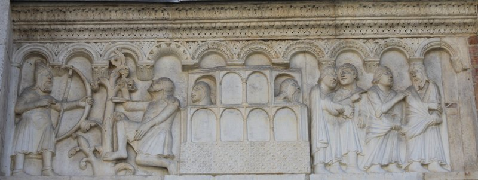
  <figcaption>Wiligelmo, the fourth slab of Genesis: Lamech kills Cain, the Ark of Noah, and Noah and his sons leaving the Ark, c. 1099–1110. Modena Cathedral, west façade, above the right side door. Photo: Mongolo1984, <a href="https://creativecommons.org/licenses/by-sa/4.0/">CC BY-SA 4.0</a>, via Wikimedia Commons.</figcaption>
</figure>

The fourth slab is set above the right side door of the façade, under a cornice of foliage and an arcade of small arches with leafy capitals. It completes the cycle that began with the Creation on the first slab.

At the left an archer in a pointed cap draws a great bow and shoots an arrow at a man half hidden in the branches of a tree. The archer is Lamech, who according to a tradition outside the Bible was blind and was guided by a boy, and the man in the thicket is Cain, killed by the arrow.

In the centre the Ark is represented as a building of two storeys of round arches, set on a base carved with a lattice pattern. Two heads look out from the upper arches: Noah and his wife, who have survived the Flood. The Ark has the form of a church, an image of the Church as the vessel of salvation.

At the right four men stand close together, talking and gesturing. They are Noah and his sons after leaving the Ark; Noah, bearded, holds the edge of his cloak, while the young men turn to one another and point. Their animated conversation contrasts with the immobility of the Ark.

The slab closes the Genesis cycle with the renewal of humanity after the Flood. The sequence from the Creation to Noah thus presents the history of salvation from its beginning to the first covenant, on the façade through which the faithful entered the church.

The fourth slab follows a tradition outside the Bible: the blind Lamech shoots an arrow at Cain, hidden in a thicket, and kills him. The Ark is represented as a building of two storeys of arches resting on the waters, with Noah and his wife at the windows. At the right Noah and his sons, having left the Ark, stand together in conversation. The cycle ends with the covenant between God and humanity after the Flood, the promise that the Church, the new Ark, would fulfil.

The style of the slabs is consistent throughout. The figures are short and heavy, with large heads, deep-set eyes and strong hands; their gestures are simple and clear; the relief is so high that some limbs are almost free of the ground. The arcades, cornices and capitals that frame the scenes come from Roman sarcophagi, but the figures have a weight and a seriousness of their own. They are among the founding works of Romanesque sculpture in Europe.

### The Main Portal (west façade)

<figure>
  
  <figcaption>Wiligelmo and workshop, the main portal: archivolt with inhabited vine scrolls and lintel with a foliate mask, c. 1099–1110. Modena Cathedral, west façade. Photo: Mongolo1984, <a href="https://creativecommons.org/licenses/by-sa/4.0/">CC BY-SA 4.0</a>, via Wikimedia Commons.</figcaption>
</figure>

The photograph shows the upper part of the main portal, under the deep arch of the porch. The archivolt, the lintel and the capitals of the jambs are carved from a pale, fine-grained marble that contrasts with the larger, plainer blocks of the arch above.

The archivolt is divided into concentric bands. The broadest is filled with a continuous vine scroll, whose tendrils curl into roundels; in them small figures of men, animals and birds climb, fight and feed among the leaves. Narrower bands of interlace and lattice ornament frame the scroll on either side.

The lintel is carved with a vine bearing bunches of grapes, which runs from one end to the other. At its centre a large mask with leafy hair and wide-open eyes looks out over the doorway, and small figures appear among the branches. Mask and vine, motifs drawn from Roman decorative art, are here placed directly above the threshold of the church.

At the springing of the arch, on either side, small crouching figures sit on the capitals and seem to support the archivolt on their backs. The lunette above the door is closed by an iron grille with round glass panes behind it, which lets light into the nave.

The density of the carving and its play of light and shadow make the portal the richest point of the façade. The inhabited scroll, which in Roman art was purely decorative, becomes in Wiligelmo's workshop an image of the created world, full of life and conflict, through which the faithful passed to enter the church.

The main portal is framed by a projecting porch on two columns borne by lions, with a loggia above. Its archivolt is carved with a continuous vine scroll inhabited by small figures of men, animals and fantastic creatures, and its lintel with vine scrolls bearing grapes and a large foliate mask at the centre. On the jambs stand the prophets who foretold the coming of Christ, each holding a scroll.

The inhabited scroll, a motif of Roman decorative art, became in Wiligelmo's hands a world in miniature, in which figures climb, fight and hide among the leaves. It frames the entrance with images of the created world and of its struggles, around the door that led to the church and to salvation. Small crouching figures at the springing of the arch support it like atlantes.

### The Porta dei Principi (south side)

<figure>
  
  <figcaption>Workshop of Wiligelmo (Maestro di San Geminiano), the lintel of the Porta dei Principi with the life of Saint Geminianus, and the archivolt with inhabited interlace, c. 1106–1110. Modena Cathedral, south side. Photo: Mongolo1984, <a href="https://creativecommons.org/licenses/by-sa/4.0/">CC BY-SA 4.0</a>, via Wikimedia Commons.</figcaption>
</figure>

The photograph shows the upper part of the Porta dei Principi, on the south side of the cathedral facing the Piazza Grande. The portal is framed by a broad archivolt and a long lintel, and the lunette above the door is closed by a grille of square panes.

The archivolt is carved with interlacing bands that knot themselves into roundels, in which small human figures, animals and birds are enclosed. The interlace is cut deep, so that its bands stand out sharply against the shadow behind them.

The lintel is divided into six compartments under a running inscription. At the left Geminianus rides out on horseback; next he crosses the sea in a ship with a sail; in the third scene he frees the emperor's daughter from a demon in the presence of the emperor; in the fourth he receives gifts from the emperor.

In the fifth scene the saint returns on horseback with his companions, and in the last he is laid in his tomb before a building with a tower, while clergy and people stand around him. The figures are small and densely grouped, and the scenes follow one another without frames other than the slender divisions of the lintel.

The sculpture is attributed to the Maestro di San Geminiano, one of the closest followers of Wiligelmo. His figures are shorter and more animated than those of the Genesis, and his narrative is more detailed, with ships, horses and buildings rendered with care. The legend of the patron saint is thus told at the door that opened onto the city's main square.

The Porta dei Principi, opening towards the Piazza Grande, owes its name to its ceremonial use. Its lintel tells the legend of Saint Geminianus in six scenes under a running inscription. The bishop sets out on horseback; he crosses the sea to Constantinople; he frees the emperor's daughter from a demon; he receives as a gift from the emperor a precious cup and a book of the Gospels; he returns home on horseback; and he is laid in his tomb. The legend explained the treasures that the cathedral preserved and the authority of its patron, who had been honoured by an emperor.

The archivolt is carved with interlacing bands that form roundels inhabited by animals and human figures, a variant of the inhabited scroll of the main portal. The jambs carry the twelve apostles, Saint Geminianus and a deacon in small arched niches; on the underside of the lintel two angels hold the Lamb of God in a roundel between Saint John the Baptist and Saint Paul. The sculpture has been attributed to two masters of Wiligelmo's workshop, the Maestro di San Geminiano, closer to the master, and the Maestro dell'Agnus Dei.

<figure>
  
  <figcaption>Workshop of Wiligelmo (Maestro dell'Agnus Dei), Saint John the Baptist, c. 1106–1110. Modena Cathedral, Porta dei Principi, underside of the lintel. Photo: Mongolo1984, <a href="https://creativecommons.org/licenses/by-sa/4.0/">CC BY-SA 4.0</a>, via Wikimedia Commons.</figcaption>
</figure>

The relief is carved on the underside of the lintel of the Porta dei Principi, in a narrow rectangular frame. It can be seen only by looking up from the threshold, and the figure is designed to be read from below.

Above the figure the inscription IOHANNES BAPTISTA names the saint. He is shown frontally, with long hair and a long beard divided into wavy strands, and large staring eyes. His garment of camel's hide is rendered by rows of shaggy, overlapping tufts that cover his body to the knees.

With his right hand raised, the Baptist points upwards to the Lamb of God carried by the angels on the adjacent part of the lintel. With his left hand he holds a tablet on which the words *Ecce agnus Dei, ecce qui tollit peccata mundi* are carved in short lines.

His bare feet rest on a narrow ledge at the bottom of the frame, and the background behind him is smooth. The figure, tall and narrow, fills the whole height of the panel, and its stiffness is relieved only by the pointing gesture and the texture of the hide.

The relief is attributed to the Maestro dell'Agnus Dei, one of the sculptors of Wiligelmo's workshop. The Baptist, the last of the prophets and the first witness of Christ, stands at the threshold of the church as the herald who announces the sacrifice celebrated at the altar.

The figure of the Baptist, in his garment of hide, holds a tablet with the words he spoke on seeing Christ, *Ecce agnus Dei, ecce qui tollit peccata mundi*, "Behold the Lamb of God, who takes away the sins of the world". He points to the Lamb carried above him by the angels, and the words are those that the priest pronounced at Mass before communion. The relief links the threshold of the church to the liturgy performed inside it.

<figure>
  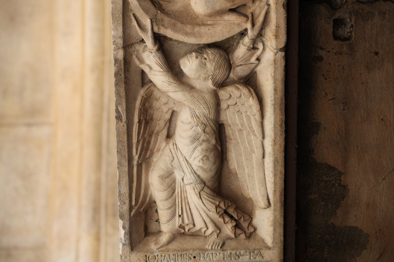
  <figcaption>Workshop of Wiligelmo, an angel raising the roundel of the Lamb of God, c. 1106–1110. Modena Cathedral, Porta dei Principi, underside of the lintel. Photo: Mongolo1984, <a href="https://creativecommons.org/licenses/by-sa/4.0/">CC BY-SA 4.0</a>, via Wikimedia Commons.</figcaption>
</figure>

The relief shows a single angel, carved on the underside of the lintel of the Porta dei Principi, and photographed from below in the shadow of the doorway. The figure stands upright in a narrow frame, with the inscription IOHANNES BAPTISTA running along its lower edge.

The angel stretches both arms upwards to hold the rim of a large roundel, which the photograph shows cut by the upper edge of the frame. His head is thrown back and his face turned upwards, in a pose of effort and devotion.

His long robe is girdled at the waist and falls in fine, close folds to his ankles, its hem flaring at the bottom. Two large wings, carved with long overlapping feathers, rise from his shoulders and fill the background on either side.

His bare feet rest on the lower edge of the frame, one slightly behind the other, as if he were rising. The upward thrust of the body, from the feet to the raised hands, carries the eye towards the roundel of the Lamb.

The figure is carved in high relief, with the pupils drilled and the hair rendered by curving incisions. It belongs, like the Baptist, to the work of the Maestro dell'Agnus Dei, whose figures are slender and delicate compared with the massive bodies of Wiligelmo's Genesis.

<figure>
  
  <figcaption>Workshop of Wiligelmo, two angels carrying the roundel with the Lamb of God, c. 1106–1110. Modena Cathedral, Porta dei Principi, underside of the lintel. Photo: Mongolo1984, <a href="https://creativecommons.org/licenses/by-sa/4.0/">CC BY-SA 4.0</a>, via Wikimedia Commons.</figcaption>
</figure>

The relief is carved on the underside of the lintel of the Porta dei Principi, and the photograph shows it from directly below. Two angels fly horizontally towards each other along the narrow surface, their bodies fully stretched.

Between them they hold a circular frame, in which the Lamb of God is carved. Seen from the doorway, the Lamb appears upside down, its legs and head pointing downwards, as if it were seen from heaven rather than from earth.

The angels' robes swirl around their legs in long curving folds, and their wings, spread behind them, fill the ends of the lintel. Their faces, turned towards the roundel, have the drilled pupils and rounded features of the Maestro dell'Agnus Dei.

The composition derives from Roman art, in which flying victories carried the portrait of the deceased or of the emperor in a medallion. Here the medallion holds the Lamb, the image of the sacrificed Christ, and the victories become angels.

Placed above the heads of those who entered, the relief showed the Lamb of God at the threshold of the church, between the Baptist who announced him and the other figures of the lintel. It is one of the most original adaptations of an ancient model in the sculpture of Wiligelmo's workshop.

Two angels fly towards each other, holding the roundel of the Lamb between them, their bodies stretched horizontally along the underside of the lintel. The composition, borrowed from the Roman motif of victories carrying a portrait, is adapted to the narrow surface with great skill, and the Lamb appears upside down to the viewer standing in the doorway, as if seen from heaven.

<figure>
  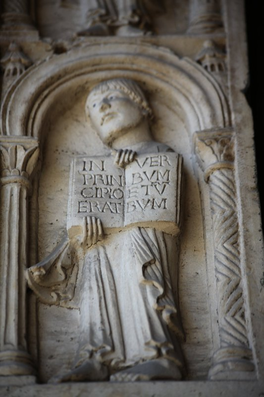
  <figcaption>Workshop of Wiligelmo, Saint John the Evangelist with the opening words of his Gospel, c. 1106–1110. Modena Cathedral, Porta dei Principi, jamb. Photo: Mongolo1984, <a href="https://creativecommons.org/licenses/by-sa/4.0/">CC BY-SA 4.0</a>, via Wikimedia Commons.</figcaption>
</figure>

The relief is carved on the jamb of the Porta dei Principi, in an arched niche between two small columns with leafy capitals. A band of zigzag ornament runs along the frame at the right.

Saint John the Evangelist stands frontally, young and beardless, with short curly hair. His head is turned upwards and slightly to one side, as if listening to a voice from above, and his eyes are wide open.

He holds before him an open book, on whose two pages are carved the opening words of his Gospel, *In principio erat verbum, et verbum*, in large capitals. One hand rests on the top of the book, the other supports it from below.

His mantle falls in long, close folds to his feet, and its hem is carved in a series of zigzag pleats. The niche, with its rounded arch and small columns, frames the figure like a doorway, one of the gates of the heavenly city.

The figure belongs to the series of apostles on the jambs of the Porta dei Principi, attributed to the workshop of Wiligelmo. Its gentle expression and slender proportions distinguish it from the heavy figures of the façade, and show the variety of hands at work on the cathedral in the first decade of the twelfth century.

<figure>
  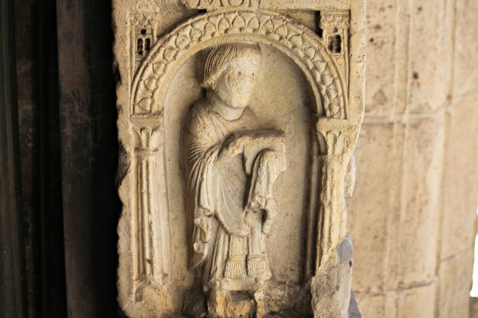
  <figcaption>Workshop of Wiligelmo, an apostle in a niche, c. 1106–1110. Modena Cathedral, Porta dei Principi, jamb. Photo: Mongolo1984, <a href="https://creativecommons.org/licenses/by-sa/4.0/">CC BY-SA 4.0</a>, via Wikimedia Commons.</figcaption>
</figure>

The relief is carved on the jamb of the Porta dei Principi and photographed in the half-light of the doorway. The figure stands in an arched niche whose scalloped arch rests on two small columns and is flanked by two small towers.

Above the arch the end of an inscription can be read, with the letters MON, which may belong to the name of the apostle Simon. The towers, with small windows, turn the niche into a gate in the walls of a city.

The apostle stands frontally in a long mantle drawn across his body. With one hand he holds a large closed book against his chest; the other hand is wrapped in a fold of the mantle that falls over his arm.

The head is worn, and the features of the face can barely be read. The drapery, however, is well preserved: its folds fall in regular parallel ridges and break at the hem into a series of small pleats above the feet.

The apostles of the jambs, standing in their niches like guardians of the heavenly Jerusalem, accompanied those who passed through the door. The series, of which this figure is part, extends the programme of the portal from the legend of the patron saint to the foundation of the Church on the apostles.

The apostles of the jambs stand in niches framed by small towers, as if in the gates of the heavenly Jerusalem. John the Evangelist, young and beardless, turns his face upwards and shows the opening words of his Gospel, *In principio erat verbum, et verbum*, "In the beginning was the Word, and the Word". The figures are smaller and more delicate than Wiligelmo's prophets, and their faces, with drilled pupils, have a gentler expression.

The portal was badly damaged by the bombing of 13 May 1944, which destroyed its porch and the fresco in the upper part. The sculpture was recomposed from 1946, and the losses are visible in the stippled infills of some parts. One of the lions that carry the columns of the porch was replaced by a copy made by Benedetto Boccolari.

### The Porta della Pescheria (north side)

<figure>
  
  <figcaption>Workshop of Wiligelmo, the archivolt of the Porta della Pescheria with the siege of a castle by Arthur and his knights, early twelfth century. Modena Cathedral, north side. Photo: Sailko, <a href="https://creativecommons.org/licenses/by-sa/4.0/">CC BY-SA 4.0</a>, via Wikimedia Commons.</figcaption>
</figure>

The archivolt of the Porta della Pescheria is a single semicircular band of stone, set into a brick arch on the north side of the cathedral. Below it the lunette is plain and plastered, and its underside is carved with large acanthus leaves in deep relief.

The narrative is arranged symmetrically along the curve. At the top, at the centre, stands a castle with towers, surrounded by water rendered as rows of scales. Within its walls a woman and a man look out; at either side a wooden siege tower, built of crossed beams, guards the approach.

From the left three horsemen ride up towards the castle with levelled lances, and in front of the left tower a man on foot swings a pick. From the right other knights advance, one of them fighting a knight who comes out of the castle; their horses rear and gallop along the curve of the arch.

Names are carved along the upper edge of the archivolt above the figures: Isdernus, Artus de Bretania, Burmaltus and Winlogee at the left and centre, Mardoc in the castle, Carrado, Galvaginus, Galvariun and Che at the right. They identify the figures as Yder, Arthur, Guinevere, Gawain and Kay and their opponents.

The sculptor has adapted the story to the shape of the arch, so that the riders seem to climb towards the castle from both sides and the action converges on its central point. The archivolt is one of the earliest surviving representations of an Arthurian subject in monumental art, and its presence on a cathedral door remains one of the great puzzles of Romanesque sculpture.

The archivolt of the Porta della Pescheria tells a story of rescue. At the top stands a castle surrounded by water, with wooden towers at either side; in it are a woman, Winlogee, and a man, Mardoc. From the left, knights ride to attack: Isdernus, Artus de Bretania and a third horseman, while a figure named Burmaltus defends the tower with a pick. From the right come Carrado, who fights a knight, and Galvaginus, Galvariun and Che. The names are those of Arthur, Yder, Gawain and Kay, and Winlogee is Guinevere, carried off and held in the castle.

<figure>
  
  <figcaption>The Porta della Pescheria, detail: the knight Isdernus (Yder) and a mounted companion. Photo: Sailko, <a href="https://creativecommons.org/licenses/by-sa/4.0/">CC BY-SA 4.0</a>, via Wikimedia Commons.</figcaption>
</figure>

The detail shows the left end of the archivolt, where the story begins. The curve of the stone band and the brick of the arch behind it are visible at the top, and the acanthus leaves of the underside at the bottom.

At the left a knight rides towards the right, wearing a mail hauberk with a hood rendered by small drilled holes. He holds a long lance, and his horse moves with lifted forelegs. His face is hidden by the hood and the nose-guard of his helmet.

To his right a second rider gallops in the same direction. He wears no armour but a short tunic, and his head is bare, with long hair and a full beard. He holds a long lance diagonally across his body, and his horse stretches forward in full gallop.

Above them the name ISDERNUS is carved along the edge of the archivolt, and at the right the first letters of the next name, ART, can be read. Isdernus corresponds to Yder, one of Arthur's knights in the later romances.

The contrast between the armoured knight and the bareheaded rider gives the scene variety, and the diagonal lances lead the eye along the curve towards the castle. The carving is vigorous, with the horses' heads and legs rendered in high relief.

<figure>
  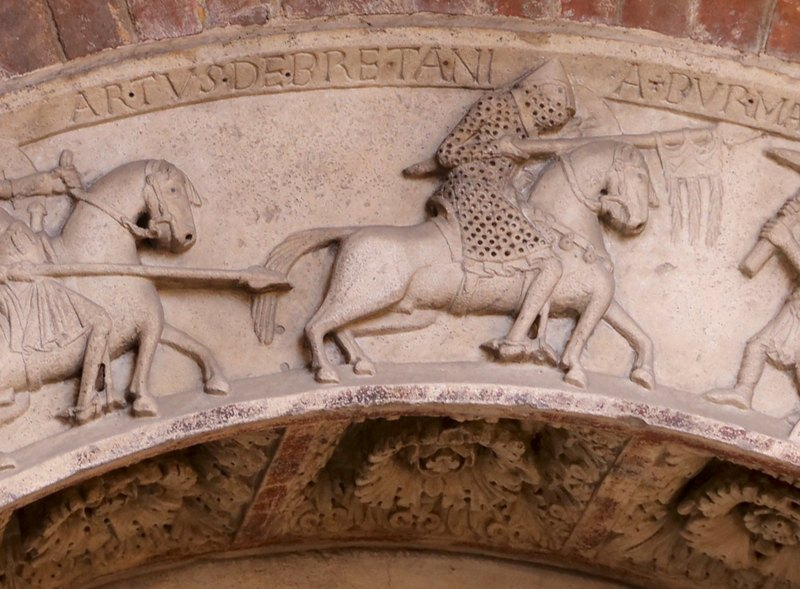
  <figcaption>The Porta della Pescheria, detail: Artus de Bretania, King Arthur, with his lance and pennant. Photo: Sailko, <a href="https://creativecommons.org/licenses/by-sa/4.0/">CC BY-SA 4.0</a>, via Wikimedia Commons.</figcaption>
</figure>

The detail shows the knight named ARTUS DE BRETANI in the inscription carved above him: Arthur of Brittany, King Arthur. The name is cut in clear capitals separated by points along the upper edge of the archivolt.

Arthur rides towards the right, towards the castle, wearing a mail hauberk with a hood and a pointed helmet. His armour is rendered by rows of small drilled holes that imitate the rings of mail. He holds a lance with a pennant whose fringed end hangs from the shaft.

His horse walks with one foreleg raised, its head held high and its mane carved in short strands. The saddle and the stirrups can be seen, and Arthur's foot rests in the stirrup.

At the left the lance of the rider who precedes him, Isdernus, points towards the right, and at the right edge part of the next figure, the man with the pick, can be seen. The inscription A·BUR·MA, the beginning of the name Burmaltus, follows that of Arthur.

Arthur is not distinguished from the other knights by a crown or by any royal sign: only the inscription identifies him. This suggests that the sculptor and his patrons expected the viewers to know the story, and to recognise its hero by his name.

<figure>
  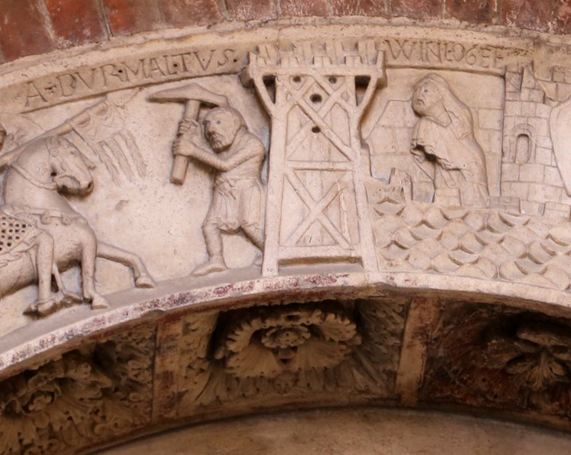
  <figcaption>The Porta della Pescheria, detail: Burmaltus with his pick, a siege tower and Winlogee (Guinevere) within the walls of the castle. Photo: Sailko, <a href="https://creativecommons.org/licenses/by-sa/4.0/">CC BY-SA 4.0</a>, via Wikimedia Commons.</figcaption>
</figure>

The detail shows the centre-left of the archivolt, from the man with the pick to the castle. The inscription A·BURMALTUS runs along the upper edge, followed by WINLOGEE.

At the left a bearded man in a short tunic swings a pick above his head with both hands. He is Burmaltus, who in the story guards the approach to the castle. His bare legs and simple tunic distinguish him from the armoured knights.

In the centre stands a tall wooden tower built of crossed beams, with a platform at the top. It is a siege tower or a barbican protecting the entrance to the castle, and its lattice of beams is carved with great precision.

At the right, behind a wall of stone blocks rising from the water, a veiled woman looks out with a sad face. She is Winlogee, Guinevere, held captive in the castle. The water at her feet is rendered by rows of overlapping scales, and a tower with a round-headed window rises behind her.

The figure of the captive queen, at the centre of the composition, is the goal towards which all the knights ride. Her sad expression gives the scene a human dimension, and her veil and mantle distinguish her from the warriors around her.

The story does not correspond exactly to any surviving written text. The abduction of Guinevere and her rescue appear in later romances, among them the *Chevalier de la Charrette* of Chrétien de Troyes and the Welsh *Life of Gildas* by Caradoc of Llancarfan, where she is held by Melwas in a town surrounded by water. The Modena version, with its unusual names, seems to reflect an oral tradition, carried to Italy by Breton storytellers or knights, before the stories were fixed in writing.

The knights wear mail hauberks, conical helmets and kite-shaped shields, the equipment of the late eleventh and early twelfth century, and their horses are carved with lively movement. The sculptor has adapted the narrative to the curve of the arch, so that the riders gallop up towards the castle at the top from both sides. The worn surface of the stone does not hide the vigour of the figures, close in type to those of the Porta dei Principi.

<figure>
  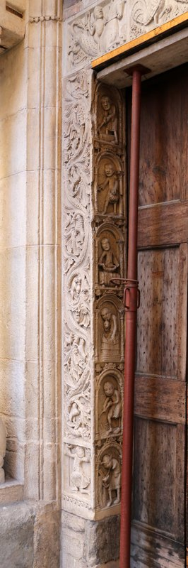
  <figcaption>The Porta della Pescheria, left jamb: Labours of the Months in arched niches and inhabited vine scroll, early twelfth century. Photo: Sailko, <a href="https://creativecommons.org/licenses/by-sa/4.0/">CC BY-SA 4.0</a>, via Wikimedia Commons.</figcaption>
</figure>

The photograph shows the left jamb of the Porta della Pescheria, tall and narrow, beside the old wooden door. A red metal prop stands in front of it, part of the works of consolidation carried out on the portal.

On the inner face of the jamb a column of small arched niches is carved, one above the other. In each a figure is busy at a seasonal task, with an abbreviated name above. The figures are short and stocky, and their gestures, reaping, threshing, treading grapes, handling barrels, are rendered with great clarity.

On the outer face of the jamb a dense vine scroll rises from the base to the top. Its tendrils curl into roundels inhabited by birds, animals and small figures, carved in sharp, deep relief that catches the light.

At the top of the jamb part of the lintel can be seen, carved with figures of animals. The lintel tells animal fables, in which foxes, wolves and birds play out moral lessons above the door through which the faithful passed.

The cycle of the months, distributed on the two jambs, shows the year of labour of the peasant, from the cold months to the harvest and the vintage. On a door that opened on the fish and produce market, it reminded the people of Modena that the work of the fields followed the order established by God.

<figure>
  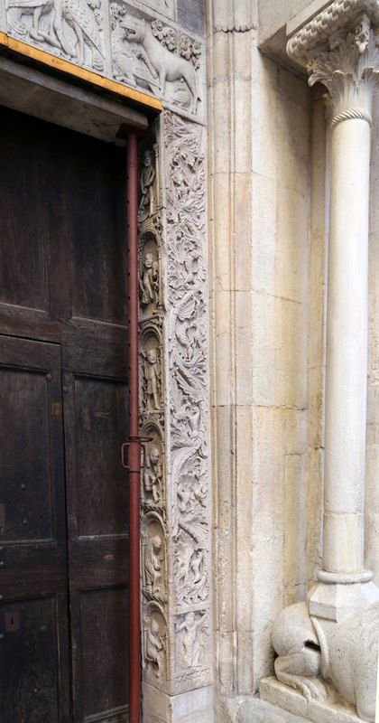
  <figcaption>The Porta della Pescheria, right jamb with the remaining Months and vine scroll, the lion at the base of the porch and, above, part of the lintel with animal fables. Photo: Sailko, <a href="https://creativecommons.org/licenses/by-sa/4.0/">CC BY-SA 4.0</a>, via Wikimedia Commons.</figcaption>
</figure>

The photograph shows the right jamb of the Porta della Pescheria, with the dark wooden door at the left and a column of the porch at the right. A metal prop stands in front of the jamb, as on the left side.

The inner face of the jamb carries the remaining months, in small arched niches set one above the other. Each figure is shown at work or in a characteristic pose, and the arches above them are carved with small capitals and bases.

The outer face is carved with a dense scroll of foliage, inhabited by birds and animals. Its tendrils form a continuous pattern that frames the months and links the jamb to the archivolt above.

At the top of the photograph a part of the lintel can be seen, carved with animals that belong to the fables told across the doorway.

At the bottom right a crouching lion supports the column of the porch, which rises with a carved capital to the top of the photograph. The lion, the jamb and the lintel together form the rich sculptural frame of the north door.

The jambs carry the Labours of the Months, each in its own arched niche with its name: the farmer reaps the grain in July, threshes in August, treads the grapes in September and fills the barrels in October. The calendar of rural work, common on Romanesque portals, had a particular meaning on this door, which opened on the market where the produce of the countryside was sold. On the outer faces of the jambs vine scrolls are inhabited by birds and animals, and the lintel above the door is carved with scenes from animal fables.

<figure>
  
  <figcaption>The Porta della Pescheria, stylophore lion holding a ram. Photo: Szeder László, <a href="https://creativecommons.org/licenses/by-sa/4.0/">CC BY-SA 4.0</a>, via Wikimedia Commons.</figcaption>
</figure>

The photograph shows one of the two lions that support the columns of the porch of the Porta della Pescheria. The lion lies on a rectangular base, and the column rests on a moulded base set on its back.

The lion turns its head towards the viewer, with its mouth open to show its teeth, round drilled eyes and a short muzzle. Its mane is carved in curly locks that cover the head, the neck and the shoulders.

Between its forepaws it holds a sheep or ram, whose woolly fleece is rendered by small curls. The prey lies on its side, its head bent down, held firmly by the lion's claws.

The lion's body is long and solid, with the ribs marked by shallow grooves and the tail curled along the base. The stone is worn and weathered, but the sculpture keeps its strong outlines.

Lions holding their prey, placed at the doors of churches, were guardians and warnings. The lion that crushes a ram or a man showed the power of the Church over evil, and the fate that awaited those who entered unworthily.

<figure>
  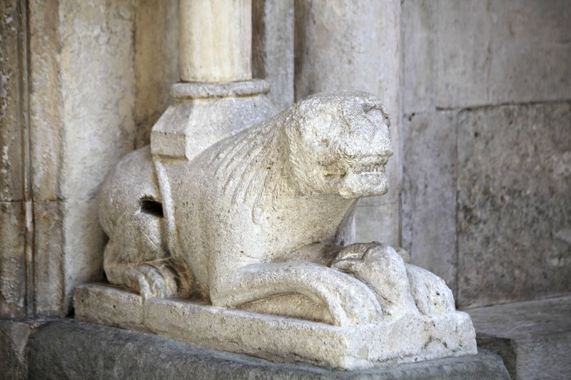
  <figcaption>The Porta della Pescheria, stylophore lion. Photo: Mongolo1984, <a href="https://creativecommons.org/licenses/by-sa/4.0/">CC BY-SA 4.0</a>, via Wikimedia Commons.</figcaption>
</figure>

The photograph shows the second lion of the Porta della Pescheria, crouching on a rectangular base in front of a column. A moulded column base sits on its back, and the shaft of the column rises above it.

The lion's head is lowered and turned forwards, with a short, flat muzzle and small eyes. The surface of the face is badly worn, and the features can only be partly read.

The mane is carved in long incised strands that fall from the head along the neck and the shoulders. The forepaws rest flat on the base in front of the body, and the hind legs are drawn up beneath it.

In the lion's flank a hole has been made, perhaps to fix an iron bar or a chain in a later period. The base and the lower part of the body are also damaged.

Despite its wear, the lion keeps the massive, compact form of the stylophore lions of the Po valley, which Wiligelmo's workshop introduced at Modena. Its calm pose contrasts with the aggressive lion of the other side of the porch.

The columns of the porch rest on two crouching lions. One holds a ram between its forepaws, the other lies with its head lowered. Lions at the doors of churches, a motif that Wiligelmo introduced at Modena and that spread through the Po valley, were guardians of the sacred space and images of the strength of the Church, which overcomes evil and protects the faithful. The lion holding its prey recalls the punishment that awaits those who enter unworthily.

### The Porta Regia (south side)

<figure>
  
  <figcaption>Campionese masters, the Porta Regia, first half of the thirteenth century. Modena Cathedral, south side. Photo: Warburg, <a href="https://creativecommons.org/licenses/by-sa/3.0/">CC BY-SA 3.0</a>, via Wikimedia Commons.</figcaption>
</figure>

The photograph shows the Porta Regia, on the south side of the cathedral facing the Piazza Grande. The porch projects from the wall, whose striped masonry of pale and darker stone can be seen at the sides.

A deep round arch covers the portal. Its outer edge is carved with a frieze of rosettes, and its underside is smooth. The arch rests on capitals of foliage set on slender columns of red marble.

The portal itself is framed by many concentric mouldings, carved with cables, spirals and zigzags, which recede towards the door. Pairs of slender columns stand at the sides, some of them knotted in the middle, a motif much loved by the Campionese masters.

The tall wooden door is closed, and the lunette above it is filled with a grille with a small emblem at the centre. The pinkish red marble of the columns and of the frame contrasts with the white stone of the mouldings.

Two large lions of red marble lie on bases in front of the porch, guarding the entrance. They are later and heavier than the lions of Wiligelmo's doors, and their colour matches the marble of the porch. The door is a rich example of the Campionese taste for colour and ornament.

The Porta Regia, on the south side facing the Piazza Grande, was built by the Campionese masters in the first decades of the thirteenth century. It is quite different from the earlier doors: it has no narrative sculpture, but a deep porch of red Verona marble and white stone, with many concentric mouldings carved with cables and zigzags, and slender columns, some of them knotted. Two large lions of red marble lie in front of the porch.

The door shows the taste of the Campionesi for coloured marble and rich architectural ornament, which changed the appearance of the cathedral's flank on the city's main square. Its name probably recalls its ceremonial function as the entrance of the civic and episcopal authorities. Inserted into Lanfranco's wall, it respects the rhythm of the arcades above it.

### The Pontile and the Ambo (interior)

<figure>
  
  <figcaption>The pontile and its ambo, with the crypt below and the raised presbytery above. Modena Cathedral, interior. Photo: Mattis, <a href="https://creativecommons.org/licenses/by-sa/4.0/">CC BY-SA 4.0</a>, via Wikimedia Commons.</figcaption>
</figure>

The photograph shows the east end of the nave, where the pontile crosses the whole width of the church in front of the raised presbytery. The interior is dim, and the light falls on the painted reliefs of the parapet and on the lit crypt below.

The platform rests on slender columns with carved capitals, which stand on the floor of the nave. Between them three round arches open into the crypt, closed by gilded iron grilles; through the central arch the altar and the tomb of Saint Geminianus can be glimpsed.

The parapet of the pontile is a continuous frieze of small painted figures, the Passion cycle of Anselmo da Campione and his workshop. At the left the curved ambo projects from the parapet, resting on its own columns.

Above the pontile, behind a colonnade of slender columns, rises the presbytery with its altar and candlesticks. The apse behind it is painted with saints and ornament, and lamps hang from the vault on long chains.

The arrangement, with the crypt below, the pontile in the middle and the presbytery above, separated the clergy from the faithful while allowing both to see the tomb of the saint. It is one of the best preserved examples in Italy of a Romanesque choir screen, though in its present form it is a reconstruction of the early twentieth century.

The pontile stretches across the nave in front of the raised presbytery. It is carried on columns, some of them resting on lions and crouching figures, and opens below into the crypt through three arches, so that the faithful in the nave could see the tomb of the saint while the clergy celebrated above. Its parapet is carved with a frieze of the Passion, attributed to Anselmo da Campione and his workshop and dated around 1160–1184.

<figure>
  
  <figcaption>Anselmo da Campione and workshop, the pontile: the Washing of the Feet and the Last Supper, c. 1160–1184, with modern recovery of the original colours. Modena Cathedral. Photo: Sailko, <a href="https://creativecommons.org/licenses/by-sa/4.0/">CC BY-SA 4.0</a>, via Wikimedia Commons.</figcaption>
</figure>

The photograph shows the central part of the parapet of the pontile, framed below by a band of ornament with interlace and a meander, and above by a moulded cornice. Two columns with figured capitals support it from below.

At the left Christ kneels on the ground before Peter, who sits with his bare foot in a large round basin. Other apostles stand behind him and watch. Christ's gesture of humility opens the cycle of the Passion.

The Last Supper fills the centre of the parapet. The apostles sit in a row behind a long table, each with a gold halo and his name carved in the cornice above him. They wear robes of red, green and blue, and many hold cups or turn to their neighbours.

At the centre Christ, raised above the others, gives the morsel to Judas, who reaches towards him from the near side of the table, while John leans on Christ's breast. The white tablecloth hangs in deep regular folds along the whole length of the table, its hem carved with round knots.

At the right begins the next scene, with soldiers and a raised axe. The colours, recovered by cleaning, give the frieze a brilliance that is rare in Romanesque sculpture and show how the reliefs were meant to be seen in the twelfth century.

The frieze begins with the Washing of the Feet: Christ kneels before Peter, who sits with his foot in a basin. Then comes the Last Supper, the largest scene, with the apostles seated in a row behind a long table, each with his name carved above him. Christ, at the centre, gives the morsel to Judas, while John sleeps on his breast. The tablecloth falls in deep regular folds, and the colours, red, green, blue and gold, have been recovered by modern cleaning.

<figure>
  
  <figcaption>Anselmo da Campione and workshop, the pontile: the Betrayal, Christ before Pilate, the Flagellation and the Way to Calvary, c. 1160–1184. Modena Cathedral. Photo: Sailko, <a href="https://creativecommons.org/licenses/by-sa/4.0/">CC BY-SA 4.0</a>, via Wikimedia Commons.</figcaption>
</figure>

The photograph shows the right-hand part of the parapet of the pontile, divided by slender red marble columns into compartments. The figures stand against a gold ground, and the colours of their robes, red, green, blue and ochre, have been recovered by cleaning.

At the left the end of the table of the Last Supper can be seen, with three apostles behind it. Next comes the Betrayal: Judas embraces and kisses Christ among a crowd of soldiers armed with axes and spears, while Peter, at the left, cuts off the ear of the kneeling servant.

In the next compartment Christ stands before Pilate, who sits on a throne in the attitude of a judge. A soldier holds Christ by the arm, and other figures watch.

Then Christ is bound to a column and scourged. At the right a man carries a large cross on his shoulder: Simon of Cyrene, who bears the cross for Christ on the way to Calvary.

Below the parapet the capitals of the columns are carved with figures and scenes, which seem to carry the weight of the platform. The frieze tells the Passion with crowded, lively figures dressed in the costume of the twelfth century, so that the story appears as an event of the sculptor's own world.

The story continues with the Betrayal: Judas kisses Christ among soldiers armed with axes and spears, while Peter cuts off the ear of the servant Malchus. Christ then stands before Pilate, who sits in judgement; he is tied to a column and scourged; and Simon of Cyrene carries the cross. The scenes are crowded with figures in lively movement, and the soldiers wear the clothing of the twelfth century. The capitals beneath the parapet are carved with figures and scenes.

The pontile was dismantled in 1592 and its slabs dispersed, some of them reused in the walls of the church. They were recovered and the structure recomposed between 1898 and 1921, and the cleaning of the reliefs revealed their original painting under layers of dirt. The present arrangement is therefore a reconstruction, but it gives a rare idea of the appearance of a Romanesque choir screen in Italy.

<figure>
  
  <figcaption>Campionese masters, the ambo of the pontile: Christ enthroned among the symbols of the Evangelists, c. 1208–1225. Modena Cathedral. Photo: Sailko, <a href="https://creativecommons.org/licenses/by-sa/4.0/">CC BY-SA 4.0</a>, via Wikimedia Commons.</figcaption>
</figure>

The photograph shows the front of the ambo, the curved pulpit that projects from the left end of the pontile. It is carved with panels separated by small columns, and rests on two columns with carved capitals.

At the centre Christ sits enthroned on a throne decorated with small arches. He blesses with his right hand and holds a book in his left, marked with a cross; his head is framed by a large halo, and the letters alpha and omega are carved beside him. An inscription runs along the cornice above.

At the left the winged angel of Matthew stands with a book, and below it the winged lion of Mark holds its book in its paws. At the right the eagle of John spreads its wings above the winged ox of Luke, which also holds a book.

The figures are carved against a blue ground. The relief is higher and the figures more rounded than in the frieze of the pontile, a sign of the later date of the ambo, added in the early thirteenth century.

At the right edge of the photograph part of the parapet of the pontile can be seen, with Christ washing the feet of Peter. The ambo was the place from which the Gospel was read, and its sculpture presents Christ and the four Evangelists as the source of the word proclaimed there.

At the left end of the pontile projects the ambo, from which the Gospel was read, added in the early thirteenth century. At its centre Christ sits enthroned, blessing and holding the book, between the letters alpha and omega; an inscription above him begins *Non luce cernis*, opposing his light to the light of the senses. At the sides the symbols of the Evangelists, the angel and the lion, the ox and the eagle, carry their books.

<figure>
  
  <figcaption>Campionese masters, the ambo of the pontile: the Doctors of the Church, Jerome, Ambrose, Augustine and Gregory, inspired by angels and doves, c. 1208–1225. Modena Cathedral. Photo: Sailko, <a href="https://creativecommons.org/licenses/by-sa/4.0/">CC BY-SA 4.0</a>, via Wikimedia Commons.</figcaption>
</figure>

The photograph shows the side faces of the ambo, carved with the four Doctors of the Latin Church. The figures are set against a blue ground scattered with gold stars, under a cornice inscribed with their names.

In the left panel sit Jerome and Ambrose, named SCS IERONIMUS and SCS AMBROSIUS. Both write in books placed on lecterns, and their heads are bent in concentration. An angel flies down head first to touch the head of one of them, and a dove bends towards his ear.

In the right panel sit Augustine and Gregory, named in the inscription SCS AUGUSTINUS ET S GREGORIUS DOCTORES. They too write in open books, and an angel with spread wings plunges down towards them, while a second dove flies towards their heads.

The angels, upside down, and the doves, the Holy Spirit, show that the Doctors write under divine inspiration. Their seated poses, their haloes and the books on their knees follow the type of the evangelist portrait, which the sculptor has adapted to the interpreters of Scripture.

At the right edge the winged lion of Mark, with the inscription SCS MARCUS, closes the series. The ambo thus joins the Evangelists and the Doctors, the authors of the Gospels and their commentators, on the pulpit from which the word of God was proclaimed to the people.

The other faces of the ambo show the four Doctors of the Latin Church, Jerome, Ambrose, Augustine and Gregory, seated and writing in their books against a blue ground scattered with gold stars. Angels fly down head first to touch their heads, and doves, the Holy Spirit, bend to whisper into their ears. The ambo thus presents the word of God in its sources, Christ and the Evangelists, and in its interpreters, the Doctors, at the place where it was proclaimed to the people.

### The Consecration Inscription of 1184

The inscription of the consecration of 1184, illustrated above, is carved in sixteen long lines on blocks of the exterior wall. It begins with the date, *Anno Domini MCLXXXIIII, IIII idus iulii*, and names Pope Lucius III, who came to Modena with the cardinals of his court, cardinal bishops, priests and deacons, each named with his title. With them were the archbishop of Ravenna, other archbishops, the bishops of Reggio and Bologna and further prelates, Bishop Ardicio of Modena with the provost and canons, and the rectors of the cities of Lombardy, the March and Romagna.

The text records that the pope, "having shown the holy body" of Geminianus, consecrated the church and granted forty days of indulgence, with the remission of a fourth part of penance, to those who would visit it on the anniversary. It then tells how, leaving the city through the gate of the bridge, he blessed it with the words "Blessed be this city by the Father, the Son and the Holy Spirit, by the Blessed Virgin Mary, by the blessed Peter the apostle and by the blessed Geminianus; may the Lord make it grow and multiply". It ends by noting that some thousands of people followed him with lighted candles, and that he blessed them and the land in which they lived.

### The Relatio (Modena, Archivio Capitolare, O.II.11)

The *Relatio de innovatione ecclesie sancti Geminiani ac de translatione eius beatissimi corporis* survives in a copy of the early thirteenth century, made around 1200–1210 and illustrated with coloured drawings framed by borders of lattice ornament. Short captions identify the figures. The manuscript is kept in the chapter archive, and its pages are shown in facsimile in the Musei del Duomo.

<figure>
  
  <figcaption>The Relatio, Matilda of Canossa receives the bishops for the translation of Saint Geminianus, c. 1200–1210 (facsimile). The original is in Modena, Archivio Capitolare, O.II.11. Photo: Sailko, <a href="https://creativecommons.org/licenses/by/3.0/">CC BY 3.0</a>, via Wikimedia Commons.</figcaption>
</figure>

The page is shown in facsimile, with the drawing framed by a broad border of orange lattice between blue bands. Above the frame a line of script gives the date of the translation of the body of Saint Geminianus, 30 April 1106.

At the left a group of bishops and clergy stands on a green ground rendered as waves. The bishops wear mitres and hold crosiers with curled heads, and a tonsured cleric in a dark habit stands at the front. Their faces are turned towards the right.

At the right Matilda of Canossa, labelled *Matildis comitissa*, stands in a green mantle over a red dress. She holds a staff and extends her hand towards the bishops, in a gesture of greeting or of command.

Behind her stand two ladies in white veils and tall head-dresses, and a group of men with pointed caps and expressive faces, who talk among themselves. They represent the countess's court and the citizens who took part in the event.

Below the frame a second line of script, belonging to the next part of the text, records the dedication of the altar in October of the same year. The drawing, with its strong outlines and flat colours, is the work of an illuminator of the early thirteenth century, who gave the event the form of a solemn meeting.

Above the first miniature a rubric gives the date of the translation: *Anno dominice incarnationis MCVI pridie kal. mai. facta est translatio patroni nostri beatissimi Geminiani*, "In the year of the Lord's incarnation 1106, on the day before the Kalends of May, the translation of our most blessed patron Geminianus took place". Below it, Matilda, labelled *Matildis comitissa*, stands with her ladies and her men before a group of bishops and clergy with mitres and crosiers. Her gesture shows her as mediator, the guarantor of an agreement between the clergy and the citizens.

<figure>
  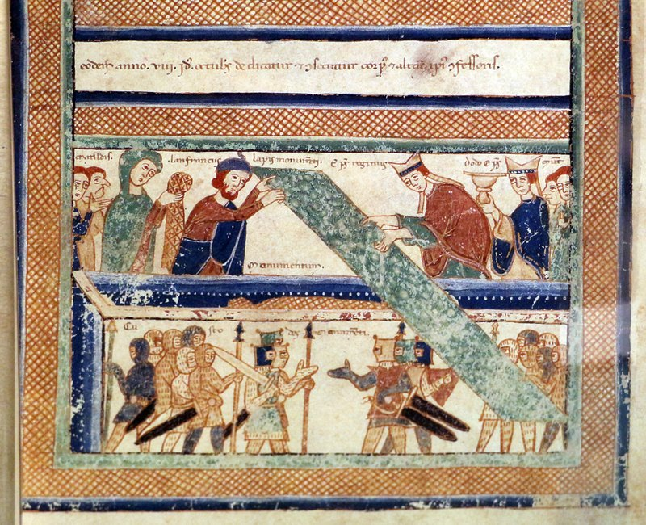
  <figcaption>The Relatio, the opening of the tomb of Saint Geminianus, with Matilda, Lanfranco and the bishops above and the armed guards of the tomb below, c. 1200–1210 (facsimile). The original is in Modena, Archivio Capitolare, O.II.11. Photo: Sailko, <a href="https://creativecommons.org/licenses/by/3.0/">CC BY 3.0</a>, via Wikimedia Commons.</figcaption>
</figure>

The drawing is divided into two registers within a frame of orange lattice and blue bands. Above it a line of script records the dedication of the altar and the consecration in October 1106.

In the upper register Matilda, labelled *Matildis*, stands at the left in a green mantle. Beside her Lanfranco, labelled *Lanfrancus*, wearing a blue cap and a red mantle, grasps the end of a long green slab, the *lapis monumenti*, which runs diagonally across the drawing.

At the right a bishop in a mitre, labelled as the bishop of Reggio, lifts the other end of the slab, and beside him a bishop labelled *Dodo* holds a chalice. Other figures look on from the edges of the scene. The slab is drawn as a broad green band that crosses both registers.

In the lower register, labelled *custodes monumenti*, armed men in mail hauberks and helmets stand on either side, with swords and spears. Their weapons, drawn in black, cross one another, and their faces are turned towards the tomb.

The drawing records with great precision the opening of the tomb on 30 April 1106 in the presence of the countess, the architect and the bishops, under the watch of armed guards. It shows Lanfranco, the architect, at the centre of the event, an exceptional place for a builder in the art of the Middle Ages.

The second miniature shows the opening of the tomb. Labels identify Matilda, Lanfranco, the stone of the tomb (*lapis monumenti*) and the bishop of Reggio, who lifts the slab with Lanfranco, while a bishop labelled Dodo holds a chalice. In the lower register the guards of the tomb, *custodes monumenti*, in mail with swords and spears, stand ready. A rubric above refers to the dedication of the altar in October of the same year. The image records the tension of the event, in which the city would not let the body of its saint be touched without armed witnesses.

The *Relatio* is unique among the sources for Romanesque building. It is not only a chronicle but an illustrated account in which the architect appears beside the countess and the bishops, and in which the citizens, the clergy and the guards each have their place. Its miniatures, with the inscriptions of Lanfranco and Wiligelmo, are the reason Modena Cathedral is the best documented of the great Romanesque churches of Italy.

### The Foundation Inscriptions

The foundation of the cathedral is recorded by two inscriptions of 1099, one on the façade with the name of the sculptor, one on the main apse with the name of the architect. Both are illustrated above.

The inscription of the façade is carved on a tablet held by the prophets Enoch and Elijah, who were taken up to heaven without dying and were expected to return at the end of time; their names are carved on the base. It was made by Wiligelmo himself, as its last couplet shows, and set into the wall to the left of the main portal.

> *Dum Gemini Cancer cursum consendit ovantes, 
> idibus in quintis Iunii sub tempore mensis, 
> mille Dei carnis monos centum minus annis, 
> ista domus clari fundatur Geminiani. 
> Inter scultores quanto sis dignus onore 
> claret scultura nunc, Wiligelme, tua.*
{: .quote-latin}
>
> While Cancer was climbing the course of the rejoicing Twins, 
> on the fifth day before the Ides of the month of June, 
> in the year of God's flesh one thousand and one hundred less one, 
> this house of the illustrious Geminianus is founded. 
> How worthy you are of honour among sculptors, 
> Wiligelmo, your sculpture now makes plain.
{: .quote-translation}

The date, 9 June 1099, is given with learned elaboration: the position of the sun between the signs of the Twins and Cancer, the Roman reckoning of the Ides and the year expressed as "a hundred less one" after a thousand, with the Greek *monos* for one. The final couplet turns the foundation record into a celebration of the sculptor, whose work is offered as proof of his honour.

The inscription of the apse is carved on a marble plaque above a window of the main apse, the oldest part of the building. Composed by the canon Aimo, it praises the church of the saint and names Lanfranco as master of the work; two further lines, in different lettering, were added in the thirteenth century by Bozzalino, *massarius* of the fabric of Saint Geminianus.

> *Marmoribus sculptis domus haec micat undique pulchris, 
> qua corpus sancti requiescit Geminiani, 
> quem plenum laudis terrarum celebrat orbis, 
> nosque magis, quos pascit, alit, vestitque ministros. 
> Qui petit hic veram membris animaeque medelam, 
> recta redit hinc, quoque salute recepta. 
> Ingenio clarus Lanfrancus, doctus et aptus, 
> est operis princeps huius rectorque magister. 
> Quo fieri coepit demonstrat littera praesens: 
> ante dies quintus Iunii tunc fulserat Idus, 
> anni post mille Domini nonaginta novemque. 
> Hos utiles facto versus composuit Aimo. 
> Boçalinus massarius Sancti Geminiani hoc opus fieri fecit.*
{: .quote-latin}
>
> This house shines on every side with beautiful carved marbles, 
> where the body of Saint Geminianus rests, 
> whom, full of praise, the whole world celebrates, 
> and we above all, his ministers, whom he feeds, sustains and clothes. 
> Whoever seeks here true healing for body and soul 
> goes home restored, his health received. 
> Lanfranco, famed for his genius, learned and skilled, 
> is the chief of this work, its director and master. 
> When it began to be built, this inscription shows: 
> the fifth day before the Ides of June had then dawned, 
> in the year of the Lord one thousand ninety and nine. 
> Aimo composed these verses, useful for the deed. 
> Bozzalino, massarius of Saint Geminianus, had this work made.
{: .quote-translation}

The two inscriptions present the architect and the sculptor as the authors of the cathedral, in verse and in public, at the two ends of the building. As <a href="/scholars.html#castelnuovo-enrico">Enrico Castelnuovo</a> has observed, such statements of artistic identity are rare before the twelfth century, and at Modena they belong to a community that wished to celebrate the men who had made its church.
