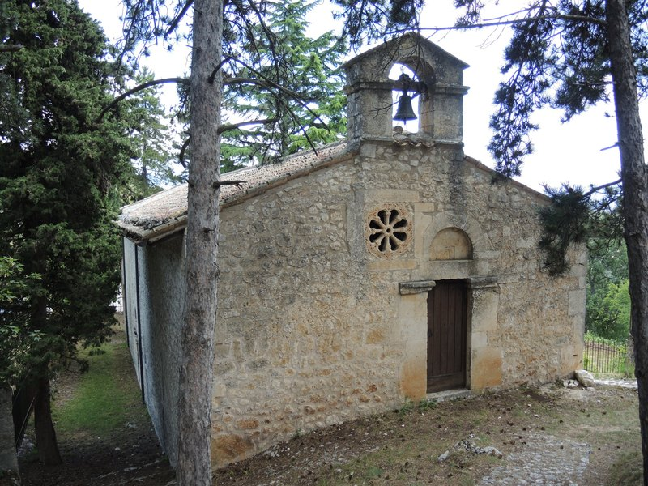
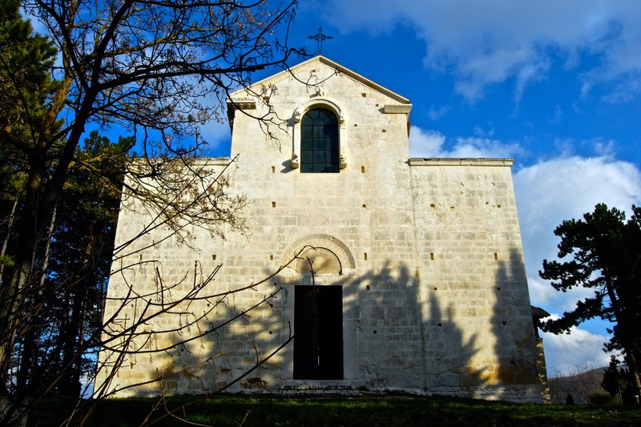
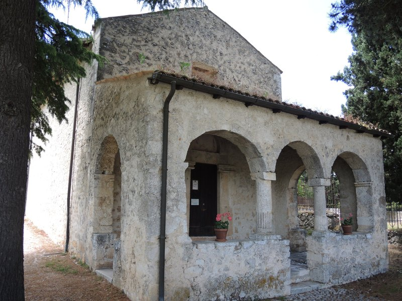
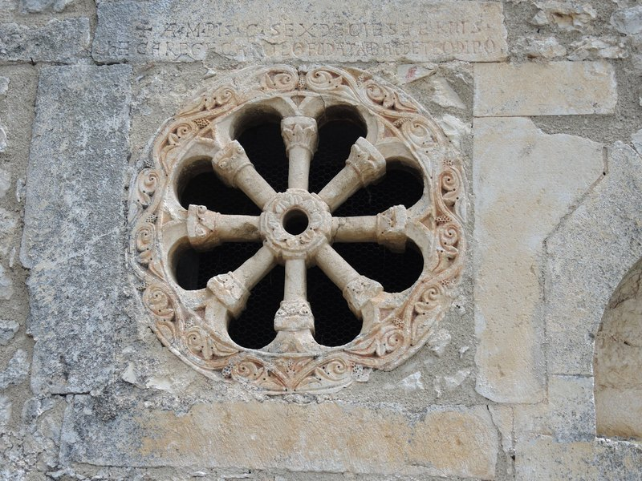
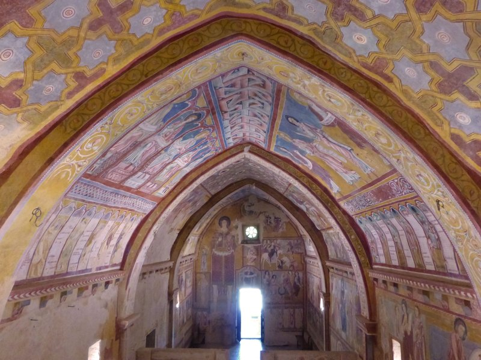
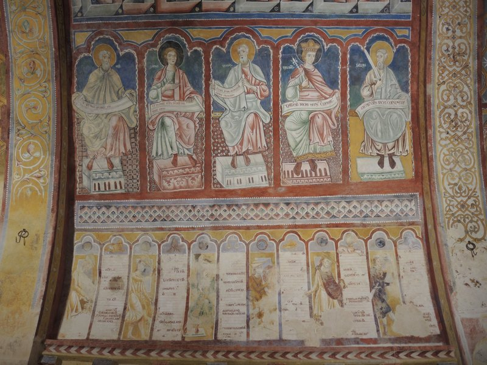
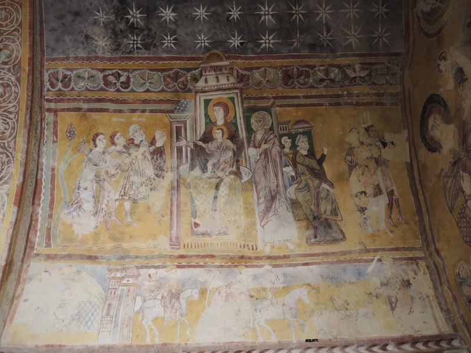
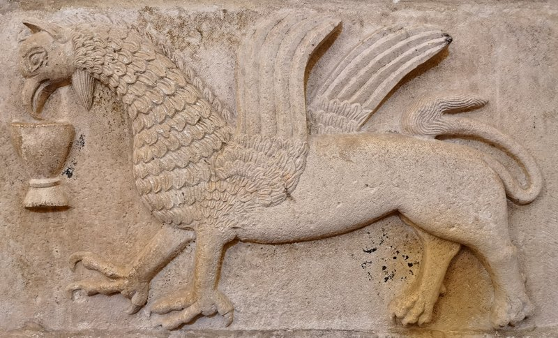

## The Monastery and the Oratory

Bominaco is a small village on the plateau of Navelli, in the province of L'Aquila, at about a thousand metres above sea level. Above the village stand the two surviving buildings of a Benedictine monastery dedicated to Saint Pellegrino: the abbey church of Santa Maria Assunta, a Romanesque basilica of the eleventh and twelfth centuries, and the oratory of San Pellegrino, a small, plain building whose interior is entirely covered with paintings. Of the monastic buildings around them almost nothing remains above ground.

The oratory owes its fame to its decoration. An inscription on its façade records that it was rebuilt under Abbot Teodino in 1263, and the paintings that fill its walls and vault, executed at the same time, form one of the most complete and best preserved cycles of thirteenth-century painting in central and southern Italy. Few medieval interiors in Italy give so clear an idea of what a painted church looked like in the century before Giotto.

<figure>
  
  <figcaption>The oratory of San Pellegrino at Bominaco, the east end with the bell-cote, the rose window and the inscription of 1263. Photo: Pietro (Moto Itinerari), <a href="https://creativecommons.org/licenses/by-sa/3.0/">CC BY-SA 3.0</a>, via Wikimedia Commons.</figcaption>
</figure>

The monastery is documented from the eleventh century and was for a long time a possession of the bishops of Valva, the ancient see whose cathedral stood at Corfinio; its history was marked by disputes over its dependence. It was dedicated to Saint Pellegrino, venerated as a Syrian martyr whose body the community claimed to possess. A local tradition, repeated in the inscription of 1263, attributed its foundation to Charlemagne, a legend common among the monasteries of central Italy that sought an ancient and royal origin.

The older version of this page described the monastery's life, economy and library at length without documentary support, listed influences from Monreale, Anagni and the Crusader states, and recorded only one restoration. That material has been removed. The page now presents the building, the inscription and the paintings as they can be seen, with the dates recorded by the Italian heritage catalogue.

<figure>
  
  <figcaption>The abbey church of Santa Maria Assunta at Bominaco, the west façade, eleventh–twelfth century. Photo: Wanjan, <a href="https://creativecommons.org/licenses/by-sa/3.0/">CC BY-SA 3.0</a>, via Wikimedia Commons.</figcaption>
</figure>

The abbey church of Santa Maria Assunta stands a short distance above the oratory. It is a basilica with a nave and two aisles, built of finely cut limestone in the late eleventh and twelfth centuries, with a severe façade whose only ornament is the carved portal, its arch decorated with interlace and rosettes, and the window of the upper storey. Inside, it preserves a carved ambo and a paschal candlestick of the twelfth century, among the finest works of Romanesque church furniture in Abruzzo. Together the two buildings show the two faces of the monastery: the great church of the community, enriched with sculpture in the twelfth century, and the small oratory of its patron, entirely painted a century later.

The plateau of Navelli is a high basin enclosed by the mountains of the Gran Sasso to the north and the Sirente to the south, crossed in antiquity and in the Middle Ages by the routes linking the territory of L'Aquila with the Peligna valley and Sulmona. Its villages, built of the same pale limestone as the oratory, stand on the slopes above fields that were for centuries devoted to sheep farming and, more recently, to the cultivation of saffron. Bominaco lies on the southern edge of this basin, on a spur that overlooks the plain.

The monastery belonged to the network of Benedictine houses that covered the mountains of Abruzzo in the eleventh and twelfth centuries. Some were great abbeys with wide estates, such as San Clemente a Casauria and San Liberatore a Majella; many others were smaller communities dependent on bishops or on distant abbeys. Bominaco belonged to this second group, and its fortunes depended on its relations with the bishops of Valva and with the lords of the surrounding territory.

The diocese of Valva, whose ancient cathedral of San Pelino stands at Corfinio, near Sulmona, was one of the oldest sees of the region. In the Middle Ages its bishops controlled numerous churches and monasteries of the Peligna valley and the surrounding plateaus, and they had a second cathedral at Sulmona. The dependence of Bominaco on Valva explains the presence of the monastery in the documents of the see and the disputes over its rights that recur in its history.

The cult of Saint Pellegrino gave the monastery its identity. The saint was venerated as a pilgrim from Syria who had come to Italy and suffered martyrdom; the community claimed his body and kept it in its church. The legend, known mainly from local sources and from the paintings of the oratory itself, belongs to a widespread type of hagiography in central Italy, in which Eastern saints, pilgrims or bishops, were said to have reached the Apennines and died there.

In the thirteenth century the Abruzzo was part of the Kingdom of Sicily, ruled by the Swabian dynasty until the defeat of Manfred at Benevento in 1266 and then by Charles of Anjou. The renewal of the oratory in 1263 thus took place in the last years of Swabian rule, a few years after the foundation of the city of L'Aquila, around 1254, which reorganised the territory of the surrounding castles and villages and drew many of their inhabitants into the new city.

The oratory was not the church of the community, which used Santa Maria Assunta, but a chapel dedicated to its patron saint. Such oratories, separate from the main church, were common in Benedictine monasteries and served for particular devotions, for the cult of relics or for the burial of members of the community. Its small size and its rich decoration suggest that it was a privileged place within the monastery, closely connected with the cult of the saint whose story is painted on its walls.

The two buildings that survive today are thus the remains of a larger complex, whose cloister, dormitory and other buildings have disappeared. Their survival is due to their continued use as churches after the decline of the monastic community, and to the remoteness of the site, which spared them the transformations that changed many medieval churches in the larger towns of the region.

## The Building

The oratory is a single rectangular hall, about eighteen metres long and five and a half metres wide, built of local limestone. It is covered by a barrel vault of pointed section, divided into four bays by transverse arches of the same profile, which rest on brackets set into the side walls. Six narrow slit windows open in the long walls, and small rose windows light the two ends. The exterior is entirely plain, without sculpture, except for the rose window of the east front and the stone bearing the inscription.

The altar stands at the east end, and the entrance, sheltered by a portico of the seventeenth century with columns of reused stone, is at the west. Inside, two carved stone screens, or plutei, divide the nave in two near the entrance; carved with a dragon and a griffin among scrolls, they are older than the paintings and probably came from the furnishings of the earlier church. They mark the separation between the part of the oratory reserved to the monks and the part open to others.

The simplicity of the architecture is deliberate. The building was conceived as a support for painting: its smooth walls and continuous vault offered surfaces without interruption, divided only by the transverse arches and by painted cornices with corbels, which imitate in paint the mouldings that the building does not have. Architecture and decoration were planned together in the campaign of 1263.

<figure>
  
  <figcaption>The entrance of the oratory with the seventeenth-century portico, built with reused columns. Photo: Pietro (Moto Itinerari), <a href="https://creativecommons.org/licenses/by-sa/3.0/">CC BY-SA 3.0</a>, via Wikimedia Commons.</figcaption>
</figure>

The masonry of the oratory is of roughly squared blocks of local limestone, laid in irregular courses, with larger and better cut stones at the corners and around the openings. The walls are thick, as required by the vault and by the harsh climate of the plateau, where snow and frost are common in winter. The roof, of terracotta tiles, rests directly on the extrados of the vault.

The pointed barrel vault is an important feature for the date of the building. Pointed arches and vaults spread in Abruzzo during the twelfth and thirteenth centuries through the influence of Cistercian building, which introduced into the region the techniques of Burgundian architecture, at abbeys such as Santa Maria di Casanova and Santo Spirito d'Ocre. At Bominaco the pointed form gave the vault greater stability and offered the painters a continuous, high surface.

The transverse arches that divide the vault into four bays rest on stone brackets projecting from the side walls. Painted cornices with corbels run along the walls at the level of the springing of the vault, imitating in paint an architectural feature that does not exist in stone. They separate the vault from the walls and give the interior a framework of horizontal lines within which the paintings are arranged.

The narrow slit windows, deeply splayed inwards, admit only a little light, and the interior is dim even at midday. The paintings were made to be seen in this light, reinforced by the lamps and candles of the liturgy; their strong outlines and bright colours, with much yellow and red, were well suited to a dark interior. The modern lighting, discreet and placed at the windows, allows visitors to see them more clearly than medieval viewers could.

The rose window of the east front is the only carved element of the exterior. Its eight colonnettes, radiating from a central ring and joined by small arches, form a wheel, a type common in the Romanesque churches of Abruzzo, where rose windows of this kind appear on many façades. At Bominaco the window is small, in proportion to the building, but finely carved, and its frame of scrolls and grapes still bears traces of red colour.

The two stone screens, carved on their outer faces, are among the oldest elements of the interior. Their reliefs, with animals and scrolls, belong to the sculptural tradition of the twelfth century in Abruzzo, which produced the ambos, candlesticks and screens of many churches of the region; Santa Maria Assunta itself has an ambo and a candlestick of this kind. Their reuse in the oratory shows the continuity between the earlier furnishings of the monastery and the renewal of 1263.

The portico in front of the entrance, built in the seventeenth century, uses columns and capitals of reused stone, perhaps taken from the ruined buildings of the monastery. It protected the entrance from the weather and gave the oratory a covered porch in which visitors could gather. It is one of the few later additions to the building, which otherwise preserves its thirteenth-century form.

## The Inscription of Abbot Teodino

Above the rose window of the east front, a long stone carries an inscription in two lines of Gothic capitals. Its first line gives the date in an elaborate form, *Anno millesimo bis centesimo sexdecies ter*, "in the year one thousand, twice one hundred, six times ten and three", that is 1263. The second line, partly worn, records that the house, founded by King Charles, was renewed under Abbot Teodino: *… hec a rege Carolo fundata abbate Teodino …*.

<figure>
  
  <figcaption>The rose window of the east front and, above it, the inscription recording the renewal of the oratory under Abbot Teodino in 1263. Photo: Pietro (Moto Itinerari), <a href="https://creativecommons.org/licenses/by-sa/3.0/">CC BY-SA 3.0</a>, via Wikimedia Commons.</figcaption>
</figure>

The inscription is the only documentary evidence for the date of the paintings, and its connection with them rests on the coherence of the decoration, which was clearly executed in a single campaign. It also shows how the community understood its own history: the reference to Charlemagne placed the monastery among the great foundations of the Carolingian age, while the name of the abbot recorded the man responsible for its renewal. The full reading of the worn central part of the second line should be taken from the published editions of the text.

The rose window below the inscription, with eight radiating colonnettes joined by small arches and a frame of carved scrolls and grapes, still shows traces of red colour. It is the only piece of carved decoration on the exterior and belongs to the same campaign.

The way the date is written is typical of medieval inscriptions in verse or in elaborate prose. Instead of giving the year in Roman numerals, the text describes it as a sum: one thousand, twice one hundred, six times ten, and three. Such formulas, which turned the date into a small puzzle, displayed the learning of their authors and were common in dedicatory inscriptions of churches and works of art in Italy in the twelfth and thirteenth centuries.

The inscription is carved in Gothic capitals, a lettering that combined rounded and angular forms and spread in Italy in the course of the thirteenth century. The letters are cut with care, with abbreviations marked by small signs above the words, and they are set in two lines along a single long stone placed above the rose window, where they could be read from the ground by anyone approaching the oratory.

Abbot Teodino is known mainly from this inscription. His name, a form of Theodinus, was common in Abruzzo in the Middle Ages, and it appears among the abbots and bishops of the region. The inscription presents him as the man under whom the work was carried out, which in the language of medieval dedications meant the patron who ordered it and paid for it, rather than the builder or the painter.

The attribution of the foundation to Charlemagne belongs to a widespread tradition. Many monasteries of central and southern Italy claimed to have been founded or endowed by the emperor, whose campaigns in Italy in the late eighth century had left a deep mark on medieval memory. The claim gave a monastery prestige and could support its rights and privileges in disputes with bishops or lay lords; at Bominaco it may have served to affirm the antiquity and independence of the house.

The inscription refers to the house, *domus* or *ecclesia*, which the abbot renewed, and it is generally taken to refer to the oratory itself, on whose façade it is set. Its position above the rose window of the east end, facing the approach from the abbey church, made it visible to all who came to the oratory, and it presented the renewal of 1263 as the latest chapter in a history that began with Charlemagne.

The worn parts of the second line make some readings uncertain, and different transcriptions have been published. The date is not in doubt, since the first line is well preserved, and the names of the king and the abbot are clearly legible. The complete text, with the reading of the damaged words, should be taken from the editions in the scholarly literature, in particular the study of Vinni Lucherini.

The inscription is one of a group of dated inscriptions that make the Abruzzo of the twelfth and thirteenth centuries unusually well documented for the history of art. Dated ambos, portals and paintings provide fixed points for a regional chronology, and the date of 1263 at Bominaco is one of the most important of them for the history of painting.

## The Painted Interior

The paintings cover every surface of the interior, from the base of the walls to the crown of the vault. Their arrangement follows the architecture. The vault of each bay carries its own programme: ornamental patterns of stars, roundels and interlace, figures of prophets and patriarchs, and, in the third bay, the great calendar of the year. The walls are divided into superimposed registers by painted cornices and ornamental bands, with narrative scenes in the upper registers and single figures, the life of the patron saint and the Last Judgment in the lower ones.

<figure>
  
  <figcaption>The vault of the oratory seen towards the entrance, with prophets above and the calendar of the months on both slopes of the third bay. Photo: Zitumassin, <a href="https://creativecommons.org/licenses/by-sa/3.0/">CC BY-SA 3.0</a>, via Wikimedia Commons.</figcaption>
</figure>

The narrative cycles tell the story of Christ. The Infancy, from the Annunciation and the Visitation to the Nativity, the Adoration of the Magi and the Presentation in the Temple, occupies the eastern part of the vault and the upper walls near the altar. The Passion, from the Last Supper and the Betrayal to the Flagellation, the Deposition and the Entombment, unfolds along the side walls. On the counter-façade, around the entrance, are the Entry into Jerusalem and the Washing of the Feet, beside a gigantic Saint Christopher.

The lower registers carry the life of Saint Pellegrino, in small scenes with long inscriptions, the Last Judgment, divided between the paradise of the righteous and the torments of the damned, and single figures of saints, among them Martin, Francis and hermit saints. Inscriptions name the figures and the scenes throughout, in a mixture of Latin and abbreviated forms. Painted curtains run along the base of the walls.

The decoration of the vault varies from bay to bay. The bay nearest the altar is covered with a pattern of interlaced roundels containing rosettes and the symbols of the evangelists on a ground of stars; the next bays carry narrative scenes and figures of prophets; the third bay carries the calendar; and the arches between the bays are painted with scrolls and geometric patterns. The variety of the ornament gives each bay its own character within a coherent whole.

The ornamental bands that separate the registers are drawn from a rich repertory: scrolls of leaves, palmettes, interlace, chevrons, lozenges and imitation marble. Several of these motifs derive from the decoration of Byzantine and Romanesque manuscripts and from the mosaics and paintings of Rome and southern Italy. Their careful execution shows that the ornament was not a secondary task but an integral part of the decoration.

The inscriptions are an essential element of the cycle. Names of figures, titles of scenes and verses on the scrolls of the prophets are written in white or red capitals on the painted grounds, and the lists of the calendar contain hundreds of words. The abundance of writing recalls a book, and the oratory, with its calendar and its narrative registers, has often been compared to an illuminated manuscript transferred to the walls.

The programme follows the logic of the liturgical year and of salvation history. The prophets of the vault announce the coming of Christ; the Infancy and the Passion tell his life and death; the Resurrection appearances, such as the road to Emmaus, follow; and the Last Judgment in the lower registers shows the end of time. The calendar of the vault, with its feasts, sets the whole history within the cycle of the year that the monks lived in their liturgy.

The cult of the patron saint gives the programme its local dimension. The life of Saint Pellegrino, told in small scenes with long inscriptions, places the saint of the monastery within the history of salvation, as a witness who followed Christ to martyrdom. The image of Christ as a pilgrim on the road to Emmaus, painted elsewhere in the oratory, echoes the name of the saint, whose name in Latin, *Peregrinus*, means pilgrim.

The single figures of saints, among them Martin, Francis, Christopher and hermits, reflect the devotions of the community and of the people who visited the oratory. Saint Francis, canonised in 1228, appears here only a generation after his death, which shows how quickly his cult spread even in Benedictine monasteries of the mountains. Saint Christopher, painted on a gigantic scale near the door, was invoked against sudden death.

The colours of the paintings are dominated by yellow ochre and red earth, with green, blue-grey and white. The grounds of many scenes are yellow or green, while the vault carries dark grounds with white stars. The palette is that of mural painting in central Italy in the thirteenth century, based on earth pigments, and it gives the interior a warm and luminous tone that is one of its most striking characteristics.

## The Three Masters

Scholars have distinguished three painters, or three groups of hands, within the cycle. The Master of the Passion, responsible for the Passion scenes of the walls, is the most powerful: his figures are large and heavy, with strong outlines and intense expressions. The Master of the Infancy, who painted the Infancy scenes, has a more refined and Byzantinising manner, with elongated figures and elegant drapery. The third, called the Miniaturist, is credited with the calendar and the prophets of the vault, whose small, precise figures recall book illumination.

The distinction is generally accepted, though the boundaries between the hands vary from one scholar to another. The three painters worked together in a single campaign, under a common plan, and the decoration has a strong unity in its ornament, its colours and its system of framing. The differences among them show the variety of the painting of central and southern Italy in the mid-thirteenth century, in which Byzantine models, Roman traditions and the new Gothic sensibility coexisted.

The origin of the painters is debated. The calendar has been compared with those painted in Rome in the chapel of San Silvestro at the Santi Quattro Coronati and in Santa Maria in Aventino, suggesting contacts with Roman workshops; other features have been related to painting in Campania and in Abruzzo itself. The cycle of Bominaco stands with the frescoes of the region, at Fossa, at Santa Maria ad Cryptas and elsewhere, as evidence of a lively Abruzzese school of painting in the thirteenth century.

The Master of the Passion is the strongest personality of the three. His figures are large, with heavy heads, wide eyes and strongly marked features; their gestures are broad and dramatic, and their drapery falls in deep folds outlined in dark colour. In the Betrayal and the Deposition, the crowding of figures and the intensity of their expressions give the scenes a dramatic force that has led scholars to regard him as the most innovative of the painters.

The Master of the Infancy works in a more measured manner. His figures are slender and elegant, with small heads and long drapery drawn in fine lines; his compositions are calm and balanced, set against architectural backdrops of towers and domed buildings. His style is closer to the Byzantine tradition, as it was known in Rome and in southern Italy through mosaics, icons and illuminated manuscripts.

The Miniaturist owes his name to the character of his work in the calendar and among the prophets of the vault. His figures are small, precise and lively, drawn with a fine line and coloured with bright, clear tones; the labours of the months, in particular, show a gift for observation of daily life. The comparison with book illumination is suggested both by his style and by the format of the calendar, laid out like the pages of a manuscript.

The division of the work among three painters reflects the organisation of medieval workshops, in which a master directed assistants and associates and assigned to each part of the work. At Bominaco the three hands seem to have worked at the same time, on different parts of the oratory, following a single plan, and the ornamental bands and the frames that unify the decoration were probably the work of the whole team.

The comparison with the Roman calendars suggests that at least one of the painters knew the painting of Rome. The chapel of San Silvestro at the Santi Quattro Coronati, decorated in 1246 with the story of Constantine and Pope Sylvester, and the calendar painted in Santa Maria in Aventino show the Roman production of the mid-thirteenth century, to which the calendar of Bominaco has been related in its iconography and its format.

Other comparisons lead to Campania and to the painting of the monasteries of the south, where the Byzantine tradition remained strong. The abbey of Montecassino, the most important Benedictine house of the south, had been a centre of Byzantine-influenced painting since the eleventh century, and its influence extended to many dependent and neighbouring monasteries. A Benedictine community in Abruzzo could look to this tradition for its painters.

The painters of Bominaco belong, finally, to the Abruzzese school, whose works of the thirteenth century survive in churches such as Santa Maria ad Cryptas at Fossa, San Paolo at Peltuinum, and other monuments of the territory of L'Aquila. The cycle of Bominaco is the most complete of this group, and it is the main evidence for a regional painting that combined Roman, Byzantine and local traditions in the decades before the Angevin conquest.

## Conservation

The paintings owe their survival to the isolation of the oratory and to the decline of the monastery, which spared them the redecoration that transformed many medieval churches. They were covered in part by later whitewash and suffered from damp and from structural problems of the building. The Italian heritage catalogue records restorations in 1937–1939 and 1941 and a long campaign between 1989 and 2003, which cleaned the paintings and consolidated the plaster.

The state of preservation is uneven. The vault and the upper registers are generally well preserved, with bright colours and legible inscriptions, while some lower areas, especially in the bays near the entrance, have suffered losses that expose the plaster beneath. The earthquake of L'Aquila in 2009 damaged the buildings of the region; the oratory was checked and is now open to visitors in small groups.

The isolation of the oratory, which protected the paintings from redecoration, also exposed them to neglect. After the decline of the monastery the building was used only occasionally, and the walls suffered from damp rising from the ground and penetrating through the roof. Salts carried by the moisture crystallised on the surface, causing the paint to flake and the plaster to detach from the wall.

Parts of the paintings were covered with whitewash in the post-medieval centuries, a common practice in churches whose medieval decoration was considered old-fashioned or damaged. The removal of these layers in the twentieth century revealed the paintings beneath, but left areas of loss where the whitewash had been applied over damaged paint or where its removal pulled away the original surface.

The restorations of 1937–1939 and 1941 were carried out under the direction of the regional heritage authorities, at a time when the medieval paintings of Abruzzo were being systematically studied and recorded. They consolidated the plaster, removed the remaining whitewash and fixed the colours, according to the methods of the time, which sometimes included retouching and the use of materials that later proved harmful.

The campaign of 1989–2003 addressed both the problems left by earlier interventions and the deterioration that had occurred since. It cleaned the surfaces, removed old retouchings where they altered the original, consolidated the paint and the plaster, and treated the causes of damp in the building. Its long duration reflects the size of the painted surface and the care required by a cycle of this importance.

The earthquake that struck L'Aquila and its territory on 6 April 2009 caused serious damage to the churches of the region, among them many medieval monuments. The oratory of Bominaco, built on rock and protected by its compact structure, was checked and secured, and the paintings did not suffer major losses. The church of Santa Maria Assunta also required interventions.

Today the oratory is managed with attention to the conditions of the paintings. Visits are limited to small groups, accompanied by guides, to control humidity and temperature, which rise with the presence of many visitors, and the lighting is designed to avoid damage to the colours. The site has become one of the best-known monuments of Abruzzo, visited by many who come for its paintings.

The conservation history of the oratory is part of its interest. The losses in the lower registers and in the bays near the entrance show the effects of damp and of earlier treatments; the brilliance of the vault and the upper registers shows what the paintings looked like when they were made. The cycle thus combines remarkable preservation with the visible traces of seven and a half centuries.

## Scholarship

The paintings of Bominaco entered the history of Italian art through the survey of <a href="/scholars.html#toesca-pietro">Pietro Toesca</a>, who placed them in the panorama of Romanesque and Duecento painting, and through the studies of <a href="/scholars.html#matthiae-guglielmo">Guglielmo Matthiae</a> on medieval painting in central Italy. Regional studies have since examined the cycle in the context of Abruzzese art and of the Benedictine monasteries of the region.

The most recent comprehensive study is that of <a href="/scholars.html#lucherini-vinni">Vinni Lucherini</a> (2016), cited by the Italian heritage catalogue, which reconsidered the inscription, the programme and the calendar. The cycle remains a key point of reference for the painting of the generation before Cimabue in central and southern Italy.

The paintings were described in the late nineteenth and early twentieth centuries by local scholars and by the first surveys of the monuments of Abruzzo, which recorded the inscription and the main subjects of the cycle. Ignazio Carlo Gavini, in his history of the architecture of Abruzzo, included the oratory and the church of Santa Maria Assunta among the monuments of the region.

Pietro Toesca, in his history of Italian medieval art, placed the paintings within the panorama of Romanesque and Duecento painting and recognised their importance as a dated cycle of the mid-thirteenth century. His judgment, based on a wide knowledge of Italian painting, established the oratory as a monument of national significance rather than a regional curiosity.

Guglielmo Matthiae, whose studies of medieval painting in Rome and central Italy remain fundamental, discussed the relationship between the painting of Bominaco and that of Rome. The comparison with the Roman cycles of the mid-thirteenth century, in particular the chapel of San Silvestro, has since been a central theme of the literature on the oratory.

The distinction of the three masters was developed in the course of the twentieth century by scholars of Abruzzese painting, who studied the cycle alongside the other paintings of the region. Their analyses placed Bominaco at the centre of a regional school and attempted to trace the activity of its painters in other monuments, with results that are still debated.

The calendar has attracted particular attention from historians of the liturgy and of medieval time-keeping. Its lists of feasts provide evidence for the liturgical calendar of the monastery and for the saints venerated in the region, and its iconography of the months places it within the tradition of the labours of the months, studied for its representation of rural life.

Vinni Lucherini's study of 2016, cited in the records of the Italian heritage catalogue, reconsidered the inscription, the patronage of Abbot Teodino and the programme of the cycle in the context of the monastery's history and of the politics of the Kingdom of Sicily in the years of the foundation of L'Aquila. Her work exemplifies the recent attention to the relationship between images, inscriptions and institutions.

The cycle of Bominaco is today recognised as one of the principal monuments of Italian painting before Giotto. Its date, its state of preservation and the completeness of its programme make it a point of reference for the study of mural painting in central and southern Italy, and for the understanding of how a monastic community of the thirteenth century decorated a space devoted to its patron saint.

## Catalogue Entry

### The Counter-Façade

<figure>
  
  <figcaption>The counter-façade with Saint Christopher, Saint Francis, a hermit saint, the Entry into Jerusalem, Christ enthroned and the Washing of the Feet, 1263. Photo: Pietro (Moto Itinerari), <a href="https://creativecommons.org/licenses/by-sa/3.0/">CC BY-SA 3.0</a>, via Wikimedia Commons.</figcaption>
</figure>

The wall around the entrance is dominated by Saint Christopher, painted on a gigantic scale, wading through the water with the Christ Child on his shoulder. Images of Christopher were placed near the doors of churches because seeing him was believed to protect against sudden death on that day. Beside him stand a small figure of Saint Francis, canonised in 1228 and here represented only a generation after his death, and a hermit covered in hair.

To the right of the window, Christ rides into Jerusalem on a donkey, welcomed by the crowd spreading their garments; below him, beside an enthroned figure of Christ with a scroll, he washes the feet of Peter among the apostles. The two scenes open the story of the Passion, which continues along the side walls, so that the visitor, entering the oratory, sees the beginning of the narrative around the door through which he has come.

Saint Christopher is shown frontally, his feet in the stylised waves of the river, wearing a long tunic patterned with small dots and a cloak fastened at the breast. His face is solemn and symmetrical, framed by a large halo, and the Child, small and seated on his shoulder, blesses. The scale of the figure, which rises almost to the vault, makes it the dominant image of the wall.

The legend of Christopher, a giant who carried travellers across a river and one day carried the Christ Child, heavy with the weight of the world, was told in the Golden Legend of Jacopo da Varagine, compiled in the same years as the paintings of Bominaco. The belief that seeing his image protected from sudden death explains why it was painted large and near the door, where anyone entering or leaving could see it.

The small Saint Francis beside him, in a grey habit with the cord, shows the stigmata in his hands. His presence in a Benedictine oratory of 1263 is significant: thirty-five years after his canonisation, the founder of the Friars Minor was already venerated in the monasteries of the older orders, and the Franciscans were spreading rapidly in Abruzzo, where they founded convents in L'Aquila and in many towns.

The hermit covered in long hair, standing in a narrow panel below Francis, belongs to a type of saint widely venerated in the Middle Ages: hermits of the desert such as Onuphrius, or penitents such as Mary of Egypt, whose bodies were covered only by their hair. In a monastery, such figures recalled the ascetic origins of monastic life and the ideal of withdrawal from the world.

The enthroned Christ above the door, holding a scroll, presides over the counter-façade. Placed between the Entry into Jerusalem and the Washing of the Feet, he gives the narrative scenes a centre and reminds the viewer, at the moment of leaving the oratory, of the judgment to which the Passion leads.

The counter-façade shows clearly the system of the decoration. Painted frames divide the wall into fields of different sizes, adapted to the door, the window and the curve of the vault; the scenes are set on yellow and blue grounds; and a band of painted curtains runs along the base. The arrangement adapts the narrative to the shape of the wall with great freedom.

### The Calendar (third bay)

<figure>
  
  <figcaption>The calendar, January to June, with the prophets Moses, Job, Jonah and Isaiah above, 1263. Bominaco, oratory of San Pellegrino, third bay of the vault. Photo: Pietro (Moto Itinerari), <a href="https://creativecommons.org/licenses/by-sa/3.0/">CC BY-SA 3.0</a>, via Wikimedia Commons.</figcaption>
</figure>

The calendar occupies both slopes of the third bay of the vault. Each month is represented by a pair of tall arched panels, like the two pages of an open book. In the first panel a figure performs the activity of the month; in the second, under the sign of the zodiac and a disc for the phases of the moon, the days are listed by the letters A to G, the dominical letters used to calculate the days of the week, with the names of the saints and feasts of the month.

The months from January to June are on one slope. January sits by the fire, warming his hands; February prunes; March, as in many medieval calendars, is a youth pulling a thorn from his foot; April holds flowers; May rides out on horseback; June carries a vessel. The signs of Aquarius, Pisces, Aries, Taurus, Gemini and Cancer are labelled above the lists, and the feasts recorded include those of the universal Church and of local saints.

The labours of the months at Bominaco follow a tradition that goes back to antiquity and was widespread in medieval sculpture and painting. The scenes of the warming by the fire in January, the pruning in February and the knight in May appear on cathedral portals, in manuscripts and in mosaic pavements across Europe. At Bominaco they are combined with the liturgical lists, an unusual feature that turns the cycle into a true calendar.

The figure of March as a youth pulling a thorn from his foot, the so-called *spinario*, derives from a famous ancient bronze, then in Rome at the Lateran, which was much admired and copied in the Middle Ages. Its use as an image of March, the month of the first warm days and of the return to work in the fields, appears in many Italian calendars and shows the persistence of classical models.

May on horseback, with a falcon or a branch, represents the season of travel and of chivalry, when knights rode out and lords went hunting. At Bominaco the rider wears a red cloak and holds the reins of a red horse; the image belongs to the courtly world of the thirteenth century and contrasts with the agricultural labours of the other months.

The lists of the days are written in the narrow panels in red and black, with the letters A to G running down the left side and the names of feasts beside them. The dominical letters allowed the user to find the day of the week of any date in a given year, once the letter of the year was known, and they were a normal part of liturgical calendars in manuscripts.

The phases of the moon, represented by discs at the top of the panels of the figures, and the signs of the zodiac, painted above the lists, connect the calendar with the cosmic order. Medieval calendars combined the solar year, measured by the zodiac, the lunar cycle, which governed the date of Easter, and the cycle of feasts, and the Bominaco calendar presents all three together.

The prophets above the calendar, Moses, Job, Jonah and Isaiah, each hold a scroll with a text from their books. Their placement above the measured time of the year links the cycle of the months with the time of the promise and of its fulfilment, a theme that recurs in medieval programmes where calendars are associated with figures of the Old Testament.

<figure>
  
  <figcaption>The calendar, July to December, with prophets and kings above (among them Samuel, Solomon and Elijah), 1263. Bominaco, oratory of San Pellegrino, third bay of the vault. Photo: Pietro (Moto Itinerari), <a href="https://creativecommons.org/licenses/by-sa/3.0/">CC BY-SA 3.0</a>, via Wikimedia Commons.</figcaption>
</figure>

The months from July to December, on the opposite slope, are less well preserved. Their figures are faded, but the signs of Leo, Virgo, Libra and Scorpio can be recognised, and many entries of the lists remain legible: the feasts of Mary Magdalene and of the apostle James in July, of Lawrence and Hippolytus in August, of the Exaltation of the Cross and of Matthew in September, of Martin in November, and, in the list of one of the autumn months, a feast of Saint Pellegrino.

Above the calendar, prophets and kings hold scrolls with verses of Scripture: Moses, Job, Jonah and Isaiah on one side, Samuel, Solomon, Elijah and others on the other. They connect the measured time of the calendar with the time of salvation announced by the prophets. Such calendars, which combined the labours of the months with the liturgical lists of a manuscript, were rare in mural painting; the Italian heritage catalogue compares the Bominaco calendar with those of Roman churches, and it is among the most complete of its kind.

The prophets of this slope are seated under arches on thrones and footstools, like the evangelists of Byzantine manuscripts. Solomon, crowned, holds a sceptre with a lily; Elijah holds a sword; Samuel and the others unroll their scrolls. The figures are labelled in white capitals, and their solemn poses contrast with the lively labours of the months below.

The difference between the two slopes of the calendar, one well preserved and one faded, is due to the different exposure of the walls to damp and to the history of their restorations. The figures of the second half of the year have lost much of their colour, but their outlines and their attributes can still be recognised, and the lists of feasts preserve many legible names.

The months from July to December traditionally represent the harvest and the preparation for winter: reaping and threshing in July and August, the vintage in September, sowing in October, the killing of the pig in November or December, and the feast at the end of the year. At Bominaco the faded figures appear to follow this sequence, though their details are difficult to read.

The lists of feasts are a valuable source for the liturgy of the monastery. They record the great feasts of the universal Church, the feasts of the apostles and martyrs venerated everywhere, and saints of local importance, among them those of the region of Valva and of the Abruzzo. The presence of the patron saint among them confirms that the calendar was made for the community of Bominaco.

The signs of the zodiac above the lists are painted in small fields: the lion of Leo, the maiden of Virgo with her wheat, the scales of Libra, the scorpion. They are drawn with simple, vivid forms, close to those of illuminated calendars, and they give the cycle a cosmic frame that medieval viewers recognised as an image of the order of creation.

Seen from below, the calendar curves with the vault, and its narrow panels, rising towards the crown, seem like the pages of a book opened above the viewer's head. The effect, unique among Italian calendars of the period, gives the third bay of the oratory a particular character, in which time itself becomes the subject of the decoration.

### The Infancy of Christ

<figure>
  
  <figcaption>The Annunciation and the Visitation, and below the Last Supper, 1263. Bominaco, oratory of San Pellegrino. Photo: Pietro (Moto Itinerari), <a href="https://creativecommons.org/licenses/by-sa/3.0/">CC BY-SA 3.0</a>, via Wikimedia Commons.</figcaption>
</figure>

The Annunciation and the Visitation are set against architectural backdrops of domed buildings and columns. Gabriel approaches the Virgin, seated on a throne covered with a patterned cushion, who raises her hand in surprise; Mary and Elizabeth, labelled *Helisabet*, embrace before a door while a maid watches from behind a curtain. The figures are tall and elegant, the drapery drawn in fine lines.

Below, the Last Supper is represented as a long table covered with a white cloth, on which lie fish, knives and cups. Christ and the apostles sit in a row behind it; John leans on Christ's breast, and Judas kneels alone on the near side of the table, separated from the others. The scene belongs to the Passion cycle but is placed here, beneath the Infancy, in a register that runs round the wall.

The architecture behind the figures is drawn as a series of separate buildings and columns, with domes, towers and curtains, which frame the figures rather than forming a coherent space. This system, derived from Byzantine painting, places each figure in its own setting and gives the scene a rhythm of vertical elements that alternate with the figures.

The Virgin of the Annunciation sits on a throne covered with a cushion patterned in red and blue, and her robe falls in folds drawn with fine lines. Her raised hand expresses both surprise and acceptance. Gabriel, with wings outspread, holds a staff and steps forward from the left. The scene is labelled with the abbreviation of the Virgin's name.

The Visitation shows the meeting of Mary and Elizabeth, who embrace before a door, their faces close. A maid, standing by a curtain at the right, watches the scene; another woman stands at the left. The tender gesture of the two women, cheek to cheek, belongs to the Byzantine iconography of the scene, which spread in Italy in the twelfth and thirteenth centuries.

The Last Supper is painted in the register below, along the curved surface where the wall meets the vault. The long table, covered with a white cloth that falls in regular folds, carries fish, bread, knives and cups. Fish appeared on the table of the Last Supper in many medieval images, as a symbol of Christ, whose Greek name formed the acrostic *ichthys*.

Christ sits at the left end of the table, embracing John, who leans on his breast, according to the Gospel of John. The apostles sit in a row, their haloed heads turned in different directions, as if reacting to the announcement of the betrayal. Judas, alone on the near side of the table and without a halo, receives the morsel that identifies him as the traitor.

The scene is framed at both ends by towers, which mark the setting of the supper in the city of Jerusalem. The arrangement of the figures behind a long table, adapted to the long and narrow register, recalls the Last Suppers painted in the same period in other Italian churches, and it would remain the standard composition of the scene for centuries.

<figure>
  
  <figcaption>The Nativity and the Annunciation to the Shepherds, and below scenes from the life of Saint Pellegrino, 1263. Bominaco, oratory of San Pellegrino. Photo: Pietro (Moto Itinerari), <a href="https://creativecommons.org/licenses/by-sa/3.0/">CC BY-SA 3.0</a>, via Wikimedia Commons.</figcaption>
</figure>

The Nativity follows the Byzantine type: the Virgin lies on a mattress before the cave, the swaddled Child in a manger watched by the ox and the ass, angels above, the midwives bathing the newborn below, and Joseph seated apart, lost in thought. Beside it, an angel flies over a landscape of stylised hills with a scroll inscribed *Gloria in excelsis Deo*, announcing the birth to the shepherds, who look up from their flocks.

In the register below, small scenes with long inscriptions tell the story of Saint Pellegrino, the patron of the monastery: his preaching, his appearance before a ruler, his miracles and his martyrdom by beheading. The inscriptions present him as a Syrian who came to Italy, and the cycle is one of the few surviving witnesses of his legend.

The Nativity combines several moments in a single image, according to Byzantine tradition. The Virgin, lying on a red mattress, turns away from the Child; the Child lies in a manger shaped like an altar, an allusion to the Eucharist; the ox and the ass warm him with their breath; angels look down from the sky; and Joseph sits apart, his chin on his hand, meditating on the mystery.

The bathing of the Child by the midwives, in the lower left, comes from apocryphal accounts of the Nativity and was a common detail of Byzantine images. The midwife pours water into a basin while the Child stands in it, and another woman assists. The scene emphasised the true humanity of Christ, born and bathed like any child.

The Annunciation to the Shepherds is set in a landscape of brown hills with trees and flocks. An angel flies diagonally across the sky with a scroll inscribed *Gloria in excelsis Deo*, and the shepherds, with their sheep and goats, look up; one plays a pipe, another leans on his staff. The scene is painted with lively detail and a sense of the pastoral life of the plateau.

The landscape of the plateau of Navelli, with its flocks and its shepherds, was not far from the painted scene. Sheep farming was the main economic activity of the region, connected with the seasonal migration of flocks between the mountains of Abruzzo and the plains of Apulia, and the shepherds of the painting would have been familiar figures to the monks and visitors of Bominaco.

The life of Saint Pellegrino is told in the register below in small scenes separated by twisted columns, each with a long inscription above. The saint, haloed and holding a book, appears before rulers, preaches and performs miracles, and is finally beheaded by a soldier with a sword. The inscriptions narrate the events and name the places of the legend.

The scenes of the saint's life are painted in a lively and direct style, with small figures and clear gestures, suited to the narrative. Their position in the lower register, close to the viewer, made them easy to read, and their inscriptions served to instruct visitors in the story of the patron, whose cult was the reason for the oratory's existence.

<figure>
  
  <figcaption>The Adoration of the Magi, and below the journey of the Magi, 1263. Bominaco, oratory of San Pellegrino. Photo: Pietro (Moto Itinerari), <a href="https://creativecommons.org/licenses/by-sa/3.0/">CC BY-SA 3.0</a>, via Wikimedia Commons.</figcaption>
</figure>

The Magi, named *Gaspar*, *Baltasar* and *Melchior*, approach the Virgin enthroned under a domed tower, who holds the Child on her lap and is labelled with the Greek abbreviation for Mother of God. Joseph stands beside her. The kings are shown as three ages of man, the youngest in front and the oldest, white-bearded, offering his gift. Below, the Magi ride on white horses from a city with towers. The starry sky of the vault above recalls the star that guided them.

The Virgin is seated frontally on a throne set within a tall building with a dome, like the icons of the enthroned Virgin that were venerated in Italy in the thirteenth century. She holds the Child on her lap, who blesses the kings with his right hand. The Greek letters beside her head, the abbreviation of *Meter Theou*, Mother of God, show the Byzantine origin of the type.

The three kings, labelled with their names, *Gaspar*, *Baltasar* and *Melchior*, approach from the left. The names, unknown to the Gospel, were established in the West by the ninth century and became universal in the following centuries. The kings carry their gifts in their hands, and the oldest, at the back, bends forward to offer his.

The representation of the Magi as three ages of man, young, mature and old, became common in the twelfth and thirteenth centuries. It expressed the idea that all humanity, in every stage of life, came to worship Christ, and it allowed painters to vary the figures. At Bominaco the youngest kings have smooth faces and the oldest a white beard.

Joseph, labelled *Ioseph*, stands beside the throne, barefoot, in a long mantle. To the right a seated figure in a green robe points upward, perhaps a scene of the Magi before Herod or of the dream that warned them to return by another way. The right part of the scene is damaged, and its subject cannot be identified with certainty.

Below, on a paler and more damaged ground, the Magi ride on white horses away from a city with towers. The scene shows their journey, either their arrival in Jerusalem or their departure towards their own country, and continues the narrative of the register above. The horses, with their elegant legs and arched necks, are drawn with care.

The starry sky above the scene is painted on a dark ground with white eight-pointed stars. It covers the upper part of the vault in this bay and recalls the star that guided the Magi, while giving the whole bay the appearance of a heaven. Such starry vaults were common in medieval churches, where the ceiling represented the sky above the sacred story.

The scene of the Magi had a particular importance in the Middle Ages as the image of the Epiphany, the manifestation of Christ to the nations. Its prominent place in the oratory, near the altar, made it one of the most visible images of the Infancy cycle, and its rich colours and elegant figures show the Master of the Infancy at his best.

<figure>
  
  <figcaption>The Presentation in the Temple and scenes of Herod and the Magi, 1263. Bominaco, oratory of San Pellegrino. Photo: Pietro (Moto Itinerari), <a href="https://creativecommons.org/licenses/by-sa/3.0/">CC BY-SA 3.0</a>, via Wikimedia Commons.</figcaption>
</figure>

The Presentation in the Temple is set under arches with hanging lamps: the Virgin offers the Child to the old Simeon over an altar, accompanied by Joseph and by the prophetess Anna, crowned. To the right a crowned figure, probably Herod, sits in a canopied building, and further right the three Magi appear again. The lower part of this wall has lost most of its paint, revealing the plaster, and shows the damage that the restorations of the twentieth century could not repair.

The scene of the Presentation takes place under a portico of arches on columns, with lamps hanging from the arches, which represents the Temple of Jerusalem. The Virgin and Simeon hold the Child above an altar, a composition that alludes to the offering of Christ in the Eucharist. Joseph, behind the Virgin, carries the offering of two doves required by the Law.

The prophetess Anna, who according to the Gospel of Luke recognised the Child in the Temple, stands at the left, crowned and holding a scroll. Her crown is unusual and may reflect a confusion with another figure, or a desire to honour her as a prophetess. She is a frequent figure in Byzantine images of the Presentation, which were followed closely by Italian painters.

The seated crowned figure at the right, in a canopied building, is probably Herod, who in the story of the Infancy questioned the Magi and later ordered the massacre of the innocents. His presence near the Presentation links the two parts of the story and announces the threat that would lead to the flight into Egypt.

The three kings in the separate frame at the right, wearing crowns and riding together, belong to the same narrative of the Magi that continues on the opposite wall. Their repeated appearance in different parts of the oratory shows the importance of the Epiphany in the programme and the freedom with which the painters distributed the episodes of the story across the walls.

The band of interlaced roundels above the scene, with rosettes and geometric patterns on a grey ground with stars, belongs to the decoration of the vault of this bay. Its regular pattern contrasts with the narrative below and gives the bay a ceiling of ornament, like the painted ceilings of contemporary Roman churches.

The lower part of the wall has lost most of its paint. The plaster, exposed over a large area, shows the effect of damp and of the removal of later layers, and only fragments of figures and frames remain. The losses allow the structure of the painting to be seen: the preparatory layer of plaster, the incisions and the traces of the underdrawing.

Despite the damage, the scene shows the qualities of the Master of the Infancy: the elegance of the figures, the careful drawing of the drapery and the clear organisation of the composition within its architectural frame. It is one of the parts of the cycle in which the condition of the paintings most clearly shows the history of their survival.

### The Passion of Christ

<figure>
  
  <figcaption>Judas receiving the money and the Betrayal, Pilate washing his hands, and below the torments of the damned from the Last Judgment, 1263. Bominaco, oratory of San Pellegrino. Photo: Pietro (Moto Itinerari), <a href="https://creativecommons.org/licenses/by-sa/3.0/">CC BY-SA 3.0</a>, via Wikimedia Commons.</figcaption>
</figure>

The Passion scenes are painted by the Master of the Passion, whose figures are large, heavy and expressive. Judas, labelled *Iudas*, receives the thirty pieces of silver from the priests; then, among the soldiers, he kisses Christ, while Peter, kneeling, cuts off the ear of the servant. Beyond the window, a crowned figure seated on a throne holds out his hands as a servant pours water: Pilate washing his hands of the death of Christ.

Below runs the Hell of the Last Judgment, on a dark ground. Black devils seize naked sinners, serpents coil around their bodies, and a hairy figure sits on a throne. The juxtaposition of the betrayal and the punishment of the damned gives the wall a moral meaning: the sins that led to the death of Christ and the punishment that awaits those who repeat them.

The betrayal of Judas begins with the scene in which he receives the money from the chief priests. The priests, in caps and long robes, count the coins into his hand, and Judas, his name written above his head, turns away with an eager gesture. The scene, told in the Gospels, was represented in medieval art as the beginning of the Passion and as an image of avarice.

The kiss of Judas is the centre of the composition. Judas embraces Christ among a crowd of soldiers, whose heads are piled one above another, and Christ, calm and haloed, accepts the embrace. Below them, Peter, kneeling, seizes the servant Malchus to cut off his ear. The density of the group expresses the violence of the arrest.

The figures that follow, gesturing and turning, belong to the scenes of the trial before the high priest and of Peter's denial. A tall figure in a dark red robe, standing frontally, may represent Christ led before his judges. The narrative unfolds from left to right without frames, the scenes passing into one another as in a continuous frieze.

Beyond the window, Pilate sits on his throne, crowned, and holds out his hands over a basin while a servant pours water from a jug, in the gesture by which he declared himself innocent of the blood of Christ. The scene closes the sequence of the trial and was represented in many medieval cycles as an image of the abdication of justice.

The Hell below is painted on a dark ground, in contrast with the light grounds of the Passion. Black devils with wings seize the damned, serpents coil around their bodies and bite them, and naked figures are tormented in different ways according to their sins. A hairy figure seated on a throne may represent Satan or a personification of a vice, presiding over the torments.

The images of Hell in medieval churches served to warn the faithful of the consequences of sin and to encourage repentance. At Bominaco they are placed in the lowest register, close to the viewer's eyes, so that their message could not be missed. Their style, with its expressive, elongated figures and dark colours, shows the painter's ability to convey horror.

<figure>
  
  <figcaption>The Flagellation, the Deposition and the Lamentation; below the bosom of Abraham and Saint Michael weighing souls, 1263. Bominaco, oratory of San Pellegrino. Photo: Pietro (Moto Itinerari), <a href="https://creativecommons.org/licenses/by-sa/3.0/">CC BY-SA 3.0</a>, via Wikimedia Commons.</figcaption>
</figure>

The Flagellation shows Christ bound to a column between two executioners. In the Deposition, Joseph of Arimathea, labelled *Joseph*, stands on a ladder to receive the body from the cross, while the Virgin presses her face to her son's and John stands at the right; in the Lamentation, the Virgin bends over the body laid on the tomb, accompanied by angels and by John. The emotional intensity of these scenes, with their embracing figures, belongs to the new devotion to the suffering of Christ.

Below, on a dark blue ground, the patriarchs of the bosom of Abraham hold the souls of the righteous in their laps beside the trees of paradise, and the archangel Michael weighs the souls with his scales. These are the paradise counterpart of the Hell on the opposite wall, part of a Last Judgment distributed across the lower registers of the oratory.

The Flagellation shows Christ bound to a column, naked except for a loincloth, between two executioners who raise their whips. His body is slender and elongated, his head bowed; the executioners, in short tunics, strike from both sides. The column, painted with a capital, stands at the centre of a narrow panel that isolates the scene.

The Deposition is one of the most moving scenes of the cycle. Joseph of Arimathea, on a ladder, receives the body of Christ from the cross, while the Virgin presses her cheek against her son's face and holds his arm; John, on the right, covers his face with his mantle in grief. The body of Christ, limp and heavy, hangs between them.

The intimacy of the Virgin's gesture, cheek to cheek with the dead Christ, belongs to the new iconography of the Passion that spread in Italy in the thirteenth century, influenced by Byzantine images and by the devotion of the mendicant orders to the sufferings of Christ and of his mother. It shows the painter's response to these new forms of piety.

The Lamentation, or Entombment, shows the body of Christ laid on a long tomb covered with a decorated cloth, while the Virgin embraces him and kisses his face. Angels with outspread wings bend over the scene, and John and other figures mourn. A lamp hangs above, and columns frame the setting.

The patriarchs of the lower register, seated on thrones, hold in their laps the souls of the righteous, represented as small figures wrapped in cloth. The image of the bosom of Abraham, derived from the parable of Lazarus, represented paradise in Byzantine and Western Last Judgments, and it was often extended to Isaac and Jacob, as here.

The archangel Michael, with his scales, weighs the souls of the dead in the pans of his scales. The weighing of souls was a central image of the Last Judgment in medieval art, and Michael was venerated as the guide of souls after death. The tall hermit at the right, covered in long hair, completes the register with another ascetic figure.

### Saint Martin and Christ the Pilgrim

<figure>
  
  <figcaption>Christ as a pilgrim with Luke and Cleopas on the road to Emmaus, and Saint Martin dividing his cloak, 1263. Bominaco, oratory of San Pellegrino. Photo: Pietro (Moto Itinerari), <a href="https://creativecommons.org/licenses/by-sa/3.0/">CC BY-SA 3.0</a>, via Wikimedia Commons.</figcaption>
</figure>

After the Resurrection, Christ appears to two disciples on the road to Emmaus disguised as a pilgrim, with a broad hat, a staff and a bag. The disciples are labelled *Lucas* and *Cleopas*, following a tradition that identified the unnamed companion of Cleopas with the evangelist Luke. The image of Christ as a pilgrim had a particular meaning in a monastery dedicated to Saint Pellegrino, whose name means pilgrim.

To the right, Saint Martin on horseback cuts his cloak with his sword to share it with a naked beggar, the most popular image of charity in the Middle Ages. The two scenes, side by side, present Christ in the form of the stranger and the poor, to whom hospitality and charity are due, a theme central to the Rule of Saint Benedict.

Christ appears as a pilgrim, with a wide-brimmed hat decorated with a shell, a staff with a small bag hanging from it, and a short cloak over a bare chest. His name, abbreviated, is written above his head. The image follows the Gospel of Luke, in which the risen Christ joins two disciples on the road to Emmaus without being recognised.

The two disciples, labelled *Lucas* and *Cleopas*, walk together, one holding a book. The identification of Cleopas's companion with Luke, the author of the Gospel that tells the story, was a medieval tradition, and it gave the scene an additional meaning, as Luke became a witness of the events he narrated.

The figure of Christ as a pilgrim had a wide resonance in the Middle Ages, when pilgrimage was one of the great forms of devotion. The pilgrims who travelled to Rome, Santiago or the Holy Land saw in the risen Christ on the road to Emmaus their model and protector, and the image appeared in churches along the pilgrimage routes.

At Bominaco the image of Christ the pilgrim had a particular meaning. The patron of the monastery, Saint Pellegrino, bore the name of the pilgrim, and his legend presented him as a traveller from the East. The painting of Christ as a pilgrim in his oratory associated the saint with Christ himself, in a way that the monks and visitors would have understood.

Saint Martin, on a white horse, cuts his red cloak with his sword to share it with a naked beggar, who stands at the horse's head. The scene of Martin's charity at the gate of Amiens, followed by the dream in which Christ appeared to him wearing the half of the cloak, was one of the most popular images of the Middle Ages.

The pairing of Christ the pilgrim and Martin's charity presents two aspects of the same teaching: Christ is present in the stranger and in the poor, and to welcome them is to welcome him. The Rule of Saint Benedict prescribed that guests should be received as Christ, and the paintings expressed this ideal on the walls of the monastery's oratory.

### The Carved Screens

<figure>
  
  <figcaption>Griffin drinking from a chalice, relief on one of the stone screens (plutei) of the oratory. Bominaco, oratory of San Pellegrino. Photo: Kewerner, <a href="https://creativecommons.org/licenses/by-sa/4.0/">CC BY-SA 4.0</a>, via Wikimedia Commons.</figcaption>
</figure>

Two carved stone screens divide the nave of the oratory near the entrance. Their outer faces are carved in low relief with a dragon on one side and a griffin on the other, within frames of scrolls and rosettes, and their stone still bears traces of colour. They are older than the paintings of 1263 and probably belonged to the furnishings of the earlier church, reused when the oratory was renewed.

The griffin, with the head, wings and breast of an eagle and the body of a lion, walks towards a footed chalice and touches its rim with its beak. The motif of animals drinking from a vessel, inherited from early Christian art, alluded to the soul drinking from the source of life and to the Eucharist; the griffin, joining the king of the birds and the king of the beasts, was also read as an image of Christ in his two natures. The carving is crisp and decorative, with the feathers rendered as overlapping scales and the wing feathers as long parallel grooves.

The screens marked the boundary between the part of the oratory reserved to the monks, towards the altar, and the part near the door. Seen from the entrance, they frame the view of the painted interior and of the altar, as the photographs of the oratory show.

The dragon on the other screen, facing the griffin, is carved in the same style, with a scaly body, wings and a curling tail. The two creatures, confronted across the nave, formed a pair, a common arrangement in Romanesque sculpture, where animals were often represented in symmetrical pairs on either side of a central axis.

The meaning of such creatures in church furnishings was complex. The dragon could represent evil, defeated and kept outside the sacred space; the griffin, which guarded treasures in ancient legend, could represent vigilance and protection. Placed at the entrance to the part of the oratory reserved to the monks, they served as guardians of the threshold.

The carving belongs to the tradition of Romanesque sculpture in Abruzzo, which flourished in the twelfth century in the workshops that made the ambos, candlesticks, screens and portals of the churches of the region. Its crisp, decorative style, with surfaces covered with patterns of feathers and scales, is typical of this tradition, which combined Lombard, Byzantine and local elements.

The traces of colour on the screens show that they were originally painted, like most medieval sculpture. Their colours, now faded, would have matched the paintings of the walls and of the vault, and the whole interior, sculpture and painting together, would have formed a single coloured setting for the liturgy.

The screens are a reminder that the oratory, before 1263, was already a decorated space with carved furnishings. The renewal under Abbot Teodino kept these older elements and integrated them into the new decoration, as was common in medieval churches, where furnishings were reused and adapted rather than replaced.

