## The Abbey and its Foundation

The abbey of Saint-Savin stands on the left bank of the Gartempe, a tributary of the Vienne, about forty kilometres east of Poitiers, on the road between Poitou and Berry. Its origins lie in the Carolingian period. Tradition attributes the foundation to the initiative of a cleric of Charlemagne's court, named in later sources as Baidilo, who built a church over the relics of two local martyrs; the foundation charter was lost in the sixteenth century, and the exact date is unknown. What is secure is that under Louis the Pious the abbey was entrusted to Benedict of Aniane, the reformer of Frankish monasticism, who installed a community of about twenty monks following the Rule of Saint Benedict, under an abbot chosen by the emperor, and placed it under royal protection.

The abbey was dedicated to Saints Savin and Cyprian. According to their legend, they were brothers who fled persecution in Macedonia in the fifth century, reached the Gartempe and were beheaded there; their relics were said to have been found at the place of their martyrdom some three centuries later. The story is hagiography, not history, but the relics gave the abbey its name and its cult, and their memory was painted in the crypt beneath the choir.

In the ninth century Saint-Savin was one of the most important houses of the region. Its monks were called upon to reform other communities, among them Saint-Martin at Autun, from which the reformed observance passed to Baume and to Vézelay. In the eleventh century the abbey was under the protection of the counts of Poitou, who were also dukes of Aquitaine, and it was a gift of Countess Aumode, wife of Duke William the Great, made around 1010, that prepared the rebuilding of the church.

## The Romanesque Church

The church that stands today was built between about 1040 and 1090, under the abbots Odo and Gervasius. No building accounts survive, and the chronology rests on the analysis of the fabric, which shows three campaigns: a first in the middle of the eleventh century and two at its end. Construction began in the east, with the crypt, the choir and the transept, where the community needed to celebrate the office and to house the relics as soon as possible, and the nave was then raised westward.

At the west the builders met an older structure. The foundations, and perhaps part of a west front earlier than the eleventh century, were reused for the tower-porch, and the meeting of the two parts explains the most visible irregularity of the building: from the third bay the axis of the nave turns slightly away from that of the western block. The anomaly has been discussed since the nineteenth century without a fully satisfactory explanation, and the date of the reused west front is still debated; but it is clear that the western bays and the tower-porch were treated as a distinct unit, both in their architecture and, as will be seen, in their painted decoration.

<figure>
  
  <figcaption>Saint-Savin-sur-Gartempe, the abbey seen from the bridge over the Gartempe: the tower-porch with its spire, the nave, the crossing tower and the chevet, and the Maurist conventual buildings at the left. Photo: GuyFrancis, <a href="https://creativecommons.org/licenses/by-sa/3.0/">CC BY-SA 3.0</a>, via Wikimedia Commons.</figcaption>
</figure>

The plan is a Latin cross about seventy-six metres long. The east end follows the type of the pilgrimage and relic churches of western France. The choir, raised about a metre above the crypt, is surrounded by a narrow ambulatory that opens into five radiating chapels, and the chapels, the ambulatory and the apse step up one behind the other in a pyramid of curved walls and roofs, crowned by the square tower over the crossing. Seen from the river, this graded composition of volumes is the most characteristic view of the abbey. Some of the chapels preserve altar slabs of the eleventh century.

The transept is narrow, with an eastern chapel opening from each arm. Its south arm is shorter than the north, because the monastic buildings, and the cloister that once stood between them, adjoined the church on that side; the community passed from the cloister into the church through a door in the south wall near the transept, the door by which most visitors leave today. A second door, in the north wall of the western bays, opened onto a cemetery of the laity just outside the church.

At the west the tower-porch is a building in its own right. Its ground floor forms a vestibule, unlit by any window, through which the church is entered, and through a second door the vestibule opens directly into the nave. Above it a tribune, at the level of the nave vault, opens into the nave through a large bay; it probably held an altar dedicated to Saint Denis, and its painted programme suggests that it served at Easter as the setting of the liturgical drama of the empty tomb. The tribune was first reached by a staircase that began in the nave; the present stair tower is a later replacement, though both of its doors preserve painted fragments of the eleventh century. The stone spire on the tower, the most conspicuous feature of the exterior, was added in the fourteenth century and rebuilt after storm damage in 1887, when it was raised by about three metres; with it the tower reaches some seventy-seven metres.

The nave is a hall, the type of church characteristic of Romanesque Poitou: its aisles rise almost to the height of the central vessel and buttress the central vault directly, so that there are no clerestory windows, and the nave receives its light indirectly, through one window in each bay of the aisle walls. It is nine bays and about forty-two metres long, and its barrel vault reaches some seventeen metres. The proportions are those of a tall, narrow corridor of light, in which the eye is drawn upward to the vault rather than forward to the choir.

The three western bays, which Claude Andrault-Schmitt has called the *tierce-partie* of the nave, differ from the rest: their vault is reinforced by transverse arches carried on massive quatrefoil piers, with simpler capitals. In the six eastern bays the vault is continuous, without transverse arches, and rests on tall, slender cylindrical columns whose capitals are carved with lion heads and with dense foliage, each one different. The difference is not only one of date or of structure. It marks an internal division of the space, which recent research has linked to the limit of the monks' enclosure, and it gave the painters an unbroken surface over the eastern bays, uniquely suited to a continuous narrative cycle.

Excavation in 1969 between the third south pier and the engaged half-column of the south wall found a row of foundation stones, the trace of a structure that closed the nave at this point. The lapidary deposit at the west end of the church keeps sculpted and inscribed fragments, some with traces of polychromy, which may come from the later screen that stood here, together with part of a twelfth-century altar frontal, capitals and statues.

<figure>
  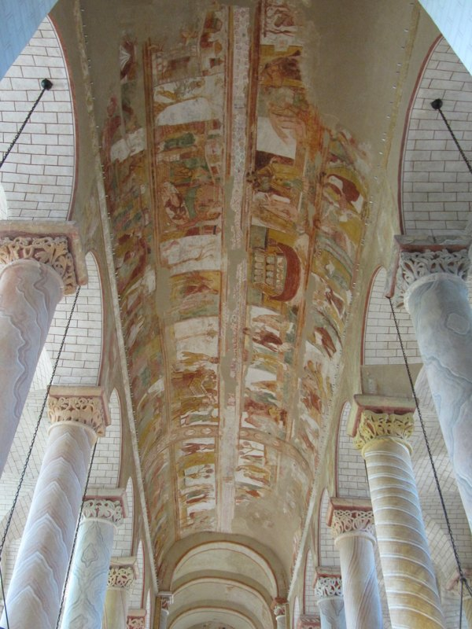
  <figcaption>The nave looking west: the painted barrel vault over the six eastern bays, continuous and without transverse arches, carried on tall cylindrical columns. Photo: Debressac, <a href="https://creativecommons.org/licenses/by-sa/3.0/">CC BY-SA 3.0</a>, via Wikimedia Commons.</figcaption>
</figure>

The columns that carry the vault are among the most striking features of the interior. Their shafts are painted with broad wavy bands and chevrons imitating veined marble, and their capitals are painted as well; much of this colouring was renewed in the nineteenth century, but it follows a medieval practice and gives an idea of an interior in which every surface, from the floor to the vault, was coloured. Architecture and painting were conceived together: the vault was built to be painted, and the hall structure, which lights the nave from the sides, lets the light fall evenly on the painted friezes overhead.

## A Painted Church

Of all the great Romanesque abbey churches of France, Saint-Savin is the one that has kept the largest share of its painted decoration: about four hundred and twenty square metres, distributed over five parts of the building. The vestibule of the tower-porch holds Christ of the Parousia with the apostles and scenes of the Apocalypse. The tribune above it is painted with the Passion, Resurrection and Ascension of Christ. The vault of the nave carries the stories of Genesis and Exodus. Large figures of saints occupy the piers of the transept and the choir. The crypt is painted with the lives and martyrdom of Savin and Cyprian. The decoration of the choir itself has not survived; its vault is now covered with a nineteenth-century starry sky.

These paintings belong to a single campaign, generally dated around 1100, at the end of the building work. The nave vault, with its continuous friezes, is the best known and most studied part. But the programme makes sense only as a whole, and as a monastic programme: the church was not one space but several, with different viewers and different uses.

Claire Boisseau has recently drawn attention to a boundary that has vanished from the building: the enclosure of the monks. In the third bay of the nave, where the *tierce-partie* meets the continuous vault, a screen separated the part of the church open to the laity from the part reserved to the monastic community. Modern accounts record a rood screen there, burned by the Huguenots in 1576, of which only the two staircases survived when the Maurists surveyed the church in 1629. Before it, in the eleventh century, there was probably a simpler enclosure. Its trace survives in the painting: the eastern half-columns of the two piers of the third bay carry a bestiary, animals of every kind set in compartments, visible only from inside the enclosure.

The enclosure affects the reading of the whole programme. On the vault of the western bays, the Creation and the Fall are painted in the space of the laity, while the life of Adam and Eve after their expulsion, which opens the story of salvation with Cain and Abel, begins inside the enclosure. The monastery, a new Eden in monastic thought, receives the history of redemption. And the western part of the building, approached by visitors as an entrance, was for the monks also something to be seen from the choir looking west: the tribune with its Easter programme, the bay opening onto it, the Virgin painted over the door. The catalogue entries below follow the vault in the order of the biblical narrative, and then turn to the vestibule, the west wall and the crypt.

## The Nave Vault: Organisation and Reading

The vault is divided lengthwise by a central ornamental band into two slopes, and each slope carries two superimposed registers of figured friezes, each about two and a half metres high. Over the continuous eastern bays the scenes run without interruption, often without frames between them; in the western bays the transverse arches divide them into compartments. Figures are about two metres tall, scaled to be read from the floor seventeen metres below. Short Latin inscriptions identified many scenes; fragments survive along the borders, among them the name IOSEPH.

<figure>
  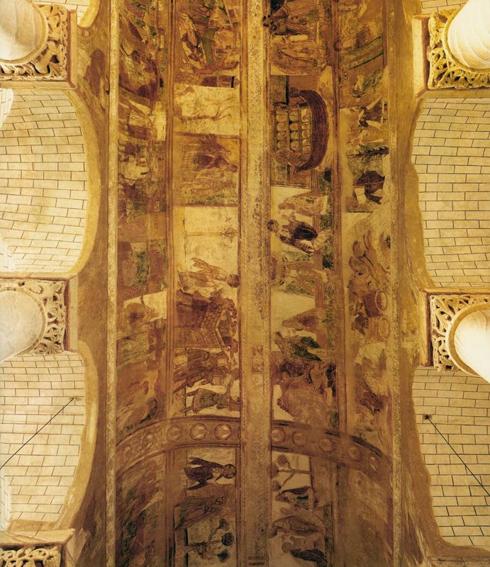
  <figcaption>The nave vault seen from below, with the Ark of Noah on the right-hand slope and, at the bottom, the first transverse arch of the western bays. Source: Web Gallery of Art, public domain.</figcaption>
</figure>

The narrative begins in the western bays with the Creation and moves eastward through Cain and Abel, Noah, the Tower of Babel and Abraham to Joseph and the Exodus, ending near the choir with Moses receiving the Law. It does not, however, run simply from west to east along one register and back along the next. Jérôme Baschet showed that the sequence turns back on itself several times and that the distribution of episodes between the slopes and registers follows a logic of its own, which he related to the axial movement of the church towards the altar. Claire Boisseau has added that some of these turns respond to the enclosure and to the liturgical use of the tribune: the cycle of Abraham, painted on the western bays, turns at the scenes of Melchizedek and the Meal of the Three Angels, the Old Testament prefigurations of the Eucharist, nearest to the tribune where the Easter rites were performed.

Several scenes are lost. Some disappeared with the plaster; others were detached. The Battle of the Kings, from the Abraham cycle, is now in the abbey's refectory; the Meeting with Melchizedek and the Meal of the Three Angels are in the Musée Sainte-Croix at Poitiers. All were drawn in the nineteenth century by Gérard-Séguin for Mérimée's monograph, and copied again in the 1940s for the full-scale replica of the vault made for the Musée des Monuments français.

## Style, Technique and Date

The style of Saint-Savin is that of the light-ground painting of western France. Figures are drawn in red-brown outline and filled with flat areas of colour, set against grounds of white, ochre or green; modelling is reduced to parallel lines and white highlights, and drapery breaks into agitated, zigzag hems. Bodies are long, gestures emphatic, heads small. Architecture and landscape are reduced to signs: a tower, a gate, a tree with three leaves. The palette is restricted to yellow and red ochre, green, white and black, with very little blue, a pigment too costly to spread over such surfaces.

Scientific study carried out by the Laboratoire de recherche des monuments historiques has clarified how the painting was done. Samples from the vault show that the three western bays were painted in true fresco, on fresh plaster, while bays four to nine were painted *a secco* on a limewash support. In both, the pigments were mixed with a charge of fine calcite grains from a metamorphic rock similar to marble, a consistent workshop practice that also allows the original paint layer to be distinguished from later retouching. The change of technique coincides with the change of architecture between the *tierce-partie* and the continuous vault, and suggests that the work was organised by sections of the building. Where pigments were applied to plaster that had already dried too far, they failed to bind and have been lost, and some backgrounds are now visible only as traces.

The date of the paintings is not documented. They must postdate the completion of the vault, and the consensus places them around 1100, at the end of the eleventh century or the beginning of the twelfth. Their closest relatives are in the region of the Loire and Poitou: the crypt of Tavant, the churches of Montoire and Vic, the chapel of Le Liget. Who the painters were is unknown. The older view of monk-painters has given way to the assumption of a lay workshop, but no document survives to decide the question.

## Later History, Rediscovery and Conservation

The abbey suffered during the Hundred Years' War, when it changed hands several times, and above all in the Wars of Religion: the Huguenots devastated it in 1562 and 1568, burning the stalls, the organ and the roof timbers, and the screen in the nave was burned in 1576. In the early seventeenth century a commendatory abbot, Henri de Neuchèze, expelled the monks and lived in the church; royal intervention removed him. The Benedictines of the Congregation of Saint-Maur took over the abbey in the second quarter of the century and rebuilt the conventual buildings in the 1680s. In 1792 the last monks left, and the abbey church became the parish church of the town.

The modern history of the paintings begins with an alarm. In 1833 the prefect of the Vienne reported that the mayor was whitewashing parts of the interior and patching a crack in the nave. Ludovic Vitet, the first inspector-general of historic monuments, was alerted; in 1836 his successor Prosper Mérimée visited the church, found the vault in danger and funded the first repairs. In 1840 the church was included in the first list of *monuments historiques*. The architect Charles Joly-Leterme restored the building between 1841 and 1852, keeping water out of the vault, and in 1845 Mérimée published his *Notice sur les peintures de l'église de Saint-Savin*, illustrated with plates after watercolour copies by Gérard-Séguin. The painted marbling of the columns and the decoration of the capitals owe much to nineteenth-century renewal.

In the twentieth century the vault was conserved in the 1960s and 1970s, and in the 1990s the results were re-examined in a study of the paintings twenty years after their restoration. In 1983 the abbey church was inscribed on the UNESCO World Heritage List as a masterpiece of eleventh- and twelfth-century wall painting and a witness to the place of images in medieval monasteries. A campaign of restoration between 2005 and 2008 cleaned and treated the paintings, renewed the lighting and repaired the windows; since 2006 the site has been managed by a public cultural body bringing together the town, the département, the region and the state.

## Scholarship

The study of Saint-Savin begins with Mérimée's *Notice* of 1845. In the twentieth century Itsuji Yoshikawa devoted a monograph to the Apocalypse of the porch (1939) and later a study of all the paintings, and Marc Thibout published a painting newly discovered in the porch (1949). The paintings became a cornerstone of the general histories of Romanesque painting, from <a href="/scholars.html#grabar-andre">André Grabar</a> and Carl Nordenfalk to <a href="/scholars.html#demus-otto">Otto Demus</a>, whose *Romanesque Mural Painting* (1968) gave them a central place among the light-ground painting of western France.

The programme of the nave was studied by <a href="/scholars.html#labande-mailfert-yvonne">Yvonne Labande-Mailfert</a>, who wrote on the Old Testament cycle and on the lost morning altar of the church (1974), and its narrative order by <a href="/scholars.html#baschet-jerome">Jérôme Baschet</a> (1997, 2010). The collective volume edited by <a href="/scholars.html#favreau-robert">Robert Favreau</a>, *Saint-Savin. L'abbaye et ses peintures murales* (1999), with Marie-Thérèse Camus's study of the building, remains the standard monograph; the scientific analyses of the LRMH were published by Paulette Hugon and Dominique Martos (2013). The most recent work places the paintings in their monastic setting: <a href="/scholars.html#boisseau-claire">Claire Boisseau</a>'s study of the enclosure and the western block (2025), and the interdisciplinary volume on the nave paintings edited by Marcello Angheben, announced for publication.

## Catalogue Entry

### The Creation and the Fall (nave vault, western bays, north slope)

<figure>
  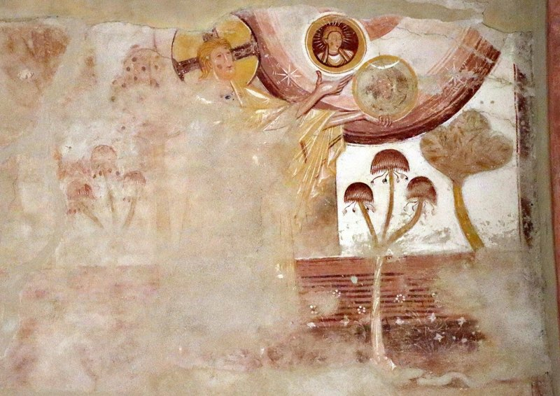
  <figcaption>The Creation of the sun and moon, with the trees of the third day, c. 1100. Wall painting. Saint-Savin-sur-Gartempe, nave vault. Photo: GO69, <a href="https://creativecommons.org/licenses/by-sa/4.0/">CC BY-SA 4.0</a>, via Wikimedia Commons.</figcaption>
</figure>

The cycle opens in the western bays with the work of the six days. Of the first scenes, much has faded, but the creation of the heavenly bodies survives: the Creator, with a cross-nimbus that identifies him with Christ, leans out from the arc of heaven and sets the sun and the moon in place, while below, on a white ground, stand the trees created on the third day, drawn as stylised stems with umbrella-shaped crowns.

The composition follows the words of Genesis closely: God made two great lights, the greater to rule the day and the lesser to rule the night, and set them in the firmament of heaven. The painter shows the firmament as a curved band of colour from which the Creator emerges to the waist, his arms extended to either side so that he holds the two discs apart. The sun carries a face with radiating lines; the moon is a paler, emptier disc. The image is not a diagram of the cosmos but a gesture, the act of placing the lights where they belong.

The identification of the Creator with Christ, through the cross in his nimbus, is a constant of Romanesque Genesis cycles and rests on the opening of the Gospel of John: all things were made through the Word. It has a particular force at Saint-Savin, since the same figure who creates the world at the west end of the vault reappears, in the vestibule beyond, as the Christ of the Parousia who will return at the end of time. The history painted on the vault is thus framed by Christ as creator and Christ as judge.

The poor condition of this part of the vault, where large areas have faded to the plaster, reflects the fragility of the fresco in the western bays, where the pigments did not always bind with the drying plaster. Yet even in its damaged state the scene shows the essential qualities of the cycle: a few strong shapes set against a light ground, legible from far below, with detail reserved for faces, hands and the emblems that identify the action.

<figure>
  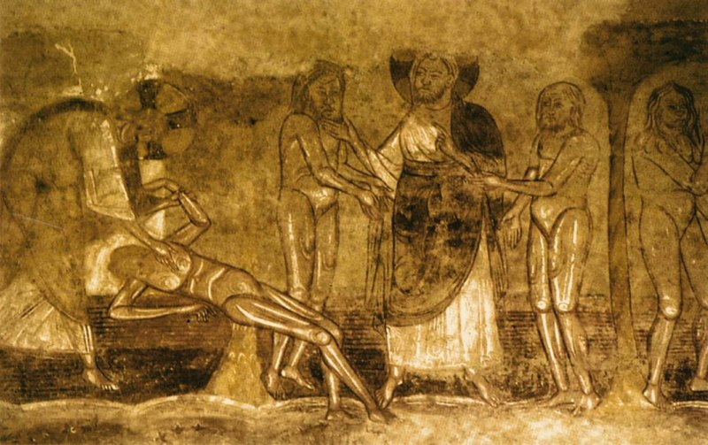
  <figcaption>The Creation of Eve and God presenting Eve to Adam, c. 1100. Wall painting. Saint-Savin-sur-Gartempe, nave vault. Source: Web Gallery of Art, public domain.</figcaption>
</figure>

The creation of Eve is told in two moments within one frieze. At the left the Creator bends over the sleeping Adam and draws Eve from his side; at the centre he leads her by the hand to Adam, who receives her with a gesture of wonder. The bodies are drawn with long continuous lines, the joints marked by small curves, with a linear economy characteristic of the whole cycle. The Fall that follows takes place, in Boisseau's reading, in the space of the laity, outside the enclosure.

The doubling of the Creator within one frieze, first stooping over Adam and then walking upright with Eve, is a device the painters use throughout the vault: continuous narration, in which the same figure appears more than once in a single field, so that the eye reads time as movement along the band. There is no frame between the two moments; the change of action is shown by the change of posture, from the bent body of the one who draws Eve from Adam's side to the stately figure of the one who leads the bride.

Medieval exegesis read the scene typologically. As Eve was formed from the side of the sleeping Adam, so the Church was born from the side of Christ asleep on the cross, from which flowed the blood and water of the sacraments. In a monastic church this reading was familiar from the commentaries on Genesis that the monks heard and studied, and it gave the first couple a meaning that looked forward to the redemption told in the rest of the programme.

The photograph, taken from a book plate, gives the scene a uniform golden tone that does not correspond to the colours of the wall, which are lighter and cooler. It nevertheless shows clearly the quality of the drawing: Adam's body sprawled in sleep, the Creator's hand at his side, Eve emerging already formed, and at the right the naked Adam receiving her with his hand raised.

### Cain and Abel

<figure>
  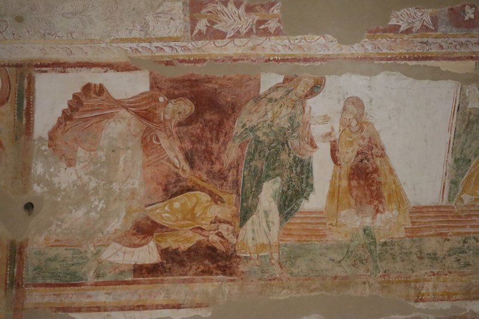
  <figcaption>Cain kills Abel; God questions Cain, c. 1100. Wall painting. Saint-Savin-sur-Gartempe, nave vault. Photo: GO69, <a href="https://creativecommons.org/licenses/by-sa/4.0/">CC BY-SA 4.0</a>, via Wikimedia Commons.</figcaption>
</figure>

The story of Cain and Abel begins inside the enclosure, introduced by the life of Adam and Eve outside Paradise. In the murder, Cain leans over his brother with a violence conveyed by the cloak that flies out behind him; in the next scene the Lord, tall and calm, confronts Cain, who stands before him with the gesture of one who denies. The contrast between the agitated and the still figure is one of the expressive resources the painters use throughout the vault.

The murder is shown without the offerings that usually precede it in Romanesque cycles, or at least they do not survive in this field. Cain strikes with a club, bending over a brother who has already fallen, and the dark red ground behind them sets the act apart from the light grounds of the neighbouring scenes. The painters often use a change of background colour in this way, to isolate an episode or to mark a moment of violence or revelation.

In the second scene the Lord asks Cain where his brother is, and Cain answers that he does not know: am I my brother's keeper? The painter renders the exchange through hands and faces alone. The Lord points and questions; Cain, his face turned and his hand raised to his chin, half denies and half hears the sentence that will make him a wanderer on the earth.

Abel, the shepherd whose offering was accepted and who was killed by his brother, was read as a figure of Christ, and Cain as the figure of those who reject him. Placed just inside the enclosure, at the beginning of the history of salvation, the murder introduces the long struggle between the two lineages, the city of God and the city of man, that the following scenes of Noah and Babel continue.

### Noah

<figure>
  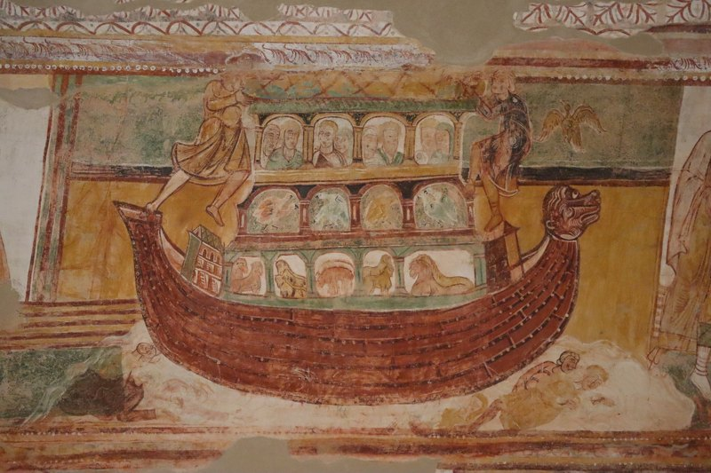
  <figcaption>The Ark of Noah, c. 1100. Wall painting. Saint-Savin-sur-Gartempe, nave vault. Photo: GO69, <a href="https://creativecommons.org/licenses/by-sa/4.0/">CC BY-SA 4.0</a>, via Wikimedia Commons.</figcaption>
</figure>

The Ark is the most famous image of the vault and occupies its centre. It is drawn as a long ship with a planked hull and an animal-headed prow, which has often been compared to a Viking vessel, and on it stand three tiers of arcaded cells: quadrupeds below, birds in the middle, and the family of Noah above, the women and men in pairs. The arrangement in cells, as Boisseau notes, belongs to a long tradition of diagrams of the Ark that ordered the animals saved from the Flood, and at Saint-Savin it finds an echo in the bestiary on the piers of the third bay. Bodies of the drowned float in the water below; the dove returns at the right.

The painter has combined two images in one: the ship that floats on the waters of the Flood and the house that God commanded Noah to build, with its rooms and its three storeys. The hull is a sea-going vessel of overlapping planks fixed with nails, its stern rising high and its prow ending in a beast's head; the superstructure is a building with arcades and a roof, closer to the facade of a church than to any ship. A small house stands on the stern. The men who stand on the ends of the hull, holding the roof, may be Noah's sons; the faces in the upper arcades are those of the eight persons saved.

The exegetes, beginning with Augustine, read the Ark as the Church, outside which there is no salvation, and its storeys as the orders of the faithful. A monastic community, which thought of itself as a refuge from the world, could easily see itself in the image. The animals in their separate cells, the birds and the beasts, are an image of an ordered creation preserved through the catastrophe, and Boisseau has related them to the painted bestiary on the piers at the threshold of the enclosure.

The photograph shows the scene after the restoration of the vault, in which the surviving paint was cleaned and consolidated and the losses were left as neutral plaster, as at the upper left. The colours, a warm red for the hull, green and ochre for the arcades and white for the waters, are those of the whole cycle; blue is absent, and the sky is suggested by a band of green.

<figure>
  
  <figcaption>Noah and his family after the Flood, and the sacrifice of Noah, c. 1100. Wall painting. Saint-Savin-sur-Gartempe, nave vault. Photo: GO69, <a href="https://creativecommons.org/licenses/by-sa/4.0/">CC BY-SA 4.0</a>, via Wikimedia Commons.</figcaption>
</figure>

After the Flood the Lord speaks to Noah and his family, and Noah kneels before an altar to offer a bird and a lamb; the Lord, leaning from the right, answers with his blessing and the covenant. The sacrifice prefigures the offering of the Mass, and its place towards the choir, with the vine of Noah that follows, has been related to the Eucharistic sense of the programme near the altar.

The first part of the scene shows the family after leaving the Ark, at the command of the Lord, who stands at the centre on a striped ground and turns with a broad gesture to the group at the left. Noah's sons and their wives press together in a compact mass of heads and shoulders, a solution the painters use for crowds throughout the vault. The Lord is drawn larger than the people he addresses, and his ochre and green mantle, broken into folds and zigzag hems, gives the figure the agitated energy characteristic of the cycle.

At the right Noah builds an altar and offers clean animals and birds, and the Lord, smelling the sweet savour, promises never again to curse the earth and sets his bow in the clouds as the sign of the covenant. The old patriarch kneels, holding a bird, beside a lamb and an altar covered with a cloth like that of a church altar; the Lord leans towards him from a doorway, blessing. The resemblance to the altar of the Mass is deliberate. The sacrifice of Noah, like those of Abel, Abraham and Melchizedek, was one of the Old Testament figures of the Eucharist.

The story of Noah continues with the planting of the vineyard and the Drunkenness of Noah. The patriarch, asleep and uncovered, is mocked by Ham, while Shem and Japheth, walking backwards and turning their heads away, spread a cloak over him; the scene is set within a walled enclosure, and outside it animals climb the trees of the vineyard. The vine and the wine, painted towards the east end of the nave, near the altar, have been read together with the bread of Joseph as part of a Eucharistic thread that runs through the programme.

### The Tower of Babel

<figure>
  
  <figcaption>The Building of the Tower of Babel (above) and scenes from the story of Joseph (below), c. 1100. Wall painting. Saint-Savin-sur-Gartempe, nave vault. Photo: GO69, <a href="https://creativecommons.org/licenses/by-sa/4.0/">CC BY-SA 4.0</a>, via Wikimedia Commons.</figcaption>
</figure>

The Tower of Babel is one of the most vivid scenes of the vault. The Lord stands at the left, beside a tree, and confronts the builders; the tower rises at the centre, its walls drawn as an angular block of brick, while men inside take the stones handed up to them. From the right a file of workers advances, bent under the weight of great blocks, led by a giant figure who lifts his stone above his head. The scene is built on a strong diagonal rhythm of bodies and blocks, and the dramatic distance between the calm figure of the Lord and the busy crowd gives the episode its meaning.

The text of Genesis tells how the descendants of Noah, speaking one language, decided to build a city and a tower whose top would reach heaven, and how the Lord came down to see it, confused their speech and scattered them over the earth. The painter shows the moment of confrontation, not the dispersal: the Lord has come down and stands before the builders, who seem not yet to have seen him. The tree beside him, with its large lobed leaves, marks the open ground from which he arrives.

The tower is drawn as a block of brick with two faces visible at once and an arcade at its base, and the workers inside lean over its top. They take the blocks passed to them by hand, while others carry stones on their shoulders, bending under the weight. The figures are dressed as contemporary labourers, in short tunics, leggings and bound shoes, and the scene is one of the most direct images of a building site to survive from the years around 1100, painted while the church itself was being completed.

Babel was the image of human pride, the attempt to reach heaven by human effort; its counterpart in Christian exegesis was Pentecost, when the gift of tongues reunited what the confusion of languages had divided. For a monastic community the scene carried a further lesson. The monks too were building, but their ascent was the ladder of humility described in the Rule of Saint Benedict, by which the soul rises to God by descending in self-abasement.

### Abraham (western bays, south slope)

<figure>
  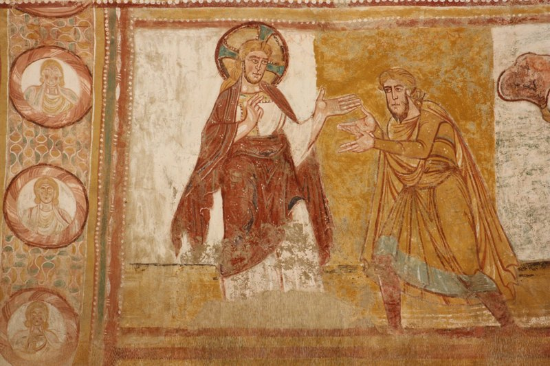
  <figcaption>The Lord gives his instructions to Abraham, c. 1100. Wall painting. Saint-Savin-sur-Gartempe, nave vault. Photo: Antoine Garnier, <a href="https://creativecommons.org/licenses/by-sa/4.0/">CC BY-SA 4.0</a>, via Wikimedia Commons.</figcaption>
</figure>

The cycle of Abraham occupies the south slope of the western bays. It opens with the Calling of Abraham: the Lord, with a cross-nimbus, addresses the patriarch, who bends towards him with open hands, ready to leave everything. For a monastic audience Abraham was the type of the monk, who abandons his land and his kin to follow God. The face of the Lord, with its large eyes and its beard drawn in a few strokes, and the ochre ground set against the white, show the painters' method at its clearest.

The scene follows the opening of Genesis 12: get thee out of thy country, and from thy kindred, and from thy father's house, unto a land that I will show thee. The Lord stands on a white ground, and Abraham on an ochre one; the two colours meet between the figures, so that the change of ground itself marks the space between the divine command and the human response. The hand of the Lord and the outstretched hands of Abraham almost touch at the boundary.

The figure of Abraham shows how the painters model drapery. The long ochre mantle is drawn with parallel red lines that follow the movement of the body, turning in loops over the knee and the arm, and ends in a band of green at the hem; there is little shading, and the volume is suggested by the rhythm of the lines. The face, with its large eyes, long nose and beard drawn in strokes, is the type used for the patriarchs throughout the vault.

For the monks who saw it from their choir, the Calling of Abraham was more than the beginning of a story. Abraham, who left his homeland and his family at God's command, was the model of the monk who leaves the world. Boisseau has noted that the cycle of Abraham, which begins with this scene, ends with his burial at the threshold of the enclosure, as if the patriarch's life traced the path of a monastic vocation from the call to the death to the world.

<figure>
  
  <figcaption>The cycle of Abraham in the western bays of the nave, c. 1100. Wall painting. Saint-Savin-sur-Gartempe, nave vault. Photo: GuyFrancis, <a href="https://creativecommons.org/licenses/by-sa/3.0/">CC BY-SA 3.0</a>, via Wikimedia Commons.</figcaption>
</figure>

After the Calling comes the departure of Abraham with his household, and the cycle continues with the separation from Lot, the battle against the kings who held Lot captive, the meeting with Melchizedek, the Meal of the Three Angels, the division of Abraham's goods between his sons and his burial, painted at the threshold of the enclosure. Three of these scenes, the Battle of the Kings, Melchizedek and the Three Angels, were cited together by Prudentius in the prologue of the *Psychomachia* as an image of the virtuous life, and Boisseau has connected them with the combat painted at the top of the west wall of the nave.

The upper register shows, after the Calling, a tree with three rounded crowns in which a small figure is caught, and then the group of Abraham's household walking away to the right, led by Abraham, who raises his hands in a gesture of prayer or wonder. The women are wrapped in mantles and veils, the men in short tunics with long cloaks; the woman in the white robe with black markings, probably Sarah, stands out from the group. The right end of the register is largely lost, and the damage gives a measure of how much of the vault has disappeared.

The lower register is more damaged and harder to read. Horsemen and men on foot move to the right, and at its end a man offers a dish to a seated figure. The arrangement of the scenes of Abraham on the two registers, and their relation to the detached scenes now in the refectory and at Poitiers, are among the questions that the forthcoming interdisciplinary study of the nave is expected to settle.

The photograph shows how the western bays differ from the eastern ones. Here the scenes are framed by the painted bands of the transverse arches, with their roundels containing busts, and the friezes are shorter and more clearly divided. The technique differs as well: in these three bays the painters worked in true fresco, and where the plaster had dried too far before they painted, the colour has fallen away and left areas of bare plaster in the background.

### Joseph

<figure>
  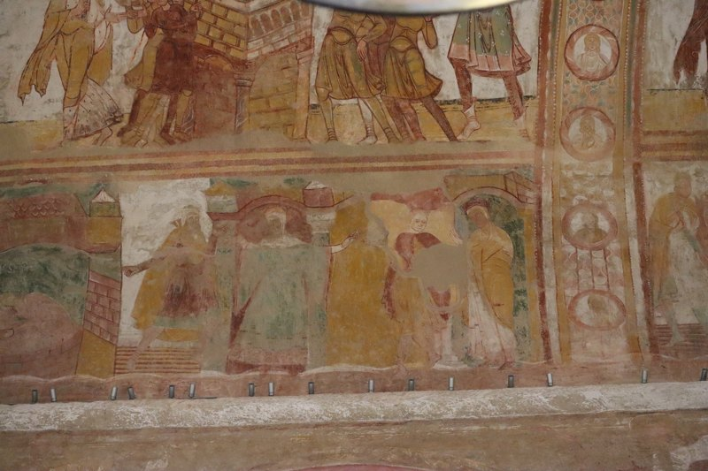
  <figcaption>Scenes from the story of Joseph, with Joseph and the wife of Potiphar, c. 1100. Wall painting. Saint-Savin-sur-Gartempe, nave vault. Photo: GO69, <a href="https://creativecommons.org/licenses/by-sa/4.0/">CC BY-SA 4.0</a>, via Wikimedia Commons.</figcaption>
</figure>

The story of Joseph unfolds on a lower register, among buildings and city walls that give it an urban setting different from the open grounds of the earlier scenes. Joseph's encounter with the wife of Potiphar, who seizes his cloak as he flees, is followed by his imprisonment and his rise at the court of Pharaoh.

Genesis tells that Potiphar's wife tried to seduce Joseph, and that when he fled from her she held his garment and used it to accuse him, so that Potiphar threw him into prison. The painter sets the episode among arcades and doorways, the interiors of an Egyptian house rendered as a sequence of arched openings. The woman in the doorway and the man who turns away are reduced to large, simple shapes, legible from far below.

The scene is badly damaged. Large areas of the lower register have lost their colour, and the figures survive mainly through their outlines and the green and ochre of their garments. Part of the narrative must be reconstructed from the order of the cycle and from the nineteenth-century copies. Even in this state, however, the composition shows how the painters used architecture to divide a continuous frieze into separate places, each with its own action.

At the right edge of the photograph appears the ornamental band with roundels containing busts, which marks a division of the vault. Such bands, painted along the arches and between the fields, are part of the ornamental system studied by Baschet, who showed how ornament and narrative structure work together on the vault to guide the reading of the scenes.

<figure>
  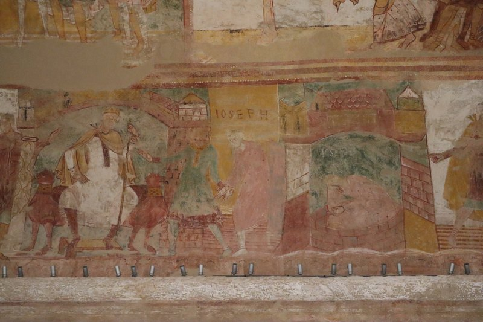
  <figcaption>Joseph brought before Pharaoh, and Joseph in prison, c. 1100. Wall painting. Saint-Savin-sur-Gartempe, nave vault. Photo: GO69, <a href="https://creativecommons.org/licenses/by-sa/4.0/">CC BY-SA 4.0</a>, via Wikimedia Commons.</figcaption>
</figure>

Pharaoh sits enthroned between two beasts, holding a staff, as a man leads Joseph before him; the name IOSEPH, written in large capitals above, identifies the hero. At the right Joseph crouches in the prison, drawn as a round pit within a walled building. Joseph, who fed his brothers with the bread of Egypt, was read as a figure of Christ, and his place towards the east of the nave has been associated, like the vine of Noah, with the Eucharistic meaning of the programme near the choir.

The throne of Pharaoh is flanked by two red beasts with collars, guardians of his royal seat, and the king wears a crown and holds a staff, with a mantle thrown over his shoulders. The figure is drawn as a medieval ruler, as the patriarchs are drawn as medieval travellers and the builders of Babel as medieval masons. The painters transpose the biblical story into the world of their viewers, without any attempt at a historical or Egyptian setting.

The inscription IOSEPH is one of the few legible survivors of the identifying texts that once accompanied the vault. Written in large capitals on an ochre panel, it names the hero in the middle of the composition, between the scene at court and the scene of the prison, and shows that the painted narrative was accompanied by words, as in an illuminated manuscript.

The prison is a round pit within a walled building, in which Joseph crouches with his arm on the edge. The image recalls the pit into which his brothers had thrown him earlier in the story, and the two episodes of descent were read together as figures of Christ's descent into the tomb before the resurrection. In the cycle at Saint-Savin, the story of Joseph leads from these humiliations to his triumph as ruler of Egypt and provider of bread for his brothers.

### The Exodus

<figure>
  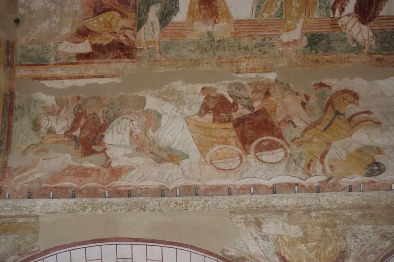
  <figcaption>The Egyptians engulfed in the Red Sea (below), with Cain and Abel above, c. 1100. Wall painting. Saint-Savin-sur-Gartempe, nave vault. Photo: GO69, <a href="https://creativecommons.org/licenses/by-sa/4.0/">CC BY-SA 4.0</a>, via Wikimedia Commons.</figcaption>
</figure>

The crossing of the Red Sea is painted on a lower register, where the white ground becomes the sea itself, crossed by dark wavy lines. The army of Pharaoh, horsemen and a chariot drawn by two horses, plunges into the waters that close over it; the movement runs strongly to the right, and the horses' bodies, drawn with long parallel strokes, seem to stretch with the effort. Further along, the Israelites who have crossed raise their hands in thanksgiving.

The chariot is drawn as a light cart on two large spoked wheels, carrying Pharaoh or one of his captains, who raises his hand in alarm; beside him a soldier holds an oval shield. The horses rear and stretch, their bodies marked with long green lines, and beneath them a fallen soldier lies with his shield. The horsemen behind, on white and dark horses, are already caught in the waves. The scene conveys the sudden closing of the waters with a rare sense of speed.

The painters treat water as a field of white crossed by dark wavy lines, without any attempt at depth; the figures are set on it like cut-outs, and the movement is carried by the direction of the bodies. The lower border of the register is painted with a scalloped band, and below it runs the cornice at the springing of the vault, with the fittings of the modern lighting.

The crossing of the Red Sea was one of the principal figures of baptism, following Paul's words that the Israelites were all baptised in the cloud and in the sea. The drowning of Pharaoh's army was read as the destruction of sin in the waters of the font, and the deliverance of the Israelites as the passage from slavery to freedom, which the Easter liturgy celebrates in the reading of Exodus at the Vigil.

<figure>
  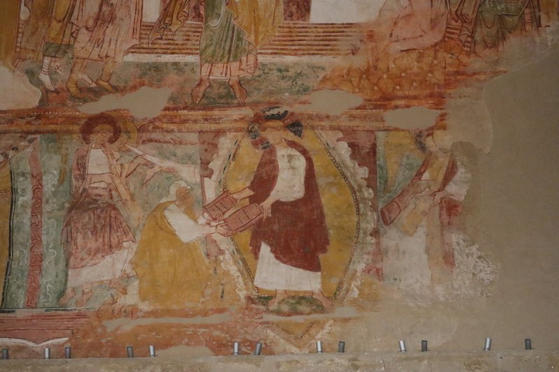
  <figcaption>Moses receives the Tables of the Law, with angels blowing horns, c. 1100. Wall painting. Saint-Savin-sur-Gartempe, nave vault. Photo: GO69, <a href="https://creativecommons.org/licenses/by-sa/4.0/">CC BY-SA 4.0</a>, via Wikimedia Commons.</figcaption>
</figure>

The cycle ends with the Giving of the Law. The Lord stands within a mandorla on Sinai and hands the tablets to Moses, who kneels to receive them, while angels sound their horns, the trumpets heard by the people at the foot of the mountain. With this scene the history told on the vault, from the Creation to the Law, reaches the east end of the nave, at the threshold of the choir.

The mandorla that surrounds the Lord is drawn as a pointed oval edged with a beaded band, the form used for Christ in glory, and the Lord stands within it holding the tablets out with both hands. Moses, an old man in an ochre mantle, kneels and takes them with covered hands, a gesture of reverence derived from the court ceremonial of late antiquity and used throughout medieval art for the receiving of sacred objects.

The angels with long horns at the left follow the account of Exodus 19, which describes the voice of the trumpet exceeding loud on the third day, when the Lord came down on Sinai. The haloed angels, one in a white tunic and one partly hidden behind him, lean forward as they blow, their wings filling the space above the kneeling Moses. The right part of the scene, with a third angel, has been largely lost.

The Giving of the Law, at the eastern end of the vault and near the choir, closes the Old Testament history with the covenant on which the life of Israel was founded. For the monks the scene could also be read as an image of their own law, the Rule they had received and promised to keep, and of the monastery as a community ordered by a written law given from above.

### The Vestibule: Christ of the Parousia and the Apocalypse

<figure>
  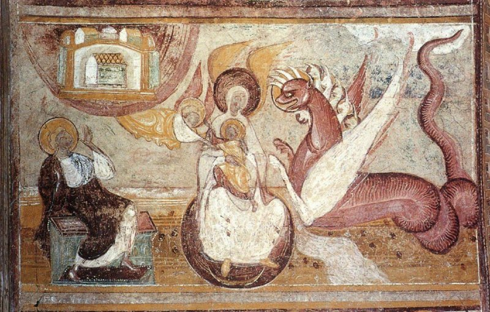
  <figcaption>The Woman clothed with the Sun and the Dragon, with the Ark of the Covenant in the Temple and John the Evangelist (Apocalypse 11–12), c. 1100. Wall painting. Saint-Savin-sur-Gartempe, vestibule of the tower-porch. Source: Wikimedia Commons, public domain.</figcaption>
</figure>

The vestibule on the ground floor of the tower-porch is the first painted space the visitor enters. Over the door into the nave, on the eastern tympanum, Christ of the Parousia sits enthroned with his cross, monks prostrate before him, and the apostles seated on globes at his sides; he is the Christ who is the door, *ego sum ostium*. On the vaults and walls the Apocalypse unfolds: the plagues of the locusts and the horsemen, the combats of the Woman and of the archangel Michael against the dragon, and the earthly Church, accompanied by monks, laymen and the two founders of the abbey, recalling its Carolingian origin.

The Woman and the Dragon follows the text of Revelation 11 and 12 closely. At the left John, the visionary, sits writing; above, the Temple of God is opened in heaven and the Ark of the Covenant appears within it. At the centre the Woman, who has received the wings of the eagle, sits holding her child, whom an angel lifts up to God, while the dragon with seven heads rears before her and spews the stream of water to carry her away. The vestibule is dark, lit by no window, and the contrast with the light of the nave beyond is part of the experience of entering, and of leaving, the church.

The painter places the scene on a narrow stage of horizontal bands, with the sky indicated by a pale ground. The Woman sits frontally on a globe, her wings spread behind her, and holds the Child against her; the angel who takes the Child flies in from the left, carrying him towards the curved band of heaven above. The dragon is drawn with a long coiling tail, several heads and wings, and its body fills the right half of the scene, so that the threat seems to press on the Woman and her Child.

The identification of the Woman was double in medieval exegesis: she was the Church, who brings forth Christ in the faithful and is persecuted by the devil, and she was also the Virgin Mary. At Saint-Savin, where the vestibule shows the earthly Church with the founders of the abbey, the ecclesial reading is the more likely; but the image of the Woman with the Child already prepares the Virgin painted later on the west wall of the nave, on the other side of the same door.

### The Virgin over the West Door

<figure>
  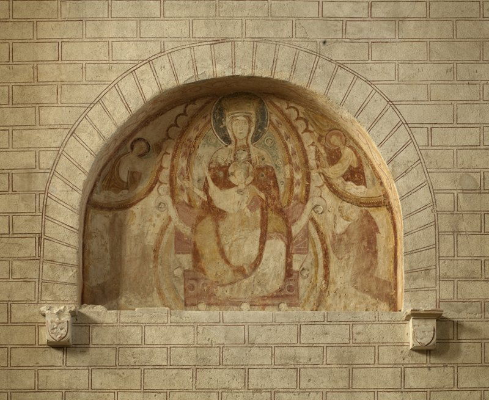
  <figcaption>The Virgin and Child enthroned with censing angels and kneeling monks, late twelfth or early thirteenth century. Wall painting. Saint-Savin-sur-Gartempe, west wall of the nave. Photo: PMRMaeyaert, <a href="https://creativecommons.org/licenses/by-sa/3.0/">CC BY-SA 3.0</a>, via Wikimedia Commons.</figcaption>
</figure>

On the west wall of the nave, above the door from the vestibule and on the reverse of the Christ of the Parousia, a niche holds a Virgin and Child, painted somewhat later than the rest. The Virgin is enthroned within a double mandorla and presents the Child, both crowned and nimbed; the Child holds a book and raises his hand, and the Virgin holds between two fingers a slender object that may be a candle. Two angels emerge from the clouds swinging censers, and two monks kneel in prayer at the sides of the throne. Her costume, a light white veil in place of the red maphorion, and the treatment of the faces point to the end of the twelfth or the beginning of the thirteenth century.

Boisseau has called her the *Vierge portière*, the Virgin who guards the door. Seen by the monks from inside the enclosure, and by everyone leaving the church, she is an image of the Church at its threshold, answering the earthly Church painted in the vestibule. Hollows in her throne, crowns and mandorla once held glass cabochons, which caught the light of candles when the community entered in procession, at Candlemas, at the dedication of the church or at the Easter Vigil, and made the image shine in the darkness.

The painting is set in a shallow niche framed by a round arch, and the wall around it is painted with false masonry joints in red. The two small carved corbels with shields that support the sill are later additions. The figures are drawn with a finer and more even line than the Romanesque paintings of the nave, with very pale flesh and a softer modelling of the faces, in a style that belongs to the decades around 1200.

### The Crypt: Saints Savin and Cyprian

<figure>
  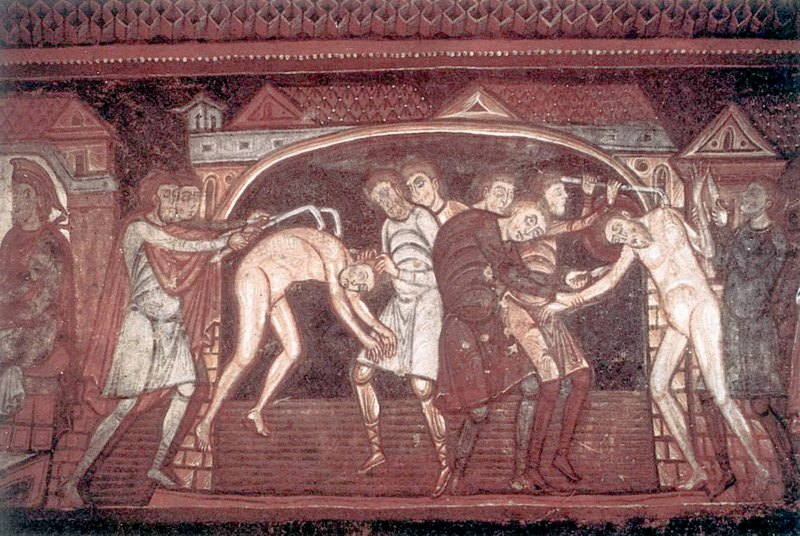
  <figcaption>Saints Savin and Cyprian tortured before the judge, c. 1100. Wall painting. Saint-Savin-sur-Gartempe, crypt. Source: Web Gallery of Art, public domain.</figcaption>
</figure>

The crypt beneath the choir held the relics of the patron saints, and its walls tell their story: their trial, their tortures and their death, under a vault with Christ in Majesty. In the torture scene the two brothers, naked, are bent backwards by the executioners and torn with iron hooks, before a judge who sits enthroned at the left. The dark red ground, unlike the light grounds of the nave, and the denser drawing suit the intimacy of the space, which the community approached only to venerate the relics.

The torture scene is set before a long building with roofs and towers, and an arch spanning the scene frames the martyrs and their executioners, as if the action took place within a hall of justice. The executioners wear short tunics with leggings and boots, and their bodies are drawn in vigorous movement, pulling the martyrs backwards. The two saints, naked and pale against the dark ground, hang limp in their hands, their passivity contrasting with the violence of their tormentors.

The legend of Savin and Cyprian, which the crypt follows, tells of their arrest, their trial before a Roman official, their tortures and their beheading on the banks of the Gartempe. The cycle was painted for the place where the relics lay, and it gave the monks and pilgrims who descended into the crypt a visual account of the sufferings that had made the bodies holy. In the vault above, Christ in Majesty receives the martyrs, as the crown of their passion.

Like the tribune and the vestibule, the crypt shows that the painted decoration of Saint-Savin was conceived for distinct spaces, each with its own subject, light and audience, within a single monastic church.
