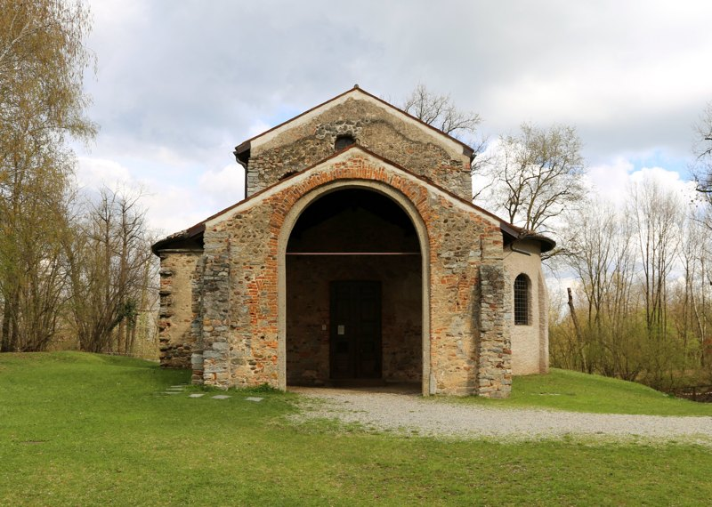
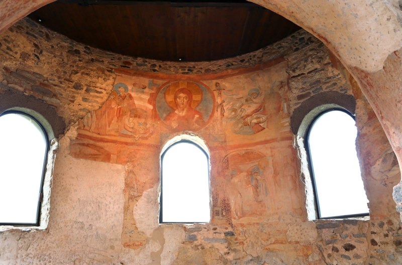
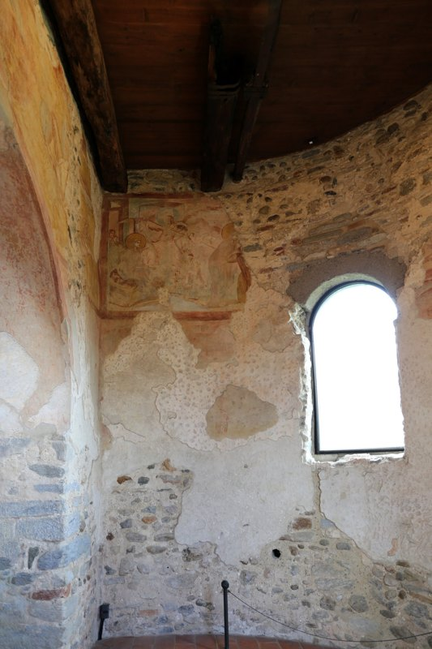
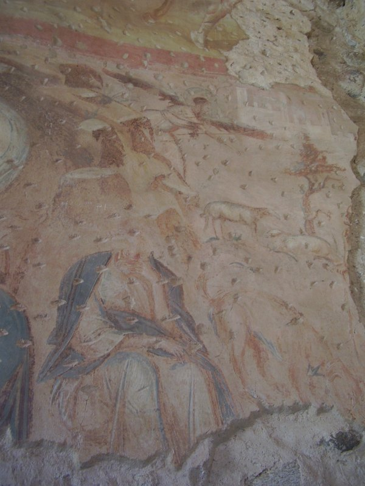
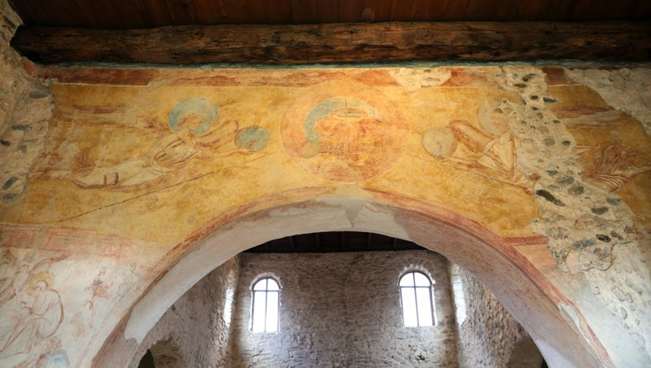
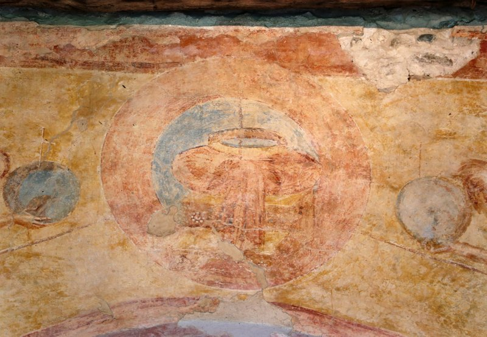
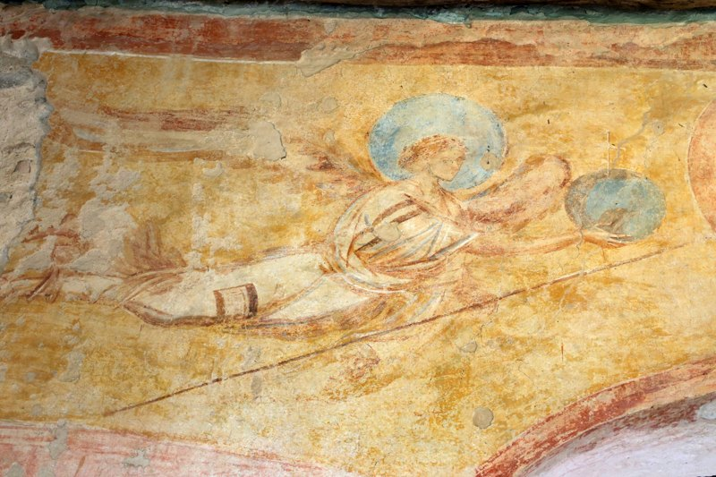

## A Small Church and a Great Problem

The church of Santa Maria foris portas stands in the woods of the former castrum of Castelseprio, in the province of Varese, a few kilometres from the Olona valley. It is a small building, little more than a short nave ending in three apses, and its interior is mostly bare stone. In the eastern apse, however, it preserves the remains of a fresco cycle of the Infancy of Christ that has occupied historians of medieval art since its rediscovery in 1944. The figures move with an ease, the brushwork has a speed and the architecture and landscape recede with a depth that have no close parallel in Western painting between Late Antiquity and the twelfth century.

The quality of the paintings is not in question. What has been debated for eighty years is everything else: when they were made, by whom, for whom, and how a cycle of this kind came to be painted in a modest church of the Lombard countryside. Proposals have ranged from the sixth to the tenth century, and the answers given have shaped larger narratives about the survival of classical painting, the relations between Byzantium and the West, and the existence of a Byzantine or Carolingian renaissance. The anonymous painters are known on this site as the <a href="/Content/Artists/VII-c/Maestro-di-Castelseprio.html">Master of Castelseprio</a>.

This entry describes the site and the building, the history of the rediscovery and of the debate, and the cycle itself, scene by scene. It separates what is documented, notably the graffiti that give a date before which the frescoes were painted and the scientific dating of the building, from the hypotheses that have been built upon them.

## Castelseprio, Torba and the Church outside the Gates

<figure>
  
  <figcaption>Castelseprio, Santa Maria foris portas, the west front with the narthex rebuilt with a single arch in the seventeenth century. Photo: Sailko, <a href="https://creativecommons.org/licenses/by/3.0/">CC BY 3.0</a>, via Wikimedia Commons.</figcaption>
</figure>

Castelseprio is the site of Sibrium, a Roman and late antique fortified settlement that became one of the centres of Lombard and then Carolingian administration in the territory between Milan and the Alpine lakes; the county of Seprio took its name from it. The castrum occupied a terrace above the Olona and contained churches, houses and towers, of which ruins survive in the archaeological park. In 1287 Ottone Visconti, archbishop of Milan, took the castle and had it razed to prevent his rivals from using it again. Santa Maria foris portas is the only building of the settlement that survived, because it continued to be used as a place of worship.

Its name, attested in the later Middle Ages, describes its position: *foris portas*, outside the gates, beyond the walls of the castrum. A short distance down the valley stands the tower of Torba, part of the late antique fortifications, later occupied by a community of Benedictine nuns and decorated with frescoes of its own. The church, the castrum and the Torba complex form together one of the components of the UNESCO World Heritage site *Longobards in Italy: Places of Power (568–774 A.D.)*, inscribed in 2011, although, as will be seen, the frescoes of Santa Maria are now generally dated after the end of the Lombard kingdom.

## The Building

<figure>
  
  <figcaption>Castelseprio, Santa Maria foris portas, the apses seen from the east. Photo: Sailko, <a href="https://creativecommons.org/licenses/by/3.0/">CC BY 3.0</a>, via Wikimedia Commons.</figcaption>
</figure>

The church is a compact building of rubble masonry. A short rectangular nave opens on three sides into apses of almost identical form, horseshoe-shaped in plan, set on the east, north and south, so that the plan approaches a cross or a trefoil; the apses are strengthened outside by buttresses and covered by low roofs. At the west a narthex precedes the nave; its original openings were walled up in the seventeenth century and replaced by the single large arch that now forms the entrance. The interior was originally plastered and decorated, and the floor had an inlay of marble; the present floor is modern.

<figure>
  
  <figcaption>Castelseprio, Santa Maria foris portas, the nave looking towards the eastern apse. Photo: Sailko, <a href="https://creativecommons.org/licenses/by/3.0/">CC BY 3.0</a>, via Wikimedia Commons.</figcaption>
</figure>

The paintings survive only in the eastern apse and on the inner face of the arch that opens into it. Elsewhere the walls are bare, and nothing indicates that the nave carried a narrative cycle. The programme was therefore addressed above all to the clergy at the altar, in the presbytery, and the visitor who enters from the west sees it, as in the photograph above, framed by the arch at the end of the nave. The arrangement explains both the intimacy of the scenes, which are small and meant to be seen from close by, and their survival: covered by later painting in the fifteenth century, they remained hidden for nearly five hundred years.

The dating of the building, long placed in the seventh or eighth century on the basis of its plan, has been revised by scientific analysis. Thermoluminescence of the roof tiles gave an average date of 828, and radiocarbon dating of the timber a date of 865 ± 87. These data indicate construction in the ninth century and provide a terminus post quem for the paintings. A further campaign of research in 2012–2013, combining the stratigraphy of the walls, a review of the excavations of the 1980s and new radiocarbon dates, led Gian Pietro Brogiolo, Vincenzo Gheroldi, Flavia De Rubeis and John Mitchell to distinguish two phases of construction and decoration and to place the later one, to which the apse cycle belongs, in the middle of the tenth century.

## Rediscovery and the First Debate

The frescoes were recognised on 7 May 1944 by the historian Gian Piero Bognetti, who had been investigating the site since the 1930s. The circumstances of wartime explain the haste and the methods of the first intervention: the fragile plaster was secured with cement supports and concrete arches, a solution later criticised but which held the paintings in place. In 1948 Bognetti, the architect Gino Chierici and the archaeologist Alberto De Capitani d'Arzago published the first monograph, *Santa Maria di Castelseprio*. De Capitani attributed the cycle to painters from the Syro-Palestinian area who had taken refuge in Italy in the seventh century, and Bognetti connected it with the missions sent from Rome to convert the Arian Lombards.

The response was immediate and international. <a href="/scholars.html#grabar-andre">André Grabar</a> wrote on the frescoes in the *Gazette des Beaux-Arts* in 1950, and <a href="/scholars.html#toesca-pietro">Pietro Toesca</a> in *L'Arte* in 1951, describing a monument "surrounded by uncertainties and doubts". At a conference held in 1950 the scholars present divided almost equally between a date in the seventh and one in the tenth century. In 1951 <a href="/scholars.html#weitzmann-kurt">Kurt Weitzmann</a> published *The Fresco Cycle of S. Maria di Castelseprio*, in which he compared the paintings with the Joshua Roll and the Paris Psalter and proposed a date in the first half of the tenth century, shortly before 945, by Byzantine painters connected with the diplomatic contacts between the court of Constantinople and the Italian kingdom. <a href="/scholars.html#morey-charles-rufus">Charles Rufus Morey</a> supported the late date in "Castelseprio and the Byzantine Renaissance" (1952), while <a href="/scholars.html#schapiro-meyer">Meyer Schapiro</a>, in a long review of Weitzmann's book, argued for an earlier date, which he later fixed in the eighth century.

The debate thus became a test case for two broader questions: whether a renaissance of classical painting took place in Constantinople in the tenth century, and whether Hellenistic modes of painting survived continuously in the Mediterranean through the seventh and eighth centuries. <a href="/scholars.html#kitzinger-ernst">Ernst Kitzinger</a> placed Castelseprio within the second of these perspectives, among the works that show the persistence of a Hellenistic manner in the centuries between Justinian and Iconoclasm. The weight of each answer was such that the frescoes were cited as evidence in arguments that went far beyond the church itself.

## The Programme of the Apse

<figure>
  
  <figcaption>Castelseprio, Santa Maria foris portas, the eastern apse with the fresco cycle. Photo: Sailko, <a href="https://creativecommons.org/licenses/by/3.0/">CC BY 3.0</a>, via Wikimedia Commons.</figcaption>
</figure>

The cycle is arranged in two narrative registers above a plinth painted as a curtain. Three windows pierce the apse, and above each was a clipeus, a painted roundel; only the central one, with the bust of Christ, survives. The upper register runs from left to right with the Annunciation and the Visitation, the Trial of the Bitter Waters, the Dream of Joseph and the Journey to Bethlehem. The lower register, divided by the windows into three blocks, shows the Presentation in the Temple, the Nativity with the Annunciation to the Shepherds, and the Adoration of the Magi, which continues onto the return of the triumphal arch. Above the arch, facing the apse, two angels fly towards the Etimasia, the prepared throne of the Second Coming. A few further scenes are no longer legible. The total length of the painted surface is about seventeen metres, and its height, including the plinth, about four metres and a half.

Several scenes come not from the Gospels but from the Protevangelium of James, the second-century account of the life of Mary and the birth of Christ that was widely read in East and West. The Trial of the Bitter Waters, the role of the midwives in the Nativity and the details of the Journey to Bethlehem belong to that tradition. Combined with the canonical episodes, they form a programme centred on the Incarnation and on the testimony to the virgin birth: Mary is tested and proved innocent, Joseph is reassured in his dream, the midwife witnesses the birth, the Magi and Simeon recognise the Child. Paul Leveto read the cycle in this sense as a Marian programme (1990). The clipeus of Christ and the Etimasia frame the narrative within the theology of the Incarnation and of the Second Coming.

Short painted labels identify some of the figures, in Latin: among them Joseph, Mary and Simeon, written ZVMEON. The lowest zone, painted as a hanging curtain with birds perched on a rod and, in one place, a book on a draped throne, is now almost entirely lost, but its plinth preserves the graffiti that are the only secure chronological evidence for the paintings.

## Style

The style is the reason for the fame of the cycle. The painters work with a quick, broken brushstroke, building figures out of patches of light and shade rather than enclosing them in firm contours. Faces are drawn with a few strokes and highlights; draperies are rendered in flickering lines of light; the bodies have weight and move in space. The architecture recedes in depth, often in bold diagonals, and the landscape is suggested by sloping ground, trees and distant buildings. Colours are limited, earth reds, ochres, greys and a pale blue, laid in thin layers with dry touches added on the plaster.

These features recall the illusionistic painting of Late Antiquity and its survival in works such as the Joshua Roll and the Paris Psalter, the comparisons proposed by Weitzmann, and the frescoes of Santa Maria Antiqua in Rome, where successive layers of the seventh and eighth centuries show the presence of Greek painters in the city, notably in the campaign of Pope John VII<a href="/endnotes.html#fn-pope-john-vii" class="footnote">1</a>. None of these comparisons is exact. The Castelseprio cycle is distinguished from all of them by its sketch-like freedom, which is more pronounced in some scenes than in others and suggests the participation of more than one hand.

## The Problem of the Date

The date of the cycle is still the central open question, but the margin of uncertainty has narrowed. The most secure evidence is the group of graffiti scratched into the painted plinth, which record the consecration or ordination of clerics and include obituary notes. The earliest of them names Arderic, archbishop of Milan from 936 to 948. The paintings must therefore have been finished by 948 at the latest.

The scientific dating of the building gives the other limit. If the church was built in the ninth century, as the analyses of tiles and timber indicate, the frescoes cannot be earlier, and the proposals for the sixth, seventh and eighth centuries become difficult to sustain unless an earlier building is assumed. The study of Brogiolo, Gheroldi, De Rubeis and Mitchell, which distinguishes two phases and dates the later one to the mid-tenth century, narrows the bracket further, so close to the graffiti that the painting would have been executed only shortly before them. Other scholars, among them <a href="/scholars.html#bertelli-carlo">Carlo Bertelli</a> in "Castelseprio e Milano" (1988), have argued for the ninth century and a context in Carolingian Milan, and the regional catalogue records that most recent writers favour the first half of that century.

A balanced statement is therefore possible. The cycle was painted in a building of the ninth century, and before 948. Within that span, the ninth century and the first half of the tenth remain open, and the choice between them depends on how the scientific data are interpreted and on the weight given to stylistic comparison. Dates in the seventh or eighth century, once widely defended, no longer have the support of the material evidence.

## Who Were the Painters?

No document names the painters or the patron. The quality of the work, its Greek affinities and its isolation in the Lombard context have led most scholars to assume masters trained in a Greek-speaking milieu, whether refugees from the East, painters active in Rome, or artists sent from Constantinople. The opposite view stresses that painters able to work in this manner could have been formed in Italy, in Rome or in Milan, where Late Antique models were available and Greek artists had worked for generations.

The Latin labels, the place of the church within the diocese of Milan and the presence of the counts of Seprio in the castrum suggest a local commission, perhaps for a private or funerary chapel linked to the leading family of the place. The identification of Pope John VII as patron, repeated in some popular accounts, has no basis: there is no donor portrait in the cycle, and John VII belongs to Rome in the early eighth century, where he is relevant to Castelseprio only as a term of comparison through the frescoes of Santa Maria Antiqua.

## Conservation

The interventions of 1944 secured the plaster with cement and concrete, a method that prevented collapse but introduced materials now regarded as harmful. Later campaigns consolidated the paint layer (1983) and cleaned the surfaces with limited integration of losses (1986). In 2014 the regional catalogue rated the condition as fair, with good legibility of the surviving scenes and losses mainly in the plinth, in the lower register and in the clipei above the side windows. Recent maintenance and monitoring have been carried out by the archaeological authorities of Lombardy.

## Catalogue Entry

### The Clipeus of Christ and the Upper Register

<figure>
  
  <figcaption><a href="/Content/Artists/VII-c/Maestro-di-Castelseprio.html">Master of Castelseprio</a>, <em>The Trial of the Bitter Waters, the clipeus of Christ and the Dream of Joseph</em>, ninth–tenth century, before 948. Fresco. Castelseprio, Santa Maria foris portas, eastern apse, upper register. Photo: Sailko, <a href="https://creativecommons.org/licenses/by/3.0/">CC BY 3.0</a>, via Wikimedia Commons.</figcaption>
</figure>

<figure>
  
  <figcaption><a href="/Content/Artists/VII-c/Maestro-di-Castelseprio.html">Master of Castelseprio</a>, <em>The clipeus of Christ</em>, ninth–tenth century, before 948. Fresco. Castelseprio, Santa Maria foris portas, eastern apse, above the central window. Photo: Sailko, <a href="https://creativecommons.org/licenses/by/3.0/">CC BY 3.0</a>, via Wikimedia Commons.</figcaption>
</figure>

The central axis of the apse is marked by a roundel above the central window, in which Christ appears in bust against a blue ground, with a golden cross-nimbus, blessing with his right hand and holding a scroll in his left. Two further clipei once stood above the side windows; they are lost, and their subjects, perhaps angels or other figures of Christ, cannot be determined. The roundel interrupts the upper register, so that the narrative scenes on either side seem to unfold around the figure of Christ, who is both the subject of the story and its eternal centre.

The face is the most closely studied passage of the cycle. It is long and narrow, with a straight nose, large eyes set beneath arched brows and a small mouth; the hair falls in two masses on either side of the face. The modelling is built with warm flesh tones, greenish shadows and quick white highlights on the nose, the brow and the cheekbones. The type recalls the icons of the Christ Pantocrator, but the handling is softer and more painterly than in most Byzantine wall painting, and the gaze, directed slightly away from the viewer, gives the image a quiet intensity.

The roundel is framed by a broad red band and set against an architectural background that belongs to the adjacent scenes: at the left the walls and canopy of the Trial of the Bitter Waters, at the right a column tied with a drapery, which belongs to the Dream of Joseph. The overlapping shows that the clipeus was painted together with the narrative and was conceived as part of a continuous decorative field rather than as a separate icon.

The upper register, seen in the first photograph, reads from left to right as a sequence of testing and reassurance: Mary drinks the water of the Trial, Christ blesses from the centre, and Joseph receives in his sleep the message of the angel. The scale of the figures, small in relation to the curved wall, and the abundance of architecture, columns, canopies, curtains, make the register resemble a frieze of small stage sets, each opening onto a different space.

The placement of Christ above the altar, in the most visible position of the apse, gives the programme its theological focus. The stories of the Infancy that surround him concern the reality of the Incarnation, and the clipeus presents the incarnate Christ as the object of the liturgy celebrated beneath it. The cross in the nimbus and the scroll in his hand recall both his divinity and the Word announced in the Gospel readings of the feasts depicted around him.

### The Annunciation and the Visitation

<figure>
  
  <figcaption><a href="/Content/Artists/VII-c/Maestro-di-Castelseprio.html">Master of Castelseprio</a>, <em>The Annunciation and the Visitation</em>, ninth–tenth century, before 948. Fresco. Castelseprio, Santa Maria foris portas, eastern apse, north side, upper register. Photo: Sailko, <a href="https://creativecommons.org/licenses/by/3.0/">CC BY 3.0</a>, via Wikimedia Commons.</figcaption>
</figure>

<figure>
  
  <figcaption><a href="/Content/Artists/VII-c/Maestro-di-Castelseprio.html">Master of Castelseprio</a>, <em>The Annunciation and the Visitation</em>, ninth–tenth century, before 948. Fresco. Castelseprio, Santa Maria foris portas, eastern apse, north side, upper register. Photo: Sailko, <a href="https://creativecommons.org/licenses/by/3.0/">CC BY 3.0</a>, via Wikimedia Commons.</figcaption>
</figure>

The cycle opens on the north side of the apse with the Annunciation, combined in a single field with the Visitation. Mary sits at the left before a building with a column, holding the spindle and wool with which, according to the Protevangelium of James, she was spinning the purple thread for the veil of the Temple; a basket stands beside her. The angel Gabriel enters from above in a broad, striding movement, his wings spread, his staff held diagonally across his body, his right hand extended towards her.

The motif of the spinning Virgin is the first sign of the apocryphal source of the cycle. In the Gospel of Luke, Mary receives the message without any indication of her occupation; in the Protevangelium she is one of the virgins chosen to weave the Temple veil, and she is spinning when the angel appears. The image thus places the Annunciation within the story of Mary's life in the Temple, a tradition familiar in Byzantine art but rare in the West before the later Middle Ages.

A woman looks out from a doorway at the far left, raising her hand in a gesture of surprise. She is generally taken as an attendant, a figure that underlines the domestic setting and the presence of a witness at the moment of the message, a theme that recurs throughout the cycle. Her face, drawn with a few strokes and with large, startled eyes, is one of the most expressive details of the scene.

At the right edge, beyond the angel, a tall woman in a long reddish mantle bends towards the left: she belongs to the Visitation, the meeting of Mary and Elizabeth, most of which is lost in the gap of plaster that follows. The juxtaposition of the two episodes in one field, separated only by the architecture, is characteristic of the continuous narrative of the cycle, in which scenes flow into one another without fixed frames.

The handling of the angel is among the most striking in the cycle. The body is suggested by a few flowing lines of white and pale ochre over a pinkish ground; the wings are drawn with long sweeping strokes; the staff and the outstretched arm establish the diagonal that carries the movement from upper right to lower left. The impression of speed and lightness is achieved with the slightest means, and the comparison with Late Antique painting, often made for this figure, is justified by the freedom of the brushwork rather than by any specific model.

### The Trial of the Bitter Waters

<figure>
  
  <figcaption><a href="/Content/Artists/VII-c/Maestro-di-Castelseprio.html">Master of Castelseprio</a>, <em>The Trial of the Bitter Waters</em>, ninth–tenth century, before 948. Fresco. Castelseprio, Santa Maria foris portas, eastern apse, upper register. Photo: Sailko, <a href="https://creativecommons.org/licenses/by/3.0/">CC BY 3.0</a>, via Wikimedia Commons.</figcaption>
</figure>

The Trial of the Bitter Waters is the episode that has done most to make the Castelseprio cycle famous, because it is one of the rarest subjects in Christian art. According to the Protevangelium of James, when Mary's pregnancy became known, the priests accused Joseph and Mary of having broken their vows, and the high priest made them drink the water of the Lord's testing, after the law of Numbers 5, which revealed the guilt of an unfaithful woman. Neither suffered any harm, and both were declared innocent.

The painter shows the moment of the test. The high priest, an old man with white hair and beard, a blue nimbus and a tall headdress, holds a golden vessel to Mary's lips; she stands before him wrapped in a red mantle, with a golden nimbus, her hands raised to receive the cup. His cloak is painted in gold and studded with pearls and stones, a sumptuous garment that distinguishes him from all the other figures in the cycle and recalls the description of the priestly vestments in the Old Testament.

Behind the two figures rises an altar under a ciborium, a round canopy on columns, set in an architectural space of curved walls and steps. The setting identifies the scene as taking place in the Temple and gives it an air of solemnity. At the far left, below the large area of lost plaster, the bare feet of a third figure, generally identified as Joseph, show that he too took part in the trial, as in the apocryphal text.

The presence of the Trial in the cycle is significant. It insists on the purity of Mary and on the legitimacy of the virgin birth, which are confirmed by a public test before the priests. Within the programme it forms a pair with the Dream of Joseph on the other side of the clipeus: Mary is proved innocent before men, Joseph is reassured by God. Together they frame the figure of Christ with two forms of testimony to the Incarnation.

The scene is painted with particular care in the faces and the costumes. The priest's head, bent forward with an expression of grave attention, and Mary's profile, with the cup at her lips, are drawn with a delicacy that contrasts with the rapid treatment of the architecture. The rarity of the subject in Western art, where it appears only exceptionally, has been one of the arguments for the Eastern training of the painters, who seem to have known an iconographic tradition of the Protevangelium current in Byzantine and Eastern Christian art.

### The Dream of Joseph

<figure>
  
  <figcaption><a href="/Content/Artists/VII-c/Maestro-di-Castelseprio.html">Master of Castelseprio</a>, <em>The Dream of Joseph</em>, ninth–tenth century, before 948. Fresco. Castelseprio, Santa Maria foris portas, eastern apse, upper register. Photo: Sailko, <a href="https://creativecommons.org/licenses/by/3.0/">CC BY 3.0</a>, via Wikimedia Commons.</figcaption>
</figure>

To the right of the clipeus Joseph sleeps on a couch, and an angel descends to him in a swift diagonal flight. The subject is the dream recorded in the Gospel of Matthew (1:20–21), in which the angel tells Joseph not to fear to take Mary as his wife, because what is conceived in her is of the Holy Spirit. Coming after the Trial of the Bitter Waters, the scene completes the reassurance of Joseph and closes the episode of the doubt about Mary's pregnancy.

Joseph lies on a large couch with a blue-green cushion, his body wrapped in white and gold drapery, his head propped on his hand in the traditional gesture of sleep. The angel, in a white tunic with gold bands, approaches from the upper left with his wings spread and his right hand extended towards the sleeper. The diagonal of the flight, from the column at the left to the couch at the right, gives the composition its momentum.

The setting is a fragment of architecture: a tall column with an ornate capital at the left, around which a drapery is knotted, and a smaller column with a building at the right. The knotted drapery, a motif of Late Antique painting, signals an interior and frames the scene like a stage curtain; it appears again next to the clipeus of Christ, so that the two scenes and the roundel share a single architectural backdrop.

The figure of the angel is one of the most admired passages of the cycle. The body is foreshortened, the head turned in profile, the wings drawn with long, light strokes that seem to vibrate against the pinkish ground. The comparison with the flying angels of Late Antique and Byzantine manuscripts is natural, but the freedom of execution goes beyond the usual practice of medieval wall painting and has been one of the main reasons for the very different dates proposed for the cycle.

The sleeping Joseph, by contrast, is a figure of heavy volume, his drapery modelled in broad bands of light and shadow. The difference between the weightless angel and the weighted sleeper, between the vision and the one who receives it, shows the painter's ability to characterise the different states of the figures with purely pictorial means.

### The South Wall: the Presentation in the Temple, the Journey to Bethlehem and the Nativity

<figure>
  
  <figcaption><a href="/Content/Artists/VII-c/Maestro-di-Castelseprio.html">Master of Castelseprio</a>, <em>The Dream of Joseph, the Presentation in the Temple, the Journey to Bethlehem and the Nativity</em>, ninth–tenth century, before 948. Fresco. Castelseprio, Santa Maria foris portas, eastern apse, south side. Photo: Sailko, <a href="https://creativecommons.org/licenses/by/3.0/">CC BY 3.0</a>, via Wikimedia Commons.</figcaption>
</figure>

The view of the south side of the apse shows how the scenes are distributed around the windows. To the left of the window, in the upper register, is the Dream of Joseph; beneath it, in the lower register, the Presentation in the Temple, in which the old Simeon, identified by the painted label ZVMEON, receives the Child before an altar under a canopy. To the right of the window the Journey to Bethlehem occupies the upper register and the Nativity the lower, and the sequence ends on the return of the triumphal arch with the Adoration of the Magi.

The Presentation is badly damaged, but its composition is still legible. Mary approaches from one side with the Child, Simeon receives him with covered hands, and a canopy on columns marks the Temple. The subject, from the Gospel of Luke (2:22–38), concludes the Infancy narrative with the recognition of Christ by the old man who had been promised that he would not die before seeing the Messiah. The placement of the scene next to the Nativity, in the same register, connects the birth with the first public recognition of the Child.

The photograph also shows the scale of the losses. The lower zone of the wall, once painted with a curtain above the plinth, is reduced to bare stone and fragments of plaster, and the area between the registers is interrupted by lacunae. The surviving scenes are islands in a field that was once entirely painted, and their arrangement must be reconstructed from fragments.

The two registers on the south side show different modes of composition. The upper scenes are relatively compact, with a few figures against an architectural background; the Nativity, in the lower register, spreads across a broad landscape filled with figures, animals and buildings. The difference reflects the subjects, but it may also indicate different hands within the workshop, a hypothesis supported by variations in the handling of faces and draperies across the cycle.

Seen as a whole, the south side is the most complete part of the cycle, and it allows the reconstruction of the narrative sequence from the Dream of Joseph to the birth and the first recognitions of Christ. The window, cut through the middle of the decoration, served both as a source of light for the altar and as a divider of the narrative, and the painters adapted their compositions to its presence.

### The Journey to Bethlehem

<figure>
  
  <figcaption><a href="/Content/Artists/VII-c/Maestro-di-Castelseprio.html">Master of Castelseprio</a>, <em>The Journey to Bethlehem</em>, ninth–tenth century, before 948. Fresco. Castelseprio, Santa Maria foris portas, eastern apse, south side, upper register. Photo: Sailko, <a href="https://creativecommons.org/licenses/by/3.0/">CC BY 3.0</a>, via Wikimedia Commons.</figcaption>
</figure>

The Journey to Bethlehem follows the account of the Protevangelium of James, in which Joseph sets out from Jerusalem for the census with Mary on a donkey and his sons accompanying them. Mary sits sideways on the animal, wrapped in a long brown mantle, her face turned towards the viewer with a calm and slightly melancholy expression. The donkey walks towards the right, and its head and the legs of the figure leading it, at the right edge, indicate the direction of the journey.

Joseph walks behind, an old man with white hair and beard, bent forward and leaning on a staff, one hand stretched out as if to steady Mary or to speak to her. The contrast between his bent, weary figure and Mary's upright posture gives the scene its human tone. In the Protevangelium Joseph looks at Mary during the journey and sees her now sad, now laughing, because, as she tells him, she sees two peoples before her: the painting conveys something of this dialogue in the turn of their heads.

Behind the group stands a building of tall pale columns and an arched opening, suggesting a city gate or a portico. The architecture is drawn in perspective, with a receding depth that gives the scene a sense of place; it is one of the passages most often cited for the illusionistic qualities of the cycle. The ground, an ochre slope dotted with small stones, recedes towards the background.

The figure of the donkey is painted with particular naturalism: the head lowered, the legs in movement, the body modelled in warm browns. The animal's trotting gait and the swing of the drapery over its back contribute to the sense of movement that runs through the cycle.

The episode is not described in the canonical Gospels, which say only that Joseph went up to Bethlehem with Mary. Its presence at Castelseprio, together with the Trial of the Bitter Waters and the midwives of the Nativity, confirms the importance of the Protevangelium as a source for the programme, and the painters' familiarity with an Eastern iconographic tradition in which the Journey was a well-established subject.

### The Nativity and the Annunciation to the Shepherds

<figure>
  
  <figcaption><a href="/Content/Artists/VII-c/Maestro-di-Castelseprio.html">Master of Castelseprio</a>, <em>The Nativity with the Annunciation to the Shepherds</em>, ninth–tenth century, before 948. Fresco. Castelseprio, Santa Maria foris portas, eastern apse, south side, lower register. Photo: Sailko, <a href="https://creativecommons.org/licenses/by/3.0/">CC BY 3.0</a>, via Wikimedia Commons.</figcaption>
</figure>

<figure>
  
  <figcaption><a href="/Content/Artists/VII-c/Maestro-di-Castelseprio.html">Master of Castelseprio</a>, <em>The Annunciation to the Shepherds, detail of the Nativity</em>, ninth–tenth century, before 948. Fresco. Castelseprio, Santa Maria foris portas, eastern apse, south side, lower register. Photo: Rostkol, <a href="https://creativecommons.org/licenses/by-sa/4.0/">CC BY-SA 4.0</a>, via Wikimedia Commons.</figcaption>
</figure>

The Nativity is the largest and most complex scene of the cycle. Mary lies on a great white mattress curved like a crescent, a form derived from the Byzantine iconography of the Nativity, wrapped in a grey-blue mantle and turning her head towards the centre of the composition. The Child, now hard to read, lay in a manger above her, with the heads of the ox and the ass. The mattress, set against a dark ground that suggests the cave of the Nativity, dominates the left half of the scene.

In the lower left corner two women attend to the birth. One leans forward towards Mary; the other bends over a basin, now largely lost, in which the Child was to be bathed. These are the midwives of the apocryphal tradition, and the Protevangelium tells how the second midwife, Salome, doubted the virgin birth until her hand withered and was healed by touching the Child. The presence of the midwives is another testimony to the reality of the Incarnation, which the cycle repeatedly emphasises.

In the centre, below the mattress, a figure in a blue-green mantle sits in an attitude of reflection: Joseph, who in the Byzantine iconography of the Nativity is often shown apart, meditating on the mystery of the birth. To the right the landscape opens: an angel with large wings flies down to a shepherd, sheep and goats graze among trees, and the walls and towers of Bethlehem appear in the distance. The Annunciation to the Shepherds is integrated into the same space as the Nativity, as in many Eastern representations.

The detail of the shepherds, in the second photograph, shows the freedom of the brushwork at its most pronounced. The animals and the young shepherd are sketched with a few strokes of red and ochre on the pale ground, and the angel is little more than a rapid indication of wings and drapery. The surface is marked throughout by small spots, the keying made to receive a later layer of plaster, which has damaged but not obscured the original painting.

The scene brings together the elements that have made the cycle a key monument in the history of medieval painting: a composition derived from Eastern iconography, details from the apocryphal tradition, a landscape receding in depth, and a technique of light, rapid touches that recalls Late Antique painting. Its scale and complexity also show the ambition of the programme, conceived for a small church but executed with the resources of a highly trained workshop.

### The Adoration of the Magi

<figure>
  
  <figcaption><a href="/Content/Artists/VII-c/Maestro-di-Castelseprio.html">Master of Castelseprio</a>, <em>The Adoration of the Magi</em>, ninth–tenth century, before 948. Fresco. Castelseprio, Santa Maria foris portas, return of the triumphal arch. Photo: Sailko, <a href="https://creativecommons.org/licenses/by/3.0/">CC BY 3.0</a>, via Wikimedia Commons.</figcaption>
</figure>

The Adoration of the Magi is painted on the return of the triumphal arch, the curved surface where the apse meets the nave, so that it is the last scene of the cycle seen by the clergy in the presbytery and the first visible to anyone entering the apse. The three Magi approach from the left in short tunics, leggings and tall caps, the oriental costume traditional for them since Late Antiquity. The first bends forward to offer his gift, the others follow holding dishes.

Mary sits on a throne at the upper right, holding the Child on her knees and turning towards the visitors. Above her an angel flies down, pointing towards the Magi, a motif that replaces or accompanies the star of the Gospel account and stresses the divine guidance of the journey. At the right a figure in a blue mantle sits apart, probably Joseph, as in the Nativity. In the foreground a round box stands with its lid open, the casket of the gifts.

The composition is built on a diagonal that rises from the bending Magus at the lower left to the enthroned Mother and Child at the upper right. The movement of the Magi, their bodies leaning forward, their legs in stride, gives the scene a strong sense of procession, and the curved surface of the arch, on which the scene is painted, accentuates the impression of figures advancing in space.

The style of this scene, with its slender figures, quick outlines in red and blue and pale ground, has been compared with that of the Nativity and the shepherds, and it shares their sketch-like execution. The faces of the Magi, drawn in profile with a few strokes, have a vivid individuality, and their costumes, with blue leggings and striped tunics, add a note of exotic colour to the predominantly warm palette of the cycle.

The Adoration closes the narrative of the Infancy with the recognition of Christ by the Gentiles, a theme that complements the recognition by Simeon in the Presentation and by the shepherds in the Nativity. Its position on the arch, next to the Etimasia above, links the earthly epiphany of Christ with his return in glory.

### The Triumphal Arch: the Etimasia and the Angels

<figure>
  
  <figcaption><a href="/Content/Artists/VII-c/Maestro-di-Castelseprio.html">Master of Castelseprio</a>, <em>The Etimasia between two angels</em>, ninth–tenth century, before 948. Fresco. Castelseprio, Santa Maria foris portas, triumphal arch, side facing the apse. Photo: Sailko, <a href="https://creativecommons.org/licenses/by/3.0/">CC BY 3.0</a>, via Wikimedia Commons.</figcaption>
</figure>

<figure>
  
  <figcaption><a href="/Content/Artists/VII-c/Maestro-di-Castelseprio.html">Master of Castelseprio</a>, <em>The Etimasia</em>, ninth–tenth century, before 948. Fresco. Castelseprio, Santa Maria foris portas, triumphal arch, side facing the apse. Photo: Sailko, <a href="https://creativecommons.org/licenses/by/3.0/">CC BY 3.0</a>, via Wikimedia Commons.</figcaption>
</figure>

<figure>
  
  <figcaption><a href="/Content/Artists/VII-c/Maestro-di-Castelseprio.html">Master of Castelseprio</a>, <em>Angel with a globe, from the Etimasia</em>, ninth–tenth century, before 948. Fresco. Castelseprio, Santa Maria foris portas, triumphal arch, side facing the apse. Photo: Sailko, <a href="https://creativecommons.org/licenses/by/3.0/">CC BY 3.0</a>, via Wikimedia Commons.</figcaption>
</figure>

On the face of the triumphal arch that looks into the apse, above the opening, a roundel framed in red contains the Etimasia, the throne prepared for the Second Coming of Christ. The empty throne, with a cushion and a cross, is an image that goes back to Early Christian art and was widely used in Byzantine apses and triumphal arches: it refers to Psalm 89 and to the Last Judgement, the throne awaiting the return of the one who will judge the living and the dead.

On either side two angels fly horizontally towards the roundel, each holding a globe surmounted by a cross and a long staff. They are the heavenly attendants of the throne, in the attitude of the guards who protect the place of the Lord until his return. The angel on the left is the better preserved: his face, framed by reddish hair and a pale blue nimbus, is turned in profile towards the centre, his drapery streams behind him, and his wings spread in a broad curve.

The Etimasia completes the programme of the apse. Below it, on the curved wall, the narrative tells of the first coming of Christ, his conception, birth and recognition; above, at the threshold between the apse and the nave, the throne announces his second coming in glory. The clipeus of Christ above the central window and the Etimasia on the arch form an axis that frames the narrative between the incarnate Lord and the Lord to come.

The painting of the arch is executed on an ochre ground, different from the pinkish grounds of the apse scenes, and in a slightly broader manner. The angels are drawn with long, fluid lines and modelled with few tones, so that from a distance they read clearly against the ground. The roundel of the throne, now much faded, shows a cushion and drapery in red and white and a nimbus or crown in grey-blue, with a jeweled rosette on the front of the throne.

The position of the Etimasia on the arch, visible from the nave, is the only part of the decoration addressed to someone standing outside the presbytery. It is also, on the evidence of its theme, the part of the programme most closely connected with the liturgy celebrated at the altar, which in the Eucharistic prayer looks forward to the return of Christ.
