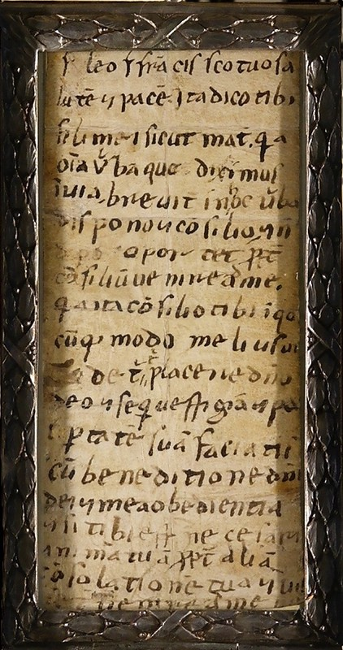

## Introduction

The cathedral of Santa Maria Assunta stands at the lower end of a broad piazza in the upper town of Spoleto, against the city walls and the wooded slope of Monteluco. Seen from the Via dell'Arringo, which descends towards it in a long flight of steps, its façade appears as a screen of pale stone pierced by rose windows and crowned by a gold mosaic, with a tall bell tower at its side and a Renaissance portico at its base. The view condenses eight centuries of history: a Romanesque cathedral rebuilt after the destruction of the city by Frederick Barbarossa<a href="/endnotes.html#fn-barbarossa" class="footnote">1</a>, consecrated by Innocent III<a href="/endnotes.html#fn-innocent-iii" class="footnote">2</a> in 1198, completed in the first decades of the thirteenth century and transformed in the Renaissance and the seventeenth century.

The medieval cathedral is the subject of the account that follows: the site and its early church, the rebuilding after 1155, the consecrations, the façade with its mosaic of 1207, the interior and its pavement, the crypt of San Primiano and the works of art that survive from the medieval furnishings. The later transformations, from the frescoes of Filippo Lippi in the apse to the remodelling promoted by the Barberini, are described more briefly, as the setting in which the medieval building survives today. The fundamental modern study is the volume *La Cattedrale di Spoleto: Storia, Arte, Conservazione* (2002), edited by <a href="/scholars.html#benazzi-giordana">Giordana Benazzi</a> and Giovanni Carbonara.

Spoleto occupies a hill at the southern end of the Umbrian valley, on the route of the Via Flaminia between Rome and the Adriatic. From the later sixth century it was the capital of one of the two great Lombard duchies of Italy, and the dukes of Spoleto controlled a territory that reached from the Apennines to the borders of the Roman duchy. The importance of the city as a political centre for more than six centuries is the background against which its cathedral was built, destroyed and rebuilt.

The bishops of Spoleto shared the hill with the dukes and, later, with the commune. The cathedral did not stand at the civic centre of the town, the area of the Roman forum, but on its eastern edge, against the walls. Its position, apart from the market and the palaces, gave the episcopal complex the character of a separate precinct, approached by a single descending street and closed on the other sides by the walls and the slope.

The present building is above all a work of the decades around 1200. In these years the city recovered from the destruction of 1155, passed from imperial to papal sovereignty and built a new cathedral whose façade, mosaic and pavement looked to Rome. The cathedral is thus a document of a political turning point as well as a monument of Romanesque architecture and decoration.

The medieval building has to be recognised beneath the later layers. Its plan and dimensions survive within the seventeenth-century interior; its façade, despite the Renaissance portico and later changes, keeps its rose windows, its sculpture and its mosaic; its pavement survives in the nave; and beneath the floor the crypt of San Primiano preserves the oldest part of the complex. The works of art of the medieval cathedral, some still in the building and others dispersed, complete the picture.

The cathedral belongs to a group of Umbrian churches of the twelfth and thirteenth centuries, such as the cathedrals of Assisi and Foligno and the churches of San Pietro and San Gregorio Maggiore in Spoleto itself, in which a local Romanesque sculpture of great vitality was combined with forms and motifs from Rome and from the classical past. Its place in this group, and its specific relationship with the papacy, define its importance for the history of medieval art in central Italy.

## The Site and the Early Cathedral

The site of the cathedral is unusual. It lies off the centre of the town, set against the walls on an artificial terrace of Roman date above a steep slope. Architectural fragments suggest that a church stood here by the sixth century and that it was rebuilt in the eighth or ninth century. A land transaction of 956 refers to "Sancta Maria Episcopii Spolitani", showing that the bishop's church stood on its present site by that date, and a writer of the age of Otto II speaks of the bishop's church dedicated to the Mother of the Lord.

The episcopal complex comprised the church of Santa Maria del Vescovato, a martyrial church of Saint Primianus, a baptistery and the bishop's residence. In 1067 Bishop Andrea II instituted or reorganised the cathedral chapter and endowed the canons with land near the church; his decree mentions a "trivuna Sancti Primiani", probably the apse of the church of Saint Primianus, built in the late eighth or early ninth century. The bishop's palace stood between the church and the city walls.

The terrace on which the cathedral stands is of Roman origin. Spoleto was a Roman colony from 241 BC, and the city preserves substantial remains of its Roman walls, temples and theatre. The choice of a site against the walls for the bishop's church may reflect the availability of land on the edge of the ancient town, as in other Italian cities where early episcopal complexes were placed at the margins of the Roman urban fabric.

The double dedication of the early complex, to the Virgin and to the martyr Primianus, follows a pattern frequent in early medieval Italy, in which the bishop's church was accompanied by a church that housed the relics of a local saint. The cult of the martyr, attested by the church and its crypt, gave the episcopal complex a focus of pilgrimage beside its liturgical and administrative functions.

The decree of Bishop Andrea II of 1067 belongs to the period of church reform, when bishops throughout Italy reorganised their chapters and required the canons to live a common life. The endowment of the canons with land near the church shows the growing importance of the chapter, which in the following century would share with the bishop the responsibility for the rebuilding of the cathedral.

Little is known of the appearance of the cathedral before 1155. Architectural fragments of the early medieval church survive, some of them built into the bell tower, and they show carved decoration of the eighth and ninth centuries, with interlace and plant motifs of the kind found throughout Lombard and Carolingian Italy. The church of San Primiano, with its semi-annular crypt, gives the only surviving idea of the architecture of the complex in that period.

The early cathedral stood in a city that was, until the eleventh century, the seat of the dukes and later of the marquises of Spoleto. The relationship between the bishops and the secular rulers of the duchy, and the presence of important monasteries in the territory, such as San Pietro in Valle and Farfa, shaped the religious life of the city. The episcopal church was one centre among several, and its later preeminence was the result of the rebuilding of the twelfth century.

## Destruction and Rebuilding, 1155–1198

In 1155 Frederick Barbarossa stormed and destroyed Spoleto. His biographer describes the highest part of the city as lying "just opposite the principal church, the bishop's seat", and the episcopal complex was very probably badly damaged. In the two decades that followed, during the schism and the rule of bishops of imperial obedience, the church probably remained in ruins.

Recovery probably began in 1177, with the peace between Frederick and Pope Alexander III<a href="/endnotes.html#fn-pope-alexander-iii" class="footnote">3</a> and the investiture of Bishop Transarico. Around 1178 the bishop moved his residence to San Gregorio Maggiore, so that the old episcopal palace could be demolished to make room for the new cathedral. The reconstruction thus began in the late 1170s, on a larger scale than the church it replaced.

The new cathedral was consecrated by Innocent III in 1198, the year in which the pope also asserted papal sovereignty over the city. It was probably still incomplete, but it already had the dimensions it keeps today: a basilica with a nave and two aisles, a transept and an apse. The diocesan historical tradition records a second consecration, perhaps in 1216 under Honorius III<a href="/endnotes.html#fn-pope-honorius-iii" class="footnote">4</a>, once the works were finished.

The destruction of 1155 took place during Frederick Barbarossa's first expedition to Italy. After his imperial coronation in Rome in June of that year, the emperor turned against Spoleto, which according to the imperial chronicler Otto of Freising had refused to pay the tribute required of it and had detained a nobleman of the imperial party. The city was stormed, plundered and burnt, and its inhabitants dispersed.

The years after the destruction were marked by the conflict between the emperor and Pope Alexander III and by the schism of the antipopes supported by Frederick. Spoleto, within the sphere of imperial power, had bishops of imperial obedience, and the rebuilding of the cathedral could not begin until the conflict was resolved. The peace of Venice of 1177, in which Frederick recognised Alexander III, opened the way for the reconstruction.

Bishop Transarico, invested in 1177, directed the first phase of the works. The demolition of the old episcopal palace to make room for the new church shows that the new cathedral was conceived on a larger plan, extending over ground previously occupied by other buildings of the complex. The bishop's move to San Gregorio Maggiore, a church of the eleventh century in the lower town, implies that the works took several years.

The consecration of 1198 coincided with a decisive change in the government of the city. In that year Innocent III obtained the submission of Conrad of Urslingen, the duke installed by the emperor, and asserted the direct rule of the Church over Spoleto and its duchy. The consecration of the new cathedral by the pope himself gave this political change a solemn religious expression.

The second consecration, recorded by the diocesan tradition and placed perhaps in 1216, would mark the completion of the works, including the upper parts of the façade. Between the two dates the cathedral was in use, and its decoration, with the mosaic of 1207 and the pavement, was carried out while the building was being finished. The rebuilding thus extended over about forty years, from the late 1170s to the second decade of the thirteenth century.

## The Façade

The façade is the product of several campaigns. An initial project, with an architraved portal, a porch and a central rose window above a blind gallery, was abandoned; vertical elements that break off incongruously show the change of plan. The final design divides the front into three registers. In the middle register five rose windows open across the width, the central one, about four metres in diameter, set in a square frame carved with the symbols of the four Evangelists and resting on a small blind loggia whose columns include two telamons. In the upper register three tall pointed arches alternate with three further rose windows under a gable edged with crockets of an already Gothic character.

The lintels of the central portal, with a cross springing from acanthus leaves and bands of classical mouldings, recall the early medieval sculpture of San Salvatore outside the walls; whether they were carved for the cathedral or reused from an earlier building is debated. Together with the rose windows and the carved frames, it shows a sculptural culture rooted in the local Romanesque, close to the façades of other Umbrian churches of the twelfth and thirteenth centuries.

The façade was modified again in later centuries. Between 1491 and 1504 the portico of five round arches, with a pulpit at each end facing the piazza, was built across its base; it is now attributed to Ambrogio Barocci and Pippo di Antonio. The remodelling of the interior in the seventeenth century altered the profile of the front once more.

The façade is built of regular courses of pale limestone, with a facing of thin, carefully cut blocks. Its surface is articulated by the three registers, by the bands of small arches that separate them and by the rose windows, which give the wall its rhythm. The sculpture is concentrated around the openings: the portal, the frames of the rose windows and the carved symbols and telamons of the central rose window.

The rose window is the characteristic motif of the Romanesque façades of Umbria. At Spoleto the façade has eight rose windows, five in the middle register and three in the upper, an unusually large number. The cathedral of San Rufino at Assisi, with its three rose windows above a sculpted portal, and the cathedral of Foligno, whose side façade was signed in 1201 by the masters Rodolfo and Binello, offer the closest comparisons in the region.

The central rose window, with the symbols of the Evangelists at its corners, is the focus of the middle register. Placed on the axis of the façade between the portal below and the mosaic above, it forms with them a vertical sequence: the door of the church, the wheel of light surrounded by the Gospels, and the image of Christ enthroned. The façade thus presents a coherent programme, in which architecture, sculpture and mosaic contribute to a single meaning.

The change of plan visible in the façade shows that its design evolved during construction. The first project, with a porch and a blind gallery, belongs to a Romanesque type with parallels in the region; the final design, with its pointed arches and crocketed gable, reflects the arrival of Gothic forms in Umbria in the first decades of the thirteenth century. The façade therefore records the transition from Romanesque to Gothic in a single building.

The façade was designed to be seen from the piazza below and from the steps of the Via dell'Arringo, which descend towards it. The relationship between the façade and the piazza, with the bell tower at the side and the hill behind, gives the cathedral its scenographic character. The Renaissance portico, added across the base, changed this relationship, adding a classical loggia between the medieval front and the piazza.

## The Mosaic of Solsternus

The central pointed arch of the upper register holds the mosaic signed by Solsternus and dated 1207: a Deesis, with Christ enthroned and blessing between the Virgin and Saint John, above an inscription in two lines that names the master, praises his art, gives the date and records the operarii of the cathedral works. It is the earliest dated element of the present upper façade and one of the very few façade mosaics of the early thirteenth century still visible in Italy.

Since the pointed arches belong to the later, Gothic phase of the façade, the date of 1207 marks the moment by which at least the central arch was complete; it does not prove that the whole upper façade was finished in that year. The mosaic was set up nine years after the consecration of 1198, in the first decade of papal rule over the city, and its form, a figurative mosaic on an external façade, belongs to Roman practice. Its style combines a figurative culture derived from the Sicilian mosaics of Monreale, as <a href="/scholars.html#andaloro-maria">Maria Andaloro</a> has shown, with features drawn from Roman models, such as the type of Christ based on the Lateran acheiropoieta.

The choice of a Deesis for the façade of a cathedral dedicated to the Virgin presented the patroness of the church as the intercessor of the city before Christ, above the main door and above the piazza in which the citizens gathered. The Via dell'Arringo takes its name from the *arringo*, the assembly of the people, which by a custom documented from the twelfth century met before the cathedral, so that the façade faced a space of public deliberation as well as of liturgy.

Façade mosaics were a Roman tradition. In the twelfth century the façades of San Bartolomeo all'Isola, Santa Maria Nova and San Giovanni in Laterano received mosaics, and in the first half of the thirteenth century those of Santa Maria in Trastevere and Saint Peter's were renewed. Of these, only the mosaics of Santa Maria in Trastevere and Santa Maria Maggiore survive. The mosaic of Spoleto is one of the very few comparable works outside Rome.

The mosaic was made in the years in which Innocent III promoted the renewal of the apse mosaic of Saint Peter's, between about 1205 and 1212. Its maker belongs to the same generation of mosaicists who worked in central Italy after the closure of the great Norman workshops of Sicily, and who carried a figurative culture formed at Monreale to Grottaferrata, Rome and Spoleto.

The inscription of the mosaic names the master and the operarii, the officials of the cathedral works, but no bishop and no pope. The commission was therefore presented as an undertaking of the cathedral institutions. Whether the initiative came from the bishop, the chapter or the commune, the mosaic gave the façade an image that could be read both as a statement of devotion and as a sign of the city's alignment with Rome.

The mosaic and the pavement of the nave show that in the years around 1200 the cathedral of Spoleto was furnished with tessellated decoration of Roman type. Figurative mosaic was not a local tradition in Umbria; the region offers only isolated earlier examples. The work of Solsternus therefore represents an import, made possible by the political and ecclesiastical links between Spoleto and the papacy.

The mosaic has been restored several times, and the head of Saint John was remade almost completely in 1927. Its iconography, its inscription and its style are discussed in detail in the entry on <a href="/Content/Artists/XIII-c/Solsternus.html">Solsternus</a>, which also examines the form of the master's name, written in the inscription with the letters T and E in ligature.

## The Bell Tower

The bell tower rises at the left of the façade, a tall square tower of pale stone with a belfry of double arched openings and a conical spire. Architectural fragments from the early medieval church are built into its lower part, under the portico, and reused carved stones appear elsewhere in its masonry, a practice common in the medieval building of central Italy and especially in Spoleto, a city rich in Roman and early medieval remains. The upper parts of the tower, with the belfry and the spire, probably belong to later campaigns.

Bell towers became a standard element of Italian churches between the eleventh and the twelfth century. Their function was liturgical, to call the faithful to the offices and to mark the hours, and civic, since the bells of the cathedral announced public events and dangers. Set beside the façade, the tower of Spoleto was visible from far across the valley and served as a landmark of the episcopal precinct.

The tower is built in large blocks of stone, many of them reused. The incorporation of earlier material, from Roman buildings and from the early medieval church, was both a practical choice, using the stone available on the site, and a statement of continuity, in which the ruins of the city's past were built into the new structure. Spoleto, with its abundant Roman remains, offered builders a large supply of such material.

The tower is square in plan and rises without buttresses, with walls that become lighter as they rise. Its lower part, closed and massive, corresponds to the medieval structure; the belfry with its double arched openings and the conical spire belong to later campaigns, which adapted the tower to new bells and to the taste of their time.

The position of the tower, at the left of the façade and slightly set back, frames the view of the cathedral from the piazza. Its vertical mass balances the broad front of the façade, and its spire repeats the point of the gable. The relationship between the two elements is a result of successive campaigns rather than of a single design.

The tower has been repaired after earthquakes and restored in modern times. Its masonry, with the reused stones visible in its lower part, remains one of the most direct witnesses of the continuity between the early medieval complex and the cathedral rebuilt after 1155.

## The Interior and the Pavement

The interior keeps the plan of the Romanesque basilica, with a nave, two aisles, a transept and an apse, but its appearance today is largely the result of the remodelling of the seventeenth century, when the nave was widened and the walls were given new architectural articulation. The medieval building survives above all in its plan, its dimensions and its pavement.

The pavement of the nave is one of the most important medieval furnishings of the cathedral. Laid in the tradition of the Roman marble workers of the twelfth and thirteenth centuries, it combines bands of red stone and white marble with discs of coloured stones in geometric patterns of circles, squares and interlaces, in the technique known as opus sectile. It is partly original and partly recomposed: geometric patterns lie nearest the apse and a chevron design nearest the entrance, and a fragment of a hunting scene survives on the right, above the steps to the apse. The pavement of the aisles, with red and white lozenges, was laid in the fifteenth century.

The pavement belongs to the same moment of the cathedral's history as the mosaic of the façade. Both used tessellated decoration of Roman tradition, and both show that the chapter of Spoleto looked to Rome for the furnishing of its new cathedral in the decades around 1200. Since 2021 the pavement has been the object of a conservation campaign proceeding in stages from the apse towards the entrance.

The medieval interior had a different appearance from the present one. The nave was narrower, separated from the aisles by arcades on columns or piers, and covered by an open timber roof or by vaults, according to a pattern common in Umbrian churches of the period. Its walls were probably decorated with paintings, of which the fragments of the Last Judgement on the inner façade are among the few survivors.

The liturgical arrangement of the medieval cathedral included an enclosure for the clergy in the nave or before the presbytery, an ambo for the reading of the Gospel and a high altar beneath a canopy. Such furnishings, made of marble and inlaid stone in Roman churches of the twelfth and thirteenth centuries, have not survived at Spoleto, but the pavement of the nave preserves the setting in which they stood.

Inlaid pavements of this kind were made in Rome by families of marble workers, the best known of which gave its name to the style. They used ancient marbles taken from the ruins of Rome, cut into discs, bands and small pieces and arranged in geometric patterns of great variety. Their diffusion beyond Rome, to cathedrals and abbeys in Lazio, Umbria and Campania, followed the routes of papal influence in the twelfth and thirteenth centuries.

The pavement of Spoleto uses simpler materials than the great Roman floors, with red stone and white marble for the bands and coloured stones only for the discs. Its patterns, with interlaced bands enclosing roundels and long strips of chevrons, organise the nave as a processional route from the entrance to the presbytery, along which the panels change in design.

The fragment of a hunting scene that survives near the steps of the presbytery is unusual in a pavement of this type, which normally used geometric patterns only. It may belong to an earlier pavement reused in the medieval floor, or to a figurative zone of the pavement now lost. Its presence shows that the floor, like the façade, incorporated material and motifs of different origins.

## The Crypt of San Primiano

Beneath the present Cappella delle Reliquie, in the left aisle, lies the crypt of the church of Saint Primianus, discovered at the beginning of the twentieth century by <a href="/scholars.html#sordini-giuseppe">Giuseppe Sordini</a>. It is a semi-annular crypt, a corridor following the curve of the apse above it, of a type used in early medieval churches to allow pilgrims to approach the relics of a saint placed beneath the altar. The apse of the church of San Primiano was demolished in 1540 to make way for the Cappella delle Reliquie.

The crypt, dated to the early ninth century, preserves fragments of wall paintings that are among the earliest surviving in Spoleto. A conservation campaign presented in January 2026 has made them more legible and has revealed a fragmentary inscription suggesting that they narrated the deeds of a martyr, rather than the life of Saint Benedict, as an older reading had proposed.

The semi-annular crypt was developed in Rome at the end of the sixth century, when a corridor was built beneath the apse of Saint Peter's to give access to the tomb of the apostle without disturbing the altar above. The type spread to other Roman churches in the eighth and ninth centuries, and from Rome to the rest of Italy and beyond the Alps, as the cult of relics took on greater importance.

The crypt of San Primiano belongs to this Carolingian phase of diffusion. Its corridor, following the curve of the apse, led to a central chamber or recess beneath the altar, where the relics of the martyr were kept. Pilgrims entered from one side, passed before the relics and left from the other, in a circuit that allowed the veneration of the saint without interrupting the liturgy.

The paintings of the crypt, dated by comparison with Roman examples, show that its decoration followed Roman models. Figures of saints in niches, painted curtains on the lower walls and narrative scenes in the upper zone were common in the crypts and oratories of ninth-century Rome, and their presence at Spoleto shows the close links between the city and Rome already in the early Middle Ages.

The interpretation of the paintings has changed with their conservation. The older reading, which saw in them scenes from the life of Saint Benedict, has been questioned by the discovery of an inscription that suggests the narrative of a martyr's deeds, possibly the titular saint of the church. Only small fragments survive, and their identification remains uncertain.

The crypt survived the demolition of the apse of San Primiano in 1540 because it lay below the level of the new chapel. Forgotten for centuries, it was rediscovered at the beginning of the twentieth century, and only with the recent conservation has it become accessible. It is the oldest surviving part of the episcopal complex and one of the few monuments of Carolingian-period architecture and painting in Umbria.

## Furnishings and Images of the Medieval Cathedral

The oldest painted image in the cathedral is the triumphal Crucifix signed by <a href="/Content/Artists/XII-c/Alberto-Sozio.html">Alberto Sotio</a> and dated 1187, kept in the first chapel on the left and brought from the church of Santi Giovanni e Paolo in 1887. Catalogued by <a href="/scholars.html#garrison-edward">Edward Garrison</a> among the Italian Romanesque painted crosses, it is the oldest dated painted crucifix in the peninsula after that of Guglielmo at Sarzana, and its painter is the earliest documented painter of Spoleto.

In the Chapel of the Santissima Icone, to the right of the apse, is kept a Byzantine icon of the Virgin of the eleventh or twelfth century, which tradition holds to have been given to the city by Frederick Barbarossa in 1185 as a sign of peace after the destruction of 1155. It remains the principal object of devotion of the cathedral.

The Cappella delle Reliquie, built in 1540, keeps the autograph letter of Saint Francis of Assisi<a href="/endnotes.html#fn-francis-assisi" class="footnote">5</a> to Brother Leo, one of the two surviving autographs of the saint. The chapel also contains a painted wooden statue of the Virgin and Child of the fourteenth century and other reliquaries and liturgical silver.

On the inner façade, fragments of frescoes of the 1370s belonged to a Last Judgement commissioned by Bishop Gallardus (1372–1378), the last great medieval decoration of the cathedral before the Renaissance campaigns. Together with the cross of 1187, the icon and the mosaic, they show that the medieval cathedral was richly furnished with images, much of which was lost in the later transformations.

Painted crosses were among the most important furnishings of Italian churches from the twelfth century. Placed above the entrance to the presbytery or on the altar, they presented the image of the crucified Christ to the congregation. The type of the *Christus triumphans*, alive and victorious on the cross, prevailed until the early thirteenth century, when it began to give way to the *Christus patiens*, dead and suffering, under the influence of Byzantine models and of Franciscan devotion.

The cross of Alberto Sotio belongs to the earliest group of dated Italian painted crosses, after that of Guglielmo at Sarzana of 1138. Its painter was active in Spoleto at the end of the twelfth century, and works by his hand or his circle survive in the city and its territory. The cross shows the existence in Spoleto of an accomplished local school of painting before the arrival of the mosaicist of the façade.

Byzantine icons reached Italy through trade, diplomacy and the crusades, and many were venerated in Italian churches as miraculous images. The icon of Spoleto, associated by tradition with Barbarossa's gift of 1185, belongs to this group. Whether or not the tradition is accurate, the icon shows the prestige of Byzantine painting in Italy in the twelfth century and its role as a model for local painters.

The letter of Saint Francis brings into the cathedral the memory of the saint's presence in the valley of Spoleto, where he travelled and preached and where several early communities of friars settled. It came to the cathedral only at the beginning of the twentieth century, from the Franciscan church of San Simone, but it belongs to the medieval history of the city and of its religious life.

The medieval furnishings of the cathedral were more numerous than those that survive. Altars, altarpieces, liturgical furniture, reliquaries and wall paintings were removed or replaced in the Renaissance and Baroque campaigns, and some are known only from documents such as the visitation of 1610. Works from the cathedral and its territory are now kept in the Museo Diocesano and other collections in Spoleto.

## Later Transformations

In 1467–1469 Filippo Lippi, with his workshop, painted the apse with scenes from the Life of the Virgin, the Annunciation, the Dormition and the Nativity, culminating in the Coronation of the Virgin in the semi-dome. They were his last works: he died in Spoleto in 1469, and Lorenzo de' Medici later commissioned his tomb monument, designed by his son Filippino, probably about 1488. The cycle gave the cathedral its most famous image and placed it within the network of Florentine painting of the later fifteenth century.

The chapel of the Sacrament, to the left of the apse, was decorated in the seventeenth century with stuccoes by Giovanni Fontana da Foligno (1672–1682) and paintings in its vault. At the end of the fifteenth century Pinturicchio frescoed the chapel founded by Bishop Costantino Eroli (1497), and in 1599 Annibale Carracci painted, largely with his workshop, an altarpiece of the Madonna and Child with Saints for a chapel in the right transept. In 1540 the Cappella delle Reliquie replaced the apse of San Primiano.

The most radical transformation followed in the seventeenth century. Maffeo Barberini, bishop of Spoleto from 1608 to 1617 and later Pope Urban VIII<a href="/endnotes.html#fn-urban-viii" class="footnote">6</a>, promoted together with his nephew Cardinal Francesco Barberini a remodelling of the interior, largely carried out in 1638–1644 and completed about 1680, which widened the nave and gave the church its present architectural articulation. Urban VIII sent to Spoleto in 1644 a bronze bust of himself by Gian Lorenzo Bernini, now in the Museo Diocesano. A further campaign, directed by Giuseppe Valadier for Bishop Francesco Maria Locatelli in 1785–1792, redesigned the altars and chapels.

These transformations preserved the medieval plan, the façade and the pavement, but they removed much of the medieval decoration of the interior. The visitation of the cathedral promoted by the Barberini in 1610 records altars, images and furnishings that were later removed or transformed, and it remains the main source for the appearance of the medieval interior.

The frescoes of the apse were commissioned from Filippo Lippi by the operai of the cathedral in 1466, after the painter had completed his cycle in the choir of Prato cathedral. Lippi worked in Spoleto with his assistant Fra Diamante and with his young son Filippino. The cycle replaced whatever decoration the medieval apse had received, and it gave the cathedral a focus of Florentine painting at the end of the nave.

Lippi's death in Spoleto in 1469, during or shortly after the completion of the work, gave the cathedral the tomb of the painter. The Florentines asked for his body, but the people of Spoleto refused, and Lorenzo de' Medici instead commissioned a monument, designed by Filippino, with an epitaph by Angelo Poliziano. The tomb has been moved several times within the cathedral.

The Renaissance portico of 1491–1504 transformed the relationship between the façade and the piazza. Its five arches, with pulpits at either end, created a covered space before the church, used for preaching and public ceremonies, and introduced the classical architecture of the late fifteenth century into the medieval front. The portico is now attributed to Ambrogio Barocci and Pippo di Antonio.

The Barberini remodelling of the seventeenth century, attributed in its design to the architect Luigi Arrigucci, widened the nave, replaced the medieval supports with piers faced with pilasters and covered the interior with vaults. It gave the cathedral the appearance of a Roman church of the Counter-Reformation, with a white interior and an axial view towards the high altar and Lippi's apse.

The late eighteenth-century campaign of Giuseppe Valadier redesigned the altars, the chapels and the presbytery in a neoclassical manner. Together with the Barberini remodelling, it determined the present appearance of the interior, in which the medieval cathedral survives only in its plan, its pavement and the works preserved in its chapels.

## Restoration and Conservation

The façade mosaic has been restored several times; in 1927 the head of Saint John was remade almost completely, and a further restoration followed in 1976. The cathedral was the subject of major studies and works after the earthquake of 1997 in Umbria and the Marche, and the volume of 2002 was produced in that context, gathering the results of archaeological, architectural and art-historical research on the building.

The conservation campaign on the pavement of the nave, begun in 2021, has involved the analysis of its medieval, Renaissance and seventeenth-century phases, the cleaning of the surfaces, the consolidation of loose elements and the integration of losses with recovered fragments or new elements distinguishable on close inspection. The exhibition "Spoleto sacra 1200", held for the 825th anniversary of the consecration of 1198, brought together works connected with the medieval cathedral and its territory and renewed attention to the building's twelfth- and thirteenth-century history.

Spoleto lies in a region of high seismic risk, and the cathedral has been damaged by earthquakes several times in its history. The earthquake of 1997 in Umbria and the Marche led to a campaign of studies and works on the building, whose results were gathered in the volume of 2002. The earthquake of 2016, which devastated Norcia, damaged churches throughout the archdiocese and made Spoleto a centre for the conservation of works removed from damaged buildings.

The conservation of the façade mosaic, exposed to the weather on the upper façade, has required repeated interventions since the early twentieth century. The restorations of 1927 and 1976 consolidated the surface and replaced lost tesserae; the remaking of the head of Saint John in 1927 is the most visible of these interventions and bears on the interpretation of the figure.

The conservation of the pavement, begun in 2021 and proceeding in stages from the apse towards the entrance, has distinguished the medieval, Renaissance and seventeenth-century phases of the floor and has documented its reused fragments. The integration of losses with recovered fragments or new elements distinguishable on close inspection follows the principles of modern conservation, which seek to preserve the legibility of the original without imitating it.

The crypt of San Primiano was the subject of a conservation campaign presented in January 2026. The works addressed the rising damp that threatened the remains of the paintings, cleaned and consolidated the plaster and the paint, and prepared the crypt for controlled climate and lighting. The campaign revealed new fragments and letters of inscriptions, and it has reopened the study of the crypt.

The exhibition "Spoleto sacra 1200", held for the 825th anniversary of the consecration of 1198, brought together works connected with the medieval cathedral and its territory, including the Byzantine icon. It showed how much of the medieval cathedral survives in its works of art, even where the building itself has been transformed.

## Conclusion

The cathedral of Spoleto is a monument of the decades around 1200. Rebuilt after the destruction of 1155, consecrated by Innocent III in the year in which the city passed under papal rule, and crowned in 1207 by a façade mosaic of Roman type and Sicilian-derived style, it records the political and cultural reorientation of Spoleto from the empire towards the papacy. Its pavement, its mosaic and its consecrations link it to Rome, while its façade sculpture and its painted cross of 1187 belong to the local Romanesque tradition.

Beneath and around this Romanesque cathedral survive traces of the earlier episcopal complex: the crypt of San Primiano with its ninth-century paintings and the fragments built into the bell tower. Above and within it lie the Renaissance and Baroque transformations that give the interior its present appearance. The medieval cathedral has to be read through these later layers, in the façade, the plan, the pavement and the works of art that the later campaigns preserved.

The cathedral of Spoleto shows the importance of political events for the history of art. The destruction of 1155 made the rebuilding necessary; the peace of 1177 made it possible; and the passage of the city under papal rule in 1198 gave the new cathedral its Roman orientation. The façade mosaic and the pavement, unusual in Umbria, are the most visible expressions of this orientation.

At the same time, the cathedral is a work of local culture. Its façade, with its rose windows and its carved symbols and telamons, belongs to the Romanesque architecture of Umbria; its painted cross of 1187 is the work of a painter of Spoleto; and its consecrations and inscriptions record the role of the bishop, the chapter and the operarii of the cathedral works. The Roman forms were adopted and adapted by a city with its own traditions.

The cathedral also illustrates the encounter between Byzantine, Sicilian and Roman art in central Italy around 1200. The Byzantine icon, the mosaic of a master trained in the culture of Monreale and working on Roman models, and the inlaid pavement of Roman tradition coexisted in a single building with the local Romanesque sculpture and painting. The cathedral shows this encounter in a single building.

The later history of the cathedral transformed its interior but preserved much of its medieval substance. The Renaissance frescoes, the portico and the Baroque remodelling were added to the medieval building rather than replacing it entirely, and the medieval works of art were kept in the new chapels. The cathedral thus offers a record of the successive ways in which each age honoured and reshaped the church it inherited.

The recent conservation of the pavement and of the crypt, and the renewed study of the building and its works, show that the medieval cathedral is still being rediscovered. The crypt of San Primiano, in particular, is now to be studied again, and its paintings may change the understanding of the early episcopal complex. The cathedral of Spoleto remains a monument whose history is not yet fully written.

## Catalogue Entry

### The Façade

<figure>
  
  <figcaption>Spoleto, Cathedral of Santa Maria Assunta, façade, with the bell tower, the Renaissance portico (1491–1504) and the mosaic of Solsternus (1207). Photo: Fiat 500e, <a href="https://creativecommons.org/licenses/by/4.0/">CC BY 4.0</a>, via Wikimedia Commons.</figcaption>
</figure>

The façade closes the lower end of the piazza and is seen from above, from the steps of the Via dell'Arringo, against the wooded slope of Monteluco. The view shows the three registers of the medieval front: the middle register with its five rose windows, the upper register with three pointed arches and three rose windows under a crocketed gable, and, at the base, the portico of five arches added in 1491–1504.

The bell tower rises at the left, a tall square tower of pale stone whose lower part incorporates fragments of the early medieval church. Its upper stages, with the belfry and the conical spire, belong to later campaigns.

The mosaic in the central arch is the only figurative image of the façade and the focus of the whole composition. Seen from the piazza, its gold ground and the frontal figure of Christ stand out clearly against the pale stone.

The façade, the mosaic and their place in the history of the cathedral are discussed more fully in the entry on <a href="/Content/Artists/XIII-c/Solsternus.html">Solsternus</a>.

### The Upper Façade, with the Rose Windows and the Mosaic

<figure>
  
  <figcaption>Spoleto, Cathedral of Santa Maria Assunta, upper part of the façade, with the rose windows, the mosaic of Solsternus (1207) and the central rose window of the middle register. Photo: Greymouser, <a href="https://creativecommons.org/licenses/by-sa/4.0/">CC BY-SA 4.0</a>, via Wikimedia Commons.</figcaption>
</figure>

The view shows the upper part of the façade from close below, in the light of a clear day, without the Renaissance portico and the surrounding buildings. It allows the two upper registers to be read in detail, with their rose windows, their arches and the mosaic, and shows how the medieval front was composed as a surface of pale stone pierced by circles and framed by arches.

The facing is of regular courses of pale limestone, laid in thin, even blocks that give the wall a fine texture. Small square holes, left by the scaffolding used in its construction, are visible at regular intervals. The pink stone that rings the two lower rose windows of the gable and edges some of the arches adds a discreet second colour to the pale surface.

The gable is edged with a row of small arches and with projecting stone crockets, set at regular intervals along both slopes and crowned by a cross at the apex. Their pointed, leaf-like forms belong to the later, Gothic phase of the façade, and they give the medieval front a lively outline against the sky.

Within the gable three rose windows form a triangle around the mosaic: one near the apex, two lower down between the pointed arches. Each is filled with radiating tracery of small columns and trefoil or lobed arches, of slightly different designs, so that the three circles repeat a single theme with variations. The rose windows light the space beneath the roof and give the gable its rhythm.

The three tall pointed arches of the upper register are of equal design, each framed by a moulding of pale stone set with small dark discs. The two lateral arches are blind, their fields filled only with masonry. The central arch holds the mosaic of Solsternus, which thus appears as the one figurative element of the façade, set at its centre and framed by the same architecture as the empty arches beside it.

Below the mosaic a continuous band of small round arches on carved brackets runs across the whole width of the façade, separating the upper register from the middle one. This blind arcading, a motif of Romanesque architecture in central and northern Italy, gives the façade a strong horizontal line and recalls the earlier project with a blind gallery that was abandoned for the present design.

In the lower part of the view appear the five rose windows of the middle register, with the upper half of the great central rose window and its frame carved with the symbols of the Evangelists.

The façade is in good condition. The stone has been cleaned and its surfaces are sharp, the tracery of the rose windows is complete, and the crockets of the gable are largely preserved. The view shows the mosaic in its architectural setting, at the height at which it was meant to be seen from the piazza below.

### The Central Rose Window and the Middle Register

<figure>
  
  <figcaption>Spoleto, Cathedral of Santa Maria Assunta, middle register of the façade, with the central rose window, the symbols of the Evangelists, the telamons of the blind loggia and two lateral rose windows. Photo: Effems, <a href="https://creativecommons.org/licenses/by-sa/4.0/">CC BY-SA 4.0</a>, via Wikimedia Commons.</figcaption>
</figure>

The middle register of the façade is the richest in carved decoration. At its centre the great rose window, about four metres in diameter, is set in a square frame with the symbols of the four Evangelists in the corners and rests on a small blind loggia with two telamons. At either side smaller rose windows open in the pale stone. Above, the band of small arches on brackets divides this register from the upper one, where the mosaic stands.

The tracery of the central rose window is built in two rings. The inner ring consists of twelve slender colonnettes radiating from a small central ring and joined at their outer ends by lobed arches, so that the openings between them take the form of petals. Around it, a wider ring of circles, linked by interlacing bands, encloses smaller round openings. The whole is filled with leaded glass, which appears dark from outside.

The square frame of the rose window is bordered with narrow bands of inlaid ornament in dark and light stone, small geometric patterns that recall the tessellated decoration of the pavement inside. In the spandrels between the circle and the corners of the square are carved the four symbols of the Evangelists, each winged and turned towards the rose window: the angel of Matthew at the upper left, the eagle of John at the upper right, the lion of Mark at the lower left and the ox of Luke at the lower right.

The symbols surround the rose window as they surround Christ in images of the Majesty, so that the window itself, a wheel of light, takes the place of the divine figure. The same theme is completed in the register above, where Christ appears enthroned in the mosaic: the façade thus presents a vertical sequence from the symbols of the Gospels to the image of Christ.

The angel of Matthew, at the upper left, is a tall standing figure with large wings spread behind it, holding a book or a scroll, its drapery carved in fine parallel folds. The eagle at the upper right turns its head towards the centre, its wings rendered as broad layered feathers. The lion and the ox below lie along the curve of the circle, their wings raised. The reliefs are carved in a firm, linear manner, characteristic of Umbrian Romanesque sculpture of the late twelfth century.

Beneath the rose window runs a small blind loggia of colonnettes with Corinthianising capitals. Two of its supports are telamons, standing male figures who carry the cornice on their heads, one with his hand raised to the load. Telamons, figures of human effort supporting a structure, are a motif of Romanesque sculpture in central Italy, used on portals, pulpits and façades.

The two lateral rose windows are simpler and of different designs. The one at the left has a tracery of radiating colonnettes and lobed arches within a carved border; the one at the right is similar but framed by a ring of small circular inlays, with four discs projecting at the diagonals. The variety of the windows, each with its own pattern, is typical of the Romanesque façades of the region, in which repeated forms were varied rather than copied.

The register is in good condition. The tracery of the rose windows is complete, and the reliefs of the Evangelists and the telamons are legible, although their surfaces are weathered and the telamon at the right has lost part of his right arm. Small square holes left by the scaffolding are visible in the masonry.

### The Mosaic of Solsternus, 1207

<figure>
  
  <figcaption>Solsternus, <em>Deesis: Christ Enthroned between the Virgin and Saint John</em>, signed and dated 1207. Mosaic. Spoleto, Cathedral of Santa Maria Assunta, façade. Photo: Wolfgang Sauber, <a href="https://creativecommons.org/licenses/by-sa/4.0/">CC BY-SA 4.0</a>, via Wikimedia Commons.</figcaption>
</figure>

The mosaic in the central arch of the upper register shows the Deesis: Christ enthroned and blessing, with the words of John 8:12 in his open book, between the Virgin, the patroness of the cathedral, and a young saint labelled "SCS IOHS", probably John the Evangelist, whose head was remade in 1927.

Beneath the figures an inscription in two lines names the master, Solsternus, written with T and E in ligature, calls him "doctor" and "summus in arte modernus", gives the date 1207 and records the operarii of the cathedral works.

Set up nine years after the consecration of 1198, in the first decade of papal rule over the city, the mosaic combines a figurative culture derived from the Sicilian mosaics of Monreale with Roman features, and its position on the external façade follows Roman practice.

The mosaic, its inscription and its details are described in the entry on <a href="/Content/Artists/XIII-c/Solsternus.html">Solsternus</a>.

### The Central Portal

<figure>
  
  <figcaption>Spoleto, Cathedral of Santa Maria Assunta, central portal of the façade, beneath the Renaissance portico: carved jambs and two lintels, with later coats of arms in the lunette above. Marble. Photo: MySpoleto, image for educational use only.</figcaption>
</figure>

The central portal opens in the middle of the façade, behind the Renaissance portico that has covered it since the end of the fifteenth century. It is the main entrance of the cathedral and the point at which the axis of the façade, running from the mosaic through the great rose window, meets the ground. Seen today in the half-light of the portico, it is easily overlooked, but its carved marble is among the finest sculpture of the medieval building.

The doorway is framed by marble jambs carved with symmetrical scrolls of foliage, branching from a central stem into curling leaves and tendrils. The carving is crisp and shallow, in a classicising manner, and the motif continues on the outer faces of the jambs, which turn into the wall of the portico.

Above the door lie two lintels, one over the other, of different character. The lower one, which carries the load of the wall above, is carved with a continuous vine scroll that forms six roundels, three at each side of the centre. The roundels enclose open rosettes and plant motifs rising from small vases, and small leaves and buds fill the spaces between them.

At the centre of the lower lintel a cross rises from a cluster of acanthus leaves, the theme of the foliated cross. The motif, in which the cross of the Passion grows like a living plant, is an image of the Tree of Life and of the cross as the source of new life. It has been described as a Lombard theme, and it recalls the early medieval sculpture of Spoleto, where the foliated cross appears on the façade of the church of San Salvatore outside the walls.

The upper lintel projects above the lower one and has a purely ornamental function. It is carved with superimposed bands of classical mouldings: dentils, egg-and-dart, beading and fluting, a vocabulary of Hellenistic and Roman origin. The pairing of the two lintels, one with a Christian vine scroll and a cross, the other with mouldings of antique architecture, is unusual.

The origin of the lintels is debated. The prevailing view holds that they were carved for the cathedral in imitation of earlier styles, in the classicising taste that characterises Romanesque sculpture in Spoleto, a city rich in Roman and early Christian monuments. Others consider them reused pieces, taken from an earlier building. The close relationship of their motifs with the sculpture of San Salvatore and with Roman ornament explains why the question remains open.

In the lunette above the lintels, under the vault of the portico, are carved two large coats of arms of bishops in low relief, and at the centre a small painted oval emblem of the archdiocese. They belong to the Renaissance and later history of the cathedral, when the portico was built and the bishops placed their arms at the entrance of their church.

The marble of the portal is in good condition, protected by the portico from the weather. The carving of the jambs and lintels is sharp and legible, although some leaves and mouldings are chipped.

### The Nave, looking towards the Apse

<figure>
  
  <figcaption>Spoleto, Cathedral of Santa Maria Assunta, the nave looking towards the apse, with the medieval pavement and the frescoes of Filippo Lippi and workshop (1467–1469) in the apse. Photo: Caba2011, <a href="https://creativecommons.org/licenses/by-sa/4.0/">CC BY-SA 4.0</a>, via Wikimedia Commons.</figcaption>
</figure>

The view along the nave shows the cathedral as it appears today: a Romanesque basilica with a nave, two aisles, a transept and an apse, clothed in the architecture of the seventeenth century. The plan and the dimensions are those of the church consecrated in 1198, while the pilasters, the vaults and the white surfaces belong to the remodelling promoted by the Barberini in 1638–1644 and completed about 1680.

The nave is divided from the aisles by tall round arches on piers faced with white pilasters, whose capitals and entablature are picked out in stucco and gilding. Above the arches the walls rise to a barrel vault, and the crossing is covered by a dome. The whole interior is painted white, in the manner of Roman churches of the seventeenth century, and lit by windows set high in the walls.

Round windows with stone tracery open in the walls, whose medieval form contrasts with the classical architecture around them. They are among the few elements of the upper walls that recall the Romanesque church, together with the rose windows of the façade seen from outside.

The pavement of the central aisle is the most important medieval element visible in this view. It runs from the entrance to the steps of the presbytery as a carpet of inlaid marble and stone. Near the entrance, in the foreground, the pattern is a broad chevron of white and dark bands with small squares; nearer the apse it changes into panels of circles, guilloches and interlaces. The difference reflects the different phases of a pavement that is partly original and partly recomposed.

The pews stand on the side parts of the nave, leaving the inlaid central strip free, as a processional path towards the altar. In the medieval church the pavement marked the route of processions and the zones of the liturgy, from the entrance to the choir; its geometric panels were designed to be walked upon and seen from above as one advanced towards the presbytery.

At the end of the nave the apse is filled by the frescoes of Filippo Lippi and his workshop. In the semi-dome Christ crowns the Virgin among crowds of angels and saints, against a deep blue sky with the sun, the moon and the stars; below, the wide scene of the Dormition of the Virgin unfolds in a landscape, flanked by the Annunciation and the Nativity. Painted in 1467–1469, the cycle is the point towards which the whole interior is directed.

The furnishings visible in the view belong to the later history of the cathedral: the high altar and the presbytery redesigned at the end of the eighteenth century under Giuseppe Valadier, the gilded wooden pulpit attached to a pier at the right, the crystal chandeliers and the modern pews. Banners hung on the piers carry texts from the liturgy of the dedication of a church.

The interior is in good condition, and the pavement, whose conservation began in 2021, has been cleaned and consolidated in the part nearest the apse. The view shows how the medieval cathedral survives within the later architecture, in its plan, in its windows and above all in the inlaid floor of the nave.

### The Pavement of the Nave, detail

<figure>
  
  <figcaption>Spoleto, Cathedral of Santa Maria Assunta, pavement of the nave, detail of interlaced bands with roundels of coloured stone. Inlaid stone and marble. Photo: Zyance, <a href="https://creativecommons.org/licenses/by-sa/2.5/">CC BY-SA 2.5</a>, via Wikimedia Commons.</figcaption>
</figure>

The detail shows a part of the pavement of the nave with interlaced bands and roundels, the motif that dominates the geometric panels of the floor. It allows the materials and the construction of the floor to be seen at close range, as they would have appeared to the clergy and the faithful who walked across it towards the presbytery.

The pattern is built from broad bands of red stone and white marble, set side by side and bent into curves that form concentric rings. Each ring encloses a round disc of coloured stone, the *rota*, and the bands continue from one ring to the next, passing over and under each other in an interlace. Straight bands of the same red and white stone run diagonally between the rings and tie the composition to a larger geometric scheme.

The discs at the centre of the rings are cut from different stones. One is black, one a veined breccia with fragments of pink and grey, one a dark stone with a grey patch, and one a blue-grey marble with white veins. The variety of the discs, each chosen for its colour and veining, is characteristic of pavements of this kind, which made use of whatever precious stones were available, often taken from ancient buildings.

At the centre of the detail, among the bands, lies a small slab of white marble carved with a relief now worn almost flat. It is a fragment of an earlier work, reused as a filling in the pavement. The reuse of carved fragments, from ancient monuments or from earlier liturgical furnishings, is a feature of the Spoleto pavement noted in the recent conservation work, and it shows how the medieval builders incorporated older material into their floors.

The design belongs to the tradition of the inlaid pavements made in Rome and central Italy in the twelfth and thirteenth centuries, usually called Cosmatesque after the Cosmati family of Roman marble workers. Interlaced bands enclosing roundels, the guilloche, and the quincunx of a central disc surrounded by four smaller ones were the basic motifs of these floors, laid in the naves of Roman basilicas and, from there, in cathedrals and abbeys throughout the papal territories.

The pavement of Spoleto uses this vocabulary with simpler materials than the great Roman floors. Instead of porphyry and serpentine for the bands, it uses a red stone and white marble, and coloured stones only for the discs. The effect, with its strong contrast of red and white, is bold and legible, suited to a floor that marked the processional route of the nave.

The pavement belongs to the same phase of the cathedral as the mosaic of the façade, in the decades around 1200, when the chapter of Spoleto furnished its new church in the manner of the churches of Rome. Together, the inlaid floor inside and the gold mosaic outside show the Roman orientation of the cathedral in the years of its consecration by Innocent III.

The detail shows the wear of eight centuries of use. The stones are polished and abraded by feet, many pieces are cracked or broken, and some joints have opened. The conservation campaign begun in 2021 has addressed precisely these problems, consolidating loose elements and filling losses with recovered fragments or new stone distinguishable on close inspection.

### The Crypt of San Primiano, painted niche

<figure>
  
  <figcaption>Spoleto, Cathedral of Santa Maria Assunta, crypt of San Primiano, painted niche with the bust of a saint above a painted curtain, 9th century (?). Fresco. Photo: Arcidiocesi di Spoleto-Norcia, image for educational use only.</figcaption>
</figure>

The crypt of San Primiano lies beneath the Chapel of the Relics, which projects from the left aisle at the sixth bay. It was identified at the beginning of the twentieth century by Giuseppe Sordini as the crypt of the early medieval church of Saint Primianus, whose apse, called the *trivuna Sancti Primiani* in the decree of Bishop Andrea of 1067, was demolished in 1540. For many years the crypt was closed and visible from outside only for a few metres. A conservation campaign, presented in January 2026, has made it accessible and its remains more legible.

The crypt is semi-annular: a narrow vaulted corridor that follows the curve of the apse above it, with niches opening in its walls. Crypts of this type, developed in Rome at the end of the sixth century at Saint Peter's, allowed the faithful to circulate around the relics placed beneath the high altar without disturbing the liturgy above. Their adoption in Spoleto shows the Roman orientation of the city's church already in the early Middle Ages.

Giovanna Sapori has dated the crypt to the early ninth century. The paintings are dated by their remains and by comparison with Roman examples, which also point to the ninth century. They are among the earliest surviving paintings in Spoleto and among the rare wall paintings of the Carolingian period in central Italy.

The niche shown here is shallow and round-headed, cut into the rough masonry of the corridor. In its upper part, within a rectangular field outlined in dark grey, appears the bust of a bearded man under an ochre halo. He has dark hair, large eyes with prominent whites and a long nose, and wears a reddish-brown garment; his right hand is raised before his chest, in a gesture of blessing or of speech. His identity is not indicated by any surviving attribute or inscription.

Below the bust broad horizontal bands of grey, white and ochre run across the niche, and at the bottom hangs a painted curtain, the *velum*, its folds rendered in stripes of grey and white and its upper edge bordered with bands of red and ochre. Round ochre medallions decorate the cloth. Painted curtains of this kind, imitating the hangings that covered the lower walls of churches, were a common feature of early medieval wall decoration in Rome and its sphere.

The decoration of the crypt has been interpreted in different ways. An older reading saw in the paintings scenes from the life of Saint Benedict; the recent conservation has instead brought to light a fragmentary inscription, "ubi terribilis … percussit", which suggests that the upper part of the corridor narrated the deeds of a martyr, perhaps the titular saint of the church. Only small fragments survive, and the restorers did not reconstruct the images but consolidated what remains.

The bust in the niche, frontal, with large eyes and a hieratic expression, belongs to the early medieval tradition of saints' images in niches and crypts, derived from Roman and Byzantine models. Its simple drawing and its flat areas of colour contrast with the elaborate painting of the cross of 1187 in the cathedral above, and measure the distance between the early medieval and the Romanesque phases of the episcopal complex.

The paintings are in poor condition. Much of the plaster is lost, the surviving colours are faded and abraded, and the surface is stained by damp. The recent campaign addressed the rising damp, cleaned and consolidated the plaster and the paint, and prepared the crypt for controlled climate and lighting. As the scholars involved have stressed, the crypt now needs to be studied again from the beginning.

### Alberto Sotio, Painted Cross, 1187

<figure>
  
  <figcaption>Alberto Sotio, <em>Painted Cross (Christus triumphans)</em>, signed and dated 1187. Tempera on parchment over wood. Spoleto, Cathedral of Santa Maria Assunta, first chapel on the left, from the church of Santi Giovanni e Paolo, Spoleto. Photo: Sailko, <a href="https://creativecommons.org/licenses/by/3.0/">CC BY 3.0</a>, via Wikimedia Commons (background modified).</figcaption>
</figure>

The painted cross of <a href="/Content/Artists/XII-c/Alberto-Sozio.html">Alberto Sotio</a> is the oldest dated painting in Spoleto and one of the earliest dated Italian painted crosses. It hangs in the first chapel on the left of the cathedral, where it was brought in 1887 from the church of Santi Giovanni e Paolo. An inscription in the lower terminal gives the year and the painter's name: "A(nno) D(omini) MCLXXXVII / OPUS ALBERTO SO[…]", the last letters of which are lost. In the nineteenth century Crowe and Cavalcaselle observed that the painting is executed on parchment stretched over the wooden support.

The cross is of the type that Italian scholars call a *croce dipinta* with *tabellone*: the vertical shaft widens beside the body of Christ into a rectangular panel, on which subsidiary figures are painted. Here the panel is narrow and carries only two standing figures, the Virgin and Saint John, in place of the scenes of the Passion found on many crosses of the next century. The ends of the arms are cut straight and their outer parts have lost their paint, exposing the wood.

Christ is shown in the type of the *Christus triumphans*, alive and victorious on the cross. His eyes are open, his head is upright and slightly inclined, and his arms are stretched straight along the crossbar, the palms open and pierced by the nails. The body is frontal and erect, with no sign of suffering, and the feet rest side by side on a footrest, each pierced by its own nail. The cross is thus an image of the triumph of Christ over death rather than of his agony.

The anatomy is drawn in a strongly stylised manner. The muscles of the chest and the abdomen are rendered as rounded, overlapping shapes outlined in dark lines, the ribs are reduced to curves, and the long legs are smooth and tubular. The face, with large dark eyes, a long nose and a short beard, is framed by long dark hair falling in waves on the shoulders. Crowe and Cavalcaselle described the round head, the high forehead and the round eyes, a type they related to Roman paintings and mosaics.

The loincloth is long, almost reaching the knees, white and partly transparent, and is bound at the hips by a blue cloth tied in a large knot. Its folds are drawn in fine lines of red and white. The halo is gilded and set with raised bosses in relief, which catch the light, and the arms of the cross are painted with a blue and red ground framed by white bands decorated with small red crosses.

In the panel beside the body stand the Virgin, labelled "SCA MARIA", in a blue dress and a red mantle, raising her hand to her face in grief, and Saint John, labelled "S IOHS", in a pink mantle over a blue tunic. In the upper terminal, above the titulus with the words "IHS NAZARENUS REX IUDEORUM", Christ ascends in a blue mandorla, blessing and holding a cross-staff, among four angels. In the lower terminal the blood from Christ's feet runs down onto a skull set in a red cavity: the skull of Adam, buried according to tradition beneath the place of the Crucifixion, so that the blood of Christ redeems the first man.

The programme joins the Crucifixion to the Ascension and to the redemption of Adam, presenting the death of Christ as the beginning of his triumph. The style, with its linear anatomy, its large eyes and its bright, flat colours, belongs to the Romanesque painting of central Italy around 1200 and shows an awareness of Byzantine models, transformed into a strongly graphic, local idiom. The cross gives the measure of the painting available in Spoleto twenty years before the mosaic of the façade.

The cross is in fair condition. The paint surface is crossed by a network of cracks, and there are losses at the ends of the arms and in the lower part of the shaft, where the wood is exposed. Large iron nail heads, of uncertain date, stud the edges of the cross. The figure of Christ, the two mourners, the terminals and the inscription remain clearly legible.

### The Chapel of the Santissima Icone

<figure>
  
  <figcaption>Spoleto, Cathedral of Santa Maria Assunta, Chapel of the Santissima Icone, to the right of the apse, with the Byzantine icon of the Virgin on the altar. Photo: Effems, <a href="https://creativecommons.org/licenses/by-sa/4.0/">CC BY-SA 4.0</a>, via Wikimedia Commons.</figcaption>
</figure>

The Chapel of the Santissima Icone opens to the right of the apse of the cathedral and houses the Byzantine icon of the Virgin that tradition holds to have been given by Frederick Barbarossa in 1185. It is the setting in which the icon has been venerated for centuries, and its decoration expresses the importance of the image in the devotion of the city.

The chapel is a single rectangular space leading towards an altar framed by an arch. Its present decoration belongs to the Baroque age: the walls are faced with pale marble pilasters with gilded capitals, the entablature and the arches are picked out in stucco and gold, and the vault is painted blue and scattered with gold stars, the traditional image of heaven.

At the centre of the vault, above a triangular pediment with the head of a cherub, a large gilded glory of rays spreads outwards from a central emblem, surrounded by winged heads. The motif, a radiance of light descending from heaven, refers to the Virgin as the image of divine glory and draws the eye downwards towards the altar and the icon.

The altar stands under an arch flanked by two stucco angels seated on the archivolt. It is built of coloured marbles and gilding in the form of an aedicule, with columns, a broken pediment and a plaque with an inscription above. At its centre the icon, small and dark, is set in a silver frame, so that the precious image is surrounded by layers of ever richer ornament.

Two white marble statues of angels stand at either side of the icon, turned towards it in adoration. Their gestures, together with the candles that burn on stands before the altar, present the icon as a sacred presence, honoured in the manner of a relic rather than simply displayed as a painting.

The contrast between the small Byzantine image and the large Baroque chapel is characteristic of the treatment of venerated icons in Italian churches. The medieval image was kept unchanged, as the source of the chapel's sanctity, while the setting around it was renewed according to the taste of each age.

The chapel thus records two phases in the history of the cathedral: the medieval reception of a Byzantine image, connected with the reconciliation between Spoleto and the emperor after the destruction of 1155, and the Baroque transformation of the church, which gave the icon a new and more splendid frame.

The chapel is in good condition. The marbles, the stucco and the gilding are well preserved, and the blue vault keeps its colour.

### Byzantine Icon of the Virgin Haghiosoritissa

<figure>
  
  <figcaption>Byzantine painter, <em>Icon of the Virgin Haghiosoritissa</em>, 11th–12th century, with silver-gilt revetment. Tempera on panel. Spoleto, Cathedral of Santa Maria Assunta, Chapel of the Santissima Icone. Traditionally a gift of Frederick Barbarossa in 1185. Photo: Wolfgang Sauber, <a href="https://creativecommons.org/licenses/by-sa/4.0/">CC BY-SA 4.0</a>, via Wikimedia Commons.</figcaption>
</figure>

The icon of the Virgin kept in the Chapel of the Santissima Icone is a Byzantine painting of the eleventh or twelfth century. Tradition holds that Frederick Barbarossa gave it to the city in 1185 as a sign of peace, thirty years after his army had destroyed Spoleto. Whether or not the tradition reflects an actual gift, the icon became the principal object of devotion of the cathedral and of the city.

The icon belongs to the type of the Haghiosoritissa, named after the church of the Chalkoprateia in Constantinople, where the relic of the Virgin's girdle was kept in a reliquary chapel, the *Hagia Soros*. In this type the Virgin is shown alone, without the Child, turned in three-quarter view and raising her hands in prayer towards Christ. She is the intercessor par excellence, the same role she plays at Christ's side in the Deesis of the façade.

The Virgin is shown in half length, turned towards the right, her head inclined. She wears a dark mantle, the maphorion, drawn over her head and shoulders. Her face, the only part of the painting left uncovered, is long and narrow, with large dark eyes, a long thin nose and a small mouth, modelled with greenish shadows and touches of pink in the Byzantine manner.

The painted surface is covered by a revetment of silver-gilt, worked in repoussé with small rosettes, fleurons and lattice patterns. The revetment covers the gold ground and frames the figure, leaving visible only the face and the dark mass of the mantle, from which the hands, now hidden, would have been raised in prayer. A broad halo of silver-gilt in the form of a horseshoe, decorated with rosettes, surrounds the head.

At the top, two small medallions in the revetment carry the Greek monograms of the Mother of God, ΜΡ ΘΥ. At the right, beside the figure, a Greek inscription runs in several short lines. Such inscriptions, frequent on Byzantine icons and their revetments, usually address the Virgin in prayer or record the donor of the work.

The revetment is in turn set in an outer silver frame decorated with cabochons of dark blue and red stones and with lozenge-shaped red stones at the centre of each side. This frame, of later date than the icon, belongs to the successive layers of ornament with which the image was honoured, culminating in the Baroque altar of the chapel.

The icon shows the presence in Spoleto, in the decades before the mosaic of the façade, of high-quality Byzantine painting. Together with the cross of Alberto Sotio and the mosaic of Solsternus, it shows how the cathedral around 1200 gathered images of different origin: a Byzantine icon, a local Romanesque cross and a mosaic of Sicilian-derived and Roman culture.

The painting is darkened and partly hidden by the revetment, and the condition of the covered areas cannot be judged. The face is well preserved, although the surface shows cracks and some losses. The revetment and the outer frame are in good condition, the silver-gilt bright and the stones intact.

### The Chapel of the Relics

<figure>
  
  <figcaption>Spoleto, Cathedral of Santa Maria Assunta, Chapel of the Relics (1540), with the carved and inlaid cupboards (1548–1554) and the panels of prophets and sibyls (1553–1560). Photo: Sailko, <a href="https://creativecommons.org/licenses/by/3.0/">CC BY 3.0</a>, via Wikimedia Commons.</figcaption>
</figure>

The Chapel of the Relics opens off the left aisle of the cathedral. It was built in 1540 on the site of the apse of the early medieval church of San Primiano, which was demolished to make room for it, and the crypt of that church survives beneath its floor. The chapel was conceived as the treasury of the cathedral, the place where its relics and precious objects were kept and shown to the faithful on feast days.

Its walls are lined with tall cupboards of walnut, carved and inlaid, which held the reliquaries behind their doors. According to the information recorded with the photograph, they were made in 1548–1554 by Giovanni Andrea di Ser Moscato and Damiano di Mariotto. The cupboards run continuously around the room, divided into bays by carved pilasters with gilded capitals and crowned by a projecting cornice.

The upper panels of the cupboards are painted with standing figures of prophets and sibyls, each in a tall niche, holding scrolls or books and wearing brightly coloured robes. The same record gives them to Francesco Nardini and dates them 1553–1560. Prophets and sibyls, who were believed to have foretold the coming of Christ, were a frequent theme in the decoration of chapels in the sixteenth century, after Michelangelo's ceiling of the Sistine Chapel.

The lower panels are worked in intarsia, with ornamental motifs and small views of architecture inlaid in woods of different colours. The altar front at the centre of the end wall is inlaid with a radiating pattern around a central medallion, and above the altar a carved and gilded tabernacle frames a small painting of the Virgin in glory.

The vault is frescoed with grotesques on a white ground, a decoration of the Renaissance derived from the rediscovered ornament of ancient Roman houses. In its central compartment, within an octagonal frame, is painted the Presentation of Christ in the Temple, and other scenes and figures occupy the surrounding fields.

The chapel is a work of the sixteenth century, outside the period of the medieval cathedral, but it is the setting of two of the most important medieval objects of the church: the autograph letter of Saint Francis and the painted wooden statue of the Virgin and Child of the fourteenth century. It also stands directly over the crypt of San Primiano, the oldest surviving part of the episcopal complex.

The chapel thus joins three phases of the history of the cathedral: the early medieval church of San Primiano beneath it, the medieval relics preserved within it, and the Renaissance furnishings that give it its present appearance.

The chapel is in good condition. The woodwork and the painted panels are well preserved, and the frescoes of the vault keep their colours. The floor of terracotta tiles is modern.

### The Reliquary of the Letter of Saint Francis

<figure>
  
  <figcaption>Reliquary of the autograph letter of Saint Francis to Brother Leo, in the form of a small temple. Lapis lazuli, jasper and silver. Gift of Pope Pius IX. Spoleto, Cathedral of Santa Maria Assunta, Chapel of the Relics. Photo: Luca Aless, <a href="https://creativecommons.org/licenses/by-sa/4.0/">CC BY-SA 4.0</a>, via Wikimedia Commons.</figcaption>
</figure>

The Chapel of the Relics keeps a small parchment written by Saint Francis of Assisi in his own hand, a short letter to Brother Leo, his companion and confessor. Of the writings of Francis only about ten letters survive, and only two documents are certainly autograph: this letter and the *chartula* with the Praises of God and the Blessing for Brother Leo, kept in Assisi. The letter is therefore both a relic of the saint and a primary document of the early Franciscan movement.

The letter was originally kept in the Franciscan church of San Simone in Spoleto. In 1604 the friars of Assisi confirmed its authenticity by comparing its hand with that of the *chartula*. It was then forgotten for a long time, until a parish priest found it in 1893 and entrusted it to Monsignor Michele Faloci Pulignani, a scholar of Franciscan history, who brought it to Pope Leo XIII.

The pope kept the letter in Rome. About a year before his death in 1903 he decided to return it to Spoleto, on condition that it be kept in the cathedral. It has since been displayed in the Chapel of the Relics, built in 1540 over the apse of the early medieval church of San Primiano.

The letter is kept in a reliquary in the form of a small classical temple, a gift to the city of Pope Pius IX, who before his election had been archbishop of Spoleto. Two columns of lapis lazuli with silver Corinthian capitals support an entablature of silver and a frieze of lapis lazuli decorated with silver winged heads linked by garlands.

Above the entablature two silver putti hold a globe surmounted by a cross, an image of the universal reign of Christ. The temple rests on a stepped base of dark red jasper with silver mouldings and feet, whose colour sets off the blue of the columns.

Between the columns the letter is set in a small rectangular frame of dark silver, decorated with a pattern of crossed leaves, and mounted on a stand with a winged head, beneath a silver cross. It is thus displayed upright, visible from the front, like an image in a shrine.

The precious materials of the reliquary, lapis lazuli, jasper and silver, contrast with the small parchment and the uneven hand they enclose. The contrast expresses the transformation of the saint's writing into a relic, honoured in the manner of the bones and garments of the saints, and the devotion that the letter received in the nineteenth century.

The reliquary is in good condition, its silver bright and its lapis lazuli and jasper intact. The letter can be seen through its frame, and its text is legible across most of its length.

### Autograph Letter of Saint Francis to Brother Leo

<figure>
  
  <figcaption>Saint Francis of Assisi, <em>Autograph letter to Brother Leo</em>, c. 1222–1226. Ink on goatskin parchment, about 13 × 6 cm, nineteen lines. Spoleto, Cathedral of Santa Maria Assunta, Chapel of the Relics. Photo: Luca Aless, <a href="https://creativecommons.org/licenses/by-sa/4.0/">CC BY-SA 4.0</a>, via Wikimedia Commons (cropped).</figcaption>
</figure>

The letter is written on a small rectangular piece of parchment made from goatskin, about thirteen by six centimetres, on one side only; the reverse is blank. It is undated, and it is placed in the last years of the saint's life, between about 1222 and 1226, and on the evidence of the hand perhaps in 1225–1226. Its recipient, Brother Leo, was Francis's closest companion in those years.

The nineteen lines are written in brown ink in a large, irregular hand, with letters of uneven size and spacing and frequent abbreviations. Several lines are crowded at the right edge, where the writer ran short of space. The hand is that of a man who had learned to write without the training of a professional scribe, and it has been studied as evidence of Francis's education.

The text contains four corrections, one deletion and one addition, signs of a letter written quickly and by its author rather than copied. Some letters appear to have been retraced, perhaps by Leo himself, to make them more legible. The parchment is worn at the edges, but the writing remains clear across its length.

The letter opens with the greeting "F. Leo, f(rate)r Francissco tuo salute(m) et pace(m)", "Brother Leo, your brother Francis, health and peace", in which Francis places Leo's name first and his own after it. He continues: "Ita dico tibi, fili me(i), sicut mater", "I speak to you, my son, as a mother", and gathers into a single counsel all the words they had exchanged on the road.

The counsel is simple: in whatever way it seems best to Leo to please the Lord God and to follow his footsteps and his poverty, he should do so with the blessing of God and with Francis's obedience. Leo, it seems, had wanted to come to Francis again to seek his advice, and Francis spares him the journey by entrusting the decision to his conscience.

The letter ends with an invitation: if it is necessary for the good of his soul, or for some other consolation, Leo should come to him. The closing lines, "et si tibi est necesse… venire ad me, veni", are the most personal of the text and show the tenderness of the bond between the two friars.

The Latin of the letter is irregular, mixed with forms of the Italian vernacular, and its spelling, as in "Francissco", reflects the speech of its author. These features, together with the hand, distinguish the letter from the polished Latin of the Rule and of the texts written down by Francis's secretaries, and bring the reader close to the saint's own voice.

The parchment is in good condition for a document of its age. It is yellowed and slightly creased, and some letters in the lower lines are faded or rubbed, but the text is legible across its whole length. The silver frame protects it within the reliquary.
