## Introduction

The *Book of Durrow*, Dublin, Trinity College Library, MS 57, is the earliest surviving Gospel book in which the full Insular system of decoration appears. Carpet pages, evangelist symbols and decorated openings had each appeared before in some form. In Durrow they are combined, for the first time that can be seen, into a programme that frames every Gospel. The Lindisfarne Gospels, the Echternach Gospels and finally the [Book of Kells](/Content/Codex/Book-of-Kells.html) elaborate that programme; none of them changes its principle.

The book is a small codex of 248 leaves, about 245 by 145 millimetres, written by a single scribe in Insular majuscule. Its colours are few: red lead, the yellow mineral orpiment, a copper green, and the brown-black of iron-gall ink on the reserved vellum. There is no gold and no blue. Within those limits the painter produced six carpet pages, five pages of evangelist symbols and a series of decorated initials whose control of pattern and space has rarely been surpassed.

Nothing in the book says where or when it was made. The colophon that names a scribe Columba is a later copy or reworking, and the medieval history of the manuscript begins only in the tenth century, when a high-king of Ireland had a silver shrine made for it at Durrow. Every date proposed, from about 650 to about 700, rests on comparison: with other manuscripts, with metalwork, with the text and its prefaces. The places proposed, Ireland, Iona and Northumbria, all belong to the network of monasteries that looked to Colum Cille, or Columba, as their founder.

This entry follows the decorated pages in the order in which they now stand, Gospel by Gospel, after an account of the book's making, its text and its script. It then turns to the sources of the ornament, the question of date and origin, the colophon, and the long life of the book as a relic before it reached Trinity College in the later seventeenth century.

The account rests above all on four works: the facsimile of 1960, with a commentary edited by [A. A. Luce](/scholars.html#luce-arthur-aston); [Roger Powell](/scholars.html#powell-roger)'s report on the rebinding of 1954; [J. J. G. Alexander](/scholars.html#alexander-jonathan-james-graham)'s catalogue of Insular manuscripts (1978); and [Bernard Meehan](/scholars.html#meehan-bernard)'s monograph of 1996. The images are those of Trinity College's Digital Collections, published under an open licence.

## Durrow and the Columban Familia

Durrow, in Irish Dair Mag, the "plain of the oaks", lies in the midlands of Ireland, in the present Co. Offaly. Its foundation is attributed to Colum Cille, the Irish abbot who founded Iona in 563 and died there in 597. Adomnán's Life of the saint, written at Iona about 700, names Durrow among his monasteries, and the house remained one of the principal churches of the Columban federation in Ireland.

That federation, the *familia* of Colum Cille, extended across the Irish Sea. Iona was its head; from Iona the mission of Aidan founded Lindisfarne in 635, and for thirty years Northumbrian Christianity was led by monks trained in the Columban tradition. Books, scribes and painters moved between these houses. The difficulty of locating the Book of Durrow is, in large part, the difficulty of distinguishing the products of a single network spread across three countries.

The book is associated with Durrow by its later history, not by any statement of origin. By the early tenth century it was there and was venerated as a relic of the founder. Whether it was written there, or brought from Iona or elsewhere, is the question that has divided its students for a century.

The connection with Columba runs through the whole history of the book, from the colophon that names a scribe of that name to the early modern belief that the saint had written it with his own hand. The page on [Columba](/Content/Papers/Columba.html) gives the historical background of the saint and his foundations.

## The Book

The codex has 248 leaves of vellum, now about 245 by 145 millimetres. The page has been reduced by successive trimming and rebinding, so that the original format was somewhat larger. The catalogue descriptions record a layout partly in two columns, with 25 lines to the page.

The rebinding of 1954, carried out by Roger Powell after his work on the Book of Kells in 1953, gave the first opportunity in more than half a century to examine the structure of the book. Powell's report, "The Book of Kells, the Book of Durrow: comments on the vellum, the make-up and other aspects", published in *Scriptorium* in 1956, remains the foundation of all codicological work on the manuscript.

Powell found that the leaves vary considerably in thickness but have very smooth surfaces, and that the flesh side was usually chosen for the full-page ornament. Above all he found that many leaves now survive as single leaves rather than as folded sheets: in two places three single leaves stand together in one gathering, and in another nine occur between what was probably once a folded pair. Single leaves are easily misplaced in rebinding, and some of the decorated pages had evidently been moved.

<figure>
  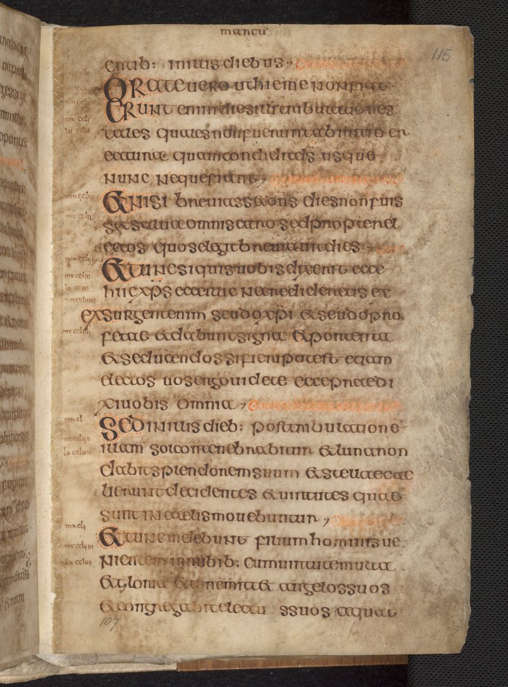
  <figcaption>Book of Durrow, fol. 115r, Mark 13:18–27 ("Orate vero ut hieme non fiat"), with red-dotted initials at the sections. Dublin, Trinity College Library, MS 57. Photo: Trinity College Dublin, Digital Collections, <a href="https://creativecommons.org/licenses/by/4.0/">CC BY 4.0</a>, via Wikimedia Commons.</figcaption>
</figure>

On the basis of Powell's findings, the commentary to the facsimile of 1960 proposed a reconstruction of the original order of the decorated leaves. One of its consequences concerns the cross-carpet page now at fol. 1v, which has been considered as the lost carpet page of Matthew rather than as a frontispiece to the whole book. The present order, followed in this entry, is that of the 1954 binding.

The book has suffered. Water damage and a hole at the upper corner of fols 208–221 are consistent with a section having been detached and dipped in water, the practice described below under Provenance. Abrasion at the beginning, the end and the edges has been attributed to the long years in a shrine that did not fit the book closely. Several decorated leaves are now inlaid in modern vellum, and their edges are sewn to it, as the photographs show.

The leaves were stitched into the present binding of half-tawed pigskin over wooden boards. The binding before it, a plain leather cover recorded at the end of the seventeenth century, had replaced the lost shrine; whatever medieval binding the book once had is unknown.

## Script and Text

The text is written in Insular majuscule, the formal script of the great Gospel books, by one scribe throughout. The letters are broad and rounded, written with a wide pen; word separation is partial; abbreviation is restrained, with the usual contractions of the sacred names. Sections begin with enlarged letters outlined in red dots, and red flourishes fill the ends of short lines.

The Gospel text is the Vulgate of Jerome. It is accompanied by the full prefatory apparatus that came with that text from Italy: Jerome's letter to Pope Damasus, *Novum opus*; the prefaces; the Eusebian canon tables, which survive in part; the *breves causae*, or chapter summaries; and the *argumenta*, the short prologues to the Gospels. The prefatory matter shows Old Latin elements, as in many Insular books.

<figure>
  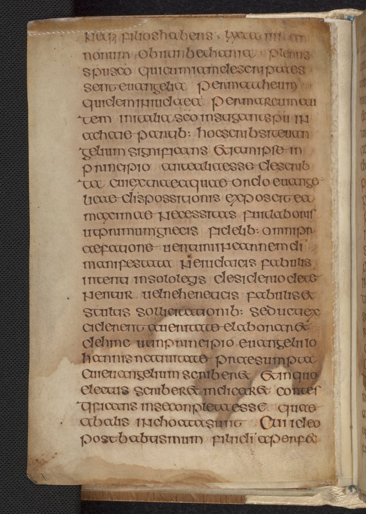
  <figcaption>Book of Durrow, fol. 18v, argumentum of Luke ("Lucas Syrus natione") in the prefatory matter. Dublin, Trinity College Library, MS 57. Photo: Trinity College Dublin, Digital Collections, <a href="https://creativecommons.org/licenses/by/4.0/">CC BY 4.0</a>, via Wikimedia Commons.</figcaption>
</figure>

The *argumenta* stand together in the prefatory matter rather than each before its own Gospel. On fol. 18v the prologue to Luke tells how Luke, after Matthew had written in Judaea and Mark in Italy, wrote his Gospel "in the regions of Achaia" at the prompting of the Holy Spirit. Like the rest of the prefatory text, it is written in the same majuscule as the Gospels, without decoration.

<figure>
  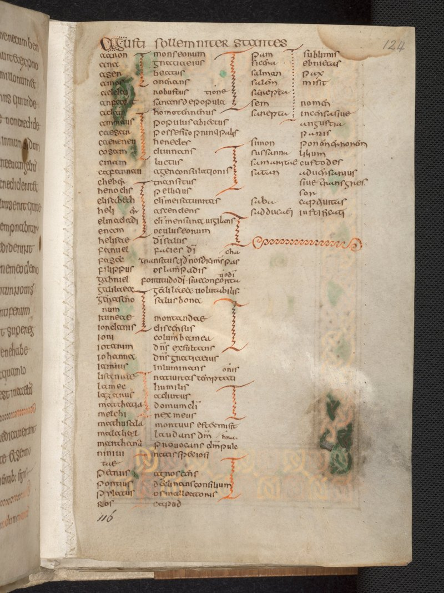
  <figcaption>Book of Durrow, fol. 124r, list of Hebrew names with their interpretations, at the end of Mark. Dublin, Trinity College Library, MS 57. Photo: Trinity College Dublin, Digital Collections, <a href="https://creativecommons.org/licenses/by/4.0/">CC BY 4.0</a>, via Wikimedia Commons.</figcaption>
</figure>

A list of Hebrew names with their meanings stands at the end of Mark, before the symbol of Luke. The names are arranged in columns with their Latin interpretations, joined by tall brackets in red and black. Behind the list, a faint border of interlace in orange and green shows through from the decorated page on the other side of the leaf.

A similar list closes the prefatory matter to Matthew on fol. 20v. The last lines of the *argumentum* end with a row of red flourishes, and the list begins below with an enlarged E, *Enom fons*, followed by names from Matthew's Gospel, among them Beelzebub, Barnabas and Cephas, each with its Latin interpretation.

<figure>
  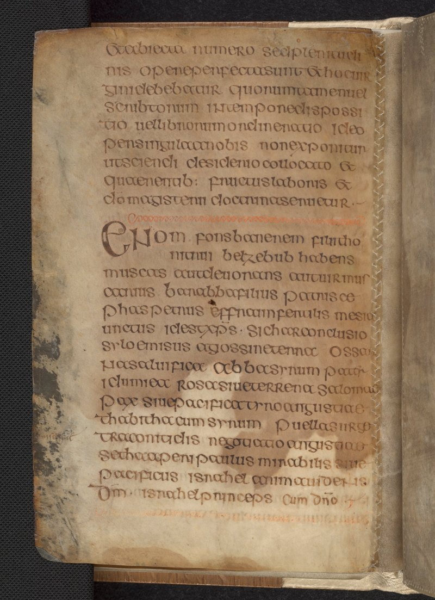
  <figcaption>Book of Durrow, fol. 20v, end of the argumentum of Matthew and beginning of the list of Hebrew names. Dublin, Trinity College Library, MS 57. Photo: Trinity College Dublin, Digital Collections, <a href="https://creativecommons.org/licenses/by/4.0/">CC BY 4.0</a>, via Wikimedia Commons.</figcaption>
</figure>

[Françoise Henry](/scholars.html#henry-francoise) contrasted the comparatively straightforward Vulgate of Durrow with the "mixed" Irish text of books such as the Book of Armagh. The contrast matters for the question of origin, since a good Vulgate text is often taken to point to the Northumbrian houses, which had access to Italian exemplars, while mixed texts are typical of Irish books. The argument is not decisive: good Vulgate texts also circulated in Ireland.

The order of the Gospels is the canonical one, Matthew, Mark, Luke, John. The order of the evangelist symbols is not. Durrow gives the eagle to Mark and the lion to John, the arrangement transmitted by Irenaeus, rather than the arrangement of Jerome, which gives the lion to Mark and the eagle to John and became normal in the West. The choice is consistent through the book, on the four-symbols page and at the openings of Mark and John, and it must have been deliberate.

## The Decorative Programme

The decoration of the book consists of eleven full-page miniatures and a series of decorated openings. The miniatures are five pages of evangelist symbols, one of them the page of the four symbols together, and six carpet pages, pages filled entirely with ornament. The decorated openings mark the beginning of the letter to Damasus and of each Gospel.

Before each Gospel the book sets out a sequence of three pages: the symbol of the evangelist, a carpet page, and the decorated opening of the text. The sequence is complete for Mark, Luke and John. Matthew now has the symbol and the opening but no carpet page; whether the cross-carpet page at the front of the book once stood there is the question raised by the reconstruction of 1960.

The palette is the same throughout: red lead, orpiment, a copper-based green, dark brown ink and the reserved vellum. What reads as gold in photographs is orpiment, a yellow arsenic sulphide whose crystals catch the light. No metal leaf is used anywhere in the manuscript.

The ornament itself belongs to three families: the spiral and trumpet patterns of Celtic metalwork; ribbon interlace and animal interlace of the kind found on Anglo-Saxon and Germanic metalwork; and step and fret patterns. On some pages one family dominates, on others two are set against each other. The carpet pages differ from one another so completely that they read almost as a catalogue of the ornamental repertoire available to a Columban painter in the later seventh century.

## The Opening Pages: Fols 1v and 2r

The book opens with a pair of facing pages: a carpet page with a cross on the left, and the four evangelist symbols around a cross on the right. Whatever their original position, the two pages now work together as a single prefatory statement: the cross as pure ornament, then the cross as the centre of the four Gospels.

<figure>
  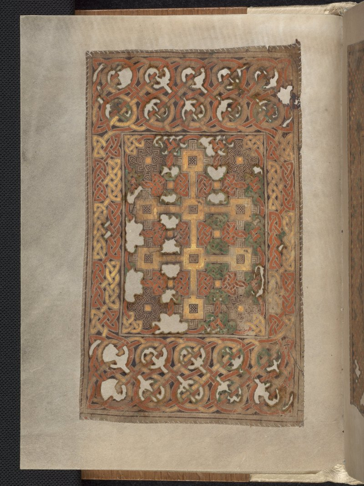
  <figcaption>Book of Durrow, fol. 1v, carpet page with a double-armed cross. Dublin, Trinity College Library, MS 57. Photo: Trinity College Dublin, Digital Collections, <a href="https://creativecommons.org/licenses/by/4.0/">CC BY 4.0</a>, via Wikimedia Commons.</figcaption>
</figure>

The carpet page on fol. 1v is built on three frames. The outer border, broad above and below and narrower at the sides, carries a chain of interlocking rings through which flat bands of red and yellow pass in regular alternation. Within it runs a narrower frame of yellow and red plaitwork, and then a fine linear border around the central field.

The field is dominated by a double-armed cross, the form often called a patriarchal cross, built not as a line but as a chain of square units in orpiment, each junction marked by a small chequered square. Around the cross the ground is filled with panels of fine interlace in red and green and passages of key pattern in grey-brown. The cross is not drawn on the ornament; it is reserved from it, defined by the density of the pattern around it.

The double-armed cross is rare in Insular art, where the ringed and equal-armed types prevail. Martin Werner made it the centre of his reading of the page: in his view it evokes the relic of the True Cross and the holy places of Jerusalem as described by Adomnán, abbot of Iona, in *De locis sanctis*. The argument, discussed below under Date and Origin, is the most precise attempt to tie the book to a place and a patron.

The page is badly damaged. Large losses of paint appear as white patches across the border and the field, most severely on the left of the cross and in the lower border. The leaf has been inlaid in modern vellum and its edges are sewn to it.

<figure>
  
  <figcaption>Book of Durrow, fol. 2r, the four evangelist symbols around a cross. Dublin, Trinity College Library, MS 57. Photo: Trinity College Dublin, Digital Collections, <a href="https://creativecommons.org/licenses/by/4.0/">CC BY 4.0</a>, via Wikimedia Commons.</figcaption>
</figure>

On fol. 2r the four symbols are disposed in the quarters of a cross whose shaft is filled with interlace. The Man stands at the upper left in a chequered cloak; the Eagle at the upper right; the Lion at the lower left, its face turned frontally to the viewer; and the Calf at the lower right, reduced to a triangle of dotted hide under a horned head. The page is one of the earliest surviving statements in Insular painting of the four symbols as a unity around the cross.

The broad border is filled with a chequer of small diamonds in red and yellow on a dark ground. The motif has long been compared with the millefiori glass and enamel set into Celtic and Anglo-Saxon metalwork, the hanging-bowl escutcheons and the purse-lid from Sutton Hoo. The field inside is left in the tone of the vellum, so that the symbols stand out in outline.

The page is more damaged than any other in the book. The paint of the field has largely gone, the border is pierced by holes, and a tear crosses the lower right quarter. Much of the colour that once filled the symbols can no longer be seen, and descriptions of their patterning rest on close study of the original and of older photographs.

## Fol. 3v and the Letter to Damasus

<figure>
  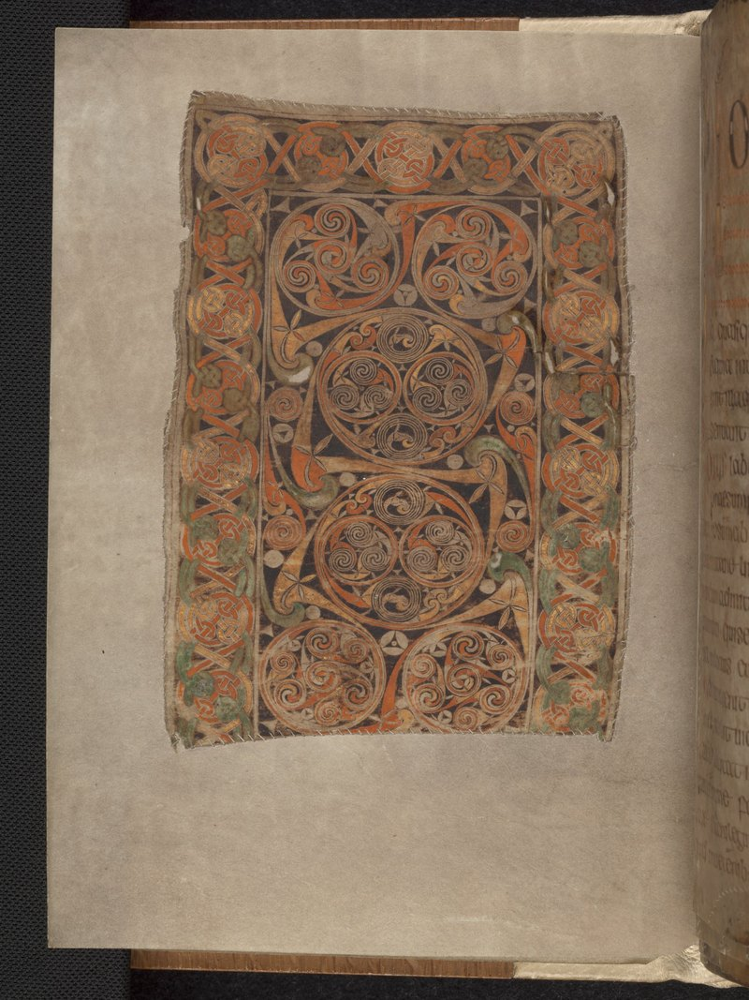
  <figcaption>Book of Durrow, fol. 3v, carpet page with spiral ornament. Dublin, Trinity College Library, MS 57. Photo: Trinity College Dublin, Digital Collections, <a href="https://creativecommons.org/licenses/by/4.0/">CC BY 4.0</a>, via Wikimedia Commons.</figcaption>
</figure>

The carpet page on fol. 3v is the book's fullest statement of the spiral style. Its central field abandons interlace for curvilinear ornament: two great circles at the centre, each filled with three smaller roundels of spirals, and four spiral roundels in the corners, all joined by broad tapering bands in orange and yellow that swell into trumpet shapes where they meet. Small lentoid and triangular fillers occupy the gaps, and at several points the bands end in green animal heads with open jaws.

The vocabulary descends from the La Tène art of Iron Age Ireland and Britain, transmitted through enamelled metalwork. The handling, however, is new: every spiral implies rotation, and the bands carry that movement from one unit to the next, so that the eye is led round the field without a resting point.

The border sets a different system against the field: a chain of interlaced roundels linked by crossing bands, regular and metrical. The contrast between the contained, measured border and the circulating field is the principle of the page.

<figure>
  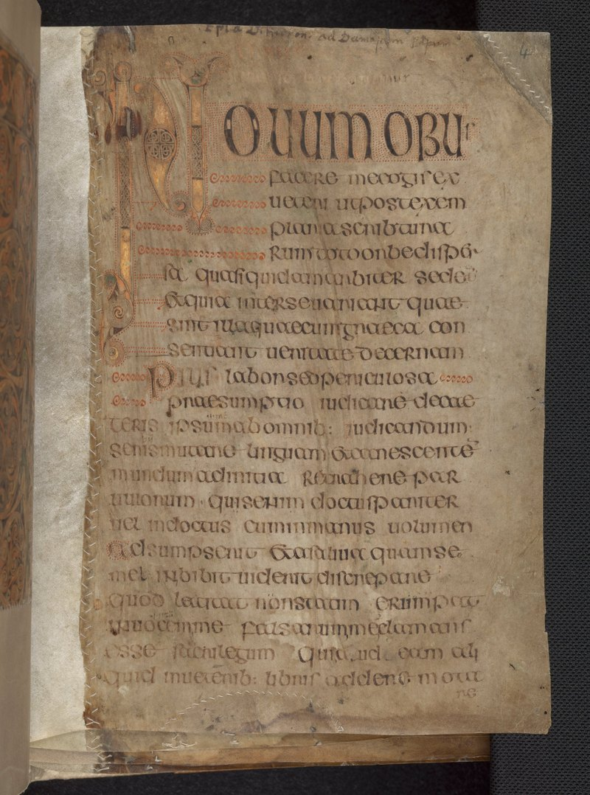
  <figcaption>Book of Durrow, fol. 4r, opening of Jerome's letter to Pope Damasus, "Novum opus". Dublin, Trinity College Library, MS 57. Photo: Trinity College Dublin, Digital Collections, <a href="https://creativecommons.org/licenses/by/4.0/">CC BY 4.0</a>, via Wikimedia Commons.</figcaption>
</figure>

Facing the spiral page, fol. 4r opens Jerome's letter to Pope Damasus, *Novum opus facere me cogis ex veteri*, the dedication that introduces the Vulgate Gospels. It is the first decorated opening of the book. The initial N stands in the left margin, its shafts filled with interlace and ending in spiral scrolls; a lobed element attached to the upper shaft carries a small roundel of interlace.

From the initial the page descends in steps of scale, the Insular principle of *diminuendo*. The following letters, OVUM OBUS, are large display capitals on a ground of red dots; the next lines are smaller; the text settles into the body script some eight lines down. Red serpentine flourishes fill the space at the start of the shorter lines. Halfway down, a smaller decorated P opens the second sentence, *Pius labor sed periculosa praesumptio*.

The hierarchy of initials is already complete on this page: a major initial, display capitals, a minor initial. Later Insular books elaborate it enormously, but do not change it. Across the upper margin a later hand has written a title identifying the text as Jerome's letter to Damasus.

## Matthew: Fols 21v and 22r

<figure>
  
  <figcaption>Book of Durrow, fol. 21v, the Man, symbol of Matthew. Dublin, Trinity College Library, MS 57. Photo: Trinity College Dublin, Digital Collections, <a href="https://creativecommons.org/licenses/by/4.0/">CC BY 4.0</a>, via Wikimedia Commons.</figcaption>
</figure>

The symbol of Matthew, the Man, stands alone in the field of fol. 21v. The page is often described as a portrait of the evangelist, but the figure carries no book, no pen and no halo; it is the man of the four living creatures, not an author portrait of the late-antique type. The true evangelist portrait enters Insular painting only with the Lindisfarne Gospels and their Mediterranean models.

The figure is strictly frontal and symmetrical. The head is drawn in outline: an oval face, almond eyes, a long straight nose, a small closed mouth, and hair falling in two straight lappets from a fringe across the brow. Below the neck the body disappears into a bell-shaped cloak that reaches almost to the ankles, filled with a chequer of small squares in red, yellow and green and with panels of fine lattice, and divided by a vertical band. No arms are shown. Beneath the hem two small feet in chequered hose and pointed shoes turn outward in profile.

The cloak has been compared with the millefiori and cloisonné of contemporary metalwork, the same repertoire as the border of fol. 2r. The frame is a broad band of yellow ribbon interlace coiling into large spirals, some of them filled with green, with small triangular fillers on a dark ground: broader and more open than the plaitwork of the carpet pages, it reads like a metal mount around the figure.

<figure>
  
  <figcaption>Book of Durrow, fol. 22r, opening of Matthew, "Liber generationis". Dublin, Trinity College Library, MS 57. Photo: Trinity College Dublin, Digital Collections, <a href="https://creativecommons.org/licenses/by/4.0/">CC BY 4.0</a>, via Wikimedia Commons.</figcaption>
</figure>

The Gospel opens on fol. 22r with *Liber generationis Iesu Christi*, "The book of the generation of Jesus Christ". The first letters, L and I, are joined in a tall initial with spiral terminals and panels of interlace; the rest of LIBER GENERA follows in display capitals on a ground of red dots. A faded red title, *Evangelium secundum Mattheum*, runs above.

The genealogy that follows is written in the regular majuscule of the book, with the names of the generations marked by enlarged letters outlined in red dots. The page shows the scheme of the openings in its simplest form: one dominant initial, one line of display capitals, then the text.

<figure>
  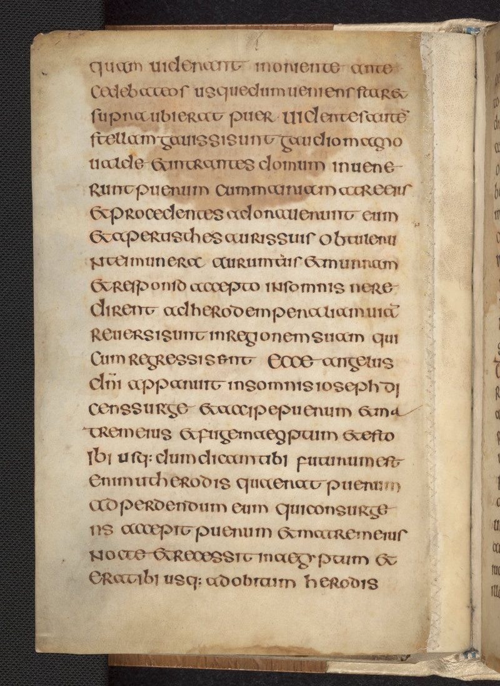
  <figcaption>Book of Durrow, fol. 24v, Matthew 2:9–15, the Magi and the flight into Egypt. Dublin, Trinity College Library, MS 57. Photo: Trinity College Dublin, Digital Collections, <a href="https://creativecommons.org/licenses/by/4.0/">CC BY 4.0</a>, via Wikimedia Commons.</figcaption>
</figure>

Fol. 24v shows the ordinary text page of the Gospels: Matthew 2:9–15, from the star standing over the place where the child was to the flight into Egypt, in twenty-two lines of majuscule without decoration. The script is broad and even, with few abbreviations; the bow of each letter is open and the stroke heavy, and the regularity of the hand over hundreds of pages is itself a measure of the scribe's training.

## Mark: Fols 84v, 85v and 86r

<figure>
  
  <figcaption>Book of Durrow, fol. 84v, the Eagle, symbol of Mark. Dublin, Trinity College Library, MS 57. Photo: Trinity College Dublin, Digital Collections, <a href="https://creativecommons.org/licenses/by/4.0/">CC BY 4.0</a>, via Wikimedia Commons.</figcaption>
</figure>

Mark is introduced by the Eagle, and with it the most consequential iconographic choice of the book. In Jerome's arrangement, which became canonical in the West, the eagle belongs to John and the lion to Mark; Durrow follows the older order transmitted by Irenaeus, in which Mark receives the eagle and John the lion. The same distribution governs fol. 2r, and it has been one of the principal arguments in the discussion of the book's textual and artistic affiliations.

The eagle stands frontally, its wings folded and hanging at its sides, its head turned in sharp profile. The head is a circle of orpiment with a green eye and a hooked beak. The body and the upper wing are covered with a dense scale pattern in red, green, yellow and reserved white, again the vocabulary of inlaid metalwork; the long flight feathers, by contrast, are drawn in fine brown hatching on the bare vellum. Two yellow legs end in splayed talons with black claws. The bird stands on nothing.

The border is broad, a regular plaitwork of flat ribbons in red and yellow, with a panel of green at each corner to mark the turn. A line of red writing, now largely faded, shows faintly in the field above the bird. The page is among the best preserved in the book.

<figure>
  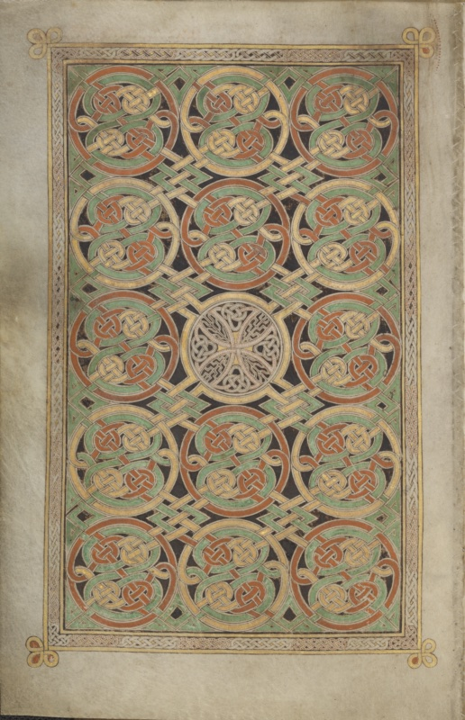
  <figcaption>Book of Durrow, fol. 85v, carpet page with interlaced rings, before Mark. Dublin, Trinity College Library, MS 57. Image: The Board of Trinity College Dublin, <a href="https://creativecommons.org/licenses/by/4.0/">CC BY 4.0</a>.</figcaption>
</figure>

The carpet page that follows, fol. 85v, faces the opening of Mark on fol. 86r. Its position in the present binding, and its facing page, show that it belongs to Mark, not to Luke.

It is the best preserved and among the most accomplished carpet pages in the book. The border is narrow, a fine plaitwork ending at each corner in a small coiled knot that projects into the margin. The field is the reverse of the eagle page: where fol. 84v has a broad border and an almost empty field, here the border is minimal and the field is full.

Fifteen large rings, alternately red and green, are set in five rows of three on a dark ground. Ribbons of yellow and white pass through each ring and tie it to its neighbours, so that the field forms a single continuous interlace rather than fifteen separate units. The alternation of red and green across the grid produces a diagonal rhythm of colour that the eye reads before the geometry.

The centre is the one interruption. In place of a coloured ring stands a pale roundel, outlined in red dots, enclosing an equal-armed cross of fine interlace. The cross is no larger than the rings around it, only quieter, and it emerges by subtraction rather than emphasis. Where fol. 1v declares its cross by mass, fol. 85v requires the viewer to resolve the field before the sign appears.

<figure>
  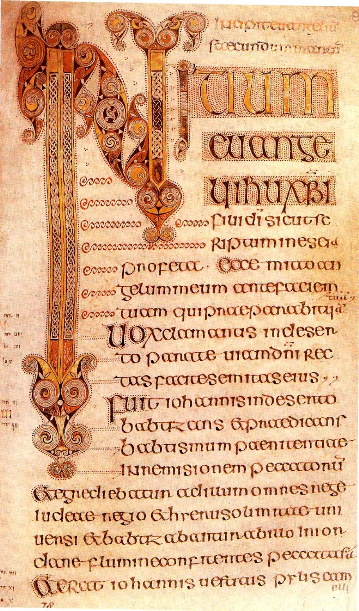
  <figcaption>Book of Durrow, fol. 86r, opening of Mark, "Initium evangelii". Dublin, Trinity College Library, MS 57. Public domain, via Wikimedia Commons.</figcaption>
</figure>

Mark opens on fol. 86r with *Initium evangelii Iesu Christi*. The first two letters, I and N, are combined in a monogram that runs down most of the left side of the page, its shafts filled with interlace and its ends swelling into spirals and trumpet patterns. The rest of the words follows in display capitals on panels of red dots, and lines of dots lead the eye from the initial to the text.

The INI monogram has a history before Durrow: it appears in an earlier form in the fragmentary Gospel book Durham, Cathedral Library, A.II.10, which is generally placed before Durrow in the development of Insular decoration. On fol. 86r it reaches a monumental scale, and it remains the model for the great openings of Lindisfarne and Kells.

The page also appears, for comparison, in the entry on the [Codex Usserianus Primus](/Content/Codex/Codex-Usserianus-Primus.html), whose single decorated page stands at the very beginning of the tradition that fol. 86r brings to maturity.

## Luke: Fols 124v, 125v and 126r

<figure>
  
  <figcaption>Book of Durrow, fol. 124v, the Calf, symbol of Luke, with the note of Conall Mageoghegan, 1633. Dublin, Trinity College Library, MS 57. Photo: Trinity College Dublin, Digital Collections, <a href="https://creativecommons.org/licenses/by/4.0/">CC BY 4.0</a>, via Wikimedia Commons.</figcaption>
</figure>

The Calf of Luke is the one symbol on which the two traditions agree. It stands in profile in the upper half of a large empty field, small in relation to the space around it, without ground line or shadow. The isolation is deliberate: the symbol is a sign, not an animal in a landscape.

The body is a pale field scattered with red dots; the head has a single large eye and small horns. At the shoulder and the haunch the joints are resolved into tight spirals in green and yellow, a device from Celtic metalwork that turns an anatomical joint into an ornamental one. The lower legs are banded in green and ochre and end in cloven hooves; the tail hangs stiff.

The frame is a broad ribbon interlace in yellow, orange-red and green. Script from the other side of the leaf shows through the field, a reminder of the thinness of the vellum.

At the foot of the page two lines in a seventeenth-century hand end with the date 1633. They belong to the notes of Conall Mageoghegan, the antiquary and translator of the Annals of Clonmacnoise, who knew the book when it was still kept in the Durrow district. His testimony about the use of the book for sick cattle is discussed below; the note on this page is a record of his own, not a description of that practice.

<figure>
  
  <figcaption>Book of Durrow, fol. 125v, carpet page before Luke. Dublin, Trinity College Library, MS 57. Photo: Trinity College Dublin, Digital Collections, <a href="https://creativecommons.org/licenses/by/4.0/">CC BY 4.0</a>, via Wikimedia Commons.</figcaption>
</figure>

The carpet page before Luke, fol. 125v, is the most architectural of the group. A border of broad ribbon interlace, outlined in red dots, runs around the whole field and ends at the corners in small knots that project beyond the rectangle.

Within, narrow plaited bands divide the field into compartments on a double axis of symmetry. The dominant element is a tall central panel of broad interlace on a dark ground, in which strands of orange, yellow, cream and green pass over and under one another, punctuated by small green nodes at the turns. Around it eight smaller panels are set in mirrored pairs, filled with ornament of an entirely different order: step patterns, lattices and star-shaped interlace drawn in fine pale line on a dark ground. Four small knots at the inner corners mediate between the two scales.

The contrast of scale is the argument of the page: the eye is drawn first to the coloured weight of the centre, then held by the almost microscopic precision of the side panels. The term carpet page, borrowed by nineteenth-century scholars from Near Eastern textiles, is misleading here as elsewhere: the closest analogues are the compartmented, chip-carved and enamelled surfaces of contemporary metalwork.

<figure>
  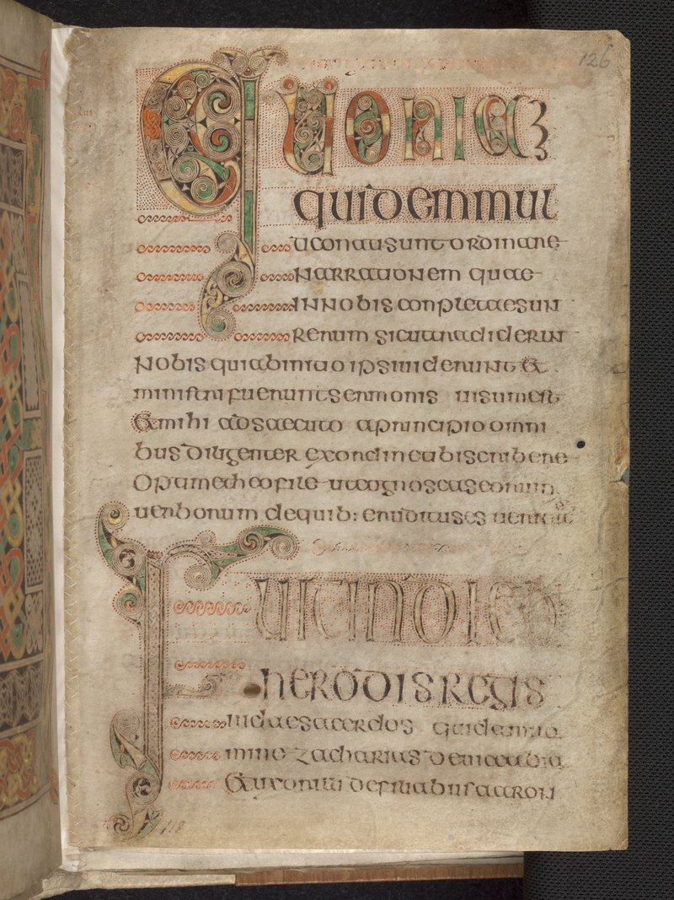
  <figcaption>Book of Durrow, fol. 126r, opening of Luke, "Quoniam quidem multi". Dublin, Trinity College Library, MS 57. Photo: Trinity College Dublin, Digital Collections, <a href="https://creativecommons.org/licenses/by/4.0/">CC BY 4.0</a>, via Wikimedia Commons.</figcaption>
</figure>

Luke opens on fol. 126r with *Quoniam quidem multi conati sunt ordinare narrationem*, the dedication to Theophilus. The page has two decorated initials: a large Q at the top, its bowl filled with spirals in green, orange and yellow, and, after ten lines of text, a tall F that opens the narrative proper, *Fuit in diebus Herodis regis*. Both are followed by display letters on fields of red dots.

The double opening marks the structure of Luke's first chapter, which begins with a preface before the story of Zacharias and Elizabeth. The scribe and painter have made the division visible with the same means used for the openings of the Gospels themselves.

## John: Fols 191v, 192v and 193r

<figure>
  
  <figcaption>Book of Durrow, fol. 191v, the Lion, symbol of John. Dublin, Trinity College Library, MS 57. Photo: Trinity College Dublin, Digital Collections, <a href="https://creativecommons.org/licenses/by/4.0/">CC BY 4.0</a>, via Wikimedia Commons.</figcaption>
</figure>

The Lion of John, the last of the symbols, completes the Irenaean scheme. It walks to the right in strict profile, with no ground line. The treatment is more energetic than that of the calf: the head is thrust forward, the jaws parted to show small pointed teeth, and the long tail rises over the back to end in a tight spiral.

The body is covered with small diamonds alternating in red and green, set within broad yellow contour bands that trace the shoulder, flank and haunch and divide the body into zones, as cloisons divide enamel. The head is reserved in the tone of the vellum and animated only by red dots, with a large yellow eye and a spiral at the ear.

The frame sets two systems against each other. Above and below, five interlaced roundels in red, yellow and green on a dark ground, like a strip of mounted plaques; at the sides, fine pale interlace dotted with red. Writing from the other side of the leaf, including lines in red, shows through the field.

<figure>
  
  <figcaption>Book of Durrow, fol. 192v, carpet page with animal interlace, before John. Dublin, Trinity College Library, MS 57. Public domain, via Wikimedia Commons.</figcaption>
</figure>

The carpet page before John, fol. 192v, is the only one built from animals. Four broad horizontal bands, two above and two below, are filled with long-bodied quadrupeds whose bodies are drawn out into ribbons and woven through one another in continuous sequence. Only the small pointed heads with round eyes, the open jaws and the spiral joints allow them to be read as animals; the eye oscillates between interlace and procession.

In the middle band two narrow vertical panels of larger, more legible animals flank a square of plain vellum. At its centre is a circle of interlace in orange, green and yellow, arranged around a small cross, with three smaller roundels of fret ornament. After the density of the bands, the circle in its empty square is a zone of quiet.

The animal ornament has long been recognised as related to the Germanic Style II of Anglo-Saxon metalwork, the style of the Sutton Hoo shoulder-clasps and purse-lid. The page is therefore central to every argument about an Anglo-Saxon element in the formation of the painter. Whether it indicates production in Northumbria, or the circulation of metalwork models within the Columban network, remains open.

The yellow of this page glitters in high-resolution photographs and has sometimes been described as gold. It is orpiment, the same pigment as on every other page; no metal is used here or anywhere else in the book. Four delicate animal terminals in fine line, with little colour, extend from the corners of the frame into the margin.

<figure>
  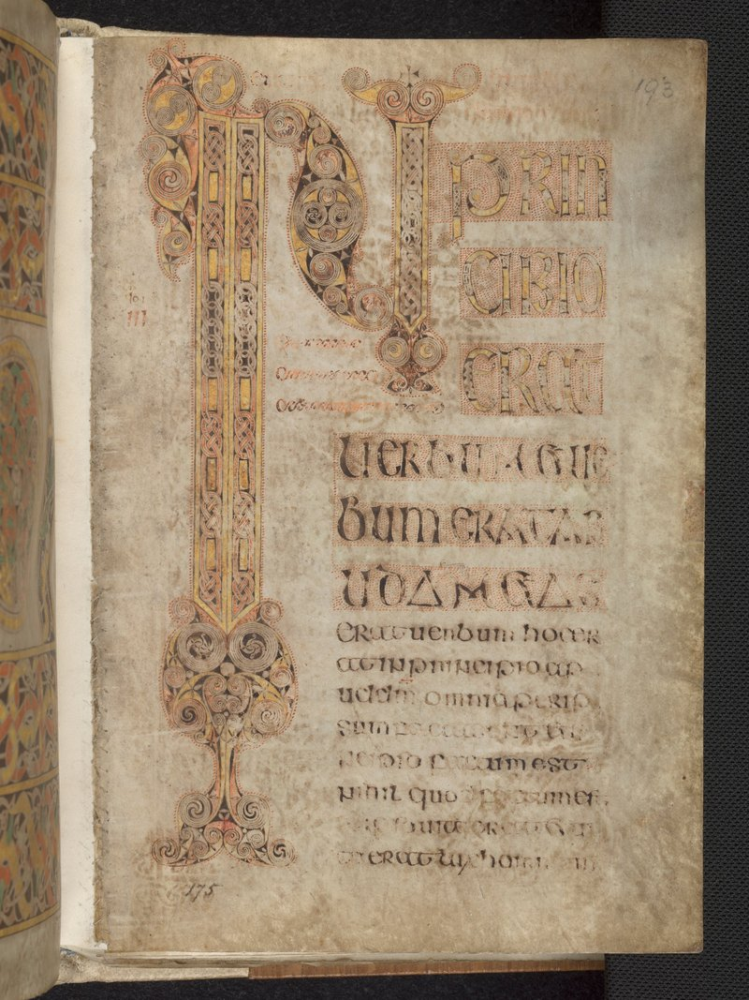
  <figcaption>Book of Durrow, fol. 193r, opening of John, "In principio erat verbum". Dublin, Trinity College Library, MS 57. Photo: Trinity College Dublin, Digital Collections, <a href="https://creativecommons.org/licenses/by/4.0/">CC BY 4.0</a>, via Wikimedia Commons.</figcaption>
</figure>

John opens on fol. 193r with *In principio erat verbum*. The initial I and N are again combined into a monogram, here the tallest initial in the book, running almost the full height of the written area; the shafts are filled with interlace, and the ends burst into clusters of spirals. The display letters PRIN CIPIO ERAT follow in three panels of red dots, then VERBUM ET VERBUM ERAT APUD DEUM in two more lines, before the text settles into the body script.

Of the four Gospel openings, this is the most monumental, and it stands opposite the most elaborate carpet page. The sequence of John, lion, animal carpet page and great initial, forms the climax of the decorative programme.

## The Last Carpet Page: Fol. 248r

<figure>
  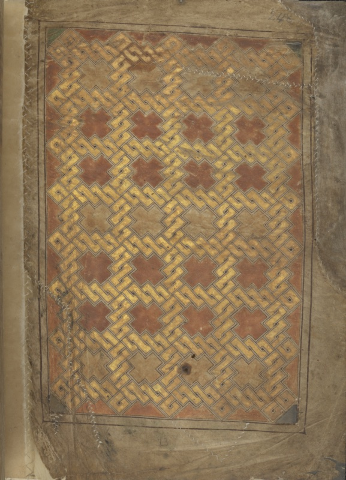
  <figcaption>Book of Durrow, fol. 248r, carpet page with step-fret pattern. Dublin, Trinity College Library, MS 57. Image: The Board of Trinity College Dublin, <a href="https://creativecommons.org/licenses/by/4.0/">CC BY 4.0</a>.</figcaption>
</figure>

The book ends with a carpet page that has nothing after it. The others are thresholds between a symbol and a text; this one is terminal, an ornamental seal on the completed book. It stands on a recto, reached from the end of John on the facing verso.

The design is the most severe in the manuscript. The whole field is filled with a single continuous step-fret pattern, built entirely of straight lines. Broad yellow bands, separated by narrow reserved channels, interlock in a diagonal lattice over a brownish-red ground, leaving small stepped crosses and lozenges at regular intervals. The eye can follow a band for a short distance before losing it; the pattern reverses constantly between yellow lattice and red crosses.

There is no border apparatus: only a plain ruled line encloses the field. Whether this austerity is a choice suited to a closing page or a consequence of the position of the leaf cannot be decided. The leaf is the outermost of the book and has suffered accordingly: the pigment is worn thin, the vellum abraded and discoloured, and the edges repaired.

Fret patterns of exactly this kind appear on Irish and Anglo-Saxon metalwork, on escutcheons, mounts and shrine plates. As on the other carpet pages, the painter has translated into pigment a vocabulary first developed in metal.

## Palette and Technique

Non-invasive analysis by Raman spectroscopy has identified the pigments of the book. The study of three early Trinity manuscripts, the Codex Usserianus Primus, the Book of Durrow and the Book of Armagh, was published in *Making Histories*, the proceedings of the sixth International Conference on Insular Art (York, 2011; published 2013). The red is red lead, the yellow orpiment, the green a copper-based pigment, and the black and brown iron-gall ink; what reads as black in the backgrounds is in fact a dark brown.

No blue, no white pigment and no gold have been found. White is the reserved vellum, and pink effects are obtained with red dots over bare vellum. The palette was confirmed by the Durham study of the earliest Northumbrian manuscripts by Andrew Beeby, Richard Gameson and colleagues (*Scriptorium* 69, 2015), which uses Durrow as a point of comparison.

The contrast with the Book of Kells is instructive. The Raman study of Kells published in 2009 identified, besides red lead, orpiment and a copper green, indigo, gypsum white and an organic purple. Durrow uses essentially three mineral pigments with ink and vellum. The difference measures how far the resources of an Insular scriptorium grew in the century or more between the two books.

Technically, the paint is laid flat, without modelling or gradation; contours are drawn in dark ink and often accompanied by rows of red dots. The precision of the interlace, in which every strand passes alternately over and under, implies careful preliminary layout of each page before any colour was applied.

## Sources of the Ornament

The ornament of Durrow draws on at least three traditions, and the combination is the book's distinctive achievement.

The spirals, trumpet patterns and triskeles of fols 3v, 86r, 126r and 193r descend from the La Tène art of Iron Age Ireland and Britain, transmitted through enamelled metalwork such as the escutcheons of hanging bowls. The animal interlace of fol. 192v belongs to the Germanic Style II of Anglo-Saxon metalwork, the style of Sutton Hoo. The chequered cloak of the Man and the diamond border of fol. 2r translate the millefiori and cloisonné inlay common to both.

Behind the book as a whole stands a fourth source, the Mediterranean Gospel book. The text, the prefaces, the canon tables and the evangelist symbols came to the Insular world from Italy, and some designs, the carpet page itself and certain interlaced patterns, have parallels in Coptic and other Eastern Mediterranean books. Pictish sculpture in Scotland offers parallels for some of the animals, which raises the question, still unresolved, of which came first.

In the developmental account set out by Alexander and others, Durrow follows the Cathach of St Columba, of about 600, with its first enlarged and diminishing initials, and the fragmentary Durham Gospel book A.II.10, with an early INI monogram; and it precedes the Durham Gospels A.II.17, the Echternach Gospels and the Lindisfarne Gospels. Durrow's interlace is larger and less minutely detailed than that of Lindisfarne, and the extreme detail of the later books begins with it.

## Date and Origin

The book has no datable colophon and no radiocarbon date. The question of when and where it was made turns entirely on palaeography, ornament, textual affiliation and historical inference, and it has been answered in at least three ways.

The traditional answer is Ireland, perhaps Durrow itself. It rests on the later provenance, the colophon naming Columba and the shrine of the tenth century. [Carl Nordenfalk](/scholars.html#nordenfalk-carl), in "Before the Book of Durrow" (*Acta Archaeologica* 18, 1947), traced the Irish antecedents of its decoration. Bernard Meehan, in the monograph of 1996, stresses the book's ancient association with Durrow and the Columban connections, and explains the eclecticism of its ornament by the wide contacts of the Columban houses.

A second answer is Iona. [Martin Werner](/scholars.html#werner-martin), in "The cross-carpet page in the Book of Durrow: the cult of the True Cross, Adomnán, and Iona" (*The Art Bulletin* 72, 1990, pp. 174–223), argued that fols 1v and 2r were designed to evoke the holy places of Jerusalem as described in Adomnán's *De locis sanctis*, and proposed an origin at Iona about 685. In "The Book of Durrow and the question of programme" (*Anglo-Saxon England* 26, 1997, pp. 23–39) he maintained that the book was very probably sponsored by Adomnán, abbot of Iona, between 682 and 686. It is the most precisely argued position, and it rests on an iconographic reading that not all scholars accept.

The third answer is Northumbria. [François Masai](/scholars.html#masai-francois), in his *Essai sur les origines de la miniature dite irlandaise* (Brussels, 1947), argued for a Northumbrian, Lindisfarne origin of the major Insular books, Durrow among them. Others, without going so far, have pointed to the Anglo-Saxon animal ornament of fol. 192v and to the quality of the Vulgate text.

Alexander, in *Insular Manuscripts, 6th to the 9th Century* (1978, no. 6), summarised the field: a date between the Durham Gospel fragment and the Lindisfarne Gospels, in the middle of the second half of the seventh century, seemed most probable; the provenance and the colophon support a Columban origin in Ireland or Iona, while textual and palaeographical evidence is adduced by those who favour Northumbria, who also tend to a slightly later date, about 680.

The evidence does not decide between these places, and the mobility of scribes, painters and books within the Columban federation may make a single place of birth the wrong question. The most defensible formulation remains a Columban origin in the second half of the seventh century, in Ireland, Iona or Northumbria. Some recent accounts, including the review of Meehan's book in the *Irish Times*, move the date to the late seventh or early eighth century.

## The Colophon

Near the end of the book, on fol. 247v, a subscription asks the reader to remember Columba the scribe, who wrote the Gospel in the space of twelve days. In the usual reading it is addressed to a priest Patrick. The text has been partly erased and written over, and at some point it was altered so as to imply that the writer was Colum Cille himself.

The claim cannot be accepted. Columba died in 597, a century or so before the probable date of the book, and twelve days is a plausible span for copying a single Gospel, not four Gospels with their decoration. The subscription is best explained as copied from an exemplar, perhaps one attributed to the saint, and later adapted to make the book a relic of the founder. Similar colophons occur in other Irish books, among them the [Book of Mulling](/Content/Codex/Book-of-Mulling.html).

The subscription has been studied by [David Howlett](/scholars.html#howlett-david), "The colophon in the Book of Durrow" (*Hermathena* 168, 2000). Its exact folio is sometimes given as 247r; the reference here follows the present foliation.

Other additions record the later life of the book. On the last leaf, fol. 248v, a memorandum of about 1100 records a transaction concerning land and the church of Durrow; it has been studied by Edel Bhreathnach (2015). A reading for Pentecost, Acts 2:1–4, was added in the twelfth century on a page left blank, fol. 192r. The note of Conall Mageoghegan, dated 1633, stands on fol. 124v.

## Provenance

By the early tenth century the book was at Durrow and was venerated as a relic of Colum Cille. Flann Sinna, of the southern Uí Néill, high-king of Ireland from 877 to 916, had a silver shrine, or *cumdach*, made for it: the earliest Irish book-shrine of which there is a record. The shrine itself is lost.

What is known of it comes from the antiquary Roderick O'Flaherty, who described it in 1677 in a note now bound into the book. He recorded a silver cross on the shrine, with the name of the craftsman on one arm and, on the shaft, an inscription invoking the blessing of Colum Cille on King Flann, who had the cover made.

The book remained at Durrow through the Middle Ages. After the reform of the Irish church in the twelfth century the site was served by Augustinian canons; after the Reformation the book passed into private keeping. Conall Mageoghegan reported in 1627 that its keeper, "the ignorant man that had same in his custody", used to put it in water and give the water to sick cattle as a cure. The water damage of fols 208–221 is consistent with the practice. James Ussher, as bishop of Meath (1621–1623), knew the book and distinguished the two "gospels of St Colum Cille" as the books now called Kells and Durrow.

Henry Jones, bishop of Meath from 1661 to 1682 and vice-chancellor of Trinity College, gave the book, with the Book of Kells, to the College Library. In 1689, during the military occupation of Trinity College under James II, it lost its shrine. By the end of the century it had only a plain leather cover. It has remained in the Library since, and was rebound by Roger Powell in 1954.

## Historiography

From the nineteenth century the book was celebrated as a monument of Irish Christian art, and for much of the twentieth century its study was shaped by the question of national origin. Masai's *Essai* of 1947 argued for Northumbria; [Françoise Henry](/scholars.html#henry-francoise), in her studies of Irish art, and Nordenfalk defended an Irish or Columban origin. The term "Insular", rather than "Irish" or "Hiberno-Saxon", came into use partly to leave that question open.

The facsimile of 1960, published by Urs Graf with a commentary edited by A. A. Luce and contributions by G. O. Simms, P. Meyer and L. Bieler, made the whole book available in colour for the first time, and proposed a reconstruction of its original order on the basis of Powell's findings.

[George Henderson](/scholars.html#henderson-george-david-smith)'s *From Durrow to Kells: The Insular Gospel-Books, 650–800* (1987) changed the register of the discussion. Instead of treating the great Gospel books as stages on a single road from simple to elaborate ornament, it read each of them as a distinct project, answering to the text it transmits: why a carpet page precedes one opening and not another, why the symbols follow one order rather than another, why an initial grows or shrinks. Werner's work on the programme of fols 1v and 2r belongs to the same turn toward meaning.

Bernard Meehan's monograph of 1996, written from Trinity College, brought together the codicological evidence, the history of the book and its decoration, and is the standard introduction. Since then, scientific analysis of the pigments and the full digitisation of the manuscript have added new kinds of evidence. More recent scholarship tends to think of the Columban houses as a network in which books and craftsmen moved, rather than as rival national centres.

## Editions and Reproductions

The book has never been edited as a text in its own right; its readings are cited in the critical editions of the Vulgate Gospels. It is described by Lowe in *Codices Latini Antiquiores* (CLA II, no. 273) and by Alexander in *Insular Manuscripts, 6th to the 9th Century* (1978, no. 6, p. 30).

The facsimile, *Evangeliorum quattuor Codex Durmachensis* (Olten and Lausanne: Urs Graf, 1960), reproduces the whole manuscript, with a volume of commentary edited by A. A. Luce.

The whole manuscript is available in Trinity College's Digital Collections in high-resolution colour photographs, published under a Creative Commons Attribution licence. Many of the images are also on Wikimedia Commons, from which the illustrations of this entry are taken.

## Catalogue Entry

**Shelfmark:** Dublin, Trinity College Library, MS 57 (olim A.4.5).

**Sigla:** CLA II, no. 273; Alexander no. 6.

**Contents:** The four Gospels in the Vulgate, with Jerome's letter to Damasus (*Novum opus*), prefaces, canon tables, *breves causae*, *argumenta* and a list of Hebrew names; later additions: colophon (fol. 247v), Pentecost lection (fol. 192r), memorandum of about 1100 (fol. 248v), notes of 1633 (fol. 124v) and of 1677 (bound in).

**Date and origin:** Second half of the seventh century; Ireland, Iona or Northumbria, within the Columban network. Iona, c. 682–686 (Werner).

**Material and format:** Vellum, 248 leaves, about 245 × 145 mm, trimmed; many singletons; layout partly in two columns, 25 lines.

**Script:** Insular majuscule, one scribe.

**Decoration:** Carpet pages fols 1v, 3v, 85v, 125v, 192v, 248r; four-symbols page fol. 2r; evangelist symbols fols 21v (Man), 84v (Eagle), 124v (Calf), 191v (Lion), in the Irenaean order; decorated openings fols 4r, 22r, 86r, 126r, 193r. Pigments: red lead, orpiment, copper green, iron-gall ink.

**Provenance:** Durrow by the early tenth century; shrine made for Flann Sinna (877–916), lost 1689; given to Trinity College by Henry Jones, bishop of Meath, 1661–1682.

**Binding:** Roger Powell, 1954.

**Bibliography:** E. A. Lowe, *Codices Latini Antiquiores*, II, 1935 (2nd ed. 1972), no. 273; C. Nordenfalk, "Before the Book of Durrow", *Acta Archaeologica* 18, 1947, pp. 141–174; F. Masai, *Essai sur les origines de la miniature dite irlandaise*, 1947; R. Powell, "The Book of Kells, the Book of Durrow: comments on the vellum, the make-up and other aspects", *Scriptorium* 10, 1956, pp. 3–21; A. A. Luce et al., *Evangeliorum quattuor Codex Durmachensis*, 1960; J. J. G. Alexander, *Insular Manuscripts, 6th to the 9th Century*, 1978, no. 6; G. Henderson, *From Durrow to Kells: The Insular Gospel-Books, 650–800*, 1987; M. Werner, "The cross-carpet page in the Book of Durrow: the cult of the True Cross, Adomnán, and Iona", *The Art Bulletin* 72, 1990, pp. 174–223; B. Meehan, *The Book of Durrow: A Medieval Masterpiece at Trinity College Dublin*, 1996; M. Werner, "The Book of Durrow and the question of programme", *Anglo-Saxon England* 26, 1997, pp. 23–39; D. Howlett, "The colophon in the Book of Durrow", *Hermathena* 168, 2000; non-invasive analysis of the Codex Usserianus Primus, the Book of Durrow and the Book of Armagh, in J. Hawkes (ed.), *Making Histories*, 2013, pp. 42–49; E. Bhreathnach, on the Durrow memorandum, 2015; A. Beeby, R. Gameson et al., "Pigments of the earliest Northumbrian manuscripts", *Scriptorium* 69, 2015, pp. 33–59.
