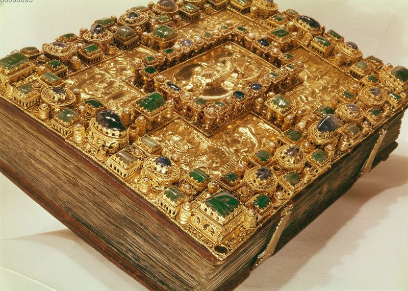

## The Book

The *Codex Aureus of Saint Emmeram* is a Gospel book made for Charles the Bald, king of the West Franks, and completed in 870 according to its colophon. It contains the four Gospels in Latin, preceded by the prefaces of Jerome and the canon tables of Eusebius, and it is written from beginning to end in gold. Its 126 leaves measure about 420 × 330 mm, and every page of text is enclosed in a painted frame. It is one of the largest and richest books of the Carolingian age, and it still has its original cover of gold, gems and pearls.

The name "Codex Aureus", the golden book, refers to its script. The text is written in uncial letters in gold ink on ordinary parchment. The book is often described as written on purple vellum, but this is wrong: purple appears only as painted grounds on some decorated pages, such as the panels of verse on the page of Charles the Bald. The effect of gold on white parchment, framed by bands of ornament on every page, is lighter and brighter than that of the purple codices of late antiquity and the court of Charlemagne.

The decoration consists of seven full-page miniatures, twelve canon tables and a series of decorated incipit and initial pages. The miniatures are the portrait of Charles the Bald enthroned, the Adoration of the Lamb, Christ in Majesty, and the four evangelists. The incipit pages open the prefaces and the Gospels with great initials and lines of display capitals in gold. The book thus follows the sequence of a Carolingian Gospel book, but with a prefatory cycle that places the ruler before the heavenly court.

The book takes its name from the abbey of Saint Emmeram in Regensburg, in Bavaria, which owned it for more than nine centuries. It came there in the 890s as a gift of Arnulf of Carinthia, king of East Francia and later emperor. After the secularisation of the Bavarian monasteries, it entered the court library in Munich in 1811, and it is now in the Bayerische Staatsbibliothek as Clm 14000, the first number of the series of manuscripts from Saint Emmeram.

The colophon at the end of the book names its scribes, Liuthard and Beringar, and gives the year of its completion. The same Liuthard wrote the Psalter of Charles the Bald, now in Paris, and the books associated with him are grouped by modern scholars as the court school of Charles the Bald. The Codex Aureus is the most ambitious work of this group, and its decoration gathers motifs from all the earlier schools of Carolingian painting.

The book has been discussed above all for three reasons: the portrait of the king, one of the principal images of Carolingian kingship; the cover, one of the few surviving treasure bindings of the ninth century; and its history after Charles the Bald, which made it a model for the painters of Ottonian Regensburg. Each of these has its own literature, from the monograph of Colomann Sanftl in 1786 to the volumes of [Wilhelm Koehler](/scholars.html#koehler-wilhelm) and [Florentine Mütherich](/scholars.html#mutherich-florentine) on the court school of Charles the Bald.

## Charles the Bald and His Court School

Charles the Bald was born in 823, the son of the emperor Louis the Pious and of his second wife, Judith. After the civil wars between the sons of Louis, the treaty of Verdun of 843 gave him the western part of the Frankish empire. He ruled as king of West Francia until 875, when he was crowned emperor in Rome; he died in 877, on his return from a second expedition to Italy. The year in which the Codex Aureus was finished, 870, is also the year of the treaty of Meerssen, by which Charles and his brother Louis the German divided the kingdom of their nephew Lothar II.

Charles was a patron of learning and of luxury art on a large scale. Scholars such as John Scottus Eriugena and Hincmar of Reims wrote for him; manuscripts were dedicated to him from the abbeys of Tours, Reims and Saint-Amand; and he commissioned books, ivories and goldsmiths' work for his own chapel and for the churches he favoured. The First Bible of Charles the Bald, made at Tours about 845, and the Bible of San Paolo fuori le Mura, made later in his reign, both include a portrait of him enthroned.

The books made for Charles in the last decade of his reign are grouped as the court school of Charles the Bald, or the Liuthard group, after the scribe named in two of them. Besides the Codex Aureus, the group includes the Psalter of Charles the Bald (Paris, Bibliothèque nationale de France, lat. 1152), written by Liuthard, and the fragment of a sacramentary (Paris, BnF lat. 1141), with related ivories and goldsmiths' works. The upper cover of the Lindau Gospels in New York and the ciborium of Arnulf in Munich are usually assigned to the same circle.

The place where these books were made is not recorded. Saint-Denis, near Paris, of which Charles became lay abbot in 867 and where he chose to be buried, is the most often proposed. Other scholars have suggested Compiègne, the palace Charles rebuilt as his principal residence, or the abbey of Saint-Médard at Soissons, or a workshop that followed the court. The Codex Aureus itself names no place.

The style of the court school is a synthesis. The figures, with their nervous, flickering outlines and agitated drapery, come from the school of Reims, of the Ebbo Gospels and the Utrecht Psalter. The large compositions with many figures recall the Bibles of Tours, and the acanthus borders the school of Metz. The great interlace initials of the incipit pages come from the Franco-Saxon books of northern France, which continued Insular ornament. The painters of Charles the Bald brought these traditions together in a deliberate display of the full range of Carolingian art.

The result has been described as a court art in the strict sense: a style created for the king, using the resources of the whole kingdom. The Codex Aureus is the summit of this art. Its scale, its gold script, its seven miniatures and its jewelled cover make it a royal object, and its images place the king at the centre of a vision that runs from his throne to the throne of God.

## Liuthard, Beringar and the Making of the Book

The colophon, written on the last leaf of the book, fol. 126, is a poem of twelve lines in elegiac couplets. It gives the date, names the king and the scribes, and asks the reader for a prayer. It is edited by Ludwig Traube in the third volume of the *Poetae Latini aevi Carolini* of the Monumenta Germaniae Historica:

Bis quadringenti volitant et septuaginta 
Anni, quo deus est virgine natus homo. 
Ter denis annis Karolus regnabat et uno, 
Cum codex actus illius imperio. 
Hactenus undosum calamo descripsimus aequor, 
Litoris ad finem nostra carina manet. 
Sanguine nos uno patris matrisque creati, 
Atque sacerdotis servat uterque gradum. 
En Beringarius, Liuthardus nomine dicti, 
Quis fuerat sudor difficilisque nimis. 
Hic tibimet, lector, succedant verba precantis, 
Ut dicas: capiant regna beata dei.
{: .quote-latin}

Twice four hundred and seventy years have flown by 
since God was born a man of the Virgin. 
For thrice ten years and one Charles had been reigning 
when this codex was made at his command. 
Thus far with the pen we have written our way across the billowy sea; 
our ship now rests at the end of the shore. 
Born of one blood, of the same father and mother, 
each of us holds the rank of priest. 
Behold, Beringar and Liuthard by name, 
whose labour it was, and exceedingly hard. 
Here, reader, may the words of one who prays come to you, 
so that you say: may they gain the blessed kingdoms of God.
{: .quote-translation}

The two scribes were therefore brothers by blood, sons of the same father and mother, and both were priests. Liuthard is known also from the colophon of the Psalter of Charles the Bald, which he wrote in gold; nothing else is known of Beringar. The image of the scribe as a sailor who reaches the shore at the end of his voyage is a commonplace of medieval colophons, and the request for the prayers of the reader is the usual close of such texts.

The colophon gives the year of the completion of the book as 870, *bis quadringenti et septuaginta*, and the thirty-first year of the reign of Charles, counted from the death of his father Louis the Pious in 840. It was five years before his imperial coronation. The date is one of the reasons why the codex is the anchor of the chronology of the court school: the other books of the group are dated in relation to it.

The colophon is one of a series of poems written in the book. Traube edited eleven of them together, from the verses around the portrait of the king on fol. 5v to the colophon on fol. 126, under the title *Bibliothecarum et psalteriorum versus IV*. They accompany the miniatures, the verse pages that precede each Gospel and the emblems of the incipit pages. As Traube showed, several lines are taken or adapted from poems written by Alcuin for a Bible of the court of Charlemagne, among them the opening of the colophon and parts of the verses of the Lamb and of Christ in Majesty: the poets of Charles the Bald borrowed the words of the court of his grandfather as his painters borrowed its images.

The script is a large, regular uncial written in gold, the script of the luxury books of late antiquity. In the Carolingian period uncial and capital scripts were reserved for titles, headings and the most solemn books, while the ordinary script was the Caroline minuscule. The choice of uncial for the whole text of the Gospels, and of gold for every letter, placed the book in the tradition of the imperial manuscripts of Rome and Byzantium, and of the Gospel books of the court of Charlemagne.

Every page of text is framed by a painted border, and the borders vary from page to page: acanthus, palmettes, meanders, rosettes and bands of jewels. This continuous framing is one of the features that distinguish the book. It turns each opening into a decorated object and makes the reading of the whole book a passage through ornament.

The miniatures and the decorated pages were painted by artists whose names are not recorded. The colophon names the scribes only. The relationship between the scribes and the painters, and the number of painters involved, have been discussed in the scholarship, and the attribution of the painting to Liuthard himself is not supported by any source.

The materials of the book were costly: a large number of skins of good parchment, a great quantity of gold for the script and the painting, and pigments that include blues, greens, reds and purples. The analysis of the pigments has not been published in a form that allows specific statements; the claim, repeated in some descriptions, that lapis lazuli was used in the book or its cover, is not supported by the published evidence.

## The Gold Cover

The book still has its original front cover of gold. At the centre, in a raised frame of gems and pearls, Christ sits in Majesty, holding an open book, in repoussé relief. Around him four panels show the four evangelists writing, and four further panels show scenes from the Gospels: Christ and the woman taken in adultery, the expulsion of the money-changers from the Temple, the healing of a blind man and the healing of a leper. The outer frame is set with large sapphires and emeralds and with pearls, in settings raised on small arcades.

The cover is one of the very few treasure bindings of the ninth century to survive. It is usually attributed to the same workshop as the upper cover of the Lindau Gospels in the Morgan Library and the ciborium of Arnulf in the Schatzkammer of the Munich Residenz, and with them it forms the principal group of the goldsmiths' work of the court of Charles the Bald. [Otto Karl Werckmeister](/scholars.html#werckmeister-otto-karl) devoted a monograph to it in 1963.

In the eleventh century the cover was described by Arnold, a monk of Saint Emmeram, in his book on the miracles of the patron saint. He mentions the hundreds of stones, the four large stones raised on chalice-shaped settings to form a cross, the inner frame of thirty-two settings and the outer frame of larger stones in settings shaped like castles. According to Karl-Georg Pfändtner, the number of settings still corresponds to this description, and the cover has changed only marginally since the eleventh century.

The cover belongs to the meaning of the book. Christ in Majesty on the outside corresponds to Christ in Majesty inside, on fol. 6v, and the evangelists of the cover to the evangelists of the miniatures. The four scenes on the cover, all of them encounters between Christ and the sinful or the sick, show his mercy and his authority, and they have been related by some scholars to the duties of the Christian king. The gold and the gems made the book a relic-like object, displayed on the altar on feast days.

## From Charles the Bald to Arnulf and Saint Emmeram

The published version of this entry stated that Charles the Bald gave the book to Arnulf of Carinthia. This is impossible. Charles died in 877; Arnulf, an illegitimate son of King Carloman of Bavaria, became king of East Francia only in 887, after the deposition of Charles the Fat, and emperor in 896. The two men were never in a position to exchange royal gifts, and no source suggests that they did.

How the book left the West Frankish kingdom is not known. It may have remained at Saint-Denis after the death of Charles and been removed from the treasury in the troubled years of the Viking invasions; it may have passed to Charles the Fat, who briefly reunited the empire between 884 and 887, and then to Arnulf; or it may have come to Arnulf as a gift or as booty. The ciborium of Arnulf, which belongs to the same circle of goldsmiths' work, came to Regensburg by a similar unknown route.

According to sources of the eleventh century, Arnulf gave the book to the abbey of Saint Emmeram in Regensburg, where he had his principal residence. The gift is placed in the 890s, under Tuto, bishop of Regensburg and abbot of Saint Emmeram. Arnulf died in 899 and was buried at Saint Emmeram, and the book and the ciborium were remembered there as gifts of the emperor.

At Saint Emmeram the book became part of the treasure of the abbey and of the cult of its patron, the seventh-century bishop and martyr Emmeram. Arnold's description of the cover is part of a miracle story, in which the book is presented as a precious possession of the saint. It was preserved as a royal and sacred object, displayed and used on solemn occasions.

## Ramwold and the Regensburg Restoration

In the last quarter of the tenth century, under Abbot Ramwold (975–1000), the book was restored at Saint Emmeram. Ramwold was the first abbot of the reformed community after its separation from the bishopric of Regensburg, and he made the abbey a centre of learning and book production. The restoration of the codex is recorded in verses added to the book, which name the monks who carried it out.

The restoration made the Codex Aureus a model for the painters of Regensburg. The Uta Codex, made for the abbess Uta of Niedermünster in the early eleventh century, and the Sacramentary of Henry II, made at Regensburg between 1002 and 1014, adopt motifs from it. The portrait of Henry II in the sacramentary in particular follows the scheme of the throne image of Charles the Bald. The Carolingian book thus entered the formation of Ottonian art in Bavaria.

Florentine Mütherich and other scholars have shown how closely the Regensburg painters studied the codex. The borders, the jewelled frames and the arrangement of the prefatory pages were reused, and the image of the Carolingian king became a model for the image of the Ottonian and Salian emperors. The book given by Arnulf thus served as a link between the court art of Charles the Bald and the imperial art of the eleventh century.

## Sanftl, Munich and Modern Scholarship

In 1786 Colomann Sanftl, librarian of Saint Emmeram, published a *Dissertatio* on the codex, with engravings of its miniatures. It is one of the earliest monographs devoted to a single medieval manuscript, and it shows how the book was valued as a monument of the history of the abbey and of the empire before the secularisation.

In 1803 the Bavarian monasteries were dissolved, and the libraries of Saint Emmeram passed to the state. The Codex Aureus entered the court library in Munich in 1811 and received the shelfmark Clm 14000. It has been one of the principal treasures of the Bayerische Staatsbibliothek ever since, shown in its exhibitions of the history of the library and of luxury bindings.

Georg Leidinger published a facsimile in six volumes between 1921 and 1925, and later facsimiles and the digital copy of the library have made the book widely accessible. Wilhelm Koehler and Florentine Mütherich treated it in the fifth volume of *Die karolingischen Miniaturen*, devoted to the court school of Charles the Bald (1982), and Mütherich and Joachim Gaehde included it in their survey of Carolingian painting (1976). Elisabeth Wunderle described it in the catalogue of the Latin manuscripts of Saint Emmeram (1995). The verses of the book were edited by Ludwig Traube in 1896 in the third volume of the *Poetae Latini aevi Carolini*, pp. 252–254, with the indication of their place in the codex and of their sources in Alcuin and Sedulius.

The portrait of Charles has a literature of its own, in studies of Carolingian kingship and its images by [William Diebold](/scholars.html#diebold-william), [Herbert Kessler](/scholars.html#kessler-herbert-leon), Paul Dutton and others, which compare it with the portraits of the king in the Bibles of Tours and of San Paolo. Readings that relate the images to the theology of John Scottus Eriugena, or interpret the book as an expression of a doctrine of the king as image of Christ, are hypotheses, discussed in the scholarship but not documented by the book itself.

## Catalogue Entry

The figures that follow are taken from the digital copy of the Bayerische Staatsbibliothek. Folio numbers follow the foliation written in the upper right corner of the rectos.

### The Front Cover

<figure>
  
  <figcaption>Front cover with Christ in Majesty, the four evangelists and four scenes from the Gospels, gold repoussé, sapphires, emeralds and pearls, court workshop of Charles the Bald, c. 870. Codex Aureus of Saint Emmeram, Munich, Bayerische Staatsbibliothek, Clm 14000. Image: Bayerische Staatsbibliothek München, Clm 14000, front cover, urn:nbn:de:bvb:12-bsb00096095-8.</figcaption>
</figure>

The front cover of the Codex Aureus is a panel of gold over a wooden board, worked in repoussé, that is, hammered from the back so that the figures rise from the surface. It is divided into a central field and an outer frame. The central field holds the image of Christ in a raised frame of stones and pearls, surrounded by eight panels in relief; the outer frame is a broad band of gems in raised settings. The whole is about the size of the book itself, some 42 by 33 cm.

At the centre, Christ sits in Majesty inside an oval mandorla, with a cross-shaped halo. He raises his right hand and holds an open book on his left knee, and his feet rest on a smaller circle, the image of the earth as his footstool. According to the descriptions of the cover, the open book carries the words of John 14:6, *Ego sum via, veritas et vita*, "I am the way, the truth and the life". The relief is high, and the drapery is worked in fine, deep folds that catch the light.

Around the central frame, four panels show the four evangelists seated and writing, each with a book or desk, in the same agitated drapery as the miniatures of the book. Above and below them, four wider panels show scenes from the Gospels with several figures before buildings: Christ and the woman taken in adultery, the expulsion of the money-changers from the Temple, the healing of a blind man and the healing of a leper. The scenes are arranged in two pairs, two above and two below the central field.

The outer frame is filled with large stones set in high, box-like settings. The green stones are emeralds and the blue ones sapphires, with pearls threaded on gold wires between them and smaller stones in the gaps. Many settings are raised on tiny arcades, like small buildings, and their claws are shaped as acanthus leaves. The four largest stones, at the middle of each side, are set on taller settings, so that they form a cross around the figure of Christ.

The cover has been discussed above all in relation to two other works of goldsmiths' art, the upper cover of the Lindau Gospels in the Morgan Library in New York and the ciborium of Arnulf in the treasury of the Munich Residenz. The three works share the same type of raised settings on arcades, the same filigree and the same handling of figures in repoussé, and they are generally attributed to a single court workshop of Charles the Bald. The monograph of Otto Karl Werckmeister, published in 1963, remains the basic study of the cover.

The date of the cover has been debated. Most scholars consider it contemporary with the book, made for Charles the Bald about 870; some have argued that parts of it were reworked later, at Saint Emmeram. The description of the cover by Arnold of Saint Emmeram in the eleventh century, with its count of settings and its mention of the four great stones forming a cross, shows that its present form already existed at that date.

The programme of the cover anticipates the programme of the book. Christ in Majesty with the evangelists appears again on fol. 6v, and the evangelists of the four panels prepare the four portraits that open the Gospels. The scenes of the adulteress, the money-changers, the blind man and the leper show Christ forgiving, cleansing and healing, and they present the Gospel as a book of mercy and judgment.

The cover is one of the few treasure bindings of the Carolingian period that still covers the book for which it was made. Most early medieval covers of gold were stripped, melted or separated from their manuscripts over the centuries. That the Codex Aureus kept its cover is due to the continuous possession of the book by Saint Emmeram from the 890s to 1811, and to the veneration it received there as a gift of the emperor and a treasure of the saint.

### The Cover in Raking View

<figure>
  
  <figcaption>The front cover seen at an angle, showing the depth of the raised settings and the thickness of the book block. Codex Aureus of Saint Emmeram, c. 870, Munich, Bayerische Staatsbibliothek, Clm 14000. Image: Bayerische Staatsbibliothek München, Clm 14000, front cover, oblique view, urn:nbn:de:bvb:12-bsb00096095-8.</figcaption>
</figure>

Seen at an angle, the cover shows what a frontal photograph hides: its depth. The stones of the outer frame do not lie on the surface but rise several centimetres above it, on settings built up from sheets of gold, rows of tiny arches, filigree and beaded wire. The central frame around the figure of Christ is a second raised wall of stones and pearls. The gold relief panels between the two frames lie in a hollow, like the floor of a jewelled enclosure.

The view also shows the book itself. Under the cover, the block of 126 leaves of parchment forms a thick volume, its edges darkened by use and age. Two metal clasps, on the side opposite the spine, close the book. The cover is attached to a wooden board, and the book was meant to lie flat, on an altar or a lectern, with the cover facing upward.

The settings of the stones are the most characteristic feature of the goldsmiths' work. Many are shaped as small buildings, with rows of arcades around their sides and a stone on top like a roof; others are circular, with a ring of acanthus claws holding a large cabochon. Arnold of Saint Emmeram, in the eleventh century, described the settings of the outer frame as shaped like castles, a description that fits these arcaded boxes. The same type appears on the ciborium of Arnulf.

The stones are polished but not faceted, in the manner of the early Middle Ages. The emeralds vary from pale to deep green, the sapphires from pale blue to dark violet, and many are irregular in shape, set according to their natural form. Some may be glass. The pearls, small and irregular, are threaded in rows and fill the spaces between the larger settings. The effect was not that of a modern jewel but of a field of coloured light.

The raking view shows the hierarchy of the design. The highest settings stand at the corners and the middle of each side, the lower ones between them, and the gold reliefs lie lowest of all, protected by the walls of stones. When the book was carried or displayed, light fell first on the stones and then, inside, on the gold figures. The cover was designed to be seen in movement and by candlelight.

The thickness of the settings also explains their survival and their losses. Some settings are empty, their stones lost, and a few have been replaced. Pfändtner has compared the present state of the cover with the eleventh-century description and concluded that the number of settings has remained the same and that the changes have been marginal. The cover has never been dismantled and remounted on another book.

In the Middle Ages, the cover was the part of the book that most people saw. At Saint Emmeram, the codex was shown on feast days and in processions, closed, as a treasure of the saint and a gift of the emperor. Few could read its gold text or see its miniatures; many could see the gold and gems of its cover. Its fame in the eleventh century, recorded by Arnold, rested on this outward splendour.

The raking view, finally, reminds us that the book is an object in three dimensions, not a series of flat images. The photographs of the pages, taken one at a time, separate what was conceived as a whole: a heavy volume, bound in gold, whose cover announces the Christ, the evangelists and the jewelled splendour that the reader finds again inside.

### The Opening of Jerome's Preface (fol. 1v)

<figure>
  
  <figcaption>Incipit of the preface of Saint Jerome, with a great initial I of Franco-Saxon type. Codex Aureus of Saint Emmeram, court school of Charles the Bald, 870, fol. 1v. Munich, Bayerische Staatsbibliothek, Clm 14000. Image: Bayerische Staatsbibliothek München, Clm 14000, fol. 1v, urn:nbn:de:bvb:12-bsb00096095-8.</figcaption>
</figure>

The first decorated page of the book opens the preface of Jerome. Its text is a title in four lines: *Incipit praefatio sancti Hieronimi presbiteri*, "Here begins the preface of Saint Jerome the priest". The first letter, I, is formed by a tall initial that runs the whole height of the text field on the left, and the rest of the words are written in gold capitals on four broad bands of dark red, like strips of purple cloth laid across the page.

The initial I is made of a long shaft filled with gold and with panels of fine interlace on a dotted ground, ending at top and bottom in large knots of interlaced bands, with leaves and small animal heads in red, green, blue and yellow. This type of initial, with its interlace and its knotted terminals, belongs to the Franco-Saxon school of northern France, especially of the abbey of Saint-Amand, which continued in the ninth century the ornament of Insular books. Its presence here shows the variety of sources drawn upon by the court school.

The border that frames the page is a band of red-orange acanthus leaves on gold, of the type of the school of Metz. The frame runs around all four sides and encloses both the initial and the text. Throughout the book, every page has a border of this kind, varied from page to page in its motifs and colours, so that the decorated pages and the pages of text form a continuous sequence of framed fields.

Between the red bands, the parchment shows a faint design that does not belong to this page: roundels with busts and lettering, a checkerboard, leaves and twisted bands. It appears to be the decoration painted on the other side of the leaf, showing through the parchment, and its letters seem reversed. The effect, visible in the digital photograph, reminds us that the leaves of the book are thin and that the decorated pages were painted on both sides.

In the lower part of the page, an oval stamp reads *Bibliotheca Regia Monacensis*, "Royal Library of Munich". It was placed on the book after it entered the court library in Munich, following the secularisation of the Bavarian monasteries. The stamp, applied on one of the first pages as on many manuscripts from the monasteries, is a record of the transfer of the book from the abbey to the state in the early nineteenth century.

The opening with the prefaces belongs to the standard order of Carolingian Gospel books. Jerome's letter to Pope Damasus, the prologue *Plures fuisse*, the letter of Eusebius to Carpianus and the canon tables usually precede the Gospels, followed for each Gospel by its prologue and its chapter list. The Codex Aureus gives these texts the same splendour as the Gospels themselves, with decorated incipits in gold.

The foliation of this page as fol. 1v, deduced from the position of the spine in the photograph and from the facing page, should be checked against the catalogue of the library. The recto of the first leaf, if it carries the decoration that shows through here, would be one of the pages not included in the present selection.

The page, finally, sets the tone for the book. Its colours are strong but limited, red, gold and the pale parchment; its forms are bold and its letters large. The reader who opened the codex met first an initial of Insular ancestry, a frame of Metz acanthus and gold capitals on red, the meeting of traditions that characterises the whole manuscript.

### Jerome to Pope Damasus (fol. 2r)

<figure>
  
  <figcaption>The opening of Jerome's letter to Pope Damasus, Novum opus, with the initials B and N. Codex Aureus of Saint Emmeram, court school of Charles the Bald, 870, fol. 2r. Munich, Bayerische Staatsbibliothek, Clm 14000. Image: Bayerische Staatsbibliothek München, Clm 14000, fol. 2r, urn:nbn:de:bvb:12-bsb00096095-8.</figcaption>
</figure>

The second page of the opening carries the beginning of the text announced on the facing page: Jerome's letter to Pope Damasus, which introduces his revision of the Latin Gospels. Its first words are written in gold capitals on red bands: *Beatissimo papae Damaso Hieronimus. Novum opus me facere cogis ex vetere*, "To the most blessed Pope Damasus, Jerome. You urge me to make a new work out of an old one". Two great initials, B and N, mark the address and the first word of the letter.

The letter was written by Jerome in Rome in 383 or 384, at the request of Damasus, who had asked him to revise the existing Latin translations of the Gospels against the Greek. Jerome explains the difficulties of the task, the need to correct the errors of copyists, and the system of the canon tables of Eusebius, which follow in the book. The letter stood at the head of most medieval Gospel books as the authority for the Vulgate text.

The initial B is the largest decorated letter of the opening. Its shaft and its two bowls are made of gold bands filled with interlace; the spaces inside and around the letter are filled with knots and scrolls of gold on blue, green and red, with leaves of acanthus emerging from the knots. The initial N below is a smaller version of the same design, its diagonal filled with interlace and its spaces with gold leaves on green and blue.

The style is again that of the Franco-Saxon books, with its interlace descended from Insular art, combined with Carolingian acanthus. The court painters used the Franco-Saxon initial for the incipit pages and reserved the figural style of Reims for the miniatures. The two traditions remain distinct within the book, each applied to its own kind of page.

The red bands on which the capitals are written imitate purple. In the luxury books of late antiquity and in some Carolingian manuscripts, whole pages were dyed or painted purple and written in gold or silver. In the Codex Aureus the purple is reduced to painted bands on the incipit pages and to panels on a few miniatures, while the main text is written in gold on the natural colour of the parchment.

Between the bands, the photograph shows faint lines of uncial script and the traces of further text, written on the other side of the leaf and visible through the parchment. They show the density of the gold script, which on the pages of text fills the whole framed field in two columns.

The border of the page is a broad band of acanthus in red, pink and gold, framed by thin lines of colour. Its leaves turn alternately inward and outward around the four sides, and its corners are marked by larger leaves. The border is related to that of the facing page but not identical: the variation of borders across each opening is a deliberate feature of the book.

Together, fol. 1v and fol. 2r form a double opening, the first of the book. The great initial I on the left and the great initial B on the right stand face to face, with their gold capitals on red bands. The reader saw them as a single display of letters, the entrance to the book through the words of Jerome, its translator.

### Charles the Bald Enthroned (fol. 5v)

<figure>
  
  <figcaption>Charles the Bald enthroned, with armour-bearers, personifications of his lands and the hand of God. Codex Aureus of Saint Emmeram, court school of Charles the Bald, 870, fol. 5v. Munich, Bayerische Staatsbibliothek, Clm 14000. Image: Bayerische Staatsbibliothek München, Clm 14000, fol. 5v, urn:nbn:de:bvb:12-bsb00096095-8.</figcaption>
</figure>

The portrait of Charles the Bald is the most famous page of the book and one of the principal images of Carolingian kingship. The king sits frontally on a jewelled throne under a domed canopy, wearing a crown, a gold mantle over a blue tunic and jewelled shoes; he holds an orb on his left knee and raises his right hand to his breast. From the circle of heaven at the top of the dome, the hand of God reaches down over his head. Two angels fly towards him from the upper corners, pointing to him with their staffs.

At his sides stand two young armour-bearers, one holding a sheathed sword, the other a spear and a round shield. Beyond the columns, at the outer edges, two crowned women hold up horns of plenty; the verses written in the margins beside them identify them as Francia and Gotia, the lands of the king, Gotia being the southern province of Septimania. Golden votive crowns hang under the side arches. The whole scene takes place in an architecture of columns and arches that recalls a palace hall or the apse of a church.

Above and below the picture, panels of purple-red carry twelve lines of verse in gold capitals, four above and eight below, in the text edited by Ludwig Traube:

Hic residet Karolus divino munere fultus, 
Ornat quem pietas et bonitatis amor. 
Hludowic iustus erat (quo rex non iustior alter), 
Qui genuit prolem hanc tribuente deo. 
Alma viro peperit Iudith de sanguine claro, 
Cum genitor regnis iura dabat propriis. 
Hic nomen magni Karoli de nomine sumpsit, 
Nomen et indicium sceptra tenendo sua. 
Hic David vario fulgescit stemmate regis 
Atque Salomonica iura docentis habet. 
Istius imperio hic codex resplendet et auro, 
Qui bona construxit multa favente deo.
{: .quote-latin}

Here sits Charles, upheld by the gift of God, 
whom piety and the love of goodness adorn. 
Louis was just (no other king was more just than he), 
who by the grace of God begot this offspring. 
Gracious Judith, of illustrious blood, bore him to her husband 
while his father was giving laws to his own kingdoms. 
He took his name from the name of Charles the Great, 
the name and its token, holding his sceptre. 
Here he shines with the many-coloured crown of King David 
and holds the laws of Solomon the teacher. 
By the command of this man this codex shines with gold, 
he who with the favour of God has built many good things.
{: .quote-translation}

Four more lines are written inside the picture. Above the armour-bearer with the sword, at the right of the king, and above the one with the shield, at his left, a couplet asks for the protection of Christ: *Arma tibi faveant Christi stabilita per aevum, / Muniat et clipeus semper ab hoste suus*, "May the arms of Christ, established for ever, favour you, and may his shield always guard you from the enemy". In the margins, beside the two crowned women, are the lines *Francia grata tibi, rex inclite, munera defert*, "Francia brings you welcome gifts, illustrious king", and *Gotia te pariter cum regnis inchoat altis*, "Gotia likewise, with the lofty kingdoms, begins with you". The poem names the father and mother of the king, compares him with Charlemagne, David and Solomon, and ends with the making of the book itself.

The type of the image comes from late antique and Byzantine images of the enthroned emperor, surrounded by guards and personified provinces. Charles had been portrayed enthroned before, in the First Bible made at Tours about 845, where he receives the book from the monks, and he would be portrayed again in the Bible of San Paolo fuori le Mura. In the Codex Aureus the image is not a presentation scene: the king sits alone in majesty, under the hand of God, and the angels point to him.

The painting is in the agitated style of the court school. The drapery of the armour-bearers and of the angels is drawn with quick, broken lines and highlights in white and gold; the faces are lively, with large eyes; the gold of the throne, the mantle and the dome is applied in thick layers that glitter in the light. The painter combined the solemn frontality of the king with the movement of the figures around him.

The portrait faces the Adoration of the Lamb on fol. 6r, and the two pages form a single opening. On the left, the earthly king sits enthroned; on the right, the Lamb of God is adored by the twenty-four elders of the Apocalypse, who offer him their crowns. The verses of the facing page say that Charles gazes towards the Lamb, and the opening has been read as an image of the king in prayer before the heavenly throne, his crown and his rule received from God.

The image had a long life after Charles. At Regensburg in the early eleventh century, the painters of the Sacramentary of Henry II adopted the scheme for the portrait of the Ottonian emperor, and the throne image of the Codex Aureus became a model for the representation of the ruler in Bavarian book painting. The portrait of a West Frankish king thus became part of the imagery of the German emperors.

### The Adoration of the Lamb (fol. 6r)

<figure>
  
  <figcaption>The Adoration of the Lamb by the twenty-four elders (Revelation 4–5), with the Earth and the Sea. Codex Aureus of Saint Emmeram, court school of Charles the Bald, 870, fol. 6r. Munich, Bayerische Staatsbibliothek, Clm 14000. Image: Bayerische Staatsbibliothek München, Clm 14000, fol. 6r, urn:nbn:de:bvb:12-bsb00096095-8.</figcaption>
</figure>

The page faces the portrait of Charles the Bald and shows the vision of the Book of Revelation, in which the twenty-four elders cast their crowns before the throne of God and worship the Lamb that was slain. At the top, in a circle framed in red and gold, the Lamb stands with a cross halo, beside a chalice, on a scroll that represents the sealed book of the vision. Below, the elders, white-haired and bearded, fill a great curved band like the sides of a bowl, and all of them raise their gold crowns towards the Lamb.

The space inside the curve is a deep blue night sky, scattered with gold stars, with a single large star at the centre. Above the circle of the Lamb, bands of pink, green and blue form the arc of heaven. The composition is circular: the eye moves from the elders upward along the curve to the Lamb, and back down to the star at the centre. The painter organised a crowd of twenty-four figures into a single movement of adoration.

At the bottom, at the two ends of the curve, sit two personifications. On the left, a half-naked man sits beside blue waters; on the right, a dark-skinned woman with a horn of plenty sits on rocks with plants. They represent the Sea and the Earth, the *tellus* and the *maris facies* of the verses below, the whole of creation joining in the worship of the Lamb, as in the vision: "every creature which is in heaven, and on the earth, and under the earth, and such as are in the sea" (Revelation 5:13).

Two lines surround the Lamb in the ring of its medallion: *Suscipit, agne, tuum, populus, venerande, cruorem / Et synagoga suo fuscata colore recessit*, "The people receive your blood, O venerable Lamb, and the synagogue, darkened with its own colour, has withdrawn", a couplet adapted from Sedulius. Below the picture, eight lines of gold capitals on a red panel explain the scene, in the text edited by Traube:

Omnia, quae praesens tellus producit alendo 
Et maris haec facies limbo circumvenit amplo, 
Agne, deum solio temet venerantur in alto. 
Cana caterva cluens, vatum et venerabilis ordo, 
Coetus apostolicus sertis coelestibus instans 
Laudat, adorat, amat devoto pectore temet; 
Et princeps Karolus vultu speculatur aperto 
Orans, ut tecum vivat longevus in aevum.
{: .quote-latin}

All that this present earth brings forth and nourishes, 
and all that this face of the sea encircles with its wide border, 
venerate you, O Lamb, as God on the high throne. 
The renowned white-haired throng, the venerable order of the prophets, 
the company of the apostles, pressing on with heavenly crowns, 
praise, adore and love you with devoted hearts; 
and Prince Charles beholds you with open face, 
praying that he may live long with you for ever.
{: .quote-translation}

The verses read the twenty-four elders as the prophets and the apostles, the witnesses of the two Testaments, and the first lines, which Traube traced to a poem of Alcuin written for a picture of the Lamb with the elders, the earth and the sea, name the two figures at the base of the page. In his description of 1786, Colomann Sanftl identified the male figure as Neptune with an urn and a trident. The image of the elders adoring the Lamb has a long history in Early Christian art, especially in the apse and triumphal arch mosaics of Rome, such as that of Santi Cosma e Damiano. It was also associated with the imperial ceremonial of the *aurum coronarium*, the offering of crowns to the emperor. In the Codex Aureus, the offering of crowns to the Lamb, on the page facing the crowned king, makes the point that every earthly crown is received from God and must be offered back to him.

The style is that of the court school at its most dynamic. The elders are drawn with quick strokes, with white highlights on their hair and garments, and the crowns are painted in thick gold that catches the light. Their faces, turned upward, vary in expression; their bodies lean towards the Lamb. The repetition of the same gesture by many figures gives the page the rhythm of a liturgical chant.

The opening of fol. 5v and fol. 6r must be read together. Charles, on the left, looks out from his throne; the Lamb, on the right, receives the worship of heaven and earth. The verses on the right page name Charles as one who beholds the Lamb *vultu aperto*, with open face, and prays to live with him for ever. The king is shown in majesty but also in devotion, as a member of the worshipping community before the throne of God.

The page is one of the rare full-page images of the Adoration of the Lamb in Carolingian painting. Its composition, with the curved crowd of elders and the personifications at the base, has been compared with lost apse decorations of the Carolingian period. Whatever its model, it is one of the most powerful images of the court school of Charles the Bald.

### Christ in Majesty (fol. 6v)

<figure>
  
  <figcaption>Christ in Majesty with the four evangelists, their symbols and the four major prophets. Codex Aureus of Saint Emmeram, court school of Charles the Bald, 870, fol. 6v. Munich, Bayerische Staatsbibliothek, Clm 14000. Image: Bayerische Staatsbibliothek München, Clm 14000, fol. 6v, urn:nbn:de:bvb:12-bsb00096095-8.</figcaption>
</figure>

The third full-page miniature shows Christ in Majesty. Christ sits at the centre of the page in a pointed oval, a mandorla, with a cross halo, enthroned on a globe. He holds a small disc, the sphere of heaven, in his raised right hand and a closed red book on his left knee. The mandorla is formed by concentric bands of blue, green and red, and it is the centre of a geometric design that organises the whole page.

From the mandorla, four circles project like the arms of a cross: one above, one below and one at each side. Each contains a half-length bearded man holding a scroll. They are the four major prophets of the Old Testament, Isaiah above Christ, Daniel below him, Jeremiah and Ezekiel at the sides, each identified by a line of verse written in the band of his circle. In the four corners of the page, between curved bands of colour, the four evangelists sit writing or holding scrolls, Matthew and John above, Mark and Luke below, and their symbols, the winged man, the lion, the ox and the eagle, appear in the spaces between them.

The design is explained by fourteen lines of verse, distributed over the page: two around the mandorla, two at the top, one in the band of each of the eight medallions and corner fields, and two at the bottom. In the text edited by Traube they read:

Christus, vita hominum, caelorum gloria summa, 
Librat tetragonum miro discrimine mundum. 
Ordine quadrato variis depicta figuris 
Agmina sanctorum gaudia magna vident. 
Ex quibus Isaias divino munere fartus, 
Hieremias pariter domini miracula psallunt, 
Hiezechihel sedemque dei describit et ista, 
Et Danihel Christum narrat de monte recisum. 
Humanum Christi describit Mattheus ortum; 
Scribendo penitras coelum tu mente, Iohannes; 
More boat Marcus frendentis voce leonis; 
Mugit amore pio Lucas in carmine Christi. 
Pagina nunc praesens retinet splendore venusto, 
Quae proceres octo ore pio reboant.
{: .quote-latin}

Christ, the life of men, the highest glory of the heavens, 
holds the four-square world in balance with wondrous order. 
Painted in square order with various figures, 
the hosts of the saints behold great joys. 
Of these, Isaiah, filled with the divine gift, 
and Jeremiah likewise sing the wonders of the Lord; 
Ezekiel describes the throne of God and these things, 
and Daniel tells of Christ, the stone cut from the mountain. 
Matthew describes the human birth of Christ; 
you, John, penetrate heaven with your mind as you write; 
Mark roars after the manner of a lion with gnashing voice; 
Luke lows with pious love in the song of Christ. 
This present page holds in lovely splendour 
what the eight princes proclaim with pious voice.
{: .quote-translation}

The eight princes, *proceres octo*, are the four prophets and the four evangelists, arranged around Christ in a square. Lines 3 to 8 are adapted, according to Traube, from a poem of Alcuin written for the frontispiece of a codex with Christ, the four evangelists and the four prophets, a sign that the scheme of the page goes back to a model of the court of Charlemagne. The arrangement expresses the agreement of the Old and New Testaments. The prophets foretold Christ, the evangelists recorded his life, and both are gathered around him as witnesses. The same idea governs other Carolingian images of Christ in Majesty, such as the frontispieces of the Bibles of Tours, where the prophets and the evangelists surround the enthroned Christ. In the Codex Aureus, it opens the sequence of the Gospels with a vision of their unity.

The page also corresponds to the front cover of the book. On the cover, Christ in Majesty sits in the centre, surrounded by the evangelists; on fol. 6v, he sits again in the centre, surrounded by evangelists and prophets. The reader who opened the gold cover found inside the same image painted, with the addition of the prophets. Cover and page form a frame around the beginning of the book.

The style of the evangelists in the corners is close to that of the full-page portraits that open each Gospel. They sit on blocky seats, with desks and book chests, in voluminous mantles drawn with quick lines; they turn to look upward or bend over their writing. The prophets in the medallions, holding open scrolls, are shown in half figure, in the manner of portrait busts.

The colours are richer here than on the incipit pages: deep blue, green, red, purple and gold, with white highlights. The background is divided into curved bands of colour that suggest the spheres of heaven. The painter combined the abstract geometry of the design with lively figures, a combination characteristic of the court school of Charles the Bald.

Christ in Majesty on fol. 6v closes the prefatory cycle of three miniatures. After the king enthroned and the Lamb adored by heaven and earth, the reader sees Christ himself enthroned among the witnesses of both Testaments. The sequence moves from the earthly ruler to the heavenly ruler, and only then, after the canon tables, to the Gospels themselves.

### The First Canon Table (fol. 7r)

<figure>
  
  <figcaption>The first canon table, with the symbols of the four evangelists holding a book inscribed CANON PRIMUS IN QUO QUATTUOR. Codex Aureus of Saint Emmeram, court school of Charles the Bald, 870, fol. 7r. Munich, Bayerische Staatsbibliothek, Clm 14000. Image: Bayerische Staatsbibliothek München, Clm 14000, fol. 7r, urn:nbn:de:bvb:12-bsb00096095-8.</figcaption>
</figure>

The canon tables are the system devised by Eusebius of Caesarea in the fourth century to show which passages the four Gospels have in common. Each Gospel is divided into numbered sections, and the tables list in parallel columns the numbers of the corresponding sections. The first canon lists the passages common to all four Gospels, and is therefore headed *Canon primus in quo quattuor*, "The first canon, in which the four". The Codex Aureus has twelve pages of canon tables.

The tables are set under painted arcades, as in most Gospel books from late antiquity onwards. On fol. 7r, a great round arch rests on the two outer columns, and four smaller arches on five columns frame the four columns of numbers. The labels at the top of the columns, in red, give the abbreviated names of the evangelists: *Math*, *Marc*, *Luc*, *Ioh*. The numbers are written in gold, in Roman numerals, and the corresponding groups are separated by thin red lines.

Inside the great arch, on a dark blue ground, the four symbols of the evangelists, all winged and with gold halos, hold together an open book inscribed *Canon primus / in quo quattuor*. The winged man is at the left, the lion at the top, the eagle at the right and the ox below. The symbols, gathered around a single book, express the content of the first canon: the four Gospels agreeing in one text.

Above the arch, on a red band, two grey birds stand facing each other, a motif of the canon tables of late antique and Carolingian Gospel books that recalls the birds of paradise. Between the arch and the frame, scrolls of acanthus fill the corners. The columns are painted to imitate precious stones and marble, with marbled and zigzag patterns, gold capitals of foliate type and round gold bases.

The broad border of the page, with gold rosettes on a red ground and green centres, frames the arcade like a jewelled setting. The rosettes recall the stones of the cover, and the arcade, with its painted marbles, recalls architecture. The canon table is both a tool for the reader and a decorated monument.

The canon tables of the Codex Aureus draw on several models. The great arch enclosing smaller arches comes from the canon tables of the court of Charlemagne and of Tours, while the symbols holding a book in the lunette are a motif of the court school. The variation of columns, arches and lunettes from page to page across the twelve tables makes them a sequence of architectural images.

The canon tables were not only decorative. A reader who wanted to find a parallel passage could look up the section number in the margin of the Gospel text, find it in the tables and then find the corresponding numbers in the other Gospels. In a book of this size and splendour, used chiefly in the liturgy, the tables were perhaps consulted less than in study books, but they were an indispensable part of a complete Gospel book.

The foliation, written in the upper right corner as 7, places this page immediately after Christ in Majesty. The canon tables thus follow the three prefatory miniatures and lead to the Gospel of Matthew, whose portrait is on fol. 16r.

### Saint Matthew (fol. 16r)

<figure>
  
  <figcaption>Saint Matthew with his symbol, the angel. Codex Aureus of Saint Emmeram, court school of Charles the Bald, 870, fol. 16r. Munich, Bayerische Staatsbibliothek, Clm 14000. Image: Bayerische Staatsbibliothek München, Clm 14000, fol. 16r, urn:nbn:de:bvb:12-bsb00096095-8.</figcaption>
</figure>

The portrait of Matthew opens the first Gospel. The evangelist sits on a great throne, its frame set with rows of pearls, under a round arch on columns. He holds a pen raised to his chin and a scroll in his left hand, and he turns his eyes upward, towards the source of his inspiration. His mantle, purple and pink, is drawn in broad folds with white highlights.

Above him, beyond a band of blue waves, a red strip of sky with small plants and trees forms a heavenly landscape. In it flies his symbol, the winged man or angel, who stretches out a hand towards him. The angel is small and almost hidden in the upper part of the picture, but the gaze of Matthew connects the two figures across the space of the page.

On either side of the throne stands a tall building like a tower, with a pitched roof and open doors through which rolled scrolls can be seen. At the right, a round box, a *capsa*, holds more scrolls. These buildings have been read as libraries or as the cities of the Old and New Testaments; they place the evangelist among the books and documents from which his Gospel is drawn.

The lower part of the page is occupied by a large rectangular field speckled with gold, red and white dots, below a strip of green ground with white flowers. This speckled field, which recurs in all four portraits, has been compared with mosaic or with a jewelled textile; it is a purely ornamental ground on which the throne and the buildings stand.

The type of the portrait, an evangelist seated and writing, looking up to his symbol, comes from the Gospel books of the Carolingian schools, especially those of Reims, where the evangelists are shown in a state of inspired excitement. The upward gaze and the raised pen of Matthew belong to this tradition. The architecture around him recalls instead the portraits of the court school of Charlemagne and their late antique models.

The style of the figure is lively and nervous. The outlines are drawn with quick strokes, the highlights are laid in white over the purple, and the face, with its dark beard and wide eyes, expresses intense attention. The pearls of the throne, painted as raised white dots, imitate the work of the goldsmiths who made the cover.

The arch that frames the scene is decorated with a meander pattern in perspective, a motif of classical origin, and rests on columns with foliate capitals. The corners outside the arch are filled with scrolls of acanthus in gold on dark red, and the outer border of the page with gold and pink acanthus. The whole page is conceived as a jewelled frame around a scene of inspiration.

The page carries the folio number 16 in the upper right corner. It is followed on the verso by the incipit page of the Gospel of Matthew, and on fol. 17r by the opening words of the Gospel, *Liber generationis*. Portrait, incipit and initial page thus form the sequence that opens each of the four Gospels in the book. On the verso facing the portrait, fol. 15v, after the chapter list of the Gospel, six lines of verse introduce the evangelist: *Christus ut humanam traxit de virgine vestem, / Mattheus ter iuncto componit in ordine patrum*, "How Christ took a human garment from the Virgin, Matthew sets out in the threefold order of the fathers", a reference to the three series of fourteen generations of his genealogy.

### The Incipit of Matthew (fol. 16v)

<figure>
  
  <figcaption>Incipit page of the Gospel of Matthew, with the lion in a central roundel and the four evangelist symbols in the corners. Codex Aureus of Saint Emmeram, court school of Charles the Bald, 870, fol. 16v. Munich, Bayerische Staatsbibliothek, Clm 14000. Image: Bayerische Staatsbibliothek München, Clm 14000, fol. 16v, urn:nbn:de:bvb:12-bsb00096095-8.</figcaption>
</figure>

The verso of the portrait of Matthew carries the title of his Gospel: *Incipit evangelium secundum Mattheum*, "Here begins the Gospel according to Matthew". The words are written in gold capitals in two rectangular panels, one above and one below a central roundel. They are so closely interwoven with the gold scrolls of the ground that they are difficult to read, and the page reads first as a field of ornament and only then as a title.

At the centre of the page, in a roundel with a deep blue ground, stands a golden lion with a shaggy mane, on a base of red flames and white waves. Around the roundel, a red ring carries a couplet in gold letters: *Hic leo surgendo portas confregit Averni, / Qui numquam dormit, nusquam dormitat in aevum*, "Here the lion, rising, broke the gates of Avernus; he who never sleeps nowhere slumbers for ever". The lion is not the symbol of Matthew but an image of Christ, the lion of the tribe of Judah of the Book of Revelation, who rose from the dead and broke the gates of hell.

The lion belongs to a series of emblems placed at the centre of the incipit pages. According to the verses edited by Traube, the incipit of Luke, on fol. 65v, has the image of a lamb, inscribed *Hunc Moyses agnum monstravit lege futurum*, "This lamb Moses showed in the Law as one to come", and the incipit of John, on fol. 97v, a hand painted in gold, the right hand of the Father, with a prayer for the protection of Charles. The idea that the symbols of the Gospels also signify moments of the work of Christ, Incarnation, Passion, Resurrection and Ascension, was widespread in the Carolingian period, and the lion of the first Gospel announces the Resurrection.

In the four corners of the page, small green roundels hold the four symbols, each winged and haloed: the man at the upper left, the eagle at the upper right, the lion at the lower left and the ox at the lower right. They frame the page as the evangelists frame Christ on the cover and on fol. 6v, and they remind the reader that the Gospel that begins here is one of four.

The ornament of the page is extraordinarily dense. The ground is filled with scrolls of gold on red, with rosettes, leaves and small flowers; the main lines of the design, forming a lozenge around the roundel, are drawn in broad bands of gold with oblique hatching. The border is a meander in perspective in blue, orange and white, framed by rows of white pearls and by a band of gold.

The painted surface imitates goldsmiths' work. The pearls of the border, the gold bands of the lozenge and the medallions in the corners recall the settings and stones of the cover, and the whole page has been compared to an enamelled or jewelled panel. In this sense the incipit pages continue inside the book the splendour of its binding.

The page is the left half of an opening whose right half, fol. 17r, carries the first words of the Gospel in a design of similar structure. The two pages share the same border, the same lozenge framework and the same density of gold, and they were meant to be seen together, as a double title page for the Gospel of Matthew.

The verses around the lion, like those on the other decorated pages, show the care of the makers of the book for the meaning of its images. Each picture is accompanied by words that explain it, and each word is set in the decoration. Text and ornament are not separate in the Codex Aureus; they form a single surface of gold.

### Liber Generationis (fol. 17r)

<figure>
  
  <figcaption>Initial page of the Gospel of Matthew, Liber generationis Iesu Christi filii David filii Abraham (Matthew 1:1). Codex Aureus of Saint Emmeram, court school of Charles the Bald, 870, fol. 17r. Munich, Bayerische Staatsbibliothek, Clm 14000. Image: Bayerische Staatsbibliothek München, Clm 14000, fol. 17r, urn:nbn:de:bvb:12-bsb00096095-8.</figcaption>
</figure>

The first words of the Gospel of Matthew, *Liber generationis Iesu Christi filii David filii Abraham*, "The book of the generation of Jesus Christ, the son of David, the son of Abraham", fill the whole of this page. The first word, *Liber*, is formed by a monogram of large letters in the upper half, and the rest of the verse is written in three lines of gold capitals in a red panel below. The name of Christ is abbreviated in the Greek manner as IHU XPI.

The monogram is the most complex piece of ornament in the book. The letters L, I and B are joined into a single design, with the smaller letters E and R beside them; their shafts and bowls are filled with interlace in gold, blue and green, and the spaces between them are packed with knots and scrolls. As on the incipit pages of the prefaces, the interlace is of Franco-Saxon type, descended from the great initial pages of Insular Gospel books such as the Book of Kells and the Lindisfarne Gospels.

The opening of Matthew was the most important initial page of a Gospel book. In Insular books, the first words of Matthew and the monogram of Christ at Matthew 1:18 received the most elaborate decoration. The Codex Aureus follows the Carolingian practice of giving the first words of each Gospel a full page, and it gives to *Liber generationis* the richest design of all.

The page shares its structure with the facing incipit page. Bands of gold form a lozenge whose points touch the sides of the frame, ending in roundels filled with leaf scrolls; inside the lozenge, the monogram and the panel of text replace the central roundel of the lion. The border is the same meander in perspective, framed by pearls and by a band of gold.

The capitals of the panel are written in gold on a red ground covered with gold scrolls, so that the letters almost merge with the ornament. Their reading requires attention, and it has been suggested that such pages were meant less to be read than to be contemplated, as images of the sacred word. The text was known by heart to those who used the book; the page presented it as a treasure.

The genealogy of Christ at the beginning of Matthew had a particular meaning in a book made for a king. It presents Christ as the son of David, the king, and of Abraham, the father of the chosen people. On fol. 5v, the verses beneath the portrait of Charles compare him with David and Solomon. The beginning of the Gospel and the image of the king are connected by the theme of the royal lineage.

The opening of fol. 16v and fol. 17r shows the full splendour of the incipit pages of the Codex Aureus. Decorated pages open the other Gospels too, after their portraits, and mark with them the great divisions of the book. Their density of gold and ornament distinguishes them from the incipit pages of the other books of the court school.

The folio number 17, written in the upper right corner, confirms the sequence of the opening: portrait of Matthew on fol. 16r, incipit on fol. 16v, first words on fol. 17r. The text of the Gospel continues on the following pages in two columns of gold uncials, each page within its own border.

### Saint Mark (fol. 46r)

<figure>
  
  <figcaption>Saint Mark with his symbol, the lion. Codex Aureus of Saint Emmeram, court school of Charles the Bald, 870, fol. 46r. Munich, Bayerische Staatsbibliothek, Clm 14000. Image: Bayerische Staatsbibliothek München, Clm 14000, fol. 46r, urn:nbn:de:bvb:12-bsb00096095-8.</figcaption>
</figure>

Mark is shown in a pose different from that of Matthew. He sits on a throne whose arms end in the heads of lions, resting his cheek on his right hand in the gesture of thought, and holds a pen in his left hand, lowered to his lap. His eyes look out of the picture, not upward. To his right, an open book lies on a tall lectern with a twisted stem. The evangelist is shown meditating before writing.

The gesture of the hand at the cheek was a classical image of reflection and melancholy, used for philosophers and poets. In Carolingian evangelist portraits it alternates with the gestures of writing and of inspiration, so that the four portraits of a Gospel book show different moments of the work of the evangelist. Mark's meditation follows Matthew's upward gaze.

His symbol, the winged lion with a halo, flies in the sky above, in an orange band beyond a line of blue waves that form the edge of heaven. As in the other portraits, the symbol is small and placed in the upper part of the picture, as a sign from heaven rather than a companion in the room.

Behind the throne, a curved architecture of several storeys, in bands of blue, green, white, red and gold, with rows of windows, fills the background. It curves around the evangelist like an exedra or the hemicycle of a theatre, and its top is decorated with a row of small knobs. The building turns the portrait into a scene set in a monumental space, but the space is ambiguous, more ornamental than real.

The throne with lion heads belongs to the type of the late antique folding seat, the *sella curulis*, the chair of the Roman magistrates, here transformed into a jewelled throne. Its legs end in lion paws, and its frame is decorated with coloured stones and pearls. The lions of the throne repeat the symbol of the evangelist flying above.

Below the throne lies a band of blue and white waves, and below this the speckled field of red, gold and white that recurs in all four portraits. The arch that frames the scene is decorated with a cable pattern and with scrolls of gold on dark red in the spandrels; the border of the page is of pink and gold acanthus.

The figure is drawn with the nervous, broken lines of the court school, with abundant white highlights on the mantle and on the architecture. The face, with its grey hair and beard, its large eyes and its frown, gives the figure a grave expression. The painter of Mark may be the same as the painter of Matthew; the differences in pose and setting are part of a deliberate variation.

The folio number 46, written at the upper right, shows the length of the Gospel of Matthew in the book: from fol. 17r to about fol. 45, nearly thirty leaves of gold script. On the verso before the portrait, fol. 45v, six lines of verse present Mark as the son of Peter, *Filius hic Petri Marcus*, who made the people of Italy know what he had learned from his master, and explain his symbol as the terrible lion. The Gospel of Mark then opens with its first words, *Initium evangelii Iesu Christi filii Dei*, "The beginning of the Gospel of Jesus Christ, the Son of God".

### Saint Luke (fol. 65r)

<figure>
  
  <figcaption>Saint Luke with his symbol, the ox. Codex Aureus of Saint Emmeram, court school of Charles the Bald, 870, fol. 65r. Munich, Bayerische Staatsbibliothek, Clm 14000. Image: Bayerische Staatsbibliothek München, Clm 14000, fol. 65r, urn:nbn:de:bvb:12-bsb00096095-8.</figcaption>
</figure>

Luke sits frontally on a throne whose arms end in the heads of fantastic beasts, with long necks and open beaks. He holds a pen in his raised right hand and turns his eyes upward, towards his symbol; at his left, on a lectern, lies an open book. His mantle, grey and white with silver highlights, falls in broad folds over his knees, and his bare feet rest on a footstool.

Behind him rises a complex architecture of walls and towers in blue and purple masonry, drawn brick by brick, with dark windows, doors and crenellations. The walls enclose the evangelist on three sides like the walls of a city or a fortress. On the tops of the walls, at left and right, lie rolled scrolls, perhaps the documents from which, according to his prologue, Luke composed his account.

His symbol, the winged ox with a halo, flies in the upper left corner, in an orange sky above a row of blue and white mountains or clouds. The sky above the arch is dark blue. The landscape of the upper part of the picture, more developed than in the other portraits, places the vision of the symbol in a celestial world above the city.

The throne with its beast heads, the lectern with its twisted stem and the footstool are painted in gold, with coloured stones, so that the furniture of the evangelist looks like goldsmiths' work. The painters of the court school repeatedly translated the furniture of the classical evangelist portrait into jewelled objects, in harmony with the gold script and the cover.

The lower part of the page is occupied, as in the other portraits, by a row of panels speckled with colour and by a large field of dots in gold, pink, white and green. The arch is decorated with gold scrolls on red and with pink and blue feathered bands; the border of the page with leaves in many colours, red, blue, green and gold, around pearl-studded bands.

The frontal pose of Luke, with his raised eyes, has been compared with the portraits of the evangelists in the Gospel books of Reims, and the architecture behind him with the cityscapes of late antique painting. The painter combined a classical model with the jewelled ornament of the court and with a palette of unusual richness, in which the blues and purples of the walls dominate.

The page shows signs of use and age: a slight unevenness of the surface, small losses of paint and a cockling of the parchment visible in the raking light of the photograph. They are a reminder that the book, now kept under controlled conditions, was used for centuries in the liturgy of Saint Emmeram and handled by generations of monks.

The folio number 65, written at the upper right, places the portrait at the beginning of the third Gospel. Luke's Gospel, the longest of the four, runs from about fol. 66 to the portrait of John on fol. 97r. On the verso before the portrait, fol. 64v, six lines present Luke as the disciple of Paul who wrote in Achaia and explain his symbol, the calf, by the priesthood with which his Gospel begins. The Gospel then opens with its first words, *Quoniam quidem multi conati sunt*, "Forasmuch as many have taken in hand".

### Saint John (fol. 97r)

<figure>
  
  <figcaption>Saint John with his symbol, the eagle. Codex Aureus of Saint Emmeram, court school of Charles the Bald, 870, fol. 97r. Munich, Bayerische Staatsbibliothek, Clm 14000. Image: Bayerische Staatsbibliothek München, Clm 14000, fol. 97r, urn:nbn:de:bvb:12-bsb00096095-8.</figcaption>
</figure>

John, the last of the evangelists, is shown as an old man with white hair and a white beard, in accordance with the tradition that he lived to a great age and wrote his Gospel last. He sits on a throne with arms ending in lion heads, holds a closed book on his knee and raises his right hand to his breast, while he turns his eyes upward with an intense expression. He neither writes nor meditates: he looks at the vision above him. The verses on the verso before the portrait, fol. 96v, address him as the one who penetrated mysteries that no human mind could reach, and explain his eagle: *Et quia verborum pennis super astra petisti, / Te species aquilae sequitur, quae pervolat ethra*, "And because on the wings of words you sought the heights above the stars, the likeness of the eagle follows you, which flies through the heavens".

His symbol, the eagle with a halo, flies in the upper right, its wings spread, against a sky of dark blue clouds edged in white, an orange band and a yellow upper zone in which faint traces of further figures can be seen. The eagle, which according to tradition looks directly into the sun, was the symbol of the evangelist who saw most deeply into the divinity of Christ, and whose Gospel begins *In principio erat Verbum*.

Behind the throne, on a green ground scattered with gold stars, rises a curved wall with arched windows, crowned by a row of knobs, like those in the portrait of Mark. At left and right, the wall opens into two doorways with curtains, through which rolled scrolls can be seen on shelves. The architecture frames John in a hemicycle, like the apse of a church.

The gesture of the hand at the breast, the closed book and the upward gaze present John as the visionary evangelist. In Carolingian Gospel books, John is often distinguished from the other three by his pose, as the one who received his Gospel by revelation. The image of the four evangelists culminates in this portrait of contemplation.

The throne, the footstool and the base of the architecture are painted as jewelled objects, with coloured stones and pearls. Below the throne, a broad band of jewels in many colours, blue, green, red and white, separates the scene from the speckled field of the lower part of the page, here organised into a lattice of gold roundels on a ground of pink and gold dots.

The arch is decorated with gold acanthus on green, with pearled bands, and the border of the page with leaves in blue, red and gold. The colour scheme of the page, dominated by green, purple and gold, differs from that of the other portraits; each evangelist has his own palette, within a common structure of arch, throne, architecture, sky and speckled field.

The foliation of this page as fol. 97r, read in the upper right corner of the photograph, places it at the beginning of the last Gospel. The Gospel of John runs from here to the end of the text, followed on fol. 126 by the colophon of the brothers Beringar and Liuthard, which gives the year 870 and the thirty-first year of the reign of the king for whom the book was made.

With the portrait of John, the sequence of the evangelists closes. The four portraits, with their different poses, inspiration, meditation, writing and vision, and their different settings, towers, hemicycles and city walls, form a cycle of images of the making of the Gospel. They correspond to the four evangelists of the cover and of Christ in Majesty, and they show the court school of Charles the Bald at the height of its art.
