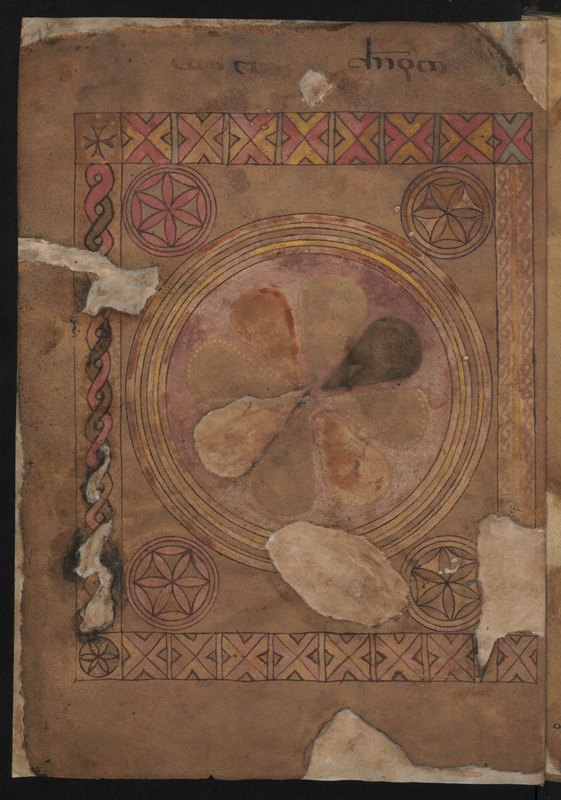
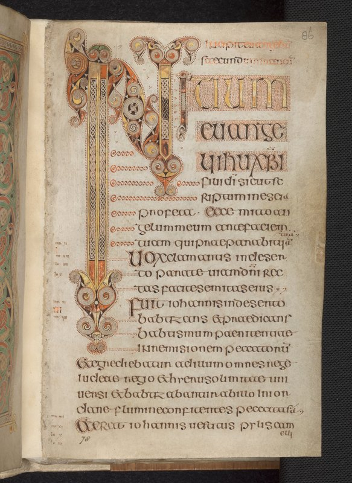
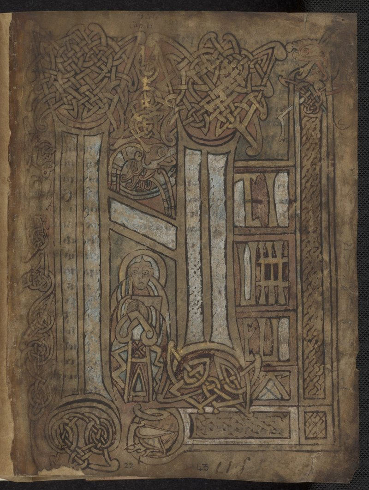
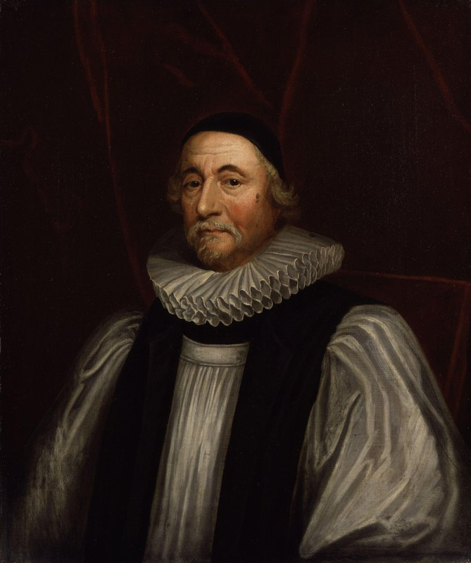

## Introduction

The *Codex Usserianus Primus*, Dublin, Trinity College Library, MS 55, is a ruined Gospel book of about the year 600. Some one hundred and eighty leaves survive, stained, shrunken and without their margins, many of them legible only in high-resolution photographs. It has none of the colour of the Book of Kells or the geometry of the Book of Durrow. Yet it stands at the head of two traditions, and its importance is out of all proportion to its condition.

<figure>
  
  <figcaption>Codex Usserianus Primus, fol. 149v: end of Luke, cross with alpha and omega, and the colophons of Luke and Mark. Dublin, Trinity College Library, MS 55. Public domain, via Wikimedia Commons.</figcaption>
</figure>

The first tradition is textual. The book contains the four Gospels in a Latin translation older than Jerome's Vulgate, an Old Latin or *Vetus Latina* text. It is the only substantial Irish witness to the Latin Bible before the Vulgate, and almost everything that can be said about the Gospel text in Ireland before the Vulgate's arrival rests on it.

The second tradition is artistic. On folio 149v, where Luke ends and Mark begins, the scribe drew a cross with the Greek letters alpha and omega, washed in red and outlined in black dots, inside a frame of the same pattern. This page is generally described as the earliest surviving decoration in an Insular manuscript. [Carl Nordenfalk](/scholars.html#nordenfalk-carl)'s essay of 1947 placed it at the beginning of the sequence that leads to Durrow, Lindisfarne and Kells, and took its title, "Before the Book of Durrow", from that claim.

The two traditions do not point in the same direction. The script resembles that of two seventh-century books from Bobbio, the monastery founded by Columbanus in northern Italy, and has fed an Italian tradition that would place the book in the Columbanian orbit. The text points to Gaul, to the version of the Gospels used by Hilary of Poitiers and to a south-Gallican liturgy. The decoration points to the Mediterranean. The glosses added to the book point to Ireland.

The previous version of this entry was long and repetitive, and left several of its sources unnamed. This version names them: [E. A. Lowe](/scholars.html#lowe-elias-avery)'s *Codices Latini Antiquiores*; David Dumville's *A Palaeographer's Review* (1999); Pádraig Ó Néill's study of the dry-point glosses (1998); Marvin Colker's catalogue of Trinity's Latin manuscripts (1991); and [Hugh Houghton](/scholars.html#houghton-hugh)'s *The Latin New Testament* (2016).

The entry describes the book and its script, the glosses, the debate on its date and origin, its text, its single decorated page, its provenance and conservation, and the editions and reproductions through which it is known. Claims that could not be verified are identified as such.

## Names and Sigla

The current shelfmark is **Dublin, Trinity College Library, MS 55**. The older Trinity press-mark, still found in the literature, is **A.4.15**, also written A.IV.15. The two forms denote the same book.

In the Beuron register of Old Latin manuscripts the codex is **VL 14**. Its traditional siglum is **r**; since the second Ussher Gospel book at Trinity, the Garland of Howth (MS 56), known as the [Codex Usserianus Secundus](/Content/Codex/Codex-Usserianus-Secundus.html), is **r²**, the present manuscript is usually written **r¹**.

In palaeography the essential entry is Lowe's *Codices Latini Antiquiores*, **CLA II, no. 271**. The codex is no. 84 in [Patrick McGurk](/scholars.html#mcgurk-patrick)'s *Latin Gospel Books from A.D. 400 to A.D. 800* (1961), no. 1 in [J. J. G. Alexander](/scholars.html#alexander-jonathan-james-graham)'s *Insular Manuscripts, 6th to the 9th Century* (1978), and no. 453 in [James Kenney](/scholars.html#kenney-james-francis)'s *Sources for the Early History of Ireland*. Alexander's choice to open his survey with it is itself a judgement about its place in the history of Insular illumination.

The manuscript has been fully digitised by Trinity College and is freely available through its Digital Collections. For a book this fragile, the digital surrogate is the principal means of access, and it should be cited by folio.

## The Book

Any description begins with what is lost. The outer edges of every leaf have perished, so that the original page size cannot be recovered. What can be measured is the written area: a single column of about twenty-two lines, about 17.5 × 13 cm. Ó Néill gives 175 × 120–130 mm, in agreement.

The reference literature gives about 180 leaves; the conservators who remounted the book between 2014 and 2016 counted 182. The second figure, from a campaign in which every leaf was handled, is the more reliable.

Lowe described the parchment as of a late-antique type, sheepskin rather than the calfskin that became normal in Irish books. The observation has been used on both sides of the debate on origin, but parchment type can hardly be decisive, since other fragments of Irish origin are written on similar material.

The ink is black. In Matthew and John the first line of each chapter is in colour. The leaves were ruled in dry-point, with the same stylus technique that a later reader used for his glosses. Of the usual prefatory material, little survives: a list of Hebrew names before Luke and some chapter numbers where margins remain. There are no canon tables or prologues, and whether there ever were cannot now be said.

The book belonged by its proportions and austerity to a late-antique type of Gospel book: single-column, of moderate size, without ornament except at the junctions of the Gospels. It stands apart both from the small Irish pocket Gospels, such as the [Book of Mulling](/Content/Codex/Book-of-Mulling.html), and from the great decorated books of the later Insular tradition. It was a book made to be read.

The structure of the gatherings cannot be reconstructed, because the leaves were separated and mounted individually in the nineteenth century. A division of the writing between two scribes, one for Matthew and John (fols 1r–78r) and one for Luke and Mark (fols 78v–182r), circulates in a non-scholarly source; it falls at a natural point for a change of stint, but it has not been tested and is not adopted here.

## The Script

Lowe described the hand as a peculiar angular type of Irish majuscule verging on minuscule, an Irish adaptation of half-uncial. The hesitation of the formula is significant: the script sits between the inherited late-antique half-uncial and the emerging Insular system, and does not belong securely to either.

Several features place it at the head of the Insular tradition. The omission signs, *h.d.* in the text answered by *h.s.* in the margin, are the oldest type of Latin omission mark; their marginal halves are now almost all lost with the margins. The *nomina sacra* are contracted in the traditional way, and other abbreviation is very sparing. The text is written in *scriptio continua*, without the word separation that would become characteristic of Irish books.

The comparisons drawn in the literature come from the earliest Insular horizon. The **Cathach of St Columba** (Dublin, Royal Irish Academy, MS 12 R 33) is the other claimant to the title of earliest surviving Irish manuscript, and the two are always discussed together. Two seventh-century manuscripts from Bobbio now in the Biblioteca Ambrosiana, the Basil (C 26 sup.) and the Orosius (D 23 sup.), supply the resemblances that have supported the Italian hypothesis.

The decoration of the text pages is limited to red dots. Rows of red dots mark the ends of sections, and red-dotted initials occur on fols 94, 101 and 107. They show that the dotting of folio 149v belonged to the scribe's ordinary practice.

## The Dry-Point Glosses

A later reader annotated the book with a stylus, incising rather than inking the parchment. These dry-point glosses are visible only under raking light. Bernhard Bischoff published some of the Latin glosses and one Old Irish gloss in 1954; the full study is Pádraig Ó Néill's, published in 1998 in *'A Miracle of Learning'*, the volume of essays in honour of William O'Sullivan, Keeper of Manuscripts at Trinity.

Ó Néill distinguished an early stratum, which he dated to the seventh century, from a later one. The early stratum contains about 120 Latin glosses, three in Old Irish and some eighteen symbols, some of them construe marks; 112 of the glosses are in Luke. The Latin glosses are often corrections, variant readings or exegetical notes drawing on patristic and Hiberno-Latin commentary.

The Old Irish glosses are few but important. On fol. 86r *focrici*, "wages, payments", glosses *stipendiis* (Luke 3:14); on fol. 124r *dilus*, "private property", glosses *substantiam* (Luke 15:13). Malte Bronner, in a survey of dry-point glossing in Irish manuscripts, calls the codex "our earliest witness to dry-point glossing in an Irish context", and notes that Old Irish dry-point glosses are safely attested only here.

The previous version of this entry called them the earliest dry-point glosses in the medieval West and the first glosses in any Western vernacular. The sources consulted support a narrower claim: they are the earliest dry-point glosses in an Irish context, and the only secure Old Irish ones, in a book whose glossing is mostly Latin.

The glosses matter for the history of the book. They show that it was in Irish hands, and being studied closely, in the seventh century. They cannot date the writing of the book, which may be earlier, but they make an Irish milieu for its early use certain.

## Date and Origin

No colophon, dated subscription or external document fixes the book in time. Every date rests on palaeography, and the dates proposed range from the fifth century to the seventh.

The mainstream view is Lowe's. In *Codices Latini Antiquiores* he dated the script to the beginning of the seventh century and judged that the book was written in an Irish centre, not at Bobbio, despite four features that might have suggested otherwise: Roman cursive influence in the script, the form of the omission signs, the type of parchment, and the likeness to the two Bobbio manuscripts in the Ambrosiana. Colker's catalogue and the later literature follow his date in rounded forms: around 600, the first half of the seventh century.

<figure data-no-download>
  
  <figcaption>Orosius, *Historiae adversus paganos*, from Bobbio, fol. 1v, first half of the seventh century. Milan, Biblioteca Ambrosiana, D 23 sup. Photo: Veneranda Biblioteca Ambrosiana, via Biblissima.</figcaption>
</figure>

Against this stands the view of David Dumville, in *A Palaeographer's Review: The Insular System of Scripts in the Early Middle Ages* (1999), that there is little in the manuscript to prevent a fifth-century date and a Continental origin. The parchment, the omission signs, the sparing abbreviation, the *scriptio continua* and the half-uncial base are all at home in the late-antique Mediterranean.

The difficulty is one of method. A book that reproduces late-antique habits may be late-antique, or it may be an early copy made where late-antique models had been received and new conventions not yet formed. The two hypotheses predict much the same evidence. What can be said is that Lowe weighed the counter-evidence explicitly, that the Old Irish glosses attest early Irish use, and that published opinion has not moved decisively to Dumville's view.

The Bobbio question deserves a separate word, because it is often repeated in Italian accounts. Bobbio was founded by Columbanus around 612–614 and became one of the great libraries of the West. The likeness between the script of the codex and that of the Bobbio Basil and Orosius is real; Lowe recorded it. But no medieval note, inventory or ex-libris connects the book with Bobbio, and the likeness has a simpler explanation, which Lowe anticipated: the Irish scribes who founded Bobbio carried their habits with them.

The Bobbio Orosius also has a decorated page, a frame with roundels and a great central rosette, which Nordenfalk discussed in the same essay of 1947 among the earliest examples of Insular decoration. Its forms are different from those of folio 149v, but the two books belong to the same world of early Irish book-making, at home and abroad.

The text, finally, points away from Bobbio, as the next section shows. On present evidence the most defensible formulation is an Irish origin in the early seventh century, with a fifth-century Continental origin as a reasoned minority view.

## The Text

The codex contains an Old Latin text of the four Gospels, belonging to the translations that circulated before Jerome's revision and that the Vulgate displaced, slowly and unevenly, between the fifth and the ninth centuries. It is the only substantial Irish witness to that tradition.

The Gospels follow the so-called Western order, **Matthew, John, Luke, Mark**, which places the two apostles before the two disciples of apostles. The order can be read in the book itself: the colophons on folio 149v, *explicit secundum Lucanum* and *incipit secundum Marcum*, fix the junction of Luke and Mark.

The text has large gaps. Wanting are Matthew 1:1–15:16, 15:31–16:13, 21:4–21 and 28:16–20; John 1:1–15; and in Mark 14:58–15:8 and the end of the Gospel from about 15:29 or 15:32. Matthew is the most worn. Because the end of Mark is lost, the codex cannot be cited on its longer ending.

The text belongs to the group of Old Latin witnesses called Gallo-Irish. In Matthew it agrees closely with the quotations of Hilary of Poitiers, and it has been aligned with a south-Gallican sacramentary of about 700. Its affiliations are therefore Gallican, which suggests that it reached Ireland through Gallican, and especially liturgical, contacts in the late sixth and early seventh centuries, and that it is not a Bobbio text.

A characteristic reading is at Luke 2:11, where the Vulgate has *salvator* and the codex reads *conservator salutis*; the same rare rendering appears in the Usserianus Secundus and in the Hiberno-Latin *Catechesis celtica*, evidence of a textual tradition current in Ireland. The codex also contains the passage of the woman taken in adultery (John 7:53–8:11), as many Old Latin witnesses do.

The codex is bound into the Irish textual network by further links: its Old Latin chapter divisions relate it to the Book of Mulling, its chapter lists to the Book of Durrow, and a stretch of Mark (about 2:12–6:6) is almost identical with the Durham Gospel fragment (Durham Cathedral Library, A.II.10). The Old Latin text of the codex is cited as r or r¹ in the Beuron *Vetus Latina*, in the Jülicher–Aland *Itala* and in the Oxford Vulgate.

## The Decorated Page

Folio 149v is the only decorated page to survive. Its upper part preserves the last lines of Luke 24, the disciples' return to Jerusalem *cum gaudio magno* and their praise of God in the Temple, closed by *Amen* and a row of dots. Below, two bands of red zigzag and black dots draw a line under the Gospel.

Beneath them a frame of the same pattern encloses a square field. At its centre stands a Latin cross with flaring ends, washed in orange-red and outlined in black dots, with a small curl at the head of the upright. The alpha and the omega hang below the arms. On either side, in three short lines, run the colophons: *explicit secundum Lucanum* on the left, *incipit secundum Marcum* on the right. The text of the other side shows faintly through the thin parchment.

The motif is Mediterranean. The cross with alpha and omega, the letters by which God calls himself the first and the last in the Apocalypse, is one of the most widespread Christian signs of the fifth and sixth centuries, in mosaic, on sarcophagi, in metalwork and in books. Placed at the junction of two Gospels, it marks and guards the passage from one to the next. The literature compares the page with Continental books such as the Bologna Lactantius and the Valerianus Gospels (Munich, Bayerische Staatsbibliothek, Clm 6224).

What is new is the technique. The cross is drawn with the pen and outlined in dots, a device that translates a monumental, metallic form into the scribe's own graphic idiom. Dotting around letters and forms would become one of the constitutive devices of Insular ornament, from the Cathach to Durrow and Kells; here it appears in its simplest form, as an outline.

<figure>
  
  <figcaption>Book of Durrow, fol. 86r, opening of Mark, second half of the seventh century. Dublin, Trinity College Library, MS 57. Photo: Trinity College Dublin, Digital Collections, <a href="https://creativecommons.org/licenses/by/4.0/">CC BY 4.0</a>, via Wikimedia Commons.</figcaption>
</figure>

The opening of Mark in the Book of Durrow shows how far the technique had travelled within a few generations. The red dots that outline a single cross in the Usserianus Primus now surround the great initial, fill the panels behind the first words and outline the first letters of each line, turning the empty parchment into pattern.

Nordenfalk's essay "Before the Book of Durrow", in *Acta Archaeologica* 18 (1947), placed folio 149v at the beginning of this sequence, and he returned to it in *Celtic and Anglo-Saxon Painting* (1976). The page is accordingly described as the earliest surviving example of an Insular artist copying a Mediterranean form of decoration.

Both claims need qualification. "Earliest" applies only to what survives, in a book that has itself survived in ruins. And the page cannot settle the old question of whether Insular ornament was imported or native: the motif is imported, the technique of its execution is not that of its models, and what followed in Irish and Northumbrian workshops cannot be predicted from either.

## The Codex Usserianus Secundus

<figure>
  
  <figcaption>Garland of Howth (Codex Usserianus Secundus), fol. 22r, decorated initial page with a haloed figure. Dublin, Trinity College Library, MS 56. Public domain, via Wikipedia.</figcaption>
</figure>

The second Ussher Gospel book at Trinity, the Garland of Howth (MS 56), known as the Codex Usserianus Secundus, is later and richly decorated, with large initial pages filled with interlace and figures. Its text is mixed, and it shares with the Usserianus Primus the rare reading *conservator salutis* at Luke 2:11. The two books have been bound together in scholarship by their shared name and their shared textual tradition; the second is described in its own entry on this site.

## Provenance

The book is named after James Ussher (1581–1656), Church of Ireland archbishop of Armagh and one of the great scholars and collectors of his age. Houghton states plainly that the name is misleading, since there is no evidence that the manuscript was in Ussher's library. The name records the collection through which the book came to Trinity, not a documented ownership.

<figure>
  
  <figcaption>James Ussher, archbishop of Armagh, portrait after Sir Peter Lely. Public domain, via Wikimedia Commons.</figcaption>
</figure>

The history of Ussher's library is well documented. After his death in 1656 the library passed to his heirs, who considered selling it abroad. Cromwell forbade its export, and in 1657 the army in Ireland agreed to find £2,500 to buy it for a library in Dublin. The books were kept in Dublin Castle from about 1658 to 1661, when some were lost, and at the Restoration they were granted to Trinity College in 1661, nominally as a gift of Charles II.

Of the book's medieval history nothing is documented. No ex-libris, inventory or note of ownership survives; the margins where such notes would normally stand have perished. The connection with Bobbio is a modern conjecture.

Two further claims found in accessible accounts should be rejected. The codex is not known to have had a book-shrine, or *cumdach*: the enshrined books of Trinity are others, such as the Book of Durrow and the Book of Mulling, and the Cathach in the Royal Irish Academy. And the bookbinder Roger Powell, who rebound Kells, Durrow, Armagh and Dimma in the 1950s, did not work on this manuscript.

## Conservation

In the nineteenth century the decayed leaves were mounted individually on paper. Ó Néill records that some marginal text was covered on one side of each page by this mounting, and that most of the margins had already been lost. The mounting probably saved the fragments from further decay, but it hid what was left of the margins and held the parchment in heavy, inflexible supports.

In 2014 a grant from the Bank of America Merrill Lynch Art Conservation Project allowed Trinity's Department of Preservation and Conservation, with the Department of History of Art and Architecture, to conserve, study and digitise four early Irish Gospel books: the Usserianus Primus (MS 55), the Garland of Howth (MS 56), the Book of Dimma (MS 59) and the Book of Mulling (MS 60).

For MS 55 the principal work was the remounting of the 182 leaves in a system that improves both their preservation and their legibility. Non-destructive pigment analysis was carried out by Raman spectroscopy, and the manuscript was photographed in full and published online in 2016. The project was presented with an exhibition in 2017.

The two interventions have opposite effects. The nineteenth-century mounting preserved the leaves at the cost of the margins; the recent campaign has recovered as much flexibility and legibility as the ruined leaves allow and, through digitisation, has made it unnecessary to handle the original.

## Editions and Reproductions

The first edition is T. K. Abbott's *Evangeliorum versio antehieronymiana ex codice Usseriano (Dublinensi)* (Dublin and London, 1884), with a collation of the second Ussher Gospel book. [Abbott](/scholars.html#abbott-thomas-kingsmill)'s transcription has an independent value, because it records marginal text later covered by the mounting. Later editors of the *Vetus Latina* have found it necessary to check it against the manuscript.

The codex is described in Lowe's *Codices Latini Antiquiores* (CLA II, no. 271, 1935; second edition 1972), in McGurk's *Latin Gospel Books* (no. 84, 1961), in Colker's *Trinity College Library Dublin: Descriptive Catalogue of the Mediaeval and Renaissance Latin Manuscripts* (1991, pp. 101–102), in Abbott's *Catalogue of the Manuscripts in the Library of Trinity College, Dublin* (1900) and in Houghton's *The Latin New Testament* (2016).

Folio 149v was reproduced in the facsimiles of the Palaeographical Society and in John T. Gilbert's *Facsimiles of National Manuscripts of Ireland* (1874–1884). The previous version of this entry dated Gilbert's work to 1848.

There is no printed colour facsimile. The digital facsimile published by Trinity in 2016 takes its place, and does more than a printed plate could: adjustable high-resolution images recover text that print could not convey.

## Catalogue Entry

**Shelfmark:** Dublin, Trinity College Library, MS 55 (olim A.4.15).

**Sigla:** VL 14; r, r¹; CLA II, no. 271; McGurk no. 84; Alexander no. 1; Kenney no. 453.

**Contents:** The four Gospels in an Old Latin text, in the order Matthew, John, Luke, Mark, with lacunae; list of Hebrew names before Luke.

**Date and origin:** Early seventh century, probably Ireland (Lowe); fifth century and Continental (Dumville 1999).

**Material and format:** Parchment of late-antique type; about 180 leaves (182 at the remounting of 2014–2016); margins lost; written area about 17.5 × 13 cm, one column of about 22 lines.

**Script:** Irish half-uncial verging on minuscule; scriptio continua; omission signs h.d./h.s.

**Decoration:** Fol. 149v, cross with alpha and omega in a dotted frame between the colophons of Luke and Mark; red-dotted initials on fols 94, 101, 107.

**Glosses:** Dry-point glosses, early stratum of the seventh century: about 120 Latin, 3 Old Irish, about 18 symbols (Ó Néill 1998).

**Provenance:** Ussher collection; Trinity College, 1661. No earlier provenance known.

**Conservation:** Mounted on paper in the nineteenth century; remounted and digitised 2014–2016.

**Bibliography:** T. K. Abbott, *Evangeliorum versio antehieronymiana ex codice Usseriano (Dublinensi)*, 1884; J. T. Gilbert, *Facsimiles of National Manuscripts of Ireland*, 1874–1884; E. A. Lowe, *Codices Latini Antiquiores*, II, 1935 (2nd ed. 1972), no. 271; C. Nordenfalk, "Before the Book of Durrow", *Acta Archaeologica* 18, 1947, pp. 147 ff.; B. Bischoff, 1954; P. McGurk, *Latin Gospel Books from A.D. 400 to A.D. 800*, 1961, no. 84; C. Nordenfalk, *Celtic and Anglo-Saxon Painting*, 1976; J. J. G. Alexander, *Insular Manuscripts, 6th to the 9th Century*, 1978, no. 1; M. L. Colker, *Trinity College Library Dublin: Descriptive Catalogue of the Mediaeval and Renaissance Latin Manuscripts*, 1991, pp. 101–102; P. P. Ó Néill, "The earliest dry-point glosses in Codex Usserianus Primus", in T. Barnard, D. Ó Cróinín and K. Simms (eds), *'A Miracle of Learning': Studies in Manuscripts and Irish Learning. Essays in Honour of William O'Sullivan*, 1998; D. N. Dumville, *A Palaeographer's Review: The Insular System of Scripts in the Early Middle Ages*, I, 1999; H. A. G. Houghton, *The Latin New Testament*, 2016; M. Bronner, "Dry-Point Glosses in Irish Manuscripts".
