## The Manuscript

The *Vergilius Romanus*, the "Roman Vergil", is a manuscript of the poems of Virgil copied at the end of the ancient world and preserved in the Vatican Library as Vat. lat. 3867. It contains the *Eclogues*, incomplete at the beginning, the *Georgics* and the *Aeneid*, on 309 leaves of parchment, and it keeps nineteen miniatures. With the *Vergilius Vaticanus* (Vat. lat. 3225), which has lost most of its text but preserves fifty miniatures from the *Georgics* and *Aeneid*, it is one of only two illustrated manuscripts of a Latin classical author to survive from late antiquity.

Its importance is threefold. For philologists it is one of the oldest witnesses to the text of Virgil, written within five centuries of the poet's death. For historians of the book it shows the form of a luxury edition of a classic in the age when the codex had replaced the roll. For historians of art its miniatures document a transition in painting: some still belong to the classical tradition, others announce the flat, frontal and ornamental style of the early Middle Ages.

The manuscript is large and almost square, about 332 by 323 millimetres. Each page carries a single column of eighteen lines, written in rustic capitals without separation between words, so that the text forms a dense block framed by wide margins. The opening lines of the books and the names of the speakers in the dialogues of the *Eclogues* are written in red. The format, the script and the size of the letters belong to the formal tradition of the Latin poetic book.

The order of the works follows the traditional sequence of Virgil's poems: first the *Eclogues*, the ten pastoral poems of his youth, then the *Georgics*, the four books on agriculture, and finally the twelve books of the *Aeneid*. The *Eclogues* are incomplete because leaves have been lost at the beginning of the manuscript, and losses within the *Georgics* and the *Aeneid* have removed further passages and the miniatures that accompanied them.

The codex was a book for reading and display rather than for school use. Its size, the width of its margins, the quality of its parchment and the presence of gold in the frames of the miniatures place it among the luxury editions of the classics produced for wealthy owners in late antiquity. Such books were costly to make, and their owners belonged to the circles in which Virgil was not only read but quoted, imitated and commented upon.

The choice of rustic capitals is significant. By the fifth century the everyday book hands of the Latin world were uncial and half-uncial, used above all for Christian texts. Rustic capitals, an older and more formal script, had become the conventional hand for luxury copies of the pagan poets. Writing Virgil in them was a way of marking the text as classical and of giving it the visual authority of antiquity.

The manuscript is now kept in a modern binding and is no longer complete in its original form. Its leaves have been foliated in a modern numbering that runs through the surviving portion, and the references used on this page, from fol. 1r to fol. 235r, follow that numbering rather than the original order of the quires.

## Date and Origin

The *Vergilius Romanus* is undated and has no colophon. On palaeographical and stylistic grounds it is placed in the second half of the fifth century or around 500, and therefore after the *Vergilius Vaticanus*, which is usually dated around 400. It belongs to the period when the Western Empire came to an end and Italy passed under the rule of Odoacer and then of Theodoric, while the senatorial aristocracy continued to read, correct and commission copies of the classics.

Its place of production is unknown. The name "Roman Vergil" refers to the Vatican and to the history of scholarship, not to a documented origin. Rome or another Italian centre is the most common assumption, since the late Roman aristocracy that kept the classical curriculum alive was concentrated there. <a href="/scholars.html#henig-martin">Martin Henig</a> has proposed that the manuscript was made in Britain, on the basis of comparisons between its miniatures and the floor mosaics and other works of late Roman Britain; if he were right, it would be the oldest surviving book produced in the island. The proposal remains a hypothesis and has not found general acceptance.

The question matters because the miniatures depart so clearly from the classical style. Those who place the manuscript in Rome see in it the art of the capital at the end of antiquity; those who prefer a provincial origin see in the same features the hand of painters working outside the main tradition. In either case the book shows that a reader of Virgil around 500 could wish for an illustrated edition, and that painters able to provide one still existed.

Dating a manuscript of this kind depends on comparisons, since late antique books almost never record when or where they were made. The script can be compared with other manuscripts in rustic capitals, the miniatures with mosaics, ivories, silver plate and other datable works of art, and the decoration with that of manuscripts whose date is known from other evidence. Each line of comparison leaves a margin of several decades, and together they point to the end of the fifth century or the beginning of the sixth.

The relationship with the *Vergilius Vaticanus* is part of the argument. The two manuscripts share the same author and the same script, but differ deeply in the style of their pictures. If the Vatican Vergil is placed around 400, the Roman Vergil, with its flatter and more ornamental style, belongs to a later generation, at a point when the illusionism of the classical tradition had given way to a different conception of the image.

The political setting gives the date its meaning. At the end of the fifth century Italy was ruled by Germanic kings who preserved the Roman administration and relied on the senatorial aristocracy. Men such as Boethius and Cassiodorus, educated in the classical tradition, served Theodoric while writing philosophy and history. The production of a luxury Virgil belongs naturally to this world, in which the Latin classics remained the foundation of education and status.

A provincial origin, in Britain or elsewhere, would place the manuscript in a different setting, among the remaining Roman aristocracies of the West at a time of growing fragmentation. Whatever its origin, the book shows that the art of the illustrated classical codex survived into a period in which Christian books were becoming the main products of the scriptoria, and that patrons still existed who could commission it.

## The Painters and the Cycle

The nineteen surviving miniatures are the work of at least two painters. The first painted only the miniature of the first *Eclogue*, on fol. 1r: an unframed scene in which Tityrus plays the pipe under a tree and Meliboeus leads his goats, with cattle looking out from behind the trees. The figures are draped in the classical manner and turned in three-quarter view, and the landscape still has depth.

The second painter, responsible for all the other miniatures, worked differently. His pictures are framed by bands of red and gold; his figures are frontal or in profile; drapery is reduced to rhythmic lines; space is divided into compartments and landscapes have no depth. The animals of his pastoral scenes are set on a flat ground like motifs in a floor mosaic, and the comparison with late Roman mosaics is often made for the pages of the *Georgics*.

The cycle as it survives includes three author portraits, on fols 3v, 9r and 14r, which show Virgil seated between a lectern and a locked round box for book rolls, the arrangement reversed on fol. 3v. These pictures preserve a convention of the ancient roll, the image of the author at the beginning of a work. Other miniatures illustrate the *Georgics* and the *Aeneid*. Many leaves have been lost, and the original cycle was certainly larger.

The *Aeneid* begins on fol. 78r, where the first three lines are written in red capitals within a painted frame of purple and green panels edged with gold. In the present codex several miniatures with scenes from the poem stand on the leaves before this opening, which suggests that the order of the leaves has been disturbed or that the pictures were planned as a separate sequence; their original position is one of the questions of the codicology of the manuscript.

The distinction between the two painters is one of the most important observations about the manuscript. The first painter's single miniature belongs to the tradition of illustrated classical texts, in which pictures were placed in the column of writing, without frames, close to the lines they illustrated. The second painter's framed pictures behave like panels set into the book, independent of the lines and closer to the picture pages of later medieval manuscripts.

The second painter's style is not a sign of incompetence. Its frontal figures, large eyes, flattened space and strong colours are features of a period style found across the art of the late fifth and sixth centuries, in mosaics, ivories and manuscripts in both East and West. The painter worked within a visual language that valued clarity, symmetry and the dignity of the figures more than the imitation of nature.

The frames themselves are part of this new conception. The double bands of red and gold isolate each picture from the text and give it the character of a small icon or panel. On some pages the miniature fills most of the leaf, and the text is reduced to a few lines above or below, so that the picture rather than the writing dominates the opening of the book.

The selection of subjects shows a reader's knowledge of the poems. The painter chose the openings of works and books, the portraits of the author, the great set pieces of the *Aeneid*, the storm, the banquet, the fall of Troy, the cave, the council of the gods, and the turning points of the narrative, such as the shooting of the stag. Several miniatures were designed in pairs across an opening of the book, as for the banquet of Dido and Sinon before Priam, and for the two halves of the council of the gods.

## Text and Readers

The *Vergilius Romanus* is a primary witness for the text of Virgil, cited in critical editions with the siglum R. Like the other late antique manuscripts of the poet, it transmits the text as it was read and taught in the schools of the late Roman world, with readings that sometimes differ from the medieval tradition.

The manuscript was read and corrected over many centuries. In the Middle Ages it belonged to the abbey of Saint-Denis near Paris, one of the great libraries of France, and corrections and notes by medieval hands show that it was used for the study of the poem. At the top of the opening page of the *Aeneid* a fifteenth-century hand has written the name *Jehan Courtoys* and copied the first lines of the poem in a cursive script, a sign of the attention that the ancient book continued to attract.

By 1475 the codex was in the Vatican Library of Sixtus IV. Humanists recognised its antiquity at once: Angelo Poliziano cited the ancient Vatican manuscripts for the spelling *Vergilius*, with an *e*, instead of the medieval *Virgilius*, and Pierio Valeriano used the codex for his textual notes on Virgil printed in 1521. The name *codex Romanus* comes from this tradition of humanist philology.

The text is written in *scriptio continua*, without spaces between words, as was normal in ancient books. Punctuation is sparse, and the reader was expected to divide the words and phrases himself, usually by reading aloud. The rubrics, the red opening lines and the names of the speakers in the *Eclogues* were the main aids to orientation within the text.

Corrections were made at different times. Some belong to the period of the manuscript's production and show that the copy was checked against its exemplar; others were added in the Middle Ages, when readers at Saint-Denis compared the ancient text with the Virgil they knew. Each layer of correction is evidence for how the text was read and understood.

The presence of the manuscript at Saint-Denis connects it with one of the great centres of Carolingian and Capetian culture. The abbey's library contained classical texts as well as liturgical and theological works, and its monks and visitors read the Latin poets for their language, their style and their authority as models. The Roman Vergil was there an ancient witness, valued for its age as much as for its text.

How the manuscript passed from Saint-Denis to Rome in the fifteenth century is not documented. It belongs to the period in which humanist collectors and the papal library were gathering ancient manuscripts from monastic libraries across Europe, and its arrival in the Vatican made it accessible to the philologists who were then establishing the text of the classics on the basis of their oldest witnesses.

## Scholarship

Modern study of the manuscript began with the facsimiles and palaeographical descriptions of the late nineteenth and twentieth centuries. <a href="/scholars.html#rosenthal-erwin">Erwin Rosenthal</a> published in 1972 a monograph on the illuminations, *The Illuminations of the Vergilius Romanus*, with a stylistic and iconographical analysis of the whole cycle. <a href="/scholars.html#weitzmann-kurt">Kurt Weitzmann</a> placed the manuscript in his survey of late antique and early Christian book illumination (1977), beside the *Vergilius Vaticanus* and the Christian manuscripts of the period.

The fundamental modern study is that of <a href="/scholars.html#wright-david-h">David H. Wright</a>, who had already written on the *Vergilius Vaticanus*. In *The Roman Vergil and the Origins of Medieval Book Design* (2001) he analysed the structure of the codex, its script, its layout and its miniatures together, and argued that the manuscript shows the moment when the design of the book passed from the conventions of antiquity to those of the Middle Ages. The manuscript is now fully reproduced in the DigiVatLib of the Vatican Library.

The philological study of the manuscript is older than its study as a work of art. From the sixteenth century onward editors of Virgil cited the *codex Romanus* among the ancient witnesses, and in the nineteenth century, with the development of critical editions, it was assigned its place in the stemma of the tradition beside the other capital manuscripts, the Mediceus, the Palatinus and the Vaticanus.

The study of the miniatures developed with the history of late antique art in the twentieth century. Historians of the transition from antiquity to the Middle Ages saw in the Roman Vergil a key document for the change in style, and its miniatures were reproduced in surveys of early medieval painting alongside the mosaics of Ravenna and the earliest Christian manuscripts. <a href="/scholars.html#weitzmann-kurt">Weitzmann</a>'s method of reconstructing lost cycles from surviving copies shaped much of this discussion.

Debate has centred on three questions: the date of the manuscript, its place of origin and the number of painters. Rosenthal's analysis of the hands and of the iconography, Wright's codicological study and Henig's proposal of a British origin represent three different approaches, and none of them has closed the discussion. The manuscript remains a point of reference for any study of late antique book production.

The digitisation of the manuscript by the Vatican Library has changed the conditions of study. High-resolution images of every page are now available online, allowing the miniatures, the script and the corrections to be examined in detail without handling the fragile original, and most of the images reproduced on this page derive from this campaign through their publication on Wikimedia Commons.

## Catalogue Entry

### Tityrus and Meliboeus (Eclogue I, fol. 1r)

<figure>
  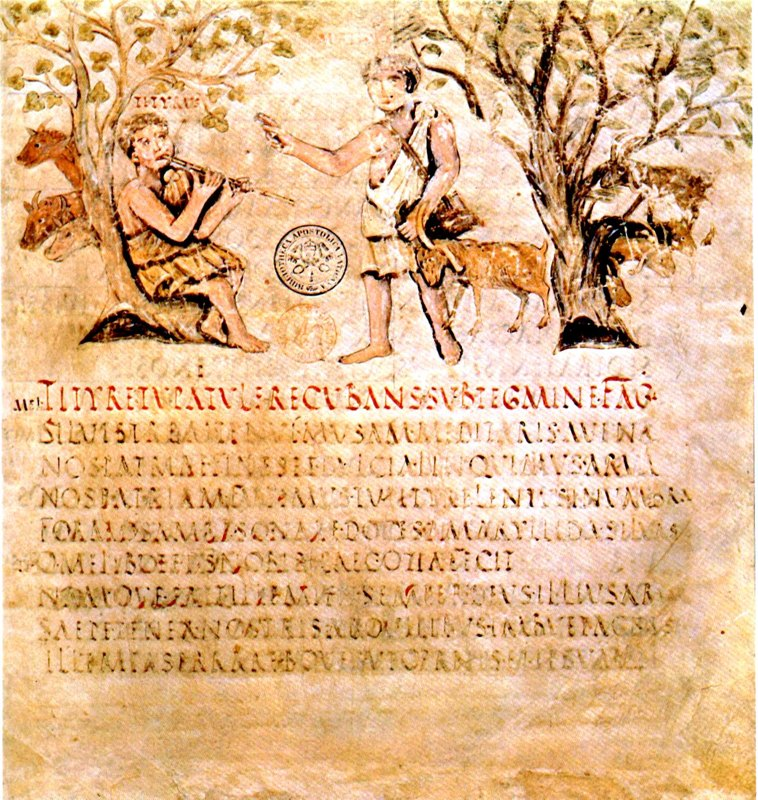
  <figcaption>First painter, Tityrus and Meliboeus, Eclogue I, Vergilius Romanus, fol. 1r, late fifth or early sixth century. Pigments on parchment. Vatican City, Biblioteca Apostolica Vaticana, Vat. lat. 3867. Image: public domain, via Wikimedia Commons.</figcaption>
</figure>

The first page of the manuscript, as it survives, opens the first *Eclogue*. Above the text, without a frame, a young shepherd sits under a tree and plays a long pipe; a second shepherd stands in front of him, raising his hand as he speaks, and leads a goat by the horn. Behind the trees, cattle look out at the scene. A small inscription above the seated figure names him *Tityrus*.

The picture illustrates the opening lines written below it in red and brown capitals: *Tityre, tu patulae recubans sub tegmine fagi*, "Tityrus, you, lying under the cover of the spreading beech". Meliboeus, driven from his land, addresses Tityrus, who has kept his fields and can play at ease. The contrast between the seated and the standing shepherd, the one at rest and the one in motion, translates the situation of the dialogue.

This is the only miniature by the first painter of the codex. Its figures are draped in the classical manner, their bodies turned in three-quarter view, and the trees, with their twisting trunks and leafy crowns, create a shallow but real space. The animals emerging from behind the trunks are a device of ancient landscape painting that suggests depth by overlapping.

The absence of a frame is significant. The picture shares the page with the text and grows out of it, in the manner of illustrations in ancient rolls, rather than standing as an independent panel. Every other surviving miniature of the codex is framed, and the difference marks the distance between the two painters.

The page has suffered. The colours are worn, parts of the drawing have faded, and a round library stamp of the Vatican has been printed in the middle of the scene. The reproduction shown here, taken from a printed source, also exaggerates the warmth of the parchment. The image nevertheless remains the best witness to the classical strand in the manuscript.

For historians of art, the comparison between this page and the following miniatures is one of the clearest documents of the change in style at the end of antiquity. Within a single book, made at one time for one patron, the classical and the post-classical ways of painting stand side by side.

### Portrait of Virgil at the Head of Eclogue II (fol. 3v)

<figure>
  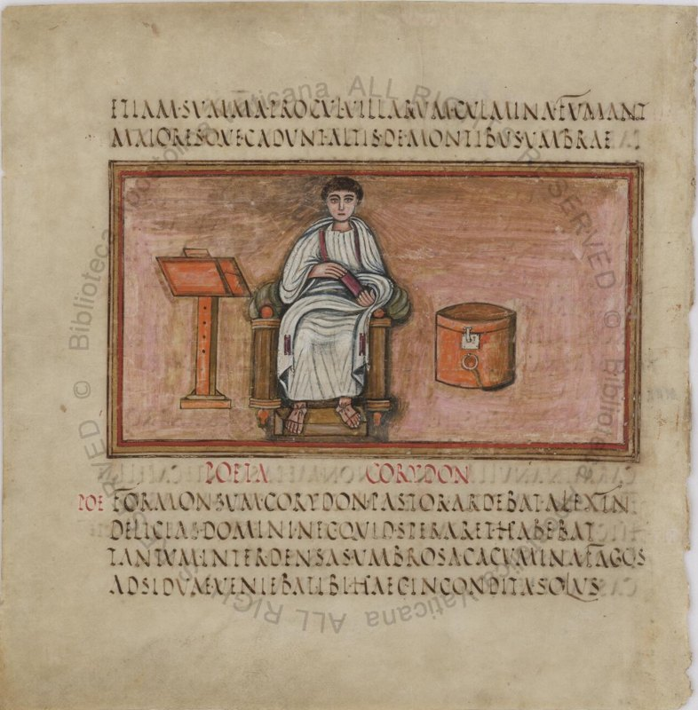
  <figcaption>Second painter, Portrait of Virgil, at the head of Eclogue II, Vergilius Romanus, fol. 3v, late fifth or early sixth century. Pigments on parchment. Vatican City, Biblioteca Apostolica Vaticana, Vat. lat. 3867. Image: public domain, via Wikimedia Commons.</figcaption>
</figure>

The first of the three author portraits stands between the end of the first *Eclogue* and the beginning of the second. At the top of the page run the last two lines of the first poem, *et iam summa procul villarum culmina fumant / maioresque cadunt altis de montibus umbrae*, "and now the rooftops of the farms smoke in the distance, and longer shadows fall from the high mountains", the famous evening close of the dialogue between Tityrus and Meliboeus.

Below, within a red and gold frame on a pink ground, Virgil sits frontally on a cushioned chair in a white tunic and toga, holding a small red book. The arrangement of the furniture is the reverse of that on fols 9r and 14r: here the lectern stands at the left and the round box for rolls, with its lock and ring, at the right.

Under the picture two words in red, *POETA* and *CORYDON*, announce the speakers of the second *Eclogue*: the poet who narrates and the shepherd Corydon who laments his unrequited love for Alexis. The text begins with *Formosum pastor Corydon ardebat Alexin*, "the shepherd Corydon burned for the fair Alexis", introduced by the abbreviation *POE* in red in the margin.

The labelling of speakers shows how the codex was organised for reading. The *Eclogues* are dialogues, and without word division or punctuation the reader needed the names in the margin to follow the exchange. The portrait, placed at the boundary between two poems, also served as a visual divider within the collection.

The reversal of the composition relative to the other two portraits has been read as a sign that the painter worked from a model he adapted freely, or that he varied the scheme deliberately to avoid monotony within a short sequence of poems. In either case the three portraits show that the same image could be repeated with small changes of colour and arrangement.

The leaf is one of the best preserved of the manuscript, its colours fresh and its text clear. It shows the full layout of a page with a portrait: two lines above, the framed picture in the middle, the speakers' names and the opening lines below, all within the eighteen-line grid of the codex.

### Portrait of Virgil before Eclogue IV (fol. 9r)

<figure>
  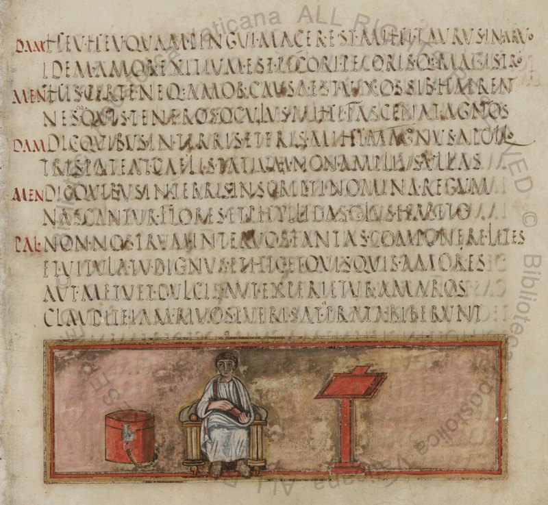
  <figcaption>Second painter, Portrait of Virgil, at the end of Eclogue III, Vergilius Romanus, fol. 9r, late fifth or early sixth century. Pigments on parchment. Vatican City, Biblioteca Apostolica Vaticana, Vat. lat. 3867. Image: public domain, via Wikimedia Commons.</figcaption>
</figure>

The page carries the last lines of the third *Eclogue*, a singing contest between Damoetas and Menalcas judged by Palaemon, whose names appear in red abbreviations in the left margin: *DAM*, *MEN*, *PAL*. Below the text, in a framed rectangle, the painter placed a portrait of the poet, which introduces the fourth *Eclogue* on the following page.

Virgil sits frontally on a chair with cushions, wearing a white tunic and toga, his hair cut short. He holds a small book in his hand. At his left stands a round red box with a lock and a chain, a *scrinium* or *capsa* for book rolls; at his right, a red lectern. The figure is set against a pink ground within a red and gold frame.

The portrait follows a type known from ancient author pictures: the writer seated with the instruments of his work. In the *Vergilius Romanus* the type has been simplified and made symmetrical. The poet is not shown writing or reading but presenting himself to the reader, motionless and frontal, as an authority rather than as a man at work.

The box and the lectern are significant details. The locked box held the rolls in which ancient books were kept, while the poet holds a small codex; the picture thus places side by side the old and the new forms of the book, at a moment when the codex had become the normal form for literary texts.

The three author portraits of the manuscript repeat the same composition with variations. On fol. 9r the ground is pink and the frame is placed at the foot of the page; on fol. 14r the ground is ochre and the picture stands at the head of the sixth *Eclogue*; on fol. 3v the arrangement of box and lectern is reversed.

The page also shows the layout of the text. The verses are written in rustic capitals of large module, the speakers are marked in red in the margin, and the lines run without word separation, the reader being expected to divide the words himself. The miniature occupies the space left at the end of the poem, and the layout was clearly planned to accommodate it.

### Portrait of Virgil at the Head of Eclogue VI (fol. 14r)

<figure>
  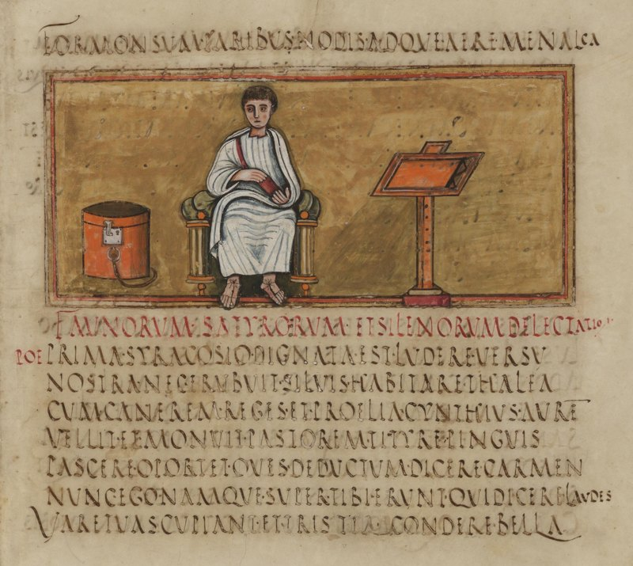
  <figcaption>Second painter, Portrait of Virgil, at the head of Eclogue VI, Vergilius Romanus, fol. 14r, late fifth or early sixth century. Pigments on parchment. Vatican City, Biblioteca Apostolica Vaticana, Vat. lat. 3867. Image: public domain, via Wikimedia Commons.</figcaption>
</figure>

This is the best preserved and most frequently reproduced of the three author portraits. At the top of the page runs the last line of the fifth *Eclogue*; below it the painter placed the portrait, and under the portrait begins the sixth *Eclogue*, introduced by a line in red capitals: *Faunorum satyrorum et silenorum delectatio*, a short summary of the poem.

The poet sits on a chair with a green cushion and turned legs, wearing a white tunic and a toga with a red stripe, and holds a small red book on his knee. At the left, an orange round box with a silver lock and a hanging chain; at the right, an orange lectern on a tall stand. The ochre ground and the double frame of red and gold give the picture the character of a small panel.

The face is drawn with large eyes and a small mouth, the hair as a dark cap, and the body is hidden by the white drapery, articulated only by parallel lines. The figure is frontal and symmetrical, with the feet placed side by side on the lower edge of the frame. The style is that of the second painter: legible, simplified and solemn.

The sixth *Eclogue* opens with a reflection by the poet on his own art: his Muse first deigned to play in the Syracusan verse of Theocritus, but when he wished to sing of kings and battles, Apollo plucked his ear and reminded him that a shepherd should feed fat sheep and sing a slender song. The author portrait at the head of this poem suits a text in which Virgil speaks about himself.

The lines of text below the portrait show the rustic capitals at their best: tall, narrow letters with thin vertical strokes and broad horizontal ones, written with a slanted pen. The red line of the summary and the small red abbreviation *POE*, "poet", in the margin, which marks the speaker, show how carefully the text was organised for the reader.

The portrait of Virgil on fol. 14r has become one of the emblematic images of the poet, reproduced in editions and histories of literature. Its value lies less in any likeness than in the idea it conveys: Virgil as the author of the book, seated among the instruments of reading and writing, at the beginning of a tradition that the medieval author portrait would continue.

### Herding Scene from the Georgics (Georgics III, fol. 44v)

<figure>
  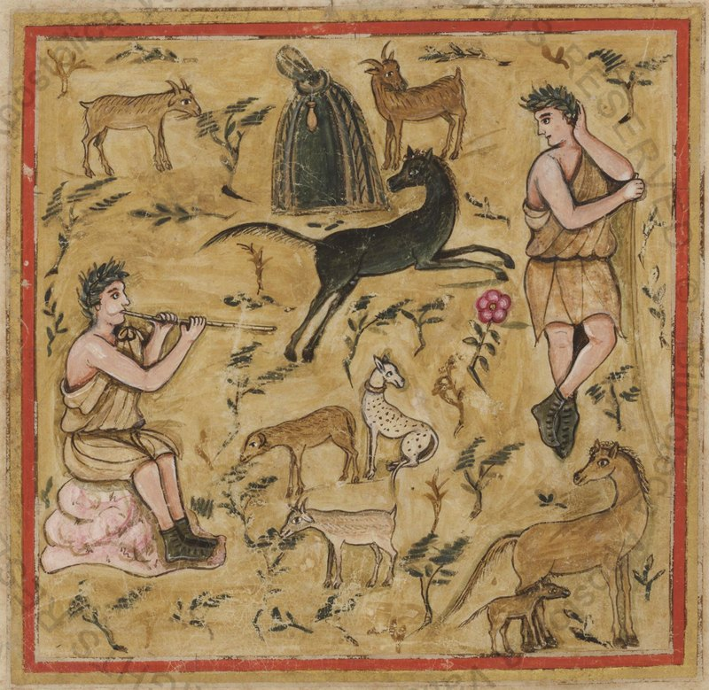
  <figcaption>Second painter, Herdsmen and their animals, Georgics III, Vergilius Romanus, fol. 44v, late fifth or early sixth century. Pigments on parchment. Vatican City, Biblioteca Apostolica Vaticana, Vat. lat. 3867. Image: public domain, via Wikimedia Commons.</figcaption>
</figure>

The third book of the *Georgics* is devoted to livestock: horses and cattle in the first part, sheep and goats in the second. The miniature on fol. 44v, one of two facing pictures, gathers the animals and their keepers in a single pastoral scene on an ochre ground sprinkled with small plants.

At the lower left a shepherd crowned with laurel sits on a pink rock and plays a long pipe; at the right a second shepherd stands, also crowned, turning his head and adjusting his cloak. Between them the animals are scattered across the field: goats grazing, a black horse leaping, a spotted dog with a collar, sheep, a goat, and at the lower right a mare with her foal.

At the top stands a dark conical hut, from which a small flask hangs. It is the shepherds' shelter, the *mapalia* of the African herdsmen that Virgil describes in this book, and it gives the scene its setting in the open country. A red flower grows near the centre, one of the few touches of strong colour in the field.

The composition has no perspective and no single viewpoint. Animals and figures are placed over the whole surface, each seen from the side or from the front, with no overlapping and no diminution in size. This arrangement has been compared with late Roman floor mosaics, in which figures are set on a neutral ground to be read from different directions.

The style is that of the second painter in its most decorative form. Outlines are clear, colours flat, and the plants and animals are reduced to signs repeated across the field. The shepherds' bodies have some modelling, with pink flesh and shaded drapery, but their poses are those of figures arranged on a surface rather than placed in a landscape.

The picture does not illustrate a single passage but evokes the theme of the book as a whole, the life of herds and herdsmen. In this it resembles the pastoral images of late antique art, in mosaics and silverware, which presented the countryside as an idyll of peace and abundance for the enjoyment of urban owners.

### Herdsman, Horses and Fighting Bulls (Georgics III, fol. 45r)

<figure>
  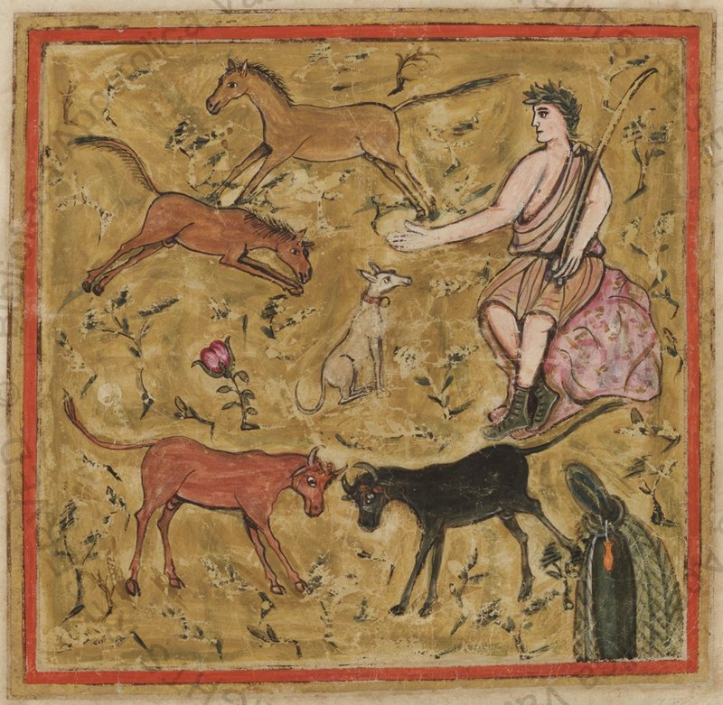
  <figcaption>Second painter, Herdsman with horses and fighting bulls, Georgics III, Vergilius Romanus, fol. 45r, late fifth or early sixth century. Pigments on parchment. Vatican City, Biblioteca Apostolica Vaticana, Vat. lat. 3867. Image: public domain, via Wikimedia Commons.</figcaption>
</figure>

The second miniature of the *Georgics*, facing the first, shows a single herdsman seated at the right on a pink rock, crowned with laurel and holding a curved crook. He stretches out his open hand towards the animals in front of him: two horses leaping at the upper left and a dog with a collar sitting in the centre.

At the bottom of the picture a red bull and a black bull lock horns. The scene recalls one of the most famous passages of the third *Georgic*, the fight of two bulls for a heifer, in which the defeated bull goes into exile, trains in solitude and returns to challenge his rival. Virgil uses it to show the force of love in all living creatures.

At the lower right stands the dark conical hut, the same shelter that appears on the facing page, so that the two pictures form a pair. The repetition of the hut, the dog, the red flower and the scattered plants binds the two compositions together and suggests that they were designed to be seen at one opening of the book.

The horses are among the most lively animals of the manuscript. Their bodies are stretched in a flying gallop, their manes and tails drawn with quick strokes. The bulls, by contrast, are heavy and static, their heads lowered against each other. The painter knew how to vary movement within a strictly flat composition.

The palette is limited to ochre, red-brown, black, white and pink, with green for the plants and the frames in red and gold. The colours are laid in flat areas with dark outlines, and the ground is enlivened with small dark marks representing grass and shrubs, a technique closer to decorative painting than to the illusionism of earlier Roman art.

Together, fols 44v and 45r offer the most complete picture of the second painter's pastoral style. They show that the change from classical to post-classical painting was not a loss of skill but a different conception of the image, in which clarity of motifs and decorative unity of the surface counted for more than the representation of space.

### Iris Appears to Turnus (Aeneid IX, fol. 74v)

<figure>
  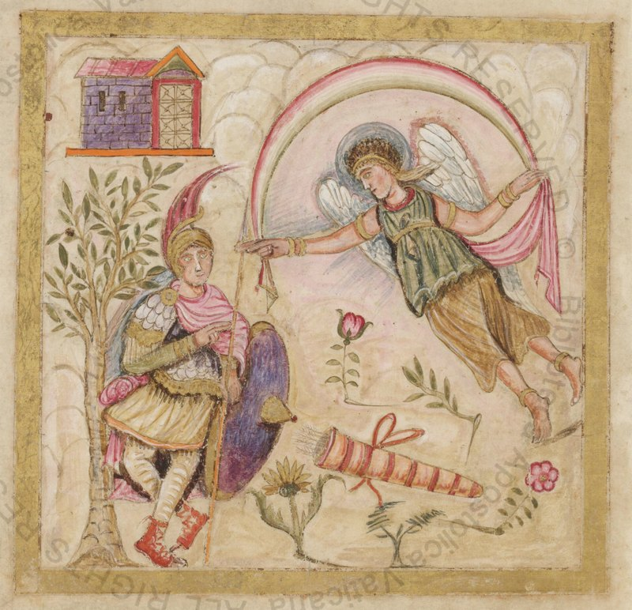
  <figcaption>Second painter, Iris appears to Turnus, Aeneid IX, Vergilius Romanus, fol. 74v, late fifth or early sixth century. Pigments on parchment. Vatican City, Biblioteca Apostolica Vaticana, Vat. lat. 3867. Image: public domain, via Wikimedia Commons.</figcaption>
</figure>

A winged female figure with a halo flies through the air beneath a rainbow, a pink veil streaming from her hand, and reaches out to a warrior who sits under a tree. The warrior wears a crested helmet and scale armour and holds a spear, his large purple shield resting beside him. Flowers grow in the field, and a quiver lies on the ground.

The rainbow identifies the flying figure as Iris, the messenger of Juno, who travels on the rainbow between heaven and earth. The scene illustrates the opening of the ninth book of the *Aeneid*, in which Juno sends Iris to Turnus, who is sitting in the sacred grove of his ancestor Pilumnus, to urge him to attack the Trojan camp in the absence of Aeneas.

The small building at the upper left, with a pitched roof and a gabled front, stands for the camp or for a sanctuary, set in the sky without any spatial connection with the figures. Such buildings, placed in the background as signs of a place, are a common device of late antique narrative painting.

The miniature shows the second painter at his most refined. The figure of Iris is light and graceful, her drapery fluttering, her wings drawn with white feathers; the rainbow is painted in delicate bands of pink, white and green. The warrior, heavy and seated, wears armour rendered in small scale-like strokes, and his face, with large frontal eyes, has the fixed gaze typical of the period.

The picture stands on a leaf before the opening of the *Aeneid* on fol. 78r, although its subject comes from a later book of the poem. Its position in the present codex is one of the problems of the manuscript, which has lost many leaves and whose miniatures may not all stand where they were originally placed.

The image of a divine messenger appearing to a seated hero belongs to a long tradition of visitation scenes in ancient art. In late antiquity the same formula, a winged figure flying towards a seated person, was used in Christian art for the Annunciation, and the miniature shows how close pagan and Christian iconography could be in the visual language of the period.

### The Prizes for the Funeral Games of Anchises (Aeneid V, fol. 76v)

<figure>
  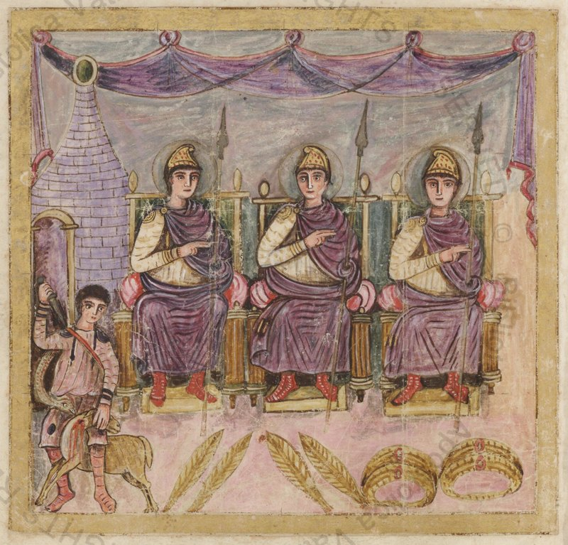
  <figcaption>Second painter, The prizes for the funeral games of Anchises, with the presiding Trojans and a sacrifice, Aeneid V, Vergilius Romanus, fol. 76v, late fifth or early sixth century. Pigments on parchment. Vatican City, Biblioteca Apostolica Vaticana, Vat. lat. 3867. Image: public domain, via Wikimedia Commons.</figcaption>
</figure>

Three figures sit side by side on thrones with cushions, under a purple curtain hung in swags. They are identical: each wears a golden Phrygian helmet and a purple mantle over a light tunic, each holds a spear, each points with the right hand, and each has a halo. They face the viewer frontally, like images on a coin or in a ceremonial picture.

At the left, beside a round tower built of purple stones and a doorway, a young man in a short tunic sacrifices a goat, holding it by the head and raising a knife. On the pink floor before the thrones lie palm branches and two golden crowns, prizes or tokens of victory.

The scene illustrates the funeral games for Anchises in the fifth book of the *Aeneid*. Before the contests begin, the prizes are set out in the middle of the field, "sacred tripods, green crowns and palms, the reward of the victors"; the sacrifice corresponds to the rites that open the games, and the enthroned figures are the presiding Trojans.

The picture is a striking example of the second painter's ceremonial style. Repetition and symmetry dominate: three identical figures in identical poses, three spears, three pairs of red shoes, under a curtain whose swags repeat in turn. The haloes, which in late antique art mark rank and dignity rather than holiness, emphasise the solemnity of the scene.

The curtain hung across the top of the picture, the round tower and the doorway are elements of a stage set rather than of a real place. They frame the figures and signal an interior or a city, as in the mosaics and ivories of the period, where curtains and architecture serve to enthrone emperors and officials.

The haloed figures in Phrygian helmets, the Trojans of the poem, resemble the rulers and dignitaries of late Roman imperial art more than the heroes of epic. The miniature shows how the painter read Virgil through the visual conventions of his own time, giving the Trojan leaders the appearance of a late Roman court.

### The Trojan Fleet in the Storm (Aeneid I, fol. 77r)

<figure>
  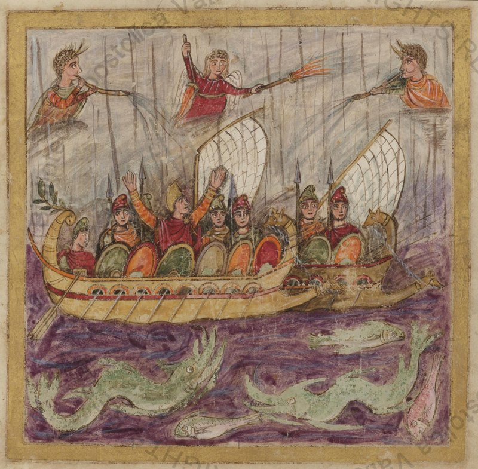
  <figcaption>Second painter, The Trojan fleet in the storm, Aeneid I, Vergilius Romanus, fol. 77r, late fifth or early sixth century. Pigments on parchment. Vatican City, Biblioteca Apostolica Vaticana, Vat. lat. 3867. Image: public domain, via Wikimedia Commons.</figcaption>
</figure>

Two ships sail on a purple sea, crowded with helmeted warriors carrying round shields in orange, green and red. In the leading ship a figure in a golden helmet raises both arms to the sky. Above, in a grey sky streaked with rain, two wind figures blow from the upper corners through long horns, and between them a winged figure in red brandishes a fiery torch.

The scene illustrates the storm at the beginning of the *Aeneid*, when Juno persuades Aeolus to release the winds against the Trojan fleet. The gesture of the central figure corresponds to the line in which Aeneas, terrified, "stretching both hands to the stars", wishes he had died before the walls of Troy. The winds and the torch-bearing figure, perhaps lightning, personify the forces of the storm.

The sea is painted as a dense band of purple filled with creatures: green sea monsters with curling tails, fish of different kinds, all set flat on the surface. The ships, with their rows of oars, rounded hulls and figureheads, are drawn in profile, and the warriors are stacked behind their shields in a frieze of heads and helmets.

The vertical strokes of rain that cross the sky and the diagonal lines of the sails create a sense of movement unusual in the manuscript. The painter has conveyed the violence of the storm not through perspective or atmosphere but through the agitation of lines and the gestures of the figures.

As with the other miniatures that precede fol. 78r, the position of this picture before the beginning of the poem raises questions about the original arrangement of the cycle. Its subject, at least, belongs to the first book, and it may have stood close to the passage it illustrates or formed part of an introductory sequence.

The storm at sea was a familiar subject in ancient art, and the wind figures blowing horns derive from personifications common in mosaics and sarcophagi. The miniature shows how such stock figures were adapted to the narrative of the *Aeneid*, and how the painter combined them into a lively, legible composition within the limits of a flat, decorative style.

### Opening of the Aeneid (fol. 78r)

<figure>
  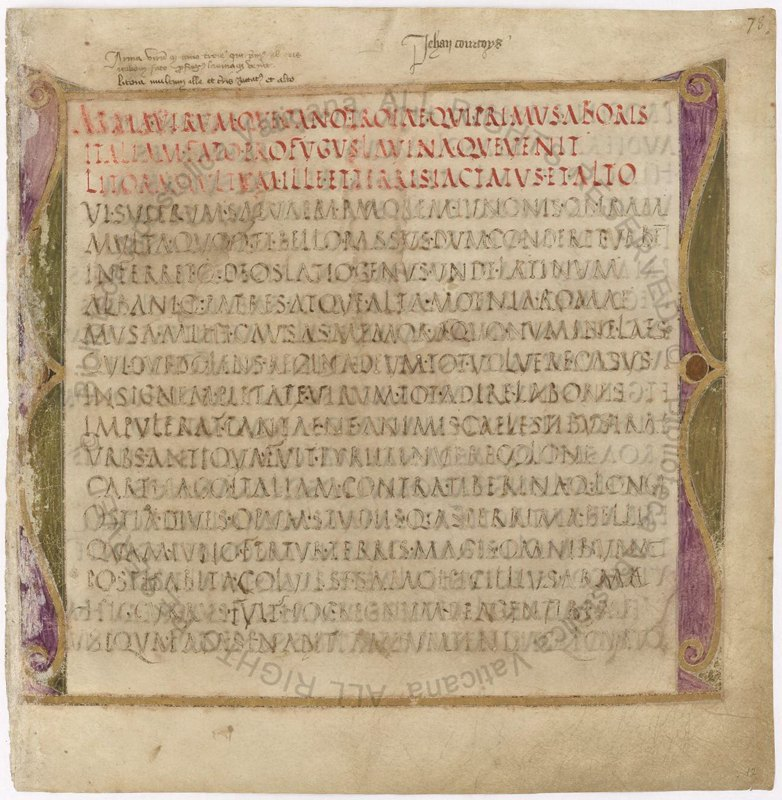
  <figcaption>Opening of the Aeneid, Arma virumque cano, within a painted frame, Vergilius Romanus, fol. 78r, late fifth or early sixth century, with fifteenth-century additions. Ink and pigments on parchment. Vatican City, Biblioteca Apostolica Vaticana, Vat. lat. 3867. Image: public domain, via Wikimedia Commons.</figcaption>
</figure>

The *Aeneid* begins on fol. 78r with its famous first line, *Arma virumque cano, Troiae qui primus ab oris*, "I sing of arms and the man who first from the shores of Troy". The first three lines are written in red capitals, the following fifteen in brown, filling the eighteen lines of the page.

The text is enclosed in a painted frame of purple and olive-green panels edged with gold, whose curving inner edges form scrolls at the corners and a medallion on each side. The frame turns the page into a monumental title, marking the beginning of the most important work in the book.

The script is the rustic capital in its most formal form. The letters are tall and narrow, with thin verticals and thick horizontals, written without separation between words; the reader had to divide the continuous stream of letters himself. The text is in the same hand as the rest of the manuscript, and its regularity shows a scribe of great skill.

Above the frame, a fifteenth-century reader has copied the first lines of the poem in a cursive script and written the name *Jehan Courtoys*. The note belongs to the time when the manuscript was at Saint-Denis, shortly before its arrival in Rome, and it shows that the ancient book was still being read and admired.

The page has suffered from use: the parchment is stained and the text of the reverse shows through. The frame is partly rubbed, especially at the left, where the purple has faded. The number 78 at the upper right belongs to the modern foliation.

This page is the clearest example of the decorative principle of the *Vergilius Romanus*: the text itself, written in coloured capitals and framed like a picture, becomes an image. The device would have a long future in early medieval manuscripts, where opening pages of display script framed by ornament became one of the principal forms of decoration.

### The Banquet of Dido and Aeneas (Aeneid I, fol. 100v)

<figure>
  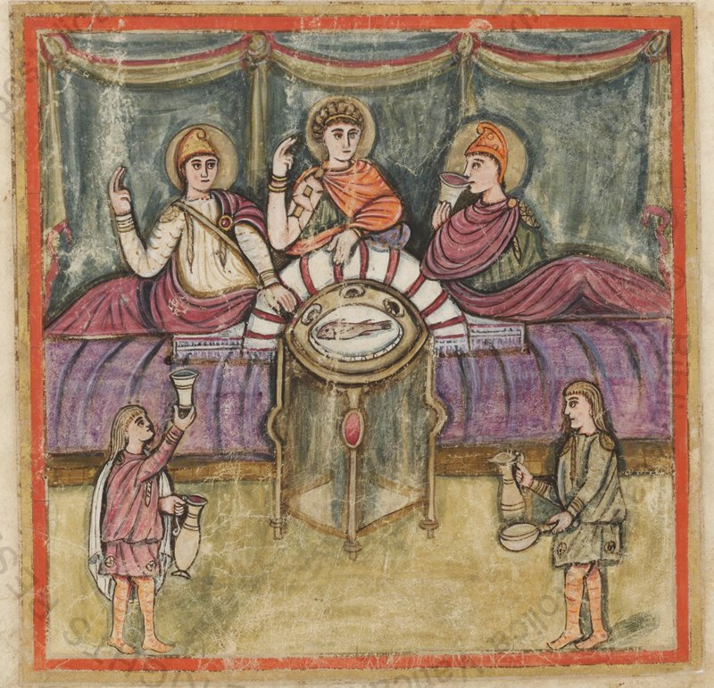
  <figcaption>Second painter, The banquet of Dido and Aeneas, Aeneid I, Vergilius Romanus, fol. 100v, late fifth or early sixth century. Pigments on parchment. Vatican City, Biblioteca Apostolica Vaticana, Vat. lat. 3867. Image: public domain, via Wikimedia Commons.</figcaption>
</figure>

At the end of the first book of the *Aeneid*, Dido receives Aeneas and his companions in her palace at Carthage with a royal banquet. The miniature shows three haloed figures reclining on a purple couch behind a semicircular cushion, the *stibadium* of late antique dining: in the centre a crowned woman in an orange mantle, Dido; at the left a man in a white tunic; at the right a man in a red Phrygian helmet who drinks from a cup.

In front of the couch stands a round table on a tall stand, with a large fish on a plate. Two young servants with long hair approach from either side, one raising a cup and carrying a jug, the other carrying a jug and a bowl. Above, a green curtain hung in swags closes the scene like the back of a stage.

The arrangement reflects the dining customs of the late Roman aristocracy, in which guests reclined on a semicircular couch around a round table, rather than the classical triclinium. The painter has thus represented the banquet of the poem in the form familiar to his contemporaries, as in the banquet scenes of mosaics and silver plate of the period.

The identification of the two men is not certain. The figure drinking, in the Phrygian helmet of the Trojans, could be Aeneas, and the figure in white another Trojan or Ascanius, whose place Cupid takes at the banquet to kindle Dido's love. Dido's raised hand and central position make her the host and the focus of the scene.

The style is again that of the second painter: frontal figures with large eyes, gestures of speech, drapery reduced to folds and lines, and a strong sense of symmetry. The haloes, as on fol. 76v, mark the rank of the figures. The servants, smaller and seen in profile, frame the composition and lead the eye to the table.

The banquet is the moment at which the tragedy of Dido begins, when Aeneas tells the story of the fall of Troy that will fill the following two books. The miniature, solemn and calm, gives no hint of the drama to come, but presents the scene as an image of royal hospitality, a subject that late antique viewers would have recognised from their own world.

### Sinon before Priam and the Wooden Horse (Aeneid II, fol. 101r)

<figure>
  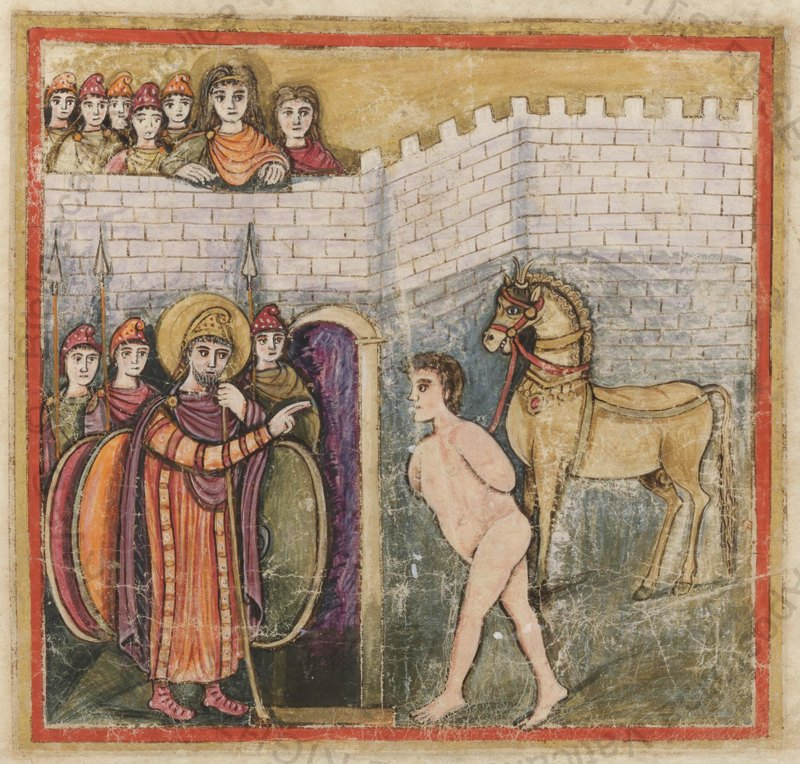
  <figcaption>Second painter, Sinon brought before Priam, with the wooden horse, Aeneid II, Vergilius Romanus, fol. 101r, late fifth or early sixth century. Pigments on parchment. Vatican City, Biblioteca Apostolica Vaticana, Vat. lat. 3867. Image: public domain, via Wikimedia Commons.</figcaption>
</figure>

The second book of the *Aeneid* is the story of the fall of Troy, told by Aeneas at Dido's banquet. The miniature on fol. 101r, which faces the banquet scene, illustrates its first great episode: the Greek Sinon, left behind by his companions, is brought before King Priam with his hands bound, and with a false story persuades the Trojans to take the wooden horse into the city.

At the lower left stands Priam, haloed and bearded, in a long striped robe with a purple mantle and a helmet, pointing at the prisoner as he questions him. Soldiers with spears and large shields surround the king. Before him stands Sinon, naked, his arms tied behind his back, turning his head towards his judge. The nudity marks his status as a captive and his apparent helplessness.

At the right stands the horse, tall and harnessed, with a decorated bridle and collar. It is painted not as a wooden construction but as a living animal, as it often is in ancient images of the episode. It stands against the wall of the city, already within reach, and the viewer who knows the poem knows what it contains.

Above, behind the crenellated wall of white brick, a crowd of Trojans in Phrygian caps and two women look down on the scene. The wall is drawn as a corner of masonry seen from two sides, the most ambitious piece of architecture in the cycle, and it divides the picture between the space of the city above and the space of the encounter below.

The scene is the turning point of the second book. Laocoön has just warned the Trojans against the horse, *timeo Danaos et dona ferentes*, but Sinon's lies, sworn by the gods, prevail, and the horse is drawn into the city. The miniature condenses the moment of decision, with the king, the liar and the fatal gift in a single image.

The facing position of this picture and the banquet of Dido on fol. 100v shows that the painter could plan an opening of the book. On the left, the banquet where the story is told; on the right, the first episode of the story. The two pictures together frame the passage from the first book to the second.

### The Storm and the Cave (Aeneid IV, fol. 106r)

<figure>
  
  <figcaption>Second painter, The storm during the hunt: Dido and Aeneas in the cave, Aeneid IV, Vergilius Romanus, fol. 106r, late fifth or early sixth century. Pigments on parchment. Vatican City, Biblioteca Apostolica Vaticana, Vat. lat. 3867. Image: public domain, via Wikimedia Commons.</figcaption>
</figure>

In the fourth book of the *Aeneid* Dido and Aeneas ride out to hunt with the Carthaginians and Trojans. Juno sends a storm; the company scatters for shelter, and Dido and the Trojan leader take refuge in the same cave, where, with Earth and Juno as witnesses and lightning as the marriage torches, their union takes place. Virgil calls that day the first cause of death and ruin.

The miniature shows the episode in a forest painted green and crossed by long vertical streaks of rain. At the lower right, within a cave outlined in white, Dido in an orange mantle and Aeneas in a purple mantle and helmet sit side by side; she lays her hand on his chest, he puts his arm around her shoulders. A spear and a large shield rest beside them.

In the upper part of the picture two members of the hunting party wait out the storm. One, wrapped in a cloak, sits on a rock beneath a large round red hat that serves as an umbrella, holding a spear; the other, a warrior in a crested helmet with an orange shield, sits beside him. At the left two saddled horses stand with their reins hanging, abandoned for the moment by their riders.

The arrangement in separate groups, without a unified space, is characteristic of the second painter. Each element of the story, the shelter of the companions, the waiting horses, the couple in the cave, occupies its own part of the field, and the reader assembles the narrative by moving from one to the other, as in the text.

The rain, painted as fine parallel lines across the whole surface, is one of the rare attempts in the manuscript to show weather. It links the separate groups and gives the scene its atmosphere. The flaking of the paint, especially at the left, has damaged the trees and the horses, but the central couple is well preserved.

The miniature is one of the most intimate of the cycle. The couple in the cave, seated close together in their brightly coloured mantles, is drawn with a tenderness that contrasts with the ceremonial stiffness of the banquet scenes. It illustrates the moment from which the tragedy of Dido follows, and the reader of the poem knew that the gesture of love would end in abandonment and death.

### Ascanius Shoots the Stag of Silvia (Aeneid VII, fol. 163r)

<figure>
  
  <figcaption>Second painter, Ascanius shooting the stag of Silvia, Aeneid VII, Vergilius Romanus, fol. 163r, late fifth or early sixth century. Pigments on parchment. Vatican City, Biblioteca Apostolica Vaticana, Vat. lat. 3867. Image: public domain, via Wikimedia Commons.</figcaption>
</figure>

The seventh book of the *Aeneid* tells how war broke out between the Trojans and the Latins. The Fury Allecto, sent by Juno, drives the hounds of Ascanius onto the track of a tame stag that belongs to Silvia, daughter of the royal herdsman Tyrrhus. Ascanius shoots it, the wounded animal flees home, and the outraged countrymen take up arms: the first blood of the war.

The miniature shows a group of young Trojans at the left, with spears and shields, led by Ascanius in a white tunic and a purple cloak, who draws his bow and aims upward. Across the top of the picture leaps a white stag with branching antlers, already wounded, red marks on its flank. A striped quiver lies on the ground at the centre.

At the right stands a young man in a green tunic and orange cloak who raises a purple shield above his head and looks up towards the stag. He may be one of the Latin countrymen, or a member of the hunting party; his raised shield suggests that he is protecting himself from the arrows or preparing to fight.

At the upper left two small roundels contain busts. Their meaning is uncertain: they may represent divine figures watching the scene, such as Juno and Allecto who provoke the incident, or personifications of time, as the sun and moon in other miniatures of the cycle. Their presence shows that the episode, apparently a hunting accident, is directed by the gods.

The paint has suffered severely: much of the ochre ground has flaked, leaving white patches, and the surface is covered with a network of cracks. The figures nevertheless remain legible, and the composition, with its strong diagonal from the archer to the leaping stag, conveys the movement of the hunt.

The episode is a small one in the narrative of the *Aeneid*, but it is the cause of the war that fills the second half of the poem. The choice to illustrate it shows the painter's attention to the turning points of the story, and the miniature stands at the beginning of the Italian books as the sack of Troy stands at the beginning of the second.

### Trojans and Latins in Battle (Aeneid, fol. 188v)

<figure>
  
  <figcaption>Second painter, Two armies facing each other with archers, Aeneid, Vergilius Romanus, fol. 188v, late fifth or early sixth century. Pigments on parchment. Vatican City, Biblioteca Apostolica Vaticana, Vat. lat. 3867. Image: public domain, via Wikimedia Commons.</figcaption>
</figure>

Two armies face each other across an empty space. Each is a dense group of warriors in helmets, with spears raised above their heads and large oval shields in orange, purple, green and red. At the front of each group stands a leader in scale armour and a gold helmet: the one at the left draws a bow, the one at the right stretches out his arm towards his opponents.

Between the two armies arrows fly through the air, and a striped quiver lies on the ground. The scene shows not a mêlée but the moment before it, or the first exchange of missiles, the two sides still separated and facing each other in order.

The subject cannot be identified with certainty. The second half of the *Aeneid* contains several confrontations between Trojans and Latins, among them the shot by which Ascanius kills Numanus Remulus in the ninth book and the arrow that breaks the truce in the twelfth. Without an inscription or a distinctive detail, the miniature is best described as a battle between the two peoples.

The composition is symmetrical: the two armies mirror each other, their leaders advance from either side, and the axis of the picture is the empty field between them. The second painter organises the battle as a confrontation of two blocks rather than as a scene of violent movement, in keeping with his preference for order and legibility.

The repetition of heads, helmets and spearheads within each group creates a sense of number without perspective. The device, common in late antique battle scenes in reliefs and mosaics, conveys an army by stacking figures one above the other, each partly hidden by the one in front.

The armour, scale corselets, plumed helmets, oval shields, is that of the late Roman army rather than of the heroic age. As in the other miniatures, the painter dressed Virgil's warriors in the equipment of his own time, so that the war in Latium looks like a campaign of the fifth century.

### The Council of the Gods, Left Half (Aeneid X, fol. 234v)

<figure>
  
  <figcaption>Second painter, The council of the gods, left half, with Jupiter at the centre, Aeneid X, Vergilius Romanus, fol. 234v, late fifth or early sixth century. Pigments on parchment. Vatican City, Biblioteca Apostolica Vaticana, Vat. lat. 3867. Image: public domain, via Wikimedia Commons.</figcaption>
</figure>

The tenth book of the *Aeneid* opens with a council of the gods on Olympus, summoned by Jupiter to end the war between Trojans and Latins. Venus pleads for the Trojans, Juno answers for Turnus, and Jupiter declares that he will leave the outcome to fate. The miniature shows the assembly enthroned beneath the vault of heaven.

At the centre sits Jupiter, bearded and bare-chested, a green mantle over his legs, holding a long sceptre and a purple globe. At the left sits a goddess in a crested helmet with spear and shield, Minerva, and behind her a young figure with a caduceus, Mercury. At the right sit a bearded figure with a staff and a veiled goddess with a sceptre, probably Juno or Venus. All have haloes. The assembly continues on the facing page, fol. 235r, with Neptune at its centre.

Above them a rainbow forms an arch across the picture, and the sky beyond it is filled with small red crosses, stylised stars, with a red sun at the upper left and a crescent moon at the upper right. The rainbow defines the space of the heavens, and the sun and moon place the scene above the world, as in the cosmic imagery of late antique art.

The composition, a central ruler flanked by seated figures in a semicircle, follows the formula of imperial and ecclesiastical assemblies, the emperor among his counsellors or Christ among the apostles. The painter gave the pagan gods the same arrangement, so that the council of Olympus resembles a court or a synod.

The figures are drawn with more modelling than many others in the manuscript: Jupiter's bare chest is shaded, the drapery of Minerva and Juno has broad folds in orange and purple, and the faces have individual features. The gold frame and the rich colours make this one of the most sumptuous miniatures of the cycle.

The image of Jupiter enthroned, bare-chested with sceptre and globe, derives from the famous cult statues of the god and from his images on imperial coins. In the *Vergilius Romanus* it shows how the pagan gods could still be represented with dignity in a manuscript of around 500, a century after the closing of the temples, because Virgil's poem kept them alive as figures of literature and learning.

### The Council of the Gods, Right Half (Aeneid X, fol. 235r)

<figure>
  
  <figcaption>Second painter, The council of the gods, right half, with Neptune at the centre, Aeneid X, Vergilius Romanus, fol. 235r, late fifth or early sixth century. Pigments on parchment. Vatican City, Biblioteca Apostolica Vaticana, Vat. lat. 3867. Image: public domain, via Wikimedia Commons.</figcaption>
</figure>

The council of the gods at the beginning of the tenth book is painted across two facing pages. On fol. 234v Jupiter presides among the gods of the left half; on fol. 235r the assembly continues with a second group of five deities under the same rainbow and the same starry sky, so that the two pictures form a single image across the opening of the book.

At the centre sits Neptune, bearded and bare-chested, a purple mantle over his legs, holding a trident in his right hand and a dolphin in his left. He occupies the place that Jupiter holds on the facing page, and his attributes identify him as the god of the sea, brother of Jupiter and protector of the Trojan fleet.

At the right sits a warrior in a crested helmet and scale armour with a spear, Mars, god of war; beside him stands a veiled goddess. At the left a figure in an orange mantle holds a bundle of arrows, perhaps Diana or Apollo, and behind stands a youth crowned with laurel. Not all the figures can be named securely, and the painter seems more concerned with the order of the assembly than with the precise identity of each member.

The repetition of the frame, the rainbow, the sun and moon and the starry sky on both pages shows that the two miniatures were designed together. Seen side by side, they present ten gods seated in two semicircles, the Olympian assembly in its full extent, an arrangement unique in the manuscript.

The style is the same as on the facing page: haloed figures, frontal faces with large eyes, bright orange and purple mantles, and bare torsos modelled with soft shading. The dolphin, painted in green with careful detail, is one of the most vivid animals of the cycle.

The double council is the most ambitious composition of the *Vergilius Romanus*. It shows the painter planning an image across an opening of the book, as he did for the banquet of Dido and Sinon before Priam, and it gives the pagan gods a majestic presentation that rivals the assemblies of saints and apostles in the Christian art of the same period.

### For Comparison: the Vergilius Vaticanus (Vat. lat. 3225, fol. 1r)

<figure>
  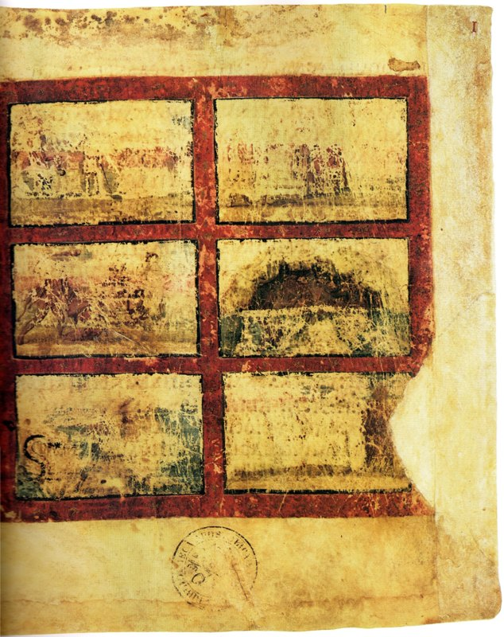
  <figcaption>Six scenes in a framed grid, Vergilius Vaticanus, fol. 1r, c. 400, for comparison. Pigments on parchment. Vatican City, Biblioteca Apostolica Vaticana, Vat. lat. 3225. Image: public domain, via Wikimedia Commons.</figcaption>
</figure>

The *Vergilius Vaticanus* (Vat. lat. 3225) is the other surviving illustrated manuscript of Virgil from late antiquity, and the natural point of comparison for the Roman Vergil. It is usually dated around 400, a century or so earlier, and its fragments, about seventy-six leaves from the *Georgics* and the *Aeneid*, preserve some fifty miniatures. Like the *Vergilius Romanus*, it is written in rustic capitals.

The first surviving leaf shows a page divided by a broad red frame into six rectangular fields, each originally painted with a small scene. The leaf is badly damaged: most of the paint has flaked away, leaving faint traces of buildings, figures and trees, and a dark arch-shaped form that may be a cave or a building. A large initial S survives at the lower left, and the right edge of the leaf is torn.

Even in this condition, the page shows a way of illustrating the text that differs from the Roman Vergil. Instead of one large picture, the painter of the Vatican Vergil divided the page into a sequence of small scenes, to be read one after the other like a strip. The framed grid recalls the arrangement of narrative panels on wall paintings and on objects of the same period.

The best preserved miniatures of the Vatican Vergil, not shown here, are painted in a refined illusionistic style, with figures set in deep landscapes and architecture in perspective, close to the wall painting of the Roman tradition. Against them the second painter of the Roman Vergil appears as the representative of a new, flat and decorative manner, and the comparison between the two manuscripts has been central to every discussion of the change in style at the end of antiquity.

The two codices also differ in format. The Vatican Vergil is smaller and taller, about 22 by 20 centimetres, and its miniatures are set within the column of text, while those of the Roman Vergil are large, square and often occupy most of a page. The difference reflects two conceptions of the illustrated book, one closer to the ancient roll with its pictures among the lines, the other to the monumental codex.

David H. Wright, who studied both manuscripts, saw in them the two ends of a development: the Vatican Vergil as the last expression of the classical illustrated book, the Roman Vergil as a witness to the design of the early medieval codex. The fol. 1r of the Vatican Vergil, damaged as it is, stands here as a reminder of the tradition from which the Roman Vergil departed.
