## The Work

*Scivias*, an abbreviation of *Sci vias Domini*, "Know the ways of the Lord", is the first of the three visionary books of [Hildegard of Bingen](/Content/Artists/XII-c/Hildegard-von-Bingen.html), followed by the *Liber vitae meritorum* (1158–1163) and the [Liber Divinorum Operum](/Content/Codex/Liber-Divinorum-Operum.html) (1163–1174). It is a long prose work in three books and twenty-six visions. Each vision is first described, in the first person, as a sequence of figures, lights, colours and buildings; then a heavenly voice explains its meaning, element by element, with constant reference to Scripture. The structure is that of an extended commentary, but the text to be commented upon is not the Bible: it is the vision itself.

The three books follow the history of salvation. The first, in six visions, treats God and creation: the Lord on a mountain of iron colour, the fall of Lucifer and of Adam, the universe in the form of an egg, the relationship between the soul and the body, the Synagogue, and the choirs of angels. The second, in seven visions, treats redemption and the Church: the Redeemer, the Trinity, the Church as mother and the sacraments of baptism and confirmation, the orders of the Church, the sacrifice of Christ and the Eucharist, and the devil in chains. The third, in thirteen visions, describes the building of salvation, a great edifice on a mountain whose walls, towers and columns represent the work of God in history, and ends with the last days, the Antichrist, the Last Judgment and a symphony of the blessed, which contains songs and an early form of the play *Ordo Virtutum*.

For the history of art the *Scivias* matters for two reasons. Its visions are described with an exceptional precision of form and colour, so that they almost demand to be drawn; and they were drawn, in a cycle of miniatures produced at Hildegard's own convent, which is one of the most original works of twelfth-century book painting. That cycle survives only in a twentieth-century copy. This page examines the work through its three key witnesses, the lost Rupertsberg codex, the Riesencodex and the illustrated copy from Zwiefalten and Salem, and compares the two independent cycles of images that the medieval manuscripts preserve.

## Composition, Approval and Structure

The circumstances of composition are known from the *Protestificatio*, the declaration that opens the work. Hildegard records that in 1141, when she was forty-two years and seven months old, a fiery light of great brilliance came from the open heaven and poured into her whole mind, and that she suddenly understood the meaning of the Psalter, the Gospels and the other books of the Old and New Testaments. She was commanded to say and write what she saw and heard. She hesitated, fell ill, and began to write only when she had confided in the monk Volmar of Disibodenberg, who became her secretary and corrector, and with the permission of her abbot, Kuno.

The work occupied her for about ten years. In the winter of 1147–1148 Pope Eugenius III, who was holding a synod at Trier, had part of it read before the assembled clergy, after an inquiry conducted at Disibodenberg, and sent Hildegard a letter encouraging her to continue. The episode is reported by her *Vita* and became the foundation of her authority as a prophet. It took place while the work was still in progress, and in the following years Hildegard moved her community from Disibodenberg to the Rupertsberg, on the Rhine opposite Bingen, where the *Scivias* was completed around 1151.

The text was dictated in Latin and corrected by Volmar for grammar, without changes to the substance, as Hildegard herself states. Its Latin is unusual: repetitive and rhythmical, rich in compounds and in sensory detail, and dominated by the formula of the vision, "and I saw", followed by the explanation, "this means". The relationship between the two parts is essential for the images. Every element of the description, a colour, a number, a position, carries a meaning that the explanation will spell out, and the illustrators of the *Scivias* could not omit or vary details without changing the doctrine.

## The Rupertsberg Codex

The most famous manuscript of the *Scivias* was made at the Rupertsberg. It was a volume of 235 leaves containing the complete text and thirty-five miniatures, most of them full-page, painted with strong colours, gold and silver. It is usually dated between about 1165 and 1180, in the last years of Hildegard's life, though some scholars place it shortly after her death. Its first miniature shows Hildegard receiving the vision, with Volmar beside her; the others illustrate the visions in the order of the text, sometimes with two or more images for a single vision.

The codex stayed at the Rupertsberg until 1632, when the convent was destroyed by Swedish troops during the Thirty Years' War, and then went with the nuns to Eibingen, on the other bank of the Rhine, a house that Hildegard had founded in 1165. After the dissolution of Eibingen in the early nineteenth century it passed to the public library at Wiesbaden, where it became Hs. 1. During the Second World War it was sent to Dresden for safety; it disappeared in 1945 and has not been seen since.

What survives of it is twofold. Black-and-white photographs of the whole manuscript were taken before the war, and between 1927 and 1933 the nuns of the refounded Abbey of St Hildegard at Eibingen made a hand-painted copy on parchment, text and images, from the original. The copy was commissioned by Abbess Regintrudis Sauter; its miniatures were painted by Sister Josepha Knips, and its colophon, dated 8 September 1933, records that the parchment and pigments were a gift and that the volume was completed in a year and a half. It is now Hs. 1 of the abbey at Rüdesheim-Eibingen. All the colour reproductions of the Rupertsberg miniatures in circulation, including those shown on this page, are reproductions of this copy.

The placement of the miniatures followed the structure of the text. Each vision was introduced by its image, set before the description, so that the reader saw the vision before reading it and then followed the explanation with the picture in mind. Because there were thirty-five miniatures for twenty-six visions, some visions received two or more images, especially those that unfold in successive stages, and some miniatures were divided into several fields. The order of the cycle is therefore the order of the text, and no image stands apart from it.

The palette of the original is known only indirectly. The black-and-white photographs show the distribution of light and dark tones and the presence of metallic areas, which appear in them as dark or glossy surfaces; the colours themselves are known from the copy and from older descriptions. Silver, used for the outer light of the Trinity and for other surfaces, had probably darkened over the centuries, as it does in most medieval manuscripts, so that even before 1945 the original no longer showed the cold brilliance it had when it was painted.

The style of the miniatures has no close parallel among surviving Rhenish manuscripts of the twelfth century. Their flat colour fields, firm contours, ornamental frames and abstract forms have been compared with metalwork, enamel and textile design as much as with book painting. This isolation has fed the debate on who painted them: a professional illuminator from outside the convent, a member of Hildegard's community, or a team working from her precise instructions.

The date is debated within a narrow range. Most scholars place the codex in Hildegard's last years, between about 1165 and her death in 1179, when the community at the Rupertsberg was well established and Hildegard was preparing her works for posterity; others have argued that it was made shortly after her death, as part of the same effort that produced the Riesencodex. Either way it belongs to the Rupertsberg and to the generation that knew Hildegard.

The circumstances of the loss remain unclear. The manuscript was evacuated from Wiesbaden to Dresden during the war, together with other treasures, and was last recorded there. Whether it was destroyed in the bombing of the city in February 1945, burned, or removed and hidden at the end of the war is not known, and the hope that it might one day reappear has never been entirely abandoned.

The copy made at Eibingen is itself a historical document. According to its colophon, dated 8 September 1933, it was made for the twenty-fifth anniversary of Abbess Regintrudis Sauter's abbacy by three nuns of the house, with the miniatures painted by Sister Josepha Knips; the parchment and pigments were a gift of Ferdinand, former tsar of Bulgaria, through a nun of the community, Maria Benedicta, a former duchess of Württemberg, and the binding was made by craftsmen of Maria Laach and completed at the Herder publishing house in Freiburg. The copy was thus the work of a refounded community that saw itself as Hildegard's heir.

Its value as a witness is considerable but not unlimited. The copyists followed the layout, the forms and the details of the original with great care, and comparison with the photographs confirms their accuracy in drawing. The colours, the effects of gold and silver and the texture of the brushwork, however, are those of the twentieth century, and modern scholarship treats the copy as a faithful record of the design rather than as a substitute for the lost painting.

## The Riesencodex

The Riesencodex, the "Giant Codex" (Wiesbaden, Hochschul- und Landesbibliothek RheinMain, Hs. 2), was written at the Rupertsberg in the years after Hildegard's death, around 1180–1190, by five or six scribes of her convent, with the aim of collecting her works in an authoritative form. It measures about 46 by 30 centimetres and weighs some fifteen kilograms. The *Scivias* opens the volume, on fols 1–135, followed by the *Liber vitae meritorum*, the *Liber Divinorum Operum*, the letters, the *Vita*, minor works and the music.

The codex has no figurative miniatures. Its decoration consists of red rubrics, red initials at the beginnings of chapters and larger initials, with foliate scrolls, at the opening of each vision. The binding, of wooden boards covered with pigskin, with metal corner pieces, central boss and chain, belongs to the fifteenth or sixteenth century. On the first leaf a later hand has written a long note on the book and on Hildegard as foundress, with the heading *Liber sancti Ruperti apud Pinguiam*, "book of St Rupert at Bingen". The volume shared the history of the Rupertsberg codex as far as Wiesbaden, where it survived.

For the *Scivias* the Riesencodex and the lost illuminated codex are the two witnesses from Hildegard's own house, and the critical edition rests on both. The two Rupertsberg manuscripts show the community presenting the same work in two ways: once as a picture book, once as a monumental text in which the visions are announced by red rubrics and initials alone.

The codex has 481 leaves, written in two columns by several hands, and its organisation shows a clear plan. The visionary trilogy comes first, in the order of composition, followed by the correspondence, the biography and the shorter works, and the volume ends with the music of the *Symphonia* and the *Ordo Virtutum*, written with neumes on lines. It is the only manuscript that contains the visionary works, the letters, the *Vita* and the music together, and for several texts it is the principal or sole witness.

Its purpose has been connected with the efforts of the Rupertsberg community to secure Hildegard's memory after her death. The monk Guibert of Gembloux, her last secretary, who stayed at the Rupertsberg from 1177 to about 1180, was engaged in revising her letters and writing her life, and the Riesencodex may reflect the work of collection and correction that began in his time. A compilation of this kind was also the natural basis for a petition for canonisation, which the community pursued in the following century.

In the *Scivias* section the text is laid out with great regularity. Each book opens with a large initial and each vision with a rubric naming its number and its book, *Prima visio tercie partis*, *Quinta visio tercie partis*, followed by a red initial; the chapters within each vision begin with smaller red letters. The openings of the third book on fol. 73r, of its fifth vision on fol. 89r and of its twelfth on fol. 130v follow this pattern, and the *Scivias* ends on fol. 135r.

The decoration is restrained but carefully hierarchised. The initials of the book openings have foliate scrolls and filled shafts; the vision initials are simpler and the chapter initials simpler still. Nothing in the volume competes with the text, and the impression it gives is of a library book rather than a liturgical or devotional one.

The script is a compact late Romanesque minuscule, with many abbreviations, designed to fit a very large text into the available parchment. The margins carry corrections and occasional notes by later readers, among them indications of passages and references that show the book was consulted over a long period.

The Riesencodex followed the same route as the illuminated *Scivias*: from the Rupertsberg to Eibingen in 1632 and from Eibingen to Wiesbaden after the dissolution of the convent. Unlike its companion it survived the Second World War, and it is now kept at the Hochschul- und Landesbibliothek RheinMain in Wiesbaden, which has published a complete digital reproduction under a free licence.

For the study of the *Scivias* the Riesencodex offers a control on the illuminated codex. Its text was copied in the same house, probably within a few years of the miniatures, and differences between the two in wording or in the division of chapters help editors to recover the text as the Rupertsberg read it. Its existence also shows that the community regarded the text and the images as two complementary forms of the same work, one to be studied and one to be seen.

## The Salem Codex

The third witness is in Heidelberg (Universitätsbibliothek, Cod. Sal. X,16). According to the library's description it was written at the Benedictine abbey of Zwiefalten in Swabia at the end of the twelfth century and completed at the Cistercian abbey of Salem, near Lake Constance, around 1220. It came to Heidelberg with the library of Salem in the nineteenth century and is fully digitised.

The Salem codex has a cycle of images independent of the Rupertsberg one. It opens with two full-page frontispieces, the beginning of creation (*Initium creaturae dei*) and the Year (*Annus*), followed by a summary of the work with the picture of a writer at a lectern, a decorated opening page and the list of chapters. Within the text, the visions of the first two books are introduced by large painted initials with interlace and animals on blue and red grounds. From the end of the second book onward, drawings appear in the margins and on whole pages: the devil chained, the building of salvation, the zeal of God, the pillars of the Trinity and of the humanity of Christ, the tower of the Church, the Son of Man, the last days and the symphony of the blessed. Many of these drawings carry Latin inscriptions that name their parts in the words of the text.

The cycle of Salem is not a copy of the Rupertsberg cycle, and it is not certain that its makers knew it. It shows how a monastic community outside Hildegard's circle, a generation after her death, read the *Scivias* and turned its descriptions into images, and it is the most important evidence for the reception of the work as an illustrated book.

The structure of the manuscript is recorded in the library's description. After the front cover come the two frontispieces on fols 2r and 2v, the summary of the work on fols 3r–3v, the list of chapters on fols 4r–5v, the *Protestificatio* on fols 5v–7r, the first book on fols 7r–37v, the second on fols 37v–106r and the third on fols 106r–200r. The third book thus occupies almost half of the volume, and it is there that most of the drawings are found.

Its two places of origin represent two different monastic traditions. Zwiefalten, in the Swabian Jura, was a Benedictine abbey of the Hirsau reform, founded in 1089, with an important scriptorium in the twelfth century; Salem, near Lake Constance, was a Cistercian abbey founded in 1137–1138, which became one of the richest and most learned houses of the order in southern Germany. The manuscript was begun in the first and completed in the second, a passage that shows how Hildegard's work circulated between Benedictine and Cistercian communities.

The division of labour between the two phases is not fully clear. The library dates the manuscript to the end of the twelfth century and to about 1220, and the drawings and painted initials may belong to different stages of the work. The variation in technique between the full-page frontispieces, the painted initials and the tinted pen drawings of the third book suggests that more than one hand was involved.

The drawings of the third book follow the visions in order. The devil chained closes the second book on fol. 106r; then come the one enthroned above the mountain and the building of salvation on fols 111r and 111v, the zeal of God on fol. 135v, the wall of the old law on fol. 142r, the pillar of the Trinity on fol. 151r, the pillar of the humanity of the Saviour on fol. 156r, the tower of the Church on fol. 167v, the Son of Man with the pillar of the patriarchs and prophets on fol. 176v, the last days on fol. 177r and the symphony of the blessed on fol. 196r.

The inscriptions are an essential part of the cycle. They quote the text in brief, *in circulo super montem aedificium quadrangulum*, *monstruosum caput in muliere*, *Zelus dei*, and name the figures, Abraham, Moses, Joshua, Samuel, David, Isaiah, Jeremiah, Daniel and Habakkuk on the pillar of fol. 176v, or the five beasts of fol. 177r. They make the drawings into a visual index that leads the reader back to the words.

The drawing of the pillar of the Trinity on fol. 151r shows how literally the illustrator worked. Hildegard describes a pillar with three sharp edges, and around it the heretics who try to attack it are compared to rotten wood, rotten straw and feathers blown by the wind; the drawing shows the three-edged pillar and, beside it, small labelled sketches of rotten wood, rotten straw and feathers. The image does not interpret the vision but lays out its elements on the page.

The manuscript came to Heidelberg in 1826–1827, when the library of Salem, secularised in 1802–1804, was acquired for the university. It is now part of the digital collection of the manuscripts of Salem, with a modern description by Margit Krenn, and its images are published in the public domain, which has made the cycle widely accessible for the first time.

## Other Manuscripts and the Edition

A small number of medieval manuscripts of the *Scivias* survive, complete or in part, besides the excerpts that circulated widely in the *Speculum futurorum temporum* compiled by the Cistercian Gebeno of Eberbach in 1220. They include Oxford, Merton College, MS 160, without illustrations. The work was first printed in Paris in 1513 in a collection of visionary texts edited by Jacques Lefèvre d'Étaples.

The critical edition by <a href="/scholars.html#fuhrkotter-adelgundis">Adelgundis Führkötter</a> and <a href="/scholars.html#carlevaris-angela">Angela Carlevaris</a>, published in 1978 in the *Corpus Christianorum, Continuatio Mediaevalis* (43–43A), is based on the Rupertsberg manuscripts and reproduces the miniatures of the Eibingen copy. It made possible the modern study of the text and its images, together with the English translation by Columba Hart and Jane Bishop (1990).

## Two Cycles of Images

The comparison between the two illustrated manuscripts shows two different ways of turning a visionary text into images.

The Rupertsberg miniatures are large, self-contained pictures, often filling a whole page within a frame, and they reproduce the vision as a single image to be contemplated. They use flat areas of saturated colour, gold and silver, and they are faithful to the text in every detail: the number of rings, the colours of the zones, the positions of the figures. Their designer frequently lets the vision break through the frame, as if it exceeded the limits of the page. Hildegard herself appears only in the opening miniature; the visions that follow are shown directly, without a witness, as if the reader stood in her place.

The Salem drawings are different in technique and purpose. They are mostly pen drawings tinted in green, red and blue, set in the margins or around the text, with inscriptions that label the parts. They often present the architectural visions of the third book as plans and elevations, sometimes in oblique views, and they read like diagrams that help the reader to follow a complex description. Their figures belong to the style of southern German book painting around 1200, with elegant contours and fluttering drapery, and their painted initials, with interlace and animals on blue grounds, are of high quality.

The two cycles also differ in what they choose to illustrate. The Rupertsberg codex illustrates all three books, with a particular weight on the cosmological and ecclesiological visions of the first two. The Salem codex reserves its figurative images for the opening frontispieces and for the third book, the history of salvation as a building and the end of time. In both, however, the images are bound to the text, and neither invents scenes that the text does not describe.

## Hildegard and the Images

The relationship between Hildegard and the Rupertsberg miniatures has been discussed for a century. <a href="/scholars.html#singer-charles-joseph">Charles Singer</a>, in 1917, interpreted the bright points, concentric figures and fortification patterns of the miniatures as the visual phenomena of migraine and argued that the images record Hildegard's experience directly. The hypothesis has been widely repeated; its medical aspect is discussed in the paper on the [Scivias](/Content/Papers/Scivias.html) on this site.

<a href="/scholars.html#caviness-madeline-h">Madeline Caviness</a> argued in a series of studies that Hildegard designed the miniatures herself, perhaps on wax tablets like the one she holds in the author portrait, and that their unusual features, the broken frames, the abstract forms and the visual equivalents of her symbolism, reflect her own conception. Others have placed the manuscript after Hildegard's death and attributed its design to the community that kept her memory, working from her text with great care. The question cannot be settled without the original, but the close agreement between text and image, which goes further than in any other illustrated visionary work of the period, is not in doubt.

The Salem drawings do not raise the question of authorship: they were made far from the Rupertsberg and after Hildegard's death. But they show that the *Scivias* could generate images in other hands, and that its descriptions were precise enough to lead independent illustrators to results that are different in style but similar in their structure. The literary qualities of the text, which made it accessible to such readings, were studied by <a href="/scholars.html#dronke-peter">Peter Dronke</a>, who placed Hildegard among the major Latin writers of the twelfth century.

## Reception

During the Middle Ages the *Scivias* was read above all as prophecy. Gebeno of Eberbach's *Speculum futurorum temporum* of 1220 gathered from it and from the letters the passages on the corruption of the clergy and the coming tribulations, and it was through this compilation, more than through the complete text, that Hildegard was known as a prophet in the later Middle Ages. The image of the Church giving birth to the Antichrist, in the eleventh vision of the third book, was among the most influential.

The modern rediscovery of the *Scivias* as an illustrated book began in the early twentieth century with the photographs and the copy of the Rupertsberg codex. The loss of the original in 1945 gave the Eibingen copy a role that its makers had not foreseen: it became the only colour witness to the cycle, and the source of the images through which Hildegard is known today.

## Catalogue Entry

### Hildegard Receiving the Vision (Rupertsberg codex, fol. 1r)

<figure>
  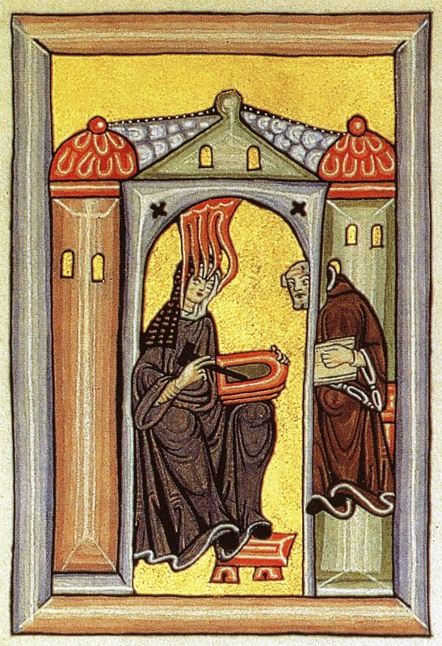
  <figcaption>Rupertsberg, illuminator working for Hildegard of Bingen, Hildegard receiving the vision, with Volmar, Scivias, fol. 1r of the Rupertsberg codex, c. 1165–1180. Formerly Wiesbaden, Landesbibliothek, Hs. 1 (lost since 1945); reproduced from the hand-painted copy made at the Abbey of St Hildegard, Eibingen, 1927–1933. Image: public domain, via Wikimedia Commons.</figcaption>
</figure>

The opening miniature illustrates the *Protestificatio*. Hildegard sits under an arch, her eyes open, as five tongues of flame descend on her head, the "fiery light" of the text, recalling Pentecost. On her knees she holds a wax tablet and a stylus. At the right, in a separate space, the monk Volmar leans through an opening in the wall to look at her and holds a book, in which he will write down and correct what she says.

The composition distinguishes the two roles clearly: the nun receives and records the vision, the monk transmits the text. The wall between them stands for the enclosure and, at the same time, for a collaboration that lasted more than thirty years. The architecture, two towers and a central gable, is emblematic, a sign of the convent as the place of revelation.

The image is the most frequently reproduced picture of Hildegard and one of the best-known images of authorship in medieval art. It presents the whole book as the record of a revelation rather than as a work of learning, and it was taken up a generation later in the Lucca *Liber Divinorum Operum*.

### The Cosmos as an Egg (Scivias I.3, Rupertsberg codex, fol. 14r)

<figure>
  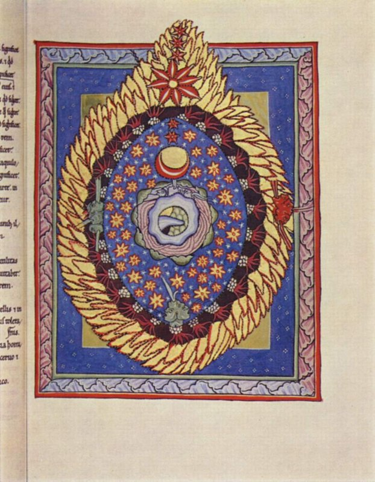
  <figcaption>Rupertsberg, illuminator working for Hildegard of Bingen, The Cosmos as an Egg, Scivias I.3, fol. 14r of the Rupertsberg codex, c. 1165–1180. Formerly Wiesbaden, Landesbibliothek, Hs. 1 (lost since 1945); reproduced from the hand-painted copy made at the Abbey of St Hildegard, Eibingen, 1927–1933. Image: public domain, via Wikimedia Commons.</figcaption>
</figure>

The third vision of the first book describes the universe as a great egg-shaped instrument, narrow at the top, broad in the middle and narrow again at the bottom. The miniature follows the description layer by layer: an outer ring of bright fire with a red star, the sun, at its top; a dark, shadowy fire from which storms and hail issue; a blue ether strewn with stars, with the moon; and, at the centre, a small earth surrounded by waters and moist air.

Around the egg are the winds, small heads that blow towards the centre, as on medieval world maps. In Hildegard's explanation they are the forces that keep the elements in motion and also the powers of good and evil that act on the world, so that the cosmological diagram is at the same time a moral one.

The image has no precedent in earlier art. It combines an ancient idea of the universe as an egg with Hildegard's own description and turns the result into a strict, almost heraldic design, whose pointed shape breaks the inner frame of the page. The cosmic wheel of the *Liber Divinorum Operum*, twenty years later, develops the same conception with the human being at its centre.

### The Choirs of Angels (Scivias I.6, Rupertsberg codex, fol. 38r)

<figure>
  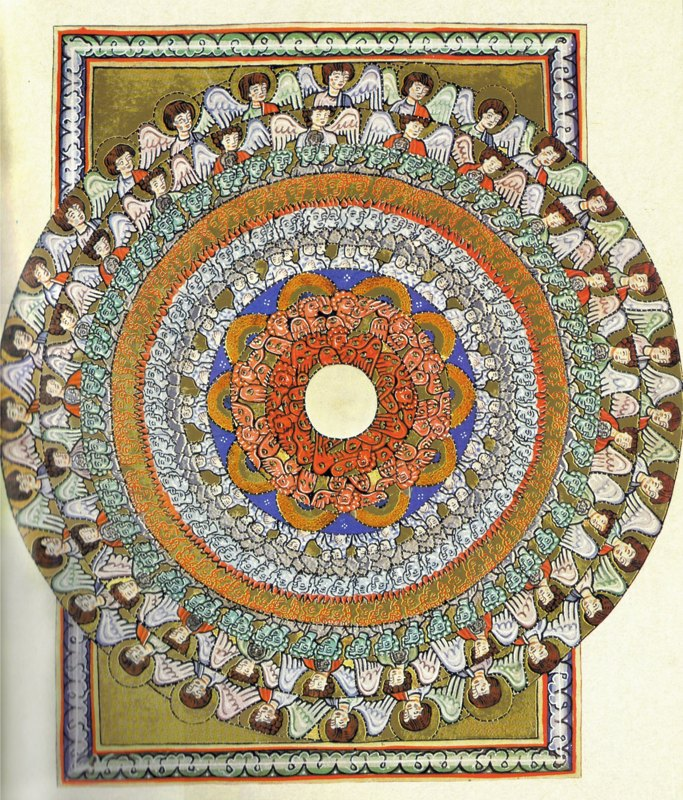
  <figcaption>Rupertsberg, illuminator working for Hildegard of Bingen, The Choirs of Angels, Scivias I.6, fol. 38r of the Rupertsberg codex, c. 1165–1180. Formerly Wiesbaden, Landesbibliothek, Hs. 1 (lost since 1945); reproduced from the hand-painted copy made at the Abbey of St Hildegard, Eibingen, 1927–1933. Image: public domain, via Wikimedia Commons.</figcaption>
</figure>

The sixth vision of the first book is devoted to the nine orders of angels, which Hildegard sees arranged in the form of a crown. The miniature presents them as concentric rings: angels and archangels on the outside, then the Virtues, Powers, Principalities, Dominations and Thrones, and at the centre the Cherubim, covered with eyes, and the Seraphim, burning like flames.

At the very centre the painter leaves an empty white circle. The place of God is not represented by a figure but left as pure light, a solution of great boldness in the art of the period. The repetition of faces and wings within each ring conveys the innumerable multitude of the angels that the text describes.

As in the cosmic egg, the disc breaks through the frame on three sides. The device, used repeatedly in the Rupertsberg cycle, suggests that the vision exceeds the limits of the page, and shows a designer willing to depart from the conventions of framed book illustration.

### The Trinity (Scivias II.2, Rupertsberg codex)

<figure>
  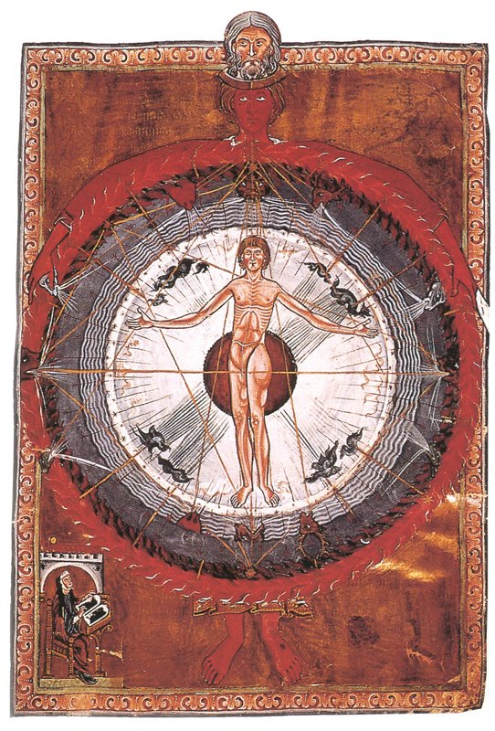
  <figcaption>Rupertsberg, illuminator working for Hildegard of Bingen, The Trinity, Scivias II.2, from the Rupertsberg codex, c. 1165–1180. Formerly Wiesbaden, Landesbibliothek, Hs. 1 (lost since 1945); reproduced from the hand-painted copy made at the Abbey of St Hildegard, Eibingen, 1927–1933. Image: public domain, via Wikimedia Commons.</figcaption>
</figure>

In the second vision of the second book Hildegard sees a very bright light, within it a glowing fire, and within the fire a figure of a man of sapphire colour. The explanation identifies the three as the Father, the Holy Spirit and the Son, one in substance and distinct in person. The miniature translates the description into three concentric forms: an outer disc of silver, an inner disc of golden and red rings, and at the centre the blue figure with his hands raised.

The image avoids the usual personifications of the Trinity. There are no three figures, no old man and dove, but light, fire and a human form that interpenetrate. The figure's gesture, both hands raised with the palms outward, is that of prayer and of showing, and the sapphire blue, associated in medieval symbolism with the heavenly throne, marks him as the Son.

Without the text the picture could be read as a Christ in glory; with it, every element acquires a doctrinal meaning. At a time when the theology of the Trinity was debated in the schools, the miniature offers an exposition of the doctrine in visual terms, in which colour and form take the place of concepts.

### Ecclesia as Mother: the Church and Baptism (Scivias II.3, Rupertsberg codex)

<figure>
  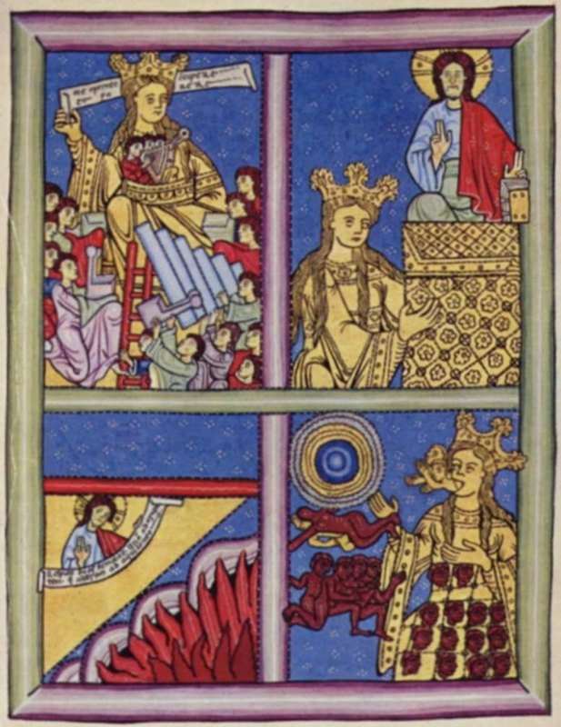
  <figcaption>Rupertsberg, illuminator working for Hildegard of Bingen, Ecclesia as Mother: the Church and Baptism, Scivias II.3, from the Rupertsberg codex, c. 1165–1180. Formerly Wiesbaden, Landesbibliothek, Hs. 1 (lost since 1945); reproduced from the hand-painted copy made at the Abbey of St Hildegard, Eibingen, 1927–1933. Image: public domain, via Wikimedia Commons.</figcaption>
</figure>

The third vision of the second book describes the Church as a woman of immense size, crowned, joined to Christ as his bride and endowed with his gifts. The miniature divides the vision into four fields. In the upper ones Ecclesia appears among the faithful, holding a scroll, and then before Christ enthroned, receiving from the altar the dowry of the sacraments.

The lower right field shows the core of the vision, the maternity of the Church "from the Spirit and the water". Children blackened by sin enter the body of Ecclesia and leave it through her mouth, purified, while a radiant disc shines above her: baptism as a second birth. The lower left field shows a figure in a triangle of light above the flames, an image of the divine judgment that the Church escapes.

The division of a single vision into several fields is a feature of the Rupertsberg cycle when a vision unfolds in time. It shows the designer's concern to follow the stages of the text, even at the cost of breaking the unity of the image.

### Ecclesia and the Orders of the Church (Scivias II.5, Rupertsberg codex)

<figure>
  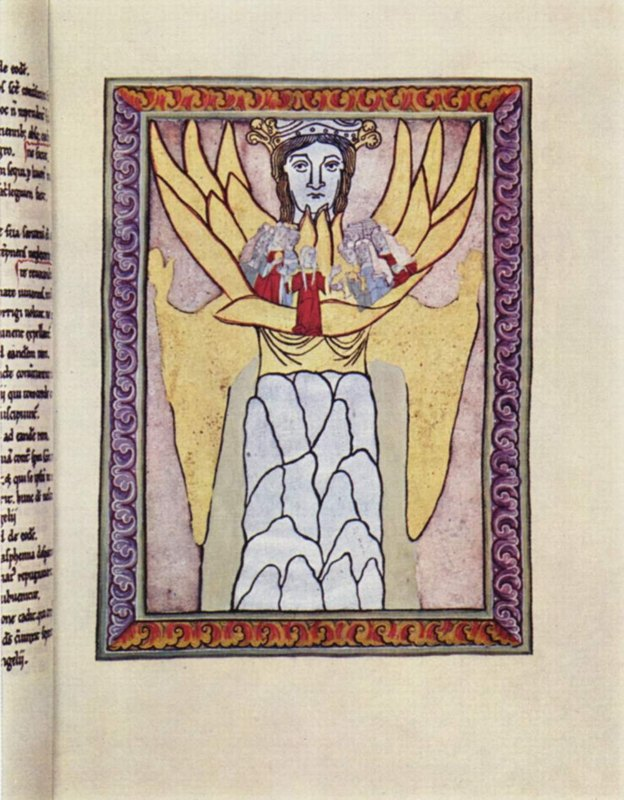
  <figcaption>Rupertsberg, illuminator working for Hildegard of Bingen, Ecclesia and the Orders of the Church, Scivias II.5, from the Rupertsberg codex, c. 1165–1180. Formerly Wiesbaden, Landesbibliothek, Hs. 1 (lost since 1945); reproduced from the hand-painted copy made at the Abbey of St Hildegard, Eibingen, 1927–1933. Image: public domain, via Wikimedia Commons.</figcaption>
</figure>

The fifth vision of the second book returns to the figure of Ecclesia and shows her as the bearer of the three orders of the Church: those who live in virginity and the religious life, the clergy, and the laity. The crowned woman holds in her breast a group of figures, the virgins closest to her heart, while golden radiance rises from her shoulders.

Her lower body is not a dress but a column of white rocks. The image follows Hildegard's description of the Church as a building founded on stone, and it fuses the woman and the edifice into a single form that is at once maternal and architectural.

The figure has often been compared with the personifications of Ecclesia in Rhenish art of the twelfth century. Hildegard's Ecclesia differs from them in her monumental scale and in the way she contains the faithful in her own body, an idea that the Salem cycle would develop in architectural terms in its drawings of the third book.

### The Riesencodex: Front Cover (Wiesbaden, Hs. 2)

<figure>
  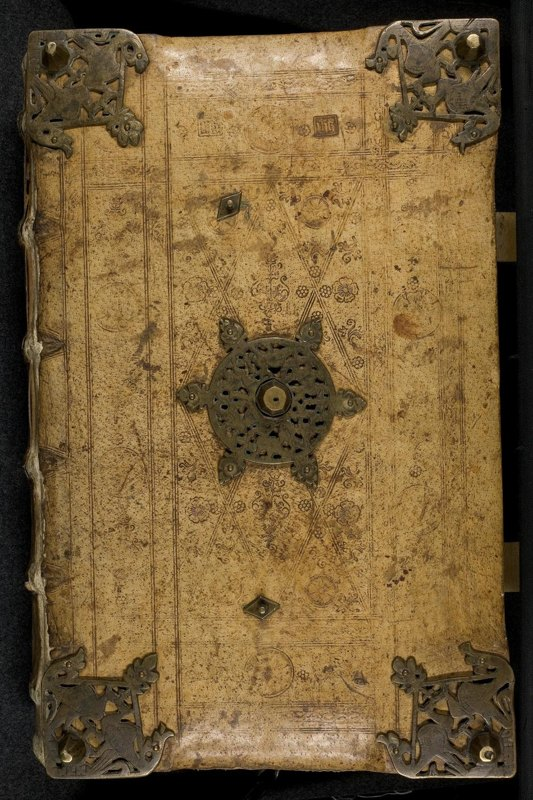
  <figcaption>Riesencodex, front cover, binding of the fifteenth or sixteenth century over a manuscript of c. 1180–1190. Pigskin over wooden boards with metal fittings. Wiesbaden, Hochschul- und Landesbibliothek RheinMain, Hs. 2. Image: Hochschul- und Landesbibliothek RheinMain, Wiesbaden, <a href="https://creativecommons.org/licenses/by/4.0/">CC BY 4.0</a>.</figcaption>
</figure>

The Riesencodex is bound in wooden boards covered with pigskin, tooled with lines and small stamps, with pierced metal corner pieces, a central boss and the remains of clasps. The library dates the binding, together with the chain by which the book was once attached to a desk, to the fifteenth or sixteenth century.

The size of the volume, about 46 by 30 centimetres and some fifteen kilograms in weight, was intended to give Hildegard's collected works the status of a monumental book, comparable to a giant Bible. It was a book to be kept and consulted at a desk, not carried.

The cover belongs to the later history of the codex at the Rupertsberg and Eibingen, when Hildegard's works were treasured as relics of the foundress. A fragment of a gradual contemporary with the manuscript survives in the binding waste.

### The Riesencodex: First Leaf (Wiesbaden, Hs. 2, fol. 1r)

<figure>
  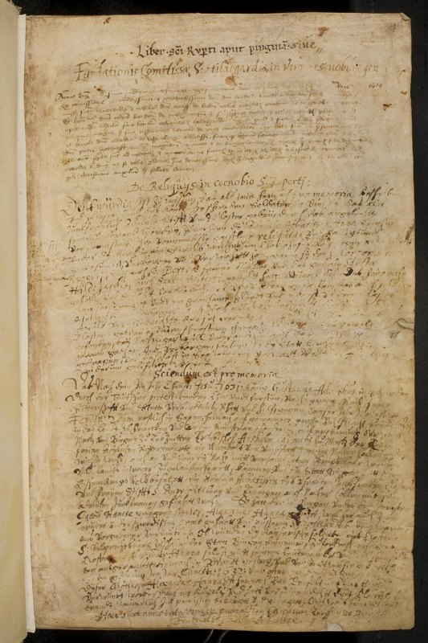
  <figcaption>Riesencodex, fol. 1r, with a later heading Liber sancti Ruperti apud Pinguiam and notes on Hildegard as foundress, manuscript c. 1180–1190. Wiesbaden, Hochschul- und Landesbibliothek RheinMain, Hs. 2. Image: Hochschul- und Landesbibliothek RheinMain, Wiesbaden, <a href="https://creativecommons.org/licenses/by/4.0/">CC BY 4.0</a>.</figcaption>
</figure>

The first leaf of the Riesencodex is worn and stained, the result of centuries of use. A later hand has written at its head *Liber sancti Ruperti apud Pinguiam*, "book of St Rupert at Bingen", and below it a long text on the foundation of the convent and on Hildegard, with a date in the margin.

The page shows how the codex was used as a document of the community's identity. The note binds the book to the house and to its foundress and treats it as a witness of the convent's history as much as a collection of texts.

Such notes are typical of manuscripts preserved as institutional treasures. They also help to trace the history of the volume, which remained with the community until the nineteenth century.

### The Riesencodex: Opening of the Scivias (Wiesbaden, Hs. 2, fol. 3r)

<figure>
  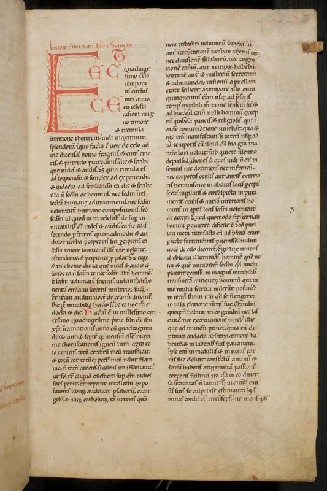
  <figcaption>Rupertsberg, Opening of the Scivias, with the Protestificatio, Riesencodex, fol. 3r, c. 1180–1190. Ink and red pigment on parchment. Wiesbaden, Hochschul- und Landesbibliothek RheinMain, Hs. 2. Image: Hochschul- und Landesbibliothek RheinMain, Wiesbaden, <a href="https://creativecommons.org/licenses/by/4.0/">CC BY 4.0</a>.</figcaption>
</figure>

Under the rubric *Incipit prima pars libri Scivias*, a tall red E opens the words *Ecce quadragesimo tertio*, "behold, in the forty-third year", the beginning of the *Protestificatio*. The initial is the most elaborate type in the Riesencodex: its shaft is filled with a wavy line and its arms with fine scrolls.

The text that begins here is the same declaration that the opening miniature of the Rupertsberg codex illustrates. Read beside that picture, the page shows the two ways in which the community presented the same moment of revelation: as an image, and as a solemn text marked by an initial.

The script is a regular, compact Romanesque minuscule laid out in two columns of many lines, designed to hold a very large amount of text. The economy of the decoration matches the purpose of the book, a complete and authoritative collection rather than a book of images.

### The Riesencodex: Opening of Book III (Wiesbaden, Hs. 2, fol. 73r)

<figure>
  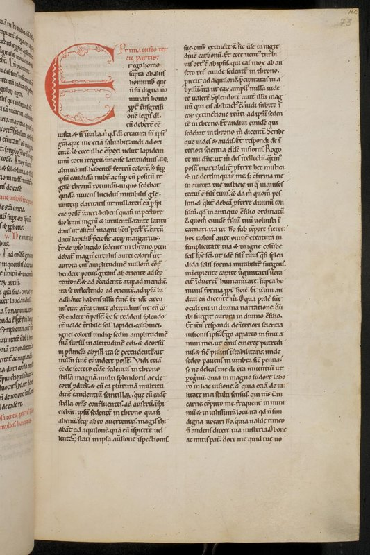
  <figcaption>Rupertsberg, Opening of the third book of the Scivias, with the first vision, Riesencodex, fol. 73r, c. 1180–1190. Ink and red pigment on parchment. Wiesbaden, Hochschul- und Landesbibliothek RheinMain, Hs. 2. Image: Hochschul- und Landesbibliothek RheinMain, Wiesbaden, <a href="https://creativecommons.org/licenses/by/4.0/">CC BY 4.0</a>.</figcaption>
</figure>

The third book begins with the rubric *Prima visio tercie partis* and a large red E, opening the description of the one who sits on a throne above a great mountain. The initial repeats the form of the one at the beginning of the work and marks the hierarchy of the text: the larger initials stand at the openings of the three books, smaller ones at the openings of the visions.

The vision introduced here is the first of thirteen that describe the history of salvation as a great building. In the Salem codex the same vision is accompanied by a drawing (fol. 111r); in the Riesencodex the text stands alone.

The juxtaposition of the two manuscripts shows the different expectations of their readers. At the Rupertsberg the Riesencodex was the reference text, while the illuminated codex offered the images; at Salem a single manuscript had to serve both purposes.

### The Beginning of Creation (Salem codex, fol. 2r)

<figure>
  
  <figcaption>Zwiefalten or Salem, Initium creaturae dei: Christ among the angels, the fall of the rebel angels, the six days of creation and Paradise, Salem codex, fol. 2r, late twelfth century. Pen drawing and colours on parchment. Heidelberg, Universitätsbibliothek, Cod. Sal. X,16. Image: Universitätsbibliothek Heidelberg, Cod. Sal. X,16, public domain.</figcaption>
</figure>

The first frontispiece of the Salem codex, entitled *Initium creaturae dei*, "the beginning of God's creation", summarises the history of creation in a single page. At the top Christ sits in a mandorla within a great lobed circle of angels; at the left, in a dark strip, the rebel angels and the dragon fall, and an inscription records that the dragon and his angels were cast out. In the middle six roundels show the six days of creation, from the separation of light and darkness to the creation of Adam.

At the bottom, within a frame with a gate and a tower, the painter represents Paradise: the four rivers, Adam and Eve at the tree with the serpent, the expulsion, and the cherub with the flaming sword at the gate. Short inscriptions name the elements.

The page has no direct equivalent in the text of the *Scivias*, though it corresponds to the themes of the second vision of the first book. It works as a visual prologue, placing the whole work within the history of salvation, and its precise drawing and refined colours show the quality of the Salem cycle.

### The Year (Salem codex, fol. 2v)

<figure>
  
  <figcaption>Zwiefalten or Salem, Annus: the Year with the seasons, the zodiac and the winds, Salem codex, fol. 2v, late twelfth century. Pen drawing and colours on parchment. Heidelberg, Universitätsbibliothek, Cod. Sal. X,16. Image: Universitätsbibliothek Heidelberg, Cod. Sal. X,16, public domain.</figcaption>
</figure>

The second frontispiece, *Annus*, "the Year", is a cosmic diagram. At its centre a crowned figure, the Year, sits on a blue disc holding smaller figures; around it are the quarters, the sun with its rays, the moon, a star, the lightning and the seasons, and in the outer ring the twelve signs of the zodiac, each labelled *sol in*, "the sun in", followed by the name of the sign.

At the corners four naked wind figures, each with two heads and blowing, stand for the cardinal and lateral winds, named in inscriptions. At the top and bottom lie the figures of Dawn (*Aurora*) and Storm (*Tempestas*), at the sides Serenity and Rain. The page belongs to the tradition of the cosmological diagrams of the early Middle Ages, derived from Isidore and Bede, rather than to the text of the *Scivias*.

Placed beside the Creation, the diagram presents the order of time and nature as the frame of Hildegard's visions. It is the Salem equivalent of the cosmic egg of the Rupertsberg cycle, but conceived in the established language of the schools rather than in that of the visionary.

### The Writer of the Visions (Salem codex, fol. 3v)

<figure>
  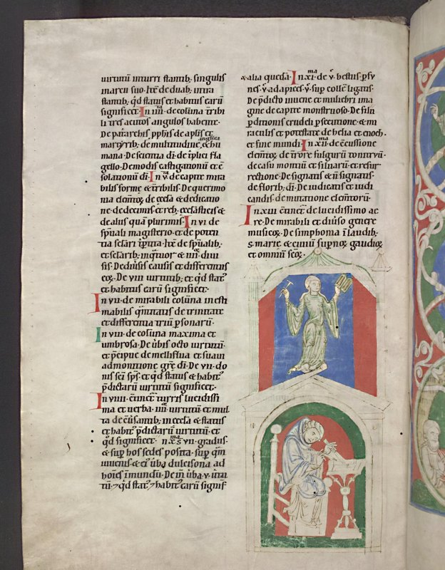
  <figcaption>Zwiefalten or Salem, The writer of the visions, with the summary of the Scivias, Salem codex, fol. 3v, late twelfth century. Pen drawing and colours on parchment. Heidelberg, Universitätsbibliothek, Cod. Sal. X,16. Image: Universitätsbibliothek Heidelberg, Cod. Sal. X,16, public domain.</figcaption>
</figure>

On the page with the summary of the work the illustrator placed a two-storey picture. Below, under an arch, a hooded figure sits on a chair and writes at a lectern with pen and knife; above, under a gable, a standing figure holds a tool and a pair of tablets, an image of the law or of the revelation that the writer receives.

The writer is not named, but the position of the picture, at the beginning of the work, makes it the author portrait of the Salem codex. It corresponds to the opening miniature of the Rupertsberg codex, but it is conceived differently: there is no flame and no secretary, and the act of writing is shown in the traditional form of the evangelist or author at the desk.

The comparison between the two author pictures sums up the difference between the two cycles. At the Rupertsberg the image insists on the visionary experience of a woman; at Salem it presents the work in the conventional terms of an authoritative book.

### Opening Page of the Salem Codex (fol. 4r)

<figure>
  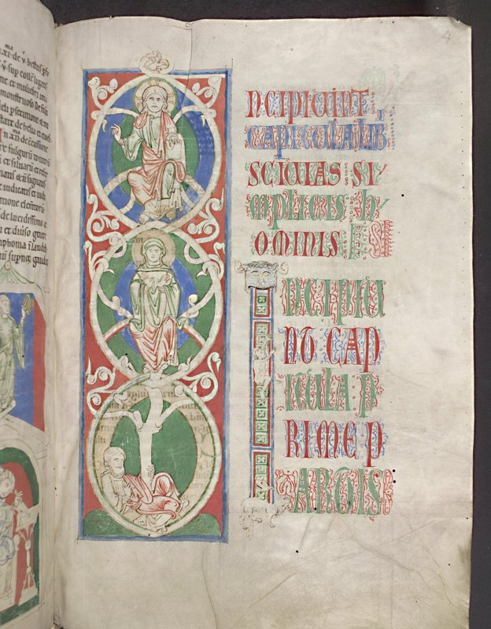
  <figcaption>Zwiefalten or Salem, Opening page with a painted panel and display capitals, Incipiunt capitula libri Scivias simplicis hominis, Salem codex, fol. 4r, late twelfth century. Colours on parchment. Heidelberg, Universitätsbibliothek, Cod. Sal. X,16. Image: Universitätsbibliothek Heidelberg, Cod. Sal. X,16, public domain.</figcaption>
</figure>

The list of chapters opens with a page of display capitals, *Incipiunt capitula libri Scivias simplicis hominis*, "here begin the chapters of the book Scivias of a simple human being", the formula by which Hildegard described herself. At the left, a tall painted panel shows three linked roundels on a red ground.

In the top roundel Christ sits enthroned with a book; in the middle a veiled figure stands in front of him; in the lowest a bearded man sits at the root of a tree that grows up through the panel, in the manner of a Tree of Jesse. The panel can be read as an image of descent from the root of the patriarchs to Christ, with the veiled figure, the Virgin or the Church, between them.

The quality of the painting, with its fine white scrolls, its harmonious colours and its delicate drapery, places the opening of the Salem codex among the accomplished works of southern German book painting around 1200.

### Opening of Book I (Salem codex, fol. 5v)

<figure>
  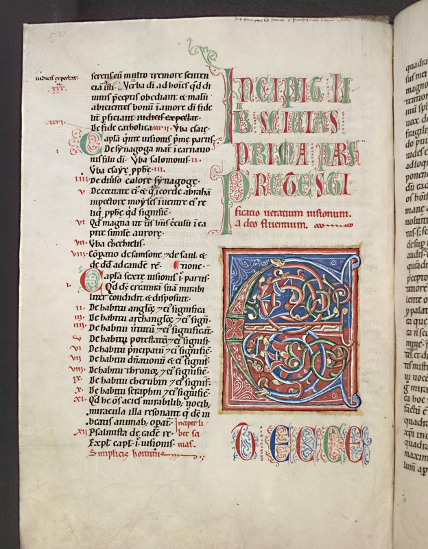
  <figcaption>Zwiefalten or Salem, Opening of the first book with a painted initial E, Salem codex, fol. 5v, late twelfth century. Colours on parchment. Heidelberg, Universitätsbibliothek, Cod. Sal. X,16. Image: Universitätsbibliothek Heidelberg, Cod. Sal. X,16, public domain.</figcaption>
</figure>

After the list of chapters, the first book begins with a heading in large green and red capitals: *Incipit liber Scivias. Prima pars. Protestificatio veratium visionum a Deo fluentium*. Below it a large painted E, on a blue and red ground, is filled with interlaced stems, leaves and small animals.

The initial opens the same words as the red E of the Riesencodex, *Ecce quadragesimo tertio*. Set side by side, the two pages measure the difference between the austere text book of the Rupertsberg and the richly decorated copy of Salem.

In the first two books of the Salem codex initials of this type, with interlace on blue or red grounds, mark the beginnings of the visions in place of the miniatures of the Rupertsberg cycle; the opening of the second book, on fol. 42r, is of the same kind.

### The Devil in Chains (Scivias II.7, Salem codex, fol. 106r)

<figure>
  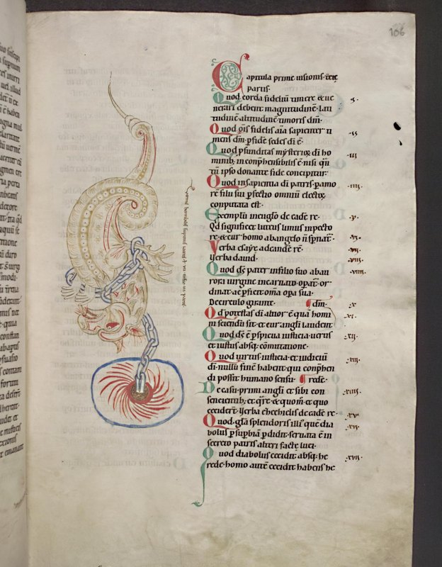
  <figcaption>Zwiefalten or Salem, The horrible worm lying on its back, bound in chains, Scivias II.7, with the chapters of the third book, Salem codex, fol. 106r, late twelfth century. Pen drawing and colours on parchment. Heidelberg, Universitätsbibliothek, Cod. Sal. X,16. Image: Universitätsbibliothek Heidelberg, Cod. Sal. X,16, public domain.</figcaption>
</figure>

The last vision of the second book describes the devil as a worm of enormous size, black and hairy, lying on its back and bound with a chain, unable to harm the faithful who resist him. The Salem illustrator places the drawing in the margin, beside the chapters of the next book, and labels it *vermis horribilis supinus iacens*.

The monster coils upward, its tail in a spiral, its head hanging downward; a blue chain binds its body and is fixed to a round pit of red flames. The drawing is in brown ink with touches of red and blue, a technique that suits the energetic line of the coiling body.

The image marks the transition to the third book, where drawings become regular. Its placement in the margin, independent of a frame, shows the freedom with which the Salem illustrator related image and text.

### The One Enthroned on the Mountain (Scivias III.1, Salem codex, fol. 111r)

<figure>
  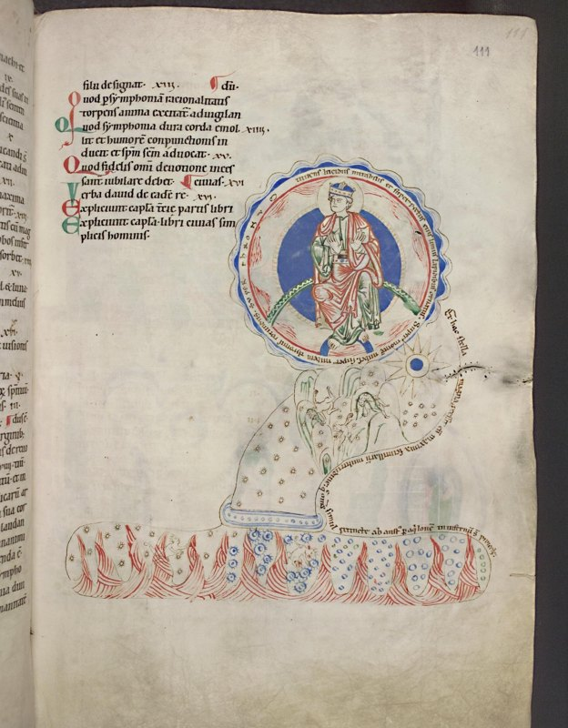
  <figcaption>Zwiefalten or Salem, The one enthroned above the mountain and the fall of the star, Scivias III.1, Salem codex, fol. 111r, late twelfth century. Pen drawing and colours on parchment. Heidelberg, Universitätsbibliothek, Cod. Sal. X,16. Image: Universitätsbibliothek Heidelberg, Cod. Sal. X,16, public domain.</figcaption>
</figure>

The first vision of the third book opens with God enthroned above a mountain, from whose breast a star falls with a multitude of sparks into the abyss: the fall of Lucifer and his followers. The drawing places the crowned figure on a rainbow within a circle whose scalloped border carries an inscription from the text.

Below, a great falling star trails a band of stars that descends into the abyss, drawn as a long bed of red flames with blue circles. Small figures tumble within the mass. The inscription along the band, *Et haec stella magna…*, quotes the description.

The drawing turns the vertical movement of the text, from the throne to the abyss, into a curving line that crosses the page. It is a characteristic solution of the Salem illustrator, who uses the whole surface of the page and lets text and image share it.

### The Building of Salvation (Scivias III.2, Salem codex, fol. 111v)

<figure>
  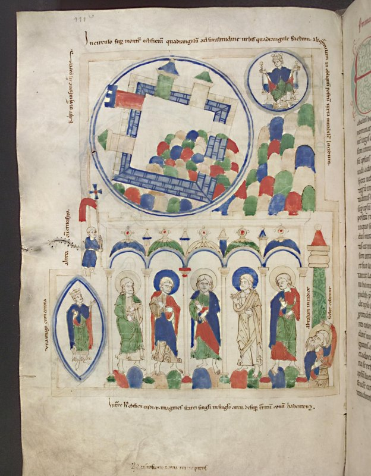
  <figcaption>Zwiefalten or Salem, The four-cornered building on the mountain, with five figures under the arches and Abraham at the column, Scivias III.2, Salem codex, fol. 111v, late twelfth century. Pen drawing and colours on parchment. Heidelberg, Universitätsbibliothek, Cod. Sal. X,16. Image: Universitätsbibliothek Heidelberg, Cod. Sal. X,16, public domain.</figcaption>
</figure>

The second vision of the third book introduces the great building that will occupy the rest of the work: a four-cornered edifice like a city on a mountain, which represents the work of God in history. The Salem drawing shows it from above, within a circle, as a square of walls with towers rising from a mountain of coloured shapes. The inscription at the top quotes the text: *in circulo super montem aedificium quadrangulum ad similitudinem urbis quadrangulae factum*.

The lower half shows details of the vision in elevation. Under an arcade stand five haloed figures, and at the right Abraham sits at the root of a column; at the left a crowned figure in a mandorla and a man holding a banner with a cross. Each element is labelled.

The combination of plan and elevation, a bird's-eye view of the building above and its inhabitants in frontal view below, is one of the most original features of the Salem cycle. It reflects the complexity of a text in which the building is both a structure to be imagined and a stage for figures.

### The Zeal of God (Scivias III.5, Salem codex, fol. 135v)

<figure>
  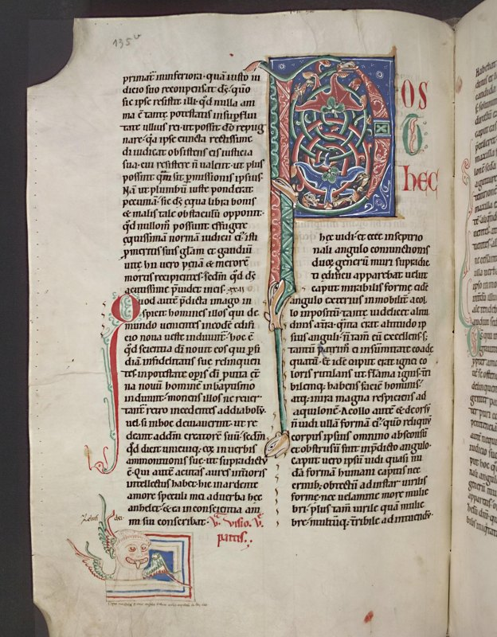
  <figcaption>Zwiefalten or Salem, The Zeal of God, with a painted initial P, Scivias III.5, Salem codex, fol. 135v, late twelfth century. Colours and pen drawing on parchment. Heidelberg, Universitätsbibliothek, Cod. Sal. X,16. Image: Universitätsbibliothek Heidelberg, Cod. Sal. X,16, public domain.</figcaption>
</figure>

In the fifth vision Hildegard sees at the northern corner of the building a head of fiery colour, with a human face and terrible to look at, which represents the zeal of God against sin. The Salem illustrator draws it in the lower margin, a winged head with staring eyes and bared teeth at the corner of a framed structure, labelled *Zelus dei*.

Above, the vision opens with a large painted P, *Post haec vidi*, on a blue ground filled with interlace and small beasts; its long tail descends through the column as a dragon. The page combines the two kinds of decoration of the Salem codex, the painted initial and the marginal drawing.

The terrible head is one of the most expressive images of the cycle. Its small size and position at the edge of the page do not diminish its force, and they correspond to the text, which locates the head at the corner of the building, where it watches over the north, the region of evil.

### The Pillar of the Humanity of the Saviour (Scivias III.8, Salem codex, fol. 156r)

<figure>
  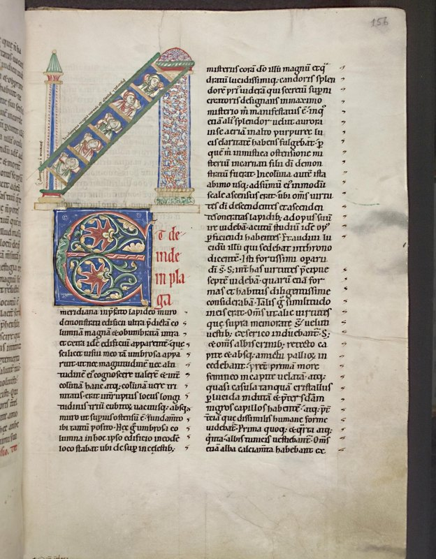
  <figcaption>Zwiefalten or Salem, The ladder of the virtues at the pillar of the humanity of the Saviour, with a painted initial E, Scivias III.8, Salem codex, fol. 156r, late twelfth century. Pen drawing and colours on parchment. Heidelberg, Universitätsbibliothek, Cod. Sal. X,16. Image: Universitätsbibliothek Heidelberg, Cod. Sal. X,16, public domain.</figcaption>
</figure>

The eighth vision describes a great shaded column, the humanity of the Saviour, set against the southern wall of the building, with a ladder on which the virtues ascend and descend, carrying stones for the work. The Salem drawing places the ladder diagonally between two columns, with half-length figures on its rungs, and labels it.

The image is compressed into the corner of the page, above a painted initial E with red and green foliage on a blue ground. Text, initial and drawing interlock, and the drawing reads almost as a gloss in images.

The virtues on the ladder are a recurrent theme of the third book, and Hildegard describes each of them in detail. The Salem illustrator does not attempt to represent all their attributes but gives the structure of the vision, the column and the ascent, which the reader can complete with the text.

### The Last Days and the Antichrist (Scivias III.11, Salem codex, fol. 177r)

<figure>
  
  <figcaption>Zwiefalten or Salem, The five beasts, Enoch and Elijah, and the woman with the monstrous head, Scivias III.11, Salem codex, fol. 177r, late twelfth century. Pen drawing and colours on parchment. Heidelberg, Universitätsbibliothek, Cod. Sal. X,16. Image: Universitätsbibliothek Heidelberg, Cod. Sal. X,16, public domain.</figcaption>
</figure>

The eleventh vision is the most dramatic of the work. Hildegard sees five beasts facing north, a fiery dog, a yellow lion, a pale horse, a black pig and a grey wolf, which signify the five ages of temporal rule before the end. She then sees the woman she has seen before, Ecclesia, from whose lower body a monstrous black head emerges: the Antichrist, born within the Church from the corruption of her ministers. The Antichrist rises on a mountain and is struck down.

The Salem drawing places the five beasts upside down at the upper left, hanging by ropes from a row of hills, with their names written above: *canis, leo, equus, porcus, lupus*. Below them stand Enoch and Elijah, the two witnesses who will preach against the Antichrist, labelled *Enoch et Helias*. At the right the veiled woman stands with the monstrous head at her lower body, under the inscription *monstruosum caput in muliere*; below, the great head rises above the mountains and falls again.

The image of the Church giving birth to the Antichrist was the most influential of the *Scivias* in the Middle Ages and is also illustrated in the Rupertsberg cycle. The Salem version is less monumental but more analytical, and it preserves through its inscriptions the vocabulary of the text.

### The Symphony of the Blessed (Scivias III.13, Salem codex, fol. 196r)

<figure>
  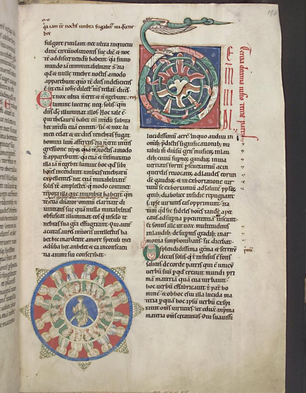
  <figcaption>Zwiefalten or Salem, The choirs of the blessed around Christ enthroned, with a painted initial E, Scivias III.13, Salem codex, fol. 196r, about 1220. Pen drawing and colours on parchment. Heidelberg, Universitätsbibliothek, Cod. Sal. X,16. Image: Universitätsbibliothek Heidelberg, Cod. Sal. X,16, public domain.</figcaption>
</figure>

The last vision of the *Scivias* is a symphony. Hildegard hears in the bright air a music of many kinds in praise of the citizens of heaven, of the Virgin, the angels, the patriarchs, the apostles, the martyrs and the virgins, and records the songs and a dramatic dialogue between the virtues and the soul, an early form of the *Ordo Virtutum*. The page opens with the heading *Tercia decima visio tercie partis* and a painted E with interlace and a dragon-headed tail.

In the lower left the illustrator drew a great circle with a star-shaped border, in which rings of haloed figures, the choirs of the blessed, surround Christ enthroned on a blue disc. The image returns, at the end of the book, to the form of the circle of angels on the Creation frontispiece.

The circle of the blessed closes the cycle. Like the choirs of angels in the Rupertsberg codex, it presents heaven as a concentric order around a divine centre; unlike that miniature, it fills the centre with the figure of Christ, in keeping with the more conventional iconography of the Salem codex.
